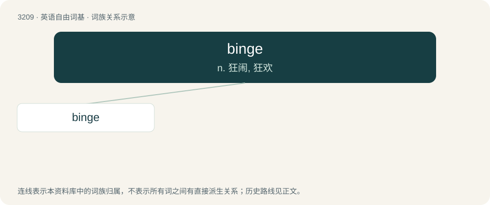

# 3308 · binge — n. 狂闹, 狂欢

[总目录](../00_总目录_按常用程度.md)

**类型**：英语自由词基　｜　**来源语言**：见词源记录

## 核心含义与来源

- 核心含义：n. 狂闹, 狂欢
- 英文含义：A short period of excessive consumption, especially of food, alcohol, narcotics, etc.
- 词形：binge

**来源记录 1**（名词；A short period of excessive consumption, especially of food, alcohol, narcotics, etc.）

From Leicestershire and Northamptonshire dialect, binge (“to drink deeply", also "to soak, steep, drench", specifically "to swell a leaky wooden vessel by filling it with or plunging it into water”), of unknown origin. Possibly inherited from Middle English \*bengen, from Old English \*benġan, from Proto-West Germanic \*bangijan (“to press”), possibly related to \*bangōn (“to bang”) and thus potentially cognate with Bavarian aufbenga (“to raise for processing”), Middle Low German bengen (“to evacuate, to force birth”, German Low German bängen, bengen, bingen), and possibly Middle Scots beynge, bynge (“to cringe”, Scots beenge), though the last could be a blend of bow (“to bow”) + crenge (“to cringe”). However, compare dialectal English beam and Scots beam, beene (“to cure leakage in a tub or barrel by soaking, thereby causing the wood to swell”), though these could be specialised developments of Old English bēam (“wood”), with variants in /n/ being due to influence from this word or assimilation before syncopated forms of the past tense suffix.

## 词族图

## 单词速览（常用到不常用）

| 单词 | 音标 | 释义 |
|---|---|---|
| [binge](#w-1) | /bɪnd͡ʒ/ | n. 狂闹, 狂欢 |

## 逐词详解

### 1. binge

**词性**：动词　｜　**音标**：/bɪnd͡ʒ/

**中文释义**：n. 狂闹, 狂欢

**英文义项**：To engage in a short period of excessive consumption, especially of excessive alcohol or media consumption.

**词源与演化**：

From Leicestershire and Northamptonshire dialect, binge (“to drink deeply", also "to soak, steep, drench", specifically "to swell a leaky wooden vessel by filling it with or plunging it into water”), of unknown origin. Possibly inherited from Middle English \*bengen, from Old English \*benġan, from Proto-West Germanic \*bangijan (“to press”), possibly related to \*bangōn (“to bang”) and thus potentially cognate with Bavarian aufbenga (“to raise for processing”), Middle Low German bengen (“to evacuate, to force birth”, German Low German bängen, bengen, bingen), and possibly Middle Scots beynge, bynge (“to cringe”, Scots beenge), though the last could be a blend of bow (“to bow”) + crenge (“to cringe”). However, compare dialectal English beam and Scots beam, beene (“to cure leakage in a tub or barrel by soaking, thereby causing the wood to swell”), though these could be specialised developments of Old English bēam (“wood”), with variants in /n/ being due to influence from this word or assimilation before syncopated forms of the past tense suffix.

**例句**：

> She'll binge an entire series on the weekend.

该用例对应义项：To engage in a short period of excessive consumption, especially of excessive alcohol or media consumption.
