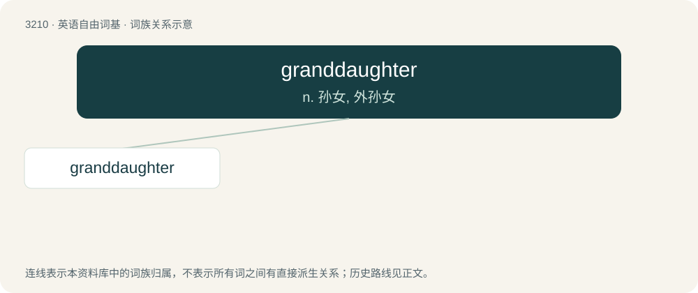

# 3309 · granddaughter — n. 孙女, 外孙女

[总目录](../00_总目录_按常用程度.md)

**类型**：英语自由词基　｜　**来源语言**：见词源记录

## 核心含义与来源

- 核心含义：n. 孙女, 外孙女
- 英文含义：The daughter of someone's child.
- 词形：granddaughter

**来源记录 1**（名词；The daughter of someone's child.）

From grand- + daughter.

## 词族图

## 单词速览（常用到不常用）

| 单词 | 音标 | 释义 |
|---|---|---|
| [granddaughter](#w-1) | /ˈ^rændɔːtə(r)/ | n. 孙女, 外孙女 |

## 逐词详解

### 1. granddaughter

**词性**：名词　｜　**音标**：/ˈ^rændɔːtə(r)/

**中文释义**：n. 孙女, 外孙女

**英文义项**：The daughter of someone's child.

**构词拆分**：From grand- + daughter.

**词源与演化**：

From grand- + daughter.

**例句**：

> My granddaughter just had a baby, so now I'm a great-grandfather.
