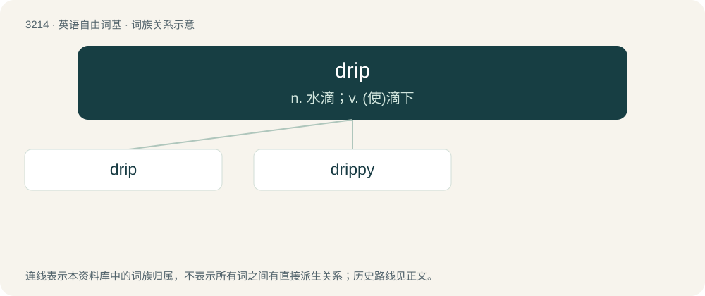

# 3313 · drip — n. 水滴；v. (使)滴下

[总目录](../00_总目录_按常用程度.md)

**类型**：英语自由词基　｜　**来源语言**：见词源记录

## 核心含义与来源

- 核心含义：n. 水滴；v. (使)滴下
- 英文含义：To fall one drop at a time.
- 词形：drip

**多个词源／构词路径**：同一拼写可能有不同来源；以下按词性和含义分别列出。

**来源记录 1**（动词；To fall one drop at a time.）

From Middle English drippen, druppen, from Old English drypan, from Proto-Germanic \*drupjaną (“to fall in drops, drip”), from Proto-Germanic \*drupô (“drop”). Akin to West Frisian drippe (“to drip”), Dutch druipen, druppelen (“to drip”), German Low German drüppen (“to drip”), German tropfen, tröpfeln (“to drip”), Norwegian Bokmål dryppe, Norwegian Nynorsk drypa (“to drip”).

**来源记录 2**（名词；A drop of a liquid.）

From Middle English drippe, from the verb (see above). Compare West Frisian drip (“drip”), Dutch drup (“drip”), Danish dryp (“drip”). (style, swagger): Compare the verb sense "to have a superabundance of valuable things".

## 词族图

## 单词速览（常用到不常用）

| 单词 | 音标 | 释义 |
|---|---|---|
| [drip](#w-1) | /ˈdɹɪp/ | n. 水滴；v. (使)滴下 |
| [drippy](#w-2) | /ˈdɹɪpi/ | a. 滴水的, 湿淋淋的, 多雨的 |

## 逐词详解

### 1. drip

**词性**：动词　｜　**音标**：/ˈdɹɪp/

**中文释义**：n. 水滴；v. (使)滴下

**英文义项**：To fall one drop at a time. / To leak slowly.

**词源与演化**：

From Middle English drippen, druppen, from Old English drypan, from Proto-Germanic \*drupjaną (“to fall in drops, drip”), from Proto-Germanic \*drupô (“drop”). Akin to West Frisian drippe (“to drip”), Dutch druipen, druppelen (“to drip”), German Low German drüppen (“to drip”), German tropfen, tröpfeln (“to drip”), Norwegian Bokmål dryppe, Norwegian Nynorsk drypa (“to drip”).

**例句**：

> After putting oil on the side of the salad, the chef should drip a little vinegar in the oil.

该用例对应义项：To let fall in drops.

### 2. drippy

**词性**：形容词　｜　**音标**：/ˈdɹɪpi/

**中文释义**：a. 滴水的, 湿淋淋的, 多雨的

**英文义项**：Dripping or tending to drip. / Rainy.

**构词拆分**：drip + -y

**词源与演化**：

From drip + -y.
