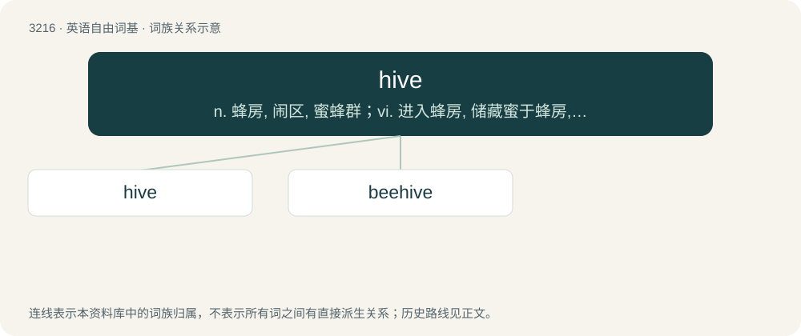

# 3314 · hive — n. 蜂房, 闹区, 蜜蜂群；vi. 进入蜂房, 储藏蜜于蜂房, 如蜂般群居；vt. 使进蜂房, 储备

[总目录](../00_总目录_按常用程度.md)

**类型**：英语自由词基　｜　**来源语言**：见词源记录

## 核心含义与来源

- 核心含义：n. 蜂房, 闹区, 蜜蜂群；vi. 进入蜂房, 储藏蜜于蜂房, 如蜂般群居；vt. 使进蜂房, 储备
- 英文含义：A structure, whether artificial or natural, for housing a swarm of honeybees.
- 词形：hive

**来源记录 1**（名词；A structure, whether artificial or natural, for housing a swarm of honeybees.）

From Middle English hyve, from Old English hȳf, from Proto-West Germanic \*hūfi, from Proto-Indo-European \*kuHp- (“water vessel”), from \*kew- (“to bend, curve”). See also Dutch huif (“beehive”), Danish dialect huv (“ship’s hull”); also Latin cūpa (“tub, vat”), Ancient Greek κύπη (kúpē, “gap, hole”), κύπελλον (kúpellon, “beaker”), Sanskrit कूप (kū́pa, “cave”). Doublet of coupe, cup, and keeve. The computing term was chosen as an in-joke relating to bees; see this for more.

## 词族图

## 单词速览（常用到不常用）

| 单词 | 音标 | 释义 |
|---|---|---|
| [hive](#w-1) | 英 /haɪv/ | n. 蜂房, 闹区, 蜜蜂群；vi. 进入蜂房, 储藏蜜于蜂房, 如蜂般群居；vt. 使进蜂房, 储备 |
| [beehive](#w-2) | /ˈbiːhaɪv/ | n. 蜂窝, 蜂箱；\[机\] 集气架, 蜂巢 |

## 逐词详解

### 1. hive

**词性**：动词　｜　**音标**：英 /haɪv/

**中文释义**：n. 蜂房, 闹区, 蜜蜂群；vi. 进入蜂房, 储藏蜜于蜂房, 如蜂般群居；vt. 使进蜂房, 储备

**英文义项**：To collect (bees) into a hive. / To store (something other than bees) in, or as if in, a hive.

**词源与演化**：

From Middle English hyve, from Old English hȳf, from Proto-West Germanic \*hūfi, from Proto-Indo-European \*kuHp- (“water vessel”), from \*kew- (“to bend, curve”). See also Dutch huif (“beehive”), Danish dialect huv (“ship’s hull”); also Latin cūpa (“tub, vat”), Ancient Greek κύπη (kúpē, “gap, hole”), κύπελλον (kúpellon, “beaker”), Sanskrit कूप (kū́pa, “cave”). Doublet of coupe, cup, and keeve. The computing term was chosen as an in-joke relating to bees; see this for more.

**用法示例／搭配（非完整句）**：

> to hive a swarm of bees

该用例对应义项：To collect (bees) into a hive.

### 2. beehive

**词性**：名词　｜　**音标**：/ˈbiːhaɪv/

**中文释义**：n. 蜂窝, 蜂箱；\[机\] 集气架, 蜂巢

**英文义项**：Such a home prepared by the bees themselves, in which some species of honey bees live and raise their young. / A man-made structure in which honey bees are kept so that humans can harvest their honey.

**构词拆分**：bee + hive

**词源与演化**：

From Middle English beehyve, equivalent to bee + hive.

**例句**：

> Ziri fell into a beehive and got stung to death.
