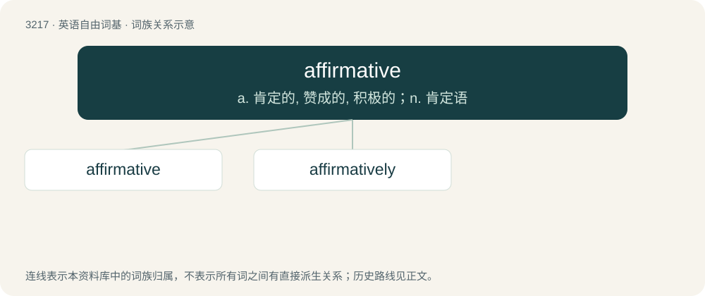

# 3315 · affirmative — a. 肯定的, 赞成的, 积极的；n. 肯定语

[总目录](../00_总目录_按常用程度.md)

**类型**：英语自由词基　｜　**来源语言**：见词源记录

## 核心含义与来源

- 核心含义：a. 肯定的, 赞成的, 积极的；n. 肯定语
- 英文含义：pertaining to truth; asserting that something is; affirming
- 词形：affirmative

**来源记录 1**（形容词；pertaining to truth; asserting that something is; affirming）

From Middle English affirmative, affirmatyve, from Old French affirmatif, from Latin affirmativus, from affirmare (“to assert”).

## 词族图

## 单词速览（常用到不常用）

| 单词 | 音标 | 释义 |
|---|---|---|
| [affirmative](#w-1) | 英 /əˈfɜːmətɪv/；美 /əˈfɝməɾɪv/ | a. 肯定的, 赞成的, 积极的；n. 肯定语 |
| [affirmatively](#w-2) | /əˈfəːməˈtivli/ | adv. 肯定地；断然地 |

## 逐词详解

### 1. affirmative

**词性**：形容词　｜　**音标**：英 /əˈfɜːmətɪv/；美 /əˈfɝməɾɪv/

**中文释义**：a. 肯定的, 赞成的, 积极的；n. 肯定语

**英文义项**：pertaining to truth; asserting that something is; affirming / pertaining to any assertion or active confirmation that favors a particular result

**词源与演化**：

From Middle English affirmative, affirmatyve, from Old French affirmatif, from Latin affirmativus, from affirmare (“to assert”).

**用法示例／搭配（非完整句）**：

> an act affirmative of common law

该用例对应义项：Confirmative; ratifying.

### 2. affirmatively

**词性**：副词　｜　**音标**：/əˈfəːməˈtivli/

**中文释义**：adv. 肯定地；断然地

**英文义项**：In an affirming manner.

**构词拆分**：affirmative + -ly

**词源与演化**：

From Middle English affirmativeli, equivalent to affirmative + -ly.

**例句**：

> If you had been asked by Peterson if the cotton were in good condition, would you have answered affirmatively?
