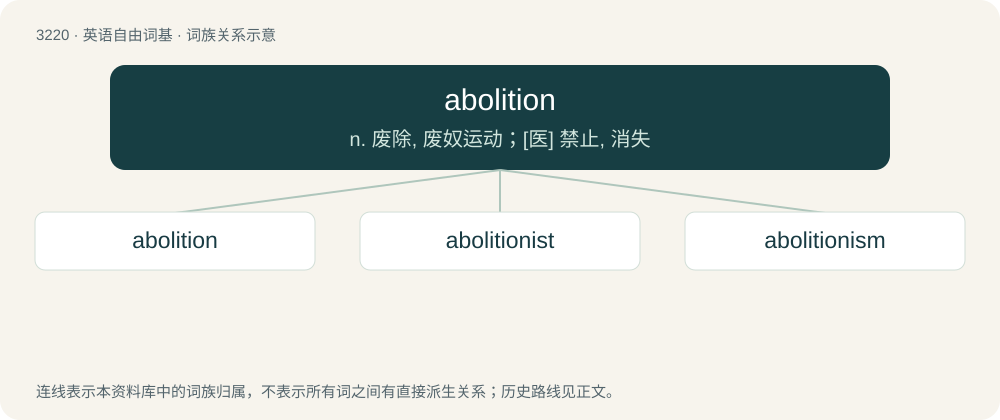

# 3318 · abolition — n. 废除, 废奴运动；\[医\] 禁止, 消失

[总目录](../00_总目录_按常用程度.md)

**类型**：英语自由词基　｜　**来源语言**：见词源记录

## 核心含义与来源

- 核心含义：n. 废除, 废奴运动；\[医\] 禁止, 消失
- 英文含义：The act of abolishing; an annulling; abrogation.
- 词形：abolition

**来源记录 1**（名词；The act of abolishing; an annulling; abrogation.）

Borrowed from Middle French abolition, from Old French abolucion, a learned borrowing from Latin abolitiōnem. First attested in 1529. Equivalent to abolish + -tion.

## 词族图

## 单词速览（常用到不常用）

| 单词 | 音标 | 释义 |
|---|---|---|
| [abolition](#w-1) | /ˌæb.əˈlɪʃ.ən/ | n. 废除, 废奴运动；\[医\] 禁止, 消失 |
| [abolitionist](#w-2) | 英 /ˌæ.bəˈlɪʃ.n̩.ɪst/；美 /ˌæ.bəˈlɪʃ.n̩.ɪst/ | n. 废除主义者, 废奴主义者 |
| [abolitionism](#w-3) | 美 /ˌæb.əˈlɪʃ.əˌnɪz.m̩/ | n. 废除主义, 废奴主义；\[医\] 活体解剖禁止论 |

## 逐词详解

### 1. abolition

**词性**：名词　｜　**音标**：/ˌæb.əˈlɪʃ.ən/

**中文释义**：n. 废除, 废奴运动；\[医\] 禁止, 消失

**英文义项**：The act of abolishing; an annulling; abrogation. / The state of being abolished.

**构词拆分**：abolish + -tion

**词源与演化**：

Borrowed from Middle French abolition, from Old French abolucion, a learned borrowing from Latin abolitiōnem. First attested in 1529. Equivalent to abolish + -tion.

**例句**：

> The campaign for the abolition of slavery changed the course of history.

该用例对应义项：The act of abolishing; an annulling; abrogation.

### 2. abolitionist

**词性**：形容词　｜　**音标**：英 /ˌæ.bəˈlɪʃ.n̩.ɪst/；美 /ˌæ.bəˈlɪʃ.n̩.ɪst/

**中文释义**：n. 废除主义者, 废奴主义者

**英文义项**：In favor of the abolition of any particular institution or practice.

**构词拆分**：abolition + -ist

**词源与演化**：

First attested in 1788. abolition + -ist.

### 3. abolitionism

**词性**：名词　｜　**音标**：美 /ˌæb.əˈlɪʃ.əˌnɪz.m̩/

**中文释义**：n. 废除主义, 废奴主义；\[医\] 活体解剖禁止论

**英文义项**：Support for the abolition of something; the tenets of abolitionists. / Support for the abolition of prisons.

**构词拆分**：abolition + -ism

**词源与演化**：

From abolition + -ism.

**例句**：

> Abolitionism was an effort to end slavery and the slave trade.
