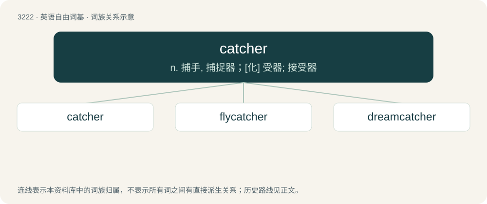

# 3319 · catcher — n. 捕手, 捕捉器；\[化\] 受器; 接受器

[总目录](../00_总目录_按常用程度.md)

**类型**：英语自由词基　｜　**来源语言**：见词源记录

## 核心含义与来源

- 核心含义：n. 捕手, 捕捉器；\[化\] 受器; 接受器
- 英文含义：Someone or something that catches.
- 词形：catcher

**来源记录 1**（名词；Someone or something that catches.）

From catch + -er.

## 词族图

## 单词速览（常用到不常用）

| 单词 | 音标 | 释义 |
|---|---|---|
| [catcher](#w-1) | 英 /ˈkæt͡ʃə/；美 /ˈkæt͡ʃəɹ/ | n. 捕手, 捕捉器；\[化\] 受器; 接受器 |
| [flycatcher](#w-2) | /ˈflaikætʃə/ | n. 捕蝇器, 捕蝇草 |
| [dreamcatcher](#w-3) |  | 捕梦网（最初由美洲土著制作的一种带装饰网兜的圆环, 据信能给主人带来好梦） |

## 逐词详解

### 1. catcher

**词性**：名词　｜　**音标**：英 /ˈkæt͡ʃə/；美 /ˈkæt͡ʃəɹ/

**中文释义**：n. 捕手, 捕捉器；\[化\] 受器; 接受器

**英文义项**：Someone or something that catches. / The player who squats behind home plate and receives the pitches from the pitcher.

**构词拆分**：catch + -er

**词源与演化**：

From catch + -er.

**例句**：

> A catcher needs a lot of protective equipment.

该用例对应义项：the position on a baseball team of the player who is stationed behind home plate and who catches the balls that the pitcher throws

### 2. flycatcher

**词性**：名词　｜　**音标**：/ˈflaikætʃə/

**中文释义**：n. 捕蝇器, 捕蝇草

**英文义项**：Any of many kinds of birds of the family Muscicapidae, of Africa, Europe, and Asia, that catch insects in flight; an Old World flycatcher. / Any of many kinds of similar birds of various families, such as Tyrannidae (the New World flycatchers of the Americas), Tityridae, Stenostiridae, Monarchidae, Petroicidae, etc.

**构词拆分**：fly + catcher

**词源与演化**：

From fly + catcher.

**例句**：

> The flycatcher has ravaged the flies.

### 3. dreamcatcher

**词性**：名词

**中文释义**：捕梦网（最初由美洲土著制作的一种带装饰网兜的圆环, 据信能给主人带来好梦）

**英文义项**：A decorative Native American object in the form of a hoop and net with attachments such as feathers, traditionally believed by the Ojibwa to “filter out” bad dreams.

**构词拆分**：dream + catcher

**词源与演化**：

From dream + catcher.

**例句**：

> You can use a dreamcatcher to catch your nightmares.
