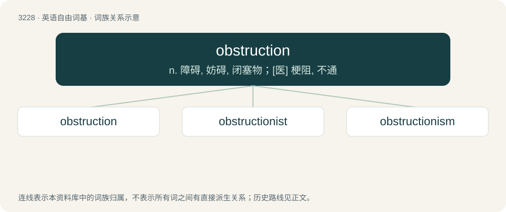

# 3325 · obstruction — n. 障碍, 妨碍, 闭塞物；\[医\] 梗阻, 不通

[总目录](../00_总目录_按常用程度.md)

**类型**：英语自由词基　｜　**来源语言**：见词源记录

## 核心含义与来源

- 核心含义：n. 障碍, 妨碍, 闭塞物；\[医\] 梗阻, 不通
- 英文含义：The act of obstructing, or state of being obstructed.
- 词形：obstruction

**来源记录 1**（名词；The act of obstructing, or state of being obstructed.）

From Latin obstructio (“hindrance”), from obstruo (“build against, block, stop”).

## 词族图

## 单词速览（常用到不常用）

| 单词 | 音标 | 释义 |
|---|---|---|
| [obstruction](#w-1) | 英 /əbˈstɹʌk.ʃən/ | n. 障碍, 妨碍, 闭塞物；\[医\] 梗阻, 不通 |
| [obstructionist](#w-2) | 英 /əbˈstɹʌk.ʃənˌɪst/ | \[法\] 妨碍会议议事者 |
| [obstructionism](#w-3) | 英 /əbˈstɹʌk.ʃən.ɪz(.ə)m/ | n. 妨碍议程的手段,蓄意阻挠 |

## 逐词详解

### 1. obstruction

**词性**：名词　｜　**音标**：英 /əbˈstɹʌk.ʃən/

**中文释义**：n. 障碍, 妨碍, 闭塞物；\[医\] 梗阻, 不通

**英文义项**：The act of obstructing, or state of being obstructed. / Something which obstructs or impedes, either intentionally or unintentionally

**词源与演化**：

From Latin obstructio (“hindrance”), from obstruo (“build against, block, stop”).

**例句**：

> The referee stopped play because of an obstruction by the defender.

该用例对应义项：Something which obstructs or impedes, either intentionally or unintentionally

### 2. obstructionist

**词性**：名词　｜　**音标**：英 /əbˈstɹʌk.ʃənˌɪst/

**中文释义**：\[法\] 妨碍会议议事者

**英文义项**：Someone who systematically obstructs the actions of others. / Someone who attempts to impede the progress of legislation.

**构词拆分**：obstruction + -ist

**词源与演化**：

From obstruction + -ist.

### 3. obstructionism

**词性**：名词　｜　**音标**：英 /əbˈstɹʌk.ʃən.ɪz(.ə)m/

**中文释义**：n. 妨碍议程的手段,蓄意阻挠

**英文义项**：A deliberate policy of obstructing something, especially a political process or body.

**构词拆分**：obstruction + -ism

**词源与演化**：

From obstruction + -ism.
