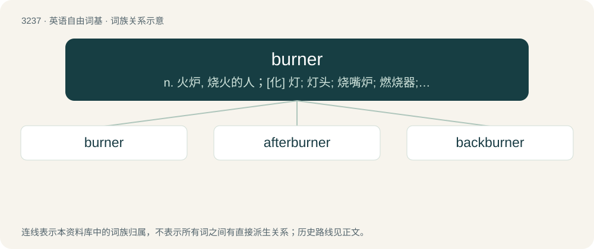

# 3331 · burner — n. 火炉, 烧火的人；\[化\] 灯; 灯头; 烧嘴炉; 燃烧器; 燃烧炉

[总目录](../00_总目录_按常用程度.md)

**类型**：英语自由词基　｜　**来源语言**：见词源记录

## 核心含义与来源

- 核心含义：n. 火炉, 烧火的人；\[化\] 灯; 灯头; 烧嘴炉; 燃烧器; 燃烧炉
- 英文含义：An element on a kitchen stove, hob, or cooktop that generates localized heat for cooking.
- 词形：burner

**来源记录 1**（名词；An element on a kitchen stove, hob, or cooktop that generates localized heat for cooking.）

From burn + -er. Merged with and eclipsed related Middle English brennar, brennere (“an incendiary, incinerator”). Compare German Brenner (“burner”), Swedish brännare (“burner”).

## 词族图

## 单词速览（常用到不常用）

| 单词 | 音标 | 释义 |
|---|---|---|
| [burner](#w-1) | 英 /ˈbɜːnə/；美 /ˈbɝnɚ/ | n. 火炉, 烧火的人；\[化\] 灯; 灯头; 烧嘴炉; 燃烧器; 燃烧炉 |
| [afterburner](#w-2) | 美 /ˈæf.tɚˌbɚ.nɚ/ | n. 加力燃烧室；\[机\] 后燃器 |
| [backburner](#w-3) |  | 不重要的 |

## 逐词详解

### 1. burner

**词性**：名词　｜　**音标**：英 /ˈbɜːnə/；美 /ˈbɝnɚ/

**中文释义**：n. 火炉, 烧火的人；\[化\] 灯; 灯头; 烧嘴炉; 燃烧器; 燃烧炉

**英文义项**：An element on a kitchen stove, hob, or cooktop that generates localized heat for cooking. / A device that generates localized heat for experiments; a Bunsen burner.

**构词拆分**：burn + -er

**词源与演化**：

From burn + -er. Merged with and eclipsed related Middle English brennar, brennere (“an incendiary, incinerator”). Compare German Brenner (“burner”), Swedish brännare (“burner”).

**例句**：

> The electric range had one large burner and three smaller one.

该用例对应义项：the heating elements of a stove or range on which pots and pans are placed for cooking

### 2. afterburner

**词性**：名词　｜　**音标**：美 /ˈæf.tɚˌbɚ.nɚ/

**中文释义**：n. 加力燃烧室；\[机\] 后燃器

**英文义项**：A device in a jet engine which injects fuel into the exhaust system to increase the thrust.

**构词拆分**：after- + burner

**词源与演化**：

From after- + burner.

**例句**：

> The fighter jet used the afterburner to elude the enemy aircraft.

### 3. backburner

**词性**：动词

**中文释义**：不重要的

**英文义项**：To relegate to a lower priority.

**构词拆分**：back + burner

**词源与演化**：

From back + burner.

**例句**：

> They had to put that project on the backburner until financing was arranged.
