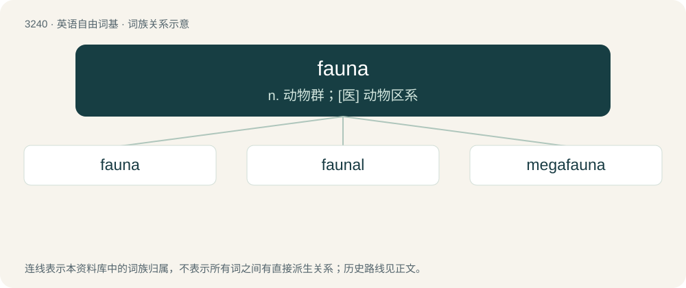

# 3334 · fauna — n. 动物群；\[医\] 动物区系

[总目录](../00_总目录_按常用程度.md)

**类型**：英语自由词基　｜　**来源语言**：见词源记录

## 核心含义与来源

- 核心含义：n. 动物群；\[医\] 动物区系
- 英文含义：Animals considered as a group; especially those of a particular country, region, time, biological group, etc.
- 词形：fauna

**来源记录 1**（名词；Animals considered as a group; especially those of a particular country, region, time, biological group, etc.）

Borrowed from New Latin fauna, from Latin Fauna, sister of Faunus (“god of forests and herdsmen”); akin to Ancient Greek θαῦνον (thaûnon, “wild animal, beast”), θώς (thṓs, “jackal, wild dog; panther”), Phrygian δάος (dáos, “wolf”).

## 词族图

## 单词速览（常用到不常用）

| 单词 | 音标 | 释义 |
|---|---|---|
| [fauna](#w-1) | /ˈfɔːnə/ | n. 动物群；\[医\] 动物区系 |
| [faunal](#w-2) | /ˈfɔːnl/ | 【英文】Pertaining to the fauna of a given region or time. |
| [megafauna](#w-3) | /meˈɡæfɔːnə/ | n. 巨型（土壤）动物 |

## 逐词详解

### 1. fauna

**词性**：名词　｜　**音标**：/ˈfɔːnə/

**中文释义**：n. 动物群；\[医\] 动物区系

**英文义项**：Animals considered as a group; especially those of a particular country, region, time, biological group, etc. / A particular group of animals as distinguished from another.

**词源与演化**：

Borrowed from New Latin fauna, from Latin Fauna, sister of Faunus (“god of forests and herdsmen”); akin to Ancient Greek θαῦνον (thaûnon, “wild animal, beast”), θώς (thṓs, “jackal, wild dog; panther”), Phrygian δάος (dáos, “wolf”).

**用法示例／搭配（非完整句）**：

> the flora and fauna

该用例对应义项：Animals considered as a group; especially those of a particular country, region, time, biological group, etc.

### 2. faunal

**词性**：形容词　｜　**音标**：/ˈfɔːnl/

**英文义项**：Pertaining to the fauna of a given region or time.

**构词拆分**：fauna + -al

**词源与演化**：

From fauna (“animals”) + -al.

### 3. megafauna

**词性**：名词　｜　**音标**：/meˈɡæfɔːnə/

**中文释义**：n. 巨型（土壤）动物

**英文义项**：The large animals of a given region or time, considered as a group. / A treatise on such a group of large animals.

**构词拆分**：mega- + fauna

**词源与演化**：

From mega- + fauna.

**例句**：

> Giraffes are part of modern day megafauna.
