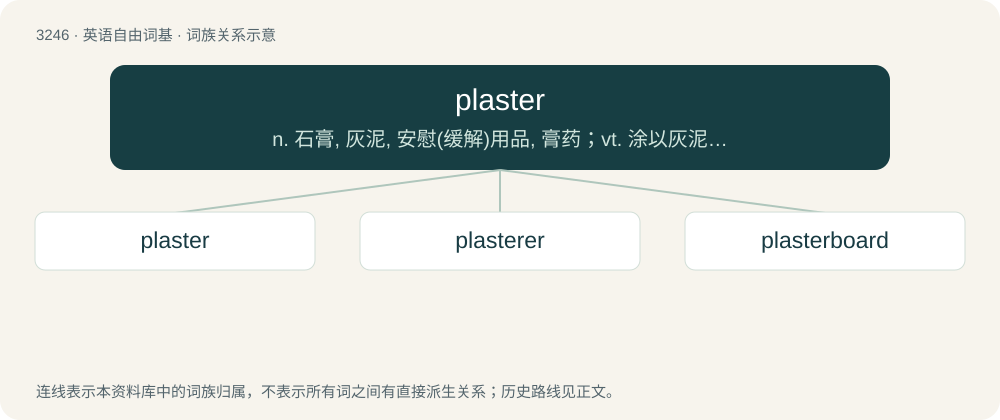

# 3338 · plaster — n. 石膏, 灰泥, 安慰(缓解)用品, 膏药；vt. 涂以灰泥, 敷以膏药, 掩饰, 使平服, 彻底击败, 减轻, 粘贴

[总目录](../00_总目录_按常用程度.md)

**类型**：英语自由词基　｜　**来源语言**：见词源记录

## 核心含义与来源

- 核心含义：n. 石膏, 灰泥, 安慰(缓解)用品, 膏药；vt. 涂以灰泥, 敷以膏药, 掩饰, 使平服, 彻底击败, 减轻, 粘贴
- 英文含义：A paste applied to the skin for healing or cosmetic purposes.
- 词形：plaster

**来源记录 1**（名词；A paste applied to the skin for healing or cosmetic purposes.）

From Middle English plaster, plastre, from Old English plaster, from late Latin plastrum, shortened from Classical Latin emplastrum (“a plaster, bandage”); later reinforced by Anglo-Norman plastre. Displaced native Old English clīþa. The verb is from Middle English plastren, from the noun.

## 词族图

## 单词速览（常用到不常用）

| 单词 | 音标 | 释义 |
|---|---|---|
| [plaster](#w-1) | 英 /ˈplɑːstə/；美 /ˈplæstɚ/ | n. 石膏, 灰泥, 安慰(缓解)用品, 膏药；vt. 涂以灰泥, 敷以膏药, 掩饰, 使平服, 彻底击败, 减轻, 粘贴 |
| [plasterer](#w-2) | /ˈplæstərə/ | n. 泥水匠, 粉刷工 |
| [plasterboard](#w-3) | /ˈplæstəbɒːd/ | n. 石膏灰泥板 |

## 逐词详解

### 1. plaster

**词性**：动词　｜　**音标**：英 /ˈplɑːstə/；美 /ˈplæstɚ/

**中文释义**：n. 石膏, 灰泥, 安慰(缓解)用品, 膏药；vt. 涂以灰泥, 敷以膏药, 掩饰, 使平服, 彻底击败, 减轻, 粘贴

**英文义项**：To cover or coat something with plaster; to render. / To apply a plaster to.

**词源与演化**：

From Middle English plaster, plastre, from Old English plaster, from late Latin plastrum, shortened from Classical Latin emplastrum (“a plaster, bandage”); later reinforced by Anglo-Norman plastre. Displaced native Old English clīþa. The verb is from Middle English plastren, from the noun.

**例句**：

> The radio station plastered the buses and trains with its advertisement.

该用例对应义项：To hide or cover up, as if with plaster; to cover thickly.

### 2. plasterer

**词性**：名词　｜　**音标**：/ˈplæstərə/

**中文释义**：n. 泥水匠, 粉刷工

**英文义项**：A person whose occupation is to plaster walls. / One who makes plaster casts.

**构词拆分**：From plaster + -er.

**词源与演化**：

From plaster + -er.

**例句**：

> A plasterer is a craftsman who applies plaster on walls.

### 3. plasterboard

**词性**：名词　｜　**音标**：/ˈplæstəbɒːd/

**中文释义**：n. 石膏灰泥板

**英文义项**：A construction material consisting of a rigid panel of several layers of fibreboard or paper bonded to a gypsum core.

**构词拆分**：plaster + board

**词源与演化**：

From plaster + board.
