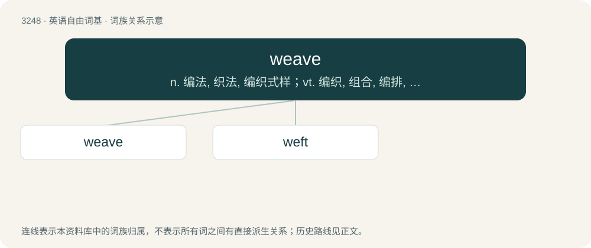

# 3340 · weave — n. 编法, 织法, 编织式样；vt. 编织, 组合, 编排, 使迂回前进；vi. 纺织, 迂回行进

[总目录](../00_总目录_按常用程度.md)

**类型**：英语自由词基　｜　**来源语言**：见词源记录

## 核心含义与来源

- 核心含义：n. 编法, 织法, 编织式样；vt. 编织, 组合, 编排, 使迂回前进；vi. 纺织, 迂回行进
- 英文含义：To form something by passing lengths or strands of material over and under one another.
- 词形：weave

**多个词源／构词路径**：同一拼写可能有不同来源；以下按词性和含义分别列出。

**来源记录 1**（动词；To form something by passing lengths or strands of material over and under one another.）

From Middle English weven (“to weave”), from Old English wefan (“to weave”), from Proto-West Germanic \*weban, from Proto-Germanic \*webaną, from Proto-Indo-European \*webʰ- (“to weave, braid”). Cognates Cognate with North Frisian weev, weew, weewe (“to weave”), Saterland Frisian weeuwe (“to weave”), Dutch weven (“to weave”), German weben (“to weave”), Luxembourgish wiewen (“to weave”), Yiddish וועבן (vebn, “to weave”), Danish væve (“to weave”), Faroese veva (“to weave”), Icelandic vefa (“to weave”), Norwegian Bokmål veve (“to weave”), Norwegian Nynorsk veva, veve (“to weave”), Swedish väva (“to weave”).

**来源记录 2**（动词；To move by turning and twisting.）

From Middle English weven (“to wander”); probably from Old Norse veifa (“move around, wave”), related to Latin vibrare.

## 词族图

## 单词速览（常用到不常用）

| 单词 | 音标 | 释义 |
|---|---|---|
| [weave](#w-1) | /wiːv/ | n. 编法, 织法, 编织式样；vt. 编织, 组合, 编排, 使迂回前进；vi. 纺织, 迂回行进 |
| [weft](#w-2) | /wɛft/ | n. 织物, 狭长求救信号旗, 求救信号 |

## 逐词详解

### 1. weave

**词性**：动词　｜　**音标**：/wiːv/

**中文释义**：n. 编法, 织法, 编织式样；vt. 编织, 组合, 编排, 使迂回前进；vi. 纺织, 迂回行进

**英文义项**：To form something by passing lengths or strands of material over and under one another. / To spin a cocoon or a web.

**词源与演化**：

From Middle English weven (“to weave”), from Old English wefan (“to weave”), from Proto-West Germanic \*weban, from Proto-Germanic \*webaną, from Proto-Indo-European \*webʰ- (“to weave, braid”). Cognates Cognate with North Frisian weev, weew, weewe (“to weave”), Saterland Frisian weeuwe (“to weave”), Dutch weven (“to weave”), German weben (“to weave”), Luxembourgish wiewen (“to weave”), Yiddish וועבן (vebn, “to weave”), Danish væve (“to weave”), Faroese veva (“to weave”), Icelandic vefa (“to weave”), Norwegian Bokmål veve (“to weave”), Norwegian Nynorsk veva, veve (“to weave”), Swedish väva (“to weave”).

**例句**：

> Spiders weave beautiful but deadly webs.

该用例对应义项：To spin a cocoon or a web.

### 2. weft

**词性**：名词　｜　**音标**：/wɛft/

**中文释义**：n. 织物, 狭长求救信号旗, 求救信号

**英文义项**：The horizontal threads that are interlaced through the warp in a woven fabric. / The yarn used for the weft; the fill.

**构词拆分**：weave + -t (abstract nominal suffix)

**词源与演化**：

From Middle English wefte, from Old English wefan (“to weave”), from Proto-West Germanic \*weban, from Proto-Germanic \*webaną. Equivalent to weave + -t (abstract nominal suffix).

**例句**：

> In weaving, the weft threads run horizontally, interlacing with the vertical warp threads.
