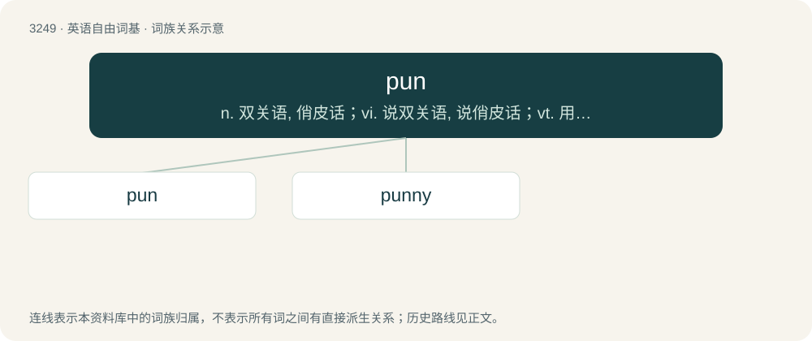

# 3341 · pun — n. 双关语, 俏皮话；vi. 说双关语, 说俏皮话；vt. 用双关语说服, 捣实

[总目录](../00_总目录_按常用程度.md)

**类型**：英语自由词基　｜　**来源语言**：见词源记录

## 核心含义与来源

- 核心含义：n. 双关语, 俏皮话；vi. 说双关语, 说俏皮话；vt. 用双关语说服, 捣实
- 英文含义：To make or tell a pun; to make a play on words.
- 词形：pun

**来源记录 1**（动词；To make or tell a pun; to make a play on words.）

From Middle English ponnen, ponen, punen, from Old English punian, pūnian (“to pound, beat, bray, bruise, crush, grind”), from Proto-Germanic \*punōną (“to break to pieces, pulverize”). See pound. As a kind of word play, from the notion of “beating” the words into place.

## 词族图

## 单词速览（常用到不常用）

| 单词 | 音标 | 释义 |
|---|---|---|
| [pun](#w-1) | 英 /pʌn/ | n. 双关语, 俏皮话；vi. 说双关语, 说俏皮话；vt. 用双关语说服, 捣实 |
| [punny](#w-2) | 英 /ˈpʌni/ | a. 一语双关的 |

## 逐词详解

### 1. pun

**词性**：动词　｜　**音标**：英 /pʌn/

**中文释义**：n. 双关语, 俏皮话；vi. 说双关语, 说俏皮话；vt. 用双关语说服, 捣实

**英文义项**：To make or tell a pun; to make a play on words.

**词源与演化**：

From Middle English ponnen, ponen, punen, from Old English punian, pūnian (“to pound, beat, bray, bruise, crush, grind”), from Proto-Germanic \*punōną (“to break to pieces, pulverize”). See pound. As a kind of word play, from the notion of “beating” the words into place.

**例句**：

> Japanese like to pun--their language is well suited to punning.

该用例对应义项：make a play on words

### 2. punny

**词性**：形容词　｜　**音标**：英 /ˈpʌni/

**中文释义**：a. 一语双关的

**英文义项**：Resembling a pun; involving the use of a pun. / Fond of puns.

**构词拆分**：pun + -y

**词源与演化**：

From pun + -y, possibly influenced by funny.
