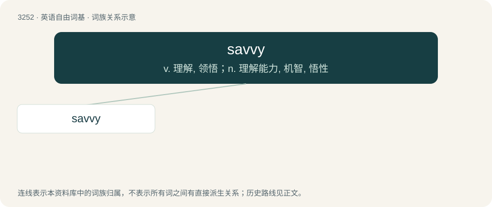

# 3345 · savvy — v. 理解, 领悟；n. 理解能力, 机智, 悟性

[总目录](../00_总目录_按常用程度.md)

**类型**：英语自由词基　｜　**来源语言**：见词源记录

## 核心含义与来源

- 核心含义：v. 理解, 领悟；n. 理解能力, 机智, 悟性
- 英文含义：Shrewd, well-informed and perceptive.
- 词形：savvy

**来源记录 1**（形容词；Shrewd, well-informed and perceptive.）

Alteration of save, sabi (“to know”) (in English-based creoles and pidgins), from Portuguese sabe (“\[she/he\] knows”), from saber (“to know”), from Latin sapere (“to taste; to know”). First appears c. 1785 in a dictionary by Francis Grose, as a noun, “practical sense, intelligence”; also a verb, “to know, to understand”. The adjective is first recorded 1905, from the noun.

## 词族图

## 单词速览（常用到不常用）

| 单词 | 音标 | 释义 |
|---|---|---|
| [savvy](#w-1) | 英 /ˈsæv.i/ | v. 理解, 领悟；n. 理解能力, 机智, 悟性 |

## 逐词详解

### 1. savvy

**词性**：形容词　｜　**音标**：英 /ˈsæv.i/

**中文释义**：v. 理解, 领悟；n. 理解能力, 机智, 悟性

**英文义项**：Shrewd, well-informed and perceptive.

**词源与演化**：

Alteration of save, sabi (“to know”) (in English-based creoles and pidgins), from Portuguese sabe (“\[she/he\] knows”), from saber (“to know”), from Latin sapere (“to taste; to know”). First appears c. 1785 in a dictionary by Francis Grose, as a noun, “practical sense, intelligence”; also a verb, “to know, to understand”. The adjective is first recorded 1905, from the noun.

**例句**：

> Successful fascists today are savvy enough not to call themselves fascists.
