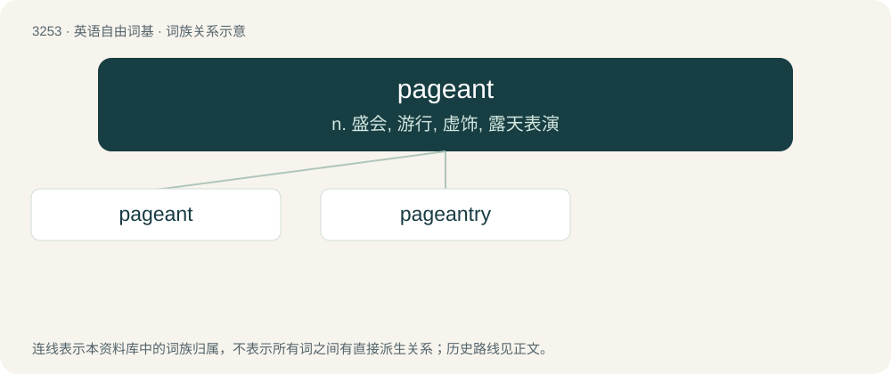

# 3347 · pageant — n. 盛会, 游行, 虚饰, 露天表演

[总目录](../00_总目录_按常用程度.md)

**类型**：英语自由词基　｜　**来源语言**：见词源记录

## 核心含义与来源

- 核心含义：n. 盛会, 游行, 虚饰, 露天表演
- 英文含义：An elaborate public display, especially a parade in historical or traditional costume.
- 词形：pageant

**来源记录 1**（名词；An elaborate public display, especially a parade in historical or traditional costume.）

Late 14th c. as Middle English pagent, from Medieval Latin pagina (“play in a cycle of mystery plays”), perhaps from Latin pāgina (“page of a book”).

## 词族图

## 单词速览（常用到不常用）

| 单词 | 音标 | 释义 |
|---|---|---|
| [pageant](#w-1) | /ˈpæd͡ʒənt/ | n. 盛会, 游行, 虚饰, 露天表演 |
| [pageantry](#w-2) | /ˈpæd͡ʒəntɹi/ | n. 壮观, 华丽, 虚饰, 露天历史剧 |

## 逐词详解

### 1. pageant

**词性**：名词　｜　**音标**：/ˈpæd͡ʒənt/

**中文释义**：n. 盛会, 游行, 虚饰, 露天表演

**英文义项**：An elaborate public display, especially a parade in historical or traditional costume. / A spectacular ceremony.

**词源与演化**：

Late 14th c. as Middle English pagent, from Medieval Latin pagina (“play in a cycle of mystery plays”), perhaps from Latin pāgina (“page of a book”).

**例句**：

> Do you know what the name of last year's beauty pageant winner is?

### 2. pageantry

**词性**：名词　｜　**音标**：/ˈpæd͡ʒəntɹi/

**中文释义**：n. 壮观, 华丽, 虚饰, 露天历史剧

**英文义项**：A pageant; a colourful show or display, as in a pageant.

**构词拆分**：From pageant + -ry.

**词源与演化**：

From pageant + -ry.

**用法示例／搭配（非完整句）**：

> pomp and pageantry

该用例对应义项：A pageant; a colourful show or display, as in a pageant.
