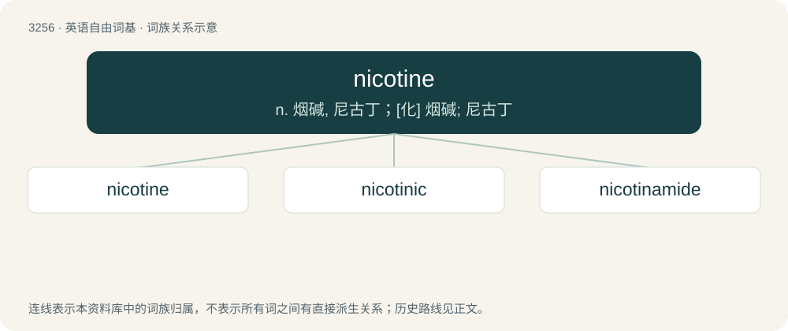

# 3348 · nicotine — n. 烟碱, 尼古丁；\[化\] 烟碱; 尼古丁

[总目录](../00_总目录_按常用程度.md)

**类型**：英语自由词基　｜　**来源语言**：见词源记录

## 核心含义与来源

- 核心含义：n. 烟碱, 尼古丁；\[化\] 烟碱; 尼古丁
- 英文含义：An alkaloid (C₁₀H₁₄N₂), commonly occurring in the tobacco plant.
- 词形：nicotine

**来源记录 1**（名词；An alkaloid (C₁₀H₁₄N₂), commonly occurring in the tobacco plant.）

Borrowed from French nicotine, equivalent to Nicot + -ine, named after Jean Nicot (1530–1604), the French ambassador to Portugal, who sent tobacco seeds back to France in 1561. The etymology of the surname itself is unclear.

## 词族图

## 单词速览（常用到不常用）

| 单词 | 音标 | 释义 |
|---|---|---|
| [nicotine](#w-1) | /ˈnɪkətiːn/ | n. 烟碱, 尼古丁；\[化\] 烟碱; 尼古丁 |
| [nicotinic](#w-2) | /,nikəˈtinik/ | a. 烟硷, 尼古丁；\[医\] 烟硷的; 烟硷样的 |
| [nicotinamide](#w-3) | /.nikəˈtinəmaid/ | n. 烟酰胺；\[化\] 烟酰胺; 尼克酰胺; 抗糙皮病维生素; 维生素PP |

## 逐词详解

### 1. nicotine

**词性**：名词　｜　**音标**：/ˈnɪkətiːn/

**中文释义**：n. 烟碱, 尼古丁；\[化\] 烟碱; 尼古丁

**英文义项**：An alkaloid (C₁₀H₁₄N₂), commonly occurring in the tobacco plant. / Tobacco or cigarettes.

**构词拆分**：Nicot + -ine

**词源与演化**：

Borrowed from French nicotine, equivalent to Nicot + -ine, named after Jean Nicot (1530–1604), the French ambassador to Portugal, who sent tobacco seeds back to France in 1561. The etymology of the surname itself is unclear.

**例句**：

> He's got nicotine stains on his fingers.

该用例对应义项：Tobacco or cigarettes.

### 2. nicotinic

**词性**：形容词　｜　**音标**：/,nikəˈtinik/

**中文释义**：a. 烟硷, 尼古丁；\[医\] 烟硷的; 烟硷样的

**英文义项**：Of or pertaining to nicotine or its derivatives. / Of or pertaining to nicotinic acid, also called niacin.

**构词拆分**：nicotine + -ic

**词源与演化**：

From nicotine + -ic.

**例句**：

> Niacin, also known as nicotinic acid, is a vitamin.

### 3. nicotinamide

**词性**：名词　｜　**音标**：/.nikəˈtinəmaid/

**中文释义**：n. 烟酰胺；\[化\] 烟酰胺; 尼克酰胺; 抗糙皮病维生素; 维生素PP

**英文义项**：The amide of nicotinic acid (or niacin).

**构词拆分**：nicotine + -amide

**词源与演化**：

Blend of nicotine + amide, equivalent to nicotine + -amide.
