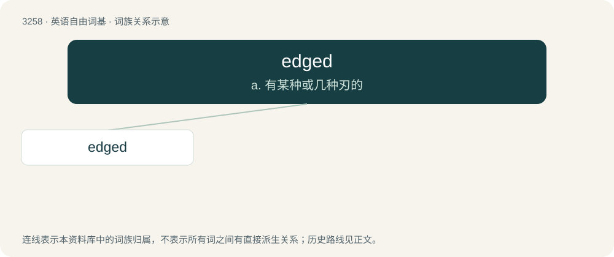

# 3351 · edged — a. 有某种或几种刃的

[总目录](../00_总目录_按常用程度.md)

**类型**：英语自由词基　｜　**来源语言**：见词源记录

## 核心含义与来源

- 核心含义：a. 有某种或几种刃的
- 英文含义：That has a sharp planar surface.
- 词形：edged

**来源记录 1**（形容词；That has a sharp planar surface.）

From Middle English egged, from Old English ecged; equivalent to edge + -ed.

## 词族图

## 单词速览（常用到不常用）

| 单词 | 音标 | 释义 |
|---|---|---|
| [edged](#w-1) | /ɛd͡ʒd/ | a. 有某种或几种刃的 |

## 逐词详解

### 1. edged

**词性**：形容词　｜　**音标**：/ɛd͡ʒd/

**中文释义**：a. 有某种或几种刃的

**英文义项**：That has a sharp planar surface. / Having an edging of a certain material, color, and so on.

**构词拆分**：edge + -ed

**词源与演化**：

From Middle English egged, from Old English ecged; equivalent to edge + -ed.

**例句**：

> The monks were forbidden to carry edged weapons such as swords and axes.

该用例对应义项：That has a sharp planar surface.
