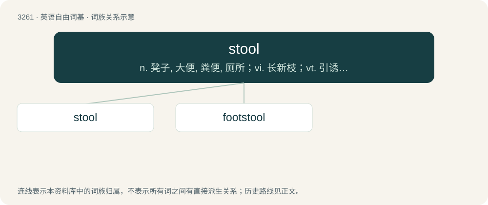

# 3353 · stool — n. 凳子, 大便, 粪便, 厕所；vi. 长新枝；vt. 引诱, 诱捕

[总目录](../00_总目录_按常用程度.md)

**类型**：英语自由词基　｜　**来源语言**：见词源记录

## 核心含义与来源

- 核心含义：n. 凳子, 大便, 粪便, 厕所；vi. 长新枝；vt. 引诱, 诱捕
- 英文含义：A seat for one person without a back or armrests.
- 词形：stool

**多个词源／构词路径**：同一拼写可能有不同来源；以下按词性和含义分别列出。

**来源记录 1**（名词；A seat for one person without a back or armrests.）

From Middle English stool, from Old English stōl (“chair, seat”), from Proto-West Germanic \*stōl, from Proto-Germanic \*stōlaz (“chair”), from Proto-Indo-European \*stoh₂los (“frame, rack, stand”), from \*steh₂- (“to stand”). Cognates Cognate with North Frisian stuul, stölj, Stööl (“chear”), Saterland Frisian Stoul (“chear”), West Frisian stoel (“chair, seat”), Dutch stoel (“chair”), German Stuhl (“chair”), Low German Stohl (“chair”), Luxembourgish Stull (“chair”), Vilamovian śtül (“chair”), Yiddish שתוהל (shsuhl), שטול (shtul, “chair”), Danish, Norwegian Bokmål, Norwegian Nynorsk, and Swedish stol (“chair”), Faroese stólur (“chair”), Icelandic stóll (“chair”), Crimean Gothic stul (“seat”), Gothic 𐍃𐍄𐍉𐌻𐍃 (stōls, “chair; throne”), Russian стул (stul, “chair”), Estonian tool (“chair”), Finnish tuoli (“chair”); also Breton and Cornish sevel (“to erect, rise; to build; to lift; to compose; to earn”), Irish sáil, sál (“heel”), Scottish Gaelic sàil (“heel”), Welsh sefyll (“to stand; to stop; to sit”), Latin sistō (“to set; to stop; to stand; to stabilise”), Umbrian 𐌔𐌄𐌔𐌕𐌖 (sestu, “to place”), Greek στέκω (stéko), στέκομαι (stékomai, “to stand up”), Albanian shtoj (“to add; to augment; to accumulate”), Lithuanian stálas (“table”), Old Prussian stallan (“table”), Belarusian, Bulgarian, Macedonian, and Russian стол (stol, “table”), Czech stůl (“table”), Polish stół (“table”), Serbo-Croatian сто̑, сто̑л, stȏ, stȏl (“table”), Slovak stôl (“table”), Slovene stol (“chair”), Armenian երթալ (ertʻal), էթալ (ētʻal, “to go”), Central Kurdish ستوون (stûn, “column”), Pashto ستن (stən, “needle; awl; pin; syringe; post; hand; dragonfly”), Persian ایستادن (ēstādan / istâdan), وایسادن (vâysâdan), وایستادن (vâystâdan, “to stand up; to step; to stay”), ستون (sotun / sutūn, “column”), Northern Kurdish rawestîn (“to stand up”), stûn (“column”), Ossetian стын (styn, “to stand up”), Hittite 𒋾𒄑𒍣 (tiezzi, “to step; to place oneself”), Tocharian A ṣtäm- (“to stand”), Tocharian B stäm- (“to stand”), Sanskrit तिष्ठति (tiṣṭhati, “to stand; to stay”). More at stand.

**来源记录 2**（动词；To ramify; to tiller, as grain; to shoot out suckers.）

From Latin stolo. See stolon.

## 词族图

## 单词速览（常用到不常用）

| 单词 | 音标 | 释义 |
|---|---|---|
| [stool](#w-1) | /stuːl/ | n. 凳子, 大便, 粪便, 厕所；vi. 长新枝；vt. 引诱, 诱捕 |
| [footstool](#w-2) | /ˈfʊtˌstuːl/ | n. 脚凳 |

## 逐词详解

### 1. stool

**词性**：名词　｜　**音标**：/stuːl/

**中文释义**：n. 凳子, 大便, 粪便, 厕所；vi. 长新枝；vt. 引诱, 诱捕

**英文义项**：A seat for one person without a back or armrests. / A footstool.

**词源与演化**：

From Middle English stool, from Old English stōl (“chair, seat”), from Proto-West Germanic \*stōl, from Proto-Germanic \*stōlaz (“chair”), from Proto-Indo-European \*stoh₂los (“frame, rack, stand”), from \*steh₂- (“to stand”). Cognates Cognate with North Frisian stuul, stölj, Stööl (“chear”), Saterland Frisian Stoul (“chear”), West Frisian stoel (“chair, seat”), Dutch stoel (“chair”), German Stuhl (“chair”), Low German Stohl (“chair”), Luxembourgish Stull (“chair”), Vilamovian śtül (“chair”), Yiddish שתוהל (shsuhl), שטול (shtul, “chair”), Danish, Norwegian Bokmål, Norwegian Nynorsk, and Swedish stol (“chair”), Faroese stólur (“chair”), Icelandic stóll (“chair”), Crimean Gothic stul (“seat”), Gothic 𐍃𐍄𐍉𐌻𐍃 (stōls, “chair; throne”), Russian стул (stul, “chair”), Estonian tool (“chair”), Finnish tuoli (“chair”); also Breton and Cornish sevel (“to erect, rise; to build; to lift; to compose; to earn”), Irish sáil, sál (“heel”), Scottish Gaelic sàil (“heel”), Welsh sefyll (“to stand; to stop; to sit”), Latin sistō (“to set; to stop; to stand; to stabilise”), Umbrian 𐌔𐌄𐌔𐌕𐌖 (sestu, “to place”), Greek στέκω (stéko), στέκομαι (stékomai, “to stand up”), Albanian shtoj (“to add; to augment; to accumulate”), Lithuanian stálas (“table”), Old Prussian stallan (“table”), Belarusian, Bulgarian, Macedonian, and Russian стол (stol, “table”), Czech stůl (“table”), Polish stół (“table”), Serbo-Croatian сто̑, сто̑л, stȏ, stȏl (“table”), Slovak stôl (“table”), Slovene stol (“chair”), Armenian երթալ (ertʻal), էթալ (ētʻal, “to go”), Central Kurdish ستوون (stûn, “column”), Pashto ستن (stən, “needle; awl; pin; syringe; post; hand; dragonfly”), Persian ایستادن (ēstādan / istâdan), وایسادن (vâysâdan), وایستادن (vâystâdan, “to stand up; to step; to stay”), ستون (sotun / sutūn, “column”), Northern Kurdish rawestîn (“to stand up”), stûn (“column”), Ossetian стын (styn, “to stand up”), Hittite 𒋾𒄑𒍣 (tiezzi, “to step; to place oneself”), Tocharian A ṣtäm- (“to stand”), Tocharian B stäm- (“to stand”), Sanskrit तिष्ठति (tiṣṭhati, “to stand; to stay”). More at stand.

**例句**：

> I provided the doctor with stool samples.

该用例对应义项：Feces; excrement.

### 2. footstool

**词性**：名词　｜　**音标**：/ˈfʊtˌstuːl/

**中文释义**：n. 脚凳

**英文义项**：A low stool for supporting the feet while seated. / Anything trodden upon or treated as subservient.

**构词拆分**：foot + stool

**词源与演化**：

From foot + stool.

**例句**：

> Go ahead and put your feet up on the footstool.
