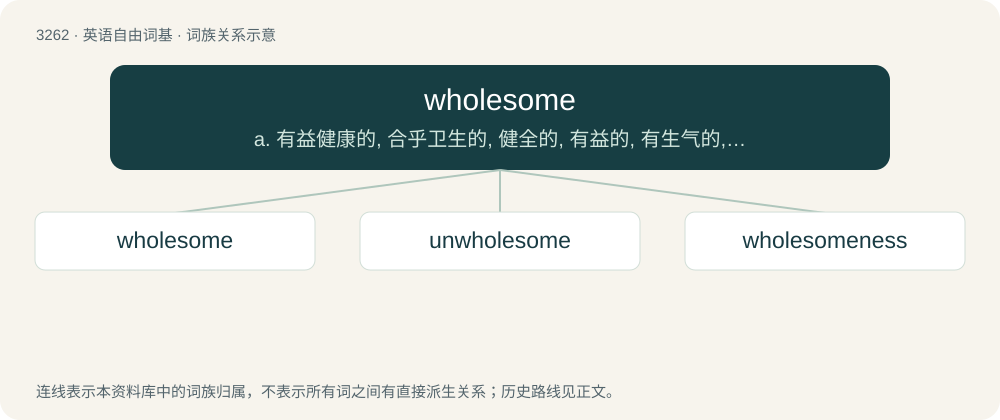

# 3354 · wholesome — a. 有益健康的, 合乎卫生的, 健全的, 有益的, 有生气的, 审慎的

[总目录](../00_总目录_按常用程度.md)

**类型**：英语自由词基　｜　**来源语言**：见词源记录

## 核心含义与来源

- 核心含义：a. 有益健康的, 合乎卫生的, 健全的, 有益的, 有生气的, 审慎的
- 英文含义：Promoting good physical health and well-being.
- 词形：wholesome

**来源记录 1**（形容词；Promoting good physical health and well-being.）

From earlier holesome, from Middle English holsom, holsum, helsum, halsum, from Old English \*hālsum, \*hǣlsum, from Proto-West Germanic \*hailasam, from Proto-Germanic \*hailasamaz, equivalent to whole + -some or hale (“healthy”) + -some. Cognate with Saterland Frisian heelsoam, Dutch heilzaam, German Low German heelsaam, German heilsam, Icelandic heilsamur, Norwegian Nynorsk helsesam, Swedish hälsosam (“wholesome”).

## 词族图

## 单词速览（常用到不常用）

| 单词 | 音标 | 释义 |
|---|---|---|
| [wholesome](#w-1) | 英 /ˈhəʊl.səm/；美 /ˈhoʊl.səm/ | a. 有益健康的, 合乎卫生的, 健全的, 有益的, 有生气的, 审慎的 |
| [unwholesome](#w-2) | 英 /ˌənˈhəʊlsəm/；美 /ˌənˈhoʊlsəm/ | a. 不卫生的, 不适合健康的, 有害身体的, 腐败的；\[法\] 不卫生的, 有害于健康的, 不道德的 |
| [wholesomeness](#w-3) | /ˈhəulsəmnis/ | 卫生性 |

## 逐词详解

### 1. wholesome

**词性**：形容词　｜　**音标**：英 /ˈhəʊl.səm/；美 /ˈhoʊl.səm/

**中文释义**：a. 有益健康的, 合乎卫生的, 健全的, 有益的, 有生气的, 审慎的

**英文义项**：Promoting good physical health and well-being. / Promoting moral and mental well-being.

**构词拆分**：whole + -some；hale (“healthy”) + -some

**词源与演化**：

From earlier holesome, from Middle English holsom, holsum, helsum, halsum, from Old English \*hālsum, \*hǣlsum, from Proto-West Germanic \*hailasam, from Proto-Germanic \*hailasamaz, equivalent to whole + -some or hale (“healthy”) + -some. Cognate with Saterland Frisian heelsoam, Dutch heilzaam, German Low German heelsaam, German heilsam, Icelandic heilsamur, Norwegian Nynorsk helsesam, Swedish hälsosam (“wholesome”).

**例句**：

> Baking apple pie fills the house with a wholesome aroma.

### 2. unwholesome

**词性**：形容词　｜　**音标**：英 /ˌənˈhəʊlsəm/；美 /ˌənˈhoʊlsəm/

**中文释义**：a. 不卫生的, 不适合健康的, 有害身体的, 腐败的；\[法\] 不卫生的, 有害于健康的, 不道德的

**英文义项**：Not wholesome; unfavorable to health; unhealthful. / Not sound; tainted; defective.

**构词拆分**：un- + wholesome

**词源与演化**：

From Middle English unholsom; equivalent to un- + wholesome.

**用法示例／搭配（非完整句）**：

> unwholesome air, or food

该用例对应义项：Not wholesome; unfavorable to health; unhealthful.

### 3. wholesomeness

**词性**：名词　｜　**音标**：/ˈhəulsəmnis/

**中文释义**：卫生性

**英文义项**：The state of being wholesome.

**构词拆分**：wholesome + -ness

**词源与演化**：

From Middle English holsumnesse, equivalent to wholesome + -ness.

**例句**：

> There is something to be said about the wholesomeness of that.
