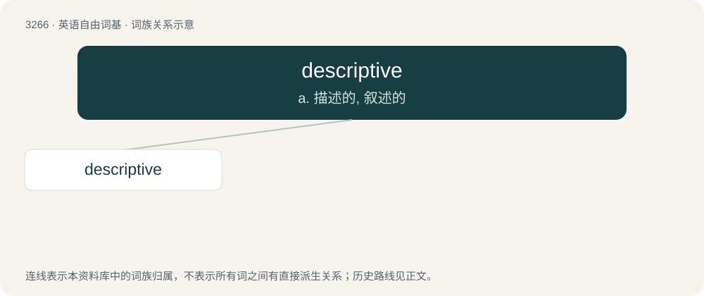

# 3358 · descriptive — a. 描述的, 叙述的

[总目录](../00_总目录_按常用程度.md)

**类型**：英语自由词基　｜　**来源语言**：见词源记录

## 核心含义与来源

- 核心含义：a. 描述的, 叙述的
- 英文含义：Of, relating to, or providing a description.
- 词形：descriptive

**来源记录 1**（形容词；Of, relating to, or providing a description.）

From Latin dēscriptīvus (“containing a full description”).

## 词族图

## 单词速览（常用到不常用）

| 单词 | 音标 | 释义 |
|---|---|---|
| [descriptive](#w-1) | 英 /dɪˈskɹɪptɪv/；美 /dɪˈskɹɪptɪv/ | a. 描述的, 叙述的 |

## 逐词详解

### 1. descriptive

**词性**：形容词　｜　**音标**：英 /dɪˈskɹɪptɪv/；美 /dɪˈskɹɪptɪv/

**中文释义**：a. 描述的, 叙述的

**英文义项**：Of, relating to, or providing a description. / Of an adjective, stating an attribute of the associated noun (as heavy in the heavy dictionary).

**词源与演化**：

From Latin dēscriptīvus (“containing a full description”).

**例句**：

> We can thank the intrepid sailors of yore for these wildly descriptive terms.
