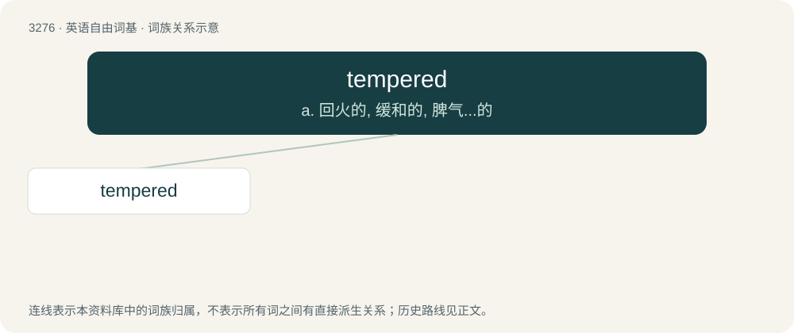

# 3364 · tempered — a. 回火的, 缓和的, 脾气...的

[总目录](../00_总目录_按常用程度.md)

**类型**：英语自由词基　｜　**来源语言**：见词源记录

## 核心含义与来源

- 核心含义：a. 回火的, 缓和的, 脾气...的
- 英文含义：Having a specified disposition or temper.
- 词形：tempered

**来源记录 1**（形容词；Having a specified disposition or temper.）

From Middle English tempred, itempered, ytempred, ytemprid, from Old English ġetemprod (“tempered, moderate, goverened, cured”), past participle of Old English ġetemprian (“to temper, moderate, govern, cure”), equivalent to temper + -ed.

## 词族图

## 单词速览（常用到不常用）

| 单词 | 音标 | 释义 |
|---|---|---|
| [tempered](#w-1) | /ˈtempəd/ | a. 回火的, 缓和的, 脾气...的 |

## 逐词详解

### 1. tempered

**词性**：形容词　｜　**音标**：/ˈtempəd/

**中文释义**：a. 回火的, 缓和的, 脾气...的

**英文义项**：Having a specified disposition or temper. / Pertaining to the metallurgical process for finishing metals.

**构词拆分**：temper + -ed

**词源与演化**：

From Middle English tempred, itempered, ytempred, ytemprid, from Old English ġetemprod (“tempered, moderate, goverened, cured”), past participle of Old English ġetemprian (“to temper, moderate, govern, cure”), equivalent to temper + -ed.

**用法示例／搭配（非完整句）**：

> even-tempered

该用例对应义项：Having a specified disposition or temper.
