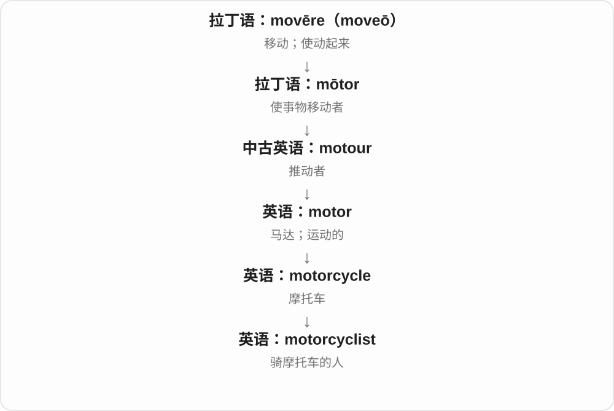

# 3365 · cyclist — 骑自行车、摩托车的人

[逐词精讲目录](../00_逐词精讲目录.md) · [总目录](../00_总目录_按常用程度.md)

## 核心词根与来源

cycle 的历史远连希腊语 kyklos 圈、轮；现代自行车词义形成后，cycle + -ist 造人物名称 cyclist，motorcyclist 再明确载具类别。

**CYCLIST：从 cycle 骑车到骑行者**

cycle 可以说骑自行车；把骑这种车的人叫 cyclist，前面加 motor 进一步明确为摩托车骑手。

- **自行车骑行者**：cyclist
- **摩托车骑行者**：motorcyclist

## 词形与演化规律

cycle → cyclist；motorcycle → motorcyclist。末尾 -ist 是人物材料，cycle 的 e 在这里不保留。

## 单词速览（按词族由简到繁）

同一基础词的相关扩展放在一起，先读基础形式，再读扩展；各组之间优先读常用的。具体词源关系见各词讲解。

| 单词 | 音标 | 核心意思 |
|---|---|---|
| [cyclist](#w-1) | /ˈsaɪklɪst/ | 骑自行车的人；自行车运动员 |
| [motorcyclist](#w-2) | 英 /ˈməʊtəsaɪklɪst/；美 /ˈmoʊtərsaɪklɪst/ | 摩托车骑手 |

## 逐词讲解

### 1. cyclist — 骑自行车的人；自行车运动员

**音标**：/ˈsaɪklɪst/

**先抓住这个画面**

正在骑车或以骑车为运动的人，不一定参加比赛。

**怎么拆**

cycle 的车辆义加表示人的 -ist，也可联系 bicycle 的缩略词干；现代可直接记 cycle → cyclist。

**怎么变成今天的意思**

**希腊 kýklos**  
圆；轮；一圈循环

↓

**法语 bicycle：bi- + -cycle**  
两个轮子的车辆

↓

**英语 bicycle**  
自行车

↓

**车辆词 cycle + -ist → cyclist**  
骑自行车的人

commuter cyclists 是骑车通勤者，professional cyclists 才特指职业自行车运动员。骑车上学的学生、休闲骑行者也都是 cyclists。

**常见搭配与例句**

a cyclist；a group of cyclists；professional cyclists。

> A cyclist stopped to help me repair the puncture.

一名骑车人停下来帮我修补扎破的车胎。

> The race attracted cyclists from several countries.

比赛吸引了来自多个国家的自行车选手。

**别混淆**

motorcyclist 骑摩托车；cyclist 通常骑自行车。

### 2. motorcyclist — 摩托车骑手

**音标**：英 /ˈməʊtəsaɪklɪst/；美 /ˈmoʊtərsaɪklɪst/

**先抓住这个画面**

motorcyclist 是坐在摩托车上驾驶的人，而不只是喜欢看摩托车的人。

**怎么拆**

motorcycle + -ist；也能看作 motor + cyclist。

**怎么变成今天的意思**

这个名称常从道路使用者或运动参与者角度分类，不说明他是职业车手。

**常见搭配与例句**

a motorcyclist’s helmet；passing motorcyclists；an experienced motorcyclist。

> The motorcyclist stopped at the crossing.

摩托车骑手在人行横道前停下。

> Several motorcyclists were waiting by the café.

几位摩托车骑手在咖啡馆旁等候。

**别混淆**

cyclist 常指骑自行车的人；motorcyclist 明确是摩托车骑手。

## 这一组要分清什么

cyclist 日常多指自行车骑手；motorcyclist 则明确摩托车。并非所有 cycle 的周期、循环义都能直接换成骑手义。

## 串起来练习

The cyclist stopped to let a motorcyclist pass.

骑自行车的人停下来，让摩托车骑手先通过。
