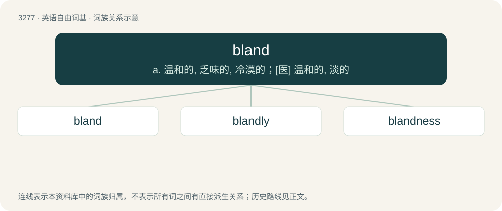

# 3366 · bland — a. 温和的, 乏味的, 冷漠的；\[医\] 温和的, 淡的

[总目录](../00_总目录_按常用程度.md)

**类型**：英语自由词基　｜　**来源语言**：见词源记录

## 核心含义与来源

- 核心含义：a. 温和的, 乏味的, 冷漠的；\[医\] 温和的, 淡的
- 英文含义：Having a soothing effect; not irritating or stimulating.
- 词形：bland

**多个词源／构词路径**：同一拼写可能有不同来源；以下按词性和含义分别列出。

**来源记录 1**（形容词；Having a soothing effect; not irritating or stimulating.）

Borrowed from Latin blandus (“pleasant”).

**来源记录 2**（动词；To mix; blend; mingle.）

From Middle English blanden, blonden, from Old English blandan (“to blend, mix, mingle; trouble, disturb, corrupt”), from Proto-Germanic \*blandaną (“to mix, blend”). Cognate with Icelandic blanda, Norwegian, Danish blande, Swedish blanda. See also blend.

**来源记录 3**（名词；Mixture; union.）

From Middle English bland, from Old English bland, blond (“blending, mixture, confusion”), from Proto-Germanic \*blandą (“a mixing, mixture”), from Proto-Indo-European \*bʰlendʰ- (“to grow turbid, dim, see badly, be blind”). Cognate with Icelandic blanda (“a mixture of liquids, especially of hot whey and water”).

## 词族图

## 单词速览（常用到不常用）

| 单词 | 音标 | 释义 |
|---|---|---|
| [bland](#w-1) | 英 /blænd/ | a. 温和的, 乏味的, 冷漠的；\[医\] 温和的, 淡的 |
| [blandly](#w-2) | /ˈblændli/ | adv. 温和地, 柔和地 |
| [blandness](#w-3) | /ˈblændˌnɪs/ | n. 爽快；温柔 |

## 逐词详解

### 1. bland

**词性**：形容词　｜　**音标**：英 /blænd/

**中文释义**：a. 温和的, 乏味的, 冷漠的；\[医\] 温和的, 淡的

**英文义项**：Having a soothing effect; not irritating or stimulating. / Lacking in taste or flavor.

**词源与演化**：

Borrowed from Latin blandus (“pleasant”).

**例句**：

> The coffee was bland.

该用例对应义项：Lacking in taste or flavor.

### 2. blandly

**词性**：副词　｜　**音标**：/ˈblændli/

**中文释义**：adv. 温和地, 柔和地

**英文义项**：In a bland manner.

**构词拆分**：bland + -ly

**词源与演化**：

From bland + -ly.

**例句**：

> His blandly incompetent attempts.

该用例对应义项：in a bland manner

### 3. blandness

**词性**：名词　｜　**音标**：/ˈblændˌnɪs/

**中文释义**：n. 爽快；温柔

**英文义项**：Lack of taste or flavor. / Lack of interest or appeal.

**构词拆分**：bland + -ness

**词源与演化**：

From bland + -ness.
