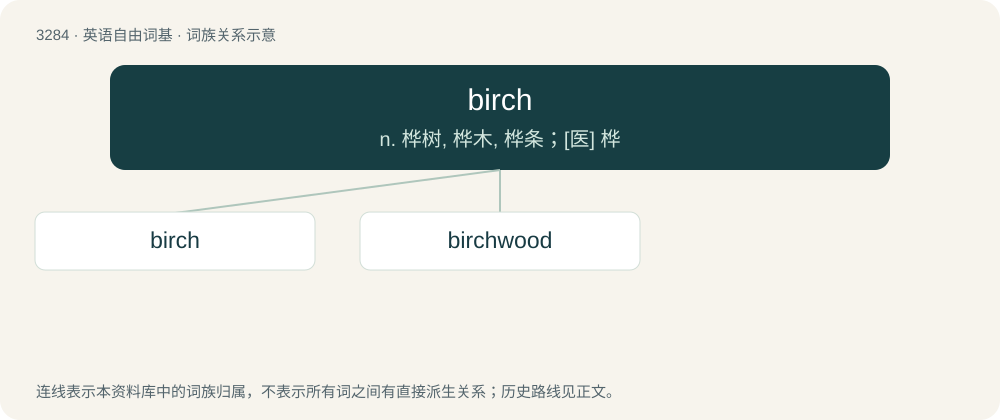

# 3372 · birch — n. 桦树, 桦木, 桦条；\[医\] 桦

[总目录](../00_总目录_按常用程度.md)

**类型**：英语自由词基　｜　**来源语言**：见词源记录

## 核心含义与来源

- 核心含义：n. 桦树, 桦木, 桦条；\[医\] 桦
- 英文含义：Any of various trees of the genus Betula, native to countries in the Northern Hemisphere.
- 词形：birch

**来源记录 1**（名词；Any of various trees of the genus Betula, native to countries in the Northern Hemisphere.）

From Middle English birche, birk, from Old English birċe, bierċe, from Proto-West Germanic \*birkijā, from Proto-Germanic \*birkijǭ, from Proto-Indo-European \*bʰerHǵos. Cognates Compare West Frisian bjirk, German Birke, variant of \*berkō (compare Dutch berk, Danish birk, Swedish björk, Norwegian bjørk), Sanskrit भूर्ज (bhūrjá), Lithuanian béržas, Czech bříza, Ossetian бӕрз (bærz), Russian берёза (berjóza)), Latin fraxinus (“ash tree, ash javelin”), Albanian bredh.

## 词族图

## 单词速览（常用到不常用）

| 单词 | 音标 | 释义 |
|---|---|---|
| [birch](#w-1) | 英 /bɜːtʃ/；美 /bɝt͡ʃ/ | n. 桦树, 桦木, 桦条；\[医\] 桦 |
| [birchwood](#w-2) | /ˈbɜːtʃwʊd/ | \[地名\] \[美国、新西兰\] 伯奇伍德 |

## 逐词详解

### 1. birch

**词性**：名词　｜　**音标**：英 /bɜːtʃ/；美 /bɝt͡ʃ/

**中文释义**：n. 桦树, 桦木, 桦条；\[医\] 桦

**英文义项**：Any of various trees of the genus Betula, native to countries in the Northern Hemisphere. / A hard wood taken from the birch tree, typically used to make furniture.

**词源与演化**：

From Middle English birche, birk, from Old English birċe, bierċe, from Proto-West Germanic \*birkijā, from Proto-Germanic \*birkijǭ, from Proto-Indo-European \*bʰerHǵos. Cognates Compare West Frisian bjirk, German Birke, variant of \*berkō (compare Dutch berk, Danish birk, Swedish björk, Norwegian bjørk), Sanskrit भूर्ज (bhūrjá), Lithuanian béržas, Czech bříza, Ossetian бӕрз (bærz), Russian берёза (berjóza)), Latin fraxinus (“ash tree, ash javelin”), Albanian bredh.

**例句**：

> My father never spared the birch.

该用例对应义项：a switch consisting of a twig or a bundle of twigs from a birch tree; used to hit people as punishment

### 2. birchwood

**词性**：名词　｜　**音标**：/ˈbɜːtʃwʊd/

**中文释义**：\[地名\] \[美国、新西兰\] 伯奇伍德

**英文义项**：A wood largely populated with birch trees (Betula spp.). / The wood from a birch tree.

**构词拆分**：birch + wood

**词源与演化**：

From birch + wood.
