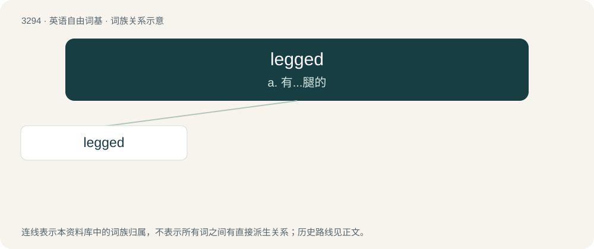

# 3380 · legged — a. 有...腿的

[总目录](../00_总目录_按常用程度.md)

**类型**：英语自由词基　｜　**来源语言**：见词源记录

## 核心含义与来源

- 核心含义：a. 有...腿的
- 英文含义：Having legs of a certain specified type or number.
- 词形：legged

**来源记录 1**（形容词；Having legs of a certain specified type or number.）

From Middle English legged, leggyd, equivalent to leg (“noun”) + -ed.

## 词族图

## 单词速览（常用到不常用）

| 单词 | 音标 | 释义 |
|---|---|---|
| [legged](#w-1) | /ˈlɛɡɪd/ | a. 有...腿的 |

## 逐词详解

### 1. legged

**词性**：形容词　｜　**音标**：/ˈlɛɡɪd/

**中文释义**：a. 有...腿的

**英文义项**：Having legs of a certain specified type or number. / Having legs; provided with legs.

**构词拆分**：leg (“noun”) + -ed

**词源与演化**：

From Middle English legged, leggyd, equivalent to leg (“noun”) + -ed.

**例句**：

> A robot which runs at a speed of over 29mph has set a new land-speed record for legged robots.

该用例对应义项：Having legs; provided with legs.
