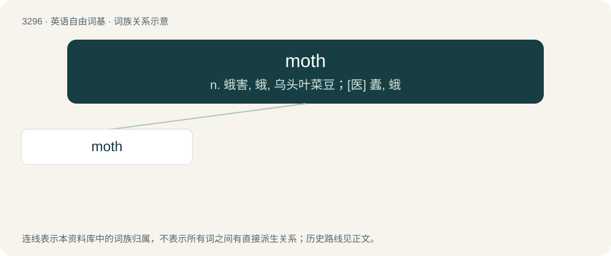

# 3382 · moth — n. 蛾害, 蛾, 乌头叶菜豆；\[医\] 蠹, 蛾

[总目录](../00_总目录_按常用程度.md)

**类型**：英语自由词基　｜　**来源语言**：见词源记录

## 核心含义与来源

- 核心含义：n. 蛾害, 蛾, 乌头叶菜豆；\[医\] 蠹, 蛾
- 英文含义：Any flying insect of the order Lepidoptera not in the superfamily Papilionoidea, most species of which are nocturnal and can be distinguished from butterflies by feather-like antennae.
- 词形：moth

**多个词源／构词路径**：同一拼写可能有不同来源；以下按词性和含义分别列出。

**来源记录 1**（名词；Any flying insect of the order Lepidoptera not in the superfamily Papilionoidea, most species of which are nocturnal and can be distinguished from butterflies by feather-like antennae.）

From Middle English moth, moththe, motthe, moght, mohþe, mouȝte, from Old English moþþe, mohþe, mohþa, from Proto-West Germanic \*moþþā, from Proto-Germanic \*maþô ~ \*muttaz (“insect, worm, maggot”), from Proto-Indo-European \*mutn-, \*mut- (“worm”). Cognate with Saterland Frisian Motte (“moth”), West Frisian mot (“moth”), Dutch mot (“moth”), German Low German Motte, Mott (“moth”), German Motte (“moth”), Swedish mott (“moth”) and Norwegian Nynorsk mott (“moth”).

**来源记录 2**（名词；A moth bean plant (Vigna aconitifolia).）

From Hindi मोठ (moṭh); see moth bean.

**来源记录 3**（名词；A girlfriend.）

Alternative form of mot (“woman; wife”), likely under influence from Irish maith (“goodness”).

## 词族图

## 单词速览（常用到不常用）

| 单词 | 音标 | 释义 |
|---|---|---|
| [moth](#w-1) | 英 /mɒθ/；美 /mɔθ/ | n. 蛾害, 蛾, 乌头叶菜豆；\[医\] 蠹, 蛾 |

## 逐词详解

### 1. moth

**词性**：名词　｜　**音标**：英 /mɒθ/；美 /mɔθ/

**中文释义**：n. 蛾害, 蛾, 乌头叶菜豆；\[医\] 蠹, 蛾

**英文义项**：Any flying insect of the order Lepidoptera not in the superfamily Papilionoidea, most species of which are nocturnal and can be distinguished from butterflies by feather-like antennae. / Anything that gradually and silently eats, consumes, or wastes any other thing.

**词源与演化**：

From Middle English moth, moththe, motthe, moght, mohþe, mouȝte, from Old English moþþe, mohþe, mohþa, from Proto-West Germanic \*moþþā, from Proto-Germanic \*maþô ~ \*muttaz (“insect, worm, maggot”), from Proto-Indo-European \*mutn-, \*mut- (“worm”). Cognate with Saterland Frisian Motte (“moth”), West Frisian mot (“moth”), Dutch mot (“moth”), German Low German Motte, Mott (“moth”), German Motte (“moth”), Swedish mott (“moth”) and Norwegian Nynorsk mott (“moth”).

**例句**：

> It takes only a few days for the moth's eggs to hatch.
