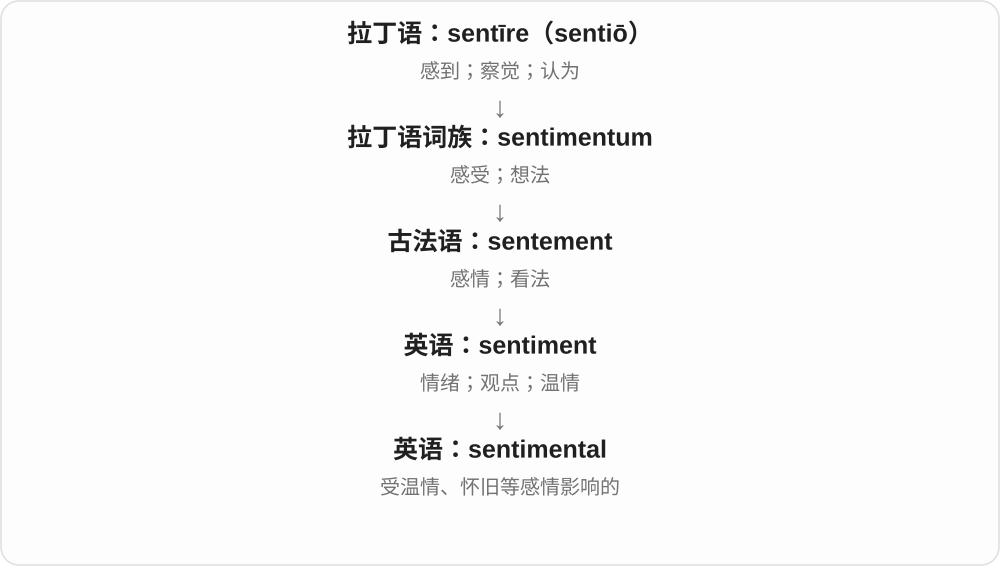
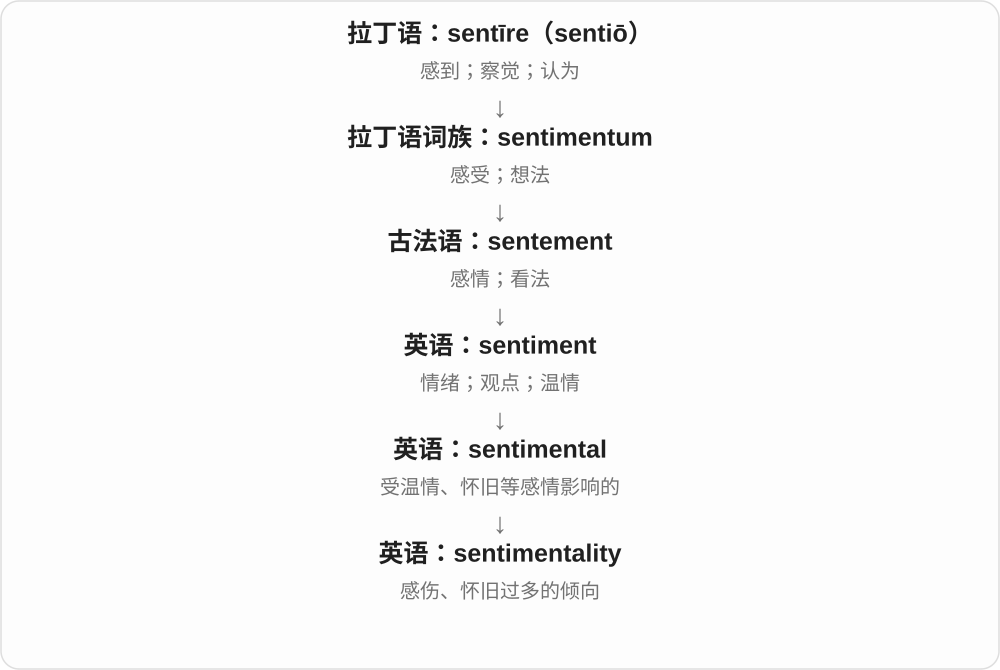
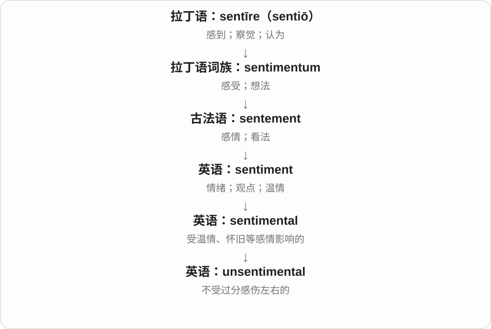

# 3385 · sentimental — 感伤、怀旧、感情用事

[逐词精讲目录](../00_逐词精讲目录.md) · [总目录](../00_总目录_按常用程度.md)

## 核心词根与来源

sentiment 情感、感想 + -al 形成 sentimental；-ity 命名这种性质，un- 则否定相关形容词。

**SENTIMENTAL：个人感情给东西加了一层分量**

一张旧车票不值钱，却因为是第一次旅行留下的而舍不得丢，这就是 sentimental value；说决定 sentimental，又可能批评太受感情影响。

- **感情、怀旧性质**：sentimental
- **性质名称与另一态度**：sentimentality · unsentimental

## 词形与演化规律

sentiment → sentimental → sentimentality／unsentimental；不同搭配可中性、温暖，也可带煽情过头的批评。

## 单词速览（按词族由简到繁）

同一基础词的相关扩展放在一起，先读基础形式，再读扩展；各组之间优先读常用的。具体词源关系见各词讲解。

| 单词 | 音标 | 核心意思 |
|---|---|---|
| [sentimental](#w-1) | /ˌsentɪˈmentəl/ | 感伤的；怀旧的；感情用事的 |
| [sentimentality](#w-2) | /ˌsentɪmenˈtæləti/ | 多愁善感；过度感伤；煽情 |
| [unsentimental](#w-3) | /ˌʌnsentɪˈmentəl/ | 不感情用事的；不煽情的 |

## 逐词讲解

### 1. sentimental — 感伤的；怀旧的；感情用事的

**音标**：/ˌsentɪˈmentəl/

**先抓住这个画面**

一件旧东西本身不值钱，却把过去的人和事一下带回来，让你舍不得丢，这就是 sentimental 的典型场景。

**怎么拆**

sentiment + -al。

**怎么变成今天的意思**

可温和地说有感情价值，也可批评作品或判断过分依赖温情。a sentimental person 并不表示身体感官特别灵敏。

**常见搭配与例句**

sentimental value；feel sentimental；a sentimental story。

> The watch has great sentimental value for me.

这只表对我有很大的感情价值。

> The film becomes too sentimental in its final scenes.

电影最后几场戏煽情过头了。

**别混淆**

emotional 广泛说有情绪或情绪强烈；sentimental 常偏温情、怀旧、感伤，有时带过度之意。

### 2. sentimentality — 多愁善感；过度感伤；煽情

**音标**：/ˌsentɪmenˈtæləti/

**先抓住这个画面**

情绪被铺得很满，甚至盖过了真实人物与事实，这种过分温情或感伤常被叫作 sentimentality。

**怎么拆**

sentimental + -ity，将性质转成名词。

**怎么变成今天的意思**

通常比 sentimental value 带更明显的批评，评价的是感情的处理方式，不是否定一切真诚情感。

**常见搭配与例句**

avoid sentimentality；excessive sentimentality；without sentimentality。

> The novel describes loss without sentimentality.

这部小说描写失落，却不刻意煽情。

> The speech was weakened by excessive sentimentality.

演讲因过分感伤而削弱了力量。

**别混淆**

emotion 是感情本身；sentimentality 常暗示处理得过甜、过满或不够真实。

### 3. unsentimental — 不感情用事的；不煽情的

**音标**：/ˌʌnsentɪˈmentəl/

**先抓住这个画面**

看见事实的重量，不急着用温情把它包起来；仍可有感情，但表达或判断比较克制。

**怎么拆**

un-（不）+ sentimental。

**怎么变成今天的意思**

可以赞赏作品诚实、克制，也可以描述决策果断。它不必等于冷酷或缺乏同情。

**常见搭配与例句**

an unsentimental account；an unsentimental view；an unsentimental decision。

> She gives an unsentimental account of her childhood.

她对童年的叙述很克制，没有刻意煽情。

> He took an unsentimental view of the business decision.

他冷静地看待这项商业决定，没有感情用事。

**别混淆**

insensitive 是不顾别人感受；unsentimental 只是不过分感伤，一个人可以既体贴又冷静。

## 这一组要分清什么

sentimental value 是情感价值，未必负面；unsentimental 常说不感情用事、清醒务实，也不自动表示冷酷。

## 串起来练习

The ring has sentimental value, though its price is low.

这枚戒指价格不高，却有很大的情感价值。
