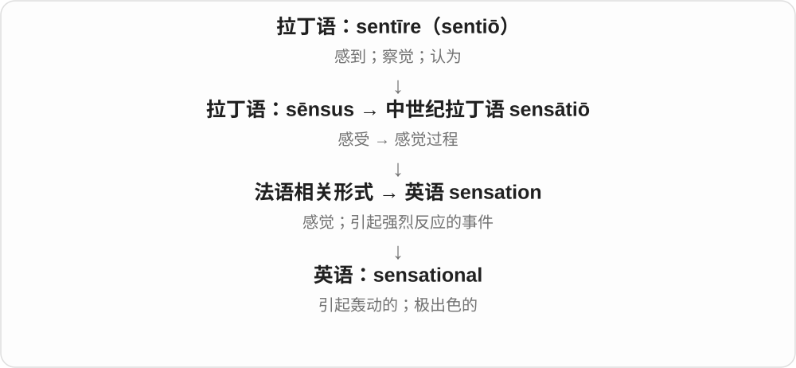
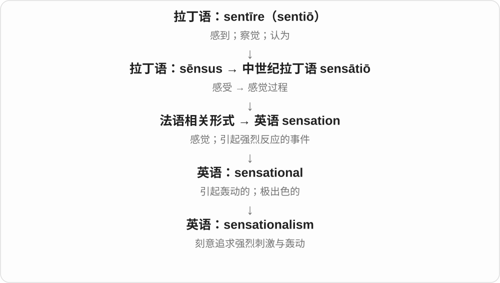
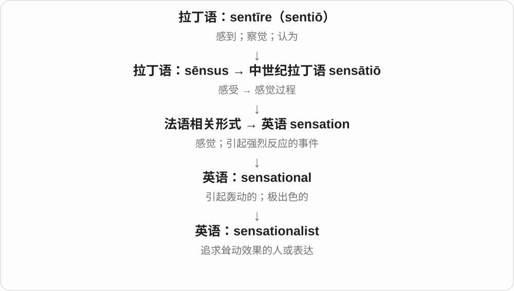

# 3401 · sensational — 轰动、耸动；极出色

[逐词精讲目录](../00_逐词精讲目录.md) · [总目录](../00_总目录_按常用程度.md)

## 核心词根与来源

sensation 感觉、引起轰动的事 + -al，形成 sensational；-ly 成方式、程度副词，-ism、-ist 常用于耸动报道倾向和人物。

**SENSATIONAL：能引起强烈反应，评价方向看搭配**

一则报道抓眼球，可能被说 sensational；一次演出特别出色，也能得到 sensational 的赞美。共同点是给人强烈感觉。

- **强烈反应与评价**：sensational
- **方式、程度**：sensationally
- **耸动倾向和相关人物**：sensationalism · sensationalist

## 词形与演化规律

sensation → sensational → sensationally／sensationalism／sensationalist；每个派生的常用评价方向可以不同。

## 单词速览（按词族由简到繁）

同一基础词的相关扩展放在一起，先读基础形式，再读扩展；各组之间优先读常用的。具体词源关系见各词讲解。

| 单词 | 音标 | 核心意思 |
|---|---|---|
| [sensational](#w-1) | /senˈseɪʃənəl/ | 轰动的；耸人听闻的；极出色的 |
| [sensationalism](#w-2) | /senˈseɪʃənəlɪzəm/ | 追求轰动；煽情、夸张的报道方式 |
| [sensationalist](#w-3) | /senˈseɪʃənəlɪst/ | 追求轰动者；煽情的 |
| [sensationally](#w-4) | /senˈseɪʃənəli/ | 轰动地；耸人听闻地；极其出色地〔依语境〕 |

## 逐词讲解

### 1. sensational — 轰动的；耸人听闻的；极出色的

**音标**：/senˈseɪʃənəl/

**先抓住这个画面**

它能一下子抓住大家的感觉：可能是真的精彩，也可能故意夸张刺激，让人忍不住点进去。

**怎么拆**

sensation + -al，表示会引起强烈感受或轰动的。

**怎么变成今天的意思**

a sensational performance 常是称赞；a sensational headline 可能批评靠刺激吸引眼球。不能只背一个“耸人听闻”。

**常见搭配与例句**

a sensational performance；sensational news；a sensational headline。

> The singer gave a sensational performance.

这位歌手的演出精彩极了。

> The article used a sensational headline to attract readers.

文章用耸动的标题吸引读者。

**别混淆**

sensational 的评价取决于对象；sensitive 则是接收刺激敏锐，不是制造轰动。

### 2. sensationalism — 追求轰动；煽情、夸张的报道方式

**音标**：/senˈseɪʃənəlɪzəm/

**先抓住这个画面**

本来可以平实地讲，偏要把最刺激的部分放大，让人震惊或愤怒；这种做法是 sensationalism。

**怎么拆**

sensational + -ism，给一种表达倾向或做法命名。

**怎么变成今天的意思**

常用于批评媒体为了吸引注意而夸张或选择性突出内容。它不要求每个细节都造假，也可能是呈现方式失衡。

**常见搭配与例句**

media sensationalism；avoid sensationalism；accusations of sensationalism。

> The editor wanted accurate reporting without sensationalism.

编辑希望报道准确，不刻意制造轰动。

> Critics accused the programme of sensationalism.

批评者指责这个节目刻意煽情。

**别混淆**

an exciting report 可以事实充分又精彩；sensationalism 则通常批评把刺激性放在准确或分寸之前。

### 3. sensationalist — 追求轰动者；煽情的

**音标**：/senˈseɪʃənəlɪst/

**先抓住这个画面**

sensationalism 是做法，sensationalist 是采用这种做法的人，也能直接形容报道或标题。

**怎么拆**

sensational + -ist，形成从事者或倾向名称。

**怎么变成今天的意思**

这个词通常带批评，不是“感觉特别敏锐的研究者”。新闻评论中常见 sensationalist coverage。

**常见搭配与例句**

a sensationalist newspaper；sensationalist reporting；a sensationalist writer。

> She refused to work for a sensationalist newspaper.

她不愿为一家靠耸动报道吸引读者的报纸工作。

> The documentary was criticized for its sensationalist style.

这部纪录片因煽情的风格受到批评。

**别混淆**

sensational 可以单纯夸精彩；sensationalist 大多指刻意制造轰动，不是普通赞美。

### 4. sensationally — 轰动地；耸人听闻地；极其出色地〔依语境〕

**音标**：/senˈseɪʃənəli/

**先抓住这个画面**

消息一出让很多人震惊，是轰动；报道故意把事情写得很刺激，是耸动；称赞表现 sensationally good，又是好得惊人的意思。

**怎么拆**

sensation 引发感觉、轰动的事 → sensational + -al，再加 -ly。感觉刺激、引人震动的历史意义，分出了吸引眼球与极出色等评价。

**怎么变成今天的意思**

**sensation → sensational**  
引起强烈感觉、轰动；极出色

↓

**sensational + -ly → sensationally**  
以轰动、耸动方式；达到惊人的程度

sensationally reported 被耸动报道；sensationally good 好得惊人；sensationally resign 突然辞职而引发轰动。

**常见搭配与例句**

sensationally successful；sensationally exaggerated。

> The story was sensationally reported in the tabloids.

小报用耸人听闻的方式报道了这件事。

> The young pianist played sensationally well.

这位年轻钢琴家弹得好极了。

**别混淆**

sensationally 并不自动表示报道是假的；它可以评论语气、公众反应，也可以赞美成绩，需看搭配。

## 这一组要分清什么

sensational performance 常是夸演出；sensational reporting 可批评报道耸动。不要把整个词族一律译成耸人听闻。

## 串起来练习

The singer was sensationally good, but the coverage drifted into sensationalism.

歌手唱得好极了，相关报道却逐渐走向耸动炒作。
