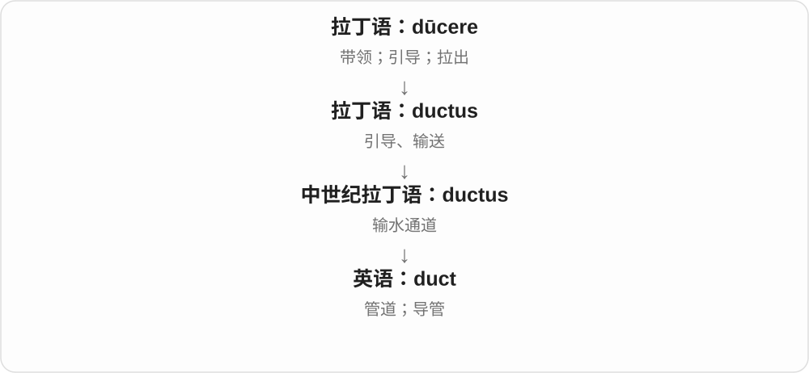

# 3414 · duct — 引导、输送的通道；管道系统

[逐词精讲目录](../00_逐词精讲目录.md) · [总目录](../00_总目录_按常用程度.md)

## 核心词根与来源

拉丁 ductus 引导、输送相关名词接 ducere 带领；中世纪拉丁等用法又明确指输水通道，英语沿用为管道名称。

**DUCT：把空气、液体等导向别处的通路**

空调风沿着管路送到房间，身体中的液体沿导管输送；duct 关心的是让某物通过的管道、通路。

- **单条管道、导管**：duct
- **建筑风管网络**：ductwork

## 词形与演化规律

duct → duct + work → ductwork；work 在这个复合词里把多段管道看成一整套结构。

## 单词速览（按词族由简到繁）

同一基础词的相关扩展放在一起，先读基础形式，再读扩展；各组之间优先读常用的。具体词源关系见各词讲解。

| 单词 | 音标 | 核心意思 |
|---|---|---|
| [duct](#w-1) | /dʌkt/ | 管道；导管 |
| [ductwork](#w-3) | 英 /ˈdʌktwɜːk/；美 /ˈdʌktwɜːrk/ | 风管系统；管道系统 |

## 逐词讲解

### 1. duct — 管道；导管

**音标**：/dʌkt/

**先抓住这个画面**

duct 就是一条把空气、液体等带到别处的通道。通风系统里的风管，是最容易看见的例子。

**怎么拆**

来自拉丁语 ductus“引导、输送”，后来的拉丁语也用它表示水渠、通道；根源是 dūcere。

**怎么变成今天的意思**

原来表示引导的动作，后来也指执行输送功能的通道。身体里的导管和楼里的风管都保留这个画面。

**常见搭配与例句**

an air duct（风管）；a ventilation duct（通风管）；a tear duct（泪道）。

> Dust had collected inside the air duct.

风管内部积了灰。

> The diagram shows the path of the ventilation ducts.

图中显示了通风管道的走向。

**别混淆**

duct 强调输送通道，形状不必是圆的；pipe 常指管状构件。duck“鸭子”与这个词根无关。

### 2. ductwork — 风管系统；管道系统

**音标**：英 /ˈdʌktwɜːk/；美 /ˈdʌktwɜːrk/

**先抓住这个画面**

天花板上方，一段段宽管接起来，把空气送到不同房间。

**怎么拆**

duct（导管、风管）+ work（整体结构），通常集合地说建筑通风或空调的管道网络。

**怎么变成今天的意思**

**英语 duct；work**  
并列的两个构词材料

↓

**duct + work → ductwork**  
由多段导管组成的系统

常用于供暖、通风、空调说明。材质和尺寸随系统变化；普通住宅语境多抓住空气输送，不把每根水管都叫 ductwork。

**常见搭配与例句**

air-conditioning ductwork；install ductwork；exposed ductwork。

> The ceiling hides the ventilation ductwork.

天花板遮住了通风管道。

> The contractor inspected the old ductwork.

承包商检查了旧风管系统。

**别混淆**

pipework 常偏一组管道，ductwork 常偏风管系统；具体工程也会有专门术语，不能仅由外形判断。

## 这一组要分清什么

ductwork 常集合地说一整套通风、空调风管；pipe 也说管子，但两词的专业搭配各有习惯。

## 串起来练习

The technician checked the ductwork above the ceiling.

技术人员检查了天花板上方的风管系统。
