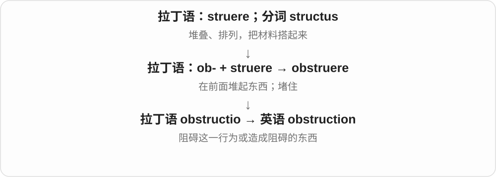
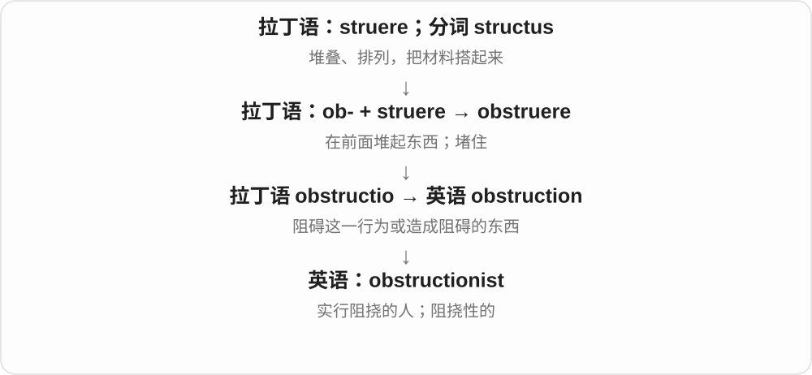

# 3424 · obstruction — 障碍、堵塞；有意阻挠

[逐词精讲目录](../00_逐词精讲目录.md) · [总目录](../00_总目录_按常用程度.md)

## 核心词根与来源

拉丁 obstruere 筑起阻挡、堵住形成 obstructio，后进入英语 obstruction。-ist、-ism 分别发展相关人物、做法名称。

**OBSTRUCTION：东西把通路挡住，或做法把进程挡住**

物理上挡住管道、道路，是 obstruction；程序上故意拖住一个过程，也能用同一阻挡画面理解。

- **具体堵塞、阻挠**：obstruction
- **阻挠者及相关做法**：obstructionist · obstructionism

## 词形与演化规律

obstruct → obstruction → obstructionist／obstructionism；学习顺序能对照，历史名词也有拉丁语现成形式。

## 单词速览（按词族由简到繁）

同一基础词的相关扩展放在一起，先读基础形式，再读扩展；各组之间优先读常用的。具体词源关系见各词讲解。

| 单词 | 音标 | 核心意思 |
|---|---|---|
| [obstruction](#w-1) | /əbˈstrʌkʃən/ | 障碍物；堵塞；阻挠 |
| [obstructionist](#w-2) | /əbˈstrʌkʃənɪst/ | 阻挠者；采取阻挠策略的 |
| [obstructionism](#w-3) | /əbˈstrʌkʃənɪzəm/ | 有意阻挠的做法；阻挠主义 |

## 逐词讲解

### 1. obstruction — 障碍物；堵塞；阻挠

**音标**：/əbˈstrʌkʃən/

**先抓住这个画面**

obstruction 可以是挡在那里的东西，也可以是“让通道或事情过不去”这一状态。

**怎么拆**

来自拉丁 obstructio，与 obstruere 相连；现代可与 obstruct + -ion 对应。

**怎么变成今天的意思**

clear an obstruction 是移走障碍；deliberate obstruction 是故意阻挠。a pipe obstruction 则是管道内部堵住，不一定能从外面看出来。

**常见搭配与例句**

remove an obstruction；an obstruction in a pipe；deliberate obstruction。

> Workers removed an obstruction from the drain.

工人清除了排水管里的堵塞物。

> The project faced months of deliberate obstruction.

这个项目遭到持续数月的蓄意阻挠。

**别混淆**

obstacle 常是需要克服的一项困难；obstruction 更突出挡住、堵住或阻挠的作用。

### 2. obstructionist — 阻挠者；采取阻挠策略的

**音标**：/əbˈstrʌkʃənɪst/

**先抓住这个画面**

obstructionist 不只是偶尔说“不”，而是被描述为不断拖延、设卡，想让行动无法推进的人。

**怎么拆**

obstruction + -ist，形成施行某种做法的人，也可转作形容词。

**怎么变成今天的意思**

常出现在议会、委员会或谈判语境。obstructionist tactics 是有意拖住进程的策略；这个标签通常是对方带批评地使用。

**常见搭配与例句**

an obstructionist；obstructionist tactics；an obstructionist minority。

> Critics called him an obstructionist after he delayed the vote again.

他再次拖延投票后，批评者称他为阻挠者。

> The committee struggled to overcome obstructionist tactics.

委员会费力应对各种阻挠手段。

**别混淆**

opponent 只是反对者；obstructionist 进一步强调使用阻挠手段，不是中性的同义词。

### 3. obstructionism — 有意阻挠的做法；阻挠主义

**音标**：/əbˈstrʌkʃənɪzəm/

**先抓住这个画面**

不是碰巧有个障碍，而是把拖延、挡住进程当成做法；这个主动阻挠的倾向就是 obstructionism。

**怎么拆**

obstruction 阻挠 + -ism，形成做法、倾向名称。obstruction 远接拉丁 obstruere 堵住、筑起阻挡，与 ob-、struere 建造材料相连。

**怎么变成今天的意思**

**拉丁 obstruere、obstructio → obstruction**  
筑起阻挡 → 障碍、阻挠

↓

**obstruction + -ism → obstructionism**  
有意采取阻挠策略的做法

political obstructionism 政治性阻挠；accuse someone of obstructionism 指责某人有意阻挠。这个评价通常带批评。

**常见搭配与例句**

a policy of obstructionism；procedural obstructionism。

> The debate stalled amid accusations of obstructionism.

相互指责阻挠的声音中，辩论停滞了。

> She criticised the committee’s obstructionism.

她批评了委员会有意阻挠的做法。

**别混淆**

obstruction 可以是物理堵塞或具体阻挠；obstructionism 更强调一种故意采取的策略。反对某项主张本身并不自动等同于阻挠主义。

## 这一组要分清什么

obstruction 可以是无意造成的障碍；obstructionism 通常是在批评有意阻挡进程的策略。

## 串起来练习

The committee removed the obstruction but continued arguing about obstructionism.

委员会排除了那个障碍，却还在争论是否存在有意阻挠。
