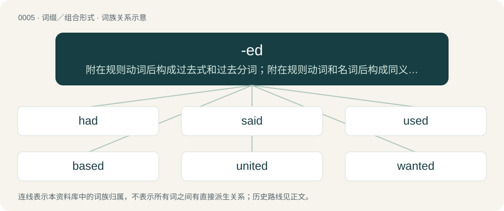

# 0004 · -ed — 附在规则动词后构成过去式和过去分词；附在规则动词和名词后构成同义形容词

[总目录](../00_总目录_按常用程度.md)

**类型**：词缀／组合形式　｜　**来源语言**：见词源记录

## 核心含义与来源

- 核心含义：附在规则动词后构成过去式和过去分词；附在规则动词和名词后构成同义形容词
- 英文含义：Used to form past tenses of (regular) verbs. In linguistics, it is used for the base form of any past form. See -t for a variant.
- 词形：-ed

**多个词源／构词路径**：同一拼写可能有不同来源；以下按词性和含义分别列出。

**来源记录 1**（后缀／后置成分；Used to form past tenses of (regular) verbs. In linguistics, it is used for the base form of any past form. See -t for a variant.）

From Middle English -ede, -ed. During the Middle English period, this increasingly standard -ed ending largely absorbed the class 1 weak past ending (-de) through morphological leveling. However, many class 1 verbs resisted this leveling to become modern irregular verbs (such as kept and left). This resistance was driven by phonotactics: attaching the consonant suffix directly to the stem often triggered pre-cluster vowel shortening (and consonant devoicing) in Early Middle English, creating a stark vowel alternation between the present and past tense that anchored the irregular form. Conversely, verbs that lacked this stark alternation (such as deem, where the early past tense demde remained insufficiently distinct from the present stem) were highly vulnerable to leveling, adopting the syllabic -ed to ensure the past tense was clearly marked. In modern usage, this morphological leveling has proceeded further in American English than in British English, which frequently preserves the irregular -t variant for such verbs. Ultimately from Proto-Germanic \*-ōd-. Cognate with Saterland Frisian -ede (“-ed”, first person singular past indicative ending), Low German -de (“-ed”, first and third person singular past indicative ending), Dutch -d (“-ed”), German -t (“-ed”), Swedish -ade (“-ed”), Icelandic -aði (“-ed”).

**来源记录 2**（后缀／后置成分；Used to form past participles of (regular) verbs. See -en and -t for variants.）

From Middle English -ed, from the merger of Old English -od (class 2 weak past participle) and -ed (class 1 weak past participle), ultimately from Proto-Germanic \*-ōdaz and \*-idaz respectively. Cognate with Saterland Frisian -ed.

**来源记录 3**（后缀／后置成分；Used to form possessional adjectives from nouns, in the sense of having the object represented by the noun.）

From Middle English -ed, from Old English -od (adjective suffix), from Proto-Germanic \*-ōdaz, from Proto-Indo-European \*-eh₂tos. While identical in appearance to the past participle of class 2 weak verbs, this suffix was attached directly to nouns without any intervening verb. Cognate with Latin -ātus (whence also a doublet -ate), Proto-Slavic \*-atъ.

## 词族图

## 单词速览（常用到不常用）

| 单词 | 音标 | 释义 |
|---|---|---|
| [had](#w-1) | /hæd/ | have的过去式和过去分词 |
| [said](#w-2) | /sɛd/ | a. 上述的；say的过去式和过去分词 |
| [used](#w-3) | 英 /juːzd/；美 /juzd/ | a. 使用过的, 二手的, 习惯的 |
| [based](#w-4) | /beɪst/ | v. 立基于, 以…为基础（base的过去式和过去分词） |
| [united](#w-5) | 英 /juːˈnaɪtɪd/；美 /juˈnaɪtɪd/ | a. 联合的, 团结的, 一致的, 和睦的；\[法\] 联合的, 统一的, 一致的 |
| [wanted](#w-6) | 英 /ˈwɒn.tɪd/；美 /ˈwɑn.tɪd/ | a. 被通缉的 |
| [needed](#w-7) | 英 /ˈniː.dɪd/；美 /ˈni.dɪd/ | a. 需要的 |
| [tried](#w-8) | /tɹaɪd/ | a. 试验过的, 可靠的；\[法\] 已经审讯的, 已经查验的 |
| [felt](#w-9) | /ˈfɛlt/ | 【英文】That has been experienced or perceived. |
| [paid](#w-10) | 英 /peɪd/ | a. 受雇的, 付清的；pay的过去式和过去分词 |
| [involved](#w-11) | 英 /ɪnˈvɒlvd/；美 /ɪnˈvɑlvd/ | a. 难懂的, 复杂的, 不易懂的, 卷入...之中的, 累及..., 与...有关, 被纠缠的；\[计\] 包含, 涉及 |
| [straight](#w-12) | /stɹeɪt/ | n. 直线, 直；a. 直的, 笔直的, 正直的, 直接的, 连续的, 整齐的；adv. 直接地, 立即, 不断地 |
| [married](#w-13) | 英 /ˈmæɹ.ɪd/；/ˈmæɹ.id/ | a. 已婚的, 婚姻的；\[法\] 结了婚的, 有配偶的, 夫妇的 |
| [loved](#w-14) | /lʌvd/ | v. 热爱（love的过去分词） |
| [announced](#w-15) |  | 宣布的 |
| [developed](#w-16) | /dɪˈvɛləpt/ | a. 发达的（国家或地区）；成熟的 |
| [learned](#w-17) | 英 /ˈlɜːnɪd/；美 /ˈlɝnɪd/ | a. 有学问的, 学术上的；learn的过去式和过去分词 |
| [stopped](#w-18) | 英 /stɒpt/；美 /stɑpt/ | v. 停止；停下来（stop的过去式和过去分词） |
| [excited](#w-19) | /ɪkˈsaɪ.tɪd/ | a. 兴奋的, 已励磁的, 已激发的, 激昂的, 激动的 |
| [prepared](#w-20) | 英 /pɹɪˈpɛəd/；美 /pɹɪˈpɛɹd/ | a. 准备好的, 特制的 |
| [watched](#w-21) | 英 /wɒtʃt/；美 /wɑt͡ʃt/ | 【英文】Wearing a watch (a portable or wearable timepiece). |
| [advanced](#w-22) | 英 /ədˈvɑːnst/；美 /ədˈvænst/ | a. 在前的, 高级的, 先进的, 年老的；\[法\] 预付的, 预支的, 垫付的 |
| [connected](#w-23) | /kəˈnɛktɪd/ | a. 连接的, 连贯的, 有联系的, 关联的, 连结的, 有关系的；\[计\] 连接的 |
| [accepted](#w-24) | 英 /əkˈsɛp.tɪd/；美 /əkˈsɛp.tɪd/ | a. 公认的, 一般承认的；\[经\] 已承兑, 已认付 |
| [mixed](#w-25) | /mɪkst/ | a. 混合的, 形形色色的, 弄糊涂的；\[计\] 混合的 |
| [collected](#w-26) | /kəˈlɛktɪd/ | a. 收集成的, 镇定的 |
| [experienced](#w-27) | 英 /ɪkˈspɪə.ɹɪənst/；美 /ɪkˈspɪɹ.i.ənst/ | a. 富有经验的, 老练的, 熟练的 |
| [fired](#w-28) | 英 /ˈfaɪ̯əd/；美 /ˈfaɪ̯ɚd/ | n. 因祸得福（电影名） |
| [scared](#w-29) | 英 /skɛəd/；美 /skɛ(ə)ɹd/ | a. 害怕的, 担惊受怕的, 惊慌的, 吓坏了的 |
| [armed](#w-30) | 英 /ɑːmd/；美 /ɑɹmd/ | a. 有扶手的, 武装的, 有防卫器官的；\[法\] 武装的, 持械的, "F带武器的 |
| [fucked](#w-31) | /fʌkt/ | a. 受骗的 |
| [trained](#w-32) | /tɹeɪnd/ | a. 训练过的, 受过培训的；培训 |
| [headed](#w-33) | /ˈhɛdɪd/ | a. 列有标题的, 具有某种类型的头(脑)或头发的 |
| [marked](#w-34) | 英 /mɑːkt/；美 /mɑɹkt/ | a. 有记号的, 显著的, 醒目的；\[化\] 有记号的; 显著的 |
| [faced](#w-35) | /feɪst/ | a. 有某种面孔或表情的 |
| [confused](#w-36) | 英 /kənˈfjuːzd/；美 /kənˈfjuzd/ | a. 困惑的, 混乱的 |
| [divided](#w-37) | /dəˈvaidid/ | a. 分开的 |
| [accused](#w-38) | 美 /əˈkjuzd/ | n. 被告 |
| [informed](#w-39) | 英 /ɪnˈfɔːmd/；美 /ɪnˈfɔɹmd/ | a. 见多识广的 |
| [featured](#w-40) | /ˈfiːt͡ʃə(ɹ)d/ | a. 面貌秀丽的, 被作为特色的 |
| [pleased](#w-41) | /pliːzd/ | a. 高兴的, 喜欢的, 满足的 |
| [retired](#w-42) | 英 /ɹɪˈtaɪəd/；美 /ɹɪˈtaɪəɹd/ | a. 隐退的, 退休的, 退役的；\[经\] 退休的, 已收回的 |
| [handed](#w-43) | 英 /ˈhændɪd/；美 /ˈhændəd/ | a. 有手的, 用手的 |
| [abandoned](#w-44) | 英 /əˈbæn.dənd/；/əˈbeə̯n.dənd/ | a. 被抛弃的, 无约束的, 恣意放荡的 |
| [buried](#w-45) | /ˈbɛ.ɹid/ | a. 埋葬的；\[地\]埋藏的 |
| [figured](#w-46) | 英 /ˈfɪɡəd/ | a. 有形状的, 有图案的, 用图表表现的, 用图画表现的 |
| [shaped](#w-47) | /ʃeɪpt/ | a. 成某种形状的, 制成一定形状的, 有某种形状的, 合适的, 计划好的, 有目标的；\[医\] 具形的, 形似的 |
| [ranked](#w-48) | /ɹæŋkt/ | vt.& vi. 排列, 使成横排（rank的过去式与过去分词形式） |
| [burned](#w-49) | 英 /ˈbɜːnd/；美 /ˈbɝnd/ | burn的过去式和过去分词；\[机\] 焦化 |
| [talented](#w-50) | /ˈtæləntɪd/ | a. 天资高的, 有才能的 |
| [derived](#w-51) | 英 /dɪˈɹaɪvd/ | a. 导出的；衍生的, 派生的 |
| [disabled](#w-52) | /disˈeibld/ | a. 残废的, 有缺陷的, 失效的；\[计\] 失效的 |
| [educated](#w-53) | 英 /ˈɛd͡ʒəkeɪtɪd/；美 /ˈɛd͡ʒəkeɪtɪd/ | a. 受过教育的, 有教养的 |
| [satisfied](#w-54) | /ˈsætɪsfaɪd/ | a. 感到满意的 |
| [sized](#w-55) | /ˈsaizd/ | a. 依大小排列的, 依大小调整的, 型号的, ...尺码的 |
| [backed](#w-56) | /bækt/ | a. 有背的；有财力支持的 |
| [classified](#w-57) | 美 /ˈklæsəfaɪd/ | a. 分类的, 被归入某类的, 被指定为机密的；\[建\] 分了类的, 分了级的 |
| [mounted](#w-58) | /ˈmaʊntɪd/ | a. 安在马上的, 裱好的 |
| [loaded](#w-59) | 英 /ˈləʊ.dəd/；美 /ˈloʊ.dɪd/ | a. 有负载的, 有含蓄的, 加重的, 不公正的, 偏袒的, 喝醉了的, 富有的；\[计\] 有负载的 |
| [pissed](#w-60) | /pɪst/ | a. 喝醉的 |
| [modified](#w-61) | 英 /ˈmɒdɪfaɪd/；美 /ˈmɑdɪfaɪd/ | a. 改良的；改进的, 修改的 |
| [sacred](#w-62) | /ˈseɪkɹɪd/ | a. 神圣的, 献给上帝的, 庄严的, 祭祀的；\[法\] 神圣的, 不可侵犯的 |
| [bored](#w-63) | 英 /bɔːd/；美 /bɔɹd/ | a. 无聊的；烦人的；无趣的 |
| [distinguished](#w-64) | /dɪˈstɪŋ.ɡwɪʃt/ | a. 卓著的, 著名的 |
| [hated](#w-65) | /ˈheɪtɪd/ | v. 憎恨( hate的过去式和过去分词 ); 讨厌; 不愿; 为…感到抱歉 |
| [colored](#w-66) | 英 /ˈkʌləd/；美 /ˈkʌləɹd/ | a. 染色的；\[建\] 有色的 |
| [devoted](#w-67) | 英 /dɪˈvəʊtəd/ | a. 投入的, 深爱的 |
| [beloved](#w-68) | 英 /bɪˈlʌvd/ | a. 心爱的；n. 心爱的人 |
| [defeated](#w-69) | 英 /dɪˈfiːtəd/ | v. 击败( defeat的过去式和过去分词 ); 战胜; 挫败; 使困惑 |
| [accomplished](#w-70) | 英 /əˈkʌm.plɪʃt/；美 /əˈkɑm.plɪʃt/ | a. 完成的, 实现的, 有造诣的, 熟练的, 善社交的 |
| [minded](#w-71) | /ˈmaɪndɪd/ | a. 有意的, 有心的, 具有意志的 |
| [skilled](#w-72) | /skɪld/ | a. 熟练的；\[经\] 熟练的, 有技能的 |
| [lifted](#w-73) | 英 /ˈlɪftɪd/ | a. 提升的 |
| [enhanced](#w-74) | /inˈhɑːnst. -ˈhænst/ | a. 增大的；加强的 |
| [exhausted](#w-75) | 英 /ɪɡˈzɔːstɪd/；美 /ɪɡˈzɔstɪd/ | a. 耗尽的；疲惫的 |
| [suited](#w-76) | 英 /ˈsuːtɪd/；美 /ˈsutɪd/ | a. 适合的 |
| [relaxed](#w-77) | /ɹɪˈlækst/ | a. 松懈的, 不严密的, 不严格的, 放松的, 得到休息的, 随意的, 不拘束的, 自在的 |
| [defended](#w-78) | /dɪˈfɛndɪd/ | v. 辩护( defend的过去式和过去分词 ); 保卫; （足球、曲棍球等）防守; 进行辩护 |
| [screwed](#w-79) | /skruːd/ | a. 以螺丝拧紧的, 螺丝状的, 喝醉了的 |
| [deceased](#w-80) | 英 /dɪˈsiːst/；美 /diˈsist/ | a. 已故的；n. 死者 |
| [eyed](#w-81) | /aɪd/ | a. 有眼的 |
| [processed](#w-82) | 英 /ˈpɹəʊsɛst/；美 /ˈpɹɑsɛst/ | a. 处理的, 加工过的 |
| [stuffed](#w-83) | 英 /stʌft/ | 已经喂饱了的；塞满了的 |
| [feared](#w-84) | 英 /fɪəd/；美 /fɪɹd/ | v. 畏惧( fear的过去式和过去分词 ); 为…忧虑（或担心、焦虑）; 敬畏（神等）; 感到害怕 |
| [sided](#w-85) | /ˈsaɪdɪd/ | a. 有边的, 有面的 |
| [themed](#w-86) | /θiːmd/ | a. 有特定主题的 |
| [absorbed](#w-87) | 美 /æbˈsɔɹbd/ | a. 全神贯注的, 一心一意的；\[机\] 被吸收的 |
| [hooked](#w-88) | /hʊkt/ | a. 钩状的, 有钩的, 用钩针编织的 |
| [smoked](#w-89) | 英 /sməʊkt/；美 /smoʊkt/ | a. 熏制的 |
| [automated](#w-90) | 英 /ˈɔːtəmeɪtɪd/；美 /ˈɔ.təmeɪtɪd/ | a. 自动化的；机械化的 |
| [embedded](#w-91) | 英 /ɪmˈbɛdɪd/ | a. 植入的, 内含的, 深入的 |
| [fond](#w-92) | 英 /fɒnd/；美 /fɑnd/ | a. 喜欢的, 宠爱的, 温柔的 |
| [overwhelmed](#w-93) | 英 /ˌəʊvəˈwɛlmd/；美 /ˌoʊvɚˈwɛlmd/ | v. 淹没( overwhelm的过去式和过去分词 ); 压倒; 覆盖; 压垮 |
| [inclined](#w-94) | /ɪnˈklaɪnd/ | a. 倾向于...的, 想要...的, 可能的, 趋向于...的 |
| [grounded](#w-95) | /ˈɡɹaʊn.dɪd/ | a. \[物\]接地的；有基础的 |
| [smashed](#w-96) | /smæʃt/ | a. 喝醉酒的；\[法\] 酒醉的 |
| [reinforced](#w-97) |  | a. 加强的；加固的；加筋的 |
| [structured](#w-98) |  | a. 有结构的；\[计\] 结构的 |
| [unprecedented](#w-99) | /ʌnˈpɹɛsɪdɛntɪd/ | a. 空前的；\[经\] 空前的, 无前例的 |
| [wired](#w-100) | 英 /waɪəd/；美 /waɪɹd/ | a. 以金属丝加强的, 接有电线的, 以铁丝围起的 |
| [chopped](#w-101) | 英 /t͡ʃɒpt/；美 /t͡ʃɑpt/ | v. 砍；斩碎；大量削减（chop的过去分词） |
| [compromised](#w-102) | /ˈkɔmprəmaizd/ | \[医\]妥协, 让步的, 缺乏抵抗力的, 缺乏免疫力的, 妥协的 |
| [busted](#w-103) | /ˈbʌs.tɪd/ | 【英文】Broke; having no money. |
| [cursed](#w-104) | 英 /ˈkɜːsɪd/；美 /ˈkɝsɪd/ | a. 被诅咒的 |
| [hearted](#w-105) | 英 /ˈhɑːtɪd/；美 /ˈhɑɹtɪd/ | a. 有...心(肠)的 |
| [biased](#w-106) | 美 /ˈbaɪəst/ | a. 有偏见的；\[计\] 边缘的 |
| [unveiled](#w-107) | /.ʌnˈveild/ | a. 裸露的；公布于众的 |
| [terminated](#w-108) | 英 /ˈtɜːmɪneɪ̯tɪd/；/ˈtɝmɪneɪɾɪd/ | vt.& vi. terminate的过去式；v. 结束( terminate的过去式和过去分词 ); 使终结; 解雇; （公共汽车或火车）到达终点站 |
| [retarded](#w-109) | 英 /ɹɪˈtɑːdɪd/；美 /ɹiˈtɑɹdɪd/ | a. 智力上迟钝的 |
| [flawed](#w-110) | 英 /flɔːd/；/flɔd/ | a. 有缺陷的；有裂纹的；有瑕疵的 |
| [grilled](#w-111) | /ɡɹɪld/ | a. 烤的, 炙过的, 有格子的 |
| [starred](#w-112) | /ˈstɑː(ɹ)d/ | a. 用星装饰的, 用星号标明的, 受命运支配的, 担任主角的；\[计\] 加星号的 |
| [haired](#w-113) | 英 /hɛəd/；美 /hɛɹd/ | a. 有毛发的, 长着...头发的 |
| [stranded](#w-114) | /ˈstɹændɪd/ | a. 处于困境的, 进退两难的 |
| [drained](#w-115) | /dɹeɪnd/ | v. （使）流干, （使）逐渐流走( drain的过去式和过去分词 ); 喝光, 喝干; 使（精力、金钱等）耗尽 |
| [stunned](#w-116) | /stʌnd/ | a. 受惊的 |
| [capped](#w-117) | 英 /kapt/；美 /kæpt/ | vi. 脱帽致意（cap的过去式与过去分词形式） |
| [outdated](#w-118) | /aʊtˈdeɪtɪd/ | a. 旧式的, 落伍的, 过时的 |
| [pinned](#w-119) | /pɪnd/ | v. 用针别住(pin的过去分词); 刺穿; 牵制；a. 用针别住的; 被压制的 |
| [shaved](#w-120) | /ʃeɪvd/ | shave的过去式和过去分词 |
| [crowned](#w-121) | /kɹaʊnd/ | a. 戴王冠的, 象戴着王冠的, 有...帽顶的 |
| [masked](#w-122) | 英 /mɑːskt/；美 /mæskt/ | a. 戴假面具的, 隐现的, 伪装的；\[医\] 掩蔽的, 隐蔽的 |
| [accustomed](#w-123) | /əˈkʌs.təmd/ | a. 惯常的, 习惯了的 |
| [cooled](#w-124) | 英 /kuːld/；美 /kuld/ | a. 冷却的；v. （使）变凉( cool的过去式 ); （使）冷静 |
| [rigged](#w-125) | /ɹɪɡd/ | a. 作弊的, 非法操纵的 |
| [stacked](#w-126) | /stækt/ | a. 体态漂亮的；\[计\] 入栈的, 栈式的 |
| [armored](#w-127) | 英 /ˈɑːməd/；美 /ˈɑɹmɚd/ | a. 装甲的 |
| [paved](#w-128) | /peɪvd/ | v. 铺( pave的过去式和过去分词 ); 为…铺平道路 |
| [famed](#w-129) | /feɪmd/ | a. 著名的, 闻名的 |
| [rugged](#w-130) | /ˈɹʌɡ.ɪd/ | a. 高低不平的, 崎岖的, 粗糙的 |
| [empowered](#w-131) | /emˈpaʊəd/ | v. 授权( empower的过去式和过去分词 ); 准许; 增加（某人的）自主权; 使控制局势 |
| [edged](#w-132) | /ɛd͡ʒd/ | a. 有某种或几种刃的 |
| [harassed](#w-133) | /ˈhærəst. həˈræst/ | a. 疲倦的；厌烦的 |
| [dipped](#w-134) | 英 /dɪpt/ | v. 浸( dip的过去式和过去分词 ); （把烛芯浸在融蜡里）制造（蜡烛）; 把（汽车前灯）的远光调为近光; 洗药水浴 |
| [skinned](#w-135) | /skɪnd/ | a. 具有...皮肤的, 具有...肤色的, 没有草皮的 |
| [striped](#w-136) | /stɹaɪpt/ | a. 有斑纹的 |
| [amused](#w-137) | /əˈmjuːzd/ | a. 愉快的, 被逗乐的 |
| [tempered](#w-138) | /ˈtempəd/ | a. 回火的, 缓和的, 脾气...的 |
| [exercised](#w-139) | 英 /ˈɛk.sə.saɪzd/；美 /ˈɛk.sɚ.saɪzd/ | v. 锻炼, 训练, 练习( exercise的过去式和过去分词 ); 锻炼（身体某部位）; 使焦虑; 发挥（作用） |
| [filtered](#w-140) |  | a. 滤过的 |
| [legged](#w-141) | /ˈlɛɡɪd/ | a. 有...腿的 |
| [mailed](#w-142) | /meɪld/ | a. 披甲的, 装甲的 |
| [bottled](#w-143) | /ˈbɒtəld/ | a. 瓶装的 |
| [chilled](#w-144) | /t͡ʃɪld/ | a. 已冷的, 冷硬了的, 冷冻了的；\[建\] 冷却了的, 冷凝了的, 淬火迟的 |
| [bodied](#w-145) | 美 /ˈbɑdid/ | a. 有形的；有躯体的 |
| [stoned](#w-146) | 英 /stəʊnd/；美 /stoʊnd/ | a. 有核的, 除去核的, 醉酒的 |
| [blurred](#w-147) | 英 /blɜːd/；美 /blɝd/ | a. 模糊不清的；被弄污的 |
| [iced](#w-148) | 英 /ˈaɪst/ | a. 冰冷的；装冰的；冰冻的 |
| [slated](#w-149) | /ˈsleɪ.tɪd/ | v. 用石板瓦盖( slate的过去式和过去分词 ) |
| [misguided](#w-150) | 英 /(ˌ)mɪsˈɡaɪdɪd/；美 /ˌmɪsˈɡaɪdɪd/ | a. 被误导的 |
| [battered](#w-151) | 英 /ˈbætəd/；美 /ˈbætəɹd/ | a. 磨损的；弄垮的；破旧的；受到虐待的 |
| [dotted](#w-152) | 英 /ˈdɒtɪd/；美 /ˈdɑtɪd/ | a. 有点的, 星罗棋布的 |
| [gutted](#w-153) | /ˈɡʌtɪd/ | a. 容易消化的；v. 毁坏（建筑物等）的内部( gut的过去式和过去分词 ); 取出…的内脏 |
| [panicked](#w-154) |  | vt. 使恐慌（panic的过去式与过去分词形式） |
| [tainted](#w-155) | /ˈteɪntɪd/ | a. 腐坏的, 污染的, 沾污的, 感染的；\[法\] 有污点的, 污染的 |
| [wooded](#w-156) | /ˈwʊdɪd/ | a. 树木繁茂的 |
| [wretched](#w-157) | 英 /ˈɹɛt͡ʃɪd/；美 /ˈɹɛt͡ʃəd/ | a. 可怜的, 不幸的, 卑鄙的 |
| [tailed](#w-158) | /teɪld/ | a. 有...尾的, 去掉尾的, 有...状尾的；\[计\] 尾部, 尾标, 结束符 |
| [warped](#w-159) | 美 /woɹpt/ | a. 反常的; 乖戾的; （变）弯曲的; 变形的；v. 弄弯, 变歪( warp的过去式和过去分词 ); 使（行为等）不合情理, 使乖戾, |
| [blooded](#w-160) | 美 /ˈblʌ.dəd/ | a. 纯种的, 血统优良的 |
| [peeled](#w-161) | /piːld/ | a. 剥去皮的 |
| [watered](#w-162) | /ˈwɔːtə(ɹ)d/ | a. 洒了水的, 用水的, 搀了水的, 有波纹的, 有光泽的, 滥发的；\[法\] 票面额增加而实际价值并未相应增加的 |
| [mirrored](#w-163) | /ˈmɪrəd/ | v. 反映( mirror的过去式和过去分词 ); 反射; 映照; 将（玻璃）喷镀成镜子 |
| [degraded](#w-164) | 英 /dɪˈɡɹeɪdɪd/；美 /dɪˈɡɹeɪdɪd/ | a. 被降级的, 落泊的, 退化的 |
| [routed](#w-165) | 英 /ˈɹuː.tɪd/ | n. 已选择路径 |
| [footed](#w-166) | /ˈfʊtɪd/ | a. 有脚的, 脚步...的, 有...脚的 |
| [gilded](#w-167) | /ˈɡɪldɪd/ | a. 镀金的, 有钱的, 装饰的；gild的过去式和过去分词 |
| [purported](#w-168) | 美 /pəɹˈpɔɹ.tɪd/ | a. 传说的 |
| [hooded](#w-169) | 英 /ˈhʊdɪd/ | a. 有罩盖的, 戴头巾的 |
| [streamlined](#w-170) | /ˈstriːmlaind/ | a. 流线的, 流线型的, 集成一个整体的, 现代化了的, 精简了的, 合理化了的 |
| [clothed](#w-171) | 英 /ˈkləʊðd/；美 /ˈkloʊðd/ | clothe的过去式和过去分词 |
| [nuanced](#w-172) | /ˈnjuːɔnst, ˈnuː-ˈ;njuːˈɔnst/ | (色彩、音调、措词、意味、香韵、感情等)有细微差别的 |
| [repressed](#w-173) | /ɹɪˈpɹɛst/ | a. 被镇压的, 受约束的, 被抑制的 |
| [studded](#w-174) | /ˈstʌdɪd/ | v. 布满颗粒, 打上装饰钉, 镶嵌; 镶嵌(stud的过去式和过去分词) |
| [appalled](#w-175) | /əˈpɔːld/ | a. 惊骇的；丧胆的 |
| [contrasted](#w-176) | /ˈkɔntræstid/ | v. （靠近或作比较时）显出明显的差异, 形成对比( contrast的过去式和过去分词 ); 对比, 对照 |
| [threaded](#w-177) | /θˈredid/ | a. 有线状图案装饰的 |
| [breathed](#w-178) | /bɹɛθt/ | a. 清音的, 有气的 |
| [booted](#w-179) | 英 /ˈbuːtɪd/；美 /ˈbutɪd/ | a. 穿靴的 |
| [perverted](#w-180) | /pəːˈvəːtid/ | a. 堕落的, 歪曲的, 行为反常的, 性变态的 |
| [aborted](#w-181) | /əˈbɔɹtɪd/ | a. 流产的, 中途失败的 |
| [branched](#w-182) |  | a. 分枝的；枝状的；有枝的 |
| [disillusioned](#w-183) | 英 /dɪs.ɪˈluːʒənd/ | a. 幻想破灭了的, 大失所望的, 醒悟了的 |
| [uniformed](#w-184) | /ˈjuːnifɔːmd/ | a. 使成一样, 使一律化, 使一致 |
| [domesticated](#w-185) | /dəʊˈmestɪkeɪtɪd/ | a. 喜欢家庭生活的; （指动物）被驯养了的；v. 驯化( domesticate的过去式和过去分词 ) |
| [textured](#w-186) | 美 /ˈtɛk.st͡ʃɚd/ | a. 有...样质地的 |
| [willed](#w-187) | /wild/ | a. 有...意志的 |
| [fancied](#w-188) | 英 /ˈfænsɪd/ | a. 空想的, 虚构的, 受喜爱的 |
| [industrialized](#w-189) | /inˈdʌstriəlaizd/ | a. 工业化的 |
| [treasured](#w-190) | 英 /ˈtɹɛʒəd/；美 /ˈtɹɛʒɚd/ | a. 宝贵的, 珍贵的；v. 重视( treasure的过去式和过去分词 ); 珍惜; 珍视; 珍爱 |
| [diseased](#w-191) | 英 /dɪˈziːzd/；美 /dɪˈzizd/ | a. 害病的, 病态的, 不健全的 |
| [disgruntled](#w-192) | 英 /dɪsˈɡɹʌntl̩d/；美 /dɪsˈɡɹʌnt(ə)ld/ | a. 不满意的, 满腹牢骚的, 不高兴的 |
| [shrewd](#w-193) | /ʃɹuːd/ | a. 精明的, 锐利的, 剧烈的, 机灵的, 厉害的 |
| [marred](#w-194) | /mɑːd/ | v. 毁坏, 损坏, 玷污( mar的过去式和过去分词 ) |
| [fingered](#w-195) | 英 /ˈfɪŋɡəd/；美 /ˈfɪŋɡɚd/ | a. 有指的, 被手指污染的 |
| [ingrained](#w-196) | /inˈgreind/ | a. 根深蒂固的, 彻底的, 深染的 |
| [inked](#w-197) |  | vt. 墨水涂染（ink的过去式） |
| [obliterated](#w-198) | 英 /əˈblɪtəɹeɪtɪd/；美 /əˈblɪtəˌɹeɪtɪd/ | v. 除去( obliterate的过去式和过去分词 ); 涂去; 擦掉; 彻底破坏或毁灭 |
| [trafficked](#w-199) |  | vt. 用…作交换（traffic的过去式与过去分词形式） |
| [antiquated](#w-200) | /ˈæntɪˌkweɪtɪd/ | a. 陈旧的, 过时的, 年老的 |
| [clouded](#w-201) | 英 /ˈklaʊdɪd/；美 /ˈklaʊdəd/ | a. 阴的, 有暗影的 |
| [bigoted](#w-202) | /ˈbɪɡətɪd/ | a. 盲从的, 固执己见的, 执迷的, 顽固的 |
| [horned](#w-203) | /ˈhɔː(ɹ)nd/ | a. 有角的, 角状的 |
| [mannered](#w-204) | /ˈmænəd/ | a. 守规矩的, 矫饰的 |
| [toothed](#w-205) | /tuːθt/ | a. 有齿的, 锯齿的, 锯齿状的 |
| [forested](#w-206) |  | a. 草木丛生的 |
| [frosted](#w-207) | /ˈfrɔstid/ | a. 结霜的, 冻伤的, 无光泽的, 磨砂的, 因年老而变白的, 冷淡的 |
| [hallowed](#w-208) | 英 /ˈhæləʊd/；美 /ˈhæloʊd/ | a. 神圣化的, 神圣的 |
| [natured](#w-209) |  | abbr. 表示“本性...的、性...情的”之义 |
| [belated](#w-210) | 英 /bɪˈleɪtɪd/；美 /bəˈleɪtɪd/ | a. 迟来的；\[法\] 过了期的, 落后了的 |
| [huddled](#w-211) | /ˈhʌdl̩d/ | vi. 挤在一起（huddle的过去式与过去分词形式） |
| [unhinged](#w-212) | 英 /ʌnˈhɪndʒd/ | a. 精神错乱的；v. （把门等）从铰链上取下( unhinge的过去式和过去分词 ); 使移走; 使分开; 使失常 |
| [abridged](#w-213) | /əˈbɹɪd͡ʒd/ | a. 删节的；削减的 |
| [principled](#w-214) | /ˈpɹɪnsɪpəld/ | a. 原则的, 有原则的, 原则性的 |
| [scrubbed](#w-215) | /skˈrʌbd/ | v. 用力擦洗, 刷洗( scrub的过去式和过去分词 ); 取消（原有安排）; 对…不予考虑, 取消 |
| [sweetened](#w-216) |  | a. 变甜的 |
| [breasted](#w-217) | /ˈbɹɛstɪd/ | n. 布雷斯特德（姓氏） |
| [minced](#w-218) | /mɪnst/ | v. 切碎( mince的过去式和过去分词 ); 剁碎; 绞碎; 用绞肉机绞（食物, 尤指肉） |
| [overpowered](#w-219) | /ˌəʊvəˈpaʊəd/ | v. 压服( overpower的过去式和过去分词 ); 击败; （感情等）压倒; 使无法忍受 |
| [blackened](#w-220) | /ˈblækənd/ | a. （食品）涂上辣椒粉和调味品后油炸的, 熏制的；v. （使）变黑, 把…弄黑( blacken的过去式和过去分词 ); 发暗; 败坏（名誉等）, 诋毁 |
| [shrouded](#w-221) | /ʃraudid/ | v. 隐瞒( shroud的过去式和过去分词 ); 保密 |
| [storied](#w-222) | /ˈstɔːɹid/ | a. 传说上有名的, 以历史画装饰的, 分层的 |
| [networked](#w-223) |  | a. 网路的；广播电视联播的 |
| [demented](#w-224) | /dɪˈmɛntɪd/ | a. 发狂的, 精神错乱的；\[医\] 痴呆的 |
| [dogged](#w-225) | 英 /ˈdɒɡɪd/；美 /ˈdɔɡɪd/ | a. 顽固的, 顽强的 |
| [charted](#w-226) |  | v. 绘制…的图；制订（chart的过去式） |
| [salaried](#w-227) | /ˈsælərid/ | a. 拿薪水的, 拿薪金的, 有薪金的, 有薪水的；\[经\] 有薪金的, 拿薪金的 |
| [impassioned](#w-228) | /imˈpæʃənd/ | a. 充满激情的, 狂热的, 热烈的 |
| [mangled](#w-229) | 美 /ˈmæŋɡəld/ | vt. 乱砍（mangle的过去式与过去分词形式） |
| [potted](#w-230) | /ˈpɒtid/ | a. 盆栽的, 罐装的 |
| [assed](#w-231) | /æst/ | (ass 的过去分词) n. 驴, 傻瓜, 笨蛋, 屁股；\[计\] 模拟仿真系统 |
| [combed](#w-232) | /kəʊmd/ | n. 精梳；v. 梳理( comb的过去式和过去分词 ); 在…搜寻, 彻底搜查 |
| [sleeved](#w-233) |  | a. 装有袖子的 |
| [exonerated](#w-234) | /ɪgˈzɔnəˌreɪtid/ | v. 使免罪, 免除( exonerate的过去式和过去分词 ) |
| [disinterested](#w-235) | 英 /(ˌ)dɪsˈɪntɹɪstɪd/；美 /dɪsˈɪnt(ə)ɹəstəd/ | a. 无私欲的, 廉洁的, 公平的 |
| [grained](#w-236) | /greind/ | a. 有木纹的, 漆成花纹的, 去毛的 |
| [intentioned](#w-237) | /inˈtenʃənd/ | a. 有...企图的, 出于...意向的 |
| [autographed](#w-238) |  | 亲笔 |
| [infatuated](#w-239) | /inˈfætjjeitid/ | a. 迷恋着的, 昏头昏脑的 |
| [puffed](#w-240) | /pʌft/ | a. 疏松的 |
| [bottomed](#w-241) | /ˈbɔtəmd/ | ...底的, 底是...的 |
| [checkered](#w-242) | /ˈtʃekəd/ | a. 盛衰无常的, 多波折的, 有格子花的, 有...交错着的, 变化多端的；\[机\] 网纹板\[钢板\] |
| [heeled](#w-243) | /hiːld/ | a. 有后跟的, 带着钱的, 带手枪的 |
| [imprinted](#w-244) | 英 /ɪmˈpɹɪntɪd/ | v. 盖印（imprint的过去式与过去分词形式） |
| [conceited](#w-245) | /kənˈsiː.tɪd/ | a. 自负的, 逞能的, 狂想的 |
| [courted](#w-246) | /kɔːtid/ | 试图取悦(court的过去式); 追求（关注或声望） |
| [necked](#w-247) | /nɛkt/ | a. (衣服)有...式样的领圈的 |
| [betrothed](#w-248) | /bɪˈtɹəʊðd/ | n. 已订婚者；a. 订婚了的 |
| [witted](#w-249) | /ˈwɪtɪd/ | a. 有...智能的, 有...才智的 |
| [domed](#w-250) |  | a. 圆屋顶的, 圆盖状的, 圆顶的, 半球形的 |
| [abstracted](#w-251) | 英 /əbˈstɹæk.tɪd/；美 /əbˈstɹæk.tɪd/ | a. 心不在焉的, 出神的, 分离出的 |
| [eared](#w-252) | 英 /ɪəd/；美 /ɪ(ə)ɹd/ | a. 有...耳的, 有把的, 有穗的 |
| [introverted](#w-253) | /ˈɪn.tɹəˌvɜːɹ.təd/ | a. 内向型性格的, 内倾的 |
| [tattered](#w-254) | 英 /ˈtætəd/；美 /ˈtætɚd/ | a. 破烂的, 褴褛的 |
| [toed](#w-255) | 美 /toʊd/；/təʊd/ | a. 有趾的, 斜着钉进去的 |
| [collared](#w-256) | 英 /ˈkɒl.ə(ɹ)d/；美 /ˈkɑl.əɹd/ | a. 有领圈的, 上了轭/颈圈的, (肉)成卷的 |
| [disengaged](#w-257) | 英 /dɪsɪnˈɡeɪdʒd/ | a. 自由的, 空闲的, 闲散的 |
| [vexed](#w-258) | /ˈvɛkst/ | a. 烦恼的, 焦急的, 生气的, 为难的, 恼怒的, 争论不休的 |
| [whitewashed](#w-259) | /ˈhwaɪtˌwɔʃt/ | v. 粉饰, 美化, 掩饰( whitewash的过去式和过去分词 ) |
| [belted](#w-260) | /ˈbɛltɪd/ | a. 束带的, 佩绶带的 |
| [frayed](#w-261) | /fɹeɪd/ | a. 磨损的；v. （使布、绳等）磨损, 磨破( fray的过去式和过去分词 ) |
| [multifaceted](#w-262) | /ˌmʌl.tiˈfæ.sə.tɪd/ | a. 多层面的 |
| [unpacked](#w-263) |  | a. 未包装的, 内空的；\[计\] 未压缩的 |
| [chested](#w-264) | 英 /ˈtʃɛst.ɪd/；美 /ˈt͡ʃɛstɪd/ | a. 有...胸腔的 |
| [embattled](#w-265) | 英 /ɛmˈbætl̩d/；美 /ɛmˈbæt(ə)ld/ | a. （与敌人或批评者）处于交战中的, 受围攻的; 严阵以待的；v. 列阵(embattle的过去式和过去分词); 布阵; 严阵以待; 整军备战 |
| [lipped](#w-266) | 英 /lɪpt/ | a. 有嘴的, 长着嘴唇的 |
| [moped](#w-267) | 英 /məʊpt/；美 /moʊpt/ | 【英文】Melancholic, dejected. |
| [pronged](#w-268) | /prɒŋd/ | a. 尖端分叉的 |
| [rowed](#w-269) | /ɹəʊd/ | v. 划船( row的过去式和过去分词 ); （用船）划运; 用…支桨划; 充当划手 |
| [blighted](#w-270) | 英 /ˈblaɪtɪd/ | a. 挫折, 枯萎, 摧残, 毁损 |
| [conjoined](#w-271) | /kənˈdʒɔind/ | a. 结合的；联合的 |
| [dejected](#w-272) | 英 /dɪˈdʒɛktəd/ | a. 沮丧的, 灰心的 |
| [roofed](#w-273) | /ruːft/ | a. 有顶的, 有屋顶的 |
| [fringed](#w-274) | /fɹɪnd͡ʒd/ | a. 具流苏的, 具的（等于fringy）；加穗的；带边饰的 |
| [indentured](#w-275) | 英 /ɪnˈdɛn.t͡ʃəd/；美 /ɪnˈdɛn.t͡ʃəɹd/ | v. &lt;史&gt;以契约束缚（学徒）( indenture的过去式和过去分词 ) |
| [mottled](#w-276) | 美 /ˈmɑt əld/ | a. 杂色的, 斑驳的；\[医\] 斑色的, 斑状的 |
| [regenerated](#w-277) | /ɹiːˈd͡ʒɛnəɹeɪtɪd/ | v. 新生, 再生( regenerate的过去式和过去分词 ) |
| [rimmed](#w-278) | /rimd/ | a. 有...边缘的 |
| [unaffiliated](#w-279) | /ˌʌnəˈfɪlieɪtɪd/ | a. 无党派, 无组织的 |
| [bloodied](#w-280) | /ˈblʌdid/ | v. 血污的( bloody的过去式和过去分词 ); 流血的; 屠杀的; 残忍的 |
| [carded](#w-281) | /ˈkɑːdɪd/ | a. 经过梳毛机梳过的 |
| [disaffected](#w-282) | 英 /dɪsəˈfɛktɪd/ | a. 不满的, 不忠的, 疏远的 |
| [pocketed](#w-283) | /ˈpɔkitid/ | \[体\]运动员被挤在人群里 |
| [untamed](#w-284) | /ʌnˈteɪmd/ | a. 未经驯服的, 不能抑制的, 难控驭的 |
| [zipped](#w-285) |  | a. 用拉链扣上的 |
| [unconcerned](#w-286) | /.ʌnkənˈsəːnd/ | a. 漠不关心的；\[法\] 无关的, 不相关的, 不关心的 |
| [beleaguered](#w-287) | 英 /bɪˈliːɡəd/ | v. 围攻（beleaguer的过去式和过去分词）；a. 围困的；包围的 |
| [nicked](#w-288) | 英 /nɪkt/ | a. 带切口的 |
| [pleated](#w-289) | 英 /ˈpliːtɪd/ | a. 打褶裥的, 起褶的 |
| [throated](#w-290) | /ˈθɹəʊ.təd/ | vt. 用沙哑的声音或嗓音发音（throat的过去式与过去分词形式） |
| [waisted](#w-291) | /ˈweɪstɪd/ | (waist 的过去时) n. 腰部, 腰；\[医\] 腰 |
| [leaved](#w-292) | /liːvd/ | a. 有叶的 |
| [brained](#w-293) | /bɹeɪnd/ | a. 有头脑的, 有思想的 |
| [avowed](#w-294) | /əˈvaʊd/ | a. 坦率承认的, 公开宣布的；\[法\] 公开承认的, 公开宣布的, 公认的 |
| [industrialised](#w-295) | /inˈdʌstriəlaiz/ | vt. 使工业化（等于industrialize） |
| [marbled](#w-296) | /ˈmɑːbld/ | 大理石的, 用大理石装饰或建造的 |
| [closeted](#w-297) | /ˈklɒzɪtɪd/ | a. 秘密交谈的；私下会谈的 |
| [indented](#w-298) | /ɪnˈdɛntɪd/ | a. 犬牙交错的；受契约约束的；\[印刷\]缩进排印的 |
| [stewed](#w-299) | /stuːd/ | a. 炖煮的, (非正式)喝醉酒的 |
| [leaded](#w-300) | 美 /ˈlɛdɪd/；/ˈliːdɪd/ | a. 加铅的 |
| [perfumed](#w-301) | /pəˈfjuːmd/ | a. 芳香的；香味的 |
| [tongued](#w-302) | /tʌŋd/ | a. 有...舌头的, 有...说话方式的 |
| [coped](#w-303) | /kəupt/ | v. 成功地应付, 对付( cope的过去式和过去分词 ) |
| [corned](#w-304) | /kɒːnd/ | a. 结籽的, 盐腌的 |
| [engined](#w-305) |  | a. 装有若干数量或某种类型发动机的 |
| [entranced](#w-306) | 英 /ɛnˈtɹɑːnst/；美 /ɛnˈtɹænst/ | a. 着迷的；狂喜的 |
| [variegated](#w-307) | 英 /ˈvɛəɹi.əˌɡeɪtɪd/；美 /ˈvɛ(ə)ɹi.əˌɡeɪtɪd/ | a. 杂色的, 斑驳的, 富于变化的；\[医\] 杂色的, 斑驳的 |
| [chambered](#w-308) | /ˈtʃeimbəd/ | a. 有小室的, 隔成多室的 |
| [fluted](#w-309) | /ˈfluːtid/ | a. 笛声的, 有凹槽的 |
| [hued](#w-310) | /hjuːd/ | a. 有某种色调的 |
| [jointed](#w-311) | /ˈd͡ʒɔɪntɪd/ | a. 有接缝的, 有节的, 有接头的 |
| [panelled](#w-312) | /ˈpænəld/ | a. （房间）有护墙板的; （墙、门或窗）镶有嵌板的 |
| [stringed](#w-313) | /striŋd/ | a. 有弦的 |
| [wilted](#w-314) |  | a. 枯萎的；萎蔫的 |
| [lunged](#w-315) | /lʌŋd/ | a. 有肺的, 有...肺的 |
| [purposed](#w-316) | 英 /ˈpəːpəst/ | a. 打算的；计划的 |
| [celled](#w-317) | /seld/ | 含有某种或若干小细胞的 |
| [lobed](#w-318) | 英 /ləʊbd/；美 /loʊbd/ | a. 分裂的, 有叶的 |
| [miffed](#w-319) | /mɪft/ | n. 稍有点恼火, 有点生气；v. 使恼怒, 恼羞成怒( miff的过去式和过去分词 ) |
| [waterlogged](#w-320) | /ˈwɒtəlɒgd/ | a. 浸满水的, 涝的；\[法\] 漏水或进水的, 进水的 |
| [addled](#w-321) | /ˈæ.dəld/ | a. 头脑混乱的；腐坏的 |
| [scalloped](#w-322) | /ˈskɔləpt/ | 有圆齿的 |
| [skirted](#w-323) | /ˈskəːtid/ | a. 有缘的（带裙的） |
| [stilted](#w-324) | 英 /ˈstɪltɪd/ | a. 踏上高跷的, 虚饰的, 夸大的, 夸张的, 呆板的, 不自然的, 做作的 |
| [unzipped](#w-325) | /,ʌnˈzipt/ | a. 未拉上拉链的 |
| [crusted](#w-326) | /ˈkɹʌstɪd/ | a. 有硬皮的, 有外壳的, 长了酒垢的, 陈旧的, 古色古香的 |
| [jawed](#w-327) | 英 /ˈd͡ʒɔːd/；美 /ˈd͡ʒɔd/ | a. 有颌的, 有颚的 |
| [paneled](#w-328) |  | vt. 选定（panel的过去式与过去分词形式） |
| [unraveled](#w-329) | /ʌnˈrævəld/ | v. 解开, 拆散, 散开( unravel的过去式和过去分词 ); 阐明; 澄清; 弄清楚 |
| [casted](#w-330) | /ˈkæstɪd/ | 【英文】Set in a cast. |
| [clubbed](#w-331) | /klʌbd/ | a. 棒状的 |
| [vaunted](#w-332) |  | a. 自夸的, 大肆吹嘘的, 自负的 |
| [enthroned](#w-333) | /enθˈrəʊnd/ | a. 登上王位的；v. 使（国王、女王或主教）登基, 即位( enthrone的过去式和过去分词 ) |
| [sculptured](#w-334) | /ˈskʌlptʃəd/ | a. 用刻纹装饰的；具刻纹的 |
| [timbered](#w-335) | /ˈtimbəd/ | a. 长满树木的, 树木茂盛的, 木制的 |
| [bricked](#w-336) | /bɹɪkt/ | vt. 用砖建造、砌或铺（brick的过去式与过去分词形式） |
| [dicked](#w-337) | /dɪkt/ | 【英文】Having a specified kind of penis. |
| [uppity](#w-338) | /ˈʌpəti/ | a. 自负的, 傲慢的,不易控制的 |
| [mellowed](#w-339) | /ˈmeləud/ | v. （使）成熟( mellow的过去式和过去分词 ); 使色彩更加柔和, 使酒更加醇香 |
| [splayed](#w-340) | /spleɪd/ | v. 张开( splay的过去式和过去分词 ); 八字形 |
| [bitched](#w-341) | /bɪt͡ʃt/ | v. 埋怨( bitch的过去式 ); 发牢骚; 挖苦; （背后）说坏话 |
| [extroverted](#w-342) | 英 /ˈɛkstɹəvəːtɪd/；美 /ˈɛkstɹəˌvəɹtɪd/ | a. 外向性的；性格外向的；喜社交的 |
| [kneed](#w-343) | /niːd/ | a. 有膝一般的关节的, 有节的 |
| [knifed](#w-344) | /naɪft/ | v. 刮涂( knifing的过去式和过去分词 ); 刮膜; 切深; 切割 |
| [bungled](#w-345) | /ˈbʌŋgəld/ | v. 搞糟, 完不成( bungle的过去式和过去分词 ); 笨手笨脚地做; 失败; 完不成 |
| [robed](#w-346) | /rəʊb/ | n. 长袍, 礼服；制服；vi. 穿长袍；vt. 使穿长袍 |
| [sated](#w-347) | /ˈseɪtɪd/ | a. &lt;正&gt;厌腻的 |
| [corded](#w-348) | /ˈkɒːdid/ | a. 用(细)绳子捆扎的 |
| [moneyed](#w-349) | /ˈmʌniːd/ | a. 有钱的；\[法\] 金钱上的, 有钱的, 富有的 |
| [hackneyed](#w-350) | /ˈhæk.nid/ | a. 使用过于频繁的, 常见的, 陈腐的 |
| [speared](#w-351) |  | vt. 用矛刺（spear的过去式与过去分词形式） |
| [bristled](#w-352) | /bˈrɪsld/ | a. 有刚毛的, 多刺毛的 |
| [unseated](#w-353) | /ʌnˈsiːtid/ | v. （马）把（骑手）摔下来( unseat的过去式和过去分词 ); 夺去（议员等的）席位; 革除（职位）; 使失去资格 |
| [ridged](#w-354) | /ˈɹɪd͡ʒd/ | \[医\]嵴状的, 起皱的 |
| [tooled](#w-355) | 英 /tuːld/ | vt. 用工具给…加工（tool的过去式与过去分词形式） |
| [caped](#w-356) | /ˈkeɪpt/ | a. 披斗篷的 |
| [fevered](#w-357) | /ˈfiːvəd/ | a. 发烧的, 激动的, 激昂的 |
| [freckled](#w-358) | /ˈfɹɛkəld/ | a. 雀斑, 斑点, 晒斑, (使)生雀斑, (使)生斑点 |
| [imperiled](#w-359) | /ɪmˈperɪl; -r(ə)l/ | vt. 危及；使陷于危险 |
| [tabbed](#w-360) |  | (tab 的过去分词) n. 制表(键), 搭襻, 标号, 调整片, (易拉罐)拉环, 帐单, 标签, 制表符；\[计\] 标签, 制表符, TAB键 |
| [besotted](#w-361) | 英 /bɪˈsɒtɪd/；美 /bɪˈsɑtɪd/ | a. 愚蠢的, 糊涂的 |
| [denatured](#w-362) | /diːˈneɪtʃəd/ | a. 变性的；v. 变性(denature的过去分词) |
| [yoked](#w-363) | /joʊkt/ | vt. 结合（yoke的过去式形式） |
| [screed](#w-364) | 英 /skɹiːd/；美 /skɹid/ | 【英文】Strewn with scree. |
| [windowed](#w-365) |  | a. 有窗的；\[计\] 窗口的 |
| [sequined](#w-366) | /ˈsiːkwɪnd/ | a. 闪闪的；vt. 用小金属片装饰（sequin的过去分词） |
| [buffeted](#w-367) | /ˈbʌfitid/ | v. 反复敲打( buffet的过去式和过去分词 ); 连续猛击; 打来打去; 推来搡去 |
| [leafed](#w-368) | /liːft/ | a. 有叶的 |
| [finned](#w-369) | /fɪnd/ | a. 有鳍的 |
| [soled](#w-370) |  | a. 底的 |
| [sugared](#w-371) | /ˈʃuɡəd/ | a. 加了糖的；甜蜜的 |
| [quantized](#w-372) | 英 /ˈkwɒntʌɪzd/ | a. 量化的；量子化的 |
| [fazed](#w-373) | /ˈfeɪzd/ | v. 打扰, 使担忧, 烦扰( faze的过去式和过去分词 ) |
| [honeyed](#w-374) | /ˈhʌnid/ | a. 加了蜜的, 甜如蜜的, 多蜜的 |
| [juried](#w-375) |  | \[法\] 陪审团 |
| [reticulated](#w-376) |  | a. 网状的, 小方格子状的 |
| [membered](#w-377) | /ˈmembəd/ | a. 分成几部分的；由几个部分组成的；有手脚的 |
| [bedroomed](#w-378) | /ˈbedruːm; -rʊm/ | n. 卧室, 寝室；(火车)卧铺单间；a. 与性爱有关的, 男女性爱的；性感的, 色情的, 激起性欲的；卧室(内)的 |
| [jaundiced](#w-379) | /ˈd͡ʒɔːndɪst/ | a. 患黄疸病的, 有偏见的, 嫉妒的 |
| [limbed](#w-380) | 英 /lɪmd/ | a. 有...肢体的 |
| [bejeweled](#w-381) | /biˈdʒuːəld/ | a. 用宝石来装饰的；v. 给…饰以珠宝（bejewel的过去式） |
| [dimpled](#w-382) | /ˈdɪmpld/ | a. （脸上）带酒窝的, 有笑靥的 |
| [helmeted](#w-383) | /ˈhelmɪtɪd/ | 头盔状的; 戴头盔 |
| [hipped](#w-384) | /hipt/ | a. 沮丧的, 生气的, 抑郁的, 着迷的；\[医\] 臀骨折的(马) |
| [pored](#w-385) |  | a. 有孔的 |
| [benighted](#w-386) | 英 /bɪˈnaɪtɪd/；美 /bɪˈnaɪtɪd/ | a. 赶路到天黑的, 陷入黑暗的, 愚昧的 |
| [gorged](#w-387) | 英 /ɡɔːdʒd/；美 /ɡɔːɹd͡ʒd/ | v. （用食物把自己）塞饱, 填饱( gorge的过去式和过去分词 ); 作呕 |
| [flanged](#w-388) | /flændʒd/ | 带凸缘的, 用法兰连接的, 折边的 |
| [seamed](#w-389) | /siːmd/ | vt. 缝合, 接合（seam的过去式与过去分词形式） |
| [gabled](#w-390) | /ˈgeibld/ | a. 有山形墙的, 人字板制作的 |
| [masted](#w-391) | /ˈmɑːstid/ | a. 有桅的；…桅的 |
| [titted](#w-392) |  | 【英文】Having a specified kind of tits (breasts). |
| [bedraggled](#w-393) | 英 /bɪˈdɹæɡl̩d/ | a. 全身泥污的, 满身湿透的, 破烂的 |
| [padlocked](#w-394) | /ˈpædlɒkt/ | v. （用挂锁）锁上( padlock的过去式和过去分词 ) |
| [upcycled](#w-395) | 英 /ˈʌpsaɪk(ə)ld/ | 【英文】Of waste materials, etc.: converted into new materials or products of higher quality and greater functionality. |
| [nonplussed](#w-396) | 英 /nɒnˈplʌst/；美 /ˌnɑnˈplʌst/ | a. 惊讶不止的, 不知所措的 |
| [cratered](#w-397) | /kˈreɪtərd/ | a. 有坑洞的, 多坑的；v. 火山口( crater的过去分词 ); 弹坑等 |
| [hoofed](#w-398) | /hʊft/ | a. 有蹄的, 装蹄的, 蹄形状的 |
| [shored](#w-399) |  | vt. 支撑（shore的过去式与过去分词形式） |
| [slacked](#w-400) | /slækt/ | v. 偷懒( slack的过去式和过去分词 ); 减速; 放松 |
| [wizened](#w-401) | 英 /ˈwɪzənd/；美 /ˈwɪzənd/ | a. 干枯的, 枯萎的, 干瘪的, 消瘦的 |
| [browed](#w-402) | /bɹaʊd/ | （用以构成复合词, 如：dark-browed浓眉的） |
| [fruited](#w-403) |  | a. 结有果实的, 加水果(调味)的 |
| [flummoxed](#w-404) | /ˈflʌməkst/ | v. &lt;口&gt;使困惑, 使慌乱( flummox的过去式和过去分词 ) |
| [hatted](#w-405) | /ˈhætid/ | a. 戴着帽子的 |
| [shrivelled](#w-406) | /ˈʃrɪvəld/ | v. （因热力, 严寒、干燥、年老等而）枯萎, 皱缩( shrivel的过去式和过去分词 ); 瘪; 干巴; 干瘪 |
| [souled](#w-407) |  | a. 有灵魂的, 灵魂...的, 有感情的 |
| [knuckled](#w-408) | /ˈnʌkld/ | v. （指人）指关节( knuckle的过去式和过去分词 ); （指动物）膝关节, 踝 |
| [freighted](#w-409) | 英 /ˈfɹeɪtɪd/ | vbl. 运输 |
| [frilled](#w-410) | /fɹɪld/ | a. 有饰边的 |
| [chaperoned](#w-411) | /ˈʃæpərəʊnd/ | v. 作女子陪伴人, 作监护人( chaperone的过去式 ) |
| [containerized](#w-412) | /kənˈteɪnəraɪzd/ | v. 用集装箱装运（货物）( containerize的过去式和过去分词 ); 使（某处）集装箱化 |
| [fanged](#w-413) | /fæŋd/ | a. 有尖牙的, 有毒牙的, 有牙根的 |
| [rutted](#w-414) | 英 /ˈɹʌtɪd/ | a. 有车辙的 |
| [pillared](#w-415) | /ˈpiləd/ | a. 有柱的, 成柱状的 |

## 逐词详解

### 1. had

**词性**：动词　｜　**音标**：/hæd/

**中文释义**：have的过去式和过去分词

**英文义项**：Used to form the past perfect tense, expressing an action that took place prior to a reference point that is itself in the past.

**构词拆分**：have + -ed

**词源与演化**：

From Middle English hadde (preterite), yhad (past participle), from Old English hæfde (first and third person singular preterite), ġehæfd (past participle), from Proto-Germanic \*habdaz, past and past participle stem of \*habjaną (“to have”), equivalent to have + -ed. Cognate with Dutch had, German hatte, Swedish hade, Icelandic hafði.

**例句**：

> When I'd (already) done some exercise, I had a cappuccino.

该用例对应义项：Used to form the past perfect tense, expressing an action that took place prior to a reference point that is itself in the past.

### 2. said

**词性**：形容词　｜　**音标**：/sɛd/

**中文释义**：a. 上述的；say的过去式和过去分词

**英文义项**：Mentioned earlier; aforesaid.

**构词拆分**：say + -ed

**词源与演化**：

From Middle English seide (preterite) and seid, iseid (past participle), from Old English sǣde, sæġde (preterite) and ġesæġd (past participle), equivalent to say + -ed.

**例句**：

> The said party has denied the charges.

该用例对应义项：Mentioned earlier; aforesaid.

### 3. used

**词性**：形容词　｜　**音标**：英 /juːzd/；美 /juzd/

**中文释义**：a. 使用过的, 二手的, 习惯的

**英文义项**：That is or has or have been used. / That has or have previously been owned by someone else.

**构词拆分**：use + -ed

**词源与演化**：

From Middle English used, equivalent to use + -ed.

**例句**：

> The ground was littered with used syringes left behind by drug abusers.

该用例对应义项：That is or has or have been used.

### 4. based

**词性**：形容词　｜　**音标**：/beɪst/

**中文释义**：v. 立基于, 以…为基础（base的过去式和过去分词）

**英文义项**：Founded on; having a basis; often used in combining forms.

**构词拆分**：base + -ed

**词源与演化**：

From base + -ed.

**例句**：

> The company opted for a subscription-based business model.

该用例对应义项：Founded on; having a basis; often used in combining forms.

### 5. united

**词性**：形容词　｜　**音标**：英 /juːˈnaɪtɪd/；美 /juˈnaɪtɪd/

**中文释义**：a. 联合的, 团结的, 一致的, 和睦的；\[法\] 联合的, 统一的, 一致的

**英文义项**：Joined into a single entity. / Involving the joint activity of multiple agents.

**构词拆分**：unite + -ed

**词源与演化**：

From unite + -ed.

**例句**：

> The two parties stood united against the proposal.

该用例对应义项：Involving the joint activity of multiple agents.

### 6. wanted

**词性**：形容词　｜　**音标**：英 /ˈwɒn.tɪd/；美 /ˈwɑn.tɪd/

**中文释义**：a. 被通缉的

**英文义项**：Wished for; desired; sought. / Subject to immediate detainment by law enforcement authorities on sight.

**构词拆分**：want + -ed

**词源与演化**：

From want + -ed.

**例句**：

> She was the most wanted speaker at the conference.

该用例对应义项：Wished for; desired; sought.

### 7. needed

**词性**：形容词　｜　**音标**：英 /ˈniː.dɪd/；美 /ˈni.dɪd/

**中文释义**：a. 需要的

**英文义项**：Necessary; being required.

**构词拆分**：need + -ed

**词源与演化**：

From need + -ed. The adjective is derived from the verb.

**用法示例／搭配（非完整句）**：

> Just-in-time as-needed support for in-house training

该用例对应义项：Necessary; being required.

### 8. tried

**词性**：形容词　｜　**音标**：/tɹaɪd/

**中文释义**：a. 试验过的, 可靠的；\[法\] 已经审讯的, 已经查验的

**英文义项**：Tested, hence, proven to be firm or reliable. / Put on trial, taken before a lawcourt.

**构词拆分**：try + -ed

**词源与演化**：

From Middle English tried, tryed, equivalent to try + -ed.

**例句**：

> The excited woman tried to explain the accident all in one breath.

### 9. felt

**词性**：形容词　｜　**音标**：/ˈfɛlt/

**英文义项**：That has been experienced or perceived.

**构词拆分**：feel + -ed

**词源与演化**：

From Old English fēled, corresponding to feel + -ed.

### 10. paid

**词性**：形容词　｜　**音标**：英 /peɪd/

**中文释义**：a. 受雇的, 付清的；pay的过去式和过去分词

**英文义项**：Not free of charge; costing money. / Receiving pay.

**构词拆分**：pay + -ed

**词源与演化**：

From Middle English paid, payd, ipaid, ypayd, past participle of Middle English paien, payen (“to pay”), equivalent to pay + -ed.

**例句**：

> I thought his house would be nicer than this. I thought that motherf\*cker was paid.

该用例对应义项：Having money (i.e. rich, wealthy, etc.).

### 11. involved

**词性**：形容词　｜　**音标**：英 /ɪnˈvɒlvd/；美 /ɪnˈvɑlvd/

**中文释义**：a. 难懂的, 复杂的, 不易懂的, 卷入...之中的, 累及..., 与...有关, 被纠缠的；\[计\] 包含, 涉及

**英文义项**：Complicated. / Associated with others, be a participant or make someone be a participant (in a crime, process, etc.)

**构词拆分**：From involve + -ed.

**词源与演化**：

From involve + -ed.

**例句**：

> When the family wrapped up my father's will, no one tried to make me feel involved.

该用例对应义项：Associated with others, be a participant or make someone be a participant (in a crime, process, etc.)

### 12. straight

**词性**：形容词　｜　**音标**：/stɹeɪt/

**中文释义**：n. 直线, 直；a. 直的, 笔直的, 正直的, 直接的, 连续的, 整齐的；adv. 直接地, 立即, 不断地

**英文义项**：Not crooked, curly, or bent; having a constant direction throughout its length. / Direct, undeviating.

**构词拆分**：stretch + -ed

**词源与演化**：

From Middle English streight, streght, streiȝt, the past participle of strecchen (“to stretch”), from Old English streċċan (past participle ġestreaht, ġestreht), from Proto-West Germanic \*strakkjan (“to stretch”). Cognate with Scots straicht (“straight”), Dutch gestrekt (“stretched”), German gestreckt (“stretched”), Danish strakt (“stretched”), Faroese and Norn strekti (“stretched”), Icelandic strekkti (“stretched”), Norwegian strekte (“stretched”), Swedish sträckte (“stretched”). Doublet of straught. Equivalent to stretch + -ed. In some senses, conflated with strait (“narrow, constricted”), which is from Latin strictus via Old French estreit.

**例句**：

> After four straight wins, Mudchester United are top of the league.

该用例对应义项：In a row, in unbroken sequence; consecutive.

### 13. married

**词性**：形容词　｜　**音标**：英 /ˈmæɹ.ɪd/；/ˈmæɹ.id/

**中文释义**：a. 已婚的, 婚姻的；\[法\] 结了婚的, 有配偶的, 夫妇的

**英文义项**：In a state of marriage; having a wife or a husband. / Showing commitment or devotion normally reserved for a spouse; strongly committed or attached to something.

**构词拆分**：marry + -ed

**词源与演化**：

From Middle English maried, imaried, mariet, past participle of Middle English marien (“to marry”), equivalent to marry + -ed.

**例句**：

> Yes, I drafted the business proposal, but I'm not married to it, so it's okay if the board doesn't approve it.

该用例对应义项：Showing commitment or devotion normally reserved for a spouse; strongly committed or attached to something.

### 14. loved

**词性**：形容词　｜　**音标**：/lʌvd/

**中文释义**：v. 热爱（love的过去分词）

**英文义项**：Being the object of love.

**构词拆分**：love + -ed

**词源与演化**：

From Middle English loved, luvd, from Old English lufode, first and third person singular past indicative of lufian; and Middle English loved, iloved, from Old English ġelufod, past participle of lufian; both equivalent to love + -ed.

**例句**：

> Mary is so nice a girl that she is loved by everybody.

### 15. announced

**词性**：形容词

**中文释义**：宣布的

**英文义项**：Having been preceded by an announcement; declared.

**构词拆分**：announce + -ed

**词源与演化**：

From announce + -ed.

**例句**：

> Stock prices soared in active trading as corporations announced good financial results.

### 16. developed

**词性**：形容词　｜　**音标**：/dɪˈvɛləpt/

**中文释义**：a. 发达的（国家或地区）；成熟的

**英文义项**：wealthy and industrialized; not third-world. / Mature.

**构词拆分**：develop + -ed

**例句**：

> Condominiums were built on the developed site.

该用例对应义项：(of real estate) made more useful and profitable as by building or laying out roads

### 17. learned

**词性**：形容词　｜　**音标**：英 /ˈlɜːnɪd/；美 /ˈlɝnɪd/

**中文释义**：a. 有学问的, 学术上的；learn的过去式和过去分词

**英文义项**：Having much learning, knowledgeable, erudite; highly educated. / A courteous description used in various ways to refer to lawyers or judges.

**构词拆分**：learn + -ed

**词源与演化**：

From Middle English lerned, lernd, lernyd, equivalent to learn + -ed, which replaced the earlier lered (“taught”), from Old English (ġe)lǣred, past participle of lǣran (“to teach”). Learn formerly had the meaning “to teach”, which is now found only in nonstandard speech, as well as its standard meaning of “to learn”.

**例句**：

> All I need to know about life, I learned from a snowman.

### 18. stopped

**词性**：形容词　｜　**音标**：英 /stɒpt/；美 /stɑpt/

**中文释义**：v. 停止；停下来（stop的过去式和过去分词）

**英文义项**：Not moving, but not properly parked or berthed; said also of the occupants of such a vehicle. / In the state resulting from having stopped.

**构词拆分**：stop + -ed

**词源与演化**：

From stop + -ed. In some senses, the adjective follows from the verb; in others, it may derive directly from the noun stop.

**例句**：

> They passed a stopped car on the side of the road, but realized there was nothing they could do to help.

该用例对应义项：Not moving, but not properly parked or berthed; said also of the occupants of such a vehicle.

### 19. excited

**词性**：形容词　｜　**音标**：/ɪkˈsaɪ.tɪd/

**中文释义**：a. 兴奋的, 已励磁的, 已激发的, 激昂的, 激动的

**英文义项**：Having great enthusiasm, passion and energy. / Being in a state of higher energy.

**构词拆分**：From excite + -ed.

**词源与演化**：

From excite + -ed.

**例句**：

> The excited electrons give off light when they drop to a lower energy state.

该用例对应义项：Being in a state of higher energy.

### 20. prepared

**词性**：形容词　｜　**音标**：英 /pɹɪˈpɛəd/；美 /pɹɪˈpɛɹd/

**中文释义**：a. 准备好的, 特制的

**英文义项**：Disposed, willing, ready (to do something).

**构词拆分**：From prepare + -ed.

**词源与演化**：

From prepare + -ed.

**例句**：

> The journalist interviewed an eye-witness who was not prepared to disclose his identity.

该用例对应义项：Disposed, willing, ready (to do something).

### 21. watched

**词性**：形容词　｜　**音标**：英 /wɒtʃt/；美 /wɑt͡ʃt/

**英文义项**：Wearing a watch (a portable or wearable timepiece).

**构词拆分**：watch (“a portable or wearable timepiece”) + -ed (“having”)

**词源与演化**：

From watch (“a portable or wearable timepiece”) + -ed (“having”).

### 22. advanced

**词性**：形容词　｜　**音标**：英 /ədˈvɑːnst/；美 /ədˈvænst/

**中文释义**：a. 在前的, 高级的, 先进的, 年老的；\[法\] 预付的, 预支的, 垫付的

**英文义项**：At or close to the state of the art. / Involving greater complexity; more difficult, elaborate or specialized.

**构词拆分**：advance + -ed

**词源与演化**：

From advance + -ed.

**例句**：

> This is an advanced prototype, it already has most of the features the final product will have.

该用例对应义项：In a late stage of development or education; having greatly progressed beyond an initial stage.

### 23. connected

**词性**：形容词　｜　**音标**：/kəˈnɛktɪd/

**中文释义**：a. 连接的, 连贯的, 有联系的, 关联的, 连结的, 有关系的；\[计\] 连接的

**英文义项**：Having favorable rapport with a powerful entity. / Having relationships; involved with others.

**构词拆分**：connect + -ed

**词源与演化**：

From connect + -ed.

**例句**：

> In a connected graph, there is no section (proper subset that includes all edges from each vertex in said subset) of the graph that is isolated from the rest.

该用例对应义项：Having a path, either directed or undirected, connecting every pair of vertices.

### 24. accepted

**词性**：形容词　｜　**音标**：英 /əkˈsɛp.tɪd/；美 /əkˈsɛp.tɪd/

**中文释义**：a. 公认的, 一般承认的；\[经\] 已承兑, 已认付

**英文义项**：Generally approved, believed, or recognized.

**构词拆分**：accept + -ed

**词源与演化**：

From accept + -ed.

**例句**：

> Several accepted techniques for treating the condition.

该用例对应义项：generally approved or compelling recognition

### 25. mixed

**词性**：形容词　｜　**音标**：/mɪkst/

**中文释义**：a. 混合的, 形形色色的, 弄糊涂的；\[计\] 混合的

**英文义项**：Having two or more separate aspects. / Not completely pure, tainted or adulterated.

**构词拆分**：mix + -ed

**词源与演化**：

From mix, equivalent to mix + -ed. Compare Middle English mixid (“mixed”, past participle), Old English miscode (“mixed”, preterite). More at mix. In adjectival use, reinforced by French mixte and/or Latin mixtus, past participle of misceō (“mix”), from the same Indo-European root as mix.

**例句**：

> My joy was somewhat mixed when my partner said she was pregnant: it's a lot of responsibility.

该用例对应义项：Not completely pure, tainted or adulterated.

### 26. collected

**词性**：形容词　｜　**音标**：/kəˈlɛktɪd/

**中文释义**：a. 收集成的, 镇定的

**英文义项**：Gathered together. / Cool‐headed, emotionally stable, in focus.

**构词拆分**：From collect + -ed.

**词源与演化**：

From collect + -ed.

**例句**：

> He stayed collected throughout the ordeal.

该用例对应义项：Cool‐headed, emotionally stable, in focus.

### 27. experienced

**词性**：形容词　｜　**音标**：英 /ɪkˈspɪə.ɹɪənst/；美 /ɪkˈspɪɹ.i.ənst/

**中文释义**：a. 富有经验的, 老练的, 熟练的

**英文义项**：Having experience and skill in a subject. / Experient.

**构词拆分**：From experience + -ed.

**词源与演化**：

From experience + -ed.

**例句**：

> Indeed he is young, but he is well experienced for his age.

### 28. fired

**词性**：形容词　｜　**音标**：英 /ˈfaɪ̯əd/；美 /ˈfaɪ̯ɚd/

**中文释义**：n. 因祸得福（电影名）

**英文义项**：dismissed, terminated from employment. / Heated in a furnace, kiln, etc., to become permanently hardened.

**构词拆分**：fire + -ed

**词源与演化**：

From fire + -ed.

**例句**：

> Had it not been for your help, I would have been fired.

### 29. scared

**词性**：形容词　｜　**音标**：英 /skɛəd/；美 /skɛ(ə)ɹd/

**中文释义**：a. 害怕的, 担惊受怕的, 惊慌的, 吓坏了的

**英文义项**：Feeling fear; afraid, frightened.

**构词拆分**：From scare + -ed.

**词源与演化**：

From scare + -ed.

**例句**：

> The child was really scared of the dark.

该用例对应义项：Feeling fear; afraid, frightened.

### 30. armed

**词性**：形容词　｜　**音标**：英 /ɑːmd/；美 /ɑɹmd/

**中文释义**：a. 有扶手的, 武装的, 有防卫器官的；\[法\] 武装的, 持械的, "F带武器的

**英文义项**：Equipped, especially with a weapon. / Equipped with a gun.

**构词拆分**：arm + -ed

**词源与演化**：

From arm (“to equip with a weapon”) + -ed.

**用法示例／搭配（非完整句）**：

> nuclear-armed

该用例对应义项：Equipped, especially with a weapon.

### 31. fucked

**词性**：形容词　｜　**音标**：/fʌkt/

**中文释义**：a. 受骗的

**英文义项**：Irreparably or catastrophically broken. / In trouble; in a hopeless situation.

**构词拆分**：fuck + -ed

**词源与演化**：

From fuck + -ed.

**例句**：

> Man, I was mixing all sorts of drinks, and by the end of the night I was so fucked!

该用例对应义项：Very drunk.

### 32. trained

**词性**：形容词　｜　**音标**：/tɹeɪnd/

**中文释义**：a. 训练过的, 受过培训的；培训

**英文义项**：Having undergone a course of training (sometimes in combination). / Manipulated in shape or habit.

**构词拆分**：train + -ed

**词源与演化**：

From train + -ed.

**用法示例／搭配（非完整句）**：

> fully trained troops

该用例对应义项：Having undergone a course of training (sometimes in combination).

### 33. headed

**词性**：形容词　｜　**音标**：/ˈhɛdɪd/

**中文释义**：a. 列有标题的, 具有某种类型的头(脑)或头发的

**英文义项**：Of a sheet of paper: having the sender's name, address, etc. preprinted at the top. / Having a head or brain with specified characteristics.

**构词拆分**：head + -ed

**词源与演化**：

From head (“noun”) + -ed.

**用法示例／搭配（非完整句）**：

> a large-headed caricature of a politician

该用例对应义项：Having a head or brain with specified characteristics.

### 34. marked

**词性**：形容词　｜　**音标**：英 /mɑːkt/；美 /mɑɹkt/

**中文释义**：a. 有记号的, 显著的, 醒目的；\[化\] 有记号的; 显著的

**英文义项**：Having a visible or identifying mark. / Having a secret mark on the back for cheating.

**构词拆分**：mark (“sign, characteristic, visible impression”) + -ed

**词源与演化**：

From mark (“sign, characteristic, visible impression”) + -ed. Less common disyllabic pronunciation (/ˈmɑː.kɪd/) is likely an analogy derived from markedness (explaining its restriction to sense 2).

**例句**：

> The eighth century BC saw a marked increase in the general wealth of Cyprus.

该用例对应义项：Clearly evident; noticeable; conspicuous.

### 35. faced

**词性**：形容词　｜　**音标**：/feɪst/

**中文释义**：a. 有某种面孔或表情的

**英文义项**：Having a specified type or number of faces. / Having the outer surface dressed, with the front, as of a dress, covered ornamentally with another material.

**构词拆分**：face + -ed

**词源与演化**：

From face + -ed.

**例句**：

> The cuffs were faced with velvet.

该用例对应义项：Having the outer surface dressed, with the front, as of a dress, covered ornamentally with another material.

### 36. confused

**词性**：形容词　｜　**音标**：英 /kənˈfjuːzd/；美 /kənˈfjuzd/

**中文释义**：a. 困惑的, 混乱的

**英文义项**：unable to think clearly or understand / disoriented

**词源与演化**：

Originally from Middle English confused (“frustrated, ruined”), from Anglo-Norman confus + Middle English -ed (past participial suffix), from Latin cōnfūsus, past participle of cōnfundō; now equivalent to confuse (a back-formation) + -ed.

**例句**：

> The flood of questions left her bewildered and confused.

该用例对应义项：mentally confused; unable to think with clarity or act intelligently

### 37. divided

**词性**：形容词　｜　**音标**：/dəˈvaidid/

**中文释义**：a. 分开的

**英文义项**：separated or split into pieces / having conflicting opinions, interests or emotions

**构词拆分**：divide + -ed

**词源与演化**：

From Middle English divided, devided, devidid, past participle of Middle English dividen (“to divide”), equivalent to divide + -ed.

**用法示例／搭配（非完整句）**：

> divided opinions

该用例对应义项：having conflicting opinions, interests or emotions

### 38. accused

**词性**：名词　｜　**音标**：美 /əˈkjuzd/

**中文释义**：n. 被告

**英文义项**：The person charged with an offense; the defendant in a criminal case.

**构词拆分**：accuse (“blame”) + -ed

**词源与演化**：

\* (noun): First attested in the 1590's. \* From accuse (“blame”) + -ed

**例句**：

> The teacher accused one of his students of being noisy in class.

### 39. informed

**词性**：形容词　｜　**音标**：英 /ɪnˈfɔːmd/；美 /ɪnˈfɔɹmd/

**中文释义**：a. 见多识广的

**英文义项**：Instructed; having knowledge of a fact or area of education. / Based on knowledge; founded on due understanding of a situation.

**构词拆分**：From inform + -ed.

**词源与演化**：

From inform + -ed.

**例句**：

> An informed young man delivered a lecture on the history of modern art.

该用例对应义项：Instructed; having knowledge of a fact or area of education.

### 40. featured

**词性**：形容词　｜　**音标**：/ˈfiːt͡ʃə(ɹ)d/

**中文释义**：a. 面貌秀丽的, 被作为特色的

**英文义项**：displayed with special treatment / Having features of a particular kind.

**构词拆分**：From feature + -ed.

**词源与演化**：

From feature + -ed.

**例句**：

> This month's featured products are on the first page of the catalogue.

该用例对应义项：displayed with special treatment

### 41. pleased

**词性**：形容词　｜　**音标**：/pliːzd/

**中文释义**：a. 高兴的, 喜欢的, 满足的

**英文义项**：Happy, content.

**构词拆分**：please + -ed

**词源与演化**：

From Middle English plesed, iplesed (past participle) and Middle English plesede (preterit), both equivalent to please + -ed.

**例句**：

> They seemed pleased by the unexpected gift.

该用例对应义项：Happy, content.

### 42. retired

**词性**：形容词　｜　**音标**：英 /ɹɪˈtaɪəd/；美 /ɹɪˈtaɪəɹd/

**中文释义**：a. 隐退的, 退休的, 退役的；\[经\] 退休的, 已收回的

**英文义项**：Secluded from society (of a lifestyle, activity etc.); private, quiet. / Of a place, far from civilization, not able to be easily seen or accessed; secluded.

**构词拆分**：retire + -ed

**词源与演化**：

From retire + -ed.

**例句**：

> Following Jackie Robinson's success, his uniform number, 42, became a retired number across all major league teams.

该用例对应义项：No longer in use or production.

### 43. handed

**词性**：形容词　｜　**音标**：英 /ˈhændɪd/；美 /ˈhændəd/

**中文释义**：a. 有手的, 用手的

**英文义项**：Having a certain kind or number of hands. / Synonym of chiral.

**构词拆分**：hand + -ed

**词源与演化**：

From hand + -ed.

**例句**：

> A handed, tree-living animal.

该用例对应义项：having or involving the use of hands

### 44. abandoned

**词性**：形容词　｜　**音标**：英 /əˈbæn.dənd/；/əˈbeə̯n.dənd/

**中文释义**：a. 被抛弃的, 无约束的, 恣意放荡的

**英文义项**：Having given oneself up to vice; immoral; extremely wicked, or sinning without restraint; irreclaimably wicked. / No longer maintained by its former owners, residents, or caretakers; forsaken, deserted.

**构词拆分**：abandon + -ed

**词源与演化**：

From Middle English abandoned, equivalent to abandon + -ed.

**例句**：

> They explored an abandoned factory on the edge of town.

该用例对应义项：No longer maintained by its former owners, residents, or caretakers; forsaken, deserted.

### 45. buried

**词性**：形容词　｜　**音标**：/ˈbɛ.ɹid/

**中文释义**：a. 埋葬的；\[地\]埋藏的

**英文义项**：Placed in a grave at a burial. / Concealed, hidden.

**构词拆分**：bury + -ed

**词源与演化**：

From bur(y) + -ied.

**例句**：

> The hastily buried corpses.

该用例对应义项：placed in a grave

### 46. figured

**词性**：形容词　｜　**音标**：英 /ˈfɪɡəd/

**中文释义**：a. 有形状的, 有图案的, 用图表表现的, 用图画表现的

**英文义项**：Having a pattern considered attractive appearing on a section. / Adorned with a figure or figures.

**构词拆分**：From figure + -ed.

**词源与演化**：

From figure + -ed.

**例句**：

> Figured wood is especially sought after for its distinctive texture.

该用例对应义项：Having a pattern considered attractive appearing on a section.

### 47. shaped

**词性**：形容词　｜　**音标**：/ʃeɪpt/

**中文释义**：a. 成某种形状的, 制成一定形状的, 有某种形状的, 合适的, 计划好的, 有目标的；\[医\] 具形的, 形似的

**英文义项**：Having been given a shape, especially a curved shape. / Having a particular shape (sharing the appearance of something in space, especially its outline – often a basic geometric two-dimensional figure).

**构词拆分**：shape + -ed

**词源与演化**：

From Middle English schaped, ischaped, equivalent to shape + -ed.

**例句**：

> The shaped sides of the wardrobe give it a more attractive appearance.

该用例对应义项：Having been given a shape, especially a curved shape.

### 48. ranked

**词性**：名词　｜　**音标**：/ɹæŋkt/

**中文释义**：vt.& vi. 排列, 使成横排（rank的过去式与过去分词形式）

**英文义项**：As a whole, the modes of a video game in which players are divided in ranks based on their skill level, and are matched against other players of the same rank.

**构词拆分**：rank + -ed

**词源与演化**：

From rank + -ed.

**例句**：

> I hate playing ranked.

该用例对应义项：As a whole, the modes of a video game in which players are divided in ranks based on their skill level, and are matched against other players of the same rank.

### 49. burned

**词性**：形容词　｜　**音标**：英 /ˈbɜːnd/；美 /ˈbɝnd/

**中文释义**：burn的过去式和过去分词；\[机\] 焦化

**英文义项**：Damaged or consumed by heat, fire, oxidation, or similar process.

**构词拆分**：burn + -ed

**词源与演化**：

The past tense is inherited from Middle English burnede. The past participle (from which the adjective is also derived) is inherited from Middle English burned. Synchronically, both forms are equivalent to burn + -ed.

**例句**：

> A row of burned houses.

该用例对应义项：destroyed or badly damaged by fire

### 50. talented

**词性**：形容词　｜　**音标**：/ˈtæləntɪd/

**中文释义**：a. 天资高的, 有才能的

**英文义项**：Endowed with one or more talents.

**构词拆分**：talent + -ed

**词源与演化**：

From talent + -ed.

**用法示例／搭配（非完整句）**：

> multi-talented student

该用例对应义项：Endowed with one or more talents.

### 51. derived

**词性**：形容词　｜　**音标**：英 /dɪˈɹaɪvd/

**中文释义**：a. 导出的；衍生的, 派生的

**英文义项**：Of, or pertaining to, conditions unique to the descendant species of a clade, and not found in earlier ancestral species. / A product of derivation.

**构词拆分**：From derive + -ed.

**词源与演化**：

From derive + -ed.

**例句**：

> The French language is derived from Latin.

该用例对应义项：A product of derivation.

### 52. disabled

**词性**：形容词　｜　**音标**：/disˈeibld/

**中文释义**：a. 残废的, 有缺陷的, 失效的；\[计\] 失效的

**英文义项**：Made incapable of use or action. / Having a disability.

**构词拆分**：disable + -ed

**词源与演化**：

From disable + -ed.

**例句**：

> Gimp is a derogatory word to describe an injured or disabled person.

### 53. educated

**词性**：形容词　｜　**音标**：英 /ˈɛd͡ʒəkeɪtɪd/；美 /ˈɛd͡ʒəkeɪtɪd/

**中文释义**：a. 受过教育的, 有教养的

**英文义项**：Having attained a level of higher education, such as a college degree. / Based on relevant information.

**构词拆分**：From educate + -ed.

**词源与演化**：

From educate + -ed.

**例句**：

> She cast an educated eye over the antiques.

该用例对应义项：Knowledgeable.

### 54. satisfied

**词性**：形容词　｜　**音标**：/ˈsætɪsfaɪd/

**中文释义**：a. 感到满意的

**英文义项**：In a state of satisfaction. / Convinced based on the available evidence.

**构词拆分**：satisfy + -ed

**词源与演化**：

From Middle English satisfyed, i-satisfyed, i-satisfied, past participle of Middle English satisfien, equivalent to satisfy + -ed.

**例句**：

> The judge was satisfied that the defendant did not go out with the intent to start a riot.

该用例对应义项：Convinced based on the available evidence.

### 55. sized

**词性**：形容词　｜　**音标**：/ˈsaizd/

**中文释义**：a. 依大小排列的, 依大小调整的, 型号的, ...尺码的

**英文义项**：Having a certain size. Usually used in combination with an adverb or a noun.

**构词拆分**：From size + -ed.

**词源与演化**：

From size + -ed.

**例句**：

> A badly-sized pair of shoes.

该用例对应义项：Having a certain size. Usually used in combination with an adverb or a noun.

### 56. backed

**词性**：形容词　｜　**音标**：/bækt/

**中文释义**：a. 有背的；有财力支持的

**英文义项**：Having specified type of back. / Having specified type of backing.

**词源与演化**：

From back (noun) + -ed.

**例句**：

> His car was seriously damaged when he backed into a telephone pole.

### 57. classified

**词性**：形容词　｜　**音标**：美 /ˈklæsəfaɪd/

**中文释义**：a. 分类的, 被归入某类的, 被指定为机密的；\[建\] 分了类的, 分了级的

**英文义项**：Sorted into classes or categories. / Formally assigned by a government to one of several levels of sensitivity, usually (in English) top secret, secret, confidential, and, in some countries, restricted; thereby making disclosure to unauthorized persons illegal.

**构词拆分**：From classify + -ed.

**词源与演化**：

From classify + -ed.

**例句**：

> We do not discuss specific interrogation techniques because they are classified information.

该用例对应义项：Formally assigned by a government to one of several levels of sensitivity, usually (in English) top secret, secret, confidential, and, in some countries, restricted; thereby making disclosure to unauthorized persons illegal.

### 58. mounted

**词性**：形容词　｜　**音标**：/ˈmaʊntɪd/

**中文释义**：a. 安在马上的, 裱好的

**英文义项**：On horseback. / Furnished; supplied.

**构词拆分**：From mount + -ed.

**词源与演化**：

From mount + -ed.

**例句**：

> The mounted cavalry rode into town.

该用例对应义项：On horseback.

### 59. loaded

**词性**：形容词　｜　**音标**：英 /ˈləʊ.dəd/；美 /ˈloʊ.dɪd/

**中文释义**：a. 有负载的, 有含蓄的, 加重的, 不公正的, 偏袒的, 喝醉了的, 富有的；\[计\] 有负载的

**英文义项**：Burdened by some heavy load; packed. / Having a live round of ammunition in the chamber.

**构词拆分**：From load + -ed.

**词源与演化**：

From load + -ed.

**例句**：

> "Ignorant" is a loaded word, often implying lack of intelligence rather than just lack of knowledge.

该用例对应义项：Having strong connotations that colour the literal meaning and are likely to provoke an emotional response. Sometimes used loosely to describe a word that simply has many different meanings.

### 60. pissed

**词性**：形容词　｜　**音标**：/pɪst/

**中文释义**：a. 喝醉的

**英文义项**：Drunk. / Annoyed, angry.

**构词拆分**：piss + -ed

**词源与演化**：

From Middle English pissed, pissede, pyssyd, pisside, equivalent to piss + -ed.

**例句**：

> It really pissed me off that Robert was still lying to me.

### 61. modified

**词性**：形容词　｜　**音标**：英 /ˈmɒdɪfaɪd/；美 /ˈmɑdɪfaɪd/

**中文释义**：a. 改良的；改进的, 修改的

**英文义项**：changed; altered

**构词拆分**：modify + -ed

**词源与演化**：

From modify + -ed.

**例句**：

> Their modified stand made the issue more acceptable.

该用例对应义项：changed in form or character

### 62. sacred

**词性**：形容词　｜　**音标**：/ˈseɪkɹɪd/

**中文释义**：a. 神圣的, 献给上帝的, 庄严的, 祭祀的；\[法\] 神圣的, 不可侵犯的

**英文义项**：Characterized by solemn religious ceremony or religious use, especially, in a positive sense; consecrated, made holy. / Religious; relating to religion, or to the services of religion; not secular

**构词拆分**：sacre + -ed

**词源与演化**：

From Middle English sacred, isacred, past participle of sacren, sakeren (“to make holy, hallow”), equivalent to sacre + -ed.

**用法示例／搭配（非完整句）**：

> a sacred place

该用例对应义项：Characterized by solemn religious ceremony or religious use, especially, in a positive sense; consecrated, made holy.

### 63. bored

**词性**：形容词　｜　**音标**：英 /bɔːd/；美 /bɔɹd/

**中文释义**：a. 无聊的；烦人的；无趣的

**英文义项**：Suffering from boredom; mildly annoyed and restless through having nothing to do. / Perforated by a hole or holes.

**构词拆分**：bore + -ed

**词源与演化**：

From bore + -ed.

**例句**：

> He was feeling bored so he decided to play Minecraft.

该用例对应义项：Suffering from boredom; mildly annoyed and restless through having nothing to do.

### 64. distinguished

**词性**：形容词　｜　**音标**：/dɪˈstɪŋ.ɡwɪʃt/

**中文释义**：a. 卓著的, 著名的

**英文义项**：Celebrated, well-known or eminent because of achievements or rank; prestigious. / Having a dignified appearance or demeanor.

**构词拆分**：From distinguish + -ed.

**词源与演化**：

From distinguish + -ed.

**例句**：

> The lecture was attended by many distinguished mathematicians.

该用例对应义项：Celebrated, well-known or eminent because of achievements or rank; prestigious.

### 65. hated

**词性**：形容词　｜　**音标**：/ˈheɪtɪd/

**中文释义**：v. 憎恨( hate的过去式和过去分词 ); 讨厌; 不愿; 为…感到抱歉

**英文义项**：Disliked; odious; reviled.

**构词拆分**：hate + -ed

**词源与演化**：

From Middle English hated, from Old English hatod, ġehatod (“hated”, past participle), from Proto-Germanic \*hatadaz (“hated”), equivalent to hate + -ed. Cognate with Saterland Frisian haated, hoated (“hated”), Dutch gehaat (“hated”), German Low German haat (“hated”), German gehasst (“hated”), Swedish hatad (“hated”), Icelandic hataður (“hated”).

**用法示例／搭配（非完整句）**：

> universally hated

该用例对应义项：Disliked; odious; reviled.

### 66. colored

**词性**：形容词　｜　**音标**：英 /ˈkʌləd/；美 /ˈkʌləɹd/

**中文释义**：a. 染色的；\[建\] 有色的

**英文义项**：Having a color. / Having a particular color or kind of color.

**构词拆分**：color + -ed

**词源与演化**：

From color + -ed.

**例句**：

> Wash colored items separately from whites and darks to prevent the colors from bleeding.

该用例对应义项：Having a color.

### 67. devoted

**词性**：形容词　｜　**音标**：英 /dɪˈvəʊtəd/

**中文释义**：a. 投入的, 深爱的

**英文义项**：Vowed; dedicated; consecrated. / Strongly emotionally attached; very fond of someone or something.

**构词拆分**：From devote + -ed.

**词源与演化**：

From devote + -ed.

**例句**：

> Bob and Sara are devoted to their children.

该用例对应义项：Strongly emotionally attached; very fond of someone or something.

### 68. beloved

**词性**：形容词　｜　**音标**：英 /bɪˈlʌvd/

**中文释义**：a. 心爱的；n. 心爱的人

**英文义项**：Much loved, dearly loved.

**构词拆分**：belove + -ed

**词源与演化**：

From Middle English beloved, biloved, equivalent to belove + -ed.

**例句**：

> My beloved friend: no matter where you go, I will find you.

### 69. defeated

**词性**：形容词　｜　**音标**：英 /dɪˈfiːtəd/

**中文释义**：v. 击败( defeat的过去式和过去分词 ); 战胜; 挫败; 使困惑

**英文义项**：Subjugated, beaten, overcome.

**构词拆分**：From defeat + -ed.

**词源与演化**：

From defeat + -ed.

**例句**：

> With only a single drop of poison, the well-known fighter was defeated.

### 70. accomplished

**词性**：形容词　｜　**音标**：英 /əˈkʌm.plɪʃt/；美 /əˈkɑm.plɪʃt/

**中文释义**：a. 完成的, 实现的, 有造诣的, 熟练的, 善社交的

**英文义项**：Completed; effected; established. / Having many accomplishments, often as a result of study or training.

**构词拆分**：accomplish + -ed

**词源与演化**：

\* First attested in the late 15th century, from accomplish + -ed.

**例句**：

> When he described the settlers' dominance as accomplished, he meant that it was a fait accompli.

该用例对应义项：Completed; effected; established.

### 71. minded

**词性**：形容词　｜　**音标**：/ˈmaɪndɪd/

**中文释义**：a. 有意的, 有心的, 具有意志的

**英文义项**：Having or exemplifying a mind of the stated type, nature or inclination. / Having a preference for doing something; having a likelihood, or disposition to carry out an act.

**构词拆分**：mind + -ed

**词源与演化**：

From mind + -ed. Compare Old English -mōd (“minded”), Old English ġehyġd (“minded; disposed”).

**例句**：

> a fair-minded decision by a traditionally minded Pope.

该用例对应义项：Having or exemplifying a mind of the stated type, nature or inclination.

### 72. skilled

**词性**：形容词　｜　**音标**：/skɪld/

**中文释义**：a. 熟练的；\[经\] 熟练的, 有技能的

**英文义项**：Having or showing skill; skillful. / Requiring special abilities or training.

**构词拆分**：skill + -ed

**词源与演化**：

From skill (noun) + -ed.

**例句**：

> Only the most skilled gymnasts make an Olympic team.

该用例对应义项：having or showing or requiring special skill

### 73. lifted

**词性**：形容词　｜　**音标**：英 /ˈlɪftɪd/

**中文释义**：a. 提升的

**英文义项**：Raised up; held aloft. / Stolen.

**构词拆分**：From lift + -ed.

**词源与演化**：

From lift + -ed.

**例句**：

> He lifted her in his arms and carried her to her bed.

### 74. enhanced

**词性**：形容词　｜　**音标**：/inˈhɑːnst. -ˈhænst/

**中文释义**：a. 增大的；加强的

**英文义项**：In a version or form that has been improved or made better than some other standard form. / Raised up, amplified.

**构词拆分**：From enhance + -ed.

**词源与演化**：

From enhance + -ed.

**例句**：

> They have enhanced security checks and are prepared for the worst.

### 75. exhausted

**词性**：形容词　｜　**音标**：英 /ɪɡˈzɔːstɪd/；美 /ɪɡˈzɔstɪd/

**中文释义**：a. 耗尽的；疲惫的

**英文义项**：Very tired; zonked (out). / Depleted of resources.

**构词拆分**：exhaust + -ed

**词源与演化**：

From exhaust + -ed.

**例句**：

> The exhausted mine was worthless once all the ore had been extracted.

该用例对应义项：Depleted of resources.

### 76. suited

**词性**：形容词　｜　**音标**：英 /ˈsuːtɪd/；美 /ˈsutɪd/

**中文释义**：a. 适合的

**英文义项**：Suitable. / Having the specified kind or number of suits.

**构词拆分**：suit + -ed

**词源与演化**：

From suit + -ed.

**用法示例／搭配（非完整句）**：

> Brunson has ace-king suited in the small blind

该用例对应义项：Of the same suit.

### 77. relaxed

**词性**：形容词　｜　**音标**：/ɹɪˈlækst/

**中文释义**：a. 松懈的, 不严密的, 不严格的, 放松的, 得到休息的, 随意的, 不拘束的, 自在的

**英文义项**：Made more lenient; less strict; lax. / Free from tension or anxiety; at ease; leisurely.

**构词拆分**：relax + -ed

**词源与演化**：

From relax + -ed, originally after Latin relaxātus.

**例句**：

> He's a relaxed kind of guy, he never lets himself get upset.

该用例对应义项：Free from tension or anxiety; at ease; leisurely.

### 78. defended

**词性**：形容词　｜　**音标**：/dɪˈfɛndɪd/

**中文释义**：v. 辩护( defend的过去式和过去分词 ); 保卫; （足球、曲棍球等）防守; 进行辩护

**英文义项**：Having defenses. / In which the defendant responds to the allegations made against them, typically by filing a defense or counterclaim in court.

**构词拆分**：defend + -ed

**词源与演化**：

From defend + -ed.

**例句**：

> Tom made an important interception as his team defended their one-nil lead.

### 79. screwed

**词性**：形容词　｜　**音标**：/skruːd/

**中文释义**：a. 以螺丝拧紧的, 螺丝状的, 喝醉了的

**英文义项**：Beset with unfortunate circumstances that seem difficult or impossible to overcome; in imminent danger. / Intoxicated.

**构词拆分**：screw + -ed

**词源与演化**：

From screw + -ed. \* The modern sense of screwed originates in the mid-1600s with a sense of to screw as a means of "exerting pressure or coercion", probably in reference to instruments of torture (e.g. thumbscrews). It quickly gained a wider general sense of "in a bind; in unfortunate inescapable circumstances". When the verb screw gained a sexual connotation in the early 1700s, it joined the long-lasting association of sexual imagery as a metaphor for domination, leading to screwed gaining synonyms like fucked and shagged. On a more general note, this is a prime example of the frequent tendency for verb participles to evolve into participial adjectives. \* The sense meaning "intoxicated" is from the early 1800s, and is associated with the term screwy, and the idiom to have a screw loose.

**例句**：

> They found out about our betrayal, so now we're screwed.

该用例对应义项：Beset with unfortunate circumstances that seem difficult or impossible to overcome; in imminent danger.

### 80. deceased

**词性**：形容词　｜　**音标**：英 /dɪˈsiːst/；美 /diˈsist/

**中文释义**：a. 已故的；n. 死者

**英文义项**：No longer alive; dead. / Belonging to the dead.

**构词拆分**：decease + -ed

**词源与演化**：

From decease + -ed, from Middle English deceas via Old French \[Term?\], from Latin dēcessus (“departure”), equivalent to dēced-, variation of dēcēdō, dēcēdere (“to go away”).

**例句**：

> The executor's commission for winding up the deceased estate was 3.5%.

该用例对应义项：Belonging to the dead.

### 81. eyed

**词性**：形容词　｜　**音标**：/aɪd/

**中文释义**：a. 有眼的

**英文义项**：Having eyes. / Having eye-like spots.

**构词拆分**：eye + -ed

**词源与演化**：

From Middle English eyed, eied, iȝed, y-yȝed, equivalent to eye + -ed.

**例句**：

> The back of the beetle was eyed to make it appear to be a snake to a predator.

该用例对应义项：Having eye-like spots.

### 82. processed

**词性**：形容词　｜　**音标**：英 /ˈpɹəʊsɛst/；美 /ˈpɹɑsɛst/

**中文释义**：a. 处理的, 加工过的

**英文义项**：That has completed a required process. / Modified through manufacture such as refinement or food processing.

**构词拆分**：process + -ed

**词源与演化**：

From process + -ed.

**例句**：

> The processed data can now be used to generate statistics.

该用例对应义项：That has completed a required process.

### 83. stuffed

**词性**：形容词　｜　**音标**：英 /stʌft/

**中文释义**：已经喂饱了的；塞满了的

**英文义项**：Full or packed (with some material or substance). / Filled with a filling and seasoning.

**构词拆分**：From stuff + -ed.

**词源与演化**：

From stuff + -ed.

**例句**：

> The turkey is stuffed with a stuffing made of bread and herbs.

该用例对应义项：Filled with a filling and seasoning.

### 84. feared

**词性**：形容词　｜　**音标**：英 /fɪəd/；美 /fɪɹd/

**中文释义**：v. 畏惧( fear的过去式和过去分词 ); 为…忧虑（或担心、焦虑）; 敬畏（神等）; 感到害怕

**英文义项**：Pertaining to someone or thing that causes great fear in others. / Regarded with fear, respect, or reverence.

**构词拆分**：fear + -ed

**词源与演化**：

From Middle English fard, feard, ferd, ferde, fered, equivalent to fear + -ed.

**例句**：

> They did not oppose the project just because they feared public opinion.

### 85. sided

**词性**：形容词　｜　**音标**：/ˈsaɪdɪd/

**中文释义**：a. 有边的, 有面的

**英文义项**：Having the specified type of side or sides or number of sides.

**构词拆分**：side (noun) + -ed (“having”)

**词源与演化**：

From side (noun) + -ed (“having”).

**例句**：

> He sided with the opposition group in the argument.

### 86. themed

**词性**：形容词　｜　**音标**：/θiːmd/

**中文释义**：a. 有特定主题的

**英文义项**：Having a particular theme or topic.

**构词拆分**：From theme + -ed.

**词源与演化**：

From theme + -ed.

**例句**：

> "Smoke weed every day"-themed remixes are very popular around the web.

### 87. absorbed

**词性**：形容词　｜　**音标**：美 /æbˈsɔɹbd/

**中文释义**：a. 全神贯注的, 一心一意的；\[机\] 被吸收的

**英文义项**：Fully occupied with one's thoughts; engrossed. / That has been taken in, engulfed, imbibed, or assimilated.

**构词拆分**：absorb + -ed

**词源与演化**：

From absorb + -ed.

**例句**：

> She was so absorbed in her book that she didn’t hear the phone.

该用例对应义项：Fully occupied with one's thoughts; engrossed.

### 88. hooked

**词性**：形容词　｜　**音标**：/hʊkt/

**中文释义**：a. 钩状的, 有钩的, 用钩针编织的

**英文义项**：Having a sharp curve at the end; resembling a hook. / Addicted; unable to resist or cease doing.

**构词拆分**：From hook + -ed.

**词源与演化**：

From hook + -ed.

**例句**：

> He will never leave her because he is hooked on her chocolate chip cookies.

该用例对应义项：Addicted; unable to resist or cease doing.

### 89. smoked

**词性**：形容词　｜　**音标**：英 /sməʊkt/；美 /smoʊkt/

**中文释义**：a. 熏制的

**英文义项**：Of food, treated with smoke, often for flavor or as a method of preservation. / Of glass, tinted.

**构词拆分**：smoke + -ed

**词源与演化**：

From Middle English smoked, y-smoked, equivalent to smoke + -ed.

**用法示例／搭配（非完整句）**：

> smoked salmon

该用例对应义项：Of food, treated with smoke, often for flavor or as a method of preservation.

### 90. automated

**词性**：形容词　｜　**音标**：英 /ˈɔːtəmeɪtɪd/；美 /ˈɔ.təmeɪtɪd/

**中文释义**：a. 自动化的；机械化的

**英文义项**：Made automatic. / Done by machine.

**构词拆分**：automate + -ed

**词源与演化**：

From automate + -ed.

**用法示例／搭配（非完整句）**：

> automated process

该用例对应义项：Done by machine.

### 91. embedded

**词性**：形容词　｜　**音标**：英 /ɪmˈbɛdɪd/

**中文释义**：a. 植入的, 内含的, 深入的

**英文义项**：Part of; firmly, or securely surrounded; lodged solidly into; deep-rooted. / Partially buried in concrete or planted in earth.

**构词拆分**：embed + -ed

**词源与演化**：

From embed + -ed.

**例句**：

> Confused by the embedded Latin quotations.

该用例对应义项：inserted as an integral part of a surrounding whole

### 92. fond

**词性**：形容词　｜　**音标**：英 /fɒnd/；美 /fɑnd/

**中文释义**：a. 喜欢的, 宠爱的, 温柔的

**英文义项**：Having a liking or affection (for). / Affectionate.

**构词拆分**：fon + -ed

**词源与演化**：

From Middle English fond, fonned, past participle of fonnen (“to be foolish, be simple, dote”), equivalent to fon + -ed. More at fon.

**例句**：

> Your fond dreams of flying to Jupiter have been quashed by the facts of reality.

该用例对应义项：Outlandish; foolish; silly.

### 93. overwhelmed

**词性**：形容词　｜　**音标**：英 /ˌəʊvəˈwɛlmd/；美 /ˌoʊvɚˈwɛlmd/

**中文释义**：v. 淹没( overwhelm的过去式和过去分词 ); 压倒; 覆盖; 压垮

**英文义项**：Emotionally overpowered. / Carrying a metaphorical burden greater than one can comfortably handle.

**构词拆分**：overwhelm + -ed

**词源与演化**：

From overwhelm + -ed.

**例句**：

> He felt overwhelmed by the workload.

该用例对应义项：Carrying a metaphorical burden greater than one can comfortably handle.

### 94. inclined

**词性**：形容词　｜　**音标**：/ɪnˈklaɪnd/

**中文释义**：a. 倾向于...的, 想要...的, 可能的, 趋向于...的

**英文义项**：At an angle to the horizontal; slanted or sloped. / Having a tendency, preference, likelihood, or disposition.

**构词拆分**：incline + -ed

**词源与演化**：

From incline + -ed.

**例句**：

> The take-off ramp was inclined at 20 degrees.

该用例对应义项：At an angle to the horizontal; slanted or sloped.

### 95. grounded

**词性**：形容词　｜　**音标**：/ˈɡɹaʊn.dɪd/

**中文释义**：a. \[物\]接地的；有基础的

**英文义项**：Not allowed to fly. / Aground.

**构词拆分**：ground + -ed

**词源与演化**：

From Middle English grounded, i-grounded, equivalent to ground + -ed.

**例句**：

> My older sister was grounded for coming home too late last night.

### 96. smashed

**词性**：形容词　｜　**音标**：/smæʃt/

**中文释义**：a. 喝醉酒的；\[法\] 酒醉的

**英文义项**：Extensively broken; especially, in shards. / Drunk.

**构词拆分**：From smash + -ed.

**词源与演化**：

From smash + -ed.

**例句**：

> Some of the pottery is so smashed that it's not feasible even to do a restorative repair.

该用例对应义项：Extensively broken; especially, in shards.

### 97. reinforced

**词性**：形容词

**中文释义**：a. 加强的；加固的；加筋的

**英文义项**：Having been or containing reinforcement.

**构词拆分**：reinforce + -ed

**词源与演化**：

From reinforce + -ed.

**例句**：

> Her phobia of snakes was only reinforced when she moved to Arizona.

### 98. structured

**词性**：形容词

**中文释义**：a. 有结构的；\[计\] 结构的

**英文义项**：Having structure; organized.

**构词拆分**：structure + -ed

**词源与演化**：

From structure + -ed.

**例句**：

> The corpus is not structured as a table but as a graph.

### 99. unprecedented

**词性**：形容词　｜　**音标**：/ʌnˈpɹɛsɪdɛntɪd/

**中文释义**：a. 空前的；\[经\] 空前的, 无前例的

**英文义项**：Never before seen, done, or experienced; without precedent.

**构词拆分**：un- + precedent + -ed

**词源与演化**：

From un- + precedent + -ed.

**例句**：

> An unprecedented expansion in population and industry.

该用例对应义项：having no precedent; novel

### 100. wired

**词性**：形容词　｜　**音标**：英 /waɪəd/；美 /waɪɹd/

**中文释义**：a. 以金属丝加强的, 接有电线的, 以铁丝围起的

**英文义项**：Equipped with wires, so as to connect to a power source or to other electric or electronic equipment; connected by wires. / Equipped with hidden electronic eavesdropping devices.

**构词拆分**：From wire + -ed.

**词源与演化**：

From wire + -ed.

**例句**：

> After three cups of coffee she was too wired to sleep.

该用例对应义项：Very excited, overstimulated; high-strung.

### 101. chopped

**词性**：形容词　｜　**音标**：英 /t͡ʃɒpt/；美 /t͡ʃɑpt/

**中文释义**：v. 砍；斩碎；大量削减（chop的过去分词）

**英文义项**：Cut or diced into small pieces. / Ground, having been processed by grinding.

**构词拆分**：chop + -ed

**词源与演化**：

Equivalent to chop + -ed.

**例句**：

> Cook the peeled and chopped potatoes for 20 minutes in boiling water.

### 102. compromised

**词性**：形容词　｜　**音标**：/ˈkɔmprəmaizd/

**中文释义**：\[医\]妥协, 让步的, 缺乏抵抗力的, 缺乏免疫力的, 妥协的

**英文义项**：That has been exposed to danger, risk, or discredit.

**构词拆分**：compromise + -ed

**词源与演化**：

From compromise + -ed.

**例句**：

> The removal of the load-bearing beam compromised the structure of the building.

### 103. busted

**词性**：形容词　｜　**音标**：/ˈbʌs.tɪd/

**英文义项**：Broke; having no money. / Caught in the act of doing something one shouldn't do.

**构词拆分**：bust + -ed

**词源与演化**：

From bust + -ed. See bust (Etymology 1).

**例句**：

> I saw you take that cookie from the cookie jar! You're busted!

该用例对应义项：Caught in the act of doing something one shouldn't do.

### 104. cursed

**词性**：形容词　｜　**音标**：英 /ˈkɜːsɪd/；美 /ˈkɝsɪd/

**中文释义**：a. 被诅咒的

**英文义项**：Under some divine harm, malady, or other curse. / hateful; damnable; accursed

**构词拆分**：curse + -ed

**词源与演化**：

From Middle English cursed, cursd, curst, corsed, curset, cursyd, equivalent to curse + -ed.

**例句**：

> That cursed bird keeps stealing my milk!

该用例对应义项：hateful; damnable; accursed

### 105. hearted

**词性**：形容词　｜　**音标**：英 /ˈhɑːtɪd/；美 /ˈhɑɹtɪd/

**中文释义**：a. 有...心(肠)的

**英文义项**：Having a specified kind or number of heart. / Seated or fixed in the heart.

**构词拆分**：heart + -ed

**词源与演化**：

From Middle English herted, hertid; equivalent to heart + -ed.

**用法示例／搭配（非完整句）**：

> a hard-hearted woman

该用例对应义项：Having a specified kind or number of heart.

### 106. biased

**词性**：形容词　｜　**音标**：美 /ˈbaɪəst/

**中文释义**：a. 有偏见的；\[计\] 边缘的

**英文义项**：Exhibiting bias; prejudiced. / Having outcomes with unequal probabilities; weighted.

**构词拆分**：From bias + -ed.

**词源与演化**：

From bias + -ed.

**例句**：

> The newspaper gave a biased account of the incident.

该用例对应义项：Exhibiting bias; prejudiced.

### 107. unveiled

**词性**：形容词　｜　**音标**：/.ʌnˈveild/

**中文释义**：a. 裸露的；公布于众的

**英文义项**：Not wearing, or not covered by, a veil.

**构词拆分**：un- + veil + -ed

**词源与演化**：

From Middle English unveiled, vnueylyd, equivalent to un- + veil + -ed.

**例句**：

> A new generation of unveiled women in Iran.

该用例对应义项：revealed; especially by having a veil removed

### 108. terminated

**词性**：形容词　｜　**音标**：英 /ˈtɜːmɪneɪ̯tɪd/；/ˈtɝmɪneɪɾɪd/

**中文释义**：vt.& vi. terminate的过去式；v. 结束( terminate的过去式和过去分词 ); 使终结; 解雇; （公共汽车或火车）到达终点站

**英文义项**：Having been the subject of termination; ended or destroyed. / Having lost a job or assignment.

**构词拆分**：From terminate + -ed.

**词源与演化**：

From terminate + -ed.

**例句**：

> The abruptly terminated interview.

该用例对应义项：having come or been brought to a conclusion

### 109. retarded

**词性**：形容词　｜　**音标**：英 /ɹɪˈtɑːdɪd/；美 /ɹiˈtɑɹdɪd/

**中文释义**：a. 智力上迟钝的

**英文义项**：Delayed; delayed in development, hindered; impeded. / Having mental retardation; mentally deficient or underdeveloped.

**构词拆分**：retard + -ed

**词源与演化**：

From retard + -ed.

**例句**：

> This kind of plant is usually of a retarded growth.

该用例对应义项：Delayed; delayed in development, hindered; impeded.

### 110. flawed

**词性**：形容词　｜　**音标**：英 /flɔːd/；/flɔd/

**中文释义**：a. 有缺陷的；有裂纹的；有瑕疵的

**英文义项**：Having a flaw or imperfection.

**构词拆分**：flaw + -ed

**词源与演化**：

From Middle English flaued, equivalent to flaw + -ed.

**例句**：

> His design for a perpetual motion machine is flawed because water does not flow uphill.

该用例对应义项：Having a flaw or imperfection.

### 111. grilled

**词性**：形容词　｜　**音标**：/ɡɹɪld/

**中文释义**：a. 烤的, 炙过的, 有格子的

**英文义项**：Cooked on a grill. / As if cooked on a grill.

**构词拆分**：From grill + -ed.

**词源与演化**：

From grill + -ed.

**例句**：

> After a day in the sun, he was more grilled than his hamburger.

该用例对应义项：As if cooked on a grill.

### 112. starred

**词性**：形容词　｜　**音标**：/ˈstɑː(ɹ)d/

**中文释义**：a. 用星装饰的, 用星号标明的, 受命运支配的, 担任主角的；\[计\] 加星号的

**英文义项**：Having a star or stars. / Judged as ungrammatical.

**构词拆分**：star (noun) + -ed

**词源与演化**：

From Middle English sterred, equivalent to star (noun) + -ed.

**用法示例／搭配（非完整句）**：

> a Michelin-starred restaurant

该用例对应义项：Having a star or stars.

### 113. haired

**词性**：形容词　｜　**音标**：英 /hɛəd/；美 /hɛɹd/

**中文释义**：a. 有毛发的, 长着...头发的

**英文义项**：Bearing one's own hair as grown and yet attached; neither bald nor hairless. / Bearing some specific type of hair.

**构词拆分**：hair + -ed

**词源与演化**：

From Middle English hered, equivalent to hair + -ed. Compare Dutch behaard (“haired”), German behaart (“haired”).

**例句**：

> She was a raven-haired beauty.

该用例对应义项：Bearing some specific type of hair.

### 114. stranded

**词性**：形容词　｜　**音标**：/ˈstɹændɪd/

**中文释义**：a. 处于困境的, 进退两难的

**英文义项**：Abandoned or marooned. / Run aground on a shore or reef.

**构词拆分**：strand + -ed

**词源与演化**：

From strand + -ed.

**例句**：

> With utility deregulation, undepreciated equipment which is now redundant may have to be allocated as stranded costs.

该用例对应义项：That has become unrecoverable or difficult to recover.

### 115. drained

**词性**：形容词　｜　**音标**：/dɹeɪnd/

**中文释义**：v. （使）流干, （使）逐渐流走( drain的过去式和过去分词 ); 喝光, 喝干; 使（精力、金钱等）耗尽

**英文义项**：Lacking motivation and energy; very tired; knackered. / Of a battery, empty of charge; discharged.

**构词拆分**：drain + -ed

**词源与演化**：

From drain + -ed.

**例句**：

> I felt so drained after that three-hour exam that I wanted to sleep for the next week.

该用例对应义项：Lacking motivation and energy; very tired; knackered.

### 116. stunned

**词性**：形容词　｜　**音标**：/stʌnd/

**中文释义**：a. 受惊的

**英文义项**：Unable to act or respond; dazed; shocked.

**构词拆分**：From stun + -ed.

**词源与演化**：

From stun + -ed.

**例句**：

> She was stunned by the unexpected news.

该用例对应义项：Unable to act or respond; dazed; shocked.

### 117. capped

**词性**：形容词　｜　**音标**：英 /kapt/；美 /kæpt/

**中文释义**：vi. 脱帽致意（cap的过去式与过去分词形式）

**英文义项**：Having a cap (various senses).

**构词拆分**：cap + -ed

**词源与演化**：

From cap + -ed. Piecewise doublet of caped, chaped, and coped.

**例句**：

> Capped teeth gave her a beautiful smile.

该用例对应义项：used especially of front teeth having (artificial) crowns

### 118. outdated

**词性**：形容词　｜　**音标**：/aʊtˈdeɪtɪd/

**中文释义**：a. 旧式的, 落伍的, 过时的

**英文义项**：Out of date, old-fashioned, antiquated. / Out of date; not the latest; obsolete.

**构词拆分**：outdate + -ed

**词源与演化**：

From outdate + -ed.

**例句**：

> His outdated wordprocessing software could not read the files I sent.

该用例对应义项：Out of date, old-fashioned, antiquated.

### 119. pinned

**词性**：形容词　｜　**音标**：/pɪnd/

**中文释义**：v. 用针别住(pin的过去分词); 刺穿; 牵制；a. 用针别住的; 被压制的

**英文义项**：Having (a specified kind or number of) pins.

**构词拆分**：pin + -ed

**词源与演化**：

From pin + -ed.

**用法示例／搭配（非完整句）**：

> a three-pinned arch

该用例对应义项：Having (a specified kind or number of) pins.

### 120. shaved

**词性**：形容词　｜　**音标**：/ʃeɪvd/

**中文释义**：shave的过去式和过去分词

**英文义项**：Having had a shave.

**构词拆分**：shave + -ed

**词源与演化**：

From shave + -ed.

**例句**：

> If you eat shaved ice very fast you will get brain freeze.

### 121. crowned

**词性**：形容词　｜　**音标**：/kɹaʊnd/

**中文释义**：a. 戴王冠的, 象戴着王冠的, 有...帽顶的

**英文义项**：Wearing a crown. / Having a particular crown (top part of the head)

**构词拆分**：crown + -ed

**词源与演化**：

From Middle English coronede, crouned, crowned, crownyd, equivalent to crown + -ed. Piecewise doublet of coronaed.

**例句**：

> Had many crowned teeth.

该用例对应义项：having an (artificial) crown on a tooth

### 122. masked

**词性**：形容词　｜　**音标**：英 /mɑːskt/；美 /mæskt/

**中文释义**：a. 戴假面具的, 隐现的, 伪装的；\[医\] 掩蔽的, 隐蔽的

**英文义项**：Wearing a mask or masks. / Characterized by masks.

**构词拆分**：mask + -ed

**词源与演化**：

From mask + -ed.

**例句**：

> The masked face of a raccoon.

该用例对应义项：having markings suggestive of a mask

### 123. accustomed

**词性**：形容词　｜　**音标**：/əˈkʌs.təmd/

**中文释义**：a. 惯常的, 习惯了的

**英文义项**：Familiar with something through repeated experience; adapted to existing conditions. (of a person) / Familiar through use; usual; customary. (of a thing, condition, activity, etc.)

**构词拆分**：From accustom + -ed.

**词源与演化**：

From accustom + -ed.

**例句**：

> She is getting more and more accustomed to the cold.

该用例对应义项：Familiar with something through repeated experience; adapted to existing conditions. (of a person)

### 124. cooled

**词性**：形容词　｜　**音标**：英 /kuːld/；美 /kuld/

**中文释义**：a. 冷却的；v. （使）变凉( cool的过去式 ); （使）冷静

**英文义项**：Brought to a lower temperature. / With a descriptive word: brought to a lower temperature by means of.

**构词拆分**：cool + -ed

**词源与演化**：

From cool + -ed.

**用法示例／搭配（非完整句）**：

> a water-cooled engine

该用例对应义项：With a descriptive word: brought to a lower temperature by means of.

### 125. rigged

**词性**：形容词　｜　**音标**：/ɹɪɡd/

**中文释义**：a. 作弊的, 非法操纵的

**英文义项**：Prearranged and fixed so that the winner or outcome is decided in advance. / Having the rigging up.

**构词拆分**：From rig + -ed.

**词源与演化**：

From rig + -ed.

**例句**：

> There was a vicious rumour that the final was rigged, as the defense seemed useless.

该用例对应义项：Prearranged and fixed so that the winner or outcome is decided in advance.

### 126. stacked

**词性**：形容词　｜　**音标**：/stækt/

**中文释义**：a. 体态漂亮的；\[计\] 入栈的, 栈式的

**英文义项**：Arranged in a stack. / Having large breasts.

**构词拆分**：stack + -ed

**词源与演化**：

stack + -ed

**例句**：

> The plates were stacked waiting to be cleaned.

该用例对应义项：Arranged in a stack.

### 127. armored

**词性**：形容词　｜　**音标**：英 /ˈɑːməd/；美 /ˈɑɹmɚd/

**中文释义**：a. 装甲的

**英文义项**：Clad or equipped with arms or armor. / Covered with armor, as a ship or the face of a fortification; armor-plated.

**构词拆分**：armor + -ed

**词源与演化**：

From armor + -ed.

**例句**：

> The armored glass is made of a super-resistant material, distributed in layers.

### 128. paved

**词性**：形容词　｜　**音标**：/peɪvd/

**中文释义**：v. 铺( pave的过去式和过去分词 ); 为…铺平道路

**英文义项**：Covered in pavement; having a hard surface, as of concrete or asphalt. / Laid out or made, as intentions, desires, plans, etc.

**构词拆分**：pave + -ed

**词源与演化**：

From Middle English paved, ypavyd, equivalent to pave + -ed.

**例句**：

> The road to Hell is paved with good intentions.

该用例对应义项：Laid out or made, as intentions, desires, plans, etc.

### 129. famed

**词性**：形容词　｜　**音标**：/feɪmd/

**中文释义**：a. 著名的, 闻名的

**英文义项**：Having fame; famous or noted.

**构词拆分**：fame + -ed

**词源与演化**：

From fame + -ed.

**例句**：

> Yosemite National Park is famed for its waterfalls and giant sequoia trees.

### 130. rugged

**词性**：形容词　｜　**音标**：/ˈɹʌɡ.ɪd/

**中文释义**：a. 高低不平的, 崎岖的, 粗糙的

**英文义项**：Broken into sharp or irregular points; uneven; not smooth; rough. / Not neat or regular; irregular, uneven.

**构词拆分**：rug (“rough, woollen material”) + -ed

**词源与演化**：

From Middle English rugged, roggyd, ruggyd, derived from Old Norse rǫgg (“tuft, shagginess”), equivalent to rug (“rough, woollen material”) + -ed. Compare Old Swedish ruggoter (“wrinkled”), Swedish rugga (“to roughen”), Swedish ruggig (“shaggy”), Icelandic rögg (“shagginess”), Old Norse raggaðr (“tufted”), dialectal Danish raggad (“shaggy”).

**例句**：

> The area of Kherrata, in Algeria, is known for its rugged terrain.

### 131. empowered

**词性**：形容词　｜　**音标**：/emˈpaʊəd/

**中文释义**：v. 授权( empower的过去式和过去分词 ); 准许; 增加（某人的）自主权; 使控制局势

**英文义项**：Having been given powers. / Having been given the power to make choices relevant to one's situation.

**构词拆分**：empower + -ed

**词源与演化**：

From empower + -ed.

**例句**：

> When you know yourself you are empowered. When you accept yourself you are invincible.

### 132. edged

**词性**：形容词　｜　**音标**：/ɛd͡ʒd/

**中文释义**：a. 有某种或几种刃的

**英文义项**：That has a sharp planar surface. / Having an edging of a certain material, color, and so on.

**构词拆分**：edge + -ed

**词源与演化**：

From Middle English egged, from Old English ecged; equivalent to edge + -ed.

**例句**：

> The monks were forbidden to carry edged weapons such as swords and axes.

该用例对应义项：That has a sharp planar surface.

### 133. harassed

**词性**：形容词　｜　**音标**：/ˈhærəst. həˈræst/

**中文释义**：a. 疲倦的；厌烦的

**英文义项**：Subject to harassment.

**构词拆分**：harass + -ed

**词源与演化**：

From harass + -ed.

**例句**：

> Twelve percent of American transgender people have been harassed in public restrooms.

### 134. dipped

**词性**：形容词　｜　**音标**：英 /dɪpt/

**中文释义**：v. 浸( dip的过去式和过去分词 ); （把烛芯浸在融蜡里）制造（蜡烛）; 把（汽车前灯）的远光调为近光; 洗药水浴

**英文义项**：That has been briefly immersed in a liquid. / Of headlights: lowered.

**构词拆分**：From dip + -ed.

**词源与演化**：

From dip + -ed.

**例句**：

> The road dipped into a valley, then swept up over a hill.

### 135. skinned

**词性**：形容词　｜　**音标**：/skɪnd/

**中文释义**：a. 具有...皮肤的, 具有...肤色的, 没有草皮的

**英文义项**：Having skin. / Having a specific type of skin.

**构词拆分**：skin + -ed

**词源与演化**：

From skin (noun) + -ed (“having”).

**例句**：

> Tom fell down and skinned his knee on a rock.

### 136. striped

**词性**：形容词　｜　**音标**：/stɹaɪpt/

**中文释义**：a. 有斑纹的

**英文义项**：Having stripes, decorated or marked with bands differing in color.

**构词拆分**：From stripe + -ed.

**词源与演化**：

From stripe + -ed.

**例句**：

> Jim is the boy in the striped polo.

该用例对应义项：Having stripes, decorated or marked with bands differing in color.

### 137. amused

**词性**：形容词　｜　**音标**：/əˈmjuːzd/

**中文释义**：a. 愉快的, 被逗乐的

**英文义项**：Pleasurably entertained. / Displaying amusement.

**构词拆分**：amuse + -ed

**词源与演化**：

From amuse + -ed.

**例句**：

> The children chased one another in a circle in front of their amused parents.

该用例对应义项：Pleasurably entertained.

### 138. tempered

**词性**：形容词　｜　**音标**：/ˈtempəd/

**中文释义**：a. 回火的, 缓和的, 脾气...的

**英文义项**：Having a specified disposition or temper. / Pertaining to the metallurgical process for finishing metals.

**构词拆分**：temper + -ed

**词源与演化**：

From Middle English tempred, itempered, ytempred, ytemprid, from Old English ġetemprod (“tempered, moderate, goverened, cured”), past participle of Old English ġetemprian (“to temper, moderate, govern, cure”), equivalent to temper + -ed.

**用法示例／搭配（非完整句）**：

> even-tempered

该用例对应义项：Having a specified disposition or temper.

### 139. exercised

**词性**：形容词　｜　**音标**：英 /ˈɛk.sə.saɪzd/；美 /ˈɛk.sɚ.saɪzd/

**中文释义**：v. 锻炼, 训练, 练习( exercise的过去式和过去分词 ); 锻炼（身体某部位）; 使焦虑; 发挥（作用）

**英文义项**：The property of having been exercised, used, acted upon. / Experienced, practiced, trained.

**构词拆分**：exercise + -ed

**词源与演化**：

From exercise + -ed.

**例句**：

> I exercised like I used to, and now I'm all worn out.

### 140. filtered

**词性**：形容词

**中文释义**：a. 滤过的

**英文义项**：With a filter (e.g., a cigarette). / Having been filtered (e.g., coffee grounds).

**构词拆分**：filter + -ed

**词源与演化**：

From filter + -ed.

**例句**：

> Our newest brand of coffee has been filtered through a three-step process.

### 141. legged

**词性**：形容词　｜　**音标**：/ˈlɛɡɪd/

**中文释义**：a. 有...腿的

**英文义项**：Having legs of a certain specified type or number. / Having legs; provided with legs.

**构词拆分**：leg (“noun”) + -ed

**词源与演化**：

From Middle English legged, leggyd, equivalent to leg (“noun”) + -ed.

**例句**：

> A robot which runs at a speed of over 29mph has set a new land-speed record for legged robots.

该用例对应义项：Having legs; provided with legs.

### 142. mailed

**词性**：形容词　｜　**音标**：/meɪld/

**中文释义**：a. 披甲的, 装甲的

**英文义项**：Armoured in, protected by, or made of mail. / Resembling the scales of armor.

**构词拆分**：mail (“chainmail; spot on a bird's feather”) + -ed

**词源与演化**：

From Middle English mayled; equivalent to mail (“chainmail; spot on a bird's feather”) + -ed.

**例句**：

> I forgot to put on the stamp before I mailed the letter.

### 143. bottled

**词性**：形容词　｜　**音标**：/ˈbɒtəld/

**中文释义**：a. 瓶装的

**英文义项**：Packaged in a bottle. / drunk

**构词拆分**：bottle + -ed

**词源与演化**：

From bottle + -ed.

**例句**：

> If you keep your emotions bottled up you'll only end up hurting yourself.

### 144. chilled

**词性**：形容词　｜　**音标**：/t͡ʃɪld/

**中文释义**：a. 已冷的, 冷硬了的, 冷冻了的；\[建\] 冷却了的, 冷凝了的, 淬火迟的

**英文义项**：Cooled. / Having chills, filled with an uncomfortable sense of fear, dread, or alarm.

**构词拆分**：chill + -ed

**词源与演化**：

From Middle English chilled, chylled, equivalent to chill + -ed.

**例句**：

> The chilled beer was refreshing on the hot day.

该用例对应义项：Cooled.

### 145. bodied

**词性**：形容词　｜　**音标**：美 /ˈbɑdid/

**中文释义**：a. 有形的；有躯体的

**英文义项**：Having a specified form of body. / Having a bodily form; corporeal or incarnate.

**构词拆分**：body + -ed

**词源与演化**：

From body + -ed.

**例句**：

> The earliest form of ownership is an ownership of the women by the able bodied men of the community.

### 146. stoned

**词性**：形容词　｜　**音标**：英 /stəʊnd/；美 /stoʊnd/

**中文释义**：a. 有核的, 除去核的, 醉酒的

**英文义项**：Containing stones. / Having had the stones removed.

**构词拆分**：stone + -ed

**词源与演化**：

From Middle English stoned (simple past) and stoned, istoned (past participle), equivalent to stone + -ed. The etymology for the sense of "exhilarated, intoxicated by substances", which originated in American English in the mid-20th century, is not fully clear. It could be derived from stone drunk, a common slang expression from the mid-19th to early-20th century. It is more frequently theorized to be a phono-semantic matching of Italian-American slang stunod (“dazzled, stupid”), from Italian stonato (“out of tune, off-key”). In 1952, Life Magazine listed it in a glossary of bop musician slang, in the sense of "drunk, captivated, ecstatic, sent out of this world" (see quote). This could lend further credence to the idea of the word originating from a musical term.

**例句**：

> We got stoned and ate four bags of potato chips.

该用例对应义项：High on drugs, especially cannabis.

### 147. blurred

**词性**：形容词　｜　**音标**：英 /blɜːd/；美 /blɝd/

**中文释义**：a. 模糊不清的；被弄污的

**英文义项**：Out of focus; partially obscured; smudged.

**构词拆分**：From blur + -ed.

**词源与演化**：

From blur + -ed.

**用法示例／搭配（非完整句）**：

> blurred margins

该用例对应义项：Out of focus; partially obscured; smudged.

### 148. iced

**词性**：形容词　｜　**音标**：英 /ˈaɪst/

**中文释义**：a. 冰冷的；装冰的；冰冻的

**英文义项**：With ice added. / Very cold, but not necessarily containing ice.

**构词拆分**：ice + -ed

**词源与演化**：

From ice (“noun”) + -ed.

**例句**：

> I'd like an iced tea.

该用例对应义项：With ice added.

### 149. slated

**词性**：形容词　｜　**音标**：/ˈsleɪ.tɪd/

**中文释义**：v. 用石板瓦盖( slate的过去式和过去分词 )

**英文义项**：scheduled / reviewed unfavorably

**构词拆分**：slate + -ed

**词源与演化**：

From Middle English slattyd, equivalent to slate + -ed.

**例句**：

> The tractor plant is slated for the ax.

该用例对应义项：scheduled

### 150. misguided

**词性**：形容词　｜　**音标**：英 /(ˌ)mɪsˈɡaɪdɪd/；美 /ˌmɪsˈɡaɪdɪd/

**中文释义**：a. 被误导的

**英文义项**：Of a person: lacking proper guidance; misled or mistaken in one's actions or thinking. / Of a plan, policy, etc.: not properly planned or thought through; ill-conceived.

**构词拆分**：misguide + -ed

**词源与演化**：

From misguide + -ed (suffix forming adjectives; and past tense and past participle forms of regular verbs).

**例句**：

> Tom's not a bad guy. He's just a little misguided.

### 151. battered

**词性**：形容词　｜　**音标**：英 /ˈbætəd/；美 /ˈbætəɹd/

**中文释义**：a. 磨损的；弄垮的；破旧的；受到虐待的

**英文义项**：Beaten up through a lot of use; in rough condition; weathered. / Beaten repeatedly or consistently; beaten up.

**构词拆分**：batter + -ed

**词源与演化**：

From batter + -ed.

**例句**：

> Tom copped a fair bit of ribbing about his battered old car.

### 152. dotted

**词性**：形容词　｜　**音标**：英 /ˈdɒtɪd/；美 /ˈdɑtɪd/

**中文释义**：a. 有点的, 星罗棋布的

**英文义项**：Made up of a series of dots. / That contains dots.

**构词拆分**：From dot + -ed.

**词源与演化**：

From dot + -ed.

**例句**：

> The landscapes were green and treed and dotted with cows.

### 153. gutted

**词性**：形容词　｜　**音标**：/ˈɡʌtɪd/

**中文释义**：a. 容易消化的；v. 毁坏（建筑物等）的内部( gut的过去式和过去分词 ); 取出…的内脏

**英文义项**：Eviscerated. / With the most important parts destroyed (often by fire), removed or rendered useless.

**构词拆分**：gut + -ed

**词源与演化**：

From Middle English gutted, gotted, equivalent to gut + -ed.

**例句**：

> Tom was gutted by the death of his best friend.

### 154. panicked

**词性**：形容词

**中文释义**：vt. 使恐慌（panic的过去式与过去分词形式）

**英文义项**：Experiencing or in a state of panic.

**构词拆分**：From panic + -ed.

**词源与演化**：

From panic + -ed.

**例句**：

> Felt panicked before each exam.

该用例对应义项：thrown into a state of intense fear or desperation

### 155. tainted

**词性**：形容词　｜　**音标**：/ˈteɪntɪd/

**中文释义**：a. 腐坏的, 污染的, 沾污的, 感染的；\[法\] 有污点的, 污染的

**英文义项**：Corrupted or filled with imperfections. / Originating from an untrusted source.

**构词拆分**：taint + -ed

**词源与演化**：

From taint + -ed.

**例句**：

> Hey, get that away from me! It was bought with tainted money.

该用例对应义项：Corrupted or filled with imperfections.

### 156. wooded

**词性**：形容词　｜　**音标**：/ˈwʊdɪd/

**中文释义**：a. 树木繁茂的

**英文义项**：Covered with trees. / Aged in wooden casks.

**构词拆分**：wood + -ed

**词源与演化**：

From Middle English woded (“concealed by trees”), equivalent to wood + -ed.

**例句**：

> A heavily wooded tract.

该用例对应义项：covered with growing trees and bushes etc

### 157. wretched

**词性**：形容词　｜　**音标**：英 /ˈɹɛt͡ʃɪd/；美 /ˈɹɛt͡ʃəd/

**中文释义**：a. 可怜的, 不幸的, 卑鄙的

**英文义项**：Characterized by or feeling deep affliction or distress; very miserable. / Of an inferior or unworthy nature or social status; contemptible, lowly.

**构词拆分**：wretch (“(obsolete) wretched”, adjective) + -ed (suffix forming adjectives)

**词源与演化**：

From Middle English wrecched (“(adjective) characterized by or suffering hardship or misfortune, miserable, unfortunate, unhappy; indigent, poor; of low economic or social status, lowly; (noun) miserable person”) \[and other forms\], from wrecche (“characterized by or suffering hardship or misfortune, miserable, unfortunate, unhappy; indigent, poor; of low economic or social status, lowly; base, contemptible, vile; reprehensible, wicked; miserly, stingy; of little importance, paltry, worthless”) (from Late Old English wrecc, from Old English wreċċa (“an exile, outcast”), ultimately from Proto-Indo-European \*wreg- (“to follow, track; to hunt”)) + -ed (suffix forming adjectives). The English word is analysable as wretch (“(obsolete) wretched”, adjective) + -ed (suffix forming adjectives).

**例句**：

> The street was full of wretched beggars dressed in rags.

该用例对应义项：Of an inferior or unworthy nature or social status; contemptible, lowly.

### 158. tailed

**词性**：形容词　｜　**音标**：/teɪld/

**中文释义**：a. 有...尾的, 去掉尾的, 有...状尾的；\[计\] 尾部, 尾标, 结束符

**英文义项**：Having a tail. / Of certain butterflies, having one or more filamentous projections on the tornal section of each hind wing.

**构词拆分**：tail + -ed

**词源与演化**：

From Middle English tayled; equivalent to tail + -ed.

**例句**：

> A one-tailed hypothesis will make predictions in one particular direction.

该用例对应义项：Having a tail.

### 159. warped

**词性**：形容词　｜　**音标**：美 /woɹpt/

**中文释义**：a. 反常的; 乖戾的; （变）弯曲的; 变形的；v. 弄弯, 变歪( warp的过去式和过去分词 ); 使（行为等）不合情理, 使乖戾,

**英文义项**：Distorted by warping; twisted out of shape / Of a person's mind, attitudes, etc, perverse, strange, aberrant or deviant.

**构词拆分**：From warp + -ed.

**词源与演化**：

From warp + -ed.

**例句**：

> The floors were warped and cracked.

该用例对应义项：used especially of timbers or boards; bent out of shape usually by moisture

### 160. blooded

**词性**：形容词　｜　**音标**：美 /ˈblʌ.dəd/

**中文释义**：a. 纯种的, 血统优良的

**英文义项**：bloody, bleeding. / Experienced (especially in warfare).

**构词拆分**：blood + -ed

**词源与演化**：

From Middle English bloded, equivalent to blood + -ed.

**例句**：

> Only a cold-blooded killer could have done something like this.

该用例对应义项：Having a certain kind of temperament or disposition.

### 161. peeled

**词性**：形容词　｜　**音标**：/piːld/

**中文释义**：a. 剥去皮的

**英文义项**：With the outermost layer or skin removed. / Dieted down such as having attained a peak contrast of trained muscle volume.

**构词拆分**：From peel (verb) + -ed (suffix forming past tenses).

**词源与演化**：

From peel (verb) + -ed (suffix forming past tenses).

**例句**：

> He stirred the campfire stew with a peeled stick, so the bark wouldn't get in it.

该用例对应义项：With the outermost layer or skin removed.

### 162. watered

**词性**：形容词　｜　**音标**：/ˈwɔːtə(ɹ)d/

**中文释义**：a. 洒了水的, 用水的, 搀了水的, 有波纹的, 有光泽的, 滥发的；\[法\] 票面额增加而实际价值并未相应增加的

**英文义项**：Supplied with water. / Marked with wavy lines like those made by water.

**构词拆分**：water + -ed

**词源与演化**：

From Middle English watered, watred, ywaterd, y-wattered, i-watred, i-watered, from Old English \*wæterod, \*ġewæterod, equivalent to water + -ed. Cognate with West Frisian wetterd, Dutch verwaterd, German bewässert.

**例句**：

> Keep the horses well fed and watered.

该用例对应义项：Supplied with water.

### 163. mirrored

**词性**：形容词　｜　**音标**：/ˈmɪrəd/

**中文释义**：v. 反映( mirror的过去式和过去分词 ); 反射; 映照; 将（玻璃）喷镀成镜子

**英文义项**：Containing a mirror or mirrors.

**构词拆分**：mirror + -ed

**词源与演化**：

From mirror (noun) + -ed (“having”).

**例句**：

> I sought answers from others, only to find their confusion mirrored mine.

### 164. degraded

**词性**：形容词　｜　**音标**：英 /dɪˈɡɹeɪdɪd/；美 /dɪˈɡɹeɪdɪd/

**中文释义**：a. 被降级的, 落泊的, 退化的

**英文义项**：Feeling or having undergone degradation; deprived of dignity or self-respect. / Having the typical characters or organs in a partially developed condition, or lacking certain parts.

**构词拆分**：degrade + -ed

**词源与演化**：

degrade + -ed. See degrade and compare French degré (“step”).

**例句**：

> The pesticide degraded the health of the microbiome within the soil.

### 165. routed

**词性**：形容词　｜　**音标**：英 /ˈɹuː.tɪd/

**中文释义**：n. 已选择路径

**英文义项**：assigned a route

**构词拆分**：From route + -ed.

**词源与演化**：

From route + -ed.

**例句**：

> Our cause is just. The enemy will be routed. Victory shall be ours.

### 166. footed

**词性**：形容词　｜　**音标**：/ˈfʊtɪd/

**中文释义**：a. 有脚的, 脚步...的, 有...脚的

**英文义项**：Having a foot or feet; (in combination) having a specified form or type of foot or number of feet. / Consisting of, or having been put into, metrical feet (of a specified character or number).

**构词拆分**：foot + -ed

**词源与演化**：

From Middle English foted, i-foted, equivalent to foot + -ed.

**例句**：

> All four footed animals breathe through lungs.

### 167. gilded

**词性**：形容词　｜　**音标**：/ˈɡɪldɪd/

**中文释义**：a. 镀金的, 有钱的, 装饰的；gild的过去式和过去分词

**英文义项**：Having the color or quality of gold. / Made of gold or covered by a thin layer of gold.

**构词拆分**：gild + -ed

**词源与演化**：

From gild + -ed.

**例句**：

> The room was decorated with tapestries, embroidered cushions and gilded chairs.

### 168. purported

**词性**：形容词　｜　**音标**：美 /pəɹˈpɔɹ.tɪd/

**中文释义**：a. 传说的

**英文义项**：Supposed, or assumed to be. / Normally assumed to be.

**构词拆分**：From purport + -ed.

**词源与演化**：

From purport + -ed.

**例句**：

> Sami is not the squeaky clean churchgoer that he purported to be.

### 169. hooded

**词性**：形容词　｜　**音标**：英 /ˈhʊdɪd/

**中文释义**：a. 有罩盖的, 戴头巾的

**英文义项**：Wearing a hood. / Covered with a hood.

**构词拆分**：From hood + -ed.

**词源与演化**：

From hood + -ed.

**用法示例／搭配（非完整句）**：

> A hooded anorak.

该用例对应义项：Fitted with a hood.

### 170. streamlined

**词性**：形容词　｜　**音标**：/ˈstriːmlaind/

**中文释义**：a. 流线的, 流线型的, 集成一个整体的, 现代化了的, 精简了的, 合理化了的

**英文义项**：Designed to offer little resistance to the flow of fluid, especially by having sleek, graceful lines. / Having been made more simple and straight forward.

**构词拆分**：streamline + -ed

**词源与演化**：

From streamline + -ed.

**例句**：

> A streamlined hiring process.

该用例对应义项：made efficient by stripping off nonessentials

### 171. clothed

**词性**：形容词　｜　**音标**：英 /ˈkləʊðd/；美 /ˈkloʊðd/

**中文释义**：clothe的过去式和过去分词

**英文义项**：Wearing clothes or clothing.

**构词拆分**：clothe + -ed

**词源与演化**：

From clothe + -ed.

**例句**：

> Clothed and in his right mind.

该用例对应义项：wearing or provided with clothing; sometimes used in combination

### 172. nuanced

**词性**：形容词　｜　**音标**：/ˈnjuːɔnst, ˈnuː-ˈ;njuːˈɔnst/

**中文释义**：(色彩、音调、措词、意味、香韵、感情等)有细微差别的

**英文义项**：Having nuances; possessed of multiple layers of detail, pattern, or meaning.

**构词拆分**：From nuance + -ed.

**词源与演化**：

From nuance + -ed.

**例句**：

> The setting sunlight played through the gently waving branches, creating subtly nuanced transitions of color and tone.

该用例对应义项：Having nuances; possessed of multiple layers of detail, pattern, or meaning.

### 173. repressed

**词性**：形容词　｜　**音标**：/ɹɪˈpɹɛst/

**中文释义**：a. 被镇压的, 受约束的, 被抑制的

**英文义项**：Subjected to repression. / Showing the suppression of emotions or impulses.

**构词拆分**：repress + -ed

**词源与演化**：

From repress + -ed.

**用法示例／搭配（非完整句）**：

> repressed homosexuality

该用例对应义项：Subjected to repression.

### 174. studded

**词性**：形容词　｜　**音标**：/ˈstʌdɪd/

**中文释义**：v. 布满颗粒, 打上装饰钉, 镶嵌; 镶嵌(stud的过去式和过去分词)

**英文义项**：Having studs. / Having many of some specified thing.

**构词拆分**：stud + -ed

**词源与演化**：

From stud + -ed.

**例句**：

> Use of studded tires is regulated in most countries.

该用例对应义项：Having studs.

### 175. appalled

**词性**：形容词　｜　**音标**：/əˈpɔːld/

**中文释义**：a. 惊骇的；丧胆的

**英文义项**：Shocked, horrified by something unpleasant.

**构词拆分**：From appall + -ed.

**词源与演化**：

From appall + -ed.

**例句**：

> I am shocked and appalled at what I have just seen.

### 176. contrasted

**词性**：形容词　｜　**音标**：/ˈkɔntræstid/

**中文释义**：v. （靠近或作比较时）显出明显的差异, 形成对比( contrast的过去式和过去分词 ); 对比, 对照

**英文义项**：Set in contrast (of two or more things). / Displaying or marked by contrast; contrasty.

**构词拆分**：From contrast + -ed.

**词源与演化**：

From contrast + -ed.

**例句**：

> Supersessionism or replacement theology is often contrasted with two-covenant theology.

### 177. threaded

**词性**：形容词　｜　**音标**：/θˈredid/

**中文释义**：a. 有线状图案装饰的

**英文义项**：Having threads. / Of messages: arranged in a thread or threads.

**构词拆分**：thread + -ed

**词源与演化**：

From thread + -ed.

**例句**：

> Then, with hope and determination threaded through every sentence, he spoke.

### 178. breathed

**词性**：形容词　｜　**音标**：/bɹɛθt/

**中文释义**：a. 清音的, 有气的

**英文义项**：Having a specified kind of breath. / voiceless, contrasting with voiced

**构词拆分**：From breath + -ed.

**词源与演化**：

From breath + -ed.

**例句**：

> He breathed deep of fresh morning air and stretched his arms high.

### 179. booted

**词性**：形容词　｜　**音标**：英 /ˈbuːtɪd/；美 /ˈbutɪd/

**中文释义**：a. 穿靴的

**英文义项**：Wearing a boot or boots. / Having a wheel clamp, also known as a boot, on one or multiple tyres.

**构词拆分**：boot + -ed

**词源与演化**：

From boot + -ed.

**用法示例／搭配（非完整句）**：

> a booted foot

该用例对应义项：Wearing a boot or boots.

### 180. perverted

**词性**：形容词　｜　**音标**：/pəːˈvəːtid/

**中文释义**：a. 堕落的, 歪曲的, 行为反常的, 性变态的

**英文义项**：Deviating from what is normally considered right, normal or correct. / Of, relating to, or practicing unusual or "kinky" sex.

**构词拆分**：From pervert + -ed.

**词源与演化**：

From pervert + -ed.

**例句**：

> A perverted sense of loyalty.

该用例对应义项：deviating from what is considered moral or right or proper or good

### 181. aborted

**词性**：形容词　｜　**音标**：/əˈbɔɹtɪd/

**中文释义**：a. 流产的, 中途失败的

**英文义项**：Stopped before completion; especially because of problems or danger. / Brought forth prematurely.

**构词拆分**：From abort + -ed.

**词源与演化**：

From abort + -ed.

**例句**：

> Spines are aborted branches.

该用例对应义项：Checked in normal development at an early stage.

### 182. branched

**词性**：形容词

**中文释义**：a. 分枝的；枝状的；有枝的

**英文义项**：Having branches, or specific kinds of branches.

**构词拆分**：From branch + -ed.

**词源与演化**：

From branch + -ed.

**例句**：

> Long branched hairs on its legson which pollen collects.

该用例对应义项：resembling a fork; divided or separated into two branches

### 183. disillusioned

**词性**：形容词　｜　**音标**：英 /dɪs.ɪˈluːʒənd/

**中文释义**：a. 幻想破灭了的, 大失所望的, 醒悟了的

**英文义项**：Disappointed; experiencing disillusionment; having lost one's illusions.

**构词拆分**：From disillusion + -ed.

**词源与演化**：

From disillusion + -ed.

**例句**：

> Blessed is he who expects nothing, for he will never be disillusioned.

### 184. uniformed

**词性**：形容词　｜　**音标**：/ˈjuːnifɔːmd/

**中文释义**：a. 使成一样, 使一律化, 使一致

**英文义项**：Dressed in a uniform. / In an occupation that requires a uniform, such as the police force or military.

**构词拆分**：uniform + -ed

**词源与演化**：

From uniform + -ed.

**例句**：

> A uniformed chauffeur collected us for the party.

该用例对应义项：Dressed in a uniform.

### 185. domesticated

**词性**：形容词　｜　**音标**：/dəʊˈmestɪkeɪtɪd/

**中文释义**：a. 喜欢家庭生活的; （指动物）被驯养了的；v. 驯化( domesticate的过去式和过去分词 )

**英文义项**：Selectively bred to live with or around humans. (of an animal or a plant, especially a pet)

**构词拆分**：domesticate + -ed

**词源与演化**：

From domesticate + -ed.

**例句**：

> Wolves and dogs are pretty much the same thing, dogs are just domesticated.

### 186. textured

**词性**：形容词　｜　**音标**：美 /ˈtɛk.st͡ʃɚd/

**中文释义**：a. 有...样质地的

**英文义项**：Having texture, not smooth.

**构词拆分**：texture + -ed

**词源与演化**：

From texture + -ed.

**例句**：

> A textured wall of stucco.

该用例对应义项：having surface roughness

### 187. willed

**词性**：形容词　｜　**音标**：/wild/

**中文释义**：a. 有...意志的

**英文义项**：Having a document specifying inheritance. / Having a will (of a specified kind).

**构词拆分**：From will (noun) + -ed.

**词源与演化**：

From will (noun) + -ed.

**例句**：

> She pressed her lips together and willed herself not to cry.

### 188. fancied

**词性**：形容词　｜　**音标**：英 /ˈfænsɪd/

**中文释义**：a. 空想的, 虚构的, 受喜爱的

**英文义项**：Existing only in the fancy (“imagination”) or by social convention; imaginary, imagined; supposed; perceived rather than real. / Organized, or (especially of attire) designed, to suit one's fancy or whim.

**构词拆分**：fancy (“to have a fancy for, like; to imagine, suppose”) + -ed

**词源与演化**：

From fancy (“to have a fancy for, like; to imagine, suppose”) + -ed.

**例句**：

> The plant was named for its fancied resemblance to a Roman spear.

该用例对应义项：Existing only in the fancy (“imagination”) or by social convention; imaginary, imagined; supposed; perceived rather than real.

### 189. industrialized

**词性**：形容词　｜　**音标**：/inˈdʌstriəlaizd/

**中文释义**：a. 工业化的

**英文义项**：Having undergone industrialization.

**构词拆分**：industrialize + -ed

**词源与演化**：

From industrialize + -ed.

**例句**：

> It seems a tendency that more industrialized societies create science fiction.

### 190. treasured

**词性**：形容词　｜　**音标**：英 /ˈtɹɛʒəd/；美 /ˈtɹɛʒɚd/

**中文释义**：a. 宝贵的, 珍贵的；v. 重视( treasure的过去式和过去分词 ); 珍惜; 珍视; 珍爱

**英文义项**：Valued; especially, having a personal value.

**构词拆分**：treasure + -ed

**词源与演化**：

From treasure + -ed.

**例句**：

> Ziri wants to pass down his treasured memories to his children.

### 191. diseased

**词性**：形容词　｜　**音标**：英 /dɪˈziːzd/；美 /dɪˈzizd/

**中文释义**：a. 害病的, 病态的, 不健全的

**英文义项**：Affected with or suffering from disease.

**构词拆分**：disease + -ed

**词源与演化**：

\* disease + -ed

**例句**：

> I am a sick man… I am a spiteful man. I am an unpleasant man. I think my liver is diseased.

### 192. disgruntled

**词性**：形容词　｜　**音标**：英 /dɪsˈɡɹʌntl̩d/；美 /dɪsˈɡɹʌnt(ə)ld/

**中文释义**：a. 不满意的, 满腹牢骚的, 不高兴的

**英文义项**：In a dissatisfied, frustrated, or upset mood; in a bad temper or ill humour.

**构词拆分**：disgruntle + -ed (suffix forming past tense and past participle forms of verbs)

**词源与演化**：

From disgruntle + -ed (suffix forming past tense and past participle forms of verbs).

**用法示例／搭配（非完整句）**：

> disgruntled employees preparing to strike over the lack of progress in talks with their employer on pay and conditions

该用例对应义项：In a dissatisfied, frustrated, or upset mood; in a bad temper or ill humour.

### 193. shrewd

**词性**：形容词　｜　**音标**：/ʃɹuːd/

**中文释义**：a. 精明的, 锐利的, 剧烈的, 机灵的, 厉害的

**英文义项**：Showing clever resourcefulness in practical matters. / Artful, tricky or cunning.

**构词拆分**：shrew + -ed

**词源与演化**：

From Middle English schrewed (“depraved; wicked”, literally “accursed”), from schrewen (“to curse; beshrew”), from schrewe, schrowe, screwe (“evil or wicked person/thing”), from Old English sċrēawa (“wicked person”, literally “biter”). Equivalent to shrew + -ed. More at shrew. The sense of "cunning" developed in early 16ᵗʰ c., gradually gaining a positive connotation by 17ᵗʰ c.

**用法示例／搭配（非完整句）**：

> a shrewd blow, or assault

该用例对应义项：Severe, intense, hard.

### 194. marred

**词性**：形容词　｜　**音标**：/mɑːd/

**中文释义**：v. 毁坏, 损坏, 玷污( mar的过去式和过去分词 )

**英文义项**：Spoiled; harmed or damaged. / Spoilt, cosseted, overly indulged, soft.

**构词拆分**：mar + -ed

**词源与演化**：

From Middle English marred, merred (“troubled, distressed, vexed, bewildered”), from Old English \*mierred, ġemyrred (“disturbed, troubled”), past participle of Old English mierran, ġemyrran (“to hinder, obstruct, force, trouble, err”), equivalent to mar + -ed.

**例句**：

> The threat of terrorism has marred the lead up to the Winter Olympics.

### 195. fingered

**词性**：形容词　｜　**音标**：英 /ˈfɪŋɡəd/；美 /ˈfɪŋɡɚd/

**中文释义**：a. 有指的, 被手指污染的

**英文义项**：Having fingers (of the specified kind). / Synonym of digitate.

**构词拆分**：From finger + -ed.

**词源与演化**：

From finger + -ed.

**例句**：

> The fingered roots of giant trees.

该用例对应义项：having or resembling a finger or fingers; often used in combination

### 196. ingrained

**词性**：形容词　｜　**音标**：/inˈgreind/

**中文释义**：a. 根深蒂固的, 彻底的, 深染的

**英文义项**：Being an element; present in the essence of a thing / Fixed, established

**构词拆分**：From ingrain + -ed.

**词源与演化**：

From ingrain + -ed.

**例句**：

> Ingrained habits of a lifetime.

该用例对应义项：(used especially of ideas or principles) deeply rooted; firmly fixed or held

### 197. inked

**词性**：形容词

**中文释义**：vt. 墨水涂染（ink的过去式）

**英文义项**：Having a tattoo or tattoos.

**构词拆分**：ink + -ed

**词源与演化**：

From Middle English inked, ynkid (“written in ink”), equivalent to ink + -ed.

### 198. obliterated

**词性**：形容词　｜　**音标**：英 /əˈblɪtəɹeɪtɪd/；美 /əˈblɪtəˌɹeɪtɪd/

**中文释义**：v. 除去( obliterate的过去式和过去分词 ); 涂去; 擦掉; 彻底破坏或毁灭

**英文义项**：Destroyed; (loosely) broken beyond repair. / Forgotten.

**构词拆分**：obliterate + -ed (suffix forming adjectives; and past tenses and past participles of regular verbs)

**词源与演化**：

From obliterate + -ed (suffix forming adjectives; and past tenses and past participles of regular verbs).

**例句**：

> The shock wave came and obliterated everything and everyone.

### 199. trafficked

**词性**：形容词

**中文释义**：vt. 用…作交换（traffic的过去式与过去分词形式）

**英文义项**：Carrying traffic; subject to traffic.

**构词拆分**：From traffic + -ed.

**词源与演化**：

From traffic + -ed.

**例句**：

> Pangolins are said to be the world's most trafficked mammal.

### 200. antiquated

**词性**：形容词　｜　**音标**：/ˈæntɪˌkweɪtɪd/

**中文释义**：a. 陈旧的, 过时的, 年老的

**英文义项**：old-fashioned, out of date

**构词拆分**：antiquate + -ed

**词源与演化**：

From antiquate + -ed.

**例句**：

> The opposition is just a bunch of antiquated politicians.

### 201. clouded

**词性**：形容词　｜　**音标**：英 /ˈklaʊdɪd/；美 /ˈklaʊdəd/

**中文释义**：a. 阴的, 有暗影的

**英文义项**：Filled with clouds; cloudy. / Unclear; surrounded in mystery.

**构词拆分**：cloud + -ed

**词源与演化**：

From cloud + -ed.

**用法示例／搭配（非完整句）**：

> the clouded eyes of the sick man

该用例对应义项：Dim or blurry.

### 202. bigoted

**词性**：形容词　｜　**音标**：/ˈbɪɡətɪd/

**中文释义**：a. 盲从的, 固执己见的, 执迷的, 顽固的

**英文义项**：Having the characteristics of a bigot; strongly prejudiced; forming negative opinions about others without just cause.

**构词拆分**：bigot + -ed

**词源与演化**：

From bigot + -ed.

**例句**：

> An outrageously bigoted point of view.

该用例对应义项：blindly and obstinately attached to some creed or opinion and intolerant toward others

### 203. horned

**词性**：形容词　｜　**音标**：/ˈhɔː(ɹ)nd/

**中文释义**：a. 有角的, 角状的

**英文义项**：Having horns.

**构词拆分**：horn (“noun”) + -ed

**词源与演化**：

From Middle English horned, hornyd, from Old English hyrned, ġehyrned (“having horns; horned”), from Proto-Germanic \*hurnidaz (“horned”), past participle of Proto-Germanic \*hurnijaną (“to horn; provide or fit with horns”); equivalent to horn (“noun”) + -ed. Cognate with Dutch gehoornd (“horned”), German gehörnt (“horned”), Danish hornede (“horned”).

**例句**：

> A goat is a horned animal.

该用例对应义项：Having horns.

### 204. mannered

**词性**：形容词　｜　**音标**：/ˈmænəd/

**中文释义**：a. 守规矩的, 矫饰的

**英文义项**：Having manners or (often excessive) mannerisms.

**构词拆分**：manner + -ed

**词源与演化**：

From Middle English manered; equivalent to manner + -ed.

**例句**：

> His upbringing had led him to act in an overly mannered way.

该用例对应义项：Having manners or (often excessive) mannerisms.

### 205. toothed

**词性**：形容词　｜　**音标**：/tuːθt/

**中文释义**：a. 有齿的, 锯齿的, 锯齿状的

**英文义项**：Having teeth. / Having projections resembling an animal's teeth.

**构词拆分**：tooth + -ed

**词源与演化**：

From tooth + -ed.

**例句**：

> The sperm whale is a toothed whale.

该用例对应义项：Having teeth.

### 206. forested

**词性**：形容词

**中文释义**：a. 草木丛生的

**英文义项**：Covered in forest.

**构词拆分**：forest + -ed

**词源与演化**：

From forest + -ed.

**例句**：

> Efforts to protect forested lands of the northwest.

该用例对应义项：covered with forest

### 207. frosted

**词性**：形容词　｜　**音标**：/ˈfrɔstid/

**中文释义**：a. 结霜的, 冻伤的, 无光泽的, 磨砂的, 因年老而变白的, 冷淡的

**英文义项**：Covered in frost; frosty. / Translucent, appearing to be covered in frost.

**构词拆分**：frost + -ed

**词源与演化**：

From frost + -ed.

**例句**：

> She installed frosted windows, since there was a clear view of her bathroom from her neighbor's bedroom.

该用例对应义项：Translucent, appearing to be covered in frost.

### 208. hallowed

**词性**：形容词　｜　**音标**：英 /ˈhæləʊd/；美 /ˈhæloʊd/

**中文释义**：a. 神圣化的, 神圣的

**英文义项**：Consecrated or sanctified; sacred, holy.

**构词拆分**：hallow + -ed

**词源与演化**：

From Middle English halwed (“hallowed, sacred, sanctified”), from Old English ġehālgod (“hallowed, sacred, sanctified”), past participle of hālgian (“to hallow, make holy”). Equivalent to hallow + -ed. More at hallow.

**例句**：

> Our Father who art above, hallowed be thy name, thy kingdom come.

### 209. natured

**词性**：形容词

**中文释义**：abbr. 表示“本性...的、性...情的”之义

**英文义项**：Having or possessing the specified disposition or temperament.

**构词拆分**：nature + -ed

**词源与演化**：

From nature + -ed.

**例句**：

> Is there a single good natured person in this world?

### 210. belated

**词性**：形容词　｜　**音标**：英 /bɪˈleɪtɪd/；美 /bəˈleɪtɪd/

**中文释义**：a. 迟来的；\[法\] 过了期的, 落后了的

**英文义项**：Affected or overtaken by the lateness of the time; hence, synonym of benighted (“overtaken by night; caught out by oncoming night before reaching one's destination”). / Later in relation to the proper time which something should have happened; specifically, delayed beyond the proper time.

**构词拆分**：belate + -ed

**词源与演化**：

From belate (verb) + -ed (suffix forming adjectives, and past tense and past participle forms of regular verbs).

**例句**：

> A belated happy birthday to you!

该用例对应义项：Later in relation to the proper time which something should have happened; specifically, delayed beyond the proper time.

### 211. huddled

**词性**：形容词　｜　**音标**：/ˈhʌdl̩d/

**中文释义**：vi. 挤在一起（huddle的过去式与过去分词形式）

**英文义项**：Crowded together in a huddle / Crouched.

**构词拆分**：huddle + -ed

**词源与演化**：

From huddle + -ed.

**例句**：

> Give me...your huddled masses.

该用例对应义项：crowded or massed together

### 212. unhinged

**词性**：形容词　｜　**音标**：英 /ʌnˈhɪndʒd/

**中文释义**：a. 精神错乱的；v. （把门等）从铰链上取下( unhinge的过去式和过去分词 ); 使移走; 使分开; 使失常

**英文义项**：Mentally ill or unstable; deranged; insane.

**构词拆分**：unhinge + -ed

**词源与演化**：

From unhinge + -ed.

**例句**：

> Apropos of nothing, Tom went on an unhinged xenophobic rant.

### 213. abridged

**词性**：形容词　｜　**音标**：/əˈbɹɪd͡ʒd/

**中文释义**：a. 删节的；削减的

**英文义项**：Cut or shortened, especially of a literary work.

**构词拆分**：From abridge + -ed.

**词源与演化**：

From abridge + -ed.

**例句**：

> The novel was abridged by the author to make the audio recording a more manageable length.

该用例对应义项：Cut or shortened, especially of a literary work.

### 214. principled

**词性**：形容词　｜　**音标**：/ˈpɹɪnsɪpəld/

**中文释义**：a. 原则的, 有原则的, 原则性的

**英文义项**：Based on, having, or manifesting principles / strongly adhering to, or heedful of, guiding beliefs or moral rules

**构词拆分**：From principle + -ed.

**词源与演化**：

From principle + -ed.

**例句**：

> While most of these efforts have focused on compressing the uplink, none of them provide a principled solution to compressing the downlink.

该用例对应义项：Based on, having, or manifesting principles

### 215. scrubbed

**词性**：形容词　｜　**音标**：/skˈrʌbd/

**中文释义**：v. 用力擦洗, 刷洗( scrub的过去式和过去分词 ); 取消（原有安排）; 对…不予考虑, 取消

**英文义项**：Dwarfed or stunted; scrubby. / Having been scrubbed; having received a scrubbing.

**构词拆分**：From scrub + -ed.

**词源与演化**：

From scrub + -ed.

**例句**：

> He looked better than usual, reasonably scrubbed, but he still needed a better wardrobe.

该用例对应义项：Synonym of scrubbed up (Cleaned up; dressed up; having been made smart).

### 216. sweetened

**词性**：形容词

**中文释义**：a. 变甜的

**英文义项**：made to taste sweet / containing sweetener

**构词拆分**：From sweeten + -ed.

**词源与演化**：

From sweeten + -ed.

**例句**：

> Tom sweetened his tea with honey; Mary didn't sweeten hers at all.

### 217. breasted

**词性**：形容词　｜　**音标**：/ˈbɹɛstɪd/

**中文释义**：n. 布雷斯特德（姓氏）

**英文义项**：Having a breast, or breasts. / Having a specified kind of breast or covering.

**构词拆分**：breast + -ed

**词源与演化**：

From breast + -ed.

**例句**：

> The yellow breasted capuchin monkey (S. xanthosternos) at Una Biological Reserve in Bahia, Brazil, is a critically-endangered primate targeted by hunters for bush meat.

### 218. minced

**词性**：形容词　｜　**音标**：/mɪnst/

**中文释义**：v. 切碎( mince的过去式和过去分词 ); 剁碎; 绞碎; 用绞肉机绞（食物, 尤指肉）

**英文义项**：Finely chopped. / Minutely subdivided.

**构词拆分**：By surface analysis, mince + -ed

**词源与演化**：

From Middle English mynced, ymynced, y-mynsed. By surface analysis, mince + -ed.

**例句**：

> When the minced meat is well cooked, then I add the vegetables.

### 219. overpowered

**词性**：形容词　｜　**音标**：/ˌəʊvəˈpaʊəd/

**中文释义**：v. 压服( overpower的过去式和过去分词 ); 击败; （感情等）压倒; 使无法忍受

**英文义项**：Subdued by superior force.

**构词拆分**：overpower + -ed

**词源与演化**：

From overpower + -ed.

**例句**：

> Paul easily overpowered Amelia and pushed his way out of the house.

### 220. blackened

**词性**：形容词　｜　**音标**：/ˈblækənd/

**中文释义**：a. （食品）涂上辣椒粉和调味品后油炸的, 熏制的；v. （使）变黑, 把…弄黑( blacken的过去式和过去分词 ); 发暗; 败坏（名誉等）, 诋毁

**英文义项**：Darkened to the point of appearing black; as / Synonym of charred.

**构词拆分**：blacken + -ed

**词源与演化**：

From Middle English blakend, blakind, blakkenid, blakenid, equivalent to blacken + -ed.

**例句**：

> The cross on the top of the church was weathered and blackened.

### 221. shrouded

**词性**：形容词　｜　**音标**：/ʃraudid/

**中文释义**：v. 隐瞒( shroud的过去式和过去分词 ); 保密

**英文义项**：Wearing, or provided with a shroud. / Concealed or hidden from sight, as if by a shroud.

**构词拆分**：shroud + -ed

**词源与演化**：

From Middle English schrouded, equivalent to shroud + -ed.

**例句**：

> The location of the remaining Wollemi Pines is shrouded in mystique.

### 222. storied

**词性**：形容词　｜　**音标**：/ˈstɔːɹid/

**中文释义**：a. 传说上有名的, 以历史画装饰的, 分层的

**英文义项**：Much discussed or written about. / Historical.

**构词拆分**：From story + -ed.

**词源与演化**：

From story + -ed.

**例句**：

> They marveled at the storied ruins of the temple.

### 223. networked

**词性**：形容词

**中文释义**：a. 网路的；广播电视联播的

**英文义项**：Joined by a network, or to form a network.

**构词拆分**：network + -ed

**词源与演化**：

From network + -ed.

**例句**：

> I have a networked personal computer.

### 224. demented

**词性**：形容词　｜　**音标**：/dɪˈmɛntɪd/

**中文释义**：a. 发狂的, 精神错乱的；\[医\] 痴呆的

**英文义项**：Insane; mentally ill. / Having dementia.

**构词拆分**：dement + -ed

**用法示例／搭配（非完整句）**：

> a demented idea

该用例对应义项：Crazy; ridiculous.

### 225. dogged

**词性**：形容词　｜　**音标**：英 /ˈdɒɡɪd/；美 /ˈdɔɡɪd/

**中文释义**：a. 顽固的, 顽强的

**英文义项**：stubbornly persevering, steadfast

**构词拆分**：dog + -ed

**词源与演化**：

From Middle English dogged, doggid, doggyd (“characteristics similar to that of a dog”), equivalent to dog + -ed.

**例句**：

> It is the dogged who wins.

### 226. charted

**词性**：形容词

**中文释义**：v. 绘制…的图；制订（chart的过去式）

**英文义项**：Containing charts. / Appearing on a chart.

**构词拆分**：chart + -ed

**词源与演化**：

From chart + -ed. Piecewise doublet of carded.

**例句**：

> I charted our course with a compass, map and plenty of hope.

### 227. salaried

**词性**：形容词　｜　**音标**：/ˈsælərid/

**中文释义**：a. 拿薪水的, 拿薪金的, 有薪金的, 有薪水的；\[经\] 有薪金的, 拿薪金的

**英文义项**：Paid a salary, as opposed to being an hourly worker or a volunteer. Generally indicating a professional or manager. / Paid monthly as opposed to weekly.

**构词拆分**：From salary + -ed.

**词源与演化**：

From salary + -ed.

**例句**：

> Salaried members of the staff.

该用例对应义项：receiving a salary

### 228. impassioned

**词性**：形容词　｜　**音标**：/imˈpæʃənd/

**中文释义**：a. 充满激情的, 狂热的, 热烈的

**英文义项**：Filled with intense emotion or passion; fervent.

**构词拆分**：From impassion + -ed.

**词源与演化**：

From impassion + -ed.

**例句**：

> Addressing the delegates, the president made an impassioned appeal for concrete action to achieve the goals of sustainable development and the eradication of poverty.

### 229. mangled

**词性**：形容词　｜　**音标**：美 /ˈmæŋɡəld/

**中文释义**：vt. 乱砍（mangle的过去式与过去分词形式）

**英文义项**：Mutilated, twisted, or disfigured.

**构词拆分**：From mangle + -ed.

**词源与演化**：

From mangle + -ed.

**例句**：

> He was mangled by the machine.

### 230. potted

**词性**：形容词　｜　**音标**：/ˈpɒtid/

**中文释义**：a. 盆栽的, 罐装的

**英文义项**：Grown or planted in a plant pot. / Prepared in advance, as though preserved by potting.

**构词拆分**：pot + -ed

**词源与演化**：

From pot + -ed. Adjective meaning "prepared in advance" by analogy with potted meat (canned meat), first used in a published work by L. Susan Stebbing in her Pelican classic Thinking to some purpose (1939), where "potted thinking" is defined as "a compressed statement to save us the trouble of thinking".

**例句**：

> Granny waters her potted plants on the windowsill every day.

该用例对应义项：Grown or planted in a plant pot.

### 231. assed

**词性**：形容词　｜　**音标**：/æst/

**中文释义**：(ass 的过去分词) n. 驴, 傻瓜, 笨蛋, 屁股；\[计\] 模拟仿真系统

**英文义项**：Having a particular kind of ass or backside. / Adjective intensifier.

**构词拆分**：ass + -ed

**词源与演化**：

From ass + -ed; morphologically parallel with forms such as boned in big-boned, nosed in hard-nosed, and armed in one-armed.

**例句**：

> We asked John if he wanted to come down the bar with us, but he couldn’t be assed.

该用例对应义项：bothered; willing to make an effort.

### 232. combed

**词性**：形容词　｜　**音标**：/kəʊmd/

**中文释义**：n. 精梳；v. 梳理( comb的过去式和过去分词 ); 在…搜寻, 彻底搜查

**英文义项**：Arranged or groomed with a comb.

**构词拆分**：comb + -ed

**词源与演化**：

From Middle English combed, kombide, equivalent to comb + -ed.

**用法示例／搭配（非完整句）**：

> combed hair

该用例对应义项：Arranged or groomed with a comb.

### 233. sleeved

**词性**：形容词

**中文释义**：a. 装有袖子的

**英文义项**：Having sleeves. / Made with or having sleeves.

**构词拆分**：sleeve + -ed

**词源与演化**：

From Middle English \*sleved, \*isleved, from Old English ġeslīefed (“sleeved”), equivalent to sleeve + -ed.

### 234. exonerated

**词性**：形容词　｜　**音标**：/ɪgˈzɔnəˌreɪtid/

**中文释义**：v. 使免罪, 免除( exonerate的过去式和过去分词 )

**英文义项**：Freed from any question of guilt, acquitted.

**构词拆分**：exonerate + -ed

**词源与演化**：

From Middle English exonerated, equivalent to exonerate + -ed.

**例句**：

> Modern DNA analysis has exonerated many people on death row in the US.

### 235. disinterested

**词性**：形容词　｜　**音标**：英 /(ˌ)dɪsˈɪntɹɪstɪd/；美 /dɪsˈɪnt(ə)ɹəstəd/

**中文释义**：a. 无私欲的, 廉洁的, 公平的

**英文义项**：Having no interest or stake in the outcome, and no conflicts of interest; free of bias, impartial. / Synonym of uninterested (“not interested; not concerned; indifferent”).

**构词拆分**：disinterest (“to cause to be impartial”, verb) + -ed (suffix forming past tense or past participle forms of verbs)；dis- (prefix meaning ‘not’) + interested (“having a stake in; showing interest”, adjective)

**词源与演化**：

From disinterest (“to cause to be impartial”, verb) + -ed (suffix forming past tense or past participle forms of verbs), or from dis- (prefix meaning ‘not’) + interested (“having a stake in; showing interest”, adjective).

**例句**：

> Tom misrepresented himself as a disinterested person with no prior opinions on the matter.

### 236. grained

**词性**：形容词　｜　**音标**：/greind/

**中文释义**：a. 有木纹的, 漆成花纹的, 去毛的

**英文义项**：Having a grain or grains. / Stained with an imitation wood grain.

**构词拆分**：grain + -ed

**词源与演化**：

From grain + -ed. Piecewise doublet of corned.

**用法示例／搭配（非完整句）**：

> long-grained rice

该用例对应义项：Having a specified type of grain.

### 237. intentioned

**词性**：形容词　｜　**音标**：/inˈtenʃənd/

**中文释义**：a. 有...企图的, 出于...意向的

**英文义项**：Having a certain intention

**构词拆分**：intention + -ed

**词源与演化**：

From intention + -ed.

### 238. autographed

**词性**：形容词

**中文释义**：亲笔

**英文义项**：Bearing an autograph.

**构词拆分**：autograph + -ed

**词源与演化**：

From autograph + -ed.

**例句**：

> An autographed copy of his latest book.

该用例对应义项：bearing an autograph

### 239. infatuated

**词性**：形容词　｜　**音标**：/inˈfætjjeitid/

**中文释义**：a. 迷恋着的, 昏头昏脑的

**英文义项**：Foolishly or unreasoningly fond of, attracted to or in love with (someone); besotted. / Excessively fond of or enthusiastic about (something).

**构词拆分**：From infatuate + -ed.

**词源与演化**：

From infatuate + -ed.

**例句**：

> Tom was infatuated with the girl next door when he was a kid.

### 240. puffed

**词性**：形容词　｜　**音标**：/pʌft/

**中文释义**：a. 疏松的

**英文义项**：Inflated or swollen. / Gathered up into rounded ridges.

**构词拆分**：From puff + -ed.

**词源与演化**：

From puff + -ed.

**例句**：

> The dress had puffed sleeves.

该用例对应义项：Gathered up into rounded ridges.

### 241. bottomed

**词性**：形容词　｜　**音标**：/ˈbɔtəmd/

**中文释义**：...底的, 底是...的

**英文义项**：Having some specified type of bottom.

**构词拆分**：bottom + -ed

**词源与演化**：

From bottom + -ed.

**例句**：

> The Dow plunged 35 points and then bottomed out.

### 242. checkered

**词性**：形容词　｜　**音标**：/ˈtʃekəd/

**中文释义**：a. 盛衰无常的, 多波折的, 有格子花的, 有...交错着的, 变化多端的；\[机\] 网纹板\[钢板\]

**英文义项**：Divided into a grid of squares of alternating colours or shades, or into light and dark patches. / Changeable; inconsistent; having variations or uncertainty; marked by many problems or failures.

**构词拆分**：checker + -ed

**词源与演化**：

From checker + -ed.

**例句**：

> That is a checkered tablecloth.

该用例对应义项：Divided into a grid of squares of alternating colours or shades, or into light and dark patches.

### 243. heeled

**词性**：形容词　｜　**音标**：/hiːld/

**中文释义**：a. 有后跟的, 带着钱的, 带手枪的

**英文义项**：Having a heel (of a specified type). / Wealthy; having enough money.

**构词拆分**：heel + -ed

**词源与演化**：

From heel + -ed.

**用法示例／搭配（非完整句）**：

> high-heeled boots

该用例对应义项：Having a heel (of a specified type).

### 244. imprinted

**词性**：形容词　｜　**音标**：英 /ɪmˈpɹɪntɪd/

**中文释义**：v. 盖印（imprint的过去式与过去分词形式）

**英文义项**：Stamped or impressed. / Produced by or exhibiting imprinting; showing distinction by its origin from the paternal or maternal genome.

**构词拆分**：From imprint + -ed.

**词源与演化**：

From imprint + -ed.

**例句**：

> I may tread a land never before imprinted by the foot of man.

### 245. conceited

**词性**：形容词　｜　**音标**：/kənˈsiː.tɪd/

**中文释义**：a. 自负的, 逞能的, 狂想的

**英文义项**：Having an excessively favourable opinion of one's abilities, appearance, etc.; egotistical and vain. / Having an ingenious expression or metaphorical idea, especially in extended form or used as a literary or rhetorical device.

**构词拆分**：conceit + -ed

**词源与演化**：

From conceit + -ed.

**例句**：

> An attitude of self-conceited arrogance.

该用例对应义项：characteristic of false pride; having an exaggerated sense of self-importance

### 246. courted

**词性**：形容词　｜　**音标**：/kɔːtid/

**中文释义**：试图取悦(court的过去式); 追求（关注或声望）

**英文义项**：Romantically pursued; wooed. / Enticed by attractions from those who wish one's favor or attention.

**构词拆分**：court + -ed

**词源与演化**：

From court + -ed.

**例句**：

> If I had known before I courted, I never would have courted none.

### 247. necked

**词性**：形容词　｜　**音标**：/nɛkt/

**中文释义**：a. (衣服)有...式样的领圈的

**英文义项**：Having some specific type of neck or neckline.

**构词拆分**：neck + -ed

**词源与演化**：

From neck + -ed.

### 248. betrothed

**词性**：形容词　｜　**音标**：/bɪˈtɹəʊðd/

**中文释义**：n. 已订婚者；a. 订婚了的

**英文义项**：Engaged to be married.

**构词拆分**：betroth + -ed

**词源与演化**：

From Middle English, equivalent to betroth + -ed.

**用法示例／搭配（非完整句）**：

> the betrothed couple

该用例对应义项：Engaged to be married.

### 249. witted

**词性**：形容词　｜　**音标**：/ˈwɪtɪd/

**中文释义**：a. 有...智能的, 有...才智的

**英文义项**：having a specified form of wit (intellectual ability)

**构词拆分**：wit + -ed

**词源与演化**：

From Middle English witted, ywitted, equivalent to wit + -ed. Compare Old English witod (“appointed, ordained, assured, certain”).

### 250. domed

**词性**：形容词

**中文释义**：a. 圆屋顶的, 圆盖状的, 圆顶的, 半球形的

**英文义项**：In the form of a dome. / Having a dome.

**构词拆分**：From dome + -ed.

**词源与演化**：

From dome + -ed.

**用法示例／搭配（非完整句）**：

> a domed cathedral

该用例对应义项：Having a dome.

### 251. abstracted

**词性**：形容词　｜　**音标**：英 /əbˈstɹæk.tɪd/；美 /əbˈstɹæk.tɪd/

**中文释义**：a. 心不在焉的, 出神的, 分离出的

**英文义项**：Separated or disconnected; withdrawn; removed; apart. / Inattentive to surrounding objects; absent in mind; meditative.

**构词拆分**：abstract + -ed

**词源与演化**：

From abstract + -ed.

**用法示例／搭配（非完整句）**：

> an abstracted scholar

该用例对应义项：Inattentive to surrounding objects; absent in mind; meditative.

### 252. eared

**词性**：形容词　｜　**音标**：英 /ɪəd/；美 /ɪ(ə)ɹd/

**中文释义**：a. 有...耳的, 有把的, 有穗的

**英文义项**：Having ears (of a specified type). / Having ears.

**构词拆分**：ear + -ed

**词源与演化**：

From ear + -ed.

**例句**：

> He was a large-eared man.

该用例对应义项：Having ears (of a specified type).

### 253. introverted

**词性**：形容词　｜　**音标**：/ˈɪn.tɹəˌvɜːɹ.təd/

**中文释义**：a. 内向型性格的, 内倾的

**英文义项**：Thinking about internal or spiritual matters. / Of or characteristic of the personality of an introvert: thoughtful, reflective.

**构词拆分**：introvert + -ed

**词源与演化**：

From introvert + -ed, q.v.

**例句**：

> Tom doesn't seem to be as introverted as Mary seems to be.

### 254. tattered

**词性**：形容词　｜　**音标**：英 /ˈtætəd/；美 /ˈtætɚd/

**中文释义**：a. 破烂的, 褴褛的

**英文义项**：Rent in tatters, torn, hanging in rags; ragged. / Dressed in tatters or rags; ragged.

**构词拆分**：tatter + -ed

**词源与演化**：

From Middle English tatered, tatird, from Old Norse tǫturr. Originally, it was derived from the noun, but it was later reanalysed as a past participle (tatter + -ed), whereafter the verb came into being. Compare tatter.

**例句**：

> A man in a tattered shirt.

该用例对应义项：worn to shreds; or wearing torn or ragged clothing

### 255. toed

**词性**：形容词　｜　**音标**：美 /toʊd/；/təʊd/

**中文释义**：a. 有趾的, 斜着钉进去的

**英文义项**：Having (a specified number or type of) toes.

**构词拆分**：From toe (“digit of a foot”) + -ed.

**词源与演化**：

From toe (“digit of a foot”) + -ed.

**用法示例／搭配（非完整句）**：

> a three-toed sloth

该用例对应义项：Having (a specified number or type of) toes.

### 256. collared

**词性**：形容词　｜　**音标**：英 /ˈkɒl.ə(ɹ)d/；美 /ˈkɑl.əɹd/

**中文释义**：a. 有领圈的, 上了轭/颈圈的, (肉)成卷的

**英文义项**：Having a collar (or other encircling demarcation). / Of a person, committed to submit to a particular dominant.

**构词拆分**：collar + -ed

**词源与演化**：

From Middle English colered, colleryde; equivalent to collar + -ed.

**例句**：

> Based on initial data analysis, the collared bears rarely forayed outside the park.

### 257. disengaged

**词性**：形容词　｜　**音标**：英 /dɪsɪnˈɡeɪdʒd/

**中文释义**：a. 自由的, 空闲的, 闲散的

**英文义项**：Not engaged; at leisure; free from occupation or attachment; unconnected; detached. / Not (socially) engaged; available, free.

**构词拆分**：From disengage + -ed.

**词源与演化**：

From disengage + -ed.

**例句**：

> The alarm system has been disengaged.

### 258. vexed

**词性**：形容词　｜　**音标**：/ˈvɛkst/

**中文释义**：a. 烦恼的, 焦急的, 生气的, 为难的, 恼怒的, 争论不休的

**英文义项**：annoyed, irritated or distressed / much debated, discussed or disputed

**构词拆分**：vex + -ed

**词源与演化**：

From Middle English vexed, vexede, vexit, vixid, equivalent to vex + -ed.

**例句**：

> She became more and more vexed as she struggled to cope with the demands of the job.

该用例对应义项：annoyed, irritated or distressed

### 259. whitewashed

**词性**：形容词　｜　**音标**：/ˈhwaɪtˌwɔʃt/

**中文释义**：v. 粉饰, 美化, 掩饰( whitewash的过去式和过去分词 )

**英文义项**：Painted with the temporary paint whitewash. / Having had any controversy or potential for scandal removed, ignored or downplayed.

**构词拆分**：From whitewash + -ed.

**词源与演化**：

From whitewash + -ed.

**例句**：

> Miles of whitewashed fences.

该用例对应义项：coated with whitewash

### 260. belted

**词性**：形容词　｜　**音标**：/ˈbɛltɪd/

**中文释义**：a. 束带的, 佩绶带的

**英文义项**：Fitted with a belt. / Wearing a belt.

**构词拆分**：belt + -ed

**词源与演化**：

From belt + -ed.

**用法示例／搭配（非完整句）**：

> the belted kingfisher

该用例对应义项：Characterized by a white band around the body.

### 261. frayed

**词性**：形容词　｜　**音标**：/fɹeɪd/

**中文释义**：a. 磨损的；v. （使布、绳等）磨损, 磨破( fray的过去式和过去分词 )

**英文义项**：Unravelled; worn at the end or edge. / Exhausted, strained, beleaguered, or suffering from stress.

**构词拆分**：fray + -ed

**词源与演化**：

From fray + -ed, from Old French froiier (“to rub against, scrape; thrust against”), from Latin fricare (“to rub, rub down”).

**例句**：

> That extension cord looks dangerous to me. You see where it's frayed there?

### 262. multifaceted

**词性**：形容词　｜　**音标**：/ˌmʌl.tiˈfæ.sə.tɪd/

**中文释义**：a. 多层面的

**英文义项**：Having multiple facets or (geometric) faces. / Having many aspects; nuanced or diverse.

**构词拆分**：multi- + facet + -ed

**词源与演化**：

From multi- + facet + -ed.

**例句**：

> Joanne was a multifaceted individual; she knew how to bargain both with Wall Street brokers and push-cart vendors.

该用例对应义项：Having many aspects; nuanced or diverse.

### 263. unpacked

**词性**：形容词

**中文释义**：a. 未包装的, 内空的；\[计\] 未压缩的

**英文义项**：Having had its packing removed. / Not yet packed.

**构词拆分**：un- + packed；unpack + -ed

**词源与演化**：

From un- + packed and unpack + -ed.

**例句**：

> I worked all day and managed to get all the boxes unpacked.

该用例对应义项：Having had its packing removed.

### 264. chested

**词性**：形容词　｜　**音标**：英 /ˈtʃɛst.ɪd/；美 /ˈt͡ʃɛstɪd/

**中文释义**：a. 有...胸腔的

**英文义项**：Having a chest (with a specified quality).

**构词拆分**：From chest + -ed.

**词源与演化**：

From chest + -ed.

**例句**：

> Jenny was the most flat-chested of her friends.

该用例对应义项：Having a chest (with a specified quality).

### 265. embattled

**词性**：形容词　｜　**音标**：英 /ɛmˈbætl̩d/；美 /ɛmˈbæt(ə)ld/

**中文释义**：a. （与敌人或批评者）处于交战中的, 受围攻的; 严阵以待的；v. 列阵(embattle的过去式和过去分词); 布阵; 严阵以待; 整军备战

**英文义项**：Armed or prepared for battle (literally or figuratively). / Of a place: occupied or surrounded by armed troops (also figuratively).

**构词拆分**：embattle (“to equip as for battle”) + -ed

**词源与演化**：

From embattle (“to equip as for battle”) + -ed.

### 266. lipped

**词性**：形容词　｜　**音标**：英 /lɪpt/

**中文释义**：a. 有嘴的, 长着嘴唇的

**英文义项**：Having a raised lip. / Having some specific type of lip.

**构词拆分**：From lip + -ed.

**词源与演化**：

From lip + -ed.

**例句**：

> We met a yellow-lipped woman.

该用例对应义项：Having some specific type of lip.

### 267. moped

**词性**：形容词　｜　**音标**：英 /məʊpt/；美 /moʊpt/

**英文义项**：Melancholic, dejected.

**构词拆分**：From mope + -ed.

**词源与演化**：

From mope + -ed.

### 268. pronged

**词性**：形容词　｜　**音标**：/prɒŋd/

**中文释义**：a. 尖端分叉的

**英文义项**：Having (a specified number or type of) prongs

**构词拆分**：prong + -ed

**词源与演化**：

From prong + -ed.

**用法示例／搭配（非完整句）**：

> a three-pronged fork

该用例对应义项：Having (a specified number or type of) prongs

### 269. rowed

**词性**：形容词　｜　**音标**：/ɹəʊd/

**中文释义**：v. 划船( row的过去式和过去分词 ); （用船）划运; 用…支桨划; 充当划手

**英文义项**：Formed into a row, or rows; having a specified number of rows.

**构词拆分**：row + -ed

**词源与演化**：

From row (“line of objects or entries”) + -ed.

**用法示例／搭配（非完整句）**：

> a twelve-rowed ear of corn

该用例对应义项：Formed into a row, or rows; having a specified number of rows.

### 270. blighted

**词性**：形容词　｜　**音标**：英 /ˈblaɪtɪd/

**中文释义**：a. 挫折, 枯萎, 摧残, 毁损

**英文义项**：Having caused to suffer a blight. / Having suffered a blight.

**构词拆分**：blight + -ed

**词源与演化**：

From blight + -ed.

### 271. conjoined

**词性**：形容词　｜　**音标**：/kənˈdʒɔind/

**中文释义**：a. 结合的；联合的

**英文义项**：Of persons (conjoined twins) or things: joined together physically. / Joined or bound together; united (in a relationship).

**构词拆分**：conjoin + -ed

**词源与演化**：

From conjoin + -ed.

**例句**：

> The landmark surgery that separated the conjoined twins seven months ago lasted 23 hours.

### 272. dejected

**词性**：形容词　｜　**音标**：英 /dɪˈdʒɛktəd/

**中文释义**：a. 沮丧的, 灰心的

**英文义项**：Sad and dispirited.

**构词拆分**：From deject + -ed.

**词源与演化**：

From deject + -ed.

**例句**：

> The team sat dejected in the locker room after their loss.

该用例对应义项：Sad and dispirited.

### 273. roofed

**词性**：形容词　｜　**音标**：/ruːft/

**中文释义**：a. 有顶的, 有屋顶的

**英文义项**：Having a roof, or a particular kind of roof.

**构词拆分**：roof + -ed

**词源与演化**：

From Middle English rofed derived from the noun, replaced earlier Old English hrēfed attested in unoferhrēfed (“unoverroofed”), equivalent to roof + -ed.

**例句**：

> Now and then we passed a moorland cottage, walled and roofed with stone.

### 274. fringed

**词性**：形容词　｜　**音标**：/fɹɪnd͡ʒd/

**中文释义**：a. 具流苏的, 具的（等于fringy）；加穗的；带边饰的

**英文义项**：Possessing a fringe.

**构词拆分**：fringe + -ed

**词源与演化**：

From Middle English frenged; equivalent to fringe + -ed.

**例句**：

> A large suburban community...fringed by an industrial area.

该用例对应义项：surrounded as with a border or fringe; sometimes used in combination

### 275. indentured

**词性**：形容词　｜　**音标**：英 /ɪnˈdɛn.t͡ʃəd/；美 /ɪnˈdɛn.t͡ʃəɹd/

**中文释义**：v. &lt;史&gt;以契约束缚（学徒）( indenture的过去式和过去分词 )

**英文义项**：Subject to an indenture.

**构词拆分**：From indenture + -ed.

**词源与演化**：

From indenture + -ed.

**用法示例／搭配（非完整句）**：

> indentured servitude

该用例对应义项：Subject to an indenture.

### 276. mottled

**词性**：形容词　｜　**音标**：美 /ˈmɑt əld/

**中文释义**：a. 杂色的, 斑驳的；\[医\] 斑色的, 斑状的

**英文义项**：Colored in patches; spotted.

**构词拆分**：mottle + -ed

**词源与演化**：

1670-80 mottle + -ed.

**例句**：

> The mottled skin of the snake was a camouflage that helped it blend in with the shadows.

该用例对应义项：Colored in patches; spotted.

### 277. regenerated

**词性**：形容词　｜　**音标**：/ɹiːˈd͡ʒɛnəɹeɪtɪd/

**中文释义**：v. 新生, 再生( regenerate的过去式和过去分词 )

**英文义项**：Spiritually made again; reborn. / Physically formed or created again; restored, remade, revived.

**构词拆分**：From regenerate + -ed.

**词源与演化**：

From regenerate + -ed.

### 278. rimmed

**词性**：形容词　｜　**音标**：/rimd/

**中文释义**：a. 有...边缘的

**英文义项**：Having a rim.

**构词拆分**：rim + -ed

**词源与演化**：

From rim + -ed.

**例句**：

> Do you wear rimmed or rimless glasses?

该用例对应义项：having a rim or a rim of a specified kind

### 279. unaffiliated

**词性**：形容词　｜　**音标**：/ˌʌnəˈfɪlieɪtɪd/

**中文释义**：a. 无党派, 无组织的

**英文义项**：Not affiliated, not associated.

**构词拆分**：un- + affiliate + -ed

**词源与演化**：

From un- + affiliate + -ed.

### 280. bloodied

**词性**：形容词　｜　**音标**：/ˈblʌdid/

**中文释义**：v. 血污的( bloody的过去式和过去分词 ); 流血的; 屠杀的; 残忍的

**英文义项**：Covered or stained with blood

**构词拆分**：From bloody + -ed.

**词源与演化**：

From bloody + -ed.

**例句**：

> The xylophone's piercing high notes have bloodied ears around the world.

### 281. carded

**词性**：形容词　｜　**音标**：/ˈkɑːdɪd/

**中文释义**：a. 经过梳毛机梳过的

**英文义项**：Involving the disentangling of fibers with a carding device. / Combed.

**构词拆分**：card + -ed

**词源与演化**：

From card + -ed. Piecewise doublet of charted.

**例句**：

> I still get carded at the liquor store.

### 282. disaffected

**词性**：形容词　｜　**音标**：英 /dɪsəˈfɛktɪd/

**中文释义**：a. 不满的, 不忠的, 疏远的

**英文义项**：Alienated or estranged, often with hostile effect.

**构词拆分**：disaffect + -ed

**词源与演化**：

From disaffect + -ed.

**例句**：

> Observers predict low turnout among a disaffected electorate squeezed by a deep economic crisis.

### 283. pocketed

**词性**：形容词　｜　**音标**：/ˈpɔkitid/

**中文释义**：\[体\]运动员被挤在人群里

**英文义项**：Having a pocket; with pockets. / Having a certain type or number of pockets.

**构词拆分**：pocket + -ed

**词源与演化**：

From pocket + -ed.

**用法示例／搭配（非完整句）**：

> two-pocketed

该用例对应义项：Having a certain type or number of pockets.

### 284. untamed

**词性**：形容词　｜　**音标**：/ʌnˈteɪmd/

**中文释义**：a. 未经驯服的, 不能抑制的, 难控驭的

**英文义项**：Wild, uncontrolled, especially of animals not domesticated or trained to human contact.

**构词拆分**：un- + tamed；untame + -ed

**词源与演化**：

From Middle English untamed, untemed, equivalent to un- + tamed and/or untame + -ed. Compare Dutch ongetemd (“untamed”), German ungezähmt (“untamed”), Danish utæmmet (“untamed”), Swedish otämd (“untamed”), Icelandic ótamin (“untamed”).

**例句**：

> The mustang is an untamed horse that roams where it wants, with little interest in humans.

该用例对应义项：Wild, uncontrolled, especially of animals not domesticated or trained to human contact.

### 285. zipped

**词性**：形容词

**中文释义**：a. 用拉链扣上的

**英文义项**：Addressed with a zip code.

**构词拆分**：From zip + -ed.

**词源与演化**：

From zip + -ed.

**例句**：

> We zipped our two sleeping bags together to make one big sleeping bag.

### 286. unconcerned

**词性**：形容词　｜　**音标**：/.ʌnkənˈsəːnd/

**中文释义**：a. 漠不关心的；\[法\] 无关的, 不相关的, 不关心的

**英文义项**：Indifferent and having no interest; aloof. / Not anxious, apprehensive, or worried.

**构词拆分**：un- + concerned；unconcern + -ed

**词源与演化**：

From un- + concerned or unconcern + -ed.

**例句**：

> She is completely unconcerned about the upcoming exams.

该用例对应义项：Not anxious, apprehensive, or worried.

### 287. beleaguered

**词性**：形容词　｜　**音标**：英 /bɪˈliːɡəd/

**中文释义**：v. 围攻（beleaguer的过去式和过去分词）；a. 围困的；包围的

**英文义项**：Besieged; surrounded by enemy troops. / Beset by trouble or difficulty.

**构词拆分**：From beleaguer + -ed.

**词源与演化**：

From beleaguer + -ed.

**用法示例／搭配（非完整句）**：

> a beleaguered real estate market

该用例对应义项：Beset by trouble or difficulty.

### 288. nicked

**词性**：形容词　｜　**音标**：英 /nɪkt/

**中文释义**：a. 带切口的

**英文义项**：Having one or more nicks; notched. / Stolen.

**构词拆分**：From nick + -ed.

**词源与演化**：

From nick + -ed.

**例句**：

> Never mind that, just take out what you've just nicked from your bag.

### 289. pleated

**词性**：形容词　｜　**音标**：英 /ˈpliːtɪd/

**中文释义**：a. 打褶裥的, 起褶的

**英文义项**：Having pleats.

**构词拆分**：From pleat + -ed.

**词源与演化**：

From pleat + -ed.

**例句**：

> I bought a white, pleated skirt.

### 290. throated

**词性**：形容词　｜　**音标**：/ˈθɹəʊ.təd/

**中文释义**：vt. 用沙哑的声音或嗓音发音（throat的过去式与过去分词形式）

**英文义项**：Having the specified type of throat.

**构词拆分**：From throat + -ed.

**词源与演化**：

From throat + -ed.

### 291. waisted

**词性**：形容词　｜　**音标**：/ˈweɪstɪd/

**中文释义**：(waist 的过去时) n. 腰部, 腰；\[医\] 腰

**英文义项**：Having some specific type of waist. / Narrower in the middle.

**构词拆分**：From waist + -ed.

**词源与演化**：

From waist + -ed.

### 292. leaved

**词性**：形容词　｜　**音标**：/liːvd/

**中文释义**：a. 有叶的

**英文义项**：Having a leaf, leaves or folds.

**构词拆分**：leaf + -ed

**词源与演化**：

From Middle English leuued, levyd, equivalent to leaf + -ed.

### 293. brained

**词性**：形容词　｜　**音标**：/bɹeɪnd/

**中文释义**：a. 有头脑的, 有思想的

**英文义项**：Having a particular kind or number of brain.

**构词拆分**：brain + -ed

**词源与演化**：

From brain + -ed.

### 294. avowed

**词性**：形容词　｜　**音标**：/əˈvaʊd/

**中文释义**：a. 坦率承认的, 公开宣布的；\[法\] 公开承认的, 公开宣布的, 公认的

**英文义项**：openly acknowledged / positively stated

**构词拆分**：From avow + -ed.

**词源与演化**：

From avow + -ed.

**例句**：

> I believe that no avowed atheist has ever held public office in the United States.

### 295. industrialised

**词性**：形容词　｜　**音标**：/inˈdʌstriəlaiz/

**中文释义**：vt. 使工业化（等于industrialize）

**英文义项**：having undergone industrialisation.

**构词拆分**：industrialise + -ed

**词源与演化**：

From industrialise + -ed.

**例句**：

> Among the industrialised nations, only Japan has an older demographic than Italy.

### 296. marbled

**词性**：形容词　｜　**音标**：/ˈmɑːbld/

**中文释义**：大理石的, 用大理石装饰或建造的

**英文义项**：Composed of marble; having a marble exterior. / Having marbling.

**构词拆分**：From marble + -ed.

**词源与演化**：

From marble + -ed.

**例句**：

> The black-and-white marbled cover of the classic composition book is timeless.

### 297. closeted

**词性**：形容词　｜　**音标**：/ˈklɒzɪtɪd/

**中文释义**：a. 秘密交谈的；私下会谈的

**英文义项**：Not open about one's sexual orientation, romantic orientation, or gender identity. / Not open about some aspect of one's identity, tendency, or fondness; secret.

**构词拆分**：closet (“state of concealment”) + -ed

**词源与演化**：

From closet (“state of concealment”) + -ed.

**例句**：

> I suspect bisexuality, whether open, closeted, or repressed, is the most common orientation.

### 298. indented

**词性**：形容词　｜　**音标**：/ɪnˈdɛntɪd/

**中文释义**：a. 犬牙交错的；受契约约束的；\[印刷\]缩进排印的

**英文义项**：Cut in the edge into points or inequalities, like teeth; dented on the surface; jagged; notched; stamped in. / Having an irregular, uneven border; sinuous; undulating.

**构词拆分**：indent + -ed

**词源与演化**：

From indent + -ed.

**用法示例／搭配（非完整句）**：

> an indented border or ordinary

该用例对应义项：Notched like the part of a saw consisting of the teeth; serrated.

### 299. stewed

**词性**：形容词　｜　**音标**：/stuːd/

**中文释义**：a. 炖煮的, (非正式)喝醉酒的

**英文义项**：Having been cooked by slowly boiling or simmering (see stew). / Of tea: bitter from having been steeped too long.

**构词拆分**：From stew + -ed.

**词源与演化**：

From stew + -ed.

**例句**：

> In the dining room, Lilya had some vegetable soup and potatoes with stewed eggplants.

### 300. leaded

**词性**：形容词　｜　**音标**：美 /ˈlɛdɪd/；/ˈliːdɪd/

**中文释义**：a. 加铅的

**英文义项**：Held in place by strips of lead. / Containing or treated with the element lead.

**构词拆分**：lead + -ed

**词源与演化**：

From lead + -ed.

**例句**：

> Leaded gasoline is hard to find in some areas now.

该用例对应义项：Containing tetraethyllead.

### 301. perfumed

**词性**：形容词　｜　**音标**：/pəˈfjuːmd/

**中文释义**：a. 芳香的；香味的

**英文义项**：Scented, having been given a pleasant smell.

**构词拆分**：perfume (noun and verb) + -ed

**词源与演化**：

From perfume (noun and verb) + -ed.

**例句**：

> The perfumed pages of the letter contrasted with its doleful writing.

该用例对应义项：Scented, having been given a pleasant smell.

### 302. tongued

**词性**：形容词　｜　**音标**：/tʌŋd/

**中文释义**：a. 有...舌头的, 有...说话方式的

**英文义项**：Resembling a tongue. / Having a particular manner of speaking.

**构词拆分**：tongue + -ed

**词源与演化**：

From Middle English tonged, tunged, equivalent to tongue + -ed. Compare Old English ġetynġe (“skilled with speech, talkative, eloquent”).

**例句**：

> Calling them “silver tongued pundits,” Kenner says their job is to simplify and manipulate arcane scientific data for public consumption.

### 303. coped

**词性**：形容词　｜　**音标**：/kəupt/

**中文释义**：v. 成功地应付, 对付( cope的过去式和过去分词 )

**英文义项**：Clad in a cope.

**构词拆分**：cope + -ed

**词源与演化**：

From cope + -ed. Piecewise doublet of caped, capped, and chaped.

**例句**：

> Without Boldi, Martha would never have coped with that problem.

### 304. corned

**词性**：形容词　｜　**音标**：/kɒːnd/

**中文释义**：a. 结籽的, 盐腌的

**英文义项**：Consisting of grains; granulated. / Preserved in salt.

**构词拆分**：corn + -ed

**词源与演化**：

From corn + -ed. Piecewise doublet of grained.

**例句**：

> Ziri wants a corned beef sandwich.

### 305. engined

**词性**：形容词

**中文释义**：a. 装有若干数量或某种类型发动机的

**英文义项**：Having a specified number or configuration of engines, or having a certain type of engine.

**构词拆分**：From engine (“noun”) + -ed.

**词源与演化**：

From engine (“noun”) + -ed.

**用法示例／搭配（非完整句）**：

> diesel-engined

该用例对应义项：Having a specified number or configuration of engines, or having a certain type of engine.

### 306. entranced

**词性**：形容词　｜　**音标**：英 /ɛnˈtɹɑːnst/；美 /ɛnˈtɹænst/

**中文释义**：a. 着迷的；狂喜的

**英文义项**：Placed in a trance. / Held at attention, as if by magic.

**构词拆分**：From entrance + -ed.

**词源与演化**：

From entrance + -ed.

**例句**：

> I was simply entranced by the beauty of her face.

### 307. variegated

**词性**：形容词　｜　**音标**：英 /ˈvɛəɹi.əˌɡeɪtɪd/；美 /ˈvɛ(ə)ɹi.əˌɡeɪtɪd/

**中文释义**：a. 杂色的, 斑驳的, 富于变化的；\[医\] 杂色的, 斑驳的

**英文义项**：Streaked, spotted, or otherwise marked with a variety of color. / Very colorful.

**构词拆分**：variegate + -ed

**词源与演化**：

From variegate + -ed.

**例句**：

> I like plants with variegated leaves because solid colors are so boring.

### 308. chambered

**词性**：形容词　｜　**音标**：/ˈtʃeimbəd/

**中文释义**：a. 有小室的, 隔成多室的

**英文义项**：Having chambers.

**构词拆分**：From chamber (“noun”) + -ed.

**词源与演化**：

From chamber (“noun”) + -ed.

**例句**：

> A spiral chambered seashell.

该用例对应义项：having compartmental chambers

### 309. fluted

**词性**：形容词　｜　**音标**：/ˈfluːtid/

**中文释义**：a. 笛声的, 有凹槽的

**英文义项**：Having flutes or grooves, either for decoration or to trim weight. / Drunk; intoxicated.

**构词拆分**：flute + -ed

**词源与演化**：

From flute + -ed.

**例句**：

> Papyrus was used as paper and the reed's shape inspired the fluted columns of ancient Greece.

### 310. hued

**词性**：形容词　｜　**音标**：/hjuːd/

**中文释义**：a. 有某种色调的

**英文义项**：Colored; having a hue.

**构词拆分**：From hue + -ed.

**词源与演化**：

From hue + -ed.

**例句**：

> Ruby is a red-hued gemstone.

该用例对应义项：Colored; having a hue.

### 311. jointed

**词性**：形容词　｜　**音标**：/ˈd͡ʒɔɪntɪd/

**中文释义**：a. 有接缝的, 有节的, 有接头的

**英文义项**：Having joints. / Extremely full of people, packed, chockablock.

**构词拆分**：From joint (“noun”) + -ed.

**词源与演化**：

From joint (“noun”) + -ed.

**例句**：

> Tom is double jointed and double muscled.

### 312. panelled

**词性**：形容词　｜　**音标**：/ˈpænəld/

**中文释义**：a. （房间）有护墙板的; （墙、门或窗）镶有嵌板的

**英文义项**：Having panels.

**构词拆分**：panel + -ed

**词源与演化**：

From panel + -ed.

### 313. stringed

**词性**：形容词　｜　**音标**：/striŋd/

**中文释义**：a. 有弦的

**英文义项**：Having strings

**构词拆分**：string + -ed

**词源与演化**：

From Middle English strynged, y-strenged, equivalent to string + -ed.

**例句**：

> The violin is a stringed instrument but without frets.

该用例对应义项：Having strings

### 314. wilted

**词性**：形容词

**中文释义**：a. 枯萎的；萎蔫的

**英文义项**：Drooping, typically due to lack of water.

**构词拆分**：From wilt + -ed.

**词源与演化**：

From wilt + -ed.

**例句**：

> All the flowers in the garden wilted due to lack of water.

### 315. lunged

**词性**：形容词　｜　**音标**：/lʌŋd/

**中文释义**：a. 有肺的, 有...肺的

**英文义项**：Having lungs (of a specified type).

**构词拆分**：From lung + -ed.

**词源与演化**：

From lung + -ed.

**例句**：

> The mugger lunged at me and stole my purse.

### 316. purposed

**词性**：形容词　｜　**音标**：英 /ˈpəːpəst/

**中文释义**：a. 打算的；计划的

**英文义项**：Intentional, deliberate. / Having a purpose or aim; determined.

**构词拆分**：purpose + -ed

**词源与演化**：

From purpose + -ed.

**例句**：

> He purposed never to speak of it again.

### 317. celled

**词性**：形容词　｜　**音标**：/seld/

**中文释义**：含有某种或若干小细胞的

**英文义项**：Containing cells; cellular. / Containing a specific form or number of cells.

**构词拆分**：From cell + -ed.

**词源与演化**：

From cell + -ed.

### 318. lobed

**词性**：形容词　｜　**音标**：英 /ləʊbd/；美 /loʊbd/

**中文释义**：a. 分裂的, 有叶的

**英文义项**：Having lobes.

**构词拆分**：lobe + -ed

**词源与演化**：

From lobe + -ed.

### 319. miffed

**词性**：形容词　｜　**音标**：/mɪft/

**中文释义**：n. 稍有点恼火, 有点生气；v. 使恼怒, 恼羞成怒( miff的过去式和过去分词 )

**英文义项**：Somewhat indignant, irritated, angry, in a snit, put out or annoyed. / Confused; unable to understand.

**构词拆分**：From miff + -ed.

**词源与演化**：

From miff + -ed.

**例句**：

> Tom is a bit miffed that we didn't tell him the truth.

### 320. waterlogged

**词性**：形容词　｜　**音标**：/ˈwɒtəlɒgd/

**中文释义**：a. 浸满水的, 涝的；\[法\] 漏水或进水的, 进水的

**英文义项**：Soaked with water. / In danger of sinking because of excess water onboard.

**构词拆分**：waterlog + -ed

**词源与演化**：

From waterlog + -ed.

**例句**：

> The match was called off because of a waterlogged pitch.

### 321. addled

**词性**：形容词　｜　**音标**：/ˈæ.dəld/

**中文释义**：a. 头脑混乱的；腐坏的

**英文义项**：Bad, rotten; inviable, containing a dead embryo. / Confused; mixed up.

**构词拆分**：addle (“urine, liquid filth”) + -ed

**词源与演化**：

From Middle English addled, adyld, equivalent to addle (“urine, liquid filth”) + -ed. Addle derives from Old English adel, adela (“mud, mire, liquid manure”), cognate with Old Swedish adel (“urine”), Middle Low German adel, Dutch aal (“manure”). Used in noun phrase addle egg (mid-13c.) “egg that does not hatch, rotten egg”, lit. “urine egg”, a calque of Latin ovum urinum, which is itself an erroneous calque of Ancient Greek οὔριον ᾠόν (oúrion ōión, “putrid egg”, literally “wind egg”), from οὔριος (oúrios, “of the wind”), from οὖρος (oûros, “fair wind”) (confused by Roman writers with οὔριος (oúrios, “of urine”), from οὖρον (oûron, “urine”)). Because of this usage, the noun in English was taken as an adjective from c. 1600, meaning “putrid”.

**用法示例／搭配（非完整句）**：

> crack-addled

该用例对应义项：Confused; mixed up.

### 322. scalloped

**词性**：形容词　｜　**音标**：/ˈskɔləpt/

**中文释义**：有圆齿的

**英文义项**：Having an edge or border marked with semicircles. / Cooked gratin; baked in a typical type of sauce, usually with cheese, as a casserole, e.g. scalloped potatoes; scalloped corn

**构词拆分**：scallop + -ed

**词源与演化**：

From scallop + -ed. In culinary sense, originally referred to a seafood dish baked and served in a scallop shell, but now used more generally.

**例句**：

> I ordered steak with scalloped potatoes.

### 323. skirted

**词性**：形容词　｜　**音标**：/ˈskəːtid/

**中文释义**：a. 有缘的（带裙的）

**英文义项**：Wearing a skirt. / Having a skirt.

**构词拆分**：skirt + -ed

**词源与演化**：

From skirt + -ed.

**用法示例／搭配（非完整句）**：

> a skirted topic of conversation

该用例对应义项：Passed around; evaded.

### 324. stilted

**词性**：形容词　｜　**音标**：英 /ˈstɪltɪd/

**中文释义**：a. 踏上高跷的, 虚饰的, 夸大的, 夸张的, 呆板的, 不自然的, 做作的

**英文义项**：Making use of or possessing a stilt or stilts, or things resembling stilts; raised on stilts. / Elevated or raised in a contrived or unnatural way; stiff and artificially formal or pompous; also, depending on redundant, unnecessary elements.

**构词拆分**：stilt + -ed

**词源与演化**：

From stilt + -ed.

**例句**：

> He gave a stilted bow and left.

该用例对应义项：Elevated or raised in a contrived or unnatural way; stiff and artificially formal or pompous; also, depending on redundant, unnecessary elements.

### 325. unzipped

**词性**：形容词　｜　**音标**：/,ʌnˈzipt/

**中文释义**：a. 未拉上拉链的

**英文义项**：Not zipped (closed with a zip fastener). / Not zipped (compressed into a single and often smaller file, especially a zip file).

**构词拆分**：un- + zip + -ed

**词源与演化**：

From un- + zip + -ed.

**例句**：

> Tom put his duffel bag down on the ground, and then unzipped it.

### 326. crusted

**词性**：形容词　｜　**音标**：/ˈkɹʌstɪd/

**中文释义**：a. 有硬皮的, 有外壳的, 长了酒垢的, 陈旧的, 古色古香的

**英文义项**：Having or consisting of a crust. / Characterized by crusty patches.

**构词拆分**：crust + -ed

**词源与演化**：

From crust + -ed.

### 327. jawed

**词性**：形容词　｜　**音标**：英 /ˈd͡ʒɔːd/；美 /ˈd͡ʒɔd/

**中文释义**：a. 有颌的, 有颚的

**英文义项**：Having jaws. / Having a specified type of jaw.

**构词拆分**：jaw + -ed

**词源与演化**：

From jaw + -ed.

### 328. paneled

**词性**：形容词

**中文释义**：vt. 选定（panel的过去式与过去分词形式）

**英文义项**：Having panels.

**构词拆分**：From panel + -ed.

**词源与演化**：

From panel + -ed.

### 329. unraveled

**词性**：形容词　｜　**音标**：/ʌnˈrævəld/

**中文释义**：v. 解开, 拆散, 散开( unravel的过去式和过去分词 ); 阐明; 澄清; 弄清楚

**英文义项**：Disentangled or cleared up.

**构词拆分**：unravel + -ed

**词源与演化**：

From unravel + -ed. Cognate with Dutch ontrafeld (“unravelled”).

**例句**：

> She took the distaff and the wool she had just unraveled in order to begin spinning.

### 330. casted

**词性**：形容词　｜　**音标**：/ˈkæstɪd/

**英文义项**：Set in a cast.

**构词拆分**：cast + -ed

**词源与演化**：

From cast + -ed.

**例句**：

> Sami was told he was casted for the show.

### 331. clubbed

**词性**：形容词　｜　**音标**：/klʌbd/

**中文释义**：a. 棒状的

**英文义项**：Shaped like a club; grasped like, or used as, a club.

**构词拆分**：club + -ed

**词源与演化**：

From Middle English clubbyd; equivalent to club + -ed.

**例句**：

> The girls clubbed together to help the poor family.

### 332. vaunted

**词性**：形容词

**中文释义**：a. 自夸的, 大肆吹嘘的, 自负的

**英文义项**：Highly or widely praised or boasted about.

**构词拆分**：vaunt + -ed

**词源与演化**：

From vaunt + -ed.

**例句**：

> For all the city's vaunted progressivism, it has some of the highest private school enrollment numbers in the country.

### 333. enthroned

**词性**：形容词　｜　**音标**：/enθˈrəʊnd/

**中文释义**：a. 登上王位的；v. 使（国王、女王或主教）登基, 即位( enthrone的过去式和过去分词 )

**英文义项**：Placed upon a throne. / Formally inaugurated.

**构词拆分**：From enthrone + -ed.

**词源与演化**：

From enthrone + -ed.

### 334. sculptured

**词性**：形容词　｜　**音标**：/ˈskʌlptʃəd/

**中文释义**：a. 用刻纹装饰的；具刻纹的

**英文义项**：Made like a sculpture. / Attractively formed.

**构词拆分**：From sculpture + -ed.

**词源与演化**：

From sculpture + -ed.

**例句**：

> His sculptured features drew appreciative looks.

该用例对应义项：Attractively formed.

### 335. timbered

**词性**：形容词　｜　**音标**：/ˈtimbəd/

**中文释义**：a. 长满树木的, 树木茂盛的, 木制的

**英文义项**：Wooded; bearing timber; forested. / Made from timber, especially large or coarsely finished timber.

**构词拆分**：From timber + -ed.

**词源与演化**：

From timber + -ed.

**例句**：

> Thickly timbered ridges clothed with loblolly pine and holly.

该用例对应义项：covered with growing timber

### 336. bricked

**词性**：形容词　｜　**音标**：/bɹɪkt/

**中文释义**：vt. 用砖建造、砌或铺（brick的过去式与过去分词形式）

**英文义项**：Not functional, broken, especially permanently. / Having a hard-on or erection.

**构词拆分**：From brick + -ed.

**词源与演化**：

From brick + -ed.

**例句**：

> My computer crashed while installing the driver and now my hardware is bricked.

### 337. dicked

**词性**：形容词　｜　**音标**：/dɪkt/

**英文义项**：Having a specified kind of penis. / In trouble; put in a difficult situation, or maliciously exploited.

**构词拆分**：From dick + -ed.

**词源与演化**：

From dick + -ed.

**例句**：

> He is really dicked. His car broke down and today is his first day on his new job.

该用例对应义项：In trouble; put in a difficult situation, or maliciously exploited.

### 338. uppity

**词性**：形容词　｜　**音标**：/ˈʌpəti/

**中文释义**：a. 自负的, 傲慢的,不易控制的

**英文义项**：Presumptuous, above oneself, self-important; arrogant, snobbish, haughty. / Exceeding one's station or position, assuming prerogatives to which one is not entitled.

**构词拆分**：up + -ed + -y

**词源与演化**：

From earlier uppedy, equivalent to up + -ed + -y; compare blackity, biggity, and hippity (and possibly also persnickety, pernickety). First attested around 1880 in Uncle Remus by Joel Chandler Harris to describe Jack Sparrer (Jack Sparrow), who tattled on Br'er Rabbit (see quotations below). Compare uppish.

**例句**：

> Getting a little uppity and needed to be slapped down.

该用例对应义项：presumptuously arrogant

### 339. mellowed

**词性**：形容词　｜　**音标**：/ˈmeləud/

**中文释义**：v. （使）成熟( mellow的过去式和过去分词 ); 使色彩更加柔和, 使酒更加醇香

**英文义项**：That has become mellow. / That has turned soft or tender by reason of ripeness.

**构词拆分**：mellow + -ed

**词源与演化**：

From mellow + -ed.

**例句**：

> I don't think that I've mellowed.

### 340. splayed

**词性**：形容词　｜　**音标**：/spleɪd/

**中文释义**：v. 张开( splay的过去式和过去分词 ); 八字形

**英文义项**：Of a door or a window: bevelled so as to be larger on one side of the wall than on the other. / wide open

**构词拆分**：From splay + -ed.

**词源与演化**：

From splay + -ed.

**用法示例／搭配（非完整句）**：

> a splayed door frame

该用例对应义项：Of a door or a window: bevelled so as to be larger on one side of the wall than on the other.

### 341. bitched

**词性**：形容词　｜　**音标**：/bɪt͡ʃt/

**中文释义**：v. 埋怨( bitch的过去式 ); 发牢骚; 挖苦; （背后）说坏话

**英文义项**：Causing difficulty; nasty; unpleasant; problematic; (intensifier) damned, bloody

**构词拆分**：bitch + -ed

**词源与演化**：

From Middle English bicched, equivalent to bitch + -ed.

**例句**：

> The coach bitched out the players when the team lost.

### 342. extroverted

**词性**：形容词　｜　**音标**：英 /ˈɛkstɹəvəːtɪd/；美 /ˈɛkstɹəˌvəɹtɪd/

**中文释义**：a. 外向性的；性格外向的；喜社交的

**英文义项**：Turned or thrust outwards, especially / Of or characteristic of the personality of an extrovert: outgoing, sociable.

**构词拆分**：extrovert + -ed

**词源与演化**：

A variant spelling of extraverted. Popularized as a psychological term by Phyllis Blanchard's use of extrovert in her 1918 "Psycho-Analytic Study of August Comte", from extrovert + -ed.

**例句**：

> She's very extroverted. She's always out meeting new people and looking for new experiences.

该用例对应义项：Of or characteristic of the personality of an extrovert: outgoing, sociable.

### 343. kneed

**词性**：形容词　｜　**音标**：/niːd/

**中文释义**：a. 有膝一般的关节的, 有节的

**英文义项**：Having a knee or knees, or, in combination, the stated type of knee or knees. / Having angular joints like the knee.

**构词拆分**：knee + -ed

**词源与演化**：

From knee + -ed.

**用法示例／搭配（非完整句）**：

> a kneed biped; a knobbly-kneed boy

该用例对应义项：Having a knee or knees, or, in combination, the stated type of knee or knees.

### 344. knifed

**词性**：形容词　｜　**音标**：/naɪft/

**中文释义**：v. 刮涂( knifing的过去式和过去分词 ); 刮膜; 切深; 切割

**英文义项**：Having been cut or stabbed with a knife. / Wearing or carrying (a specified type of) knife (utensil or tool).

**构词拆分**：From knife + -ed.

**词源与演化**：

From knife + -ed.

**例句**：

> Tom was knifed by a fellow gang member.

### 345. bungled

**词性**：形容词　｜　**音标**：/ˈbʌŋgəld/

**中文释义**：v. 搞糟, 完不成( bungle的过去式和过去分词 ); 笨手笨脚地做; 失败; 完不成

**英文义项**：Incompetently performed; ruined through incompetent action; botched up.

**构词拆分**：bungle + -ed

**词源与演化**：

From bungle + -ed.

**例句**：

> The gang bungled the robbery and got caught.

### 346. robed

**词性**：形容词　｜　**音标**：/rəʊb/

**中文释义**：n. 长袍, 礼服；制服；vi. 穿长袍；vt. 使穿长袍

**英文义项**：Wearing a robe.

**构词拆分**：robe + -ed

**词源与演化**：

From robe + -ed.

### 347. sated

**词性**：形容词　｜　**音标**：/ˈseɪtɪd/

**中文释义**：a. &lt;正&gt;厌腻的

**英文义项**：In a state of complete and thorough satisfaction; having one’s appetite fully satisfied, by having enough of something. / Quelled of thirst or hunger.

**构词拆分**：sate + -ed

**词源与演化**：

From Middle English satet, satyt, saded. Equivalent to sate + -ed.

**例句**：

> His appetite is still far from sated.

### 348. corded

**词性**：形容词　｜　**音标**：/ˈkɒːdid/

**中文释义**：a. 用(细)绳子捆扎的

**英文义项**：Fitted with a cord. / Having the appearance of cords or furrows.

**构词拆分**：cord + -ed

**词源与演化**：

From cord + -ed.

**例句**：

> We still use a corded telephone.

### 349. moneyed

**词性**：形容词　｜　**音标**：/ˈmʌniːd/

**中文释义**：a. 有钱的；\[法\] 金钱上的, 有钱的, 富有的

**英文义项**：Affluent, rich. / Paid for; funded

**构词拆分**：money + -ed

**词源与演化**：

From money + -ed.

### 350. hackneyed

**词性**：形容词　｜　**音标**：/ˈhæk.nid/

**中文释义**：a. 使用过于频繁的, 常见的, 陈腐的

**英文义项**：Repeated too often. / Let out for hire.

**构词拆分**：From hackney + -ed.

**词源与演化**：

From hackney + -ed. Most likely from the fact that hackney carriages have been used so much, that they are extremely commonplace now.

**例句**：

> The sermon was full of hackneyed phrases and platitudes.

该用例对应义项：Repeated too often.

### 351. speared

**词性**：形容词

**中文释义**：vt. 用矛刺（spear的过去式与过去分词形式）

**英文义项**：Wielding a spear.

**构词拆分**：From spear + -ed.

**词源与演化**：

From spear + -ed.

**例句**：

> The marsh has remained unchanged since the days when the Mohican Indians speared fish there.

### 352. bristled

**词性**：形容词　｜　**音标**：/bˈrɪsld/

**中文释义**：a. 有刚毛的, 多刺毛的

**英文义项**：Having bristles

**构词拆分**：bristle + -ed

**词源与演化**：

From Middle English bristled, ibrustled, iburstled, equivalent to bristle + -ed.

**例句**：

> The dog's hair bristled when it saw the lion.

### 353. unseated

**词性**：形容词　｜　**音标**：/ʌnˈsiːtid/

**中文释义**：v. （马）把（骑手）摔下来( unseat的过去式和过去分词 ); 夺去（议员等的）席位; 革除（职位）; 使失去资格

**英文义项**：Not seated.

**构词拆分**：un- + seat + -ed

**词源与演化**：

From un- + seat + -ed.

**例句**：

> The courts have already unseated a handful of governors who had been sworn in to the powerful positions.

### 354. ridged

**词性**：形容词　｜　**音标**：/ˈɹɪd͡ʒd/

**中文释义**：\[医\]嵴状的, 起皱的

**英文义项**：Having ridges.

**构词拆分**：ridge + -ed

**词源与演化**：

From Middle English rigged, riggid, ryggyd, rugged, equivalent to ridge + -ed.

**例句**：

> The bark is light brown, red-tinged, deeply ridged, and broken into plate-like scales.

### 355. tooled

**词性**：形容词　｜　**音标**：英 /tuːld/

**中文释义**：vt. 用工具给…加工（tool的过去式与过去分词形式）

**英文义项**：Worked with a tool. / Impressed with an ornamental design.

**构词拆分**：From tool + -ed.

**词源与演化**：

From tool + -ed.

### 356. caped

**词性**：形容词　｜　**音标**：/ˈkeɪpt/

**中文释义**：a. 披斗篷的

**英文义项**：Wearing a cape or capes. / Wearing a cape of a specified kind.

**构词拆分**：cape + -ed

**词源与演化**：

From cape + -ed. Piecewise doublet of capped, chaped, and coped.

**例句**：

> One of Batman’s aliases is "the Caped Crusader".

该用例对应义项：Wearing a cape or capes.

### 357. fevered

**词性**：形容词　｜　**音标**：/ˈfiːvəd/

**中文释义**：a. 发烧的, 激动的, 激昂的

**英文义项**：Affected by a fever; feverish. / Heated; impassioned; enthusiastic to the point of distraction.

**构词拆分**：From fever + -ed.

**词源与演化**：

From fever + -ed.

### 358. freckled

**词性**：形容词　｜　**音标**：/ˈfɹɛkəld/

**中文释义**：a. 雀斑, 斑点, 晒斑, (使)生雀斑, (使)生斑点

**英文义项**：Having freckles; covered with freckles.

**构词拆分**：freckle + -ed

**词源与演化**：

Inherited from Middle English frekled; equivalent to freckle + -ed.

**例句**：

> A smile grew across Jim's freckled face.

该用例对应义项：Having freckles; covered with freckles.

### 359. imperiled

**词性**：形容词　｜　**音标**：/ɪmˈperɪl; -r(ə)l/

**中文释义**：vt. 危及；使陷于危险

**英文义项**：at risk of becoming extinct

**构词拆分**：imperil + -ed

**词源与演化**：

From imperil + -ed.

**例句**：

> The wildlife management plan was focused on helping the reproductive needs of imperiled species.

该用例对应义项：at risk of becoming extinct

### 360. tabbed

**词性**：形容词

**中文释义**：(tab 的过去分词) n. 制表(键), 搭襻, 标号, 调整片, (易拉罐)拉环, 帐单, 标签, 制表符；\[计\] 标签, 制表符, TAB键

**英文义项**：Having a tab (protruding strip of material). / Having tabs (the user interface element).

**构词拆分**：From tab + -ed.

**词源与演化**：

From tab + -ed.

**例句**：

> A tabbed browser can display a different webpage on each tab.

该用例对应义项：Having tabs (the user interface element).

### 361. besotted

**词性**：形容词　｜　**音标**：英 /bɪˈsɒtɪd/；美 /bɪˈsɑtɪd/

**中文释义**：a. 愚蠢的, 糊涂的

**英文义项**：Infatuated. / Intellectually or morally blinded.

**构词拆分**：besot + -ed

**词源与演化**：

From besot + -ed.

**例句**：

> He is completely besotted with her.

### 362. denatured

**词性**：形容词　｜　**音标**：/diːˈneɪtʃəd/

**中文释义**：a. 变性的；v. 变性(denature的过去分词)

**英文义项**：Having been deprived of its nature, having had its nature changed. / Of alcohol: made undrinkable by adding a toxin or unpalatable substance, but still useful as a fuel or solvent. Traditionally achieved by the addition of methanol (wood alcohol) to ethanol (grain alcohol).

**构词拆分**：denature + -ed

**词源与演化**：

From denature + -ed.

### 363. yoked

**词性**：形容词　｜　**音标**：/joʊkt/

**中文释义**：vt. 结合（yoke的过去式形式）

**英文义项**：Wearing a yoke. / Subjugated.

**构词拆分**：From yoke + -ed.

**词源与演化**：

From yoke + -ed.

**例句**：

> By the end of his fourth year of weight-lifting, Lee was yoked.

该用例对应义项：Having large and well-defined muscles particularly at the neck and the trapezii (forming thus the “yoke“).

### 364. screed

**词性**：形容词　｜　**音标**：英 /skɹiːd/；美 /skɹid/

**英文义项**：Strewn with scree.

**构词拆分**：From scree (“loose, stony debris”) + -ed.

**词源与演化**：

From scree (“loose, stony debris”) + -ed.

**例句**：

> We clambered up a screed slope.

该用例对应义项：Strewn with scree.

### 365. windowed

**词性**：形容词

**中文释义**：a. 有窗的；\[计\] 窗口的

**英文义项**：Fitted with windows, often of a particular kind or, in (heraldry), of a specified colour. / Occupying only a part of the screen (in a window.)

**构词拆分**：window + -ed

**词源与演化**：

From Middle English wyndowed, wyndowid, equivalent to window + -ed.

**例句**：

> This game can be played both in windowed mode and in full-screen mode.

该用例对应义项：Occupying only a part of the screen (in a window.)

### 366. sequined

**词性**：形容词　｜　**音标**：/ˈsiːkwɪnd/

**中文释义**：a. 闪闪的；vt. 用小金属片装饰（sequin的过去分词）

**英文义项**：Decorated with sequins.

**构词拆分**：sequin + -ed

**词源与演化**：

From sequin + -ed.

**例句**：

> She wore a blue sequined dress.

该用例对应义项：Decorated with sequins.

### 367. buffeted

**词性**：形容词　｜　**音标**：/ˈbʌfitid/

**中文释义**：v. 反复敲打( buffet的过去式和过去分词 ); 连续猛击; 打来打去; 推来搡去

**英文义项**：Battered, especially by strong wind.

**构词拆分**：From buffet + -ed.

**词源与演化**：

From buffet + -ed.

**例句**：

> Adriano felt the wind's power as it buffeted him.

### 368. leafed

**词性**：形容词　｜　**音标**：/liːft/

**中文释义**：a. 有叶的

**英文义项**：Having a leaf or leaves (of the specified kind).

**构词拆分**：leaf + -ed

**词源与演化**：

From leaf + -ed (having).

**例句**：

> A fully leafed tree.

该用例对应义项：having leaves or leaves as specified; often used in combination

### 369. finned

**词性**：形容词　｜　**音标**：/fɪnd/

**中文释义**：a. 有鳍的

**英文义项**：Having fins, or a particular type of fins.

**构词拆分**：From fin + -ed.

**词源与演化**：

From fin + -ed.

### 370. soled

**词性**：形容词

**中文释义**：a. 底的

**英文义项**：Having a specified kind of sole.

**构词拆分**：From sole + -ed.

**词源与演化**：

From sole + -ed.

**用法示例／搭配（非完整句）**：

> a rubber-soled shoe

该用例对应义项：Having a specified kind of sole.

### 371. sugared

**词性**：形容词　｜　**音标**：/ˈʃuɡəd/

**中文释义**：a. 加了糖的；甜蜜的

**英文义项**：Of food or drink: containing sugar. / Sweet, pleasant.

**构词拆分**：sugar + -ed

**词源与演化**：

From sugar + -ed.

**例句**：

> Since starting my diet, I’ve stopped eating sugared breakfast cereals.

该用例对应义项：Of food or drink: containing sugar.

### 372. quantized

**词性**：形容词　｜　**音标**：英 /ˈkwɒntʌɪzd/

**中文释义**：a. 量化的；量子化的

**英文义项**：Expressed or existing only in terms of discrete quanta; limited by the restrictions of quantization (i.e. measurement).

**构词拆分**：From quantize + -ed.

**词源与演化**：

From quantize + -ed.

### 373. fazed

**词性**：形容词　｜　**音标**：/ˈfeɪzd/

**中文释义**：v. 打扰, 使担忧, 烦扰( faze的过去式和过去分词 )

**英文义项**：Hesitant, frightened; daunted, disconcerted; perturbed, put off.

**构词拆分**：From faze + -ed.

**词源与演化**：

From faze + -ed.

**例句**：

> You're not even fazed. You must have known all along!

### 374. honeyed

**词性**：形容词　｜　**音标**：/ˈhʌnid/

**中文释义**：a. 加了蜜的, 甜如蜜的, 多蜜的

**英文义项**：Sweetened, with, or as if with, honey. / Sugary, syrupy.

**构词拆分**：honey + -ed

**词源与演化**：

From Middle English honyed; equivalent to honey + -ed.

**例句**：

> You can't fool me with your honeyed words.

### 375. juried

**词性**：形容词

**中文释义**：\[法\] 陪审团

**英文义项**：Overseen by a jury

**构词拆分**：From jury + -ed.

**词源与演化**：

From jury + -ed.

### 376. reticulated

**词性**：形容词

**中文释义**：a. 网状的, 小方格子状的

**英文义项**：Characterized by or having the form of a grid or network. / Constructed with diamond-shaped stones.

**构词拆分**：From reticulate + -ed.

**词源与演化**：

From reticulate + -ed.

**用法示例／搭配（非完整句）**：

> reticulated polyurethane foam

该用例对应义项：Characterized by or having the form of a grid or network.

### 377. membered

**词性**：形容词　｜　**音标**：/ˈmembəd/

**中文释义**：a. 分成几部分的；由几个部分组成的；有手脚的

**英文义项**：Having a specified number of members. / Having limbs.

**构词拆分**：From member + -ed.

**词源与演化**：

From member + -ed.

### 378. bedroomed

**词性**：形容词　｜　**音标**：/ˈbedruːm; -rʊm/

**中文释义**：n. 卧室, 寝室；(火车)卧铺单间；a. 与性爱有关的, 男女性爱的；性感的, 色情的, 激起性欲的；卧室(内)的

**英文义项**：Having the specified kind or number of bedrooms.

**构词拆分**：From bedroom + -ed.

**词源与演化**：

From bedroom + -ed.

### 379. jaundiced

**词性**：形容词　｜　**音标**：/ˈd͡ʒɔːndɪst/

**中文释义**：a. 患黄疸病的, 有偏见的, 嫉妒的

**英文义项**：Affected with jaundice. / Prejudiced; envious.

**构词拆分**：jaundice + -ed

**词源与演化**：

From jaundice + -ed.

**用法示例／搭配（非完整句）**：

> a jaundiced judgment

该用例对应义项：Prejudiced; envious.

### 380. limbed

**词性**：形容词　｜　**音标**：英 /lɪmd/

**中文释义**：a. 有...肢体的

**英文义项**：Having limbs. / Preceded by a descriptive word: having limbs of a specified kind or quality.

**构词拆分**：limb + -ed

**词源与演化**：

From Middle English ilimed (“having limbs, limbed”) \[and other forms\], from i- (prefix forming adjectives, past participles, etc.) + lim (“organ or part of the body, member; extremity of an animal or human body, limb; sexual organ; a person as a member of the group of all Christians; follower; liegeman; corner of a siege tower; arm of the sea; branch of a subject”) (see further at lim) + -ed (suffix forming adjectives); analysable as limb + -ed.

### 381. bejeweled

**词性**：形容词　｜　**音标**：/biˈdʒuːəld/

**中文释义**：a. 用宝石来装饰的；v. 给…饰以珠宝（bejewel的过去式）

**英文义项**：Covered in jewels, especially as decoration.

**构词拆分**：bejewel + -ed

**词源与演化**：

From bejewel + -ed.

### 382. dimpled

**词性**：形容词　｜　**音标**：/ˈdɪmpld/

**中文释义**：a. （脸上）带酒窝的, 有笑靥的

**英文义项**：Having dimples.

**构词拆分**：dimple + -ed

**词源与演化**：

From dimple + -ed.

**例句**：

> Vladimir looked at Anna and gave her a dimpled smile.

### 383. helmeted

**词性**：形容词　｜　**音标**：/ˈhelmɪtɪd/

**中文释义**：头盔状的; 戴头盔

**英文义项**：Having or wearing a helmet, or having the appearance of wearing a helmet.

**构词拆分**：From helmet + -ed.

**词源与演化**：

From helmet + -ed.

**例句**：

> 6000 helmeted hornbills were killed on this island alone.

### 384. hipped

**词性**：形容词　｜　**音标**：/hipt/

**中文释义**：a. 沮丧的, 生气的, 抑郁的, 着迷的；\[医\] 臀骨折的(马)

**英文义项**：Having hips or a feature resembling hips. / Having hips of a specific kind.

**构词拆分**：hip + -ed

**词源与演化**：

From hip (anatomy sense) + -ed.

**用法示例／搭配（非完整句）**：

> a wide-hipped woman

该用例对应义项：Having hips of a specific kind.

### 385. pored

**词性**：形容词

**中文释义**：a. 有孔的

**英文义项**：Having or furnished with pores

**构词拆分**：pore + -ed

**词源与演化**：

From pore + -ed.

**例句**：

> Virgilius was fond of books, and pored over them all day long.

### 386. benighted

**词性**：形容词　｜　**音标**：英 /bɪˈnaɪtɪd/；美 /bɪˈnaɪtɪd/

**中文释义**：a. 赶路到天黑的, 陷入黑暗的, 愚昧的

**英文义项**：Lacking education or knowledge; unenlightened; also, lacking morality; immoral, unscrupulous.

**构词拆分**：benight + -ed

**词源与演化**：

From benight + -ed.

**例句**：

> Benighted ages of barbarism and superstition.

该用例对应义项：lacking enlightenment or knowledge or culture

### 387. gorged

**词性**：形容词　｜　**音标**：英 /ɡɔːdʒd/；美 /ɡɔːɹd͡ʒd/

**中文释义**：v. （用食物把自己）塞饱, 填饱( gorge的过去式和过去分词 ); 作呕

**英文义项**：With a stomach stuffed full of food. / With the neck collared or encircled by an object.

**构词拆分**：From gorge + -ed.

**词源与演化**：

From gorge + -ed.

**例句**：

> He gorged himself on ice cream.

### 388. flanged

**词性**：形容词　｜　**音标**：/flændʒd/

**中文释义**：带凸缘的, 用法兰连接的, 折边的

**英文义项**：Having one or more flanges.

**构词拆分**：From flange + -ed.

**词源与演化**：

From flange + -ed.

### 389. seamed

**词性**：形容词　｜　**音标**：/siːmd/

**中文释义**：vt. 缝合, 接合（seam的过去式与过去分词形式）

**英文义项**：Having or furnished with seams.

**构词拆分**：seam + -ed

**词源与演化**：

From Middle English semed, equivalent to seam + -ed.

**例句**：

> She seamed the two crocheted pieces together.

### 390. gabled

**词性**：形容词　｜　**音标**：/ˈgeibld/

**中文释义**：a. 有山形墙的, 人字板制作的

**英文义项**：Having one or more gables.

**构词拆分**：gable + -ed

**词源与演化**：

From gable + -ed.

**例句**：

> The roof of the house is gabled.

### 391. masted

**词性**：形容词　｜　**音标**：/ˈmɑːstid/

**中文释义**：a. 有桅的；…桅的

**英文义项**：Having (the specified kind or number of) masts.

**构词拆分**：From mast + -ed.

**词源与演化**：

From mast + -ed.

**例句**：

> It was a three-masted sailing ship.

该用例对应义项：Having (the specified kind or number of) masts.

### 392. titted

**词性**：形容词

**英文义项**：Having a specified kind of tits (breasts).

**构词拆分**：tit (“breast”) + -ed

**词源与演化**：

From tit (“breast”) + -ed; compare breasted.

**用法示例／搭配（非完整句）**：

> A big-titted woman.

该用例对应义项：Having a specified kind of tits (breasts).

### 393. bedraggled

**词性**：形容词　｜　**音标**：英 /bɪˈdɹæɡl̩d/

**中文释义**：a. 全身泥污的, 满身湿透的, 破烂的

**英文义项**：Wet, limp, and unkempt; in disarray due to being doused with water, exposed to the elements, etc. / Decaying, decrepit or dilapidated.

**构词拆分**：bedraggle + -ed

**词源与演化**：

From bedraggle + -ed.

**例句**：

> The beggar's bedraggled clothes.

该用例对应义项：limp and soiled as if dragged in the mud

### 394. padlocked

**词性**：形容词　｜　**音标**：/ˈpædlɒkt/

**中文释义**：v. （用挂锁）锁上( padlock的过去式和过去分词 )

**英文义项**：Secured with a padlock.

**构词拆分**：padlock + -ed

**词源与演化**：

From padlock + -ed.

**例句**：

> Tom stood in front of the padlocked door and wondered who had the key.

### 395. upcycled

**词性**：形容词　｜　**音标**：英 /ˈʌpsaɪk(ə)ld/

**英文义项**：Of waste materials, etc.: converted into new materials or products of higher quality and greater functionality. / Promoted into a more productive or useful role.

**构词拆分**：upcycle + -ed

**词源与演化**：

From upcycle + -ed.

### 396. nonplussed

**词性**：形容词　｜　**音标**：英 /nɒnˈplʌst/；美 /ˌnɑnˈplʌst/

**中文释义**：a. 惊讶不止的, 不知所措的

**英文义项**：Unsure how to act or respond; bewildered, perplexed.

**构词拆分**：nonplus (“to bewilder or perplex (someone)”, verb) + -ed (suffix forming adjectives, and the past tense and past participle forms of verbs)

**词源与演化**：

From nonplus (“state of bewilderment or perplexity”, noun) or nonplus (“to bewilder or perplex (someone)”, verb) + -ed (suffix forming adjectives, and the past tense and past participle forms of verbs). Nonplus (noun) is derived from Latin nōn plūs (“no further, no more”), from nōn (“not”) + plūs (“additionally, more; further”) (ultimately from Proto-Indo-European \*pleh₁- (“to fill”)). The etymological sense is similar to being left speechless as a result of confusion: the nonplussed person can say or do “no more”. Adjective sense 2 (“unaffected”) is probably from a misinterpretation of the first element of the word as the prefix non- meaning “not”.

**例句**：

> Forced to choose between Mary, Jane, and Betty, Tom was utterly nonplussed.

### 397. cratered

**词性**：形容词　｜　**音标**：/kˈreɪtərd/

**中文释义**：a. 有坑洞的, 多坑的；v. 火山口( crater的过去分词 ); 弹坑等

**英文义项**：Marked by craters.

**构词拆分**：From crater + -ed.

**词源与演化**：

From crater + -ed.

**例句**：

> The planet had a cratered surface.

该用例对应义项：Marked by craters.

### 398. hoofed

**词性**：形容词　｜　**音标**：/hʊft/

**中文释义**：a. 有蹄的, 装蹄的, 蹄形状的

**英文义项**：Having a hoof or hooves; ungulate.

**构词拆分**：hoof + -ed

**词源与演化**：

From Middle English hoved, hovyde, from Old English ġehōfod (“hoofed, hooved”), equivalent to hoof + -ed.

**例句**：

> Horses and other hoofed animals.

该用例对应义项：having or resembling hoofs

### 399. shored

**词性**：形容词

**中文释义**：vt. 支撑（shore的过去式与过去分词形式）

**英文义项**：Having a shore, often one of a specified type.

**构词拆分**：From shore (“coast”) + -ed.

**词源与演化**：

From shore (“coast”) + -ed.

**用法示例／搭配（非完整句）**：

> the rocky-shored straits, a sandy-shored cove

该用例对应义项：Having a shore, often one of a specified type.

### 400. slacked

**词性**：形容词　｜　**音标**：/slækt/

**中文释义**：v. 偷懒( slack的过去式和过去分词 ); 减速; 放松

**英文义项**：Dressed in slacks.

**构词拆分**：slack (attributive form of slacks) + -ed (“having”)

**词源与演化**：

From slack (attributive form of slacks) + -ed (“having”).

**例句**：

> He slacked off on the job.

### 401. wizened

**词性**：形容词　｜　**音标**：英 /ˈwɪzənd/；美 /ˈwɪzənd/

**中文释义**：a. 干枯的, 枯萎的, 干瘪的, 消瘦的

**英文义项**：Withered; lean and wrinkled by shrinkage as from age or illness.

**构词拆分**：wizen + -ed

**词源与演化**：

From wizen + -ed. Inherited from Middle English wisenen, from Old English wisnian, weosnian, from Proto-Germanic \*wisnōjaną. Cognate with Icelandic visna.

**例句**：

> A wizened little man with frizzy grey hair.

该用例对应义项：lean and wrinkled by shrinkage as from age or illness

### 402. browed

**词性**：形容词　｜　**音标**：/bɹaʊd/

**中文释义**：（用以构成复合词, 如：dark-browed浓眉的）

**英文义项**：Having a brow of the specified kind.

**构词拆分**：brow + -ed

**词源与演化**：

From brow + -ed.

### 403. fruited

**词性**：形容词

**中文释义**：a. 结有果实的, 加水果(调味)的

**英文义项**：Containing fruit; bearing fruit. / Bearing fruit or acorns, typically of a specified tincture.

**构词拆分**：fruit + -ed

**词源与演化**：

From fruit + -ed.

### 404. flummoxed

**词性**：形容词　｜　**音标**：/ˈflʌməkst/

**中文释义**：v. &lt;口&gt;使困惑, 使慌乱( flummox的过去式和过去分词 )

**英文义项**：Confused, perplexed or flustered.

**构词拆分**：From flummox + -ed.

**词源与演化**：

From flummox + -ed.

**例句**：

> He's good at what he knows, but he gets completely flummoxed when new problems arise.

该用例对应义项：Confused, perplexed or flustered.

### 405. hatted

**词性**：形容词　｜　**音标**：/ˈhætid/

**中文释义**：a. 戴着帽子的

**英文义项**：Wearing a hat; wearing a specified type of hat. / Written with a circumflex ('^'). For example, â.

**构词拆分**：hat + -ed

**词源与演化**：

From hat + -ed.

**例句**：

> Two old ladies, neatly hatted and gloved.

该用例对应义项：wearing a hat or a hat of a particular kind

### 406. shrivelled

**词性**：形容词　｜　**音标**：/ˈʃrɪvəld/

**中文释义**：v. （因热力, 严寒、干燥、年老等而）枯萎, 皱缩( shrivel的过去式和过去分词 ); 瘪; 干巴; 干瘪

**英文义项**：Wrinkled because the volume has reduced while the surface area of the outer layer has remained constant. / Collapsed in size.

**构词拆分**：shrivel + -ed

**词源与演化**：

Equivalent to shrivel + -ed.

**例句**：

> A prune is a shrivelled plum.

该用例对应义项：Wrinkled because the volume has reduced while the surface area of the outer layer has remained constant.

### 407. souled

**词性**：形容词

**中文释义**：a. 有灵魂的, 灵魂...的, 有感情的

**英文义项**：Furnished with a soul / Possessing soul and feeling.

**构词拆分**：From soul + -ed.

**词源与演化**：

From soul + -ed.

### 408. knuckled

**词性**：形容词　｜　**音标**：/ˈnʌkld/

**中文释义**：v. （指人）指关节( knuckle的过去式和过去分词 ); （指动物）膝关节, 踝

**英文义项**：Having a certain type of knuckles.

**构词拆分**：From knuckle + -ed.

**词源与演化**：

From knuckle + -ed.

### 409. freighted

**词性**：形容词　｜　**音标**：英 /ˈfɹeɪtɪd/

**中文释义**：vbl. 运输

**英文义项**：Loaded with cargo; charged.

**构词拆分**：freight + -ed

**词源与演化**：

From freight + -ed.

### 410. frilled

**词性**：形容词　｜　**音标**：/fɹɪld/

**中文释义**：a. 有饰边的

**英文义项**：Having frills, frilly.

**构词拆分**：frill + -ed

**词源与演化**：

From frill + -ed.

### 411. chaperoned

**词性**：形容词　｜　**音标**：/ˈʃæpərəʊnd/

**中文释义**：v. 作女子陪伴人, 作监护人( chaperone的过去式 )

**英文义项**：Accompanied by a chaperone.

**构词拆分**：chaperone + -ed

**词源与演化**：

From chaperone + -ed.

**例句**：

> Alberto was chaperoned a large group of kids at the summer camp.

### 412. containerized

**词性**：形容词　｜　**音标**：/kənˈteɪnəraɪzd/

**中文释义**：v. 用集装箱装运（货物）( containerize的过去式和过去分词 ); 使（某处）集装箱化

**英文义项**：Built to be operated out of a seacan, shipping container.

**构词拆分**：containerize + -ed

**词源与演化**：

containerize + -ed (past tense): Etymology tree Proto-Indo-European \*ḱe? Proto-Indo-European \*ḱóm Proto-Italic \*kom Proto-Italic \*kom- Latin con- Proto-Indo-European \*ten- Proto-Indo-European \*-yéti Proto-Indo-European \*tn̥eh₁yéti Proto-Italic \*tenēō Latin teneō Latin contineōder. Latin continērelbor. Old French contenirbor. Middle English conteinen Proto-Indo-European \*-yósder. Proto-Italic \*-āzios Latin -āriusnom. Latin -āriusbor. Proto-Germanic \*-ārijaz Proto-West Germanic \*-ārī Old English -ere Middle English -ere Middle English conteiner English container Proto-Indo-European \*-id- Proto-Indo-European \*-yéti Proto-Indo-European \*-idyéti Proto-Hellenic \*-íd͏̌d͏̌ō Ancient Greek -ῐ́ζω (-ĭ́zō)bor. Late Latin -izōder. Middle French -iserbor. Middle English -isen English -ize English containerize Proto-Germanic \*-ōd- Old English -ode Middle English -ede English -ed English containerized From containerize + -ed. (adjective): Etymology tree Proto-Indo-European \*ḱe? Proto-Indo-European \*ḱóm Proto-Italic \*kom Proto-Italic \*kom- Latin con- Proto-Indo-European \*ten- Proto-Indo-European \*-yéti Proto-Indo-European \*tn̥eh₁yéti Proto-Italic \*tenēō Latin teneō Latin contineōder. Latin continērelbor. Old French contenirbor. Middle English conteinen Proto-Indo-European \*-yósder. Proto-Italic \*-āzios Latin -āriusnom. Latin -āriusbor. Proto-Germanic \*-ārijaz Proto-West Germanic \*-ārī Old English -ere Middle English -ere Middle English conteiner English container Proto-Indo-European \*-id- Proto-Indo-European \*-yéti Proto-Indo-European \*-idyéti Proto-Hellenic \*-íd͏̌d͏̌ō Ancient Greek -ῐ́ζω (-ĭ́zō)bor. Late Latin -izōder. Middle French -iserbor. Middle English -isen English -ize English containerize Old English -ed Proto-Indo-European \*-h₂ Proto-Indo-European \*-éh₂ Proto-Indo-European \*-tós Proto-Indo-European \*-eh₂tos Proto-Germanic \*-ōdaz Old English -od Middle English -ed English -ed English containerized From containerize + -ed.

### 413. fanged

**词性**：形容词　｜　**音标**：/fæŋd/

**中文释义**：a. 有尖牙的, 有毒牙的, 有牙根的

**英文义项**：Equipped with fangs.

**构词拆分**：From fang + -ed.

**词源与演化**：

From fang + -ed.

**例句**：

> His world is equally fantastical. It is filled with happy flowers, smiling alien babies, and fanged mushrooms.

### 414. rutted

**词性**：形容词　｜　**音标**：英 /ˈɹʌtɪd/

**中文释义**：a. 有车辙的

**英文义项**：Marked or grooved with ruts.

**构词拆分**：From rut + -ed.

**词源与演化**：

From rut + -ed.

### 415. pillared

**词性**：形容词　｜　**音标**：/ˈpiləd/

**中文释义**：a. 有柱的, 成柱状的

**英文义项**：Having pillars.

**构词拆分**：pillar + -ed (“having”)

**词源与演化**：

From pillar + -ed (“having”) (forming adjective from noun).

**例句**：

> We entered a majestic pillared hall.

该用例对应义项：Having pillars.
