# 0006 · -less — 没有、缺少；不能或不会发生某种动作

[逐词精讲目录](../00_逐词精讲目录.md) · [总目录](../00_总目录_按常用程度.md)

## 核心词根与来源

-less 是英语本族后缀，承古英语 -leas，核心是脱离、没有、缺少。先找前面的具体东西，再看整个词已经走到哪一步：有的仍很直白，如 wireless 无线；有的已有固定比喻，如 priceless 珍贵无比、rudderless 失去方向。

**LESS：原本可以有的一样东西，这里没有，或没有发挥作用**

口袋空了是 penniless；线索抓不住是 clueless；接缝看不到是 seamless；一股压力一直不松手是 relentless。

- **具体东西没有了**：homeless · wireless · cashless · toothless · sleeveless · flightless · stainless
- **判断和信息没有支撑**：clue · clueless；base · baseless；meaningless · pointless · senseless
- **状态、行为向抽象走**：relent · relentless · relentlessly；seam · seamless · seamlessly；rudder · rudderless；heed · heedless
- **固定用法要整体看**：priceless · worthless；boundless · hapless；humorless · humourless；genderless
- **state → stating：把情况明确说出来**：state · stating · statement
- **name → naming：命名、点名的过程**：name · naming
- **sleeve → sleeves：多个衣袖、保护套**：sleeve · sleeves
- **seam → seams：缝合处与矿层**：seam · seams
- **stainless 周围的 stain 基础动作**：stain · stains · stained · staining
- **fretless：乐器没有品**：fret · fretless
- **clue、clues 与 clueless 对照**：clues
- **limb 肢体、树枝 + -less → limbless**：limb · limbless

## 词形与演化规律

常接名词形成形容词：clue + -less、seam + -less。也有动词材料，如 relent + -less 不会松下来。加 -ly 可再形成副词 relentlessly、seamlessly。后缀 -less 与比较级单词 less 较少的语法作用不同，不能把 wireless 译成无线电更少。

state 名词经法语、拉丁 status，动词发展为陈述、规定内容。

不是 na 加 me，现代整词作词干。

保留词尾 e 再加复数 s，不随意删 e。

古英语 sēam 继承，现代名词 s 读 z。

stains、stained、staining 在此给既有 stainless 词族补基础语境，自身不含 -less；染色、弄脏有多条材料合流。

fretless 现代常是乐器 fret 品加 -less，历史上另有无烦恼的旧义；两个 fret 不同来源，不能从不焦虑推出无品贝司。

clue 是 clew 线团的拼写变体，线索比喻与迷宫神话的引路线团有关；词本身承本族日耳曼材料。复数 clues 用来衔接基本词与 clueless，并不是 -less 的派生词。

limb 承古英语 lim 肢体、身体部分，后来指树的大枝。末尾 b 不发音；limbless 加完整 -less，现代先按整个 limb 认词基。

## 单词速览（按词族由简到繁）

同一基础词的相关扩展放在一起，先读基础形式，再读扩展；各组之间优先读常用的。具体词源关系见各词讲解。

| 单词 | 音标 | 核心意思 |
|---|---|---|
| [time](#w-174) | /taɪm/ | 时间；时刻；次数；安排时间或计时 |
| [timeless](#w-22) | /ˈtaɪmləs/ | 不受时代限制的；永不过时的 |
| [need](#w-175) | /niːd/ | 需要；必要；需求 |
| [needless](#w-15) | /ˈniːdləs/ | 不必要的；无谓的 |
| [life](#w-176) | /laɪf/ | 生命；生活；一生；使用寿命 |
| [lifeless](#w-35) | /ˈlaɪfləs/ | 无生命的；毫无生气的 |
| [home](#w-177) | 英 /həʊm/；美 /hoʊm/ | 家；故乡；回家；在家；主场的 |
| [homeless](#w-2) | 英 /ˈhəʊmləs/；美 /ˈhoʊmləs/ | 无家可归的 |
| [use](#w-178) | 名词 /juːs/；动词 /juːz/ | 使用；用途；用处 |
| [useless](#w-3) | /ˈjuːsləs/ | 没有用的；派不上用场的 |
| [state](#w-179) | /steɪt/ | 状态；国家、州；陈述 |
| [statement](#w-240) | /ˈsteɪtmənt/ | 声明；陈述；账单、对账单 |
| [stating](#w-241) | /ˈsteɪtɪŋ/ | 陈述、声明；明确写出〔现在分词、动名词〕 |
| [stateless](#w-67) | /ˈsteɪtləs/ | 无国籍的；不保存会话状态的 |
| [help](#w-180) | /help/ | 帮助；改善；有帮助 |
| [helpless](#w-14) | /ˈhelpləs/ | 无助的；无能为力的 |
| [end](#w-181) | /end/ | 结束；末端；尽头；目的；使结束 |
| [endless](#w-5) | /ˈendləs/ | 无尽的；没完没了的 |
| [name](#w-182) | /neɪm/ | 名字；名称；名声；命名；指明 |
| [naming](#w-242) | /ˈneɪmɪŋ/ | 命名、点名、指明〔现在分词、动名词〕 |
| [nameless](#w-40) | /ˈneɪmləs/ | 无名的；未透露姓名的；难以形容的 |
| [thought](#w-183) | 英 /θɔːt/；美 /θɔːt/ | 想法；思考；think 的过去式和过去分词 |
| [thoughtless](#w-62) | 英 /ˈθɔːtləs/；美 /ˈθɔːtləs/ | 欠考虑的；不体贴的 |
| [care](#w-184) | 英 /keə/；美 /ker/ | 在意；关心；照料；小心；忧虑 |
| [careless](#w-17) | 英 /ˈkeələs/；美 /ˈkerləs/ | 粗心的；不够在意的 |
| [point](#w-185) | 英、美 /pɔɪnt/ | 点；尖端；要点、意义；分数；指向、指出 |
| [pointless](#w-7) | 英、美 /ˈpɔɪntləs/ | 没有意义的；徒劳的；没有尖端的 |
| [power](#w-186) | 英 /ˈpaʊə/；美 /ˈpaʊər/ | 能力；权力；电力、动力；功率；幂；为……供能 |
| [powerless](#w-25) | 英 /ˈpaʊələs/；美 /ˈpaʊərləs/ | 无力的；无权的；无能为力的 |
| [head](#w-187) | /hed/ | 头；头脑；前端；负责人；朝向；领导 |
| [headless](#w-55) | /ˈhedləs/ | 无头的；没有负责人或显示界面的 |
| [job](#w-188) | 英 /dʒɒb/；美 /dʒɑːb/ | 工作；任务；岗位；一项处理作业 |
| [jobless](#w-42) | 英 /ˈdʒɒbləs/；美 /ˈdʒɑːbləs/ | 没有工作的；失业的 |
| [law](#w-189) | /lɔː/ | 法律；法规；法学；规律、定律 |
| [lawless](#w-32) | /ˈlɔːləs/ | 无法无天的；缺乏法治秩序的 |
| [face](#w-190) | /ˈfeɪ̯s/ | 脸；表面；面对 |
| [faceless](#w-56) | /ˈfeɪsləs/ | 身份模糊的；没有鲜明个性的 |
| [hope](#w-191) | 英 /həʊp/；美 /hoʊp/ | 希望；盼望；带来希望的人或事物 |
| [hopeless](#w-12) | 英 /ˈhəʊpləs/；美 /ˈhoʊpləs/ | 没有希望的；无望的；很不擅长的〔口语〕 |
| [mind](#w-192) | /maɪnd/ | 头脑；心意；介意；留心；照看 |
| [mindless](#w-36) | /ˈmaɪndləs/ | 不动脑的；无意义的；无谓的 |
| [heart](#w-193) | 英 /hɑːt/；美 /hɑːrt/ | 心脏；内心、感情；勇气；中心 |
| [heartless](#w-29) | 英 /ˈhɑːtləs/；美 /ˈhɑːrtləs/ | 无情的；冷酷的 |
| [child](#w-194) | /tʃaɪld/ | 孩子；子女 |
| [childless](#w-48) | /ˈtʃaɪldləs/ | 没有子女的 |
| [self](#w-195) | /self/ | 自我；本人、自己这一身份或状态 |
| [selfless](#w-31) | /ˈselfləs/ | 无私的；为别人着想的 |
| [price](#w-196) | /praɪs/ | 价格；代价；给……定价 |
| [priceless](#w-20) | /ˈpraɪsləs/ | 无价的；极珍贵的；妙不可言的〔口语〕 |
| [rest](#w-197) | /rest/ | 休息；安静、停下；支托；另有剩下的部分义 |
| [restless](#w-19) | /ˈrestləs/ | 静不下来的；不安的；辗转难眠的 |
| [sense](#w-198) | /sens/ | 感觉；意义；判断力；察觉 |
| [senseless](#w-28) | /ˈsensləs/ | 无意义的；不明智的；失去知觉的 |
| [worth](#w-199) | 英 /wɜːθ/；美 /wɜːrθ/ | 值……；值得；价值 |
| [worthless](#w-9) | 英 /ˈwɜːθləs/；美 /ˈwɜːrθləs/ | 没有价值的；无用的 |
| [hair](#w-200) | 英 /heə/；美 /her/ | 头发；毛发；一根头发 |
| [hairless](#w-61) | 英 /ˈheələs/；美 /ˈherləs/ | 无毛的；没有毛发的 |
| [voice](#w-201) | /vɔɪs/ | 嗓音；发言权；表达意见；语态 |
| [voiceless](#w-73) | /ˈvɔɪsləs/ | 无声的；没有发言权的；清音的 |
| [base](#w-202) | 英、美 /beɪs/ | 基础；底座；基地；以……为依据；卑劣的〔另源〕 |
| [baseless](#w-46) | /ˈbeɪsləs/ | 无根据的；没有事实基础的 |
| [sleep](#w-203) | /sliːp/ | 睡觉；睡眠 |
| [sleepless](#w-38) | /ˈsliːpləs/ | 无眠的；睡不着的 |
| [pain](#w-204) | /peɪn/ | 疼痛；痛苦；使痛苦；费心〔复数 pains〕 |
| [painless](#w-39) | /ˈpeɪnləs/ | 无痛的；轻松顺利的；不费事的 |
| [fear](#w-205) | 英 /fɪə/；美 /fɪr/ | 恐惧、害怕；担忧 |
| [fearless](#w-21) | 英 /ˈfɪələs/；美 /ˈfɪrləs/ | 无畏的；大胆的 |
| [effort](#w-206) | 英 /ˈefət/；美 /ˈefərt/ | 努力；力气；尝试 |
| [effortless](#w-41) | 英 /ˈefətləs/；美 /ˈefərtləs/ | 不费力的；看起来轻松的 |
| [doubt](#w-207) | /daʊt/ | 怀疑；拿不准；疑虑 |
| [doubtless](#w-47) | /ˈdaʊtləs/ | 无疑；想必；很可能 |
| [meaning](#w-208) | /ˈmiːnɪŋ/ | 含义；意思、意图；意义、价值 |
| [meaningless](#w-13) | /ˈmiːnɪŋləs/ | 无含义的；没有价值、作用的 |
| [flight](#w-209) | /flaɪt/ | 飞行；航班；一段楼梯；另有逃离义 |
| [flightless](#w-110) | /ˈflaɪtləs/ | 不会飞的〔尤指鸟〕 |
| [speech](#w-210) | /spiːtʃ/ | 说话、言语；演说；一篇讲话 |
| [speechless](#w-34) | /ˈspiːtʃləs/ | 说不出话的；惊讶、感动等导致无言的 |
| [bottom](#w-211) | 英 /ˈbɒtəm/；美 /ˈbɑːtəm/ | 底部、最下端；末位；臀部；触底〔动词〕 |
| [bottomless](#w-58) | 英 /ˈbɒtəmləs/；美 /ˈbɑːtəmləs/ | 无底的；深不见底的；似乎无穷无尽的 |
| [count](#w-212) | /kaʊnt/ | 数；算入；重要；计数、总数；另源：伯爵 |
| [countless](#w-6) | /ˈkaʊntləs/ | 无数的；多得数不清的 |
| [taste](#w-213) | /teɪst/ | 尝；有……味道；味觉、滋味；品味、喜好；一点体验 |
| [tasteless](#w-54) | /ˈteɪstləs/ | 淡而无味的；没品位、不得体的 |
| [limit](#w-214) | /ˈlɪmɪt/ | 界限、限额；限制 |
| [limitless](#w-33) | /ˈlɪmɪtləs/ | 无穷的、没有界限的 |
| [gender](#w-215) | 常用义英 /ˈdʒendə/、美 /ˈdʒendər/；印尼乐器义 /ɡənˈdɛː(r)/ | 性别；语法性；性别归类；甘德尔琴〔异源〕 |
| [genderless](#w-155) | 英 /ˈdʒendələs/；美 /ˈdʒendərləs/ | 无性别的；不区分性别的 |
| [motion](#w-216) | 英 /ˈməʊʃən/；美 /ˈmoʊʃən/ | 运动；移动；手势；正式动议 |
| [motionless](#w-57) | 英 /ˈməʊʃənləs/；美 /ˈmoʊʃənləs/ | 一动不动的 |
| [fruit](#w-217) | /fruːt/ | 水果；果实；成果；结果实 |
| [fruitless](#w-51) | /ˈfruːtləs/ | 徒劳的；没有成果的 |
| [shame](#w-218) | /ʃeɪm/ | 羞耻、羞愧；丢脸的事；遗憾；使羞愧、羞辱 |
| [shameless](#w-26) | /ˈʃeɪmləs/ | 不知羞耻的；毫不掩饰的〔有时自嘲〕 |
| [breath](#w-219) | /breθ/ | 呼吸、气息；一口气；微风、细微气息 |
| [breathless](#w-37) | /ˈbreθləs/ | 气喘吁吁的；屏息般激动的；急促兴奋的 |
| [regardless](#w-1) | 英 /rɪˈɡɑːdləs/；美 /rɪˈɡɑːrdləs/ | 不顾、不受影响地；不管怎样 |
| [harm](#w-220) | 英 /hɑːm/；美 /hɑːrm/ | 伤害、损害；伤害、损害某人某物 |
| [harmless](#w-10) | 英 /ˈhɑːmləs/；美 /ˈhɑːrmləs/ | 无害的；无恶意的、不冒犯的〔按语境〕 |
| [bound](#w-221) | /baʊnd/ | 跳跃、跃进；另有绑住、必定、前往、界限等不同来源的意思 |
| [boundless](#w-50) | /ˈbaʊndləs/ | 无边无际的；似乎无穷的 |
| [wire](#w-222) | 英 /waɪə/；美 /waɪər/ | 金属丝、电线；接线；电汇、传送〔通信旧用延伸〕 |
| [wireless](#w-4) | 英 /ˈwaɪələs/；美 /ˈwaɪərləs/ | 无线的；无线电、收音机〔较旧英式用法〕 |
| [mercy](#w-223) | 英 /ˈmɜːsi/；美 /ˈmɜːrsi/ | 怜悯；宽恕；慈悲 |
| [merciless](#w-52) | 英 /ˈmɜːsɪləs/；美 /ˈmɜːrsɪləs/ | 毫不留情的；残酷的；猛烈难熬的 |
| [humor](#w-224) | 英 /ˈhjuːmə/；美 /ˈhjuːmər/ | 幽默；心情、脾气；迁就〔动词〕 |
| [humour](#w-230) | 英 /ˈhjuːmə/；美 /ˈhjuːmər/ | 幽默；心情；迁就〔humor 的常见英式拼写〕 |
| [humorless](#w-144) | 英 /ˈhjuːmələs/；美 /ˈhjuːmərləs/ | 缺乏幽默感的；毫无笑意的〔常见美式拼写〕 |
| [humourless](#w-239) | 英 /ˈhjuːmələs/；美 /ˈhjuːmərləs/ | 缺乏幽默感的；毫无笑意的〔常见英式拼写〕 |
| [clue](#w-225) | /kluː/ | 线索；解题提示；相关了解 |
| [clues](#w-250) | 英、美 /kluːz/ | 线索；提示〔复数〕 |
| [clueless](#w-24) | /ˈkluːləs/ | 毫无头绪的；不了解情况的〔常含批评〕 |
| [tooth](#w-226) | /tuːθ/ | 牙齿；锯齿、齿轮齿等；执行力量〔常见复数比喻〕 |
| [toothless](#w-59) | /ˈtuːθləs/ | 没有牙的；缺少执行力、无实权的 |
| [penny](#w-227) | /ˈpeni/ | 便士；一分硬币；一点钱 |
| [penniless](#w-66) | /ˈpenɪləs/ | 身无分文的、一贫如洗的 |
| [sleeve](#w-228) | /sliːv/ | 袖子；套筒、保护套；唱片封套 |
| [sleeves](#w-243) | /sliːvz/ | 衣袖；套管、保护套〔复数〕 |
| [sleeveless](#w-63) | /ˈsliːvləs/ | 无袖的 |
| [spine](#w-229) | 英、美 /spaɪn/ | 脊柱；刺；书脊；比喻指骨气、勇气 |
| [spineless](#w-60) | 英、美 /ˈspaɪnləs/ | 没有脊柱的；无刺的；比喻指懦弱、没有骨气的 |
| [reckless](#w-8) | /ˈrekləs/ | 鲁莽的；不顾危险、后果的 |
| [stain](#w-231) | /steɪn/ | 污渍；染色剂；弄脏、染色；玷污 |
| [stained](#w-245) | /steɪnd/ | 染色、沾污了；带污渍的；有色彩的 |
| [stainless](#w-11) | /ˈsteɪnləs/ | 无污点的；耐锈蚀的〔尤见 stainless steel〕 |
| [stains](#w-246) | /steɪnz/ | 污渍、染色剂、名誉污点〔复数〕；染色、留下污渍〔第三人称单数〕 |
| [staining](#w-247) | /ˈsteɪnɪŋ/ | 正在染色、留下污渍；染色处理、污渍形成 |
| [limb](#w-251) | 英、美 /lɪm/ | 肢体；手臂、腿；树的大枝 |
| [limbless](#w-252) | 英、美 /ˈlɪmləs/ | 没有肢体的；无肢的 |
| [ruthless](#w-16) | /ˈruːθləs/ | 冷酷无情的；毫不留情的、决不手软的 |
| [flaw](#w-232) | 英 /flɔː/；美 /flɔː/ | 缺陷、瑕疵；漏洞 |
| [flawless](#w-18) | 英 /ˈflɔːləs/；美 /ˈflɔːləs/ | 无瑕疵的；完美、毫无差错的 |
| [relent](#w-238) | /rɪˈlent/ | 态度软下来；让步；强度减弱 |
| [relentless](#w-23) | /rɪˈlentləs/ | 持续不停的；毫不松懈的；不留情的 |
| [relentlessly](#w-235) | /rɪˈlentləsli/ | 持续不断地；毫不松懈地；不留情地 |
| [heed](#w-233) | /hiːd/ | 留心；听从；注意〔较正式〕 |
| [heedless](#w-156) | /ˈhiːdləs/ | 不留心的；不顾后果、警告等的 |
| [seam](#w-234) | /siːm/ | 缝；接缝；矿层 |
| [seams](#w-244) | /siːmz/ | 接缝、缝合处；矿层〔复数〕 |
| [seamless](#w-30) | /ˈsiːmləs/ | 无接缝的；衔接顺畅、浑然一体的 |
| [seamlessly](#w-237) | /ˈsiːmləsli/ | 顺畅衔接地；浑然一体地 |
| [fret](#w-248) | /fret/ | 焦虑、烦躁；磨耗；乐器上的品；交织纹样 |
| [fretless](#w-249) | /ˈfretləs/ | 无品的〔弦乐器〕；无烦恼的〔较旧用法〕 |
| [rudder](#w-236) | 英 /ˈrʌdə/；美 /ˈrʌdər/ | 船舵；飞机方向舵 |
| [rudderless](#w-153) | 英 /ˈrʌdələs/；美 /ˈrʌdərləs/ | 无舵的；失去方向、缺乏领导的 |
| [defenseless](#w-49) | /dɪˈfensləs/ | 没有防御能力的；无力自卫的〔美式常用〕 |
| [tireless](#w-53) | 英 /ˈtaɪələs/；美 /ˈtaɪərləs/ | 不知疲倦的、不懈的 |
| [hapless](#w-64) | /ˈhæpləs/ | 倒霉的；不幸而令人同情的 |
| [defenceless](#w-68) | /dɪˈfensləs/ | 无力自卫的；没有防护的〔英式常用〕 |
| [driverless](#w-69) | 英 /ˈdraɪvələs/；美 /ˈdraɪvərləs/ | 无人驾驶的、没有司机的 |
| [blameless](#w-71) | /ˈbleɪmləs/ | 无过错的、不该受责备的 |
| [contactless](#w-77) | 英 /ˈkɒntæktləs/；美 /ˈkɑːntæktləs/ | 非接触式的；无须直接接触的 |
| [cordless](#w-78) | 英 /ˈkɔːdləs/；美 /ˈkɔːrdləs/ | 无线的；不需拖着电线使用的 |
| [aimless](#w-88) | /ˈeɪmləs/ | 漫无目的的、没有方向的 |
| [weightless](#w-89) | /ˈweɪtləs/ | 失重的；轻若无物的 |
| [lossless](#w-90) | 英 /ˈlɒsləs/；美 /ˈlɔːsləs/ | 无损的；信息可完整还原的 |
| [thankless](#w-94) | /ˈθæŋkləs/ | 吃力不讨好的；无人感激的；不感恩的〔另义〕 |
| [colourless](#w-105) | 英 /ˈkʌlələs/；美 /ˈkʌlərləs/ | 无色的；平淡的；缺乏特色的 |
| [cashless](#w-106) | /ˈkæʃləs/ | 无现金支付的；不使用实物现金的 |
| [cloudless](#w-111) | /ˈklaʊdləs/ | 无云的、晴空无云的 |
| [paperless](#w-116) | 英 /ˈpeɪpələs/；美 /ˈpeɪpərləs/ | 无纸化的；不用纸张记录、传递的 |
| [borderless](#w-118) | 英 /ˈbɔːdələs/；美 /ˈbɔːrdərləs/ | 无边框的；无国界限制的〔常为比喻〕 |
| [keyless](#w-121) | /ˈkiːləs/ | 无钥匙的；无需传统钥匙操作的 |
| [directionless](#w-154) | 英 /dɪˈrekʃənləs/；美 /dɪˈrekʃənləs/〔词首亦可 /daɪ-/〕 | 没有方向的；缺乏目标、指导的 |
| [purposeless](#w-163) | 英 /ˈpɜːpəsləs/；美 /ˈpɜːrpəsləs/ | 无目的的；无意义、无作用的 |
| [serverless](#w-171) | 英 /ˈsɜːvələs/；美 /ˈsɜːrvərləs/ | 无服务器的〔常指开发者无需管理底层服务器的计算模式〕 |

## 逐词讲解

### 1. time — 时间；时刻；次数；安排时间或计时

**音标**：/taɪm/

**先抓住这个画面**

把一件事放到时间线上，可以问三件事：什么时候、用了多久、发生几回。英语都可能用 time，只是句法不同。

**怎么拆**

继承古英语 tīma，经中古英语 time／tyme 而来，属于日耳曼语传统。动词相关形式古英语已有 getimian“发生”，后来发展出定时间、掌握时机、计时等用法；不是从拉丁 tempus 借来的英语词。

**怎么变成今天的意思**

**古英语 tīma → 中古英语 time／tyme**  
一段时间、时机 → 时间

↓

**英语 time**  
时间、时点、次数；也形成安排时间、计时的动词用法

I need time 说时间这一资源；What time 说几点；three times 说三次。作动词时，time a race 是计时，time a visit 是选择访问时机。先看它在句子里做什么，别把每处都译成“时间”。

**常见搭配与例句**

have time to do；take time；three times；time something carefully。on time 是按时，in time 是赶得及。

> We have enough time to check the figures.

我们有足够时间核对数字。

> She timed her arrival to avoid the busiest hour.

她选好了到达时间，避开最忙的那个小时。

> I have read the message three times.

这条消息我读了三遍。

**别混淆**

time 不总能数：some time 是一些时间，a time 可以是一次或一个时期。把时长、时点、次数先分开，冠词和复数就容易理解。

### 2. timeless — 不受时代限制的；永不过时的

**音标**：/ˈtaɪmləs/

**先抓住这个画面**

一段旋律几十年后仍然动人，一款设计不靠当年的潮流也好看，就可以说 timeless。时间在走，它的吸引力没有随之过期。

**怎么拆**

time 加 -less。早期还有“不合时”的旧义，17 世纪逐渐见到“不受时间标记、长存”的意思；现代常用后者，不能把所有历史义都套到今天。

**怎么变成今天的意思**

**古英语 tīma → 中古英语 time／tyme**  
一段时间、时机 → 时间

↓

**英语 time**  
时间、时点、次数；也形成安排时间、计时的动词用法

↓

**英语 time + -less → timeless**  
早期有缺少适当时机义；后来形成不受时间限制的常见义

timeless beauty、timeless appeal 通常是在赞美持续的价值，不是精确宣称某物在物理上永远不变。文学也可用它营造仿佛脱离时间的气氛。

**常见搭配与例句**

a timeless design；timeless beauty；a timeless story。

> The film has a timeless appeal that reaches new audiences.

这部电影具有历久不衰的吸引力，不断打动新观众。

> She chose a simple, timeless design for the room.

她为房间选择了简洁而不易过时的设计。

**别混淆**

timeless 不是“没有空闲时间”；那通常说 have no time。time-consuming 才是耗时，两者也不同。

### 3. need — 需要；必要；需求

**音标**：/niːd/

**先抓住这个画面**

缺了这件东西，事情就办不成；need 指向这个缺口。

**怎么拆**

中古英语合流了古英语表示必要的 nīed／nēd 与表示欲求的 nēod 等形式。现代 need 可作名词、普通动词，也有情态用法。

**怎么变成今天的意思**

**古英语 nīed／nēd；nēod**  
必要、迫切需要；欲求

↓

**中古英语 nede → 英语 need**  
需要；有必要

I need help 是需要帮助，You need to rest 是有必要休息。needn’t 表没有必要；名词 in need 是处于困境、需要帮助。

**常见搭配与例句**

need to do；need help；meet a need；in need。

> You need to save the file before closing it.

关闭文件前你需要先保存。

> The charity supports families in need.

这家慈善机构帮助有困难的家庭。

**别混淆**

needn’t go 是不必去，mustn’t go 是禁止去。need 强调必要，want 常只是想要；二者在实际对话里也可重叠。

### 4. needless — 不必要的；无谓的

**音标**：/ˈniːdləs/

**先抓住这个画面**

这段麻烦原本可以省掉，做了也没带来必要的好处。

**怎么拆**

need + -less，-less 表没有；对应“没有必要”。中古英语已有同族形式，不是针 needle 的派生。

**怎么变成今天的意思**

**古英语 nīed／nēd；nēod**  
必要、迫切需要；欲求

↓

**中古英语 nede → 英语 need**  
需要；有必要

↓

**need + -less → needless**  
没有必要的 → 多余、无谓的

needless worry 是无谓的担心。Needless to say 是不用说、显然；它常用来引出听者大概已能猜到的结果。

**常见搭配与例句**

needless delay；needless expense；needless to say。

> A clear checklist can prevent needless delays.

清楚的检查清单可以避免不必要的延误。

> Needless to say, everyone was relieved when the child was found.

不用说，找到孩子后大家都松了口气。

**别混淆**

needless 常评价某事本可避免；unneeded 直接说没有被需要。needless 不是“没有针”。

### 5. life — 生命；生活；一生；使用寿命

**音标**：/laɪf/

**先抓住这个画面**

一面是有没有活着，一面是活着这段时间怎样过。

**怎么拆**

接古英语 līf，经中古英语 lyf 延续，属于日耳曼语本族词。不是 live 加一个普通 -f 后缀。复数 lives 发 /laɪvz/。

**怎么变成今天的意思**

**古英语 līf → 中古英语 lyf**  
生命；活着的状态

↓

**英语 life**  
生命；生活；一段生存、使用时间

save a life 是救命，daily life 是日常生活，a long life 是长寿，battery life 是电池续航或寿命，需看上下文。a life of hardship 说一种人生经历。

**常见搭配与例句**

daily life；in real life；save a life；battery life。

> The accident changed his life.

事故改变了他的人生。

> This phone has better battery life than my old one.

这部手机比我旧手机的续航更好。

**别混淆**

life 是名词，live 可作动词 /lɪv/ 或“活的、现场直播的”形容词 /laɪv/，字形相近但词性读音不同。

### 6. lifeless — 无生命的；毫无生气的

**音标**：/ˈlaɪfləs/

**先抓住这个画面**

一面是真的没有生命迹象，一面只是场景、文章或表演缺乏活力。

**怎么拆**

life + -less，接古英语 līflēas 等否定形式；-less 表缺少，不等于过去时。

**怎么变成今天的意思**

**古英语 līf → 中古英语 lyf**  
生命；活着的状态

↓

**古英语 līflēas → 英语 lifeless**  
没有生命；缺少生气

a lifeless body 可指无生命的身体，a lifeless performance 是呆板表演。形容物品或风格时，通常是比喻，不要都翻成死亡。

**常见搭配与例句**

a lifeless expression；a lifeless performance；lie lifeless。

> The room looked cold and lifeless.

房间显得冷清、没有生气。

> The actor’s delivery made the speech sound lifeless.

演员的表达让这段演说听起来毫无生气。

**别混淆**

lifeless 可能只说缺乏活力；dead 在具体生物语境更直接说死亡，两个词的语气、范围不完全一样。

### 7. home — 家；故乡；回家；在家；主场的

**音标**：英 /həʊm/；美 /hoʊm/

**先抓住这个画面**

不只是墙和屋顶，而是你回去、归属、过日子的地方。

**怎么拆**

接古英语 hām，经中古英语 hom 延续，早有居住地、村落等义。现代名词、副词及修饰语用法并存。

**怎么变成今天的意思**

**古英语 hām → 中古英语 hom**  
家；居住地、村落

↓

**英语 home**  
家；故乡；回家；主场等

go home、come home 中 home 作方向副词，通常不加 to；at home 是在家或自在。home team 是主队，home page 是网站入口页，不一定物理住处。

**常见搭配与例句**

at home；go home；feel at home；a home game；home page。

> I will be home by six.

我六点前会到家。

> She made the small apartment feel like home.

她让小公寓有了家的感觉。

> Our team is playing at home this weekend.

我们队这周末在主场比赛。

**别混淆**

house 侧重房屋建筑，home 侧重居住、归属与生活。租的公寓也可以是 home，不要求拥有一栋 house。

### 8. homeless — 无家可归的

**音标**：英 /ˈhəʊmləs/；美 /ˈhoʊmləs/

**先抓住这个画面**

缺少可稳定回去生活的住处，而不是某天暂时没待在家里。

**怎么拆**

home + -less，接古英语 hāmlēas 等形式；-less 表缺少家的安置、居所。

**怎么变成今天的意思**

**古英语 hām → 中古英语 hom**  
家；居住地、村落

↓

**古英语 hāmlēas → 英语 homeless**  
没有家、无稳定住所的

homeless people 是无家可归者，become homeless 是失去住所。具体处境包括不同形式，不只是在街上过夜；描述人时可强调人本身。

**常见搭配与例句**

become homeless；homeless people；support people who are homeless。

> The fire left several families homeless.

火灾让几家人无家可归。

> The organisation helps people who are homeless find accommodation.

组织帮助无家可归的人寻找住处。

**别混淆**

homeless 不等于 homesick 想家；一个暂住外地的人可能 homesick 却有稳定的家。

### 9. use — 使用；用途；用处

**音标**：名词 /juːs/；动词 /juːz/

**先抓住这个画面**

use 的画面很简单：手里有个东西，把它拿来完成一件事。东西可以是钥匙，也可以是时间、方法或一句话。

**怎么拆**

来自拉丁语 ūtī 的词族。名词经 ūsus、古法语 us 传入；动词经古法语 user，背后有据 ūsus 形成的拉丁语动词。现代 use 本身不必再切。

**怎么变成今天的意思**

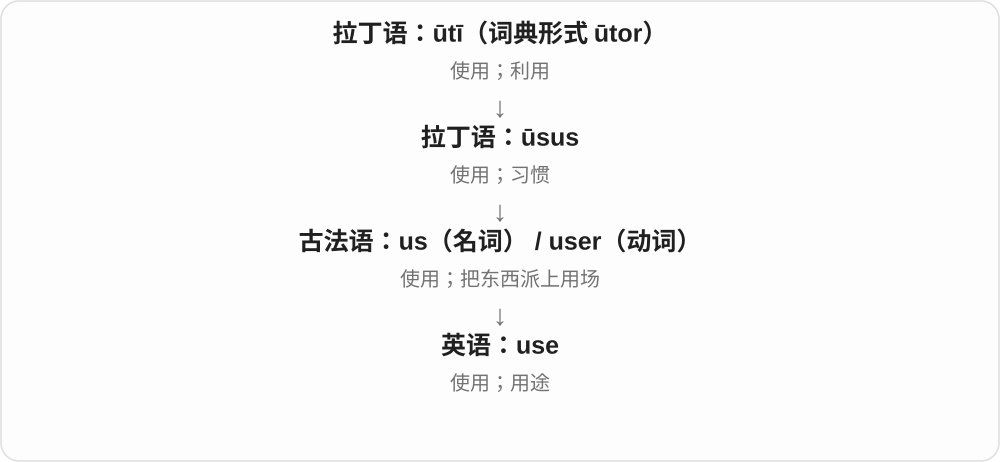

动词说“拿来做事”，名词既可说使用这个动作，也可说用途。put something to good use 就是让它真正帮上忙；be of no use 则是派不上用场。

**常见搭配与例句**

use A to do B；make use of…；the use of…；be of use。used to do 说过去常做；be used to doing 说已经习惯，两者结构不同。

> We used an old box to store the cables.

我们拿一个旧盒子来装电线。

> This tool has several uses, including opening paint cans.

这个工具有几种用途，包括打开油漆罐。

**别混淆**

名词 use 结尾 /s/，动词 /z/。use 可以很中性；use someone 若没有说明合作背景，常有“利用别人”的负面意味。

### 10. useless — 没有用的；派不上用场的

**音标**：/ˈjuːsləs/

**先抓住这个画面**

useless 是“拿它来办这件事，帮不上忙”。手机没电时，很多功能就暂时派不上用场。

**怎么拆**

use + -less；-less 表示缺少。这里缺少的是实际用处。

**怎么变成今天的意思**

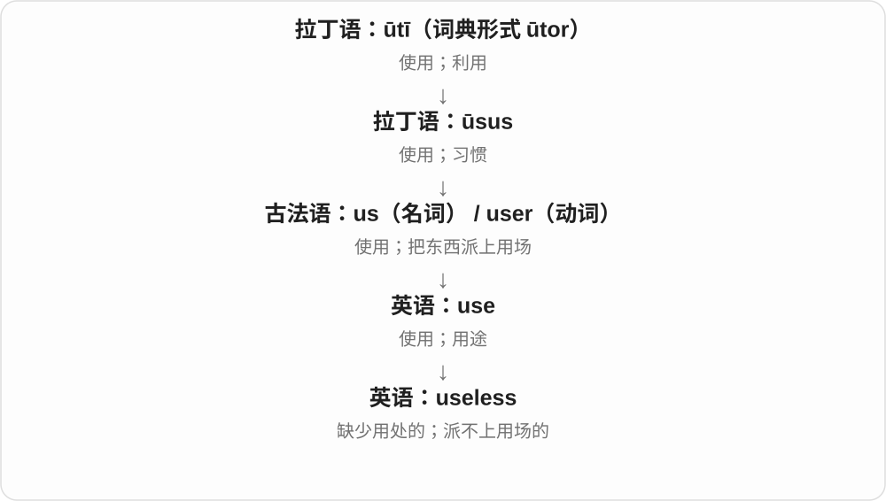

它可以说东西没有作用，也可以说某项努力改变不了结果。This key is useless 可能只是钥匙打不开眼前这把锁，不一定完全坏了。

**常见搭配与例句**

useless for…；useless at doing…；It is useless to argue（争下去没有用）。

> Without the password, the file was useless to us.

没有密码，这个文件对我们来说派不上用场。

> It is useless to blame each other now; we need a solution.

现在互相责怪没有用，我们需要一个解决办法。

**别混淆**

useless 比 not very useful 强得多。用它直接评价人往往很伤人；说“某方法在这个任务中没用”则更具体。

### 11. state — 状态；国家、州；陈述

**音标**：/steɪt/

**先抓住这个画面**

先给事物拍一张“此刻是什么样”的照片：房间的状态、人的处境，都可以用 state。政治中，它又表示有组织的国家或州。

**怎么拆**

整词经法语、拉丁语传入，核心来自 status“所处的状态”。不能拆成英语 s + tate。

**怎么变成今天的意思**

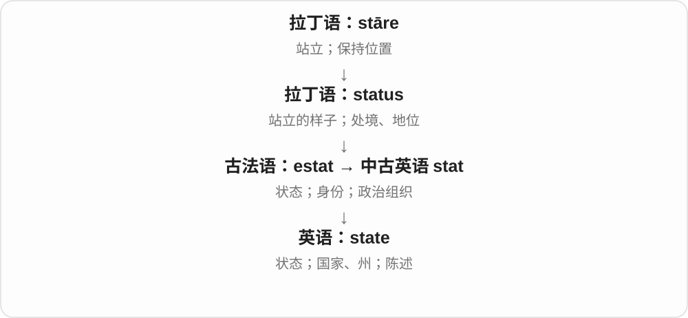

从“站成什么样”到“处于什么状态”，再到社会的组织形态。动词 state 是把情况明确说出来，语气通常比 say 正式。

**常见搭配与例句**

in a good state；a member state；state clearly；state that…。

> The house was in a poor state when we bought it.

我们买下这栋房子时，它的状况很差。

> Please state your reason for applying.

请说明你的申请理由。

**别混淆**

state 常说当前状况；status 更常问身份、级别或进度类别。state a reason 是陈述理由，不是建立国家。

### 12. statement — 声明；陈述；账单、对账单

**音标**：/ˈsteɪtmənt/

**先抓住这个画面**

把要表达的内容正式摆出来，形成一段可以引用、核对的话，就是 statement。银行把账目列出来，也叫 statement。

**怎么拆**

state（陈述）+ -ment（行为或结果）。

**怎么变成今天的意思**

它从“说清楚一件事”扩展到书面的正式记录。衣着作 statement 时，是通过外观表达鲜明态度，不一定说出一句话。

**常见搭配与例句**

issue a statement；a witness statement；a bank statement；make a statement。

> The company issued a statement about the delay.

公司就延误发表了一份声明。

> I checked the charge against my bank statement.

我对照银行对账单核查了这笔收费。

**别混淆**

sentence 是语法上的一句话；statement 是一次陈述或所表达的内容，可能长达几段。

### 13. stating — 陈述、声明；明确写出〔现在分词、动名词〕

**音标**：/ˈsteɪtɪŋ/

**先抓住这个画面**

不只是暗示，让别人自己猜，而是把情况、观点明确说出来或写下来，就是 stating。

**怎么拆**

state 去 e 加 -ing。state 经法语、拉丁 status 所处状态等材料进入英语，动词有把情况、内容明确提出的发展。

**怎么变成今天的意思**

**法语、拉丁 status 等 → 英语 state**  
所处状态等名词材料 → 陈述、规定内容的动词

↓

**state 去 e 加 -ing → stating**  
正在明确说出、写出

stating the facts 陈述事实；stating that 声明、说……；a sign stating the rules 写明规则的牌子。

**常见搭配与例句**

stating the obvious 说显而易见的事；stating your opinion 明确说出观点。

> The letter begins by stating the purpose of the visit.

信的开头明确说明了访问目的。

> I am simply stating what happened.

我只是在陈述发生的事情。

**别混淆**

stating 强调表述明确，不保证说出的内容就正确。statement 是陈述内容或声明的名词；state 的州、状态等名词义也不用于解释每个正在陈述的句子。

### 14. stateless — 无国籍的；不保存会话状态的

**音标**：/ˈsteɪtləs/

**先抓住这个画面**

对人而言，是没有任何国家承认其为国民；对程序而言，是处理一次请求时不依赖保存下来的会话状态。

**怎么拆**

state + -less（没有）。两种用法分别选取 state 的“国家”和“状态”义。

**怎么变成今天的意思**

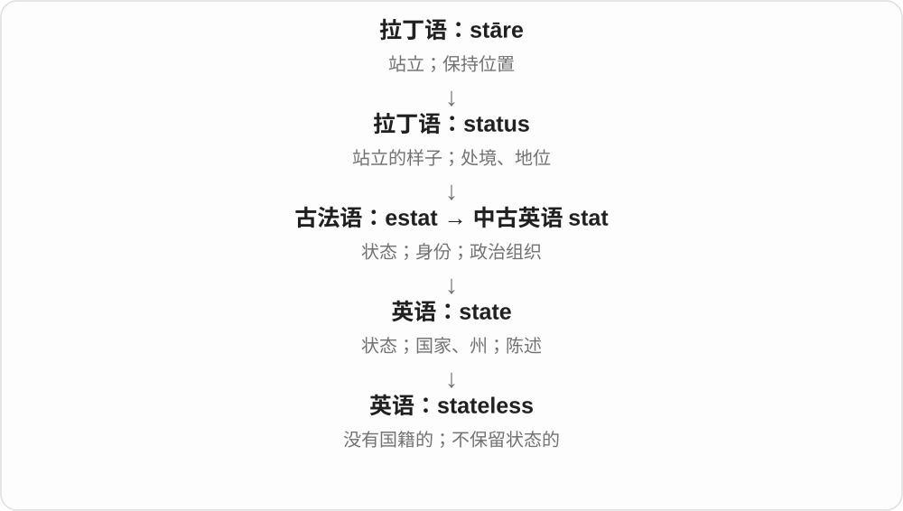

词形相同，应用领域不同。技术中的 stateless 不是世界里完全没有数据，而是特定组件或交互不维持所讨论的状态。

**常见搭配与例句**

a stateless person；stateless people；a stateless service。

> The article describes the difficulties faced by stateless people.

文章介绍了无国籍人士面临的困难。

> Each request can be handled by a different stateless server.

每次请求都可以由不同的无状态服务器处理。

**别混淆**

stateless 不等于 homeless。没有国籍和没有住处是两种不同处境。

### 15. help — 帮助；改善；有帮助

**音标**：/help/

**先抓住这个画面**

一个人搬不动箱子，另一双手过来分担一点，让事情容易完成。

**怎么拆**

来自古英语 help、helpan 等名词动词形式，经中古英语延续。现代过去式 helped；旧本族动词形式并不都照现代规则变化。

**怎么变成今天的意思**

**古英语 help；helpan**  
帮助；帮助这一动作

↓

**中古英语 help／helpen → 英语 help**  
帮助、协助；使情况好转

help someone do 或 help someone to do 都可说帮助做事。This helps 表示这样有用。can’t help doing 是忍不住做，不能按“不能帮助做”直译。

**常见搭配与例句**

help with；help someone do；help yourself to；can’t help laughing。

> Could you help me carry this box?

你能帮我搬这个箱子吗？

> A short break might help you concentrate.

短暂休息可能有助于你集中注意力。

**别混淆**

help someone 是帮人，help oneself to food 是自己取食物。helpful 是带来帮助，不只是“愿意提供帮助”的口头态度。

### 16. helpless — 无助的；无能为力的

**音标**：/ˈhelpləs/

**先抓住这个画面**

事情在眼前发生，你却没有办法改变，也没有力量照顾自己。

**怎么拆**

help + -less，对应缺少帮助或行动能力；中古英语有 helples，相关更早形式属于日耳曼语本族词。

**怎么变成今天的意思**

**古英语 help；helpan**  
帮助；帮助这一动作

↓

**中古英语 help／helpen → 英语 help**  
帮助、协助；使情况好转

↓

**help + -less → helpless**  
得不到帮助或无力应对的

feel helpless 是感到无能为力；a helpless baby 强调需要照料，不是责怪婴儿没用。helpless with laughter 还可说笑得无法控制。

**常见搭配与例句**

feel helpless；a helpless victim；helpless with laughter。

> I felt helpless as I watched the water rise.

看着水位上涨，我感到无能为力。

> The newborn puppy was tiny and helpless.

刚出生的小狗又小又需要照料。

**别混淆**

helpless 强调无法应对，hopeless 强调没有希望，或口语里某方面很差；需要帮助的人不一定没有希望。

### 17. end — 结束；末端；尽头；目的；使结束

**音标**：/end/

**先抓住这个画面**

一根绳子有两端，一段时间走到尾端，一项行动也有想达到的目的。

**怎么拆**

接古英语 ende，经中古英语延续。现代名词与动词都常见，不需要把每种用法再拆成字母片段。

**怎么变成今天的意思**

**古英语 ende → 中古英语 ende**  
边端、尽头、结束

↓

**英语 end**  
末端；结束；目的等

the end of the road 是路尽头，end a meeting 是结束会议，to this end 是为此目的。ends and means 里 ends 说目的，means 说手段。

**常见搭配与例句**

at the end of；in the end；come to an end；to this end。

> The shop is at the end of the street.

商店在街道尽头。

> In the end, we decided to stay.

最后，我们决定留下。

> The two sides agreed to end the dispute.

双方同意结束争端。

**别混淆**

at the end 常指某个末端时点或位置；in the end 常说最终结果。I found it in the end 不是在某个物体底端找到。

### 18. endless — 无尽的；没完没了的

**音标**：/ˈendləs/

**先抓住这个画面**

找不到尽头，或等得太久，主观上像永远不会结束。

**怎么拆**

end + -less，接古英语 endelēas 等形式，-less 表没有终点。

**怎么变成今天的意思**

**古英语 ende → 中古英语 ende**  
边端、尽头、结束

↓

**古英语 endelēas → 英语 endless**  
没有尽头、终点的

an endless road 可是视觉上望不到头；endless questions 常是夸张说问题很多，并不在做数学无穷判断。

**常见搭配与例句**

endless possibilities；an endless wait；endless questions。

> The children asked endless questions.

孩子们问个没完。

> The new tool offers endless possibilities for creative work.

新工具为创作带来了无穷可能。

**别混淆**

endless 在日常常夸张；eternal 偏永恒的概念，continuous 偏持续不中断，不完全等同。

### 19. name — 名字；名称；名声；命名；指明

**音标**：/neɪm/

**先抓住这个画面**

给对象一个能叫得出来的称呼；别人听到这名字想到什么，又形成名声。

**怎么拆**

名词接古英语 nama、noma，动词有 namian 等形式，经中古英语延续。与多种印欧语言的名称词有历史关联，不是现代 na + me。

**怎么变成今天的意思**

**古英语 nama / noma → 中古英语 name**  
姓名、名称

↓

**英语 name**  
名称；名声；命名、指名

name a child 是给孩子起名，name three cities 是说出三个城市名称；a good name 是好名声，in the name of 是以……名义。name someone as ... 也能指定某人担任。

**常见搭配与例句**

by name；in the name of；name after；make a name for oneself。

> What name would you like us to use?

你希望我们怎样称呼你？

> Can you name three cities in Canada?

你能说出三个加拿大城市吗？

> She made a name for herself as a designer.

她作为设计师闯出了名声。

**别混淆**

name 是称呼、名声，title 常是头衔或作品题名；一本书的 name、title 可接近，人的 name 与职位 title 则不同。

### 20. naming — 命名、点名、指明〔现在分词、动名词〕

**音标**：/ˈneɪmɪŋ/

**先抓住这个画面**

给一个东西安上称呼，或把原来泛泛说的人明确指出来，是 naming。既可以给新角色起名，也可以说出某个人是谁。

**怎么拆**

name 名词接古英语 nama、noma，动词有 namian 等形式，经中古英语延续。现代 name 去 e 加完整 -ing，/m/ 和前面的长元音保留。

**怎么变成今天的意思**

**古英语名称名词、命名动词 → name**  
名称 → 命名、指名

↓

**name 去 e + -ing → naming**  
正在起名、点出名称；命名过程

naming a character 给角色起名；naming the winner 公布获胜者姓名；naming conventions 命名惯例。

**常见搭配与例句**

without naming anyone 不点任何人的名；a naming ceremony 命名仪式。

> She enjoyed naming the characters in her story.

她喜欢给自己故事里的角色起名。

> He described the problem without naming anyone.

他描述了问题，却没有点名任何人。

**别混淆**

naming 不只说创造新名字。naming the winner 可以是把获胜者的姓名公开说出，不是重新给他改名。

### 21. nameless — 无名的；未透露姓名的；难以形容的

**音标**：/ˈneɪmləs/

**先抓住这个画面**

名字没有给出，可能根本无名，也可能知道却故意不说。

**怎么拆**

name + -less，接中古英语 nameles。用来修饰 fear 等时还可说难以说清名称的恐惧，不是恐惧没领身份证。

**怎么变成今天的意思**

**古英语 nama / noma → 中古英语 name**  
姓名、名称

↓

**英语 name**  
名称；名声；命名、指名

↓

**name + -less → nameless**  
无名、未指名 → 难以名状

a nameless hero 是无名英雄，remain nameless 是不透露姓名；a nameless fear 是莫名恐惧，强调难以说清恐惧对象。

**常见搭配与例句**

remain nameless；a nameless hero；a nameless fear。

> One colleague, who shall remain nameless, forgot the keys.

一位我就不点名的同事忘带了钥匙。

> The memorial honours nameless workers who built the railway.

纪念碑纪念修建铁路的无名工人。

**别混淆**

nameless 未给出姓名或难命名，anonymous 常强调作者、身份未公开；同一对象可有重叠，但 nameless hero 也可能指被历史遗忘的人。

### 22. thought — 想法；思考；think 的过去式和过去分词

**音标**：英 /θɔːt/；美 /θɔːt/

**先抓住这个画面**

一方面是脑中冒出的念头，一方面是“已经想过”。

**怎么拆**

名词来自古英语 þoht／geþoht，与 þencan 思考同族；动词过去式另有 þohte 等历史形式。现代拼写相同，不能把名词简单说成刚由现代过去式转来。

**怎么变成今天的意思**

**古英语 þoht／geþoht；þohte**  
思考、念头的名词；思考的过去式

↓

**现代 thought**  
名词想法、思考；也是 think 的过去式与过去分词

I had a thought 是我有个想法；give it some thought 是花点心思想想；I thought you knew 是我原以为你知道。a thought 可数地表示一个念头，thought 不可数地表示思考活动。

**常见搭配与例句**

a sudden thought；give something thought；on second thought〔美〕／on second thoughts〔英〕。

> A sudden thought made her stop at the door.

一个突然冒出的念头让她在门口停下。

> Give the offer some thought before you reply.

回复前先考虑一下这个提议。

> I thought you had already left.

我原以为你已经走了。

**别混淆**

thoughtful 的 thought 是名词思考，不是把过去时再加后缀。thought 与 though、through 拼写相近，发音和用法要分别记。

### 23. thoughtless — 欠考虑的；不体贴的

**音标**：英 /ˈθɔːtləs/；美 /ˈθɔːtləs/

**先抓住这个画面**

话或动作先出去了，没替后果和别人多想一下。

**怎么拆**

thought 思考 + -less 缺少；从没仔细考虑，发展为没顾及别人的感受或需要。

**怎么变成今天的意思**

**英语 thought；-less**  
思考；缺少

↓

**thoughtless**  
欠考虑；不顾及他人的

a thoughtless remark 可能只是随口一句，却让别人难堪。它常批评没有用心考虑，不必然指蓄意伤害；不过无心也不意味着对方不会受伤。

**常见搭配与例句**

a thoughtless comment；a thoughtless act；thoughtless of someone。

> It was thoughtless of me to interrupt her.

我打断她，实在欠考虑。

> One thoughtless joke upset the whole table.

一句欠考虑的玩笑让整桌人都不舒服了。

**别混淆**

thoughtless 不等于没有智力。聪明的人也会说欠考虑的话；cruel 更强调残酷，thoughtless 更强调没顾及。

### 24. care — 在意；关心；照料；小心；忧虑

**音标**：英 /keə/；美 /ker/

**先抓住这个画面**

把一件事放在心上：可能挂念它，也可能认真照看它，所以既有温暖也有操心。

**怎么拆**

名词接古英语 caru、ċearu 的忧虑、挂心等义，动词有 carian 等形式；经中古英语延续。不是 car“汽车”加 e。

**怎么变成今天的意思**

**古英语 caru / ċearu；carian → 中古英语 care / caren**  
忧虑、挂心；关照、在意

↓

**英语 care**  
关心、照顾；注意；忧虑

care about someone 是在意某人，care for someone 是照顾，也可表示喜欢；take care 是小心、保重，with care 是仔细地。Would you care for tea? 是礼貌问想喝茶吗。

**常见搭配与例句**

care about；care for；take care of；with care；Who cares?。

> She cares deeply about her students.

她非常关心学生。

> Please handle the old photographs with care.

请小心拿放旧照片。

> Would you care for some tea?

你想喝点茶吗？

**别混淆**

care about 重在乎，care for 可重照料；care for 的喜欢、想要义又需按语境。I don’t care 可能显得冷淡，不能当所有场合的客气随便。

### 25. careless — 粗心的；不够在意的

**音标**：英 /ˈkeələs/；美 /ˈkerləs/

**先抓住这个画面**

不是做不到，而是该看的一眼没看，该核对的一步没核对。

**怎么拆**

care + -less，接古英语 carlēas 等，早有无忧、无挂念等义；现代常指缺少注意，容易出错。

**怎么变成今天的意思**

**古英语 caru / ċearu；carian → 中古英语 care / caren**  
忧虑、挂心；关照、在意

↓

**古英语 carlēas → 中古英语 careles → careless**  
缺少挂心、注意 → 粗心

a careless mistake 是粗心错误，careless with money 是花钱不谨慎，a careless remark 是没考虑后果的随口话。

**常见搭配与例句**

a careless mistake；careless with；careless about。

> A careless mistake changed the final total.

一个粗心错误改变了最后总数。

> He was careless with the borrowed equipment.

他对借来的设备不够爱惜、小心。

**别混淆**

careless 常批评没留心，carefree 常称无忧无虑；无忧的人也可以做事细心，不要把两词都译成不操心。

### 26. point — 点；尖端；要点、意义；分数；指向、指出

**音标**：英、美 /pɔɪnt/

**先抓住这个画面**

针尖落在纸上，只留下一个小点。这个“小而明确的位置”可以在地图上，也可以在话题、时间或比分里。

**怎么拆**

名词合并了古法语 point“小点”和 pointe“尖端”两路；都来自拉丁语 pungere 的 punct- 形式。动词有法语借入与名词转用来源，不是现代英语 p- + oint。

**怎么变成今天的意思**

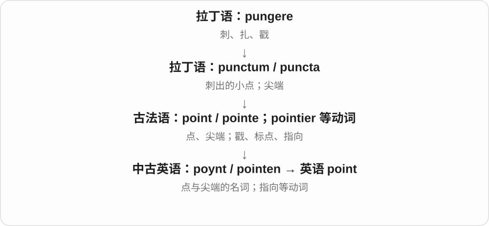

get the point 是抓住要点；What’s the point? 是问做它有什么意义。point at/to 是指向；point out 是指出某件容易忽略的事。point to 证据时还可表示“表明”。

**常见搭配与例句**

make a point；at this point；score a point；point out a mistake。

> The pencil has a sharp point.

这支铅笔的笔尖很尖。

> I understand your point, but I disagree with your conclusion.

我明白你的意思，但不同意你的结论。

> She pointed out a mistake in the total.

她指出了总数中的一个错误。

**别混淆**

dot 偏看得见的小圆点；point 也能是没有大小的数学位置或抽象要点。

### 27. pointless — 没有意义的；徒劳的；没有尖端的

**音标**：英、美 /ˈpɔɪntləs/

**先抓住这个画面**

花了力气，却到不了任何值得去的地方：这件事没有一个有用的“落点”。

**怎么拆**

point + -less“没有”；中古英语已有“无尖端”的形式，现代常用的是没有目的、意义。

**怎么变成今天的意思**

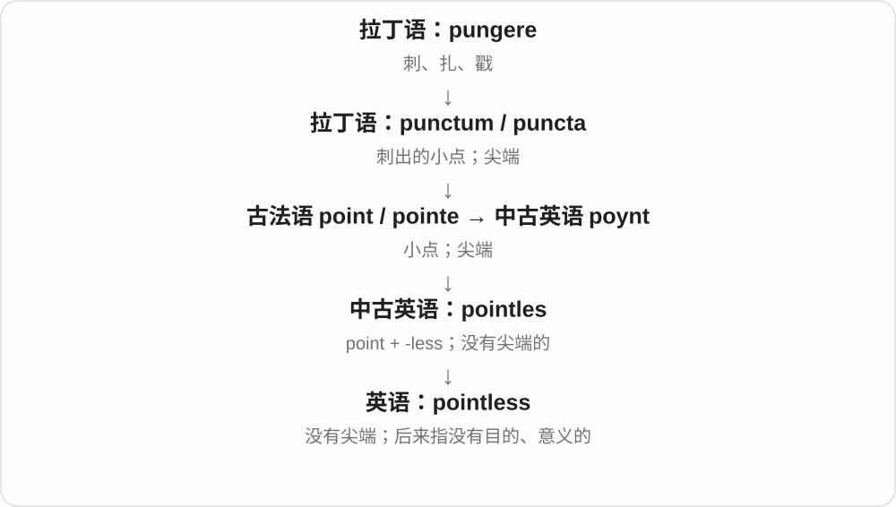

It is pointless to argue 表示争下去不会带来有用结果，不一定是说话题本身不重要。

**常见搭配与例句**

a pointless argument；seem pointless；It is pointless to…。

> It is pointless to print the form if the office only accepts online applications.

如果办公室只收线上申请，把表格打印出来就没有意义。

> We stopped the pointless argument and checked the facts.

我们停止了无谓的争论，去核查事实。

**别混淆**

useless 侧重起不了作用；pointless 常侧重做这件事没有目的或不值得。

### 28. power — 能力；权力；电力、动力；功率；幂；为……供能

**音标**：英 /ˈpaʊə/；美 /ˈpaʊər/

**先抓住这个画面**

power 的共同画面是“让事情动起来、按某个方向发生的力量”：人能作决定，发动机能带动车，电能点亮灯。

**怎么拆**

经法语来自表示“能够”的通俗拉丁语 *potere，与拉丁 potis、posse 同族；英语动词 power 后来由名词转用。不能按现代拼写硬拆出 pot。

**怎么变成今天的意思**

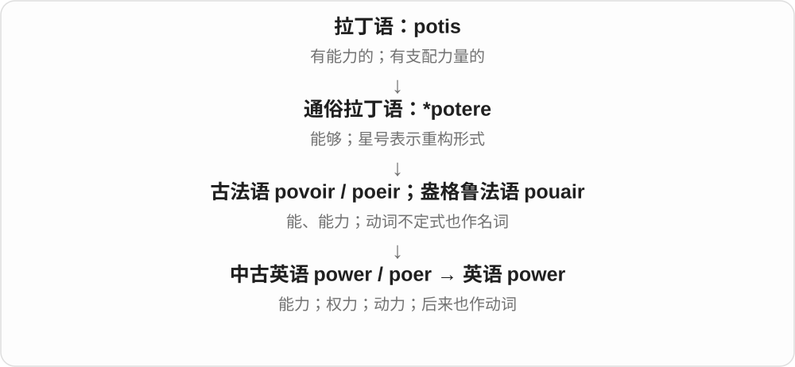

the power to decide 是决定权或决定能力，a power cut 是停电。物理学中 power 是能量转移或做功的快慢，即功率；数学里的 a power 则是幂。power a device 是给设备供能。

**常见搭配与例句**

the power to do；in power；power supply；power consumption；to the power of two。

> The solar panels power the lights in the garden.

太阳能板给花园里的灯供电。

> The committee has the power to reject the proposal.

委员会有权否决这项提议。

> Two to the power of three is eight.

二的三次方是八。

**别混淆**

power 可以指能力、权力或功率；energy 是能量，电池储存多少能量与它能多快输出能量是不同问题。

### 29. powerless — 无力的；无权的；无能为力的

**音标**：英 /ˈpaʊələs/；美 /ˈpaʊərləs/

**先抓住这个画面**

powerless 是看见问题，却没有能改变它的按钮、力量或权限。

**怎么拆**

中古英语 powerles 等形式由 power 加 -less 构成，表示缺乏力量。

**怎么变成今天的意思**

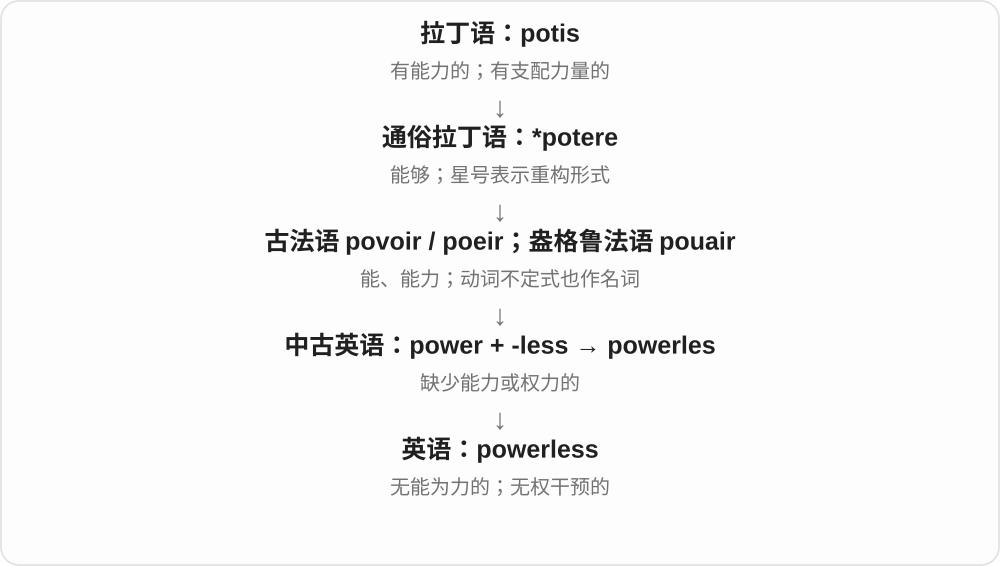

最常见 powerless to do something：想阻止、帮助或改变，却办不到。它描述特定处境，不必是在评价这个人总体没用。

**常见搭配与例句**

feel powerless；be powerless to prevent；powerless against。

> We were powerless to stop the storm from damaging the roof.

我们无法阻止暴风雨损坏屋顶。

> Without access to the account, she felt powerless.

没有账户访问权限，她觉得无能为力。

**别混淆**

helpless 常带需要别人帮助的感觉；powerless 更突出自己缺乏改变事情的力量或权限。

### 30. head — 头；头脑；前端；负责人；朝向；领导

**音标**：/hed/

**先抓住这个画面**

身体的头在上面，队伍的头在前面，组织的头带领大家；同一个位置意象向外展开。

**怎么拆**

接古英语 hēafod，其屈折词干 hēafd- 等经中古英语多种形式发展成 head。不是现代 he + ad 的组合；名词很早就有顶端、领导者等用法。

**怎么变成今天的意思**

**古英语 hēafod / hēafd- → 中古英语 hed / heved 等**  
头；顶端、领头位置

↓

**英语 head**  
头部；前端；负责人；朝向、领导

shake your head 是摇头，head of the team 是团队负责人，head for home 是朝家走。a head 可按人计，如 ten pounds a head；a head of lettuce 是一棵生菜。

**常见搭配与例句**

head for；head a team；at the head of；keep a cool head；per head。

> She shook her head and smiled.

她摇了摇头，笑了。

> He heads a small research team.

他领导一个小型研究团队。

> We headed for the station before sunrise.

日出前我们动身前往车站。

**别混淆**

head 是具体头部也可作领导、方向比喻；brain 侧重脑与思考能力。head for the door 是走向门口，不是用头撞门。

### 31. headless — 无头的；没有负责人或显示界面的

**音标**：/ˈhedləs/

**先抓住这个画面**

一个整体还在，通常位于前端、顶上的“头”却缺了。

**怎么拆**

head + -less，接古英语 hēafodlēas 等。现代技术把显示界面、交互前端类比为头，具体指什么须按系统。

**怎么变成今天的意思**

**古英语 hēafod / hēafd- → 中古英语 hed / heved 等**  
头；顶端、领头位置

↓

**古英语 hēafodlēas → 中古英语 heedles → headless**  
没有头 → 缺少领导、交互前端等

a headless statue 是缺头雕像，a headless browser 是无可见图形界面运行的浏览器；headless 也可形容组织缺少领导。并非电脑没有处理器。

**常见搭配与例句**

a headless statue；a headless browser；a headless system。

> The museum displayed a headless marble statue.

博物馆展出一尊缺头的大理石雕像。

> The test runs in a headless browser.

测试在无可见图形界面的浏览器中运行。

**别混淆**

headless 没有相应头或前端，headstrong 是固执的；共同开头不表示态度都相同。

### 32. job — 工作；任务；岗位；一项处理作业

**音标**：英 /dʒɒb/；美 /dʒɑːb/

**先抓住这个画面**

既可以是长期靠它挣钱的职位，也可以是眼前这一件要做完的活。

**怎么拆**

早期有 jobbe of work“一份工作”等表达，更早来源不确定。与一块、一团或戳、切等词的联系有不同假说，不选一个讲成定论。

**怎么变成今天的意思**

**早期英语 jobbe of work 一类表达**  
一件、一份工作；更早来源不确定

↓

**英语 job**  
任务；有报酬的工作岗位

get a job 找到工作，do a good job 做得好，a repair job 一次修理活，a print job 一项打印作业。job 通常可数。

**常见搭配与例句**

get a job；do a good job；a repair job；a print job；job satisfaction。

> She got a job at the local library.

她在当地图书馆找到了一份工作。

> Cleaning the windows is my job today.

今天擦窗是我的任务。

**别混淆**

job 一份工作、任务通常可数；work 一般劳动、工作量常不可数。a lot of work 与 several jobs 可以同时成立。

### 33. jobless — 没有工作的；失业的

**音标**：英 /ˈdʒɒbləs/；美 /ˈdʒɑːbləs/

**先抓住这个画面**

眼下没有工作岗位；与只是今天休假、不用上班的状态分开。

**怎么拆**

job + -less（没有），形容缺少工作、就业岗位的状态。

**怎么变成今天的意思**

**早期英语 jobbe of work 一类表达**  
一件、一份工作；更早来源不确定

↓

**英语 job**  
任务；有报酬的工作岗位

↓

**job + -less → jobless**  
没有工作、处于失业状态的

jobless workers 失业劳动者，the jobless 失业人群。新闻统计的具体口径由材料交代，不能从词本身推统一身份资格。

**常见搭配与例句**

jobless workers；the jobless；remain jobless。

> He remained jobless for several months.

他有几个月一直没找到工作。

> The program helps jobless workers develop new skills.

项目帮助失业者培养新技能。

**别混淆**

jobless 没工作，与 off work 休假、暂不工作不同；在放年假的人并不因此 jobless。

### 34. law — 法律；法规；法学；规律、定律

**音标**：/lɔː/

**先抓住这个画面**

人们把规则定下来，作为共同遵守、判断事情的依据；科学里也借来称稳定规律。

**怎么拆**

古英语 lagu 借自古诺尔斯语 lǫg，后者原是 lag“放置、层次”等词的复数，抓“确立下来的规则”。law 与拉丁 lēx 来的 legal 意思相关，来路不同。

**怎么变成今天的意思**

**古诺尔斯语 lǫg → 古英语 lagu**  
原意为放下、确立的事物 → 法、规章

↓

**中古英语 lawe → 英语 law**  
法律、规则、定律

the law 法律体系，a law 一条法律；study law 学法学。the laws of physics 是物理定律，不是议会制定的法案。

**常见搭配与例句**

by law；break the law；study law；a law of nature。

> She decided to study law at university.

她决定在大学学法学。

> The novel imagines a society with very different laws.

小说设想了一个法律很不一样的社会。

**别混淆**

law 法律或规律，rule 规则范围更广；并非家里每条 rule 都是国家法律。law 和 legal 不能只按相同中文就视作现代派生。

### 35. lawless — 无法无天的；缺乏法治秩序的

**音标**：/ˈlɔːləs/

**先抓住这个画面**

规则像管不住人，暴力、犯罪或任意行事成了常态。

**怎么拆**

law + -less（缺少），中古英语有 laweles；常说没有法律约束、无视法律的状态。

**怎么变成今天的意思**

**古诺尔斯语 lǫg → 古英语 lagu**  
原意为放下、确立的事物 → 法、规章

↓

**中古英语 lawe → 英语 law**  
法律、规则、定律

↓

**law + -less → lawless**  
缺乏法律约束、秩序的

a lawless region 是秩序混乱的地区，lawless behavior 是无法无天的行为。多带强烈负面评价，不只是某条规则技术性不适用。

**常见搭配与例句**

a lawless region；lawless behavior；a lawless society。

> The film is set in a lawless frontier town.

电影背景是一个无法无天的边境小镇。

> Residents were tired of the gangs’ lawless behavior.

居民受够了帮派无法无天的行为。

**别混淆**

lawless 常描述整体秩序或态度，unlawful 常判断特定行为不合法；一件 unlawful act 不等于整个地区都是 lawless。

### 36. face — 脸；表面；面对

**音标**：/ˈfeɪ̯s/

**先抓住这个画面**

想象你转过身，把脸朝向一个人。face 可以是这张脸，也可以是物体朝外的一面；作动词，就是把自己放到问题面前。

**怎么拆**

整体借自法语，不拆成 fa + ce。拉丁语 faciēs 与 facere 可能有更深联系，但不能画成已确定的父子关系。

**怎么变成今天的意思**

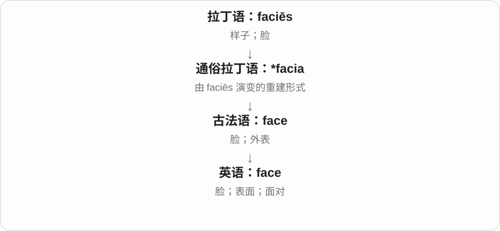

由人的外貌扩展到钟面、山崖面；再从朝向某物发展出面对困难。face the facts 就是承认事实已经摆在眼前。

**常见搭配与例句**

face a problem；the face of a clock；save face（保全面子）。

> Her face lit up when she saw the puppy.

看到小狗时，她脸上露出了喜色。

> We need to face the problem together.

我们得一起面对这个问题。

**别混淆**

face 作“面对”时直接接对象；be faced with 才需要 with。

### 37. faceless — 身份模糊的；没有鲜明个性的

**音标**：/ˈfeɪsləs/

**先抓住这个画面**

隔着一层层表格，你只看见机构规则，看不见具体负责人：faceless 常用来描绘这种匿名、疏离的感觉。

**怎么拆**

face + -less（没有），英语派生。

**怎么变成今天的意思**

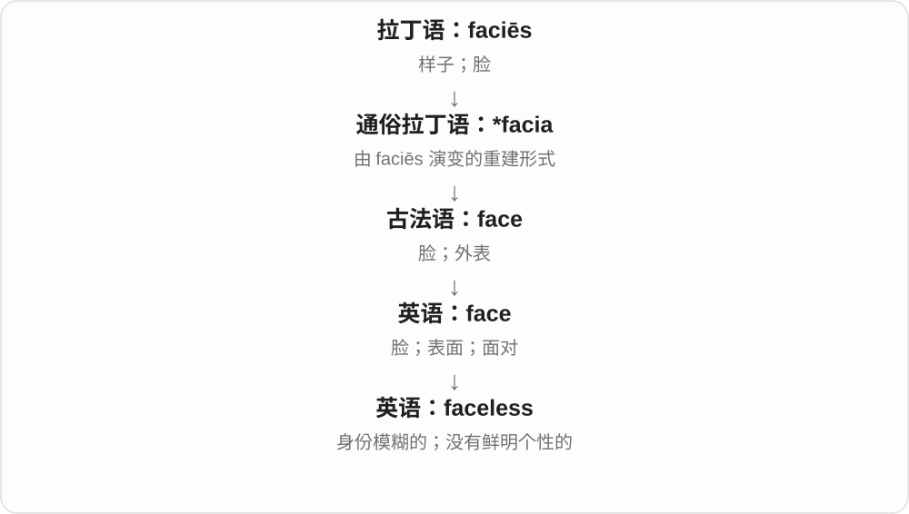

没有脸的字面意象扩展为没有可辨认身份、没有个人温度。一般不是说某个人真的没有五官。

**常见搭配与例句**

a faceless bureaucracy；faceless officials；a faceless crowd。

> She felt trapped in a faceless bureaucracy.

她觉得自己困在一个看不见具体负责人的官僚体系里。

> The film gives a voice to people who are often treated as a faceless crowd.

电影让那些常被视作模糊人群的人发出了自己的声音。

**别混淆**

anonymous 侧重姓名未知；faceless 往往还带冷漠、缺乏个性的感受。

### 38. hope — 希望；盼望；带来希望的人或事物

**音标**：英 /həʊp/；美 /hoʊp/

**先抓住这个画面**

事情还没定，但心里盼着好结果，也觉得不是完全没可能。

**怎么拆**

动词接古英语 hopian、中古英语 hopen；名词也有相应古英语历史。更早来源不确定，不把 hope“希望”编成 hop“跳跃”加 e。

**怎么变成今天的意思**

**古英语 hopian → 中古英语 hopen**  
希望、期待

↓

**英语 hope〔相应名词也有古英语前身〕**  
希望；抱有实现可能的愿望

hope to do 盼望做，hope that 希望某事成真，hope for a chance 盼机会。hoping 去掉 e，hopping 双写 p，分别是希望和跳跃的分词。

**常见搭配与例句**

hope to；hope that；hope for；give up hope；I hope so。

> I hope we can meet again soon.

希望我们很快能再见。

> The letter gave her new hope.

那封信给了她新的希望。

**别混淆**

hope 常面向希望有可能成真的事；wish 还常说与现实相反的愿望，如 I wish I knew。不能一律按中文希望换。

### 39. hopeless — 没有希望的；无望的；很不擅长的〔口语〕

**音标**：英 /ˈhəʊpləs/；美 /ˈhoʊpləs/

**先抓住这个画面**

看不见好结果，或夸张说自己做某事怎么都做不好。

**怎么拆**

hope + -less（没有），e 保留；与 hopeful 的 -ful 形成相反方向。

**怎么变成今天的意思**

**古英语 hopian → 中古英语 hopen**  
希望、期待

↓

**英语 hope〔相应名词也有古英语前身〕**  
希望；抱有实现可能的愿望

↓

**hope + -less → hopeless**  
无希望、没有成功前景的

a hopeless situation 无望处境，feel hopeless 感到绝望；hopeless at directions 是方向感太差，日常常有夸张、自嘲。

**常见搭配与例句**

a hopeless situation；feel hopeless；hopeless at；a hopeless romantic。

> I am hopeless at remembering directions.

我记路线实在不行。

> The situation looked hopeless at first.

起初，形势看起来毫无希望。

**别混淆**

hopeless at cooking 常是口语说很不擅长，不是对人生永久下结论；helpless 则是无助、无能为力。

### 40. mind — 头脑；心意；介意；留心；照看

**音标**：/maɪnd/

**先抓住这个画面**

把事情装在心里：能思考、会记住，也会在意、留意。

**怎么拆**

接古英语 mynd、ġemynd 的记忆、思想词族，经中古英语 minde 等延续。不是 mine 我的多一个 d。

**怎么变成今天的意思**

**古英语 mynd / ġemynd → 中古英语 minde**  
记忆、思想、留在心里的东西

↓

**英语 mind**  
头脑、心意；在意、留心、照看

change your mind 改主意，keep in mind 记住，mind the step 小心台阶，mind a child 照看孩子。Do you mind...? 常礼貌问是否介意。

**常见搭配与例句**

change one’s mind；keep in mind；mind the gap；Do you mind ...?。

> Please keep the deadline in mind.

请记着截止时间。

> Do you mind if I open the window?

我开窗你介意吗？

**别混淆**

mind 和 brain 可都译脑，但 brain 偏器官或脑力，mind 偏思想、意识、心意；mind your bag 是留意包，不是给包一个大脑。

### 41. mindless — 不动脑的；无意义的；无谓的

**音标**：/ˈmaɪndləs/

**先抓住这个画面**

动作像自动播放，脑子没参与；或行为根本看不出合理目的。

**怎么拆**

mind + -less，古英语有 myndlēas、ġemyndlēas，中古英语有 myndles 等形式。-less 表缺少思想、注意等，不代表人的脑器官不存在。

**怎么变成今天的意思**

**古英语 mynd / ġemynd → 中古英语 minde**  
记忆、思想、留在心里的东西

↓

**英语 mind**  
头脑、心意；在意、留心、照看

↓

**mind + -less；旧词形延续**  
缺乏思考、意义或注意的

mindless repetition 机械重复，mindless violence 无谓暴力，mindless entertainment 不费脑的娱乐。最后一种可只是放松，也可能是嫌肤浅。

**常见搭配与例句**

mindless repetition；mindless violence；mindless entertainment。

> The job involved hours of mindless repetition.

这项工作需要连续几小时机械重复。

> They wanted some mindless entertainment after the exam.

考试后，他们想看点不用动脑的娱乐。

**别混淆**

mindless 不动脑或没意义，mindful 留意；mindless task 可说不需太多思考的任务，不是在侮辱所有做这任务的人。

### 42. heart — 心脏；内心、感情；勇气；中心

**音标**：英 /hɑːt/；美 /hɑːrt/

**先抓住这个画面**

身体里跳动的心脏，语言里也常被用来放置感情、勇气和真正在意的事。

**怎么拆**

继承古英语 heorte，经中古英语发展。许多内心、勇气、记忆的比喻在旧英语里已存在，并非现代才由泵血功能推出来。

**怎么变成今天的意思**

**古英语 heorte → 中古英语 herte**  
心脏；也已有情感、意志、勇气等用法

↓

**英语 heart**  
心脏；感情、内心、勇气；事物的中心

a heart beats 心脏跳动；at the heart of 在核心；lose heart 灰心，take heart 振作。learn by heart 是记住、背熟，保留了把记忆放在心中的旧观念。

**常见搭配与例句**

by heart；at heart；lose heart；take heart；from the heart；at the heart of。

> The old market lies at the heart of the town.

老市场位于小城中心。

> Don’t lose heart after one difficult day.

别因为一天不顺就灰心。

> She knows the whole poem by heart.

她能把整首诗背下来。

**别混淆**

heart 在比喻里指内心，不说明生理心脏负责所有思考。heart 与 hard /d/ 的末辅音也要分清。

### 43. heartless — 无情的；冷酷的

**音标**：英 /ˈhɑːtləs/；美 /ˈhɑːrtləs/

**先抓住这个画面**

不是缺少器官，而是行动里看不到对别人的体谅。

**怎么拆**

heart + -less。旧英语对应词曾有缺乏勇气、没精打采等义；现代常用无情、缺少同情的意思。不要只按最旧义替换今天的词义。

**怎么变成今天的意思**

**古英语 heorte → 中古英语 herte**  
心脏；也已有情感、意志、勇气等用法

↓

**英语 heart**  
心脏；感情、内心、勇气；事物的中心

↓

**旧英语 heortlēas → heartless**  
旧有缺乏勇气等义；现代常指缺少同情、无情

a heartless remark 无情的话，a heartless decision 冷酷决定。常是说话人对态度、行为的强烈道德评价。

**常见搭配与例句**

a heartless comment；a heartless act；seem heartless。

> It seemed heartless to joke about her loss.

拿她遭受的损失开玩笑，显得很无情。

> The novel’s villain makes a heartless decision to abandon his friends.

小说中的反派冷酷地决定抛弃朋友。

**别混淆**

heartless 不等于 merely quiet 安静或 reserved 矜持；少说话不自动等于没有同情心。

### 44. child — 孩子；子女

**音标**：/tʃaɪld/

**先抓住这个画面**

一种是年龄还小的人，一种是父母眼里的儿女：后者长大了也还是 someone’s child。

**怎么拆**

接古英语 ċild，是英语本族继承词。更远可联系古日耳曼语的孩子、胎儿等词族，但不能按现代拼写随便拆 ch + ild。复数 children 是历史保留形式。

**怎么变成今天的意思**

**古英语 ċild → 中古英语 child**  
孩子、子女

↓

**现代英语 child；复数 children**  
小孩；不论年龄的某人的子女

a young child 小孩，an adult child 成年子女；an only child 独生子女。child 在具体制度里的年龄界限要看该制度，不由词本身统一规定。

**常见搭配与例句**

an only child；a child of ten；adult children；as a child。

> I loved drawing when I was a child.

我小时候很喜欢画画。

> Their children are all adults now.

他们的子女现在都已成年。

**别混淆**

child 单数，children 复数，不写 childs；childhood 是童年这段时期，不是孩子的集合。

### 45. childless — 没有子女的

**音标**：/ˈtʃaɪldləs/

**先抓住这个画面**

只说一个人或家庭没有孩子，不用这个词就能判断原因或心情。

**怎么拆**

child + -less 没有……的，中古英语已有相应形式。它说明有无子女，不说明选择、生育能力或法律关系的具体原因。

**怎么变成今天的意思**

**古英语 ċild → 中古英语 child**  
孩子、子女

↓

**现代英语 child；复数 children**  
小孩；不论年龄的某人的子女

↓

**child + -less → childless**  
孩子 → 没有子女的

a childless couple 没有子女的伴侣；remain childless 一直没有子女。是否自愿、是否遗憾，需要上下文补充。

**常见搭配与例句**

a childless couple；remain childless；childless adults。

> The novel follows a childless couple living in a small town.

小说讲述了一对没有子女、住在小镇的伴侣。

> The survey included parents and childless adults.

调查包括有子女者和没有子女的成年人。

**别混淆**

childless 没有子女，不等于 childish 幼稚。日常 childfree 常强调主动选择不生育，但不能据此替所有人推断个人想法。

### 46. self — 自我；本人、自己这一身份或状态

**音标**：/self/

**先抓住这个画面**

说某人真实的性格、平常状态，或把目光回到那个人本身，就会谈到 self。her old self 是她原先熟悉的那种状态。

**怎么拆**

延续古英语 self、sylf 等本人、相同、自己的材料。旧时可跟在人称词后面加强本人义，后来形成 myself、herself 等反身、强调形式。复数 selves。

**怎么变成今天的意思**

**古英语 self、sylf**  
本人、自己的、同一个

↓

**现代 self；myself 等**  
自我；反身、强调的复合词材料

a sense of self 自我感；your true self 真实自我；be your old self 恢复平常的状态。

**常见搭配与例句**

a sense of self；her true self。

> After a good night’s sleep, she felt like her old self again.

睡好一晚后，她又恢复了平常的状态。

> The story explores the character’s sense of self.

故事探索角色的自我感。

**别混淆**

self 可作名词谈自我；普通句子里我自己常用 myself。I taught myself 是我自学，不能直接写 I taught self 来替换。

### 47. selfless — 无私的；为别人着想的

**音标**：/ˈselfləs/

**先抓住这个画面**

做决定时把别人的需要放在前面，不只盘算自己能得什么，这种付出可以说 selfless。

**怎么拆**

self 自己 + -less 无、少；现代固定为不以自己利益为中心的性质，不是说一个人没有身份。

**怎么变成今天的意思**

**self + -less → selfless**  
不以自身私利为中心

↓

**现代 selfless**  
愿意为他人付出的、无私的

a selfless act 无私举动；selfless service 无私服务；selfless devotion 无私奉献。

**常见搭配与例句**

a selfless act；selfless service。

> It was a selfless act that helped the whole group.

那是帮助全组人的无私举动。

> She is admired for her selfless service.

她因无私服务而受到敬重。

**别混淆**

selfless 无私与 selfish 自私方向相反；selfless 评价动机、付出，quiet 安静并不能说明同样的品质。

### 48. price — 价格；代价；给……定价

**音标**：/praɪs/

**先抓住这个画面**

给一个东西贴上交换条件：要付多少，或者要牺牲什么。

**怎么拆**

古法语 pris / preis 接拉丁 pretium，经中古英语传入；早期价值、奖赏等意思后来逐渐分开。

**怎么变成今天的意思**

**拉丁 pretium**  
价格、价值、报酬

↓

**古法语 pris / preis → 中古英语 price**  
价格；价值；奖赏

↓

**现代英语 price**  
价格；标价；代价

the price of bread 是面包价格；the price of success 可以是成功所付出的代价。price 作动词是给东西定价，不是买下它。

**常见搭配与例句**

at a low price；the price of；price something at。

> The price of the ticket includes a meal.

票价包含一顿饭。

> They priced the used bicycle at fifty pounds.

他们把那辆二手自行车定价为五十英镑。

> He achieved his goal at the price of many sleepless nights.

他以许多个不眠之夜为代价，实现了目标。

**别混淆**

cost 还可说生产或获得东西所耗费的成本；price 常是卖方标出的成交条件。

### 49. priceless — 无价的；极珍贵的；妙不可言的〔口语〕

**音标**：/ˈpraɪsləs/

**先抓住这个画面**

不是价格为零，而是珍贵到很难用价钱标出来。

**怎么拆**

price + -less，字面没有价格，常指不能用普通价格衡量。

**怎么变成今天的意思**

**拉丁 pretium**  
价格、价值、报酬

↓

**古法语 pris / preis → 中古英语 price**  
价格；价值；奖赏

↓

**现代英语 price**  
价格；标价；代价

↓

**英语 price + -less → priceless**  
难以定价 → 极珍贵；非常精彩

a priceless manuscript 是极珍贵的手稿；His expression was priceless 可以说表情实在太精彩、太好笑。不要把 -less 机械理解成没有价值。

**常见搭配与例句**

a priceless treasure；priceless advice；a priceless expression。

> The archive contains priceless historical documents.

档案馆收藏着极珍贵的历史文献。

> The look on his face when the puppy appeared was priceless.

小狗出现时，他脸上的表情真是太精彩了。

**别混淆**

worthless 是没价值的，几乎与 priceless 的常用意思相反。

### 50. rest — 休息；安静、停下；支托；另有剩下的部分义

**音标**：/rest/

**先抓住这个画面**

休息是一时停住活动；剩余则是拿走一部分后还留着。两条来路分别记，不强编同一故事。

**怎么拆**

休息名词、动词接古英语 ræst、restan；其余、留下义经法语来自拉丁语 restāre。现代部分用法交叠，但 the rest 不能简单解释成睡觉的人。

**怎么变成今天的意思**

**两条来路：古英语 ræst、restan；拉丁语 restāre 经法语 reste、rester**  
前者休息、安静、支撑；后者留下、剩余

↓

**英语同形 rest**  
休息、支托；另一支为其余、剩下的部分；部分动词用法后来交叠

take a rest 休息一下，rest your arm 把手臂放下休息；the rest of the day 这一天剩余时间，the rest of us 我们其余的人。rest on evidence 也可说建立在证据上。

**常见搭配与例句**

take a rest；at rest；the rest of；rest on；rest assured。

> Let’s take a rest before the next climb.

下次攀爬前，我们休息一下吧。

> I read for the rest of the afternoon.

下午余下的时间，我都在看书。

> The rest of the guests are arriving later.

其余客人稍后到。

**别混淆**

the rest 后动词随所指对象：the rest of the water is，the rest of the people are；休息与睡觉也不完全一样。

### 51. restless — 静不下来的；不安的；辗转难眠的

**音标**：/ˈrestləs/

**先抓住这个画面**

身体想动、心里安不下来，或总觉得现在的状态不满足。

**怎么拆**

rest 休息、安静 + -less，没有……的，旧有无法休息、不安的相关用法，后来也常说渴望活动、改变。

**怎么变成今天的意思**

**两条来路：古英语 ræst、restan；拉丁语 restāre 经法语 reste、rester**  
前者休息、安静、支撑；后者留下、剩余

↓

**英语同形 rest**  
休息、支托；另一支为其余、剩下的部分；部分动词用法后来交叠

↓

**rest + -less → restless**  
休息、安静 → 得不到安宁、静不下来

restless children 坐不住的孩子；a restless night 辗转难眠的一夜；restless for change 渴望变化。未必每次都因为害怕。

**常见搭配与例句**

a restless night；feel restless；restless energy；grow restless。

> The children grew restless during the long wait.

漫长等待中，孩子们渐渐坐不住了。

> After a restless night, she welcomed a quiet morning.

辗转难眠一夜后，她很珍惜安静的清晨。

**别混淆**

restless 静不下，不等于 simply energetic 精力旺盛；前者常带不安、不满足或难以休息感。

### 52. sense — 感觉；意义；判断力；察觉

**音标**：/sens/

**先抓住这个画面**

外界信息进来，你不只接收到，还开始理解：闻到气味、感觉不对、听懂一句话，sense 都能参与。

**怎么拆**

主要经法语 sens 来自拉丁语 sēnsus，与 sentīre“感受”相连；法语词义还受到日耳曼语“理解、方向”词族影响。

**怎么变成今天的意思**

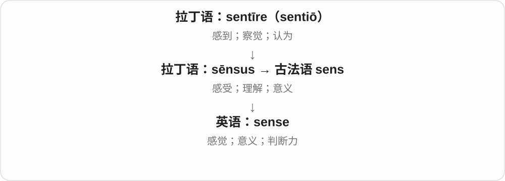

“感受到”扩展为理解和判断，因此 make sense 是说得通，common sense 是常识判断。不要每次都只译成感官感觉。

**常见搭配与例句**

a sense of smell；make sense；common sense；sense danger。

> This explanation makes sense to me.

这个解释我能理解，也觉得说得通。

> She sensed that something was wrong.

她察觉到有些不对劲。

**别混淆**

sensation 更像一次具体感受；sense 还可以是能力、意义或理智判断。

### 53. senseless — 无意义的；不明智的；失去知觉的

**音标**：/ˈsensləs/

**先抓住这个画面**

有两幅画面：行为找不到合理理由，或一个人暂时失去了感觉与知觉。

**怎么拆**

sense + -less（没有），分别否定 sense 的道理义与知觉义。

**怎么变成今天的意思**

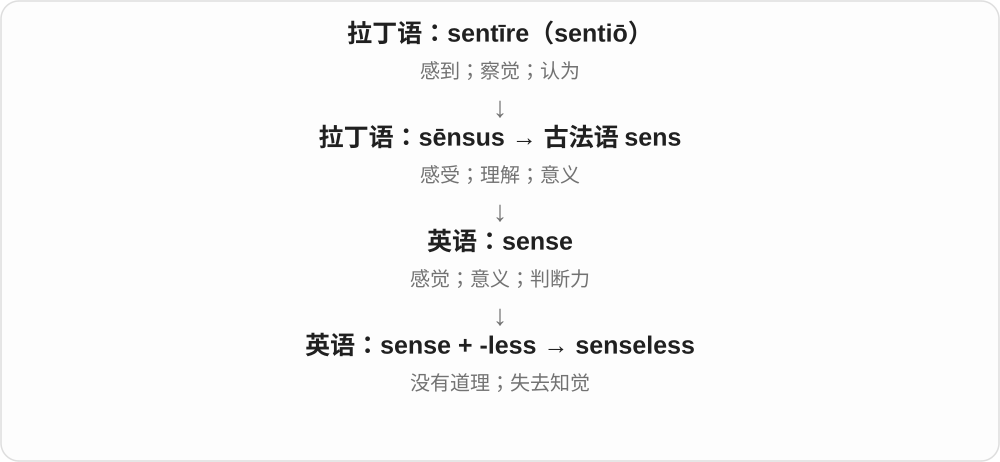

senseless waste 说浪费没有意义；knocked senseless 则是被打得失去知觉。不要把后者解释成“变笨了”。

**常见搭配与例句**

senseless violence；a senseless waste；knock someone senseless。

> The damage was a senseless waste of public resources.

这种破坏是对公共资源毫无意义的浪费。

> The blow knocked him senseless.

那一击把他打得失去了知觉。

**别混淆**

insensitive 常是不顾别人感受；senseless 常是行为无道理或失去知觉，否定的对象不同。

### 54. worth — 值……；值得；价值

**音标**：英 /wɜːθ/；美 /wɜːrθ/

**先抓住这个画面**

拿花费、时间或代价来衡量，所得够不够抵得上；也可以直接说一个东西有什么价值。

**怎么拆**

由古英语 weorþ 有价值、相称等义延续。不是现代 work 少了一个音；名词和后接金额、动作的常用结构分别记。

**怎么变成今天的意思**

**古英语 weorþ → 中古英语 worth**  
有价值、相称、值得的

↓

**现代 worth 词族**  
金钱价值、实际用途；值得某种待遇、投入

worth ten pounds 值十英镑，worth reading 值得读；the worth of an idea 想法的价值，a week’s worth of food 一周所需的食物量。

**常见搭配与例句**

be worth doing；be worth the effort；for what it’s worth；a day’s worth of。

> The museum is worth visiting.

这家博物馆值得参观。

> The repair cost more than the chair was worth.

修理费用比椅子本身的价值还高。

**别混淆**

常说 The book is worth reading，不说 worth to read；worth it 是值得付出这份代价，不必每次指出具体金额。

### 55. worthless — 没有价值的；无用的

**音标**：英 /ˈwɜːθləs/；美 /ˈwɜːrθləs/

**先抓住这个画面**

按当前用途或交易情境看，派不上用场、值不了钱；不等于从宇宙中证明它永远毫无意义。

**怎么拆**

worth 价值 + -less 没有，古英语已有 weorþlēas 等旧形式。它往往是一种语境中的评价，不能只按价格等同所有价值。

**怎么变成今天的意思**

**古英语 weorþ → 中古英语 worth**  
有价值、相称、值得的

↓

**现代 worth 词族**  
金钱价值、实际用途；值得某种待遇、投入

↓

**worth + -less → worthless**  
价值 → 无价值、无用的

a worthless ticket 无效、无用的票，worthless information 毫无用处的信息；形容人时是很重的贬低，不是中性身份。

**常见搭配与例句**

worthless information；a worthless document；become worthless。

> Without the missing page, the instructions were almost worthless.

缺了那页，说明书几乎派不上用场。

> The old ticket was now worthless.

那张旧票现在已经毫无用处。

**别混淆**

worthless 无价值，priceless 无价、珍贵，虽然都带价格否定联想，常用意义相反。

### 56. hair — 头发；毛发；一根头发

**音标**：英 /heə/；美 /her/

**先抓住这个画面**

说整头头发时通常当一片整体，说掉下来的一根时才可以数一根、两根。

**怎么拆**

继承古英语 hǣr，日耳曼语中的古老毛发词。现代不可数与可数用法并存，取决于整体还是单根。

**怎么变成今天的意思**

**古英语 hǣr → 中古英语 her、heer → hair**  
头发、毛发

↓

**现代 hair 词族**  
毛发集合与单根；护理、造型、发际线和细如发丝的比喻

long hair 长发，a hair 一根头发，wash your hair 洗头；split hairs 是在细枝末节上较真。

**常见搭配与例句**

long hair；wash your hair；a strand of hair；split hairs。

> She has thick, curly hair.

她头发浓密卷曲。

> I found a grey hair on my jacket.

我在夹克上发现一根灰白头发。

**别混淆**

She has long hair 不把整体长发说成 long hairs；I found a hair in the soup 是一根。hair 与 hare 野兔同音不同词。

### 57. hairless — 无毛的；没有毛发的

**音标**：英 /ˈheələs/；美 /ˈherləs/

**先抓住这个画面**

某个身体部位或动物表面没有明显毛发，重点是缺少这一层毛。

**怎么拆**

hair + -less 没有，构成无毛形容词。范围看对象，不一定整只动物、整个人完全没有任何毛。

**怎么变成今天的意思**

**古英语 hǣr → 中古英语 her、heer → hair**  
头发、毛发

↓

**现代 hair 词族**  
毛发集合与单根；护理、造型、发际线和细如发丝的比喻

↓

**hair + -less → hairless**  
没有毛发的

hairless skin 无毛皮肤，a hairless cat 无毛猫；相对描述不等于所有物种都真的零根毛。

**常见搭配与例句**

hairless skin；a hairless cat；a hairless patch。

> The cat has nearly hairless skin.

这只猫的皮肤几乎没有毛。

> A small hairless patch appeared on the dog’s leg.

狗腿上出现了一小块无毛区域。

**别混淆**

bald 常说头顶秃或局部不长毛，hairless 更直接泛说缺毛；两者在部分语境重合。

### 58. voice — 嗓音；发言权；表达意见；语态

**音标**：/vɔɪs/

**先抓住这个画面**

嘴里发出的声音是 voice；声音背后有想法，所以它又能表示“让别人听到我的意见”。

**怎么拆**

经法语 voiz／vois 接拉丁 vox 的宾格 vocem。动词 voice 由英语名词转成，表示把想法说出来。不要把词尾 -ice 当成独立后缀。

**怎么变成今天的意思**

**拉丁 vox，词干 voc-，宾格 vocem**  
声音、话语；与 vocare“呼唤”同族

↓

**古法语／盎格鲁法语 voiz、vois → 中古英语 voice、voys**  
声音、话语

↓

**英语 voice，另由名词形成动词**  
嗓音；表达意见的渠道；说出、表达

a soft voice 是轻柔的嗓音；have a voice in a decision 是能参与发言、影响决定。voice concerns 是说出顾虑。语法中的 active/passive voice 指主动、被动语态，不是音量。

**常见搭配与例句**

raise one’s voice；have a voice in；voice concerns；the passive voice。

> I recognized her voice before I saw her.

还没看见她，我就听出了她的声音。

> The staff want a voice in the decision.

员工希望在这项决定中有发言权。

> Several parents voiced concerns about the new timetable.

几位家长表达了对新时间表的担忧。

**别混淆**

sound 包括机器、风雨等各种声音；voice 通常指人或动物的发声，也可比喻某种群体或作者的表达。

### 59. voiceless — 无声的；没有发言权的；清音的

**音标**：/ˈvɔɪsləs/

**先抓住这个画面**

社会语境里是“想说却没人听”；语音学里则是发音时声带不作周期性振动。清音仍然可以很响。

**怎么拆**

英语 voice + -less，表示缺少 voice；语音学用 voice 的“声带振动”义，不能照字面理解为完全没有声音。

**怎么变成今天的意思**

**拉丁 vox，词干 voc-，宾格 vocem**  
声音、话语；与 vocare“呼唤”同族

↓

**古法语／盎格鲁法语 voiz、vois → 中古英语 voice、voys**  
声音、话语

↓

**英语 voice，另由名词形成动词**  
嗓音；表达意见的渠道；说出、表达

↓

**英语 voice + -less → voiceless**  
无嗓音或无发言权；发音时声带不振动的

voiceless people 可指意见被忽视的人。/s/ 是典型的清音，能听见气流摩擦声；所以 voiceless consonant 不是“哑掉的辅音”。

**常见搭配与例句**

a voiceless consonant；give a voice to the voiceless；feel voiceless。

> The sound /s/ is a voiceless consonant.

/s/ 是一个清辅音。

> The project gives a platform to people who have long felt voiceless.

这个项目给长期觉得没有发言权的人提供了表达平台。

**别混淆**

silent 是没有发出声音；voiceless 在语音学里只是没有声带振动。

### 60. base — 基础；底座；基地；以……为依据；卑劣的〔另源〕

**音标**：英、美 /beɪs/

**先抓住这个画面**

让别的东西站得住、建得起来或展开行动的那一层。

**怎么拆**

基础名词经法语、拉丁语来自希腊语 basis“站立处”。base“低劣、卑鄙”另来自法语 bas、后期拉丁语 bassus“低”，不能把两个来源硬合。

**怎么变成今天的意思**

**古希腊语 bainein**  
走、迈步

↓

**古希腊语 basis → 拉丁语 basis**  
迈步、站立处 → 基座、基础

↓

**古法语 base → 中古英语 base → base**  
支撑底部；活动或判断的基础

↓

**英语 base 动词及各领域名词**  
以……为基础；基地、底座、化学上的碱

base a decision on evidence 是把证据作为决定的支撑。军事基地是行动的出发据点；化学 base 是能与酸发生相应反应的一类物质，不是地板。

**常见搭配与例句**

the base of a column；base A on B；a research base。

> The statue stands on a stone base.

雕像立在石座上。

> We based the decision on the available evidence.

我们依据现有证据作出了决定。

> The island served as a base for the research team.

这座岛是研究队的基地。

**别混淆**

basis 常指抽象依据；base 还能指实体底部、地点，也能作动词。base motives 的卑劣义另源。

### 61. baseless — 无根据的；没有事实基础的

**音标**：/ˈbeɪsləs/

**先抓住这个画面**

一栋房子没地基站不住；一个说法没有证据或合理根据支持，就是 baseless。

**怎么拆**

base 基础、根据 + -less。这里取论断的依据义，不是说物体少一个底座的所有场景都优先用它。

**怎么变成今天的意思**

**base 的基础、根据义**  
支撑一个判断的材料

↓

**base + -less → baseless**  
缺乏根据、站不住脚的

baseless rumours 无根据的传言；a baseless accusation 无根据的指控。这个词是在评价依据不足，不是在中立地说消息尚待核实。

**常见搭配与例句**

baseless allegations；a baseless claim。

> The company rejected the rumour as baseless.

公司否认了那则传言，称其毫无根据。

> The accusation turned out to be baseless.

那项指控后来被发现没有根据。

**别混淆**

baseless 侧重缺乏依据，false 侧重说法不真实；实际表达常相关，但逻辑上不能把未举证直接当成已经证明为假。

### 62. sleep — 睡觉；睡眠

**音标**：/sliːp/

**先抓住这个画面**

动词说睡这件事，名词说睡眠本身；也可以用 a sleep 说一次睡眠。

**怎么拆**

继承古英语睡觉词族，动词、名词都古老。现代不规则变化 sleep—slept—slept，元音随形式变化。

**怎么变成今天的意思**

**古英语 slēpan、slǣp → 中古英语 slepen、slepe**  
睡觉；睡眠

↓

**现代 sleep**  
动作、睡眠状态 → 困意、睡眠者和相关物件

go to sleep 开始入睡，get some sleep 睡一会儿，sleep well 睡得好；sleep on it 是先睡一晚、之后再作决定。

**常见搭配与例句**

get some sleep；go to sleep；sleep well；sleep on it。

> I slept badly last night.

我昨晚睡得不好。

> It is a big decision. Let me sleep on it.

这是个大决定，让我过一晚再想想。

**别混淆**

go to bed 上床不保证已经睡着，go to sleep 才是入睡；sleep /sliːp/ 与 slip /slɪp/ 滑倒分开。

### 63. sleepless — 无眠的；睡不着的

**音标**：/ˈsliːpləs/

**先抓住这个画面**

该睡的时间过去了，睡眠却没来；可以描述一夜，也可以描述那个人。

**怎么拆**

sleep + -less 没有，形成没有睡眠的状态形容词。常见 sleepless night。

**怎么变成今天的意思**

**古英语 slēpan、slǣp → 中古英语 slepen、slepe**  
睡觉；睡眠

↓

**现代 sleep**  
动作、睡眠状态 → 困意、睡眠者和相关物件

↓

**sleep + -less → sleepless**  
没有睡眠 → 无眠、睡不着

a sleepless night 不眠之夜，sleepless with worry 担心得睡不着；不从单个词就诊断具体睡眠疾病。

**常见搭配与例句**

a sleepless night；sleepless with worry；sleepless hours。

> She spent a sleepless night worrying about the interview.

她因担心面试而一夜未眠。

> The noise left us sleepless until dawn.

噪声让我们直到天亮都没睡着。

**别混淆**

sleepless 没睡，sleepy 有困意；一个人熬过 sleepless night，第二天很可能 sleepy。

### 64. pain — 疼痛；痛苦；使痛苦；费心〔复数 pains〕

**音标**：/peɪn/

**先抓住这个画面**

疼的不只有伤口，也可能是离别带来的心痛；再把“吃苦”转到做事上，就有“费心、下工夫”的意思。

**怎么拆**

来自法语 peine／paine，远接拉丁 poena“处罚、苦难”。名词和动词有相连但不完全相同的借入、派生路线；pain 不是 pen 加一个后缀。

**怎么变成今天的意思**

**古希腊 poinē → 拉丁 poena**  
赔偿、罚金、处罚；后来也指折磨、痛苦

↓

**古法语 peine、paine；动词 pener**  
处罚、痛苦；使痛苦

↓

**中古英语 peyne 名词、peinen 动词 → pain**  
身心疼痛；使难受；费力义引出 take pains

in pain 是处于疼痛中，a pain in my knee 是膝盖一处疼痛；a pain 也可口语指烦人的人或事。take pains to do 是费尽心思去做，不能机械译成“拿走疼痛”。旧食品词 pain 与法语面包另有来源。

**常见搭配与例句**

be in pain；cause pain；take pains to explain；It pains me to say…。

> I felt a sharp pain in my shoulder when I lifted the box.

抬箱子时，我肩膀突然一阵刺痛。

> She took pains to explain every step clearly.

她费了不少心思，把每一步都解释清楚。

> It pains me to see the old garden abandoned.

看到老花园被荒废，我心里很难受。

**别混淆**

pain 比 ache 范围广，既能指身体也能指情绪；ache 常让人想到持续的钝痛，但二者边界并非绝对。

### 65. painless — 无痛的；轻松顺利的；不费事的

**音标**：/ˈpeɪnləs/

**先抓住这个画面**

原来担心会疼或很麻烦，结果几乎没有不适；这里的“无痛”常从身体感觉借到办事体验。

**怎么拆**

中古英语 paynles／peynlees，等于 pain + -less“不具有”。不是“痛得少一点”的比较级。

**怎么变成今天的意思**

**古希腊 poinē → 拉丁 poena**  
赔偿、罚金、处罚；后来也指折磨、痛苦

↓

**古法语 peine → 中古英语 peyne**  
痛苦

↓

**中古英语 paynles → 英语 painless**  
没有痛感；比喻没有明显麻烦、负担

a painless procedure 可以指没有痛感的操作，a painless upgrade 则说升级过程省心。广告里的 painless 可能带夸张，应从实际语境理解程度。

**常见搭配与例句**

a painless procedure；a painless transition；a painless way to do something。

> The software update was quick and painless.

软件更新又快又省心。

> The small scratch was painless by the next morning.

到了第二天早上，那处小擦伤已经不疼了。

**别混淆**

painless 指过程没有疼痛或麻烦；painkilling 指具有缓解疼痛的作用，不保证整个经历完全无痛。

### 66. fear — 恐惧、害怕；担忧

**音标**：英 /fɪə/；美 /fɪr/

**先抓住这个画面**

觉得坏事可能来、自己可能受伤，心里先紧起来；历史上的词先指突然袭来的危险。

**怎么拆**

名词接古英语 fær 突发危险、灾祸，后来重心转到人的害怕感受；相关旧动词有使恐惧义，现代常用为感到害怕。

**怎么变成今天的意思**

**古英语 fær；相关动词 færan**  
突然的危险、灾祸；使恐惧

↓

**中古及现代 fear**  
对危险的恐惧；害怕、担忧

fear of heights 恐高，fear for someone’s safety 担心某人安全，I fear that 恐怕、担心。fear 可名词也可动词。

**常见搭配与例句**

fear of；fear for；fear that；for fear of。

> She overcame her fear of speaking in public.

她克服了当众讲话的恐惧。

> They feared that the road might be blocked.

他们担心道路可能堵住了。

**别混淆**

fear 较直接说害怕或担心，awe 敬畏常混有惊叹、敬意；感到 fear 不要求危险已证实存在。

### 67. fearless — 无畏的；大胆的

**音标**：英 /ˈfɪələs/；美 /ˈfɪrləs/

**先抓住这个画面**

危险或压力在面前，仍然不畏缩；也可能是在夸一个人的勇气。

**怎么拆**

fear + -less，没有恐惧、表现无畏。通常评价行动或性格，不必字面证明这个人从来没有任何恐惧。

**怎么变成今天的意思**

**古英语 fær；相关动词 færan**  
突然的危险、灾祸；使恐惧

↓

**中古及现代 fear**  
对危险的恐惧；害怕、担忧

↓

**fear + -less → fearless**  
不畏惧 → 无畏、大胆

a fearless reporter 无畏的记者，fearless criticism 大胆批评，a fearless approach 大胆做法。

**常见搭配与例句**

a fearless reporter；fearless criticism；a fearless approach。

> She is known as a fearless investigative reporter.

她以无畏的调查记者形象闻名。

> The performance showed a fearless approach to experimentation.

表演展现了大胆实验的态度。

**别混淆**

fearless 夸勇气，reckless 鲁莽批评不顾风险；两者都敢做，但评价重点不同。

### 68. effort — 努力；力气；尝试

**音标**：英 /ˈefət/；美 /ˈefərt/

**先抓住这个画面**

把自己的力气、时间和注意力拿出来，推动一件事往前走。

**怎么拆**

经法语 effort 接古法语 esforz、esforcier；通常追到重建的通俗拉丁 *exfortiāre“表现力量”，ex- + fortis。

**怎么变成今天的意思**

**拉丁 fortis**  
强壮、坚固、勇敢；更早来源有不同分析

↓

**通俗拉丁 \*exfortiāre → 古法语 esforcier / esforz**  
表现出力量 → 使劲、努力及其名词；拉丁形式为重建

↓

**法语 effort → 英语 effort**  
投入的努力；一次尝试

put effort into 是投入努力；make an effort 是认真尝试。复数 efforts 常说一系列行动，a first effort 也能指第一次做出的作品。花了 effort 不保证成功，它说的是投入。

**常见搭配与例句**

make an effort；put effort into；a joint effort；with little effort。

> She put a lot of effort into making the instructions clear.

她花了很多心力把说明写清楚。

> Their first effort at baking bread was surprisingly good.

他们第一次尝试烤面包，效果出奇地好。

**别混淆**

effect 是效果；effort 是努力。effort 的后半通常弱读，不照拼写读成强重音的 fort。

### 69. effortless — 不费力的；看起来轻松的

**音标**：英 /ˈefətləs/；美 /ˈefərtləs/

**先抓住这个画面**

动作流畅得好像不用费劲，或事情本来就很容易完成。

**怎么拆**

英语 effort + -less，“没有努力负担”；现代也常描述表面看不出用力。

**怎么变成今天的意思**

**拉丁 fortis**  
强壮、坚固、勇敢；更早来源有不同分析

↓

**通俗拉丁 \*exfortiāre → 古法语 esforcier / esforz**  
表现出力量 → 使劲、努力及其名词；拉丁形式为重建

↓

**法语 effort → 英语 effort**  
投入的努力；一次尝试

↓

**英语 effort + -less → effortless**  
无需费力，或显得毫不费力

a dancer’s effortless movement 常是在赞熟练，背后可能有多年训练。不要因此推断她没有努力学习。产品说 effortless setup，则常想表达安装过程简单省事。

**常见搭配与例句**

effortless grace；an effortless performance；make something look effortless。

> Years of practice made her movements look effortless.

多年的练习让她的动作显得毫不费力。

> The new handle makes opening the heavy drawer almost effortless.

新把手让拉开沉重抽屉几乎不费力。

**别混淆**

easy 说难度低；effortless 还可强调做起来流畅、看不到用力痕迹。

### 70. doubt — 怀疑；拿不准；疑虑

**音标**：/daʊt/

**先抓住这个画面**

脑中有两个方向，暂时无法放心地选定一个。

**怎么拆**

接古法语 doter／douter、名词 dote，再接拉丁 dubitāre，与 duo“二”有关。b 是后来按拉丁拼写补回的，不发音；不是 do + out。

**怎么变成今天的意思**

**拉丁 duo**  
二、两个

↓

**拉丁 dubitāre → 古法语 doter／douter；名词 dote**  
在两种可能之间摇摆 → 拿不准、怀疑；也曾有畏惧义

↓

**中古英语 douten／doute → 英语 doubt**  
动词与名词分别借入；拼写后来按拉丁语补 b，读音仍不发 b

I doubt it 通常表示“我不太相信”。I doubt whether he will come 是拿不准他会不会来；I don’t doubt his ability 则表示相信他的能力。a doubt 是一个疑问，doubt 也可泛指怀疑状态。

**常见搭配与例句**

doubt whether；doubt that；have doubts about；without doubt；give someone the benefit of the doubt。

> I doubt that we can finish before noon.

我觉得我们恐怕无法在中午前完成。

> The new evidence removed my doubts about her account.

新证据消除了我对她叙述的疑虑。

**别混淆**

suspect that 常倾向相信某事可能为真；doubt that 常倾向不相信。I suspect he knows 与 I doubt he knows 的方向相反。

### 71. doubtless — 无疑；想必；很可能

**音标**：/ˈdaʊtləs/

**先抓住这个画面**

说话人觉得这件事很有把握，不过语气有时只是“我想应该如此”。

**怎么拆**

中古英语 doute + -less 形成 douteles；现代 doubt + -less，字面是“没有怀疑”。

**怎么变成今天的意思**

**拉丁 duo**  
二、两个

↓

**拉丁 dubitāre → 古法语 doter／douter；名词 dote**  
在两种可能之间摇摆 → 拿不准、怀疑；也曾有畏惧义

↓

**中古英语 doute + -less → douteles → 英语 doubtless**  
没有疑虑的 → 无疑、想必

You will doubtless remember... 往往是“你想必记得”，不代表说话人掌握了对方记忆的证据。现代最常作副词，语气比简单的 probably 更郑重。

**常见搭配与例句**

will doubtless；doubtless be aware；doubtless remember。

> You will doubtless have questions after the presentation.

演示结束后，你们想必会有问题。

> The delay will doubtless cause some inconvenience.

这次延误无疑会造成一些不便。

**别混淆**

doubtless 与 undoubtedly 都可说无疑；doubtless 在推测和礼貌预设中更容易接近“想必”。不能机械地译成百分之百确定。

### 72. meaning — 含义；意思、意图；意义、价值

**音标**：/ˈmiːnɪŋ/

**先抓住这个画面**

别人说出一串声音，你想知道他到底指什么；人生有 meaning，则在问这件事为何值得做。

**怎么拆**

mean 意指、打算 + -ing，有中古英语 mening 等旧名词。这里接意指的 mean，不接平均数，也不接刻薄的同形词。

**怎么变成今天的意思**

**古英语 mǣnan → 中古英语 menen → mean**  
意指、打算、表示

↓

**中古英语 mening → meaning**  
所指、意图 → 含义、意义、重要性

the meaning of a word 词义，What’s the meaning of this? 这是什么意思，find meaning in work 从工作中找到意义。

**常见搭配与例句**

the meaning of；the intended meaning；full of meaning；find meaning in。

> What is the meaning of this word?

这个词是什么意思？

> She found new meaning in helping others.

她从帮助别人中找到了新的意义。

**别混淆**

meaning 常说所指内容或价值，definition 是对词、概念作出的定义。知道一个定义不代表理解了某段话的全部意思。

### 73. meaningless — 无含义的；没有价值、作用的

**音标**：/ˈmiːnɪŋləs/

**先抓住这个画面**

要么看不出到底在说什么，要么说得通却觉得做了也没用；这两种空要分开。

**怎么拆**

meaning + -less，缺少意义。可否定可理解内容，也可否定价值、效果，不能一律当语言乱码。

**怎么变成今天的意思**

**古英语 mǣnan → 中古英语 menen → mean**  
意指、打算、表示

↓

**中古英语 mening → meaning**  
所指、意图 → 含义、意义、重要性

↓

**meaning + -less → meaningless**  
没有可理解含义，或没有价值、作用

a meaningless string of letters 无意义字母串，a meaningless gesture 没有实际作用的姿态，seem meaningless 显得没有意义。

**常见搭配与例句**

a meaningless gesture；meaningless words；seem meaningless。

> To me, the code was a meaningless string of symbols.

在我看来，那段代码就是一串看不懂的符号。

> Without action, the promise would be meaningless.

没有行动，这个承诺就没有意义。

**别混淆**

meaningless 没内容或没价值，unclear 只是意思不清楚；暂时不懂的专业句不因此就客观无意义。

### 74. flight — 飞行；航班；一段楼梯；另有逃离义

**音标**：/flaɪt/

**先抓住这个画面**

飞行可以是一段旅程，所以一班飞机也叫 flight；楼梯则把连续一段台阶看成一组向上、向下的行程。

**怎么拆**

飞行义接古英语 flyht，与 fly 历史相关；逃离义还与古英语 flēon 逃跑的词族交叠，不把两条旧动词都当成现代 fly。同一个 -ight 不构成现代通用飞行后缀。

**怎么变成今天的意思**

**古英语 flyht 飞行；另有逃离相关旧形式**  
分别联系飞与逃的历史词族

↓

**英语 flight**  
飞行、航班；逃离；连续一段楼梯等固定义

book a flight 订航班，in flight 飞行中，a flight of stairs 一段楼梯；flight from danger 逃离危险，依上下文别误译成所有人都坐飞机逃走。

**常见搭配与例句**

a direct flight；catch a flight；a flight of stairs；in flight。

> Our flight leaves at six in the morning.

我们的航班早上六点起飞。

> The office is up two flights of stairs.

办公室要上两段楼梯才能到。

**别混淆**

flight 航班，fly 动作；a flight of stairs 通常指两平台之间连续一段台阶，不一定等于一整层楼的所有楼梯。

### 75. flightless — 不会飞的〔尤指鸟〕

**音标**：/ˈflaɪtləs/

**先抓住这个画面**

它是鸟，也有翅膀，但这种鸟不能飞：flightless 指缺少飞行能力，不是今天暂时没起飞。

**怎么拆**

flight 飞行 + -less；flight 与 fly 的本族词族有关。这里取飞行，不取 flight 航班的旅行服务义。

**怎么变成今天的意思**

**fly、flight 的相关形式**  
飞与飞行

↓

**flight + -less → flightless**  
不具飞行能力的

a flightless bird 不会飞的鸟，如企鹅、鸵鸟等；通常是类别特征，不是航班取消。

**常见搭配与例句**

flightless birds；a flightless species。

> Penguins are flightless birds.

企鹅是不会飞的鸟。

> The island was home to several flightless species.

那座岛曾是几种不会飞的物种的家园。

**别混淆**

flightless 不等于 wingless 无翅的；不会飞的鸟仍可能有翅膀，并用于游泳、平衡等。

### 76. speech — 说话、言语；演说；一篇讲话

**音标**：/spiːtʃ/

**先抓住这个画面**

既能说人发出、组织话语这件事，也能说面向听众的一次具体演讲。

**怎么拆**

继承古英语 spǣċ、sprǣċ，经中古英语 speche 发展，与 speak 有历史词族关系。不是现代把 speak 的 k 随意改成 ch 就能造所有名词。

**怎么变成今天的意思**

**古英语 spǣċ / sprǣċ → 中古英语 speche**  
话语、交谈、语言

↓

**英语 speech**  
讲话现象、说话能力；一篇演说；与 speak 是历史词族关系

freedom of speech 言论自由，give a speech 作演说；speech recognition 语音识别。能力、现象义常不可数，一篇演说可数。

**常见搭配与例句**

give a speech；a farewell speech；freedom of speech；speech recognition。

> She gave a short speech at the opening ceremony.

她在开幕式上作了简短讲话。

> The app uses speech recognition to turn spoken words into text.

应用使用语音识别把话语转换成文字。

**别混淆**

speech 说出的语言、演说，language 还包括整个语言系统；a speech 不等于所有一段随口对话。

### 77. speechless — 说不出话的；惊讶、感动等导致无言的

**音标**：/ˈspiːtʃləs/

**先抓住这个画面**

话到了嘴边却发不出来，可能是震惊、感动、气愤等情绪太强。

**怎么拆**

speech + -less，没有话语、无法说话；旧英语已有对应 sprǣċlēas 等形式。现代常是暂时的情绪反应。

**怎么变成今天的意思**

**古英语 spǣċ / sprǣċ → 中古英语 speche**  
话语、交谈、语言

↓

**英语 speech**  
讲话现象、说话能力；一篇演说；与 speak 是历史词族关系

↓

**speech + -less → speechless**  
言语 → 无言、说不出话

leave someone speechless 让某人说不出话；speechless with surprise 惊得无言。并不每次都说明永久失去说话能力。

**常见搭配与例句**

leave me speechless；speechless with anger；stand speechless。

> The unexpected gift left her speechless.

意想不到的礼物让她感动得说不出话。

> He stood speechless at the sight of the rebuilt house.

看见重建后的房子，他一时无言。

**别混淆**

speechless 是说不出话的状态，silent 是安静、不作声；一个人可以主动保持 silent，并没有 speechless。

### 78. bottom — 底部、最下端；末位；臀部；触底〔动词〕

**音标**：英 /ˈbɒtəm/；美 /ˈbɑːtəm/

**先抓住这个画面**

杯子的下面、海的最深处、名单最后一行，都可以从最下面这一位置理解。人的 bottom 则是坐下时接触椅子的臀部。

**怎么拆**

由古英语 botm 经中古英语延续，不是 bot + tom 的现代合成。动词触底、达到最低点接底部名词发展。

**怎么变成今天的意思**

**古英语 botm → 中古英语 botme、botom → bottom**  
底部、基础、地面

↓

**英语 bottom**  
最下部；最低位置；臀部；触底等

at the bottom of 在……底部，the bottom of the page 页底，bottom out 触底、跌势见底。get to the bottom of 查清根本原因。

**常见搭配与例句**

at the bottom；the bottom drawer；bottom out；get to the bottom of。

> Your keys are at the bottom of the bag.

钥匙在包的底部。

> The answer is printed at the bottom of the page.

答案印在页底。

**别混淆**

bottom 最下部，base 基础、底座常强调支撑功能；at the bottom of a list 表排名最后，不一定物理上离地最近。

### 79. bottomless — 无底的；深不见底的；似乎无穷无尽的

**音标**：英 /ˈbɒtəmləs/；美 /ˈbɑːtəmləs/

**先抓住这个画面**

向下望，看不到尽头；借来形容精力、需求或续杯服务时，抓的是一直用不完的感觉。

**怎么拆**

bottom + -less，中古英语已有相应形式。字面无底与夸张极深、无限供给分语境理解。

**怎么变成今天的意思**

**古英语 botm → 中古英语 botme、botom → bottom**  
底部、基础、地面

↓

**英语 bottom**  
最下部；最低位置；臀部；触底等

↓

**bottom + -less → bottomless**  
没有底；比喻深或多得仿佛没有尽头

a bottomless pit 无底洞，bottomless energy 用不完的精力，bottomless coffee 可续杯咖啡。服务用语仍由具体规则限定。

**常见搭配与例句**

a bottomless pit；bottomless energy；bottomless coffee。

> The old well looked like a bottomless pit.

那口老井看起来像个无底洞。

> The café offers bottomless coffee with breakfast.

这家咖啡馆早餐提供可续杯咖啡。

**别混淆**

bottomless 仿佛没底，deep 深；深井有底仍可被夸张叫 bottomless，不把每处都当物理测量结论。

### 80. count — 数；算入；重要；计数、总数；另源：伯爵

**音标**：/kaʊnt/

**先抓住这个画面**

用手指逐个点过去：一、二、三；后来也可以把一件事“算作重要”，所以 Every minute counts 是每一分钟都重要。

**怎么拆**

计数线来自拉丁 computare，经古法语 conter 动词与 conte 名词分别进入英语。伯爵线另经法语 conte／counte 接拉丁 comes“随从、同伴”，不是因为贵族会算账。

**怎么变成今天的意思**

**拉丁 putare**  
修剪、清理；计算、考虑、判断

↓

**拉丁 com- 一起 + putare → computare**  
合起来计算、盘算

↓

**古法语 conter〔动词〕；conte〔名词〕**  
计数、叙说；一次计算

↓

**中古英语 counten／count → 英语 count**  
数、算入；总数、一次计数

↓

**另源并行：拉丁 comes／comitem → 法语 conte／counte**  
随从、官员 → 伯爵头衔

↓

**英语 count〔爵位义〕**  
伯爵；与计数线分开

count someone in 是把某人算进去；count on someone 是依靠；名词 a count 可指一次点数或所得数量。伯爵的 count 只是同形，不能拿来解释本词根。

**常见搭配与例句**

count the votes；count on someone；count as；a word count。

> Please count the chairs before the guests arrive.

客人到达前请数一下椅子。

> You can count on me to finish the work.

你可以相信我会把工作完成。

> Every small improvement counts.

每一点小进步都很重要。

> The count welcomed the visitors to his estate.

伯爵在庄园里迎接了来访者。

**别混淆**

compute 可以复杂求值；count 最核心是一项项数。count“伯爵”与 counter“反对”各有另源，不靠拼写强拉一族。

### 81. countless — 无数的；多得数不清的

**音标**：/ˈkaʊntləs/

**先抓住这个画面**

不是宣布做完了一项集合论证明，而是在强调“太多了，多到不想逐个报数”。

**怎么拆**

count + -less，没有可报清的数目，英语形容词派生。

**怎么变成今天的意思**

**拉丁 putare**  
修剪、清理；计算、考虑、判断

↓

**拉丁 com- 一起 + putare → computare**  
合起来计算、盘算

↓

**古法语 conter〔动词〕；conte〔名词〕**  
计数、叙说；一次计算

↓

**中古英语 counten／count → 英语 count**  
数、算入；总数、一次计数

↓

**英语 count + -less → countless**  
数量非常多、难以数清的

常修饰复数名词，如 countless times、countless people。多为修辞上的极多，现实数量可以完全有限。

**常见搭配与例句**

countless times；countless examples；countless hours。

> I have checked the address countless times.

这个地址我已经核对过无数次了。

> The archive contains countless stories of ordinary life.

档案中保存着数不清的普通生活故事。

**别混淆**

uncountable 在数学中是严格术语；countless 在普通文章中通常是强调数量，不是数学分类。

### 82. taste — 尝；有……味道；味觉、滋味；品味、喜好；一点体验

**音标**：/teɪst/

**先抓住这个画面**

舌头先试一口，判断喜欢不喜欢；后来用同样的判断画面谈音乐、衣服、生活选择，就有了品味、偏好。

**怎么拆**

近源经法语 taster、tast 等进入中古英语，旧义还含接触、感知。更早通俗拉丁语等细节有不同分析，不把现代 taste 简写成英语某个孤立 tas 词根。

**怎么变成今天的意思**

**法语 taster〔触摸、尝试、品尝等〕→ 中古英语 tasten → taste**  
通过接触、试尝来感知；更早拉丁语形式的具体发展有不同分析

↓

**英语 taste**  
品尝、味道、味觉；少量体验；喜好、审美判断

taste the soup 尝汤，taste sweet 尝起来甜，taste in music 音乐喜好，a taste of freedom 一点自由体验。

**常见搭配与例句**

taste the soup；taste good；have a taste for；taste in music。

> Taste the soup before adding more salt.

加更多盐之前先尝尝汤。

> We have very different tastes in music.

我们的音乐喜好很不一样。

**别混淆**

taste 主动尝时带宾语，The soup tastes good 作连系用法后接形容词；不说 tastes well 来表示汤好喝。个人 taste 不等于他人公认标准。

### 83. tasteless — 淡而无味的；没品位、不得体的

**音标**：/ˈteɪstləs/

**先抓住这个画面**

食物没有什么味道，是舌头的判断；拿别人的痛苦开玩笑不合适，是社会、审美判断。

**怎么拆**

taste + -less，分别接味道和品位两条义。不必说人失去味觉，食物 tasteless 可以只是在评价它无味。

**怎么变成今天的意思**

**法语 taster〔触摸、尝试、品尝等〕→ 中古英语 tasten → taste**  
通过接触、试尝来感知；更早拉丁语形式的具体发展有不同分析

↓

**英语 taste**  
品尝、味道、味觉；少量体验；喜好、审美判断

↓

**taste + -less → tasteless**  
缺少滋味；缺乏得体品位

tasteless food 淡而无味食物，a tasteless joke 不得体的笑话，a tasteless remark 冒犯、没分寸的话。

**常见搭配与例句**

tasteless food；a tasteless joke；a tasteless remark。

> The potatoes were watery and tasteless.

土豆水乎乎的，没什么味道。

> He apologized for making a tasteless joke.

他为开了一个不得体的玩笑道歉。

**别混淆**

tasteless 无味或不得体，tasty 美味、tasteful 得体分别对应不同方面；不得体笑话不译为尝起来没味。

### 84. limit — 界限、限额；限制

**音标**：/ˈlɪmɪt/

**先抓住这个画面**

这里画一道线：走到、花到、做到这里就不能再过了。可以是外部规则，也可以是能力、资源到头。

**怎么拆**

名词经法语接拉丁 līmes 的词干 līmit-，早期与边界有关；动词有拉丁 līmitāre、法语 limiter 的借入路径，不是一律现代英语名词临时转用。

**怎么变成今天的意思**

**拉丁 līmes、līmit- → 古法语 limite → 中古英语 limit**  
田地间边界等 → 界限

↓

**拉丁 līmitāre → 法语 limiter → 英语 limit〔动词〕**  
划界、限定 → 使不超过某范围

a speed limit 限速，a time limit 时限，within limits 在限度内，limit something to 把某物限于，push the limits 挑战极限。

**常见搭配与例句**

a speed limit；a time limit；within limits；limit something to。

> The form has a limit of five hundred words.

这份表格最多填写五百字。

> We limited the discussion to three topics.

我们把讨论限定在三个话题内。

**别混淆**

limit 可说界限、最高限额，limitation 更常说限制条件、局限；minimum 是最低值，不能把所有 limit 都默认最低或最高，须看限定。

### 85. limitless — 无穷的、没有界限的

**音标**：/ˈlɪmɪtləs/

**先抓住这个画面**

像眼前看不到边界一样，机会、耐心、空间显得多得没有尽头；常带形象、夸张表达。

**怎么拆**

limit + -less 没有，构成无界限的形容词，不是副词后缀 -ly。

**怎么变成今天的意思**

**拉丁 līmes、līmit- → 古法语 limite → 中古英语 limit**  
田地间边界等 → 界限

↓

**拉丁 līmitāre → 法语 limiter → 英语 limit〔动词〕**  
划界、限定 → 使不超过某范围

↓

**limit + -less → limitless**  
没有可见界限、限制的

limitless possibilities 无限可能，limitless energy 无穷精力，seem limitless 看起来没有尽头。

**常见搭配与例句**

limitless possibilities；limitless energy；seem limitless。

> The project seemed full of limitless possibilities.

这个项目仿佛充满了无限可能。

> The children appeared to have limitless energy.

孩子们看起来有用不完的精力。

**别混淆**

limitless 和 unlimited 常接近；limitless energy 常形容仿佛用不完，unlimited access 更像指定项目没有设限，区别不是绝对规则。

### 86. gender — 性别；语法性；性别归类；甘德尔琴〔异源〕

**音标**：常用义英 /ˈdʒendə/、美 /ˈdʒendər/；印尼乐器义 /ɡənˈdɛː(r)/

**先抓住这个画面**

先是给事物分种类，后来在语言和社会中各发展出不同的分类意义。

**怎么拆**

常用名词来自古法语 gendre，接拉丁 genus 的词干 gener-；另有生育旧动词接 generāre，印尼乐器义则另借 Indonesian gender。

**怎么变成今天的意思**

**拉丁 gignere、genitus；同族 genus、gener-**  
生出、产生；种类、出身

↓

**拉丁 genus / gener- → 古法语 gendre → 中古英语 gender**  
种类 → 语法性与性别

↓

**英语 gender 的现代用法**  
性别身份、社会角色；给人或事物作性别归类

↓

**并列异源：印尼语 gender → 英语 gender**  
甘美兰乐队中的金属键打击乐器

grammar 中的 gender 是名词等词语的语法分类，不必对应现实中的男女。社会语境中的 gender 常侧重身份、角色及相关规范；与 sex 的使用范围有交叠，不能只凭词源替代具体定义。

**常见搭配与例句**

gender identity；gender roles；grammatical gender。

> The survey asks participants how they describe their gender.

调查请参与者描述自己的性别。

> In French, nouns have grammatical gender.

法语名词有语法性。

> The musician played the gender in a gamelan ensemble.

那位乐手在甘美兰乐队中演奏甘德尔琴。

**别混淆**

gender 不等于“女人”；French la table 的阴性也不意味着桌子具有女性身份。乐器名首音是 /ɡ/，不走拉丁出生路线。

### 87. genderless — 无性别的；不区分性别的

**音标**：英 /ˈdʒendələs/；美 /ˈdʒendərləs/

**先抓住这个画面**

设计一件衣服时不按男性、女性去划定款式，或讨论某个角色没有性别设定，可以用 genderless；具体所指要交代清楚。

**怎么拆**

gender 性别、语法性等 + -less。gender 的词族经法语接拉丁 genus、genere 一类种类材料，现代接后缀时须按具体语境选择哪种意义。

**怎么变成今天的意思**

**gender**  
性别；语法性等相关义

↓

**gender + -less → genderless**  
没有相应性别区分或设定的

genderless fashion 不区分性别的时尚；a genderless character 没有性别设定的角色。描述人时不应仅凭外表推断其身份。

**常见搭配与例句**

genderless clothing；a genderless character。

> The designer launched a genderless clothing collection.

设计师推出了不区分性别的服装系列。

> The story’s narrator is deliberately genderless.

故事的叙述者被刻意设定为没有性别。

**别混淆**

genderless 和 gender-neutral 在部分设计语境有重叠；中性表达不等于宣称相关人物没有性别，不能所有场景机械互换。

### 88. motion — 运动；移动；手势；正式动议

**音标**：英 /ˈməʊʃən/；美 /ˈmoʊʃən/

**先抓住这个画面**

motion 是东西动起来的状态；在会议里，则像把一件事推到桌面上，请大家正式决定。

**怎么拆**

经法语来自拉丁语 mōtiō“移动”，与 movēre 相连。

**怎么变成今天的意思**

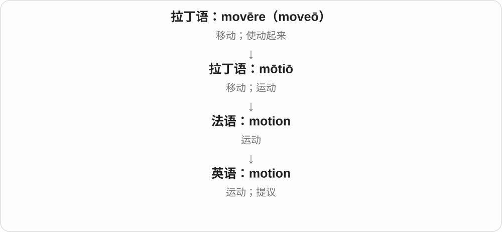

运动义最直观；议事中的动议是正式提出供讨论、表决的事项。动词还可表示打手势示意。

**常见搭配与例句**

in motion；set in motion；a motion to do；motion someone over。

> The wheels were already in motion.

车轮已经转起来了。

> The committee passed a motion to postpone the meeting.

委员会通过了推迟会议的动议。

**别混淆**

motion 是正式动议时，不等于随口一个 idea；通常有议事程序。

### 89. motionless — 一动不动的

**音标**：英 /ˈməʊʃənləs/；美 /ˈmoʊʃənləs/

**先抓住这个画面**

motionless 像把画面按下暂停，观察到的对象此刻没有动作。

**怎么拆**

motion + -less（没有）。

**怎么变成今天的意思**

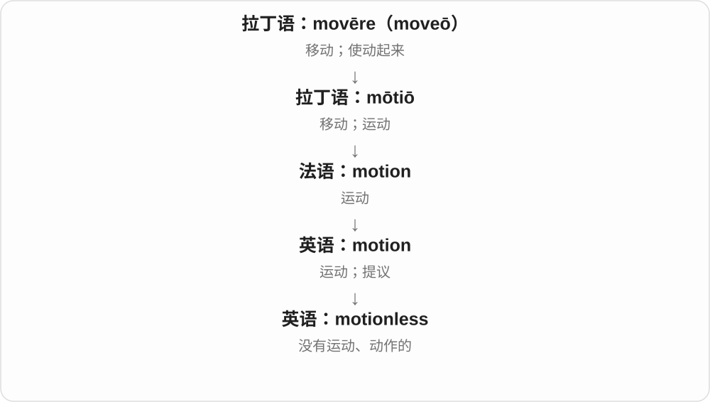

描述当下状态，不必意味着永久不能动。一个人可以主动站着不动。

**常见搭配与例句**

stand motionless；lie motionless；remain motionless。

> The bird remained motionless on the branch.

鸟一动不动地停在枝头。

> She stood motionless as the door opened.

门打开时，她站着一动不动。

**别混淆**

immobile 更可能强调不能移动；motionless 先说此刻没在动。

### 90. fruit — 水果；果实；成果；结果实

**音标**：/fruːt/

**先抓住这个画面**

先想树上结出的东西，再想一番努力终于结出的成果。

**怎么拆**

拉丁 fructus 果实、收益接 frui 享用，经古法语 fruit 进入英语。实际的果实和抽象的收获在拉丁语里就有关联，不是英语后来才临时造出的比喻。

**怎么变成今天的意思**

**拉丁 frui 享用 → fructus 收获、收益、果实**  
收获的东西，也是人能享用的成果

↓

**古法语 fruit → 中古英语 fruit → fruit**  
水果；果实；努力带来的成果

吃的水果常用不可数 fruit：some fruit。说不同种类或具体果实时可用 fruits；the fruits of your work 则把成果看成可收获的东西。植物学中的 fruit 范围比厨房里的“水果”广。作动词可说树开始结果。

**常见搭配与例句**

fresh fruit；bear fruit；the fruits of hard work；fruit trees。

> There is fresh fruit on the table if you want a snack.

如果想吃点东西，桌上有新鲜水果。

> Their patient negotiations finally bore fruit.

他们耐心的谈判终于有了成果。

> The young tree has not started to fruit yet.

这棵小树还没有开始结果。

**别混淆**

vegetable 是日常食材分类，fruit 也能是植物学分类，两者在用途上会交叉。bear fruit 可以只指计划奏效。

### 91. fruitless — 徒劳的；没有成果的

**音标**：/ˈfruːtləs/

**先抓住这个画面**

付出了时间和力气，最后却两手空空。

**怎么拆**

英语 fruit + -less。英语较早记录的是无益、无成果的抽象义；不能因为字面是“没有果实”，就断言它先专指不结果的树。

**怎么变成今天的意思**

**拉丁 frui 享用 → fructus 收获、收益、果实**  
收获的东西，也是人能享用的成果

↓

**古法语 fruit → 中古英语 fruit → fruit**  
水果；果实；努力带来的成果

↓

**英语 fruit + -less → fruitless**  
早期已用于无效、徒劳；后来也可说不结果实

a fruitless search 是没有找到东西的搜寻；a fruitless argument 是争了半天没有进展。它评价的是结果，不一定是在说参与的人懒惰或没有认真做。

**常见搭配与例句**

a fruitless search；fruitless attempts；prove fruitless。

> After a fruitless search of every drawer, I found the key in my coat.

翻遍抽屉仍一无所获后，我在外套里找到了钥匙。

> Further negotiations proved fruitless, and the two sides went home.

进一步谈判没有结果，双方各自离开了。

**别混淆**

pointless 强调没有意义或目的，fruitless 强调没有成果；一项值得尝试的调查仍可能 fruitless。

### 92. shame — 羞耻、羞愧；丢脸的事；遗憾；使羞愧、羞辱

**音标**：/ʃeɪm/

**先抓住这个画面**

做了不愿别人看见的事，脸上挂不住，是 shame；说 It is a shame 也常只是“真可惜”，没有在骂谁不要脸。

**怎么拆**

名词和动词分别接古英语 sċamu、sċamian 等。更深来源未定，“想遮脸”的画面可作理解，不把它写成已经证实的唯一造词过程。

**怎么变成今天的意思**

**古英语 sċamu、sċamian → 中古英语 schame、schamen**  
羞耻、丢脸；感到或使人羞耻

↓

**英语 shame 与古老派生延续**  
羞耻、遗憾；shameful 可耻的；shameless 不知羞耻的

feel shame 感到羞愧，bring shame on 使蒙羞，What a shame! 真可惜，shame someone into doing 使某人因羞愧而去做。

**常见搭配与例句**

feel shame；What a shame!；bring shame on；put to shame。

> He felt shame about the lie he had told.

他为自己说过的谎感到羞愧。

> It is a shame you cannot join us.

你不能和我们一起去，真可惜。

**别混淆**

guilt 常聚焦我做错了什么，shame 常聚焦我或这件事让人抬不起头，实际感受可以重叠；a shame 的遗憾义也未必涉及过错。

### 93. shameless — 不知羞耻的；毫不掩饰的〔有时自嘲〕

**音标**：/ˈʃeɪmləs/

**先抓住这个画面**

明知别人可能觉得不合适，还一点不脸红；口语也能半开玩笑说自己大大方方打广告。

**怎么拆**

shame + -less，继承古英语 sċamlēas 等对应词。-less 说没有羞耻感，不等于“没有值得羞愧的事”。

**怎么变成今天的意思**

**古英语 sċamu、sċamian → 中古英语 schame、schamen**  
羞耻、丢脸；感到或使人羞耻

↓

**英语 shame 与古老派生延续**  
羞耻、遗憾；shameful 可耻的；shameless 不知羞耻的

↓

**shame + -less → shameless**  
不感羞耻；有时夸张说毫不遮掩

a shameless lie 无耻的谎言，shameless self-promotion 毫不掩饰的自我推介，a shameless plug 常自嘲厚脸皮宣传一下。

**常见搭配与例句**

a shameless lie；shameless flattery；a shameless plug。

> It was a shameless attempt to take all the credit.

这是一种无耻的独揽功劳企图。

> Here is a shameless plug for my new book.

我来厚着脸皮宣传一下我的新书。

**别混淆**

shameless 批评人不知羞耻，unashamed 常可中性或正面说坦然、不以为耻；两者语气不能默认相同。

### 94. breath — 呼吸、气息；一口气；微风、细微气息

**音标**：/breθ/

**先抓住这个画面**

一吸一呼里那口气；说 hold your breath，是把气憋住。这里是名词，末尾 /θ/ 不振动声带，元音也短。

**怎么拆**

继承古英语 brǣþ，早期含气味、呼气、蒸气等义。名词 breath 与后来形成的 breathe 动词同族，却不只是随手多写一个 e 还同音。

**怎么变成今天的意思**

**古英语 brǣþ → 中古英语 breth、breeth → breath**  
气味、呼出气等旧义 → 呼吸、气息

↓

**中古英语 brethen → breathe**  
以 breath 为基础形成相应呼吸动词

take a deep breath 深吸一口气，hold your breath 屏住呼吸，out of breath 上气不接下气，a breath of fresh air 一口新鲜空气、令人耳目一新的事物。

**常见搭配与例句**

take a breath；hold your breath；out of breath；under your breath。

> She took a deep breath before speaking.

她开口前深吸了一口气。

> He was out of breath after climbing the stairs.

他爬完楼梯后上气不接下气。

**别混淆**

breath /breθ/ 名词，breathe /briːð/ 动词；breath 不等于 breadth 宽度，后者多一个 /d/。

### 95. breathless — 气喘吁吁的；屏息般激动的；急促兴奋的

**音标**：/ˈbreθləs/

**先抓住这个画面**

跑完楼梯气接不上，或激动得仿佛忘了呼吸；-less 给出缺气的感觉，但日常不每次都表示完全停止呼吸。

**怎么拆**

breath 气息 + -less 缺少，先抓缺气、喘不过气的性质，再看兴奋、叙述语气等比喻。

**怎么变成今天的意思**

**古英语 brǣþ → 中古英语 breth、breeth → breath**  
气味、呼出气等旧义 → 呼吸、气息

↓

**breath + -less → breathless**  
喘不过气；像屏息般急切、激动

leave someone breathless 让人喘不过气、惊叹，breathless excitement 屏息般兴奋，a breathless account 急促激动的叙述。

**常见搭配与例句**

leave someone breathless；breathless excitement；a breathless account。

> The climb left us breathless.

爬坡让我们气喘吁吁。

> She gave a breathless account of the match.

她急促兴奋地讲了比赛经过。

**别混淆**

breathless 可说人的状态或叙述语气，breathtaking 常评价景色等令人惊叹；两者都借气息，却不互换所有搭配。

### 96. regardless — 不顾、不受影响地；不管怎样

**音标**：英 /rɪˈɡɑːdləs/；美 /rɪˈɡɑːrdləs/

**先抓住这个画面**

知道有某个条件、阻力，却不让它改变接下来的决定；有时也批评根本不顾后果。

**怎么拆**

regard 关注、顾及 + -less 没有。现代常作副词；regardless of 后接那个不影响结果的条件。

**怎么变成今天的意思**

**古法语 regarder、reguarder → 中古英语 regarden → regard〔动词〕**  
留意看、看待；后有尊重、认为

↓

**法语 regard → 中古英语 regard、regarde → regard〔名词〕**  
注意、看待 → 关心、敬重；方面、问候等

↓

**regard + -less → regardless**  
不予顾及 → 不管怎样、不受其影响

regardless of age 不论年龄，regardless of cost 不计成本，carry on regardless 不管怎样继续。

**常见搭配与例句**

regardless of；regardless of age；carry on regardless。

> Everyone is welcome, regardless of age.

不论年龄，所有人都欢迎来。

> The rain was heavy, but they carried on regardless.

雨很大，但他们还是照常继续。

**别混淆**

regardless of 后接名词或名词性结构，although 常引句子；不顾成本与不受年龄影响，褒贬由具体场景决定。

### 97. harm — 伤害、损害；伤害、损害某人某物

**音标**：英 /hɑːm/；美 /hɑːrm/

**先抓住这个画面**

让身体、利益、环境等变得更坏，不只可以看见的擦伤；damage to trust 这样的损害也可用 harm 来说。

**怎么拆**

继承古英语 hearm，经中古英语到 harm，旧词族包括痛苦、损害等。现代名词、动词都常见，不能按 h + arm 手臂拆。

**怎么变成今天的意思**

**古英语 hearm → 中古英语 harm、herm → harm**  
损害、痛苦等

↓

**名词、动词与性质**  
造成伤害；harmful 会伤害；harmless 不造成伤害或无恶意

do harm 造成伤害，harm someone 伤害某人，harm the environment 损害环境，no harm done 没造成什么损害。

**常见搭配与例句**

do harm；harm the environment；no harm done；mean no harm。

> The mistake did no lasting harm.

错误没有造成持久损害。

> The waste could harm the river’s wildlife.

废物可能损害河里的野生生物。

**别混淆**

harm 名词常不可数，不说 a harm 来指普通一次伤害；hurt 可疼痛、伤感，harm 强调造成不利影响。

### 98. harmless — 无害的；无恶意的、不冒犯的〔按语境〕

**音标**：英 /ˈhɑːmləs/；美 /ˈhɑːrmləs/

**先抓住这个画面**

某事没造成实质伤害，或说话人并无恶意，可以叫 harmless；一个人说笑话 harmless，不代表听的人一定不会不舒服。

**怎么拆**

harm + -less，没有损害；中古英语已有 harmles 等相应形式。实际是对象、剂量、场景中的无害判断，不是后缀让所有情境永远无风险。

**怎么变成今天的意思**

**古英语 hearm → 中古英语 harm、herm → harm**  
损害、痛苦等

↓

**harm + -less → harmless**  
不造成伤害；无恶意、无冒犯意图

a harmless mistake 无伤大雅的错误，seem harmless 看起来无害，a harmless joke 无恶意的玩笑。

**常见搭配与例句**

a harmless mistake；seem harmless；a harmless joke。

> It turned out to be a harmless mistake.

结果那只是个无伤大雅的错误。

> He intended it as a harmless joke.

他的本意是开个没有恶意的玩笑。

**别混淆**

harmless 无害、无恶意，与 useless 无用不同；玩笑是否伤人还取决于表达、对象和场景。

### 99. bound — 跳跃、跃进；另有绑住、必定、前往、界限等不同来源的意思

**音标**：/baʊnd/

**先抓住这个画面**

这里先看身体有弹力地一跃；同样的拼写还装着几条完全不同的词源。

**怎么拆**

“跳跃”义经法语 bondir，常追溯到表示嗡鸣、回响的俗拉丁语重构形式 *bombitire。不要用这条路线解释所有 bound。

**怎么变成今天的意思**

**俗拉丁语 \*bombitire〔重构〕**  
嗡鸣、发声

↓

**古法语 bondir**  
发声、回响；跳起、弹回

↓

**英语 bound**  
跳跃；一跃

The dog bounded across the grass 是狗蹦跳着穿过草地。另几种常用 bound 要分开：bound by rules 来自 bind“约束”；bound for London 的“准备前往”来自古诺尔斯语 búinn；out of bounds 的“界限”来自法语及中世纪拉丁语另一族。be bound to 常说“肯定会”，也不能理解成跳过去。

**常见搭配与例句**

bound across the field；in one bound；be bound to；be bound for。

> The dog bounded up the steps to greet us.

那只狗蹦着上了台阶来迎接我们。

> She crossed the stream in one bound.

她一个跳跃就跨过了小溪。

> The train is bound for London.

这列火车开往伦敦。

**别混淆**

跳跃的过去式是 bounded；bind 的过去式和过去分词才是 bound。拼写相同不保证词源相同。

### 100. boundless — 无边无际的；似乎无穷的

**音标**：/ˈbaʊndləs/

**先抓住这个画面**

视线越过去还找不到边，或一个人的精力像怎么用也用不完，就可用 boundless。

**怎么拆**

bound 边界、界限 + -less。这里不是 bind 绑的过去式 bound；英语里有不同来源的同形词，不能因为一个人被绑住就推成解除捆绑。

**怎么变成今天的意思**

**bound 的边界、界限义**  
一块地方或数量的边

↓

**bound + -less → boundless**  
没有边界；比喻无穷

boundless energy 仿佛无穷的精力；boundless enthusiasm 极大的热情；a boundless ocean 无边海洋，常带文学或夸张色彩。

**常见搭配与例句**

boundless enthusiasm；boundless possibilities。

> The children seemed to have boundless energy.

孩子们的精力似乎用不完。

> She greeted the project with boundless enthusiasm.

她对这个项目表现出极大的热情。

**别混淆**

boundless 常用于感受、赞叹和夸张；unlimited 还可直接用于明确不限次数、额度等条件，语气不同。

### 101. wire — 金属丝、电线；接线；电汇、传送〔通信旧用延伸〕

**音标**：英 /waɪə/；美 /waɪər/

**先抓住这个画面**

一根拉长的金属细线，可以绑东西，也能导电、传消息；动词便能说接好线路、通过线路发过去。

**怎么拆**

继承古英语 wīr 金属细丝，经中古英语 wir 等到现代；电线、通信义随着技术用途增加。不能把所有 wire 都默认带塑料皮的电源线。

**怎么变成今天的意思**

**古英语 wīr → 中古英语 wir、wyr → wire**  
金属细丝、金属丝饰物

↓

**电气、通信与现代比喻**  
导线、接线、传送消息；像金属丝般的形状与强韧感

copper wire 铜丝，wire a house 给房屋布线，wire money 电汇钱，down to the wire 直到最后关头，wire service 通讯社新闻服务。

**常见搭配与例句**

copper wire；wire a house；wire money；down to the wire。

> The sculpture was made from thin wire.

雕塑由细金属丝做成。

> The final decision went down to the wire.

最终决定拖到了最后关头。

**别混淆**

wire 核心是金属丝及其用途，cable 常多股、成束或整条连接线；现代电汇不保证真有一根专用电线把钱传过去。

### 102. wireless — 无线的；无线电、收音机〔较旧英式用法〕

**音标**：英 /ˈwaɪələs/；美 /ˈwaɪərləs/

**先抓住这个画面**

设备之间传信号不用那根连接线；不代表整台设备没有任何电线，也不保证不用充电。

**怎么拆**

wire + -less 没有，早期常说无线电，后来覆盖更多无线通信。名词 the wireless 可以是旧式收音机称呼。

**怎么变成今天的意思**

**古英语 wīr → 中古英语 wir、wyr → wire**  
金属细丝、金属丝饰物

↓

**wire + -less → wireless**  
无连接导线传信号；无线电、收音机

wireless headphones 无线耳机，a wireless network 无线网络，wireless charging 无线充电，listen to the wireless 听收音机〔旧用〕。

**常见搭配与例句**

wireless headphones；a wireless network；wireless charging；the wireless。

> The headphones connect wirelessly to the phone.

这副耳机以无线方式连接手机。

> The library provides a wireless network for visitors.

图书馆为访客提供无线网络。

**别混淆**

wireless 是广类，Wi-Fi 是其中一类网络技术；无线耳机不意味着永远不用充电线。

### 103. mercy — 怜悯；宽恕；慈悲

**音标**：英 /ˈmɜːsi/；美 /ˈmɜːrsi/

**先抓住这个画面**

你有能力让对方受苦，却愿意少追究一点、留一条活路。

**怎么拆**

拉丁语 merces 原是报酬、奖赏，经后期拉丁语与法语发展出恩惠、恩典和怜悯义。不是现代英语把“商品”直接变成“慈悲”。

**怎么变成今天的意思**

**拉丁语 merx，属格 mercis**  
货物、商品

↓

**拉丁语 merces，宾格 mercedem**  
报酬、酬劳；奖赏

↓

**后期拉丁语与法语 merci**  
恩惠、恩典；怜悯

↓

**中古英语 merci → mercy**  
宽恕、慈悲、怜悯

show mercy 是手下留情；at the mercy of 是自己无法控制局面，只能任由对方或外部条件摆布。法语 merci“谢谢”与它同源，现代意思已分开。

**常见搭配与例句**

show mercy；beg for mercy；at the mercy of…。

> The victorious king showed mercy to the prisoners.

获胜的国王宽恕了俘虏。

> Without shelter, the hikers were at the mercy of the weather.

徒步者没有遮蔽处，只能任由天气摆布。

**别混淆**

pity 是怜惜的感受；mercy 尤其突出有能力惩罚或伤害时选择宽宥。

### 104. merciless — 毫不留情的；残酷的；猛烈难熬的

**音标**：英 /ˈmɜːsɪləs/；美 /ˈmɜːrsɪləs/

**先抓住这个画面**

一点缓和、一点放过都没有，压力直直地落在你身上。

**怎么拆**

mercy + -less“没有”，y 变 i；英语形容词构词。

**怎么变成今天的意思**

**拉丁语 merx，属格 mercis**  
货物、商品

↓

**拉丁语 merces，宾格 mercedem**  
报酬、酬劳；奖赏

↓

**后期拉丁语与法语 merci**  
恩惠、恩典；怜悯

↓

**中古英语 merci → mercy**  
宽恕、慈悲、怜悯

↓

**英语 mercy + -less → merciless**  
没有怜悯的

可以说人的残酷，也可把严酷天气、猛烈批评拟人化：a merciless sun 是毒辣的太阳。

**常见搭配与例句**

merciless criticism；the merciless heat。

> The team faced merciless criticism after the defeat.

球队失利后遭到了毫不留情的批评。

> They walked for hours under the merciless sun.

他们在毒辣的太阳下走了好几个小时。

**别混淆**

cruel 常强调造成痛苦；merciless 强调不留情、不减轻压力。

### 105. humor — 幽默；心情、脾气；迁就〔动词〕

**音标**：英 /ˈhjuːmə/；美 /ˈhjuːmər/

**先抓住这个画面**

能看到事情有趣的一面，是 a sense of humor。动词 humor someone 则像顺着对方的心情哄一哄，暂且满足他的想法。

**怎么拆**

humour 的常见美式拼写。历史接拉丁、法语液体、体液材料，旧体液学说把体液与性情相联，词义转到心情、性情，再发展出幽默。

**怎么变成今天的意思**

**拉丁 umor → 法语 humour → 英语 humor、humour**  
液体、体液等旧义

↓

**旧体液观念下的心情、性情用法 → 幽默**  
这是历史观念造成的词义联系，不是现代医学结论

↓

**humorous**  
由体液、性情相关旧义发展到逗趣、幽默

a sense of humor 幽默感；in a good humor 心情好；humor someone 迁就某人。

**常见搭配与例句**

a sense of humor；humor me。

> Her sense of humor helped everyone relax.

她的幽默感让大家放松下来。

> Just humor me and try the other route.

就先听我这一回，试试另一条路。

**别混淆**

humor 作动词不是给某人讲笑话：Just humor me 常是先顺着我一下。historical humors 体液也不等于今天幽默笑话。

### 106. humour — 幽默；心情；迁就〔humor 的常见英式拼写〕

**音标**：英 /ˈhjuːmə/；美 /ˈhjuːmər/

**先抓住这个画面**

和 humor 是同一个常用词的拼写变体：名词能说幽默、心情，动词能说迁就、哄着。

**怎么拆**

经法语 humour 上接拉丁 umor 液体。u 保留在这一常见拼写里，不能据此另分成一种不同的幽默。

**怎么变成今天的意思**

**拉丁 umor → 法语 humour → 英语 humor、humour**  
液体、体液等旧义

↓

**旧体液观念下的心情、性情用法 → 幽默**  
这是历史观念造成的词义联系，不是现代医学结论

↓

**humorous**  
由体液、性情相关旧义发展到逗趣、幽默

a sense of humour；good humour 愉快的心情；humour someone 顺着某人。

**常见搭配与例句**

a dry sense of humour；in good humour。

> The essay is full of gentle humour.

这篇文章充满温和的幽默。

> He was in good humour after the walk.

散步后，他心情很好。

**别混淆**

humour 与 humor 意义基本相同；humorous 两边常都写成这样，不顺手造 humourous。

### 107. humorless — 缺乏幽默感的；毫无笑意的〔常见美式拼写〕

**音标**：英 /ˈhjuːmələs/；美 /ˈhjuːmərləs/

**先抓住这个画面**

别人开个玩笑，他一点都不觉得好笑；或某个笑容只是嘴角动了、没有一点轻松意味，可说 humorless。

**怎么拆**

humor 幽默 + -less；常见英式拼写 humourless。不是把古代 humor 体液义解释成身体没有液体。

**怎么变成今天的意思**

**humor 的幽默义**  
让人觉得有趣、轻松的材料

↓

**humor + -less → humorless**  
缺乏幽默感、笑意

a humorless response 毫无幽默感的回应；a humorless smile 没有笑意的笑。常含负面评价，不宜仅凭一次严肃回应给人贴标签。

**常见搭配与例句**

a humorless smile；a humorless official。

> He gave a brief, humorless smile.

他短暂地笑了一下，却没有一点笑意。

> The review described the film as heavy and humorless.

评论认为这部电影沉重而缺乏幽默感。

**别混淆**

humorless 缺幽默感，unfunny 不好笑：一个 humorless 的人和一个不好笑的笑话不是同一类对象。

### 108. humourless — 缺乏幽默感的；毫无笑意的〔常见英式拼写〕

**音标**：英 /ˈhjuːmələs/；美 /ˈhjuːmərləs/

**先抓住这个画面**

与 humorless 是同一个形容词：可以说人不解风趣，也可以说一个笑并不带愉快、好笑的意思。

**怎么拆**

humour + -less；保留英式常见 humour 的 u，构成 humourless。不是多出来的 u 又加入一个新义。

**怎么变成今天的意思**

**humour／humor**  
幽默一词的常见英美拼写

↓

**humour + -less → humourless**  
缺乏幽默感或笑意

a humourless remark 毫无幽默感的话；a humourless laugh 没有笑意的一笑。词尾读音与 humorless 基本相同。

**常见搭配与例句**

a humourless smile；a rather humourless tone。

> Her reply was sharp and humourless.

她的回应尖锐，没有一点幽默意味。

> He spoke in a rather humourless tone.

他说话的语气颇不解风趣。

**别混淆**

humourless 与 humorous 幽默的相反，但严肃 serious 不一定缺乏幽默感，须看评价指向。

### 109. clue — 线索；解题提示；相关了解

**音标**：/kluː/

**先抓住这个画面**

像在迷宫里顺着一根线走，线带你找到出口；案件或难题里带你接近答案的信息，就是 clue。

**怎么拆**

是 clew 线团一词的拼写变体，远承古英语 cliewen 等。线索义与希腊神话中引导忒修斯走出迷宫的线团形象有关；故事解释了比喻，不等于词本身借自希腊语。

**怎么变成今天的意思**

**古英语 cliewen → clew、clue**  
线团、纱团

↓

**线团指引迷宫出口的比喻 → clue**  
指向答案的信息、线索

a clue to the mystery 解开谜团的线索；a crossword clue 填字提示；I haven’t a clue 是我一点也不知道。

**常见搭配与例句**

find a clue；have no clue。

> The letter provided a clue to her whereabouts.

那封信提供了一条关于她去向的线索。

> I have no clue how this machine works.

我完全不知道这台机器怎么工作。

**别混淆**

clue 是帮助推向答案的信息，proof 是足以证明某事的证据；一条 clue 未必已经证明结论。

### 110. clues — 线索；提示〔复数〕

**音标**：英、美 /kluːz/

**先抓住这个画面**

不知道答案时，眼前留下的一点迹象能引你往正确方向走，这就是 clues。像拉住一条线，慢慢找出整件事。

**怎么拆**

clue 保留末尾 e，加 -s → clues，/uː/ 后读 /z/。clue 原是 clew 线团的拼写变体，词本身是日耳曼来源。

**怎么变成今天的意思**

**日耳曼线团词 → 中古英语 clewe、cleue 等 → clue**  
现代 clue 拼写由相应旧拼写发展

↓

**线团引出迷宫的神话形象 → 指引答案的线索义 → clues**  
借故事形成比喻，不表示单词借自希腊语

look for clues 是找线索；clues to the answer 是通向答案的提示；clues about the past 是了解过去的线索。

**常见搭配与例句**

look for clues；clues to the answer；a few useful clues。

> The old letters provided clues about her childhood.

旧信提供了了解她童年的线索。

> The puzzle gives you three clues.

这道谜题给了你三条提示。

**别混淆**

clues 可以帮助推断，却不一定已经足以证明结论。evidence 是支持判断的材料，answer 才是答案本身。

### 111. clueless — 毫无头绪的；不了解情况的〔常含批评〕

**音标**：/ˈkluːləs/

**先抓住这个画面**

线团都没抓到，站在迷宫口不知道往哪走；clueless 就是这种完全摸不着门道的感觉。

**怎么拆**

clue + -less；由没有可循线索，发展成不了解、没头绪的常见口语义。不是一定说现场没有侦探线索。

**怎么变成今天的意思**

**clue + -less**  
没有线索、无迹可循

↓

**clueless 的日常人物用法**  
不知道怎么办、不了解情况

clueless about computers 对电脑一窍不通；look clueless 看起来一脸茫然。说别人 clueless 可能相当不客气。

**常见搭配与例句**

clueless about something；completely clueless。

> I was completely clueless about the new system.

我对新系统完全摸不着头脑。

> He looked clueless when they mentioned the deadline.

他们提到截止日期时，他看起来一脸茫然。

**别混淆**

clueless 常比 unsure 不确定更强；新手暂时没弄明白一件事，不一定整体能力差。

### 112. tooth — 牙齿；锯齿、齿轮齿等；执行力量〔常见复数比喻〕

**音标**：/tuːθ/

**先抓住这个画面**

牙负责咬、切、磨；锯和齿轮上的凸起像牙，也叫 tooth。规则若真能咬得动、执行得下去，便可说 it has teeth。

**怎么拆**

承古英语 tōþ，经中古英语 toth 等传下。复数 teeth /tiːθ/ 保存旧的元音变化；不是通常的 tooths。

**怎么变成今天的意思**

**古英语 tōþ → 中古英语 toth → tooth**  
牙；与其他印欧语言的齿名有共同历史

↓

**身体形态用于器具**  
锯齿、齿轮的齿；比喻执行力量

a loose tooth 松动的牙，brush your teeth 刷牙，the teeth of a saw 锯齿，give a rule teeth 让规则有执行力，a sweet tooth 爱吃甜食。

**常见搭配与例句**

brush your teeth；a sweet tooth；give rules teeth。

> The child has a loose tooth.

孩子有一颗牙松了。

> The old rules had no teeth.

旧规则没有实际约束力。

**别混淆**

tooth 单数、teeth 复数；复合词常用单数作前部，如 toothbrush。a sweet tooth 是爱好，不是某颗牙味甜。

### 113. toothless — 没有牙的；缺少执行力、无实权的

**音标**：/ˈtuːθləs/

**先抓住这个画面**

没有牙，就少了咬住、咬动的能力。比喻里，一个机构、规定看起来存在，却没有实际执行力量，也叫 toothless。

**怎么拆**

古英语已有 tōþlēas，现代对应 tooth + -less。字面的无牙，再借牙的力量形象扩到无实权。

**怎么变成今天的意思**

**古英语 tōþ → 中古英语 toth → tooth**  
牙；与其他印欧语言的齿名有共同历史

↓

**tōþlēas → toothless**  
没有牙；比喻不能有效执行、约束

a toothless smile 无牙的笑容，a toothless law 缺乏执行力的法律，a toothless committee 无实权的委员会。

**常见搭配与例句**

a toothless smile；a toothless committee。

> The baby gave a toothless smile.

婴儿露出无牙的笑容。

> Critics called the committee toothless.

批评者称委员会没有实权。

**别混淆**

toothless 的比喻常批评执行力量不足，不一定说文字内容完全不存在或完全没有任何作用。

### 114. penny — 便士；一分硬币；一点钱

**音标**：/ˈpeni/

**先抓住这个画面**

先想最小面额的一枚小硬币，再把它放进 save every penny、not a penny 这样的表达：每一点钱、一点钱也没有。

**怎么拆**

承古英语 peniġ、penning，经中古英语 peny 等到 penny，更远来源不确定。不同英语地区用它称不同的小面额货币或硬币。

**怎么变成今天的意思**

**古英语 peniġ、penning → 中古英语 peny → penny**  
小面额货币、硬币的旧名称，深源未定

↓

**小钱 → 钱财的日常比喻**  
省钱、没钱与价格表达常围绕最小单位

英国现代币制的一便士是一英镑的百分之一，美国 penny 通常称一美分硬币。数单枚硬币常 pennies，英式金额常用 pence，如 fifty pence。

**常见搭配与例句**

save every penny；not a penny；fifty pence。

> She saved every penny for the journey.

她为那次旅行省下每一点钱。

> He found three pennies under the sofa.

他在沙发底下找到三枚小面额硬币。

**别混淆**

pennies 与 pence 的差异常是硬币个数和金额：five pennies 五枚一便士硬币，five pence 五便士金额；不要只按复数随意替换。

### 115. penniless — 身无分文的、一贫如洗的

**音标**：/ˈpenɪləs/

**先抓住这个画面**

连一枚小硬币都没有，就 penniless。它用最小的钱来强调完全没钱，也常用于暂时困窘，不必是一生贫穷。

**怎么拆**

penny + -less，y 在接后缀时变成 i，形成 penniless；中古英语已有相应形式。

**怎么变成今天的意思**

**古英语 peniġ、penning → 中古英语 peny → penny**  
小面额货币、硬币的旧名称，深源未定

↓

**小钱 → 钱财的日常比喻**  
省钱、没钱与价格表达常围绕最小单位

↓

**penny + -less → penniless**  
没有一分钱

arrive penniless 身无分文地来到，be left penniless 变得一无所有，almost penniless 几乎没钱。

**常见搭配与例句**

be left penniless；almost penniless。

> He arrived in the city almost penniless.

他来到这座城市时几乎身无分文。

> The failed venture left them penniless.

那次失败的经营让他们一贫如洗。

**别混淆**

penniless 强调缺钱，不表示没有能力或没有财产的每一种可能；叙事中也可能是夸张说眼下拿不出钱。

### 116. sleeve — 袖子；套筒、保护套；唱片封套

**音标**：/sliːv/

**先抓住这个画面**

衣服伸出一段，把胳膊套在里面，是 sleeve。机器零件的套管、唱片的封套，也按套住、保护东西来命名。

**怎么拆**

承古英语 slief、sliefe，经中古英语 sleve 到 sleeve。由衣袖扩展到管状包覆物、保护封套等。

**怎么变成今天的意思**

**古英语 slief、sliefe → 中古英语 sleve → sleeve**  
衣服包住手臂的部分

↓

**袖状覆盖物 → 套管、保护套；后缀说明有无**  
sleeved 有袖；sleeveless 无袖

roll up one’s sleeves 挽起袖子、准备动手，a record sleeve 唱片封套，a protective sleeve 保护套，up one’s sleeve 藏有后招。

**常见搭配与例句**

roll up one’s sleeves；a record sleeve；up one’s sleeve。

> She rolled up her sleeves and began to work.

她挽起袖子开始干活。

> He slid the record back into its sleeve.

他把唱片重新装进封套。

**别混淆**

sleeve 包住手臂，collar 衣领在颈部；record sleeve 指封套，不是唱片有胳膊。

### 117. sleeves — 衣袖；套管、保护套〔复数〕

**音标**：/sliːvz/

**先抓住这个画面**

衣服包住手臂的两部分，是 sleeves。把唱片、管线等包进去的套子，也会因覆盖形状相似而这样称呼。

**怎么拆**

sleeve 继承古英语 slief、sliefe 等，经中古英语 sleve 到现代，由衣袖扩展袖状覆盖物。现代保留 e 直接加 -s，/v/ 后读 /z/。

**怎么变成今天的意思**

**古英语衣袖名 → 中古英语 sleve → sleeve**  
包住手臂的衣袖 → 袖状保护物

↓

**sleeve + -s → sleeves**  
多个衣袖、保护套、套管

long sleeves 长袖；roll up your sleeves 卷起袖子、准备干活；record sleeves 唱片封套。

**常见搭配与例句**

short sleeves 短袖；protective sleeves 保护套。

> He rolled up his sleeves before painting.

刷漆前他卷起了袖子。

> The old records are still in their paper sleeves.

旧唱片还装在各自的纸封套里。

**别混淆**

roll up your sleeves 可以真卷袖，也常比喻准备认真干活。sleeves 作保护套时，覆盖的是别的东西，不限手臂。

### 118. sleeveless — 无袖的

**音标**：/ˈsliːvləs/

**先抓住这个画面**

衣身在，袖子没有，就是 sleeveless。-less 拿掉 sleeve 这一部件，所以背心、无袖连衣裙都可用。

**怎么拆**

sleeve + -less，保留 e；古英语已有 sliefleas 等相应形式。现代直接表示衣物没有袖子。

**怎么变成今天的意思**

**古英语 slief、sliefe → 中古英语 sleve → sleeve**  
衣服包住手臂的部分

↓

**sleeve + -less → sleeveless**  
没有袖子的衣物性质

a sleeveless dress 无袖连衣裙，a sleeveless top 无袖上衣。

**常见搭配与例句**

a sleeveless dress；a sleeveless top。

> She wore a sleeveless dress.

她穿着无袖连衣裙。

> The costume includes a sleeveless top and loose trousers.

这套服装包括无袖上衣和宽松长裤。

**别混淆**

sleeveless 是没有袖，不等于 short-sleeved 短袖；结构有无与长度多少分清。

### 119. spine — 脊柱；刺；书脊；比喻指骨气、勇气

**音标**：英、美 /spaɪn/

**先抓住这个画面**

身体中间的支撑线、植物伸出的尖刺、书页装订在一起的背面，都可以叫 spine。不同场景抓住不同形状和作用。

**怎么拆**

经古法语 espine 或直接接拉丁 spina，后者已有“刺、脊柱”等意思。英语先有脊柱和刺的用法，后来把书的装订背部也叫 spine；不能说英语先造“刺”才造“脊柱”。

**怎么变成今天的意思**

**拉丁 spina**  
刺、尖突；脊柱

↓

**古法语 espine／拉丁语 → 中古英语 spyne**  
脊柱、尖刺

↓

**现代英语 spine**  
又指书脊，并比喻支撑意志的骨气

书架上露出的 spine 常印着书名；a cactus spine 是仙人掌的刺。have the spine to say no 比喻有勇气说不。人体的 spine 是由多块椎骨及相关结构组成，不是一根从头到尾不分节的长骨。

**常见搭配与例句**

the spine of a book；cactus spines；the base of the spine；have the spine to do something。

> The title was printed in gold on the spine of the book.

书名用金色印在书脊上。

> The cactus had long, sharp spines.

这株仙人掌长着又长又尖的刺。

> She had the spine to challenge the unfair decision.

她有骨气，敢于质疑那个不公的决定。

**别混淆**

backbone 在身体和勇气的比喻中常与 spine 相近；spinal cord 是脊髓，是神经组织，不是脊柱的另一个名称。

### 120. spineless — 没有脊柱的；无刺的；比喻指懦弱、没有骨气的

**音标**：英、美 /ˈspaɪnləs/

**先抓住这个画面**

字面是没有支撑身体的脊柱，或没有扎人的刺；评价人时，像在说他站不住自己的立场。

**怎么拆**

英语 spine + -less“没有”。先用于植物无刺、动物无脊柱等实际特征，后来发展出软弱、缺乏勇气的批评用法。

**怎么变成今天的意思**

**拉丁 spina → 英语 spine**  
刺；脊柱

↓

**英语 spine + -less → spineless**  
无刺或无脊柱的

↓

**人的比喻用法**  
缺乏勇气、轻易放弃立场的

a spineless variety of cactus 是无刺仙人掌品种，纯粹描述植物。a spineless response 则在批评回应软弱、没有坚持；说人 spineless 带明显贬义，程度比 shy“害羞”强得多。

**常见搭配与例句**

spineless leadership；a spineless response；a spineless plant variety。

> The nursery sells a spineless variety of cactus.

这家苗圃出售一种无刺仙人掌。

> Critics called the committee’s response spineless.

批评者称委员会的回应毫无骨气。

**别混淆**

spineless 不等于善于妥协。compromising 可以出于理性协商，spineless 则是说话者认为对方因怯懦而不敢坚持。

### 121. reckless — 鲁莽的；不顾危险、后果的

**音标**：/ˈrekləs/

**先抓住这个画面**

前面有明显风险，还不把后果放在心上就往前冲，是 reckless。重点不只是胆子大，而是该顾到的后果没有顾。

**怎么拆**

承古英语 recelas、中古英语 reckeles 等，对应旧动词 reck 顾虑、在意 + -less 缺少。reck 现代不常单独用，词尾保留了旧构词。

**怎么变成今天的意思**

**旧动词 reck 顾虑、在意 + -less → 古英语 recelas 等**  
不顾虑、不在意后果的性质

↓

**reckless → recklessly、recklessness**  
不顾后果的方式；鲁莽性质

reckless behaviour 鲁莽行为；a reckless decision 不顾后果的决定；reckless spending 不计后果地花钱。

**常见搭配与例句**

reckless behaviour；a reckless decision。

> It was reckless to begin without checking the equipment.

不检查设备就开始，太鲁莽了。

> The report criticised the team’s reckless approach.

报告批评团队做法不顾后果。

**别混淆**

brave 勇敢可以是在了解风险后仍行动；reckless 通常批评不顾风险，不是勇敢的普通同义词。

### 122. stain — 污渍；染色剂；弄脏、染色；玷污

**音标**：/steɪn/

**先抓住这个画面**

咖啡滴在白衬衫上留下一个印子，那是 stain；给木头上色，也可用 stain。一个词既能说不想要的污痕，也能说有意染出的颜色。

**怎么拆**

中古英语 steinen 等与古诺斯语 steina 染色有关，也受经法语来的 disteynen 等变色、弄脏材料影响。来源有合流，不硬拆成 st + ain。

**怎么变成今天的意思**

**古诺斯 steina；经法语的 disteynen 等**  
染色、变色、弄脏的材料

↓

**英语 stain**  
染色或污渍；名誉上的污点

a coffee stain 咖啡渍；stain a shirt 弄脏衬衫；wood stain 木材着色剂；a stain on his reputation 名誉上的污点。

**常见搭配与例句**

remove a stain；a coffee stain。

> The coffee left a stain on my shirt.

咖啡在我的衬衫上留下了一块污渍。

> They stained the wooden floor a darker colour.

他们把木地板染成了更深的颜色。

**别混淆**

stain 常强调颜色、渗入留下的痕，dirt 泛指脏东西；stain wood 可以是装修时主动着色，不一定是做坏了。

### 123. stained — 染色、沾污了；带污渍的；有色彩的

**音标**：/steɪnd/

**先抓住这个画面**

衬衫染上咖啡色，是 stained；窗上的 stained glass 却是有意做出的彩色玻璃。关键看颜色被当作污渍还是设计。

**怎么拆**

stain + 完整 -ed，/n/ 后读 /d/；过去式、过去分词和染色状态形容词同形。

**怎么变成今天的意思**

**北欧 steina 染色材料与经法语来的 disteynen 等合流 → stain**  
染色、失色、弄脏的不同旧用法汇入同一现代词

↓

**改变颜色 → 污渍；有意染木、彩色玻璃；名声污点**  
现代看颜色是不是有意加上，不把所有 stain 都看成失败、脏

↓

**stain + -ed → stained**  
颜色已改变；可以污损，也可以有意染色

stained with ink 是沾上墨，stained glass 是彩色玻璃；stained the wood dark brown 是把木头染成深棕色。

**常见搭配与例句**

a stained shirt 有污渍的衬衫；reputation stained by lies 被谎言弄脏的名声。

> Her sleeve was stained with coffee.

她的袖子沾上了咖啡渍。

> Sunlight shone through the stained glass.

阳光透过彩色玻璃照进来。

**别混淆**

stained glass 里的 stained 是有色、染色，不等于 dirty glass 脏玻璃；一个固定搭配就能显示这个词不只负面。

### 124. stainless — 无污点的；耐锈蚀的〔尤见 stainless steel〕

**音标**：/ˈsteɪnləs/

**先抓住这个画面**

stain 是留下污痕，stainless 是不带这种污痕；最熟悉的 stainless steel 是不锈钢，名称强调耐锈蚀。

**怎么拆**

stain + -less，-less 表没有、缺少。钢材名称已有固定使用范围，不能由字面保证在任何环境都绝不腐蚀。

**怎么变成今天的意思**

**stain + -less**  
污痕 + 没有

↓

**stainless；stainless steel**  
无污点的；不锈钢的固定搭配

a stainless steel sink 不锈钢水槽；stainless steel cutlery 不锈钢餐具。日常最值得先掌握这个材料搭配。

**常见搭配与例句**

stainless steel；a stainless steel pan。

> The kitchen has a stainless steel sink.

厨房里有一个不锈钢水槽。

> She chose stainless steel cutlery for everyday use.

她选了不锈钢餐具日常使用。

**别混淆**

stainless 是耐污、耐腐蚀等相关形容词，spotless 常指眼下非常干净；一只 stainless steel pan 仍可能需要清洗。

### 125. stains — 污渍、染色剂、名誉污点〔复数〕；染色、留下污渍〔第三人称单数〕

**音标**：/steɪnz/

**先抓住这个画面**

衣服上几块洗不掉的颜色，是 stains；一种果汁染到桌布，也可 it stains。木工染色剂同样改变颜色，却是有意求效果。

**怎么拆**

stain + -s，/n/ 后读 /z/；动词三单与污渍、染料等名词复数同形，基础涉及北欧与法语材料合流。

**怎么变成今天的意思**

**北欧 steina 染色材料与经法语来的 disteynen 等合流 → stain**  
染色、失色、弄脏的不同旧用法汇入同一现代词

↓

**改变颜色 → 污渍；有意染木、彩色玻璃；名声污点**  
现代看颜色是不是有意加上，不把所有 stain 都看成失败、脏

↓

**stain + -s → stains**  
它染色；几块污渍或几种染色剂

coffee stains 是咖啡渍，stains the fabric 是把布染色；wood stains 是木材染色剂，未必指木头脏了。

**常见搭配与例句**

stains easily 容易留下污渍；stains on a reputation 名誉污点。

> The tablecloth had several coffee stains.

桌布上有几块咖啡渍。

> Beetroot juice stains the fabric a deep red.

甜菜汁把布染成深红色。

**别混淆**

stains 常像颜色留在材料里，smears 常像软物在表面拖开成痕；有些污渍要洗，有些油痕一擦就掉，形状和附着方式不同。

### 126. staining — 正在染色、留下污渍；染色处理、污渍形成

**音标**：/ˈsteɪnɪŋ/

**先抓住这个画面**

木头正在吸进染色剂，或饮料正把布变色，是 staining。动作都是颜色进入、留住，效果好坏要看是不是有意。

**怎么拆**

stain + 完整 -ing，直接加；分词、动作名词同形，基础 ai 长元音不改。

**怎么变成今天的意思**

**北欧 steina 染色材料与经法语来的 disteynen 等合流 → stain**  
染色、失色、弄脏的不同旧用法汇入同一现代词

↓

**改变颜色 → 污渍；有意染木、彩色玻璃；名声污点**  
现代看颜色是不是有意加上，不把所有 stain 都看成失败、脏

↓

**stain + -ing → staining**  
使材料变色、留色的过程

staining wood 是给木材染色，prevent staining 是防止留污渍；staining the cloth 是把布染上颜色。

**常见搭配与例句**

wood staining 木材染色；staining around the edge 边缘的色渍。

> They spent the afternoon staining the wooden shelves.

他们整个下午都在给木架染色。

> The dark liquid was staining the white cloth.

深色液体正把白布染上颜色。

**别混淆**

staining 与 painting 都能加颜色，staining 常让木纹等基底仍透出，painting 更常覆盖表面；具体材料、效果仍看场景。

### 127. limb — 肢体；手臂、腿；树的大枝

**音标**：英、美 /lɪm/

**先抓住这个画面**

从身体主体伸出去、能活动的部分，像手臂、腿，是 limb。树干上伸出去的大枝也像树的肢体，所以也可以叫 limb。

**怎么拆**

承古英语 lim 肢体、身体部分，经过中古英语发展为 limb；末尾 b 不发音。现代整个 limb 是词基，limbless 等词再在它后面加词尾。

**怎么变成今天的意思**

**古英语 lim 身体部分、肢体 → limb**  
保留身体伸出部分的基本意思

↓

**身体肢体 → 树的大枝、相关比喻**  
go out on a limb 把冒险站到枝头的画面用于承担判断风险

an injured limb 是受伤肢体；a large limb 是大树枝；go out on a limb 是冒风险表态、作判断。

**常见搭配与例句**

an injured limb；a large limb；go out on a limb。

> The doctor examined the injured limb.

医生检查了受伤的肢体。

> The tree lost a large limb during the storm.

风暴中，那棵树断了一根大枝。

> I will go out on a limb and say the plan might work.

我冒点风险作个判断：这个计划也许能行。

**别混淆**

branch 泛指树枝、分支，limb 在树木语境常是较大的主枝。go out on a limb 常说作出可能被证明错误、让自己承担风险的判断或支持。

### 128. limbless — 没有肢体的；无肢的

**音标**：英、美 /ˈlɪmləs/

**先抓住这个画面**

limb 是肢体，limbless 就是没有肢体。像蛇那种靠整个身体移动、看不到手臂和腿的形态，可以用这个词描述。

**怎么拆**

limb 肢体 + 完整 -less 没有 → limbless。b 在 limb 本身不发音，加后缀后也不恢复读出，整个词读 /ˈlɪmləs/。

**怎么变成今天的意思**

**古英语 lim 肢体 → limb**  
现代保留身体伸出部分的基本画面

↓

**limb + -less → limbless**  
直接表示缺少这个名词所说的部分

a limbless body 是无肢的身体；a limbless creature 是无肢生物；limbless movement 是无肢形态下的移动。

**常见搭配与例句**

a limbless body；a limbless creature；limbless movement。

> The snake’s limbless body moved through the grass.

蛇的无肢身体在草间移动。

> The drawing shows an imaginary limbless creature.

图画展示了一种想象中的无肢生物。

**别混淆**

-less 说缺少某物，limbless 的词尾在否定肢体的存在。它不是说肢体数量少一点，而是按相应语境描述无肢形态。

### 129. ruthless — 冷酷无情的；毫不留情的、决不手软的

**音标**：/ˈruːθləs/

**先抓住这个画面**

为了目标，不因为别人可怜或舍不得就停手，是 ruthless 的力度。待人可很冷酷，删稿、做取舍时也可夸张说毫不手软。

**怎么拆**

ruth 怜悯、同情的旧名词 + -less 缺少；中古英语已有相应形式。ruth 不是人名 Ruth 的那个希伯来词源，less 也不是一个名叫 Ruth 的人少了。

**怎么变成今天的意思**

**中古英语 reuthe 怜悯、同情 + -less → reutheles → ruthless**  
缺少怜悯，不手软

↓

**ruthless + -ly、-ness**  
不留情面地；这种冷酷或决绝的性质

a ruthless ruler 冷酷统治者；ruthless efficiency 毫不留情的效率；be ruthless about cutting 不留情面地删减。

**常见搭配与例句**

ruthless efficiency；be ruthless about。

> The novel portrays a ruthless ruler.

小说刻画了一位冷酷无情的统治者。

> Be ruthless about removing repeated paragraphs.

删除重复段落时，要毫不手软。

**别混淆**

determined 下决心不必缺同情，ruthless 常强调不顾怜悯；修稿语境的 ruthless 可以是夸张，不必出现真实残忍。

### 130. flaw — 缺陷、瑕疵；漏洞

**音标**：英 /flɔː/；美 /flɔː/

**先抓住这个画面**

完整的东西里有个破口，计划里有个没考虑周全的地方，都可以 a flaw。它抓的是让整体不够完善的那一处。

**怎么拆**

中古英语 flawe 原有碎片、薄片等义，可能接北欧石片词。缺陷义通常联系破掉、缺了一片的画面，具体语义衔接仍有推测。

**怎么变成今天的意思**

**中古英语 flawe 等碎片、薄片词**  
可能接北欧 flaga 石片等，更远联系扁平物词族

↓

**碎片、破口的形象 → flaw**  
缺点、裂隙、瑕疵，具体演变有推测成分

a flaw in the argument 论证漏洞，a design flaw 设计缺陷，a flaw in a gem 宝石瑕疵；可以很小，也可以很关键。

**常见搭配与例句**

a flaw in；a design flaw。

> She spotted a flaw in the argument.

她发现论证里有个漏洞。

> The bowl had a small flaw in the glaze.

碗的釉面上有一处小瑕疵。

**别混淆**

flaw 是缺陷，不一定是某个人犯下的一次 mistake；材料天生的瑕疵也可叫 flaw。

### 131. flawless — 无瑕疵的；完美、毫无差错的

**音标**：英 /ˈflɔːləs/；美 /ˈflɔːləs/

**先抓住这个画面**

检查不到瑕疵、表演没有失误，就可以 flawless。它是在某个评价范围里强调挑不出毛病。

**怎么拆**

flaw + -less，-less 表没有。把缺陷名词变成无缺陷的性质。

**怎么变成今天的意思**

**中古英语 flawe 等碎片、薄片词**  
可能接北欧 flaga 石片等，更远联系扁平物词族

↓

**碎片、破口的形象 → flaw**  
缺点、裂隙、瑕疵，具体演变有推测成分

↓

**flaw + -less → flawless**  
没有缺陷、差错

a flawless performance 完美表演，flawless technique 无可挑剔的技巧，flawless skin 无瑕肌肤；赞美中也可有夸张。

**常见搭配与例句**

a flawless performance；flawless technique。

> She gave a flawless performance in the final round.

她在最后一轮表现得毫无差错。

> The restoration left the surface looking almost flawless.

修复让表面看起来近乎无瑕。

**别混淆**

flawless 是较强的无瑕评价；不一定能从一次 flawless 表现推断以后每次都不会出错。

### 132. relent — 态度软下来；让步；强度减弱

**音标**：/rɪˈlent/

**先抓住这个画面**

一开始态度硬邦邦，后来终于松口；或雨、压力终于减弱，这个松下来是 relent。

**怎么拆**

经中古英语 relenten、盎格鲁法语相关形式，上接拉丁 lentus 柔软、可弯等材料，具体近源有不确定处。早有融化、软化义，后用于心肠、态度软化。re- 不能简单当作再来一次。

**怎么变成今天的意思**

**中古英语 relenten 等**  
融化、变软等旧义

↓

**relent 的比喻用法**  
态度缓和、让步；强度减轻

finally relent 终于松口；refuse to relent 不肯让步；the heat relented 热度减弱。通常不直接接一个人作宾语。

**常见搭配与例句**

finally relent；refuse to relent。

> At first she refused, but eventually she relented.

她起初拒绝了，最后还是松了口。

> The rain did not relent until evening.

雨一直到傍晚才减弱。

**别混淆**

relent 常有原本坚持或强硬后来软化的过程；relax 放松不一定涉及先前的拒绝或强压。

### 133. relentless — 持续不停的；毫不松懈的；不留情的

**音标**：/rɪˈlentləs/

**先抓住这个画面**

像一只手一直攥着，不肯松：雨不停、压力不减、追求不松劲，都能用 relentless。具体是赞赏还是抱怨，看它攥住的是什么。

**怎么拆**

relent 松下来、让步 + -less；从不会软下来、不会怜悯，扩展到不减弱、不停止。这里前面是动词，不能一律按没有某个名词翻译。

**怎么变成今天的意思**

**relent + -less**  
不肯软化、不肯减弱

↓

**relentless**  
不留情；持续不减；坚持不懈

relentless pressure 持续压力；relentless rain 下个不停的雨；a relentless pursuit of improvement 不懈追求进步。

**常见搭配与例句**

relentless pressure；a relentless pursuit。

> The team faced relentless pressure throughout the match.

整场比赛，这支队伍都面对持续不断的压力。

> Her relentless curiosity led to several discoveries.

她不懈的好奇心带来了几项发现。

**别混淆**

relentless 不是 restless：前者不停、不放松，后者坐立不安或不安分。relentless effort 可以是主动坚持，不是焦虑乱动。

### 134. relentlessly — 持续不断地；毫不松懈地；不留情地

**音标**：/rɪˈlentləsli/

**先抓住这个画面**

relentless 描述压力或人，relentlessly 说明事情怎样做：追问不停、努力不歇。

**怎么拆**

relent + -less + -ly，先有不松下来的形容词层，再用 -ly 形成副词。不要只拆成 relentless + ly 却漏掉前面的语义链。

**怎么变成今天的意思**

**relent → relentless**  
松下来 → 不肯松下来

↓

**relentless + -ly → relentlessly**  
以持续不减、毫不放松的方式

work relentlessly 持续努力；question relentlessly 追问不休；relentlessly cheerful 有时带无论如何都一直乐呵呵的强调或微妙语气。

**常见搭配与例句**

work relentlessly；pursue relentlessly。

> She worked relentlessly to improve the design.

她持续努力改进设计。

> The interviewer questioned him relentlessly.

采访者不停地追问他。

**别混淆**

relentlessly 只说不停、不放松，不能单凭它判断过程善恶或结果一定成功。

### 135. heed — 留心；听从；注意〔较正式〕

**音标**：/hiːd/

**先抓住这个画面**

警告已经听见，还真正把它放在心上、照着行动，这个留意、听进去是 heed。

**怎么拆**

本族词，承古英语 hedan 留心、照看、防护等材料；名词、动词在英语中都有用法。不是 head 头少了一个 a 的变形。

**怎么变成今天的意思**

**古英语 hēdan → 中古英语 heden**  
留意、看护

↓

**现代 heed**  
注意、听从；名词注意

heed a warning 听从警告；take heed of advice 留心建议；pay no heed to 忽视。普通口语常用 pay attention、listen，但读文章常见 heed。

**常见搭配与例句**

heed a warning；pay heed to。

> They failed to heed the warning signs.

他们没能重视那些警示信号。

> She paid little heed to the criticism.

她没太在意那些批评。

**别混淆**

hear 只保证听见，heed 更接近认真听进去、加以注意；听到了警告也可能没有 heed it。

### 136. heedless — 不留心的；不顾后果、警告等的

**音标**：/ˈhiːdləs/

**先抓住这个画面**

警告就在眼前，却仍像没看见一样往前冲，这种不顾、不理会是 heedless。

**怎么拆**

heed 留意 + -less；由没有注意、顾虑，形成较书面的不顾某事。不是耳朵生理上听不见。

**怎么变成今天的意思**

**heed + -less**  
留意 + 缺少

↓

**heedless**  
不理会、不顾警告或后果的

heedless of danger 不顾危险；heedless of the consequences 不顾后果。常含批评其没把该顾的事放在心上。

**常见搭配与例句**

heedless of danger；heedless of advice。

> He rushed ahead, heedless of the danger.

他不顾危险地冲了上去。

> The company expanded, heedless of repeated warnings.

公司不顾一再警告，继续扩张。

**别混淆**

heedless 不顾某事，carefree 无忧无虑：后者可以轻松正面，前者常暗示忽略应当注意的问题。

### 137. seam — 缝；接缝；矿层

**音标**：/siːm/

**先抓住这个画面**

两块布被缝到一起，留下相接的一道，就是 seam；两种材料的接合线，也可以这样看。

**怎么拆**

本族词，经中古英语 seme、seem 等承古英语 seam，核心与缝起来的东西有关。现代不是 see 看见 + m。

**怎么变成今天的意思**

**古英语 sēam → 中古英语 seme 等**  
缝、缝合处

↓

**英语 seam**  
接缝；地层中像一层带状材料的矿层

a side seam 侧缝；split at the seams 接缝处裂开；a coal seam 煤层。be bursting at the seams 可比喻挤得满满的。

**常见搭配与例句**

a side seam；a coal seam。

> The jacket tore along the seam.

夹克沿着接缝裂开了。

> The miners followed a narrow coal seam.

矿工沿着一条狭窄煤层开采。

**别混淆**

seam 是接缝、矿层；seem 看起来，在许多口音中同音，语法和词源不同。

### 138. seams — 接缝、缝合处；矿层〔复数〕

**音标**：/siːmz/

**先抓住这个画面**

两片材料缝到一起，会留下一条连接线，这些是 seams。地层里一条连续的矿物带，也像夹在材料间的一层，可叫 seam。

**怎么拆**

seam 继承古英语 sēam，经中古英语 seme 等延续，核心是缝合的东西、连接处。现代加 -s，/m/ 后读 /z/。

**怎么变成今天的意思**

**古英语 sēam → 中古英语 seme → seam**  
缝合处 → 接缝；带状矿层

↓

**seam + -s → seams**  
多处接缝、多条矿层

the seams of a jacket 夹克接缝；coal seams 煤层；coming apart at the seams 接缝散开、濒临崩溃。

**常见搭配与例句**

strong seams 牢固接缝；seams in the fabric 布料上的接缝。

> The jacket has strong, neat seams.

夹克的接缝牢固整齐。

> The diagram shows several coal seams underground.

示意图显示了地下几条煤层。

**别混淆**

seams 与 seems 同音，但 seems 是 seem 似乎的三单。seams 先抓两片连接处，矿层义是形状上的扩展。

### 139. seamless — 无接缝的；衔接顺畅、浑然一体的

**音标**：/ˈsiːmləs/

**先抓住这个画面**

摸过去找不到接缝；从一个步骤转到下一个也没有明显卡顿，这就是 seamless 的实物与比喻两条用法。

**怎么拆**

seam + -less，有中古英语相应形式。由没有可见接缝，扩展到服务、流程、体验衔接得像一整块。

**怎么变成今天的意思**

**seam + -less**  
接缝 + 没有

↓

**seamless 的比喻扩展**  
阶段之间没有明显断裂、衔接顺畅

a seamless tube 无缝管；a seamless transition 顺畅过渡；a seamless user experience 连贯顺畅的用户体验。

**常见搭配与例句**

a seamless transition；seamless integration。

> The app offers a seamless transition between devices.

这个应用能让人在设备间顺畅切换。

> The costume was designed to look seamless.

这套服装被设计成看不出接缝的样子。

**别混淆**

seamless 强调衔接不露痕迹，perfect 完美范围更大；seamless transition 不保证所有功能毫无缺点。

### 140. seamlessly — 顺畅衔接地；浑然一体地

**音标**：/ˈsiːmləsli/

**先抓住这个画面**

从一段走到下一段，像踩在同一块平地上，没有突然绊一下；这就是 seamlessly 的常见感觉。

**怎么拆**

seam + -less + -ly；先由无缝形成衔接顺畅的形容词，再变成描述动作方式的副词。

**怎么变成今天的意思**

**seam → seamless**  
接缝 → 无缝、衔接顺畅

↓

**seamless + -ly → seamlessly**  
以顺畅衔接的方式

integrate seamlessly 顺畅集成；switch seamlessly 顺畅切换；blend seamlessly 自然融合。

**常见搭配与例句**

work seamlessly with；blend seamlessly into。

> The new tool works seamlessly with our existing software.

新工具能与我们现有的软件顺畅配合。

> The old and new scenes blend seamlessly together.

旧场景和新场景自然地融合在一起。

**别混淆**

seamlessly 说结合、切换的连贯程度，automatically 说自动；一个自动切换也可能不顺畅。

### 141. fret — 焦虑、烦躁；磨耗；乐器上的品；交织纹样

**音标**：/fret/

**先抓住这个画面**

焦虑像一点点啃掉心情，叫 fret；吉他指板上一道道定位音高的金属条也叫 frets，却属于另一来源，学习时把同形词分开。

**怎么拆**

焦虑动词承古英语 fretan 吞吃，与 eat 同族；磨耗可能受法语摩擦词影响。乐器品与装饰纹样 fret 分别有法语圈箍、交织材料等来路，不合成一根。

**怎么变成今天的意思**

**古英语 fretan：吞吃、吃尽 → 焦虑一支 fret**  
包含与 eat 同族的吃材料；磨耗义也可能受法语摩擦词影响

↓

**啃耗、磨耗 → 心绪被折磨 → 自己焦虑**  
像担忧啃着人，有真实词义联系，但具体比喻可经吃或磨的不同路径

↓

**另源 fret：交织纹样；乐器指板上的品**  
分别接法语装饰、圈箍等材料的不同分析，不能全部归进吞吃义

fret about the future 为未来焦虑；don’t fret 别烦心；the fifth fret 吉他第五品。

**常见搭配与例句**

fret over a mistake；press behind a fret。

> Don’t fret about a mistake you can still fix.

还能补救的错误，别一直为它烦心。

> Place your finger just behind the fifth fret.

把手指放在第五品后面一点的位置。

**别混淆**

fret 常写心里反复绕、焦躁，plan 是主动安排下一步；fret about tomorrow 不等于已经为明天作好准备。

### 142. fretless — 无品的〔弦乐器〕；无烦恼的〔较旧用法〕

**音标**：/ˈfretləs/

**先抓住这个画面**

有些贝司指板没有一道道凸起的品条，手指靠位置、耳朵控制音高，叫 fretless bass。现代音乐语境优先这样理解。

**怎么拆**

乐器名词 fret 品 + -less 无；历史还见焦虑一支 fret + -less 的无烦恼义，两个同形基底不能混成同一个来源。

**怎么变成今天的意思**

**另源 fret：乐器指板上的品**  
来路未定，有法语圈箍等材料的联系分析，与焦虑 fret 分路

↓

**fret + -less → fretless**  
现代多说无品乐器；另有较早无烦恼的同形用法

a fretless bass 无品贝司；a fretless fingerboard 无品指板。

**常见搭配与例句**

play a fretless instrument；switch to fretless bass。

> She plays a fretless bass in the band.

她在乐队里弹无品贝司。

> A fretless fingerboard allows smooth slides between notes.

无品指板让音与音之间能够平滑滑动。

**别混淆**

fretless bass 没有品，不等于没有弦、不能定音；stringless 才是没有弦，两个名词基底决定所缺的东西。

### 143. rudder — 船舵；飞机方向舵

**音标**：英 /ˈrʌdə/；美 /ˈrʌdər/

**先抓住这个画面**

船后有一片能改变方向的部件，转动它帮助船改变航向，这是 rudder 的典型画面。

**怎么拆**

本族词，承古英语 rothor 等桨、舵材料，与 row 划船的日耳曼语词族相关。现代不按 rude 粗鲁 + -er 猜成人。

**怎么变成今天的意思**

**古英语 rōþor → 中古英语相关形式**  
桨、舵

↓

**英语 rudder**  
控制航向的舵；方向舵

a ship’s rudder 船舵；an aircraft’s rudder 飞机方向舵。它是控制方向的部件，不是握在手中的方向盘本身。

**常见搭配与例句**

the ship’s rudder；a damaged rudder。

> The rudder was damaged in the storm.

船舵在风暴中损坏了。

> The pilot used the rudder to help control the aircraft.

飞行员利用方向舵辅助控制飞机。

**别混淆**

rudder 是舵面，steering wheel／helm 可说操舵用的轮等；具体机械部件不能只按中文舵都当成同一物。

### 144. rudderless — 无舵的；失去方向、缺乏领导的

**音标**：英 /ˈrʌdələs/；美 /ˈrʌdərləs/

**先抓住这个画面**

船没有舵，随波漂；团队没有清楚方向，也像一条 rudderless boat。

**怎么拆**

rudder 舵 + -less；从实物缺少舵，直接形成对组织、人生方向的常见比喻。

**怎么变成今天的意思**

**rudder + -less**  
没有舵

↓

**rudderless 的比喻义**  
缺少方向、领导或明确目标

a rudderless government 缺乏方向的政府；feel rudderless 觉得失去人生方向。并不一定真有一条船。

**常见搭配与例句**

feel rudderless；a rudderless organisation。

> The organisation felt rudderless after the director left.

主任离开后，这个机构显得失去了方向。

> Without a clear goal, he felt rudderless.

没有明确目标，他觉得不知该往哪里走。

**别混淆**

leaderless 强调没有领导人，rudderless 强调失去方向；组织即使有人担任负责人，也可能被批评 rudderless。

### 145. defenseless — 没有防御能力的；无力自卫的〔美式常用〕

**音标**：/dɪˈfensləs/

**先抓住这个画面**

攻击来了，却没有足够的力量、手段或保护来挡住它。

**怎么拆**

defense + -less“没有”，去掉末尾不发音的 e。

**怎么变成今天的意思**

**拉丁复合词中的 -fendere**  
击打、推撞；通常不独立使用

↓

**拉丁 de-“离开” + -fendere → defendere**  
把攻击挡开 → 保护、防卫

↓

**拉丁 defens- 词干及防护名词 → 古法语 defens／defense**  
防护、防御

↓

**中古英语 defens／defense → defense／defence**  
防御；后来也指辩护、辩护方

↓

**英语 defense + -less → defenseless**  
缺少防护 → 无力抵御的

defenseless 可以形容儿童、动物、城镇，也能比喻一个人在某种压力下毫无抵抗办法。重点是处境中缺乏防护，不是在评价对方性格软弱。

**常见搭配与例句**

a defenseless child；leave someone defenseless；defenseless against something。

> The small animal was defenseless against the larger predator.

这只小动物无力抵御更大的捕食者。

> The failure left the network defenseless against further attacks.

这次故障使网络失去了抵御进一步攻击的能力。

**别混淆**

helpless 更宽泛，表示没有办法；defenseless 特别突出面对攻击或威胁时没有防护。

### 146. tireless — 不知疲倦的、不懈的

**音标**：英 /ˈtaɪələs/；美 /ˈtaɪərləs/

**先抓住这个画面**

很久都在持续投入、没有轻易松手，夸这种劲头时可说 tireless。通常是赞持续努力，不是断言人体永远不需要休息。

**怎么拆**

疲劳动词 tire + -less，没有、免于相应状态。另有无轮胎的字面同形构词，但一般描述人的 tireless efforts 走疲倦这一线。

**怎么变成今天的意思**

**古英语 tēorian / tȳrian → tire 动词**  
衰竭、疲劳、使疲倦，更远来源不确定

↓

**tire + -less → tireless**  
仿佛不会疲倦 → 持续、不懈

tireless efforts 不懈努力，a tireless volunteer 不知疲倦的志愿者，a tireless campaigner 坚持不懈的倡导者。

**常见搭配与例句**

tireless efforts；a tireless volunteer；a tireless campaigner。

> The project succeeded thanks to her tireless efforts.

项目因她的不懈努力而成功。

> He has been a tireless supporter of the library.

他一直不遗余力地支持这家图书馆。

**别混淆**

tireless 是投入持续的夸赞，restless 是难以安定、坐不住，不因都有 -less 就同义；tireless 也不等于 never sleepy 的字面保证。

### 147. hapless — 倒霉的；不幸而令人同情的

**音标**：/ˈhæpləs/

**先抓住这个画面**

偏偏每次坏事都找上他，读者看着又好笑又同情，故事里常叫这种人 hapless。

**怎么拆**

旧词 hap 运气、好运 + -less；hap 接古诺斯语 happ 等材料。hap 现在少单独用，但藏在 happy、happen 等相关词族中；不是把 happy 的 y 随意剪掉就能解释全部意义。

**怎么变成今天的意思**

**旧 hap：运气、好运**  
与古诺斯 happ 相连的材料

↓

**hap + -less → hapless**  
没有好运、倒霉的

a hapless victim 倒霉的受害者；the hapless hero 故事里总遇麻烦的主人公。常见于叙述或新闻，可能带同情、轻微揶揄。

**常见搭配与例句**

a hapless tourist；a hapless victim。

> The hapless tourist lost both his ticket and his phone.

那位倒霉游客把票和手机都弄丢了。

> The comedy follows a hapless office worker.

这部喜剧围绕一位总遇麻烦的上班族展开。

**别混淆**

hapless 倒霉，不是 helpless 无助；一个 hapless traveller 可能能力很强，却接连遇上坏运气。

### 148. defenceless — 无力自卫的；没有防护的〔英式常用〕

**音标**：/dɪˈfensləs/

**先抓住这个画面**

保护被拿走后，面对威胁的一方只能暴露在那里。

**怎么拆**

defence + -less“没有”，与 defenseless 是拼写变体。

**怎么变成今天的意思**

**拉丁复合词中的 -fendere**  
击打、推撞；通常不独立使用

↓

**拉丁 de-“离开” + -fendere → defendere**  
把攻击挡开 → 保护、防卫

↓

**拉丁 defens- 词干及防护名词 → 古法语 defens／defense**  
防护、防御

↓

**中古英语 defens／defense → defense／defence**  
防御；后来也指辩护、辩护方

↓

**英语 defence + -less → defenceless**  
没有防御能力的

英式文本中常用 defenceless 描写缺少保护的个体或群体。它强调具体处境：一个人平时很有能力，在突如其来的威胁前也可能被留在 defenceless 的状态。读写时注意与所选英美拼写保持一致。

**常见搭配与例句**

leave someone defenceless；defenceless civilians；defenceless against an attack。

> The villagers felt defenceless after the guards left.

守卫离开后，村民们觉得自己失去了保护。

> The shelter protects defenceless animals.

这家收容所保护无力自卫的动物。

**别混淆**

defenceless 是缺少防御能力；undefended 更直接说没有人防守。一个地方暂时 undefended，不一定永远无法防御。

### 149. driverless — 无人驾驶的、没有司机的

**音标**：英 /ˈdraɪvələs/；美 /ˈdraɪvərləs/

**先抓住这个画面**

车里没有坐着负责驾驶的司机；-less 拿掉的是 driver，不是车没动力、没法移动。

**怎么拆**

driver + -less，表示没有驾驶员。现代常用于自动驾驶车辆，也可只描述某一刻无人驾驶的状态，须看上下文。

**怎么变成今天的意思**

**古英语 drīfan → drive**  
驱使向前、赶动

↓

**drive + -er → driver**  
驱动的人或物；司机

↓

**driver + -less → driverless**  
没有驾驶员的

a driverless train 无人驾驶列车，a driverless car 无人驾驶汽车，driverless technology 无人驾驶技术。

**常见搭配与例句**

a driverless train；a driverless car；driverless technology。

> The airport uses a driverless train between terminals.

机场用无人驾驶列车连接航站楼。

> The article discusses public attitudes toward driverless cars.

文章讨论公众对无人驾驶汽车的态度。

**别混淆**

driverless 描述没有司机，不直接保证是哪级自动化、更不自动保证任何情况下都安全；automatic 自动也未必说整车无人驾驶。

### 150. blameless — 无过错的、不该受责备的

**音标**：/ˈbleɪmləs/

**先抓住这个画面**

在这件事上，责任的箭不该指向他；不等于这个人一辈子从没犯过错。

**怎么拆**

blame + -less 没有，中古英语已有 blameles 等形式，表示没有应受责备之处。

**怎么变成今天的意思**

**希腊 blasphēmein → 拉丁 blasphemāre 等**  
恶言、责骂等旧词族

↓

**古法语 blasmer、blasme → 中古英语 → blame**  
责备、指责；过错责任

↓

**blame + -less → blameless**  
没有应归咎的过错

entirely blameless 完全无过错，a blameless person 无过错的人，blameless in this matter 在此事上无过错。

**常见搭配与例句**

entirely blameless；blameless in this matter；a blameless life。

> The investigation found her blameless in the matter.

调查认为她在这件事上没有过错。

> The driver was not entirely blameless.

司机也并非完全没有责任。

**别混淆**

blameless 无应受责备之处；careless 粗心不是同一后缀结论，-less 要连前面的具体词义理解。

### 151. contactless — 非接触式的；无须直接接触的

**音标**：英 /ˈkɒntæktləs/；美 /ˈkɑːntæktləs/

**先抓住这个画面**

卡靠近读卡器就能工作，或交付时双方无须当面接手。

**怎么拆**

contact + -less“没有、无需”；具体省掉哪一种接触，要看它修饰的服务或技术。

**怎么变成今天的意思**

**拉丁 tangere；完成分词 tactus**  
碰、触及、达到

↓

**拉丁 com- + tangere → contingere；contactus**  
接触；接触这件事

↓

**英语 contact**  
接触 → 联系；联系人；名词再转动词

↓

**英语 contact + -less → contactless**  
不需要直接接触的

contactless payment 不要求卡片与读卡器建立实体电接触；contactless delivery 通常说双方不直接接手包裹。并不是说物品在全过程中从未被任何人碰过。

**常见搭配与例句**

contactless payment；a contactless card；contactless delivery；pay by contactless。

> She paid by holding a contactless card near the reader.

她把非接触式银行卡靠近读卡器完成付款。

> Contactless delivery lets the driver leave the parcel at the agreed location.

无接触配送让司机把包裹放在约定地点。

**别混淆**

wireless 说不用线缆连接；contactless 说某个操作无须直接接触，两者可能同时成立，含义不相同。

### 152. cordless — 无线的；不需拖着电线使用的

**音标**：英 /ˈkɔːdləs/；美 /ˈkɔːrdləs/

**先抓住这个画面**

使用时不用被一条线拴在插座或底座旁，可以更自由地移动。

**怎么拆**

cord + -less 无；在电器语境中 cord 指电源线或连接线。

**怎么变成今天的意思**

**希腊 khorde 肠线、琴弦 → 拉丁 chorda**  
由动物肠制成的弦 → 线、弦

↓

**古法语 corde → 中古英语 corde → cord**  
绳索；后来也说电线和细长束状结构

↓

**英语 cord + -less → cordless**  
没有线缆牵连的

a cordless drill 是充电式无线电钻；a cordless phone 是无绳电话。cordless 不保证设备永远不用充电线，也不等于所有功能都通过无线网络。

**常见搭配与例句**

a cordless drill；a cordless vacuum cleaner；a cordless phone。

> The cordless drill is easier to use on the ladder.

在梯子上使用这把无线电钻更方便。

> She chose a cordless vacuum cleaner for the stairs.

她选了一台无线吸尘器来清扫楼梯。

**别混淆**

wireless 强调无线传输或连接；cordless 常强调使用时无需线缆拖着，两词可重叠但侧重点不同。

### 153. aimless — 漫无目的的、没有方向的

**音标**：/ˈeɪmləs/

**先抓住这个画面**

脚一直在走，却没有要去的地方；话一直在说，也没有清楚要达到的目的。

**怎么拆**

aim 目标 + -less 没有，形成缺少方向、目标的形容词。不是已经完成目标而没事可做的固定状态。

**怎么变成今天的意思**

**拉丁 aestimāre → 古法语 aesmer/esmer**  
估量、判断价值、计算

↓

**中古英语 aimen → aim**  
估计 → 按计划指向目标、意图

↓

**aim + -less → aimless**  
缺少目标、方向的

aimless wandering 漫无目的地闲逛，an aimless conversation 没有中心的谈话，feel aimless 感到没有方向。

**常见搭配与例句**

aimless wandering；an aimless conversation；feel aimless。

> We spent an hour in aimless conversation.

我们没什么中心地聊了一个小时。

> After the project ended, he felt aimless for a while.

项目结束后，他有一阵觉得没了方向。

**别混淆**

aimless 无目标，carefree 无忧无虑；漫游可以放松，也可茫然，单词不保证同一种心情。

### 154. weightless — 失重的；轻若无物的

**音标**：/ˈweɪtləs/

**先抓住这个画面**

像宇航员一样没有平时脚下承托的重量感，但身体、器材仍有质量。

**怎么拆**

weight + -less 没有，物理用法指失重状态；在轨道中常来自持续自由落体，并非地球引力完全消失。

**怎么变成今天的意思**

**古英语 wiht、gewiht → 中古英语 weight → weight**  
重量；与 weigh 称重同族

↓

**现代 weight**  
重的量 → 影响力、重要性；也指训练负重

↓

**weight + -less → weightless**  
没有通常承重感觉 → 失重

a weightless environment 失重环境，feel weightless 感到轻若无物；广告描写面料也可能是轻盈比喻。

**常见搭配与例句**

a weightless environment；feel weightless；weightless conditions。

> The astronauts practised moving in a weightless environment.

宇航员练习在失重环境中移动。

> In the pool, she felt almost weightless.

在泳池里，她几乎感觉不到身体的重量。

**别混淆**

weightless 失重，massless 无质量；轨道宇航员不是 massless。NASA 说明微重力环境中的表观失重。

### 155. lossless — 无损的；信息可完整还原的

**音标**：英 /ˈlɒsləs/；美 /ˈlɔːsləs/

**先抓住这个画面**

压缩后文件更小，但还能把原来的数据一项不差地还原回来。

**怎么拆**

loss 损失 + -less 没有，技术语境强调在约定转换中信息不丢失，保留两个 s 再接 -less。

**怎么变成今天的意思**

**lose 词族 → loss**  
失去、损失

↓

**loss + -less / -y → lossless、lossy**  
无信息损失与有信息损失的技术修饰语

lossless compression 无损压缩，lossless audio 无损音频。具体能否完整还原要看整个流程，不只看格式标签。

**常见搭配与例句**

lossless compression；lossless audio；a lossless format。

> The archive uses lossless compression to preserve the original data.

档案采用无损压缩保留原始数据。

> The application can export a lossless audio file.

应用能导出无损音频文件。

**别混淆**

lossless 无损不等于文件绝不会坏；文件损坏、录音原始质量与压缩有无信息损失是不同问题。

### 156. thankless — 吃力不讨好的；无人感激的；不感恩的〔另义〕

**音标**：/ˈθæŋkləs/

**先抓住这个画面**

事情做了不少，却没有人道谢、重视，像谢意一直没落到这份工作上。

**怎么拆**

thank + -less（缺少谢意等），中古英语已有 thankles。缺少的可能是别人给的感谢，不一定说执行者自己忘恩负义。

**怎么变成今天的意思**

**古英语 þanc〔名词〕、þancian〔动词〕→ 中古英语 thank / thanken**  
感念、感谢；表达谢意

↓

**英语 thank、thanks**  
感谢；谢意、谢谢

↓

**thank + -less → thankless**  
未获感激、回报；另可说不感恩

a thankless task 吃力不讨好的任务，a thankless job 不获感激的工作。最值得先记的是任务、工作的搭配。

**常见搭配与例句**

a thankless task；a thankless job；thankless work。

> Cleaning up after every event is a thankless task.

每场活动后收拾残局，是件吃力不讨好的活。

> She did the thankless work that kept the project running.

她做着那些不获重视、却维系项目运转的工作。

**别混淆**

thankful worker 感激的员工，thankless task 不受感谢的任务；不能机械把后一词组理解成任务本人没有礼貌。

### 157. colourless — 无色的；平淡的；缺乏特色的

**音标**：英 /ˈkʌlələs/；美 /ˈkʌlərləs/

**先抓住这个画面**

像一张没有鲜明色调的画，形状都在，却没有让人眼前一亮的感觉。

**怎么拆**

英语 colour + -less，是 colorless 的主要英式拼写。比喻义从没有色彩走向缺少特点和活力。

**怎么变成今天的意思**

**拉丁 color**  
颜色；肤色；外表

↓

**古法语 color、英法语 colur 等 → 英语 color / colour**  
颜色；引申为特色、看事情的色彩

↓

**英语 colour + -less → colourless**  
无色；引申为平淡乏味

用在文章、人物或演讲上，colourless 不是中性地说没有颜色，而是在说少了生气和个性。用在液体、气体上则是客观描述外观，不能凭这个词判断物质有没有气味或危险。

**常见搭配与例句**

a colourless solution；a colourless speech；a colourless character。

> The sample formed a colourless solution in water.

这个样品在水中形成了无色溶液。

> The speech was accurate but rather colourless.

这篇讲话内容准确，却颇为平淡。

**别混淆**

colourless 与 colourful 在比喻上常成对：一个平淡，一个鲜活。这里的评价与外观上的黑白或彩色无关。

### 158. cashless — 无现金支付的；不使用实物现金的

**音标**：/ˈkæʃləs/

**先抓住这个画面**

不用掏纸币、硬币，用卡或其他电子方式完成付款；交易仍然有钱的转移。

**怎么拆**

cash + -less，缺少的是实物现金这个支付形式。现代常用于支付方式、店铺、社会环境，而非一律说穷得没钱。

**怎么变成今天的意思**

**法语 caisse 等 → 英语 cash**  
钱箱 → 现金

↓

**cash + -less → cashless**  
不用实物现金的付款、交易环境

cashless payment 无现金支付，a cashless café 不收实物现金的咖啡馆，a cashless society 广泛采用非现金支付的社会。

**常见搭配与例句**

cashless payment；a cashless café；a cashless society。

> The café accepts only cashless payments.

这家咖啡馆只接受非现金付款。

> The festival introduced a cashless payment system.

节日活动引入了无现金支付系统。

**别混淆**

cashless 不用纸币硬币，free 免费；刷卡付费依然花钱。cashless 也不自动只允许一种手机应用。

### 159. cloudless — 无云的、晴空无云的

**音标**：/ˈklaʊdləs/

**先抓住这个画面**

抬头是一整片清楚的天空，没有云团挡着；-less 把 cloud 拿掉。

**怎么拆**

cloud + -less，没有云。中古英语已有相应形式；没有云和天气是否温暖是两回事。

**怎么变成今天的意思**

**古英语 clūd**  
一大块岩石、石堆、山丘等团块

↓

**中古英语 cloud → 英语 cloud**  
天空中的团块 → 云；遮蔽、使模糊

↓

**cloud + -less → cloudless**  
没有云层、云团遮挡的

a cloudless sky 万里无云的天空，a cloudless night 无云之夜。文学里也可借来形容没有阴影的明朗状态。

**常见搭配与例句**

a cloudless sky；a cloudless night；cloudless blue。

> The stars were bright in the cloudless sky.

星星在无云的夜空里很明亮。

> We set off under a cloudless blue sky.

我们在湛蓝无云的天空下出发了。

**别混淆**

cloudless 无云，sunny 有阳光；夜空也可 cloudless，所以不能每次都译成阳光明媚。

### 160. paperless — 无纸化的；不用纸张记录、传递的

**音标**：英 /ˈpeɪpələs/；美 /ˈpeɪpərləs/

**先抓住这个画面**

原来印出来、签在纸上、塞进文件夹，现在改用电子记录和流程。

**怎么拆**

paper 纸 + -less 没有、不用，形成现代无纸化用法；通常是指定业务减少、取消纸张，不必整个场所一张纸也不存在。

**怎么变成今天的意思**

**希腊 pápyros → 拉丁 papȳrus → 欧洲语言 paper 形式**  
纸莎草及其书写材料名称

↓

**法语等形式 → 中古英语 paper → paper**  
纸张 → 报纸、论文、文件等按用途发展的名词

↓

**paper + -less → paperless**  
纸张 → 不用纸张、无纸化的

paperless billing 电子账单，a paperless office 无纸化办公；go paperless 转用电子流程。

**常见搭配与例句**

go paperless；paperless billing；a paperless office。

> The company introduced paperless billing.

公司推出了电子账单。

> We are trying to make the application process paperless.

我们正在尝试把申请流程改为无纸化。

**别混淆**

paperless 不用纸，papery 像纸；电子表单仍可能需要填写、审批，不等于取消所有 paperwork 文书工作。

### 161. borderless — 无边框的；无国界限制的〔常为比喻〕

**音标**：英 /ˈbɔːdələs/；美 /ˈbɔːrdərləs/

**先抓住这个画面**

照片打印到纸边不留白框，是 borderless；合作、市场说无国界，常强调跨界连通，不是地图上的国界物理消失。

**怎么拆**

border + -less，没有边框、边界限制。不同领域对缺少哪种边有不同对象。

**怎么变成今天的意思**

**古法语 bordeure → 中古英语 bordure → border**  
边、饰边等；更早有日耳曼 bord 边缘词背景

↓

**border + -less → borderless**  
无边框；比喻跨越国界限制

borderless printing 无边距打印，a borderless image 无边框图像，a borderless world 无国界世界〔理念、比喻〕。

**常见搭配与例句**

borderless printing；a borderless image；a borderless world。

> The printer supports borderless printing.

打印机支持无边距打印。

> The designer chose a borderless layout for the photos.

设计师给照片选了无边框布局。

**别混淆**

borderless 图像无边框不等于图像尺寸无限；国际业务 borderless 也不自动说明没有任何实际规则、限制。

### 162. keyless — 无钥匙的；无需传统钥匙操作的

**音标**：/ˈkiːləs/

**先抓住这个画面**

门仍需要控制开启，只是不用把传统金属钥匙插进锁里。

**怎么拆**

key + -less 没有，形成无钥匙的形容词。现代车辆、门禁语境可能用遥控、感应等方式，名称不表示没有认证。

**怎么变成今天的意思**

**古英语 cǣġ → 中古英语 keye → 英语 key**  
钥匙；答案、解释等比喻也很早；更远来源不明

↓

**现代 key 多条用法**  
钥匙、关键；乐器与机器上的键；音乐的调

↓

**key + -less → keyless**  
没有钥匙 → 无需传统钥匙操作

keyless entry 无钥匙进入，a keyless lock 无钥匙门锁；具体技术由系统决定。

**常见搭配与例句**

keyless entry；a keyless lock；keyless access。

> The car comes with keyless entry.

这辆车配有无钥匙进入功能。

> The hotel installed keyless locks on the guest rooms.

酒店给客房安装了无钥匙门锁。

**别混淆**

keyless 不等于 unlocked 没锁上；无钥匙系统也可以处于锁定状态。

### 163. directionless — 没有方向的；缺乏目标、指导的

**音标**：英 /dɪˈrekʃənləs/；美 /dɪˈrekʃənləs/〔词首亦可 /daɪ-/〕

**先抓住这个画面**

走是一直走，却不知道往哪儿、为什么走；也可说项目、人生阶段缺少清楚目标。

**怎么拆**

direction + -less，否定方向、目标或指引。不是说一个物体在空间完全不存在任何朝向。

**怎么变成今天的意思**

**拉丁 dīrēctiō → 法语、中古英语 → direction**  
引导、方向、指导

↓

**direction + -less → directionless**  
没有方向、缺少目标

feel directionless 感觉没目标，a directionless project 缺乏清晰方向的项目。

**常见搭配与例句**

feel directionless；a directionless project；seem directionless。

> After graduation, he felt directionless for a while.

毕业后，他有一阵子觉得没有目标。

> The project became directionless without clear leadership.

没有清楚的带领，项目逐渐失去了方向。

**别混淆**

directionless 没方向、目标，lost 可迷路、失去方向感；暂时不知道路不必人生整体 directionless。

### 164. purposeless — 无目的的；无意义、无作用的

**音标**：英 /ˈpɜːpəsləs/；美 /ˈpɜːrpəsləs/

**先抓住这个画面**

不知道为什么做、要走向哪儿，或做了也看不出用途；强调缺少目的和方向。

**怎么拆**

purpose + -less，否定目的、用途。描述感受时不等于客观证明人的生活没有价值。

**怎么变成今天的意思**

**古法语 porposer、purposer → porpos、purpos**  
提出、打算 → 意图、目标；词形受 poser 等影响

↓

**中古英语 purpos → purpose**  
目标、意图、用途；动词意欲

↓

**远源比较**  
对应拉丁提出概念，但法语词形经过改造，不是一条字形原样直借线

↓

**purpose + -less → purposeless**  
缺少目的、用途或目标感

purposeless wandering 漫无目的游荡，feel purposeless 觉得失去目标。

**常见搭配与例句**

purposeless wandering；feel purposeless；a purposeless activity。

> He spent the afternoon in purposeless wandering.

他漫无目的地游荡了一下午。

> Without a clear goal, the work began to feel purposeless.

没有清楚目标，工作开始让人觉得没了意义。

**别混淆**

purposeless 没目的，unplanned 没事先计划；临时决定的活动也可以很有明确目的。

### 165. serverless — 无服务器的〔常指开发者无需管理底层服务器的计算模式〕

**音标**：英 /ˈsɜːvələs/；美 /ˈsɜːrvərləs/

**先抓住这个画面**

像租用已经有人维护的厨房：你提交要做的工作，平台安排机器来跑。叫 serverless，不代表世界上真没有服务器。

**怎么拆**

server 服务器 + -less 无、无需。云计算用法把镜头放在开发者体验：底层服务器管理交给提供方；某些其他场景也可字面说没有中央服务器。

**怎么变成今天的意思**

**serve + -er → server**  
提供服务者 → 计算机服务端

↓

**server + -less → serverless**  
无服务器；云语境常指无需自己管理底层服务器

serverless computing 无服务器计算，a serverless function 无服务器函数，a serverless application 无服务器应用。具体能力、计费和运行限制随服务而异。

**常见搭配与例句**

serverless computing；a serverless function；a serverless application。

> The team used a serverless function to process uploaded images.

团队用无服务器函数处理上传的图片。

> In this serverless setup, the provider manages the underlying servers.

在这套无服务器方案里，提供方管理底层服务器。

**别混淆**

serverless 不等于免费、不用运维任何应用问题；也不等于所有代码都只能是小函数。它说明基础设施责任如何分配，不说明代码功能。

## 这一组要分清什么

priceless 珍贵无比／worthless 无价值；hapless 倒霉／helpless 无助；relentless 不松劲／restless 坐立不安；flightless 不会飞／wingless 无翅。-less 不保证每个词都带负面评价。

## 串起来练习

The seamless service looked effortless, but it required relentless work.

服务衔接顺畅，看起来毫不费力，背后却需要持续不懈的工作。
