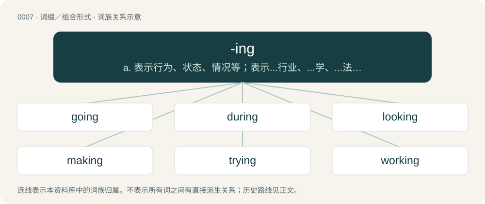

# 0007 · -ing — a. 表示行为、状态、情况等；表示...行业、...学、...法；表示总称及材料 与...有关的东西

[总目录](../00_总目录_按常用程度.md)

**类型**：词缀／组合形式　｜　**来源语言**：见词源记录

## 核心含义与来源

- 核心含义：a. 表示行为、状态、情况等；表示...行业、...学、...法；表示总称及材料 与...有关的东西
- 英文含义：As true nouns.
- 词形：-ing

**多个词源／构词路径**：同一拼写可能有不同来源；以下按词性和含义分别列出。

**来源记录 1**（后缀／后置成分；As true nouns.）

Inherited from Middle English -ing, -yng, -ynge, from Old English -ing, -ung (“-ing”, suffix forming nouns from verbs), from Proto-West Germanic \*-ingu, \*-ungu, from Proto-Germanic \*-ingō, \*-ungō (“-ing”). Cognates Cognate with Scots -in, -in', -ing (“-ing”), Yola -een (“-ing”), Saterland Frisian -enge (“-ing”), Dutch -ing (“-ing”), German and Luxembourgish -ung (“-ing”), Danish -ing, -ning (“-ing”), Icelandic, Norwegian Bokmål, Norwegian Nynorsk, and Swedish -ing (“-ing”), French -ange (“-ing”). Unrelated to Brahui -اِنْگ (-iṅg, “a suffix used to form infinitive or verbal noun from the base verb; -ing”).

**来源记录 2**（后缀／后置成分；Used to form present participles of verbs.）

From Middle English -inge, -ynge, alteration of earlier -inde, -ende, -and (see -and), from Old English -ende (present participle ending), from Proto-West Germanic \*-andī, from Proto-Germanic \*-andz (present participle ending), from Proto-Indo-European \*-onts. Cognate with West Frisian -end, Dutch -end, Afrikaans -ende, German -end, Low German -end, Danish -ende, Swedish -ande, Icelandic -andi, Gothic -𐌰𐌽𐌳𐍃 (-ands), -𐍉𐌽𐌳𐍃 (-ōnds), Latin -ans, -ant-, Ancient Greek -ων (-ōn), Sanskrit -अन्त् (-ant), Persian ـنده (-ande), Polish -ący, -ąc, Czech -oucí, Ukrainian -учий (-učyj), Serbo-Croatian -ući/-ући. More at -and.

**来源记录 3**（后缀／后置成分；Forming derivative nouns (originally masculine), with the sense ‘son of, belonging to’, as in placenames, patronymics or diminutives; -ite.）

From Middle English -ynge, from Old English -ing, from Proto-West Germanic \*-ing, from Proto-Germanic \*-ingaz. Akin to Old Norse -ingr.

## 词族图

## 单词速览（常用到不常用）

| 单词 | 音标 | 释义 |
|---|---|---|
| [going](#w-1) | 英 /ˈɡəʊ.ɪŋ/；美 /ˈɡoʊ.ɪŋ/ | n. 去, 离去, 工作情况, 地面状况, 行为；a. 进行中的, 流行的, 成功的, 现存的 |
| [during](#w-2) | /ˈdjʊə.ɹɪŋ/ | prep. 在...的时候 |
| [looking](#w-3) | /ˈlʊkɪŋ/ | a. 有…相貌的；有…样子的 |
| [making](#w-4) | /ˈmeɪkɪŋ/ | n. 制造, (手工)制造业, 制作, 形成, 发展, 要素, 内在因素, 赚头, 制造物 |
| [trying](#w-5) | /ˈtɹaɪ.ɪŋ/ | a. 难受的, 难堪的；\[法\] 裁决, 审判, 审理; 使人痛苦的, 难堪的, 难处的 |
| [working](#w-6) | 英 /ˈwɜːkɪŋ/；美 /ˈwɝkɪŋ/ | n. 工作, 运转, 劳动；a. 工作的, 劳动的, 经营的, 抽搐的, 运转的 |
| [coming](#w-7) | /ˈkʌmɪŋ/ | n. 来临；a. 就要来的, 接着的 |
| [playing](#w-8) | /ˈpleɪ.ɪŋ/ | n. 游戏, 玩耍, 竞技, 比赛, 扮演, 演奏, 赌博 |
| [saying](#w-9) | 英 /ˈseɪ.ɪŋ/ | n. 叙述, 话, 说, 言论 |
| [fucking](#w-10) | 美 /ˈfʌkɪŋ/；/ˈfʌkiŋ/ | a. 该死的, 难完成的, 难做的, 低劣的, 讨厌的, 丑恶的, 混乱的, 乱糟糟的 |
| [living](#w-11) | /ˈlɪvɪŋ/ | n. 生活, 生计, 生存；a. 活的, 逼真的, 现存的 |
| [building](#w-12) | /ˈbɪl.dɪŋ/ | n. 建筑物, 建筑；\[法\] 营造, 建筑, 建筑物 |
| [talking](#w-13) | 英 /ˈtɔːkɪŋ/；美 /ˈtɔkɪŋ/ | a. 说话的, 多嘴的, 富有表情的；n. 讲话, 谈论 |
| [according](#w-14) | 英 /əˈkɔː.dɪŋ/；美 /əˈkɔɹ.dɪŋ/ | a. 相符的, 根据...而定的；adv. 相应地 |
| [thinking](#w-15) | /ˈθɪŋkɪŋ/ | n. 思考, 思想；a. 思考的, 有理性的 |
| [king](#w-16) | 英 /ˈkɪŋɡ/；/ˈkɪŋ/ | n. 国王, 君主；vt. 使...成为君主；vi. 君临, 统治 |
| [meeting](#w-17) | 英 /ˈmiːtɪŋ/；美 /ˈmitɪŋ/ | n. 会议, 会面；\[法\] 会议, 会谈, 集会 |
| [reading](#w-18) | /ˈɹiːdɪŋ/ | n. 阅读, 知识, 读物；a. 阅读的 |
| [feeling](#w-19) | 英 /ˈfiː.lɪŋ/；美 /ˈfi.lɪŋ/ | n. 摸, 触觉, 知觉, 感觉, 情绪, 同情；a. 有同情心的, 有感觉的, 仁慈的, 动人的 |
| [amazing](#w-20) | /əˈmeɪ.zɪŋ/ | a. 令人惊异的 |
| [writing](#w-21) | /ˈɹaɪtɪŋ/ | n. 书写, 著作, 笔迹, 作品；\[医\] 书写 |
| [waiting](#w-22) | /ˈweɪtɪŋ/ | n. 等候；a. 等候的, 服侍的 |
| [seeing](#w-23) | /ˈsiː.ɪŋ/ | n. 视觉, 视力, 观看；conj. 鉴于 |
| [beginning](#w-24) | 英 /bɪˈɡɪn.ɪŋ/ | n. 开始 |
| [interesting](#w-25) | 英 /ˈɪntɹəstɪŋ/；美 /ˈɪntəɹəstɪŋ/ | a. 有趣的 |
| [leading](#w-26) | 英 /ˈliːdɪŋ/；美 /ˈlidɪŋ/ | n. 领导, 指挥, 神示, 铅板；a. 领导的, 主要的, 在前的 |
| [asking](#w-27) | 英 /ˈɑːskɪŋ/；美 /ˈæskɪŋ/ | n. 请求 |
| [calling](#w-28) | 英 /ˈkɔːlɪŋ/；美 /ˈkɔlɪŋ/ | n. 职业, 行业, 呼唤, 召集；\[计\] 呼叫 |
| [opening](#w-29) | 英 /ˈəʊ.pə.nɪŋ/；美 /ˈoʊ.pə.nɪŋ/ | n. 开始, 口子, 穴, 揭幕；a. 开始的 |
| [fighting](#w-30) | 英 /ˈfaɪ.tɪŋ/；美 /ˈfaɪ.tɪŋ/ | a. 战斗的, 容易引起争斗的, 适于格斗的, 好斗的, 好战的, 斗争的, 搏斗的；n. 战斗, 斗争, 搏斗 |
| [learning](#w-31) | 英 /ˈlɜːnɪŋ/；美 /ˈlɝnɪŋ/ | n. 学问, 学识, 学习；\[计\] 学习 |
| [telling](#w-32) | /ˈtɛlɪŋ/ | a. 有效的, 显著的, 显露内心活动的 |
| [speaking](#w-33) | 英 /ˈspiː.kɪŋ/；美 /ˈspi.kɪŋ/ | n. 谈话, 演说；a. 讲话的, 适于说的, 讲某种语言的 |
| [driving](#w-34) | /ˈdɹaɪvɪŋ/ | n. 赶, 操纵, 驾驶；a. 推进的, 强劲的, 精力旺盛的 |
| [holding](#w-35) | /ˈhəʊldɪŋ/ | n. 把持, 支持, 保持；\[法\] 租借地, 占有物, 拥有的财产 |
| [killing](#w-36) | /ˈkɪl.ɪŋ/ | n. 谋杀, 杀戮；a. 杀害的, 疲惫的, 迷人的 |
| [showing](#w-37) | 英 /ˈʃəʊɪŋ/；美 /ˈʃoʊɪŋ/ | n. 显示, 陈列, 展览, 成绩, 表现, 表演, 夸耀, 陈述, 叙述, 外表, 迹象 |
| [meaning](#w-38) | 英 /ˈmiː.nɪŋ/；美 /ˈmi.nɪŋ/ | n. 意义, 含义, 目的, 意图；a. 意味深长的 |
| [evening](#w-39) | 英 /ˈiːv.nɪŋ/；美 /ˈiv.nɪŋ/ | n. 傍晚, 晚间, 末期 |
| [putting](#w-40) | /ˈpʊtɪŋ/ | n. 投掷；（高尔夫球）打球入洞 |
| [sitting](#w-41) | /ˈsɪtɪŋ/ | n. 入席, 就坐, 开庭, 孵卵；a. 坐着的, 就座的, 在职的, 在孵卵中的, 易被击中的 |
| [standing](#w-42) | /ˈstændɪŋ/ | n. 起立, 持续, 身分；a. 立着的, 不动的, 经常的, 持续的 |
| [walking](#w-43) | 英 /ˈwɔː.kɪŋ/；美 /ˈwɔ.kɪŋ/ | n. 步行, 步态；a. 步行的, 步行用的 |
| [finding](#w-44) | /ˈfaɪndɪŋ/ | n. 发现, 发现物, 决定, 裁决；\[法\] 调查结果, 对事实的认定, 判定的要素 |
| [wedding](#w-45) | 英 /ˈwɛdɪŋ/ | n. 婚礼, 结婚, 结婚周年纪念日, 结合；\[法\] 结婚, 婚礼, 结婚纪念日 |
| [acting](#w-46) | /ˈæk.tɪŋ/ | n. 演戏, 装腔作势；a. 代理的, 演出用的, 起作用的 |
| [hearing](#w-47) | 英 /ˈhɪə.ɹɪŋ/；美 /ˈhɪɹ.ɪŋ/ | n. 听, 听觉, 听讯；\[医\] 听, 听觉 |
| [understanding](#w-48) | 英 /ʌndəˈstandɪŋ/；美 /ˌʌndɚˈstændɪŋ/ | n. 理解, 谅解；\[法\] 协商, 协议, 谅解 |
| [engineering](#w-49) | 英 /ˌɛn(d)ʒɪˈnɪə.ɹɪŋ/；美 /ˌɛn.d͡ʒɪˈnɪ(ə)ɹ.ɪŋ/ | n. 工程学, 工程, 操纵；\[化\] 机器; 机器学 |
| [happening](#w-50) | 英 /ˈhæpɪnɪŋ/ | n. 事件, 意外发生的事 |
| [helping](#w-51) | /ˈhɛlpɪŋ/ | n. 帮助, 协助, 一份 |
| [shooting](#w-52) | /ˈʃuːtɪŋ/ | n. 发射, 猎场, 射击 |
| [housing](#w-53) | /ˈhaʊzɪŋ/ | n. 遮盖, 住房供给, 居留(处), 房屋, 装饰；\[化\] 外壳 |
| [knowing](#w-54) | 英 /ˈnəʊɪŋ/；美 /ˈnoʊɪŋ/ | a. 博学的, 聪颖的, 精明的 |
| [buying](#w-55) | /ˈbaɪ.ɪŋ/ | \[经\] 买气; 买进 |
| [paying](#w-56) | /ˈpeɪ.ɪŋ/ | a. 支付的, 付款的, 有利的, 赢利的, 合算的；\[经\] 支付 |
| [teaching](#w-57) | /ˈtiːt͡ʃɪŋ/ | n. 教学, 学说, 教导 |
| [flying](#w-58) | /ˈflaɪ.ɪŋ/ | a. 飞的, 飘扬的, 飞速的；n. 飞行, 飞花 |
| [spending](#w-59) | /ˈspɛndɪŋ/ | n. 经费, 开销；\[经\] 开支, 开销, 经费 |
| [turning](#w-60) | 英 /ˈtɜː.nɪŋ/；美 /ˈtɝ.nɪŋ/ | n. 旋转, 转弯处, 车削工作；\[化\] 车削 |
| [ending](#w-61) | /ˈɛndɪŋ/ | n. 终止, 终了, 收场；\[医\] 末梢 |
| [increasing](#w-62) | /ɪnˈkɹiːsɪŋ/ | \[经\] 递增 |
| [hoping](#w-63) | 英 /ˈhəʊpɪŋ/；美 /ˈhoʊpɪŋ/ | v. 希望（hope的ing形式） |
| [lying](#w-64) | 英 /ˈlaɪ.ɪŋ/ | n. 说谎；a. 横躺的, 说谎的 |
| [listening](#w-65) | /ˈlɪs.nɪŋ/ | n. 听, 监听；a. 助听用的 |
| [lunch](#w-66) | 英 /lʌnt͡ʃ/ | n. 午餐 |
| [dying](#w-67) | /ˈdaɪ.ɪŋ/ | a. 垂死的；\[法\] 快要死的, 垂死的, 临终的 |
| [passing](#w-68) | 英 /ˈpɑːsɪŋ/ | n. 通过, 逝去, 死, 流逝；a. 经过的, 流逝的, 目前的, 短暂的, 及格的, 仓促的 |
| [cutting](#w-69) | 英 /ˈkʌtɪŋ/ | n. 切断, 切下, 路堑；\[化\] 切屑 |
| [laughing](#w-70) | /ˈlɑːfɪŋ/ | a. 一笑置之的, 高兴的；n. 笑 |
| [dealing](#w-71) | /ˈdiːlɪŋ/ | n. 经营行为, 行为, 交易；\[法\] 待遇, 处置, 行为 |
| [offering](#w-72) | 英 /ˈɒfəɹɪŋ/；美 /ˈɔfəɹɪŋ/ | n. 提供, 奉献物, 牲礼, 上市的股票(或证券等)；\[经\] 出售物 |
| [saving](#w-73) | 英 /ˈseɪ.vɪŋ/ | n. 存款, 挽救, 节约；a. 搭救的, 节约的, 保留的, 补偿的；prep. 除...之外 |
| [singing](#w-74) | /ˈsɪŋɪŋ/ | n. 歌唱, 歌声；\[计\] 振鸣; 蜂鸣 |
| [drawing](#w-75) | 英 /ˈdɹɔː.ɪŋ/；美 /ˈdɹɑ.ɪŋ/ | n. 图画, 制图, 拉；\[计\] 绘图 |
| [seeking](#w-76) | /ˈsiː.kɪŋ/ | \[计\] 查找, 寻找, 故障检查 |
| [crying](#w-77) | /ˈkɹaɪ̯.ɪŋ/ | a. 叫喊的, 嚎哭的, 迫切的, 臭名昭著的 |
| [performing](#w-78) | 英 /pəˈfɔːmɪŋ/；美 /pɚˈfɔɹmɪŋ/ | a. 表演的, 履行的 |
| [advertising](#w-79) | 英 /ˈædvəˌtaɪzɪŋ/；美 /ˈædvɚˌtaɪzɪŋ/ | n. 广告业, 广告；a. 广告的；\[计\] 发广告 |
| [suffering](#w-80) | /ˈsʌfəɹɪŋ/ | n. 苦难, 受苦 |
| [shipping](#w-81) | /ˈʃɪpɪŋ/ | n. 装运, 航行, 船舶, 船舶吨数；\[经\] 装运, 运送, 海运 |
| [smoking](#w-82) | 英 /ˈsməʊkɪŋ/；美 /ˈsmoʊkɪŋ/ | n. 抽烟, 冒烟；\[医\] 烟熏; 吸烟 |
| [dancing](#w-83) | 英 /ˈdɑːns.ɪŋ/；美 /ˈdæns.ɪŋ/ | n. 舞蹈；\[建\] 跳动的 |
| [hanging](#w-84) | 英 /ˈhæŋɪŋ/；美 /hæŋɪŋ/ | 縊死 /缢死、絞刑 /绞刑、吊死 |
| [outstanding](#w-85) | 英 /ˌaʊtˈstæn.dɪŋ/ | a. 杰出的, 突出的, 未偿付的, 未决定的；\[经\] 未解决的, 未偿付 |
| [riding](#w-86) | /ˈɹaɪ.dɪŋ/ | n. 骑, 乘车, 乘, 骑术, 骑马 |
| [wanting](#w-87) | 英 /ˈwɒntɪŋ/；美 /ˈwɑntɪŋ/ | a. 欠缺的, 不足的, 不够格的；prep. 没有, 缺少 |
| [heading](#w-88) | /ˈhɛdɪŋ/ | n. 标题, 起始字, 方向；\[计\] 上标题 |
| [clothing](#w-89) | 英 /ˈkləʊðɪŋ/；美 /ˈkloʊðɪŋ/ | n. 衣服 |
| [fishing](#w-90) | /ˈfɪʃɪŋ/ | n. 钓鱼, 鱼业；a. 钓鱼的 |
| [parking](#w-91) | 英 /ˈpɑː.kɪŋ/；美 /ˈpɑɹ.kɪŋ/ | n. 停车；a. 停车的 |
| [rolling](#w-92) | 英 /ˈɹəʊ.lɪŋ/；美 /ˈɹol.ɪŋ/ | a. 旋转的, 波动的, 起伏的；n. 旋转, 轰响, 动摇 |
| [reaching](#w-93) | /ˈɹiːt͡ʃɪŋ/ | v. 到达( reach的现在分词 ); 联络; 伸出手臂, 延伸 |
| [cooking](#w-94) | 英 /ˈkʊkɪŋ/；/ˈkuːkɪŋ/ | n. 烹饪；\[化\] 熬炼; 热炼; 蒸煮 |
| [covering](#w-95) | /ˈkʌvəɹɪŋ/ | n. 覆盖物, 掩蔽物；a. 掩护的, 掩盖的；\[计\] 覆盖 |
| [raising](#w-96) | /ˈɹeɪzɪŋ/ | \[机\] 起油 |
| [swimming](#w-97) | /ˈswɪmɪŋ/ | n. 游泳, 眩晕 |
| [hunting](#w-98) | /ˈhʌntɪŋ/ | n. 狩猎, 猎狐, 探求；\[计\] 寻找平衡; 寻找 |
| [annoying](#w-99) | /əˈnɔɪ.ɪŋ/ | a. 恼人的, 讨厌的 |
| [handling](#w-100) | /ˈhændl̩ɪŋ/ | n. 处理；a. 操作的 |
| [programming](#w-101) | 英 /ˈpɹəʊɡɹəmɪŋ/；美 /ˈpɹoʊɡɹæmɪŋ/ | n. 节目的计划, 编制程序；\[计\] 程序设计; 程序编制 |
| [pulling](#w-102) | /ˈpʊlɪŋ/ | \[计\] 拉单晶的 |
| [monitoring](#w-103) | 美 /ˈmɑnɪtɚɪŋ/ | \[计\] 监控, 监督, 监视；\[经\] 检验, 检查, 控制 |
| [upcoming](#w-104) | /ˈʌp.kʌmiŋ/ | 【英文】The activity of to upcome. |
| [attending](#w-105) | /əˈtɛndɪŋ/ | a. 主治的 |
| [concerning](#w-106) | 英 /kənˈsɜːnɪŋ/；美 /kənˈsɝnɪŋ/ | prep. 关于；\[法\] 关于 |
| [accounting](#w-107) | /əˈkaʊn.tɪŋ/ | n. 会计学, 帐单, 清帐；\[计\] 帐户处理, 记帐 |
| [attacking](#w-108) | /əˈtækɪŋ/ | v. 进攻；攻击（attack的现在分词）；攻球 |
| [lighting](#w-109) | 英 /ˈlaɪtɪŋ/；美 /ˈlaɪtɪŋ/ | n. 照明, 照明设备, 舞台灯光 |
| [breathing](#w-110) | 英 /ˈbɹiːðɪŋ/；美 /ˈbɹiðɪŋ/ | n. 呼吸, 瞬间, 微风；a. 呼吸的, 逼真的 |
| [printing](#w-111) | /ˈpɹɪntɪŋ/ | n. 印刷, 印刷术, 印花；\[计\] 打印; 印刷 |
| [surprising](#w-112) | 英 /səˈpɹaɪzɪŋ/；美 /sɚˈpɹaɪzɪŋ/ | a. 令人惊讶的 |
| [challenging](#w-113) | /ˈt͡ʃæl.ɪn.d͡ʒɪŋ/ | a. 挑战的, 引起争论的 |
| [stunning](#w-114) | /ˈstʌniŋ/ | a. 打昏迷的, 弄得人昏头昏脑的, 令人震惊的 |
| [traveling](#w-115) | /ˈtɹæv.lɪŋ/ | a. 旅行的, 旅行用的, 移动的 |
| [gathering](#w-116) | 英 /ˈɡæð.ə.ɹɪŋ/；美 /ˈɡæð.ɚ.ɪŋ/ | n. 聚集, 集中, 采集；\[化\] 富集 |
| [backing](#w-117) | /ˈbæk.ɪŋ(ɡ)/ | n. 后退, 衬背, 后援, 支持者；\[化\] 衬垫 |
| [healing](#w-118) | /ˈhiːlɪŋ/ | a. 治愈的, 恢复健康的；\[计\] 修复, 恢复 |
| [bearing](#w-119) | 英 /ˈbɛə̯ɹɪŋ/；美 /ˈbɛɹɪŋ/ | n. 举止, 轴承, 忍受, 关系, 意义, 方向, 生育；\[化\] 轴承 |
| [lightning](#w-120) | 美 /ˈlaɪt.nɪŋ/；/ˈlaɪt.nɪŋ/ | n. 闪电；vi. 闪电；a. 闪电的 |
| [streaming](#w-121) | /ˈstɹiːmɪŋ/ | \[电\] 流 |
| [touching](#w-122) | /ˈtʌt͡ʃɪŋ/ | a. 动人的, 令人同情的 |
| [farming](#w-123) | 英 /ˈfɑːmɪŋ/；美 /ˈfɑɹmɪŋ/ | n. 农业, 耕作 |
| [blowing](#w-124) | 英 /ˈbləʊ.ɪŋ/；美 /ˈbloʊ.ɪŋ/ | \[机\] 吹制 |
| [caring](#w-125) | 英 /ˈkɛə.ɹɪŋ/；美 /ˈkɛɹ.ɪŋ/ | a. 有同情心的；表示或感到关怀或关心的 |
| [pointing](#w-126) | 英 /ˈpɔɪntɪŋ/；美 /ˈpɔɪntɪŋ/ | \[计\] 指向, 指点 |
| [threatening](#w-127) | /ˈθɹɛtə.nɪŋ/ | a. 胁迫的, 危险的；\[法\] 威胁的, 恐吓的, 危险的 |
| [collecting](#w-128) | /kəˈlɛktɪŋ/ | v. 收集( collect的现在分词 ); 收到; 收藏; 聚积 |
| [heating](#w-129) | /ˈhiːtɪŋ/ | n. 加热, 供热, 暖气设备, 供暖系统, 暖气装置；a. 加热的, 供暖的 |
| [boxing](#w-130) | 英 /ˈbɒksɪŋ/；美 /ˈbɑːksɪŋ/ | n. 拳击；\[医\] 围模(牙科) |
| [dressing](#w-131) | /ˈdɹɛsɪŋ/ | n. 调味品, 穿衣, 化妆；\[化\] 追肥 |
| [believing](#w-132) | 英 /bɪˈliː.vɪŋ/；美 /bɪˈli.vɪŋ/ | a. 信任他人的, 有信仰的 |
| [casting](#w-133) | 英 /ˈkɑːstɪŋ/；美 /ˈkæstɪŋ/ | n. 投掷, 铸成品, 角色分配；\[化\] 浇铸; 铸品 |
| [screening](#w-134) | /ˈskɹiːnɪŋ/ | \[医\] 筛选, 筛分(如普查癌、结核等病), 萤光屏检查 |
| [binding](#w-135) | /ˈbaɪndɪŋ/ | n. 装订；\[计\] 联编; 汇集; 绑定, 捆绑 |
| [demanding](#w-136) | 英 /dɪˈmɑːndɪŋ/；美 /dəˈmændɪŋ/ | a. 要求高的, 费力的 |
| [climbing](#w-137) | 美 /ˈklaɪ̯mɪŋ/ | a. 攀缘而登的, 上升的；n. 攀登 |
| [worrying](#w-138) | 英 /ˈwʌɹi.ɪŋ/；/ˈwʌɹi.ɪŋ/ | a. 使人烦恼的, 忧虑重重的 |
| [entertaining](#w-139) | /ˌɛntəɹˈteɪnɪŋ/ | a. 使人愉快的, 有趣的 |
| [fitting](#w-140) | 英 /ˈfɪtɪŋ/；美 /ˈfɪtɪŋ/ | a. 适宜的；n. 试穿, 试衣, 装配, 装置 |
| [shocking](#w-141) | 英 /ˈʃɒkɪŋ/；美 /ˈʃɑkɪŋ/ | a. 令人震惊的, 极坏的, 不正当的 |
| [breeding](#w-142) | /ˈbɹiːdɪŋ/ | n. 教养, 生育, 饲养；\[医\] 生育, 繁殖, 育种, 饲养 |
| [overwhelming](#w-143) | 英 /ˌəʊvəˈwɛlmɪŋ/；美 /ˌoʊvɚˈwɛlmɪŋ/ | a. 压倒性的, 无法抵抗的 |
| [answering](#w-144) | 英 /ˈɑːn.sə.ɹɪŋ/；美 /ˈæn.sɚ.ɪŋ/ | \[计\] 应答 |
| [charming](#w-145) | 英 /ˈtʃɑː(ɹ).mɪŋ/ | a. 迷人的, 有吸引力的 |
| [blessing](#w-146) | /ˈblɛs.ɪŋ/ | n. 祝福 |
| [packing](#w-147) | 英 /ˈpakɪŋ/；美 /ˈpækɪŋ/ | n. 包装, 填垫材料, 封函, 行李；\[化\] 填充物; 填料; 填充; 装柱; 装色谱柱; 垫革; 紧束; 敛集; 堆积 |
| [belonging](#w-148) | 英 /bɪˈlɒŋɪŋ/；美 /bɪˈlɔŋɪŋ/ | \[法\] 附属物 |
| [warming](#w-149) | 英 /ˈwɔːmɪŋ/；美 /ˈwoɹmɪŋ/ | n. 暖和, 加温, 暖热, 温暖, (非正式)打, 鞭打 |
| [clearing](#w-150) | 英 /ˈklɪəɹɪŋ/；美 /ˈklɪɹɪŋ/ | n. 清扫, 空地, 票据清算；\[经\] 票据交换, 结算, 结帐 |
| [questioning](#w-151) | 美 /ˈkwɛʃ.tə.nɪŋ/；/ˈkwɛs.t͡ʃə.nɪŋ/ | \[法\] 审问, 讯问, 质问 |
| [yelling](#w-152) | /jelɪŋ/ | v. 叫喊, 号叫, 叫着说( yell的现在分词 ) |
| [flowing](#w-153) | 英 /ˈfləʊ.ɪŋ/；美 /ˈfloʊ.ɪŋ/ | a. 流动的, 如流的, 平滑的 |
| [proving](#w-154) | /ˈpɹuːvɪŋ/ | \[计\] 验证, 证明；\[医\] 药力试验(顺势疗法的名词) |
| [spelling](#w-155) | 英 /ˈspɛl.ɪŋ/ | n. 拼, 拼字, 拼法；\[计\] 拼写检查 |
| [liking](#w-156) | /ˈlaɪkɪŋ/ | n. 爱好, 嗜好 |
| [sailing](#w-157) | /ˈseɪ.lɪŋ/ | n. 航行, 航海术, 启航；a. 航行的 |
| [stepping](#w-158) | /ˈstɛpɪŋ/ | \[计\] 步进式, 改变 |
| [bullying](#w-159) | 英 /ˈbʊ.li.ɪŋ/ | v. 恐吓, 威逼( bully的现在分词 ); 豪; 跋扈 |
| [frustrating](#w-160) | 英 /fɹəˈstɹeɪ̯tɪŋ/；美 /ˈfɹʌsˌtɹeɪ̯tɪŋ/ | a. 令人沮丧的 |
| [kissing](#w-161) | 英 /ˈkɪsɪŋ/ | a. 接吻的 |
| [revealing](#w-162) | 英 /ɹɪˈviːlɪŋ/；美 /ɹɪˈvilɪŋ/ | a. 暴露的, 显露的, 揭露的 |
| [marking](#w-163) | 英 /ˈmɑːkɪŋ/；美 /ˈmɑɹkɪŋ/ | n. 印记, 印, 分；\[计\] 标志 |
| [guessing](#w-164) | /ˈɡɛsɪŋ/ | v. 猜( guess的现在分词 ); （引出令人惊奇或激动的事）你猜; 猜对; 猜中 |
| [modeling](#w-165) | /ˈmɔdliŋ/ | n. 模特儿职业, 立体感；\[计\] 建模, 模型化, 模拟 |
| [begging](#w-166) | /ˈbɛɡɪŋ/ | v. 乞讨, 乞求；行乞（beg的现在分词形式） |
| [drilling](#w-167) | /ˈdɹɪlɪŋ/ | n. 演练；\[医\] 钻 |
| [satisfying](#w-168) | /ˈsætɪsfaɪ.ɪŋ/ | a. 满意的, 充分的, 足可相信的 |
| [baking](#w-169) | /ˈbeɪkɪŋ(ɡ)/ | n. 烘焙, 一次烘焙的量；\[机\] 烘, 焙, 烤干 |
| [damaging](#w-170) | 英 /ˈdæmɪd͡ʒɪŋ/ | a. 破坏性的, 损害的 |
| [misleading](#w-171) | /(ˌ)mɪsˈliːdɪŋ/ | a. 引入歧途的, 使人误解的, 骗人的；\[法\] 误写姓名的, 误称的, 令人误解的 |
| [sounding](#w-172) | 英 /ˈsaʊndɪŋ/ | a. 发出声音的, 响亮的, 夸大的, 听上去堂皇的, 夸张的；n. 测深, 水深测量, 探空, 试探, 调查, 搜集意见 |
| [trafficking](#w-173) | /ˈtræfikɪŋ/ | n. 非法交易 |
| [hacking](#w-174) | /ˈhækɪŋ/ | \[计\] 程序"挖口"不轨用机 |
| [leaning](#w-175) | /ˈliːnɪŋ/ | n. 倾斜, 倾向, 爱好 |
| [blaming](#w-176) | /ˈbleɪmɪŋ/ | vbl. 归咎；责备；谴责 |
| [mounting](#w-177) | /ˈmaʊntɪŋ/ | n. 装备, 衬托纸, 舞台效果, 上马；\[化\] 装配 |
| [stretching](#w-178) | /ˈstɹɛt͡ʃɪŋ/ | \[机\] 伸展作业, 锻伸作业 |
| [batting](#w-179) | /ˈbætɪŋ/ | n. 击球, 球棒的使用, 棉絮；\[机\] 棉胎 |
| [recovering](#w-180) |  | n. 恢复；补偿；再生 |
| [agreeing](#w-181) |  | v. 同意（agree的ing形式） |
| [declaring](#w-182) | 英 /dɪˈklɛəɹɪŋ/；美 /dɪˈklɛɹɪŋ/ | n. 宣告行为, 说明 |
| [dragging](#w-183) | /ˈdɹæɡɪŋ/ | \[计\] 牵引, 慢移动 |
| [coding](#w-184) | 英 /kəʊdɪŋ/；美 /koʊdɪŋ/ | n. 译码；\[计\] 编码 |
| [banning](#w-185) | /ˈbænɪŋ/ | \[人名\] 班宁; \[地名\] \[美国\] 班宁 |
| [wandering](#w-186) | 英 /ˈwɒndəɹɪŋ/；美 /ˈwɑndəɹɪŋ/ | a. 漫游的, 徘徊的, 流浪的, 蜿蜒的；n. 闲逛, 流浪, 离题, 胡言乱语 |
| [lowering](#w-187) | 英 /ˈlaʊərɪŋ/；美 /ˈlaʊərɪŋ/ | 【英文】Dark and menacing. |
| [communicating](#w-188) | 英 /kəˈmjuː.nɪ.keɪ.tɪŋ/；美 /kəˈmju.nəˌkeɪ.tɪŋ/ | \[计\] 通信的 |
| [welcoming](#w-189) | /ˈwelkəmɪŋ/ | v. 欢迎( welcome的现在分词 ); 迎接; 乐于接受; 希望有 |
| [brewing](#w-190) | /ˈbɹuːɪŋ/ | n. 酿造, 一次酿造的量；\[机\] 酿造, 酿酒 |
| [locking](#w-191) | /ˈlɔkiŋ/ | \[计\] 锁定; 加锁 |
| [boiling](#w-192) | 英 /ˈbɔɪlɪŋ/ | a. 沸腾的, 激昂的；adv. 沸腾 |
| [borrowing](#w-193) | /ˈbɔrəwɪŋ/ | \[经\] 借款, 贷款 |
| [pleasing](#w-194) | 英 /ˈpliːzɪŋ/；美 /ˈplizɪŋ/ | a. 令人喜爱的, 愉快的, 舒适的 |
| [briefing](#w-195) | 英 /ˈbɹiː.fɪŋ/；美 /ˈbɹi.fɪŋ/ | n. 简报；\[法\] 简报, 情况的简要介绍 |
| [drying](#w-196) | /ˈdɹaɪ.ɪŋ/ | \[计\] 干燥的；\[化\] 干燥 |
| [dwelling](#w-197) | /ˈdwɛl.ɪŋ/ | n. 住处；\[医\] 住房 |
| [preceding](#w-198) | /pɹɪˈsiːdɪŋ/ | a. 在前的, 前面的；\[法\] 在前的, 在先的, 前面的 |
| [awakening](#w-199) | /əˈweɪ̯kənɪŋ/ | n. 唤醒, 觉醒, 被唤起；a. 觉醒中的 |
| [rocking](#w-200) | 英 /ˈɹɒkɪŋ/；美 /ˈɹɑkɪŋ/ | a. 摇摆的, 摇动的；\[电\] 摇移 |
| [shaping](#w-201) | /ˈʃeipiŋ/ | n. 成形, 塑造；a. 成形的, 塑造的；\[计\] 整形 |
| [surfing](#w-202) | 美 /ˈsɝfɪŋ/ | n. 冲浪运动 |
| [trusting](#w-203) | /ˈtɹʌstɪŋ/ | a. 轻信的, 信任他人的, 深信不疑的 |
| [rubbing](#w-204) | /ˈɹʌbɪŋ/ | n. 摩擦, 研磨, 摹拓；\[化\] 打磨 |
| [winding](#w-205) | 英 /ˈwɪndɪŋ/ | n. 绕, 卷, 弯曲, 线圈；a. 蜿蜒的, 卷绕的, 弯曲的 |
| [coping](#w-206) | /ˈkəupiŋ/ | n. 墙压顶, 顶部, 顶盖, 墙的顶部；\[医\] 盖 |
| [misunderstanding](#w-207) | 英 /ˌmɪsʌndəˈstændɪŋ/；美 /ˌmɪsʌndɚˈstændɪŋ/ | n. 误会, 误解；\[法\] 误解, 误会, 不和 |
| [battling](#w-208) | /ˈbæt(ə)l/ | 【英文】Engaged in battle. |
| [chilling](#w-209) | /ˈt͡ʃɪlɪŋ/ | \[计\] 冷却, 致冷 |
| [sewing](#w-210) | 英 /ˈsəʊɪŋ/；美 /ˈsoʊɪŋ/ | n. 缝制品, 缝纫 |
| [bathing](#w-211) | 英 /ˈbeɪˌðɪŋ(ɡ)/ | n. 游泳, 洗海水澡 |
| [decreasing](#w-212) | /diˈkɹiːsɪŋ/ | \[计\] 下降的 |
| [flashing](#w-213) | /ˈflæʃɪŋ/ | n. 闪光, 遮雨板, 防水板；\[电\] 闪光 |
| [speeding](#w-214) | /ˈspiːdɪŋ/ | n. 超速行驶 |
| [tying](#w-215) | /ˈtaɪ.ɪŋ/ | tie的现在分词 |
| [frightening](#w-216) | /ˈfɹaɪtənɪŋ/ | a. 令人恐惧的；引起突然惊恐的 |
| [gardening](#w-217) | 英 /ˈɡɑː.dən.ɪŋ/；美 /ˈɡɑɹ.dən.ɪŋ/ | n. 园艺(学) |
| [punching](#w-218) | 英 /ˈpʌnt͡ʃɪŋ/；美 /ˈpʌnt͡ʃɪŋ/ | \[计\] 穿孔；\[化\] 冲孔 |
| [smashing](#w-219) | /ˈsmæʃɪŋ/ | a. 猛烈的, 发出撞击声的, 了不起的, 轰动的 |
| [sweating](#w-220) | /ˈswɛtɪŋ/ | \[化\] 发汗；\[医\] 出汗；\[经\] 汗损 |
| [acknowledging](#w-221) |  | n. 确认；答谢顾客 |
| [buzzing](#w-222) | 英 /ˈbʌzɪŋ/ | a. 嗡嗡响的, 营营响的；\[电\] 发蜂音 |
| [spying](#w-223) | /ˈspaɪ.ɪŋ/ | \[法\] 间谍活动, 侦探 |
| [tasting](#w-224) | /ˈteɪstɪŋ/ | n. 品尝, 尝味 |
| [stalking](#w-225) | /ˈstɔːkɪŋ/ | n. 围捕；潜行追踪 |
| [chewing](#w-226) |  | \[医\] \[咀\]嚼 |
| [chanting](#w-227) |  | 念咒 |
| [renting](#w-228) | /ˈɹɛntɪŋ/ | v. 租用；出租（rent的ing形式） |
| [trending](#w-229) | /trendɪŋ/ | v. 伸向( trend的现在分词 ); 趋向; 倾向; 使趋向 |
| [exceeding](#w-230) | /ɪkˈsiːdɪŋ/ | a. 超越的, 非常的, 极度的 |
| [exhausting](#w-231) | /ɪɡˈzɔ(ː)stɪŋ/ | a. 使耗尽的, 使人筋疲力尽的；\[计\] 经验, 技巧, 穷举, 耗尽, 排气 |
| [outgoing](#w-232) | /aʊtˈɡəʊɪŋ/ | n. 外出, 开支, 流出；a. 喜欢外出的, 即将离职的, 乐于助人的 |
| [transporting](#w-233) |  | 猜火车（电影名）；运输 |
| [airing](#w-234) | 英 /ˈɛəɹɪŋ/；美 /ˈɛɹɪŋ/ | n. 晾, 通风, 兜风；\[化\] 充气 |
| [wrapping](#w-235) | /ˈɹæp.ɪŋ/ | n. 用于包裹的材料；\[计\] 绕接 |
| [handwriting](#w-236) | /ˈhændɹaɪtɪŋ/ | n. 笔迹 |
| [piercing](#w-237) | 英 /ˈpɪəsɪŋ/；美 /ˈpɪɹsɪŋ/ | a. 尖厉的, 刺耳的, 刺骨的, 刺穿的, 敏锐的, 彻骨的, 辛辣的, 讽刺的；\[化\] 冲孔 |
| [craving](#w-238) | /ˈkɹeɪ.vɪŋ/ | n. 渴望, 热望；\[医\] 瘾, 癖, 嗜欲 |
| [fencing](#w-239) | /ˈfɛnsɪŋ/ | n. 围墙, 剑术；\[法\] 围栏, 买卖赃物, 辩论 |
| [tipping](#w-240) | /ˈtɪpɪŋ/ | n. 倾卸台 |
| [topping](#w-241) | 英 /ˈtɒpɪŋ/；美 /ˈtɑpɪŋ/ | a. 极好的, 主要的, 一流的；n. 除顶部, 修剪树稍, 剪落之小树枝 |
| [tracing](#w-242) | /ˈtɹeɪsɪŋ/ | n. 描摹, 描图, 追踪；\[计\] 跟踪 |
| [blasting](#w-243) | /ˈblɑːstiŋ/ | \[计\] 过载失真 |
| [creeping](#w-244) | /ˈkɹiːpɪŋ/ | n. 爬行；a. 爬行的 |
| [rooting](#w-245) | /ˈruːtiŋ/ | \[计\] 求根 |
| [routing](#w-246) | 英 /ˈɹuːtɪŋ/；美 /ˈɹutɪŋ/ | \[计\] 路由选择; 布线 |
| [teasing](#w-247) | 英 /ˈtiːz.ɪŋ/；美 /ˈtiz.ɪŋ/ | \[医\] 针拨开法 |
| [impending](#w-248) | /ɪmˈpɛndɪŋ/ | a. 即将发生的, 迫切的, 悬空的；\[法\] 就要来的, 逼在眼前的, 紧急的 |
| [swearing](#w-249) |  | \[法\] 发誓, 宣誓 |
| [wiring](#w-250) | /ˈwaiəriŋ/ | n. 线路, 接线；\[计\] 布线 |
| [barking](#w-251) | 英 /ˈbɑːkɪŋ/；美 /ˈbɑɹkɪŋ/ | \[机\] 去皮, 剥皮 |
| [descending](#w-252) | /dɪˈsɛn.dɪŋ/ | a. 下降的, 下行的；\[计\] 递减 |
| [absorbing](#w-253) | 英 /əbˈzɔː.bɪŋ/；美 /æbˈzɔɹ.bɪŋ/ | a. 吸引人的, 非常有趣的；\[机\] 吸收的 |
| [footing](#w-254) | /ˈfʊtɪŋ/ | n. 站稳, 立足点, 立场, 关系；\[化\] 脚子(糖浆下脚的结晶) |
| [longing](#w-255) | 英 /ˈlɒŋɪŋ/；美 /ˈlɔːŋɪŋ/ | n. 渴望, 热望, 憧憬；a. 渴望的, 热望的 |
| [outing](#w-256) | /ˈaʊtɪŋ/ | n. 郊游, 远足；a. 远足适用的 |
| [siding](#w-257) | /ˈsaɪdɪŋ/ | n. 侧线, 旁轨, 边宽 |
| [stocking](#w-258) | 英 /ˈstɒkɪŋ/；美 /ˈstɑkɪŋ/ | n. 长袜；\[医\] 马足水肿; 长袜 |
| [herring](#w-259) | /ˈhɛɹɪŋ/ | n. 青鱼, 鲱 |
| [sealing](#w-260) | /ˈsiːlɪŋ/ | \[化\] 封闭; 封闭处理；\[医\] 封闭, 封口(创伤) |
| [coupling](#w-261) | /ˈkʌplɪŋ/ | n. 联结, 结合, 耦合；\[计\] 耦合 |
| [doping](#w-262) | 美 /ˈdoʊpɪŋ/ | \[计\] 掺杂；\[化\] 掺杂 |
| [forecasting](#w-263) | /ˈfɔːkɑːstiŋ/ | \[计\] 预报, 预测；\[经\] 预测 |
| [contrasting](#w-264) | /kənˈtrɑːstɪŋ/ | v. （靠近或作比较时）显出明显的差异, 形成对比( contrast的现在分词 ); 对比, 对照 |
| [flattering](#w-265) | /ˈflætəɹɪŋ/ | a. 谄媚的, 讨人欢喜的 |
| [ticking](#w-266) | /ˈtɪkɪŋ/ | n. 坚质棉布 |
| [abiding](#w-267) | 美 /əˈbaɪ.dɪŋ/ | a. 永久的, 持久的, 不变的 |
| [cunning](#w-268) | /ˈkʌnɪŋ/ | a. 狡猾的, 巧妙的, 可爱的；\[法\] 狡猾的的, 狡诈的, 熟练的 |
| [knitting](#w-269) | /ˈnɪtɪŋ/ | n. 编结, 针织法, 针织, 编结法, 编结物, 针织品；\[医\] 骨愈合 |
| [blending](#w-270) | /ˈblɛndɪŋ/ | n. 混合, 混合物, 混成；\[化\] 掺合; 倒圆 |
| [lodging](#w-271) | 英 /ˈlɒd͡ʒɪŋ/；美 /ˈlɑd͡ʒɪŋ/ | n. 寄宿处, 寄宿；\[法\] 提起, 住所 |
| [shrinking](#w-272) | 英 /ˈʃɹɪŋkɪŋ/ | \[医\] 皱缩 |
| [lingering](#w-273) | 英 /ˈlɪŋɡəɹɪŋ/ | a. 拖延的 |
| [upbringing](#w-274) | /ˈʌpˌbrɪŋɪŋ/ | n. 教养 |
| [rigging](#w-275) | /ˈɹɪɡɪŋ/ | n. 索具, 装备；\[经\] 提价 |
| [spraying](#w-276) | /ˈspreiiŋ/ | \[化\] 喷镀; 喷涂；\[医\] 喷雾, 喷水 |
| [bedding](#w-277) | 美 /ˈbɛdɪŋ/ | n. 被褥, 寝具, 床上用品, 基床；\[机\] 褥草, 被褥 |
| [daunting](#w-278) | 英 /ˈdɔːntɪŋ/；美 /ˈdɔntɪŋ/ | a. 使人畏缩的 |
| [flushing](#w-279) | /ˈflʌʃɪŋ/ | \[计\] 冲洗；\[化\] 涌料 |
| [practising](#w-280) |  | a. 在从事职业的, 在从事活动的 |
| [shitting](#w-281) | /ˈʃɪtɪŋ/ | v. 大便, 拉屎( shit的现在分词 ); 拉屎弄脏（某物）; 取笑; 欺骗 |
| [yielding](#w-282) | /ˈjiːldɪŋ/ | a. 生产的, 屈从的, 柔顺的, 易弯曲的；\[化\] 屈服 |
| [dazzling](#w-283) | /ˈdæz.l̩.ɪŋ/ | a. 眼花缭乱的, 耀眼的 |
| [jogging](#w-284) | 英 /ˈd͡ʒɒɡ.ɪŋ/；美 /ˈd͡ʒɑ.ɡɪŋ/ | n. 慢跑；\[电\] 轻摇 |
| [itching](#w-285) | /ˈɪt͡ʃɪŋ/ | a. 渴望的, 痒的；\[医\] 痒, 瘙痒 |
| [clapping](#w-286) | /ˈklæpɪŋ/ | n. 掌声, 拍手声；\[医\] 拍打法(按摩的一种手法) |
| [trucking](#w-287) | 英 /ˈtɹʌkɪŋ/ | n. 货车运输业；货车运输；以货易货 |
| [roasting](#w-288) | 英 /ˈɹəʊstɪŋ/；美 /ˈɹoʊstɪŋ/ | a. 非常热的；adv. 非常热地 |
| [rotting](#w-289) | /ˈrɔtiŋ/ | vt. 深蚀刻；腐败, 腐坏之（rot的现在分词形式） |
| [boating](#w-290) | 英 /ˈbəʊtɪŋ/；美 /ˈboʊtɪŋ/ | n. 划船 |
| [scraping](#w-291) | /ˈskreipiŋ/ | n. 擦去, 抹去, 削去, 刮擦声, 碎屑；a. 刮擦的, 吝啬的 |
| [surveying](#w-292) | 英 /səˈveɪ.ɪŋ/；美 /sɚˈveɪ.ɪŋ/ | n. 测量 |
| [kneeling](#w-293) | /ˈniːlɪŋ/ | n. 跪着, 跪下 |
| [seizing](#w-294) | 英 /ˈsizɪŋ/ | n. 抓, 夺, 捆绑 |
| [uplifting](#w-295) | /ˌʌpˈlɪftɪŋ/ | a. 令人振奋的; 使人开心的；v. 举起(uplift的现在分词) |
| [ascending](#w-296) | /əˈsɛn.dɪŋ/ | a. 上升的, 向上的；\[计\] 递增 |
| [conquering](#w-297) | /ˈkɒnkəɹɪŋ/ | v. 攻克( conquer的现在分词 ); 征服; 破除; 克服 |
| [cursing](#w-298) | 英 /ˈkɜːsɪŋ/；美 /ˈkɝsɪŋ/ | v. 诅咒（curse的ing形式） |
| [docking](#w-299) | /ˈdɒkiŋ/ | n. 入坞；\[化\] (煤的)灰分评价 |
| [fracking](#w-300) | /ˈfɹækɪŋ/ | n. 水力压裂 |
| [tubing](#w-301) | /ˈtjuːbiŋ/ | n. 管料, 管道系统, 管状组织；\[化\] 管工; 管材; 管线; 管道; 管道系统; 铺设管道 |
| [reckoning](#w-302) | 英 /ˈɹɛkənɪŋ/ | n. 计算, 算帐, 清算；\[经\] 计算, 算帐, 估计 |
| [seasoning](#w-303) | /ˈsiːzniŋ/ | n. 调味品, 作料, 佐料, 锻练；\[化\] 天然时效 |
| [spanking](#w-304) | 美 /ˈspeɪ̯ŋkɪŋ/；/ˈspæŋkɪŋ/ | a. 清爽的, 疾行的, 强烈的；adv. 显著地；n. 拍击, 打屁股 |
| [dashing](#w-305) | 英 /ˈdæʃɪŋ(ɡ)/ | a. 闯劲足的, 有力的 |
| [numbering](#w-306) | /ˈnʌmbəriŋ/ | n. 编号方式；\[计\] 编号方式 |
| [curing](#w-307) | /ˈkjuəriŋ/ | \[化\] 熟化; 固化; 腌制; 熏制; 医治; 处理；\[医\] 食物加工法(用腌、熏等方法) |
| [howling](#w-308) | /ˈhaʊlɪŋ/ | a. 咆哮的, 极大的, 荒凉的；n. 啸声 |
| [accommodating](#w-309) | /əˈkɒm.əˌdeɪ.tɪŋ/ | a. 与人方便的, 肯通融的 |
| [netting](#w-310) | /ˈnɛtɪŋ/ | n. 网, 结网, 网鱼 |
| [voicing](#w-311) | /ˈvɔɪsɪŋ/ | n. 发言；牵动声带；调声 |
| [humming](#w-312) | /ˈhʌmɪŋ/ | a. 发嗡嗡声的, 哼着唱的, 精力旺盛的, 热气腾腾的, (酒)起泡的；\[电\] 交流声 |
| [juggling](#w-313) | /ˈd͡ʒʌɡəlɪŋ/ | a. 欺诈的；变戏法的；欺骗的 |
| [overflowing](#w-314) | 美 /ˌoʊvɚˈfloʊɪŋ/ | a. 溢出的, 充沛的, 过剩的；n. 溢出, 溢出物, 剩余, 洋溢, 充沛 |
| [roofing](#w-315) | /ˈruːfiŋ/ | n. 盖屋顶 |
| [relieving](#w-316) | 英 /ɹɪˈliːvɪŋ/ | a. 救助的；救援的 |
| [shoving](#w-317) | /ˈʃʌvɪŋ/ | v. 推开, 挤浆（shove的ing形式） |
| [whopping](#w-318) | 英 /ˈ(h)wɒpɪŋ/；美 /ˈ(h)wɑpɪŋ/ | a. 巨大的, 天大的；adv. 非常地 |
| [illuminating](#w-319) | 英 /ɪˈl(j)uːmɪneɪtɪŋ/；美 /ɪˈluməneɪtɪŋ/ | a. 有启发性的 |
| [whistling](#w-320) | /ˈwɪs(ə)lɪŋ/ | n. 吹哨, 吹笛；鸣汽笛 |
| [damning](#w-321) | /ˈdæmɪŋ/ | n. 诅咒；a. 受永罚的, 毁灭的, 咒骂的 |
| [gaping](#w-322) | /ˈɡeɪpɪŋ/ | a. 多洞穴的 |
| [milking](#w-323) | /ˈmɪlkɪŋ/ | n. 挤奶, 一次的挤奶量；\[化\] 挤奶 |
| [molding](#w-324) | 英 /ˈməʊl.dɪŋ/；美 /ˈmoʊl.dɪŋ/ | n. 模制, 铸造物, 模制件, 浇铸；\[化\] 模塑; 模压 |
| [bruising](#w-325) | /ˈbɹuːzɪŋ/ | \[化\] 硬伤 |
| [padding](#w-326) | /ˈpædɪŋ/ | n. 垫充, 垫塞, 填料, 废话, 虚报的费用；\[计\] 填充; 装填 |
| [captivating](#w-327) | 英 /ˈkæptɪveɪtɪŋ/；美 /ˈkæptɪveɪtɪŋ/ | a. 迷人的, 有魅力的 |
| [shilling](#w-328) | 英 /ˈʃɪlɪŋ/ | n. 先令；\[经\] 先令 |
| [specifying](#w-329) |  | n. 说明 |
| [cheerleading](#w-330) | /ˈtʃɪəliːdɪŋ/ | n. 带领啦啦队 |
| [chipping](#w-331) | /ˈt͡ʃɪpɪŋ/ | n. 碎屑, 破片；\[机\] 凿平 |
| [affirming](#w-332) | 美 /əˈfɚ.mɪŋ/ | vt. 肯定；断言；vi. 确认；断言 |
| [merchandising](#w-333) | 英 /ˈmɜːt͡ʃ(ə)ndaɪzɪŋ/；美 /ˈmɝt͡ʃənˌdaɪzɪŋ/ | \[经\] 商品销售, 商品学, 推销 |
| [decaying](#w-334) |  | n. 颓坏；衰减；腐蚀作用 |
| [gliding](#w-335) | /ˈɡlɑɪdɪŋ/ | a. 游动的, 滑顺的, 滑行的 |
| [grating](#w-336) | /ˈɡɹeɪtɪŋ/ | n. 光栅, 摩擦, 摩擦声；a. 令人气恼的, 刺耳的 |
| [plating](#w-337) | /ˈpleɪtɪŋ/ | n. 电镀, 镀层, 金属外表的镀层, 装甲；\[化\] 喷镀 |
| [ranting](#w-338) | /ræntɪŋ/ | v. 夸夸其谈( rant的现在分词 ); 大叫大嚷地以…说教; 气愤地)大叫大嚷; 不停地大声抱怨 |
| [warring](#w-339) | /ˈwɔːriŋ/ | a. 交战的, 敌对的, 冲突的；\[法\] 战争, 敌对行为 |
| [betraying](#w-340) | /biˈtreiŋ/ | v. 对…不忠( betray的现在分词 ); 背叛; 出卖; 泄露 |
| [endearing](#w-341) | 英 /ɪnˈdɪəɹɪŋ/；美 /ɪnˈdɪɹɪŋ/ | a. 引起爱情的, 令人钟爱的, 可爱的 |
| [minding](#w-342) |  | vi. 介意（mind的现在分词形式） |
| [wailing](#w-343) | /ˈweɪlɪŋ/ | v. 哭叫, 哀号( wail的现在分词 ); 沱 |
| [concealing](#w-344) | 英 /kənˈsiːlɪŋ/；美 /kənˈsilɪŋ/ | v. 隐藏, 隐瞒, 遮住( conceal的现在分词 ) |
| [hijacking](#w-345) | /ˈhaɪˌdʒæ.kɪŋ/ | \[法\] 劫持, 绑架 |
| [hoarding](#w-346) | /ˈhɔːdɪŋ/ | n. 贮藏, 积蓄, 囤积, 临时围墙；\[经\] 囤积 |
| [scaffolding](#w-347) | 美 /ˈskæfəldɪŋ/ | n. 脚手架, 台架, (搭脚手架用的)支杆和木板, (喻)(论点等的)支柱；\[化\] 搭脚手架 |
| [crowning](#w-348) | /ˈkɹaʊnɪŋ/ | a. 最高的, 无比的；\[医\] 造冠术(牙); 儿头初露(分娩) |
| [mowing](#w-349) | /ˈməʊ.ɪŋ/ | n. 刈草, 一次收割量, 牧草地 |
| [scrubbing](#w-350) |  | \[化\] 洗涤 |
| [softening](#w-351) | /ˈsɔfniŋ/ | \[机\] 软化处理 |
| [capping](#w-352) | 英 /ˈkapɪŋ/ | \[医\] 髓盖, 盖髓术, 盖髓物 |
| [undoing](#w-353) | /ʌnˈduːɪŋ/ | n. 毁灭, 取消 |
| [whiting](#w-354) | /ˈwaɪtɪŋ/ | n. 白粉, 白垩；\[医\] 白粉, 精制碳酸钙 |
| [harrowing](#w-355) | 英 /ˈhæɹəʊ.ɪŋ/ | a. 痛心的, 悲惨的；\[医\] 神经纤维松解法 |
| [infringing](#w-356) | /ɪnˈfrɪndʒɪŋ/ | v. 违反（规章等）( infringe的现在分词 ); 侵犯（某人的权利）; 侵害（某人的自由、权益等） |
| [outlying](#w-357) | /ˈaut.laiiŋ/ | a. 在外的, 边远的, 偏僻的, 题外的 |
| [scheming](#w-358) | /ˈskiːmiŋ/ | a. 计划的, 诡计多端的；\[法\] 诡计多的:诡诈的, 计划的, 设计的 |
| [scripting](#w-359) | /ˈskɹɪptɪŋ/ | n. 脚本语言；脚本撰写；脚本处理 |
| [slashing](#w-360) | 美 /ˈslæʃɪŋ/ | a. 猛烈的, 苛刻的, 鲜明的, 猛砍的 |
| [stinging](#w-361) | /ˈstɪŋɪŋ/ | a. 刺人的, 刺一般的, 激烈的 |
| [summoning](#w-362) | /ˈsʌmənɪŋ/ | v. 传唤( summon的现在分词 ); 召唤; 传讯（出庭）; 鼓起（勇气） |
| [lynching](#w-363) | /ˈlɪnt͡ʃɪŋ/ | n. 处私刑杀害；\[法\] 私刑, 私刑处死 |
| [frosting](#w-364) | 英 /ˈfɹɒst.ɪŋ/；美 /ˈfɹɔst.ɪŋ/ | n. 霜状白糖, 无光泽面, 装饰玻璃粉；\[化\] 起霜(塑料制品表面缺陷); 毛面蚀刻 |
| [pruning](#w-365) | /ˈpɹuːnɪŋ/ | n. 修剪, 修枝, 剪枝；\[计\] 修剪 |
| [wading](#w-366) | /ˈweidiŋ/ | a. 涉水的 |
| [waning](#w-367) | /ˈweɪ.nɪŋ/ | n. 减弱；月亏 |
| [bunting](#w-368) | 英 /ˈbʌntɪŋ/ | 【英文】Any of various songbirds of the genus Emberiza, having short bills and brown or gray plumage. |
| [lashing](#w-369) | /ˈlæʃɪŋ/ | n. 鞭打, 痛骂, 叱责 |
| [stinking](#w-370) | /ˈstɪŋkɪŋ/ | a. 发恶臭的, 非常讨厌的, 烂醉如泥的 |
| [incriminating](#w-371) |  | \[法\] 归罪的, 牵连的, 显示有罪的 |
| [jarring](#w-372) | /ˈdʒɑːriŋ/ | a. 辗轧的, 刺耳的, 不和谐的；n. 辗轧声, 震动, 冲突 |
| [resounding](#w-373) | 英 /ɹɪˈzaʊn.dɪŋ/ | a. 响亮的, 轰动的 |
| [infuriating](#w-374) | 英 /ɪnˈfjʊərieɪtɪŋ/ | a. 令人大怒的；v. 使大怒, 激怒( infuriate的现在分词) |
| [kayaking](#w-375) |  | n. \[体\]皮艇运动 |
| [fainting](#w-376) | /ˈfeɪntɪŋ/ | n. 昏晕, 不省人事 |
| [glazing](#w-377) | /ˈɡleɪzɪŋ/ | n. 玻璃装配业, 玻璃窗, 上光, 上釉；\[机\] 起釉, 变滑 |
| [skimming](#w-378) | /ˈskimiŋ/ | n. 撇去浮沫, 略读；\[化\] 贴胶 |
| [taunting](#w-379) | 英 /ˈtɔːnt.ɪŋ/；美 /ˈtɔnt.ɪŋ/ | v. 嘲讽( taunt的现在分词 ); 嘲弄; 辱骂; 奚落 |
| [backpacking](#w-380) | /ˈbæk,pækɪŋ/ | n. 徒步旅行 |
| [embedding](#w-381) | /ɪmˈbɛdɪŋ/ | \[化\] 埋置; 包埋; (塑料的)嵌铸；\[医\] 包埋, 植入 |
| [layering](#w-382) | /ˈleiəriŋ/ | \[计\] 分层；\[医\] 分层 |
| [roving](#w-383) | 美 /ˈɹoʊvɪŋ/ | a. 徘徊的, 流动的；n. 流浪, 漫游, 粗纱 |
| [anchoring](#w-384) |  | \[机\] 吊骨 |
| [farting](#w-385) | 英 /ˈfɑːtɪŋ/；美 /ˈfɑɹtɪŋ/ | v. &lt;讳&gt;放屁( fart的现在分词 ) |
| [warehousing](#w-386) | /ˈweəhauziŋ/ | \[计\] 存货；\[经\] 存栈, 存库, 抵押 |
| [weathering](#w-387) | /ˈwɛ.ðə.ɹɪŋ/ | n. 泻水坡, 风化；\[化\] 天然时效 |
| [fetching](#w-388) | 英 /ˈfɛt͡ʃ.ɪŋ/ | a. 动人的, 引人的, 迷人的 |
| [thundering](#w-389) | /ˈθʌndəriŋ/ | a. 雷鸣般的, 雷一般响亮的, 非常的；adv. 非常, 异常 |
| [beheading](#w-390) | /bɪˈhɛˌdɪŋ/ | \[法\] 斩首 |
| [disconcerting](#w-391) | 英 /ˌdɪskənˈsɜːtɪŋ/；美 /ˌdɪskənˈsɝtɪŋ/ | a. 困惑的, 不安的, 尴尬的；v. 使不安( disconcert的现在分词); 使为难; 使慌张; 使窘迫 |
| [exacting](#w-392) | /ɪɡˈzæktɪŋ/ | a. 苛求的, 吃力的 |
| [mongering](#w-393) | /ˈmʌŋ^əriŋ/ | v. 买卖；a. 买卖的 |
| [polarizing](#w-394) | 美 /ˈpoʊ.lə.ɹaɪzɪŋ/ | v. 使分化为不同的看法( polarize的现在分词 ) |
| [birthing](#w-395) | 英 /ˈbɜːθ.ɪŋ/；美 /ˈbɝθ.ɪŋ/ | a. 和生育有关的；在分娩过程中使用的 |
| [purging](#w-396) | /ˈpəːdʒiŋ/ | \[医\] 催泻的 |
| [gagging](#w-397) | /ˈɡæɡɪŋ/ | n. 矫正, 冷矫正 |
| [hindering](#w-398) | /ˈhindərɪŋ/ | v. 阻碍, 妨碍( hinder的现在分词 ) |
| [paddling](#w-399) |  | \[机\] 搅动 |
| [brainstorming](#w-400) | /ˈbrein,stɔːmiŋ/ | 自由讨论, 发表独创\[创造\]性意见, 智力爆发 |
| [banding](#w-401) | /ˈbændɪŋ/ | \[机\] 模式带 |
| [overbearing](#w-402) | /.əuvəˈbєəriŋ/ | a. 傲慢的, 骄傲自大的, 蛮横的, 压倒一切的；\[法\] 自大的, 专制的, 压倒的 |
| [groaning](#w-403) | 英 /ˈɡɹəʊnɪŋ/；美 /ˈɡɹoʊnɪŋ/ | n. 呻吟；活塞在气缸内的不正常声；哼声 |
| [inkling](#w-404) | 英 /ˈɪŋklɪŋ/ | n. 暗示, 微微觉得 |
| [staking](#w-405) | /ˈsteikiŋ/ | \[化\] 刮软 |
| [treading](#w-406) | /tredɪŋ/ | v. 踩, 踏( tread的现在分词 ); 踩成; 踏出; 步行于 |
| [downsizing](#w-407) |  | \[计\] 小型化 |
| [canoeing](#w-408) | /kəˈnuɪŋ/ | n. 划独木舟, 玩独木舟 |
| [christening](#w-409) | /ˈkɹɪs.ə.nɪŋ/ | n. 洗礼仪式 |
| [cladding](#w-410) | /ˈklædɪŋ/ | n. 包层；\[计\] 包层, 敷箔, 覆盖 |
| [munching](#w-411) | /mʌntʃɪŋ/ | v. 用力咀嚼（某物）, 大嚼( munch的现在分词 ) |
| [effecting](#w-412) |  | vt. 使发生（effect的现在分词形式） |
| [footballing](#w-413) | /ˈfʊtbɔːlɪŋ/ | a. 足球的；和足球运动有关的 |
| [seething](#w-414) | 英 /ˈsiː.ðɪŋ/ | a. 沸腾的, 火热的 |
| [shearing](#w-415) | /ˈʃiəriŋ/ | n. 剪羊毛, 剪取的羊毛；\[机\] 剪切, 剪割 |
| [sifting](#w-416) | /ˈsiftiŋ/ | n. 筛, 过滤, 筛过的东西, 滤下来的杂质, 筛下来的杂质, 滤过的东西；\[计\] 筛选, 淘汰 |
| [eavesdropping](#w-417) | 美 /ˈivsˌdɹɒ.piŋ/ | n. 偷听；\[法\] 窃听罪, 偷听 |
| [lengthening](#w-418) | 英 /ˈlɛŋ(k)θənɪŋ/；美 /ˈlɛŋ(k)θənɪŋ/ | \[计\] 长度属性 |
| [shrieking](#w-419) | /ʃriːkɪŋ/ | v. 尖叫( shriek的现在分词 ) |
| [babbling](#w-420) | /ˈbæbliŋ/ | n. 胡说；婴儿发出的咿哑声 |
| [rustling](#w-421) | /ˈrʌsliθ/ | n. 沙沙声, 瑟瑟声 |
| [bewildering](#w-422) | 英 /bɪˈwɪldəɹɪŋ/ | a. 令人困惑的, 使人昏乱的 |
| [lapping](#w-423) | /ˈlæpɪŋ/ | \[计\] 研磨, 抛光；\[化\] 研磨 |
| [mountaineering](#w-424) | /.mauntiˈniəriŋ/ | n. 登山 |
| [scolding](#w-425) | 美 /ˈskoʊldɪŋ/ | n. 责骂, 叱责 |
| [shadowing](#w-426) | 英 /ˈʃædəʊɪŋ/；美 /ʃædoʊɪŋ/ | n. 遮蔽 |
| [teething](#w-427) | 英 /ˈtiːðɪŋ/；美 /ˈtiðɪŋ/ | n. 出牙, 出牙现象；\[医\] 出牙, 生牙 |
| [thickening](#w-428) | /ˈθɪkənɪŋ/ | n. 增厚, 变厚, 增稠剂；\[化\] 加厚 |
| [addicting](#w-429) | /əˈdɪktɪŋ/ | n. 有瘾的人；入迷的人；vt. 使沉溺；使上瘾 |
| [middling](#w-430) | 英 /ˈmɪdlɪŋ/；美 /ˈmɪd(ə)lɪŋ/ | a. 中等的, 普通的, 平凡的；adv. 中等 |
| [withering](#w-431) | /ˈwɪðəɹɪŋ/ | a. 使干枯的, 使萎缩的 |
| [twinkling](#w-432) | /ˈtwɪŋklɪŋ/ | a. 闪烁的, 闪亮的, 闪光的；n. 闪烁, 瞬间 |
| [warping](#w-433) | /ˈwɔːpiŋ/ | \[化\] 翘曲；\[医\] 传染性流产 |
| [fastening](#w-434) | 英 /ˈfɑːsənɪŋ/ | n. 紧固件, 系结物 |
| [wavering](#w-435) |  | a. 摇摆的, 抖动的, 摇曳的, 犹豫不决的, 动摇的 |
| [bettering](#w-436) | /ˈbetərɪŋ/ | v. 改善, 提高( better的现在分词 ) |
| [writhing](#w-437) | /raɪðɪŋ/ | v. （因极度痛苦而）扭动或翻滚( writhe的现在分词 ) |
| [foreshadowing](#w-438) | 英 /(ˌ)fɔːˈʃædəʊɪŋ/；美 /fɔɹˈʃædoʊɪŋ/ | v. 预示, 是…的先兆( foreshadow的现在分词 ); 伏笔 |
| [suckling](#w-439) | /ˈsʌkliŋ/ | 【英文】The act of suckling. |
| [effing](#w-440) | /ˈɛfɪŋ/ | a. 该死的, 混账的（尤用于生气或恼火时） |
| [gnawing](#w-441) | 美 /ˈnɔ.ɪŋ/；/ˈnɔː.ɪŋ/ | n. 咬, 不断的苦痛；a. 咬的, 令人苦恼的 |
| [scoping](#w-442) | /ˈskəʊpɪŋ/ | \[计\] 辖域 |
| [gerrymandering](#w-443) | 英 /ˈdʒɛ.ɹiˌmæn.də.ɹɪŋ/ | v. 为本党利益改划选举区分, 不公正操纵, 欺骗( gerrymander的现在分词 ) |
| [patterning](#w-444) | /ˈpætəniŋ/ | n. 图案结构, 特有型式, 图形 |
| [golding](#w-445) | 英 /ˈɡəʊldɪŋ/；美 /ˈɡoʊldɪŋ/ | 【英文】The corn marigold (Glebionis segetum). |
| [sheeting](#w-446) | /ˈʃiːtɪŋ/ | n. 铺被单, 覆盖, 被单料子, 阔幅平布, 薄膜, 压片, 挡板, 板栅, 护墙板, 护堤板 |
| [faltering](#w-447) | /ˈfɒːltəriŋ/ | a. 犹豫的, 蹒跚的, 支吾的 |
| [grunting](#w-448) | /ˈɡɹʌntɪŋ/ | a. 呼噜的, 咕哝的；\[医\] 嗯嗯声 |
| [rebelling](#w-449) | /ˈrebəlɪŋ/ | a. 叛逆性的；v. 反抗政府( rebel的现在分词 ); 反抗权威 |
| [sanding](#w-450) | /ˈsændiŋ/ | \[化\] 打磨 |
| [twinning](#w-451) | /ˈtwiniŋ/ | n. 孪生, 成对；\[医\] 对裂, 成对; 双生, 双胎生成 |
| [wizarding](#w-452) |  | v. 向导( Wizard的现在分词 ); （尤指故事中的）男巫( wizard的现在分词 ); 术士; &lt;褒&gt;有特殊才干的人; 奇才 |
| [awning](#w-453) | 英 /ˈɔːnɪŋ/；美 /ˈɔnɪŋ/ | n. 遮篷, 雨篷 |
| [pouting](#w-454) | /ˈpaʊtɪŋ/ | v. 撅（嘴）( pout的现在分词 ) |
| [wringing](#w-455) |  | \[机\] 紧贴 |
| [buckling](#w-456) | /ˈbʌk.əl.ɪŋ/ | \[化\] 屈曲 |
| [misbehaving](#w-457) | /ˌmɪsbɪˈheɪvɪŋ/ | v. 行为不端( misbehave的现在分词 ) |
| [underlining](#w-458) | /,ʌndəˈlainiŋ/ | \[计\] 加下线 |
| [podcasting](#w-459) |  | n. 播客：由iPod（苹果MP3播放器）和broadcasting（广播）组合而成。它是一种新的技术; 是Rss技术与MP3播放器结合的产物; 简单地说; 就是把预先录制的MP3音频文件发布在Blog上 |
| [thawing](#w-460) | 英 /ˈθɔː.ɪŋ/；美 /ˈθɔ.ɪŋ/ | \[化\] 融化 |
| [puffin](#w-461) | /ˈpʌfɪn/ | n. 角嘴海雀 |
| [ridding](#w-462) | /ridɪŋ/ | v. 使摆脱, 解除…的负担, 从…中清除( rid的现在分词 ); 摆脱, 丢弃, 扔掉 |
| [swerving](#w-463) | /ˈswɜːvɪŋ/ | v. （使）改变方向, 改变目的( swerve的现在分词 ) |
| [wrangling](#w-464) | 英 /ˈɹæŋ.ɡə.lɪŋ/；美 /ˈɹæŋ.ɡə.lɪŋ/ | v. 争吵, 争论, 口角( wrangle的现在分词 ) |
| [nibbling](#w-465) | 英 /ˈnɪblɪŋ/；美 /ˈnɪb(ə)lɪŋ/ | n. 步冲轮廓法；抗偏驶性；分段剪切 |
| [birding](#w-466) | 英 /bɜː(ɹ)dɪŋ/ | 捕鸟, 玩鸟 |
| [deeming](#w-467) | /ˈdiːmɪŋ/ | v. 认为, 相信( deem的现在分词 ); 想 |
| [karting](#w-468) |  | (kart 的现在分词) n. 小型赛车 |
| [loaning](#w-469) | 英 /ˈləʊnɪŋ/；美 /ˈloʊnɪŋ/ | n. 田间小路；村边空地 |
| [butchering](#w-470) |  | vt. 屠宰（butcher的现在分词形式） |
| [despairing](#w-471) | 英 /dɪˈspɛə.ɹɪŋ/；美 /dɪˈspɛɹ.ɪŋ/ | a. 绝望的 |
| [unbecoming](#w-472) | /ˌʌnbɪˈkʌmɪŋ/ | a. 不适合的, 不合体的, 不相配的 |
| [farthing](#w-473) | 英 /ˈfɑː(ɹ).ðɪŋ/ | n. 法寻(1/4便士), 不值钱的东西 |
| [scintillating](#w-474) | 英 /ˌsɪntɪˈleɪtɪŋ/；美 /ˌsɪntəˈleɪtɪŋ/ | a. 妙趣横生的, 才气横溢的 |
| [smattering](#w-475) | 英 /ˈsmæ.təɹ.ɪŋ/；美 /ˈsmætɚɪŋ/ | n. 肤浅的知识, 一知半解的知识, 片断的知识, 少数, 少量 |
| [striding](#w-476) | /ˈstɹaɪdɪŋ/ | v. 大踏步走, 跨过( stride的现在分词 ) |
| [offing](#w-477) | 英 /ˈɒfɪŋ/；美 /ˈɔfɪŋ/ | n. 海面, 离岸距离 |
| [scalding](#w-478) | /ˈskɔːldiŋ/ | a. 滚烫的, 将近沸腾的, 沸腾的, 灼人的, 尖锐辛辣的；\[化\] 烫伤 |
| [cupping](#w-479) | /ˈkʌpɪŋ/ | n. 杯吸法, 拔火罐；\[化\] 采脂 |
| [scurrying](#w-480) | /ˈskɜːriːɪŋ/ | v. 急匆匆地走( scurry的现在分词 ) |
| [sweltering](#w-481) | /ˈsweltəriŋ/ | a. 闷热的, 热得难受的, 中暑的 |
| [swooping](#w-482) | /swuːpɪŋ/ | v. 俯冲, 猛冲( swoop的现在分词 ) |
| [appetizing](#w-483) | 英 /ˈæp.ə.taɪz.ɪŋ/ | a. 开胃的, 促进食欲的, 鲜美可口的 |
| [drooping](#w-484) | /ˈdɹuːpɪŋ/ | a. 下垂的,无力的 |
| [kindling](#w-485) | /ˈkɪnd.lɪŋ/ | n. 点火, 发火, 兴奋 |
| [scalping](#w-486) | /ˈskælpiŋ/ | 剥头皮, 刮\[剥\]光 |
| [quenching](#w-487) | 英 /ˈkwɛn.t͡ʃɪŋ/ | n. 淬火, 猝灭, 猝熄；\[化\] 淬火; 淬灭 |
| [vexing](#w-488) |  | a. 使人烦恼的, 使人恼火的 |
| [bushing](#w-489) | /ˈbʊʃ.ɪŋ/ | n. 轴衬, 套管；\[化\] 衬套; 管衬; 轴瓦 |
| [lugging](#w-490) | 美 /ˈlʌɡɪŋ/ | 超载运转能力 |
| [perusing](#w-491) | /pəˈruːzɪŋ/ | v. 读（某篇文字）( peruse的现在分词 ); （尤指）细阅; 审阅; 匆匆读或心不在焉地浏览（某篇文字） |
| [fondling](#w-492) | /ˈfɒnd(ə)lɪŋ/ | 【英文】The act of caressing; manifestation of tenderness. |
| [grandstanding](#w-493) | /ˈgrænstændɪŋ/ | n. 哗众取宠；作秀 |
| [wilding](#w-494) | /ˈwaildiŋ/ | n. 野生植物, 野生苹果树, 野生苹果 |
| [bewitching](#w-495) | /bəˈwɪt͡ʃɪŋ/ | a. 迷人的, 令人销魂的 |
| [hounding](#w-496) | /ˈhaʊndɪŋ/ | vt. 追猎（hound的现在分词形式） |
| [huffing](#w-497) | /ˈhʌfɪŋ/ | v. 深呼吸( huff的现在分词 ); 气喘吁吁; 上气不接下气; 空发脾气 |
| [ribbing](#w-498) | /ˈɹɪbɪŋ/ | n. 肋状组织翅, 肋骨, 田垄, 玩笑 |
| [doting](#w-499) | /ˈdəʊtɪŋ/ | a. 偏爱的, 溺爱的 |
| [galling](#w-500) | /ˈgɒːliŋ/ | a. 擦伤人的, 擦痛人的, 使烦恼的, 使焦躁的, 难堪的；\[机\] 擦伤 |
| [gaslighting](#w-501) |  | 【英文】Illumination by burning gas. |
| [ghosting](#w-502) | /ˈɡəustiŋ/ | n. 重影；拖毛；鬼影 |
| [journeying](#w-503) |  | vi. 旅行, 出游（journey的现在分词形式） |
| [waterboarding](#w-504) | /ˈwɔːtəbɔːdɪŋ/ | n. 水刑 |
| [biding](#w-505) | /ˈbaɪdɪŋ/ | v. 等待, 停留( bide的现在分词 ); 居住; （过去式用bided）等待; 面临 |
| [braiding](#w-506) | /ˈbɹeɪdɪŋ/ | \[计\] 穿线 |
| [hulking](#w-507) | /ˈhʌlkɪŋ/ | a. 笨重的, 粗陋的 |
| [planking](#w-508) | /ˈplæŋkiŋ/ | n. 铺板工作, 板材, 船壳板, 地板 |
| [whitewashing](#w-509) | /ˈwaɪtwɒʃɪŋ/ | v. 粉饰, 美化, 掩饰( whitewash的现在分词 ); 喷浆 |
| [frolicking](#w-510) | /fˈrɒlɪkɪŋ/ | v. 嬉戏( frolic的现在分词 ) |
| [kneading](#w-511) | /ˈniːdɪŋ/ | \[化\] 捏和; 捏合；\[医\] 揉捏法 |
| [melding](#w-512) |  | vt. 融合；使结合（meld的现在分词）；使合并；vi. 结合（meld的现在分词）；合并 |
| [parachuting](#w-513) | /ˈpærəʃuːtɪŋ/ | 跳伞运动 |
| [smouldering](#w-514) | /ˈsməuldəriŋ/ | 闷烧, 低温炼焦, 低温干馏 |
| [unboxing](#w-515) |  | 【英文】The removal of something from its box; an unpacking. |
| [conveyancing](#w-516) | /kənˈveɪənsɪŋ/ | \[法\] 财产转让事务, 转让证书制作业 |
| [fortifying](#w-517) | /ˈfɔːtifaiŋ/ | v. 筑防御工事于( fortify的现在分词 ); 筑堡于; 增强; 强化（食品） |
| [abutting](#w-518) | 美 /əˈbʌt.ɪŋ/ | a. 邻接的 |
| [swatting](#w-519) | /swɔtɪŋ/ | v. 重拍（苍蝇等）( swat的现在分词 ); 猛击 |
| [tithing](#w-520) | /ˈtaɪðɪŋ/ | n. 什一的课税, 十家区 |
| [threshing](#w-521) | /ˈθreʃiŋ/ | n. 打谷, 脱粒 |
| [quaking](#w-522) |  | n. 白扬 |
| [carting](#w-523) | 英 /ˈkɑːtɪŋ/ | 运出 |
| [jaywalking](#w-524) | /ˈdʒeɪwɔːkɪŋ/ | n. 走路不遵守交通规则；v. 擅自穿越马路( jaywalk的现在分词 ) |
| [nestling](#w-525) | /ˈnɛsəlɪŋ/ | 【英文】The act of one who nestles. |
| [overcharging](#w-526) | /ˌəʊvəˈtʃɑːdʒɪŋ/ | v. 对…要价过高( overcharge的现在分词 ) |
| [wilting](#w-527) | /ˈwiltiŋ/ | n. 凋萎；萎蔫 |
| [bloodletting](#w-528) | /ˈblʌd.letiŋ/ | n. 放血；\[医\] 放血 |
| [overreaching](#w-529) | /ˌəʊvəˈriːtʃɪŋ/ | v. 因过于雄心勃勃而失败( overreach的现在分词 ) |
| [draping](#w-530) | /ˈdɹeɪpɪŋ/ | 覆盖 |
| [mainstreaming](#w-531) | /ˈmein.striːmiŋ/ | n. 回归主流；主流化 |
| [tarpaulin](#w-532) | 英 /tɑˈpɔː.lɪn/；美 /ˈtɑːɹpəlɪn/ | n. 柏油帆布, 油布衣, 防水帽；\[医\] 帆布 |
| [eventing](#w-533) | /ɪˈventɪŋ/ | n. 综合全能马术比赛 |
| [platforming](#w-534) | /ˈplæt,fɔːmiŋ/ | (水翼船)凌波平航 |
| [tilling](#w-535) |  | v. 耕耘；耕种（till的现在分词） |
| [flitting](#w-536) | 美 /ˈflɪtɪŋ/；/ˈflɪtɪŋ/ | v. 翩翩飞起；高速移动（flit的现在分词）；调拨, 搬运, 搬移 |
| [lumping](#w-537) | 英 /ˈlʌmpɪŋ/ | a. 结成一团的, 重的, 大的；\[化\] 结块 |
| [picnicking](#w-538) | /ˈpɪknɪkɪŋ/ | vi. 去野餐, 参加野餐（picnic的现在分词形式） |
| [berthing](#w-539) | /ˈbɜːθɪŋ/ | v. 停泊( berth的现在分词 ); 占铺位; 边板 |
| [witching](#w-540) | /ˈwɪt͡ʃɪŋ/ | a. 有魔力的, 迷人的 |
| [disquieting](#w-541) | /disˈkwaiətiŋ/ | a. 使不安的, 使焦虑的, 使不平静的 |
| [politicking](#w-542) | /ˈpɔlitikiŋ/ | \[法\] 政治活动 |
| [drenching](#w-543) | /ˈdrentʃiŋ/ | n. 湿透；\[建\] 麸液脱 |
| [roading](#w-544) | /ˈrəudiŋ/ | n. 公路建设与保养 |
| [cowling](#w-545) | /ˈkauliŋ/ | 【英文】A removable protective covering for the engine of an aircraft, motorcycle, etc. |
| [gulping](#w-546) | /ˈɡʌlpɪŋ/ | v. 狼吞虎咽地吃, 吞咽( gulp的现在分词 ); 大口地吸（气）; 哽住 |
| [reveling](#w-547) | /ˈrev(ə)l/ | vi. 狂欢；陶醉；n. 狂欢；闹饮；喜庆狂欢活动；n. (Revel)人名；(意、罗、法)雷韦尔；(英)雷维尔 |
| [resourcing](#w-548) |  | v. 向…提供资源（resource的ing形式） |
| [smarting](#w-549) | /ˈsmɑɹtɪŋ/ | n. 剧烈疼痛；刺痛 |
| [onboarding](#w-550) |  | 【英文】The process of bringing a new employee on board, incorporating training and orientation. |
| [freewheeling](#w-551) | 英 /ˈfɹiːˌ(h)wiːlɪŋ/；美 /ˈfɹiˌ(h)wilɪŋ/ | n. 惯性滑行；a. 惯性滑行的, 随心所欲的 |
| [shying](#w-552) | /ʃaiŋ/ | v. 惊退, 畏缩( shy的现在分词 ) |
| [gigging](#w-553) | 英 /ˈɡɪɡɪŋ/ | (gig 的现在分词) n. 旋转物, 轻便双轮马车, 赛艇, 鱼叉, 记过, 爵士乐演奏会；vi. 乘轻便双轮马车, 乘快艇, (用鱼叉)叉鱼；vt. (用鱼叉)叉, 刺激, 记过 |
| [mulching](#w-554) | /mʌlt͡ʃɪŋ/ | v. 用护根覆盖（植物根部或其周围地面）( mulch的现在分词 ) |
| [needling](#w-555) | /ˈnid(ə)lɪŋ/ | 【英文】The act of one who needles or annoys. |
| [swaddling](#w-556) | /ˈswɔdlɪŋ/ | v. 束缚, 用襁褓包( swaddle的现在分词 ) |
| [holing](#w-557) | /ˈhəuliŋ/ | \[采矿\]掏槽落煤法, \[建\]石板瓦钻孔 |
| [hosing](#w-558) | 英 /ˈhəʊzɪŋ/；美 /ˈhoʊzɪŋ/ | vt. 用软管浇（hose的现在分词形式） |
| [legging](#w-559) | /ˈlɛɡ.ɪŋ/ | n. 绑腿, 裹腿 |
| [retooling](#w-560) | 英 /ɹiːˈtuːlɪŋ/ | \[经\] 给机械装备新工具, 革新机械以生产新产品 |
| [stoping](#w-561) | /ˈstəupiŋ/ | 顶蚀作用 |
| [adulting](#w-562) |  | 【英文】Activities typically associated with adulthood. |
| [jolting](#w-563) | 英 /ˈd͡ʒəʊltɪŋ/；美 /ˈd͡ʒoʊltɪŋ/ | n. 震压造型；震动 |
| [thrifting](#w-564) |  | 【英文】Shopping for cheap items, as for example at a garage sale, flea market, or thrift shop. |
| [drubbing](#w-565) | /ˈdɹʌbɪŋ/ | n. 殴打, 痛击 |
| [paling](#w-566) | /ˈpeɪlɪŋ/ | n. 木栅, 围篱 |
| [snowmobiling](#w-567) | /ˈsnəuməˌbiːlɪŋ/ | v. 摩托雪橇, 雪地机动车( snowmobile的现在分词 ) |
| [foreseeing](#w-568) | /fɔːˈsiːɪŋ/ | v. 预知, 预见( foresee的现在分词 ) |
| [horning](#w-569) |  | vi. 不请自来（horn的现在分词形式） |
| [snowshoeing](#w-570) | /ˈsnəuʃuːɪŋ/ | v. 雪鞋( snowshoe的现在分词 ) |
| [mansplaining](#w-571) | 英 /ˈmanˌspleɪnɪŋ/；美 /ˈmænˌspleɪnɪŋ/ | 【英文】The act of condescendingly explaining something, particularly by a man to a woman, in order to appear knowledgeable, or from a mistaken presumption that she has an inferior understanding of the topic. |
| [yelping](#w-572) | /ˈjɛlpɪŋ/ | v. 发出短而尖的叫声( yelp的现在分词 ) |
| [saddling](#w-573) | /ˈsædliŋ/ | \[冶\]鞍锻 |
| [dowsing](#w-574) | /daʊzɪŋ/ | v. 浇水在…上( dowse的现在分词 ); 熄灯\[火\] |
| [versioning](#w-575) | /ˈvɜːʃnɪŋ/ | 版本控制; 版本管理; 版本协调 |
| [unbending](#w-576) | /.ʌnˈbendiŋ/ | 【英文】The act of one who unbends. |
| [dairying](#w-577) | /ˈdeəriiŋ/ | n. 乳制品业 |
| [blackening](#w-578) | /ˈblækəniŋ/ | n. 致黑；\[化\] 光密度; 黑度 |
| [broiling](#w-579) | /ˈbrɒiliŋ/ | a. 灼热的, 酷热的, 似烧的 |
| [grouting](#w-580) |  | n. 灌浆, 灌水泥浆；\[机\] 灌浆 |
| [havering](#w-581) | 英 /ˈheɪvəɹɪŋ/ | 【英文】Hesitant; indecisive. |
| [marring](#w-582) | /ˈmɑːrɪŋ/ | v. 毁坏, 损坏, 玷污( mar的现在分词 ) |
| [wadding](#w-583) | 英 /ˈwɒdɪŋ/；美 /ˈwɑdɪŋ/ | n. 软填料, 填塞物, 填絮, 小软团；\[医\] 填塞, 填料, 填塞物 |
| [couponing](#w-584) |  | 票券兑换；票证分配 |
| [freeloading](#w-585) | /ˈfriːləʊdɪŋ/ | 利用别人慷慨而占便宜的 |
| [malling](#w-586) |  | 【英文】the transformation of a district by building shopping malls |
| [smiting](#w-587) | /smaɪtɪŋ/ | v. 猛打, 重击, 打击( smite的现在分词 ) |
| [crofting](#w-588) | /kˈrɒftɪŋ/ | n. 小农场租期, 日光漂白 |
| [masterminding](#w-589) | /ˈmæstəˌmaɪndɪŋ/ | v. 巧妙地计划, 策划（某一行动）( mastermind的现在分词 ) |
| [pawning](#w-590) |  | \[法\] 典当, 抵押 |
| [tamping](#w-591) | /ˈtæmpiŋ/ | n. 填塞, 填塞物, 捣固；\[医\] 填压法 |
| [darkling](#w-592) | /ˈdɑː(ɹ)klɪŋ/ | 【英文】Darkness. |
| [earthing](#w-593) | /ˈɜː(ɹ)θɪŋ/ | n. 接地；\[电\] 接地 |
| [forewarning](#w-594) | /fɔːˈwɔːnɪŋ/ | a. 预先警告的；v. 预先警告, 事先告知( forewarn的现在分词 ) |
| [trunking](#w-595) | /ˈtrʌŋkiŋ/ | \[信\]中继 |
| [belling](#w-596) | /ˈbɛlɪŋ/ | 动物的吼叫, 扩成喇叭形的 |
| [mortgaging](#w-597) | /ˈmɔːɡidʒɪŋ/ | v. 抵押( mortgage的现在分词 ) |
| [marvelling](#w-598) | /ˈmɑːvəlɪŋ/ | v. 惊奇, 对…感到惊奇( marvel的现在分词 ) |

## 逐词详解

### 1. going

**词性**：名词　｜　**音标**：英 /ˈɡəʊ.ɪŋ/；美 /ˈɡoʊ.ɪŋ/

**中文释义**：n. 去, 离去, 工作情况, 地面状况, 行为；a. 进行中的, 流行的, 成功的, 现存的

**英文义项**：A departure. / The suitability of ground for riding, walking etc.

**构词拆分**：go + -ing

**词源与演化**：

Verb form from Middle English goinge, goynge, gayng, variants of gonde, goonde, gaand, from Old English gānde, from Proto-Germanic \*gēndz, present participle of Proto-Germanic \*gēną, \*gāną (“to go”), equivalent to go + -ing. Cognate with West Frisian geanend (“going”), Dutch gaand (“going”), German gehend (“going”), Danish gående (“going”), Swedish gående (“going”). Noun and adjective from Middle English going, goyng, gaing, gayng, equivalent to go + -ing. Compare German Gehung, Old English gang (“a going”). More at gang.

**例句**：

> Not only were the streets not paved with gold, but the going was difficult for an immigrant.

该用例对应义项：Conditions for advancing in any way.

### 2. during

**词性**：介词　｜　**音标**：/ˈdjʊə.ɹɪŋ/

**中文释义**：prep. 在...的时候

**英文义项**：For all of a given time interval; throughout; in; pending. / At any time or period within a given time interval or while a given event is ongoing.

**构词拆分**：dure + -ing

**词源与演化**：

From Middle English during, durynge, durinde, durand, durende, present participle of duren (“to last”), equivalent to dure + -ing. Compare Dutch gedurende (“during”). More at dure.

**例句**：

> This shop, which was among the few able to stay open during the war, is closed during the whole of August.

该用例对应义项：For all of a given time interval; throughout; in; pending.

### 3. looking

**词性**：动词　｜　**音标**：/ˈlʊkɪŋ/

**中文释义**：a. 有…相貌的；有…样子的

**英文义项**：as the last part of compound adjectives: relating to or having the appearance of.

**构词拆分**：look + -ing

**词源与演化**：

From Middle English lokynge, from earlier lokinde, lokende, from Old English lōciende, present participle of Old English lōcian (“to look”), equivalent to look + -ing.

**用法示例／搭配（非完整句）**：

> dorky-looking

该用例对应义项：as the last part of compound adjectives: relating to or having the appearance of.

### 4. making

**词性**：名词　｜　**音标**：/ˈmeɪkɪŋ/

**中文释义**：n. 制造, (手工)制造业, 制作, 形成, 发展, 要素, 内在因素, 赚头, 制造物

**英文义项**：The act of forming, causing, or constituting; workmanship; construction. / Process of growth or development.

**构词拆分**：make + -ing

**词源与演化**：

From Middle English making, from Old English macung (“making”), equivalent to make + -ing. Cognate with dated Dutch making (“making”), Old High German machunga.

**例句**：

> As a child, he didn’t seem like a genius in the making.

该用例对应义项：Process of growth or development.

### 5. trying

**词性**：形容词　｜　**音标**：/ˈtɹaɪ.ɪŋ/

**中文释义**：a. 难受的, 难堪的；\[法\] 裁决, 审判, 审理; 使人痛苦的, 难堪的, 难处的

**英文义项**：Difficult to endure; arduous. / Irritating, stressful or bothersome.

**构词拆分**：From try + -ing.

**词源与演化**：

From try + -ing.

**例句**：

> A trying day at the office.

该用例对应义项：extremely irritating to the nerves

### 6. working

**词性**：名词　｜　**音标**：英 /ˈwɜːkɪŋ/；美 /ˈwɝkɪŋ/

**中文释义**：n. 工作, 运转, 劳动；a. 工作的, 劳动的, 经营的, 抽搐的, 运转的

**英文义项**：Operation; action. / Method of operation.

**构词拆分**：work + -ing

**词源与演化**：

From Middle English werking, werkynge, warkynge, worchinge, from Old English wyrċing (“working”), verbal noun of wyrċan (“to work”), equivalent to work + -ing. Cognate with Scots wirking, warking, Dutch werking, German Wirkung.

**例句**：

> Be sure to check your working.

该用例对应义项：The incidental or subsidiary calculations performed in solving an overall problem.

### 7. coming

**词性**：感叹词　｜　**音标**：/ˈkʌmɪŋ/

**中文释义**：n. 来临；a. 就要来的, 接着的

**英文义项**：Used to express that one is on the way.

**构词拆分**：come + -ing (present participle ending)

**词源与演化**：

From Middle English cominge, comynge, comande, from Old English cumende, from Proto-Germanic \*kwemandz, present participle of Proto-Germanic \*kwemaną (“to come”), equivalent to come + -ing (present participle ending). Cognate with Dutch komend (“coming”), German kommend (“coming”), Swedish kommande (“coming”), Icelandic komandi (“coming”).

**用法示例／搭配（非完整句）**：

> — Coming

该用例对应义项：Used to express that one is on the way.

### 8. playing

**词性**：名词　｜　**音标**：/ˈpleɪ.ɪŋ/

**中文释义**：n. 游戏, 玩耍, 竞技, 比赛, 扮演, 演奏, 赌博

**英文义项**：An occasion on which something, such as a song or show, is played.

**构词拆分**：play + -ing

**词源与演化**：

From Middle English playing; equivalent to play + -ing.

**例句**：

> What person who understands music could say that his playing is good?

### 9. saying

**词性**：名词　｜　**音标**：英 /ˈseɪ.ɪŋ/

**中文释义**：n. 叙述, 话, 说, 言论

**英文义项**：A proverb or maxim.

**构词拆分**：From say + -ing.

**词源与演化**：

From say + -ing.

**例句**：

> My parents objected to my traveling alone, saying it would be dangerous.

### 10. fucking

**词性**：名词　｜　**音标**：美 /ˈfʌkɪŋ/；/ˈfʌkiŋ/

**中文释义**：a. 该死的, 难完成的, 难做的, 低劣的, 讨厌的, 丑恶的, 混乱的, 乱糟糟的

**英文义项**：An act of sexual intercourse, especially one lacking passion or a feeling of sincere love. / An act of mistreatment.

**构词拆分**：fuck + -ing

**词源与演化**：

From fuck + -ing.

**例句**：

> I got a good fucking out of her, but I doubt we'll have another date.

该用例对应义项：An act of sexual intercourse, especially one lacking passion or a feeling of sincere love.

### 11. living

**词性**：形容词　｜　**音标**：/ˈlɪvɪŋ/

**中文释义**：n. 生活, 生计, 生存；a. 活的, 逼真的, 现存的

**英文义项**：Having life; alive. / In use or existing.

**构词拆分**：live + -ing

**词源与演化**：

From Middle English livynge, libbyng, livinde, livand, livende, libbinde, libbende, from Old English lifiġende, lifiende, libbende, from Proto-West Germanic \*libbjandī, from Proto-Germanic \*libjandz (“living”), present participle of Proto-Germanic \*libjaną (“to live”), equivalent to live + -ing. Cognate with West Frisian libbend (“living”), Dutch levend (“living”), German lebend (“living”), Swedish levande (“living”), Icelandic lifandi (“living”).

**例句**：

> Respect for the dead does not preclude respect for the living.

该用例对应义项：Having life; alive.

### 12. building

**词性**：名词　｜　**音标**：/ˈbɪl.dɪŋ/

**中文释义**：n. 建筑物, 建筑；\[法\] 营造, 建筑, 建筑物

**英文义项**：The act or process by which something is built; construction. / A closed structure with walls and a roof.

**构词拆分**：build + -ing

**词源与演化**：

From Middle English byldynge, buyldyng, byldyng, buldynge, buldyng, boldyng, equivalent to build + -ing. Compare also related Middle English bold (“edifice, castle, mansion”), from Old English bold (“building, dwelling, house”).

**例句**：

> The building of the bridge will be completed in a couple of weeks.

该用例对应义项：The act or process by which something is built; construction.

### 13. talking

**词性**：名词　｜　**音标**：英 /ˈtɔːkɪŋ/；美 /ˈtɔkɪŋ/

**中文释义**：a. 说话的, 多嘴的, 富有表情的；n. 讲话, 谈论

**英文义项**：The action of the verb talk.

**构词拆分**：By surface analysis, talk + -ing

**词源与演化**：

From Middle English talkynge. By surface analysis, talk + -ing.

**例句**：

> It's been nice talking to you, but I really must go now.

### 14. according

**词性**：形容词　｜　**音标**：英 /əˈkɔː.dɪŋ/；美 /əˈkɔɹ.dɪŋ/

**中文释义**：a. 相符的, 根据...而定的；adv. 相应地

**英文义项**：Agreeing; in agreement or harmony; harmonious.

**构词拆分**：From accord + -ing.

**词源与演化**：

From accord + -ing.

**例句**：

> This according voice of national wisdom.

该用例对应义项：Agreeing; in agreement or harmony; harmonious.

### 15. thinking

**词性**：名词　｜　**音标**：/ˈθɪŋkɪŋ/

**中文释义**：n. 思考, 思想；a. 思考的, 有理性的

**英文义项**：The action or process of using one's mind to consider or reason about something. / A thought.

**构词拆分**：think + -ing

**词源与演化**：

From Middle English thinking, thynkynge, thenkyng, equivalent to think + -ing.

**例句**：

> What is your thinking on this subject?

该用例对应义项：A thought.

### 16. king

**词性**：名词　｜　**音标**：英 /ˈkɪŋɡ/；/ˈkɪŋ/

**中文释义**：n. 国王, 君主；vt. 使...成为君主；vi. 君临, 统治

**英文义项**：A male monarch; a man who heads a monarchy; in an absolute monarchy, the supreme ruler of his nation. / The monarch with the most power and authority in a monarchy, regardless of sex.

**构词拆分**：kin + -ing

**词源与演化**：

From Middle English king, kyng, kynge, from Old English cening, cing, cining, cuning, cyncg, cyneg, cyng, cyngc, cynig, cyning, king, kining, kuning, kyning, kyningc (“king”), from Proto-West Germanic \*kuning, from Proto-Germanic \*kuningaz, \*kunungaz (“king”), from \*kunją (“clan, family, kin”), from Proto-Indo-European \*ǵenh₁- (“to produce; to beget”). Equivalent to kin + -ing. Doublet of cyning and knez. Cognates Cognate with Yola king, kinge (“king”), North Frisian kining, köning (“king”), Saterland Frisian Kening, König, Köänig (“king”), West Frisian kening (“king”), Alemannic German Chüng, Künig (“king”), Bavarian Kini (“king”), Central Franconian Künning (“king”), Cimbrian khuuneg (“king”), Dutch koning (“king”), German König (“king”), Luxembourgish Kinnek (“king”), Vilamovian kyng (“king”), Yiddish קעניג (kenig), קיניג (kinig, “king”), Danish kong, konge, konning (“king”), Elfdalian kunungg (“king”), Faroese kongur (“king”), Icelandic kóngur, konungur (“king”), Norwegian Bokmål konge (“king”), Norwegian Nynorsk konge (“king”), Scanian káng (“king”), Swedish konung, kung (“king”), Latgalian and Latvian kungs (“gentlemen”), Lithuanian kunigas (“priest”), Belarusian, Russian, and Ukrainian князь (knjazʹ, “prince; duke”), Bulgarian кнез (knez), княз (knjaz, “prince”), Czech kněz (“priest”), kníže (“prince”), Macedonian кнез (knez, “prince”), Polish ksiądz, xiądz (“priest; prince”), Serbo-Croatian кне̑з, knȇz (“prince”), Slovak kňaz (“priest”), knieža (“prince”), Slovene knez (“prince”), Estonian and Finnish kuningas (“king”), Ingrian kunigas, kunikas, kuningas (“king”), Veps kunigaz (“king”), Votic kunikõz (“king”), Võro kuning (“king”), Inari Sami kunâgâs (“king”), Kildin Sami коа̄нгэсс (kåångess), ко̄нгэс (kōnges, “bridegroom; king”), Lule Sami and Pite Sami gånågis (“king”), Northern Sami gonagas (“king”), Skolt Sami koonǥõs (“king”), Ter Sami конагас (konâgas, “king”); also Breton genel (“to bear”), Irish and Scottish Gaelic gin (“birth; fetus; offspring”), Welsh geni (“to be born”), Latin genō (“to bear, beget; to produce, yield”), Greek γενεά (geneá), γενιά (geniá, “ancestry, kin; generation”), Albanian dhen, dhën (“caprids, small livestock”), Lithuanian žentas (“son-in-law”), Belarusian зяць (zjacʹ, “brother-in-law; son-in-law”), Bulgarian and Macedonian зет (zet, “brother-in-law; son-in-law”), Czech zeť (“son-in-law”), Polish zięć (“son-on-law”), Russian зять (zjatʹ, “brother-in-law; son-in-law”), Serbo-Croatian зе̏т, zȅt (“brother-in-law; son-in-law”), Slovak zať (“son-in-law”), Slovene zet (“son-in-law”), Ukrainian зєть (zjetʹ), зять (zjatʹ, “brother-in-law; son-in-law”), Armenian ծնել (cnel, “to bear”), Avestan 𐬰𐬄𐬚𐬀𐬭 (ząθar, “father, progenitor; Creator”), Pashto زېږېدل (zeǵedël, “to be born”), Persian زادن (zādan / zâdan), زاییدن (zāyīdan / zâyidan, “to give birth”), Sanskrit जनति (janati, “to beget, create, produce; to assign, procure”). Eclipsed non-native Middle English roy (“king”) (Early Modern English roy), borrowed from Old French rei, roi, roy (“king”). The verb is inherited from Middle English kingen, kyngen (“to perform the duties of a king”), itself from the noun.

**例句**：

> Charles the third became the new king of England from 2022.

该用例对应义项：A male monarch; a man who heads a monarchy; in an absolute monarchy, the supreme ruler of his nation.

### 17. meeting

**词性**：名词　｜　**音标**：英 /ˈmiːtɪŋ/；美 /ˈmitɪŋ/

**中文释义**：n. 会议, 会面；\[法\] 会议, 会谈, 集会

**英文义项**：The act of persons or things that meet. / A gathering of persons for a purpose; an assembly.

**构词拆分**：meet + -ing

**词源与演化**：

From Middle English meeting, meting, from Old English mēting, ġemēting (“meeting, assembly, association, society”), equivalent to meet + -ing. Cognate with West Frisian moeting (“meeting, encounter”), Dutch ontmoeting (“meeting, encounter”), Middle Low German mö̂tinge (“meeting”). Compare also German Low German Möte (“meeting, encounter”), Danish møde (“meeting, encounter”), Swedish möte (“meeting, encounter”), Icelandic mót (“meeting”). Related to moot.

**例句**：

> They came together in a chance meeting on the way home from work.

该用例对应义项：An encounter between people, even accidental.

### 18. reading

**词性**：名词　｜　**音标**：/ˈɹiːdɪŋ/

**中文释义**：n. 阅读, 知识, 读物；a. 阅读的

**英文义项**：The process of interpreting written language. / The process of interpreting a symbol, a sign or a measuring device.

**构词拆分**：read + -ing

**词源与演化**：

From Middle English reding, redynge, redunge, from Old English rǣding (“reading”), equivalent to read + -ing.

**例句**：

> He glanced across and took note of the speedometer reading.

该用例对应义项：A value indicated by a measuring device.

### 19. feeling

**词性**：形容词　｜　**音标**：英 /ˈfiː.lɪŋ/；美 /ˈfi.lɪŋ/

**中文释义**：n. 摸, 触觉, 知觉, 感觉, 情绪, 同情；a. 有同情心的, 有感觉的, 仁慈的, 动人的

**英文义项**：Emotionally sensitive. / Expressive of great sensibility; attended by, or evincing, sensibility.

**构词拆分**：feel + -ing

**词源与演化**：

From Middle English felynge, equivalent to feel + -ing.

**例句**：

> Despite the rough voice, the coach is surprisingly feeling.

该用例对应义项：Emotionally sensitive.

### 20. amazing

**词性**：形容词　｜　**音标**：/əˈmeɪ.zɪŋ/

**中文释义**：a. 令人惊异的

**英文义项**：Causing wonder and amazement; very surprising. / Possessing uniquely wonderful qualities; very good.

**构词拆分**：amaze + -ing

**词源与演化**：

From amaze + -ing, from Old English āmasian.

**例句**：

> New York is an amazing city.

该用例对应义项：inspiring awe or admiration or wonder

### 21. writing

**词性**：名词　｜　**音标**：/ˈɹaɪtɪŋ/

**中文释义**：n. 书写, 著作, 笔迹, 作品；\[医\] 书写

**英文义项**：Graphism of symbols such as letters that express some meaning. / Something written, such as a document, article or book.

**构词拆分**：write + -ing

**词源与演化**：

From Middle English writing, writyng, wryting, wrytyng, from Old English wrīting (“writing”), equivalent to write + -ing.

**例句**：

> Congrats, you did an interesting piece of writing.

该用例对应义项：A work of an author.

### 22. waiting

**词性**：名词　｜　**音标**：/ˈweɪtɪŋ/

**中文释义**：n. 等候；a. 等候的, 服侍的

**英文义项**：The act of staying or remaining in expectation. / Attendance, service.

**构词拆分**：wait + -ing

**词源与演化**：

From Middle English waitynge, waytynge, equivalent to wait + -ing.

**用法示例／搭配（非完整句）**：

> Waiting for any news in a waiting room. (gerund)

该用例对应义项：The act of staying or remaining in expectation.

### 23. seeing

**词性**：形容词　｜　**音标**：/ˈsiː.ɪŋ/

**中文释义**：n. 视觉, 视力, 观看；conj. 鉴于

**英文义项**：Having vision; not blind.

**构词拆分**：From see + -ing.

**词源与演化**：

From see + -ing.

**例句**：

> Seeing that he is still sick, he is unlikely to come today.

### 24. beginning

**词性**：名词　｜　**音标**：英 /bɪˈɡɪn.ɪŋ/

**中文释义**：n. 开始

**英文义项**：The act of doing that which begins anything; commencement of an action, state, or space of time; entrance into being or upon a course; the first act, effort, or state of a succession of acts or states. / That which is begun; a rudiment or element.

**构词拆分**：begin + -ing

**词源与演化**：

From Middle English biginning, beginninge, beginnunge, equivalent to begin + -ing.

**例句**：

> The author describes the main character’s youth at the beginning of the story.

该用例对应义项：The initial portion of some extended thing.

### 25. interesting

**词性**：形容词　｜　**音标**：英 /ˈɪntɹəstɪŋ/；美 /ˈɪntəɹəstɪŋ/

**中文释义**：a. 有趣的

**英文义项**：Arousing or holding the attention or interest of someone. / Pregnant. (used with situation and condition)

**构词拆分**：From interest + -ing.

**词源与演化**：

From interest + -ing.

**例句**：

> It is said that "Hamlet" is the most interesting play ever written.

### 26. leading

**词性**：形容词　｜　**音标**：英 /ˈliːdɪŋ/；美 /ˈlidɪŋ/

**中文释义**：n. 领导, 指挥, 神示, 铅板；a. 领导的, 主要的, 在前的

**英文义项**：Providing guidance or direction. / Ranking first.

**构词拆分**：lead + -ing

**词源与演化**：

From Middle English ledinge, ledynge, ledand, ledande, ledende, from Old English lǣdende, from Proto-West Germanic \*laidijandī, from Proto-Germanic \*laidijandz, present participle of Proto-Germanic \*laidijaną (“to lead”), equivalent to lead + -ing. Compare West Frisian liedend, Dutch leidend, German leitend, Swedish ledande, Icelandic leiðandi.

**例句**：

> He is a leading supplier of plumbing supplies in the county.

该用例对应义项：Ranking first.

### 27. asking

**词性**：形容词　｜　**音标**：英 /ˈɑːskɪŋ/；美 /ˈæskɪŋ/

**中文释义**：n. 请求

**英文义项**：That asks; that expresses a question or request.

**构词拆分**：ask + -ing

**词源与演化**：

From Middle English askinge, askande, from Old English āsciende, from Proto-West Germanic \*aiskōndī, present participle of Proto-West Germanic \*aiskōn (“to ask”), equivalent to ask + -ing.

**例句**：

> He sent me a letter asking if the book had reached me.

### 28. calling

**词性**：名词　｜　**音标**：英 /ˈkɔːlɪŋ/；美 /ˈkɔlɪŋ/

**中文释义**：n. 职业, 行业, 呼唤, 召集；\[计\] 呼叫

**英文义项**：A strong urge (to do some particular thing with or in one's life, for example to become religious, to help the poor, or to be an entertainer). / A job or occupation.

**构词拆分**：call + -ing

**词源与演化**：

From Middle English calling, callynge, equivalent to call + -ing.

**例句**：

> In the distance I hear a muezzin calling the faithful to prayer.

### 29. opening

**词性**：形容词　｜　**音标**：英 /ˈəʊ.pə.nɪŋ/；美 /ˈoʊ.pə.nɪŋ/

**中文释义**：n. 开始, 口子, 穴, 揭幕；a. 开始的

**英文义项**：Pertaining to the start or beginning of a series of events. / Of the first period of play, usually up to the fall of the first wicket.

**构词拆分**：open + -ing

**词源与演化**：

From Middle English openynge, openande, openand, from Old English openiende, from Proto-West Germanic \*opanōndī, from Proto-Germanic \*upanōndz, present participle of \*upanōną (“to open”), equivalent to open + -ing. Cognate with West Frisian iepenjend, Dutch openend, German öffnend, Swedish öppnande, Icelandic opnandi.

**例句**：

> The opening theme of Beethoven's Fifth Symphony is, perhaps, the most recognizable in all of European art music.

该用例对应义项：Pertaining to the start or beginning of a series of events.

### 30. fighting

**词性**：形容词　｜　**音标**：英 /ˈfaɪ.tɪŋ/；美 /ˈfaɪ.tɪŋ/

**中文释义**：a. 战斗的, 容易引起争斗的, 适于格斗的, 好斗的, 好战的, 斗争的, 搏斗的；n. 战斗, 斗争, 搏斗

**英文义项**：Engaged in war or other conflict. / Apt to provoke a fight.

**构词拆分**：fight + -ing

**词源与演化**：

From Middle English feghtyng, fyȝtynge, fightand, feghtand, feghtande, feightand, feȝtand, viȝtinde, feihtende, from Old English feohtende, from Proto-Germanic \*fehtandz, present participle of Proto-Germanic \*fehtaną (“to comb, struggle, contend with”), equivalent to fight + -ing.

**例句**：

> Review the fighting forces.

该用例对应义项：engaged in or ready for military or naval operations

### 31. learning

**词性**：名词　｜　**音标**：英 /ˈlɜːnɪŋ/；美 /ˈlɝnɪŋ/

**中文释义**：n. 学问, 学识, 学习；\[计\] 学习

**英文义项**：An act in which something is learned. / Accumulated knowledge.

**构词拆分**：learn + -ing

**词源与演化**：

From Middle English lernyng, lernynge, from Old English leornung (“learning, study”), from Proto-West Germanic \*liʀnungu (“learning”), equivalent to learn + -ing. Cognate with Old Saxon lernunga, German Lernung.

**例句**：

> The department head was also a scholar of great learning.

该用例对应义项：Accumulated knowledge.

### 32. telling

**词性**：名词　｜　**音标**：/ˈtɛlɪŋ/

**中文释义**：a. 有效的, 显著的, 显露内心活动的

**英文义项**：The act of narration. / The disclosure of information.

**构词拆分**：tell + -ing

**词源与演化**：

Gerund from the verb tell, from tell + -ing.

**例句**：

> There is no telling what would happen if she doesn't show up.

### 33. speaking

**词性**：形容词　｜　**音标**：英 /ˈspiː.kɪŋ/；美 /ˈspi.kɪŋ/

**中文释义**：n. 谈话, 演说；a. 讲话的, 适于说的, 讲某种语言的

**英文义项**：Used in speaking. / Expressive; eloquent.

**构词拆分**：speak + -ing

**词源与演化**：

From Middle English spekinge, spekynge, spekinde, spekende, spekande, spekand, from Old English specende, sprecende (“speaking”), from Proto-Germanic \*sprekandz (“speaking”), present participle of Proto-Germanic \*sprekaną (“to speak”). Equivalent to speak + -ing. Cognate with Scots speikand, speikin (“speaking”), Saterland Frisian spreekend (“speaking”), West Frisian sprekkend (“speaking”), Dutch sprekend (“speaking”), German Low German sprekend (“speaking”), German sprechend (“speaking”).

**例句**：

> The French-speaking world listened in to the broadcast.

该用例对应义项：Having competence in a language.

### 34. driving

**词性**：形容词　｜　**音标**：/ˈdɹaɪvɪŋ/

**中文释义**：n. 赶, 操纵, 驾驶；a. 推进的, 强劲的, 精力旺盛的

**英文义项**：That drives (a mechanism or process). / That drives forcefully; strong; forceful; violent (of wind, rain, etc)

**构词拆分**：drive + -ing

**词源与演化**：

From Middle English dryvyng, drivende, from Old English drīfende, from Proto-Germanic \*drībandz, present participle of Proto-Germanic \*drībaną (“to drive”), equivalent to drive + -ing. Cognate with Saterland Frisian drieuwend, West Frisian driuwend, Dutch drijvend, German Low German drievend, German treibend, Swedish drivande.

**例句**：

> Kouki's big mistake was having an accident while driving his father's car.

### 35. holding

**词性**：名词　｜　**音标**：/ˈhəʊldɪŋ/

**中文释义**：n. 把持, 支持, 保持；\[法\] 租借地, 占有物, 拥有的财产

**英文义项**：Something that one owns, especially stocks and bonds. / A determination of law made by a court.

**构词拆分**：hold + -ing

**词源与演化**：

From hold + -ing. The sense "holding company" is from Russian холдинг (xolding), a pseudo-anglicism derived from an ellipsis of holding company.

**例句**：

> Indicate the applicable numeral, by holding up the corresponding number of fingers.

### 36. killing

**词性**：名词　｜　**音标**：/ˈkɪl.ɪŋ/

**中文释义**：n. 谋杀, 杀戮；a. 杀害的, 疲惫的, 迷人的

**英文义项**：The act of killing. / An instance of someone being killed.

**构词拆分**：kill + -ing

**词源与演化**：

From Middle English kyllyng; equivalent to kill + -ing.

**例句**：

> He made a killing on the stock market.

该用例对应义项：A large amount of money.

### 37. showing

**词性**：名词　｜　**音标**：英 /ˈʃəʊɪŋ/；美 /ˈʃoʊɪŋ/

**中文释义**：n. 显示, 陈列, 展览, 成绩, 表现, 表演, 夸耀, 陈述, 叙述, 外表, 迹象

**英文义项**：An occasion when something is shown. / A result, a judgement.

**构词拆分**：show + -ing

**词源与演化**：

From Middle English schewyng, schewinge, from Old English sċēawung (“a looking at, contemplation, consideration; respect, regard; survey, examination; a show, appearance, pretense”), from Proto-West Germanic \*skauwungu, from Proto-Germanic \*skawwungō, equivalent to show + -ing. Cognate with Dutch schouwing (“inspection, survey”), German Schauung (“vision”).

**例句**：

> We went to the midnight showing of the new horror movie.

该用例对应义项：An occasion when something is shown.

### 38. meaning

**词性**：名词　｜　**音标**：英 /ˈmiː.nɪŋ/；美 /ˈmi.nɪŋ/

**中文释义**：n. 意义, 含义, 目的, 意图；a. 意味深长的

**英文义项**：The denotation, referent, or idea connected with a word, expression, or symbol. / The connotation associated with a word, expression, or symbol.

**构词拆分**：mean + -ing

**词源与演化**：

From Middle English mening, menyng, equivalent to mean + -ing. Cognate with Scots mening (“intent, purpose, sense, meaning”), West Frisian miening (“opinion, mind”), Dutch mening (“view, opinion, judgement”), German Meinung (“opinion, view, mind, idea”), Danish and Swedish mening (“meaning, sense, sentence, opinion”), Icelandic meining (“meaning”).

**例句**：

> The number of persons attending the vigil had a lot of meaning to the families.

该用例对应义项：The purpose, value, or significance (of something) beyond the fact of that thing's existence.

### 39. evening

**词性**：名词　｜　**音标**：英 /ˈiːv.nɪŋ/；美 /ˈiv.nɪŋ/

**中文释义**：n. 傍晚, 晚间, 末期

**英文义项**：The time of day between afternoon and night. / The time of the day between the approximate time of midwinter dusk and midnight (compare afternoon); the period after the end of regular office working hours.

**构词拆分**：even + -ing

**词源与演化**：

From Middle English evening, evenyng, from Old English ǣfnung, from ǣfnian (“to become evening”), from ǣfen (“eve”) (from Proto-West Germanic \*ābanþ, from Proto-Germanic \*ēbanþs), corresponding to even + -ing.

**例句**：

> I met my wife on a summer's evening in 1999.

该用例对应义项：The time of day between afternoon and night.

### 40. putting

**词性**：名词　｜　**音标**：/ˈpʊtɪŋ/

**中文释义**：n. 投掷；（高尔夫球）打球入洞

**英文义项**：The action or result of the verb put.

**构词拆分**：From put + -ing.

**词源与演化**：

From put + -ing.

**例句**：

> Planning the wedding before proposing is putting the cart before the horse.

### 41. sitting

**词性**：名词　｜　**音标**：/ˈsɪtɪŋ/

**中文释义**：n. 入席, 就坐, 开庭, 孵卵；a. 坐着的, 就座的, 在职的, 在孵卵中的, 易被击中的

**英文义项**：A period during which one is seated for a specific purpose. / A seance or other session with a medium or fortuneteller.

**构词拆分**：sit + -ing

**词源与演化**：

From Middle English sittyng, sittynge, equivalent to sit + -ing. Cognate with Dutch zitting (“a sitting, session”), German Sitzung (“a sitting, session”), Swedish sittning (“a sitting, session”).

**例句**：

> Due to the sheer volume of guests, we had to have two sittings for the meal.

该用例对应义项：A period during which one is seated for a specific purpose.

### 42. standing

**词性**：形容词　｜　**音标**：/ˈstændɪŋ/

**中文释义**：n. 起立, 持续, 身分；a. 立着的, 不动的, 经常的, 持续的

**英文义项**：Erect, not cut down. / Performed from an erect position.

**构词拆分**：stand + -ing

**词源与演化**：

From Middle English standynge, stondynge, standende, stondinde, standande, stondande, from Old English standende, stondende, from Proto-Germanic \*standandz (“standing”), present participle of Proto-Germanic \*standaną (“to stand”), equivalent to stand + -ing.

**用法示例／搭配（非完整句）**：

> a standing bed, distinguished from a trundle-bed

该用例对应义项：Not movable; fixed.

### 43. walking

**词性**：形容词　｜　**音标**：英 /ˈwɔː.kɪŋ/；美 /ˈwɔ.kɪŋ/

**中文释义**：n. 步行, 步态；a. 步行的, 步行用的

**英文义项**：Incarnate as a human; living. / Able to walk in spite of injury or sickness.

**构词拆分**：walk + -ing

**词源与演化**：

From Middle English walkynge, walkinge, walkinde, walkende, walkand, walkande, from Old English wealcende (attested as Old English wealcendes), from Proto-Germanic \*walkandz, present participle of Proto-Germanic \*walkaną (“to roll, trample, walk”), equivalent to walk + -ing.

**例句**：

> Elizabeth knows so many words that they call her the walking dictionary.

该用例对应义项：Incarnate as a human; living.

### 44. finding

**词性**：名词　｜　**音标**：/ˈfaɪndɪŋ/

**中文释义**：n. 发现, 发现物, 决定, 裁决；\[法\] 调查结果, 对事实的认定, 判定的要素

**英文义项**：A result of research or an investigation. / A formal conclusion by a judge, jury or regulatory agency on issues of fact.

**构词拆分**：find + -ing

**词源与演化**：

From Middle English fyndyng, Old English findincge; equivalent to find + -ing.

**例句**：

> Finding a solution that worked was a process of trial and error.

### 45. wedding

**词性**：名词　｜　**音标**：英 /ˈwɛdɪŋ/

**中文释义**：n. 婚礼, 结婚, 结婚周年纪念日, 结合；\[法\] 结婚, 婚礼, 结婚纪念日

**英文义项**：A marriage ceremony; a ritual officially celebrating the beginning of a marriage. / The joining of two or more parts.

**构词拆分**：wed + -ing

**词源与演化**：

From Middle English wedding, weddynge, from Old English weddung (“betrothal, espousal”), equivalent to wed + -ing. Cognate with Middle Dutch weddinghe.

**例句**：

> The wedding of our three companies took place last week.

该用例对应义项：The joining of two or more parts.

### 46. acting

**词性**：形容词　｜　**音标**：/ˈæk.tɪŋ/

**中文释义**：n. 演戏, 装腔作势；a. 代理的, 演出用的, 起作用的

**英文义项**：Temporarily assuming the duties or authority of another person when they are unable to do their job.

**构词拆分**：act + -ing

**词源与演化**：

From act + -ing.

**例句**：

> The Acting Minister must sign Executive Council documents in a Minister's absence.

该用例对应义项：Temporarily assuming the duties or authority of another person when they are unable to do their job.

### 47. hearing

**词性**：形容词　｜　**音标**：英 /ˈhɪə.ɹɪŋ/；美 /ˈhɪɹ.ɪŋ/

**中文释义**：n. 听, 听觉, 听讯；\[医\] 听, 听觉

**英文义项**：Able to hear, as opposed to deaf.

**构词拆分**：hear + -ing

**词源与演化**：

From Middle English herynge, equivalent to hear + -ing.

**例句**：

> Deaf people often must deal with hearing people.

该用例对应义项：Able to hear, as opposed to deaf.

### 48. understanding

**词性**：名词　｜　**音标**：英 /ʌndəˈstandɪŋ/；美 /ˌʌndɚˈstændɪŋ/

**中文释义**：n. 理解, 谅解；\[法\] 协商, 协议, 谅解

**英文义项**：The act of one that understands or comprehends; the mental process of discernment of meaning. / Reason or intelligence; ability to grasp the full meaning of knowledge; ability to infer.

**构词拆分**：understand + -ing (gerund ending)

**词源与演化**：

From Middle English understandinge, understondinge, from Old English understanding (“intelligence, understanding”), from Proto-West Germanic \*undarstandingu, from Proto-Germanic \*understandingō, equivalent to understand + -ing (gerund ending). Cognate with Middle Dutch onderstaninge, Middle Low German understandinge, Middle High German understandunge.

**例句**：

> According to my understanding, the situation is quite perilous. I wonder if you see it this way, too.

该用例对应义项：Opinion, judgement, or outlook.

### 49. engineering

**词性**：名词　｜　**音标**：英 /ˌɛn(d)ʒɪˈnɪə.ɹɪŋ/；美 /ˌɛn.d͡ʒɪˈnɪ(ə)ɹ.ɪŋ/

**中文释义**：n. 工程学, 工程, 操纵；\[化\] 机器; 机器学

**英文义项**：The application of mathematics and the physical sciences to the needs of humanity and the development of technology. / The area aboard a ship where the engine is located.

**构词拆分**：From engineer + -ing.

**词源与演化**：

From engineer + -ing.

**例句**：

> Thanks to genetic engineering, there are now penguins that swim in lava.

### 50. happening

**词性**：形容词　｜　**音标**：英 /ˈhæpɪnɪŋ/

**中文释义**：n. 事件, 意外发生的事

**英文义项**：Busy, lively; vibrant, dynamic; fashionable. / Trendy, up-to-the-minute.

**构词拆分**：happen + -ing

**词源与演化**：

From happen + -ing.

**例句**：

> The point is that we don't know what is happening around us.

### 51. helping

**词性**：名词　｜　**音标**：/ˈhɛlpɪŋ/

**中文释义**：n. 帮助, 协助, 一份

**英文义项**：The act of giving aid or assistance (to). / A portion or serving, especially of food that one takes for oneself, or to which one helps oneself.

**构词拆分**：help + -ing

**词源与演化**：

From Middle English helping, helpinge, helpynge, equivalent to help + -ing.

**例句**：

> She eagerly took a second helping of ice cream.

该用例对应义项：A portion or serving, especially of food that one takes for oneself, or to which one helps oneself.

### 52. shooting

**词性**：形容词　｜　**音标**：/ˈʃuːtɪŋ/

**中文释义**：n. 发射, 猎场, 射击

**英文义项**：Moving or growing quickly / Of a pain, sudden and darting

**构词拆分**：shoot + -ing

**词源与演化**：

From Middle English shoting, schoting, from Old English scotung (“shooting”), from Proto-Germanic \*skutungō, equivalent to shoot + -ing. Cognate with Dutch schieting, German Erschießung (“shooting”), Swedish skjutning (“shooting”).

**例句**：

> Shooting beams of light played over the sea.

该用例对应义项：Moving or growing quickly

### 53. housing

**词性**：名词　｜　**音标**：/ˈhaʊzɪŋ/

**中文释义**：n. 遮盖, 住房供给, 居留(处), 房屋, 装饰；\[化\] 外壳

**英文义项**：The activity of enclosing something or providing a residence for someone. / Residences, collectively.

**构词拆分**：house + -ing

**词源与演化**：

From Middle English housynge, housinge, from housen (“to house, shelter; receive into one's house”), equivalent to house + -ing. Cognate with Scots housing (“housing”), Old Frisian hūsinge (whence Saterland Frisian Huzenge); compare also Dutch huizing, behuizing (“housing”), Low German husing, hüsing (“housing”), German Behausung (“housing”), Swedish inhysing (“housing”).

**例句**：

> The gears were grinding against their housing.

该用例对应义项：A mechanical component's container or covering.

### 54. knowing

**词性**：形容词　｜　**音标**：英 /ˈnəʊɪŋ/；美 /ˈnoʊɪŋ/

**中文释义**：a. 博学的, 聪颖的, 精明的

**英文义项**：Possessing knowledge or understanding; knowledgeable, intelligent. / Deliberate, wilful.

**构词拆分**：From know + -ing.

**词源与演化**：

From know + -ing.

**用法示例／搭配（非完整句）**：

> a knowing rascal

该用例对应义项：Shrewd or showing clever awareness; discerning.

### 55. buying

**词性**：名词　｜　**音标**：/ˈbaɪ.ɪŋ/

**中文释义**：\[经\] 买气; 买进

**英文义项**：The act of making a purchase.

**构词拆分**：From buy + -ing.

**词源与演化**：

From buy + -ing.

**例句**：

> Buying and selling fill their days.

该用例对应义项：the act of buying

### 56. paying

**词性**：名词　｜　**音标**：/ˈpeɪ.ɪŋ/

**中文释义**：a. 支付的, 付款的, 有利的, 赢利的, 合算的；\[经\] 支付

**英文义项**：payment

**构词拆分**：From pay + -ing.

**词源与演化**：

From pay + -ing.

**例句**：

> As soon as there is any talk of paying, he cools down.

### 57. teaching

**词性**：名词　｜　**音标**：/ˈtiːt͡ʃɪŋ/

**中文释义**：n. 教学, 学说, 教导

**英文义项**：Something taught by a religious or philosophical authority. / The profession of educating people; the activity that a teacher does when he/she teaches.

**构词拆分**：teach + -ing

**词源与演化**：

From Middle English teching, techinge, from Old English tǣċing, tǣċung (“instruction, direction, teaching”), equivalent to teach + -ing.

**例句**：

> Teaching has seen continual changes over the past decades.

该用例对应义项：The profession of educating people; the activity that a teacher does when he/she teaches.

### 58. flying

**词性**：形容词　｜　**音标**：/ˈflaɪ.ɪŋ/

**中文释义**：a. 飞的, 飘扬的, 飞速的；n. 飞行, 飞花

**英文义项**：That flies or can fly. / Brief or hurried.

**构词拆分**：fly + -ing

**词源与演化**：

From Middle English fleynge, fleeʒinge, flihinde, vlyinde, vleoinde, flyand, ffleghand, flighand (also fleoninde, fleonninde, etc.), from Old English flēogende, from Proto-Germanic \*fleugandz (“flying”), present participle of Proto-Germanic \*fleuganą (“to fly”), equivalent to fly + -ing. Cognate with Saterland Frisian fljoogend (“flying”), West Frisian fleanend (“flying”), Dutch vliegend (“flying”), German Low German flegend (“flying”), German fliegend (“flying”), Danish flyvende (“flying”), Swedish flygande (“flying”), Icelandic fljúgandi (“flying”).

**例句**：

> Flying ferries are the watercraft of the future!

该用例对应义项：Capable of foiling.

### 59. spending

**词性**：名词　｜　**音标**：/ˈspɛndɪŋ/

**中文释义**：n. 经费, 开销；\[经\] 开支, 开销, 经费

**英文义项**：An amount that has been, or is planned to be spent.

**构词拆分**：spend + -ing

**词源与演化**：

From Middle English spendyng, spendynge, from Old English spendung (“spending”), equivalent to spend + -ing. Cognate with German Spendung (“contribution, donation”).

**用法示例／搭配（非完整句）**：

> excessive spendings

该用例对应义项：An amount that has been, or is planned to be spent.

### 60. turning

**词性**：名词　｜　**音标**：英 /ˈtɜː.nɪŋ/；美 /ˈtɝ.nɪŋ/

**中文释义**：n. 旋转, 转弯处, 车削工作；\[化\] 车削

**英文义项**：A turn or deviation from a straight course. / At hockey, a foul committed by a player attempting to hit the ball who interposes their body between the ball and an opposing player trying to do the same.

**构词拆分**：turn + -ing

**词源与演化**：

From Middle English turnyng, turnynge, from Old English tyrning, turnung, equivalent to turn + -ing.

**例句**：

> Howe and Strauss predicted that in the Fourth Turning, Millennials would unite behind their president.

该用例对应义项：One of the four eras, each lasting for about 21 years, that make up a saeculum according to the Strauss-Howe generational theory.

### 61. ending

**词性**：名词　｜　**音标**：/ˈɛndɪŋ/

**中文释义**：n. 终止, 终了, 收场；\[医\] 末梢

**英文义项**：A termination or conclusion. / The last part of something.

**构词拆分**：end + -ing

**词源与演化**：

From Middle English endynge, endyng, endinge, from Old English endung, ġeendung (“ending”), equivalent to end + -ing. Cognate with Dutch ending (“ending”), German Endung (“ending”).

**例句**：

> Spanish verb forms have different endings depending on the tense, mood and person.

该用例对应义项：The last morpheme of a word, added to some base to make an inflected form (such as -s in "dogs").

### 62. increasing

**词性**：形容词　｜　**音标**：/ɪnˈkɹiːsɪŋ/

**中文释义**：\[经\] 递增

**英文义项**：On the increase.

**构词拆分**：increase + -ing

**词源与演化**：

From increase + -ing (participial suffix).

**用法示例／搭配（非完整句）**：

> steadily increasing demand

该用例对应义项：On the increase.

### 63. hoping

**词性**：形容词　｜　**音标**：英 /ˈhəʊpɪŋ/；美 /ˈhoʊpɪŋ/

**中文释义**：v. 希望（hope的ing形式）

**英文义项**：Filled with or inspiring hope.

**构词拆分**：hope + -ing

**词源与演化**：

From hope + -ing. Cognate with German Hoffnung (“hope”).

**例句**：

> A hoping situation is not yet desolate.

该用例对应义项：Filled with or inspiring hope.

### 64. lying

**词性**：名词　｜　**音标**：英 /ˈlaɪ.ɪŋ/

**中文释义**：n. 说谎；a. 横躺的, 说谎的

**英文义项**：The act of one who lies, or keeps low to the ground.

**词源与演化**：

lie (“to rest in a horizontal position”) + -ing.

**例句**：

> Jack said he had never told a lie, but he was lying.

### 65. listening

**词性**：形容词　｜　**音标**：/ˈlɪs.nɪŋ/

**中文释义**：n. 听, 监听；a. 助听用的

**英文义项**：Of something or someone that listens. / Of something that is used in order to hear or to improve the ability to hear.

**构词拆分**：listen + -ing

**词源与演化**：

From Middle English listnynge, lustninde, from Old English hlysnende, equivalent to listen + -ing.

**例句**：

> He could hear better when he used his listening device.

该用例对应义项：Of something that is used in order to hear or to improve the ability to hear.

### 66. lunch

**词性**：名词　｜　**音标**：英 /lʌnt͡ʃ/

**中文释义**：n. 午餐

**英文义项**：A light meal usually eaten around midday, notably when not as main meal of the day. / A break in play between the first and second sessions.

**词源与演化**：

Recorded since 1580 in the sense “piece, hunk”. The word luncheon with the same meaning is presumably an extension on the pattern of puncheon (“cask”) and truncheon (“cudgel”). But earliest found forms of luncheon include lunshin and lunching, which are equivalent to lunch + -ing, with the suffix -ing possibly later modified to imitate a French origin. In contrast, the more common sense “light meal” is first attested for luncheon in 1652 and for lunch in 1829, so in this sense the latter is probably a shortening of the former. Lunch is possibly a derivative of lump (as hunch is from hump. See hunch for more), or represents an alteration of nuncheon, from Middle English nonechenche (“light midday meal”) (see nuncheon) and altered by northern English dialect lunch (“hunk of bread or cheese”) (1590), which perhaps is from lump or from Spanish lonja (“a slice”, literally “loin”).

**例句**：

> After the funeral there was a lunch for those who didn't go to the cemetery.

该用例对应义项：Any small meal, especially one eaten at a social gathering.

### 67. dying

**词性**：形容词　｜　**音标**：/ˈdaɪ.ɪŋ/

**中文释义**：a. 垂死的；\[法\] 快要死的, 垂死的, 临终的

**英文义项**：Approaching death; about to die; moribund. / Declining, terminal, or drawing to an end.

**构词拆分**：From die + -ing.

**词源与演化**：

From die + -ing.

**例句**：

> In the dying moments of daylight I glimpsed a sail on the horizon.

该用例对应义项：Declining, terminal, or drawing to an end.

### 68. passing

**词性**：形容词　｜　**音标**：英 /ˈpɑːsɪŋ/

**中文释义**：n. 通过, 逝去, 死, 流逝；a. 经过的, 流逝的, 目前的, 短暂的, 及格的, 仓促的

**英文义项**：That passes away; ephemeral. / Vague, cursory.

**构词拆分**：pass + -ing

**词源与演化**：

From pass + -ing.

**用法示例／搭配（非完整句）**：

> to have a passing acquaintance with somebody or something

该用例对应义项：Vague, cursory.

### 69. cutting

**词性**：名词　｜　**音标**：英 /ˈkʌtɪŋ/

**中文释义**：n. 切断, 切下, 路堑；\[化\] 切屑

**英文义项**：The action of the verb to cut. / A section removed from a larger whole.

**构词拆分**：cut + -ing

**词源与演化**：

From cut + -ing.

**例句**：

> Boring, drilling, milling, and turning are all different kinds of metal cutting processes.

该用例对应义项：The process of bringing metals to a desired shape by chipping away the unwanted material.

### 70. laughing

**词性**：形容词　｜　**音标**：/ˈlɑːfɪŋ/

**中文释义**：a. 一笑置之的, 高兴的；n. 笑

**英文义项**：verbal adjective of laugh: the action of the verb to laugh.

**构词拆分**：laugh + -ing

**词源与演化**：

From Middle English laughynge; equivalent to laugh + -ing.

**例句**：

> When I entered the room, Tom and Mary were laughing at something.

### 71. dealing

**词性**：名词　｜　**音标**：/ˈdiːlɪŋ/

**中文释义**：n. 经营行为, 行为, 交易；\[法\] 待遇, 处置, 行为

**英文义项**：A business transaction. / One's manner of acting toward others; behaviour; interactions or relations with others.

**构词拆分**：deal + -ing

**词源与演化**：

From Middle English delynge, from Old English dǣling; equivalent to deal + -ing.

**例句**：

> The document clearly spells out the correct procedure for dealing with complaints.

### 72. offering

**词性**：名词　｜　**音标**：英 /ˈɒfəɹɪŋ/；美 /ˈɔfəɹɪŋ/

**中文释义**：n. 提供, 奉献物, 牲礼, 上市的股票(或证券等)；\[经\] 出售物

**英文义项**：The act by which something is offered. / That which has been offered; a sacrifice.

**构词拆分**：offer + -ing

**词源与演化**：

From offer + -ing. Displaced native Old English hūsl.

**例句**：

> These are the bookstores' latest offerings.

该用例对应义项：That which has been offered; a sacrifice.

### 73. saving

**词性**：名词　｜　**音标**：英 /ˈseɪ.vɪŋ/

**中文释义**：n. 存款, 挽救, 节约；a. 搭救的, 节约的, 保留的, 补偿的；prep. 除...之外

**英文义项**：A reduction in cost or expenditure. / Something (usually money) that is saved, particularly money that has been set aside for the future.

**构词拆分**：save + -ing

**词源与演化**：

From save + -ing.

**例句**：

> The collapse of Enron wiped out the life savings of many people, leaving them poor in their retirement.

该用例对应义项：Something (usually money) that is saved, particularly money that has been set aside for the future.

### 74. singing

**词性**：名词　｜　**音标**：/ˈsɪŋɪŋ/

**中文释义**：n. 歌唱, 歌声；\[计\] 振鸣; 蜂鸣

**英文义项**：The act of using the voice to produce musical sounds; vocalizing. / Disclosing information, or giving evidence about another.

**构词拆分**：sing + -ing

**词源与演化**：

From Middle English syngyng; equivalent to sing + -ing.

**例句**：

> She generally sings very well, but now she is singing very badly.

### 75. drawing

**词性**：名词　｜　**音标**：英 /ˈdɹɔː.ɪŋ/；美 /ˈdɹɑ.ɪŋ/

**中文释义**：n. 图画, 制图, 拉；\[计\] 绘图

**英文义项**：A picture, likeness, diagram or representation, usually drawn on paper. / The act of producing such a picture.

**构词拆分**：draw + -ing

**词源与演化**：

From Middle English drauing, drawing, equivalent to draw + -ing.

**例句**：

> The drawing of water from the well.

该用例对应义项：act of getting or draining something such as electricity or a liquid from a source

### 76. seeking

**词性**：名词　｜　**音标**：/ˈsiː.kɪŋ/

**中文释义**：\[计\] 查找, 寻找, 故障检查

**英文义项**：The act of one who seeks; a search or quest to find something.

**构词拆分**：From seek + -ing.

**词源与演化**：

From seek + -ing.

**例句**：

> I am seeking a person who can write a personal computer manual.

### 77. crying

**词性**：形容词　｜　**音标**：/ˈkɹaɪ̯.ɪŋ/

**中文释义**：a. 叫喊的, 嚎哭的, 迫切的, 臭名昭著的

**英文义项**：That cries. / That demands action or attention; desperate.

**构词拆分**：From cry + -ing.

**词源与演化**：

From cry + -ing.

**例句**：

> There is a crying need for more manual workers in this country.

该用例对应义项：That demands action or attention; desperate.

### 78. performing

**词性**：名词　｜　**音标**：英 /pəˈfɔːmɪŋ/；美 /pɚˈfɔɹmɪŋ/

**中文释义**：a. 表演的, 履行的

**英文义项**：A performance.

**构词拆分**：From perform + -ing.

**词源与演化**：

From perform + -ing.

**例句**：

> Tom wasn't really performing at the concert. That was just his hologram.

### 79. advertising

**词性**：名词　｜　**音标**：英 /ˈædvəˌtaɪzɪŋ/；美 /ˈædvɚˌtaɪzɪŋ/

**中文释义**：n. 广告业, 广告；a. 广告的；\[计\] 发广告

**英文义项**：Communication whose purpose is to influence potential customers about products and services. / The industry or profession made up of such communications.

**构词拆分**：From advertise + -ing.

**词源与演化**：

From advertise + -ing.

**例句**：

> We don't do any advertising at all. It's all word of mouth.

### 80. suffering

**词性**：形容词　｜　**音标**：/ˈsʌfəɹɪŋ/

**中文释义**：n. 苦难, 受苦

**英文义项**：Experiencing pain; characterized by suffering.

**构词拆分**：suffer + -ing

**词源与演化**：

By surface analysis, suffer + -ing.

**例句**：

> Not only were we hungry, but we were also suffering from thirst.

### 81. shipping

**词性**：名词　｜　**音标**：/ˈʃɪpɪŋ/

**中文释义**：n. 装运, 航行, 船舶, 船舶吨数；\[经\] 装运, 运送, 海运

**英文义项**：The transportation of goods. / The body of ships belonging to one nation, port or industry; ships collectively.

**构词拆分**：ship + -ing

**词源与演化**：

From Middle English schipping, schyppynge, from schippen, schipen (“to take ship, navigate”), from Old English scipian (“to take ship; put in order, equip, man a ship”), equivalent to ship + -ing.

**例句**：

> The shipping is included in the quoted price.

该用例对应义项：The cost of sending an item or package using postal or carrier services.

### 82. smoking

**词性**：形容词　｜　**音标**：英 /ˈsməʊkɪŋ/；美 /ˈsmoʊkɪŋ/

**中文释义**：n. 抽烟, 冒烟；\[医\] 烟熏; 吸烟

**英文义项**：Giving off smoke. / Sexually attractive, usually referring to a woman.

**构词拆分**：smoke + -ing

**词源与演化**：

From Middle English smokynge, smokiende, from Old English smociende (“smoking”), from Proto-Germanic \*smukōndz (“emitting smoke, smoking”), equivalent to smoke + -ing.

**例句**：

> The band put on a smoking performance.

该用例对应义项：Showing great skill or talent.

### 83. dancing

**词性**：名词　｜　**音标**：英 /ˈdɑːns.ɪŋ/；美 /ˈdæns.ɪŋ/

**中文释义**：n. 舞蹈；\[建\] 跳动的

**英文义项**：The activity of taking part in a dance.

**构词拆分**：dance + -ing；English dance + -ing

**词源与演化**：

From dance + -ing. The sense "dance club" is from French dancing, a pseudo-anglicism derived from English dance + -ing.

**例句**：

> Do you want to go out dancing with me on Saturday night?

### 84. hanging

**词性**：名词　｜　**音标**：英 /ˈhæŋɪŋ/；美 /hæŋɪŋ/

**中文释义**：縊死 /缢死、絞刑 /绞刑、吊死

**英文义项**：The act of hanging a person (or oneself) by the neck in order to kill that person (or to commit suicide). / Anything that is hung as a decorative element (such as curtains, gobelins, or posters).

**构词拆分**：hang + -ing

**词源与演化**：

From Middle English hangynge, honginge, equivalent to hang + -ing. Compare Old English hengen (“hanging”) and hōhing (“hanging”).

**例句**：

> I dislike the cramped hanging in the gallery of 18th century painters.

该用例对应义项：The way in which hangings (decorations) are arranged.

### 85. outstanding

**词性**：形容词　｜　**音标**：英 /ˌaʊtˈstæn.dɪŋ/

**中文释义**：a. 杰出的, 突出的, 未偿付的, 未决定的；\[经\] 未解决的, 未偿付

**英文义项**：Prominent or noticeable; sovereign. / Exceptionally good; distinguished from others by its superiority.

**构词拆分**：out- + standing；outstand + -ing

**词源与演化**：

From outstand, equivalent to out- + standing or outstand + -ing.

**例句**：

> You must pay any outstanding corporate card balance immediately.

该用例对应义项：Owed as a debt.

### 86. riding

**词性**：名词　｜　**音标**：/ˈɹaɪ.dɪŋ/

**中文释义**：n. 骑, 乘车, 乘, 骑术, 骑马

**英文义项**：A path cut through woodland. / The act of one who rides; a mounted excursion.

**构词拆分**：ride + -ing

**词源与演化**：

From Middle English rydyng; equivalent to ride + -ing.

**例句**：

> Two people riding on a bicycle at the same time is dangerous.

### 87. wanting

**词性**：形容词　｜　**音标**：英 /ˈwɒntɪŋ/；美 /ˈwɑntɪŋ/

**中文释义**：a. 欠缺的, 不足的, 不够格的；prep. 没有, 缺少

**英文义项**：That wants or desires. / Absent or lacking.

**构词拆分**：want + -ing

**词源与演化**：

From Middle English wantyng, wantynge, wantand, equivalent to want + -ing.

**例句**：

> Soon I found myself wanting to meet him and talk to him.

### 88. heading

**词性**：名词　｜　**音标**：/ˈhɛdɪŋ/

**中文释义**：n. 标题, 起始字, 方向；\[计\] 上标题

**英文义项**：The title or topic of a document, article, chapter, or of a section thereof. / The direction into which a seagoing or airborne vessel's bow is pointing (apparent heading) and/or the direction into which it is actually moving relative to the ground (true heading)

**构词拆分**：head + -ing

**词源与演化**：

From head + -ing.

**用法示例／搭配（非完整句）**：

> put the information under the "Advantages" heading

该用例对应义项：The title or topic of a document, article, chapter, or of a section thereof.

### 89. clothing

**词性**：名词　｜　**音标**：英 /ˈkləʊðɪŋ/；美 /ˈkloʊðɪŋ/

**中文释义**：n. 衣服

**英文义项**：Any of a wide variety of articles, usually made of fabrics, animal hair, animal skin, or some combination thereof, used to cover the human body for warmth, to preserve modesty, or for fashion. / An act or instance of putting clothes on.

**构词拆分**：clothe + -ing

**词源与演化**：

From Middle English clothing, clathing, from Old English \*clāþung, from Proto-West Germanic \*klaiþungu (“clothing”), equivalent to clothe + -ing. Cognate with Scots clathing, claithing (“clothing”), Saterland Frisian Klodenge (“clothing”), West Frisian klaaiïng (“clothing”), Dutch kleding (“clothing”), German Kleidung (“clothing”), Danish klædning (“clothing, dress, attire”), Swedish kläding, klädning (“clothing, dress”). Doublet of the dialectal English term cleading, from Middle English clething; compare also cladding.

**例句**：

> All but two pieces of clothing came out of the washing machine stained.

该用例对应义项：Any of a wide variety of articles, usually made of fabrics, animal hair, animal skin, or some combination thereof, used to cover the human body for warmth, to preserve modesty, or for fashion.

### 90. fishing

**词性**：名词　｜　**音标**：/ˈfɪʃɪŋ/

**中文释义**：n. 钓鱼, 鱼业；a. 钓鱼的

**英文义项**：The act of catching fish. / The act of catching other forms of seafood, separately or together with fish.

**构词拆分**：fish + -ing

**词源与演化**：

From Middle English fischynge, equivalent to fish + -ing.

**例句**：

> We had a good day's fishing at the weekend.

该用例对应义项：The act of catching fish.

### 91. parking

**词性**：名词　｜　**音标**：英 /ˈpɑː.kɪŋ/；美 /ˈpɑɹ.kɪŋ/

**中文释义**：n. 停车；a. 停车的

**英文义项**：The action of the verb to park. / Space in which to park a car or other vehicle, such as a parking lot or curbside parking.

**构词拆分**：park + -ing

**词源与演化**：

From park + -ing (participial).

**例句**：

> They found his car in a parking thirty miles away; apparently it had been stolen by a joyrider.

该用例对应义项：Space in which to park a car or other vehicle, such as a parking lot or curbside parking.

### 92. rolling

**词性**：形容词　｜　**音标**：英 /ˈɹəʊ.lɪŋ/；美 /ˈɹol.ɪŋ/

**中文释义**：a. 旋转的, 波动的, 起伏的；n. 旋转, 轰响, 动摇

**英文义项**：Drunk; intoxicated from alcohol, staggering. / Staggered in time and space.

**构词拆分**：roll + -ing

**词源与演化**：

By surface analysis, roll + -ing.

**用法示例／搭配（非完整句）**：

> a 90-day rolling business plan

该用例对应义项：Staggered in time and space.

### 93. reaching

**词性**：名词　｜　**音标**：/ˈɹiːt͡ʃɪŋ/

**中文释义**：v. 到达( reach的现在分词 ); 联络; 伸出手臂, 延伸

**英文义项**：The action of one who reaches; an attempt to grasp something by stretching. / Sailing on a reach, i.e. having the wind on either side and coming from an angle that is larger with respect to the bow than when sailing close-hauled.

**构词拆分**：reach + -ing

**词源与演化**：

From Middle English rechynge, recchinge, from Old English rǣċing (“reaching, extending”), equivalent to reach + -ing.

**例句**：

> We must prevent the fire from reaching the gunpowder at any cost.

### 94. cooking

**词性**：名词　｜　**音标**：英 /ˈkʊkɪŋ/；/ˈkuːkɪŋ/

**中文释义**：n. 烹饪；\[化\] 熬炼; 热炼; 蒸煮

**英文义项**：The process of preparing food by using heat. / An instance of preparing food by using heat.

**构词拆分**：cook + -ing

**词源与演化**：

From cook + -ing. The noun and adjective follow from the verb. The use of the word cooking to describe cheap bitter was popularized by the title character of the BBC sitcom Oh No, It’s Selwyn Froggitt (1974-1978). It refers to cooking sherry, a kind of sherry used in cooking but not suitable for drinking on its own.

**例句**：

> My cooking isn't very good. I don't have any idea how to prepare a good meal.

该用例对应义项：One's ability to prepare food; cookery.

### 95. covering

**词性**：名词　｜　**音标**：/ˈkʌvəɹɪŋ/

**中文释义**：n. 覆盖物, 掩蔽物；a. 掩护的, 掩盖的；\[计\] 覆盖

**英文义项**：That which covers or conceals; a cover; something spread or laid over or wrapped about another. / Action of the verb to cover.

**构词拆分**：cover (verb) + -ing

**词源与演化**：

From Middle English coverynge, -inge, keverynge, -inge \[verbal noun of coveren, keveren (“to cover”)\]; or, verbal noun from cover (verb) + -ing.

**例句**：

> Under a covering of dust.

该用例对应义项：a natural object that covers or envelops

### 96. raising

**词性**：名词　｜　**音标**：/ˈɹeɪzɪŋ/

**中文释义**：\[机\] 起油

**英文义项**：Elevation. / Nurturing; cultivation; providing sustenance and protection for a living thing from conception to maturity.

**构词拆分**：raise + -ing

**词源与演化**：

Inherited from Middle English reysynge; equivalent to raise + -ing.

**用法示例／搭配（非完整句）**：

> cattle raising

该用例对应义项：Nurturing; cultivation; providing sustenance and protection for a living thing from conception to maturity.

### 97. swimming

**词性**：名词　｜　**音标**：/ˈswɪmɪŋ/

**中文释义**：n. 游泳, 眩晕

**英文义项**：The act or art of sustaining and propelling the body in water.

**构词拆分**：swim (“to move through water”, verb) + -ing (suffix forming gerunds)

**词源与演化**：

From Middle English swymmynge. Equivalent to swim (“to move through water”, verb) + -ing (suffix forming gerunds).

**例句**：

> Triathlon competitors take part in open water swimming.

该用例对应义项：The act or art of sustaining and propelling the body in water.

### 98. hunting

**词性**：名词　｜　**音标**：/ˈhʌntɪŋ/

**中文释义**：n. 狩猎, 猎狐, 探求；\[计\] 寻找平衡; 寻找

**英文义项**：The act of finding and killing a wild animal, either for sport or with the intention of using its parts to make food, clothes, etc. / The act of looking for something, especially for a job or flat.

**构词拆分**：hunt + -ing

**词源与演化**：

From Middle English hunting, from Old English huntung, equivalent to hunt + -ing.

**用法示例／搭配（非完整句）**：

> a hunting rifle with a high-powered scope

该用例对应义项：The act of finding and killing a wild animal, either for sport or with the intention of using its parts to make food, clothes, etc.

### 99. annoying

**词性**：形容词　｜　**音标**：/əˈnɔɪ.ɪŋ/

**中文释义**：a. 恼人的, 讨厌的

**英文义项**：Causing irritation or annoyance; troublesome; vexatious.

**构词拆分**：annoy + -ing

**词源与演化**：

From annoy + -ing.

**例句**：

> Having flies in your bedroom when you're trying to sleep is really annoying.

该用例对应义项：Causing irritation or annoyance; troublesome; vexatious.

### 100. handling

**词性**：名词　｜　**音标**：/ˈhændl̩ɪŋ/

**中文释义**：n. 处理；a. 操作的

**英文义项**：A touching, controlling, managing, using, taking care of, etc., with the hand or hands, or as with the hands. / The mode of using the pencil or brush; style of touch.

**构词拆分**：handle + -ing

**词源与演化**：

From Middle English handlinge, hondlunge, from Old English handlung (“handling”), equivalent to handle + -ing. Cognate with Dutch handeling (“trade, operation, action”), German Handlung (“act, action”), Swedish handling (“act, deed, action”).

**用法示例／搭配（非完整句）**：

> baggage handling

该用例对应义项：A touching, controlling, managing, using, taking care of, etc., with the hand or hands, or as with the hands.

### 101. programming

**词性**：名词　｜　**音标**：英 /ˈpɹəʊɡɹəmɪŋ/；美 /ˈpɹoʊɡɹæmɪŋ/

**中文释义**：n. 节目的计划, 编制程序；\[计\] 程序设计; 程序编制

**英文义项**：The designing, scheduling or planning of a radio or television program/programme. / The design and scheduling of a performance such as ballet.

**构词拆分**：program /programme + -ing

**词源与演化**：

From program /programme + -ing.

**例句**：

> Management wanted to know how much programming the project would need.

该用例对应义项：The act of writing a computer program.

### 102. pulling

**词性**：名词　｜　**音标**：/ˈpʊlɪŋ/

**中文释义**：\[计\] 拉单晶的

**英文义项**：The act by which something is pulled.

**构词拆分**：pull + -ing

**词源与演化**：

From Middle English pulling, pullyng, pullynge, equivalent to pull + -ing.

**例句**：

> His strenuous pulling strained his back.

该用例对应义项：the act of pulling; applying force to move something toward or with you

### 103. monitoring

**词性**：名词　｜　**音标**：美 /ˈmɑnɪtɚɪŋ/

**中文释义**：\[计\] 监控, 监督, 监视；\[经\] 检验, 检查, 控制

**英文义项**：The carrying out of surveillance on, or continuous or regular observation of, an environment or people in order to detect signals, movements or changes of state or quality.

**构词拆分**：From monitor + -ing.

**词源与演化**：

From monitor + -ing.

**例句**：

> The young woman is monitoring the production process from start to finish.

### 104. upcoming

**词性**：名词　｜　**音标**：/ˈʌp.kʌmiŋ/

**英文义项**：The activity of to upcome.

**构词拆分**：From upcome + -ing.

**词源与演化**：

From upcome + -ing.

### 105. attending

**词性**：名词　｜　**音标**：/əˈtɛndɪŋ/

**中文释义**：a. 主治的

**英文义项**：A physician on the staff of a hospital, especially the principal one that supervises a patient's care.

**构词拆分**：From attend + -ing.

**词源与演化**：

From attend + -ing.

**例句**：

> She's an attending in gastroenterology at Mass General.

该用例对应义项：A physician on the staff of a hospital, especially the principal one that supervises a patient's care.

### 106. concerning

**词性**：形容词　｜　**音标**：英 /kənˈsɜːnɪŋ/；美 /kənˈsɝnɪŋ/

**中文释义**：prep. 关于；\[法\] 关于

**英文义项**：Causing concern; worrying.

**构词拆分**：concern + -ing

**词源与演化**：

From concern + -ing. The adjective and preposition follow from the verb.

**例句**：

> It's very concerning that our neighbour seems to be crying very loudly these days.

该用例对应义项：Causing concern; worrying.

### 107. accounting

**词性**：名词　｜　**音标**：/əˈkaʊn.tɪŋ/

**中文释义**：n. 会计学, 帐单, 清帐；\[计\] 帐户处理, 记帐

**英文义项**：The development and use of a system for recording and analyzing the financial transactions and financial status of an individual or a business. / A relaying of events; justification of actions.

**构词拆分**：account + -ing

**词源与演化**：

\* First attested in the late 14th century. \* account + -ing

**例句**：

> He was required to give a thorough accounting of his time.

该用例对应义项：A relaying of events; justification of actions.

### 108. attacking

**词性**：形容词　｜　**音标**：/əˈtækɪŋ/

**中文释义**：v. 进攻；攻击（attack的现在分词）；攻球

**英文义项**：Carrying out an attack.

**构词拆分**：attack + -ing

**词源与演化**：

From attack + -ing.

**例句**：

> Like a lion attacking its prey, the kitten jumped on its toy.

### 109. lighting

**词性**：名词　｜　**音标**：英 /ˈlaɪtɪŋ/；美 /ˈlaɪtɪŋ/

**中文释义**：n. 照明, 照明设备, 舞台灯光

**英文义项**：The equipment used to provide illumination; the illumination so provided. / The act of activating such equipment, or of igniting a flame etc.

**构词拆分**：From light + -ing.

**词源与演化**：

From light + -ing.

**例句**：

> As long as the lighting was good.

该用例对应义项：having abundant light or illumination

### 110. breathing

**词性**：名词　｜　**音标**：英 /ˈbɹiːðɪŋ/；美 /ˈbɹiðɪŋ/

**中文释义**：n. 呼吸, 瞬间, 微风；a. 呼吸的, 逼真的

**英文义项**：A diacritical mark indicating aspiration or lack thereof. / Any gentle influence or operation; inspiration.

**构词拆分**：breathe + -ing

**词源与演化**：

From breathe + -ing.

**例句**：

> His placid face and regular breathing showed that he was fast asleep.

### 111. printing

**词性**：名词　｜　**音标**：/ˈpɹɪntɪŋ/

**中文释义**：n. 印刷, 印刷术, 印花；\[计\] 打印; 印刷

**英文义项**：The process or business of producing printed material by means of inked type and a printing press or similar technology. / Synonym of printed matter.

**构词拆分**：By surface analysis, print + -ing

**词源与演化**：

By surface analysis, print + -ing.

**例句**：

> They delivered a huge batch of printing yesterday, so you can expect an invoice shortly.

该用例对应义项：Synonym of printed matter.

### 112. surprising

**词性**：形容词　｜　**音标**：英 /səˈpɹaɪzɪŋ/；美 /sɚˈpɹaɪzɪŋ/

**中文释义**：a. 令人惊讶的

**英文义项**：Causing surprise.

**构词拆分**：From surprise + -ing.

**词源与演化**：

From surprise + -ing.

**例句**：

> A surprising number of people attended the rally.

该用例对应义项：Causing surprise.

### 113. challenging

**词性**：形容词　｜　**音标**：/ˈt͡ʃæl.ɪn.d͡ʒɪŋ/

**中文释义**：a. 挑战的, 引起争论的

**英文义项**：Difficult, hard to do.

**构词拆分**：challenge + -ing

**词源与演化**：

From Middle English chalengynge; equivalent to challenge + -ing.

**例句**：

> We collaborated with them on a challenging task and achieved great results.

### 114. stunning

**词性**：形容词　｜　**音标**：/ˈstʌniŋ/

**中文释义**：a. 打昏迷的, 弄得人昏头昏脑的, 令人震惊的

**英文义项**：Having an effect that stuns. / Exceptionally beautiful or attractive.

**构词拆分**：stun + -ing

**词源与演化**：

From Middle English stunnyng, stunnynge, stounyng, equivalent to stun + -ing.

**例句**：

> The stunning jolt from the taser gun made the criminal stop fleeing.

该用例对应义项：Having an effect that stuns.

### 115. traveling

**词性**：名词　｜　**音标**：/ˈtɹæv.lɪŋ/

**中文释义**：a. 旅行的, 旅行用的, 移动的

**英文义项**：A violation committed by progressing while holding the ball instead of dribbling it. / The action of the verb travel.

**构词拆分**：travel + -ing

**词源与演化**：

From travel + -ing.

**例句**：

> My parents objected to my traveling alone, saying it would be dangerous.

### 116. gathering

**词性**：名词　｜　**音标**：英 /ˈɡæð.ə.ɹɪŋ/；美 /ˈɡæð.ɚ.ɪŋ/

**中文释义**：n. 聚集, 集中, 采集；\[化\] 富集

**英文义项**：A meeting or get-together; a party or social function. / A group of people or things.

**构词拆分**：gather + -ing (verbal noun ending)

**词源与演化**：

From Middle English gadering, from Old English gaderung (“gathering, assembly”), equivalent to gather + -ing (verbal noun ending).

**例句**：

> This gathering machine forms the backbone of a bookbinding operation.

该用例对应义项：A section, a group of bifolios, or sheets of paper, stacked together and folded in half.

### 117. backing

**词性**：名词　｜　**音标**：/ˈbæk.ɪŋ(ɡ)/

**中文释义**：n. 后退, 衬背, 后援, 支持者；\[化\] 衬垫

**英文义项**：Support, especially financial. / A liner or other material added behind or underneath.

**构词拆分**：From back + -ing.

**词源与演化**：

From back + -ing.

**例句**：

> It's a volunteer organization that works with backing from the city and a few grants.

该用例对应义项：Support, especially financial.

### 118. healing

**词性**：名词　｜　**音标**：/ˈhiːlɪŋ/

**中文释义**：a. 治愈的, 恢复健康的；\[计\] 修复, 恢复

**英文义项**：The process where the cells in the body regenerate and repair themselves. / An act of healing, as by a faith healer.

**构词拆分**：heal + -ing

**词源与演化**：

From Middle English heelinge, helynge, from Old English hǣling (“healing”), from Proto-Germanic \*hailingō (“healing”), from Proto-Germanic \*hailijaną (“to heal”), equivalent to heal + -ing. Cognate with West Frisian hieling (“healing”), Dutch heling (“healing”), German Heilung (“healing; cure”).

**例句**：

> Smallpox is a disease that leaves scars on the body after healing.

### 119. bearing

**词性**：形容词　｜　**音标**：英 /ˈbɛə̯ɹɪŋ/；美 /ˈbɛɹɪŋ/

**中文释义**：n. 举止, 轴承, 忍受, 关系, 意义, 方向, 生育；\[化\] 轴承

**英文义项**：That bears (some specified thing). / Of a beam, column, or other device, carrying weight or load.

**构词拆分**：bear + -ing

**词源与演化**：

From Middle English beringe, berynge, berende, berande, berand, from Old English berende (“bearing; fruitful”) (also as synonym Old English bǣrende), from Proto-Germanic \*berandz, present participle of Proto-Germanic \*beraną (“to bear; carry”), equivalent to bear + -ing.

**例句**：

> That's a bearing wall.

该用例对应义项：Of a beam, column, or other device, carrying weight or load.

### 120. lightning

**词性**：名词　｜　**音标**：美 /ˈlaɪt.nɪŋ/；/ˈlaɪt.nɪŋ/

**中文释义**：n. 闪电；vi. 闪电；a. 闪电的

**英文义项**：A flash of light produced by short-duration, high-voltage discharge of electricity within a cloud, between clouds, or between a cloud and the earth. / A discharge of this kind.

**构词拆分**：light(e)n + -ing

**词源与演化**：

From light(e)n + -ing. Doublet of lightening.

**例句**：

> Although we did not see the lightning, we did hear the thunder.

该用例对应义项：A flash of light produced by short-duration, high-voltage discharge of electricity within a cloud, between clouds, or between a cloud and the earth.

### 121. streaming

**词性**：形容词　｜　**音标**：/ˈstɹiːmɪŋ/

**中文释义**：\[电\] 流

**英文义项**：Flowing or moving in continuous succession, like fluid in a stream.

**构词拆分**：stream + -ing

**词源与演化**：

From Middle English stremyng, stremynge, stremande, equivalent to stream + -ing.

**例句**：

> Tears were streaming down Dmitri's face as he ran through the field.

### 122. touching

**词性**：形容词　｜　**音标**：/ˈtʌt͡ʃɪŋ/

**中文释义**：a. 动人的, 令人同情的

**英文义项**：Provoking sadness and pity; that can cause sadness or heartbreak among witnesses to a sad event or situation. / In direct contact with.

**构词拆分**：touch + -ing

**词源与演化**：

From Middle English touchynge, equivalent to touch + -ing.

**用法示例／搭配（非完整句）**：

> a touching story

该用例对应义项：Provoking sadness and pity; that can cause sadness or heartbreak among witnesses to a sad event or situation.

### 123. farming

**词性**：名词　｜　**音标**：英 /ˈfɑːmɪŋ/；美 /ˈfɑɹmɪŋ/

**中文释义**：n. 农业, 耕作

**英文义项**：The business of cultivating land, raising stock, etc. / A farming operation; a farm, or instance of farming on a piece of land.

**构词拆分**：From farm + -ing.

**词源与演化**：

From farm + -ing.

**例句**：

> Iran's agricultural sector has contributed to the preservation of traditional farming practices.

### 124. blowing

**词性**：名词　｜　**音标**：英 /ˈbləʊ.ɪŋ/；美 /ˈbloʊ.ɪŋ/

**中文释义**：\[机\] 吹制

**英文义项**：The act of one who blows, or that which blows.

**构词拆分**：blow + -ing

**词源与演化**：

From Middle English blowynge, blowyng, from Old English blāwung (“blowing”), equivalent to blow + -ing.

**用法示例／搭配（非完整句）**：

> the puffings and blowings of an unfit runner

该用例对应义项：The act of one who blows, or that which blows.

### 125. caring

**词性**：形容词　｜　**音标**：英 /ˈkɛə.ɹɪŋ/；美 /ˈkɛɹ.ɪŋ/

**中文释义**：a. 有同情心的；表示或感到关怀或关心的

**英文义项**：Kind, sensitive, or empathetic.

**构词拆分**：care + -ing

**词源与演化**：

From care + -ing. The adjective follows from the verb.

**例句**：

> She's a very caring person; she always has a kind word for everyone.

该用例对应义项：Kind, sensitive, or empathetic.

### 126. pointing

**词性**：名词　｜　**音标**：英 /ˈpɔɪntɪŋ/；美 /ˈpɔɪntɪŋ/

**中文释义**：\[计\] 指向, 指点

**英文义项**：The action of the verb to point. / The filling of joints in brickwork or masonry with mortar.

**构词拆分**：From point + -ing.

**词源与演化**：

From point + -ing.

**例句**：

> Psalm pointings sometimes differ between psalters.

该用例对应义项：A particular arrangement of such marks within a given text.

### 127. threatening

**词性**：形容词　｜　**音标**：/ˈθɹɛtə.nɪŋ/

**中文释义**：a. 胁迫的, 危险的；\[法\] 威胁的, 恐吓的, 危险的

**英文义项**：Presenting a threat, posing a likely risk of harm. / Making threats, making statements about a willingness to cause harm.

**构词拆分**：threaten + -ing

**词源与演化**：

From Middle English thretenyng, þreteninde, equivalent to threaten + -ing.

**例句**：

> Never turn your back to someone who is displaying threatening behavior.

该用例对应义项：Presenting a threat, posing a likely risk of harm.

### 128. collecting

**词性**：名词　｜　**音标**：/kəˈlɛktɪŋ/

**中文释义**：v. 收集( collect的现在分词 ); 收到; 收藏; 聚积

**英文义项**：A hobby including seeking, locating, acquiring, organizing, cataloging, displaying, storing, and maintaining whatever items are of interest to the individual collector.

**构词拆分**：From collect + -ing.

**词源与演化**：

From collect + -ing.

**例句**：

> She has many hobbies, cooking, knitting, gardening, collecting stamps, and so on.

### 129. heating

**词性**：名词　｜　**音标**：/ˈhiːtɪŋ/

**中文释义**：n. 加热, 供热, 暖气设备, 供暖系统, 暖气装置；a. 加热的, 供暖的

**英文义项**：A system that raises the temperature of a room or building. Compare heater. / The act of making something hot.

**构词拆分**：From heat + -ing.

**词源与演化**：

From heat + -ing.

**例句**：

> We're hoping to have the new heating installed before winter.

该用例对应义项：A system that raises the temperature of a room or building. Compare heater.

### 130. boxing

**词性**：名词　｜　**音标**：英 /ˈbɒksɪŋ/；美 /ˈbɑːksɪŋ/

**中文释义**：n. 拳击；\[医\] 围模(牙科)

**英文义项**：A sport where two opponents punch each other with gloved fists to head and torso; the object being to score more points by the end of the match or by knockout, or technical knockout.

**构词拆分**：box + -ing

**词源与演化**：

From box (“to punch”) + -ing.

**例句**：

> Boxing has been defined as the art of hitting without being hit.

### 131. dressing

**词性**：名词　｜　**音标**：/ˈdɹɛsɪŋ/

**中文释义**：n. 调味品, 穿衣, 化妆；\[化\] 追肥

**英文义项**：Material applied to a wound for protection or therapy. / A sauce, especially a cold one for salads.

**构词拆分**：dress + -ing

**词源与演化**：

From Middle English dressing, dressinge, dressynge, equivalent to dress + -ing.

**例句**：

> After you've mixed everything well, add salad dressing and a little pepper!

### 132. believing

**词性**：名词　｜　**音标**：英 /bɪˈliː.vɪŋ/；美 /bɪˈli.vɪŋ/

**中文释义**：a. 信任他人的, 有信仰的

**英文义项**：The act or process of having faith, trust, or confidence in. / Belief.

**构词拆分**：believe + -ing

**词源与演化**：

From Middle English bilevinge, belewynge, equivalent to believe + -ing.

**例句**：

> If you keep saying it you'll eventually kid yourself into believing it.

### 133. casting

**词性**：名词　｜　**音标**：英 /ˈkɑːstɪŋ/；美 /ˈkæstɪŋ/

**中文释义**：n. 投掷, 铸成品, 角色分配；\[化\] 浇铸; 铸品

**英文义项**：The act or process of selecting actors, singers, dancers, models, etc. / A manufacturing process using a mold.

**构词拆分**：cast + -ing

**词源与演化**：

From Middle English castyng, castinge, equivalent to cast + -ing.

**例句**：

> The full moon illuminated the night, casting eerie shadows on the ground.

### 134. screening

**词性**：名词　｜　**音标**：/ˈskɹiːnɪŋ/

**中文释义**：\[医\] 筛选, 筛分(如普查癌、结核等病), 萤光屏检查

**英文义项**：Mesh material that is used to screen (as in a "screen door"). / The examination and treatment of a material to detect and remove unwanted fractions by passing it through a screen (sieve).

**构词拆分**：From screen + -ing.

**词源与演化**：

From screen + -ing.

**例句**：

> I'll have to buy some screening and fix the doors before mosquito season starts.

该用例对应义项：Mesh material that is used to screen (as in a "screen door").

### 135. binding

**词性**：形容词　｜　**音标**：/ˈbaɪndɪŋ/

**中文释义**：n. 装订；\[计\] 联编; 汇集; 绑定, 捆绑

**英文义项**：Imposing stipulations or requirements that must be honoured. / Having the effect of counteracting diarrhea.

**构词拆分**：bind + -ing

**词源与演化**：

From Middle English byndynge; equivalent to bind + -ing.

**例句**：

> A sworn statement (i.e., "made under oath)"is legally binding.

该用例对应义项：Imposing stipulations or requirements that must be honoured.

### 136. demanding

**词性**：形容词　｜　**音标**：英 /dɪˈmɑːndɪŋ/；美 /dəˈmændɪŋ/

**中文释义**：a. 要求高的, 费力的

**英文义项**：Requiring much endurance, strength, or patience. / Making great demands in terms of quality, quantity, accuracy or other criteria; difficult to satisfy.

**构词拆分**：demand + -ing

**词源与演化**：

From demand + -ing.

**例句**：

> This bike is built to withstand even the most demanding terrain.

该用例对应义项：Requiring much endurance, strength, or patience.

### 137. climbing

**词性**：名词　｜　**音标**：美 /ˈklaɪ̯mɪŋ/

**中文释义**：a. 攀缘而登的, 上升的；n. 攀登

**英文义项**：The sport of climbing, ascending a wall or a rock or another object using available holds, generally with the safety of a rope and belayer. / Climb; ascent.

**构词拆分**：climb + -ing

**词源与演化**：

From Middle English clymbyng, clymbynge; equivalent to climb + -ing.

**例句**：

> The next day, the team had to wear special ice climbing footwear while repairing other research devices on the glacier.

该用例对应义项：The sport of climbing, ascending a wall or a rock or another object using available holds, generally with the safety of a rope and belayer.

### 138. worrying

**词性**：形容词　｜　**音标**：英 /ˈwʌɹi.ɪŋ/；/ˈwʌɹi.ɪŋ/

**中文释义**：a. 使人烦恼的, 忧虑重重的

**英文义项**：Inducing worry.

**构词拆分**：From worry + -ing.

**词源与演化**：

From worry + -ing.

**例句**：

> There is no sense in your worrying about your health so much.

### 139. entertaining

**词性**：形容词　｜　**音标**：/ˌɛntəɹˈteɪnɪŋ/

**中文释义**：a. 使人愉快的, 有趣的

**英文义项**：Very amusing; that entertains.

**构词拆分**：From entertain + -ing.

**词源与演化**：

From entertain + -ing.

**例句**：

> In my opinion, a movie is much more entertaining than a book.

### 140. fitting

**词性**：形容词　｜　**音标**：英 /ˈfɪtɪŋ/；美 /ˈfɪtɪŋ/

**中文释义**：a. 适宜的；n. 试穿, 试衣, 装配, 装置

**英文义项**：Chiefly preceded by a descriptive adverb or noun: that fits in some manner (often closely) to the shape or size of something. / Appropriate, suitable, proper.

**构词拆分**：fit (“to conform to in shape or size; to be suitable for”, verb) + -ing (suffix forming present participles of verbs, and gerunds and nouns denoting the act of doing something or the embodiment of an action)

**词源与演化**：

From fit (“to conform to in shape or size; to be suitable for”, verb) + -ing (suffix forming present participles of verbs, and gerunds and nouns denoting the act of doing something or the embodiment of an action).

**用法示例／搭配（非完整句）**：

> close-fitting form-fitting ill-fitting

该用例对应义项：Chiefly preceded by a descriptive adverb or noun: that fits in some manner (often closely) to the shape or size of something.

### 141. shocking

**词性**：形容词　｜　**音标**：英 /ˈʃɒkɪŋ/；美 /ˈʃɑkɪŋ/

**中文释义**：a. 令人震惊的, 极坏的, 不正当的

**英文义项**：Inspiring shock; startling. / Unusually obscene or lewd.

**构词拆分**：From shock + -ing.

**词源与演化**：

From shock + -ing.

**例句**：

> What a shocking calamity!

该用例对应义项：Extremely bad.

### 142. breeding

**词性**：名词　｜　**音标**：/ˈbɹiːdɪŋ/

**中文释义**：n. 教养, 生育, 饲养；\[医\] 生育, 繁殖, 育种, 饲养

**英文义项**：Propagation of offspring through sexual reproduction. / The act of insemination by natural or artificial means.

**构词拆分**：breed + -ing

**词源与演化**：

From Middle English breedyng, bredynge (“gestation, incubation, propagation, hatching; engineering, formation, development, growth”), equivalent to breed + -ing.

**例句**：

> Your dog has good breeding.

该用例对应义项：Descent; pedigree; extraction.

### 143. overwhelming

**词性**：形容词　｜　**音标**：英 /ˌəʊvəˈwɛlmɪŋ/；美 /ˌoʊvɚˈwɛlmɪŋ/

**中文释义**：a. 压倒性的, 无法抵抗的

**英文义项**：Overpowering, staggering, or irresistibly strong. / Very great or intense.

**构词拆分**：overwhelm + -ing

**词源与演化**：

From overwhelm + -ing.

**例句**：

> The temptation to despair may become overwhelming.

该用例对应义项：so strong as to be irresistible

### 144. answering

**词性**：名词　｜　**音标**：英 /ˈɑːn.sə.ɹɪŋ/；美 /ˈæn.sɚ.ɪŋ/

**中文释义**：\[计\] 应答

**英文义项**：The act of giving an answer.

**构词拆分**：answer + -ing

**词源与演化**：

From Middle English answerynge; equivalent to answer + -ing.

**例句**：

> Fadil quickly realized that answering that question would be no simple task.

### 145. charming

**词性**：形容词　｜　**音标**：英 /ˈtʃɑː(ɹ).mɪŋ/

**中文释义**：a. 迷人的, 有吸引力的

**英文义项**：Pleasant, charismatic. / Delightful in a playful way which avoids responsibility or seriousness, as if attracting through a magical charm.

**构词拆分**：charm + -ing

**词源与演化**：

From Middle English charmynge; equivalent to charm + -ing.

**例句**：

> The couple sat down for a charming alfresco dinner in the garden.

### 146. blessing

**词性**：名词　｜　**音标**：/ˈblɛs.ɪŋ/

**中文释义**：n. 祝福

**英文义项**：Some kind of divine or supernatural aid, or reward. / A pronouncement invoking divine aid.

**构词拆分**：bless + -ing

**词源与演化**：

From Middle English blessinge, blessynge, from Old English blētsung, blēdsung (“a blessing”), equivalent to bless + -ing.

**例句**：

> We will not proceed without the executive director's blessing.

该用例对应义项：The act of declaring or bestowing favor; approval.

### 147. packing

**词性**：名词　｜　**音标**：英 /ˈpakɪŋ/；美 /ˈpækɪŋ/

**中文释义**：n. 包装, 填垫材料, 封函, 行李；\[化\] 填充物; 填料; 填充; 装柱; 装色谱柱; 垫革; 紧束; 敛集; 堆积

**英文义项**：The action of putting things together, especially of putting clothes into a suitcase for a journey. / The spatial arrangement of objects, items or constituent parts.

**构词拆分**：pack (“verb and noun senses”) + -ing

**词源与演化**：

From Middle English pakkynge; equivalent to pack (“verb and noun senses”) + -ing.

**用法示例／搭配（非完整句）**：

> Packing in a packed bed, or a column such as a distillation column or a chromatography column

该用例对应义项：Special material used to fill containers or vessels for certain chemically related applications.

### 148. belonging

**词性**：名词　｜　**音标**：英 /bɪˈlɒŋɪŋ/；美 /bɪˈlɔŋɪŋ/

**中文释义**：\[法\] 附属物

**英文义项**：The feeling that one belongs. / Something physical that is owned.

**构词拆分**：belong + -ing

**词源与演化**：

From belong + -ing.

**例句**：

> Make sure you take all your belongings when you leave.

该用例对应义项：Something physical that is owned.

### 149. warming

**词性**：名词　｜　**音标**：英 /ˈwɔːmɪŋ/；美 /ˈwoɹmɪŋ/

**中文释义**：n. 暖和, 加温, 暖热, 温暖, (非正式)打, 鞭打

**英文义项**：A small rise in temperature. / A beating; a thrashing.

**构词拆分**：warm + -ing

**词源与演化**：

From Middle English warmyng, warmynge, from Old English wærming, wirming, equivalent to warm + -ing.

**例句**：

> Red sky in morning; global warming. Red sky at night, reactor's alight.

### 150. clearing

**词性**：名词　｜　**音标**：英 /ˈklɪəɹɪŋ/；美 /ˈklɪɹɪŋ/

**中文释义**：n. 清扫, 空地, 票据清算；\[经\] 票据交换, 结算, 结帐

**英文义项**：The act or process of making or becoming clear. / An area of land within a wood or forest devoid of trees.

**构词拆分**：From clear + -ing.

**词源与演化**：

From clear + -ing.

**例句**：

> Ziri saw a small one-man tent in the middle of the clearing.

### 151. questioning

**词性**：形容词　｜　**音标**：美 /ˈkwɛʃ.tə.nɪŋ/；/ˈkwɛs.t͡ʃə.nɪŋ/

**中文释义**：\[法\] 审问, 讯问, 质问

**英文义项**：Characterized by questions, inquisitiveness, doubt, or wonder; quizzical. / Unsure of one's sexual orientation or gender identity.

**构词拆分**：question + -ing

**词源与演化**：

From question + -ing (noun via Middle English questionyng).

**例句**：

> Why do you have a questioning look? Are you puzzled about something?

该用例对应义项：Characterized by questions, inquisitiveness, doubt, or wonder; quizzical.

### 152. yelling

**词性**：名词　｜　**音标**：/jelɪŋ/

**中文释义**：v. 叫喊, 号叫, 叫着说( yell的现在分词 )

**英文义项**：The act of producing a yell.

**构词拆分**：yell + -ing

**词源与演化**：

From Middle English yellynge, ȝellynge; equivalent to yell + -ing.

**例句**：

> Mennad was yelling at the top of his lungs to that guy.

### 153. flowing

**词性**：名词　｜　**音标**：英 /ˈfləʊ.ɪŋ/；美 /ˈfloʊ.ɪŋ/

**中文释义**：a. 流动的, 如流的, 平滑的

**英文义项**：The action of the verb to flow

**构词拆分**：flow + -ing

**词源与演化**：

From Middle English flowyng; equivalent to flow + -ing.

**用法示例／搭配（非完整句）**：

> the flowing of the river

该用例对应义项：The action of the verb to flow

### 154. proving

**词性**：名词　｜　**音标**：/ˈpɹuːvɪŋ/

**中文释义**：\[计\] 验证, 证明；\[医\] 药力试验(顺势疗法的名词)

**英文义项**：Experimentation to determine which substances cause which effects when ingested.

**构词拆分**：prove + -ing

**词源与演化**：

From Middle English provyng, prevyng, provynge, prevynge, preovyng, prufunge, preofunge, from Old English \*prōfung, equivalent to prove + -ing.

**用法示例／搭配（非完整句）**：

> a book of provings

该用例对应义项：Experimentation to determine which substances cause which effects when ingested.

### 155. spelling

**词性**：名词　｜　**音标**：英 /ˈspɛl.ɪŋ/

**中文释义**：n. 拼, 拼字, 拼法；\[计\] 拼写检查

**英文义项**：The act, practice, ability, or subject of forming words with letters, or of reading the letters of words; orthography. / The manner of spelling of words; correct spelling.

**构词拆分**：spell (verb) + -ing

**词源与演化**：

1400s, from spell (verb) + -ing.

**例句**：

> Many words are pronounced according to the spelling, but some are not.

### 156. liking

**词性**：名词　｜　**音标**：/ˈlaɪkɪŋ/

**中文释义**：n. 爱好, 嗜好

**英文义项**：A like; a predilection.

**构词拆分**：like + -ing

**词源与演化**：

From Middle English likinge, from Old English līcung (“pleasing; pleasure; gratification; liking”), equivalent to like + -ing.

**例句**：

> Fred took a liking to Jane and they started seeing each other.

### 157. sailing

**词性**：形容词　｜　**音标**：/ˈseɪ.lɪŋ/

**中文释义**：n. 航行, 航海术, 启航；a. 航行的

**英文义项**：Travelling by ship.

**构词拆分**：sail + -ing

**词源与演化**：

From Middle English saylinge, seilinge, variants of sailende, seilende; equivalent to sail + -ing. Cognate with Dutch zeilend (“sailing”).

**例句**：

> I would if I could, but I'm taking sailing lessons this week.

### 158. stepping

**词性**：名词　｜　**音标**：/ˈstɛpɪŋ/

**中文释义**：\[计\] 步进式, 改变

**英文义项**：The act of taking a step. / A specific iteration of a model of central processing unit, often distinguished by the addition or removal of features compared to earlier examples of the same processor, or the presence, or lack thereof, of specific bugs.

**构词拆分**：step + -ing

**词源与演化**：

From Middle English steppynge; equivalent to step + -ing.

**例句**：

> The 80386's early steppings have quite a lot of bugs, so some software specifically tests to make sure that the processor isn't one of those old versions.

该用例对应义项：A specific iteration of a model of central processing unit, often distinguished by the addition or removal of features compared to earlier examples of the same processor, or the presence, or lack thereof, of specific bugs.

### 159. bullying

**词性**：名词　｜　**音标**：英 /ˈbʊ.li.ɪŋ/

**中文释义**：v. 恐吓, 威逼( bully的现在分词 ); 豪; 跋扈

**英文义项**：An act of intimidating a person to do something, especially such repeated coercion. / Persistent acts intended to make life unpleasant for another person.

**构词拆分**：bully + -ing

**词源与演化**：

From bully + -ing.

**例句**：

> Bullying is a punishable offense in schools.

该用例对应义项：Persistent acts intended to make life unpleasant for another person.

### 160. frustrating

**词性**：形容词　｜　**音标**：英 /fɹəˈstɹeɪ̯tɪŋ/；美 /ˈfɹʌsˌtɹeɪ̯tɪŋ/

**中文释义**：a. 令人沮丧的

**英文义项**：Discouraging; causing annoyance or anger by excessive difficulty.

**构词拆分**：From frustrate + -ing.

**词源与演化**：

From frustrate + -ing.

**例句**：

> I find striptease frustrating, as it doesn't often culminate in actual sex.

### 161. kissing

**词性**：形容词　｜　**音标**：英 /ˈkɪsɪŋ/

**中文释义**：a. 接吻的

**英文义项**：That kisses; engaged in a kiss or kissing. / Just touching.

**构词拆分**：kiss + -ing

**词源与演化**：

From Middle English kissynge, cussinde, from Old English cyssende, from Proto-West Germanic \*kussijandī, from Proto-Germanic \*kussijandz, equivalent to kiss + -ing. Cognate with Saterland Frisian küsjend, Dutch kussend, German Low German küssend, German küssend, Swedish kyssande, Icelandic kyssandi.

**例句**：

> Kissing one's spouse in public is considered acceptable behavior in some countries.

### 162. revealing

**词性**：形容词　｜　**音标**：英 /ɹɪˈviːlɪŋ/；美 /ɹɪˈvilɪŋ/

**中文释义**：a. 暴露的, 显露的, 揭露的

**英文义项**：Informative; providing new information. / Allowing more of the body to be seen than is usual.

**构词拆分**：reveal + -ing

**词源与演化**：

From Middle English reveling; equivalent to reveal + -ing.

**例句**：

> Her shirt is rather revealing.

该用例对应义项：Allowing more of the body to be seen than is usual.

### 163. marking

**词性**：名词　｜　**音标**：英 /ˈmɑːkɪŋ/；美 /ˈmɑɹkɪŋ/

**中文释义**：n. 印记, 印, 分；\[计\] 标志

**英文义项**：The action of marking. / A mark.

**构词拆分**：mark + -ing

**词源与演化**：

From Middle English marking, merking, merkunge, from Old English mearcung, from Proto-West Germanic \*markungu, equivalent to mark + -ing.

**例句**：

> The markings on the plane identified it as belonging to law enforcement.

该用例对应义项：A symbol or set of letters used to identify the type or identity of an object.

### 164. guessing

**词性**：名词　｜　**音标**：/ˈɡɛsɪŋ/

**中文释义**：v. 猜( guess的现在分词 ); （引出令人惊奇或激动的事）你猜; 猜对; 猜中

**英文义项**：The act of making a guess; estimate or prediction; foresight.

**构词拆分**：guess + -ing

**词源与演化**：

From Middle English gessyng, gessynge, equivalent to guess + -ing.

**例句**：

> The frog and I took turns guessing what the secret recipe was.

### 165. modeling

**词性**：名词　｜　**音标**：/ˈmɔdliŋ/

**中文释义**：n. 模特儿职业, 立体感；\[计\] 建模, 模型化, 模拟

**英文义项**：The art of sculpting models from clay etc. to create a representation of something. / The representation of depth in a two-dimensional image.

**构词拆分**：model + -ing

**词源与演化**：

From model + -ing.

**例句**：

> Ziri turned out to be the director of an Algerian modeling agency.

### 166. begging

**词性**：名词　｜　**音标**：/ˈbɛɡɪŋ/

**中文释义**：v. 乞讨, 乞求；行乞（beg的现在分词形式）

**英文义项**：The act of one who begs. / Money or goods acquired by begging.

**构词拆分**：beg + -ing (gerund ending)

**词源与演化**：

From Middle English begging, beggyng, beggynge, equivalent to beg + -ing (gerund ending).

**例句**：

> A female beggar was begging with five or six children following along.

### 167. drilling

**词性**：名词　｜　**音标**：/ˈdɹɪlɪŋ/

**中文释义**：n. 演练；\[医\] 钻

**英文义项**：Making holes in objects. / Performing drills (exercises).

**构词拆分**：From drill + -ing.

**词源与演化**：

From drill + -ing.

**例句**：

> Tom used a wall scanner before drilling a hole in the wall.

### 168. satisfying

**词性**：形容词　｜　**音标**：/ˈsætɪsfaɪ.ɪŋ/

**中文释义**：a. 满意的, 充分的, 足可相信的

**英文义项**：That satisfies, gratifies or pleases; that removes any feeling of lack. / Pleasing to certain sensory channels in neurocognition, especially auditory and tactile ones synesthetically via ASMR.

**构词拆分**：satisfy + -ing

**词源与演化**：

From satisfy + -ing.

**例句**：

> The riddles of God are more satisfying than the solutions of man.

### 169. baking

**词性**：形容词　｜　**音标**：/ˈbeɪkɪŋ(ɡ)/

**中文释义**：n. 烘焙, 一次烘焙的量；\[机\] 烘, 焙, 烤干

**英文义项**：That bakes. / Of a person, an object, or the weather: very hot; boiling, broiling, roasting.

**构词拆分**：bake + -ing

**词源与演化**：

From Middle English bakynge; equivalent to bake + -ing.

**例句**：

> The car was baking after having been parked in the sun the whole afternoon.

该用例对应义项：Of a person, an object, or the weather: very hot; boiling, broiling, roasting.

### 170. damaging

**词性**：形容词　｜　**音标**：英 /ˈdæmɪd͡ʒɪŋ/

**中文释义**：a. 破坏性的, 损害的

**英文义项**：Causing damage; harmful, injurious.

**构词拆分**：damage + -ing

**词源与演化**：

From damage + -ing.

**例句**：

> Damaging to career and reputation.

该用例对应义项：(sometimes followed by `to') causing harm or injury

### 171. misleading

**词性**：形容词　｜　**音标**：/(ˌ)mɪsˈliːdɪŋ/

**中文释义**：a. 引入歧途的, 使人误解的, 骗人的；\[法\] 误写姓名的, 误称的, 令人误解的

**英文义项**：Deceptive or tending to mislead or create a false impression, even if technically true.

**构词拆分**：From mislead + -ing.

**词源与演化**：

From mislead + -ing.

**例句**：

> Statistics can be presented in ways that are misleading.

该用例对应义项：designed to deceive or mislead either deliberately or inadvertently

### 172. sounding

**词性**：形容词　｜　**音标**：英 /ˈsaʊndɪŋ/

**中文释义**：a. 发出声音的, 响亮的, 夸大的, 听上去堂皇的, 夸张的；n. 测深, 水深测量, 探空, 试探, 调查, 搜集意见

**英文义项**：Emitting a sound. / Sonorous.

**构词拆分**：From sound (“produce a sound”) + -ing.

**词源与演化**：

From sound (“produce a sound”) + -ing.

**例句**：

> The sounding bell woke me up.

该用例对应义项：Emitting a sound.

### 173. trafficking

**词性**：名词　｜　**音标**：/ˈtræfikɪŋ/

**中文释义**：n. 非法交易

**英文义项**：The illegal trade or exchange of goods. / The movement of an enzyme (or other protein) through tissue.

**构词拆分**：From traffic + -ing.

**词源与演化**：

From traffic + -ing.

**例句**：

> The real-life Five Families were involved in drug trafficking from day one.

### 174. hacking

**词性**：形容词　｜　**音标**：/ˈhækɪŋ/

**中文释义**：\[计\] 程序"挖口"不轨用机

**英文义项**：Short and interrupted, broken, jerky; hacky.

**构词拆分**：hack + -ing

**词源与演化**：

From Middle English \*hackynge, hackande, hakand, equivalent to hack + -ing.

**例句**：

> North Korea has rejected accusations that it has been involved in hacking.

### 175. leaning

**词性**：名词　｜　**音标**：/ˈliːnɪŋ/

**中文释义**：n. 倾斜, 倾向, 爱好

**英文义项**：A tendency or propensity.

**构词拆分**：lean + -ing

**词源与演化**：

From Middle English lening, leninge, from Old English hlinung (“leaning; resting; place of rest”), equivalent to lean + -ing.

**用法示例／搭配（非完整句）**：

> a man of socialist leanings

该用例对应义项：A tendency or propensity.

### 176. blaming

**词性**：名词　｜　**音标**：/ˈbleɪmɪŋ/

**中文释义**：vbl. 归咎；责备；谴责

**英文义项**：The act of accusing or assigning culpability to.

**构词拆分**：blame + -ing

**词源与演化**：

From Middle English blamyng, blamynge, equivalent to blame + -ing.

**例句**：

> Many locals are blaming oil and gas extraction for the powerful tremor.

### 177. mounting

**词性**：形容词　｜　**音标**：/ˈmaʊntɪŋ/

**中文释义**：n. 装备, 衬托纸, 舞台效果, 上马；\[化\] 装配

**英文义项**：That continues to mount; steadily rising or accumulating.

**构词拆分**：From mount + -ing.

**词源与演化**：

From mount + -ing.

**用法示例／搭配（非完整句）**：

> steadily mounting losses

该用例对应义项：That continues to mount; steadily rising or accumulating.

### 178. stretching

**词性**：名词　｜　**音标**：/ˈstɹɛt͡ʃɪŋ/

**中文释义**：\[机\] 伸展作业, 锻伸作业

**英文义项**：The act by which something is stretched. / A form of physical exercise in which a specific skeletal muscle (or muscle group) is deliberately elongated to its fullest length in order to improve the muscle's felt elasticity and reaffirm comfortable muscle tone.

**构词拆分**：stretch + -ing

**词源与演化**：

From Middle English strecching, strecchinge, equivalent to stretch + -ing.

**例句**：

> Under pressure, those aneurysms can expand like balloons, stretching the arterial wall.

### 179. batting

**词性**：名词　｜　**音标**：/ˈbætɪŋ/

**中文释义**：n. 击球, 球棒的使用, 棉絮；\[机\] 棉胎

**英文义项**：Cotton, wool, silk or synthetic material used to stuff the inside of a mattress, quilt etc. / Special cotton for surgery.

**构词拆分**：bat + -ing；batt + -ing (“material, collection”)

**词源与演化**：

From bat + -ing, batt + -ing (“material, collection”).

**例句**：

> She can tell the most outrageous lie without batting an eye.

### 180. recovering

**词性**：名词

**中文释义**：n. 恢复；补偿；再生

**英文义项**：The process or the instance of recovery.

**构词拆分**：recover + -ing

**词源与演化**：

From Middle English recoveryng; equivalent to recover + -ing.

**例句**：

> The opera singer tested her voice gingerly after recovering from throat surgery.

### 181. agreeing

**词性**：名词

**中文释义**：v. 同意（agree的ing形式）

**英文义项**：An agreement.

**构词拆分**：From agree + -ing.

**词源与演化**：

From agree + -ing.

**例句**：

> They still attacked us, despite clearly agreeing to sign the non-aggression pact.

### 182. declaring

**词性**：名词　｜　**音标**：英 /dɪˈklɛəɹɪŋ/；美 /dɪˈklɛɹɪŋ/

**中文释义**：n. 宣告行为, 说明

**英文义项**：The act of making something known; announcing; proclaiming

**构词拆分**：declare + -ing (gerund ending)

**词源与演化**：

From Middle English declaring, declaryng, declaringe, declarynge, equivalent to declare + -ing (gerund ending).

**例句**：

> Religion has done love a great service in declaring it a sin.

### 183. dragging

**词性**：形容词　｜　**音标**：/ˈdɹæɡɪŋ/

**中文释义**：\[计\] 牵引, 慢移动

**英文义项**：That drags. / boring; dull

**构词拆分**：drag + -ing

**词源与演化**：

From drag + -ing.

**例句**：

> The subversive group was dragging Algeria to the brink of utter destruction.

### 184. coding

**词性**：名词　｜　**音标**：英 /kəʊdɪŋ/；美 /koʊdɪŋ/

**中文释义**：n. 译码；\[计\] 编码

**英文义项**：The process of encoding or decoding. / An encoding.

**构词拆分**：From code + -ing.

**词源与演化**：

From code + -ing.

**例句**：

> I spent all night on the coding, but the program was ready by morning.

该用例对应义项：The process of writing computer software code.

### 185. banning

**词性**：名词　｜　**音标**：/ˈbænɪŋ/

**中文释义**：\[人名\] 班宁; \[地名\] \[美国\] 班宁

**英文义项**：The act by which something is banned; a prohibition.

**构词拆分**：ban + -ing

**词源与演化**：

From Middle English banning, bannyng, bonnyng, equivalent to ban + -ing. Cognate with West Frisian banning, Dutch banning, German Low German Banning, German Bannung.

**例句**：

> The EU is banning the sale of cosmetics tested on guinea pigs.

### 186. wandering

**词性**：形容词　｜　**音标**：英 /ˈwɒndəɹɪŋ/；美 /ˈwɑndəɹɪŋ/

**中文释义**：a. 漫游的, 徘徊的, 流浪的, 蜿蜒的；n. 闲逛, 流浪, 离题, 胡言乱语

**英文义项**：Which wanders; travelling from place to place. / Abnormally capable of moving in certain directions.

**构词拆分**：From wander + -ing.

**词源与演化**：

From wander + -ing.

**用法示例／搭配（非完整句）**：

> a wandering kidney; a wandering liver

该用例对应义项：Abnormally capable of moving in certain directions.

### 187. lowering

**词性**：形容词　｜　**音标**：英 /ˈlaʊərɪŋ/；美 /ˈlaʊərɪŋ/

**英文义项**：Dark and menacing. / That lowers or frowns.

**构词拆分**：lour + -ing

**词源与演化**：

From Middle English louryng, louringe, lowrynge, later variant of lourand, lowrand, lourande, lowrande, equivalent to lour + -ing. Cognate with Dutch loerend (“lurking, louring”).

### 188. communicating

**词性**：形容词　｜　**音标**：英 /kəˈmjuː.nɪ.keɪ.tɪŋ/；美 /kəˈmju.nəˌkeɪ.tɪŋ/

**中文释义**：\[计\] 通信的

**英文义项**：Allowing people to pass directly between two rooms.

**构词拆分**：From communicate + -ing.

**词源与演化**：

From communicate + -ing.

**例句**：

> Our rooms are connected by a secret communicating passage.

该用例对应义项：Allowing people to pass directly between two rooms.

### 189. welcoming

**词性**：形容词　｜　**音标**：/ˈwelkəmɪŋ/

**中文释义**：v. 欢迎( welcome的现在分词 ); 迎接; 乐于接受; 希望有

**英文义项**：hospitable, accessible and cordial.

**构词拆分**：welcome + -ing

**词源与演化**：

From welcome + -ing.

**例句**：

> Johnson transformed the interior of her shop into a welcoming, homey environment.

### 190. brewing

**词性**：名词　｜　**音标**：/ˈbɹuːɪŋ/

**中文释义**：n. 酿造, 一次酿造的量；\[机\] 酿造, 酿酒

**英文义项**：The production of alcoholic beverages, such as beer, by fermentation; the process of being brewed. / The business or occupation of a brewer.

**构词拆分**：brew + -ing

**词源与演化**：

From Middle English brewynge; equivalent to brew + -ing.

**例句**：

> I was happy to wake up to the aroma of coffee brewing.

### 191. locking

**词性**：名词　｜　**音标**：/ˈlɔkiŋ/

**中文释义**：\[计\] 锁定; 加锁

**英文义项**：The use of a lock or a mutex to restrict access to a part of the code to at most one process.

**构词拆分**：lock + -ing

**词源与演化**：

From lock + -ing.

**例句**：

> I went to bed after locking all the doors and windows.

### 192. boiling

**词性**：形容词　｜　**音标**：英 /ˈbɔɪlɪŋ/

**中文释义**：a. 沸腾的, 激昂的；adv. 沸腾

**英文义项**：That boils or boil. / Of a thing: extremely hot or active.

**构词拆分**：boil + -ing

**词源与演化**：

From boil + -ing.

**例句**：

> The radiator is boiling – I’m going to turn it down a bit.

该用例对应义项：Of a thing: extremely hot or active.

### 193. borrowing

**词性**：动词　｜　**音标**：/ˈbɔrəwɪŋ/

**中文释义**：\[经\] 借款, 贷款

**英文义项**：Shoplifting.

**构词拆分**：borrow + -ing

**词源与演化**：

From borrow + -ing.

**例句**：

> Corporate borrowing from financial institutions is rising due to the low interest rate.

### 194. pleasing

**词性**：形容词　｜　**音标**：英 /ˈpliːzɪŋ/；美 /ˈplizɪŋ/

**中文释义**：a. 令人喜爱的, 愉快的, 舒适的

**英文义项**：Agreeable; giving pleasure, cheer, enjoyment or gratification.

**构词拆分**：please + -ing

**词源与演化**：

From Middle English plesynge, pleizinge, plesende (present participle), equivalent to please + -ing.

**例句**：

> A pleasing piece of news.

该用例对应义项：giving pleasure and satisfaction

### 195. briefing

**词性**：名词　｜　**音标**：英 /ˈbɹiː.fɪŋ/；美 /ˈbɹi.fɪŋ/

**中文释义**：n. 简报；\[法\] 简报, 情况的简要介绍

**英文义项**：A concise summary of a current situation / A meeting to share a concise summary of a current situation, especially in close preparation for an operation or undertaking.

**构词拆分**：brief + -ing

**词源与演化**：

From brief + -ing.

**例句**：

> The president received a briefing on the situation before going to the press conference.

该用例对应义项：A concise summary of a current situation

### 196. drying

**词性**：名词　｜　**音标**：/ˈdɹaɪ.ɪŋ/

**中文释义**：\[计\] 干燥的；\[化\] 干燥

**英文义项**：The act of drying. / A method of food preservation by removing water.

**构词拆分**：From dry + -ing.

**词源与演化**：

From dry + -ing.

**例句**：

> Daniel covered the scion with grafting tape to protect it from drying.

### 197. dwelling

**词性**：名词　｜　**音标**：/ˈdwɛl.ɪŋ/

**中文释义**：n. 住处；\[医\] 住房

**英文义项**：A house or place in which a person lives; a habitation, a home.

**构词拆分**：dwell + -ing

**词源与演化**：

From Middle English dwellynge, dwellyng (“delay, continuance, abode”), equivalent to dwell + -ing. More at dwell.

**例句**：

> The old house served as a dwelling for Albert.

该用例对应义项：A house or place in which a person lives; a habitation, a home.

### 198. preceding

**词性**：形容词　｜　**音标**：/pɹɪˈsiːdɪŋ/

**中文释义**：a. 在前的, 前面的；\[法\] 在前的, 在先的, 前面的

**英文义项**：Occurring before or in front of something else, in time, place, rank or sequence.

**构词拆分**：precede + -ing

**词源与演化**：

From Middle English precedyng, precedenge, present participle of Middle English preceden (“to precede”), equivalent to precede + -ing.

**例句**：

> On the preceding Monday Shobana had gone on vacation.

该用例对应义项：Occurring before or in front of something else, in time, place, rank or sequence.

### 199. awakening

**词性**：形容词　｜　**音标**：/əˈweɪ̯kənɪŋ/

**中文释义**：n. 唤醒, 觉醒, 被唤起；a. 觉醒中的

**英文义项**：Rousing from sleep, in a natural or a figurative sense; rousing into activity; exciting

**构词拆分**：From awaken + -ing.

**词源与演化**：

From awaken + -ing.

**用法示例／搭配（非完整句）**：

> an awakening discourse

该用例对应义项：Rousing from sleep, in a natural or a figurative sense; rousing into activity; exciting

### 200. rocking

**词性**：形容词　｜　**音标**：英 /ˈɹɒkɪŋ/；美 /ˈɹɑkɪŋ/

**中文释义**：a. 摇摆的, 摇动的；\[电\] 摇移

**英文义项**：Shaking, swaying or moving back and forth. / Excellent; great.

**构词拆分**：From rock + -ing.

**词源与演化**：

From rock + -ing.

**例句**：

> The neighbors sound like they are having a rocking party; let's gatecrash!

### 201. shaping

**词性**：名词　｜　**音标**：/ˈʃeipiŋ/

**中文释义**：n. 成形, 塑造；a. 成形的, 塑造的；\[计\] 整形

**英文义项**：The action of the verb to shape. / A method of positive reinforcement of behaviour patterns in a series of steps in operant conditioning.

**构词拆分**：shape + -ing

**词源与演化**：

From Middle English schapynge, equivalent to shape + -ing.

**例句**：

> 2004 was shaping up to be the best year of Fadil's life.

### 202. surfing

**词性**：名词　｜　**音标**：美 /ˈsɝfɪŋ/

**中文释义**：n. 冲浪运动

**英文义项**：The pastime or sport of riding surf on a surfboard. / The activity of browsing the Internet.

**构词拆分**：surf + -ing

**词源与演化**：

From surf + -ing.

**例句**：

> How about going surfing at Hayama next Sunday if it is fine?

### 203. trusting

**词性**：形容词　｜　**音标**：/ˈtɹʌstɪŋ/

**中文释义**：a. 轻信的, 信任他人的, 深信不疑的

**英文义项**：Inclined to believe the claims or statements of others; inclined to confide readily; trustful.

**构词拆分**：trust + -ing

**词源与演化**：

From Middle English trustyng, trostinge, tristynge, equivalent to trust + -ing.

**例句**：

> Younger generations are often more open to trusting and relying on technology.

### 204. rubbing

**词性**：名词　｜　**音标**：/ˈɹʌbɪŋ/

**中文释义**：n. 摩擦, 研磨, 摹拓；\[化\] 打磨

**英文义项**：An impression of an embossed or incised surface made by placing a piece of paper over it and rubbing with graphite, crayon or other coloring agent.

**构词拆分**：rub + -ing

**词源与演化**：

From Middle English rubbinge, rubbynge, equivalent to rub + -ing.

**例句**：

> Cut that out. You're just rubbing salt in the poor guy's wounds.

### 205. winding

**词性**：名词　｜　**音标**：英 /ˈwɪndɪŋ/

**中文释义**：n. 绕, 卷, 弯曲, 线圈；a. 蜿蜒的, 卷绕的, 弯曲的

**英文义项**：The act of winnowing (“subjecting food grain to a current of air to separate the grain from the chaff”). / The act of blowing air through a wind instrument or (chiefly) a horn to make a sound.

**构词拆分**：wind (“to blow air through (a wind instrument or horn) to make a sound; to cause (someone) to become breathless; to winnow (food grain), etc.”) + -ing (suffix forming present participial adjectives and verbs, and nouns denoting an action or the embodiment of an action)

**词源与演化**：

The noun is derived from Middle English winding, windinge, wyndynge (“act of exposing something to the wind, airing, ventilating; act of winnowing (?)”), from winden, wynden (“to expose (something) to the air or wind, ventilate; to cause (someone) to be out of breath; to winnow (wheat); of an animal: to catch the scent of (someone or something)”) + -ing, -inge (suffix forming gerund nouns, and the present participle forms of verbs). The adjective is derived from the verb. The English word is analysable as wind (“to blow air through (a wind instrument or horn) to make a sound; to cause (someone) to become breathless; to winnow (food grain), etc.”) + -ing (suffix forming present participial adjectives and verbs, and nouns denoting an action or the embodiment of an action).

**例句**：

> Sleep is to a man what winding up is to a clock.

### 206. coping

**词性**：名词　｜　**音标**：/ˈkəupiŋ/

**中文释义**：n. 墙压顶, 顶部, 顶盖, 墙的顶部；\[医\] 盖

**英文义项**：The top layer of a brick wall, especially one that slopes in order to throw off water. / The process of managing taxing circumstances, expending effort to solve personal and interpersonal problems, and seeking to master, minimize, reduce or tolerate stress or conflict.

**构词拆分**：cope + -ing

**词源与演化**：

From cope + -ing. The sense referring to a brick wall is cope (sense 2), used in the sense "dress in a cope," "to cover."

**例句**：

> Tom is having trouble coping with the fact that his son committed suicide.

### 207. misunderstanding

**词性**：名词　｜　**音标**：英 /ˌmɪsʌndəˈstændɪŋ/；美 /ˌmɪsʌndɚˈstændɪŋ/

**中文释义**：n. 误会, 误解；\[法\] 误解, 误会, 不和

**英文义项**：A mistake as to the meaning of something or a specific point of view; erroneous interpretation or comprehension; misconception. / A disagreement; difference of opinion; dissension; quarrel.

**构词拆分**：misunderstand + -ing

**词源与演化**：

From Middle English mys undirstonding, equivalent to misunderstand + -ing. Compare Dutch misverstand (“misunderstanding”), German Missverständnis (“misunderstanding”), Swedish missförstånd (“misunderstanding”).

**用法示例／搭配（非完整句）**：

> The worst distance between two people is misunderstanding. - Thoughtkick

该用例对应义项：A mistake as to the meaning of something or a specific point of view; erroneous interpretation or comprehension; misconception.

### 208. battling

**词性**：形容词　｜　**音标**：/ˈbæt(ə)l/

**英文义项**：Engaged in battle.

**构词拆分**：battle + -ing

**词源与演化**：

From Middle English batellynge, equivalent to battle + -ing.

### 209. chilling

**词性**：形容词　｜　**音标**：/ˈt͡ʃɪlɪŋ/

**中文释义**：\[计\] 冷却, 致冷

**英文义项**：Becoming cold. / Causing cold.

**构词拆分**：chill + -ing

**词源与演化**：

From Middle English chilling, chelling, chyllinge, chillynge, chillande, equivalent to chill + -ing.

**例句**：

> It was a chilling story, but the children enjoyed it.

该用例对应义项：Causing mild fear.

### 210. sewing

**词性**：名词　｜　**音标**：英 /ˈsəʊɪŋ/；美 /ˈsoʊɪŋ/

**中文释义**：n. 缝制品, 缝纫

**英文义项**：The action of the verb to sew. / Something that is being or has been sewn.

**构词拆分**：sew + -ing

**词源与演化**：

From Middle English sewinge, seuinge, seuwinge (“sewing”), equivalent to sew + -ing.

**例句**：

> She put down her sewing and went to answer the door.

该用例对应义项：Something that is being or has been sewn.

### 211. bathing

**词性**：名词　｜　**音标**：英 /ˈbeɪˌðɪŋ(ɡ)/

**中文释义**：n. 游泳, 洗海水澡

**英文义项**：The act of taking a bath. / The act of swimming.

**构词拆分**：bathe + -ing

**词源与演化**：

From Middle English bathynge; equivalent to bathe + -ing.

**例句**：

> There is no bathing at this beach.

该用例对应义项：The act of swimming.

### 212. decreasing

**词性**：形容词　｜　**音标**：/diˈkɹiːsɪŋ/

**中文释义**：\[计\] 下降的

**英文义项**：On the decrease.

**构词拆分**：decrease + -ing

**词源与演化**：

From decrease + -ing (participial suffix).

**例句**：

> As is evident from the data, smoking is not decreasing among the young.

### 213. flashing

**词性**：名词　｜　**音标**：/ˈflæʃɪŋ/

**中文释义**：n. 闪光, 遮雨板, 防水板；\[电\] 闪光

**英文义项**：A sudden blazing or bursting, as of fire or water. / Components used to weatherproof or seal roof system edges at perimeters, penetrations, walls, expansion joints, valleys, drains and other places where the roof covering is interrupted or terminated.

**构词拆分**：flash + -ing

**词源与演化**：

From flash + -ing. \* (weatherproofing): From original flashing material of copper or aluminum that reflects flashes of sunlight.

**例句**：

> The incessant flashing of the neon sign kept the neighborhood awake.

该用例对应义项：The blinking of a light source, such as a light bulb or computer's cursor.

### 214. speeding

**词性**：形容词　｜　**音标**：/ˈspiːdɪŋ/

**中文释义**：n. 超速行驶

**英文义项**：Travelling very fast; moving at speed. / Specifically, travelling at an illegal speed (of vehicles, motorists).

**构词拆分**：From speed + -ing.

**词源与演化**：

From speed + -ing.

**例句**：

> We were overtaken on the inside by a speeding motorcyclist.

该用例对应义项：Specifically, travelling at an illegal speed (of vehicles, motorists).

### 215. tying

**词性**：名词　｜　**音标**：/ˈtaɪ.ɪŋ/

**中文释义**：tie的现在分词

**英文义项**：Action of the verb to tie; ligature. / The act or process of washing ores in a buddle.

**构词拆分**：tie + -ing

**词源与演化**：

From Middle English tiȝing, teing, from Old English \*tīgung, tīging (“connection”), from Proto-Germanic \*taugungō, from \*taugijaną from Proto-Indo-European \*dewk- (“to tug, draw”). Equivalent to tie + -ing. Present participle from Old English tīgende, from tīgan, tīegan.

**例句**：

> Tom bent down and pretended to be tying one of his shoes.

### 216. frightening

**词性**：形容词　｜　**音标**：/ˈfɹaɪtənɪŋ/

**中文释义**：a. 令人恐惧的；引起突然惊恐的

**英文义项**：Causing fear; or capable of causing fear; scary. / Awful, terrible, very bad.

**构词拆分**：From frighten + -ing.

**词源与演化**：

From frighten + -ing.

**例句**：

> Riding the rollercoaster was a frightening experience.

该用例对应义项：Causing fear; or capable of causing fear; scary.

### 217. gardening

**词性**：名词　｜　**音标**：英 /ˈɡɑː.dən.ɪŋ/；美 /ˈɡɑɹ.dən.ɪŋ/

**中文释义**：n. 园艺(学)

**英文义项**：The process or action of cultivating the soil, particularly in a garden; the care of a garden; horticulture. / Any process of care, maintenance, or curation, especially digitally.

**构词拆分**：From garden + -ing.

**词源与演化**：

From garden + -ing.

**例句**：

> His hobby was gardening.

该用例对应义项：The process or action of cultivating the soil, particularly in a garden; the care of a garden; horticulture.

### 218. punching

**词性**：名词　｜　**音标**：英 /ˈpʌnt͡ʃɪŋ/；美 /ˈpʌnt͡ʃɪŋ/

**中文释义**：\[计\] 穿孔；\[化\] 冲孔

**英文义项**：An incident in which someone is punched. / The process of making holes in something (for example, a leather belt or a rail ticket).

**构词拆分**：punch + -ing

**词源与演化**：

From punch + -ing.

**例句**：

> Sami grabbed Layla by the hair and started punching her in the face.

### 219. smashing

**词性**：形容词　｜　**音标**：/ˈsmæʃɪŋ/

**中文释义**：a. 猛烈的, 发出撞击声的, 了不起的, 轰动的

**英文义项**：Serving to smash (something). / Wonderful, very good or impressive.

**构词拆分**：smash + -ing

**词源与演化**：

From smash + -ing. As a synonym for wonderful, the term first appeared in the United States in the early twentieth century, and possibly derives from the sense of smash used in smash hit and similar terms. Popular folk etymology connects the term to the broadly homophonous Irish is maith sin or Scottish Gaelic 's math sin ("that is good"), but this has been described as "improbable", and does not appear in the etymological dictionaries.

**例句**：

> The boxer delivered a smashing blow to his opponent's head.

该用例对应义项：Serving to smash (something).

### 220. sweating

**词性**：形容词　｜　**音标**：/ˈswɛtɪŋ/

**中文释义**：\[化\] 发汗；\[医\] 出汗；\[经\] 汗损

**英文义项**：Giving off sweat.

**构词拆分**：sweat + -ing (gerund ending)

**词源与演化**：

From Middle English sweting, swetynge, equivalent to sweat + -ing (gerund ending).

**例句**：

> A sweating man stepped out of the sauna, wrapping himself in a towel.

该用例对应义项：Giving off sweat.

### 221. acknowledging

**词性**：形容词

**中文释义**：n. 确认；答谢顾客

**英文义项**：That acknowledges, in various sense; (especially) that notices or recognises someone or something.

**构词拆分**：From acknowledge + -ing.

**词源与演化**：

From acknowledge + -ing.

**例句**：

> Acknowledging my progress motivates me to keep setting new goals for myself.

### 222. buzzing

**词性**：名词　｜　**音标**：英 /ˈbʌzɪŋ/

**中文释义**：a. 嗡嗡响的, 营营响的；\[电\] 发蜂音

**英文义项**：The sound produced by something that buzzes.

**构词拆分**：buzz + -ing

**词源与演化**：

From buzz + -ing.

**例句**：

> I can hear buzzing coming from the television.

该用例对应义项：The sound produced by something that buzzes.

### 223. spying

**词性**：名词　｜　**音标**：/ˈspaɪ.ɪŋ/

**中文释义**：\[法\] 间谍活动, 侦探

**英文义项**：espionage; the act of secretly gathering information

**构词拆分**：spy + -ing

**词源与演化**：

Inherited from Middle English spyinge, spiyng, spyeng, equivalent to spy + -ing.

**例句**：

> Some people use cameras for illegal purposes, such as spying on people.

### 224. tasting

**词性**：名词　｜　**音标**：/ˈteɪstɪŋ/

**中文释义**：n. 品尝, 尝味

**英文义项**：A small amount of food or drink. / The taking of a small amount of food or drink into the mouth in order to taste it.

**构词拆分**：taste + -ing (gerundive ending)

**词源与演化**：

From Middle English tastynge, taastyng, equivalent to taste + -ing (gerundive ending).

**例句**：

> You forgot to shake up the milk bottle for a better tasting.

### 225. stalking

**词性**：名词　｜　**音标**：/ˈstɔːkɪŋ/

**中文释义**：n. 围捕；潜行追踪

**英文义项**：The act of going stealthily. / Hunting for game by moving silently and stealthily or by waiting in ambush.

**构词拆分**：stalk + -ing

**词源与演化**：

From Middle English stalkynge, stalkyng, from Old English stealcung, from Proto-West Germanic \*stalkungu, equivalent to stalk + -ing.

**例句**：

> Tom finally had to get a restraining order because Mary kept stalking him.

### 226. chewing

**词性**：名词

**中文释义**：\[医\] \[咀\]嚼

**英文义项**：The act by which something is chewed on; mastication. / The consumption of (the juice from) the khat plant.

**构词拆分**：chew + -ing

**词源与演化**：

From Middle English chewyng, chewynge, from Old English ċīwung, ċȳwung, ċēowung (“chewing”), equivalent to chew + -ing.

**例句**：

> Tom got some chewing gum stuck on the bottom of his shoe.

### 227. chanting

**词性**：名词

**中文释义**：念咒

**英文义项**：Singing, especially as a chant is sung.

**构词拆分**：chant + -ing

**词源与演化**：

From Middle English chauntynge; equivalent to chant + -ing.

**例句**：

> The Synod of Aberdeen forbade 'chantings and choruses' at funerals.

该用例对应义项：Singing, especially as a chant is sung.

### 228. renting

**词性**：名词　｜　**音标**：/ˈɹɛntɪŋ/

**中文释义**：v. 租用；出租（rent的ing形式）

**英文义项**：The act by which something is rented; a rental.

**构词拆分**：From rent + -ing.

**词源与演化**：

From rent + -ing.

**例句**：

> The apartments are still there and people are renting them from William.

### 229. trending

**词性**：形容词　｜　**音标**：/trendɪŋ/

**中文释义**：v. 伸向( trend的现在分词 ); 趋向; 倾向; 使趋向

**英文义项**：Popular or becoming more popular.

**构词拆分**：trend + -ing

**词源与演化**：

From trend + -ing.

**例句**：

> This topic is trending among teens and tweens on Twitter.

### 230. exceeding

**词性**：名词　｜　**音标**：/ɪkˈsiːdɪŋ/

**中文释义**：a. 超越的, 非常的, 极度的

**英文义项**：The situation of being in excess.

**构词拆分**：From exceed + -ing.

**词源与演化**：

From exceed + -ing.

**例句**：

> The International Labour Organization defines a workweek exceeding 48 hours as excessive.

### 231. exhausting

**词性**：形容词　｜　**音标**：/ɪɡˈzɔ(ː)stɪŋ/

**中文释义**：a. 使耗尽的, 使人筋疲力尽的；\[计\] 经验, 技巧, 穷举, 耗尽, 排气

**英文义项**：Very tiring.

**构词拆分**：exhaust + -ing

**词源与演化**：

From exhaust + -ing.

**例句**：

> This task is exhausting!

该用例对应义项：Very tiring.

### 232. outgoing

**词性**：形容词　｜　**音标**：/aʊtˈɡəʊɪŋ/

**中文释义**：n. 外出, 开支, 流出；a. 喜欢外出的, 即将离职的, 乐于助人的

**英文义项**：Extroverted: talkative, friendly, and social, especially with respect to meeting new people easily and comfortably; outgiving. / Going out, on its way out.

**构词拆分**：outgo + -ing；out + going

**词源与演化**：

From outgo + -ing, out + going.

**例句**：

> Tom is very outgoing and enjoys meeting people; his brother, on the other hand, is painfully shy.

该用例对应义项：Extroverted: talkative, friendly, and social, especially with respect to meeting new people easily and comfortably; outgiving.

### 233. transporting

**词性**：名词

**中文释义**：猜火车（电影名）；运输

**英文义项**：The transportation of a criminal.

**构词拆分**：transport + -ing

**词源与演化**：

From Middle English transportyng, equivalent to transport + -ing.

**例句**：

> The moving company will take care of transporting the furniture.

### 234. airing

**词性**：名词　｜　**音标**：英 /ˈɛəɹɪŋ/；美 /ˈɛɹɪŋ/

**中文释义**：n. 晾, 通风, 兜风；\[化\] 充气

**英文义项**：Exposure of something to the air, especially fresh or warm air for the purpose of ventilating or drying; (countable) an instance of this. / An act of taking an animal (especially a dog or horse) into the open air for exercise.

**构词拆分**：air (“to bring (something) into contact with the air; to let fresh air into (a place); to make public (an opinion, etc.); to broadcast (something)”, verb) + -ing (suffix forming nouns or noun-like terms from verbs, denoting acts of doing something, actions, or the embodiment of action; and forming the present participles of verbs)

**词源与演化**：

From air (“substance constituting Earth’s atmosphere”, noun) and air (“to bring (something) into contact with the air; to let fresh air into (a place); to make public (an opinion, etc.); to broadcast (something)”, verb) + -ing (suffix forming nouns or noun-like terms from verbs, denoting acts of doing something, actions, or the embodiment of action; and forming the present participles of verbs).

**用法示例／搭配（非完整句）**：

> airing of grievances

该用例对应义项：Public disclosure or discussion of a subject, or expression of an opinion; (countable) an instance of this.

### 235. wrapping

**词性**：名词　｜　**音标**：/ˈɹæp.ɪŋ/

**中文释义**：n. 用于包裹的材料；\[计\] 绕接

**英文义项**：The material in which something is wrapped. / The breaking of a section of text into lines so that it will fit into the available width of a display area.

**构词拆分**：wrap + -ing

**词源与演化**：

From Middle English wrappinge, wrappynge, equivalent to wrap + -ing.

**例句**：

> Ziri was wrapping up the watch to send it to Rima anonymously.

### 236. handwriting

**词性**：名词　｜　**音标**：/ˈhændɹaɪtɪŋ/

**中文释义**：n. 笔迹

**英文义项**：The act or process of writing done with the hand, rather than typed or word-processed. / Text that was written by hand.

**构词拆分**：hand + writing；handwrite + -ing

**词源与演化**：

From hand + writing, equal to handwrite + -ing.

**例句**：

> Handwriting can be slow and painful for one with arthritis.

该用例对应义项：the activity of writing by hand

### 237. piercing

**词性**：名词　｜　**音标**：英 /ˈpɪəsɪŋ/；美 /ˈpɪɹsɪŋ/

**中文释义**：a. 尖厉的, 刺耳的, 刺骨的, 刺穿的, 敏锐的, 彻骨的, 辛辣的, 讽刺的；\[化\] 冲孔

**英文义项**：A hole made in the body so that jewellery can be worn through it. / An item of jewellery designed to be fitted through a piercing (noun sense 2).

**构词拆分**：From pierce + -ing.

**词源与演化**：

From pierce + -ing.

**用法示例／搭配（非完整句）**：

> ear piercing

该用例对应义项：A hole made in the body so that jewellery can be worn through it.

### 238. craving

**词性**：名词　｜　**音标**：/ˈkɹeɪ.vɪŋ/

**中文释义**：n. 渴望, 热望；\[医\] 瘾, 癖, 嗜欲

**英文义项**：A strong desire; yearning.

**构词拆分**：crave + -ing

**词源与演化**：

From Middle English cravinge, from Old English crafing (“claim, demand”); equivalent to crave + -ing.

**例句**：

> I suddenly got a craving to eat some crisp roast chicken skin.

### 239. fencing

**词性**：名词　｜　**音标**：/ˈfɛnsɪŋ/

**中文释义**：n. 围墙, 剑术；\[法\] 围栏, 买卖赃物, 辩论

**英文义项**：The art or sport of duelling with swords, especially with the 17th- to 18th-century European dueling swords and the practice weapons descended from them (sport fencing). / Material used to make fences, fences used as barriers or an enclosure.

**构词拆分**：fence + -ing

**词源与演化**：

From Middle English fensing, equivalent to fence + -ing.

**例句**：

> Fencing was erected around the field to keep the horses in.

该用例对应义项：Material used to make fences, fences used as barriers or an enclosure.

### 240. tipping

**词性**：名词　｜　**音标**：/ˈtɪpɪŋ/

**中文释义**：n. 倾卸台

**英文义项**：The practice of leaving a tip (gratuity). / The act by which something is tipped or inclined.

**构词拆分**：From tip + -ing.

**词源与演化**：

From tip + -ing.

**例句**：

> Tom's grandfather told him stories about tipping over outhouses as a kid.

### 241. topping

**词性**：名词　｜　**音标**：英 /ˈtɒpɪŋ/；美 /ˈtɑpɪŋ/

**中文释义**：a. 极好的, 主要的, 一流的；n. 除顶部, 修剪树稍, 剪落之小树枝

**英文义项**：Any food item added on top of another, such as sprinkles on ice cream or pepperoni on pizza. / The act of cutting off the top of something.

**构词拆分**：top + -ing

**词源与演化**：

From Middle English toppyng; equivalent to top + -ing.

**例句**：

> Pepperoni and mushrooms are common pizza toppings.

该用例对应义项：Any food item added on top of another, such as sprinkles on ice cream or pepperoni on pizza.

### 242. tracing

**词性**：名词　｜　**音标**：/ˈtɹeɪsɪŋ/

**中文释义**：n. 描摹, 描图, 追踪；\[计\] 跟踪

**英文义项**：The reproduction of an image made by copying it through translucent paper. / A record in the form of a graph made by a device such as a seismograph.

**构词拆分**：trace + -ing

**词源与演化**：

From Middle English tracyng; equivalent to trace + -ing.

**例句**：

> Scientists have developed apps that can be used for contact tracing.

### 243. blasting

**词性**：名词　｜　**音标**：/ˈblɑːstiŋ/

**中文释义**：\[计\] 过载失真

**英文义项**：A planned explosion, as in mining. / The act by which something is blasted, or blighted.

**构词拆分**：blast + -ing (gerundive ending)

**词源与演化**：

From Middle English blastyng, blastynge, equivalent to blast + -ing (gerundive ending).

**例句**：

> You're always blasting your music loudly. Can't you be considerate of others?

### 244. creeping

**词性**：名词　｜　**音标**：/ˈkɹiːpɪŋ/

**中文释义**：n. 爬行；a. 爬行的

**英文义项**：The act of something that creeps.

**构词拆分**：creep + -ing

**词源与演化**：

From Middle English creping, crepynge, from Old English crēopung, equivalent to creep + -ing.

**例句**：

> Tobias saw light creeping out from under the crack of the door.

### 245. rooting

**词性**：名词　｜　**音标**：/ˈruːtiŋ/

**中文释义**：\[计\] 求根

**英文义项**：A system of roots; a secure attachment (in something); a firm grounding. / The process of forming roots or taking roots.

**构词拆分**：root + -ing

**词源与演化**：

From Middle English rotynge (“rooting”); equivalent to root + -ing.

**例句**：

> These rootings may be as deep as two and a half feet, depending on how large a pig has been working.

该用例对应义项：A hole formed by a pig when it roots in the ground.

### 246. routing

**词性**：名词　｜　**音标**：英 /ˈɹuːtɪŋ/；美 /ˈɹutɪŋ/

**中文释义**：\[计\] 路由选择; 布线

**英文义项**：The assignment of a route to anything. / A method of finding paths from origins to destinations in a network such as the Internet, along which information can be passed.

**构词拆分**：From route + -ing.

**词源与演化**：

From route + -ing.

**用法示例／搭配（非完整句）**：

> the optimal routing of delivery vehicles

该用例对应义项：The assignment of a route to anything.

### 247. teasing

**词性**：名词　｜　**音标**：英 /ˈtiːz.ɪŋ/；美 /ˈtiz.ɪŋ/

**中文释义**：\[医\] 针拨开法

**英文义项**：The act of harassing someone playfully or maliciously, especially by ridicule; provoking someone with persistent annoyances; making fun of, making light of someone. / The act of removing tangles from one's hair with a comb.

**构词拆分**：tease + -ing

**词源与演化**：

From tease + -ing.

**例句**：

> The teasing of her curls took nearly an hour with the fine-tooth comb.

该用例对应义项：The act of removing tangles from one's hair with a comb.

### 248. impending

**词性**：形容词　｜　**音标**：/ɪmˈpɛndɪŋ/

**中文释义**：a. 即将发生的, 迫切的, 悬空的；\[法\] 就要来的, 逼在眼前的, 紧急的

**英文义项**：Approaching; drawing near; about to happen or expected to happen.

**构词拆分**：From impend + -ing.

**词源与演化**：

From impend + -ing.

**例句**：

> I have no time right now because of an impending paper submission deadline.

该用例对应义项：Approaching; drawing near; about to happen or expected to happen.

### 249. swearing

**词性**：名词

**中文释义**：\[法\] 发誓, 宣誓

**英文义项**：The act of swearing, or making an oath.

**构词拆分**：swear + -ing

**词源与演化**：

From Middle English swerynge; equivalent to swear + -ing.

**例句**：

> They were swearing at each other at the top of their voices.

### 250. wiring

**词性**：名词　｜　**音标**：/ˈwaiəriŋ/

**中文释义**：n. 线路, 接线；\[计\] 布线

**英文义项**：A set of electric wires. / The act or process of installing such a set of wires.

**构词拆分**：From wire + -ing.

**词源与演化**：

From wire + -ing.

**例句**：

> The wiring of the American farm put power for countless tasks available at the flip of a switch.

该用例对应义项：The act or process of installing such a set of wires.

### 251. barking

**词性**：名词　｜　**音标**：英 /ˈbɑːkɪŋ/；美 /ˈbɑɹkɪŋ/

**中文释义**：\[机\] 去皮, 剥皮

**英文义项**：The action of the verb to bark.

**构词拆分**：bark + -ing

**词源与演化**：

From Middle English berkyng, berking, berkynge, equivalent to bark + -ing.

**例句**：

> Listen, I think that you are barking up the wrong tree here.

### 252. descending

**词性**：形容词　｜　**音标**：/dɪˈsɛn.dɪŋ/

**中文释义**：a. 下降的, 下行的；\[计\] 递减

**英文义项**：Moving or sloping downwards. / Ordered such that each element is less than or equal to the previous element. (of a sequence)

**构词拆分**：From descend + -ing.

**词源与演化**：

From descend + -ing.

**例句**：

> Please arrange these numbers in a descending order.

该用例对应义项：Ordered such that each element is less than or equal to the previous element. (of a sequence)

### 253. absorbing

**词性**：形容词　｜　**音标**：英 /əbˈzɔː.bɪŋ/；美 /æbˈzɔɹ.bɪŋ/

**中文释义**：a. 吸引人的, 非常有趣的；\[机\] 吸收的

**英文义项**：Engrossing, that sustains someone's interest. / Allowing a process to enter it, but not to leave it.

**构词拆分**：absorb + -ing

**词源与演化**：

From absorb + -ing.

**用法示例／搭配（非完整句）**：

> an absorbing pursuit

该用例对应义项：Engrossing, that sustains someone's interest.

### 254. footing

**词性**：名词　｜　**音标**：/ˈfʊtɪŋ/

**中文释义**：n. 站稳, 立足点, 立场, 关系；\[化\] 脚子(糖浆下脚的结晶)

**英文义项**：A ground for the foot; place for the foot to rest on; firm foundation to stand on. / A standing; position; established place; foothold.

**构词拆分**：foot + -ing

**词源与演化**：

From Middle English fotyng; equivalent to foot + -ing.

**例句**：

> It was difficult to keep my footing on the ship during the storm.

该用例对应义项：Stability or balance when standing on one's feet.

### 255. longing

**词性**：名词　｜　**音标**：英 /ˈlɒŋɪŋ/；美 /ˈlɔːŋɪŋ/

**中文释义**：n. 渴望, 热望, 憧憬；a. 渴望的, 热望的

**英文义项**：An earnest and deep, not greatly passionate, but rather melancholic desire. / The buying of a financial instrument with the expectation that its value will rise.

**构词拆分**：long + -ing (gerund ending)

**词源与演化**：

From Middle English longinge, langynge, from Old English longung, langung (“longing, desire”), from Proto-Germanic \*langungō, gerund of Proto-Germanic \*langōną (“to desire, long for”), equivalent to long + -ing (gerund ending).

**例句**：

> Homesickness is a longing to go back to where you are from.

### 256. outing

**词性**：名词　｜　**音标**：/ˈaʊtɪŋ/

**中文释义**：n. 郊游, 远足；a. 远足适用的

**英文义项**：A pleasure trip or excursion. / A performance in public, for example in a drama, film, on a musical album, as a sports contestant etc.

**构词拆分**：out + -ing

**词源与演化**：

From out + -ing. Compare Old English yting ("outing, journey").

**例句**：

> What do you reckon to a family outing to the woods today?

### 257. siding

**词性**：名词　｜　**音标**：/ˈsaɪdɪŋ/

**中文释义**：n. 侧线, 旁轨, 边宽

**英文义项**：A building material which covers and protects the sides of a house or other building.

**构词拆分**：side + -ing

**词源与演化**：

From side + -ing (“material, collection”).

**例句**：

> Ugh. If there's one thing I can't stand it's cheesy vinyl siding.

该用例对应义项：A building material which covers and protects the sides of a house or other building.

### 258. stocking

**词性**：名词　｜　**音标**：英 /ˈstɒkɪŋ/；美 /ˈstɑkɪŋ/

**中文释义**：n. 长袜；\[医\] 马足水肿; 长袜

**英文义项**：A soft garment, usually knit or woven, worn on the foot and lower leg under shoes or other footwear. / A broad ring of a different fur colour on the lower part of the leg of a quadruped.

**构词拆分**：stock (“cover with material”) + -ing

**词源与演化**：

From stock (“cover with material”) + -ing. Corruption of old plural -en, i.e. stocken, now singular.

**用法示例／搭配（非完整句）**：

> a pair of stockings

该用例对应义项：A soft garment, usually knit or woven, worn on the foot and lower leg under shoes or other footwear.

### 259. herring

**词性**：名词　｜　**音标**：/ˈhɛɹɪŋ/

**中文释义**：n. 青鱼, 鲱

**英文义项**：A type of small, oily fish of the genus Clupea, often used as food. / Fish in the family Clupeidae.

**词源与演化**：

From Middle English hering, from Old English hǣring, from Proto-West Germanic \*hāring (“herring”), further etymology unknown. Possibly derived from Proto-Germanic \*hērą (“hair”) + -ing, due to the similarity of their fine bones to hair. Cognate with Scots hering, haring (“herring”), Saterland Frisian Hiering, Häiring (“herring”), West Frisian hjerring (“herring”), Dutch haring (“herring”), German Low German Hereng, Hering (“herring”), German Hering (“herring”), Bavarian Haring (“herring”). Late Latin haringus (whence French hareng, etc.) is borrowed from Germanic.

**例句**：

> Her face made me think of a pickled herring in curl papers.

### 260. sealing

**词性**：形容词　｜　**音标**：/ˈsiːlɪŋ/

**中文释义**：\[化\] 封闭; 封闭处理；\[医\] 封闭, 封口(创伤)

**英文义项**：Used for closing securely.

**构词拆分**：seal + -ing

**词源与演化**：

From seal (“device”) + -ing.

**例句**：

> Mary extended her little finger, sealing their agreement with a solemn pinky swear.

### 261. coupling

**词性**：名词　｜　**音标**：/ˈkʌplɪŋ/

**中文释义**：n. 联结, 结合, 耦合；\[计\] 耦合

**英文义项**：The act of joining together to form a couple. / A device that couples two things together.

**构词拆分**：couple + -ing

**词源与演化**：

From Middle English couplynge; equivalent to couple + -ing.

### 262. doping

**词性**：名词　｜　**音标**：美 /ˈdoʊpɪŋ/

**中文释义**：\[计\] 掺杂；\[化\] 掺杂

**英文义项**：The use of drugs to improve athletic performance. / The addition of small quantities of an element (a dopant) to a semiconductor to change its characteristics.

**构词拆分**：dope + -ing

**词源与演化**：

From dope + -ing.

**例句**：

> The Olympic Games ceremoniously celebrate the triumph of nationalism, doping and commerce.

### 263. forecasting

**词性**：名词　｜　**音标**：/ˈfɔːkɑːstiŋ/

**中文释义**：\[计\] 预报, 预测；\[经\] 预测

**英文义项**：A forecast or prediction.

**构词拆分**：forecast + -ing

**词源与演化**：

From Middle English forcastyng, forcastynge, equivalent to forecast + -ing.

**例句**：

> Forecasting is saying what will happen and then explaining why it didn't.

### 264. contrasting

**词性**：形容词　｜　**音标**：/kənˈtrɑːstɪŋ/

**中文释义**：v. （靠近或作比较时）显出明显的差异, 形成对比( contrast的现在分词 ); 对比, 对照

**英文义项**：Set in opposition; markedly different.

**构词拆分**：From contrast + -ing.

**词源与演化**：

From contrast + -ing.

**例句**：

> George W. Bush and John Kerry had contrasting debating styles.

该用例对应义项：Set in opposition; markedly different.

### 265. flattering

**词性**：形容词　｜　**音标**：/ˈflætəɹɪŋ/

**中文释义**：a. 谄媚的, 讨人欢喜的

**英文义项**：Attractive or good-looking; that makes one look good. / Gratifying to one's self-esteem; complimentary.

**构词拆分**：flatter + -ing

**词源与演化**：

From Middle English flatering, flatrung (gerund), equivalent to flatter + -ing.

**例句**：

> The dress really did not look very flattering on her figure.

该用例对应义项：Attractive or good-looking; that makes one look good.

### 266. ticking

**词性**：名词　｜　**音标**：/ˈtɪkɪŋ/

**中文释义**：n. 坚质棉布

**英文义项**：A strong cotton or linen fabric used to cover pillows and mattresses.

**构词拆分**：From tick (“sheet, cover”) + -ing (“material, collection”).

**词源与演化**：

From tick (“sheet, cover”) + -ing (“material, collection”).

**例句**：

> The only sound to be heard was the ticking of the clock.

### 267. abiding

**词性**：形容词　｜　**音标**：美 /əˈbaɪ.dɪŋ/

**中文释义**：a. 永久的, 持久的, 不变的

**英文义项**：Continuing or persisting in the same state: lasting, enduring; steadfast.

**构词拆分**：abide (verb) + -ing

**词源与演化**：

Present participle or participial adjective from abide (verb) + -ing; or, from Middle English participle form of abiden, abyden (“to abide”).

**用法示例／搭配（非完整句）**：

> a deep and abiding hatred of wealth

该用例对应义项：Continuing or persisting in the same state: lasting, enduring; steadfast.

### 268. cunning

**词性**：形容词　｜　**音标**：/ˈkʌnɪŋ/

**中文释义**：a. 狡猾的, 巧妙的, 可爱的；\[法\] 狡猾的的, 狡诈的, 熟练的

**英文义项**：Sly; crafty; clever in surreptitious behaviour. / Cute, appealing.

**构词拆分**：con + -ing

**词源与演化**：

From Middle English cunning, kunning, konnyng, alteration of earlier Middle English cunninde, kunnende, cunnand, from Old English cunnende, present participle of cunnan (“to know how to, be able to”), equivalent to con + -ing. Cognate with Scots cunnand (“cunning”), German könnend (“able to do”), Icelandic kunnandi (“cunning”). More at con, can.

**例句**：

> He's as strong as an ox, and as cunning as a fox.

### 269. knitting

**词性**：名词　｜　**音标**：/ˈnɪtɪŋ/

**中文释义**：n. 编结, 针织法, 针织, 编结法, 编结物, 针织品；\[医\] 骨愈合

**英文义项**：The action of the verb to knit; the process of producing knitted material. / Material that has been, or is being knitted.

**构词拆分**：knit + -ing

**词源与演化**：

From Middle English knyttynge; equivalent to knit + -ing.

**例句**：

> She put down her knitting and went to answer the phone.

该用例对应义项：Material that has been, or is being knitted.

### 270. blending

**词性**：名词　｜　**音标**：/ˈblɛndɪŋ/

**中文释义**：n. 混合, 混合物, 混成；\[化\] 掺合; 倒圆

**英文义项**：The act or result of something being blended.

**构词拆分**：blend + -ing

**词源与演化**：

From blend + -ing. Cognate with Faroese blending (“mixture, crossing”).

**用法示例／搭配（非完整句）**：

> blendings of old and new

该用例对应义项：The act or result of something being blended.

### 271. lodging

**词性**：名词　｜　**音标**：英 /ˈlɒd͡ʒɪŋ/；美 /ˈlɑd͡ʒɪŋ/

**中文释义**：n. 寄宿处, 寄宿；\[法\] 提起, 住所

**英文义项**：A place to live or lodge. / Sleeping accommodation.

**构词拆分**：lodge + -ing

**词源与演化**：

From lodge + -ing.

**例句**：

> The people whose houses were demolished received lodging in the square.

### 272. shrinking

**词性**：形容词　｜　**音标**：英 /ˈʃɹɪŋkɪŋ/

**中文释义**：\[医\] 皱缩

**英文义项**：Shy and retiring.

**构词拆分**：From shrink + -ing.

**词源与演化**：

From shrink + -ing.

**例句**：

> Europeans have vented their frustration over rising prices and shrinking purchasing power.

### 273. lingering

**词性**：名词　｜　**音标**：英 /ˈlɪŋɡəɹɪŋ/

**中文释义**：a. 拖延的

**英文义项**：That which lingers; a remnant.

**构词拆分**：linger + -ing

**词源与演化**：

From linger + -ing.

**例句**：

> The smell of last night's dinner was still lingering in the kitchen.

### 274. upbringing

**词性**：名词　｜　**音标**：/ˈʌpˌbrɪŋɪŋ/

**中文释义**：n. 教养

**英文义项**：The traits acquired during one's childhood training / The raising or training of a child.

**构词拆分**：upbring + -ing

**词源与演化**：

From Middle English upbringinge, equivalent to upbring + -ing.

**例句**：

> Through her upbringing, Mildred's father had carefully programmed her to expect very little from life.

该用例对应义项：The raising or training of a child.

### 275. rigging

**词性**：名词　｜　**音标**：/ˈɹɪɡɪŋ/

**中文释义**：n. 索具, 装备；\[经\] 提价

**英文义项**：Dress; tackle; especially (nautical), the ropes, chains, etc., that support the masts and spars of a sailing vessel, and serve as purchases for adjusting the sails, etc. / Similar supporting material used for construction work, or in film, theater, etc.

**构词拆分**：rig + -ing

**词源与演化**：

From Middle English riggyng, ryggyng, riggynge, equivalent to rig + -ing.

**例句**：

> The whistling of the wind through the rigging sounded like funereal wailings.

### 276. spraying

**词性**：名词　｜　**音标**：/ˈspreiiŋ/

**中文释义**：\[化\] 喷镀; 喷涂；\[医\] 喷雾, 喷水

**英文义项**：The act by which something is sprayed.

**构词拆分**：From spray + -ing.

**词源与演化**：

From spray + -ing.

**例句**：

> The parched lawn needed several sprayings before the grass looked green again.

该用例对应义项：The act by which something is sprayed.

### 277. bedding

**词性**：名词　｜　**音标**：美 /ˈbɛdɪŋ/

**中文释义**：n. 被褥, 寝具, 床上用品, 基床；\[机\] 褥草, 被褥

**英文义项**：The textiles associated with a bed, e.g., sheets, pillowcases, bedspreads, blankets, etc. / The textiles associated with the bed, as well as the mattress, bedframe, or bed base (such as box spring).

**构词拆分**：bed + -ing

**词源与演化**：

From Middle English bedding, beddyng, from Old English bedding (“bedding”), equivalent to bed + -ing.

**例句**：

> He grew accustomed to bedding down outside.

### 278. daunting

**词性**：形容词　｜　**音标**：英 /ˈdɔːntɪŋ/；美 /ˈdɔntɪŋ/

**中文释义**：a. 使人畏缩的

**英文义项**：Discouraging; inspiring fear. / Intimidatingly impressive; awe-inspiring, overwhelming.

**构词拆分**：daunt + -ing

**词源与演化**：

From daunt + -ing.

**例句**：

> It was a daunting task, but it was accomplished with some forward planning.

该用例对应义项：Appearing to be difficult; challenging.

### 279. flushing

**词性**：名词　｜　**音标**：/ˈflʌʃɪŋ/

**中文释义**：\[计\] 冲洗；\[化\] 涌料

**英文义项**：The act by which something is flushed. / Rushing of blood to the skin's surface, especially on the face, as happens under various physiological circumstances (e.g., in embarrassment or stress or during menopause).

**构词拆分**：flush + -ing

**词源与演化**：

From Middle English flusshyng, flusshynge, equivalent to flush + -ing.

**例句**：

> We tried to repair the toilet, but it broke again after two or three flushings.

该用例对应义项：The act by which something is flushed.

### 280. practising

**词性**：形容词

**中文释义**：a. 在从事职业的, 在从事活动的

**英文义项**：Engaged in the practice of some activity or profession. / Relating to the practice of law by a legal practitioner; specifically, relating to a legal practitioner's status of being currently certified to practise law.

**构词拆分**：practise + -ing (suffix forming gerund nouns, and present participles of verbs)

**词源与演化**：

From practise + -ing (suffix forming gerund nouns, and present participles of verbs).

**例句**：

> You really should seek advice from a practising solicitor.

该用例对应义项：Relating to the practice of law by a legal practitioner; specifically, relating to a legal practitioner's status of being currently certified to practise law.

### 281. shitting

**词性**：名词　｜　**音标**：/ˈʃɪtɪŋ/

**中文释义**：v. 大便, 拉屎( shit的现在分词 ); 拉屎弄脏（某物）; 取笑; 欺骗

**英文义项**：The act of defecating.

**构词拆分**：shit + -ing

**词源与演化**：

From shit + -ing. Compare Middle English schitinge, schytynge (“defecation”), whence modern English shiting.

**例句**：

> Mennad was shitting in a place in full sight of the road.

### 282. yielding

**词性**：形容词　｜　**音标**：/ˈjiːldɪŋ/

**中文释义**：a. 生产的, 屈从的, 柔顺的, 易弯曲的；\[化\] 屈服

**英文义项**：Docile, or inclined to give way to pressure.

**构词拆分**：yield + -ing

**词源与演化**：

From Middle English ȝeldinge, ȝeldynge, ȝeldinde, ȝeldand, from Old English ġyldende, ġieldende, present participle of ġieldan (“to yield, pay”), equivalent to yield + -ing.

**例句**：

> A deep yielding layer of foam rubber.

该用例对应义项：lacking stiffness and giving way to pressure

### 283. dazzling

**词性**：形容词　｜　**音标**：/ˈdæz.l̩.ɪŋ/

**中文释义**：a. 眼花缭乱的, 耀眼的

**英文义项**：Extremely bright, especially so as to blind the eyes temporarily; bright to the degree that dazzles. / Very brilliant or splendid in display; that dazzles the mind of the observer.

**构词拆分**：dazzle + -ing

**词源与演化**：

dazzle + -ing.

**例句**：

> The noonday sun beat down with dazzling brightness on the tennis court.

### 284. jogging

**词性**：名词　｜　**音标**：英 /ˈd͡ʒɒɡ.ɪŋ/；美 /ˈd͡ʒɑ.ɡɪŋ/

**中文释义**：n. 慢跑；\[电\] 轻摇

**英文义项**：The action of the verb to jog. / The practice of running at a relatively slow pace for exercise.

**构词拆分**：jog + -ing

**词源与演化**：

From jog + -ing.

**例句**：

> His jogging of my memory helped me recall what happened that day.

该用例对应义项：The action of the verb to jog.

### 285. itching

**词性**：名词　｜　**音标**：/ˈɪt͡ʃɪŋ/

**中文释义**：a. 渴望的, 痒的；\[医\] 痒, 瘙痒

**英文义项**：A sensation that itches.

**构词拆分**：itch + -ing

**词源与演化**：

From Middle English icchynge, ichynge, ycchenge, yecchyng, ʒicchunge (also unassibilated as ʒykynge), equivalent to itch + -ing.

**例句**：

> Moralists are people who scratch themselves in places where others are itching.

### 286. clapping

**词性**：名词　｜　**音标**：/ˈklæpɪŋ/

**中文释义**：n. 掌声, 拍手声；\[医\] 拍打法(按摩的一种手法)

**英文义项**：The action by which someone or something claps.

**构词拆分**：clap + -ing

**词源与演化**：

From Middle English clappynge; equivalent to clap + -ing.

**例句**：

> Inside the venue, sounds of clapping, whistling, yelling, laughing blended together.

### 287. trucking

**词性**：名词　｜　**音标**：英 /ˈtɹʌkɪŋ/

**中文释义**：n. 货车运输业；货车运输；以货易货

**英文义项**：the conveyance of freight by trucks. / Lateral movement of the camera.

**构词拆分**：From truck + -ing.

**词源与演化**：

From truck + -ing.

**例句**：

> Yanni's trucking route is from Algiers to Bejaia.

### 288. roasting

**词性**：形容词　｜　**音标**：英 /ˈɹəʊstɪŋ/；美 /ˈɹoʊstɪŋ/

**中文释义**：a. 非常热的；adv. 非常热地

**英文义项**：Very hot.

**构词拆分**：roast + -ing

**词源与演化**：

From Middle English rostynge; equivalent to roast + -ing.

**例句**：

> The day started out cool, but by noon it was roasting.

该用例对应义项：Very hot.

### 289. rotting

**词性**：名词　｜　**音标**：/ˈrɔtiŋ/

**中文释义**：vt. 深蚀刻；腐败, 腐坏之（rot的现在分词形式）

**英文义项**：The process by which something rots. / Material that has rotted.

**构词拆分**：rot + -ing

**词源与演化**：

From Middle English rotynge (“rotting”), from Old English rotung; equivalent to rot + -ing. Conflated with Middle English rotende, present participle of roten (“to rot”), from Old English rotiende, present participle of rotian (“to rot”).

**例句**：

> The stench of rotting flesh overwhelmed us as we entered the room.

### 290. boating

**词性**：名词　｜　**音标**：英 /ˈbəʊtɪŋ/；美 /ˈboʊtɪŋ/

**中文释义**：n. 划船

**英文义项**：The activity of going out onto a body of water in a boat.

**构词拆分**：boat + -ing

**词源与演化**：

From boat + -ing.

**例句**：

> We were boating on the Gulf of Mexico and saw bottlenose dolphins.

### 291. scraping

**词性**：名词　｜　**音标**：/ˈskreipiŋ/

**中文释义**：n. 擦去, 抹去, 削去, 刮擦声, 碎屑；a. 刮擦的, 吝啬的

**英文义项**：The sound or action of something being scraped. / Something removed by being scraped.

**构词拆分**：scrape + -ing

**词源与演化**：

From Middle English scrapinge, equivalent to scrape + -ing.

**用法示例／搭配（非完整句）**：

> the scrapings of roads and ditches

该用例对应义项：Something removed by being scraped.

### 292. surveying

**词性**：名词　｜　**音标**：英 /səˈveɪ.ɪŋ/；美 /sɚˈveɪ.ɪŋ/

**中文释义**：n. 测量

**英文义项**：The applied science of accurately determining the position of points and the distances between them.

**构词拆分**：From survey + -ing.

**词源与演化**：

From survey + -ing.

**例句**：

> He studied surveying at college.

该用例对应义项：the practice of measuring angles and distances on the ground so that they can be accurately plotted on a map

### 293. kneeling

**词性**：名词　｜　**音标**：/ˈniːlɪŋ/

**中文释义**：n. 跪着, 跪下

**英文义项**：The act by which someone kneels.

**构词拆分**：kneel + -ing

**词源与演化**：

From Middle English knelinge, kneweling, kneolunge, equivalent to kneel + -ing.

**例句**：

> Sherlock Holmes approached the body, and kneeling down, examined it intently.

### 294. seizing

**词性**：名词　｜　**音标**：英 /ˈsizɪŋ/

**中文释义**：n. 抓, 夺, 捆绑

**英文义项**：The act of grabbing or taking possession. / Something seized.

**构词拆分**：From seize + -ing.

**词源与演化**：

From seize + -ing.

**例句**：

> The pirates buried their seizings and marked the map with an X.

该用例对应义项：Something seized.

### 295. uplifting

**词性**：形容词　｜　**音标**：/ˌʌpˈlɪftɪŋ/

**中文释义**：a. 令人振奋的; 使人开心的；v. 举起(uplift的现在分词)

**英文义项**：Improving the mood; causing cheerfulness.

**构词拆分**：From uplift + -ing.

**词源与演化**：

From uplift + -ing.

**例句**：

> Listening to whalesong can be very uplifting.

该用例对应义项：Improving the mood; causing cheerfulness.

### 296. ascending

**词性**：形容词　｜　**音标**：/əˈsɛn.dɪŋ/

**中文释义**：a. 上升的, 向上的；\[计\] 递增

**英文义项**：Rising or increasing to higher levels, values, or degrees. (e.g. of a sequence) / That causes a sequence to follow an ascending order.

**构词拆分**：From ascend + -ing.

**词源与演化**：

From ascend + -ing.

**例句**：

> Please arrange these numbers in an ascending order.

该用例对应义项：Rising or increasing to higher levels, values, or degrees. (e.g. of a sequence)

### 297. conquering

**词性**：名词　｜　**音标**：/ˈkɒnkəɹɪŋ/

**中文释义**：v. 攻克( conquer的现在分词 ); 征服; 破除; 克服

**英文义项**：An act of conquest.

**构词拆分**：conquer + -ing

**词源与演化**：

From conquer + -ing.

**例句**：

> No matter what, I will never give up conquering your heart.

### 298. cursing

**词性**：名词　｜　**音标**：英 /ˈkɜːsɪŋ/；美 /ˈkɝsɪŋ/

**中文释义**：v. 诅咒（curse的ing形式）

**英文义项**：The act of one who curses.

**构词拆分**：curse + -ing

**词源与演化**：

From Middle English cursing, cursyng, cursunge, from Old English cursung (“cursing”), equivalent to curse + -ing.

**例句**：

> Sami couldn't blame Layla for losing her shit and cursing at Farid.

### 299. docking

**词性**：名词　｜　**音标**：/ˈdɒkiŋ/

**中文释义**：n. 入坞；\[化\] (煤的)灰分评价

**英文义项**：The process of cutting off or trimming the tail or ears of an animal. / The securing of a vessel to the quayside with cables.

**构词拆分**：By surface analysis, dock + -ing

**词源与演化**：

From Middle English dockyng. By surface analysis, dock + -ing.

**例句**：

> A long breakwater was built, along with piers and docking terminals.

### 300. fracking

**词性**：名词　｜　**音标**：/ˈfɹækɪŋ/

**中文释义**：n. 水力压裂

**英文义项**：Hydraulic fracturing.

**构词拆分**：frack (“fracture”) + -ing

**词源与演化**：

From frack (“fracture”) + -ing.

**例句**：

> Fracking is a type of geo-engineering to get oil out of shale.

### 301. tubing

**词性**：名词　｜　**音标**：/ˈtjuːbiŋ/

**中文释义**：n. 管料, 管道系统, 管状组织；\[化\] 管工; 管材; 管线; 管道; 管道系统; 铺设管道

**英文义项**：Tubes, considered as a group. / A length of tube, or a system of tubes.

**构词拆分**：tube + -ing

**词源与演化**：

From tube + -ing.

**例句**：

> Today, the river is popular for canoeing and salmon fishing, and tubing.

### 302. reckoning

**词性**：名词　｜　**音标**：英 /ˈɹɛkənɪŋ/

**中文释义**：n. 计算, 算帐, 清算；\[经\] 计算, 算帐, 估计

**英文义项**：The action of calculating or estimating something. / An opinion or judgement.

**构词拆分**：reckon + -ing

**词源与演化**：

Gerund of the verb reckon, from reckon + -ing. Compare Dutch rekening, German Rechnung.

**例句**：

> By that reckoning, it would take six weeks to go five miles.

该用例对应义项：The action of calculating or estimating something.

### 303. seasoning

**词性**：名词　｜　**音标**：/ˈsiːzniŋ/

**中文释义**：n. 调味品, 作料, 佐料, 锻练；\[化\] 天然时效

**英文义项**：Something used to add taste or flavour to food, such as salt and pepper or other condiment, herb or spice. / Anything added to increase enjoyment.

**构词拆分**：season + -ing

**词源与演化**：

From season + -ing.

**例句**：

> This seasoning is so versatile that you can put it on anything.

### 304. spanking

**词性**：形容词　｜　**音标**：美 /ˈspeɪ̯ŋkɪŋ/；/ˈspæŋkɪŋ/

**中文释义**：a. 清爽的, 疾行的, 强烈的；adv. 显著地；n. 拍击, 打屁股

**英文义项**：Fast and energetic. / Brisk and fresh.

**构词拆分**：spank + -ing

**词源与演化**：

From spank (“to move energetically”) + -ing.

**用法示例／搭配（非完整句）**：

> a spanking pace

该用例对应义项：Fast and energetic.

### 305. dashing

**词性**：形容词　｜　**音标**：英 /ˈdæʃɪŋ(ɡ)/

**中文释义**：a. 闯劲足的, 有力的

**英文义项**：Spirited, audacious and full of high spirits. / Chic, fashionable.

**构词拆分**：dash + -ing

**词源与演化**：

From Middle English daschande, equivalent to dash + -ing.

**例句**：

> All heads turned as the dashing young man entered the room.

该用例对应义项：Chic, fashionable.

### 306. numbering

**词性**：名词　｜　**音标**：/ˈnʌmbəriŋ/

**中文释义**：n. 编号方式；\[计\] 编号方式

**英文义项**：A sequence of numbers indicating order or otherwise used for identification. / The action of creating or assigning such a sequence for identification.

**构词拆分**：number + -ing

**词源与演化**：

From Middle English nombrynge; equivalent to number + -ing.

**例句**：

> Their numbering system is base 5 instead of base 10.

### 307. curing

**词性**：名词　｜　**音标**：/ˈkjuəriŋ/

**中文释义**：\[化\] 熟化; 固化; 腌制; 熏制; 医治; 处理；\[医\] 食物加工法(用腌、熏等方法)

**英文义项**：The act by which something is cured.

**构词拆分**：cure + -ing

**词源与演化**：

From Middle English curyng, curinge, equivalent to cure + -ing.

**例句**：

> He intends to devote his life to curing the sick in India.

### 308. howling

**词性**：名词　｜　**音标**：/ˈhaʊlɪŋ/

**中文释义**：a. 咆哮的, 极大的, 荒凉的；n. 啸声

**英文义项**：The act of producing howls.

**构词拆分**：howl + -ing (gerund suffix)

**词源与演化**：

From Middle English howlynge, howelynge, equivalent to howl + -ing (gerund suffix).

**例句**：

> The howling of wolves is haunting at night.

该用例对应义项：The act of producing howls.

### 309. accommodating

**词性**：形容词　｜　**音标**：/əˈkɒm.əˌdeɪ.tɪŋ/

**中文释义**：a. 与人方便的, 肯通融的

**英文义项**：Affording, or disposed to afford, accommodation; obliging; helpful. / Pliable; easily corrupted.

**构词拆分**：accommodate + -ing

**词源与演化**：

From accommodate + -ing.

**例句**：

> The staff were very accommodating and made sure we had everything we needed.

该用例对应义项：Affording, or disposed to afford, accommodation; obliging; helpful.

### 310. netting

**词性**：名词　｜　**音标**：/ˈnɛtɪŋ/

**中文释义**：n. 网, 结网, 网鱼

**英文义项**：Something that acts as, or looks like, a net.

**构词拆分**：net + -ing

**词源与演化**：

From net + -ing.

**例句**：

> Ziri noticed a deer stand with a camouflage netting around it.

### 311. voicing

**词性**：名词　｜　**音标**：/ˈvɔɪsɪŋ/

**中文释义**：n. 发言；牵动声带；调声

**英文义项**：The final regulation of the pitch and tone of any sound-producing entity, especially of an organ or similar musical instrument. / A particular arrangement of notes to form a chord.

**构词拆分**：voice + -ing

**词源与演化**：

From voice + -ing.

**例句**：

> Academics are voicing alarm that creationist ideas are replacing those of evolution.

### 312. humming

**词性**：形容词　｜　**音标**：/ˈhʌmɪŋ/

**中文释义**：a. 发嗡嗡声的, 哼着唱的, 精力旺盛的, 热气腾腾的, (酒)起泡的；\[电\] 交流声

**英文义项**：Making a hum sound. / Very bad-smelling.

**构词拆分**：From hum + -ing.

**词源与演化**：

From hum + -ing.

**例句**：

> There was a strange humming sound coming from behind the boat.

### 313. juggling

**词性**：名词　｜　**音标**：/ˈd͡ʒʌɡəlɪŋ/

**中文释义**：a. 欺诈的；变戏法的；欺骗的

**英文义项**：The art of moving objects, such as balls, clubs, beanbags, rings, etc. in an artful or artistic manner. / An act or instance of juggling; a reshuffle.

**构词拆分**：juggle + -ing

**词源与演化**：

From Middle English jogelyng, juglynge, equivalent to juggle + -ing.

**例句**：

> Would you like me to dance a jig while juggling rubber ducks?

### 314. overflowing

**词性**：名词　｜　**音标**：美 /ˌoʊvɚˈfloʊɪŋ/

**中文释义**：a. 溢出的, 充沛的, 过剩的；n. 溢出, 溢出物, 剩余, 洋溢, 充沛

**英文义项**：overflow

**构词拆分**：From overflow + -ing.

**词源与演化**：

From overflow + -ing.

**例句**：

> The cupboards were overflowing with the accumulated debris of several years.

### 315. roofing

**词性**：名词　｜　**音标**：/ˈruːfiŋ/

**中文释义**：n. 盖屋顶

**英文义项**：Material used on the outside of a roof, such as shingles. / The process of constructing a roof or roofs.

**构词拆分**：From roof + -ing (“material, collection”).

**词源与演化**：

From roof + -ing (“material, collection”).

### 316. relieving

**词性**：形容词　｜　**音标**：英 /ɹɪˈliːvɪŋ/

**中文释义**：a. 救助的；救援的

**英文义项**：That brings relief.

**构词拆分**：From relieve + -ing.

**词源与演化**：

From relieve + -ing.

**例句**：

> Grammar being the art of relieving the difficulties of a language, the lever must not be heavier than the load it lifts.

### 317. shoving

**词性**：名词　｜　**音标**：/ˈʃʌvɪŋ/

**中文释义**：v. 推开, 挤浆（shove的ing形式）

**英文义项**：The act of one who shoves.

**构词拆分**：shove + -ing

**词源与演化**：

From Middle English schovynge; equivalent to shove + -ing.

**例句**：

> We were soon separated by the pushings and shovings of the crowd.

该用例对应义项：The act of one who shoves.

### 318. whopping

**词性**：形容词　｜　**音标**：英 /ˈ(h)wɒpɪŋ/；美 /ˈ(h)wɑpɪŋ/

**中文释义**：a. 巨大的, 天大的；adv. 非常地

**英文义项**：Exceptionally great or large.

**词源与演化**：

whop (verb) + -ing.

**例句**：

> It weighed a whopping 700 pounds when it was full.

该用例对应义项：Exceptionally great or large.

### 319. illuminating

**词性**：形容词　｜　**音标**：英 /ɪˈl(j)uːmɪneɪtɪŋ/；美 /ɪˈluməneɪtɪŋ/

**中文释义**：a. 有启发性的

**英文义项**：Providing illumination or light. / Providing clarification or explanation; educational, revealing.

**构词拆分**：From illuminate + -ing.

**词源与演化**：

From illuminate + -ing.

**例句**：

> The warm light of the sunset is illuminating the landscape.

### 320. whistling

**词性**：名词　｜　**音标**：/ˈwɪs(ə)lɪŋ/

**中文释义**：n. 吹哨, 吹笛；鸣汽笛

**英文义项**：A shrill, breathy sound; a whistle.

**构词拆分**：whistle + -ing

**词源与演化**：

From Middle English whistlinge, whystlynge, from Old English hwistlung, equivalent to whistle + -ing.

**例句**：

> The whistling of the wind through the rigging sounded like funereal wailings.

### 321. damning

**词性**：形容词　｜　**音标**：/ˈdæmɪŋ/

**中文释义**：n. 诅咒；a. 受永罚的, 毁灭的, 咒骂的

**英文义项**：Condemning; (often) sufficient to defeat a political or commercial rival.

**构词拆分**：damn + -ing

**词源与演化**：

From Middle English dampnynge; equivalent to damn + -ing.

**用法示例／搭配（非完整句）**：

> damning evidence was clear for all to see

该用例对应义项：Condemning; (often) sufficient to defeat a political or commercial rival.

### 322. gaping

**词性**：形容词　｜　**音标**：/ˈɡeɪpɪŋ/

**中文释义**：a. 多洞穴的

**英文义项**：Wide open. / Having the jaw wide open, as in astonishment or stupefaction.

**构词拆分**：gape + -ing

**词源与演化**：

From Middle English gaping, gapynge, variants of Middle English gapand, gapande, equivalent to gape + -ing.

**例句**：

> There’s a gaping hole in the fence.

该用例对应义项：Wide open.

### 323. milking

**词性**：名词　｜　**音标**：/ˈmɪlkɪŋ/

**中文释义**：n. 挤奶, 一次的挤奶量；\[化\] 挤奶

**英文义项**：The act by which any animal is milked. / Male masturbation (or fellatio) that leads to the release of semen, especially when performed on a milking table.

**构词拆分**：milk + -ing

**词源与演化**：

From Middle English milkinge, mylkynge, equivalent to milk + -ing.

**例句**：

> The snake milker massages the glands to extract the full measure of venom during each milking.

该用例对应义项：The act by which any animal is milked.

### 324. molding

**词性**：名词　｜　**音标**：英 /ˈməʊl.dɪŋ/；美 /ˈmoʊl.dɪŋ/

**中文释义**：n. 模制, 铸造物, 模制件, 浇铸；\[化\] 模塑; 模压

**英文义项**：The act or process of shaping in or on a mold, or of making molds; the art or occupation of a molder. / Anything cast in a mold, or which appears to be so, as grooved or ornamental bars of wood or metal.

**构词拆分**：mold + -ing

**词源与演化**：

From Middle English moldynge; equivalent to mold + -ing.

**例句**：

> Instead of using standard injection molding to make products, the Carbon 3-D company uses light and oxygen to shape objects.

### 325. bruising

**词性**：名词　｜　**音标**：/ˈbɹuːzɪŋ/

**中文释义**：\[化\] 硬伤

**英文义项**：A violent physical attack on a person. / Bruises on a person's skin.

**构词拆分**：From bruise + -ing.

**词源与演化**：

From bruise + -ing.

**例句**：

> You'd better shut up or you'll get a bruising.

该用例对应义项：A violent physical attack on a person.

### 326. padding

**词性**：名词　｜　**音标**：/ˈpædɪŋ/

**中文释义**：n. 垫充, 垫塞, 填料, 废话, 虚报的费用；\[计\] 填充; 装填

**英文义项**：Soft filling material used in cushions etc. / Extra characters such as spaces added to a record to fill it out to a fixed length.

**构词拆分**：pad + -ing

**词源与演化**：

From pad + -ing.

**例句**：

> That magazine is mostly advertisements; the rest is padding.

该用例对应义项：Anything of little value used to fill up space.

### 327. captivating

**词性**：形容词　｜　**音标**：英 /ˈkæptɪveɪtɪŋ/；美 /ˈkæptɪveɪtɪŋ/

**中文释义**：a. 迷人的, 有魅力的

**英文义项**：That captivates; fascinating. / Very beautiful or attractive.

**构词拆分**：captivate + -ing

**词源与演化**：

From captivate + -ing.

**例句**：

> Caifeng possesses a captivating and stunning Asian beauty that is truly mesmerizing.

### 328. shilling

**词性**：名词　｜　**音标**：英 /ˈʃɪlɪŋ/

**中文释义**：n. 先令；\[经\] 先令

**英文义项**：The currency of Kenya, Somalia, Tanzania and Uganda.

**构词拆分**：skill + -ing

**词源与演化**：

From Middle English schilling, shilling, from Old English sċilling, from Proto-West Germanic \*skilling, from Proto-Germanic \*skillingaz, equivalent to skill + -ing. Doublet of scalding and schilling. Compare typologically Russian рубль (rublʹ) (akin to руби́ть (rubítʹ)), полти́на (poltína), полти́нник (poltínnik) (akin to Proto-Slavic \*tęti).

**例句**：

> Last May we bought twenty-five bulbs of Lilium auratum for a shilling.

### 329. specifying

**词性**：名词

**中文释义**：n. 说明

**英文义项**：The act or process of stating or describing something clearly and exactly.

**构词拆分**：specify + -ing

**词源与演化**：

From Middle English specifieng, equivalent to specify + -ing.

**例句**：

> A uniform resource locator is a mechanism for specifying names of files.

### 330. cheerleading

**词性**：名词　｜　**音标**：/ˈtʃɪəliːdɪŋ/

**中文释义**：n. 带领啦啦队

**英文义项**：A physical activity and sport in which cheerleaders organize elements of dance, gymnastics, and tumbling for judgment or to cheer on a team. / Automatic or servile praise.

**构词拆分**：From cheerlead + -ing.

**词源与演化**：

From cheerlead + -ing.

**例句**：

> Mary is the captain of the cheerleading team.

### 331. chipping

**词性**：名词　｜　**音标**：/ˈt͡ʃɪpɪŋ/

**中文释义**：n. 碎屑, 破片；\[机\] 凿平

**英文义项**：A fragment broken off a larger object. / The act of creating or producing chips, as by breaking something into small fragments, cutting potatoes, removing fragments from pottery, etc.

**构词拆分**：chip + -ing

**词源与演化**：

From Middle English chippyng, chippynge, equivalent to chip + -ing.

**例句**：

> He alters the altar while chipping away the stone.

### 332. affirming

**词性**：形容词　｜　**音标**：美 /əˈfɚ.mɪŋ/

**中文释义**：vt. 肯定；断言；vi. 确认；断言

**英文义项**：That affirms. / Accepting of same-sex/same-gender sexual relationships – or, more broadly, the gender identities, sexual orientations, and sexual relationships of LGBTQ people – on the same terms as those of cisgender, heterosexual people.

**构词拆分**：affirm + -ing

**词源与演化**：

From Middle English affermynge; equivalent to affirm + -ing.

**用法示例／搭配（非完整句）**：

> an affirming smile and approving nod

该用例对应义项：That affirms.

### 333. merchandising

**词性**：名词　｜　**音标**：英 /ˈmɜːt͡ʃ(ə)ndaɪzɪŋ/；美 /ˈmɝt͡ʃənˌdaɪzɪŋ/

**中文释义**：\[经\] 商品销售, 商品学, 推销

**英文义项**：The promotion of goods for sale in a store, especially through advertising, attractive displays, discounts, etc.; also (generally), the promotion of any goods or services for sale. / The promotion of a film, music group, theatre production, etc., through the sale of goods bearing motifs associated with the subject being promoted; also, such goods themselves collectively; merchandise.

**构词拆分**：merchandise + -ing (suffix forming nouns from verbs)

**词源与演化**：

From Late Middle English marchaundising (“commerce, trading; commodities, goods; (plural) dealings with other persons”) \[and other forms\], from marchaundisen (“to engage in commerce, traffic”) (see further at merchandise (verb)) + -ing (suffix forming gerunds). The English word is analysable as merchandise + -ing (suffix forming nouns from verbs).

### 334. decaying

**词性**：名词

**中文释义**：n. 颓坏；衰减；腐蚀作用

**英文义项**：The process of undergoing decay.

**构词拆分**：From decay + -ing.

**词源与演化**：

From decay + -ing.

**例句**：

> Yanni's naked and decaying body was sprawled out on the floor.

### 335. gliding

**词性**：形容词　｜　**音标**：/ˈɡlɑɪdɪŋ/

**中文释义**：a. 游动的, 滑顺的, 滑行的

**英文义项**：That moves or changes with a glide. / Employing flexitime.

**构词拆分**：From glide + -ing.

**词源与演化**：

From glide + -ing.

**用法示例／搭配（非完整句）**：

> gliding shifts; gliding hours; gliding time

该用例对应义项：Employing flexitime.

### 336. grating

**词性**：名词　｜　**音标**：/ˈɡɹeɪtɪŋ/

**中文释义**：n. 光栅, 摩擦, 摩擦声；a. 令人气恼的, 刺耳的

**英文义项**：A barrier that has parallel or crossed bars blocking a passage but admitting air. / A frame of iron bars to hold a fire.

**构词拆分**：From grat(e) + -ing.

**词源与演化**：

From grat(e) + -ing.

**例句**：

> Add a few gratings of nutmeg to the hot milk.

该用例对应义项：The loose material that comes from something being grated.

### 337. plating

**词性**：名词　｜　**音标**：/ˈpleɪtɪŋ/

**中文释义**：n. 电镀, 镀层, 金属外表的镀层, 装甲；\[化\] 喷镀

**英文义项**：An act of determining where a postage stamp is positioned on a sheet. / A thin coating of metal laid upon another metal.

**构词拆分**：plate + -ing

**词源与演化**：

From Middle English \*platynge, from Old English platung (“plate, thin piece of metal”), equivalent to plate + -ing.

**例句**：

> The police vehicle's armor plating saved the lives of its occupants.

### 338. ranting

**词性**：名词　｜　**音标**：/ræntɪŋ/

**中文释义**：v. 夸夸其谈( rant的现在分词 ); 大叫大嚷地以…说教; 气愤地)大叫大嚷; 不停地大声抱怨

**英文义项**：A long, angry, and impassioned speech. / The act or process of delivering a rant.

**构词拆分**：From rant + -ing.

**词源与演化**：

From rant + -ing.

**例句**：

> The last time I saw Tom, he was ranting about something.

### 339. warring

**词性**：形容词　｜　**音标**：/ˈwɔːriŋ/

**中文释义**：a. 交战的, 敌对的, 冲突的；\[法\] 战争, 敌对行为

**英文义项**：engaged in war; belligerent

**构词拆分**：By surface analysis, war + -ing

**词源与演化**：

From Middle English werrynge. By surface analysis, war + -ing.

**例句**：

> Belligerent (or warring) nations.

该用例对应义项：engaged in war

### 340. betraying

**词性**：形容词　｜　**音标**：/biˈtreiŋ/

**中文释义**：v. 对…不忠( betray的现在分词 ); 背叛; 出卖; 泄露

**英文义项**：That betrays

**构词拆分**：betray + -ing

**词源与演化**：

From betray + -ing.

**例句**：

> In that case (Athens) would have got the blame of betraying all.

### 341. endearing

**词性**：形容词　｜　**音标**：英 /ɪnˈdɪəɹɪŋ/；美 /ɪnˈdɪɹɪŋ/

**中文释义**：a. 引起爱情的, 令人钟爱的, 可爱的

**英文义项**：Inspiring affection or love, often in a childlike way.

**构词拆分**：endear + -ing

**词源与演化**：

From endear + -ing.

**例句**：

> His lack of self-awareness was sublime. That could be either endearing or maddening.

### 342. minding

**词性**：名词

**中文释义**：vi. 介意（mind的现在分词形式）

**英文义项**：The act of taking heed of something.

**构词拆分**：mind + -ing

**词源与演化**：

From Middle English mynding, myndyng, equivalent to mind + -ing.

**例句**：

> I was just minding my own business when Tom started yelling at me.

### 343. wailing

**词性**：名词　｜　**音标**：/ˈweɪlɪŋ/

**中文释义**：v. 哭叫, 哀号( wail的现在分词 ); 沱

**英文义项**：A loud drawn out scream or howl.

**构词拆分**：From wail + -ing.

**词源与演化**：

From wail + -ing.

**例句**：

> Tears ensue, / and wailing, shrill as though her heart would bleed.

### 344. concealing

**词性**：名词　｜　**音标**：英 /kənˈsiːlɪŋ/；美 /kənˈsilɪŋ/

**中文释义**：v. 隐藏, 隐瞒, 遮住( conceal的现在分词 )

**英文义项**：Material, etc., that conceals something.

**构词拆分**：conceal + -ing

**词源与演化**：

From conceal + -ing.

**例句**：

> Language is to a great extent a tool for concealing the truth.

### 345. hijacking

**词性**：名词　｜　**音标**：/ˈhaɪˌdʒæ.kɪŋ/

**中文释义**：\[法\] 劫持, 绑架

**英文义项**：The act of one who hijacks (in any sense). / The instance of such an act; the seizure of a vehicle.

**构词拆分**：From hijack + -ing.

**词源与演化**：

From hijack + -ing.

**例句**：

> The hijacking attempt failed when the victim managed to escape.

### 346. hoarding

**词性**：名词　｜　**音标**：/ˈhɔːdɪŋ/

**中文释义**：n. 贮藏, 积蓄, 囤积, 临时围墙；\[经\] 囤积

**英文义项**：A temporary fence-like structure built around building work to add security and prevent accidents to the public. / A billboard.

**构词拆分**：hoard (“structure”) + -ing

**词源与演化**：

From hoard (“structure”) + -ing.

**例句**：

> We'll put up a big advertising hoarding on the building-site fence.

### 347. scaffolding

**词性**：名词　｜　**音标**：美 /ˈskæfəldɪŋ/

**中文释义**：n. 脚手架, 台架, (搭脚手架用的)支杆和木板, (喻)(论点等的)支柱；\[化\] 搭脚手架

**英文义项**：A temporary modular system of tubes, bamboo or wood forming a framework used to support people and material in the construction or repair of buildings and other large structures. / Source code etc. that is incomplete and serves as a basis for further development.

**构词拆分**：scaffold + -ing

**词源与演化**：

Inherited from Middle English scaffaldyng, skaffaldyng, equivalent to scaffold + -ing.

**例句**：

> Our house has scaffolding around it this week, due to renovations.

### 348. crowning

**词性**：形容词　｜　**音标**：/ˈkɹaʊnɪŋ/

**中文释义**：a. 最高的, 无比的；\[医\] 造冠术(牙); 儿头初露(分娩)

**英文义项**：Supreme; of a surpassing quality or quantity. / Located on the top or summit.

**构词拆分**：crown + -ing

**词源与演化**：

From Middle English crowninge, crounende, equivalent to crown + -ing.

**例句**：

> The crowning star on a Christmas tree.

该用例对应义项：forming or providing a crown or summit

### 349. mowing

**词性**：名词　｜　**音标**：/ˈməʊ.ɪŋ/

**中文释义**：n. 刈草, 一次收割量, 牧草地

**英文义项**：The activity by which something is mown. / Land from which grass is cut.

**构词拆分**：mow + -ing

**词源与演化**：

From Middle English mowynge; equivalent to mow + -ing.

**例句**：

> Diego stopped mowing, looked at Melissa and wave. She didn't wave back.

### 350. scrubbing

**词性**：名词

**中文释义**：\[化\] 洗涤

**英文义项**：An act of scrubbing. / An act of cleaning in which something is scrubbed.

**构词拆分**：From scrub + -ing.

**词源与演化**：

From scrub + -ing.

**例句**：

> Avoid using excessive force when scrubbing the stovetop; it can cause damage.

### 351. softening

**词性**：名词　｜　**音标**：/ˈsɔfniŋ/

**中文释义**：\[机\] 软化处理

**英文义项**：The process of making something soft. / The process of becoming soft.

**构词拆分**：soften + -ing

**词源与演化**：

From Middle English softenyng, softenynge, equivalent to soften + -ing.

**例句**：

> Refrigeration delayed the softening of the fruit.

该用例对应义项：the process of becoming softer

### 352. capping

**词性**：名词　｜　**音标**：英 /ˈkapɪŋ/

**中文释义**：\[医\] 髓盖, 盖髓术, 盖髓物

**英文义项**：The act of removing one's hat as a token of respect. / the leached upper part of a body or rock that still contains disseminated sulphide mineral deposit.

**构词拆分**：cap + -ing

**词源与演化**：

From cap + -ing.

**例句**：

> Five years ago, the group said the industry was committed to capping carbon emissions.

### 353. undoing

**词性**：名词　｜　**音标**：/ʌnˈduːɪŋ/

**中文释义**：n. 毁灭, 取消

**英文义项**：The act of loosening or unfastening / Ruin; defeat, (also) that which causes defeat or ruin.

**构词拆分**：undo + -ing

**词源与演化**：

From Middle English undoinge, undoynge, ondoynge; equivalent to undo + -ing.

**例句**：

> In the end, his jealousy was his undoing.

该用例对应义项：Ruin; defeat, (also) that which causes defeat or ruin.

### 354. whiting

**词性**：名词　｜　**音标**：/ˈwaɪtɪŋ/

**中文释义**：n. 白粉, 白垩；\[医\] 白粉, 精制碳酸钙

**英文义项**：A fine white chalk used in paints, putty, whitewash etc.

**构词拆分**：white + -ing

**词源与演化**：

From white + -ing.

### 355. harrowing

**词性**：名词　｜　**音标**：英 /ˈhæɹəʊ.ɪŋ/

**中文释义**：a. 痛心的, 悲惨的；\[医\] 神经纤维松解法

**英文义项**：The process of breaking up earth with a harrow. / Suffering, torment.

**构词拆分**：By surface analysis, harrow + -ing

**词源与演化**：

By surface analysis, harrow + -ing.

**例句**：

> The field received two harrowings.

该用例对应义项：The process of breaking up earth with a harrow.

### 356. infringing

**词性**：形容词　｜　**音标**：/ɪnˈfrɪndʒɪŋ/

**中文释义**：v. 违反（规章等）( infringe的现在分词 ); 侵犯（某人的权利）; 侵害（某人的自由、权益等）

**英文义项**：violative

**构词拆分**：From infringe + -ing.

**词源与演化**：

From infringe + -ing.

**例句**：

> Piper filed a bill to enjoin Brown from infringing two patents.

### 357. outlying

**词性**：形容词　｜　**音标**：/ˈaut.laiiŋ/

**中文释义**：a. 在外的, 边远的, 偏僻的, 题外的

**英文义项**：Relatively remote from some central location. / Located outside of some boundary or limit.

**构词拆分**：From outlie (Etymology 2) + -ing.

**词源与演化**：

From outlie (Etymology 2) + -ing.

**例句**：

> When the map was redrawn after the war, our cousin found herself living in outlying territory.

该用例对应义项：Located outside of some boundary or limit.

### 358. scheming

**词性**：形容词　｜　**音标**：/ˈskiːmiŋ/

**中文释义**：a. 计划的, 诡计多端的；\[法\] 诡计多的:诡诈的, 计划的, 设计的

**英文义项**：Tending to scheme; forming underhand plots.

**构词拆分**：scheme + -ing

**词源与演化**：

From scheme + -ing.

**例句**：

> What wrong did you receive from me, that you are now scheming against me?

### 359. scripting

**词性**：名词　｜　**音标**：/ˈskɹɪptɪŋ/

**中文释义**：n. 脚本语言；脚本撰写；脚本处理

**英文义项**：The act by which something is scripted.

**构词拆分**：script + -ing

**词源与演化**：

From script + -ing.

### 360. slashing

**词性**：名词　｜　**音标**：美 /ˈslæʃɪŋ/

**中文释义**：a. 猛烈的, 苛刻的, 鲜明的, 猛砍的

**英文义项**：The action of something that slashes. / slash (woody debris)

**构词拆分**：From slash + -ing.

**词源与演化**：

From slash + -ing.

**例句**：

> The criminal gang carried out razor slashings on their enemies.

该用例对应义项：The action of something that slashes.

### 361. stinging

**词性**：形容词　｜　**音标**：/ˈstɪŋɪŋ/

**中文释义**：a. 刺人的, 刺一般的, 激烈的

**英文义项**：Having the capacity to sting. / Precise and hurtful.

**构词拆分**：sting + -ing

**词源与演化**：

From Middle English styngyng; equivalent to sting + -ing.

**用法示例／搭配（非完整句）**：

> a stinging indictment of the American prison system

该用例对应义项：Precise and hurtful.

### 362. summoning

**词性**：名词　｜　**音标**：/ˈsʌmənɪŋ/

**中文释义**：v. 传唤( summon的现在分词 ); 召唤; 传讯（出庭）; 鼓起（勇气）

**英文义项**：The act by which somebody is summoned.

**构词拆分**：From summon + -ing.

**词源与演化**：

From summon + -ing.

**用法示例／搭配（非完整句）**：

> spirit summonings

该用例对应义项：The act by which somebody is summoned.

### 363. lynching

**词性**：名词　｜　**音标**：/ˈlɪnt͡ʃɪŋ/

**中文释义**：n. 处私刑杀害；\[法\] 私刑, 私刑处死

**英文义项**：Execution of a person by mob action without due process of law, especially by hanging.

**构词拆分**：lynch + -ing

**词源与演化**：

From lynch + -ing, see lynch.

**例句**：

> Tom hid in Ali's house to escape lynching by the angry Tatoebans.

### 364. frosting

**词性**：名词　｜　**音标**：英 /ˈfɹɒst.ɪŋ/；美 /ˈfɹɔst.ɪŋ/

**中文释义**：n. 霜状白糖, 无光泽面, 装饰玻璃粉；\[化\] 起霜(塑料制品表面缺陷); 毛面蚀刻

**英文义项**：Icing, a sweet, often creamy and thick, covering for cakes and other baked goods. / A layer of frost.

**构词拆分**：frost + -ing

**词源与演化**：

From frost + -ing.

**例句**：

> The pastry chef is decorating a cake with green owls made of buttercream frosting.

### 365. pruning

**词性**：名词　｜　**音标**：/ˈpɹuːnɪŋ/

**中文释义**：n. 修剪, 修枝, 剪枝；\[计\] 修剪

**英文义项**：A removal of excess material from a tree or shrub. / Something obtained by pruning, as a twig.

**构词拆分**：prune + -ing

**词源与演化**：

From prune + -ing.

**例句**：

> Ziri used his big pruning shears to cut the thick ivy vines.

### 366. wading

**词性**：形容词　｜　**音标**：/ˈweidiŋ/

**中文释义**：a. 涉水的

**英文义项**：Appropriate to wade in. / Usually of a bird: which wades.

**构词拆分**：wade + -ing

**词源与演化**：

From wade + -ing.

**例句**：

> The pool is too small for doing laps: it’s only a wading pool.

该用例对应义项：Appropriate to wade in.

### 367. waning

**词性**：形容词　｜　**音标**：/ˈweɪ.nɪŋ/

**中文释义**：n. 减弱；月亏

**英文义项**：Becoming weaker or smaller. / Of the lunar phase: as it shrinks when viewed from the Earth.

**构词拆分**：wane + -ing

**词源与演化**：

From Middle English waninge, alteration of earlier waniand, waniende, from Old English waniende, from Proto-Germanic \*wanōndz, present participle of Proto-Germanic \*wanōną (“to wane”), equivalent to wane + -ing.

**用法示例／搭配（非完整句）**：

> my waning patience

该用例对应义项：Becoming weaker or smaller.

### 368. bunting

**词性**：名词　｜　**音标**：英 /ˈbʌntɪŋ/

**英文义项**：Any of various songbirds of the genus Emberiza, having short bills and brown or gray plumage.

**词源与演化**：

From Middle English bunting, bountyng, buntynge (also as Middle English buntyle), of uncertain origin. Possibly a reference to speckled plumage, from an unrecorded Middle English \*bunt (“spotted, speckled, pied”) akin to Dutch bont, Middle Low German bunt, bont, German bunt (“multi-coloured”) + -ing.

### 369. lashing

**词性**：名词　｜　**音标**：/ˈlæʃɪŋ/

**中文释义**：n. 鞭打, 痛骂, 叱责

**英文义项**：Something used to tie something or lash it to something. / The act of one who, or that which, lashes; castigation, chastisement.

**构词拆分**：From lash + -ing.

**词源与演化**：

From lash + -ing.

**例句**：

> The lashings, which had been holding the chest to the deck of the storm-tossed ship, broke, and it went overboard.

该用例对应义项：Something used to tie something or lash it to something.

### 370. stinking

**词性**：形容词　｜　**音标**：/ˈstɪŋkɪŋ/

**中文释义**：a. 发恶臭的, 非常讨厌的, 烂醉如泥的

**英文义项**：Having a pungent smell. / Very bad and undesirable.

**构词拆分**：stink + -ing

**词源与演化**：

From Middle English stynkynge, stinkinge, stinkinde, stinkende, stynkande, stynkand, from Old English stincende, from Proto-Germanic \*stinkwandz (“stinking”), present participle of Proto-Germanic \*stinkwaną (“to stink”), equivalent to stink + -ing. Cognate with Dutch stinkend (“stinking, stinky”), German stinkend (“stinking, stinky”), Danish stinkende (“stinking, stinky”), Norwegian stinkende (“stinking, stinky”).

**例句**：

> We don’t need your stinking sympathy.

该用例对应义项：An intensifier, a hypallage.

### 371. incriminating

**词性**：形容词

**中文释义**：\[法\] 归罪的, 牵连的, 显示有罪的

**英文义项**：Causing, showing, or proving that one is guilty of wrongdoing.

**构词拆分**：From incriminate + -ing.

**词源与演化**：

From incriminate + -ing.

**例句**：

> The flirtatious text messages served as further incriminating evidence of his secret affair.

### 372. jarring

**词性**：形容词　｜　**音标**：/ˈdʒɑːriŋ/

**中文释义**：a. 辗轧的, 刺耳的, 不和谐的；n. 辗轧声, 震动, 冲突

**英文义项**：That jars (clashes or disagrees); incongruous, conflictful.

**构词拆分**：jar + -ing

**词源与演化**：

From jar (“to clash, conflict, disturb”) + -ing.

**例句**：

> It's very jarring to hear uncensored songs with explicit lyrics playing in stores.

### 373. resounding

**词性**：形容词　｜　**音标**：英 /ɹɪˈzaʊn.dɪŋ/

**中文释义**：a. 响亮的, 轰动的

**英文义项**：Having a deep, rich sound; mellow and resonant. / That causes reverberation.

**构词拆分**：From resound + -ing.

**词源与演化**：

From resound + -ing.

**例句**：

> We had a resounding win against the rival team.

该用例对应义项：Emphatic, noteworthy.

### 374. infuriating

**词性**：形容词　｜　**音标**：英 /ɪnˈfjʊərieɪtɪŋ/

**中文释义**：a. 令人大怒的；v. 使大怒, 激怒( infuriate的现在分词)

**英文义项**：Extremely annoying, frustrating or irritating

**构词拆分**：From infuriate + -ing.

**词源与演化**：

From infuriate + -ing.

**例句**：

> Everyone gets angry, and some things are infuriating.

### 375. kayaking

**词性**：名词

**中文释义**：n. \[体\]皮艇运动

**英文义项**：A water sport involving racing, or doing tricks in, a kayak.

**构词拆分**：kayak + -ing

**词源与演化**：

From kayak + -ing.

**例句**：

> The only one here who doesn't want to go kayaking is Tom.

### 376. fainting

**词性**：名词　｜　**音标**：/ˈfeɪntɪŋ/

**中文释义**：n. 昏晕, 不省人事

**英文义项**：An act of collapsing into a state of temporary unconsciousness.

**构词拆分**：faint + -ing

**词源与演化**：

From Middle English feinting, equivalent to faint + -ing.

**例句**：

> It required the efforts of both the Lord Keeper and Ravenswood to keep Lucy from fainting.

### 377. glazing

**词性**：名词　｜　**音标**：/ˈɡleɪzɪŋ/

**中文释义**：n. 玻璃装配业, 玻璃窗, 上光, 上釉；\[机\] 起釉, 变滑

**英文义项**：The act or process of glazing or an instance thereof. / The material used in such act or process; glaze.

**构词拆分**：glaze + -ing

**词源与演化**：

Inherited from Middle English glasynge; equivalent to glaze + -ing.

**例句**：

> Before new glazier's putty can be applied, the various bits of old glazing must be scraped off.

该用例对应义项：The material used in such act or process; glaze.

### 378. skimming

**词性**：名词　｜　**音标**：/ˈskimiŋ/

**中文释义**：n. 撇去浮沫, 略读；\[化\] 贴胶

**英文义项**：Something skimmed from a surface etc. / A motion or action that skims.

**构词拆分**：From skim + -ing.

**词源与演化**：

From skim + -ing.

**用法示例／搭配（非完整句）**：

> sorghum syrup skimmings

该用例对应义项：Something skimmed from a surface etc.

### 379. taunting

**词性**：名词　｜　**音标**：英 /ˈtɔːnt.ɪŋ/；美 /ˈtɔnt.ɪŋ/

**中文释义**：v. 嘲讽( taunt的现在分词 ); 嘲弄; 辱骂; 奚落

**英文义项**：The act of one who taunts.

**构词拆分**：taunt + -ing

**词源与演化**：

From taunt + -ing.

**例句**：

> I have a feeling he was taunting me during that conference.

### 380. backpacking

**词性**：名词　｜　**音标**：/ˈbæk,pækɪŋ/

**中文释义**：n. 徒步旅行

**英文义项**：Hiking and camping overnight in backcountry with one's gear carried in a backpack. / Low-cost, generally urban, travel with minimal luggage and frugal accommodations.

**构词拆分**：backpack + -ing

**词源与演化**：

From backpack + -ing.

**例句**：

> Fyodor was backpacking through Algeria and trying to save money by camping.

### 381. embedding

**词性**：名词　｜　**音标**：/ɪmˈbɛdɪŋ/

**中文释义**：\[化\] 埋置; 包埋; (塑料的)嵌铸；\[医\] 包埋, 植入

**英文义项**：The act or process by which one thing is embedded in another. / A continuous map which is also a homeomorphism between its domain and its image (considered with the subspace topology induced by its codomain).

**构词拆分**：embed + -ing

**词源与演化**：

From embed + -ing.

**用法示例／搭配（非完整句）**：

> word embeddings

该用例对应义项：A representation of a unit of text (such as a word or token) as a vector, which encodes the context in which it is used.

### 382. layering

**词性**：名词　｜　**音标**：/ˈleiəriŋ/

**中文释义**：\[计\] 分层；\[医\] 分层

**英文义项**：A structure made up of layers. / A method of plant propagation by rooting cuttings.

**构词拆分**：layer + -ing

**词源与演化**：

From layer + -ing.

**例句**：

> He always feels cold because he does not have enough fatty layering on his body.

### 383. roving

**词性**：形容词　｜　**音标**：美 /ˈɹoʊvɪŋ/

**中文释义**：a. 徘徊的, 流动的；n. 流浪, 漫游, 粗纱

**英文义项**：Moving about; having no fixed or permanent abode; travelling from place to place. / Of the eyes or gaze, inspecting all over; not staying fixed on one subject.

**构词拆分**：From rove + -ing.

**词源与演化**：

From rove + -ing.

**例句**：

> His roving eyes never focused on anything specific.

该用例对应义项：Of the eyes or gaze, inspecting all over; not staying fixed on one subject.

### 384. anchoring

**词性**：名词

**中文释义**：\[机\] 吊骨

**英文义项**：The act or means by which something is anchored or made firm. / The tendency of people to place subsequently refined answers to a given question close to the initially estimated answer, giving undue weight to the initial answer, such as adjusting an initial estimate of 20% to 30% when 90% would be more appropriate.

**构词拆分**：anchor + -ing

**词源与演化**：

From anchor + -ing.

### 385. farting

**词性**：名词　｜　**音标**：英 /ˈfɑːtɪŋ/；美 /ˈfɑɹtɪŋ/

**中文释义**：v. &lt;讳&gt;放屁( fart的现在分词 )

**英文义项**：The act of one who farts; a sound like a fart.

**构词拆分**：fart + -ing

**词源与演化**：

From Middle English fartynge, fartyng, ferting, from Old English feorting (“farting”), equivalent to fart + -ing.

**例句**：

> Go to the bathroom instead of farting here next to me.

### 386. warehousing

**词性**：名词　｜　**音标**：/ˈweəhauziŋ/

**中文释义**：\[计\] 存货；\[经\] 存栈, 存库, 抵押

**英文义项**：The act of storing goods in a warehouse.

**构词拆分**：warehouse + -ing

**词源与演化**：

From warehouse + -ing.

**例句**：

> Publishers reduced print runs to cut down the cost of warehousing.

该用例对应义项：depositing in a warehouse

### 387. weathering

**词性**：名词　｜　**音标**：/ˈwɛ.ðə.ɹɪŋ/

**中文释义**：n. 泻水坡, 风化；\[化\] 天然时效

**英文义项**：Mechanical or chemical breaking down of rocks in situ by weather or other causes. / A slight inclination given to an approximately horizontal surface to enable it to throw off water.

**构词拆分**：weather + -ing

**词源与演化**：

From Middle English wederyng, equivalent to weather + -ing.

**例句**：

> The birds are weathering the storm underneath the eaves of the house.

### 388. fetching

**词性**：形容词　｜　**音标**：英 /ˈfɛt͡ʃ.ɪŋ/

**中文释义**：a. 动人的, 引人的, 迷人的

**英文义项**：Attractive; pleasant to regard.

**构词拆分**：fetch + -ing

**词源与演化**：

From fetch + -ing.

**例句**：

> A fetching new hairstyle.

该用例对应义项：very attractive; capturing interest

### 389. thundering

**词性**：形容词　｜　**音标**：/ˈθʌndəriŋ/

**中文释义**：a. 雷鸣般的, 雷一般响亮的, 非常的；adv. 非常, 异常

**英文义项**：Of, pertaining to, or accompanied by thunder. / Producing a noise or effect like thunder; thunderous.

**构词拆分**：thunder + -ing

**词源与演化**：

From Middle English thonderynge, þoundryng, equivalent to thunder + -ing.

**例句**：

> The day was stormy, and what was worse still, it was thundering.

### 390. beheading

**词性**：名词　｜　**音标**：/bɪˈhɛˌdɪŋ/

**中文释义**：\[法\] 斩首

**英文义项**：An instance of a person being beheaded.

**构词拆分**：From behead + -ing.

**词源与演化**：

From behead + -ing.

**例句**：

> The guillotine was meant to humanize beheadings, but allowed the French Revolution to execute people at an industrial rate.

该用例对应义项：An instance of a person being beheaded.

### 391. disconcerting

**词性**：形容词　｜　**音标**：英 /ˌdɪskənˈsɜːtɪŋ/；美 /ˌdɪskənˈsɝtɪŋ/

**中文释义**：a. 困惑的, 不安的, 尴尬的；v. 使不安( disconcert的现在分词); 使为难; 使慌张; 使窘迫

**英文义项**：Tending to cause discomfort, uneasiness or alarm.

**构词拆分**：disconcert + -ing

**词源与演化**：

From disconcert + -ing.

**例句**：

> Even with a safety harness, losing one's grip that high up is disconcerting.

该用例对应义项：Tending to cause discomfort, uneasiness or alarm.

### 392. exacting

**词性**：形容词　｜　**音标**：/ɪɡˈzæktɪŋ/

**中文释义**：a. 苛求的, 吃力的

**英文义项**：Making great demands; difficult to satisfy. / Of an action, task, etc., requiring precise accuracy, great care, effort, or attention.

**构词拆分**：From exact + -ing.

**词源与演化**：

From exact + -ing.

**例句**：

> Ziri is even more hellbent on exacting revenge.

### 393. mongering

**词性**：名词　｜　**音标**：/ˈmʌŋ^əriŋ/

**中文释义**：v. 买卖；a. 买卖的

**英文义项**：Trading or peddling (typically, of a specified commodity). / The spreading or promotion of a specified thing.

**构词拆分**：monger + -ing

**词源与演化**：

From monger + -ing.

### 394. polarizing

**词性**：形容词　｜　**音标**：美 /ˈpoʊ.lə.ɹaɪzɪŋ/

**中文释义**：v. 使分化为不同的看法( polarize的现在分词 )

**英文义项**：Characterized by strong, divided opinions among people; divisive.

**构词拆分**：From polarize + -ing.

**词源与演化**：

From polarize + -ing.

**例句**：

> It is a polarizing novel, loved by some and hated by others.

该用例对应义项：Characterized by strong, divided opinions among people; divisive.

### 395. birthing

**词性**：名词　｜　**音标**：英 /ˈbɜːθ.ɪŋ/；美 /ˈbɝθ.ɪŋ/

**中文释义**：a. 和生育有关的；在分娩过程中使用的

**英文义项**：The act of giving birth.

**构词拆分**：birth + -ing

**词源与演化**：

From birth + -ing.

**例句**：

> Mary was adamant that Tom attend the birthing course with her.

### 396. purging

**词性**：名词　｜　**音标**：/ˈpəːdʒiŋ/

**中文释义**：\[医\] 催泻的

**英文义项**：A removal of undesirable people. / The cleansing of a device by flushing it with water, steam, or some other liquid or gas.

**构词拆分**：purge + -ing

**词源与演化**：

From Middle English purgynge; equivalent to purge + -ing.

**例句**：

> Binging and purging are signs that someone may have bulimia.

### 397. gagging

**词性**：名词　｜　**音标**：/ˈɡæɡɪŋ/

**中文释义**：n. 矫正, 冷矫正

**英文义项**：A gag motion or reflex.

**构词拆分**：From gag + -ing.

**词源与演化**：

From gag + -ing.

**例句**：

> He was gagging uncontrollably from the pain.

### 398. hindering

**词性**：形容词　｜　**音标**：/ˈhindərɪŋ/

**中文释义**：v. 阻碍, 妨碍( hinder的现在分词 )

**英文义项**：Harmful; that hinders.

**构词拆分**：From hinder + -ing.

**词源与演化**：

From hinder + -ing.

**例句**：

> Light pollution in the cities is hindering a starry view of the night sky.

### 399. paddling

**词性**：名词

**中文释义**：\[机\] 搅动

**英文义项**：The act of using a paddle. / An act of corporal punishment consisting of spanking the buttocks with a paddle.

**构词拆分**：paddle + -ing

**词源与演化**：

From Middle English padelynge, equivalent to paddle + -ing.

**例句**：

> It's a lot easier paddling a canoe downstream than upstream.

### 400. brainstorming

**词性**：名词　｜　**音标**：/ˈbrein,stɔːmiŋ/

**中文释义**：自由讨论, 发表独创\[创造\]性意见, 智力爆发

**英文义项**：A method of problem solving in which members of a group contribute ideas spontaneously.

**构词拆分**：brainstorm + -ing

**词源与演化**：

From brainstorm + -ing.

**例句**：

> We had an intense brainstorming session today.

该用例对应义项：a group problem-solving technique in which members spontaneously share ideas and solutions

### 401. banding

**词性**：名词　｜　**音标**：/ˈbændɪŋ/

**中文释义**：\[机\] 模式带

**英文义项**：A pattern of band-like markings. / A technique used in the study of wild birds, by attaching a small, individually numbered, metal or plastic tag to their legs or wings.

**构词拆分**：band + -ing

**词源与演化**：

From band + -ing.

**例句**：

> You can recognize this species of bird by the banding on the wing.

该用例对应义项：A pattern of band-like markings.

### 402. overbearing

**词性**：形容词　｜　**音标**：/.əuvəˈbєəriŋ/

**中文释义**：a. 傲慢的, 骄傲自大的, 蛮横的, 压倒一切的；\[法\] 自大的, 专制的, 压倒的

**英文义项**：Overly bossy, domineering, arrogant, forceful, intense, or annoying.

**构词拆分**：From overbear (“to bear down (on)”) + -ing.

**词源与演化**：

From overbear (“to bear down (on)”) + -ing.

**例句**：

> What really makes us stand out is actually our great and overbearing number.

### 403. groaning

**词性**：形容词　｜　**音标**：英 /ˈɡɹəʊnɪŋ/；美 /ˈɡɹoʊnɪŋ/

**中文释义**：n. 呻吟；活塞在气缸内的不正常声；哼声

**英文义项**：That groans. / Heavily laden, as if to creak under the strain.

**构词拆分**：groan + -ing

**词源与演化**：

From Middle English gronynge (“groaning”), from Old English grānung; equivalent to groan + -ing. Conflated with Middle English gronende, present participle of gronen, from Old English grāniende, present participle of grānian (“to groan”). Analyzable as groan + -ing.

**例句**：

> We sat down to a groaning table and feasted all evening.

该用例对应义项：Heavily laden, as if to creak under the strain.

### 404. inkling

**词性**：名词　｜　**音标**：英 /ˈɪŋklɪŋ/

**中文释义**：n. 暗示, 微微觉得

**英文义项**：Usually preceded by forms of to give: a slight hint, implication, or suggestion given., A vague idea about something. / Often preceded by forms of to get or to have: an imprecise idea or slight knowledge of something; a suspicion.

**构词拆分**：inkle + -ing

**词源与演化**：

From Middle English ningkiling, nyngkiling (“hint, slight indication; mention, whisper”), and then either: \* possibly a variant of nikking, nyckyng (“hint, slight indication; mention, whisper”), possibly from nikken (“to mark (a text) for correction (?)”) + -ing, -inge (suffix forming gerunds from verbs); or \* more likely from the rebracketing of an inklyng as a ninkiling, from Middle English inklen (“to mention (in a low voice); to tell (the truth)”) \[and other forms\] + -ing, -inge; inklen may be derived from inca, inke (“dread, fear; doubt; danger, risk (?)”), from Old English inca (“doubt, uncertainty; suspicion; fear; cause for complaint, grievance, grudge, ill-will, offence; quarrel; occasion, opportunity”), from Proto-Germanic \*inkô (“ache; grief; regret”), from Proto-Indo-European \*h₁eng-, \*yenǵ- (“illness”). The English word would then be analysable as inkle + -ing. Sense 3 (“desire, inclination”) may have been influenced by incline (“to tend to believe or do something”) or French enclin (“inclined, prone”).

**例句**：

> He had no inkling what was about to happen.

该用例对应义项：a slight suggestion or vague understanding

### 405. staking

**词性**：名词　｜　**音标**：/ˈsteikiŋ/

**中文释义**：\[化\] 刮软

**英文义项**：An act of stabbing with a stake.

**构词拆分**：stake + -ing

**词源与演化**：

From Middle English stakyng, staking, from Old English stacung (“staking”), from Old English \*stacian (“to drive stakes”), equivalent to stake + -ing.

**例句**：

> The world is staking its future on the months to come.

### 406. treading

**词性**：名词　｜　**音标**：/tredɪŋ/

**中文释义**：v. 踩, 踏( tread的现在分词 ); 踩成; 踏出; 步行于

**英文义项**：The act of one who treads.

**构词拆分**：tread + -ing

**词源与演化**：

From Middle English tredynge, tredyng; equivalent to tread + -ing.

**例句**：

> Do not muzzle an ox while it is treading out the grain.

### 407. downsizing

**词性**：名词

**中文释义**：\[计\] 小型化

**英文义项**：An act in which a company downsizes or is downsized. / Miniaturization.

**构词拆分**：From downsize + -ing.

**词源与演化**：

From downsize + -ing.

**例句**：

> Downsizing is one of the leading trends in automotive engine design.

该用例对应义项：Reducing engine's capacity at same power or increasing engine's power without increasing capacity.

### 408. canoeing

**词性**：名词　｜　**音标**：/kəˈnuɪŋ/

**中文释义**：n. 划独木舟, 玩独木舟

**英文义项**：A water sport involving travelling or racing in canoes or kayaks. / When a cigar, cigarette, or joint burns unevenly, burning more on one side.

**构词拆分**：From canoe + -ing.

**词源与演化**：

From canoe + -ing.

**例句**：

> Today, the river is popular for canoeing and salmon fishing, and tubing.

### 409. christening

**词性**：名词　｜　**音标**：/ˈkɹɪs.ə.nɪŋ/

**中文释义**：n. 洗礼仪式

**英文义项**：The Christian sacrament at which someone, usually a child, is baptized and given a Christian name. / Any instance of someone's or something's being christened.

**构词拆分**：christen + -ing

**词源与演化**：

From Middle English cristenynge, from Old English cristnung; compare christen + -ing.

**例句**：

> After the christening was over, the company returned to the King's palace, where was prepared a great feast for the fairies.

### 410. cladding

**词性**：名词　｜　**音标**：/ˈklædɪŋ/

**中文释义**：n. 包层；\[计\] 包层, 敷箔, 覆盖

**英文义项**：Clothing; clothes. / Any hard coating, bonded onto the outside of something to add protection, such as the plastic sheath around an optical fibre.

**构词拆分**：clad + -ing

**词源与演化**：

From clad + -ing. Compare clothing, ultimately from the same source.

### 411. munching

**词性**：名词　｜　**音标**：/mʌntʃɪŋ/

**中文释义**：v. 用力咀嚼（某物）, 大嚼( munch的现在分词 )

**英文义项**：The sound of one who munches.

**构词拆分**：munch + -ing

**词源与演化**：

From munch + -ing.

**例句**：

> Ziri was munching on the donuts Rima had bought for Walid.

### 412. effecting

**词性**：形容词

**中文释义**：vt. 使发生（effect的现在分词形式）

**英文义项**：Causative, effective.

**构词拆分**：effect + -ing

**词源与演化**：

From effect + -ing. The adjective likely follows from the verb, perhaps with influence from effective, affecting, or both.

### 413. footballing

**词性**：形容词　｜　**音标**：/ˈfʊtbɔːlɪŋ/

**中文释义**：a. 足球的；和足球运动有关的

**英文义项**：Relating to the sport of football.

**构词拆分**：football + -ing

**词源与演化**：

From football + -ing.

**例句**：

> He is truly what you might call a footballing genius.

### 414. seething

**词性**：形容词　｜　**音标**：英 /ˈsiː.ðɪŋ/

**中文释义**：a. 沸腾的, 火热的

**英文义项**：Filled with unexpressed anger; in a state of being livid. / In a state of extreme volatility; about to boil over; boiling, bubbling.

**构词拆分**：seethe + -ing

**词源与演化**：

From Middle English sethyng; equivalent to seethe + -ing.

**例句**：

> Graham Linehan's seething obsession with trans women cost him his marriage.

### 415. shearing

**词性**：名词　｜　**音标**：/ˈʃiəriŋ/

**中文释义**：n. 剪羊毛, 剪取的羊毛；\[机\] 剪切, 剪割

**英文义项**：The act or operation of removing the fleece from a sheep, llama etc. with shears or a shearing machine / The removal of nap from cloth.

**构词拆分**：shear + -ing

**词源与演化**：

From Middle English scherynge; equivalent to shear + -ing.

**用法示例／搭配（非完整句）**：

> the whole shearing of a flock; the shearings from cloth

该用例对应义项：The material cut off in this way.

### 416. sifting

**词性**：名词　｜　**音标**：/ˈsiftiŋ/

**中文释义**：n. 筛, 过滤, 筛过的东西, 滤下来的杂质, 筛下来的杂质, 滤过的东西；\[计\] 筛选, 淘汰

**英文义项**：The act by which something is sifted. / The material which falls through a sieve.

**构词拆分**：sift + -ing

**词源与演化**：

From Middle English syftynge; equivalent to sift + -ing.

**例句**：

> Inspector Nani spent the next afternoon sifting through evidence.

### 417. eavesdropping

**词性**：名词　｜　**音标**：美 /ˈivsˌdɹɒ.piŋ/

**中文释义**：n. 偷听；\[法\] 窃听罪, 偷听

**英文义项**：Listening secretly to the private conversations of others. / The interception of electronic communication.

**构词拆分**：eavesdrop + -ing

**词源与演化**：

From eavesdrop + -ing.

**例句**：

> William started eavesdropping on the conversation between Sandra and Walid.

### 418. lengthening

**词性**：名词　｜　**音标**：英 /ˈlɛŋ(k)θənɪŋ/；美 /ˈlɛŋ(k)θənɪŋ/

**中文释义**：\[计\] 长度属性

**英文义项**：The process of making or growing longer. / a type of sound change when a sound (especially a vowel) lengthens

**构词拆分**：lengthen + -ing

**词源与演化**：

From lengthen + -ing.

### 419. shrieking

**词性**：形容词　｜　**音标**：/ʃriːkɪŋ/

**中文释义**：v. 尖叫( shriek的现在分词 )

**英文义项**：That emits shrieks or high-pitched noises. / sharp, loud, and shrill.

**构词拆分**：shriek + -ing

**词源与演化**：

From shriek + -ing.

**例句**：

> All the girls climbed shrieking upon their desks.

### 420. babbling

**词性**：名词　｜　**音标**：/ˈbæbliŋ/

**中文释义**：n. 胡说；婴儿发出的咿哑声

**英文义项**：a stage in child language acquisition, during which an infant appears to be experimenting with uttering sounds of language, but not yet producing any recognizable words / sounds produced by infant during the babbling period

**构词拆分**：babble + -ing

**词源与演化**：

From Middle English bablyng, babelynge, equivalent to babble + -ing.

**例句**：

> The babbling music of the brook caresses the apple tree's leaves.

### 421. rustling

**词性**：名词　｜　**音标**：/ˈrʌsliθ/

**中文释义**：n. 沙沙声, 瑟瑟声

**英文义项**：The rounding up and theft of animals, cattle in particular.

**构词拆分**：rustle + -ing

**词源与演化**：

From Middle English \*rustlynge, rustland, from Old English hrīstlende, \*hrȳstlende, present participle of Old English \*hrȳstlan (“to rustle”), equivalent to rustle + -ing.

**例句**：

> A rustling sound came from upstairs where nobody should have been.

### 422. bewildering

**词性**：形容词　｜　**音标**：英 /bɪˈwɪldəɹɪŋ/

**中文释义**：a. 令人困惑的, 使人昏乱的

**英文义项**：Very baffling, confusing, or perplexing, often due to a very large choice being available.

**构词拆分**：bewilder (“to confuse, disorientate, or puzzle someone, especially with many different choices”) + -ing (suffix forming nouns or noun-like words from verbs, denoting the act of doing something, an action, or the embodiment of an action; and forming the present participles of verbs)

**词源与演化**：

From bewilder (“to confuse, disorientate, or puzzle someone, especially with many different choices”) + -ing (suffix forming nouns or noun-like words from verbs, denoting the act of doing something, an action, or the embodiment of an action; and forming the present participles of verbs).

**例句**：

> There was a bewildering collection of curiosities filling the room.

该用例对应义项：Very baffling, confusing, or perplexing, often due to a very large choice being available.

### 423. lapping

**词性**：名词　｜　**音标**：/ˈlæpɪŋ/

**中文释义**：\[计\] 研磨, 抛光；\[化\] 研磨

**英文义项**：A kind of machine blanket or wrapping material used by calico printers. / The process of forming a lap or fleece of fibrous material for the carding-machine.

**构词拆分**：lap + -ing

**词源与演化**：

From Middle English lapping, lappyng, lappinge, equivalent to lap + -ing.

**例句**：

> She sat listening to the water lapping rhythmically against the moored rowing boats.

### 424. mountaineering

**词性**：名词　｜　**音标**：/.mauntiˈniəriŋ/

**中文释义**：n. 登山

**英文义项**：The sport of climbing mountains.

**构词拆分**：mountaineer + -ing

**词源与演化**：

From mountaineer + -ing.

**例句**：

> He likes mountaineering and is well acquainted with the mountains of Japan.

### 425. scolding

**词性**：名词　｜　**音标**：美 /ˈskoʊldɪŋ/

**中文释义**：n. 责骂, 叱责

**英文义项**：An unloving succession of critical remarks, such as those directed by a parent towards a misbehaving child; an earful; dressing down.

**构词拆分**：From scold + -ing.

**词源与演化**：

From scold + -ing.

**例句**：

> It was cathartic to finally watch him get the scolding he deserved.

### 426. shadowing

**词性**：名词　｜　**音标**：英 /ˈʃædəʊɪŋ/；美 /ʃædoʊɪŋ/

**中文释义**：n. 遮蔽

**英文义项**：The effect of being shadowed (in the sense of blocked), as from a light source or radio transmission. / The situation where a person repeats speech immediately as they hear it (usually through earphones).

**构词拆分**：shadow (verb) + -ing (suffix forming nouns denoting the act of doing something, an action, or the embodiment of an action; or forming present participles of verbs)

**词源与演化**：

From shadow (verb) + -ing (suffix forming nouns denoting the act of doing something, an action, or the embodiment of an action; or forming present participles of verbs).

**例句**：

> I want to be able to speak Japanese, so when I have the spare time, I'll do some shadowing.

### 427. teething

**词性**：名词　｜　**音标**：英 /ˈtiːðɪŋ/；美 /ˈtiðɪŋ/

**中文释义**：n. 出牙, 出牙现象；\[医\] 出牙, 生牙

**英文义项**：The eruption, through the gums, of the milk teeth; dentition.

**构词拆分**：From teethe + -ing.

**词源与演化**：

From teethe + -ing.

**例句**：

> Teething is a difficult process for a child to go through.

### 428. thickening

**词性**：名词　｜　**音标**：/ˈθɪkənɪŋ/

**中文释义**：n. 增厚, 变厚, 增稠剂；\[化\] 加厚

**英文义项**：The process of making something, or becoming, thick or viscous. / A substance, usually a source of starch, used to thicken a sauce.

**构词拆分**：From thicken + -ing.

**词源与演化**：

From thicken + -ing.

**例句**：

> Starch is used in cooking as a thickening.

该用例对应义项：any material used to thicken

### 429. addicting

**词性**：形容词　｜　**音标**：/əˈdɪktɪŋ/

**中文释义**：n. 有瘾的人；入迷的人；vt. 使沉溺；使上瘾

**英文义项**：Causing addiction.

**构词拆分**：addict + -ing

**词源与演化**：

From addict + -ing.

**例句**：

> This website is more addicting than Facebook, and infinitely more useful.

### 430. middling

**词性**：形容词　｜　**音标**：英 /ˈmɪdlɪŋ/；美 /ˈmɪd(ə)lɪŋ/

**中文释义**：a. 中等的, 普通的, 平凡的；adv. 中等

**英文义项**：Of intermediate or average size, position, or quality; mediocre. / In fairly good health.

**构词拆分**：middle (noun) + -ing

**词源与演化**：

The noun is probably from middle (noun) + -ing; the adjective is most likely derived from the noun, and the adverb from the adjective.

**例句**：

> The football team is never the worst or best in its league; its position is always middling.

该用例对应义项：Of intermediate or average size, position, or quality; mediocre.

### 431. withering

**词性**：形容词　｜　**音标**：/ˈwɪðəɹɪŋ/

**中文释义**：a. 使干枯的, 使萎缩的

**英文义项**：Tending to destroy, devastate, overwhelm, or cause complete destruction. / Diminishing rapidly.

**构词拆分**：From wither + -ing.

**词源与演化**：

From wither + -ing.

**例句**：

> The playboy seemed oblivious to his withering fortune as he continued in his decadent lifestyle.

该用例对应义项：Diminishing rapidly.

### 432. twinkling

**词性**：形容词　｜　**音标**：/ˈtwɪŋklɪŋ/

**中文释义**：a. 闪烁的, 闪亮的, 闪光的；n. 闪烁, 瞬间

**英文义项**：Sparkling intermittently.

**构词拆分**：twinkle + -ing

**词源与演化**：

From Middle English twynkelynge, equivalent to twinkle + -ing.

**例句**：

> Her twinkling eyes attract my own towards them like a magnet.

### 433. warping

**词性**：名词　｜　**音标**：/ˈwɔːpiŋ/

**中文释义**：\[化\] 翘曲；\[医\] 传染性流产

**英文义项**：An action or motion that warps or twists. / the deformation of the Earth's crust over a large area

**构词拆分**：warp + -ing

**词源与演化**：

From Middle English warpynge; equivalent to warp + -ing.

**例句**：

> Keep the cutting board in a dry, cool place to prevent warping.

### 434. fastening

**词性**：名词　｜　**音标**：英 /ˈfɑːsənɪŋ/

**中文释义**：n. 紧固件, 系结物

**英文义项**：A hook or similar restraint used to fasten things together; fastener.

**构词拆分**：From fasten + -ing.

**词源与演化**：

From fasten + -ing.

**例句**：

> Prise off the circlip fastening the sprocket to the hub.

### 435. wavering

**词性**：形容词

**中文释义**：a. 摇摆的, 抖动的, 摇曳的, 犹豫不决的, 动摇的

**英文义项**：Fluctuating, uncertain, undetermined, unsteady. / Being in doubt; indecisive.

**构词拆分**：waver + -ing

**词源与演化**：

From waver + -ing.

**例句**：

> At present, trust in school education is wavering.

### 436. bettering

**词性**：名词　｜　**音标**：/ˈbetərɪŋ/

**中文释义**：v. 改善, 提高( better的现在分词 )

**英文义项**：improvement

**构词拆分**：better + -ing

**词源与演化**：

From Middle English beterynge; equivalent to better + -ing.

### 437. writhing

**词性**：形容词　｜　**音标**：/raɪðɪŋ/

**中文释义**：v. （因极度痛苦而）扭动或翻滚( writhe的现在分词 )

**英文义项**：Bended in twisting struggle.

**构词拆分**：writhe + -ing

**词源与演化**：

From Middle English writhyng; equivalent to writhe + -ing.

**例句**：

> An extraordinary change had come over his face. It was writhing with inward merriment.

### 438. foreshadowing

**词性**：名词　｜　**音标**：英 /(ˌ)fɔːˈʃædəʊɪŋ/；美 /fɔɹˈʃædoʊɪŋ/

**中文释义**：v. 预示, 是…的先兆( foreshadow的现在分词 ); 伏笔

**英文义项**：Synonym of foreshadow (“a suggestion of something in advance”); specifically (usually uncountable, literature, narratology), a literary device whereby an author drops hints or symbolic representations of plot developments to come later in the story.

**构词拆分**：foreshadow (verb) + -ing (suffix forming nouns denoting the act of doing something, an action, or the embodiment of an action; or forming present participles of verbs)

**词源与演化**：

From foreshadow (verb) + -ing (suffix forming nouns denoting the act of doing something, an action, or the embodiment of an action; or forming present participles of verbs).

**例句**：

> The roses blooming before Rose herself bloomed was excellent foreshadowing.

该用例对应义项：Synonym of foreshadow (“a suggestion of something in advance”); specifically (usually uncountable, literature, narratology), a literary device whereby an author drops hints or symbolic representations of plot developments to come later in the story.

### 439. suckling

**词性**：名词　｜　**音标**：/ˈsʌkliŋ/

**英文义项**：The act of suckling.

**构词拆分**：suckle + -ing

**词源与演化**：

From suckle + -ing.

### 440. effing

**词性**：形容词　｜　**音标**：/ˈɛfɪŋ/

**中文释义**：a. 该死的, 混账的（尤用于生气或恼火时）

**英文义项**：Minced oath of fucking.

**构词拆分**：eff (“fuck”) + -ing

**词源与演化**：

From eff (“fuck”) + -ing.

**例句**：

> The effing car's broken down again!

该用例对应义项：Minced oath of fucking.

### 441. gnawing

**词性**：形容词　｜　**音标**：美 /ˈnɔ.ɪŋ/；/ˈnɔː.ɪŋ/

**中文释义**：n. 咬, 不断的苦痛；a. 咬的, 令人苦恼的

**英文义项**：severe or intense

**构词拆分**：gnaw + -ing

**词源与演化**：

From Middle English gnawynge; equivalent to gnaw + -ing.

**例句**：

> Other times, they felt like something was gnawing or chewing on their feet.

### 442. scoping

**词性**：名词　｜　**音标**：/ˈskəʊpɪŋ/

**中文释义**：\[计\] 辖域

**英文义项**：the act of adding a scope

**构词拆分**：From scope + -ing.

**词源与演化**：

From scope + -ing.

### 443. gerrymandering

**词性**：名词　｜　**音标**：英 /ˈdʒɛ.ɹiˌmæn.də.ɹɪŋ/

**中文释义**：v. 为本党利益改划选举区分, 不公正操纵, 欺骗( gerrymander的现在分词 )

**英文义项**：The practice of redrawing electoral districts to gain an electoral advantage for a political party.

**构词拆分**：gerrymander + -ing

**词源与演化**：

From gerrymander + -ing.

**例句**：

> Popular policies don't require gerrymandering to advance.

### 444. patterning

**词性**：名词　｜　**音标**：/ˈpætəniŋ/

**中文释义**：n. 图案结构, 特有型式, 图形

**英文义项**：A pattern; the production of a pattern; the process of forming a pattern. / Emulation, following as a model; frequently with after.

**构词拆分**：From pattern + -ing.

**词源与演化**：

From pattern + -ing.

### 445. golding

**词性**：名词　｜　**音标**：英 /ˈɡəʊldɪŋ/；美 /ˈɡoʊldɪŋ/

**英文义项**：The corn marigold (Glebionis segetum). / The ladybird (family Coccinellidae).

**构词拆分**：gold + -ing

**词源与演化**：

First attested circa 1580; formed as gold + -ing.

### 446. sheeting

**词性**：名词　｜　**音标**：/ˈʃiːtɪŋ/

**中文释义**：n. 铺被单, 覆盖, 被单料子, 阔幅平布, 薄膜, 压片, 挡板, 板栅, 护墙板, 护堤板

**英文义项**：Fabric used to make sheets (bedding). / The process of forming material into sheets.

**构词拆分**：From sheet + -ing.

**词源与演化**：

From sheet + -ing.

**例句**：

> Hay bales are often wrapped in a layer of green plastic sheeting.

### 447. faltering

**词性**：形容词　｜　**音标**：/ˈfɒːltəriŋ/

**中文释义**：a. 犹豫的, 蹒跚的, 支吾的

**英文义项**：hesitant, halting

**构词拆分**：From falter + -ing.

**词源与演化**：

From falter + -ing.

**例句**：

> Arts institutions in the United States are experiencing difficult times due to the faltering U.S. economy.

### 448. grunting

**词性**：名词　｜　**音标**：/ˈɡɹʌntɪŋ/

**中文释义**：a. 呼噜的, 咕哝的；\[医\] 嗯嗯声

**英文义项**：A sound of grunts.

**构词拆分**：grunt + -ing

**词源与演化**：

From Middle English gruntynge (“grunting”); equivalent to grunt + -ing.

**例句**：

> The sentence was primitive, scraping its knuckles on the floor and grunting with heavy threats.

### 449. rebelling

**词性**：名词　｜　**音标**：/ˈrebəlɪŋ/

**中文释义**：a. 叛逆性的；v. 反抗政府( rebel的现在分词 ); 反抗权威

**英文义项**：An act or feeling of rebellion.

**构词拆分**：rebel + -ing

**词源与演化**：

From Middle English rebellyng; equivalent to rebel + -ing.

**例句**：

> Lately he's been rebelling against his parents.

### 450. sanding

**词性**：名词　｜　**音标**：/ˈsændiŋ/

**中文释义**：\[化\] 打磨

**英文义项**：The act or process by which something is sanded; the application of sandpaper, etc. / A type of dancing where the floor is covered in sand. See Sanding (dance).

**构词拆分**：sand + -ing

**词源与演化**：

From Middle English sanding, sandyng, equivalent to sand + -ing.

**用法示例／搭配（非完整句）**：

> sugar sanding

该用例对应义项：A coating of sugar crystals on confectionery, especially on jellies.

### 451. twinning

**词性**：名词　｜　**音标**：/ˈtwiniŋ/

**中文释义**：n. 孪生, 成对；\[医\] 对裂, 成对; 双生, 双胎生成

**英文义项**：The act of producing twins. / The act of giving birth to twins.

**构词拆分**：From twin + -ing.

**词源与演化**：

From twin + -ing.

**例句**：

> The town twinning committee organised this exhibition.

### 452. wizarding

**词性**：名词

**中文释义**：v. 向导( Wizard的现在分词 ); （尤指故事中的）男巫( wizard的现在分词 ); 术士; &lt;褒&gt;有特殊才干的人; 奇才

**英文义项**：The magical work of a wizard; sorcery, witchcraft.

**构词拆分**：wizard + -ing

**词源与演化**：

From wizard + -ing, popularized in the late 1990s by J. K. Rowling's Harry Potter novels.

### 453. awning

**词性**：名词　｜　**音标**：英 /ˈɔːnɪŋ/；美 /ˈɔnɪŋ/

**中文释义**：n. 遮篷, 雨篷

**英文义项**：A rooflike cover, usually of canvas, extended over or before any place as a shelter from the sun, rain, or wind. / That part of the poop deck which is continued forward beyond the bulkhead of the cabin.

**词源与演化**：

1615-25 (nautical sense only); from \*awn + -ing, reduction of Middle French auvans (“sloping roof”), from Old French anvant (1180), from Gaulish \*an(de)bannā (“eaves”) (compare Occitan ambans (“parapet”)), form of \*ande- (intensive prefix) (compare Welsh an-, Old Irish ind-) + \*bandā (“horn; peak”) (compare Welsh ban, Irish beann).

**例句**：

> They stood under the shop's awning to shelter from the rain.

### 454. pouting

**词性**：名词　｜　**音标**：/ˈpaʊtɪŋ/

**中文释义**：v. 撅（嘴）( pout的现在分词 )

**英文义项**：An expression or motion that pouts; a pout.

**构词拆分**：From pout + -ing.

**词源与演化**：

From pout + -ing.

**例句**：

> Are you going to say anything or are you just going to sit there pouting?

### 455. wringing

**词性**：名词

**中文释义**：\[机\] 紧贴

**英文义项**：The act by which something is wrung.

**构词拆分**：wring + -ing

**词源与演化**：

From Middle English wryngynge; equivalent to wring + -ing.

**例句**：

> Tom stood near the gate wringing his hands nervously.

### 456. buckling

**词性**：名词　｜　**音标**：/ˈbʌk.əl.ɪŋ/

**中文释义**：\[化\] 屈曲

**英文义项**：The act of fastening a buckle. / A folding into hills and valleys.

**构词拆分**：buckle + -ing

**词源与演化**：

From the verb to buckle, equivalent to buckle + -ing.

### 457. misbehaving

**词性**：名词　｜　**音标**：/ˌmɪsbɪˈheɪvɪŋ/

**中文释义**：v. 行为不端( misbehave的现在分词 )

**英文义项**：bad conduct or actions

**构词拆分**：misbehave + -ing

**词源与演化**：

From Middle English misbehaving, equivalent to misbehave + -ing.

**例句**：

> They both got sent to the principal's office for misbehaving in class.

### 458. underlining

**词性**：名词　｜　**音标**：/,ʌndəˈlainiŋ/

**中文释义**：\[计\] 加下线

**英文义项**：An act or instance of marking text with an underline.

**构词拆分**：From underline + -ing.

**词源与演化**：

From underline + -ing.

**例句**：

> My sister has the habit of underlining words she doesn't know while reading.

### 459. podcasting

**词性**：名词

**中文释义**：n. 播客：由iPod（苹果MP3播放器）和broadcasting（广播）组合而成。它是一种新的技术; 是Rss技术与MP3播放器结合的产物; 简单地说; 就是把预先录制的MP3音频文件发布在Blog上

**英文义项**：The distribution of multimedia files over the Internet for playback on a mobile device, often in MP3 format.

**构词拆分**：podcast + -ing

**词源与演化**：

From podcast + -ing.

### 460. thawing

**词性**：名词　｜　**音标**：英 /ˈθɔː.ɪŋ/；美 /ˈθɔ.ɪŋ/

**中文释义**：\[化\] 融化

**英文义项**：The process by which something thaws.

**构词拆分**：From thaw + -ing.

**词源与演化**：

From thaw + -ing.

**例句**：

> The thawing of a frozen turkey takes several hours.

该用例对应义项：the process whereby heat changes something from a solid to a liquid

### 461. puffin

**词性**：名词　｜　**音标**：/ˈpʌfɪn/

**中文释义**：n. 角嘴海雀

**英文义项**：The Atlantic puffin (Fratercula arctica) or (by extension) any of the other various small seabirds of the genera Fratercula and Lunda that are black and white with a brightly-coloured beak. / Any of various African and Asian pierid butterflies of the genus Appias. Some species of this genus are also known as albatrosses.

**构词拆分**：puff + -ing

**词源与演化**：

From Middle English poffin, poffoun, puffon, equivalent to puff + -ing, or perhaps ultimately from Middle Cornish (compare Breton poc'han (“puffin”)).

**例句**：

> What's the difference between a puffin and a penguin?

### 462. ridding

**词性**：名词　｜　**音标**：/ridɪŋ/

**中文释义**：v. 使摆脱, 解除…的负担, 从…中清除( rid的现在分词 ); 摆脱, 丢弃, 扔掉

**英文义项**：an area of land which has been cleared of trees, an assart

**构词拆分**：rid + -ing

**词源与演化**：

From Middle English riddyng, reddyng, ryddyng, rudyng, from Old English hryding (“a clearing, a patch of cleared land”), equivalent to rid + -ing.

### 463. swerving

**词性**：名词　｜　**音标**：/ˈswɜːvɪŋ/

**中文释义**：v. （使）改变方向, 改变目的( swerve的现在分词 )

**英文义项**：An unpredictable change of direction.

**构词拆分**：From swerve + -ing.

**词源与演化**：

From swerve + -ing.

**例句**：

> The swervings of the stolen car.

该用例对应义项：An unpredictable change of direction.

### 464. wrangling

**词性**：名词　｜　**音标**：英 /ˈɹæŋ.ɡə.lɪŋ/；美 /ˈɹæŋ.ɡə.lɪŋ/

**中文释义**：v. 争吵, 争论, 口角( wrangle的现在分词 )

**英文义项**：contention; gainstriving / dispute; disputation; quarreling

**构词拆分**：wrangle + -ing

**词源与演化**：

From Middle English wranglyng, wranglinge, equivalent to wrangle + -ing.

### 465. nibbling

**词性**：名词　｜　**音标**：英 /ˈnɪblɪŋ/；美 /ˈnɪb(ə)lɪŋ/

**中文释义**：n. 步冲轮廓法；抗偏驶性；分段剪切

**英文义项**：The act or sound of one who nibbles. / A small adjustment or encroachment.

**构词拆分**：nibble + -ing

**词源与演化**：

From nibble + -ing.

**例句**：

> Benedito scolded his billy goat for nibbling on a neighbor's vegetable patch.

### 466. birding

**词性**：名词　｜　**音标**：英 /bɜː(ɹ)dɪŋ/

**中文释义**：捕鸟, 玩鸟

**英文义项**：birdwatching / The catching of birds; fowling

**构词拆分**：bird + -ing

**词源与演化**：

From bird + -ing.

**例句**：

> The nature preserve offers excellent birding.

### 467. deeming

**词性**：名词　｜　**音标**：/ˈdiːmɪŋ/

**中文释义**：v. 认为, 相信( deem的现在分词 ); 想

**英文义项**：The act or process of judging or of forming an opinion; judgment, estimation.

**构词拆分**：deem + -ing

**词源与演化**：

From Middle English deming, demyng, from Old English \*dēming (attested in Old English fordēming (“confiscation”)), equivalent to deem + -ing.

**例句**：

> His Majesty saw fit to levy but a modest tax, deeming excess to be unbecoming of a just reign.

### 468. karting

**词性**：名词

**中文释义**：(kart 的现在分词) n. 小型赛车

**英文义项**：An open-wheeled motorsport that uses small vehicles called karts or go-karts.

**构词拆分**：From kart + -ing.

**词源与演化**：

From kart + -ing.

### 469. loaning

**词性**：名词　｜　**音标**：英 /ˈləʊnɪŋ/；美 /ˈloʊnɪŋ/

**中文释义**：n. 田间小路；村边空地

**英文义项**：A lane.

**构词拆分**：lonnen + -ing

**词源与演化**：

From loanin, an alternative spelling of the Northern English noun lonnen + -ing.

**例句**：

> Sami conned Layla into loaning him 3000 dollars.

### 470. butchering

**词性**：名词

**中文释义**：vt. 屠宰（butcher的现在分词形式）

**英文义项**：Dismemberment of animals as food. / Dismemberment of humans as manslaughter or murder.

**构词拆分**：butcher + -ing

**词源与演化**：

From butcher + -ing.

**例句**：

> This show is about monarchs, nobles, and peasants butchering each other for no real reason.

### 471. despairing

**词性**：形容词　｜　**音标**：英 /dɪˈspɛə.ɹɪŋ/；美 /dɪˈspɛɹ.ɪŋ/

**中文释义**：a. 绝望的

**英文义项**：Feeling, expressing, or caused by despair; hopeless.

**构词拆分**：despair + -ing

**词源与演化**：

From Middle English despeyringe, equivalent to despair + -ing.

**例句**：

> A despairing view of the world situation.

该用例对应义项：arising from or marked by despair or loss of hope

### 472. unbecoming

**词性**：形容词　｜　**音标**：/ˌʌnbɪˈkʌmɪŋ/

**中文释义**：a. 不适合的, 不合体的, 不相配的

**英文义项**：Not flattering, attractive or appropriate. / Not in keeping with the expected standards of one's position.

**构词拆分**：un- + becoming；unbecome + -ing

**词源与演化**：

From un- + becoming. Compare Middle English unbicomelich (“unbecoming”). Equal to unbecome + -ing

**例句**：

> He was accused of conduct unbecoming an officer and a gentleman.

该用例对应义项：Not in keeping with the expected standards of one's position.

### 473. farthing

**词性**：名词　｜　**音标**：英 /ˈfɑː(ɹ).ðɪŋ/

**中文释义**：n. 法寻(1/4便士), 不值钱的东西

**英文义项**：A very small quantity or value; the least possible amount.

**构词拆分**：fourth + -ing

**词源与演化**：

From Middle English ferthing, from Old English fēorþing, fēorþung (“a quarter, fourth part, farthing”), from fēorþa (“fourth”), from Proto-Germanic \*fedurþungaz (“a quarter”), probably influenced by Old Norse fjórðungr (“a fourth part, quarter”). Equivalent to fourth + -ing; compare English riding (“third part”).

### 474. scintillating

**词性**：形容词　｜　**音标**：英 /ˌsɪntɪˈleɪtɪŋ/；美 /ˌsɪntəˈleɪtɪŋ/

**中文释义**：a. 妙趣横生的, 才气横溢的

**英文义项**：That scintillates with brief flashes of light; sparkling. / Brilliantly or impressively clever, exciting, amusing or witty.

**构词拆分**：From scintillate + -ing.

**词源与演化**：

From scintillate + -ing.

**例句**：

> A play full of scintillating dialogue.

该用例对应义项：brilliantly clever

### 475. smattering

**词性**：名词　｜　**音标**：英 /ˈsmæ.təɹ.ɪŋ/；美 /ˈsmætɚɪŋ/

**中文释义**：n. 肤浅的知识, 一知半解的知识, 片断的知识, 少数, 少量

**英文义项**：A shallow or superficial knowledge of a subject. / A small amount or number of something.

**构词拆分**：From smatter + -ing.

**词源与演化**：

From smatter + -ing.

**例句**：

> She knows a smattering of Greek, but not enough to carry on a conversation.

该用例对应义项：A shallow or superficial knowledge of a subject.

### 476. striding

**词性**：名词　｜　**音标**：/ˈstɹaɪdɪŋ/

**中文释义**：v. 大踏步走, 跨过( stride的现在分词 )

**英文义项**：The act of one who strides; a long step. / A technique for propelling forward that appears similar to walking, where a foot slides forward on the opposite side of a pole being planted to provide a location to apply force.

**构词拆分**：stride + -ing

**词源与演化**：

From Middle English strydynge, equivalent to stride + -ing.

**例句**：

> "A day's work ruined, Watson," said he, striding across to the window.

### 477. offing

**词性**：名词　｜　**音标**：英 /ˈɒfɪŋ/；美 /ˈɔfɪŋ/

**中文释义**：n. 海面, 离岸距离

**英文义项**：The area of the sea in which a ship can be seen in the distance from land, excluding the parts nearest the shore, and beyond the anchoring ground. / The distance that a ship at sea keeps away from land, often because of navigational dangers, fog and other hazards; a position at a distance from shore.

**构词拆分**：off + -ing

**词源与演化**：

From off + -ing. Attested since before 1600. Early texts also spell the term offin and offen.

**用法示例／搭配（非完整句）**：

> to see (a ship) in the offing

该用例对应义项：The area of the sea in which a ship can be seen in the distance from land, excluding the parts nearest the shore, and beyond the anchoring ground.

### 478. scalding

**词性**：形容词　｜　**音标**：/ˈskɔːldiŋ/

**中文释义**：a. 滚烫的, 将近沸腾的, 沸腾的, 灼人的, 尖锐辛辣的；\[化\] 烫伤

**英文义项**：Hot enough to burn. / Scorching; scathing.

**构词拆分**：scald + -ing

**词源与演化**：

From scald + -ing.

**用法示例／搭配（非完整句）**：

> a scalding attack on his critics

该用例对应义项：Scorching; scathing.

### 479. cupping

**词性**：名词　｜　**音标**：/ˈkʌpɪŋ/

**中文释义**：n. 杯吸法, 拔火罐；\[化\] 采脂

**英文义项**：Fire cupping, a traditional therapeutic treatment called in which heated cupping glasses are applied to the skin, supposedly to draw blood towards the surface. / The taking of a small amount of a beverage such as tea or coffee into the mouth in order to taste it; a session where this is done.

**构词拆分**：cup + -ing

**词源与演化**：

From Middle English cupping, equivalent to cup + -ing.

**用法示例／搭配（非完整句）**：

> the cupping of one's hands

该用例对应义项：The act of forming something into a cup shape.

### 480. scurrying

**词性**：名词　｜　**音标**：/ˈskɜːriːɪŋ/

**中文释义**：v. 急匆匆地走( scurry的现在分词 )

**英文义项**：The motion of something that scurries.

**构词拆分**：From scurry + -ing.

**词源与演化**：

From scurry + -ing.

**例句**：

> Anna shrieked in horror as she spotted a cockroach scurrying across her bedroom floor.

### 481. sweltering

**词性**：形容词　｜　**音标**：/ˈsweltəriŋ/

**中文释义**：a. 闷热的, 热得难受的, 中暑的

**英文义项**：hot and humid; oppressively sticky

**构词拆分**：From swelter + -ing.

**词源与演化**：

From swelter + -ing.

**例句**：

> The day was sweltering, so Lauren put on the shortest pair of shorts she could find and went to get ice-cream with her friend Rob.

该用例对应义项：hot and humid; oppressively sticky

### 482. swooping

**词性**：名词　｜　**音标**：/swuːpɪŋ/

**中文释义**：v. 俯冲, 猛冲( swoop的现在分词 )

**英文义项**：The motion of something that swoops. / A high-speed landing technique in skydiving.

**构词拆分**：swoop + -ing

**词源与演化**：

From swoop + -ing.

### 483. appetizing

**词性**：形容词　｜　**音标**：英 /ˈæp.ə.taɪz.ɪŋ/

**中文释义**：a. 开胃的, 促进食欲的, 鲜美可口的

**英文义项**：That appeals to, or stimulates the appetite. / Appealing or enticing.

**词源与演化**：

Calque of French appétissant, French -ant being equivalent to -ing. See also appetite

**例句**：

> This food looks so appetizing.

该用例对应义项：That appeals to, or stimulates the appetite.

### 484. drooping

**词性**：形容词　｜　**音标**：/ˈdɹuːpɪŋ/

**中文释义**：a. 下垂的,无力的

**英文义项**：That droops or droop.

**构词拆分**：From droop + -ing.

**词源与演化**：

From droop + -ing.

**用法示例／搭配（非完整句）**：

> drooping flowers

该用例对应义项：That droops or droop.

### 485. kindling

**词性**：名词　｜　**音标**：/ˈkɪnd.lɪŋ/

**中文释义**：n. 点火, 发火, 兴奋

**英文义项**：Small pieces of wood and twigs used to start a fire. / The act by which something is kindled.

**构词拆分**：From kindle + -ing.

**词源与演化**：

From kindle + -ing.

**例句**：

> Go and collect some kindling.

该用例对应义项：Small pieces of wood and twigs used to start a fire.

### 486. scalping

**词性**：名词　｜　**音标**：/ˈskælpiŋ/

**中文释义**：剥头皮, 刮\[剥\]光

**英文义项**：The action by which someone is scalped. / A fraudulent form of market manipulation in which a person buys shares immediately before recommending the shares to others, thus driving the price up.

**构词拆分**：From scalp (noun) + -ing.

**词源与演化**：

From scalp (noun) + -ing.

**例句**：

> Police say the scalping ring had made up to $450,000 per game by re-selling the complimentary tickets.

### 487. quenching

**词性**：名词　｜　**音标**：英 /ˈkwɛn.t͡ʃɪŋ/

**中文释义**：n. 淬火, 猝灭, 猝熄；\[化\] 淬火; 淬灭

**英文义项**：The extinction of any of several physical properties. / The rapid cooling of a hot metal object, by placing it in a liquid, in order to harden it.

**构词拆分**：quench + -ing

**词源与演化**：

From Middle English quenchinge, equivalent to quench + -ing.

**例句**：

> The giraffes were quenching their thirst in the stagnant pool.

### 488. vexing

**词性**：形容词

**中文释义**：a. 使人烦恼的, 使人恼火的

**英文义项**：Causing annoyance or pain; irritating.

**构词拆分**：vex + -ing

**词源与演化**：

From Middle English vexynge (“harassment”); equivalent to vex + -ing.

**例句**：

> It is vexing to have to admit you are wrong.

该用例对应义项：causing irritation or annoyance

### 489. bushing

**词性**：名词　｜　**音标**：/ˈbʊʃ.ɪŋ/

**中文释义**：n. 轴衬, 套管；\[化\] 衬套; 管衬; 轴瓦

**英文义项**：A type of plain bearing, a cylindrical lining designed to reduce friction and wear inside a hole, often used as a casing for a shaft, pin or hinge. / An elastic bearing used as a type of vibration isolator, commonly made of rubber. An interface between two parts, damping the movement and the energy transmitted.

**构词拆分**：bush + -ing

**词源与演化**：

From bush (“metal lining of the axle hole of a wheel or touch hole of a gun”) + -ing.

### 490. lugging

**词性**：名词　｜　**音标**：美 /ˈlʌɡɪŋ/

**中文释义**：超载运转能力

**英文义项**：The process by which something is lugged from one place to another; a laborious carrying or dragging.

**构词拆分**：lug + -ing

**词源与演化**：

From Middle English lugging, equivalent to lug + -ing.

**例句**：

> When, children, you're exhausted from lugging around our trauma, you should draw power from these letters. Look to them!

### 491. perusing

**词性**：名词　｜　**音标**：/pəˈruːzɪŋ/

**中文释义**：v. 读（某篇文字）( peruse的现在分词 ); （尤指）细阅; 审阅; 匆匆读或心不在焉地浏览（某篇文字）

**英文义项**：Synonym of perusal.

**构词拆分**：From peruse + -ing.

**词源与演化**：

From peruse + -ing.

**例句**：

> Mary's wanderlust grew from regularly perusing travel magazines.

### 492. fondling

**词性**：名词　｜　**音标**：/ˈfɒnd(ə)lɪŋ/

**英文义项**：The act of caressing; manifestation of tenderness.

**构词拆分**：fondle + -ing

**词源与演化**：

From fondle + -ing.

### 493. grandstanding

**词性**：名词　｜　**音标**：/ˈgrænstændɪŋ/

**中文释义**：n. 哗众取宠；作秀

**英文义项**：Dramatic or showy behavior intended to impress an audience or observers.

**构词拆分**：From grandstand + -ing.

**词源与演化**：

From grandstand + -ing.

**例句**：

> When you're done grandstanding, we have work to do.

### 494. wilding

**词性**：名词　｜　**音标**：/ˈwaildiŋ/

**中文释义**：n. 野生植物, 野生苹果树, 野生苹果

**英文义项**：A wild apple or apple tree. / Any plant that grows wild; a wildflower, etc.

**构词拆分**：wild + -ing

**词源与演化**：

From Middle English wilding, wylding, wyldyng (“grass, straw, or the stems of wild plants”), equivalent to wild + -ing.

### 495. bewitching

**词性**：名词　｜　**音标**：/bəˈwɪt͡ʃɪŋ/

**中文释义**：a. 迷人的, 令人销魂的

**英文义项**：The act by which somebody is bewitched; a curse or enchantment.

**构词拆分**：From bewitch + -ing.

**词源与演化**：

From bewitch + -ing.

**例句**：

> Her bewitching body made her very popular with men.

### 496. hounding

**词性**：名词　｜　**音标**：/ˈhaʊndɪŋ/

**中文释义**：vt. 追猎（hound的现在分词形式）

**英文义项**：Pursuit, especially when persistent or relentless. / The part of a mast below the hounds and above the deck.

**构词拆分**：hound + -ing

**词源与演化**：

From hound + -ing.

**例句**：

> He is hounding me to find out where you are.

### 497. huffing

**词性**：名词　｜　**音标**：/ˈhʌfɪŋ/

**中文释义**：v. 深呼吸( huff的现在分词 ); 气喘吁吁; 上气不接下气; 空发脾气

**英文义项**：The act of inhaling psychoactive inhalants.

**构词拆分**：huff + -ing

**词源与演化**：

From huff + -ing.

**例句**：

> All you can hear is the huffing and puffing of horses.

### 498. ribbing

**词性**：形容词　｜　**音标**：/ˈɹɪbɪŋ/

**中文释义**：n. 肋状组织翅, 肋骨, 田垄, 玩笑

**英文义项**：jesting; joking

**构词拆分**：rib (“tease”, verb) + -ing

**词源与演化**：

From rib (“tease”, verb) + -ing; from the common practice of tickling the ribs to cause laughter.

**例句**：

> Tom copped a fair bit of ribbing about his battered old car.

### 499. doting

**词性**：形容词　｜　**音标**：/ˈdəʊtɪŋ/

**中文释义**：a. 偏爱的, 溺爱的

**英文义项**：Characterized by giving love and affection. / Showing a decline of mental faculties, especially when it occurs in old age.

**构词拆分**：dote + -ing

**词源与演化**：

From Middle English dotynge; equivalent to dote + -ing.

**用法示例／搭配（非完整句）**：

> doting parents

该用例对应义项：Characterized by giving love and affection.

### 500. galling

**词性**：名词　｜　**音标**：/ˈgɒːliŋ/

**中文释义**：a. 擦伤人的, 擦痛人的, 使烦恼的, 使焦躁的, 难堪的；\[机\] 擦伤

**英文义项**：A feeling that induces bitterness. / Material transfer caused by adhesion between sliding surfaces, potentially resulting in wear or binding.

**构词拆分**：gall + -ing

**词源与演化**：

From gall + -ing. The adjective follows from the verb.

**用法示例／搭配（非完整句）**：

> the gallings of one's own conscience

该用例对应义项：A feeling that induces bitterness.

### 501. gaslighting

**词性**：名词

**英文义项**：Illumination by burning gas. / Manipulation intended to trick the victim(s) into doubting their perception of reality.

**构词拆分**：gaslight + -ing

**词源与演化**：

For the figurative sense, from gaslight + -ing; see explanation at gaslight § Etymology 2.

**例句**：

> Gaslighting takes its name from the 1938 Patrick Hamilton play 'Gas Light'.

### 502. ghosting

**词性**：名词　｜　**音标**：/ˈɡəustiŋ/

**中文释义**：n. 重影；拖毛；鬼影

**英文义项**：A method of ending a personal relationship by stopping any contact with the other party and not providing an explanation. / The blurry appearance of a television picture resulting from interference caused by multipath reception.

**构词拆分**：From ghost + -ing.

**词源与演化**：

From ghost + -ing.

**例句**：

> Their hastily fabricated Potemkin village was practically deserted, what with all the ghosting.

该用例对应义项：The practice of hiding prisoners from inspection by outside inspectors.

### 503. journeying

**词性**：名词

**中文释义**：vi. 旅行, 出游（journey的现在分词形式）

**英文义项**：travel, travelling

**构词拆分**：journey + -ing

**词源与演化**：

From Middle English journeyinge; equivalent to journey + -ing.

**例句**：

> He is always writing about journeying to other planets.

### 504. waterboarding

**词性**：名词　｜　**音标**：/ˈwɔːtəbɔːdɪŋ/

**中文释义**：n. 水刑

**英文义项**：A torture technique in which the victim is immobilized, has towels or rags wrapped over their face, and has water poured onto them, causing them to experience the sensation of drowning.

**构词拆分**：waterboard + -ing

**词源与演化**：

From waterboard + -ing.

### 505. biding

**词性**：名词　｜　**音标**：/ˈbaɪdɪŋ/

**中文释义**：v. 等待, 停留( bide的现在分词 ); 居住; （过去式用bided）等待; 面临

**英文义项**：An awaiting; expectation.

**构词拆分**：bide + -ing

**词源与演化**：

From Middle English biding, bydyng, equivalent to bide + -ing.

**例句**：

> Tom and Mary remained at a distance, observing and biding their time.

### 506. braiding

**词性**：名词　｜　**音标**：/ˈbɹeɪdɪŋ/

**中文释义**：\[计\] 穿线

**英文义项**：A braided trimming used as decoration on clothes or curtains.

**构词拆分**：braid + -ing

**词源与演化**：

From Middle English breydynge; equivalent to braid + -ing.

**例句**：

> The mother was braiding the hair of one of her daughters.

### 507. hulking

**词性**：形容词　｜　**音标**：/ˈhʌlkɪŋ/

**中文释义**：a. 笨重的, 粗陋的

**英文义项**：Large and bulky, heavily built; massive. / Unwieldy.

**构词拆分**：hulk + -ing

**词源与演化**：

From hulk + -ing.

**例句**：

> The man was a huge hulking fellow in corduroys, but he did not look the villain by a long shot.

### 508. planking

**词性**：名词　｜　**音标**：/ˈplæŋkiŋ/

**中文释义**：n. 铺板工作, 板材, 船壳板, 地板

**英文义项**：A series of planks; a group of planks. / The practice of lying face down with arms to the sides, in unusual public spaces, and taking photographs to record the act.

**构词拆分**：From plank + -ing.

**词源与演化**：

From plank + -ing.

### 509. whitewashing

**词性**：名词　｜　**音标**：/ˈwaɪtwɒʃɪŋ/

**中文释义**：v. 粉饰, 美化, 掩饰( whitewash的现在分词 ); 喷浆

**英文义项**：The application of whitewash. / The effacement of errors or bad actions.

**构词拆分**：From whitewash + -ing.

**词源与演化**：

From whitewash + -ing.

### 510. frolicking

**词性**：名词　｜　**音标**：/fˈrɒlɪkɪŋ/

**中文释义**：v. 嬉戏( frolic的现在分词 )

**英文义项**：The act of one who frolics.

**构词拆分**：From frolic + -ing.

**词源与演化**：

From frolic + -ing.

**例句**：

> Jays and finches are frolicking in our garden.

### 511. kneading

**词性**：名词　｜　**音标**：/ˈniːdɪŋ/

**中文释义**：\[化\] 捏和; 捏合；\[医\] 揉捏法

**英文义项**：The process by which something is kneaded.

**构词拆分**：knead + -ing

**词源与演化**：

From Middle English knedynge; equivalent to knead + -ing.

**例句**：

> Tom has spent the past fifteen minutes kneading dough.

### 512. melding

**词性**：名词

**中文释义**：vt. 融合；使结合（meld的现在分词）；使合并；vi. 结合（meld的现在分词）；合并

**英文义项**：A composite or hybrid, the result of being melded.

**构词拆分**：meld + -ing

**词源与演化**：

From meld + -ing.

**例句**：

> And that is the “sustainable happiness” he seeks to achieve by melding Western psychotherapy and Eastern spirituality.

### 513. parachuting

**词性**：名词　｜　**音标**：/ˈpærəʃuːtɪŋ/

**中文释义**：跳伞运动

**英文义项**：The sport or activity of jumping with a parachute.

**构词拆分**：From parachute + -ing.

**词源与演化**：

From parachute + -ing.

**例句**：

> He had done a lot of parachuting in the army.

该用例对应义项：descent with a parachute

### 514. smouldering

**词性**：名词　｜　**音标**：/ˈsməuldəriŋ/

**中文释义**：闷烧, 低温炼焦, 低温干馏

**英文义项**：The act by which something smoulders; residual heat.

**构词拆分**：smoulder + -ing

**词源与演化**：

From smoulder + -ing.

**用法示例／搭配（非完整句）**：

> the smoulderings of the Thirty Years War

该用例对应义项：The act by which something smoulders; residual heat.

### 515. unboxing

**词性**：名词

**英文义项**：The removal of something from its box; an unpacking. / Automatic conversion of objects back to value types.

**构词拆分**：unbox + -ing

**词源与演化**：

From unbox + -ing (gerundive ending).

**例句**：

> Tom posted an unboxing video, but it's extremely boring.

### 516. conveyancing

**词性**：名词　｜　**音标**：/kənˈveɪənsɪŋ/

**中文释义**：\[法\] 财产转让事务, 转让证书制作业

**英文义项**：The drawing of deeds etc. concerning transfer of property, and the legal execution of such transfers.

**构词拆分**：From conveyance + -ing.

**词源与演化**：

From conveyance + -ing.

### 517. fortifying

**词性**：名词　｜　**音标**：/ˈfɔːtifaiŋ/

**中文释义**：v. 筑防御工事于( fortify的现在分词 ); 筑堡于; 增强; 强化（食品）

**英文义项**：The process by which something is fortified.

**构词拆分**：From fortify + -ing.

**词源与演化**：

From fortify + -ing.

**例句**：

> After fortifying the house, no zombie had a chance of getting in.

### 518. abutting

**词性**：形容词　｜　**音标**：美 /əˈbʌt.ɪŋ/

**中文释义**：a. 邻接的

**英文义项**：Facing each other, front to front.

**构词拆分**：From abut + -ing.

**词源与演化**：

From abut + -ing.

### 519. swatting

**词性**：名词　｜　**音标**：/swɔtɪŋ/

**中文释义**：v. 重拍（苍蝇等）( swat的现在分词 ); 猛击

**英文义项**：A motion or gesture that swats; a swat. / The action of making an illegitimate call to the police so as to have a SWAT team dispatched to a location.

**构词拆分**：SWAT + -ing

**词源与演化**：

From SWAT + -ing.

**例句**：

> Anna's cat became curious about the June bug and started swatting at it.

### 520. tithing

**词性**：名词　｜　**音标**：/ˈtaɪðɪŋ/

**中文释义**：n. 什一的课税, 十家区

**英文义项**：The tithe given as an offering to the church. / The payment of tithes.

**构词拆分**：tithe + -ing

**词源与演化**：

From Middle English tithyng, from Old English tēoþung or tēoðung, from tēoða (“a tithe”) + -ing (suffix forming patronymics and diminutives) and tēoþian (“to tithe”) + -ung (suffix forming verbal nouns). Equivalent to tithe + -ing.

### 521. threshing

**词性**：名词　｜　**音标**：/ˈθreʃiŋ/

**中文释义**：n. 打谷, 脱粒

**英文义项**：The process by which something is threshed.

**构词拆分**：thresh + -ing

**词源与演化**：

From Middle English thresshyng; equivalent to thresh + -ing.

**例句**：

> He acted as if she had ordered him to do the threshing.

### 522. quaking

**词性**：名词

**中文释义**：n. 白扬

**英文义项**：The action of the verb quake.

**构词拆分**：quake + -ing

**词源与演化**：

From Middle English quakinge, quakyng, from Old English cwacung (“quaking, trembling”), equivalent to quake + -ing.

**例句**：

> Many hypotheses have been put forward to explain how leaf quaking benefits Populus.

### 523. carting

**词性**：名词　｜　**音标**：英 /ˈkɑːtɪŋ/

**中文释义**：运出

**英文义项**：The transport of goods by cart. / The transport of someone in a cart through the streets as part of a public punishment or humiliation.

**构词拆分**：cart + -ing

**词源与演化**：

From cart + -ing.

**例句**：

> We watched the dustmen carting away the rubbish.

### 524. jaywalking

**词性**：名词　｜　**音标**：/ˈdʒeɪwɔːkɪŋ/

**中文释义**：n. 走路不遵守交通规则；v. 擅自穿越马路( jaywalk的现在分词 )

**英文义项**：An act of behaving as a jaywalker.

**构词拆分**：jaywalk + -ing；jay (“a stupid person”) + walking

**词源与演化**：

Back-formation from jaywalker. Analyzable as jaywalk + -ing, or jay (“a stupid person”) + walking.

**例句**：

> The police have been cracking down on jaywalking in the area.

### 525. nestling

**词性**：名词　｜　**音标**：/ˈnɛsəlɪŋ/

**英文义项**：The act of one who nestles.

**构词拆分**：From nestle + -ing.

**词源与演化**：

From nestle + -ing.

### 526. overcharging

**词性**：名词　｜　**音标**：/ˌəʊvəˈtʃɑːdʒɪŋ/

**中文释义**：v. 对…要价过高( overcharge的现在分词 )

**英文义项**：The act or process of charging excessively

**构词拆分**：overcharge + -ing

**词源与演化**：

From Middle English overcharging, equivalent to overcharge + -ing.

### 527. wilting

**词性**：名词　｜　**音标**：/ˈwiltiŋ/

**中文释义**：n. 凋萎；萎蔫

**英文义项**：A wilt, especially one that affects multiple plants

**构词拆分**：From wilt + -ing.

**词源与演化**：

From wilt + -ing.

**例句**：

> A flower in the garden is wilting.

### 528. bloodletting

**词性**：名词　｜　**音标**：/ˈblʌd.letiŋ/

**中文释义**：n. 放血；\[医\] 放血

**英文义项**：The diminishment of any resource with the hope that this will lead to a positive effect. / A circumstance, such as a battle, where a large amount of blood is likely to be spilled through violence.

**构词拆分**：blood + letting；bloodlet + -ing

**词源与演化**：

From blood + letting, equal to bloodlet + -ing.

**例句**：

> Yet another round of corporate bloodletting.

该用例对应义项：The diminishment of any resource with the hope that this will lead to a positive effect.

### 529. overreaching

**词性**：形容词　｜　**音标**：/ˌəʊvəˈriːtʃɪŋ/

**中文释义**：v. 因过于雄心勃勃而失败( overreach的现在分词 )

**英文义项**：That overreaches (all senses).

**构词拆分**：overreach + -ing

**词源与演化**：

From overreach + -ing.

### 530. draping

**词性**：名词　｜　**音标**：/ˈdɹeɪpɪŋ/

**中文释义**：覆盖

**英文义项**：That which drapes. / Material used as a drape.

**构词拆分**：From drape + -ing.

**词源与演化**：

From drape + -ing.

**例句**：

> The mansion had draping hanging on the wall.

### 531. mainstreaming

**词性**：名词　｜　**音标**：/ˈmein.striːmiŋ/

**中文释义**：n. 回归主流；主流化

**英文义项**：The process of bringing something into the mainstream. / The practice of educating students with special needs in regular classes.

**构词拆分**：From mainstream + -ing.

**词源与演化**：

From mainstream + -ing.

### 532. tarpaulin

**词性**：名词　｜　**音标**：英 /tɑˈpɔː.lɪn/；美 /ˈtɑːɹpəlɪn/

**中文释义**：n. 柏油帆布, 油布衣, 防水帽；\[医\] 帆布

**英文义项**：A heavy, waterproof sheet of material, often cloth or plastic sheet, used as a cover or blanket (often as weatherproofing, or to keep loose cargo from blowing off a lorry).

**构词拆分**：tar + pall + -ing

**词源与演化**：

From tar + pall (“heavy canvas”) + -ing. The sailor sense reflects that sailors of centuries past often wore garments made of tarred cloth (for weatherproofing).

**例句**：

> Throw a tarpaulin over that woodpile before it gets wet.

该用例对应义项：A heavy, waterproof sheet of material, often cloth or plastic sheet, used as a cover or blanket (often as weatherproofing, or to keep loose cargo from blowing off a lorry).

### 533. eventing

**词性**：名词　｜　**音标**：/ɪˈventɪŋ/

**中文释义**：n. 综合全能马术比赛

**英文义项**：An equestrian event which comprises dressage, cross-country, and showjumping; a similar event using motor cars / The ability of one system or part of a program to send notifications to another, by raising events.

**构词拆分**：From event + -ing.

**词源与演化**：

From event + -ing.

### 534. platforming

**词性**：名词　｜　**音标**：/ˈplæt,fɔːmiŋ/

**中文释义**：(水翼船)凌波平航

**英文义项**：The video game activity of jumping from one platform to another. / The platforms at a railway station.

**构词拆分**：From platform + -ing.

**词源与演化**：

From platform + -ing.

**例句**：

> This game has a lot of platforming, as well as the occasional puzzle.

该用例对应义项：The video game activity of jumping from one platform to another.

### 535. tilling

**词性**：名词

**中文释义**：v. 耕耘；耕种（till的现在分词）

**英文义项**：The act of one who tills.

**构词拆分**：till + -ing

**词源与演化**：

From Middle English tyllynge, tiling, tilinge, telynge, from Old English tilung, teolung, equivalent to till + -ing.

**例句**：

> The farmer's field requires regular tillings.

该用例对应义项：The act of one who tills.

### 536. flitting

**词性**：名词　｜　**音标**：美 /ˈflɪtɪŋ/；/ˈflɪtɪŋ/

**中文释义**：v. 翩翩飞起；高速移动（flit的现在分词）；调拨, 搬运, 搬移

**英文义项**：The act of moving from one residence to another; moving house.

**构词拆分**：flit + -ing

**词源与演化**：

From flit + -ing.

### 537. lumping

**词性**：形容词　｜　**音标**：英 /ˈlʌmpɪŋ/

**中文释义**：a. 结成一团的, 重的, 大的；\[化\] 结块

**英文义项**：Bulky; heavy.

**构词拆分**：lump + -ing

**词源与演化**：

From lump + -ing.

**用法示例／搭配（非完整句）**：

> a lumping great thing

该用例对应义项：Bulky; heavy.

### 538. picnicking

**词性**：名词　｜　**音标**：/ˈpɪknɪkɪŋ/

**中文释义**：vi. 去野餐, 参加野餐（picnic的现在分词形式）

**英文义项**：An expedition for the purpose of having a picnic.

**构词拆分**：From picnic + -ing.

**词源与演化**：

From picnic + -ing.

### 539. berthing

**词性**：名词　｜　**音标**：/ˈbɜːθɪŋ/

**中文释义**：v. 停泊( berth的现在分词 ); 占铺位; 边板

**英文义项**：An instance of a ship being brought to be berthed, to rest at some docking facility. / A berth, especially figuratively, a place to sleep.

**构词拆分**：From berth + -ing.

**词源与演化**：

From berth + -ing.

### 540. witching

**词性**：形容词　｜　**音标**：/ˈwɪt͡ʃɪŋ/

**中文释义**：a. 有魔力的, 迷人的

**英文义项**：Of or pertaining to witchcraft or sorcery, or to witches or sorcerers. / Of a person: having the power to bewitch someone or something.

**构词拆分**：witch + -ing

**词源与演化**：

From Middle English wicching, wicchand, equivalent to witch + -ing.

**例句**：

> I walked through the deserted streets around the witching hour.

### 541. disquieting

**词性**：形容词　｜　**音标**：/disˈkwaiətiŋ/

**中文释义**：a. 使不安的, 使焦虑的, 使不平静的

**英文义项**：Causing mental trouble or anguish; upsetting; making uneasy.

**构词拆分**：disquiet + -ing

**词源与演化**：

From disquiet + -ing.

**例句**：

> The disquieting sounds of nearby gunfire.

该用例对应义项：causing mental discomfort

### 542. politicking

**词性**：名词　｜　**音标**：/ˈpɔlitikiŋ/

**中文释义**：\[法\] 政治活动

**英文义项**：The act of engaging in politics, or in political campaigning.

**构词拆分**：From politic + -ing.

**词源与演化**：

From politic + -ing.

### 543. drenching

**词性**：形容词　｜　**音标**：/ˈdrentʃiŋ/

**中文释义**：n. 湿透；\[建\] 麸液脱

**英文义项**：That causes one to become extremely wet.

**构词拆分**：drench + -ing

**词源与演化**：

From Middle English drenchyng, drenchynge, drenchende, from Old English drenċende, from Proto-Germanic \*drankijandz, present participle of \*drankijaną (“to drench”), equivalent to drench + -ing.

**例句**：

> We'll be experiencing drenching rain all weekend.

该用例对应义项：That causes one to become extremely wet.

### 544. roading

**词性**：名词　｜　**音标**：/ˈrəudiŋ/

**中文释义**：n. 公路建设与保养

**英文义项**：The construction of roads. / The act of running races in teams.

**构词拆分**：road + -ing

**词源与演化**：

From road + -ing.

### 545. cowling

**词性**：名词　｜　**音标**：/ˈkauliŋ/

**英文义项**：A removable protective covering for the engine of an aircraft, motorcycle, etc.

**构词拆分**：From cowl + -ing.

**词源与演化**：

From cowl + -ing.

### 546. gulping

**词性**：名词　｜　**音标**：/ˈɡʌlpɪŋ/

**中文释义**：v. 狼吞虎咽地吃, 吞咽( gulp的现在分词 ); 大口地吸（气）; 哽住

**英文义项**：The action of one who gulps.

**构词拆分**：gulp + -ing

**词源与演化**：

From Middle English gulpinge, golping, equivalent to gulp + -ing.

**例句**：

> This guy must be thirsty, he's gulping it down like crazy.

### 547. reveling

**词性**：名词　｜　**音标**：/ˈrev(ə)l/

**中文释义**：vi. 狂欢；陶醉；n. 狂欢；闹饮；喜庆狂欢活动；n. (Revel)人名；(意、罗、法)雷韦尔；(英)雷维尔

**英文义项**：A revel.

**构词拆分**：revel + -ing

**词源与演化**：

From Middle English revelynge; equivalent to revel + -ing.

### 548. resourcing

**词性**：名词

**中文释义**：v. 向…提供资源（resource的ing形式）

**英文义项**：The provision of resources.

**构词拆分**：From resource + -ing.

**词源与演化**：

From resource + -ing.

### 549. smarting

**词性**：形容词　｜　**音标**：/ˈsmɑɹtɪŋ/

**中文释义**：n. 剧烈疼痛；刺痛

**英文义项**：Painful, sore. / Experiencing emotional pain or embarrassment.

**构词拆分**：smart + -ing

**词源与演化**：

From Middle English smertyng, smertinge, from Old English smeortung, smertung (“smarting, itching”), equivalent to smart + -ing.

**例句**：

> My arm is still smarting from where the ball hit it.

该用例对应义项：Painful, sore.

### 550. onboarding

**词性**：名词

**英文义项**：The process of bringing a new employee on board, incorporating training and orientation.

**构词拆分**：on board + -ing

**词源与演化**：

From on board + -ing, 1970s American management jargon.

### 551. freewheeling

**词性**：形容词　｜　**音标**：英 /ˈfɹiːˌ(h)wiːlɪŋ/；美 /ˈfɹiˌ(h)wilɪŋ/

**中文释义**：n. 惯性滑行；a. 惯性滑行的, 随心所欲的

**英文义项**：Unbounded by rules or conventions; unrestrained.

**构词拆分**：freewheel + -ing

**词源与演化**：

From freewheel + -ing.

**例句**：

> The versatility of his poetic freewheeling style.

该用例对应义项：free of restraints or rules

### 552. shying

**词性**：名词　｜　**音标**：/ʃaiŋ/

**中文释义**：v. 惊退, 畏缩( shy的现在分词 )

**英文义项**：The act of one who shies or turns aside in fear.

**构词拆分**：shy + -ing

**词源与演化**：

From shy + -ing.

**例句**：

> Everyone keeps shying away from John.

### 553. gigging

**词性**：名词　｜　**音标**：英 /ˈɡɪɡɪŋ/

**中文释义**：(gig 的现在分词) n. 旋转物, 轻便双轮马车, 赛艇, 鱼叉, 记过, 爵士乐演奏会；vi. 乘轻便双轮马车, 乘快艇, (用鱼叉)叉鱼；vt. (用鱼叉)叉, 刺激, 记过

**英文义项**：The act of engaging in a musical performance, acting in a theatre production, etc. / The practice of working at a job, especially one that is freelance or temporary, or done on an on-demand basis.

**构词拆分**：gig + -ing

**词源与演化**：

From gig + -ing.

### 554. mulching

**词性**：形容词　｜　**音标**：/mʌlt͡ʃɪŋ/

**中文释义**：v. 用护根覆盖（植物根部或其周围地面）( mulch的现在分词 )

**英文义项**：Used for applying a mulch. / Used as a mulch.

**构词拆分**：From mulch + -ing.

**词源与演化**：

From mulch + -ing.

**例句**：

> Compost is generally the best mulching material for the home garden.

该用例对应义项：Used as a mulch.

### 555. needling

**词性**：名词　｜　**音标**：/ˈnid(ə)lɪŋ/

**英文义项**：The act of one who needles or annoys.

**构词拆分**：needle + -ing

**词源与演化**：

From needle + -ing.

### 556. swaddling

**词性**：名词　｜　**音标**：/ˈswɔdlɪŋ/

**中文释义**：v. 束缚, 用襁褓包( swaddle的现在分词 )

**英文义项**：The practice of wrapping infants in clothing that restricts movement. / Clothing of this kind.

**构词拆分**：swaddle + -ing

**词源与演化**：

From Middle English swaþelynge; equivalent to swaddle + -ing.

**例句**：

> I searched about, in surprise, and came on a beautiful baby, in rich swaddling bands, with a gold signet ring tied round its neck.

### 557. holing

**词性**：名词　｜　**音标**：/ˈhəuliŋ/

**中文释义**：\[采矿\]掏槽落煤法, \[建\]石板瓦钻孔

**英文义项**：undercutting in a bed of coal in order to bring down the upper mass.

**构词拆分**：hole + -ing

**词源与演化**：

From hole (“a hollow”) + -ing.

### 558. hosing

**词性**：名词　｜　**音标**：英 /ˈhəʊzɪŋ/；美 /ˈhoʊzɪŋ/

**中文释义**：vt. 用软管浇（hose的现在分词形式）

**英文义项**：A spraying or washing with a hose.

**构词拆分**：hose + -ing

**词源与演化**：

From hose + -ing (gerund ending).

### 559. legging

**词性**：名词　｜　**音标**：/ˈlɛɡ.ɪŋ/

**中文释义**：n. 绑腿, 裹腿

**英文义项**：A covering, usually of leather, worn from knee to ankle. / Stretchy tight-fitting pants often worn by women or for exercise.

**构词拆分**：From leg + -ing.

**词源与演化**：

From leg + -ing.

**例句**：

> Take the legging and turn up the cuff.

该用例对应义项：One of the legs of a pair of trousers.

### 560. retooling

**词性**：名词　｜　**音标**：英 /ɹiːˈtuːlɪŋ/

**中文释义**：\[经\] 给机械装备新工具, 革新机械以生产新产品

**英文义项**：The fact or process of re-equipping or modifying something.

**构词拆分**：retool + -ing

**词源与演化**：

From retool + -ing.

### 561. stoping

**词性**：名词　｜　**音标**：/ˈstəupiŋ/

**中文释义**：顶蚀作用

**英文义项**：The removal of the desired ore from an underground mine, leaving behind an open space known as a stope.

**构词拆分**：stope + -ing

**词源与演化**：

From stope + -ing.

### 562. adulting

**词性**：名词

**英文义项**：Activities typically associated with adulthood.

**构词拆分**：adult + -ing

**词源与演化**：

From adult + -ing.

**例句**：

> I need to log out for a bit and do some adulting.

### 563. jolting

**词性**：形容词　｜　**音标**：英 /ˈd͡ʒəʊltɪŋ/；美 /ˈd͡ʒoʊltɪŋ/

**中文释义**：n. 震压造型；震动

**英文义项**：Causing or characterized by sudden abrupt movements. / Synonym of shocking.

**构词拆分**：jolt + -ing

**词源与演化**：

From jolt + -ing.

**例句**：

> Just as Tom was falling asleep the train braked suddenly, jolting him back into the waking world.

### 564. thrifting

**词性**：名词

**英文义项**：Shopping for cheap items, as for example at a garage sale, flea market, or thrift shop.

**构词拆分**：thrift + -ing

**词源与演化**：

From thrift + -ing.

### 565. drubbing

**词性**：名词　｜　**音标**：/ˈdɹʌbɪŋ/

**中文释义**：n. 殴打, 痛击

**英文义项**：A severe beating. / A thorough defeat.

**构词拆分**：From drub + -ing.

**词源与演化**：

From drub + -ing.

**例句**：

> His mother gave him a drubbing after finding out he'd been stealing.

该用例对应义项：A severe beating.

### 566. paling

**词性**：名词　｜　**音标**：/ˈpeɪlɪŋ/

**中文释义**：n. 木栅, 围篱

**英文义项**：A pointed stick used to make a fence. / A fence made of palings.

**构词拆分**：pale + -ing

**词源与演化**：

From Middle English palyng, palynge, equivalent to pale + -ing.

### 567. snowmobiling

**词性**：名词　｜　**音标**：/ˈsnəuməˌbiːlɪŋ/

**中文释义**：v. 摩托雪橇, 雪地机动车( snowmobile的现在分词 )

**英文义项**：The use of a snowmobile for amusement.

**构词拆分**：snowmobile + -ing

**词源与演化**：

From snowmobile + -ing.

**例句**：

> Painted wooden signs around town point to the region’s attractions: boating, snowmobiling and, of course, fossils.

### 568. foreseeing

**词性**：名词　｜　**音标**：/fɔːˈsiːɪŋ/

**中文释义**：v. 预知, 预见( foresee的现在分词 )

**英文义项**：The act by which something is foreseen; a prophetic vision.

**构词拆分**：foresee + -ing

**词源与演化**：

From Middle English foreseing, forseying, equivalent to foresee + -ing.

### 569. horning

**词性**：名词

**中文释义**：vi. 不请自来（horn的现在分词形式）

**英文义项**：The activity of blowing the horn of a train. / The appearance of the Moon when increasing, or in the form of a crescent.

**构词拆分**：horn + -ing

**词源与演化**：

From Middle English hornynge; equivalent to horn + -ing.

### 570. snowshoeing

**词性**：名词　｜　**音标**：/ˈsnəuʃuːɪŋ/

**中文释义**：v. 雪鞋( snowshoe的现在分词 )

**英文义项**：The act or sport of travelling on snowshoes.

**构词拆分**：From snowshoe + -ing.

**词源与演化**：

From snowshoe + -ing.

### 571. mansplaining

**词性**：名词　｜　**音标**：英 /ˈmanˌspleɪnɪŋ/；美 /ˈmænˌspleɪnɪŋ/

**英文义项**：The act of condescendingly explaining something, particularly by a man to a woman, in order to appear knowledgeable, or from a mistaken presumption that she has an inferior understanding of the topic.

**构词拆分**：mansplain + -ing

**词源与演化**：

Blend of man + explaining, or from mansplain + -ing.

### 572. yelping

**词性**：名词　｜　**音标**：/ˈjɛlpɪŋ/

**中文释义**：v. 发出短而尖的叫声( yelp的现在分词 )

**英文义项**：The act of producing a yelp.

**构词拆分**：yelp + -ing

**词源与演化**：

From Middle English yelpynge, from Old English ġilping; equivalent to yelp + -ing.

**例句**：

> The neighbour's dog just doesn't stop yelping.

### 573. saddling

**词性**：名词　｜　**音标**：/ˈsædliŋ/

**中文释义**：\[冶\]鞍锻

**英文义项**：The act of placing a saddle on an animal.

**构词拆分**：saddle (verb) + -ing

**词源与演化**：

From saddle (verb) + -ing. Compare Middle English saddyllynge, sadyllynge (“a saddlecloth or horsecloth”).

**例句**：

> Courage is being scared to death, but saddling up anyway.

### 574. dowsing

**词性**：名词　｜　**音标**：/daʊzɪŋ/

**中文释义**：v. 浇水在…上( dowse的现在分词 ); 熄灯\[火\]

**英文义项**：The practice of seeking water or other substances (usually liquid) with the aid of a forked stick or similar pointing device, as believed by some practitioners to derive from supernatural power.

**构词拆分**：From dowse + -ing.

**词源与演化**：

From dowse + -ing.

**例句**：

> The dowser used a dowsing rod to search for water.

### 575. versioning

**词性**：名词　｜　**音标**：/ˈvɜːʃnɪŋ/

**中文释义**：版本控制; 版本管理; 版本协调

**英文义项**：The use of versions as a means of distinguishing similar items.

**构词拆分**：From version + -ing.

**词源与演化**：

From version + -ing.

### 576. unbending

**词性**：名词　｜　**音标**：/.ʌnˈbendiŋ/

**英文义项**：The act of one who unbends.

**构词拆分**：From unbend + -ing.

**词源与演化**：

From unbend + -ing.

### 577. dairying

**词性**：名词　｜　**音标**：/ˈdeəriiŋ/

**中文释义**：n. 乳制品业

**英文义项**：Synonym of dairy farming.

**构词拆分**：From dairy + -ing.

**词源与演化**：

From dairy + -ing.

**例句**：

> Maria knows everything there is to know about dairying, having been employed in the field for over 35 years.

### 578. blackening

**词性**：名词　｜　**音标**：/ˈblækəniŋ/

**中文释义**：n. 致黑；\[化\] 光密度; 黑度

**英文义项**：The act or process of turning (becoming) black in colour. / The result or an instance of such an act or process; a black stain or mark.

**构词拆分**：From blacken + -ing.

**词源与演化**：

From blacken + -ing.

### 579. broiling

**词性**：形容词　｜　**音标**：/ˈbrɒiliŋ/

**中文释义**：a. 灼热的, 酷热的, 似烧的

**英文义项**：Very hot.

**构词拆分**：broil + -ing

**词源与演化**：

From broil + -ing.

### 580. grouting

**词性**：名词

**中文释义**：n. 灌浆, 灌水泥浆；\[机\] 灌浆

**英文义项**：An application of grout. / Grout.

**构词拆分**：From grout + -ing.

**词源与演化**：

From grout + -ing.

### 581. havering

**词性**：形容词　｜　**音标**：英 /ˈheɪvəɹɪŋ/

**英文义项**：Hesitant; indecisive. / Long-winded

**构词拆分**：From haver + -ing.

**词源与演化**：

From haver + -ing.

### 582. marring

**词性**：名词　｜　**音标**：/ˈmɑːrɪŋ/

**中文释义**：v. 毁坏, 损坏, 玷污( mar的现在分词 )

**英文义项**：Something that mars or spoils; a blemish.

**构词拆分**：From mar + -ing.

**词源与演化**：

From mar + -ing.

**例句**：

> In order to thaw frozen meat without marring its flavor, it is best practice to do so slowly and at a low temperature.

### 583. wadding

**词性**：名词　｜　**音标**：英 /ˈwɒdɪŋ/；美 /ˈwɑdɪŋ/

**中文释义**：n. 软填料, 填塞物, 填絮, 小软团；\[医\] 填塞, 填料, 填塞物

**英文义项**：Wads collectively. / Soft, fibrous cotton or wool used to make a wad, or as a packaging material.

**构词拆分**：From wad + -ing (“material, collection”).

**词源与演化**：

From wad + -ing (“material, collection”).

### 584. couponing

**词性**：名词

**中文释义**：票券兑换；票证分配

**英文义项**：The use or distribution of money-saving coupons.

**构词拆分**：coupon + -ing

**词源与演化**：

From coupon + -ing.

### 585. freeloading

**词性**：名词　｜　**音标**：/ˈfriːləʊdɪŋ/

**中文释义**：利用别人慷慨而占便宜的

**英文义项**：The act of one who freeloads.

**构词拆分**：From freeload + -ing.

**词源与演化**：

From freeload + -ing.

**例句**：

> Tom is still freeloading off his parents.

### 586. malling

**词性**：名词

**英文义项**：the transformation of a district by building shopping malls / shopping or window-shopping in a shopping mall

**构词拆分**：mall + -ing

**词源与演化**：

From mall + -ing.

### 587. smiting

**词性**：名词　｜　**音标**：/smaɪtɪŋ/

**中文释义**：v. 猛打, 重击, 打击( smite的现在分词 )

**英文义项**：The act of one who smites.

**构词拆分**：smite + -ing

**词源与演化**：

From Middle English smytinge, smytynge, equivalent to smite + -ing.

### 588. crofting

**词性**：名词　｜　**音标**：/kˈrɒftɪŋ/

**中文释义**：n. 小农场租期, 日光漂白

**英文义项**：A form of land tenure and small-scale food production, unique to the Highlands and islands of Scotland, in which individual crofts are established on the better land while a large area of poor-quality hill ground is shared by all the crofters of the township for grazing. / The process of exposing linen to the sun, on the grass, in the process of bleaching.

**构词拆分**：croft + -ing

**词源与演化**：

From croft + -ing.

### 589. masterminding

**词性**：名词　｜　**音标**：/ˈmæstəˌmaɪndɪŋ/

**中文释义**：v. 巧妙地计划, 策划（某一行动）( mastermind的现在分词 )

**英文义项**：A creativity technique by which a group tries to find solutions for a specific problem from ideas spontaneously contributed by its members.

**构词拆分**：From mastermind + -ing.

**词源与演化**：

From mastermind + -ing.

**例句**：

> I think overestimating the people masterminding that conspiracy is exactly what they want.

### 590. pawning

**词性**：名词

**中文释义**：\[法\] 典当, 抵押

**英文义项**：The act by which something is pawned.

**构词拆分**：pawn + -ing

**词源与演化**：

From pawn + -ing.

**例句**：

> When there were unexpected expenses in the household of me and my wife, we could not avoid pawning our belongings.

### 591. tamping

**词性**：形容词　｜　**音标**：/ˈtæmpiŋ/

**中文释义**：n. 填塞, 填塞物, 捣固；\[医\] 填压法

**英文义项**：Very angry; fuming.

**构词拆分**：From tamp + -ing.

**词源与演化**：

From tamp + -ing.

### 592. darkling

**词性**：名词　｜　**音标**：/ˈdɑː(ɹ)klɪŋ/

**英文义项**：Darkness.

**构词拆分**：darkle + -ing

**词源与演化**：

From darkle + -ing, darkle itself a backformation from Tighe's adjectival sense.

### 593. earthing

**词性**：名词　｜　**音标**：/ˈɜː(ɹ)θɪŋ/

**中文释义**：n. 接地；\[电\] 接地

**英文义项**：The act or process of placing (something) in the earth; planting; burying / The process of connecting with the earth's energy, usually through bodily contact (e.g. walking barefoot), supposed to achieve health and vitality.

**构词拆分**：earth + -ing

**词源与演化**：

From earth + -ing.

### 594. forewarning

**词性**：名词　｜　**音标**：/fɔːˈwɔːnɪŋ/

**中文释义**：a. 预先警告的；v. 预先警告, 事先告知( forewarn的现在分词 )

**英文义项**：An advance warning; an omen.

**构词拆分**：forewarn + -ing；fore- + warning

**词源与演化**：

From Middle English forwarning, equivalent to forewarn + -ing or fore- + warning. Cognate with German Vorwarnung (“forewarning”), Swedish förvarning (“forewarning”).

### 595. trunking

**词性**：名词　｜　**音标**：/ˈtrʌŋkiŋ/

**中文释义**：\[信\]中继

**英文义项**：All the electrical and communications cables bundled together and distributed through a building. / The movement of containers or packages between a terminal and a transporter's inland facilities, or the scheduled transportation service between locations.

**构词拆分**：From trunk + -ing.

**词源与演化**：

From trunk + -ing.

### 596. belling

**词性**：名词　｜　**音标**：/ˈbɛlɪŋ/

**中文释义**：动物的吼叫, 扩成喇叭形的

**英文义项**：Bellowing; the sound of a male deer during the rutting season / A shivaree.

**构词拆分**：bell + -ing

**词源与演化**：

From Middle English bellynge, equivalent to bell + -ing.

**例句**：

> Can stags be heard belling all year round?

### 597. mortgaging

**词性**：名词　｜　**音标**：/ˈmɔːɡidʒɪŋ/

**中文释义**：v. 抵押( mortgage的现在分词 )

**英文义项**：The act by which something is mortgaged.

**构词拆分**：mortgage + -ing

**词源与演化**：

From mortgage + -ing.

**例句**：

> By creating the financial mortgaging system that Americans still use today, the FHA made home buying more accessible for millions of people.

### 598. marvelling

**词性**：名词　｜　**音标**：/ˈmɑːvəlɪŋ/

**中文释义**：v. 惊奇, 对…感到惊奇( marvel的现在分词 )

**英文义项**：The act of one who marvels; amazement.

**构词拆分**：marvel + -ing

**词源与演化**：

From Middle English merveilynge; equivalent to marvel + -ing.
