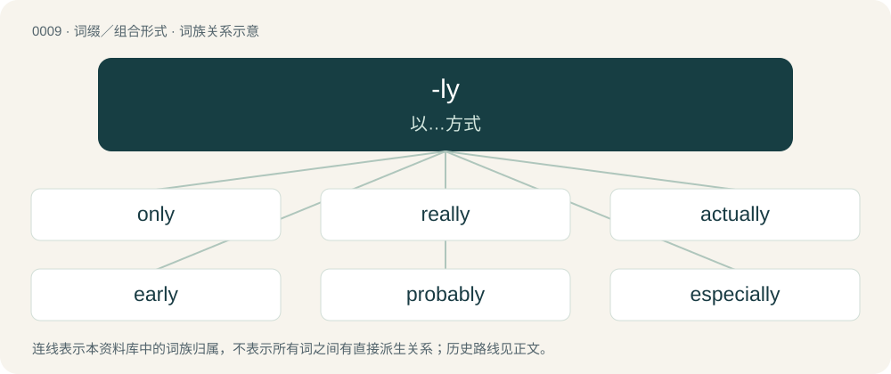

# 0009 · -ly — 以…方式

[总目录](../00_总目录_按常用程度.md)

**类型**：词缀／组合形式　｜　**来源语言**：见词源记录

## 核心含义与来源

- 核心含义：以…方式
- 英文含义：Used to form adjectives from nouns, the adjectives having the sense of "behaving like, or having a nature typical of what is denoted by the noun" Similar in meaning to -like but most often paired with animate nouns.
- 词形：-ly

**多个词源／构词路径**：同一拼写可能有不同来源；以下按词性和含义分别列出。

**来源记录 1**（后缀／后置成分；Used to form adjectives from nouns, the adjectives having the sense of "behaving like, or having a nature typical of what is denoted by the noun" Similar in meaning to -like but most often paired with animate nouns.）

From Middle English -ly, -li, -lik, -lich, -like, from Old English -līċ, from Proto-West Germanic \*-līk, from Proto-Germanic \*-līkaz (“having the body or form of”), from \*līką (“body”) (whence lich). In form, probably influenced by Old Norse -ligr (“-ly”) (Norwegian Bokmål -lig, Faroese -ligur, Icelandic -legur). Cognate with Dutch -lijk, German -lich, Danish -lig and Swedish -lig. Doublet of -like, more at like.

**来源记录 2**（后缀／后置成分；Used to form adverbs from adjectives and nouns.）

From Middle English -ly, -li, -liche, from Old English -līċe.

## 词族图

## 单词速览（常用到不常用）

| 单词 | 音标 | 释义 |
|---|---|---|
| [only](#w-1) | 英 /ˈəʊn.li/；美 /ˈoʊn.li/ | a. 唯一的, 仅有的, 最佳的；adv. 只有, 仅仅, 只能；conj. 但是, 不过 |
| [really](#w-2) | 英 /ˈɹɪə.li/；美 /ˈɹɪl.i/ | adv. 实际上, 真实地, 实在 |
| [actually](#w-3) | 英 /ˈæk(t)ʃᵿli/；美 /ˈæk.t͡ʃ(u.)(ə.)li/ | adv. 事实上, 竟然, 如今, 现在 |
| [early](#w-4) | 英 /ˈɜːli/；美 /ˈɝli/ | a. 早的, 早熟的；adv. 很早, 初 |
| [probably](#w-5) | 英 /ˈpɹɒb.ə.bli/；美 /ˈpɹɑ.bə.bli/ | adv. 大概, 或许 |
| [especially](#w-6) | /ɪˈspɛʃ.(ə.)li/ | adv. 尤其, 特别, 格外 |
| [likely](#w-7) | /ˈlaɪkli/ | a. 有可能的, 合适的, 前途有望的；adv. 或许, 可能 |
| [finally](#w-8) | 英 /ˈfaɪ.nə.li/ | adv. 最后, 终于 |
| [exactly](#w-9) | /ɪɡˈzæk(t).li/ | adv. 确切地, 精确地, 恰好, 完全地, 确实, 恰恰正是, 确实如此 |
| [usually](#w-10) | 英 /ˈjuːʒʊəli/；美 /ˈju.ʒu.(ə.)li/ | adv. 通常, 大抵 |
| [currently](#w-11) | 英 /ˈkʌɹ.ənt.li/；美 /ˈkʌɹ ənt.li/ | adv. 现在, 当前, 一般, 普通；\[计\] 当前 |
| [simply](#w-12) | 英 /ˈsɪmpli/ | adv. 简单地, 只是, 简直, 简朴地, 坦白地 |
| [daily](#w-13) | /ˈdeɪli/ | a. 每日的, 日常的；adv. 每日地, 日常地；n. 日报 |
| [recently](#w-14) | 英 /ˈɹiːsənt.li/；美 /ˈɹi.sənt.li/ | adv. 最近 |
| [certainly](#w-15) | 英 /ˈsɜː.tn̩.li/；美 /ˈsɝ.tn̩.li/ | adv. 确定地 |
| [completely](#w-16) | /kəmˈpliːtli/ | adv. 完全地, 十分地, 圆满地 |
| [nearly](#w-17) | 英 /ˈnɪəli/；美 /ˈnɪɹli/ | adv. 几乎, 密切地 |
| [absolutely](#w-18) | 英 /ˈæb.səˌl(j)uːt.li/；美 /ˌæb.səˈlut.li/ | adv. 完全地, 绝对地, 确确实实地 |
| [immediately](#w-19) | 英 /ɪˈmiː.di.ət.li/；美 /ɪˈmi.di.ɪt.li/ | adv. 直接地, 立刻, 立即 |
| [definitely](#w-20) | 英 /ˈdɛf.ɪ.nɪt.li/ | adv. 明确无疑地, 清楚地 |
| [particularly](#w-21) | 英 /pəˈtɪkjələli/；美 /pɚˈtɪkjəlɚli/ | adv. 特别, 格外, 尤其, 详细地, 细致地 |
| [generally](#w-22) | 英 /ˈd͡ʒɛn.ɹə.li/；美 /ˈd͡ʒɛn.ɚ.li/ | adv. 通常, 逐渐地, 普遍地 |
| [seriously](#w-23) | 英 /ˈsɪə.ɹi.əs.li/；美 /ˈsɪɹ.i.əs.li/ | adv. 严肃地, 认真地, 严重地 |
| [easily](#w-24) | 英 /ˈiː.zɪ.li/；美 /ˈi.zɪ.li/ | adv. 容易地, 轻易地, 流利地 |
| [directly](#w-25) | 英 /dɪˈɹɛk(t).li/ | adv. 径直地, 直接地, 直率地, 正好地, 直截了当地, (非正式)立即, 马上；conj. 一...(就...), 一当...就...；\[计\] 直接的 |
| [fully](#w-26) | 英 /ˈfʊli/ | adv. 十分地, 完全地, 充分地 |
| [highly](#w-27) | /ˈhaɪli/ | adv. 非常, 非常赞许地；\[电\] 大大地 |
| [eventually](#w-28) | 英 /ɪˈvɛn.t͡ʃuː.ə.li/；美 /ɪˈvɛn.t͡ʃu.ə.li/ | adv. 最后, 终于 |
| [truly](#w-29) | /ˈtɹuːli/ | adv. 真实地, 不假 |
| [mostly](#w-30) | 英 /ˈməʊstli/；美 /ˈmoʊstli/ | adv. 大概, 大部分, 主要；\[经\] 大部份 |
| [previously](#w-31) | 英 /ˈpɹiːvi.əsli/；美 /ˈpɹivi.əsli/ | adv. 先, 先前, 以前, 前, (非正式)过早, 过急, 在前, 在...以前, 在先；\[计\] 先前地 |
| [totally](#w-32) | 英 /ˈtəʊ.tə.li/；美 /ˈtoʊ.tə.li/ | adv. 完全地 |
| [supply](#w-33) | /ˈsʌp.li/ | 【英文】Supplely: in a supple manner, with suppleness. |
| [apparently](#w-34) | 英 /əˈpæɹəntli/；美 /əˈpæɹəntli/ | adv. 表面上, 清楚地, 显然地 |
| [obviously](#w-35) | 英 /ˈɒ(b).vi.əs.li/；美 /ˈɑ(b).vi(.)əs.li/ | adv. 显而易见地, 明显地 |
| [extremely](#w-36) | 英 /ɪksˈtɹiːmli/；美 /ɪksˈtɹimli/ | adv. 极端地, 非常地 |
| [possibly](#w-37) | 英 /ˈpɒs.ə.bli/；美 /ˈpɑ.sɪ.bli/ | adv. 可能, 也许 |
| [slightly](#w-38) | /ˈslaɪtli/ | adv. 些微地, 苗条地 |
| [lovely](#w-39) | /ˈlʌv.li/ | a. 可爱的, 有趣的 |
| [entirely](#w-40) | 英 /ɪnˈtaɪəli/；美 /ɪnˈtaɪɹli/ | adv. 完全, 全然, 一概 |
| [honestly](#w-41) | 英 /ˈɒn.ɪst.li/；美 /ˈɑ.nɪst.li/ | adv. 真诚地, 公正地 |
| [originally](#w-42) | 英 /əˈɹɪd͡ʒ.ɪ.nə.li/ | adv. 本来, 原来, 最初, 就起源而论, 独创地 |
| [suddenly](#w-43) | /ˈsʌd.ən.li/ | adv. 突然, 意外, 忽然, 迅速, 即席作成, 即刻, 急速 |
| [relatively](#w-44) | /ˈɹɛl.ə.tɪv.li/ | adv. 相对地, 比较地, 相当地, 相关地；\[计\] 相对地 |
| [approximately](#w-45) | 英 /əˈpɹɒk.sɪ.mət.li/；美 /əˈpɹɑk.sɪ.mət.li/ | adv. 大约, 大致, 近于；\[经\] 大约, 近似 |
| [friendly](#w-46) | /ˈfɹɛnd.li/ | a. 友好的, 亲切的, 互助的；adv. 友善地, 温和地 |
| [properly](#w-47) | 英 /ˈpɹɒpəli/；美 /ˈpɹɑpɚli/ | adv. 适当地, 相当地 |
| [slowly](#w-48) | 英 /ˈsləʊli/；美 /ˈsloʊli/ | adv. 慢慢地, 迟缓地 |
| [typically](#w-49) | 英 /ˈtɪp.ɪ.kli/ | adv. 代表性地；作为特色地 |
| [unfortunately](#w-50) | 英 /ʌnˈfɔː.tjʊ.nət.li/；美 /ʌnˈfɔɹ.t͡ʃə.nɪt.li/ | adv. 恐怕, 不幸的是 |
| [largely](#w-51) | 英 /ˈlɑːd͡ʒ.li/；美 /ˈlɑɹd͡ʒ.li/ | adv. 大量地, 很多地, 大半地 |
| [perfectly](#w-52) | 英 /ˈpɜː.fɪk(t).li/；美 /ˈpɝ.fɪk(t).li/ | adv. 完全地, 无瑕疵地, 完整地 |
| [mainly](#w-53) | 英 /ˈmeɪnli/ | adv. 主要地, 大抵 |
| [normally](#w-54) | 英 /ˈnɔː.mə.li/；美 /ˈnɔɹ.mə.li/ | adv. 正规地, 合规则, 正常地 |
| [personally](#w-55) | 英 /ˈpɜː.sə.nə.li/；美 /ˈpɝ.sə.nə.li/ | adv. 亲自地, 个别地, 当面, 就本人而言, 针对个人地 |
| [ultimately](#w-56) | 英 /ˈʌl.tɪ.mɪt.lɪ/；美 /ˈʌl.tɪ.mɪt.li/ | adv. 最后, 最终；\[法\] 最后, 终究, 总之 |
| [weekly](#w-57) | /ˈwiːk.li/ | n. 周刊, 周报；a. 每周的, 一周一次的, 周刊的；adv. 每周, 一周一次 |
| [frequently](#w-58) | 英 /ˈfɹiː.kwənt.li/ | adv. 频繁, 经常地 |
| [hopefully](#w-59) | 英 /ˈhəʊp.fə.li/；美 /ˈhoʊp.fə.li/ | adv. 有希望地, 如果希望能实现的话 |
| [surely](#w-60) | 美 /ˈʃʊɹli/；/ˈʃɔːli/ | adv. 的确地, 安全地；\[经\] 保证, 保证人, 保证金 |
| [heavily](#w-61) | /ˈhɛvɪli/ | adv. 很重地, 严重地, 难以忍受地 |
| [significantly](#w-62) | /sɪɡˈnɪfɪkəntli/ | adv. 值得注目地；意味深长地 |
| [widely](#w-63) | /ˈwaɪdli/ | adv. 广泛地 |
| [closely](#w-64) | 英 /ˈkləʊsliː/；美 /ˈkloʊsli/ | adv. 接近地 |
| [constantly](#w-65) | 英 /ˈkɒnstəntli/；美 /ˈkɑnstənʔli/ | adv. 不变地, 不断地, 时常地 |
| [hardly](#w-66) | 英 /ˈhɑːdli/；美 /ˈhɑɹdli/ | adv. 刚刚, 几乎不, 勉强是 |
| [officially](#w-67) | /əˈfɪʃ.(ə.)li/ | adv. 作为公务员, 职务上, 官方地 |
| [regularly](#w-68) | 英 /ˈɹɛɡ.jʊ.lə.li/；美 /ˈɹɛɡ.jə.lɚ.li/ | adv. 有规则地, 一丝不苟地, 正式地 |
| [fairly](#w-69) | 英 /ˈfɛə.li/；美 /ˈfɛɹ.li/ | adv. 美观地, 公平地, 相当地, 清楚地 |
| [monthly](#w-70) | /ˈmʌnθli/ | n. 月刊；a. 每月的, 每月一次的 |
| [barely](#w-71) | 英 /ˈbɛə.li/；美 /ˈbɛɹ.li/ | adv. 几乎不 |
| [effectively](#w-72) | /ɪˈfɛktɪvli/ | adv. 有效地, 有力地, 实际上 |
| [initially](#w-73) | /ɪˈnɪʃəli/ | adv. 最初, 开头 |
| [naturally](#w-74) | /ˈnæt͡ʃ.(ə.)ɹə.li/ | adv. 自然地, 以自然力, 天生地 |
| [necessarily](#w-75) | 英 /ˈnɛs.ə.sə.ɹɪ.li/；美 /ˌnɛs.əˈsɛɹ.ə.li/ | adv. 必然地, 必须地, 必要地 |
| [primarily](#w-76) | 英 /ˈpɹaɪ.mə.ɹə.li/；美 /pɹaɪˈmɛɹ.əli/ | adv. 主要地, 首先地 |
| [shortly](#w-77) | 美 /ˈʃɔɹtli/ | adv. 不久, 简短, 唐突地 |
| [strongly](#w-78) | 英 /ˈstɹɒŋli/；美 /ˈstɹɔŋli/ | adv. 强有力地, 坚强地, 激烈地 |
| [carefully](#w-79) | 英 /ˈkɛːf(ə)li/；美 /ˈkɛɹf(ə)li/ | adv. 小心地, 谨慎地 |
| [respectively](#w-80) | /ɹɪˈspɛktɪvli/ | adv. 各自地, 独自地, 个别地, 分别地 |
| [successfully](#w-81) | 英 /səkˈsɛs.fə.li/ | adv. 成功, 结果良好, 有成就 |
| [badly](#w-82) | /ˈbæd.li/ | adv. 严重地, 恶劣地, 极度地 |
| [deeply](#w-83) | /ˈdi(ː)pli/ | adv. 深刻地, 在深处, 深沉地 |
| [essentially](#w-84) | /ɪˈsɛnʃəli/ | adv. 本质上, 本来 |
| [newly](#w-85) | 英 /ˈnjuːli/；美 /ˈnuli/ | adv. 重新, 最近 |
| [rarely](#w-86) | 英 /ˈɹɛːli/；美 /ˈɹɛəɹli/ | adv. 很少地, 罕有地 |
| [ugly](#w-87) | /ˈʌɡli/ | a. 丑陋的, 邪恶的, 险恶的, 不祥的；n. 丑陋的人(或物) |
| [lately](#w-88) | /ˈleɪt.li/ | adv. 近来, 最近 |
| [equally](#w-89) | /ˈiːkwəli/ | adv. 相等地, 同样地, 平等地 |
| [occasionally](#w-90) | /əˈkeɪʒənəli/ | adv. 有时候, 偶而 |
| [potentially](#w-91) | 英 /pəˈtɛnʃ(ə)li/ | adv. 可能地, 潜在地 |
| [commonly](#w-92) | 英 /ˈkɒmənli/；美 /ˈkɑmənli/ | adv. 一般, 普通, 通常 |
| [increasingly](#w-93) | /inˈkriːsiŋli/ | adv. 逐渐地, 渐增地 |
| [incredibly](#w-94) | /ɪŋˈkɹɛdɪbli/ | adv. 不能相信地 |
| [merely](#w-95) | 英 /ˈmɪəli/；美 /ˈmɪɹli/ | adv. 只 |
| [roughly](#w-96) | 英 /ˈɹʌf.li/ | adv. 概略地, 粗糙地, 粗暴地 |
| [rapidly](#w-97) | /ˈɹæpɪdli/ | adv. 飞快地, 迅速地, 赶紧地 |
| [partly](#w-98) | 英 /ˈpɑːtli/；美 /ˈpɑɹtli/ | adv. 部分地, 在一定程度上 |
| [physically](#w-99) | 英 /ˈfɪz.ɪ.kli/ | adv. 按自然规律, 完全地, 实际上, 真正地, 身体上地 |
| [similarly](#w-100) | 英 /ˈsɪm.ə.lə.li/；美 /ˈsɪmə.lɚ.li/ | adv. 相像地, 类似于 |
| [publicly](#w-101) | 英 /ˈpʌb.lɪ.kli/ | adv. 公然地, 以公众名义 |
| [virtually](#w-102) | 英 /ˈvɜːt͡ʃʊəli/；美 /ˈvɚ.t͡ʃə.wə.li/ | adv. 事实上 |
| [lonely](#w-103) | 英 /ˈləʊnli/；美 /ˈloʊnli/ | a. 孤单的, 孤寂的, 荒凉的 |
| [consistently](#w-104) | /kənˈsɪstəntli/ | adv. 坚固, 坚实, 一致, 始终如一, 连贯；\[计\] 相容地 |
| [exclusively](#w-105) | /ɪkˈskluːsɪvli/ | adv. 排他地, 仅仅, 专门, 只, 仅, 唯一地, 专有地 |
| [formerly](#w-106) | 英 /ˈfɔːməli/；美 /ˈfɔɹmɚli/ | adv. 从前, 以前 |
| [actively](#w-107) | /ˈæktɪvli/ | adv. 活跃地, 积极地 |
| [differently](#w-108) | /ˈdɪf.ə.ɹənt.li/ | adv. 差异, 不同, 各别, 各种 |
| [instantly](#w-109) | 英 /ˈɪnstəntli/ | adv. 立即地, 即刻地 |
| [subsequently](#w-110) | 英 /ˈsʌb.sɪ.kwənt.li/ | adv. 后来, 随后 |
| [accidentally](#w-111) | /ˌæk.sɪˈdɛnt(ə)li/ | adv. 偶然地, 意外地 |
| [briefly](#w-112) | /ˈbɹiːfli/ | adv. 简短地, 扼要地, 简明地, 简单地 |
| [safely](#w-113) | /ˈseɪfli/ | adv. 安全地, 确实地 |
| [correctly](#w-114) | 英 /kəˈɹɛk(t).li/ | adv. 对, 正确, 恰当, 符合一般性准则, 符合行为准则, 端正, 符合 |
| [gradually](#w-115) | /ˈɡɹæd͡ʒuəli/ | adv. 逐渐地 |
| [legally](#w-116) | /ˈliːɡəli/ | adv. 法律上, 合法地；\[法\] 法律上, 合法地, 法定地 |
| [repeatedly](#w-117) | /ɹɪˈpiːtɪdli/ | adv. 重复地, 再三地 |
| [additionally](#w-118) |  | adv. 另外, 此外 |
| [mentally](#w-119) | /ˈmɛntəli/ | adv. 心理上, 精神上, 智力上；\[法\] 精神上, 智力上 |
| [precisely](#w-120) | /pɹɪˈsaɪs.li/ | adv. 精确地, 明确地, 刻板地, 拘泥地, 正好, 恰恰, 对, 正是如此, 确实如此, 不错 |
| [solely](#w-121) | 英 /ˈsəʊl.li/；美 /ˈsoʊl.li/ | adv. 仅仅, 单独地 |
| [partially](#w-122) | 英 /ˈpɑːʃəli/；美 /ˈpɑɹʃəli/ | adv. 部分地, 一部分地, 不公平地 |
| [practically](#w-123) | /ˈpɹæk.tɪ.k(ə.)li/ | adv. 几乎, 差不多, 事实上 |
| [sadly](#w-124) | /ˈsædli/ | adv. 悲痛地, 悲惨地, 悲伤地, 说来遗憾 |
| [simultaneously](#w-125) | 英 /ˌsɪmlˈteɪnɪəsli/；美 /ˌsaɪmlˈteɪnɪəsli/ | adv. 同时发生, 一齐, 同时, 同时存在 |
| [annually](#w-126) | 英 /ˈæn.jʊə.li/；美 /ˈæn.ju.ə.li/ | adv. 一年一次, 每年；\[经\] 年度的, 每年的 |
| [strictly](#w-127) | /ˈstɹɪktli/ | adv. 严格地, 确实地 |
| [elderly](#w-128) | 英 /ˈɛldəli/；美 /ˈɛldɚli/ | a. 过了中年的, 稍老的 |
| [quietly](#w-129) | /ˈkwaɪ.ɪt.li/ | adv. 安静地, 沉着地, 秘密地 |
| [reportedly](#w-130) | 英 /ɹɪˈpɔːtɪdli/ | adv. 根据传说, 根据传闻, 据报道 |
| [sexually](#w-131) | /ˈsɛksjʊəli/ | adv. 性别地；两性之间地 |
| [happily](#w-132) | 英 /ˈhæp.ɪ.li/；美 /ˈhæp.ə.li/ | adv. 幸福地, 快乐地, 幸好 |
| [locally](#w-133) | /ˈləʊkəli/ | adv. 地方性地, 局部性地, 在当地 |
| [openly](#w-134) | 美 /ˈoʊpənli/ | adv. 公开地, 坦率地, 直率地, 公然地 |
| [genuinely](#w-135) | /ˈd͡ʒɛn.ju.ɪn.li/ | adv. 真诚地；诚实地 |
| [poorly](#w-136) | 英 /ˈpʊə.li/；美 /ˈpʊɹ.li/ | adv. 贫穷地, 不充分地, 贫乏地；a. 身体不舒服的 |
| [purely](#w-137) | 英 /ˈpjʊəli/；美 /ˈpjʊɹli/ | adv. 纯粹地, 清白地, 贞洁地 |
| [seemingly](#w-138) | 英 /ˈsiːmɪŋli/；美 /ˈsimɪŋli/ | adv. 看来似乎, 表面上看来 |
| [severely](#w-139) | /siˈviəli/ | adv. 严格, 尖锐, 严肃, 严重, 严厉, 朴素 |
| [technically](#w-140) | /ˈtɛk.nɪˌkəl.i/ | adv. 技术上, 学术上, 专门地 |
| [importantly](#w-141) | 英 /ɪmˈpɔː.tənt.li/；美 /ɪmˈpɔɹ.tənt.li/ | adv. 重要地；大量地；有名望地；自命不凡地 |
| [surprisingly](#w-142) | /səˈpɹaɪzɪŋli/ | adv. 使人惊奇, 出人意外, 惊人, 令人惊讶 |
| [thoroughly](#w-143) | 英 /ˈθʌɹ.ə.li/；/ˈθɜɹ.ə.li/ | adv. 彻底地, 绝对地, 透彻地, 详尽地, 周到地, 完全地, 完善地, 全面地 |
| [gently](#w-144) | /ˈd͡ʒɛntli/ | adv. 温和地, 温柔地, 轻轻地, 逐渐地 |
| [historically](#w-145) | 英 /hɪˈstɒɹɪkli/；美 /hɪˈstɔɹɪkli/ | adv. 历史上地；从历史观点上说 |
| [permanently](#w-146) | 英 /ˈpɜː.mə.nənt.li/；美 /ˈpɝ.mə.nənt.li/ | adv. 永久, 不变, 持久；\[计\] 永久性的 |
| [separately](#w-147) | 英 /ˈsɛp.(ə.)ɹət.li/；美 /ˈsɛp.ɹət.li/ | adv. \[表\]分开, 不相连, 分隔, 分离, 不同, 单独, 独立, 各自, 各别, 脱离肉体, 灵魂；\[计\] 分离地 |
| [freely](#w-148) | 英 /ˈfɹiːli/；美 /ˈfɹili/ | adv. 自由地, 随意地, 无拘束地, 直率地, 坦白地, 慷慨地, 免费地, 大量地；\[计\] 浮动地 |
| [nicely](#w-149) | /ˈnaɪs.li/ | adv. 漂亮地, 谨慎地, 恰好地 |
| [allegedly](#w-150) | /əˈlɛdʒ.ɪd.li/ | adv. 依其申述 |
| [independently](#w-151) | /ˌɪndɪˈpɛndəntli/ | adv. 独立地, 自立地 |
| [politically](#w-152) |  | adv. 政治上 |
| [presumably](#w-153) | 英 /pɹɪˈzjuːməbli/；美 /pɹɪˈzuːməbli/ | adv. 推测上, 大概 |
| [temporarily](#w-154) | 英 /ˈtɛmp(ə)r(ər)ɪli/；美 /ˌtɛmpəˈɹɛɹəli/ | adv. 暂时, 一时, 临时 |
| [traditionally](#w-155) | /tɹəˈdɪʃ.ə.nə.li/ | adv. 传统上；传说上；习惯上 |
| [frankly](#w-156) | 英 /fɹæŋkli/；美 /fɹæŋkli/ | adv. 坦白地 |
| [emotionally](#w-157) | 英 /ɪˈməʊʃənəli/；美 /ɪˈmoʊʃənəli/ | adv. 在情绪上 |
| [reasonably](#w-158) | /ˈɹiː.zən.ə.bli/ | adv. 适度地, 相当地 |
| [accordingly](#w-159) | 英 /əˈkɔː(ɹ).dɪŋ.li/；美 /əˈkɔɹ.dɪŋ.li/ | adv. 相应地, 因此, 于是 |
| [deliberately](#w-160) | /dɪˈlɪb.(ə.)ɹət.li/ | adv. 故意地 |
| [namely](#w-161) | /ˈneɪmli/ | adv. 即, 就是, 换句话说 |
| [utterly](#w-162) | 英 /ˈʌtəli/；美 /ˈʌtɚli/ | adv. 完全地, 全然, 绝对 |
| [formally](#w-163) | 英 /ˈfɔː.mə.li/；美 /ˈfɔɹ.mə.li/ | adv. 正式地, 形式上 |
| [notably](#w-164) | /ˈnəjtbəli/ | adv. 显著地, 著名地, 尤其, 特别 |
| [privately](#w-165) | /ˈpɹaɪvɪtli/ | adv. 秘密地；私下地 |
| [secretly](#w-166) | /ˈsiː.kɹɪt.li/ | adv. 秘密地, 背地里 |
| [specially](#w-167) | /ˈspɛʃəli/ | adv. 特别地, 专门地 |
| [considerably](#w-168) | /kənˈsɪdəɹəbli/ | adv. 非常地, 很, 颇 |
| [firmly](#w-169) | 英 /ˈfɜːmli/；美 /ˈfɝmli/ | adv. 坚固, 坚定, 断然 |
| [kindly](#w-170) | 英 /ˈkaɪn(d)li/ | a. 和蔼的, 温和的, 爽快的；adv. 温和地, 亲切地 |
| [accurately](#w-171) | 英 /ˈak.jə.ɹɪt.li/；美 /ˈæk.jə.ɹɪt.li/ | adv. 正确地, 精确地 |
| [quarterly](#w-172) | /ˈkwɔːtəli/ | a. 季度的, 按季度的, 每季的；adv. 按季, 每三个月, 每季一次；n. 季刊 |
| [desperately](#w-173) | /ˈdɛs.p(ə.)ɹət.li/ | adv. 拼命地；绝望地；极度地 |
| [financially](#w-174) |  | adv. 金融上；财政上 |
| [continuously](#w-175) | /kənˈtɪnjuəsli/ | adv. 不断地, 连续地；\[电\] 连续地 |
| [fortunately](#w-176) | 英 /ˈfɔː.t͡ʃə.nɪt.li/；美 /ˈfɔɹ.t͡ʃə.nɪt.li/ | adv. 幸运地, 幸亏 |
| [randomly](#w-177) | /ˈɹændm̩li/ | adv. 偶然, 胡乱, 无目的, 任意, 随便, 任取, 无规则, 机遇, 胡乱地, 任意地, 随便地；\[计\] 随机地 |
| [explicitly](#w-178) |  | adv. 明确地；明白地 |
| [lightly](#w-179) | /ˈlaɪtli/ | adv. 轻轻地, 少许, 不费力地 |
| [socially](#w-180) | 美 /ˈsoʊʃəli/ | adv. 在社会上, 在社交上, 以社会生活方式 |
| [substantially](#w-181) | /səbˈstænʃəli/ | adv. 实质上, 本质上, 大体上 |
| [supposedly](#w-182) | 英 /səˈpəʊ̯.zɪd.li/；美 /səˈpoʊ̯.zɪd.li/ | adv. 想象上, 看上去像, 被认为是, 恐怕, 按照推测 |
| [internationally](#w-183) | /.intəˈnæʃənəli/ | adv. 国际性地, 在国际间 |
| [consequently](#w-184) | 英 /ˈkɒnsɪˌkwɛntli/；美 /ˈkɑnsɪˌkwɛntli/ | adv. 所以 |
| [costly](#w-185) | 英 /ˈkɒst.li/ | a. 昂贵的, 奢华的, 费用大的 |
| [readily](#w-186) | /ˈɹɛdɪli/ | adv. 迅速地, 轻易地, 乐意地 |
| [beautifully](#w-187) | 英 /ˈbjuː.tɪ.fə.li/；美 /ˈbju.tɪ.fə.li/ | adv. 美好地, 漂亮地 |
| [luckily](#w-188) | 英 /ˈlʌk.ɪ.li/ | adv. 幸运地, 幸亏, 侥幸 |
| [continually](#w-189) | /kənˈtɪnjuəli/ | adv. 不断地, 频繁地 |
| [arguably](#w-190) | 英 /ˈɑːɡjuəbli/；美 /ˈɑɹɡjuəbli/ | adv. 可论证地；可争辩地；正如可提出证据加以证明的那样地 |
| [individually](#w-191) | /ˌɪndɪˈvɪd͡ʒ(u)əli/ | adv. 以个人身分, 各个地, 独特地 |
| [inevitably](#w-192) | 英 /ɪˈnɛvɪtəbli/ | adv. 不可避免地 |
| [positively](#w-193) | 英 /ˈpɒz.ɪ.tɪv.li/；美 /ˈpɑ.zɪ.tɪv.li/ | adv. 明确地, 肯定地, 无疑地, (非正式)确实地, 真正地 |
| [sharply](#w-194) | 英 /ˈʃɑːpli/；美 /ˈʃɑɹpli/ | adv. 锐利地, 严厉地, 厉害地；\[经\] 剧烈地 |
| [sincerely](#w-195) | 英 /sɪnˈsɪəli/；美 /sɪnˈsɪɹli/ | adv. 真诚地 |
| [critically](#w-196) | 英 /ˈkɹɪt.ɪ.kə.li/；美 /ˈkɹɪt.ɪ.kə.li/ | adv. 批评性地, 审慎地, 精密地 |
| [undoubtedly](#w-197) | /ʌnˈdaʊtɪdli/ | adv. 无疑, 必定, 确实地 |
| [yearly](#w-198) | 英 /ˈjɪəli/；美 /ˈjɪɹli/ | a. 每年的, 一年一度的；adv. 一年一次, 每年 |
| [extensively](#w-199) | 英 /ɪkˈstɛn.sɪv.li/；美 /ɪkˈstɛn.sɪv.li/ | adv. 广大, 广延, 外延, 大面积(耕种), 粗放, 广博, 广泛, 广阔 |
| [illegally](#w-200) | /ɪˈliːɡəli/ | \[法\] 非法地, 不合法地, 违法地 |
| [lively](#w-201) | 英 /ˈlaɪv.li/ | a. 活泼的, 鲜明的, 生动的 |
| [secondly](#w-202) | 英 /ˈsɛkəndli/；美 /ˈsɛk.(ə)ndli/ | adv. 第二, 其次 |
| [timely](#w-203) | /ˈtaɪm.li/ | a. 及时的, 适时的；adv. 及时地 |
| [nationally](#w-204) | /ˈnæʃənəli/ | adv. 作为整个民族, 举国一致地, 全国性地 |
| [promptly](#w-205) | 英 /ˈpɹɒmptli/；美 /ˈpɹɑmptli/ | adv. 敏捷地, 迅速地 |
| [steadily](#w-206) | /ˈstɛdɪli/ | adv. 稳定地, 无变化地, 有规则地 |
| [economically](#w-207) | 英 /ˌiː.kəˈnɒm.ɪ.kli/；美 /ˌɛk.əˈnɑ.mɪ.kli/ | adv. 节约地, 不浪费地, 节省地, 节俭地, 在经济上, 在经济学上 |
| [overly](#w-208) | /ˈəuvəli/ | adv. 过度地, 极度地 |
| [wholly](#w-209) | 英 /ˈhəʊ.li/；美 /ˈhoʊ.li/ | adv. 完全地, 整个, 统统, 全部；\[法\] 完全地, 统统地 |
| [broadly](#w-210) | 英 /ˈbɹɔːdli/；/ˈbɹɔdli/ | adv. 宽广地, 明白地, 无礼貌地 |
| [collectively](#w-211) |  | adv. 集合, 聚合性, 共同, 集体主义, 集团, 集体 |
| [globally](#w-212) | 英 /ˈɡləʊbəli/；美 /ˈɡloʊbəli/ | \[计\] 全局地 |
| [intentionally](#w-213) | /ɪnˈtɛn(t)ʃənəli/ | adv. 故意地, 有意地 |
| [alternatively](#w-214) | 英 /ɒlˈtɜː(ɹ).nə.tɪv.li/；美 /ɔlˈtɝ.nə.tɪv.li/ | adv. 非此即彼 |
| [predominantly](#w-215) | /pɹɪˈdɒmɪnəntli/ | adv. 主要地, 显著地, 大多数地, 突出地 |
| [sufficiently](#w-216) | /səˈfɪʃəntli/ | adv. 足够, 充分 |
| [thankfully](#w-217) | /ˈθæŋkfulli/ | adv. 感激地；感谢地 |
| [efficiently](#w-218) | /iˈfiʃəntli/ | adv. 生效, 能胜任, 有能力, 效率高, 有效 |
| [loudly](#w-219) | /ˈlaʊdli/ | adv. 高声地, 大声地, 吵闹地 |
| [bodily](#w-220) | 英 /ˈbɒdɪli/；美 /ˈbɑdɪli/ | a. 身体的；adv. 亲自 |
| [jointly](#w-221) | 美 /ˈd͡ʒɔɪntli/ | adv. 共同地, 连带地 |
| [fundamentally](#w-222) | /fʌndəˈmentəli/ | adv. 基础, 首要, 主要, 十分重要, 基本, 根本, 原始, 基频, 基音, 基谐波 |
| [remarkably](#w-223) | 英 /ɹɪˈmɑːkəbli/；美 /ɹɪˈmɑɹkəbli/ | adv. 显著地, 引人注目地, 非常地 |
| [softly](#w-224) | 英 /ˈsɒftli/；美 /ˈsɔftli/ | adv. 柔和地, 静静地, 温柔地 |
| [heavenly](#w-225) | 英 /ˈhɛvənli/ | a. 天上的, 神圣的, 天国似的 |
| [professionally](#w-226) |  | adv. 专业地；内行地 |
| [tightly](#w-227) | /ˈtaɪtli/ | adv. 紧紧地, 坚固地 |
| [unusually](#w-228) | /ʌnˈjuːʒuəli/ | adv. 不寻常地, 异乎寻常地, (非正式)非常 |
| [ideally](#w-229) | 英 /aɪˈdɪə.li/；美 /aɪˈdi.ə.li/ | adv. 完美地, 理想地 |
| [internally](#w-230) | 英 /ɪnˈtɜːnəli/；美 /ɪnˈtɜɹnəli/ | \[计\] 内部的 |
| [remotely](#w-231) | /ɹɪˈmoʊtli/ | adv. 极小地, 极细微地 |
| [appropriately](#w-232) |  | adv. 适当的, 恰如其分的, 恰当的, 合适的 |
| [comfortably](#w-233) | 英 /ˈkʌmf(ə)təbli/；美 /ˈkʌmftɚbli/ | adv. 安乐地, 舒服地, 宽裕地 |
| [exceptionally](#w-234) | /ɪkˈsɛp(t)ʃənəli/ | adv. 特殊地；异常地；例外地 |
| [firstly](#w-235) | /ˈfɜɹstli/ | adv. 第一, 首先 |
| [rightly](#w-236) | 英 /ˈɹaɪtli/ | adv. 合适地, 正当地, 正确地 |
| [presently](#w-237) | 英 /ˈpɹɛzəntli/ | adv. 目前, 不久 |
| [voluntarily](#w-238) | 英 /ˌvɒlənˈtɛɹɪli/；美 /ˌvɑlənˈtɛɹɪli/ | adv. 自愿地, 以自由意志 |
| [hourly](#w-239) | 英 /ˈaʊ̯əli/；美 /ˈaʊ̯ɚli/ | a. 每小时的, 以小时计的, 频繁的；adv. 每小时地, 频繁地, 不绝地 |
| [indirectly](#w-240) | 英 /ˌɪn.dɪˈɹɛk(t).li/ | adv. 间接, 曲折, 迂回, 不直截了当, 不诚实, 不坦率；\[计\] 间接地 |
| [preferably](#w-241) | /ˈpɹɛf.ɹəˌbli/ | adv. 更可取地, 更好地, 更合意地 |
| [proudly](#w-242) | /ˈpɹaʊdli/ | adv. 傲慢地, 自大地, 得意洋洋地 |
| [routinely](#w-243) | 英 /ɹuːˈtiːnli/；美 /ɹuˈtinli/ | adv. 日常, 乏味, 常规, 例行 |
| [unexpectedly](#w-244) | 美 /ʌnɪkˈspɛktɪdli/ | adv. 想不到的, 突然的, 意外的, 出乎意料的 |
| [wildly](#w-245) | /ˈwaɪldli/ | adv. 狂暴地, 激动地, 狂热地, 鲁莽地, 轻率地 |
| [manually](#w-246) | 英 /ˈmænj(ʊ)əli/；美 /ˈmænj(u)əliː/ | adv. 用手 |
| [lastly](#w-247) | 英 /ˈlɑːstli/；美 /ˈlæstli/ | adv. 最后, 终于 |
| [negatively](#w-248) | /ˈne^ətivli/ | adv. 否定地, 消极地 |
| [mutually](#w-249) | 英 /ˈmjuːtʃʊəli/；美 /ˈmjut͡ʃuəli/ | adv. 互相地, 互助 |
| [smoothly](#w-250) | /ˈsmuːðli/ | adv. 平滑地, 流畅地, 流利地 |
| [visually](#w-251) | /ˈvɪzju.əli/ | adv. 看, 视力, 视觉, 可见, 凭视力, 看到, 看得见, 光学, 形象化, 栩栩如生 |
| [commercially](#w-252) |  | adv. 商业上；通商上 |
| [statistically](#w-253) | /stəˈtɪs.tɪ.kə.li/ | adv. 用统计的方法, 统计学上 |
| [strangely](#w-254) | /ˈstɹeɪnd͡ʒli/ | adv. 奇妙地, 奇怪地, 不可思议地 |
| [casually](#w-255) | 英 /ˈkæʒ(j)ʊəli/；美 /ˈkæʒuəli/ | adv. 偶然地, 临时地, 随便地 |
| [genetically](#w-256) | 美 /d͡ʒəˈneɾɪkli/ | adv. 创始, 遗传学, 生殖, 基因, 遗传, 发生 |
| [manly](#w-257) | /ˈmænli/ | a. 象男人的, 强壮的, 适于男人的 |
| [evenly](#w-258) | /ˈiːvənli/ | adv. 平衡地, 平坦地, 平等地 |
| [hugely](#w-259) | /ˈhjuːd͡ʒli/ | adv. 巨大地, 非常地 |
| [indefinitely](#w-260) | /ɪnˈdɛfɪnɪtli/ | adv. 无期限地 |
| [narrowly](#w-261) | 英 /ˈnæɹəʊli/；美 /ˈnæɹoʊli/ | adv. 狭窄地, 严密地, 仔细地, 几乎不, 勉强地, 仅仅 |
| [adequately](#w-262) | /ˈædikwətli/ | adv. 足够地, 适当地 |
| [amazingly](#w-263) | /əˈmeɪzɪŋli/ | adv. 令人惊讶地；惊奇地 |
| [culturally](#w-264) |  | adv. 从文化角度, 文化意义上；在人文学方面 |
| [theoretically](#w-265) | /.θiːəˈretikli/ | adv. 理论上, 理论地 |
| [aggressively](#w-266) |  | adv. (贬)侵略, 侵犯, 寻衅, (褒)敢作敢为, 有进取心, (武器)攻击性, 过分, 放肆 |
| [morally](#w-267) | 英 /ˈmɒɹəli/；美 /ˈmɔɹəli/ | adv. 道德上, 德性上, 有道德地 |
| [peacefully](#w-268) | /ˈpiːsfəli/ | adv. 平静地 |
| [universally](#w-269) | 英 /ˌjuːnɪˈvɜːsəli/；美 /ˌjunɪˈvɝsəli/ | adv. 宇宙, 全世界, 普遍, 一般, 普通, 全体, 一致, 通用, 万能, 广用, 广泛 |
| [loosely](#w-270) | /ˈluːsli/ | adv. 松弛地, 宽松地, 不紧 |
| [unanimously](#w-271) |  | adv. 全体一致, 无异议, 一致同意 |
| [vastly](#w-272) | 美 /ˈvæstli/ | adv. 广大地, 许多, 巨大 |
| [violently](#w-273) | /ˈvaɪ(ə)ləntli/ | adv. 猛烈地, 激烈地, 极端地 |
| [wisely](#w-274) | /ˈwaɪzli/ | adv. 聪明地, 精明地 |
| [falsely](#w-275) | /ˈfɒːlsli/ | adv. 虚伪地, 错误地, 不实地 |
| [freshly](#w-276) | /ˈfɹɛʃli/ | adv. 新, 新近, 精神饱满 |
| [evidently](#w-277) | 英 /ˈɛvɪdəntli/；美 /ˈɛvɪdəntli/ | adv. 明显地, 根据现有证据来看 |
| [interestingly](#w-278) | /ˈintristiŋli/ | adv. 有趣地 |
| [scholarly](#w-279) | /skɒ.lə.li/ | a. 学者派头的, 学者风度的, 有学问的, 博学的, 好学的 |
| [brutally](#w-280) |  | adv. 残忍地, 蛮横地 |
| [inherently](#w-281) | 美 /ɪnˈhɛɹəntli/ | adv. 内在地, 生来地, 固有地；\[计\] 固有的 |
| [conveniently](#w-282) | 英 /kənˈviːnɪəntli/；美 /kənˈvinjəntli/ | a. 方便, 合宜 |
| [silently](#w-283) | /ˈsaɪləntli/ | adv. 默默地, 静静地 |
| [willingly](#w-284) | /ˈwɪlɪŋli/ | adv. 自动地, 欣然地 |
| [immensely](#w-285) | /ɪˈmɛnsli/ | adv. 无限地, 广大地, 庞大地 |
| [incorrectly](#w-286) | /ˌɪnkəˈɹɛk(t).li/ | adv. 错误地；不适当地 |
| [abruptly](#w-287) | 美 /əˈbɹʌp.li/ | adv. 突然地, 唐突地 |
| [calmly](#w-288) | 英 /ˈkɑː(ɹ)m.li/ | adv. 平静地, 安静地, 冷静地 |
| [moderately](#w-289) | /ˈmɒdərətli/ | adv. 适当地, 适度地, 中庸地 |
| [oddly](#w-290) | 英 /ˈɒdli/；美 /ˈɑdli/ | adv. 奇怪地 |
| [wonderfully](#w-291) | /wʌn.də(ɹ).fli/ | adv. 惊人地；极好地；精彩地 |
| [admittedly](#w-292) | /ədˈmitidli/ | adv. 公认地, 诚然 |
| [overwhelmingly](#w-293) | /ˌəʊ.vəˈwɛl.mɪŋ.lɪ/ | adv. 压倒性地, 不可抵抗地 |
| [radically](#w-294) | /ˈɹædɪkli/ | adv. 根本地, 完全地 |
| [swiftly](#w-295) | /ˈswɪftli/ | adv. 很快地, 即刻 |
| [uniquely](#w-296) | /juːˈniːk.li/ | adv. 独特地；珍奇地 |
| [conversely](#w-297) | 英 /kənˈvɜːsli/；美 /kənˈvɝsli/ | adv. 相反, 逆, 颠倒, 反题, 反 |
| [distinctly](#w-298) | /dɪˈstɪŋktli/ | adv. 显然地, 明显地, 清楚地 |
| [finely](#w-299) | /ˈfaɪnli/ | adv. 雅致地, 仔细地, 敏锐地, 微细地 |
| [intensely](#w-300) | /ɪnˈtɛnsli/ | adv. 强烈地; 极度; 剧烈地 |
| [comparatively](#w-301) | 英 /kəmˈpæɹ.ə.tɪvli/；美 /kəmˈpæɹ.ə.tɪvli/ | adv. 比较地, 相对地 |
| [incidentally](#w-302) | 英 /ˌɪnsɪˈdɛntl̩i/；美 /ˌɪnsəˈdɛn(t)l̩i/ | adv. 伴随地, 偶然, 顺便 |
| [infinitely](#w-303) | /ˈɪnfɪnɪtli/ | adv. 无限地, 无数地, 庞大地 |
| [massively](#w-304) | /ˈmæs.ɪv.li/ | adv. 大而重, 厚实, 粗大, 强有力, 结实, 魁伟, 大块, 大量, 大规模, 实心, 块状；\[计\] 大规模地 |
| [profoundly](#w-305) | /pɹəˈfaʊndli/ | adv. 深深地, 深切地 |
| [ridiculously](#w-306) | 英 /ɹɪˈdɪk.jʊ.ləs.li/；美 /ɹɪˈdɪk.jə.ləs.li/ | adv. 可笑, 滑稽, 荒谬 |
| [consciously](#w-307) |  | adv. 自觉地；有意识地 |
| [knowingly](#w-308) | /ˈnəjiŋli/ | adv. 会意地, 心照不宣地, 故意地, 有意地, 老练地；\[法\] 心照不宣地, 故意地, 有意地 |
| [multiply](#w-309) | /ˈmʌltɪpli/ | 【英文】In many or multiple ways. |
| [barley](#w-310) | 英 /ˈbɑːli/；美 /ˈbɑɹli/ | n. 大麦；\[医\] 大麦 |
| [eagerly](#w-311) | 英 /ˈiːɡəli/；美 /ˈiɡɚli/ | adv. 渴望, 热衷于, 热切 |
| [famously](#w-312) | /ˈfeiməsli/ | adv. 极好地, 非常令人满意地 |
| [horribly](#w-313) | 英 /ˈhɒɹɪbli/；美 /ˈhɔɹəbli/ | adv. 可怕地, 非常地 |
| [neatly](#w-314) | /ˈniːtli/ | adv. 整洁地, 干净地, 匀称地 |
| [dearly](#w-315) | 英 /ˈdɪəli/；美 /ˈdɪɹli/ | adv. 深深地, 昂贵地 |
| [expressly](#w-316) | /ɪkˈspɹɛsli/ | adv. 明白地, 清楚地, 特意地 |
| [nightly](#w-317) | /ˈnaɪtli/ | a. 每夜的, 夜间的；adv. 每夜 |
| [patiently](#w-318) | /ˈpeɪʃəntli/ | adv. 耐心地；有毅力地 |
| [progressively](#w-319) | /pɹəˈɡɹɛsɪvli/ | adv. 进步, 先进, 向前进, 不断前进, 累进, 渐进, 逐渐, 渐次, 主张进步, 进行性 |
| [urgently](#w-320) |  | adv. 急切地；迫切地；紧急地 |
| [dangerously](#w-321) |  | adv. 危险, 不安全 |
| [painfully](#w-322) | /ˈpeɪnfəli/ | adv. 痛苦地, 苦恼地, 费力地 |
| [politely](#w-323) | /pəˈlaɪtli/ | adv. 有礼貌地, 文雅地, 客气地 |
| [respectfully](#w-324) | /ɹɪˈspɛkt.fə.li/ | adv. 尊敬地 |
| [vaguely](#w-325) | /ˈveɪɡli/ | adv. 含糊地, 暧昧地 |
| [brilliantly](#w-326) | /ˈbrijəntli/ | adv. 辉煌地, 光亮地, 灿烂地 |
| [endlessly](#w-327) | /ˈɛndləsli/ | adv. 不断地, 无穷尽地 |
| [forcibly](#w-328) | /ˈfɔːsəbli/ | adv. 强制地, 用力地 |
| [vertically](#w-329) | 英 /ˈvɜː.tɪ.kl̩i/；美 /ˈvɝ.tɪ.kəli/ | adv. 垂直地 |
| [wrongly](#w-330) | 英 /ˈɹɒŋ.li/；美 /ˈɹɔŋ.li/ | adv. 错误地, 不恰当地, 不正确地, 不正直地, 不公正地 |
| [digitally](#w-331) | 英 /ˈdɪd͡ʒɪt.li/；美 /ˈdɪd͡ʒɪtəli/ | adv. 数位 |
| [mistakenly](#w-332) | /mɪˈsteɪ.kən.li/ | adv. 错误地, 被误解地 |
| [reluctantly](#w-333) | /ɹɪˈlʌktəntli/ | adv. 不情愿地, 勉强地 |
| [artificially](#w-334) | /.ɑːtiˈfiʃəli/ | adv. 人工地, 人为地, 不自然地 |
| [brightly](#w-335) | /ˈbɹaɪtli/ | adv. 生辉地, 明亮地, 鲜明地 |
| [duly](#w-336) | 美 /ˈduli/；/ˈdʒuːli/ | adv. 恰当地, 充分地, 适当地, 及时地 |
| [environmentally](#w-337) |  | adv. 有关环境方面 |
| [federally](#w-338) | /ˈfedərəli/ | adv. 同盟地, 联邦地, 联邦政府地 |
| [inadvertently](#w-339) | /ˌɪnədˈvɜːtəntli/ | adv. 漫不经心地, 疏忽地; 非故意地 |
| [invariably](#w-340) | 英 /ɪnˈvɛə.ɹi.ə.bli/；美 /ɪnˈvɛɹ.i.ə.bli/ | adv. 不变化地, 恒定地, 始终如一地 |
| [medically](#w-341) | 英 /ˈmɛd.ɪ.kli/ | adv. 医学, 医疗, 医术, 内科, 医药 |
| [orderly](#w-342) | 英 /ˈɔːdəli/；美 /ˈɔɹdɚli/ | a. 有秩序的, 整齐的, 值班的；n. 护理员, 清道夫, 传令兵, 勤务兵；adv. 依次地, 顺序地 |
| [purposely](#w-343) | 英 /ˈpɜːpəsli/；美 /ˈpɝpəsli/ | adv. 故意地 |
| [logically](#w-344) | 美 /ˈlɑd͡ʒɪˌkli/ | adv. 逻辑, 合乎逻辑, 符合逻辑, 逻辑上, 有逻辑, 有逻辑头脑, 合理, 明智 |
| [mildly](#w-345) | /ˈmaɪldli/ | adv. 柔和地, 和善地, 适度地 |
| [chiefly](#w-346) | 英 /ˈtʃiːf.li/ | adv. 主要地 |
| [cowardly](#w-347) | 英 /ˈkaʊədli/ | a. 怯懦的, 懦弱的；胆小的 |
| [densely](#w-348) | /ˈdɛnsli/ | adv. 浓密地, 浓厚地 |
| [extraordinarily](#w-349) | /ikˈstrɔːdθnərili/ | adv. 非凡, 破例, 特别, 非常, 离奇, 使人惊奇, 惊人, 特命, 特派 |
| [unbelievably](#w-350) | /ˌʌnbɪˈliːvəblɪ/ | adv. 难以置信地, 不可信地 |
| [unnecessarily](#w-351) | /ʌnˈnesisərili/ | adv. 不必要地, 多余地 |
| [anonymously](#w-352) | /əˈnɒnəməsli/ | adv. 不具名地；化名地 |
| [awfully](#w-353) | 英 /ˈɔː.fʊ.li/；美 /ˈɔ.f(ə.)li/ | adv. 恶劣地, 非常地, 极端地 |
| [confidently](#w-354) | 英 /ˈkɒnfɪdəntli/；美 /ˈkɑnfɪdəntli/ | adv. 自信地；安心地 |
| [prominently](#w-355) | 英 /ˈpɹɒmɪnəntli/；美 /ˈpɹɑmɪnəntli/ | adv. 显著地 |
| [tremendously](#w-356) | /trəˈmendəslɪ/ | adv. 极大地; 极端地; 极其; 非常 |
| [verbally](#w-357) | /ˈv\\\\ːbəli/ | adv. 口头地, 非书面地 |
| [principally](#w-358) | /ˈprinsəpəli/ | adv. 主要地, 大部分 |
| [reliably](#w-359) | /riˈlaiəbli/ | adv. 可靠地, 可信赖地 |
| [clinically](#w-360) |  | adv. 临床, 临诊, 冷静, 不偏不倚, 分析 |
| [enormously](#w-361) | /iˈnɒːməsli/ | adv. 非常地, 巨大地 |
| [vigorously](#w-362) | /ˈvɪɡəɹəsli/ | adv. 朝气蓬勃, 精力充沛, 壮健, 茁壮, 健壮, 强有力 |
| [visibly](#w-363) | /ˈvɪz.ə.bli/ | adv. 看得见地, 明显地, 明白地 |
| [plainly](#w-364) | /ˈpleɪnli/ | adv. 清楚地, 明白地, 简单地, 朴素地, 直率地, 坦白地 |
| [decidedly](#w-365) | /dɪˈsaɪdɪdli/ | adv. 决定了, 坚决, 明显, 显而易见, 显然, 明确, 果断, 毫无疑问 |
| [notoriously](#w-366) | 英 /nə(ʊ)ˈtɔː.ɹɪ.əs.li/；美 /nəˈtɔ.ɹi.əs.li/ | adv. 臭名昭著的, 声名狼藉的 |
| [racially](#w-367) | /ˈreiʃəli/ | adv. 按人种, 人种上 |
| [legitimately](#w-368) |  | adv. 正当地；合理地 |
| [magically](#w-369) | /ˈmæd͡ʒ.ɪ.kli/ | adv. 用魔法地；如魔法般地 |
| [materially](#w-370) | /məˈtiəriəli/ | adv. 实质上, 重大, 物质上 |
| [noticeably](#w-371) |  | adv. 显而易见, 值得注意, 重要, 显著 |
| [unfairly](#w-372) |  | adv. 不正当地；不公平地 |
| [exceedingly](#w-373) | 英 /ɪkˈsiːdɪŋli/；美 /ɪkˈsidɪŋli/ | adv. 极端地, 极度地, 非常 |
| [excessively](#w-374) | /ɪkˈsɛsɪvli/ | adv. 过多, 极度, 过度, 过分 |
| [fiercely](#w-375) | 英 /ˈfɪəsli/；美 /ˈfɪɹsli/ | adv. 猛烈地, 厉害地 |
| [geographically](#w-376) |  | \[计\] 自通地 |
| [improperly](#w-377) | 美 /ɪmˈpɹɑ.pɚ.li/ | \[计\] 不适当地 |
| [mechanically](#w-378) | /məˈkænɪkli/ | adv. 机械, 用机械, 机械学, 物理, 力学, 呆板, 无意识, 手工操作, 技工 |
| [ostensibly](#w-379) | 英 /ɒˈstɛn.sɪ.bli/；美 /ɑˈstɛn.sə.bli/ | adv. 可公开, 显然, 表面, 外表, 诡称, 假装 |
| [pleasantly](#w-380) | /ˈplɛzəntli/ | adv. 和蔼地, 亲切地；友好地；愉快地 |
| [psychologically](#w-381) | /,psaikəˈlɔdʒikəli/ | adv. 心理上, 从心理学角度 |
| [angrily](#w-382) | 美 /ˈæŋ.ɡɹə.li/ | adv. 愤怒地 |
| [insanely](#w-383) | /ɪnˈseɪnli/ | adv. 精神错乱地, 疯狂地, 极其愚蠢地, 脱离实际地 |
| [intellectually](#w-384) |  | adv. 智力上；知性上；理智地 |
| [spontaneously](#w-385) | 英 /spɒnˈteɪ.ni.əs.li/；美 /spɑnˈteɪ.ni.əs.li/ | adv. 自发, 一时冲动, 出自自然, 不依赖人工, 自然产生, 本能, 自动, 自然而优雅 |
| [worldly](#w-386) | /ˈwɜː(ɹ)ldli/ | a. 世间的, 世俗的, 世上的 |
| [centrally](#w-387) | 英 /ˈsɛnt.ɹə.li/ | adv. 在中心, 在中央 |
| [fatally](#w-388) | /ˈfeɪtəli/ | adv. 致命地, 不幸地, 宿命地 |
| [grossly](#w-389) | 英 /ˈɡɹəʊsli/；美 /ˈɡɹoʊsli/ | adv. 非常, 很, 粗 |
| [passionately](#w-390) | /ˈpæʃənətli/ | adv. 热情地, 激昂地 |
| [scarcely](#w-391) | 英 /ˈskɛəsli/；美 /ˈskɛɹsli/ | adv. 简直不, 一定不, 仅仅 |
| [blindly](#w-392) | /ˈblaɪndli/ | adv. 轻率地, 盲目地 |
| [cautiously](#w-393) | 英 /ˈkɔːʃəsli/ | adv. 慎重地 |
| [earthly](#w-394) | 英 /ˈəːθli/ | a. 地球的, 俗世的, 可能的 |
| [selectively](#w-395) |  | adv. 有选择地 |
| [prematurely](#w-396) | /ˌpɹiːməˈtjʊə(ɹ)li/ | adv. 过早地, 贸然地 |
| [disproportionately](#w-397) | 英 /ˌdɪs.pɹəˈpɔː.ʃə.nət.li/；美 /ˌdɪs.pɹəˈpɔɹ.ʃə.nət.li/ | adv. 不匀称, 不相称 |
| [exponentially](#w-398) | 英 /ɛkspə(ʊ)ˈnɛnʃəli/ | adv. 以指数方式 |
| [externally](#w-399) |  | adv. 在外部, 外表上, 从外面, 在外面, 从外部 |
| [hastily](#w-400) | /ˈheɪstɪli/ | adv. 匆忙地, 急速地, 急躁地 |
| [horizontally](#w-401) |  | \[计\] 水平置中 |
| [subtly](#w-402) | 英 /ˈsʌt.li/；美 /ˈsʌt.l̩.li/ | adv. 敏锐地, 巧妙地, 精细地 |
| [bitterly](#w-403) | 英 /ˈbɪtəli/；美 /ˈbɪtəɹli/ | adv. 怨恨地, 悲痛地, 残酷地 |
| [generously](#w-404) |  | adv. 宽大地；慷慨地；丰盛地 |
| [markedly](#w-405) | 英 /ˈmɑː.kɪd.li/；美 /ˈmɑɹ.kɪd.li/ | adv. 显著地, 醒目地, 明显地 |
| [spiritually](#w-406) |  | adv. 在精神上地 |
| [boldly](#w-407) | 英 /ˈbəʊldli/；美 /ˈboʊldli/ | adv. 大胆地, 显眼地 |
| [cheaply](#w-408) | /ˈt͡ʃiːpli/ | adv. 便宜地 |
| [defensively](#w-409) | 英 /dɪˈfɛnsɪvli/ | adv. 防御地；守势地 |
| [objectively](#w-410) | 美 /əbˈd͡ʒɛktɪvli/ | adv. 客观地 |
| [securely](#w-411) | 英 /səˈkjʊə.li/；美 /səˈkjʊɹ.li/ | adv. 安全地；安心地；牢固地；有把握地 |
| [unsuccessfully](#w-412) | /ˌʌnsəkˈsɛsfəli/ | adv. 无用；失败地 |
| [adversely](#w-413) |  | adv. 不利, 有害, 相反, 逆, 敌对, 逆向 |
| [bravely](#w-414) | /ˈbɹeɪvli/ | adv. 勇敢地 |
| [faithfully](#w-415) | /ˈfeɪθfəli/ | adv. 忠实地, 诚心诚意地, 深信着地 |
| [harshly](#w-416) | 英 /ˈhɑːʃli/ | adv. 粗糙地, 粗暴地, 刺耳地 |
| [lowly](#w-417) | 英 /ˈləʊli/；美 /ˈloʊli/ | a. 地位低的, 卑下的, 谦卑的；adv. 位置低下的, 低声地, 谦逊地 |
| [musically](#w-418) | /ˈmjuːzɪkəli/ | adv. 音乐上 |
| [nervously](#w-419) |  | adv. 焦急地；神经质地；提心吊胆地 |
| [thinly](#w-420) | /ˈθɪnli/ | adv. 薄, 细, 瘦 |
| [concurrently](#w-421) |  | \[计\] 并行地 |
| [eternally](#w-422) | 英 /ɪˈtɜː.nə.li/；美 /ɪˈtɝ.nə.li/ | adv. 永恒地, 常常 |
| [forcefully](#w-423) |  | adv. 激烈地；强有力地；有说服力地 |
| [godly](#w-424) | 英 /ˈɡɒdli/；美 /ˈɡɑdli/ | a. 敬神的, 虔诚的, 神的 |
| [mysteriously](#w-425) | /mɪˈstɪərɪəslɪ/ | adv. 神秘地; 不可思议地; 诡秘地; 故弄玄虚地 |
| [ordinarily](#w-426) | 英 /ɔːdɪˈnæɹɪli/；美 /ɔɹdɪˈnɛɹɪli/ | adv. 通常, 普通, 一般地 |
| [understandably](#w-427) |  | adv. 可懂, 可了解, 可理解 |
| [vividly](#w-428) | /ˈvɪvɪdli/ | adv. 鲜艳, 强烈, 明亮, 鲜明, 活泼, 有生气, 生动, 清晰, 逼真 |
| [awkwardly](#w-429) |  | adv. 笨拙地；无技巧地 |
| [instinctively](#w-430) | /ɪnˈstɪŋktɪvli/ | adv. 本能地, 直觉地 |
| [marginally](#w-431) | 英 /ˈmɑːd͡ʒɪnəli/；美 /ˈmɑɹd͡ʒɪnəli/ | adv. 记在页边, 有旁注, 边缘, 边沿地区, 边际, 限界, 勉强够格, 无关紧要, 少量 |
| [seasonally](#w-432) |  | adv. 季节性地；周期性地 |
| [chemically](#w-433) | /ˈkɛm.ɪ.kli/ | adv. 用化学, 以化学方法 |
| [coincidentally](#w-434) |  | adv. 巧合地；一致地 |
| [intimately](#w-435) | /ˈɪntɪmətli/ | adv. 亲切地, 亲密地, 个人性地 |
| [religiously](#w-436) |  | adv. 虔诚而经常地, 笃诚地 |
| [responsibly](#w-437) |  | adv. 认真负责地, 可信赖地, 可靠地 |
| [rightfully](#w-438) | /ˈɹaɪtfəli/ | adv. 正当地；正直地 |
| [warmly](#w-439) | 英 /ˈwɔːmli/；美 /ˈwɔɹmli/ | adv. 亲切地, 温暖地, 热心地 |
| [biologically](#w-440) |  | adv. 生物学, 生态学 |
| [girly](#w-441) | 英 /ˈɡɜːli/；美 /ˈɡɝli/ | 【英文】In the manner of a girl. |
| [gracefully](#w-442) | /ˈɡɹeɪsfəli/ | adv. 优雅地；温文地 |
| [implicitly](#w-443) |  | adv. 含蓄, 不言明, 暗示, 暗指, 内含, 固有, 无疑, 绝对, 无保留；\[计\] 隐含地 |
| [truthfully](#w-444) | /ˈtɹuːθ.fəl.i/ | adv. 诚实地；深信不疑地 |
| [alternately](#w-445) | 英 /ɔlˈtə(ɹ)nətliː/；美 /ˈɔl.tɚ.nət.li/ | adv. 交替地, 间隔地 |
| [arbitrarily](#w-446) | /ˈɑːbitrərili/ | adv. 任意地, 武断地, 专横地, 反复无常地 |
| [effortlessly](#w-447) | 英 /ˈɛf.ət.ləs.li/；美 /ˈɛf.ɚt.ləs.li/ | adv. 不作努力地, 不费力地 |
| [momentarily](#w-448) | 英 /ˈməʊməntəɹəli/ | adv. 暂时地, 立刻, 随时地 |
| [relentlessly](#w-449) | 英 /ɹɪˈlɛntləsli/；美 /ɹəˈlɛn(t)ləsli/ | adv. 不仁慈, 严酷, 无情, 坚韧, 不懈, 不屈不挠 |
| [unintentionally](#w-450) | /ˌʌnɪnˈtenʃənəlɪ/ | adv. 非故意地, 非存心地; 无意之中 |
| [blatantly](#w-451) | /ˈbleɪtəntli/ | adv. 喧闹地；公然地；看穿了地 |
| [curiously](#w-452) | 英 /ˈkjʊə.ɹi.əs.li/；美 /ˈkjʊɹ.i.əs.li/ | adv. 好奇地 |
| [favorably](#w-453) | /ˈfeivərəbli/ | adv. 顺利地, 亲切地, 好意地 |
| [fondly](#w-454) | 英 /ˈfɒndli/；美 /ˈfɑndli/ | adv. 溺爱地, 怜爱地, 情柔地 |
| [electrically](#w-455) | /ɪˈlɛk.tɹɪk.li/ | adv. 电力地；有关电地 |
| [functionally](#w-456) |  | adv. 官能, 有功能, 职务, 机能, 在起作用, 从使用/实用的观点设计, 函数；\[计\] 功能地 |
| [furiously](#w-457) | /ˈfjʊə̯ɹi.ə̯sli/ | adv. 狂暴地；猛烈地 |
| [miraculously](#w-458) | /məˈɹækjələsli/ | adv. 超自然, 非凡, 不可思议, 令人惊叹, 象奇迹一样, 奇迹般, 能创造奇迹 |
| [sorely](#w-459) | 英 /ˈsɔːli/；美 /ˈsɔɹli/ | adv. 疼痛地, 强烈地, 非常 |
| [structurally](#w-460) |  | \[计\] 结构地 |
| [uniformly](#w-461) | 英 /ˈjuːnɪfɔːmli/；美 /ˈjunəfɔɹmli/ | adv. 一样, 一致, 相同, 一直不变, 一贯, 始终如一, 均质, 一律, 均匀；\[计\] 均匀地 |
| [unquestionably](#w-462) | 英 /ʌnˈkwɛs.t͡ʃən.ə.bli/；/ʌnˈkwes.t͡ʃən.ə.blɪ/ | adv. 毫无疑问, 不成问题, 无可非议, 确实 |
| [variously](#w-463) | /ˈveəriəsli/ | adv. 各种各样, 种种, 不同, 多方面, 多才多艺, 许多, 各个, 个别, 杂色, 彩色 |
| [academically](#w-464) | 美 /ˌæk.əˈdɛm.ɪk.ə.li/ | adv. 学术上；学业上 |
| [cleverly](#w-465) | 英 /ˈklɛvəli/；美 /ˈklɛvɚli/ | adv. 聪明地, 全然, 完全, 巧妙地 |
| [hopelessly](#w-466) | 英 /ˈhəʊplɪsli/；美 /ˈhoʊplɪsli/ | adv. 绝望地, 无可奈何地 |
| [jokingly](#w-467) | 英 /ˈdʒəʊ.kɪŋ.liː/；美 /ˈdʒoʊ.kɪŋ.li/ | adv. 开玩笑地, 打趣地 |
| [mathematically](#w-468) | /ˌmæθəˈmætɪklɪ/ | adv. 算术地 |
| [popularly](#w-469) | /ˈpɒpjuləli/ | adv. 通俗地, 平易地, 通过民众 |
| [definitively](#w-470) | /dɪˈfɪnɪtɪvli/ | adv. 决定性地, 最后地 |
| [doubly](#w-471) | /ˈdʌb.li/ | adv. 加倍地, 双重地；\[计\] 双地 |
| [madly](#w-472) | /ˈmædli/ | adv. 发狂地, 精神失常地, 愚蠢地 |
| [miserably](#w-473) | /ˈmizərəbli/ | adv. 非常不幸地, 可悲地, 贫困地 |
| [vehemently](#w-474) | /ˈviː.ə.məntli/ | adv. 激烈地; 暴烈地; 强烈地; 热烈地 |
| [weakly](#w-475) | /ˈwiːkli/ | a. 弱的, 虚弱的；adv. 微弱地, 虚弱地 |
| [overtly](#w-476) | /ˈəuvəːtly. əuˈvəːtly/ | adv. 明显地；公开地, 公然地 |
| [perpetually](#w-477) | 英 /pəˈpɛtʃʊəli/；美 /pɚˈpɛt͡ʃuəli/ | adv. 永恒地, 持久地 |
| [squarely](#w-478) | 英 /ˈskwɛə(ɹ).li/；美 /ˈskwɛɹ.li/ | adv. 干脆地, 正好, 直角地 |
| [unconditionally](#w-479) | /ˌʌnkənˈdɪʃənəlɪ/ | adv. 无条件地 |
| [undeniably](#w-480) |  | adv. 确凿无疑地；不可否认地 |
| [disorderly](#w-481) | 英 /dɪsˈɔː.də.li/ | a. 无秩序的, 乱的, 骚乱的；\[法\] 妨害治安的, 骚乱的, 无法无天的 |
| [solidly](#w-482) |  | adv. 坚硬地；坚固地；团结一致地 |
| [technologically](#w-483) | /teknəˈlɔdʒikəli/ | adv. 技术上地；科技地 |
| [wholeheartedly](#w-484) | 英 /ˌhəʊlˈhɑːtɪdli/；美 /ˌhoʊlˈhɑɹtədli/ | adv. 全心全意地, 全神贯注地 |
| [ghostly](#w-485) | 美 /ˈɡoʊstli/ | a. 幽灵的, 影子似的, 精神的 |
| [lovingly](#w-486) | /ˈlʌviŋli/ | adv. 钟爱地, 亲切地 |
| [powerfully](#w-487) | 英 /ˈpaʊəf(ə)li/；美 /ˈpaʊɚf(ə)li/ | adv. 强有力, 强大, 效力大, 有权威, 权力大, 有影响, 很多, 相当, 非常 |
| [tentatively](#w-488) | /ˈtɛntətɪvli/ | adv. 试验性地, 暂时地; 权; 聊且 |
| [acutely](#w-489) | /əˈkjuːtli/ | adv. 尖锐地, 剧烈地 |
| [diligently](#w-490) | 英 /ˈdɪlɪd͡ʒ(ə)ntli/；美 /ˈdɪləd͡ʒən(t)li/ | adv. 勤奋地；勤勉地 |
| [stately](#w-491) | 英 /ˈsteɪtli/ | a. 庄严的, 宏伟的 |
| [suitably](#w-492) | /ˈsjuːtəbli/ | adv. 合适地, 适当地, 相配地 |
| [aptly](#w-493) | /ˈæp(t).li/ | adv. 适当地, 适宜地 |
| [criminally](#w-494) |  | \[法\] 刑法上, 犯罪上 |
| [decisively](#w-495) | 英 /dɪˈsaɪsɪvli/ | adv. 果断地；决然地 |
| [democratically](#w-496) | 英 /ˌdɛməˈkɹætɪkli/；美 /ˌdɛməˈkɹætəkli/ | adv. 民主地, 民主主义地 |
| [informally](#w-497) |  | adv. 非正式地；不拘礼节地 |
| [orally](#w-498) | /ˈɔːɹəli/ | adv. 口头, 口语, 口述, 口, 用口发声, 口部 |
| [strikingly](#w-499) |  | adv. 显著地, 惊人地, 引人注目地 |
| [unilaterally](#w-500) |  | \[计\] 单侧地 |
| [abundantly](#w-501) | 英 /əˈbʌn.dn̩t.li/；美 /əˈbʌn.dn̩t.li/ | adv. 大量地, 丰富地 |
| [affectionately](#w-502) | /əˈfɛkʃənətli/ | adv. 挚爱地, 亲切地 |
| [ethically](#w-503) | 英 /ˈɛθɪkəli/ | adv. 伦理上 |
| [unknowingly](#w-504) | /ʌnˈnəʊ.ɪŋ.li/ | adv. 无意中, 非存心地, 不知不觉地 |
| [constitutionally](#w-505) | 英 /kɒnstɪˈt͡ʃuːʃənəli/；美 /kɑnstəˈtuʃənəli/ | adv. 本质地, 天生, 体质上 |
| [convincingly](#w-506) | /kənˈvɪn.sɪŋ.li/ | adv. 有说服力, 使人信服, 令人信服 |
| [creatively](#w-507) | 英 /kɹiˈeɪtɪvli/；美 /kɹiˈeɪtɪvli/ | adv. 创造性地；有创造力地 |
| [lawfully](#w-508) |  | adv. 守法地；合法地 |
| [nominally](#w-509) | 英 /ˈnɒmɪnəli/；美 /ˈnɑmɪnəli/ | adv. 有名无实地, 名义上地, 名称上 |
| [seamlessly](#w-510) | /ˈsiːmlisli/ | adv. 无空隙地; 无停顿地 |
| [shockingly](#w-511) |  | adv. 令人震惊地, 极糟地, 极度地, 极厉害地 |
| [sparsely](#w-512) | /spɑːslɪ/ | adv. 稀疏地; 稀少地; 不足地; 贫乏地 |
| [unfriendly](#w-513) | /ʌnˈfɹɛn(d)li/ | 【英文】in an unkind or unfriendly manner; not as a friend |
| [anxiously](#w-514) | 美 /ˈæŋ(k).ʃəs.li/ | adv. 忧虑地, 不安地 |
| [gravely](#w-515) | /ˈɡɹeɪvli/ | adv. 重大地, 严肃地, 庄重地 |
| [unlawfully](#w-516) | /ʌnˈlɔːfəli/ | adv. 不正当地；不合法地 |
| [erroneously](#w-517) | /ɪˈɹəʊnɪəsli/ | adv. 错误, 不正确 |
| [keenly](#w-518) | /ˈkiːnli/ | adv. 锐利地, 敏捷地, 激烈地 |
| [meticulously](#w-519) |  | adv. 过细地, 细致地 |
| [purposefully](#w-520) | 英 /ˈpɜː.pəs.fə.li/；美 /ˈpɝ.pəs.fə.li/ | adv. 自觉地；有目的地 |
| [rationally](#w-521) |  | adv. 理性地；讲道理地 |
| [suspiciously](#w-522) |  | adv. 猜疑地；怀疑地 |
| [tirelessly](#w-523) |  | adv. 不知疲倦地；不屈不挠地 |
| [unruly](#w-524) | /ʌnˈɹuːli/ | a. 难控制的, 无法无天的, 任性的 |
| [abnormally](#w-525) | 美 /æbˈnɔɹ.mə.li/ | adv. 不正常, 异常, (贬)不同寻常, 不规则, 变态, 反常 |
| [bluntly](#w-526) | /ˈblʌntli/ | adv. 坦率地, 率直地 |
| [competitively](#w-527) | /kəmˈpɛtɪtɪvli/ | adv. 好竞争地；有竞争力地 |
| [conventionally](#w-528) | /kənˈvɛnʃənəli/ | adv. 照惯例, 照常套, 照老例 |
| [ghastly](#w-529) | 英 /ˈɡɑːs(t).li/；美 /ˈɡæs(t).li/ | a. 可怕的, 惨白的, 极坏的；adv. 可怖地, 惨白地 |
| [minimally](#w-530) |  | adv. 最低限度地；最低程度地 |
| [unwittingly](#w-531) | 英 /ʌnˈwɪtɪŋli/；美 /ˌʌnˈwɪtɪŋli/ | adv. 不知情地；不知不觉地；不经意地 |
| [excitedly](#w-532) | /ikˈsaitidli/ | adv. 兴奋地 |
| [modestly](#w-533) |  | adv. 适当地；谨慎地 |
| [needlessly](#w-534) |  | adv. 不必要地；无用地 |
| [surgically](#w-535) |  | adv. 如外科手术般地 |
| [thirdly](#w-536) | 英 /ˈθɜːdli/；美 /ˈθɚdli/ | adv. 第三 |
| [unequivocally](#w-537) | 英 /ˌʌnɪˈkwɪvək(ə)li/；美 /ˌʌnɪˈkwɪvək(ə)li/ | adv. 只有一种含意地, 清楚明白地 |
| [weirdly](#w-538) | /ˈwɪə(ɹ)dli/ | adv. 古怪地 |
| [defiantly](#w-539) | 英 /dɪˈfaɪ(j)əntli/ | adv. 对抗地；挑战地 |
| [delicately](#w-540) | /ˈdɛlɪkətli/ | adv. 优美地；微妙地；精致地 |
| [intelligently](#w-541) |  | adv. 聪明地, 明智地 |
| [intermittently](#w-542) | /ɪn.tərˈmɪt.ənt.lɪ/ | adv. 间歇地 |
| [leisurely](#w-543) | 英 /ˈlɛʒəli/；美 /ˈliʒɚli/ | a. 悠闲的, 从容的；adv. 从容地, 悠闲地 |
| [persistently](#w-544) | /pəˈsɪstəntlɪ/ | adv. 坚持地; 固执地; 一个劲儿 |
| [discreetly](#w-545) | 美 /dᵻˈskritli/ | adv. 谨慎地, 小心地 |
| [graciously](#w-546) | /ˈɡɹeɪʃəsli/ | adv. 和蔼地；仁慈地；雅致地 |
| [intuitively](#w-547) |  | \[计\] 直觉地 |
| [supremely](#w-548) | 美 /səˈpɹimli/ | adv. 崇高地；至上地 |
| [unconsciously](#w-549) | 英 /ˌʌnˈkɒnʃəsli/；美 /ˌʌnˈkɑnʃəsli/ | adv. 无意识地, 无意中, 不知不觉地 |
| [alphabetically](#w-550) | /ˌalfəˈbɛtɪkli/ | adv. 按字母顺序地 |
| [categorically](#w-551) | 英 /kæt.əˈɡɒ.ɹɪk.(ə.)li/ | adv. 无条件, 绝对, 明白, 断言, 明显, 明确, 范畴 |
| [faintly](#w-552) | /ˈfeɪntli/ | adv. 微弱地, 模糊地, 朦胧地 |
| [sickly](#w-553) | /ˈsɪkli/ | a. 病弱的, 令人不快的, 无精打采的；adv. 病态地；vt. 使现病容 |
| [solemnly](#w-554) | 英 /ˈsɒləmli/；美 /ˈsɑləmli/ | adv. 庄严地；严肃地 |
| [terminally](#w-555) | /ˈtəːminəli/ | adv. 在末端, 末尾, 每期 |
| [cleanly](#w-556) | /ˈklɛnli/ | a. 爱清洁的, 干净的, 清洁的；adv. 干净地, 利索地, 熟练地 |
| [hilariously](#w-557) | /hiˈlɛəriəsli/ | adv. 引人发笑地；滑稽地；喜不自禁地 |
| [inappropriately](#w-558) |  | adv. 不恰当, 不适当, 不适宜, 不合时宜, 不相宜, 不合宜 |
| [outwardly](#w-559) | 英 /ˈaʊtwədli/；美 /ˈaʊtwɚdli/ | adv. 表面上, 在外, 外表上 |
| [sparingly](#w-560) |  | adv. 节约地, 爱惜地, 吝惜地, 少量地, 贫乏地 |
| [spectacularly](#w-561) |  | adv. 引人注目地；壮观地 |
| [successively](#w-562) |  | adv. 接连着地；相继地 |
| [experimentally](#w-563) | /ik.speriˈmentli/ | adv. 实验式地, 在实验上 |
| [inexplicably](#w-564) | /inˈeksplikəbli/ | adv. 说不清 |
| [passively](#w-565) | 英 /ˈpæs.ɪv.li/ | adv. (贬)被动, 守势, 受动, (贬)消极, 不抵抗, 驯服, 钝性, 无源, 钝态, 无利息 |
| [sweetly](#w-566) | /ˈswiːtli/ | adv. 甜美地, 惬意地, 讨人喜欢地 |
| [unsurprisingly](#w-567) |  | adv. 不出所料的；不出奇的；意料中的 |
| [ideologically](#w-568) |  | adv. 思想上, 思想体系, 意识形态, 观念形态 |
| [infrequently](#w-569) | 美 /ɪnˈfɹiːkwənt.li/ | adv. 很少发生, 不常发生, 罕见, 稀罕, 偶有, 不寻常 |
| [militarily](#w-570) | 英 /ˈmɪl.ɪ.t(ə.)ɹə.li/；美 /ˌmɪl.ɪˈtɛɹ.ə.li/ | adv. 在军事上 |
| [predictably](#w-571) | /pɹəˈdɪk.tə.bli/ | adv. 可预言地 |
| [rigorously](#w-572) |  | adv. 严厉地；残酷地 |
| [superbly](#w-573) |  | adv. 雄伟地；壮丽地；上等地；庄重地 |
| [uncomfortably](#w-574) | /ʌnˈkʌmftəbli/ | adv. 不舒适地, 不自在地, 令人不快地 |
| [classically](#w-575) | /ˈklæsikəli/ | adv. 古典主义地, 拟古地 |
| [purportedly](#w-576) | 英 /pəˈpɔː.təd.li/；美 /pɚˈpoɹ.tɪd.li/ | adv. 据称 |
| [recklessly](#w-577) |  | adv. 不注意, 粗心大意, 不在乎, 鲁莽, 不顾后果, 不顾一切, 妄动 |
| [regionally](#w-578) | /ˈɹiːd͡ʒənəli/ | adv. 在地区范围内, 地区性地 |
| [cheerfully](#w-579) | 英 /ˈtʃɪəfəli/；美 /ˈt͡ʃɪɹfəli/ | adv. 高高兴兴地 |
| [conclusively](#w-580) |  | adv. 最后, 释疑, 确定性, 结论性 |
| [figuratively](#w-581) |  | adv. 象征性地；比喻地 |
| [indiscriminately](#w-582) | /ˌɪndɪˈskrɪmɪnətlɪ/ | adv. 无差别, 任意地; 不分青红皂白地; 滥; 不分皂白 |
| [profusely](#w-583) | 美 /pɹəˈfjusli/ | adv. 极其丰富地, 大量地 |
| [stupidly](#w-584) | /ˈstjuːpidli/ | adv. 愚蠢地 |
| [uncontrollably](#w-585) | /,ʌnkənˈtrəuləbli/ | adv. 无法控制地 |
| [unduly](#w-586) | /ʌnˈdjuːli/ | adv. 不适当地, 过度地；\[法\] 过分的, 过度的, 不正当的 |
| [wrongfully](#w-587) | /ˈɹɒŋfəli/ | adv. 不正当地, 不妥地 |
| [darkly](#w-588) | 英 /ˈdɑːkli/；美 /ˈdɑɹkli/ | adv. 暗, 黑, 呈黑 |
| [elegantly](#w-589) |  | adv. 优美地 |
| [impossibly](#w-590) | /ɪmˈpɒ.sɪb.li/ | adv. 不可能地, 难以置信地 |
| [impressively](#w-591) |  | adv. 令人难忘地；感人地 |
| [intently](#w-592) | /ɪnˈtɛntli/ | adv. 一心一意地, 心无旁物地, 专心地 |
| [offensively](#w-593) | 美 /əˈfɛnsɪvli/ | adv. 冒犯地；讨厌地 |
| [soundly](#w-594) | 英 /ˈsaʊnd.lɪ/ | adv. 完全地, 健全地, 坚牢地 |
| [symbolically](#w-595) | 美 /ˌsɪmˈbɑːlɪklɪ/；/ˌsɪmˈbɒlɪklɪ/ | adv. 象征性地 |
| [thoughtfully](#w-596) | 英 /ˈθɔːtfʊli/；美 /ˈθɔtfəli/ | adv. 沉思地；体贴地, 亲切地 |
| [comprehensively](#w-597) |  | adv. 包括地；包括一切地 |
| [eloquently](#w-598) |  | adv. 善辩地；富于表现力地 |
| [foolishly](#w-599) | /ˈfuːlɪʃli/ | adv. 愚笨地, 无聊地 |
| [metaphorically](#w-600) | /ˌmetəˈfɒrɪklɪ/ | adv. 比喻地, 隐喻地 |
| [playfully](#w-601) |  | adv. 开玩笑地；好游玩地 |
| [absurdly](#w-602) | 英 /əbˈsɜːd.li/；美 /æbˈsɝd.li/ | adv. 荒谬地, 荒唐地, 愚蠢地 |
| [crucially](#w-603) | /ˈkɹuːʃəli/ | adv. 至关重要地, 关键地 |
| [cruelly](#w-604) | /ˈkɹuːəli/ | adv. 残忍地, 残酷地, 极 |
| [easterly](#w-605) | 英 /ˈiː.stə.li/；美 /ˈiː.stɚ.li/ | a. 东的, 向东的, 从东的；adv. 向东 |
| [northerly](#w-606) | 英 /ˈnɔːðəli/；美 /ˈnɔɹðɚli/ | a. 北方的, 向北的, 来自北方的；adv. 向北, 自北来 |
| [shamelessly](#w-607) | /ˈʃeimlisli/ | adv. 不知羞耻地 |
| [conceivably](#w-608) | /kənˈsiːvəbli/ | adv. 想得到地, 想象上, 以为 |
| [diagonally](#w-609) | 英 /daɪˈæɡ.nə.li/ | adv. 对角地 |
| [hysterically](#w-610) | /hɪˈsterɪklɪ/ | adv. 歇斯底里地 |
| [paradoxically](#w-611) | 英 /ˌpaɹəˈdɒksɪkli/；美 /ˌpɛɹəˈdɑksɪkli/ | adv. 反论, 荒谬, 自相矛盾, 似非而可能是 |
| [proportionally](#w-612) | 英 /pɹəˈpɔːʃənəli/；美 /pɹəˈpɔɹʃənəli/ | 按比例地, 相配合地, 适当地 |
| [retroactively](#w-613) | 美 /ˌɹɛtɹoʊˈæktɪvli/ | adv. 逆动地, 追溯地 |
| [subconsciously](#w-614) | /ˌsʌbˈkɒnʃəslɪ/ | adv. 潜意识地 |
| [unofficially](#w-615) |  | adv. 非公认地；非正式地 |
| [vitally](#w-616) | /ˈvaɪ.tə.li/ | adv. 与生命有关地, 致命地, 紧要地 |
| [consecutively](#w-617) | /kənˈsekjətɪvlɪ/ | adv. 连续地 |
| [expertly](#w-618) | 美 /ˈɛk.spɝt.li/ | adv. 熟练地；巧妙地 |
| [hotly](#w-619) | /ˈhɒtli/ | adv. 暑热地, 激烈地, 热心地 |
| [humanly](#w-620) | /ˈhjuːmənli/ | adv. 从人的角度, 充满人性地, 在人力所及范围 |
| [hypothetically](#w-621) | /ˌhaɪpəˈθetɪklɪ/ | adv. 假设地, 假想地 |
| [idly](#w-622) | /ˈaɪd(ə)lɪ/ | adv. 懒惰地, 空闲地 |
| [sensibly](#w-623) | /ˈsɛnsəbli/ | adv. 容易感知地；聪明地；明显地 |
| [smartly](#w-624) | /ˈsmɑː(ɹ)tli/ | adv. 潇洒地, 火辣辣地, 刺痛地 |
| [steeply](#w-625) | /ˈstiːpli/ | adv. 险峻地 |
| [unjustly](#w-626) | /ʌnˈd͡ʒʌstli/ | adv. 不义地, 不法地 |
| [viciously](#w-627) |  | adv. 邪恶地；敌意地 |
| [brotherly](#w-628) | 英 /ˈbɹʌð.ə.li/；美 /ˈbɹʌð.ɚ.li/ | a. 兄弟的, 亲兄弟似的, 亲切的 |
| [conceptually](#w-629) | 英 /kənˈsɛp.tjʊə.li/；美 /kənˈsɛp.t͡ʃu.ə.li/ | adv. 概念地 |
| [exquisitely](#w-630) | /ˈekskwizitli/ | adv. 精巧地, 敏锐地 |
| [favourably](#w-631) |  | adv. 顺利地；有利地；好意地（等于favorably） |
| [flawlessly](#w-632) | 英 /ˈflɔːləsli/；/ˈflɔləsli/ | adv. 无瑕地, 完美地 |
| [mercilessly](#w-633) | /ˈmɜːsɪləslɪ/ | adv. 无情地, 残忍地 |
| [priestly](#w-634) | /ˈpɹiːstli/ | a. 祭司的 |
| [stubbornly](#w-635) |  | adv. 倔强地；顽固地 |
| [unreasonably](#w-636) | /ʌnˈɹiː.zən.ə.bli/ | adv. 不合理地 |
| [woefully](#w-637) |  | adv. 悲伤地；不幸地；使人痛苦地 |
| [admirably](#w-638) | 英 /ˈæd.mə.ɹə.bli/；美 /ˈæd.mɪɹ.ə.bli/ | adv. 极好地, 美好地 |
| [chronologically](#w-639) | /ˌkɹɒnəˈlɒdʒɪkli/ | adv. 按时间的前后顺序排列地 |
| [deathly](#w-640) | 英 /ˈdɛθli/ | a. 死一般的；adv. 像死一样地 |
| [delightfully](#w-641) | /dɪˈlaɪtfəlɪ/ | 大喜, 欣然 |
| [flatly](#w-642) | /ˈflætli/ | adv. 枯燥无味地, 完全地, 直截了当地, 毅然地, 断然地 |
| [fluently](#w-643) |  | adv. 流利地；通畅地 |
| [heartily](#w-644) | 英 /ˈhɑːtɪli/；美 /ˈhɑɹtɪli/ | adv. 衷心地, 真实地, 热心地 |
| [incessantly](#w-645) | 美 /ɪnˈsɛs.ənt.li/ | adv. 不断地, 不停地; 接连不断; 连绵不断; 不已 |
| [involuntarily](#w-646) | 英 /ɪnˈvɒləntɹɪli/；美 /ɪnˌvɑlənˈtɛɹɪli/ | adv. 不知不觉地, 无意识地 |
| [laterally](#w-647) | 美 /ˈlæ.tə.ɹə.li/ | adv. 旁边地 |
| [liberally](#w-648) | /ˈlɪb(ə)ɹəli/ | adv. 宽大地, 大方地, 自由地 |
| [carelessly](#w-649) | 英 /ˈkɛələsli/；美 /ˈkɛɹləsli/ | adv. 不注意地, 粗心地 |
| [homely](#w-650) | 英 /ˈhəʊmli/；美 /ˈhoʊmli/ | a. 家常的, 平凡的, 朴实无华的 |
| [instantaneously](#w-651) |  | adv. 即刻, 立即 |
| [interchangeably](#w-652) |  | adv. 可交换地, 可交替地, 可互换地 |
| [ruthlessly](#w-653) | 英 /ˈɹuːθ.ləs.li/ | adv. 无情地, 冷酷地, 残忍地 |
| [superficially](#w-654) |  | adv. 表面, 表面性, 浅层, 不深, 表皮, (贬)肤浅, 一知半解, 浅薄, 平方, 浮面 |
| [deliciously](#w-655) | 美 /dəˈlɪ.ʃəs.li/ | adv. 美味地, 芬香地 |
| [fraudulently](#w-656) | /ˈfrɔːdjələntlɪ/ | adv. 欺骗地 |
| [princely](#w-657) | /ˈpɹɪnsli/ | a. 王子的, 威严的, 王候般的, 豪华的, 奢侈的 |
| [rudely](#w-658) | /ˈɹuːdli/ | adv. 无礼地, 粗鲁地, 粗陋地 |
| [southerly](#w-659) | 英 /ˈsʌðəliː/；美 /ˈsʌðɚli/ | a. 向南的, 来自南方的；n. 南风；adv. 向南, 从南面 |
| [conspicuously](#w-660) | /kənˈspɪkjʊəslɪ/ | adv. 显著地, 超群地 |
| [eerily](#w-661) | 美 /ˈɪɹ.ɪ.li/；/ˈɪəɹɪli/ | a. 怪诞的；奇异的；可怕的 |
| [empirically](#w-662) |  | adv. 以经验为主地 |
| [handsomely](#w-663) | 英 /ˈhæn(t)s(ə)mli/；美 /ˈhæn(t)səmli/ | adv. 漂亮地, 整齐地, 当心地, 慢慢地, 优厚地, 慷慨地, 美观地 |
| [innocently](#w-664) | /ˈɪnəsəntli/ | adv. 纯洁地；无罪地 |
| [patently](#w-665) | 英 /ˈpeɪtəntli/；美 /ˈpætən(t)li/ | adv. 明显地, 公然地 |
| [regrettably](#w-666) | /riˈ^retəbli/ | adv. 抱歉地, 遗憾地,可悲地 |
| [tactically](#w-667) | /ˈtæktɪklɪ/ | adv. 在战术上 |
| [decently](#w-668) | 英 /ˈdiːsəntli/ | adv. 合适地；高雅地；正派地；亲切地 |
| [earnestly](#w-669) | 英 /ˈɜːnɪstli/；美 /ˈɝnɪstli/ | adv. 诚挚地；认真地 |
| [intensively](#w-670) |  | adv. 强烈地；集中地 |
| [meaningfully](#w-671) | /ˈmiːniŋfuli/ | adv. 意味深长地 |
| [posthumously](#w-672) |  | adv. 父死后出生, 遗腹, 著作者死后出版, 身后, 死后 |
| [sequentially](#w-673) | /səˈkwɛntʃəli/ | adv. 继续地, 从而；\[电\] 循序地 |
| [astonishingly](#w-674) | /əˈstɔniʃiŋli/ | adv. 令人惊讶地 |
| [habitually](#w-675) | /həˈbɪtju.əli/ | adv. 习惯(性), 惯常, 习以为常, 出于习惯, 已成规则 |
| [irregularly](#w-676) | 英 /ɪˈɹɛɡjʊləli/ | adv. 不规则, 不整齐, 不合法 |
| [numerically](#w-677) |  | adv. 数字, 数值, 用数字表示 |
| [deftly](#w-678) | 英 /ˈdɛftli/ | adv. 灵巧地；熟练地；敏捷地 |
| [linearly](#w-679) | /ˈliniəli/ | adv. 线, 长条形, 线状, 线性, 直线, 长度 |
| [maliciously](#w-680) |  | adv. 有敌意地, 恶意地 |
| [stunningly](#w-681) | /ˈstʌnɪŋlɪ/ | adv. 绝妙地; 极好地; 令人震惊地; 使人目瞪口呆地 |
| [surly](#w-682) | 英 /ˈsɜːli/；美 /ˈsɝli/ | a. 不和蔼的, 无礼的, 板面孔的, 阴沉的, 粗暴的, 乖戾的 |
| [deceptively](#w-683) | 英 /dɪˈsɛptɪvli/ | adv. 迷惑地, 骗人地；虚伪地 |
| [handily](#w-684) | /ˈhændili/ | adv. 巧妙地, 敏捷地, 便利地 |
| [inversely](#w-685) |  | adv. 相反地；\[机\] 反的, 反对 |
| [justly](#w-686) | 英 /ˈdʒʌstli/ | adv. 公正地, 理由充分地, 正当地 |
| [merrily](#w-687) | /ˈmɛɹɪli/ | adv. 愉快地, 高兴地 |
| [otherworldly](#w-688) | 英 /ˌʌðəˈwɜːldli/；美 /ˌʌðəɹˈwɜɹl(d)li/ | a. 来世的, 阴间的, 空想的, 超自然的 |
| [painstakingly](#w-689) | /ˈpeɪnˌsteɪkɪŋli/ | adv. 煞费苦心地；费力地 |
| [skillfully](#w-690) | /ˈskɪlfəli/ | adv. 巧妙地；精巧地 |
| [inextricably](#w-691) |  | adv. 无法摆脱地, 解不开地, 不能解决地 |
| [satisfactorily](#w-692) | /sætɪsˈfækt(ə)ɹɪli/ | adv. 令人满意地 |
| [succinctly](#w-693) | /sʌkˈsɪŋ(k)t.li/ | adv. 简洁地; 简洁地, 简便地 |
| [summarily](#w-694) | /səˈmɛɹɪli/ | adv. 概要地, 概略地, 立刻 |
| [aimlessly](#w-695) | /ˈeɪmləsli/ | adv. 漫无目的地, 无目标地 |
| [burly](#w-696) | 英 /ˈbɜːli/；美 /bɝli/ | a. 结实的, 粗壮的, 率直的 |
| [conservatively](#w-697) | /kənˈsɜːvətɪvlɪ/ | adv. 保存地; 保守地; 谨慎地 |
| [covertly](#w-698) |  | adv. 偷偷摸摸地；秘密地 |
| [eminently](#w-699) | /ˈɛmɪnəntli/ | adv. 很, 突出地, 非常 |
| [gloriously](#w-700) |  | adv. 辉煌地；光荣地；壮观地, 壮丽地 |
| [proactively](#w-701) | 英 /pɹəʊˈæk.tɪv.li/；美 /pɹoʊˈæk.tɪv.li/ | adv. 前摄地 |
| [resolutely](#w-702) | 英 /ˈɹɛz.əˌl(j)uːtli/；美 /ˈɹɛz.əˌlutli/ | adv. 坚决地；毅然地 |
| [retrospectively](#w-703) | /ˌretrəˈspektɪvlɪ/ | adv. 回顾地 |
| [factually](#w-704) |  | adv. 真实地；确实地 |
| [fiscally](#w-705) |  | adv. 在国库方面, 财政上, 在国库岁入方面 |
| [lyrically](#w-706) |  | adv. 抒情地；诗意地；狂热地 |
| [ecologically](#w-707) |  | adv. 从生态学的观点看 |
| [helplessly](#w-708) | /ˈhɛlpləsli/ | adv. 无能为力地；无助地 |
| [justifiably](#w-709) | /ˌdʒʌstɪˈfʌɪəbli/ | adv. 无可非议地 |
| [lavishly](#w-710) | /ˈlævɪʃli/ | adv. 浪费地, 丰富地 |
| [obsessively](#w-711) |  | adv. 过分地；着迷地, 着魔似地 |
| [outrageously](#w-712) | /aʊtˈreɪdʒəslɪ/ | adv. 凶残地; 肆无忌惮地; 令人不能容忍地; 不寻常地 |
| [vocally](#w-713) | 英 /ˈvəʊkəli/；美 /ˈvoʊkəli/ | adv. 用声音, 用口头 |
| [dimly](#w-714) | /ˈdɪmli/ | adv. 微暗, 朦胧 |
| [hurriedly](#w-715) | 英 /ˈhʌɹɪdli/；美 /ˈhɝɪdli/ | adv. 仓促地；匆忙地 |
| [provisionally](#w-716) |  | adv. 临时地, 暂时地 |
| [assuredly](#w-717) | 英 /əˈʃʊəɹɪdli/；美 /əˈʃʊɹɪdli/ | adv. 确实地, 无疑地, 确信地 |
| [constructively](#w-718) |  | adv. 建设性地 |
| [demonstrably](#w-719) | 英 /dɪˈmɒnstrəbliː/；美 /diˈmɑnstrəbli/ | adv. 可论证地, 明确地, 凭论证 |
| [fervently](#w-720) | 英 /ˈfɜːvəntli/；美 /ˈfɝvəntli/ | adv. 热烈地, 热情地, 强烈地 |
| [gleefully](#w-721) | /ˈɡliːfəlɪ/ | adv. 高兴地 |
| [optimally](#w-722) | /ˈəptəməli/ | 最佳 |
| [optionally](#w-723) | 美 /ˈɑpʃənəli/ | adv. 随意地 |
| [philosophically](#w-724) |  | adv. 哲学上；贤明地 |
| [tenderly](#w-725) | 英 /ˈtɛn.də.li/；美 /ˈtɛn.dɚ.li/ | adv. 温和地；体贴地；柔和地 |
| [comically](#w-726) | 英 /ˈkɒmɪk(ə)li/；美 /ˈkɑmɪk(ə)li/ | adv. 滑稽地；诙谐地 |
| [controversially](#w-727) | /,kɔntrəˈvəːʃəli/ | adv. 颇有争议地；引起争议地 |
| [embarrassingly](#w-728) | 英 /ɪmˈbæɹəsɪŋli/；美 /əmˈbɛɹəsɪŋli/ | adv. 使人尴尬地, 使人为难地, 使人难堪地 |
| [irrevocably](#w-729) | 英 /ɪˈɹɛ.və.kə.bli/；美 /ɪˈɹɛ.və.kə.bli/ | adv. 不能取消地, 不能撤回地 |
| [magnificently](#w-730) | /mæɡˈnɪfɪsəntli/ | adv. 壮丽地; 宏伟地; 极好地; 出色地 |
| [methodically](#w-731) | 美 /mɪˈθɑdɪkəli/ | adv. 有系统地, 有方法地 |
| [beastly](#w-732) | /ˈbiːstli/ | a. 野兽的, 残忍的, 令人厌憎的 |
| [candidly](#w-733) | /ˈkændɪdli/ | adv. 率直地, 坦白地 |
| [correspondingly](#w-734) | 美 /ˌkɔ.ɹəˈspɑn.dɪŋ.li/ | adv. 相应地, 相对地 |
| [deservedly](#w-735) | 英 /dɪˈzɜːvɪdli/ | adv. 应得报酬地, 理所当然地 |
| [distinctively](#w-736) | /dɪˈstɪŋktɪvlɪ/ | adv. 区别地, 特殊地 |
| [elaborately](#w-737) | /iˈlæbəreitli/ | adv. 苦心经营地, 精巧地 |
| [excellently](#w-738) |  | adv. 极好地；优异地 |
| [fortnightly](#w-739) | /ˈfɔːɹtˌnaɪt.li/ | a. 每两星期一次的, 隔周发行的；n. 双周刊；adv. 隔周, 每两星期一次地 |
| [identically](#w-740) | /aɪˈdɛntɪkəli/ | adv. 同一, 同样；\[计\] 永恒地 |
| [insufficiently](#w-741) | /ˌɪnsəˈfɪʃntlɪ/ | adv. 不够地, 不能胜任地 |
| [latterly](#w-742) | /ˈlætəli/ | adv. 近来, 最近 |
| [singularly](#w-743) | 英 /ˈsɪŋɡjʊləli/；美 /ˈsɪŋɡjəlɚli/ | adv. 少见地, 不可思议地, 异常地 |
| [blissfully](#w-744) | 英 /ˈblɪsfəli/；美 /ˈblɪsfəli/ | adv. 幸福地, 充满喜悦地 |
| [heartedly](#w-745) | /ˈhɑːɹ.təd.li/ | 放在心上的, 铭记在心的 |
| [mortally](#w-746) | 英 /ˈmɔːtəli/ | adv. 致命地, (非正式)极, 非常 |
| [savagely](#w-747) |  | adv. 野蛮地；残忍地 |
| [spatially](#w-748) |  | \[计\] 空间地 |
| [speedily](#w-749) | /ˈspiːdɪli/ | adv. 赶紧, 快快地 |
| [funnily](#w-750) | /ˈfʌnəli/ | adv. 滑稽可笑地 |
| [impatiently](#w-751) | /ɪmˈpeɪʃəntli/ | adv. 不耐烦, 忍受不了, 急躁, \[表\]急欲, 急切 |
| [developmentally](#w-752) |  | \[医\]adv.发育地 |
| [intricately](#w-753) | /ˈɪntrɪkətlɪ/ | adv. 杂乱地, 复杂地; 难懂地 |
| [inwardly](#w-754) | 英 /ˈɪnwədli/；美 /ˈɪnwɚdli/ | adv. 在内部, 向中心, 向内, 内里, 在心灵深处, 精神上, 思想上, 暗自地；\[机\] 向内的, 向内里 |
| [pointedly](#w-755) |  | adv. 指向地；尖锐地 |
| [rigidly](#w-756) | /ˈɹɪd͡ʒ.ɪd.li/ | adv. 严格地；坚硬地；严厉地；牢牢地 |
| [singly](#w-757) | /ˈsɪŋ.ɡli/ | adv. 一个一个地, 各自地, 单身地 |
| [amicably](#w-758) | /ˈæ.mɪ.kə.bli/ | adv. 友善地 |
| [crudely](#w-759) | 英 /ˈkɹuːdli/；美 /ˈkɹudli/ | adv. 照自然状态, 未成熟地, 粗杂地 |
| [divinely](#w-760) | /diˈvainli/ | adv. 象神一样地, 凭神的力量, 极度地 |
| [motherly](#w-761) | 英 /ˈmʌðəli/；美 /ˈmʌðɚli/ | a. 母亲的 |
| [optically](#w-762) |  | adv. 眼睛地；视力地；光学地 |
| [vicariously](#w-763) | 美 /vaɪ̯ˈkɜɹ.i.əs.li/ | adv. 代理地, 担任代理者地；间接感受到地 |
| [incrementally](#w-764) | /,inkriˈməntəli/ | adv. 逐渐地 |
| [joyfully](#w-765) | /ˈd͡ʒɔɪfəli/ | adv. 高兴地, 喜悦地 |
| [unambiguously](#w-766) | /ˌʌnæmˈbɪɡjʊəslɪ/ | adv. 明白地, 不含糊地 |
| [dreadfully](#w-767) | /ˈdɹɛd.fʊl.i/ | adv. (非正式)非常, 可怕地, 令人惊骇地 |
| [grammatically](#w-768) | /ɡrəˈmætɪklɪ/ | adv. 符合语法规则地 |
| [gratefully](#w-769) | /ˈɡɹeɪtfəli/ | adv. 感激地 |
| [majorly](#w-770) |  | 非常地；极端地 |
| [obliquely](#w-771) | /əˈbliːkli/ | adv. 斜, 倾斜, 间接, 不光明正大, 躲躲闪闪 |
| [operationally](#w-772) |  | 运作上；操作上 |
| [royally](#w-773) | /ˈrɒiəli/ | adv. 帝王似地, 庄严地 |
| [adamantly](#w-774) |  | adv. 坚硬无比地；坚强地；固执地；不动摇地 |
| [administratively](#w-775) | /ədˈmɪnɪstɹətɪvli/ | adv. 管理地；行政地 |
| [anatomically](#w-776) |  | adv. 解剖, 结构上, 解剖学上 |
| [annoyingly](#w-777) | /ʌˈnɔɪjɪŋli/ | adv. 恼人地, 讨厌地 |
| [coldly](#w-778) | 英 /ˈkəʊldli/；美 /ˈkoʊldli/ | adv. 冷淡地 |
| [colloquially](#w-779) | 英 /kəˈləʊ.kwɪəli/；美 /kəˈloʊ.kwi.əli/ | adv. 用口语, 用通俗语 |
| [fabulously](#w-780) | 美 /ˈfæb.jʊ.lɪs.li/；/ˈfæb.jʊ.ləs.li/ | adv. 非常(富有的/伟大的) |
| [lazily](#w-781) | /ˈleizili/ | adv. 懒洋洋地 |
| [linguistically](#w-782) | 美 /lɪŋˈɡwɪstɪk(ə)li/ | adv. 语言学方面 |
| [profitably](#w-783) | 英 /ˈpɹɒf.ɪ.tə.bli/；美 /ˈpɹɑ.fɪ.tə.bli/ | adv. 有利地, 有益地 |
| [saintly](#w-784) | /ˈseɪntli/ | a. 圣洁的 |
| [staunchly](#w-785) | /ˈstɔːntʃli/ | adv. 坚定地；忠实地 |
| [steadfastly](#w-786) | 英 /ˈstɛdfɑːstli/；美 /ˈstɛdfæstli/ | adv. 踏实地, 不变地; 岿然; 坚定不渝 |
| [surreptitiously](#w-787) | 英 /sʌɹəpˈtɪʃəsli/ | adv. 秘密地；偷偷地；不正当地 |
| [tacitly](#w-788) | /ˈtæsɪtlɪ/ | adv. 肃静地, 沉默地 |
| [collaboratively](#w-789) | /kəˈlæb.(ə).ɹə.tɪv.li/ | adv. 合作地；协作地 |
| [fearlessly](#w-790) | /ˈfɪələslɪ/ | adv. 无畏地, 大胆地 |
| [immeasurably](#w-791) | /ɪˈmɛ.ʒə.ɹəb.li/ | adv. 不可测量地, 无限地, 广大无边地 |
| [naively](#w-792) | /naɪˈivli/ | adv. 无邪地；天真烂漫地 |
| [refreshingly](#w-793) | /rɪˈfreʃɪŋlɪ/ | adv. 清爽地, 有精神地 |
| [splendidly](#w-794) | /ˈsplendɪdlɪ/ | adv. 壮丽地; 豪华地; 极好地; 了不起地 |
| [sustainably](#w-795) | /səˈsteɪ.nə.bli/ | adv. 支撑得住；能保持住地 |
| [thermally](#w-796) | /ˈθɜːməlɪ/ | 热地 |
| [transparently](#w-797) |  | adv. 显然地, 易觉察地；明亮地 |
| [ably](#w-798) | 美 /ˈeɪ.bli/ | adv. 能干地, 精明强干地 |
| [artfully](#w-799) |  | adv. 狡诈地；巧妙地 |
| [contractually](#w-800) |  | adv. 合约地；合同性地；契约规定地 |
| [distantly](#w-801) |  | adv. 远, 远隔, 久远, 疏远, 稀疏, 不紧密, 冷淡, 冷漠, 隐约 |
| [dutifully](#w-802) |  | adv. 忠实地；忠贞地 |
| [jealously](#w-803) |  | adv. 嫉妒, 羡慕, 留心, 戒备 |
| [manifestly](#w-804) | /ˈmæn.ɪ.fɛst.li/ | adv. 明白地 |
| [rhythmically](#w-805) |  | adv. 有节奏地 |
| [strenuously](#w-806) |  | adv. 勤奋地；费力地 |
| [triumphantly](#w-807) | Southern-England /traɪˈʌmfəntli/ | adv. 耀武扬威地, 得意扬扬地; 胜利 |
| [wilfully](#w-808) | 英 /ˈwɪlfəli/ | adv. 任性固执地; 蓄意地 |
| [wirelessly](#w-809) |  | adv. wireless的变形 |
| [alarmingly](#w-810) | 英 /əˈlɑːm.ɪŋ.li/；美 /əˈlɑɹm.ɪŋ.li/ | adv. 让人担忧地 |
| [biweekly](#w-811) | /baɪˈwiːkli/ | n. 双周刊；a. 两周一次的, 每周二次的；adv. 每两周一次地, 每周二次地 |
| [bizarrely](#w-812) | /bɪˈzɑːlɪ/ | 古怪地; 怪诞地 |
| [coolly](#w-813) | /ˈkuːl.li/ | adv. 沉着, 自若 |
| [unevenly](#w-814) | /ʌnˈivənli/ | adv. 不平坦地；不均衡地；不平行地 |
| [courageously](#w-815) |  | adv. 勇敢地 |
| [disturbingly](#w-816) | /disˈtəːbiŋli/ | adv. 动摇地；令人不安地 |
| [mercifully](#w-817) | 英 /ˈmɜː.sɪf.(ə.)li/；美 /ˈmɝ.sɪf.(ə.)li/ | adv. 仁慈地 |
| [preferentially](#w-818) | 英 /ˈpɹɛf.ɜː(ɹ)ˌɛn.ʃə.li/ | \[医\]优先地 |
| [proportionately](#w-819) | /prəˈpɔːʃənətlɪ/ | adv. 成比例地, 相称地 |
| [subjectively](#w-820) |  | adv. 主观地；臆想地；\[心\]内省地 |
| [autonomously](#w-821) | /ɔːˈtɔnəməsli/ | adv. 自治地；独立自主地 |
| [dastardly](#w-822) | 英 /ˈdɑːstədli/；美 /ˈdæstɚdli/ | a. 卑怯的人, 懦夫, 怯懦 |
| [humanely](#w-823) | 美 /hjuːˈmeɪn.li/ | adv. 仁慈地; 人道地; 富人情地; 慈悲地 |
| [inexorably](#w-824) | /ɪnˈɛk.sə.ɹə.bli/ | adv. 冷酷地；无情地 |
| [natively](#w-825) | /ˈneɪtɪvli/ | adv. 生来地, 天然地 |
| [selfishly](#w-826) | /ˈselfiʃli/ | adv. 自私地, 自我中心地, 任性地 |
| [unbearably](#w-827) | /ʌnˈbeərəblɪ/ | adv. 不能忍受地, 无法容忍地; 慌 |
| [blankly](#w-828) | /ˈblæŋk.li/ | adv. 茫然地, 毫无表情地 |
| [competently](#w-829) |  | adv. 胜任地；适合地 |
| [cordially](#w-830) | 英 /ˈkɔːdɪəli/；美 /ˈkɔɹd͡ʒəli/ | adv. 诚恳地, 诚挚地, 诚实地 |
| [drunkenly](#w-831) |  | adv. 酒醉地, 常喝醉地 |
| [grudgingly](#w-832) | /ˈgrʌdʒiŋli/ | adv. 勉强地；不情愿地 |
| [impeccably](#w-833) | 英 /ɪmˈpɛk.ə.bli/ | 完美地; 毋庸置疑地; 无瑕疵地 |
| [impulsively](#w-834) | 英 /ɪmˈpʌlsɪvli/ | adv. 有推动力地 |
| [quantitatively](#w-835) |  | adv. 量, 数量上, 定量 |
| [thickly](#w-836) | /ˈθɪkli/ | adv. 厚地；浓地 |
| [unmistakably](#w-837) | /ˌʌnmɪsˈteɪkəbli/ | adv. 显而易见地; 不会弄错地; 不会误解地; 明白地 |
| [valiantly](#w-838) | /ˈvælɪəntlɪ/ | adv. 勇敢地, 英勇地; 雄赳赳 |
| [architecturally](#w-839) | 英 /ɑː.kɪˈtɛk.t͡ʃə.ɹə.li/；美 /ɑɹ.kɪˈtɛk.t͡ʃɚ.ə.li/ | adv. 建筑(学)上, 有一定结构地 |
| [gentlemanly](#w-840) | /ˈdʒentlmənli/ | a. 绅士的, 绅士派头的 |
| [plausibly](#w-841) | /ˌplɔːzəblɪ/ | adv. 似真地 |
| [prohibitively](#w-842) |  | adv. 禁止, 起阻止作用, 抑制 |
| [amply](#w-843) | 英 /ˈæm.pli/；美 /ˈæm.pli/ | adv. 充足地, 充裕地 |
| [confidentially](#w-844) |  | adv. 秘密地；作为心腹话地 |
| [cooperatively](#w-845) | /kəuˈɔpəreitivli/ | adv. 合作地 |
| [customarily](#w-846) | /ˈkʌstəmərili/ | adv. 照例, 通常, 习惯上 |
| [fittingly](#w-847) | /ˈfɪtɪŋlɪ/ | adv. 适切地, 适合地 |
| [peculiarly](#w-848) | 英 /pɪˈkjuːljəli/；美 /pɪˈkjuljɚli/ | adv. 特别, 尤其, 奇怪地 |
| [phenomenally](#w-849) | /fiˈnɔminəli/ | adv. 现象, 从感官认识到, 非凡, 出众 |
| [physiologically](#w-850) |  | adv. 生理学方面 |
| [briskly](#w-851) | /ˈbɹɪskli/ | adv. 活泼地, 精神勃勃地 |
| [clumsily](#w-852) | /ˈklʌmzili/ | adv. 笨拙, 粗陋, 不漂亮 |
| [fatherly](#w-853) | 英 /ˈfɑːðəli/；美 /ˈfɑðɚli/ | a. 父亲的, 如父亲的, 慈爱的 |
| [inadequately](#w-854) |  | adv. 不适当地；不够好地 |
| [indisputably](#w-855) | 美 /ˌɪn.dɪˈspju.tə.bli/ | adv. 无可争辩, 无可置疑 |
| [productively](#w-856) |  | adv. 有结果地；有成果地 |
| [unnaturally](#w-857) | 英 /ʌnˈnæt͡ʃ(ə)ɹəli/ | adv. 违反习俗地; 不自然地; 勉强地; 不近人情地 |
| [courtly](#w-858) | 英 /ˈkɔːtli/；美 /ˈkɔɹtli/ | a. 谦恭的, 礼让的, 有教养的 |
| [diametrically](#w-859) | 英 /ˌdaɪ.əˈmɛt.ɹɪk.li/ | adv. 完全地, 直径方面, 正好相反地, 截然地 |
| [gingerly](#w-860) | 英 /ˈdʒɪn(d)ʒəli/；美 /ˈd͡ʒɪnd͡ʒɚli/ | adv. 小心翼翼地, 慎重地；a. 慎重的, 谨慎的 |
| [scantily](#w-861) | /ˈskæntɪli/ | adv. 缺乏地; 不充足地; 吝啬地; 狭窄地 |
| [sternly](#w-862) | 英 /ˈstɜːnli/；美 /ˈstɝnli/ | adv. 严格地, 严肃地, 严厉地 |
| [audibly](#w-863) | /ˈɒːdəbli/ | adv. 可听见地 |
| [diplomatically](#w-864) | 美 /ˌdɪ.pləˈmæt.ɪk(.ə)li/ | adv. 在外交上, 靠外交途径, 凭外交手腕 |
| [healthily](#w-865) | /ˈhelθili/ | adv. 健康地 |
| [mockingly](#w-866) | /ˈmɒkiŋli/ | adv. 愚弄地, 取笑地 |
| [morbidly](#w-867) | 美 /ˈmɔrbɪdli/ | adv. 疾病, 患部, 致病, 生病, 病理学, 不健康, 忧闷, 病态, 可怕, 令人毛骨悚然 |
| [nonchalantly](#w-868) | /ˈnɒnʃələntlɪ/ | adv. 漠不关心地, 无动于衷地 |
| [reputedly](#w-869) | /riˈpjuːtidli/ | adv. 据说, 根据风评 |
| [roundly](#w-870) | /ˈraundli/ | adv. 圆圆地, 直率地, 严厉地, 全面地 |
| [uncommonly](#w-871) | /ʌnˈkɔmənli/ | adv. 非常, 极其, 罕见地, 难得地, 非凡地 |
| [usefully](#w-872) |  | adv. 有效地, 有用地 |
| [belatedly](#w-873) | /biˈleitidli/ | adv. 延迟地；延续地 |
| [busily](#w-874) | /ˈbizili/ | adv. 忙碌地 |
| [charmingly](#w-875) |  | adv. 迷人地；快乐地 |
| [cognitively](#w-876) | 英 /ˈkɒɡ.nɪ.tɪv.li/；美 /ˈkɑɡ.nɪ.tɪv.li/ | adv. 认知地 |
| [credibly](#w-877) | /ˈkɹɛdɪbli/ | adv. 可信地, 确实有效地 |
| [disgustingly](#w-878) | /dɪsˈgʌstɪŋli/ | adv. 讨厌地 |
| [grimly](#w-879) | /ˈɡɹɪmli/ | adv. 严格地, 冷酷地, 可怕地 |
| [inaccurately](#w-880) | /ɪnˈæk.jə.ɹət.li/ | adv. 不精密地, 不准确地 |
| [masterfully](#w-881) | 英 /ˈmɑːstəf(ʊ)li/；美 /ˈmæstɚf(ʊ)li/ | adv. 好支配人地; 专横地; 能干地; 技巧熟练地 |
| [qualitatively](#w-882) | /ˈkwɒlɪtətɪvlɪ/ | adv. 质量上 |
| [computationally](#w-883) | 英 /ˌkɒmpjʊˈteɪʃənəli/；美 /ˌkɑmpjʊˈteɪʃənəli/ | adv. computational的变形 |
| [harmoniously](#w-884) | /hɑːˈməʊnɪəslɪ/ | adv. 和谐地, 调和地 |
| [irrationally](#w-885) | /ɪəˈɹæ.ʃə.nə.li/ | adv. 不合理地, 无理性地 |
| [shapely](#w-886) | 美 /ˈʃeɪpli/ | a. 样子好的, 定形的, 形状美好的 |
| [starkly](#w-887) |  | adv. 完全, 分明地, 赤裸裸地 |
| [stealthily](#w-888) | /ˈstɛlθɪli/ | adv. 暗地里, 悄悄地 |
| [tastefully](#w-889) |  | adv. 高雅地；雅致地 |
| [unhappily](#w-890) | /ʌnˈhæpɪli/ | adv. 不幸福地, 不幸地 |
| [unwillingly](#w-891) | /ʌnˈwɪlɪŋlɪ/ | adv. 不情愿地, 勉强地; 勉勉强强 |
| [upwardly](#w-892) | /ˈʌpwədlɪ/ | adv. 在上面地, 向上地 |
| [wickedly](#w-893) | /ˈwɪkɪdli/ | adv. 坏透地, 不愉快地, 顽皮地 |
| [intravenously](#w-894) |  | adv. 静脉内地, 静脉注射地 |
| [nutritionally](#w-895) |  | adv. 滋养地 |
| [cynically](#w-896) | 英 /ˈsɪn.ɪk.(ə.)li/ | adv. 爱嘲笑地；冷笑地 |
| [haphazardly](#w-897) | 英 /hæpˈhæzədli/；美 /hæpˈhæzɚdli/ | adv. 偶然地, 随意地；杂乱地 |
| [helpfully](#w-898) | /ˈhɛlp.fəl.i/ | adv. 有用地；有益地 |
| [precariously](#w-899) |  | adv. 不安全地；不牢靠地 |
| [rhetorically](#w-900) | /rɪˈtɒrɪklɪ/ | adv. 在修辞学上, 讲究修辞地 |
| [selflessly](#w-901) | /ˈselfləslɪ/ | adv. 无私地, 忘我地 |
| [snugly](#w-902) | /ˈsnʌɡli/ | adv. 舒适地, 整洁干净地, 紧密地 |
| [unabashedly](#w-903) | /ˌʌnəˈbæʃɪdli/ | 老着脸皮 |
| [unceremoniously](#w-904) | /ˌʌnˌserəˈməʊniəsli/ | adv. 无礼地, 粗鲁地, 唐突地 |
| [awesomely](#w-905) | 英 /ˈɔː.səm.li/；美 /ˈɔ.səm.li/ | adv. 赫然；惊叹地；敬畏地 |
| [brazenly](#w-906) | /ˈbɹeɪ.zən.li/ | adv. 厚颜无耻地 |
| [confusingly](#w-907) |  | adv. confuse的变形 |
| [differentially](#w-908) | /,difəˈrenʃəli/ | adv. 区别地 |
| [feverishly](#w-909) | 英 /ˈfiː.və.ɹɪʃ.li/；美 /ˈfi.vɚ.ɪʃ.li/ | adv. 兴奋地 |
| [frustratingly](#w-910) | /ˈfrʌstreitiŋli/ | adv. 令人泄气地；使人沮丧地（frustrate的副词形式） |
| [longitudinally](#w-911) | 英 /ˌlɒŋ.ɡɪˈtjuːd.ɪ.n(ə).li/；美 /ˌlɑn.d͡ʒəˈtuːd.ə.nə.li/ | adv. 纵向地 |
| [meekly](#w-912) | /miːk.li/ | adv. 温顺地, 柔和地, 忠厚地 |
| [validly](#w-913) | /ˈvælɪdli/ | adv. 有根据地, 正当地, 有效验地 |
| [concisely](#w-914) | /kənˈsaɪslɪ/ | adv. 简明地 |
| [conditionally](#w-915) | /kənˈdɪʃənəli/ | adv. 有条件地 |
| [irresistibly](#w-916) | /ˌɪrɪˈzɪstəblɪ/ | adv. 无法抵抗地, 不能自持地; 极为诱惑人地 |
| [ominously](#w-917) | 英 /ˈɒmɪnəsli/；美 /ˈɑmənəsli/ | adv. 恶兆地, 不吉利地; 预示地 |
| [attentively](#w-918) | /əˈtentivli/ | adv. 注意地, 留心地 |
| [frighteningly](#w-919) | /ˈfraɪtnɪŋlɪ/ | adv. 吓人地; 令人恐惧地, 引起突然惊恐地 |
| [humorously](#w-920) | 美 /ˈhju.məɹ.ɪs.li/ | adv. 滑稽地；幽默地 |
| [irresponsibly](#w-921) | 英 /ˌɪ.ɹɪˈspɒn.sə.bli/；美 /ˌɪ.ɹɪˈspɑːn.sə.bli/ | adv. 不负责任地 |
| [irreversibly](#w-922) | /ˌɪrɪˈvɜːsəblɪ/ | adv. 不可更改地, 不可挽回地, 不可反转地 |
| [sympathetically](#w-923) | 英 /sɪmpəˈθɛtɪk(ə)li/ | adv. 怜悯地, 同情地 |
| [theologically](#w-924) | /ˌθiːəˈlɒdʒɪklɪ/ | adv. 神学地, 神学上地 |
| [unfavorably](#w-925) | /ʌnˈfeɪvərəblɪ/ | adv. 不利地; 不适宜地; 反对地; 令人不快地 |
| [womanly](#w-926) | /ˈwʊmənli/ | a. 像女人的；有女子气质的 |
| [infamously](#w-927) |  | adv. 不名誉地 |
| [irreparably](#w-928) | /iˈrepərəbli/ | adv. 不能挽回地, 不能恢复地 |
| [logistically](#w-929) | /lɔˈdʒistikəli/ | adv. 逻辑地, 运筹地；在后勤方面 |
| [morphologically](#w-930) |  | adv. 形态, 形态学, 词法 |
| [quintessentially](#w-931) | /ˌkwɪntɪˈsɛnʃəli/ | adv. 典型地, 标准地 |
| [regretfully](#w-932) | /rɪˈgretfəli/ | adv. 懊悔地, 抱歉地 |
| [seductively](#w-933) | /sɪˈdʌktɪvlɪ/ | adv. 诱惑地; 富有魅力地; 勾引地 |
| [skilfully](#w-934) |  | adv. 熟练地（等于skillfully） |
| [wistfully](#w-935) | /ˈwɪstfəlɪ/ | adv. 惆怅地, 渴望地 |
| [attractively](#w-936) | /əˈtɹæk.tɪv.li/ | adv. 动人地, 迷人地 |
| [breathtakingly](#w-937) | 美 /ˈbɹɛθˌteɪ.kɪŋ.li/ | adv. 惊人地；令人激动地 |
| [crazily](#w-938) | /ˈkreizili/ | adv. 发狂地, 疯子似地, 摇摇晃晃地 |
| [expeditiously](#w-939) | 英 /ɛks.pəˈdɪʃ.əs.li/ | adv. 迅速(完成), 高效, 效率高, 敏捷, 急速(进行) |
| [fashionably](#w-940) | /ˈfæʃənəbli/ | adv. 时髦地, 按照流行地 |
| [geologically](#w-941) | /ˌdʒiːəˈlɒdʒɪklɪ/ | adv. 从地质上来说 |
| [industrially](#w-942) | /ɪnˈdʌs.tɹɪ.ə.li/ | adv. 企业（工业）地 |
| [innately](#w-943) |  | adv. 天赋地；与生俱来的 |
| [mindlessly](#w-944) |  | adv. 不费心思地；愚蠢地 |
| [noisily](#w-945) | /ˈnɒizili/ | adv. 吵闹地 |
| [radially](#w-946) |  | adv. 光线, 射线, 辐射状, 放射, 半径, 沿半径转动, 径向, 桡骨 |
| [sheepishly](#w-947) | 英 /ˈʃiː.pɪʃ.li/ | adv. 怯懦地, 羞怯地; 愚蠢地 |
| [sprightly](#w-948) | 英 /ˈspɹaɪtli/ | a. 活泼的, 愉快的；adv. 活泼地, 愉快地 |
| [symmetrically](#w-949) | /siˈmetikli/ | adv. 匀称地, 对称地 |
| [tearfully](#w-950) | /ˈtɪəfəlɪ/ | adv. 泪汪汪地, 流泪地 |
| [coherently](#w-951) |  | \[建\] 结合地 |
| [disappointingly](#w-952) | /,disəˈpɔintiŋli/ | adv. 令人失望地 |
| [reflexively](#w-953) |  | 反身地 |
| [scrupulously](#w-954) | /ˈskɹuːpjʊləsli/ | adv. 严谨, 一丝不苟, 用心, 准确, 多顾虑, 小心翼翼, 审慎, 诚实, 真心实意 |
| [sensitively](#w-955) |  | adv. 易感知地；敏感地 |
| [unreservedly](#w-956) | /,ʌnriˈz\\\\ːvidli/ | adv. 不客气地, 率直地 |
| [comparably](#w-957) | 美 /kɒmˈpæɹəbl̩i/ | adv. 可比较地, 同等地 |
| [disastrously](#w-958) | 美 /dɪˈzæs.tɹəs.li/ | adv. 悲惨地 |
| [explosively](#w-959) |  | adv. 爆发地, 引起爆炸地 |
| [flexibly](#w-960) | /ˈfleksəbli/ | adv. 易曲地, 柔软地 |
| [goodly](#w-961) | /ˈɡʊdli/ | a. 漂亮的, 颇大的, 不错的, 好的, 讨人喜欢的 |
| [hideously](#w-962) | /ˈhɪd.i.əs.li/ | adv. 可怕地, 非常讨厌地 |
| [ludicrously](#w-963) | /ˈluːdɪkɹəsli/ | adv. 滑稽地, 荒唐地 |
| [posteriorly](#w-964) |  | adv. 以后, 后面, 其次 |
| [amusingly](#w-965) | /əˈm(j)uzɪŋli/ | adv. 有趣地, 好笑地 |
| [analytically](#w-966) | 英 /ˌæn.əˈlɪt.ɪ.kli/；美 /ˌæn.əˈlɪt.ɪ.kli/ | \[机\] 分析上 |
| [avidly](#w-967) | /ˈævɪdli/ | adv. 贪心地；热心地 |
| [excruciatingly](#w-968) | /ɛkˈskɹuːʃiːeɪtɪŋli/ | adv. 极痛苦地, 难忍受的 |
| [extravagantly](#w-969) | /ɛksˈtɹæv.ə.ɡənt.li/ | adv. 挥霍无度地 |
| [ferociously](#w-970) | /fəˈrəʊʃəslɪ/ | adv. 野蛮地, 残忍地 |
| [immaculately](#w-971) |  | adv. 纯洁, 无斑点, 无瑕疵, 无缺点, 无过失, 清白无辜, 非常干净 |
| [masterly](#w-972) | 英 /ˈmɑːstəli/；美 /ˈmæstɚli/ | a. 巧妙的, 熟练的；adv. 巧妙地, 熟练地 |
| [slyly](#w-973) | /ˈslaɪli/ | adv. 狡猾地, 秘密地, 俏皮地, 偷偷地 |
| [terrifyingly](#w-974) |  | adv. 惊人地；令人害怕地 |
| [appreciably](#w-975) | /əˈpɹiːʃi.əbli/ | adv. 可估计地, 相当可观 |
| [coarsely](#w-976) | /ˈkɔː(ɹ)sli/ | adv. 粗糙地, 粗俗地, 鄙俗地 |
| [negligently](#w-977) | /ˈneglidʒəntli/ | adv. 疏忽地；粗心大意地 |
| [ardently](#w-978) | /ˈɑːdntli/ | adv. 热心地, 热烈地 |
| [arrogantly](#w-979) | /ˈærəgəntli/ | adv. 傲慢地；自大地 |
| [assiduously](#w-980) | /əˈsidʒuəsli/ | adv. 刻苦地；勤勉地 |
| [compulsively](#w-981) |  | adv. 强制地, 强迫地 |
| [concretely](#w-982) |  | adv. 具体地 |
| [cumulatively](#w-983) |  | adv. 累积, 累加, 渐增, 与同一事实相重, 加重 |
| [equivalently](#w-984) |  | adv. 相等地；相当于 |
| [gorgeously](#w-985) |  | adv. 华美地；辉煌地 |
| [hesitantly](#w-986) |  | adv. 迟疑地；踌躇地 |
| [loyally](#w-987) | /ˈlɔɪəli/ | adv. 忠诚地, 忠义地, 诚实地 |
| [acoustically](#w-988) | /əˈkuːstɪkəlɪ/ | adv. 听觉上；声学上 |
| [causally](#w-989) |  | adv. 有原因地 |
| [depressingly](#w-990) | /dɪˈpresɪŋlɪ/ | adv. 令人忧愁地; 使人沮丧地; 抑压地; 郁闷地 |
| [fearfully](#w-991) | 英 /ˈfɪəfəli/；美 /ˈfɪɹfəli/ | adv. 颇, 可怕地, 非常地 |
| [harmlessly](#w-992) | 英 /ˈhɑːmləsli/；美 /ˈhɑɹmləsli/ | adv. 无害地；无恶意地 |
| [impartially](#w-993) | /ˌɪmˌpɑːʃəlɪ/ | adv. 公平地, 无私地; 秉公 |
| [painterly](#w-994) | /ˈpeintəli/ | a. 画家的, 绘画的, 强调色彩的 |
| [perennially](#w-995) | /pəˈɹɛ.ni.ə.li/ | adv. 永久地 |
| [poetically](#w-996) | /pəʊˈɛtɪkəli/ | adv. 理想化地 |
| [temporally](#w-997) | 美 /tɛmpoɹəliː/；/tɛmp(ə)ɹ(ə)liː/ | 现世地；暂时地 |
| [theatrically](#w-998) | /θɪˈætrɪklɪ/ | adv. 戏剧化地 |
| [anecdotally](#w-999) | /ænəkˈdəʊtəli/ | adv. anecdotal的变形 |
| [breathlessly](#w-1000) | /ˈbreθləslɪ/ | adv. 气喘地, 屏息地 |
| [exhaustively](#w-1001) | 英 /ɛɡˈzɔː.stɪv.li/；美 /ɛɡˈzɑ.stɪv.li/ | adv. 用尽一切地 |
| [freakishly](#w-1002) | /ˈfriːkiʃli/ | adv. 反常地；见异思迁地 |
| [inconsistently](#w-1003) | /ˌɪnkənˈsɪstəntlɪ/ | adv. 不一致地 |
| [institutionally](#w-1004) | 英 /ˌɪnstɪˈtjuʃənəli/；美 /ˌɪnstɪˈtjuʃənəli/ | adv. institutional的变形 |
| [judiciously](#w-1005) |  | adv. 明智而审慎地；明断地 |
| [knightly](#w-1006) | /ˈnaɪtli/ | a. 骑士的, 勇敢的, 侠义的 |
| [portly](#w-1007) | 英 /ˈpɔːtli/；美 /ˈpɔɹtli/ | a. 肥胖的, 魁伟的, 庄重的 |
| [shyly](#w-1008) | /ˈʃaɪ.li/ | adv. 害羞地；羞怯地；胆怯地；小心地 |
| [startlingly](#w-1009) | /ˈstaːtliŋli/ | adv. 惊人地 |
| [adorably](#w-1010) | /əˈdɔɹəbli/ | adv. 可崇敬地, 美妙地, 可爱地 |
| [anally](#w-1011) | /ˈeɪnəli/ | adv. 挑剔枝节地 ; 专注小事地 |
| [anteriorly](#w-1012) | /ænˈtiriːəli/ | adv. 先前地；居先地；在前面, 在以前 |
| [civilly](#w-1013) | /ˈsɪv.əl.i/ | adv. 谦恭地, 根据民法；\[法\] 民事上, 法律上, 谦恭地 |
| [measurably](#w-1014) | /ˈmeʒərəbli/ | adv. 可以测定的程度, 适度地, 可目视地 |
| [memorably](#w-1015) | /ˈmemərəbli/ | adv. 留在记忆中地, 显著地, 明确地 |
| [menacingly](#w-1016) |  | adv. 威胁地, 恐吓地 |
| [wryly](#w-1017) | /ˈɹaɪli/ | adv. （面部表情）做鬼脸地, 苦笑地, 嘲讽地 |
| [canonically](#w-1018) |  | \[计\] 正则地 |
| [ceaselessly](#w-1019) | /ˈsiːslisli/ | adv. 不停地, 不断地 |
| [equitably](#w-1020) | 美 /ˈɛk.wɪ.tə.bli/ | adv. 公正地, 依据衡平法 |
| [maximally](#w-1021) | /ˈmæksiməli/ | adv. 最大地；最高地 |
| [provocatively](#w-1022) |  | adv. provocative的变形 |
| [ritually](#w-1023) | 美 /ˈɹɪt͡ʃu.əli/ | adv. 按照仪式地 |
| [secondarily](#w-1024) | /ˌsɛkənˈdɛɹəli/ | adv. 在第二, 在其次, 在第二位 |
| [zealously](#w-1025) | /ˈzɛləsli/ | adv. (正式)热心, 渴望, 积极, 热诚, 热情 |
| [evolutionarily](#w-1026) | /,iːvə,luːʃənˈærili/ | adv. 演化地, 演进地(evolutionary的变形) |
| [greedily](#w-1027) | /ˈgriːdili/ | adv. 贪食地, 贪婪地 |
| [ingeniously](#w-1028) | /ɪnˈd͡ʒiːnjəs.li/ | adv. 有才能地, 贤明地 |
| [maniacally](#w-1029) | /məˈnaɪəkli/ | 疯狂地；狂躁地 |
| [minutely](#w-1030) | /maɪˈnjuːtlɪ/ | adv. 详细地, 精密地 |
| [nobly](#w-1031) | 英 /ˈnəʊbli/；美 /ˈnoʊbli/ | adv. 华丽地, 高尚地, 豪爽地 |
| [precipitously](#w-1032) | 美 /pɹɪˈsɪ.pɪ.təs.li/ | adv. 陡峭地, 陡然地, 出乎意料地 |
| [robustly](#w-1033) | /rəʊˈbʌstlɪ/ | adv. 要用体力地, 粗鲁地 |
| [smugly](#w-1034) |  | adv. 沾沾自喜地；自鸣得意地 |
| [unconstitutionally](#w-1035) |  | adv. 无意识的 |
| [warily](#w-1036) | /ˈwєərili/ | adv. 谨慎地, 留心地, 小心地 |
| [begrudgingly](#w-1037) |  | adv. 不乐意, 勉强地 |
| [doggedly](#w-1038) | 英 /ˈdɒɡɪdli/；美 /ˈdɔɡədli/ | adv. 顽强地；固执地 |
| [flagrantly](#w-1039) | 美 /ˈfleɪɡrəntli/ | adv. 罪恶昭彰地; 千真万确地, 极恶地; 悍然; 横加 |
| [longingly](#w-1040) | /ˈlɒŋɪŋli/ | a. 渴望地, 切望地 |
| [righteously](#w-1041) |  | adv. 正直地；公正地 |
| [staggeringly](#w-1042) | /ˈstæɡərɪŋlɪ/ | adv. 难以置信地; 令人震惊地; 摇晃地; 蹒跚地 |
| [tangentially](#w-1043) | /tænˈd͡ʒɛnʃi.əli/ | adv. 无关地 |
| [unacceptably](#w-1044) |  | 不能接受地 |
| [bigly](#w-1045) | 英 /ˈbɪɡ.li/ | adv. big的变形 |
| [glaringly](#w-1046) | 英 /ˈɡlɛəɹɪŋli/；美 /ˈɡlɛɹɪŋli/ | adv. 显而易见地; 耀目地, 显目地 |
| [hauntingly](#w-1047) | /ˈhɔːntiŋli/ | adv. 萦绕于心头地；难以忘怀地 |
| [imperfectly](#w-1048) | /imˈpəːfiktli/ | adv. 不完全地, 有缺点地, 不完备地 |
| [perversely](#w-1049) | /pəˈvɜːslɪ/ | adv. 倔强地 |
| [bilaterally](#w-1050) | /ˌbaɪˈlætərəlɪ/ | \[医\]adv.两侧, 双向地 |
| [conscientiously](#w-1051) |  | adv. 认真, 凭良心做, 尽心尽责, 谨慎, 诚心诚意 |
| [frightfully](#w-1052) | 英 /ˈfɹaɪtfəli/；美 /ˈfɹaɪtfəli/ | adv. 可怕地, (非正式)非常地 |
| [painlessly](#w-1053) |  | adv. 无痛苦地, 不费力地 |
| [persuasively](#w-1054) |  | adv. 口才好地；令人信服地 |
| [tactfully](#w-1055) | /ˈtæktfəlɪ/ | adv. 言行得体地, 不得罪人地, 能赢得好感地 |
| [thusly](#w-1056) | 英 /ˈðʌs.li/ | adv. &lt;口&gt; = thus |
| [unashamedly](#w-1057) | /ˌʌnəˈʃeɪmɪdli/ | adv. 厚颜无耻 |
| [unavoidably](#w-1058) | /ˌʌnəˈvɔɪdəblɪ/ | adv. 不可避免地 |
| [vainly](#w-1059) | 美 /ˈveɪnli/ | adv. 枉然地, 无益地, 徒然 |
| [cunningly](#w-1060) |  | adv. 巧妙地, 狡猾地 |
| [devastatingly](#w-1061) | /ˈdevəsteɪtɪŋlɪ/ | adv. 破坏性地, 讥讽地 |
| [dishonestly](#w-1062) | /dɪsˈɒnɪstli/ | adv. 不诚实地, 不正直地 |
| [educationally](#w-1063) | /.edjuˈkeiʃənli/ | adv. 教育地, 教育上地, 有关教育地 |
| [gallantly](#w-1064) | /ˈɡæl.ənt.li/ | adv. 漂亮地, 勇敢地, 献殷勤地 |
| [grotesquely](#w-1065) | /ɡrəʊˈtesklɪ/ | adv. 奇异地, 荒诞地 |
| [imminently](#w-1066) | /ˈɪmɪnəntlɪ/ | adv. 迫切地, 紧急地 |
| [incoherently](#w-1067) | /ˌɪn.kəˈhɪə.ɹənt.li/ | adv. 无条理地 |
| [joyously](#w-1068) |  | adv. 快乐地 |
| [procedurally](#w-1069) | /prəˈsiː.d͡ʒər.ə.li/ | adv. procedural（程序上的）的变形; 程序上地 |
| [serially](#w-1070) |  | \[计\] 可连续地 |
| [studiously](#w-1071) |  | adv. 故意地；好学地；注意地 |
| [swimmingly](#w-1072) | 英 /ˈswɪmɪŋli/；美 /ˈswɪmɪŋli/ | adv. 顺利地, 如意地 |
| [timidly](#w-1073) | /ˈtɪmɪdli/ | adv. 胆小地, 羞怯地 |
| [uncritically](#w-1074) | /ʌnˈkrɪtɪklɪ/ | adv. 不加批评地, 不加鉴别地 |
| [approvingly](#w-1075) | /əpˈruːviŋli/ | adv. 赞许地, 满意地 |
| [clandestinely](#w-1076) | 美 /klænˈdɛs.tɪn.li/ | adv. 秘密地, 暗中地 |
| [devoutly](#w-1077) | /dɪˈvaʊtlɪ/ | adv. 虔诚地, 虔敬地, 衷心地 |
| [grievously](#w-1078) | /ˈgriːvəslɪ/ | adv. 严重地 |
| [indelibly](#w-1079) |  | adv. 去不掉, 擦不掉, 洗不掉, 持久 |
| [operatively](#w-1080) |  | adv. operative的变形 |
| [perilously](#w-1081) | /ˈpɛ.ɹɪ.ləs.li/ | adv. 充满危险地, 危机四伏地 |
| [pitifully](#w-1082) |  | adv. 可怜地, 令人怜悯地；可恨地 |
| [rashly](#w-1083) | /ˈræʃli/ | adv. 轻率地 |
| [recursively](#w-1084) |  | \[计\] 递归地 |
| [serenely](#w-1085) | /səˈriːnlɪ/ | adv. 安详地, 沉着地, 宁静地 |
| [unimaginably](#w-1086) | /ʌniˈmædʒinəbli/ | adv. 不能想像地；难以理解地 |
| [unpleasantly](#w-1087) | /ʌnˈplezntli/ | adv. 令人不愉快地, 不讨人喜欢地 |
| [wearily](#w-1088) | 英 /ˈwɪəɹɪli/；美 /ˈwɪɹɪli/ | adv. 疲倦地, 厌倦地, 无聊地 |
| [affirmatively](#w-1089) | /əˈfəːməˈtivli/ | adv. 肯定地；断然地 |
| [ambiguously](#w-1090) | /æmˈbɪɡ.ju.əs.li/ | adv. 含糊不清地 |
| [astoundingly](#w-1091) |  | adv. 令人惊奇地 |
| [dryly](#w-1092) | /ˈdɹaɪ.li/ | adv. 冷淡地, 枯躁无味地 |
| [imaginatively](#w-1093) | British/Southern/Standard /ɪˈmad͡ʒɪnətɪvlɪj/ | adv. 想象上地 |
| [laughably](#w-1094) | /ˈlɑːfəbli/ | adv. 荒唐可笑地, 有趣地 |
| [miserly](#w-1095) | 英 /ˈmaɪ.zə(ɹ).li/；美 /ˈmaɪ.zəɹli/ | a. 吝啬的, 贪婪的 |
| [obediently](#w-1096) | /əuˈbiːdiəntli/ | adv. 顺从地；服从地；忠顺地 |
| [outstandingly](#w-1097) | /aʊtˈstændɪŋli/ | adv. 醒目地, 显著地 |
| [pragmatically](#w-1098) | /pɹæɡˈmæ.tɪ.kli/ | adv. 讲究实效地；实用主义地 |
| [prudently](#w-1099) |  | adv. 谨慎地；慎重地 |
| [sisterly](#w-1100) | 英 /ˈsɪstəli/ | a. 姊妹一般的, 象姊妹的 |
| [stereotypically](#w-1101) |  | adv. 带有成见地(stereotype的副词形式) |
| [substantively](#w-1102) |  | adv. 实质上 |
| [uneasily](#w-1103) | /,ʌnˈiːzili/ | adv. 不自在地；不稳定地；心神不安地 |
| [discretely](#w-1104) | 英 /dɪsˈkɹiːt.li/ | adv. 分离地, 离散地 |
| [grandly](#w-1105) | /ˈgrændli/ | adv. 宏伟地, 盛大地 |
| [ruefully](#w-1106) |  | adv. 可怜地；悲伤地 |
| [uselessly](#w-1107) | /ˈjuːsləslɪ/ | adv. 无益地, 无用地 |
| [appallingly](#w-1108) | 美 /ʌˈpɑlɪŋli/ | adv. 令人毛骨悚然地 |
| [obscenely](#w-1109) | /əbˈsiːnli/ | adv. 下流地；淫秽地 |
| [pathologically](#w-1110) | 英 /ˌpæθ.əˈlɒ.d͡ʒɪk.li/；美 /ˌpæθ.əˈlɑ.d͡ʒɪk.li/ | adv. 病理学地; 由疾病引起地; 莫名其妙地; 反常地 |
| [preemptively](#w-1111) |  | 先发制人地 |
| [straightforwardly](#w-1112) | /ˌstreɪtˈfɔːwədlɪ/ | adv. 正直地 |
| [blindingly](#w-1113) | /ˈblaɪndɪŋli/ | 很；极其 |
| [contextually](#w-1114) | /kənˈtekstjuːəli/ | adv. 根据上下文 |
| [finitely](#w-1115) |  | 有限地；（能用作谓语的动词）受人称、数和时态限定的；限定（动词）的 |
| [municipally](#w-1116) | /mjuːˈnisipəli/ | adv. 市政方面 |
| [peaceably](#w-1117) | /ˈpiːsəblɪ/ | adv. 息事宁人地; 和平地, 温和地 |
| [prospectively](#w-1118) |  | adv. 预期, 前瞻性, 潜在, 可能, 未来, 盼望中 |
| [scarily](#w-1119) |  | 可怕地；容易受惊地 |
| [transversely](#w-1120) | /trænsˈvəːsli/ | adv. 横着, 横切, 横断 |
| [trivially](#w-1121) | /ˈtrɪvɪəlɪ/ | adv. 琐细地; 很一般的; 无能地; 平凡地 |
| [unfailingly](#w-1122) | /ʌnˈfeɪlɪŋlɪ/ | adv. 无穷尽地, 经久不衰地; 可靠地 |
| [unspeakably](#w-1123) | /ʌnˈspiːkəblɪ/ | adv. 不能以语言表达地, 无法形容地 |
| [derisively](#w-1124) | 英 /dɪˈɹaɪsɪvli/ | adv. 嘲笑地, 嘲弄地 |
| [improbably](#w-1125) | /imˈprɒbəbli/ | adv. 未必会地, 不象真实地 |
| [integrally](#w-1126) | /ɪnˈteɡrəlɪ/ | adv. 完整地, 固有地 |
| [monumentally](#w-1127) | 英 /mɒnjʊˈmɛntəli/ | adv. 纪念地, 非常地 |
| [poignantly](#w-1128) | /ˈpɔɪnjəntli/ | adv. 深刻地；辛辣地；令人辛酸地 |
| [stylishly](#w-1129) | /ˈstaɪlɪʃlɪ/ | adv. 时髦地, 新式地 |
| [unequally](#w-1130) | /ʌnˈiːkwəli/ | adv. 不相等地；不公平地；不均匀地 |
| [unseasonably](#w-1131) | /ˌʌnˈsiːzənəbli/ | adv. 反季节地；不合季节地 |
| [dorsally](#w-1132) |  | \[医\]adv.背侧地 |
| [irretrievably](#w-1133) | /ˌɪrɪˈtriːvəblɪ/ | adv. 不能挽回地, 不能补救地 |
| [judicially](#w-1134) | /dʒʊˈdɪʃəlɪ/ | adv. 依法判决地, 公平地 |
| [kingly](#w-1135) | /ˈkiŋli/ | a. 国王的, 高贵的, 威严的；\[法\] 王的, 国王的, 适于君王的 |
| [laboriously](#w-1136) | 英 /ləˈbɔː.ɹi.əs.lɪ/；美 /ləˈbɔɹ.i.əs.li/ | adv. 辛苦地；费力地；不流畅地 |
| [sneakily](#w-1137) | /ˈsniːkɪlɪ/ | adv. 偷偷摸摸地 |
| [topically](#w-1138) |  | adv. 总论地；时事问题地 |
| [unpredictably](#w-1139) | /ˌʌnprɪˈdɪktəblɪ/ | adv. 无法预言地）；不可预见地（不能预料地 |
| [wantonly](#w-1140) | /ˈwɒntənli/ | adv. 嬉闹地；放纵地；繁茂地 |
| [worryingly](#w-1141) | /ˈwʌrɪɪŋlɪ/ | adv. 焦虑地, 烦恼地 |
| [abstractly](#w-1142) | 美 /æbˈstɹækt.li/ | adv. 抽象地；理论上地 |
| [devilishly](#w-1143) | /ˈdevəlɪʃli/ | adv. 过分地, 厉害地 |
| [incompletely](#w-1144) | /ˌɪn.kəmˈpliːt.li/ | adv. 不完全地 |
| [inexpensively](#w-1145) |  | adv. 花费不多地；廉价地, 不践地 |
| [obnoxiously](#w-1146) | /əbˈnɑkʃəsli/ | adv. 令人非常不快地, 引起反感地 |
| [axially](#w-1147) | /ˈæksiəli/ | adv. 轴向地 |
| [biblically](#w-1148) |  | 跟圣经相关 |
| [covalently](#w-1149) |  | adv. covalence（共有原子价, 共价）的变形 |
| [expensively](#w-1150) | 美 /ɛkˈspɛn.sɪv.li/ | adv. 昂贵地；乱花钱地 |
| [horrendously](#w-1151) | /həˈɹɛndəsli/ | adv. 骇人听闻地；可怕地 |
| [indistinctly](#w-1152) | /.indisˈtiŋktli/ | adv. 不明了地, 朦胧地 |
| [inductively](#w-1153) | 英 /ɪnˈdʌktɪvli/ | adv. 归纳地, 诱导地 |
| [insistently](#w-1154) | /ɪnˈsɪstəntlɪ/ | adv. 坚持地, 强求地 |
| [invisibly](#w-1155) | /ɪnˈvɪzɪbli/ | adv. 看不见地, 看不出地 |
| [luxuriously](#w-1156) |  | adv. 豪华地；奢侈地 |
| [reassuringly](#w-1157) | /ˌriːəˈʃʊərɪŋlɪ/ | adv. 安慰地, 鼓励地 |
| [variably](#w-1158) | /ˈvɛəɹiəbli/ | adv. 易变地, 不定地, 能变地 |
| [vociferously](#w-1159) | /vəˈsɪfərəslɪ/ | adv. 喊叫地, 吵闹地 |
| [authoritatively](#w-1160) | 英 /ɔːˈθɒɹɪtətɪvli/；美 /ɔˈθɔɹəˌteɪtɪvli/ | adv. 命令式地, 官方地, 可信地 |
| [editorially](#w-1161) | /.ediˈtɔːriəli/ | adv. 以编辑身份地；以社论形式 |
| [gratuitously](#w-1162) | 英 /ɡɹəˈtjuː.ɪ.təs.li/；美 /ɡɹəˈtu.ə.təs.li/ | adv. 不必要地；无缘无故地；无偿地；平白地 |
| [illy](#w-1163) | /ˈili/ | adv. 不完美地；困难的；不善地, 坏地 |
| [monstrously](#w-1164) | /ˈmɔnstrəsli/ | adv. 可怕地；荒唐地；强烈地 |
| [astronomically](#w-1165) | /,æstrəˈnɔmikli/ | adv. 天文学上地；宇航学地；天体地 |
| [determinedly](#w-1166) | /dɪˈtɜːmɪndlɪ/ | adv. 坚定地; 坚决地; 决然地; 断然地 |
| [gainfully](#w-1167) | /ˈɡeɪnfəlɪ/ | adv. 有利益地, 有收入地 |
| [imperceptibly](#w-1168) | /.impəˈseptibli/ | adv. 不感觉地, 微细地, 极微地 |
| [marvellously](#w-1169) | 英 /ˈmɑːvələsli/；美 /ˈmɑɹvələsli/ | adv. 绝妙地, 惊奇地, 不可思议地 |
| [mindedly](#w-1170) | /ˈmaɪn.dɪdˌli/ | 【英文】In the specified minded manner |
| [restlessly](#w-1171) |  | adv. 不安地；慌张地 |
| [severally](#w-1172) | /ˈsɛv(ə)ɹəli/ | adv. 各自地, 各个地, 各别地；\[法\] 分别地, 个别地, 有连带责任地 |
| [dimensionally](#w-1173) |  | adv. 在幅员上, 在尺寸上 |
| [dominantly](#w-1174) |  | 有统治权地, 占优势地 |
| [furtively](#w-1175) | 英 /ˈfɜːtɪvli/ | adv. 偷偷地, 秘密地 |
| [honourably](#w-1176) | 英 /ˈɒnəɹəbli/；美 /ˈɑnəɹəbli/ | adv. 可尊敬地, 光荣地, 体面地 |
| [ignorantly](#w-1177) | /ˈignərəntli/ | adv. 无知地；不学无术地 |
| [incomparably](#w-1178) |  | adv. 无比地, 无与伦比地, 无可比拟地, 无双地 |
| [inefficiently](#w-1179) | /ˌɪnɪˈfɪʃntlɪ/ | adv. 无效率地 |
| [inordinately](#w-1180) |  | adv. 紊乱地, 不规则地, 无限制地, 过分地, 无节制地, 放纵地, 过度地 |
| [intriguingly](#w-1181) | /inˈtriːgiŋli/ | adv. 有趣地；有魅力地 |
| [reverently](#w-1182) |  | adv. 虔诚地, 恭敬地 |
| [viscerally](#w-1183) |  | adv. visceral（内脏的；发自肺腑的）的变形 |
| [fractionally](#w-1184) |  | adv. 稍许, 一点点 |
| [incredulously](#w-1185) | /ɪnˈkredjələslɪ/ | adv. 不相信地, 怀疑地 |
| [interactively](#w-1186) |  | adv. 交互式地；互勤地 |
| [legislatively](#w-1187) | /ˈledʒɪslətɪvlɪ/ | adv. 立法地 |
| [nimbly](#w-1188) | /ˈnimbli/ | adv. 敏捷地, 机敏地 |
| [recreationally](#w-1189) |  | 【英文】In a recreational manner, for recreation, for fun or entertainment. |
| [stiffly](#w-1190) | /ˈstɪfli/ | adv. 呆板地, 顽固地, 僵硬地 |
| [unfavourably](#w-1191) | /ʌnˈfeɪvrəblɪ/ | adv. 不适宜地; 不利地; 反对地; 令人不快地 |
| [acceptably](#w-1192) | 美 /ækˈsɛp.tə.bli/ | adv. 可欣然接受地, 承受得住地, 能合人意地 |
| [charitably](#w-1193) | /ˈtʃærətəblɪ/ | adv. 慷慨地, 慈善地 |
| [compulsorily](#w-1194) | /kəmˈpʌlsərili/ | adv. 强迫地, 强制地 |
| [contentedly](#w-1195) | 英 /kənˈtɛn.tɪd.liː/；美 /kənˈtɛn.tɪd.li/ | adv. 满足地；安心地 |
| [crisply](#w-1196) | /ˈkɹɪspli/ | adv. 酥脆地, 爽快地 |
| [disrespectfully](#w-1197) | /dɪs.ɹɪˈspɛkt.fəl.i/ | adv. 无礼地；不恭地 |
| [fortuitously](#w-1198) | /fɔːˈtjuːɪtəslɪ/ | 偶然地, 意外地 |
| [indescribably](#w-1199) | /ˌɪndɪˈskraɪbəblɪ/ | adv. 不可名状地 |
| [palpably](#w-1200) |  | adv. 摸得出, 可触知, 明显可知, 容易感觉到, 易用感官感知 |
| [pointlessly](#w-1201) | /ˈpɔɪntləsli/ | adv. 无意义地, 无用地, 无益地 |
| [punctually](#w-1202) |  | adv. 守时地, 按期地, 准时地, 正确地, 精确地 |
| [repetitively](#w-1203) | /riˈpitətivli/ | adv. 重复地 |
| [slovenly](#w-1204) | 英 /ˈslʌv.ən.li/ | a. 邋遢的, 不修边幅的, 不整洁的, 懒散的, 潦草的, 马虎的；adv. 邋遢地, 不修边幅地, 不整洁地, 懒散地, 潦草地, 马虎地 |
| [ventrally](#w-1205) | /ˈvɛntɹəli/ | \[医\]adv.腹侧地, 前侧地 |
| [dismissively](#w-1206) |  | adv. 轻蔑地；不屑一顾地 |
| [fluidly](#w-1207) |  | 流动地；不定地；液体地 |
| [gaily](#w-1208) | /ˈɡeɪli/ | adv. 华丽地, 欢乐地 |
| [indubitably](#w-1209) | 英 /ɪnˈdjuː.bɪ.tə.bli/；美 /ɪnˈdu.bɪ.tə.bli/ | adv. 不容置疑地, 明确地, 无疑地 |
| [misleadingly](#w-1210) | /misˈliːdiŋli/ | adv. 误导地 |
| [tellingly](#w-1211) | /ˈteliŋli/ | adv. 有效地；显著地 |
| [unjustifiably](#w-1212) | /ʌnˈdʒʌstifaiəbli/ | adv. 无理地 |
| [advantageously](#w-1213) | /,ædvənˈteidʒəsli/ | adv. 有利地；方便地；有助地 |
| [contemporaneously](#w-1214) | 英 /kənˌtɛmpəˈɹeɪni.əsli/；美 /kənˌtɛmpəˈɹeɪni.əsli/ | adv. 同时发生, 同时存在 |
| [corruptly](#w-1215) | 美 /kəˈrʌpt.li/ | adv. 腐败（堕落）地, 可被收买的 |
| [cyclically](#w-1216) | 英 /ˈsɪk.lɪk.li/ | 循环的 |
| [expectantly](#w-1217) |  | adv. 期待, 期待着, 期望, 预期 |
| [soberly](#w-1218) |  | adv. 严肃地；冷静地；朴素地 |
| [tenaciously](#w-1219) | /təˈneɪʃəsli/ | 坚持地 |
| [childishly](#w-1220) | /ˈtʃaɪldɪʃlɪ/ | adv. 天真地, 幼小地; 幼稚地 |
| [communally](#w-1221) |  | adv. 社区地；公有地 |
| [condescendingly](#w-1222) | /kɒn.dɪˈsɛn.dɪŋ.li/ | adv. 谦逊地；俯就地；屈尊地 |
| [creepily](#w-1223) | /kˈriːpɪlɪ/ | adv. 令人毛骨悚然地 |
| [epically](#w-1224) | /ˊepikəli/ | adv. 叙事诗式地 |
| [iteratively](#w-1225) |  | \[计\] 迭代的 |
| [mischievously](#w-1226) | /ˈmɪstʃɪvəslɪ/ | adv. 有害地; 淘气地 |
| [monetarily](#w-1227) | /ˈmʌnitərili/ | adv. 在货币问题上, 从金钱角度, 财政上 |
| [neutrally](#w-1228) | /ˈnjuːtɹə.li/ | adv. 中立, 保持中立 |
| [peripherally](#w-1229) | /pəˈrɪfərəlɪ/ | adv. 外围地, 外面地 |
| [pleasingly](#w-1230) | /ˈpliːziŋli/ | adv. 高兴地；喜欢地 |
| [slavishly](#w-1231) | /ˈsleɪvɪʃli/ | adv. 奴隶般地, 盲目地 |
| [stably](#w-1232) | /ˈsteibli/ | adv. 坚固地, 安定地 |
| [tonally](#w-1233) | /ˈtəunəli/ | adv. 在调子上, 就音色方面 |
| [algebraically](#w-1234) | 美 /ˌæl.d͡ʒɪˈbɹeɪ.ɪk.li/ | adv. 用代数方法 |
| [deliriously](#w-1235) |  | adv. 谵妄(性), 发狂, 极度兴奋/亢奋, 说胡话, 神志昏迷 |
| [dually](#w-1236) | 英 /ˈdjuːəli/；美 /ˈdu.əli/ | 二重地（dual的变体） |
| [egregiously](#w-1237) | /ɪˈɡɹid͡ʒəsli/ | adv. 过份地, 卓越地 |
| [fanatically](#w-1238) | 美 /fəˈnæt.ɪk(.ə)li/ | adv. 狂热地, 盲信地 |
| [feasibly](#w-1239) | /ˈfiːzɪb(ə)li/ | adv. 切实 |
| [hierarchically](#w-1240) | 英 /ˈhaɪə(ɹ)ˌɑː(ɹ)k.ɪk.æli/ | adv. 分等级地, 分级体系地 |
| [perpendicularly](#w-1241) | /ˌpɜːpənˈdɪkjʊləlɪ/ | adv. 垂直地, 直立地 |
| [uncannily](#w-1242) | /ʌŋˈkænɪli/ | adv. 奇怪地, 神秘地, 危险地 |
| [curtly](#w-1243) | /ˈkəːtli/ | adv. 简略地, 草率地 |
| [distally](#w-1244) |  | \[医\] 远侧 |
| [familiarly](#w-1245) | 美 /fəˈmɪl.jɚ.li/ | adv. 不拘礼地, 亲密地, 随意地 |
| [infinitesimally](#w-1246) | /ˌɪnfɪnɪˈtesɪməlɪ/ | adv. 无限小地 |
| [suggestively](#w-1247) | /səˈdʒestivli/ | adv. 提示地；引起联想地；暗示地 |
| [achingly](#w-1248) | /ˈekɪŋli/ | adv. 极其；痛惜地；非常痛地 |
| [hungrily](#w-1249) | /ˈhʌŋɡɹɪli/ | adv. 饥饿地; 渴望地, 贪婪地 |
| [illicitly](#w-1250) | /ɪˈlɪsɪtlɪ/ | adv. 违法地, 不正地 |
| [indifferently](#w-1251) | /inˈdifərəntli/ | adv. 不关心地, 冷淡地, 淡然地 |
| [prettily](#w-1252) | /ˈpɹɪ.tɪ.li/ | adv. 悦人地 |
| [shakily](#w-1253) | /ˈʃeikili/ | adv. 颤抖着, 摇动着, 不可靠地 |
| [synchronously](#w-1254) | /ˈsɪŋkɹənəsli/ | adv. 同时地；同步地 |
| [thoughtlessly](#w-1255) | /ˈθɔt.lɪs.li/ | adv. 草率地, 不体贴地; 混; 等闲 |
| [unluckily](#w-1256) | /ʌnˈlʌkɪli/ | adv. 不幸地, 偏巧, 偏偏 |
| [callously](#w-1257) | /ˈkæləsli/ | adv. 冷酷无情地；麻木不仁地 |
| [compactly](#w-1258) | /kəmˈpæktli/ | adv. 紧密地, 简洁地 |
| [congressionally](#w-1259) |  | adv. congressional的变形 |
| [feebly](#w-1260) | /ˈfiːbli/ | adv. 柔弱地, 无力地, 微弱地 |
| [indignantly](#w-1261) | /inˈdignəntli/ | adv. 愤怒地 |
| [maturely](#w-1262) | /məˈtjʊə(ɹ)li/ | adv. 成熟地；充分地 |
| [resoundingly](#w-1263) | 英 /ɹɪˈzaʊndɪŋli/ | adv. 鸣响地; 回响地; 令人瞩目地; 轰动地 |
| [satisfyingly](#w-1264) | /ˈsætis,faiiŋli/ | adv. 使人满意地 |
| [weatherly](#w-1265) | /ˈweðəli/ | a. \[海\](帆船)能驶向上风的, 能抢风航行的 |
| [agriculturally](#w-1266) |  | adv. 农业地 |
| [astutely](#w-1267) | /əsˈtjuːtli/ | adv. 敏捷地；伶俐地 |
| [capably](#w-1268) | /ˈkeipəbli/ | adv. 能干地 |
| [ceremoniously](#w-1269) | /.seriˈməunjəsli/ | adv. 隆重地 |
| [concomitantly](#w-1270) | /kənˈkɒmɪtəntlɪ/ | \[医\]伴随地, 并发地 |
| [contemptuously](#w-1271) | 英 /kənˈtɛmp.tʃu.əs.li/；美 /kənˈtɛmp.t͡ʃu.əs.li/ | adv. 轻蔑地 |
| [courteously](#w-1272) |  | adv. 亲切地；有礼貌地 |
| [gravitationally](#w-1273) | /,ɡræviˈteiʃənəli/ | adv. gravitational（万有引力的）的变形 |
| [lethally](#w-1274) | /ˈliːθəli/ | adv. 致命地; 危害地; 极具威胁地 |
| [neurologically](#w-1275) | /.njuəˈlɔdʒikəli/ | adv. 与神经方面有关地 |
| [ostentatiously](#w-1276) | /ˌɒstenˈteɪʃəslɪ/ | adv. 铺张地, 招摇地, 炫耀地 |
| [stoically](#w-1277) | 英 /ˈstəʊ.ɪk.əl.i/；美 /ˈstoʊ.ɪk.əl.i/ | adv. 坚忍地；恬淡寡欲地 |
| [subliminally](#w-1278) | 英 /sʌbˈlɪm.ɪ.nə.li/；美 /səˈblɪm.ɪ.nə.li/ | adv. 下意识地 |
| [behaviorally](#w-1279) |  | adv. 行为；举止 |
| [compassionately](#w-1280) | /kəmˈpæʃənətlɪ/ | adv. 表示怜悯地, 有同情心地 |
| [dispassionately](#w-1281) | /dɪsˈpæʃənətlɪ/ | adv. 不动感情地, 冷静地; 平心静气 |
| [etymologically](#w-1282) | /ˌɛt.ɪ.məˈlɒdʒ.ɪk.li/ | adv. 语源上 |
| [lordly](#w-1283) | 英 /lɔːdli/；美 /loɹdli/ | a. 有威严的, 贵族似的, 高傲的；adv. 贵族般地, 有气派地, 傲然地 |
| [neighbourly](#w-1284) | 美 /ˈneɪbɚˌli/ | a. 邻人似的, 友好的, 睦邻的 |
| [prodigiously](#w-1285) | /prəˈdɪdʒəslɪ/ | adv. 异常地, 惊人地, 巨大地 |
| [respectably](#w-1286) | /riˈspektəbli/ | adv. 高尚地, 可观地, 相当地 |
| [scraggly](#w-1287) | /ˈskɹæɡ(ə)li/ | a. 蓬乱的, 锯齿状的, 凸凹不平的 |
| [transiently](#w-1288) |  | \[医\]adv.短暂地, 仅持续片刻地 |
| [affordably](#w-1289) | 英 /əˈfɔː(ɹ).də.bli/ | adv. 不太昂贵地 |
| [agreeably](#w-1290) | /əˈɡɹiːəbli/ | adv. 令人愉快地 |
| [biennially](#w-1291) | /baiˈeniəli/ | adv. 两年一次地, 每两年 |
| [ceremonially](#w-1292) | /.seriˈməunjəli/ | adv. 仪式上, 礼仪上 |
| [cheerily](#w-1293) | /ˈtʃiːɹɪli/ | adv. 高兴地, 爽快地, 活泼地 |
| [encouragingly](#w-1294) | /ɪnˈkʌrɪdʒɪŋlɪ/ | adv. 鼓励地, 勉励人地 |
| [fleetingly](#w-1295) | /ˈfliːtɪŋlɪ/ | adv. 飞快地, 疾驰地 |
| [inconveniently](#w-1296) | /ˌɪnkənˈviːnɪəntlɪ/ | adv. 不方便地 |
| [laughingly](#w-1297) | /ˈlɑːfɪŋli/ | adv. 笑着地, 可笑地; 笑哈哈 |
| [medially](#w-1298) | 英 /ˈmiː.di.əl.i/ | adv. 中间, 向中央延伸, 居中, 中央, 内侧, 平均, 一般 |
| [medicinally](#w-1299) |  | adv. 用药物, 当做药 |
| [shallowly](#w-1300) | /ˈʃæləʊlɪ/ | adv. 浅浅地; 不深地; 肤浅地; 浅薄地 |
| [supernaturally](#w-1301) | /ˌsjuːpəˈnætʃrəlɪ/ | adv. 超自然地 |
| [treacherously](#w-1302) | /ˈtretʃərəslɪ/ | adv. 背信弃义地; 背叛地; 靠不住地; 危险地 |
| [vanishingly](#w-1303) | /ˈvæniʃiŋli/ | adv. 消遁似地,难以察觉地 |
| [analogously](#w-1304) | 英 /əˈnæl.ə.ɡəs.li/ | adv. 类似地；近似地 |
| [destructively](#w-1305) |  | adv. 破坏地；狼狈地 |
| [disgracefully](#w-1306) | /dɪsˈɡreɪsfəlɪ/ | adv. 丢脸地, 不光彩地 |
| [dismally](#w-1307) | 英 /ˈdɪz.mə.li/ | adv. 沉闷地；阴暗地 |
| [flippantly](#w-1308) | /ˈflɪp.ənt.li/ | adv. 轻率地, 没礼貌地 |
| [frugally](#w-1309) | /frʊˈɡəlɪ/ | adv. 节约地, 俭朴地 |
| [fruitlessly](#w-1310) |  | adv. 不结果实的, 徒劳的, 无益的, 无效的, 无结果的 |
| [inescapably](#w-1311) | /ˌɪnɪˈskeɪpəblɪ/ | adv. 逃不掉地 |
| [skeptically](#w-1312) | 美 /ˈskɛptɪkli/ | adv. 怀疑地 |
| [voraciously](#w-1313) | /vəˈreɪʃəslɪ/ | adv. 贪婪地 |
| [abysmally](#w-1314) | 英 /əˈbɪz.ml̩.i/；美 /əˈbɪz.ml̩.i/ | adv. 极糟地; 可怕地; 完全地; 极端地 |
| [disparagingly](#w-1315) | /dɪˈspærɪdʒɪŋlɪ/ | adv. 以贬抑的口吻, 以轻视的态度 |
| [doubtlessly](#w-1316) | /ˈdaʊtlɪslɪ/ | a. 毫无疑问 |
| [dubiously](#w-1317) | 美 /ˈdub.i.əs.li/ | adv. 怀疑地；可疑地 |
| [hypocritically](#w-1318) | /ˌhɪpəˈkrɪtɪklɪ/ | 假惺惺 |
| [indecently](#w-1319) |  | adv. 下流, 举止粗鄙, 不体面, 猥亵, (非正式)不适当, 不合适 |
| [insidiously](#w-1320) | /ɪnˈsɪdi.əsli/ | adv. 阴险, 狡诈, (疾病)不知不觉之间加剧, 伺机陷害, 毒而诱人, 隐袭, 隐匿 |
| [provincially](#w-1321) | /prəˈvɪnʃəlɪ/ | adv. 外省地, 地方地 |
| [statutorily](#w-1322) | /ˈstætjutərili/ | adv. 根据法律条文地 |
| [sublimely](#w-1323) | /səˈblaɪmlɪ/ | adv. 高尚地, 卓越地 |
| [virulently](#w-1324) | /ˈvɪrʊləntlɪ/ | adv. 恶毒地, 狠毒地 |
| [beneficially](#w-1325) |  | adv. 受益地；获利地；有使用权地 |
| [compellingly](#w-1326) | /kəmˈpelinli/ | adv. 咄咄逼人地 |
| [coyly](#w-1327) | /ˈkɔɪli/ | adv. 害羞地, 羞怯地 |
| [fourthly](#w-1328) | /ˈfɔːɹθ.li/ | adv. 第四(列举条目等时用) |
| [instrumentally](#w-1329) |  | adv. 仪器地；有助益地；用乐器演奏地 |
| [movingly](#w-1330) |  | adv. 感人地, 动人地 |
| [oppositely](#w-1331) |  | adv. 对面, 对立, 相反, 相对 |
| [preliminarily](#w-1332) | /prɪˈlɪməˌnerelɪ/ | 初步地 |
| [provably](#w-1333) |  | \[计\] 证明地 |
| [recognizably](#w-1334) | /ˌrekəɡˈnaɪzəblɪ/ | adv. 可被认识地, 可辨别地 |
| [scandalously](#w-1335) | /ˈskændələsli/ | adv. 过分地；诽谤性地；令人愤慨地 |
| [spirally](#w-1336) |  | adv. 成螺旋形地 |
| [teasingly](#w-1337) | /ˈtiːziŋli/ | adv. 烦恼地,受嘲弄地 |
| [colorfully](#w-1338) |  | adv. 多彩地；绚烂地 |
| [notionally](#w-1339) | /ˈnəuʃənəli/ | adv. 想象地 |
| [pharmacologically](#w-1340) | /ˌfɑɹməkəˈlɒd͡ʒɪkəli/ | adv. pharmacology的变形 |
| [reversibly](#w-1341) |  | adv. 可逆, 两面可用, 可撤销 |
| [sensationally](#w-1342) | /sɛnˈseɪʃənəli/ | 耸人听闻地 |
| [sloppily](#w-1343) | 英 /ˈslɒpɪli/；美 /ˈslɑpɪli/ | adv. 马虎地, 草率地 |
| [unflinchingly](#w-1344) | /ʌnˈflɪntʃɪŋlɪ/ | adv. 不畏缩地, 不妥协地 |
| [circularly](#w-1345) | 英 /ˈsɜː.kjəˌləː.lɪ/；美 /ˈsɜɹ.kjəˌlɚ.li/ | adv. 圆地, 圆形地, 循环地 |
| [daringly](#w-1346) |  | adv. 毅然地；大胆地 |
| [dowie](#w-1347) |  | 【英文】Dull, dreary; melancholy. |
| [evilly](#w-1348) | 英 /ˈiːvəli/；美 /ˈivəli/ | adv. 邪恶地 |
| [histologically](#w-1349) |  | \[医\]adv.组织学上地, 组织结构上地 |
| [narratively](#w-1350) | /ˈnærətɪvlɪ/ | 用故事体 |
| [selly](#w-1351) | /ˈsɛli/ | 【英文】Rare; wonderful; admirable |
| [subcutaneously](#w-1352) | /ˌsʌbkjʊˈteɪnɪəslɪ/ | adv. 皮下地 |
| [unobtrusively](#w-1353) | 英 /ˌʌn.əbˈtɹuː.sɪv.li/ | adv. 不显眼地；不容易看到地；客气地 |
| [unquestioningly](#w-1354) |  | adv. 无条件地, 不犹豫地, 绝对地 |
| [admiringly](#w-1355) | /ədˈmaɪɹɪŋli/ | adv. 钦佩地, 羡慕地 |
| [adroitly](#w-1356) | /əˈdɹɔɪtli/ | adv. 灵巧地, 敏捷地 |
| [agonizingly](#w-1357) | /ˈæɡ.ə.naɪ.zɪŋ.li/ | adv. 使人烦恼地；苦闷地 |
| [blandly](#w-1358) | /ˈblændli/ | adv. 温和地, 柔和地 |
| [chillingly](#w-1359) |  | adv. 冷淡地, 令人寒心地 |
| [copiously](#w-1360) | /ˈkəʊpɪəslɪ/ | adv. 丰富地, 充裕地 |
| [downwardly](#w-1361) |  | 向下 |
| [dreamily](#w-1362) | /ˈdɹiːmɪli/ | adv. 爱梦想地, 梦似地, 朦胧地 |
| [electorally](#w-1363) | /iˈlektərəli/ | adv. 从选举方面来讲（electoral的副词形式） |
| [facially](#w-1364) | /ˈfeɪʃəli/ | adv. 从脸部 |
| [manfully](#w-1365) |  | adv. 男子气概地；雄伟地 |
| [ruggedly](#w-1366) | /ˈrʌɡɪdlɪ/ | adv. 险峻地; 粗暴地; （面容）多皱纹地; 粗线条地 |
| [senselessly](#w-1367) | /ˈsenslisli/ | 毫无知觉地; 无意识地; 不省人事地 |
| [speculatively](#w-1368) |  | adv. 思考地, 思索地; 投机地 |
| [dishonorably](#w-1369) | /dɪsˈɒnərəblɪ/ | adv. 不名誉地, 卑劣地 |
| [existentially](#w-1370) |  | 存在地；存在主义地 |
| [gamely](#w-1371) | /ˈgeimli/ | adv. 不屈地, 勇敢地 |
| [infuriatingly](#w-1372) |  | adv. 万分激怒地, 令人发怒地 |
| [languidly](#w-1373) | /ˈlæŋɡwɪdlɪ/ | adv. 疲倦地; 阴沉地; 不感兴趣地; 不活泼地 |
| [obstinately](#w-1374) | 英 /ˈɒbstɪnətli/；美 /ˈɑbstɪnətli/ | adv. 顽固地, 固执地 |
| [ornately](#w-1375) | /ɔːˈneitli/ | adv. 装饰过分地；词藻华丽地 |
| [programmatically](#w-1376) | /pɹoʊɡɹəˈmætɪk(ə)li/ | 【英文】In a programmatic manner. |
| [reciprocally](#w-1377) |  | adv. 相互地；相反地；互惠地 |
| [seemly](#w-1378) | /ˈsiːmli/ | a. 适当的, 恰当的, 合适的, 好看的 |
| [stringently](#w-1379) | /ˈstrɪndʒəntlɪ/ | adv. 严格地, 严厉地 |
| [sumptuously](#w-1380) | /ˈsʌmptʃʊəslɪ/ | adv. 奢侈地, 豪华地 |
| [tolerably](#w-1381) | 英 /ˈtɒləɹəbli/；美 /ˈtɑləɹəbli/ | adv. 可容忍地, 差不多地, 相当地 |
| [ambitiously](#w-1382) |  | adv. 雄心勃勃地；劲头十足地；热切地 |
| [fiendishly](#w-1383) | 英 /ˈfiːndɪʃli/ | adv. 恶魔似, 极坏, 残忍, 凶恶, (非正式)非常聪明, 不简单, 不平凡 |
| [heartbreakingly](#w-1384) |  | adv. 心碎地 |
| [maddeningly](#w-1385) | /ˈmædnɪŋlɪ/ | adv. 令人发狂地, 使人恼火地 |
| [methodologically](#w-1386) |  | adv. 方法学(methodological的变形) |
| [mindfully](#w-1387) |  | adv. 谨慎地；注意地 |
| [nakedly](#w-1388) |  | adv. 裸体地；露出地 |
| [questionably](#w-1389) | /ˈkwestʃənəblɪ/ | adv. 可疑地; 不真实地; 有问题地 |
| [sickeningly](#w-1390) | /ˈsikniŋli/ | adv. 令人厌恶地 |
| [stridently](#w-1391) | /ˈstraidentli/ | adv. 刺耳地；尖声地 |
| [tangibly](#w-1392) | /ˈtændʒəbli/ | adv. 可触知地 |
| [territorially](#w-1393) | /,teriˈtɔːriəli/ | adv. 在领土方面 |
| [topologically](#w-1394) |  | \[计\] 拓扑地 |
| [vaginally](#w-1395) |  | 阴道地 |
| [victoriously](#w-1396) | /vɪkˈtɔːrɪəslɪ/ | adv. 获胜地, 胜利地 |
| [wordlessly](#w-1397) | /ˈwɜːdlɪslɪ/ | adv. 默默无言地, 沉默地 |
| [amiably](#w-1398) | 英 /ˈeɪ.mɪə.blɪ/ | adv. 和蔼可亲地, 亲切地 |
| [cheekily](#w-1399) | /ˈtʃiːkili/ | adv. 厚脸皮地 |
| [horrifyingly](#w-1400) | /ˈhɔrifaiiŋli/ | adv. 令人恐惧地；叫人毛骨悚然地 |
| [numbingly](#w-1401) | /ˈnʌmɪŋlɪ/ | adv. 使麻木地, 使失去感觉地 |
| [organizationally](#w-1402) |  | adv. organizational的变形 |
| [rabidly](#w-1403) |  | 狂暴地；偏激地 |
| [synonymously](#w-1404) |  | 同义 |
| [anciently](#w-1405) | /ˈeinʃəntli/ | adv. 以往, 古代 |
| [asexually](#w-1406) |  | adv. 无性地；无性生殖地 |
| [dazzlingly](#w-1407) |  | adv. 耀眼地；灿烂地 |
| [effectually](#w-1408) | 英 /ɪˈfɛktʃuəli/；美 /ɪˈfɛkt͡ʃuːəli/ | adv. 有效地；全然；实质上 |
| [exuberantly](#w-1409) | /ɪɡzˈuː.bəɹ.ənt.li/ | adv. 兴高采烈地, 活跃地, 愉快地 |
| [militantly](#w-1410) | /ˈmilitəntli/ | 激进地, 好斗地 |
| [nasally](#w-1411) | /ˈneɪzəli/ | adv. 鼻声地, 尖锐地 |
| [sleepily](#w-1412) | /ˈsliːpili/ | adv. 想睡地, 困倦地 |
| [tediously](#w-1413) | /ˈtiːdɪəslɪ/ | adv. 沉闷地, 长而乏味地 |
| [temperamentally](#w-1414) | /ˌtemprəˈmentəlɪ/ | adv. 在气质上; 易兴奋地, 神经质地 |
| [vibrantly](#w-1415) |  | adv. 充满活力地 |
| [assertively](#w-1416) | /əˈsəːtivli/ | adv. 独断地；断言地 |
| [avowedly](#w-1417) | /əˈvaʊ.ɪd.li/ | adv. 公然地 |
| [congenitally](#w-1418) | /kənˈdʒenɪtəlɪ/ | adv. 天生地, 先天地 |
| [entertainingly](#w-1419) | /,entəˈteiniŋli/ | adv. 有趣地；使人愉快地 |
| [hoarsely](#w-1420) | /hɔːslɪ/ | adv. 嘶哑地, 刺耳地 |
| [protectively](#w-1421) | /prəˈtektɪvlɪ/ | adv. 保护（性）地, 防护地 |
| [satirically](#w-1422) | /səˈtɪrɪklɪ/ | adv. 讽刺地, 讥讽地 |
| [sensually](#w-1423) | /ˌsenʃʊəlɪ/ | adv. 耽于声色地; 好色地; 淫荡地; 官能地 |
| [tantalizingly](#w-1424) | /ˈtæntəlaɪzɪŋlɪ/ | adv. …得令人着急, …到令人着急的程度 |
| [threateningly](#w-1425) | /ˈθretnɪŋlɪ/ | adv. 威胁地, 胁迫地, 危险地 |
| [whimsically](#w-1426) | / -kli/ | adv. 异想天开地; 反复无常地; 古怪地; 奇形怪状地 |
| [wittily](#w-1427) | /ˈwɪtɪli/ | adv. 机智地, 机敏地, 俏皮地 |

## 逐词详解

### 1. only

**词性**：形容词　｜　**音标**：英 /ˈəʊn.li/；美 /ˈoʊn.li/

**中文释义**：a. 唯一的, 仅有的, 最佳的；adv. 只有, 仅仅, 只能；conj. 但是, 不过

**英文义项**：Alone in a category. / Singularly superior; the best.

**构词拆分**：By surface analysis, on(e) + -ly

**词源与演化**：

From Middle English oonly, only, from Old English ānlīċ, ǣnlīċ (“only; singular; solitary”), from Proto-Germanic \*ainalīkaz. Cognate with obsolete Dutch eenlijk, German ähnlich (“similar”), Old Norse álíkr, Swedish enlig (“unified”). By surface analysis, on(e) + -ly. \* Regarding the different phonological development of only and one, see the note in one.

**例句**：

> The only people in the stadium were the fans: no players, coaches, or officials.

该用例对应义项：Alone in a category.

### 2. really

**词性**：副词　｜　**音标**：英 /ˈɹɪə.li/；美 /ˈɹɪl.i/

**中文释义**：adv. 实际上, 真实地, 实在

**英文义项**：In a way or manner that is real, not unreal. / Actually; in fact; in reality.

**构词拆分**：real + -ly

**词源与演化**：

From Middle English really, realy, rialliche, equivalent to real + -ly.

**例句**：

> "He really is a true friend." / "Really? What makes you so sure?"

该用例对应义项：Actually; in fact; in reality.

### 3. actually

**词性**：副词　｜　**音标**：英 /ˈæk(t)ʃᵿli/；美 /ˈæk.t͡ʃ(u.)(ə.)li/

**中文释义**：adv. 事实上, 竟然, 如今, 现在

**英文义项**：In act or in fact; really; in truth; positively. / Currently; at the time.

**构词拆分**：actual + -ly

**词源与演化**：

From Middle English actually, actuelly, equivalent to actual + -ly.

**例句**：

> His promises did not correspond with what he actually did.

该用例对应义项：In act or in fact; really; in truth; positively.

### 4. early

**词性**：形容词　｜　**音标**：英 /ˈɜːli/；美 /ˈɝli/

**中文释义**：a. 早的, 早熟的；adv. 很早, 初

**英文义项**：At a time in advance of the usual or expected event. / Arriving a time before expected; sooner than on time.

**构词拆分**：ere + -ly

**词源与演化**：

From Middle English erly, erlich, earlich, from Old English ǣrlīċ (“early”, adjective), equivalent to ere + -ly.

**例句**：

> The play "Two Gentlemen of Verona" is one of Shakespeare's early works.

该用例对应义项：After but close to the start of a period of time.

### 5. probably

**词性**：副词　｜　**音标**：英 /ˈpɹɒb.ə.bli/；美 /ˈpɹɑ.bə.bli/

**中文释义**：adv. 大概, 或许

**英文义项**：In all likelihood.

**构词拆分**：probable + -ly

**词源与演化**：

From Middle English probably, probabily, equivalent to probable + -ly.

**例句**：

> It is probably too late for amends.

该用例对应义项：In all likelihood.

### 6. especially

**词性**：副词　｜　**音标**：/ɪˈspɛʃ.(ə.)li/

**中文释义**：adv. 尤其, 特别, 格外

**英文义项**：In a special manner; specially. / Particularly; to a greater extent than is normal.

**构词拆分**：especial + -ly

**词源与演化**：

From especial + -ly.

**例句**：

> The buildings are not especially large.

该用例对应义项：Exeptionally.

### 7. likely

**词性**：形容词　｜　**音标**：/ˈlaɪkli/

**中文释义**：a. 有可能的, 合适的, 前途有望的；adv. 或许, 可能

**英文义项**：Probable; having a greater-than-even chance of occurring. / Reasonably to be expected; apparently destined, probable.

**构词拆分**：like + -ly (adjectival suffix)

**词源与演化**：

From Middle English likely, likly, lykly, likliche, from Old English ġelīclīċ (“suitable”) and Old Norse líkligr (“likely”) (probably independent formations), equivalent to like + -ly (adjectival suffix).

**例句**：

> The relationship with social status is a likely topic for investigation.

该用例对应义项：Appropriate, suitable; believable; promising, having a good potential.

### 8. finally

**词性**：副词　｜　**音标**：英 /ˈfaɪ.nə.li/

**中文释义**：adv. 最后, 终于

**英文义项**：At the end or conclusion; ultimately. / At bottom; ultimately; when all is considered.

**构词拆分**：final + -ly

**词源与演化**：

From Middle English finally, fynaly, fynally, fynaliche, fynalliche, equivalent to final + -ly.

**例句**：

> Finally, I'd like to thanks all the people who helped to make it this far.

该用例对应义项：To finish (with); lastly (in the present).

### 9. exactly

**词性**：副词　｜　**音标**：/ɪɡˈzæk(t).li/

**中文释义**：adv. 确切地, 精确地, 恰好, 完全地, 确实, 恰恰正是, 确实如此

**英文义项**：Without approximation; precisely. / Precisely, used to provide emphasis.

**构词拆分**：exact + -ly

**词源与演化**：

From exact + -ly.

**例句**：

> Measure exactly so we can be sure it is right.

该用例对应义项：Without approximation; precisely.

### 10. usually

**词性**：副词　｜　**音标**：英 /ˈjuːʒʊəli/；美 /ˈju.ʒu.(ə.)li/

**中文释义**：adv. 通常, 大抵

**英文义项**：Most of the time; less than always, but more than occasionally. / Under normal conditions.

**构词拆分**：usual + -ly

**词源与演化**：

From Middle English usualli, equivalent to usual + -ly. Broadly displaced native Old English ġewunelīċe (from which English wontly).

**例句**：

> Except for one or two days a year, he usually walks to work.

该用例对应义项：Most of the time; less than always, but more than occasionally.

### 11. currently

**词性**：副词　｜　**音标**：英 /ˈkʌɹ.ənt.li/；美 /ˈkʌɹ ənt.li/

**中文释义**：adv. 现在, 当前, 一般, 普通；\[计\] 当前

**英文义项**：At this moment, at present, now.

**构词拆分**：current + -ly

**词源与演化**：

From current + -ly.

**例句**：

> All the beds of the hotel are currently occupied, but we have a free room tomorrow.

该用例对应义项：At this moment, at present, now.

### 12. simply

**词性**：副词　｜　**音标**：英 /ˈsɪmpli/

**中文释义**：adv. 简单地, 只是, 简直, 简朴地, 坦白地

**英文义项**：In a simple way or state; considered in or by itself; without addition; alone. / Plainly; without art or subtlety

**构词拆分**：simple + -ly

**词源与演化**：

From Middle English symply, symplely; equivalent to simple + -ly, with \*-lely simplified to -ly by haplology.

**例句**：

> This type of comportment simply won't be tolerated.

该用例对应义项：absolutely, positively.

### 13. daily

**词性**：形容词　｜　**音标**：/ˈdeɪli/

**中文释义**：a. 每日的, 日常的；adv. 每日地, 日常地；n. 日报

**英文义项**：That occurs or attends every day, or at least every working day.

**构词拆分**：day + -ly

**词源与演化**：

From Middle English dayly, from Old English dæġlīċ, from Proto-West Germanic \*dagalīk, from Proto-Germanic \*dagalīkaz (“daily”), equivalent to day + -ly. Cognate with Scots dayly, daly (“daily”), German Low German dagelk, dagelik (“daily”), Dutch dagelijks (“daily”), German täglich (“daily”), Danish daglig (“daily”), Swedish daglig (“daily”), Icelandic daglegur (“daily”).

**例句**：

> The daily newspaper arrives each morning.

该用例对应义项：That occurs or attends every day, or at least every working day.

### 14. recently

**词性**：副词　｜　**音标**：英 /ˈɹiːsənt.li/；美 /ˈɹi.sənt.li/

**中文释义**：adv. 最近

**英文义项**：a short while ago. / in recent times.

**构词拆分**：recent + -ly

**词源与演化**：

From recent + -ly.

**例句**：

> My recently published book about the life stories of recently-arrived immigrants.

该用例对应义项：a short while ago.

### 15. certainly

**词性**：副词　｜　**音标**：英 /ˈsɜː.tn̩.li/；美 /ˈsɝ.tn̩.li/

**中文释义**：adv. 确定地

**英文义项**：In a way which is certain; with certainty. / Without doubt, surely.

**构词拆分**：certain + -ly

**词源与演化**：

From Middle English certeynly; equivalent to certain + -ly.

**例句**：

> Would you like it with ice? Certainly, and with lemon please.

该用例对应义项：An emphatic affirmative answer; of course.

### 16. completely

**词性**：副词　｜　**音标**：/kəmˈpliːtli/

**中文释义**：adv. 完全地, 十分地, 圆满地

**英文义项**：In a complete manner; thoroughly. / To the fullest extent or degree; totally.

**构词拆分**：complete + -ly

**词源与演化**：

From complete + -ly.

**例句**：

> I will have completely finished my degree by next July, when my thesis has been properly edited.

该用例对应义项：In a complete manner; thoroughly.

### 17. nearly

**词性**：副词　｜　**音标**：英 /ˈnɪəli/；美 /ˈnɪɹli/

**中文释义**：adv. 几乎, 密切地

**英文义项**：In close approximation; almost, virtually. / With close relation; intimately.

**构词拆分**：near + -ly

**词源与演化**：

From near + -ly. Cognate with Scots nerelie, neirlie (“nearly”). Compare also English nearling, nearlings.

**例句**：

> He was (so/very) nearly over the worst part of his college degree.

该用例对应义项：In close approximation; almost, virtually.

### 18. absolutely

**词性**：感叹词　｜　**音标**：英 /ˈæb.səˌl(j)uːt.li/；美 /ˌæb.səˈlut.li/

**中文释义**：adv. 完全地, 绝对地, 确确实实地

**英文义项**：Yes, certainly; expression indicating strong agreement.

**构词拆分**：absolute + -ly

**词源与演化**：

From late Middle English absolutly, equivalent to absolute + -ly. First attested in 1425.

**例句**：

> Do you want a free cookie with that coffee? Absolutely!

该用例对应义项：Yes, certainly; expression indicating strong agreement.

### 19. immediately

**词性**：副词　｜　**音标**：英 /ɪˈmiː.di.ət.li/；美 /ɪˈmi.di.ɪt.li/

**中文释义**：adv. 直接地, 立刻, 立即

**英文义项**：In an immediate manner; instantly or without delay. / Without any intervening time or space.

**构词拆分**：immediate + -ly

**词源与演化**：

From Middle English immediatly, equivalent to immediate + -ly.

**例句**：

> I hope we can begin immediately.

该用例对应义项：In an immediate manner; instantly or without delay.

### 20. definitely

**词性**：副词　｜　**音标**：英 /ˈdɛf.ɪ.nɪt.li/

**中文释义**：adv. 明确无疑地, 清楚地

**英文义项**：Without question and beyond doubt. / In a definite manner; decisively.

**构词拆分**：definite + -ly

**词源与演化**：

From definite + -ly.

**例句**：

> Joe definitely doesn't know how to drive a tractor.

该用例对应义项：Without question and beyond doubt.

### 21. particularly

**词性**：副词　｜　**音标**：英 /pəˈtɪkjələli/；美 /pɚˈtɪkjəlɚli/

**中文释义**：adv. 特别, 格外, 尤其, 详细地, 细致地

**英文义项**：Especially, extremely. / To a great extent.

**构词拆分**：particular + -ly

**词源与演化**：

From particular + -ly.

**例句**：

> The apéritifs were particularly stimulating.

该用例对应义项：Especially, extremely.

### 22. generally

**词性**：副词　｜　**音标**：英 /ˈd͡ʒɛn.ɹə.li/；美 /ˈd͡ʒɛn.ɚ.li/

**中文释义**：adv. 通常, 逐渐地, 普遍地

**英文义项**：Popularly or widely. / As a rule; usually; typically; in most cases.

**构词拆分**：general + -ly

**词源与演化**：

From Middle English generally, generalliche, equivalent to general + -ly.

**例句**：

> It is generally true that the angles of a triangle sum to 180 degrees.

该用例对应义项：In the general case, without exception; in all cases.

### 23. seriously

**词性**：副词　｜　**音标**：英 /ˈsɪə.ɹi.əs.li/；美 /ˈsɪɹ.i.əs.li/

**中文释义**：adv. 严肃地, 认真地, 严重地

**英文义项**：In a serious or literal manner. / Gravely; deeply; very much.

**构词拆分**：serious + -ly

**词源与演化**：

From Middle English seriously, sereously, ceryously, seryowslech (“earnestly”), equivalent to serious + -ly.

**例句**：

> Unless you're seriously strapped (armed), you're about to be not okay too.

该用例对应义项：In an extreme or major way; majorly.

### 24. easily

**词性**：副词　｜　**音标**：英 /ˈiː.zɪ.li/；美 /ˈi.zɪ.li/

**中文释义**：adv. 容易地, 轻易地, 流利地

**英文义项**：Comfortably, without discomfort or anxiety. / Without difficulty.

**构词拆分**：easy + -ly

**词源与演化**：

From Middle English esiliche, equivalent to easy + -ly.

**例句**：

> Individuals without a family network are easily controlled.

该用例对应义项：Without difficulty.

### 25. directly

**词性**：副词　｜　**音标**：英 /dɪˈɹɛk(t).li/

**中文释义**：adv. 径直地, 直接地, 直率地, 正好地, 直截了当地, (非正式)立即, 马上；conj. 一...(就...), 一当...就...；\[计\] 直接的

**英文义项**：In a direct manner; in a straight line or course. / In a straightforward way; without anything intervening; not by secondary but by direct means.

**构词拆分**：direct + -ly

**词源与演化**：

From direct + -ly.

**例句**：

> He drove directly to the office, and didn't stop off at the petrol station.

该用例对应义项：In a direct manner; in a straight line or course.

### 26. fully

**词性**：副词　｜　**音标**：英 /ˈfʊli/

**中文释义**：adv. 十分地, 完全地, 充分地

**英文义项**：In a full manner; without lack or defect; completely, entirely. / Used as an intensifier for a quantity.

**构词拆分**：full + -ly

**词源与演化**：

From Middle English fully, fulliche, volliche, from Old English fullīċe (“fully”), equivalent to full + -ly. Compare German völlig (“fully”), Swedish fullt (“fully”).

**例句**：

> He is fully capable of meeting his responsibilities.

该用例对应义项：In a full manner; without lack or defect; completely, entirely.

### 27. highly

**词性**：副词　｜　**音标**：/ˈhaɪli/

**中文释义**：adv. 非常, 非常赞许地；\[电\] 大大地

**英文义项**：In a high or esteemed manner. / Extremely; greatly; very much.

**构词拆分**：high + -ly

**词源与演化**：

From Middle English hiȝly, heȝly, heyȝliche, from Old English hēalīce (“highly”), equivalent to high + -ly. Cognate with Dutch hoogelijk (“highly”), German höchlich (“highly”), Danish højlig (“highly”), Swedish högligen (“highly”).

**例句**：

> The book was highly controversial yet sold unbelievably well.

该用例对应义项：Extremely; greatly; very much.

### 28. eventually

**词性**：副词　｜　**音标**：英 /ɪˈvɛn.t͡ʃuː.ə.li/；美 /ɪˈvɛn.t͡ʃu.ə.li/

**中文释义**：adv. 最后, 终于

**英文义项**：In the end; at some later time, especially after a long time, a series of problems, struggles, delays or setbacks. / For some tail; for all terms beyond some term; with only finitely many exceptions.

**构词拆分**：eventual + -ly

**词源与演化**：

From eventual + -ly. The third sense is influenced by any of several European languages, including Czech eventuálně, French éventuellement, Swedish eventuellt.

**例句**：

> She didn't arrive. Eventually, we started without her.

该用例对应义项：In the end; at some later time, especially after a long time, a series of problems, struggles, delays or setbacks.

### 29. truly

**词性**：副词　｜　**音标**：/ˈtɹuːli/

**中文释义**：adv. 真实地, 不假

**英文义项**：In accordance with the facts; truthfully, accurately. / Honestly, genuinely, in fact, really.

**构词拆分**：true + -ly

**词源与演化**：

From Middle English truely, treuly, treuli, trewely, treoweliche, treowliche, from Old English trēowlīċe (“faithfully; truly”), equivalent to true + -ly. Cognate with Dutch trouwelijk, Middle Low German truwlike, German treulich, Swedish trolig, Icelandic trygglega.

**例句**：

> Truly, that is all I know.

该用例对应义项：Honestly, genuinely, in fact, really.

### 30. mostly

**词性**：副词　｜　**音标**：英 /ˈməʊstli/；美 /ˈmoʊstli/

**中文释义**：adv. 大概, 大部分, 主要；\[经\] 大部份

**英文义项**：Mainly or chiefly; for the most part; usually, generally, on the whole. / Synonym of probably, likely.

**构词拆分**：most + -ly

**词源与演化**：

From most + -ly. The sense “probably” is a calque from Indian languages such as Tamil அனேகமாக (aṉēkamāka).

**例句**：

> They're mostly good people, although they have made a few mistakes.

该用例对应义项：Mainly or chiefly; for the most part; usually, generally, on the whole.

### 31. previously

**词性**：副词　｜　**音标**：英 /ˈpɹiːvi.əsli/；美 /ˈpɹivi.əsli/

**中文释义**：adv. 先, 先前, 以前, 前, (非正式)过早, 过急, 在前, 在...以前, 在先；\[计\] 先前地

**英文义项**：At an earlier time; already. / Recapitulating the preceding episodes of a series.

**构词拆分**：previous + -ly

**词源与演化**：

From previous + -ly.

**例句**：

> The discovery of a previously unknown species had taken place nearly two years previously.

该用例对应义项：At an earlier time; already.

### 32. totally

**词性**：副词　｜　**音标**：英 /ˈtəʊ.tə.li/；美 /ˈtoʊ.tə.li/

**中文释义**：adv. 完全地

**英文义项**：To the fullest extent or degree. / Very; extremely.

**构词拆分**：total + -ly

**词源与演化**：

From total + -ly.

**例句**：

> They've totally demolished the bank on Main Street.

该用例对应义项：To the fullest extent or degree.

### 33. supply

**词性**：副词　｜　**音标**：/ˈsʌp.li/

**英文义项**：Supplely: in a supple manner, with suppleness.

**构词拆分**：From supple + -ly.

**词源与演化**：

From supple + -ly.

### 34. apparently

**词性**：副词　｜　**音标**：英 /əˈpæɹəntli/；美 /əˈpæɹəntli/

**中文释义**：adv. 表面上, 清楚地, 显然地

**英文义项**：Plainly; clearly; manifestly; evidently. / Seemingly; in appearance.

**构词拆分**：apparent + -ly

**词源与演化**：

From apparent + -ly.

**例句**：

> A man may be apparently friendly, yet malicious in heart.

该用例对应义项：Seemingly; in appearance.

### 35. obviously

**词性**：副词　｜　**音标**：英 /ˈɒ(b).vi.əs.li/；美 /ˈɑ(b).vi(.)əs.li/

**中文释义**：adv. 显而易见地, 明显地

**英文义项**：In an obvious or clearly apparent manner. / Used as a filler word, or to introduce information even when not obvious.

**构词拆分**：obvious + -ly

**词源与演化**：

From obvious + -ly.

**例句**：

> She'd obviously not gone to sleep yet: her eyes were bloodshot with sleepiness.

该用例对应义项：In an obvious or clearly apparent manner.

### 36. extremely

**词性**：副词　｜　**音标**：英 /ɪksˈtɹiːmli/；美 /ɪksˈtɹimli/

**中文释义**：adv. 极端地, 非常地

**英文义项**：To an extreme degree.

**构词拆分**：extreme + -ly

**词源与演化**：

From extreme + -ly.

**例句**：

> The other girls are jealous of Lily because she is extremely pretty.

### 37. possibly

**词性**：副词　｜　**音标**：英 /ˈpɒs.ə.bli/；美 /ˈpɑ.sɪ.bli/

**中文释义**：adv. 可能, 也许

**英文义项**：Perhaps; indicates that the proposition may be true (is not certainly false) regardless of any facts or circumstances known to, stated by or implied by the speaker. / In the realm of possibility; indicates that the action may successfully be performed (is not impossible) regardless of any facts or circumstances known to, stated by or implied by the speaker that might limit the performance.

**构词拆分**：possible + -ly

**词源与演化**：

From possible + -ly.

**例句**：

> It was possibly the costliest mistake in the organization's history.

该用例对应义项：Perhaps; indicates that the proposition may be true (is not certainly false) regardless of any facts or circumstances known to, stated by or implied by the speaker.

### 38. slightly

**词性**：副词　｜　**音标**：/ˈslaɪtli/

**中文释义**：adv. 些微地, 苗条地

**英文义项**：Slenderly; delicately. / To a small extent or degree.

**构词拆分**：slight + -ly

**词源与演化**：

From slight + -ly.

**例句**：

> He weighed slightly less than his wife who was a foot shorter.

该用例对应义项：To a small extent or degree.

### 39. lovely

**词性**：形容词　｜　**音标**：/ˈlʌv.li/

**中文释义**：a. 可爱的, 有趣的

**英文义项**：Delightful for beauty, harmony, or grace. / Nice; wonderful.

**构词拆分**：love + -ly

**词源与演化**：

From Middle English lovely, luvelich, lufli, from Old English luflīċ, luflīc (“amiable, loving, lovable”), equivalent to love + -ly.

**例句**：

> The castle garden enchants visitors with its lovely blooms.

该用例对应义项：Delightful for beauty, harmony, or grace.

### 40. entirely

**词性**：副词　｜　**音标**：英 /ɪnˈtaɪəli/；美 /ɪnˈtaɪɹli/

**中文释义**：adv. 完全, 全然, 一概

**英文义项**：To the full or entire extent. / To the exclusion of others; solely.

**构词拆分**：entire + -ly

**词源与演化**：

From Middle English entyerly, entierly, enterely, entyreliche, equivalent to entire + -ly.

**例句**：

> This part of the park is used entirely by the workers; everyone else will have to go to the other side.

该用例对应义项：To the exclusion of others; solely.

### 41. honestly

**词性**：副词　｜　**音标**：英 /ˈɒn.ɪst.li/；美 /ˈɑ.nɪst.li/

**中文释义**：adv. 真诚地, 公正地

**英文义项**：In an honest manner. / Frankly, to be honest.

**构词拆分**：honest + -ly

**词源与演化**：

From Middle English honestly, honestlyche, honestliche, equivalent to honest + -ly.

**例句**：

> Honestly, I didn't believe a word she said.

该用例对应义项：Frankly, to be honest.

### 42. originally

**词性**：副词　｜　**音标**：英 /əˈɹɪd͡ʒ.ɪ.nə.li/

**中文释义**：adv. 本来, 原来, 最初, 就起源而论, 独创地

**英文义项**：As it was in the beginning; at first. / In an original manner.

**构词拆分**：original + -ly

**词源与演化**：

From Middle English originali; equivalent to original + -ly.

**例句**：

> Originally, this paper was white, but over the years it has yellowed with age.

该用例对应义项：As it was in the beginning; at first.

### 43. suddenly

**词性**：副词　｜　**音标**：/ˈsʌd.ən.li/

**中文释义**：adv. 突然, 意外, 忽然, 迅速, 即席作成, 即刻, 急速

**英文义项**：Happening quickly and with little or no warning; in a sudden manner.

**构词拆分**：sudden + -ly

**词源与演化**：

Inherited from Middle English sodenly, sodeynly, sodeinliche, sodaynlyche; equivalent to sudden + -ly.

**例句**：

> Suddenly, the heavens opened and we all got drenched.

该用例对应义项：Happening quickly and with little or no warning; in a sudden manner.

### 44. relatively

**词性**：副词　｜　**音标**：/ˈɹɛl.ə.tɪv.li/

**中文释义**：adv. 相对地, 比较地, 相当地, 相关地；\[计\] 相对地

**英文义项**：In a relative manner; with reference to environment or competition; contextually or comparatively. / Somewhat; fairly.

**构词拆分**：relative + -ly

**词源与演化**：

From relative + -ly.

**例句**：

> The situation is relatively calm now.

该用例对应义项：in a relative manner; by comparison to something else

### 45. approximately

**词性**：副词　｜　**音标**：英 /əˈpɹɒk.sɪ.mət.li/；美 /əˈpɹɑk.sɪ.mət.li/

**中文释义**：adv. 大约, 大致, 近于；\[经\] 大约, 近似

**英文义项**：Imprecise but close to in quantity or amount.

**构词拆分**：approximate + -ly

**词源与演化**：

From approximate + -ly.

**例句**：

> Per 100 g of chocolate there is approximately 11.6 g of saturated fat.

该用例对应义项：Imprecise but close to in quantity or amount.

### 46. friendly

**词性**：形容词　｜　**音标**：/ˈfɹɛnd.li/

**中文释义**：a. 友好的, 亲切的, 互助的；adv. 友善地, 温和地

**英文义项**：Generally warm, approachable and easy to relate with in character. / Inviting, characteristic of friendliness.

**构词拆分**：friend + -ly

**词源与演化**：

From Middle English frendly, freendly, frendely, frendlich, from Old English frēondlīċ, from Proto-Germanic \*frijōndlīkaz, equivalent to friend + -ly. Cognate with Saterland Frisian früntelk, fjuntelk (“friendly”), West Frisian freonlik (“friendly”), Dutch vriendelijk (“friendly”), German Low German fründelk, frünnelk (“friendly”), German freundlich (“friendly”). Doublet of friendlike.

**例句**：

> Our sandwiches are made with dolphin-friendly tuna.

该用例对应义项：Compatible with, or not damaging to (the compounded noun).

### 47. properly

**词性**：副词　｜　**音标**：英 /ˈpɹɒpəli/；美 /ˈpɹɑpɚli/

**中文释义**：adv. 适当地, 相当地

**英文义项**：In a proper manner, appropriately, suitably; correctly, justifiably / Entirely; extremely; thoroughly.

**构词拆分**：proper + -ly

**词源与演化**：

From proper + -ly.

**例句**：

> Does she think the repairs have been properly done?

该用例对应义项：In a proper manner, appropriately, suitably; correctly, justifiably

### 48. slowly

**词性**：副词　｜　**音标**：英 /ˈsləʊli/；美 /ˈsloʊli/

**中文释义**：adv. 慢慢地, 迟缓地

**英文义项**：At a slow pace.

**构词拆分**：slow + -ly

**词源与演化**：

From Middle English slowly, slowli, slouli, slowliche, from Old English slāwlīċe (“slowly; sluggishly”), equivalent to slow + -ly. Compare Old Norse slæliga, sljóliga.

**例句**：

> ALS slowly destroys the nerves and muscles needed for moving your body.

### 49. typically

**词性**：副词　｜　**音标**：英 /ˈtɪp.ɪ.kli/

**中文释义**：adv. 代表性地；作为特色地

**英文义项**：In a typical or common manner. / In an expected or customary manner.

**构词拆分**：typical + -ly

**词源与演化**：

From typical + -ly.

**例句**：

> Tom was typically hostile.

该用例对应义项：in a typical manner

### 50. unfortunately

**词性**：副词　｜　**音标**：英 /ʌnˈfɔː.tjʊ.nət.li/；美 /ʌnˈfɔɹ.t͡ʃə.nɪt.li/

**中文释义**：adv. 恐怕, 不幸的是

**英文义项**：Happening through bad luck, or because of some unfortunate event. / Used (as a parenthetical word, often a sentence adverb) to express disappointment, compassion, sorrow, regret, or grief.

**构词拆分**：unfortunate + -ly；un- + fortunately

**词源与演化**：

From unfortunate + -ly or un- + fortunately.

**例句**：

> The houses which burned down could have been saved. Unfortunately, the fire truck had broken down on the way.

该用例对应义项：Used (as a parenthetical word, often a sentence adverb) to express disappointment, compassion, sorrow, regret, or grief.

### 51. largely

**词性**：副词　｜　**音标**：英 /ˈlɑːd͡ʒ.li/；美 /ˈlɑɹd͡ʒ.li/

**中文释义**：adv. 大量地, 很多地, 大半地

**英文义项**：In a widespread or large manner. / For the most part; mainly or chiefly.

**构词拆分**：large + -ly

**词源与演化**：

From large + -ly.

**例句**：

> They were largely successful in their efforts.

该用例对应义项：For the most part; mainly or chiefly.

### 52. perfectly

**词性**：副词　｜　**音标**：英 /ˈpɜː.fɪk(t).li/；美 /ˈpɝ.fɪk(t).li/

**中文释义**：adv. 完全地, 无瑕疵地, 完整地

**英文义项**：With perfection. / Wholly, completely, totally.

**构词拆分**：perfect + -ly

**词源与演化**：

From perfect + -ly.

**例句**：

> They completed the first series perfectly.

该用例对应义项：With perfection.

### 53. mainly

**词性**：副词　｜　**音标**：英 /ˈmeɪnli/

**中文释义**：adv. 主要地, 大抵

**英文义项**：Of a person or thing being the driving force influencing the outcome of an event; chiefly; certainly for the most part.

**构词拆分**：main + -ly

**词源与演化**：

From Middle English maynly; equivalent to main + -ly.

**例句**：

> He is mainly interested in butterflies.

该用例对应义项：for the most part

### 54. normally

**词性**：副词　｜　**音标**：英 /ˈnɔː.mə.li/；美 /ˈnɔɹ.mə.li/

**中文释义**：adv. 正规地, 合规则, 正常地

**英文义项**：Under normal conditions or circumstances; usually; most of the time / In the expected or customary manner.

**构词拆分**：normal + -ly

**词源与演化**：

From normal + -ly.

**例句**：

> Lisa ate normally, until she realised that she was late for choir, when she sped up.

该用例对应义项：In the expected or customary manner.

### 55. personally

**词性**：副词　｜　**音标**：英 /ˈpɜː.sə.nə.li/；美 /ˈpɝ.sə.nə.li/

**中文释义**：adv. 亲自地, 个别地, 当面, 就本人而言, 针对个人地

**英文义项**：In a personal manner. / In person.

**构词拆分**：personal + -ly

**词源与演化**：

From Middle English personally, personely, personallich, personaliche, equivalent to personal + -ly.

**例句**：

> I like you personally, but as a colleague you have yet to do well.

该用例对应义项：As a person.

### 56. ultimately

**词性**：副词　｜　**音标**：英 /ˈʌl.tɪ.mɪt.lɪ/；美 /ˈʌl.tɪ.mɪt.li/

**中文释义**：adv. 最后, 最终；\[法\] 最后, 终究, 总之

**英文义项**：Indicating the last item. / Indicating the most important action.

**构词拆分**：ultimate + -ly

**词源与演化**：

From ultimate + -ly.

**例句**：

> Cognate to Gottscheerish boßər, bàsser. Ultimately cognate to standard High German Wasser.

该用例对应义项：Used to indicate the etymon at which a given etymological derivation terminates.

### 57. weekly

**词性**：形容词　｜　**音标**：/ˈwiːk.li/

**中文释义**：n. 周刊, 周报；a. 每周的, 一周一次的, 周刊的；adv. 每周, 一周一次

**英文义项**：Of or relating to a week. / Happening once a week, or every week.

**构词拆分**：week + -ly (adverbial suffix)；week + -ly (adjectival suffix)

**词源与演化**：

From Middle English wykely (adverb), equivalent to week + -ly (adverbial suffix) or week + -ly (adjectival suffix). Compare Dutch wekelijks (“weekly”), German wöchentlich (“weekly”), Danish ugentlig (“weekly”), Norwegian ukentlig (“weekly”), Icelandic vikulega (“weekly”), Swedish veckovis (“weekly”).

**例句**：

> He's going for his weekly check-up at the hospital.

该用例对应义项：Happening once a week, or every week.

### 58. frequently

**词性**：副词　｜　**音标**：英 /ˈfɹiː.kwənt.li/

**中文释义**：adv. 频繁, 经常地

**英文义项**：At frequent intervals. / For infinitely many terms of the sequence.

**构词拆分**：frequent + -ly

**词源与演化**：

From frequent + -ly.

**例句**：

> He was enrolled but frequently didn't attend class.

该用例对应义项：At frequent intervals.

### 59. hopefully

**词性**：副词　｜　**音标**：英 /ˈhəʊp.fə.li/；美 /ˈhoʊp.fə.li/

**中文释义**：adv. 有希望地, 如果希望能实现的话

**英文义项**：In a hopeful manner. / It is hoped that; I hope; we hope.

**构词拆分**：hopeful + -ly

**词源与演化**：

From hopeful + -ly. The use as a sentence adverb first gained currency in the United States and has been explained as a possible calque of German hoffentlich.

**例句**：

> She was buried with her mom and hopefully they are together now.

该用例对应义项：It is hoped that; I hope; we hope.

### 60. surely

**词性**：副词　｜　**音标**：美 /ˈʃʊɹli/；/ˈʃɔːli/

**中文释义**：adv. 的确地, 安全地；\[经\] 保证, 保证人, 保证金

**英文义项**：Without fail. / Certainly, undoubtedly.

**构词拆分**：sure + -ly

**词源与演化**：

From Middle English surely; equivalent to sure + -ly.

**例句**：

> You don’t suppose we're going to pay for you, surely?

该用例对应义项：Certainly, undoubtedly.

### 61. heavily

**词性**：副词　｜　**音标**：/ˈhɛvɪli/

**中文释义**：adv. 很重地, 严重地, 难以忍受地

**英文义项**：With a great weight. / To a considerable degree, to a great extent.

**构词拆分**：heavy + -ly

**词源与演化**：

From Middle English hevely, hevyliche, from Old English hefiġlīċe (“heavily; grievously”), equivalent to heavy + -ly.

**例句**：

> He relied heavily on the data collected by the others.

该用例对应义项：To a considerable degree, to a great extent.

### 62. significantly

**词性**：副词　｜　**音标**：/sɪɡˈnɪfɪkəntli/

**中文释义**：adv. 值得注目地；意味深长地

**英文义项**：In a significant manner or to a significant extent.

**构词拆分**：significant + -ly

**词源与演化**：

From significant + -ly.

**例句**：

> Irene's English significantly improved after taking a year out in Ireland.

该用例对应义项：In a significant manner or to a significant extent.

### 63. widely

**词性**：副词　｜　**音标**：/ˈwaɪdli/

**中文释义**：adv. 广泛地

**英文义项**：In a wide manner; across a wide area. / Commonly; generally; to a great degree.

**构词拆分**：wide + -ly

**词源与演化**：

From Middle English wijdly, equivalent to wide + -ly.

**用法示例／搭配（非完整句）**：

> I'm widely travelled.

该用例对应义项：In a wide manner; across a wide area.

### 64. closely

**词性**：副词　｜　**音标**：英 /ˈkləʊsliː/；美 /ˈkloʊsli/

**中文释义**：adv. 接近地

**英文义项**：In a close manner.

**构词拆分**：close + -ly

**词源与演化**：

From close + -ly.

**例句**：

> The borderline between East and West Berlin was very closely guarded.

该用例对应义项：In a close manner.

### 65. constantly

**词性**：副词　｜　**音标**：英 /ˈkɒnstəntli/；美 /ˈkɑnstənʔli/

**中文释义**：adv. 不变地, 不断地, 时常地

**英文义项**：In a constant manner; occurring continuously; persistently. / Recurring regularly.

**构词拆分**：constant + -ly

**词源与演化**：

From constant + -ly. Displaced native Old English singallīċe.

**例句**：

> I find that I am constantly reminding you to feed your pets.

该用例对应义项：Recurring regularly.

### 66. hardly

**词性**：副词　｜　**音标**：英 /ˈhɑːdli/；美 /ˈhɑɹdli/

**中文释义**：adv. 刚刚, 几乎不, 勉强是

**英文义项**：Barely, only just, almost not. / Certainly not; not at all.

**构词拆分**：hard + -ly

**词源与演化**：

From Middle English hardely, hardliche, from Old English heardlīċe (“boldly; hardily; without ease; in a way that causes pain; not easily; only by degrees”), equivalent to hard + -ly. Compare Dutch hardelijk, German härtlich.

**例句**：

> It's hardly possible he could lose the election.

该用例对应义项：Barely, only just, almost not.

### 67. officially

**词性**：副词　｜　**音标**：/əˈfɪʃ.(ə.)li/

**中文释义**：adv. 作为公务员, 职务上, 官方地

**英文义项**：In an official manner; according to official rules or regulations. / Thoroughly, completely.

**构词拆分**：official + -ly

**词源与演化**：

From official + -ly.

**例句**：

> That’s it! I’m officially outraged.

该用例对应义项：Thoroughly, completely.

### 68. regularly

**词性**：副词　｜　**音标**：英 /ˈɹɛɡ.jʊ.lə.li/；美 /ˈɹɛɡ.jə.lɚ.li/

**中文释义**：adv. 有规则地, 一丝不苟地, 正式地

**英文义项**：With constant frequency or pattern. / normally; ordinarily.

**构词拆分**：regular + -ly

**词源与演化**：

From regular + -ly.

**例句**：

> Noemi decided to dress regularly for the party, instead of going for an outrageous outfit.

该用例对应义项：normally; ordinarily.

### 69. fairly

**词性**：副词　｜　**音标**：英 /ˈfɛə.li/；美 /ˈfɛɹ.li/

**中文释义**：adv. 美观地, 公平地, 相当地, 清楚地

**英文义项**：In a fair manner; fair; not biased or skewed or favouring a certain party / Favorably; auspiciously; commodiously.

**构词拆分**：fair + -ly

**词源与演化**：

From Middle English fayrly, fayrely, vayrliche, equivalent to fair + -ly.

**例句**：

> A jury is expected to ensure that the accused is fairly judged.

该用例对应义项：In a fair manner; fair; not biased or skewed or favouring a certain party

### 70. monthly

**词性**：形容词　｜　**音标**：/ˈmʌnθli/

**中文释义**：n. 月刊；a. 每月的, 每月一次的

**英文义项**：Occurring every month.

**构词拆分**：month + -ly (adjectival suffix)

**词源与演化**：

From month + -ly (adjectival suffix), perhaps via Middle English \*monethly (attested only adverbially), from Old English mōnaþlīċ (“monthly”), from Proto-West Germanic \*mānōþlīk, from Proto-Germanic \*mēnōþlīkaz (“monthly”). Cognate with Saterland Frisian moundelk (“monthly”), German monatlich (“monthly”), Danish månedlig (“monthly”), Swedish månatlig (“monthly”), Norwegian Bokmål månedlig (“monthly”), Icelandic mánaðarlegur (“monthly”).

**例句**：

> It's time give the dog its monthly bath.

该用例对应义项：Occurring every month.

### 71. barely

**词性**：副词　｜　**音标**：英 /ˈbɛə.li/；美 /ˈbɛɹ.li/

**中文释义**：adv. 几乎不

**英文义项**：By a small margin. / Almost not at all.

**构词拆分**：bare + -ly

**词源与演化**：

From Middle English baarly, bareliche, barely, barly, from Old English bærlīċe, equivalent to bare + -ly. Compare Danish bare (“only, just”), Norwegian bare (“only, just”).

**例句**：

> I barely completed my homework. However, I got a score of 5 for it.

该用例对应义项：By a small margin.

### 72. effectively

**词性**：副词　｜　**音标**：/ɪˈfɛktɪvli/

**中文释义**：adv. 有效地, 有力地, 实际上

**英文义项**：In an efficient or effective manner; with powerful effect. / Essentially, in effect, for all practical purposes.

**构词拆分**：effective + -ly

**词源与演化**：

From effective + -ly.

**例句**：

> On paper, the answer seems to be yes, but, effectively, the answer is no.

该用例对应义项：Essentially, in effect, for all practical purposes.

### 73. initially

**词性**：副词　｜　**音标**：/ɪˈnɪʃəli/

**中文释义**：adv. 最初, 开头

**英文义项**：At the beginning. / Relating to initials.

**构词拆分**：initial + -ly

**词源与演化**：

From initial + -ly.

**例句**：

> Initially, I found city life incredibly difficult, but now I'm used to it.

该用例对应义项：At the beginning.

### 74. naturally

**词性**：副词　｜　**音标**：/ˈnæt͡ʃ.(ə.)ɹə.li/

**中文释义**：adv. 自然地, 以自然力, 天生地

**英文义项**：In a natural manner. / Inherently or by nature.

**构词拆分**：natural + -ly

**词源与演化**：

From Middle English naturally, naturaly, naturely, naturaliche, natureliche, equivalent to natural + -ly.

**例句**：

> Although he was unused to the situation, he tried to act naturally.

该用例对应义项：In a natural manner.

### 75. necessarily

**词性**：副词　｜　**音标**：英 /ˈnɛs.ə.sə.ɹɪ.li/；美 /ˌnɛs.əˈsɛɹ.ə.li/

**中文释义**：adv. 必然地, 必须地, 必要地

**英文义项**：Inevitably; of necessity.

**构词拆分**：necessary + -ly

**词源与演化**：

From necessary + -ly.

**例句**：

> It is not necessarily true that children get their morals from their parents.

该用例对应义项：Inevitably; of necessity.

### 76. primarily

**词性**：副词　｜　**音标**：英 /ˈpɹaɪ.mə.ɹə.li/；美 /pɹaɪˈmɛɹ.əli/

**中文释义**：adv. 主要地, 首先地

**英文义项**：Of a primary or central nature, first and foremost.

**构词拆分**：primary + -ly

**词源与演化**：

From primary + -ly.

**例句**：

> This is primarily a question of economics.

该用例对应义项：of primary import

### 77. shortly

**词性**：副词　｜　**音标**：美 /ˈʃɔɹtli/

**中文释义**：adv. 不久, 简短, 唐突地

**英文义项**：In a short or brief time or manner; quickly. / In or after a short time; soon.

**构词拆分**：short + -ly

**词源与演化**：

From Middle English schortly, schortliche, from Old English sċortlīċe (“shortly; before long; soon”), equivalent to short + -ly.

**例句**：

> The past perfect progressive is used for actions and situations which had continued up to a past moment or shortly before it.

该用例对应义项：In or after a short time; soon.

### 78. strongly

**词性**：副词　｜　**音标**：英 /ˈstɹɒŋli/；美 /ˈstɹɔŋli/

**中文释义**：adv. 强有力地, 坚强地, 激烈地

**英文义项**：In a strong or powerful manner. / Very much.

**构词拆分**：strong + -ly

**词源与演化**：

From Middle English strongliche, strangliche, from Old English stranglīċe (“strongly”), equivalent to strong + -ly.

**例句**：

> In the third race, Renowned Blaze finished strongly to win, paying sixteen dollars.

该用例对应义项：In a strong or powerful manner.

### 79. carefully

**词性**：副词　｜　**音标**：英 /ˈkɛːf(ə)li/；美 /ˈkɛɹf(ə)li/

**中文释义**：adv. 小心地, 谨慎地

**英文义项**：With care; attentively, circumspectly. / Conscientiously, painstakingly, fastidiously, meticulously

**构词拆分**：careful + -ly

**词源与演化**：

From Middle English carfulli, carefulliche, from Old English carfullīċe, ċearfullīċe (“carefully, diligently”), equivalent to careful + -ly.

**例句**：

> As he was a politician, he discussed all subjects carefully, not offending anyone.

该用例对应义项：With care; attentively, circumspectly.

### 80. respectively

**词性**：副词　｜　**音标**：/ɹɪˈspɛktɪvli/

**中文释义**：adv. 各自地, 独自地, 个别地, 分别地

**英文义项**：In a relative manner; often used when comparing array lists, where the term denotes that the items in the lists correspond to each other in the order they are given.

**构词拆分**：respective + -ly

**词源与演化**：

From respective + -ly.

**例句**：

> The 49th and 50th states of the United States of America are Alaska and Hawaii, respectively.

该用例对应义项：In a relative manner; often used when comparing array lists, where the term denotes that the items in the lists correspond to each other in the order they are given.

### 81. successfully

**词性**：副词　｜　**音标**：英 /səkˈsɛs.fə.li/

**中文释义**：adv. 成功, 结果良好, 有成就

**英文义项**：In a successful manner; with success; without failing.

**构词拆分**：successful + -ly

**词源与演化**：

From successful + -ly.

**例句**：

> They successfully completed their project together.

该用例对应义项：In a successful manner; with success; without failing.

### 82. badly

**词性**：形容词　｜　**音标**：/ˈbæd.li/

**中文释义**：adv. 严重地, 恶劣地, 极度地

**英文义项**：Ill, unwell.

**构词拆分**：bad + -ly

**词源与演化**：

From Middle English badly, baddely, baddeliche, equivalent to bad + -ly.

**用法示例／搭配（非完整句）**：

> He's never badly.

该用例对应义项：Ill, unwell.

### 83. deeply

**词性**：副词　｜　**音标**：/ˈdi(ː)pli/

**中文释义**：adv. 深刻地, 在深处, 深沉地

**英文义项**：To a deep extent or degree; very greatly. / So as to extend far down or far into something.

**构词拆分**：deep + -ly

**词源与演化**：

From Middle English deply, depely, from Old English dēoplīċe (“deeply”, adverb), from dēoplīc (“deep”), equivalent to deep + -ly.

**例句**：

> The surface of the planet was deeply cratered.

该用例对应义项：So as to extend far down or far into something.

### 84. essentially

**词性**：副词　｜　**音标**：/ɪˈsɛnʃəli/

**中文释义**：adv. 本质上, 本来

**英文义项**：In essence: by nature. / In essence: in most ways that matter; in all ways that matter.

**构词拆分**：essential + -ly

**词源与演化**：

From essential + -ly.

**例句**：

> A: So you're saying, in other words, that he's greedy? B: Essentially, yes, that's what I'm saying.

该用例对应义项：In essence: in most ways that matter; in all ways that matter.

### 85. newly

**词性**：副词　｜　**音标**：英 /ˈnjuːli/；美 /ˈnuli/

**中文释义**：adv. 重新, 最近

**英文义项**：Very recently/lately; in the immediate past.

**构词拆分**：new + -ly

**词源与演化**：

From Middle English newly, newely, neweliche, from Old English nīewlīċe (“newly”), equivalent to new + -ly. Compare Dutch nieuwelijks, German neulich, Danish nylig, Icelandic nýlega. More at new, -ly.

**例句**：

> She smelled the newly budding flowers.

该用例对应义项：Very recently/lately; in the immediate past.

### 86. rarely

**词性**：副词　｜　**音标**：英 /ˈɹɛːli/；美 /ˈɹɛəɹli/

**中文释义**：adv. 很少地, 罕有地

**英文义项**：Not occurring at a regular interval; seldom; not often. / Unusually well; excellently.

**构词拆分**：rare + -ly

**词源与演化**：

From rare + -ly.

**例句**：

> I became a rarely good judge of the best in modern painting.

该用例对应义项：To a rare degree; very.

### 87. ugly

**词性**：形容词　｜　**音标**：/ˈʌɡli/

**中文释义**：a. 丑陋的, 邪恶的, 险恶的, 不祥的；n. 丑陋的人(或物)

**英文义项**：Displeasing to the eye; aesthetically unpleasing. / Displeasing to the ear or some other sense.

**构词拆分**：ug + -ly

**词源与演化**：

Inherited from Middle English ugly, uggely, uglike, borrowed from Old Norse uggligr (“fearful, dreadful, horrible in appearance”), from uggr (“fear, apprehension, dread”) (possibly related to agg (“strife, hate”)), equivalent to ug + -ly. Cognate with Scots ugly, uglie, Icelandic ugglegur. Meaning softened to "very unpleasant to look at" around the late 14th century, and sense of "morally offensive" attested from around 1300. For the meaning development compare Bulgarian грозен (grozen) (&lt; Proto-Slavic \*grozьnъ), Russian стра́шный (strášnyj) (&lt; Proto-Slavic \*strašьnъ &lt; \*straxъ); Latin foedus (&lt; Proto-Indo-European \*bʰeyh₂-).

**例句**：

> With all this competition, expect things to get ugly.

该用例对应义项：Unpleasant; disagreeable; likely to cause trouble or loss.

### 88. lately

**词性**：副词　｜　**音标**：/ˈleɪt.li/

**中文释义**：adv. 近来, 最近

**英文义项**：Recently; not long ago; of late; not long since. / In a late manner; after-the-fact.

**构词拆分**：late + -ly

**词源与演化**：

From Middle English lately, latly, equivalent to late + -ly. Compare Old English lætlīċe (“slowly, tardily”), Middle Low German lātlîk (“careless, slack, sloppy”).

**例句**：

> Don't try to come lately and change your answer now after you've heard everyone else's response.

该用例对应义项：In a late manner; after-the-fact.

### 89. equally

**词性**：副词　｜　**音标**：/ˈiːkwəli/

**中文释义**：adv. 相等地, 同样地, 平等地

**英文义项**：In an equal manner; in equal shares or proportion; with equal and impartial justice; evenly / In equal degree or extent; just as.

**构词拆分**：equal + -ly

**词源与演化**：

From equal + -ly.

**例句**：

> John suffered setbacks at his job. Equally, Frank's business slowed.

该用例对应义项：Used to link two or more coordinate elements

### 90. occasionally

**词性**：副词　｜　**音标**：/əˈkeɪʒənəli/

**中文释义**：adv. 有时候, 偶而

**英文义项**：On occasion: at relatively infrequent intervals, from time to time, sometimes.

**构词拆分**：occasional + -ly

**词源与演化**：

From Middle English occasionally, occasionaly, occasyoneely, occasyonly, equivalent to occasional + -ly.

**例句**：

> My father occasionally allows me to go with him to his office.

### 91. potentially

**词性**：副词　｜　**音标**：英 /pəˈtɛnʃ(ə)li/

**中文释义**：adv. 可能地, 潜在地

**英文义项**：In a manner showing much potential; with the possibility of happening in a given way.

**构词拆分**：potential + -ly

**词源与演化**：

From potential + -ly.

**例句**：

> He is potentially dangerous.

该用例对应义项：with a possibility of becoming actual

### 92. commonly

**词性**：副词　｜　**音标**：英 /ˈkɒmənli/；美 /ˈkɑmənli/

**中文释义**：adv. 一般, 普通, 通常

**英文义项**：As a rule; frequently; usually.

**构词拆分**：common + -ly

**词源与演化**：

Inherited from Middle English comunly; equivalent to common + -ly.

**例句**：

> Sami began to move into what we commonly call a mid-life crisis.

### 93. increasingly

**词性**：副词　｜　**音标**：/inˈkriːsiŋli/

**中文释义**：adv. 逐渐地, 渐增地

**英文义项**：Increasing in amount or intensity.

**构词拆分**：increasing + -ly

**词源与演化**：

From Middle English encreessingli, equivalent to increasing + -ly.

**例句**：

> She became increasingly depressed.

该用例对应义项：advancing in amount or intensity

### 94. incredibly

**词性**：副词　｜　**音标**：/ɪŋˈkɹɛdɪbli/

**中文释义**：adv. 不能相信地

**英文义项**：In an incredible manner; not to be believed. / To a great extent; extremely.

**构词拆分**：incredible + -ly

**词源与演化**：

From incredible + -ly.

**例句**：

> Incredibly, when he died they found he had left a million dollars to the Poetry Foundation.

该用例对应义项：Used to note the surprising or hard-to-believe nature of what is being said and suggest that it is nevertheless true.

### 95. merely

**词性**：副词　｜　**音标**：英 /ˈmɪəli/；美 /ˈmɪɹli/

**中文释义**：adv. 只

**英文义项**：Without any other reason etc.; only, just, and nothing more.

**构词拆分**：mere + -ly

**词源与演化**：

From Middle English mereli, equivalent to mere + -ly.

**例句**：

> I was merely asking.

该用例对应义项：and nothing more

### 96. roughly

**词性**：副词　｜　**音标**：英 /ˈɹʌf.li/

**中文释义**：adv. 概略地, 粗糙地, 粗暴地

**英文义项**：In a rough manner; without kindness, softness, or gentleness. / Unevenly or irregularly.

**构词拆分**：rough + -ly

**词源与演化**：

From rough + -ly.

**例句**：

> He was pushed roughly aside.

该用例对应义项：with roughness or violence (`rough' is an informal variant for `roughly')

### 97. rapidly

**词性**：副词　｜　**音标**：/ˈɹæpɪdli/

**中文释义**：adv. 飞快地, 迅速地, 赶紧地

**英文义项**：With speed; in a rapid manner.

**构词拆分**：rapid + -ly

**词源与演化**：

From rapid + -ly.

**例句**：

> She packed her case rapidly and hurried out.

该用例对应义项：With speed; in a rapid manner.

### 98. partly

**词性**：副词　｜　**音标**：英 /ˈpɑːtli/；美 /ˈpɑɹtli/

**中文释义**：adv. 部分地, 在一定程度上

**英文义项**：In part, or to some degree, but not completely.

**构词拆分**：part + -ly

**词源与演化**：

From part + -ly.

**例句**：

> They had partly finished the house, so they could move in before winter.

该用例对应义项：In part, or to some degree, but not completely.

### 99. physically

**词性**：副词　｜　**音标**：英 /ˈfɪz.ɪ.kli/

**中文释义**：adv. 按自然规律, 完全地, 实际上, 真正地, 身体上地

**英文义项**：In a physical manner. / According to the laws of physics.

**构词拆分**：physic + -ally；physical + -ly

**词源与演化**：

From physic + -ally or physical + -ly.

**例句**：

> After the software updated, I had to go in and physically change all the settings back to the way I wanted them.

该用例对应义项：Directly, rather than automatically or similar.

### 100. similarly

**词性**：副词　｜　**音标**：英 /ˈsɪm.ə.lə.li/；美 /ˈsɪmə.lɚ.li/

**中文释义**：adv. 相像地, 类似于

**英文义项**：In a like style or manner. / Used to link similar items.

**构词拆分**：similar + -ly

**词源与演化**：

From similar + -ly.

**例句**：

> The sisters dressed similarly.

该用例对应义项：In a like style or manner.

### 101. publicly

**词性**：副词　｜　**音标**：英 /ˈpʌb.lɪ.kli/

**中文释义**：adv. 公然地, 以公众名义

**英文义项**：In public, openly, in an open and public manner. / By, for, or on behalf of the public.

**构词拆分**：public + -ly

**词源与演化**：

From public + -ly.

**用法示例／搭配（非完整句）**：

> publicly announce something

该用例对应义项：In public, openly, in an open and public manner.

### 102. virtually

**词性**：副词　｜　**音标**：英 /ˈvɜːt͡ʃʊəli/；美 /ˈvɚ.t͡ʃə.wə.li/

**中文释义**：adv. 事实上

**英文义项**：Almost but not quite. / In essence or functionally, but not in fact, formally, or technically.

**构词拆分**：virtual + -ly

**词源与演化**：

From Middle English vertually; equivalent to virtual + -ly.

**用法示例／搭配（非完整句）**：

> With our Medicare supplemental insurance plan, there are virtually no claim forms to fill out. (Advertisement)

该用例对应义项：Almost but not quite.

### 103. lonely

**词性**：形容词　｜　**音标**：英 /ˈləʊnli/；美 /ˈloʊnli/

**中文释义**：a. 孤单的, 孤寂的, 荒凉的

**英文义项**：Unhappy due to feeling isolated from contact with other people. / Unfrequented by people; desolate.

**构词拆分**：lone + -ly

**词源与演化**：

From lone + -ly, or from an apheretic shortening of alonely. See lone.

**例句**：

> Felt sad and lonely.

该用例对应义项：marked by dejection from being alone

### 104. consistently

**词性**：副词　｜　**音标**：/kənˈsɪstəntli/

**中文释义**：adv. 坚固, 坚实, 一致, 始终如一, 连贯；\[计\] 相容地

**英文义项**：In a consistent manner. / constantly; always.

**构词拆分**：consistent + -ly

**词源与演化**：

From consistent + -ly.

**例句**：

> As recent research shows, the life expectancy in Japan is consistently increasing.

### 105. exclusively

**词性**：副词　｜　**音标**：/ɪkˈskluːsɪvli/

**中文释义**：adv. 排他地, 仅仅, 专门, 只, 仅, 唯一地, 专有地

**英文义项**：to the exclusion of anything or anyone else; solely or entirely

**构词拆分**：exclusive + -ly

**词源与演化**：

From Middle English exclusyvely; equivalent to exclusive + -ly.

**例句**：

> These new shoes are made exclusively out of recycled cardboard.

该用例对应义项：to the exclusion of anything or anyone else; solely or entirely

### 106. formerly

**词性**：副词　｜　**音标**：英 /ˈfɔːməli/；美 /ˈfɔɹmɚli/

**中文释义**：adv. 从前, 以前

**英文义项**：at some time in the past / previously; once

**构词拆分**：former + -ly

**词源与演化**：

From former + -ly.

**例句**：

> Xenia Robertson, formerly known as Xenia Isaamov, is from Ukraine.

该用例对应义项：at some time in the past

### 107. actively

**词性**：副词　｜　**音标**：/ˈæktɪvli/

**中文释义**：adv. 活跃地, 积极地

**英文义项**：In an active manner. / In the active form; not passive.

**构词拆分**：active + -ly

**词源与演化**：

From late Middle English actyvely; equivalent to active + -ly.

**例句**：

> She was actively working, not “sleeping on the job”.

该用例对应义项：In an active manner.

### 108. differently

**词性**：副词　｜　**音标**：/ˈdɪf.ə.ɹənt.li/

**中文释义**：adv. 差异, 不同, 各别, 各种

**英文义项**：In a different way.

**构词拆分**：different + -ly

**词源与演化**：

From Middle English differently; equivalent to different + -ly.

**例句**：

> Things turned out differently from what I'd envisaged.

该用例对应义项：In a different way.

### 109. instantly

**词性**：副词　｜　**音标**：英 /ˈɪnstəntli/

**中文释义**：adv. 立即地, 即刻地

**英文义项**：At once; without delay.

**构词拆分**：instant + -ly

**词源与演化**：

From instant + -ly.

**例句**：

> When the neighbours' dog barked, ours instantly replied with a howl.

该用例对应义项：At once; without delay.

### 110. subsequently

**词性**：副词　｜　**音标**：英 /ˈsʌb.sɪ.kwənt.li/

**中文释义**：adv. 后来, 随后

**英文义项**：Following, afterwards in either time or place. / Accordingly, therefore (implying a logical connection or deduction), consequently.

**构词拆分**：subsequent + -ly

**词源与演化**：

From subsequent + -ly.

**例句**：

> The countries agreed to a disarmament treaty and subsequently withdrew their troops.

### 111. accidentally

**词性**：副词　｜　**音标**：/ˌæk.sɪˈdɛnt(ə)li/

**中文释义**：adv. 偶然地, 意外地

**英文义项**：In an accidental manner; by chance, unexpectedly. / Unintentionally.

**构词拆分**：accidental + -ly

**词源与演化**：

From accidental + -ly.

**例句**：

> He accidentally exposed the bacteria to mold spores.

该用例对应义项：Unintentionally.

### 112. briefly

**词性**：副词　｜　**音标**：/ˈbɹiːfli/

**中文释义**：adv. 简短地, 扼要地, 简明地, 简单地

**英文义项**：In a brief manner, summarily. / For a brief period.

**构词拆分**：brief + -ly

**词源与演化**：

From Middle English breefly, breffly, brevely, brevelike, breveliche, equivalent to brief + -ly.

**例句**：

> Briefly, I am not happy about what happened, but no one will be losing their job.

该用例对应义项：To be brief, in short.

### 113. safely

**词性**：副词　｜　**音标**：/ˈseɪfli/

**中文释义**：adv. 安全地, 确实地

**英文义项**：In a safe manner; without risk; using caution above all else. / In a secure manner; without the possibility of injury or harm resulting.

**构词拆分**：safe + -ly

**词源与演化**：

From Middle English savely; equivalent to safe + -ly.

**例句**：

> We are safely out of there.

该用例对应义项：with safety; in a safe manner

### 114. correctly

**词性**：副词　｜　**音标**：英 /kəˈɹɛk(t).li/

**中文释义**：adv. 对, 正确, 恰当, 符合一般性准则, 符合行为准则, 端正, 符合

**英文义项**：In a correct manner.

**构词拆分**：correct + -ly

**词源与演化**：

From correct + -ly.

**例句**：

> Most people couldn't pronounce Daragh's name correctly, so he went by the name of "Dave" instead.

该用例对应义项：In a correct manner.

### 115. gradually

**词性**：副词　｜　**音标**：/ˈɡɹæd͡ʒuəli/

**中文释义**：adv. 逐渐地

**英文义项**：In a gradual manner; making slow progress; slowly.

**构词拆分**：gradual + -ly

**词源与演化**：

From gradual + -ly.

**例句**：

> The snake moved gradually toward its victim.

该用例对应义项：in a gradual manner

### 116. legally

**词性**：副词　｜　**音标**：/ˈliːɡəli/

**中文释义**：adv. 法律上, 合法地；\[法\] 法律上, 合法地, 法定地

**英文义项**：As permitted by law; not contrary to law. / From a legal perspective.

**构词拆分**：legal + -ly

**词源与演化**：

From legal + -ly. Piecewise doublet of leally and loyally.

**例句**：

> You can legally park in the lot on weekends without paying the fee, they won't ticket you.

该用例对应义项：As permitted by law; not contrary to law.

### 117. repeatedly

**词性**：副词　｜　**音标**：/ɹɪˈpiːtɪdli/

**中文释义**：adv. 重复地, 再三地

**英文义项**：Done several times or in repetition.

**构词拆分**：repeated + -ly

**词源与演化**：

From repeated + -ly.

**例句**：

> He repeatedly violated the court order, and shall now be punished.

该用例对应义项：Done several times or in repetition.

### 118. additionally

**词性**：副词

**中文释义**：adv. 另外, 此外

**英文义项**：By way of addition; in addition to; also.

**构词拆分**：additional + -ly

**词源与演化**：

From additional + -ly.

**例句**：

> He serves additionally as the CEO.

该用例对应义项：in addition, by way of addition; furthermore

### 119. mentally

**词性**：副词　｜　**音标**：/ˈmɛntəli/

**中文释义**：adv. 心理上, 精神上, 智力上；\[法\] 精神上, 智力上

**英文义项**：In a mental manner; an idea thought out in one's mind, as opposed to an idea spoken orally.

**构词拆分**：mental + -ly

**词源与演化**：

From mental + -ly.

**例句**：

> This is a problem that needs to be solved mentally, not with brute force.

该用例对应义项：In a mental manner; an idea thought out in one's mind, as opposed to an idea spoken orally.

### 120. precisely

**词性**：副词　｜　**音标**：/pɹɪˈsaɪs.li/

**中文释义**：adv. 精确地, 明确地, 刻板地, 拘泥地, 正好, 恰恰, 对, 正是如此, 确实如此, 不错

**英文义项**：In a precise manner; exactly. / Used to provide emphasis.

**构词拆分**：precise + -ly

**词源与演化**：

From precise + -ly.

**例句**：

> I always try to express myself precisely.

该用例对应义项：In a precise manner; exactly.

### 121. solely

**词性**：副词　｜　**音标**：英 /ˈsəʊl.li/；美 /ˈsoʊl.li/

**中文释义**：adv. 仅仅, 单独地

**英文义项**：Alone; exclusively.

**构词拆分**：sole + -ly

**词源与演化**：

From Middle English soly, sooly, soolly, equivalent to sole + -ly.

**例句**：

> The new chef was solely responsible for attending the grill.

该用例对应义项：Alone; exclusively.

### 122. partially

**词性**：副词　｜　**音标**：英 /ˈpɑːʃəli/；美 /ˈpɑɹʃəli/

**中文释义**：adv. 部分地, 一部分地, 不公平地

**英文义项**：To a partial degree or extent, incompletely.

**构词拆分**：partial + -ly

**词源与演化**：

From partial + -ly.

**例句**：

> He was partially paralyzed.

该用例对应义项：in part; in some degree; not wholly

### 123. practically

**词性**：副词　｜　**音标**：/ˈpɹæk.tɪ.k(ə.)li/

**中文释义**：adv. 几乎, 差不多, 事实上

**英文义项**：In practice; in effect or in actuality, though possibly not officially, technically, or legally. / Almost completely; almost entirely.

**构词拆分**：practical + -ly

**词源与演化**：

From practical + -ly.

**例句**：

> Stalin was not technically or legally the head of state but was practically so.

该用例对应义项：In practice; in effect or in actuality, though possibly not officially, technically, or legally.

### 124. sadly

**词性**：副词　｜　**音标**：/ˈsædli/

**中文释义**：adv. 悲痛地, 悲惨地, 悲伤地, 说来遗憾

**英文义项**：In a sad manner; sorrowfully. / Unfortunately, sad to say.

**构词拆分**：sad + -ly

**词源与演化**：

From Middle English sadly; equivalent to sad + -ly.

**例句**：

> If you think you’re getting out of this place alive, you are sadly mistaken, my friend.

该用例对应义项：Unfortunately, sad to say.

### 125. simultaneously

**词性**：副词　｜　**音标**：英 /ˌsɪmlˈteɪnɪəsli/；美 /ˌsaɪmlˈteɪnɪəsli/

**中文释义**：adv. 同时发生, 一齐, 同时, 同时存在

**英文义项**：Occurring at the same time.

**构词拆分**：simultaneous + -ly

**词源与演化**：

From simultaneous + -ly.

**例句**：

> Preparations for the new project are under way in both companies simultaneously.

### 126. annually

**词性**：副词　｜　**音标**：英 /ˈæn.jʊə.li/；美 /ˈæn.ju.ə.li/

**中文释义**：adv. 一年一次, 每年；\[经\] 年度的, 每年的

**英文义项**：Once every year without fail, yearly

**构词拆分**：annual + -ly

**词源与演化**：

From annual + -ly.

**例句**：

> The Sunshine Festival is held annually, at the end of May.

该用例对应义项：Once every year without fail, yearly

### 127. strictly

**词性**：副词　｜　**音标**：/ˈstɹɪktli/

**中文释义**：adv. 严格地, 确实地

**英文义项**：In a strict manner. / In a limited manner; only

**构词拆分**：strict + -ly

**词源与演化**：

From strict + -ly.

**例句**：

> He adhered strictly to the diet his doctor prescribed.

该用例对应义项：In a strict manner.

### 128. elderly

**词性**：名词　｜　**音标**：英 /ˈɛldəli/；美 /ˈɛldɚli/

**中文释义**：a. 过了中年的, 稍老的

**英文义项**：Older people as a whole. / An elderly person.

**构词拆分**：elder + -ly

**词源与演化**：

From elder + -ly.

**例句**：

> He lives next door to an elderly.

该用例对应义项：An elderly person.

### 129. quietly

**词性**：副词　｜　**音标**：/ˈkwaɪ.ɪt.li/

**中文释义**：adv. 安静地, 沉着地, 秘密地

**英文义项**：Producing little or no noise. / Without attracting attention.

**构词拆分**：quiet + -ly

**词源与演化**：

From Middle English quietely, quyetly, equivalent to quiet + -ly.

**例句**：

> The class was listening quietly and intently.

该用例对应义项：with little or no sound

### 130. reportedly

**词性**：副词　｜　**音标**：英 /ɹɪˈpɔːtɪdli/

**中文释义**：adv. 根据传说, 根据传闻, 据报道

**英文义项**：According to reports or rumors.

**构词拆分**：reported + -ly

**词源与演化**：

From reported + -ly.

**例句**：

> She was reportedly his mistress for many years.

该用例对应义项：according to reports or other information

### 131. sexually

**词性**：副词　｜　**音标**：/ˈsɛksjʊəli/

**中文释义**：adv. 性别地；两性之间地

**英文义项**：In a sexual manner; erotically. / With respect to sex (either of the two divisions of organisms).

**构词拆分**：sexual + -ly

**词源与演化**：

From sexual + -ly.

**例句**：

> The firm discriminated sexually in its hiring and retention practices.

该用例对应义项：With respect to sex (either of the two divisions of organisms).

### 132. happily

**词性**：副词　｜　**音标**：英 /ˈhæp.ɪ.li/；美 /ˈhæp.ə.li/

**中文释义**：adv. 幸福地, 快乐地, 幸好

**英文义项**：In a happy or cheerful manner; with happiness. / By good chance; fortunately, successfully.

**构词拆分**：happy + -ly

**词源与演化**：

From Middle English happily, happyly, happyliche, happylyche, equivalent to happy + -ly.

**例句**：

> This time next month I’ll be happily fishing at the beach.

该用例对应义项：In a happy or cheerful manner; with happiness.

### 133. locally

**词性**：副词　｜　**音标**：/ˈləʊkəli/

**中文释义**：adv. 地方性地, 局部性地, 在当地

**英文义项**：With respect to place; in place. / In or from the local area.

**构词拆分**：local + -ly

**词源与演化**：

From local + -ly.

**例句**：

> In this shop we only sell products farmed locally.

该用例对应义项：In or from the local area.

### 134. openly

**词性**：副词　｜　**音标**：美 /ˈoʊpənli/

**中文释义**：adv. 公开地, 坦率地, 直率地, 公然地

**英文义项**：In an open manner; visibly.

**构词拆分**：By surface analysis, open + -ly

**词源与演化**：

From Middle English openli, from Old English openlīċe. By surface analysis, open + -ly.

**例句**：

> He openly flaunted his affection for his sister.

该用例对应义项：in an open way

### 135. genuinely

**词性**：副词　｜　**音标**：/ˈd͡ʒɛn.ju.ɪn.li/

**中文释义**：adv. 真诚地；诚实地

**英文义项**：In a genuine manner; truthfully, truly.

**构词拆分**：genuine + -ly

**词源与演化**：

From genuine + -ly.

**例句**：

> I thought they were joking at first, but it seemed they were genuinely interested in the talk about glaciers.

该用例对应义项：In a genuine manner; truthfully, truly.

### 136. poorly

**词性**：副词　｜　**音标**：英 /ˈpʊə.li/；美 /ˈpʊɹ.li/

**中文释义**：adv. 贫穷地, 不充分地, 贫乏地；a. 身体不舒服的

**英文义项**：In a poor manner or condition; without plenty, or sufficiency, or suitable provision for comfort. / With little or no success; indifferently; with little profit or advantage.

**构词拆分**：poor + -ly

**词源与演化**：

From Middle English poorly, pouerly, poreliche, poureliche, pouerliche, equivalent to poor + -ly.

**例句**：

> She looked poorly on that suggestion.

该用例对应义项：In a negative manner; with disapproval; unfavorably.

### 137. purely

**词性**：副词　｜　**音标**：英 /ˈpjʊəli/；美 /ˈpjʊɹli/

**中文释义**：adv. 纯粹地, 清白地, 贞洁地

**英文义项**：Wholly; really, completely. / Solely; exclusively; merely, simply.

**构词拆分**：pure + -ly

**词源与演化**：

From Middle English purely, equivalent to pure + -ly.

**例句**：

> Her seemingly generous actions turned out to be motivated purely by profit.

### 138. seemingly

**词性**：副词　｜　**音标**：英 /ˈsiːmɪŋli/；美 /ˈsimɪŋli/

**中文释义**：adv. 看来似乎, 表面上看来

**英文义项**：As it appears; apparently. / In a seemly manner; decorously; with propriety.

**构词拆分**：seeming + -ly

**词源与演化**：

From Middle English semyngly, equivalent to seeming + -ly.

**例句**：

> The pilots were confused by the seemingly anomalous readings of their instruments.

### 139. severely

**词性**：副词　｜　**音标**：/siˈviəli/

**中文释义**：adv. 严格, 尖锐, 严肃, 严重, 严厉, 朴素

**英文义项**：In a severe manner; with severity.

**构词拆分**：severe + -ly

**词源与演化**：

From severe + -ly.

**例句**：

> Peered severely over her glasses.

该用例对应义项：with sternness; in a severe manner

### 140. technically

**词性**：副词　｜　**音标**：/ˈtɛk.nɪˌkəl.i/

**中文释义**：adv. 技术上, 学术上, 专门地

**英文义项**：Based on precise facts, which, however, may be contrary to common belief or casual terminology. / Based on formal (de jure) arguments, which, however, may be misleading.

**构词拆分**：technical + -ly

**词源与演化**：

From technical + -ly.

**例句**：

> For now, it is technically impossible to have a manned flight to Mercury.

该用例对应义项：According to the current state of technology.

### 141. importantly

**词性**：副词　｜　**音标**：英 /ɪmˈpɔː.tənt.li/；美 /ɪmˈpɔɹ.tənt.li/

**中文释义**：adv. 重要地；大量地；有名望地；自命不凡地

**英文义项**：Used to mark a statement as having importance. / In an important manner.

**构词拆分**：important + -ly

**词源与演化**：

From important + -ly.

**例句**：

> For centuries jellies have figured importantly among English desserts, particularly upon festive occasion.

该用例对应义项：in an important way

### 142. surprisingly

**词性**：副词　｜　**音标**：/səˈpɹaɪzɪŋli/

**中文释义**：adv. 使人惊奇, 出人意外, 惊人, 令人惊讶

**英文义项**：In a way that causes surprise because it is unexpected, or unusual.

**构词拆分**：surprising + -ly

**词源与演化**：

From surprising + -ly.

**例句**：

> Not surprisingly, the electrician didn't come at the time he had said.

该用例对应义项：In a way that causes surprise because it is unexpected, or unusual.

### 143. thoroughly

**词性**：副词　｜　**音标**：英 /ˈθʌɹ.ə.li/；/ˈθɜɹ.ə.li/

**中文释义**：adv. 彻底地, 绝对地, 透彻地, 详尽地, 周到地, 完全地, 完善地, 全面地

**英文义项**：In a thorough or complete manner.

**构词拆分**：thorough + -ly

**词源与演化**：

From thorough + -ly.

**例句**：

> The editor looked thoroughly for any mistakes in the paper.

该用例对应义项：In a thorough or complete manner.

### 144. gently

**词性**：副词　｜　**音标**：/ˈd͡ʒɛntli/

**中文释义**：adv. 温和地, 温柔地, 轻轻地, 逐渐地

**英文义项**：Without strong force or quickness: softly, lightly. / In a gentle manner; to a gentle degree.

**构词拆分**：gentle + -ly

**词源与演化**：

From Middle English gentilly, gentlych, gentilliche, equivalent to gentle + -ly, with \*-lely simplified to -ly by haplology.

**例句**：

> He talked gently to the injured animal.

该用例对应义项：in a gentle manner

### 145. historically

**词性**：副词　｜　**音标**：英 /hɪˈstɒɹɪkli/；美 /hɪˈstɔɹɪkli/

**中文释义**：adv. 历史上地；从历史观点上说

**英文义项**：In a historic manner; with reference to history or the historical record. / According to history: formerly, in the past, traditionally.

**构词拆分**：historical + -ly；historic + -ally

**词源与演化**：

From historical + -ly or historic + -ally.

**例句**：

> Historically speaking, this company has always collected payment before starting work.

该用例对应义项：In a historic manner; with reference to history or the historical record.

### 146. permanently

**词性**：副词　｜　**音标**：英 /ˈpɜː.mə.nənt.li/；美 /ˈpɝ.mə.nənt.li/

**中文释义**：adv. 永久, 不变, 持久；\[计\] 永久性的

**英文义项**：In a permanent manner; lastingly. / Forever.

**构词拆分**：permanent + -ly

**词源与演化**：

From Middle English permanently; equivalent to permanent + -ly.

**例句**：

> The vision of the hanging woman is permanently etched in his mind.

### 147. separately

**词性**：副词　｜　**音标**：英 /ˈsɛp.(ə.)ɹət.li/；美 /ˈsɛp.ɹət.li/

**中文释义**：adv. \[表\]分开, 不相连, 分隔, 分离, 不同, 单独, 独立, 各自, 各别, 脱离肉体, 灵魂；\[计\] 分离地

**英文义项**：In a separate manner; not together; apart.

**构词拆分**：separate + -ly

**词源与演化**：

From separate + -ly.

**例句**：

> Tackle the different parts of the climb separately before attempting the whole thing in one go.

该用例对应义项：In a separate manner; not together; apart.

### 148. freely

**词性**：形容词　｜　**音标**：英 /ˈfɹiːli/；美 /ˈfɹili/

**中文释义**：adv. 自由地, 随意地, 无拘束地, 直率地, 坦白地, 慷慨地, 免费地, 大量地；\[计\] 浮动地

**英文义项**：Free; frank. / Generous; noble; excellent; beautiful; lovely.

**构词拆分**：free + -ly

**词源与演化**：

From Middle English frely, freelich, from Old English frēolīc (“free, freeborn, glorious, stately, magnificent, noble, beautiful, charming”), equivalent to free + -ly. Compare Middle Low German vrilik, vrigelik (“free”), Middle High German vrīlich (“free”).

**例句**：

> Do Palestinians have the right to freely move around their own country?

### 149. nicely

**词性**：副词　｜　**音标**：/ˈnaɪs.li/

**中文释义**：adv. 漂亮地, 谨慎地, 恰好地

**英文义项**：Precisely; with fine discernment or judgement. / Pleasantly; satisfactorily.

**构词拆分**：nice + -ly

**词源与演化**：

From Middle English nycely; equivalent to nice + -ly.

**例句**：

> I can envision a future where all peoples get along just nicely.

### 150. allegedly

**词性**：副词　｜　**音标**：/əˈlɛdʒ.ɪd.li/

**中文释义**：adv. 依其申述

**英文义项**：According to allegation(s); supposedly, reportedly.

**构词拆分**：alleged + -ly

**词源与演化**：

From alleged + -ly.

**例句**：

> The suspect was allegedly involved in the robbery, but his alibi placed him in another state at the time.

该用例对应义项：According to allegation(s); supposedly, reportedly.

### 151. independently

**词性**：副词　｜　**音标**：/ˌɪndɪˈpɛndəntli/

**中文释义**：adv. 独立地, 自立地

**英文义项**：In an independent manner.

**构词拆分**：independent + -ly

**词源与演化**：

From independent + -ly.

**例句**：

> Both teams worked out the answers independently.

该用例对应义项：In an independent manner.

### 152. politically

**词性**：副词

**中文释义**：adv. 政治上

**英文义项**：In a political manner. / Regarding politics, in a way connected to politics.

**构词拆分**：political + -ly

**词源与演化**：

From political + -ly.

**例句**：

> Although politically he claims to be a Democrat, his actions are more Republican.

该用例对应义项：Regarding politics, in a way connected to politics.

### 153. presumably

**词性**：副词　｜　**音标**：英 /pɹɪˈzjuːməbli/；美 /pɹɪˈzuːməbli/

**中文释义**：adv. 推测上, 大概

**英文义项**：Able to be sensibly presumed.

**构词拆分**：presume + -ably；presumable + -ly

**词源与演化**：

From presume + -ably, presumable + -ly.

**例句**：

> Presumably, he will attend the opening.

该用例对应义项：Able to be sensibly presumed.

### 154. temporarily

**词性**：副词　｜　**音标**：英 /ˈtɛmp(ə)r(ər)ɪli/；美 /ˌtɛmpəˈɹɛɹəli/

**中文释义**：adv. 暂时, 一时, 临时

**英文义项**：For a limited period of time; not permanently.

**构词拆分**：temporary + -ly

**词源与演化**：

From temporary + -ly.

**例句**：

> He will work here temporarily.

该用例对应义项：for a limited time only; not permanently

### 155. traditionally

**词性**：副词　｜　**音标**：/tɹəˈdɪʃ.ə.nə.li/

**中文释义**：adv. 传统上；传说上；习惯上

**英文义项**：In a traditional manner. / From the beginning.

**构词拆分**：traditional + -ly

**词源与演化**：

From traditional + -ly.

**例句**：

> Traditionally, we eat fried foods on Hanukah.

该用例对应义项：according to tradition; in a traditional manner

### 156. frankly

**词性**：副词　｜　**音标**：英 /fɹæŋkli/；美 /fɹæŋkli/

**中文释义**：adv. 坦白地

**英文义项**：In a frank or candid manner, especially in a way that may seem too open, excessively honest, or slightly blunt. / In truth, to tell the truth.

**构词拆分**：frank + -ly

**词源与演化**：

From frank + -ly.

**例句**：

> Most of what they said was, frankly, a pack of lies.

该用例对应义项：In truth, to tell the truth.

### 157. emotionally

**词性**：副词　｜　**音标**：英 /ɪˈməʊʃənəli/；美 /ɪˈmoʊʃənəli/

**中文释义**：adv. 在情绪上

**英文义项**：In an emotional manner; displaying emotion. / Regarding emotions.

**构词拆分**：emotional + -ly

**词源与演化**：

From emotional + -ly.

**例句**：

> Physically, it was easy, but emotionally it was the hardest thing I've ever done.

该用例对应义项：Regarding emotions.

### 158. reasonably

**词性**：副词　｜　**音标**：/ˈɹiː.zən.ə.bli/

**中文释义**：adv. 适度地, 相当地

**英文义项**：In accordance with reason. / Fairly; satisfactorily; not extremely.

**构词拆分**：reasonable + -ly

**词源与演化**：

From Middle English resonably, equivalent to reasonable + -ly. Piecewise doublet of rationably.

**例句**：

> They were able handle their disagreements reasonably.

该用例对应义项：In accordance with reason.

### 159. accordingly

**词性**：副词　｜　**音标**：英 /əˈkɔː(ɹ).dɪŋ.li/；美 /əˈkɔɹ.dɪŋ.li/

**中文释义**：adv. 相应地, 因此, 于是

**英文义项**：Agreeably; correspondingly; suitably. / In natural sequence; consequently; so.

**构词拆分**：according + -ly

**词源与演化**：

From Middle English acordingli, equivalent to according + -ly.

**例句**：

> Our preparations were all finished. Accordingly, we set sail.

该用例对应义项：In natural sequence; consequently; so.

### 160. deliberately

**词性**：副词　｜　**音标**：/dɪˈlɪb.(ə.)ɹət.li/

**中文释义**：adv. 故意地

**英文义项**：Intentionally, or after deliberation; not accidentally. / Taking one's time, slowly and carefully.

**构词拆分**：deliberate + -ly

**词源与演化**：

From deliberate + -ly.

**例句**：

> After being called upon, he strode deliberately up to the blackboard.

该用例对应义项：Taking one's time, slowly and carefully.

### 161. namely

**词性**：副词　｜　**音标**：/ˈneɪmli/

**中文释义**：adv. 即, 就是, 换句话说

**英文义项**：Specifically; that is to say.

**构词拆分**：name + -ly

**词源与演化**：

From Middle English namely, nameliche, namelike, equivalent to name + -ly. Cognate with Saterland Frisian nämmelk, West Frisian nammentlik, Dutch namelijk, German Low German nämlich, German nämlich, Danish nemlig, Swedish nämligen, Icelandic nefnilega.

**例句**：

> Some of the students — namely Paul, Alice and Jake — seem to have trouble with geometry.

该用例对应义项：Specifically; that is to say.

### 162. utterly

**词性**：副词　｜　**音标**：英 /ˈʌtəli/；美 /ˈʌtɚli/

**中文释义**：adv. 完全地, 全然, 绝对

**英文义项**：Completely; entirely; to the fullest extent.

**构词拆分**：utter + -ly

**词源与演化**：

From utter + -ly.

**例句**：

> Well, now we are utterly lost.

该用例对应义项：Completely; entirely; to the fullest extent.

### 163. formally

**词性**：副词　｜　**音标**：英 /ˈfɔː.mə.li/；美 /ˈfɔɹ.mə.li/

**中文释义**：adv. 正式地, 形式上

**英文义项**：In a formal manner. / In accordance with official procedure.

**构词拆分**：formal + -ly

**词源与演化**：

From formal + -ly.

**例句**：

> He proved it formally but gave his students no intuitive feel for the matter.

该用例对应义项：In accordance with rigorous rules.

### 164. notably

**词性**：副词　｜　**音标**：/ˈnəjtbəli/

**中文释义**：adv. 显著地, 著名地, 尤其, 特别

**英文义项**：As a pointed example; in a notable manner.

**构词拆分**：notable + -ly

**词源与演化**：

From Middle English notably, notabili, notablelyche, equivalent to notable + -ly.

**例句**：

> Coldwater fish, notably salmon and sardines, are good sources of omega-3 acids.

### 165. privately

**词性**：副词　｜　**音标**：/ˈpɹaɪvɪtli/

**中文释义**：adv. 秘密地；私下地

**英文义项**：In a private manner.

**构词拆分**：private + -ly

**词源与演化**：

From private + -ly.

**例句**：

> It was discussed privately between the two men.

该用例对应义项：kept private or confined to those intimately concerned

### 166. secretly

**词性**：副词　｜　**音标**：/ˈsiː.kɹɪt.li/

**中文释义**：adv. 秘密地, 背地里

**英文义项**：In secret, covertly.

**构词拆分**：secret + -ly

**词源与演化**：

From secret + -ly.

**例句**：

> Mary cheated secretly in the test, and never got caught.

该用例对应义项：In secret, covertly.

### 167. specially

**词性**：副词　｜　**音标**：/ˈspɛʃəli/

**中文释义**：adv. 特别地, 专门地

**英文义项**：For a special purpose, person, or occasion. / extremely

**构词拆分**：special + -ly

**词源与演化**：

From Middle English specialli, specially, equivalent to special + -ly.

**例句**：

> The school is specially for any child whose schooling was disrupted by illness.

该用例对应义项：For a special purpose, person, or occasion.

### 168. considerably

**词性**：副词　｜　**音标**：/kənˈsɪdəɹəbli/

**中文释义**：adv. 非常地, 很, 颇

**英文义项**：Significantly; to a degree worth considering.

**构词拆分**：considerable + -ly

**词源与演化**：

From considerable + -ly.

**例句**：

> The situation has improved considerably.

该用例对应义项：Significantly; to a degree worth considering.

### 169. firmly

**词性**：副词　｜　**音标**：英 /ˈfɜːmli/；美 /ˈfɝmli/

**中文释义**：adv. 坚固, 坚定, 断然

**英文义项**：In a firm or definite or strong manner. / Securely.

**构词拆分**：firm + -ly

**词源与演化**：

From Middle English fermely; equivalent to firm + -ly.

**例句**：

> She corrected him firmly but gently.

该用例对应义项：In a firm or definite or strong manner.

### 170. kindly

**词性**：形容词　｜　**音标**：英 /ˈkaɪn(d)li/

**中文释义**：a. 和蔼的, 温和的, 爽快的；adv. 温和地, 亲切地

**英文义项**：Having a kind personality; kind, warmhearted, sympathetic. / Favourable, gentle, pleasant, tidy, auspicious, beneficent.

**构词拆分**：kind + -ly

**词源与演化**：

From Middle English kyndely, kyndeliche, from Old English cyndelīċ (“natural, kindly”); equivalent to kind + -ly.

**例句**：

> A kindly old man sits on the park bench every afternoon feeding pigeons.

该用例对应义项：Having a kind personality; kind, warmhearted, sympathetic.

### 171. accurately

**词性**：副词　｜　**音标**：英 /ˈak.jə.ɹɪt.li/；美 /ˈæk.jə.ɹɪt.li/

**中文释义**：adv. 正确地, 精确地

**英文义项**：In an accurate manner; exactly; precisely; without error or defect.

**构词拆分**：accurate + -ly

**词源与演化**：

From accurate + -ly.

**例句**：

> Do not sign a delivery receipt unless it accurately lists the goods received.

### 172. quarterly

**词性**：形容词　｜　**音标**：/ˈkwɔːtəli/

**中文释义**：a. 季度的, 按季度的, 每季的；adv. 按季, 每三个月, 每季一次；n. 季刊

**英文义项**：Occurring once every quarter year (three months); taking place quarter-yearly. / (of a coat of arms) Divided into four parts crosswise.

**构词拆分**：quarter + -ly

**词源与演化**：

From quarter + -ly (adjectival).

**例句**：

> The arms of Hohenzollern is quarterly argent and sable.

该用例对应义项：(of a coat of arms) Divided into four parts crosswise.

### 173. desperately

**词性**：副词　｜　**音标**：/ˈdɛs.p(ə.)ɹət.li/

**中文释义**：adv. 拼命地；绝望地；极度地

**英文义项**：In a desperate manner; without regard to danger or safety; recklessly. / extremely

**构词拆分**：desperate + -ly

**词源与演化**：

From desperate + -ly.

**例句**：

> The race for silver medal was desperately close, they needed a photo finish to separate the runners.

该用例对应义项：extremely

### 174. financially

**词性**：副词

**中文释义**：adv. 金融上；财政上

**英文义项**：In terms of finance or money.

**构词拆分**：financial + -ly

**词源与演化**：

From financial + -ly.

**例句**：

> He helped his daughter out financially, paying her rent and utilities, until she recovered from the accident.

该用例对应义项：In terms of finance or money.

### 175. continuously

**词性**：副词　｜　**音标**：/kənˈtɪnjuəsli/

**中文释义**：adv. 不断地, 连续地；\[电\] 连续地

**英文义项**：Without pause.

**构词拆分**：continuous + -ly

**词源与演化**：

From continuous + -ly.

**例句**：

> The river continuously flows to the sea, it will never pause to let us cross on dry land.

该用例对应义项：Without pause.

### 176. fortunately

**词性**：副词　｜　**音标**：英 /ˈfɔː.t͡ʃə.nɪt.li/；美 /ˈfɔɹ.t͡ʃə.nɪt.li/

**中文释义**：adv. 幸运地, 幸亏

**英文义项**：In a fortunate manner. / It is (or was, etc) fortunate that.

**构词拆分**：fortunate + -ly

**词源与演化**：

From fortunate + -ly.

**例句**：

> My mom has fortunately agreed to help us with the science project for school.

该用例对应义项：It is (or was, etc) fortunate that.

### 177. randomly

**词性**：副词　｜　**音标**：/ˈɹændm̩li/

**中文释义**：adv. 偶然, 胡乱, 无目的, 任意, 随便, 任取, 无规则, 机遇, 胡乱地, 任意地, 随便地；\[计\] 随机地

**英文义项**：In a random manner. / By random access; at any point at a given time; not sequentially.

**构词拆分**：random + -ly

**词源与演化**：

From random + -ly.

**例句**：

> I just randomly remembered this dream from 2 years ago.

该用例对应义项：In a random manner.

### 178. explicitly

**词性**：副词

**中文释义**：adv. 明确地；明白地

**英文义项**：In an explicit manner.

**构词拆分**：explicit + -ly

**词源与演化**：

From explicit + -ly.

**例句**：

> The fifth amendment to the United States constitution provides explicitly for the protection of private property.

该用例对应义项：In an explicit manner.

### 179. lightly

**词性**：副词　｜　**音标**：/ˈlaɪtli/

**中文释义**：adv. 轻轻地, 少许, 不费力地

**英文义项**：In a light manner.

**构词拆分**：light + -ly

**词源与演化**：

From Middle English lyghtly, liȝtliche, lihtliche, from Old English lēohtlīċe, equivalent to light + -ly.

**例句**：

> As a teacher, I don't take rudeness in class lightly.

该用例对应义项：In a light manner.

### 180. socially

**词性**：副词　｜　**音标**：美 /ˈsoʊʃəli/

**中文释义**：adv. 在社会上, 在社交上, 以社会生活方式

**英文义项**：In a social manner; sociably. / In social contexts.

**构词拆分**：social + -ly

**词源与演化**：

From social + -ly.

**用法示例／搭配（非完整句）**：

> socially awkward

该用例对应义项：In social contexts.

### 181. substantially

**词性**：副词　｜　**音标**：/səbˈstænʃəli/

**中文释义**：adv. 实质上, 本质上, 大体上

**英文义项**：In a strong or substantial manner; considerably. / To a great extent; in essence; essentially.

**构词拆分**：substantial + -ly

**词源与演化**：

From substantial + -ly.

**例句**：

> Painting the room white made it seem considerably (or substantially) larger.

该用例对应义项：to a great extent or degree

### 182. supposedly

**词性**：副词　｜　**音标**：英 /səˈpəʊ̯.zɪd.li/；美 /səˈpoʊ̯.zɪd.li/

**中文释义**：adv. 想象上, 看上去像, 被认为是, 恐怕, 按照推测

**英文义项**：As a matter of supposition; in the beliefs or according to the claims of some people. / Used in place of "supposed to be," often in informal or colloquial speech, as a mispronunciation.

**构词拆分**：supposed + -ly

**词源与演化**：

From supposed + -ly.

**例句**：

> According to your testimony, you were supposedly at home watching TV when the murder occurred.

该用例对应义项：As a matter of supposition; in the beliefs or according to the claims of some people.

### 183. internationally

**词性**：副词　｜　**音标**：/.intəˈnæʃənəli/

**中文释义**：adv. 国际性地, 在国际间

**英文义项**：In an international manner.

**构词拆分**：international + -ly

**词源与演化**：

From international + -ly.

**例句**：

> The president is usually accompanied by his wife when he travels internationally.

### 184. consequently

**词性**：副词　｜　**音标**：英 /ˈkɒnsɪˌkwɛntli/；美 /ˈkɑnsɪˌkwɛntli/

**中文释义**：adv. 所以

**英文义项**：As a result or consequence of something; subsequently.

**构词拆分**：consequent + -ly

**词源与演化**：

From Middle English consequentely, consequentliche, consequently; equivalent to consequent + -ly.

**例句**：

> He didn't wake up early. Consequently, he was late to work.

该用例对应义项：As a result or consequence of something; subsequently.

### 185. costly

**词性**：形容词　｜　**音标**：英 /ˈkɒst.li/

**中文释义**：a. 昂贵的, 奢华的, 费用大的

**英文义项**：Of high cost; expensive.

**构词拆分**：cost + -ly

**词源与演化**：

From Middle English costly, costely, costeley, equivalent to cost + -ly.

**用法示例／搭配（非完整句）**：

> a costly activity

该用例对应义项：Of high cost; expensive.

### 186. readily

**词性**：副词　｜　**音标**：/ˈɹɛdɪli/

**中文释义**：adv. 迅速地, 轻易地, 乐意地

**英文义项**：Without unwillingness or hesitation; showing readiness. / Without impediment, easily.

**构词拆分**：By surface analysis, read(i) + -ly

**词源与演化**：

From Middle English redily, rediliche. By surface analysis, read(i) + -ly.

**例句**：

> The suspect readily answered all questions the police officers asked him.

该用例对应义项：Without unwillingness or hesitation; showing readiness.

### 187. beautifully

**词性**：副词　｜　**音标**：英 /ˈbjuː.tɪ.fə.li/；美 /ˈbju.tɪ.fə.li/

**中文释义**：adv. 美好地, 漂亮地

**英文义项**：In a beautiful manner.

**构词拆分**：beautiful + -ly

**词源与演化**：

From beautiful + -ly. First attested in the 17th century.

**例句**：

> Her face was beautifully made up.

该用例对应义项：in a beautiful manner

### 188. luckily

**词性**：副词　｜　**音标**：英 /ˈlʌk.ɪ.li/

**中文释义**：adv. 幸运地, 幸亏, 侥幸

**英文义项**：In a lucky manner; by good fortune; fortunately.

**构词拆分**：lucky + -ly

**词源与演化**：

From lucky + -ly.

**例句**：

> They luckily escaped injury.

该用例对应义项：In a lucky manner; by good fortune; fortunately.

### 189. continually

**词性**：副词　｜　**音标**：/kənˈtɪnjuəli/

**中文释义**：adv. 不断地, 频繁地

**英文义项**：In regular or repeated succession; very often. / In a continuous manner; non-stop.

**构词拆分**：continual + -ly

**词源与演化**：

From continual + -ly.

**例句**：

> Hecklers continually interrupted my speech.

该用例对应义项：In regular or repeated succession; very often.

### 190. arguably

**词性**：副词　｜　**音标**：英 /ˈɑːɡjuəbli/；美 /ˈɑɹɡjuəbli/

**中文释义**：adv. 可论证地；可争辩地；正如可提出证据加以证明的那样地

**英文义项**：As can be supported or proven by sound logical deduction, evidence, and precedent, but without absolute certainty.

**构词拆分**：arguable + -ly

**词源与演化**：

From arguable + -ly.

**例句**：

> She is arguably the best.

该用例对应义项：as can be shown by argument

### 191. individually

**词性**：副词　｜　**音标**：/ˌɪndɪˈvɪd͡ʒ(u)əli/

**中文释义**：adv. 以个人身分, 各个地, 独特地

**英文义项**：As individuals, separately, independently.

**构词拆分**：individual + -ly

**词源与演化**：

From individual + -ly.

**用法示例／搭配（非完整句）**：

> rate the group individually

该用例对应义项：As individuals, separately, independently.

### 192. inevitably

**词性**：副词　｜　**音标**：英 /ɪˈnɛvɪtəbli/

**中文释义**：adv. 不可避免地

**英文义项**：In a manner that is impossible to avoid or prevent. / As usual; predictably; as expected.

**构词拆分**：inevitable + -ly

**词源与演化**：

From inevitable + -ly.

**例句**：

> The inevitably long line of customers queued for the latest 'Harry Potter'.

该用例对应义项：As usual; predictably; as expected.

### 193. positively

**词性**：副词　｜　**音标**：英 /ˈpɒz.ɪ.tɪv.li/；美 /ˈpɑ.zɪ.tɪv.li/

**中文释义**：adv. 明确地, 肯定地, 无疑地, (非正式)确实地, 真正地

**英文义项**：In a positive manner. / With certainty.

**构词拆分**：positive + -ly

**词源与演化**：

From Middle English positively, equivalent to positive + -ly.

**例句**：

> He approached the interview positively.

该用例对应义项：In a positive manner.

### 194. sharply

**词性**：副词　｜　**音标**：英 /ˈʃɑːpli/；美 /ˈʃɑɹpli/

**中文释义**：adv. 锐利地, 严厉地, 厉害地；\[经\] 剧烈地

**英文义项**：So as to terminate in a sharp point or edge. / Rapidly, abruptly.

**构词拆分**：sharp + -ly

**词源与演化**：

From Middle English sharply, scharply, from Old English sċearplīċe (“sharply, smartly”), equivalent to sharp + -ly.

**例句**：

> When I asked her about her husband, she replied sharply that she had not seen him for several months.

该用例对应义项：Of speech, sternly, harshly or critically.

### 195. sincerely

**词性**：副词　｜　**音标**：英 /sɪnˈsɪəli/；美 /sɪnˈsɪɹli/

**中文释义**：adv. 真诚地

**英文义项**：In a sincere or earnest manner; honestly. / A conventional formula for ending a letter, used when the salutation addresses the person for whom the letter is intended by his or her name.

**构词拆分**：sincere + -ly

**词源与演化**：

From sincere + -ly, from Latin sincērus (“pure, clean, sound”).

**例句**：

> I sincerely hope they make it home safely.

该用例对应义项：In a sincere or earnest manner; honestly.

### 196. critically

**词性**：副词　｜　**音标**：英 /ˈkɹɪt.ɪ.kə.li/；美 /ˈkɹɪt.ɪ.kə.li/

**中文释义**：adv. 批评性地, 审慎地, 精密地

**英文义项**：In a critical manner; with, or in terms of, criticism. / In terms of critique, review, of or by critics

**构词拆分**：critical + -ly

**词源与演化**：

From critical + -ly.

**例句**：

> I looked critically at the frayed carpet of the hotel room.

该用例对应义项：In a critical manner; with, or in terms of, criticism.

### 197. undoubtedly

**词性**：副词　｜　**音标**：/ʌnˈdaʊtɪdli/

**中文释义**：adv. 无疑, 必定, 确实地

**英文义项**：Without doubt; definitely.

**构词拆分**：undoubted + -ly

**词源与演化**：

From Middle English undoutedly, equivalent to undoubted + -ly.

**例句**：

> It's undoubtedly very beautiful.

该用例对应义项：without doubt; certainly

### 198. yearly

**词性**：形容词　｜　**音标**：英 /ˈjɪəli/；美 /ˈjɪɹli/

**中文释义**：a. 每年的, 一年一度的；adv. 一年一次, 每年

**英文义项**：Happening once every year. / Over the course of one year

**构词拆分**：year + -ly (adjectival suffix)

**词源与演化**：

From Middle English yeerly, yerely, from Old English ġēarlīċ, ġērlīċ (“yearly, of the year, annual”), equivalent to year + -ly (adjectival suffix) or -ly (adverbial suffix). Cognate with Scots yerelie (“yearly”), Saterland Frisian jierelk (“yearly”), West Frisian jierliks (“yearly”), Dutch jaarlijks (“yearly”), Afrikaans jaarliks (“yearly”), German jährlich (“yearly”), Danish årlig (“yearly”), Norwegian Bokmål årlig (“yearly”), Norwegian Nynorsk årleg (“yearly”), Swedish årlig (“yearly”), Icelandic árlegur (“yearly”).

**例句**：

> We deep-clean the kitchen lustrally, on a five-yearly basis.

该用例对应义项：Happening once every year.

### 199. extensively

**词性**：副词　｜　**音标**：英 /ɪkˈstɛn.sɪv.li/；美 /ɪkˈstɛn.sɪv.li/

**中文释义**：adv. 广大, 广延, 外延, 大面积(耕种), 粗放, 广博, 广泛, 广阔

**英文义项**：In an extensive manner, widely. / To a great extent.

**构词拆分**：extensive + -ly

**词源与演化**：

From extensive + -ly.

**例句**：

> He became more extensively involved than he intended.

该用例对应义项：To a great extent.

### 200. illegally

**词性**：副词　｜　**音标**：/ɪˈliːɡəli/

**中文释义**：\[法\] 非法地, 不合法地, 违法地

**英文义项**：In a manner contrary to law.

**构词拆分**：illegal + -ly；il- + legally

**词源与演化**：

From illegal + -ly or il- + legally.

**例句**：

> He received a ticket for illegally parking next to a fire hydrant.

该用例对应义项：In a manner contrary to law.

### 201. lively

**词性**：形容词　｜　**音标**：英 /ˈlaɪv.li/

**中文释义**：a. 活泼的, 鲜明的, 生动的

**英文义项**：Full of life; energetic, vivacious. / Bright, glowing, vivid; strong, vigorous.

**构词拆分**：life + -ly

**词源与演化**：

From Middle English lyvely, lifly, from Old English līflīċ (“living, lively, long-lived, necessary to life, vital”), from Proto-West Germanic \*lībalīk (“living, lively”), equivalent to life + -ly. Cognate with Scots lively, lifely (“of or pertaining to life, vital, living, life-like”), Old High German līblīh (“living, animated”), German leiblich (“bodily, corporeal”). Doublet of lifely and lifelike.

**例句**：

> Lively and attractive parents.

该用例对应义项：full of life and energy

### 202. secondly

**词性**：副词　｜　**音标**：英 /ˈsɛkəndli/；美 /ˈsɛk.(ə)ndli/

**中文释义**：adv. 第二, 其次

**英文义项**：In the second place.

**构词拆分**：second + -ly

**词源与演化**：

From second + -ly.

**例句**：

> Secondly, the literacy rate in Europe of that time was low.

### 203. timely

**词性**：形容词　｜　**音标**：/ˈtaɪm.li/

**中文释义**：a. 及时的, 适时的；adv. 及时地

**英文义项**：Done at the proper time or within the proper time limits; prompt. / Happening or appearing at the proper time.

**构词拆分**：time + -ly

**词源与演化**：

From Middle English timely, tymely, timliche, from Old English \*tīmlīc (adjective) and tīmlīċe (“in good time; timely; soon”, adverb), equivalent to time + -ly. Cognate with Danish timelig, Swedish timlig, Icelandic tímalegur, tímanlegur.

**例句**：

> With timely treatment the patient has a good chance of recovery.

该用例对应义项：done or happening at the appropriate or proper time

### 204. nationally

**词性**：副词　｜　**音标**：/ˈnæʃənəli/

**中文释义**：adv. 作为整个民族, 举国一致地, 全国性地

**英文义项**：In a way relating to the whole nation.

**构词拆分**：national + -ly

**词源与演化**：

From national + -ly.

**例句**：

> The speech was televised nationally.

该用例对应义项：In a way relating to the whole nation.

### 205. promptly

**词性**：副词　｜　**音标**：英 /ˈpɹɒmptli/；美 /ˈpɹɑmptli/

**中文释义**：adv. 敏捷地, 迅速地

**英文义项**：Both soon and quickly. / Exactly at a specific time.

**构词拆分**：prompt + -ly

**词源与演化**：

From prompt + -ly.

**例句**：

> The sale will begin on January 28th, promptly at 9 a.m.

该用例对应义项：Exactly at a specific time.

### 206. steadily

**词性**：副词　｜　**音标**：/ˈstɛdɪli/

**中文释义**：adv. 稳定地, 无变化地, 有规则地

**英文义项**：In a steady manner; with a steady progression.

**构词拆分**：steady + -ly

**词源与演化**：

From steady + -ly.

**例句**：

> He could still walk steadily.

该用例对应义项：in a steady manner

### 207. economically

**词性**：副词　｜　**音标**：英 /ˌiː.kəˈnɒm.ɪ.kli/；美 /ˌɛk.əˈnɑ.mɪ.kli/

**中文释义**：adv. 节约地, 不浪费地, 节省地, 节俭地, 在经济上, 在经济学上

**英文义项**：In an economical manner; not wastefully; not extravagantly. / From the perspective of economics or an economy.

**构词拆分**：economical + -ly

**词源与演化**：

From economical + -ly.

**例句**：

> The report highlights some of the main challenges facing Algeria economically?

### 208. overly

**词性**：副词　｜　**音标**：/ˈəuvəli/

**中文释义**：adv. 过度地, 极度地

**英文义项**：To an excessive degree. / To a high degree; very.

**构词拆分**：over + -ly

**词源与演化**：

From over + -ly (adverbial suffix).

**例句**：

> Parents can be overly protective of their children.

该用例对应义项：To an excessive degree.

### 209. wholly

**词性**：副词　｜　**音标**：英 /ˈhəʊ.li/；美 /ˈhoʊ.li/

**中文释义**：adv. 完全地, 整个, 统统, 全部；\[法\] 完全地, 统统地

**英文义项**：Completely and entirely; to the fullest extent. / Very; to a great extent.

**构词拆分**：By surface analysis, whol(e) + -ly

**词源与演化**：

From Middle English holly, holeliche, holliche (also as halely, hallich, etc.). Doublet of earlier holy. By surface analysis, whol(e) + -ly.

**例句**：

> A creature wholly given to brawls and wine.

该用例对应义项：Exclusively and solely.

### 210. broadly

**词性**：副词　｜　**音标**：英 /ˈbɹɔːdli/；/ˈbɹɔdli/

**中文释义**：adv. 宽广地, 明白地, 无礼貌地

**英文义项**：Widely and openly. / Broadly speaking; in a wide manner; liberally; in a loose sense.

**构词拆分**：broad + -ly

**词源与演化**：

From broad + -ly.

**例句**：

> His father smiled broadly when he heard his son’s cheerful laughter nearby.

### 211. collectively

**词性**：副词

**中文释义**：adv. 集合, 聚合性, 共同, 集体主义, 集团, 集体

**英文义项**：In a collective manner; viewed together as a whole; to be treated as a single unit, rather than the items that make up the collection separately.

**构词拆分**：collective + -ly

**词源与演化**：

From collective + -ly.

**例句**：

> Blinds, curtains, and drapes are collectively referred to as window treatments.

### 212. globally

**词性**：副词　｜　**音标**：英 /ˈɡləʊbəli/；美 /ˈɡloʊbəli/

**中文释义**：\[计\] 全局地

**英文义项**：In all places or situations. / Over the entire planet.

**构词拆分**：global + -ly

**词源与演化**：

From global + -ly.

**例句**：

> Globally, the 10 warmest years on record all occurred since 1998.

### 213. intentionally

**词性**：副词　｜　**音标**：/ɪnˈtɛn(t)ʃənəli/

**中文释义**：adv. 故意地, 有意地

**英文义项**：In an intentional manner; on purpose.

**构词拆分**：intentional + -ly

**词源与演化**：

From intentional + -ly.

**例句**：

> He used that word intentionally.

该用例对应义项：with intention; in an intentional manner

### 214. alternatively

**词性**：副词　｜　**音标**：英 /ɒlˈtɜː(ɹ).nə.tɪv.li/；美 /ɔlˈtɝ.nə.tɪv.li/

**中文释义**：adv. 非此即彼

**英文义项**：in an alternative way / Used to link a pair of opposing possibilities.

**构词拆分**：alternative + -ly

**词源与演化**：

From alternative + -ly.

**例句**：

> Alternatively we could buy a used car.

该用例对应义项：in place of, or as an alternative to

### 215. predominantly

**词性**：副词　｜　**音标**：/pɹɪˈdɒmɪnəntli/

**中文释义**：adv. 主要地, 显著地, 大多数地, 突出地

**英文义项**：In a predominant manner. Most commonly or frequently by a large margin.

**构词拆分**：predominant + -ly

**词源与演化**：

From predominant + -ly.

**例句**：

> The membership is predominantly elderly, as 90% are over age 60.

该用例对应义项：In a predominant manner. Most commonly or frequently by a large margin.

### 216. sufficiently

**词性**：副词　｜　**音标**：/səˈfɪʃəntli/

**中文释义**：adv. 足够, 充分

**英文义项**：In a sufficient manner; enough. / To a sufficient extent.

**构词拆分**：sufficient + -ly

**词源与演化**：

From sufficient + -ly.

**例句**：

> We wanted to build a tepee, but we couldn't find sufficiently long sticks.

该用例对应义项：To a sufficient extent.

### 217. thankfully

**词性**：副词　｜　**音标**：/ˈθæŋkfulli/

**中文释义**：adv. 感激地；感谢地

**英文义项**：In a thankful manner; giving thanks. / fortunately, gratefully.

**构词拆分**：thankful + -ly

**词源与演化**：

From Middle English thankfully, thankefully, þonkfulliche, from Old English þancfullīċe, equivalent to thankful + -ly.

**例句**：

> I was almost late for work, but thankfully there wasn't much traffic on the roads.

该用例对应义项：fortunately, gratefully.

### 218. efficiently

**词性**：副词　｜　**音标**：/iˈfiʃəntli/

**中文释义**：adv. 生效, 能胜任, 有能力, 效率高, 有效

**英文义项**：In an efficient manner.

**构词拆分**：efficient + -ly

**词源与演化**：

From efficient + -ly.

**例句**：

> Tom is a good employee. He gets things done quickly and efficiently.

### 219. loudly

**词性**：副词　｜　**音标**：/ˈlaʊdli/

**中文释义**：adv. 高声地, 大声地, 吵闹地

**英文义项**：In a loud manner; at a high volume. / In a loud manner; gaudily, showily.

**构词拆分**：loud + -ly

**词源与演化**：

From Middle English loudly, equivalent to loud + -ly.

**例句**：

> He spoke loudly so that his brother could hear him from across the street.

该用例对应义项：In a loud manner; at a high volume.

### 220. bodily

**词性**：形容词　｜　**音标**：英 /ˈbɒdɪli/；美 /ˈbɑdɪli/

**中文释义**：a. 身体的；adv. 亲自

**英文义项**：Of, relating to, or concerning the body. / Having a body or material form; physical; corporeal.

**构词拆分**：body + -ly

**词源与演化**：

From Middle English bodily; equivalent to body + -ly.

**例句**：

> His bodily deficiencies were a heavy burden to him.

该用例对应义项：Of, relating to, or concerning the body.

### 221. jointly

**词性**：副词　｜　**音标**：美 /ˈd͡ʒɔɪntli/

**中文释义**：adv. 共同地, 连带地

**英文义项**：Together, acting as one; collectively.

**构词拆分**：joint + -ly

**词源与演化**：

From joint + -ly.

**例句**：

> They jointly raised the child, even though they were no longer married.

该用例对应义项：Together, acting as one; collectively.

### 222. fundamentally

**词性**：副词　｜　**音标**：/fʌndəˈmentəli/

**中文释义**：adv. 基础, 首要, 主要, 十分重要, 基本, 根本, 原始, 基频, 基音, 基谐波

**英文义项**：In a fundamental or basic sense; reaching the very core of the matter.

**构词拆分**：fundamental + -ly

**词源与演化**：

From fundamental + -ly.

**例句**：

> U.S. Americans fundamentally misunderstand Canadians, believing them to be weak, soft pushovers.

### 223. remarkably

**词性**：副词　｜　**音标**：英 /ɹɪˈmɑːkəbli/；美 /ɹɪˈmɑɹkəbli/

**中文释义**：adv. 显著地, 引人注目地, 非常地

**英文义项**：In a remarkable manner. / To a noteworthy extent.

**构词拆分**：remarkable + -ly

**词源与演化**：

From remarkable + -ly.

**例句**：

> He performed the piece remarkably, offering novel interpretations to its nearly cliched passages.

该用例对应义项：In a remarkable manner.

### 224. softly

**词性**：副词　｜　**音标**：英 /ˈsɒftli/；美 /ˈsɔftli/

**中文释义**：adv. 柔和地, 静静地, 温柔地

**英文义项**：In a soft manner; gently. / Not loudly; nearly inaudibly.

**构词拆分**：soft + -ly

**词源与演化**：

From Middle English softely, softeliche, equivalent to soft + -ly.

**例句**：

> The masseuse was rubbing my back too softly for my liking, so I asked her to go harder.

该用例对应义项：In a soft manner; gently.

### 225. heavenly

**词性**：形容词　｜　**音标**：英 /ˈhɛvənli/

**中文释义**：a. 天上的, 神圣的, 天国似的

**英文义项**：Of or pertaining to Heaven, the eternal celestial abode of God or the gods. / Synonym of celestial: of or pertaining to the heavens, the sky regarded as the realm of the sun, moon, planets, and stars.

**构词拆分**：heaven + -ly

**词源与演化**：

From Middle English hevenely, hevenly, from Old English heofonlīċ (“heavenly, celestial, chaste”), equivalent to heaven + -ly. Cognate with Old Saxon himillīk (“heavenly”), Middle Dutch himellec, hemellijc (“heavenly”), Middle High German himmellich (“heavenly”).

**例句**：

> The other heavenly bodies are primarily controlled by the attractive force of the Sun.

该用例对应义项：Synonym of celestial: of or pertaining to the heavens, the sky regarded as the realm of the sun, moon, planets, and stars.

### 226. professionally

**词性**：副词

**中文释义**：adv. 专业地；内行地

**英文义项**：As a professional; for one's paid career. / In a professional manner.

**构词拆分**：professional + -ly

**词源与演化**：

From professional + -ly.

**例句**：

> You handled that customer's complaint very professionally.

该用例对应义项：In a professional manner.

### 227. tightly

**词性**：副词　｜　**音标**：/ˈtaɪtli/

**中文释义**：adv. 紧紧地, 坚固地

**英文义项**：In a tight manner. / Curtly in a way that suggests anger or other intense emotion is being contained.

**构词拆分**：tight + -ly

**词源与演化**：

From tight + -ly.

**例句**：

> A tightly packed pub.

该用例对应义项：in a tight or constricted manner

### 228. unusually

**词性**：副词　｜　**音标**：/ʌnˈjuːʒuəli/

**中文释义**：adv. 不寻常地, 异乎寻常地, (非正式)非常

**英文义项**：In an unusual manner.

**构词拆分**：unusual + -ly；un- + usually

**词源与演化**：

From unusual + -ly or un- + usually.

**例句**：

> She's unusually happy for someone who's just broken her leg.

该用例对应义项：In an unusual manner.

### 229. ideally

**词性**：副词　｜　**音标**：英 /aɪˈdɪə.li/；美 /aɪˈdi.ə.li/

**中文释义**：adv. 完美地, 理想地

**英文义项**：In an ideal way; perfectly. / Given ideal circumstances; preferably.

**构词拆分**：ideal + -ly

**词源与演化**：

From ideal + -ly.

**例句**：

> Ideally, we would have one textbook per student, but unfortunately some of you will have to share.

该用例对应义项：Given ideal circumstances; preferably.

### 230. internally

**词性**：副词　｜　**音标**：英 /ɪnˈtɜːnəli/；美 /ɪnˈtɜɹnəli/

**中文释义**：\[计\] 内部的

**英文义项**：In an internal manner; within or inside of external limits; in an inner part or situation. / With regard to internal affairs.

**构词拆分**：internal + -ly

**词源与演化**：

From internal + -ly.

**例句**：

> An internally controlled environment.

该用例对应义项：on or from the inside

### 231. remotely

**词性**：副词　｜　**音标**：/ɹɪˈmoʊtli/

**中文释义**：adv. 极小地, 极细微地

**英文义项**：At a distance, far away. / Not much; scarcely; hardly.

**构词拆分**：remote + -ly

**词源与演化**：

From remote + -ly.

**例句**：

> I'm not remotely in love with you.

该用例对应义项：Not much; scarcely; hardly.

### 232. appropriately

**词性**：副词

**中文释义**：adv. 适当的, 恰如其分的, 恰当的, 合适的

**英文义项**：In an appropriate manner; properly; suitably.

**构词拆分**：appropriate + -ly

**词源与演化**：

From appropriate + -ly.

**例句**：

> He was appropriately dressed.

该用例对应义项：in an appropriate manner

### 233. comfortably

**词性**：副词　｜　**音标**：英 /ˈkʌmf(ə)təbli/；美 /ˈkʌmftɚbli/

**中文释义**：adv. 安乐地, 舒服地, 宽裕地

**英文义项**：In a comfortable manner. / Easily; without effort or difficulty.

**构词拆分**：comfortable + -ly

**词源与演化**：

From comfortable + -ly.

**例句**：

> I snuggled comfortably into the blankets.

该用例对应义项：In a comfortable manner.

### 234. exceptionally

**词性**：副词　｜　**音标**：/ɪkˈsɛp(t)ʃənəli/

**中文释义**：adv. 特殊地；异常地；例外地

**英文义项**：To an unusual, remarkable or exceptional degree.

**构词拆分**：exceptional + -ly

**词源与演化**：

From exceptional + -ly.

**例句**：

> In 1957, an exceptionally severe hailstorm struck the village.

该用例对应义项：To an unusual, remarkable or exceptional degree.

### 235. firstly

**词性**：副词　｜　**音标**：/ˈfɜɹstli/

**中文释义**：adv. 第一, 首先

**英文义项**：In the first place; before anything else; first.

**构词拆分**：first + -ly

**词源与演化**：

Coined before 1475, from Middle English fyrst-lyk, equivalent to first + -ly.

**例句**：

> Firstly, he is your father, secondly, he is very sick. Tom, you must absolutely help him!

### 236. rightly

**词性**：副词　｜　**音标**：英 /ˈɹaɪtli/

**中文释义**：adv. 合适地, 正当地, 正确地

**英文义项**：In a right manner; correctly, justifiably.

**构词拆分**：right + -ly

**词源与演化**：

From Middle English ryȝtly, rihtliche, from Old English rihtlīċe, from Proto-West Germanic \*rehtalīkā, \*rehtalīkō, from Proto-Germanic \*rehtalīkê, \*rehtalīkô (“rightly”), equivalent to right + -ly. Cognate with West Frisian rjochtlik, Dutch rechtelijk, German rechtlich, Swedish rätteligen, Icelandic réttilega.

**例句**：

> She was quite rightly disappointed in not being promoted.

该用例对应义项：In a right manner; correctly, justifiably.

### 237. presently

**词性**：副词　｜　**音标**：英 /ˈpɹɛzəntli/

**中文释义**：adv. 目前, 不久

**英文义项**：Before long; soon. / At present; now; currently.

**构词拆分**：present + -ly

**词源与演化**：

From Middle English presently; equivalent to present + -ly.

**例句**：

> Presently all was quiet again.

该用例对应义项：Before long; soon.

### 238. voluntarily

**词性**：副词　｜　**音标**：英 /ˌvɒlənˈtɛɹɪli/；美 /ˌvɑlənˈtɛɹɪli/

**中文释义**：adv. 自愿地, 以自由意志

**英文义项**：In a voluntary manner, particularly / Of one's own free will.

**构词拆分**：voluntary + -ly

**词源与演化**：

From voluntary + -ly.

**例句**：

> He voluntarily submitted to the fingerprinting.

该用例对应义项：out of your own free will

### 239. hourly

**词性**：形容词　｜　**音标**：英 /ˈaʊ̯əli/；美 /ˈaʊ̯ɚli/

**中文释义**：a. 每小时的, 以小时计的, 频繁的；adv. 每小时地, 频繁地, 不绝地

**英文义项**：Occurring every hour. / Unsalaried, paid by the hour; (by extension) blue-collar.

**构词拆分**：hour + -ly

**词源与演化**：

From hour + -ly.

**例句**：

> There are hourly express buses.

该用例对应义项：Occurring every hour.

### 240. indirectly

**词性**：副词　｜　**音标**：英 /ˌɪn.dɪˈɹɛk(t).li/

**中文释义**：adv. 间接, 曲折, 迂回, 不直截了当, 不诚实, 不坦率；\[计\] 间接地

**英文义项**：In an indirect manner.

**构词拆分**：indirect + -ly；in- + directly

**词源与演化**：

From Middle English inderectely, indirectly, equivalent to indirect + -ly or in- + directly.

**例句**：

> His alcoholism had a direct effect on his health, and indirectly caused problems for others.

该用例对应义项：In an indirect manner.

### 241. preferably

**词性**：副词　｜　**音标**：/ˈpɹɛf.ɹəˌbli/

**中文释义**：adv. 更可取地, 更好地, 更合意地

**英文义项**：In preference; by choice; in a preferable manner.

**构词拆分**：preferable + -ly

**词源与演化**：

From preferable + -ly.

**例句**：

> Antennas should be placed on the highest part of the building, preferably.

### 242. proudly

**词性**：副词　｜　**音标**：/ˈpɹaʊdli/

**中文释义**：adv. 傲慢地, 自大地, 得意洋洋地

**英文义项**：In a proud manner.

**构词拆分**：proud + -ly

**词源与演化**：

From Middle English proutly, proudliche, prudeliche, prudliche, prouteliche, from Old English prūtlīċe, equivalent to proud + -ly.

**例句**：

> He walked proudly into town.

该用例对应义项：with pride; in a proud manner

### 243. routinely

**词性**：副词　｜　**音标**：英 /ɹuːˈtiːnli/；美 /ɹuˈtinli/

**中文释义**：adv. 日常, 乏味, 常规, 例行

**英文义项**：In a routine manner, in a way that has become common or expected. / Done by rote or habit, as part of a routine, without attention or concern.

**构词拆分**：routine + -ly

**词源与演化**：

From routine + -ly.

**例句**：

> We routinely test the fire extinguishers but no one ever expects them to fail.

该用例对应义项：Done by rote or habit, as part of a routine, without attention or concern.

### 244. unexpectedly

**词性**：副词　｜　**音标**：美 /ʌnɪkˈspɛktɪdli/

**中文释义**：adv. 想不到的, 突然的, 意外的, 出乎意料的

**英文义项**：In an unexpected manner.

**构词拆分**：unexpected + -ly；un- + expectedly

**词源与演化**：

From unexpected + -ly or un- + expectedly.

**例句**：

> I unexpectedly met an old friend of mine on the bus yesterday.

### 245. wildly

**词性**：副词　｜　**音标**：/ˈwaɪldli/

**中文释义**：adv. 狂暴地, 激动地, 狂热地, 鲁莽地, 轻率地

**英文义项**：In a wild, uncontrolled manner. / To a ridiculous or extreme degree; extremely.

**构词拆分**：wild + -ly

**词源与演化**：

From Middle English wildely, wijldeli, wildeliche, equivalent to wild + -ly.

**例句**：

> He swung wildly at the guy's head, but ended up on the floor.

该用例对应义项：In a wild, uncontrolled manner.

### 246. manually

**词性**：副词　｜　**音标**：英 /ˈmænj(ʊ)əli/；美 /ˈmænj(u)əliː/

**中文释义**：adv. 用手

**英文义项**：By hand. / Using a human, as opposed to a computer.

**构词拆分**：manual + -ly

**词源与演化**：

From manual + -ly.

**例句**：

> The student manually corrected several errors missed by the spell checker.

该用例对应义项：Using a human, as opposed to a computer.

### 247. lastly

**词性**：副词　｜　**音标**：英 /ˈlɑːstli/；美 /ˈlæstli/

**中文释义**：adv. 最后, 终于

**英文义项**：Used to mark the beginning of the last in a list of items or propositions. / Used to signal that the speaker is about to yield control of the conversation.

**构词拆分**：last + -ly

**词源与演化**：

From last + -ly.

**例句**：

> Firstly, that's illegal; secondly, it has serious disadvantages; thirdly, it's not necessary; and lastly, did I mention that it's illegal?

该用例对应义项：Used to mark the beginning of the last in a list of items or propositions.

### 248. negatively

**词性**：副词　｜　**音标**：/ˈne^ətivli/

**中文释义**：adv. 否定地, 消极地

**英文义项**：In a negative manner; so as to be damaging or not positive. / In the negative; with the answer “no.”

**构词拆分**：negative + -ly

**词源与演化**：

From negative + -ly.

**例句**：

> He was negatively inclined.

该用例对应义项：in a negative way

### 249. mutually

**词性**：副词　｜　**音标**：英 /ˈmjuːtʃʊəli/；美 /ˈmjut͡ʃuəli/

**中文释义**：adv. 互相地, 互助

**英文义项**：In the same way, each to the other; reciprocally. / In a shared manner; equally; affecting all parties the same way.

**构词拆分**：mutual + -ly

**词源与演化**：

From mutual + -ly.

**例句**：

> The adventure was mutually beneficial.

该用例对应义项：In a shared manner; equally; affecting all parties the same way.

### 250. smoothly

**词性**：副词　｜　**音标**：/ˈsmuːðli/

**中文释义**：adv. 平滑地, 流畅地, 流利地

**英文义项**：in a smooth manner; smooth

**构词拆分**：smooth + -ly

**词源与演化**：

From Middle English smoþely; equivalent to smooth + -ly.

**例句**：

> The plans didn't go/run as smoothly as we'd hoped.

该用例对应义项：in a smooth manner; smooth

### 251. visually

**词性**：副词　｜　**音标**：/ˈvɪzju.əli/

**中文释义**：adv. 看, 视力, 视觉, 可见, 凭视力, 看到, 看得见, 光学, 形象化, 栩栩如生

**英文义项**：By means of sight.

**构词拆分**：visual + -ly

**词源与演化**：

From visual + -ly.

**例句**：

> The radar's detection was confirmed visually, because seeing is believing.

该用例对应义项：By means of sight.

### 252. commercially

**词性**：副词

**中文释义**：adv. 商业上；通商上

**英文义项**：In a commercial manner: a manner pertaining to commerce.

**构词拆分**：commercial + -ly

**词源与演化**：

From commercial + -ly.

**例句**：

> The product is commercially available.

该用例对应义项：in a commercial manner

### 253. statistically

**词性**：副词　｜　**音标**：/stəˈtɪs.tɪ.kə.li/

**中文释义**：adv. 用统计的方法, 统计学上

**英文义项**：In a statistical way. / From a statistical point of view.

**构词拆分**：statistical + -ly

**词源与演化**：

From statistical + -ly.

**例句**：

> Statistically, the study was almost worthless.

该用例对应义项：From a statistical point of view.

### 254. strangely

**词性**：副词　｜　**音标**：/ˈstɹeɪnd͡ʒli/

**中文释义**：adv. 奇妙地, 奇怪地, 不可思议地

**英文义项**：In a strange or coincidental manner.

**构词拆分**：strange + -ly

**词源与演化**：

From Middle English straungely (“strangely, aloofly, intricately”); equivalent to strange + -ly.

**例句**：

> Though I'd never gone to Boston before, everything looked strangely familiar.

该用例对应义项：In a strange or coincidental manner.

### 255. casually

**词性**：副词　｜　**音标**：英 /ˈkæʒ(j)ʊəli/；美 /ˈkæʒuəli/

**中文释义**：adv. 偶然地, 临时地, 随便地

**英文义项**：In a casual manner.

**构词拆分**：casual + -ly

**词源与演化**：

From Middle English casually, casuelly, casuali, casuely, equivalent to casual + -ly.

**例句**：

> Glanced casually at the headlines.

该用例对应义项：in an unconcerned manner

### 256. genetically

**词性**：副词　｜　**音标**：美 /d͡ʒəˈneɾɪkli/

**中文释义**：adv. 创始, 遗传学, 生殖, 基因, 遗传, 发生

**英文义项**：In a manner relating to genes or genetics. / In terms of origin or development.

**构词拆分**：genetic + -ally；genetical + -ly

**词源与演化**：

From genetic + -ally or genetical + -ly.

**例句**：

> John Smith is genetically related to Jane Doe.

该用例对应义项：In a manner relating to genes or genetics.

### 257. manly

**词性**：形容词　｜　**音标**：/ˈmænli/

**中文释义**：a. 象男人的, 强壮的, 适于男人的

**英文义项**：Having the characteristics of a man. / Having qualities viewed as befitting a man; masculine, manful, courageous, resolute, noble.

**构词拆分**：man + -ly (adjectival suffix)

**词源与演化**：

From Middle English manli, manlich, manly, from Old English \*manlīċ (suggested by adverb manlīċe (“in a way befitting a person; nobly, stately”)), from Proto-West Germanic \*mannlīk, from Proto-Germanic \*mannlīkaz, equivalent to man + -ly (adjectival suffix). Cognate with Old High German manlīh (“manly”) (whence German männlich), Dutch mannelijk, Old Norse mannligr (“human”) (Danish mandlig, Swedish manlig).

**例句**：

> It is not manly to speak ill of others behind their backs.

### 258. evenly

**词性**：副词　｜　**音标**：/ˈiːvənli/

**中文释义**：adv. 平衡地, 平坦地, 平等地

**英文义项**：So as to form a flat surface. / In a fair manner of distribution, giving the same amount or number to each; equally.

**构词拆分**：even + -ly

**词源与演化**：

From Middle English evenly, evenliche, from Old English efenlīċe (“evenly, alike, equally”), equivalent to even + -ly.

**例句**：

> To avoid arguments, he divided the sweets evenly between his two children.

该用例对应义项：In a fair manner of distribution, giving the same amount or number to each; equally.

### 259. hugely

**词性**：副词　｜　**音标**：/ˈhjuːd͡ʒli/

**中文释义**：adv. 巨大地, 非常地

**英文义项**：Greatly; to a huge extent.

**构词拆分**：huge + -ly

**词源与演化**：

From Middle English hugely, hugeliche, equivalent to huge + -ly.

**例句**：

> This new movie is hugely inspired from the 1930s cowboy movies.

该用例对应义项：Greatly; to a huge extent.

### 260. indefinitely

**词性**：副词　｜　**音标**：/ɪnˈdɛfɪnɪtli/

**中文释义**：adv. 无期限地

**英文义项**：In a manner that is not definite. / For a long time, with no defined end.

**构词拆分**：indefinite + -ly

**词源与演化**：

From indefinite + -ly.

**用法示例／搭配（非完整句）**：

> an indefinitely determined fossil

该用例对应义项：In a manner that is not definite.

### 261. narrowly

**词性**：副词　｜　**音标**：英 /ˈnæɹəʊli/；美 /ˈnæɹoʊli/

**中文释义**：adv. 狭窄地, 严密地, 仔细地, 几乎不, 勉强地, 仅仅

**英文义项**：In a narrow manner; without flexibility or latitude. / Closely; by a narrow margin.

**构词拆分**：narrow + -ly

**词源与演化**：

From Middle English narowly, equivalent to narrow + -ly.

**例句**：

> They regarded the new idea rather narrowly.

该用例对应义项：In a narrow manner; without flexibility or latitude.

### 262. adequately

**词性**：副词　｜　**音标**：/ˈædikwətli/

**中文释义**：adv. 足够地, 适当地

**英文义项**：In an adequate manner. / Sufficient to satisfy a requirement or meet a need; sufficiently; satisfactorily.

**构词拆分**：adequate + -ly

**词源与演化**：

From adequate + -ly.

**例句**：

> He was adequately prepared.

该用例对应义项：in an adequate manner or to an adequate degree

### 263. amazingly

**词性**：副词　｜　**音标**：/əˈmeɪzɪŋli/

**中文释义**：adv. 令人惊讶地；惊奇地

**英文义项**：In an amazing manner; in a way that causes amazement; wonderfully. / Difficult to believe; strange but true.

**构词拆分**：amazing + -ly

**词源与演化**：

From amazing + -ly.

**例句**：

> Amazingly, no one was injured in the crash.

该用例对应义项：Difficult to believe; strange but true.

### 264. culturally

**词性**：副词

**中文释义**：adv. 从文化角度, 文化意义上；在人文学方面

**英文义项**：In a cultural way. / Related to culture.

**构词拆分**：cultural + -ly

**词源与演化**：

From cultural + -ly.

**用法示例／搭配（非完整句）**：

> two dramatically culturally different countries

该用例对应义项：Related to culture.

### 265. theoretically

**词性**：副词　｜　**音标**：/.θiːəˈretikli/

**中文释义**：adv. 理论上, 理论地

**英文义项**：in theory; on paper / in a theoretical manner

**构词拆分**：theoretical + -ly

**词源与演化**：

From theoretical + -ly.

**例句**：

> I solved the problem theoretically rather than practically.

该用例对应义项：in a theoretical manner

### 266. aggressively

**词性**：副词

**中文释义**：adv. (贬)侵略, 侵犯, 寻衅, (褒)敢作敢为, 有进取心, (武器)攻击性, 过分, 放肆

**英文义项**：In an aggressive manner.

**构词拆分**：aggressive + -ly

**词源与演化**：

From aggressive + -ly.

**例句**：

> I don't know why I get angry so suddenly and aggressively.

### 267. morally

**词性**：副词　｜　**音标**：英 /ˈmɒɹəli/；美 /ˈmɔɹəli/

**中文释义**：adv. 道德上, 德性上, 有道德地

**英文义项**：In terms of morals or ethics. / In keeping of requirements of morality.

**构词拆分**：moral + -ly

**词源与演化**：

From Middle English morali, moralli, morally, equivalent to moral + -ly.

**例句**：

> Morally, it is a difficult issue to deal with.

该用例对应义项：In terms of morals or ethics.

### 268. peacefully

**词性**：副词　｜　**音标**：/ˈpiːsfəli/

**中文释义**：adv. 平静地

**英文义项**：In a peaceful manner.

**构词拆分**：peaceful + -ly

**词源与演化**：

From Middle English peesfully, peasfullie, paisfulike, paisfullic, equivalent to peaceful + -ly.

**例句**：

> The hen settled herself on the nest most peacefully.

该用例对应义项：in a peaceful manner

### 269. universally

**词性**：副词　｜　**音标**：英 /ˌjuːnɪˈvɜːsəli/；美 /ˌjunɪˈvɝsəli/

**中文释义**：adv. 宇宙, 全世界, 普遍, 一般, 普通, 全体, 一致, 通用, 万能, 广用, 广泛

**英文义项**：In a universal manner. / By everyone or by the vast majority of people.

**构词拆分**：universal + -ly

**词源与演化**：

From Middle English universally; equivalent to universal + -ly.

**例句**：

> The movie was universally praised by its audience.

该用例对应义项：By everyone or by the vast majority of people.

### 270. loosely

**词性**：副词　｜　**音标**：/ˈluːsli/

**中文释义**：adv. 松弛地, 宽松地, 不紧

**英文义项**：In a loose manner. / Not tightly.

**构词拆分**：loose + -ly

**词源与演化**：

From Middle English lously; equivalent to loose + -ly.

**例句**：

> It's red, to use the term loosely, sort of brown and sort of orange, let's call it reddish.

该用例对应义项：Approximately.

### 271. unanimously

**词性**：副词

**中文释义**：adv. 全体一致, 无异议, 一致同意

**英文义项**：In a unanimous manner; without objection.

**构词拆分**：unanimous + -ly

**词源与演化**：

From unanimous + -ly.

**例句**：

> The jury decided unanimously to convict the defendant.

该用例对应义项：In a unanimous manner; without objection.

### 272. vastly

**词性**：副词　｜　**音标**：美 /ˈvæstli/

**中文释义**：adv. 广大地, 许多, 巨大

**英文义项**：Greatly, in a vast manner.

**构词拆分**：vast + -ly

**词源与演化**：

From vast + -ly.

**例句**：

> How do you approach learning languages that have vastly different cultural contexts?

### 273. violently

**词性**：副词　｜　**音标**：/ˈvaɪ(ə)ləntli/

**中文释义**：adv. 猛烈地, 激烈地, 极端地

**英文义项**：In a violent manner. / To an intense degree; extremely; strongly; intensely.

**构词拆分**：violent + -ly

**词源与演化**：

From Middle English violently; equivalent to violent + -ly.

**例句**：

> I found myself violently disagreeing with him.

该用例对应义项：To an intense degree; extremely; strongly; intensely.

### 274. wisely

**词性**：副词　｜　**音标**：/ˈwaɪzli/

**中文释义**：adv. 聪明地, 精明地

**英文义项**：In a wise manner; using good judgement.

**构词拆分**：wise + -ly

**词源与演化**：

From Middle English wisliche, wislike, from Old English wīslīċe (“wisely”, adverb), equivalent to wise + -ly.

**例句**：

> She wisely decided to re-check her homework before submitting it.

该用例对应义项：In a wise manner; using good judgement.

### 275. falsely

**词性**：副词　｜　**音标**：/ˈfɒːlsli/

**中文释义**：adv. 虚伪地, 错误地, 不实地

**英文义项**：In a false manner.

**构词拆分**：false + -ly

**词源与演化**：

From Middle English falsly, falsliche, equivalent to false + -ly.

**例句**：

> He protested his innocence to the end, claiming he had been falsely charged and convicted.

该用例对应义项：In a false manner.

### 276. freshly

**词性**：副词　｜　**音标**：/ˈfɹɛʃli/

**中文释义**：adv. 新, 新近, 精神饱满

**英文义项**：Recently, newly. / In a rude or impertinent manner.

**构词拆分**：fresh + -ly

**词源与演化**：

From Middle English freschely, freschliche (also as ferscheli, fersly, ferselich), equivalent to fresh + -ly.

**例句**：

> The freshly picked flowers will wilt in a few days but for now are still fragrant.

该用例对应义项：Recently, newly.

### 277. evidently

**词性**：副词　｜　**音标**：英 /ˈɛvɪdəntli/；美 /ˈɛvɪdəntli/

**中文释义**：adv. 明显地, 根据现有证据来看

**英文义项**：In a manner which makes the fact or conclusion evident; obviously; as may be clearly inferred. / Apparently.

**构词拆分**：evident + -ly

**词源与演化**：

From Middle English evidently, evydently; equivalent to evident + -ly.

**例句**：

> Evidently, no one can resist reading the ballad "Chavayn" by Olyk Ipay.

### 278. interestingly

**词性**：副词　｜　**音标**：/ˈintristiŋli/

**中文释义**：adv. 有趣地

**英文义项**：In an interesting way. / It is interesting to note that…

**构词拆分**：interesting + -ly

**词源与演化**：

From interesting + -ly.

**例句**：

> When he ceases to be just interestingly neurotic and...gets locked up.

该用例对应义项：in an interesting manner

### 279. scholarly

**词性**：形容词　｜　**音标**：/skɒ.lə.li/

**中文释义**：a. 学者派头的, 学者风度的, 有学问的, 博学的, 好学的

**英文义项**：Characteristic of a scholar. / Of or relating to scholastics or scholarship.

**构词拆分**：scholar + -ly

**词源与演化**：

From scholar + -ly.

**例句**：

> Scholarly as he is, he can't be relied on.

### 280. brutally

**词性**：副词

**中文释义**：adv. 残忍地, 蛮横地

**英文义项**：In a brutal manner; viciously, barbarically. / In a direct way that does not attempt to hide, disguise, or mask unpleasantness; directly.

**构词拆分**：brutal + -ly

**词源与演化**：

From brutal + -ly.

**例句**：

> He was not an expert but he was brutally honest by saying he couldn’t help the customer find a solution.

该用例对应义项：In a direct way that does not attempt to hide, disguise, or mask unpleasantness; directly.

### 281. inherently

**词性**：副词　｜　**音标**：美 /ɪnˈhɛɹəntli/

**中文释义**：adv. 内在地, 生来地, 固有地；\[计\] 固有的

**英文义项**：In an inherent way; naturally, innately.

**构词拆分**：inherent + -ly

**词源与演化**：

From inherent + -ly.

**例句**：

> The subject matter is sexual activity of any overt kind, which is depicted as inherently desirable and exciting.

该用例对应义项：in an inherent manner

### 282. conveniently

**词性**：副词　｜　**音标**：英 /kənˈviːnɪəntli/；美 /kənˈvinjəntli/

**中文释义**：a. 方便, 合宜

**英文义项**：In a convenient manner, form, or situation; without difficulty. / In a manner provoking suspicion due to how well it suits someone's purposes.

**构词拆分**：convenient + -ly

**词源与演化**：

From convenient + -ly.

**例句**：

> The switch was conveniently located.

该用例对应义项：in a convenient manner

### 283. silently

**词性**：副词　｜　**音标**：/ˈsaɪləntli/

**中文释义**：adv. 默默地, 静静地

**英文义项**：In a silent manner; making no noise. / Of an edit or change to a text, without explicit acknowledgment.

**构词拆分**：silent + -ly

**词源与演化**：

From silent + -ly.

**例句**：

> That was her. She was trying to sneak up on me silently.

### 284. willingly

**词性**：副词　｜　**音标**：/ˈwɪlɪŋli/

**中文释义**：adv. 自动地, 欣然地

**英文义项**：Of one’s own free will; freely and spontaneously.

**构词拆分**：willing + -ly

**词源与演化**：

From Middle English willyngly, wyllyngly (“intentionally, deliverately; freely, gladly”), from Old English willendlīċe (“diligently”), equivalent to willing + -ly.

**例句**：

> Tom and Mary have willingly done everything we've asked them to do.

### 285. immensely

**词性**：副词　｜　**音标**：/ɪˈmɛnsli/

**中文释义**：adv. 无限地, 广大地, 庞大地

**英文义项**：Greatly; hugely; extremely; vastly; to a great extent.

**构词拆分**：immense + -ly

**词源与演化**：

From immense + -ly.

**例句**：

> This question is immensely difficult.

该用例对应义项：Greatly; hugely; extremely; vastly; to a great extent.

### 286. incorrectly

**词性**：副词　｜　**音标**：/ˌɪnkəˈɹɛk(t).li/

**中文释义**：adv. 错误地；不适当地

**英文义项**：In an incorrect manner.

**构词拆分**：incorrect + -ly；in- + correctly

**词源与演化**：

From incorrect + -ly or in- + correctly.

**例句**：

> I lost a few marks in the test for spelling words incorrectly.

该用例对应义项：In an incorrect manner.

### 287. abruptly

**词性**：副词　｜　**音标**：美 /əˈbɹʌp.li/

**中文释义**：adv. 突然地, 唐突地

**英文义项**：In an abrupt manner; without giving notice, or without the usual forms; suddenly; precipitously.

**构词拆分**：abrupt + -ly

**词源与演化**：

From abrupt + -ly.

**例句**：

> The professor stopped her lecture abruptly when she noticed someone fall off their seat.

该用例对应义项：In an abrupt manner; without giving notice, or without the usual forms; suddenly; precipitously.

### 288. calmly

**词性**：副词　｜　**音标**：英 /ˈkɑː(ɹ)m.li/

**中文释义**：adv. 平静地, 安静地, 冷静地

**英文义项**：In a calm manner; coolly.

**构词拆分**：calm + -ly

**词源与演化**：

From calm + -ly.

**例句**：

> Even though Tom could hear gunshots, he calmly poured himself a drink.

### 289. moderately

**词性**：副词　｜　**音标**：/ˈmɒdərətli/

**中文释义**：adv. 适当地, 适度地, 中庸地

**英文义项**：In a moderate manner. / To a moderate extent or degree.

**构词拆分**：moderate + -ly

**词源与演化**：

From Middle English moderately, moderatelye, moderatliche, moderatly, modiratli; equivalent to moderate + -ly.

**例句**：

> During the debate, they disagreed plainly, but moderately.

该用例对应义项：In a moderate manner.

### 290. oddly

**词性**：副词　｜　**音标**：英 /ˈɒdli/；美 /ˈɑdli/

**中文释义**：adv. 奇怪地

**英文义项**：In a peculiar manner; strangely; unusually. / In a manner measured by an odd number.

**构词拆分**：odd + -ly

**词源与演化**：

From Middle English oddely, odly, equivalent to odd + -ly.

**例句**：

> For December, it was oddly warm.

该用例对应义项：In a peculiar manner; strangely; unusually.

### 291. wonderfully

**词性**：副词　｜　**音标**：/wʌn.də(ɹ).fli/

**中文释义**：adv. 惊人地；极好地；精彩地

**英文义项**：In an excellent manner. / To an extent inspiring wonder.

**构词拆分**：wonderful + -ly

**词源与演化**：

From Middle English wonderfully, wunderfullie, wonderfulliche, equivalent to wonderful + -ly.

**例句**：

> On a clear night, the Montana sky is wonderfully vast and full of stars.

该用例对应义项：To an extent inspiring wonder.

### 292. admittedly

**词性**：副词　｜　**音标**：/ədˈmitidli/

**中文释义**：adv. 公认地, 诚然

**英文义项**：As is acknowledged to be true; by general admission; confessedly. / Signals a concession followed by a counterpoint usually headed by but.

**构词拆分**：admitted + -ly

**词源与演化**：

From admitted + -ly.

**例句**：

> Admittedly he can't swim, but he still loves going to the seaside anyway.

该用例对应义项：Signals a concession followed by a counterpoint usually headed by but.

### 293. overwhelmingly

**词性**：副词　｜　**音标**：/ˌəʊ.vəˈwɛl.mɪŋ.lɪ/

**中文释义**：adv. 压倒性地, 不可抵抗地

**英文义项**：In an overwhelming manner; very greatly or intensely. / Mostly; predominantly; almost completely.

**构词拆分**：overwhelming + -ly

**词源与演化**：

From overwhelming + -ly.

**例句**：

> British voters overwhelmingly re-elected a racist, antisemitic, and Islamophobic prime minister.

### 294. radically

**词性**：副词　｜　**音标**：/ˈɹædɪkli/

**中文释义**：adv. 根本地, 完全地

**英文义项**：In a radical manner; fundamentally; very. / At the root.

**构词拆分**：radical + -ly + radix + -ally

**词源与演化**：

From radical + -ly, or from radix (“root”) + -ally.

**例句**：

> "Clot" and "clod" are radically the same word.

该用例对应义项：At the root.

### 295. swiftly

**词性**：副词　｜　**音标**：/ˈswɪftli/

**中文释义**：adv. 很快地, 即刻

**英文义项**：In a swift manner; quickly; with quick motion or velocity; fleetly.

**构词拆分**：swift + -ly

**词源与演化**：

From Middle English swiftly, swyftely, swiftliche, from Old English swiftlīċe (“swiftly”), equivalent to swift + -ly.

**例句**：

> If you buy a ticket swiftly, you might still catch the train.

### 296. uniquely

**词性**：副词　｜　**音标**：/juːˈniːk.li/

**中文释义**：adv. 独特地；珍奇地

**英文义项**：In a unique manner.

**构词拆分**：unique + -ly

**词源与演化**：

From unique + -ly.

**用法示例／搭配（非完整句）**：

> components that are uniquely numbered for identification

该用例对应义项：In a unique manner.

### 297. conversely

**词性**：副词　｜　**音标**：英 /kənˈvɜːsli/；美 /kənˈvɝsli/

**中文释义**：adv. 相反, 逆, 颠倒, 反题, 反

**英文义项**：With a reversed relationship. / From another point of view; on the other hand.

**构词拆分**：converse + -ly

**词源与演化**：

From converse + -ly.

**例句**：

> Conversely, not all women are mothers.

该用例对应义项：with the terms of the relation reversed

### 298. distinctly

**词性**：副词　｜　**音标**：/dɪˈstɪŋktli/

**中文释义**：adv. 显然地, 明显地, 清楚地

**英文义项**：In a distinct manner.

**构词拆分**：distinct + -ly

**词源与演化**：

From distinct + -ly.

**例句**：

> I distinctly remember the voice of my deceased grandmother.

该用例对应义项：In a distinct manner.

### 299. finely

**词性**：副词　｜　**音标**：/ˈfaɪnli/

**中文释义**：adv. 雅致地, 仔细地, 敏锐地, 微细地

**英文义项**：So as to produce a fine texture; into small, thin, or delicate pieces. / In a fine, handsome or attractive way; very well.

**构词拆分**：fine + -ly

**词源与演化**：

From Middle English finely, fynely, fynly, fineliche, finliche, fynliche, equivalent to fine + -ly.

**例句**：

> Fledglings can only be fed finely chopped meat.

该用例对应义项：So as to produce a fine texture; into small, thin, or delicate pieces.

### 300. intensely

**词性**：副词　｜　**音标**：/ɪnˈtɛnsli/

**中文释义**：adv. 强烈地; 极度; 剧烈地

**英文义项**：In an intense manner. / To an intense degree, extremely.

**构词拆分**：intense + -ly

**词源与演化**：

From intense + -ly.

**例句**：

> An intensely private man, he kept chit-chat to a minimum.

该用例对应义项：To an intense degree, extremely.

### 301. comparatively

**词性**：副词　｜　**音标**：英 /kəmˈpæɹ.ə.tɪvli/；美 /kəmˈpæɹ.ə.tɪvli/

**中文释义**：adv. 比较地, 相对地

**英文义项**：In a comparative manner. / When compared to other entities.

**构词拆分**：comparative + -ly

**词源与演化**：

From comparative + -ly.

**例句**：

> The sales figures for this book are still comparatively low.

### 302. incidentally

**词性**：副词　｜　**音标**：英 /ˌɪnsɪˈdɛntl̩i/；美 /ˌɪnsəˈdɛn(t)l̩i/

**中文释义**：adv. 伴随地, 偶然, 顺便

**英文义项**：By happenstance; in a particular case which has little to no bearing on, and little to no causal relation to, any other case. / Not of central or critical importance.

**构词拆分**：incidental + -ly

**词源与演化**：

From incidental + -ly.

**例句**：

> Incidentally, did you hear anything new from your brother yesterday?

该用例对应义项：Parenthetically, by the way.

### 303. infinitely

**词性**：副词　｜　**音标**：/ˈɪnfɪnɪtli/

**中文释义**：adv. 无限地, 无数地, 庞大地

**英文义项**：In an infinite manner; as of anything growing without bounds; endlessly. / To a surpassingly large extent.

**构词拆分**：infinite + -ly

**词源与演化**：

From infinite + -ly.

**例句**：

> He is infinitely more capable than John.

该用例对应义项：To a surpassingly large extent.

### 304. massively

**词性**：副词　｜　**音标**：/ˈmæs.ɪv.li/

**中文释义**：adv. 大而重, 厚实, 粗大, 强有力, 结实, 魁伟, 大块, 大量, 大规模, 实心, 块状；\[计\] 大规模地

**英文义项**：In a massive manner, in a way that appears large, heavy or imposing. / Greatly.

**构词拆分**：massive + -ly

**词源与演化**：

From massive + -ly.

**例句**：

> Tonight the haddock were shoaling massively in three hundred fathoms.

该用例对应义项：to a massive degree or in a massive manner

### 305. profoundly

**词性**：副词　｜　**音标**：/pɹəˈfaʊndli/

**中文释义**：adv. 深深地, 深切地

**英文义项**：With depth, meaningfully. / Very importantly.

**构词拆分**：profound + -ly

**词源与演化**：

From Middle English profoundly, profoundely, equivalent to profound + -ly.

**例句**：

> More profoundly, it has shaken our most fundamental assumptions.

该用例对应义项：Very importantly.

### 306. ridiculously

**词性**：副词　｜　**音标**：英 /ɹɪˈdɪk.jʊ.ləs.li/；美 /ɹɪˈdɪk.jə.ləs.li/

**中文释义**：adv. 可笑, 滑稽, 荒谬

**英文义项**：In a ridiculous manner. In a way that is funny, embarrassing or extremely implausible. / extremely; very

**构词拆分**：ridiculous + -ly

**词源与演化**：

From ridiculous + -ly.

**例句**：

> I don't know much about Japanese formality, except that it's ridiculously complicated.

### 307. consciously

**词性**：副词

**中文释义**：adv. 自觉地；有意识地

**英文义项**：In a conscious manner; knowingly, volitionally.

**构词拆分**：conscious + -ly

**词源与演化**：

From conscious + -ly.

**例句**：

> Translators often tend, consciously or not, to "explain" a text by making it more logical than the original.

### 308. knowingly

**词性**：副词　｜　**音标**：/ˈnəjiŋli/

**中文释义**：adv. 会意地, 心照不宣地, 故意地, 有意地, 老练地；\[法\] 心照不宣地, 故意地, 有意地

**英文义项**：In the manner of one who knows. / With knowledge of all relevant facts.

**构词拆分**：By surface analysis, knowing + -ly

**词源与演化**：

From Middle English knawyngly, knowyngly. By surface analysis, knowing + -ly.

**例句**：

> She would never knowingly pour any pollutant down the drain.

该用例对应义项：With knowledge of all relevant facts.

### 309. multiply

**词性**：副词　｜　**音标**：/ˈmʌltɪpli/

**英文义项**：In many or multiple ways.

**构词拆分**：multiple + -ly

**词源与演化**：

From multiple + -ly.

### 310. barley

**词性**：名词　｜　**音标**：英 /ˈbɑːli/；美 /ˈbɑɹli/

**中文释义**：n. 大麦；\[医\] 大麦

**英文义项**：A cereal of the species Hordeum vulgare or its grains, often used as food or to make beer and other malted drinks. / The seed of Job's tears (Coix lacryma-jobi).

**构词拆分**：bere + -ly

**词源与演化**：

From Middle English barly, barli, from Old English bærlīċ (“barley-like”, adjective) (later referring to barley itself and grain crops of similar appearance), from bere (“barley”) (compare Scots bere (“six-rowed barley”)), from Proto-Germanic \*baraz (compare Old Norse barr), from Proto-Indo-European \*bʰers- (“spike, prickle”). Equivalent to bere + -ly. See English brew.

**例句**：

> Having run the race, Jane had two glasses of barley tea.

### 311. eagerly

**词性**：副词　｜　**音标**：英 /ˈiːɡəli/；美 /ˈiɡɚli/

**中文释义**：adv. 渴望, 热衷于, 热切

**英文义项**：In an eager manner.

**构词拆分**：eager + -ly

**词源与演化**：

From Middle English egerly; equivalent to eager + -ly.

**例句**：

> The news was eagerly awaited.

该用例对应义项：with eagerness; in an eager manner

### 312. famously

**词性**：副词　｜　**音标**：/ˈfeiməsli/

**中文释义**：adv. 极好地, 非常令人满意地

**英文义项**：In a celebrated manner. / Indicates that the act, state, or occurrence described by the sentence is famous. In such a manner as to become famous or produce something that would become famous.

**构词拆分**：famous + -ly

**词源与演化**：

From famous + -ly.

**例句**：

> The new roommates got on famously.

该用例对应义项：Really well, having great rapport.

### 313. horribly

**词性**：副词　｜　**音标**：英 /ˈhɒɹɪbli/；美 /ˈhɔɹəbli/

**中文释义**：adv. 可怕地, 非常地

**英文义项**：In a horrible way; very badly. / To an extreme degree or extent.

**构词拆分**：horrible + -ly

**词源与演化**：

From Middle English horribly, horribely, horribliche, horriblelyche, equivalent to horrible + -ly.

**例句**：

> The beginning art students displayed their horribly executed paintings with hopeful faces.

该用例对应义项：In a horrible way; very badly.

### 314. neatly

**词性**：副词　｜　**音标**：/ˈniːtli/

**中文释义**：adv. 整洁地, 干净地, 匀称地

**英文义项**：In a neat manner.

**构词拆分**：neat + -ly

**词源与演化**：

From neat + -ly.

**例句**：

> Mary neatly folded her clothes and placed them in her dresser drawers.

### 315. dearly

**词性**：副词　｜　**音标**：英 /ˈdɪəli/；美 /ˈdɪɹli/

**中文释义**：adv. 深深地, 昂贵地

**英文义项**：In a dear or precious manner. / In a dear or expensive manner.

**构词拆分**：dear + -ly

**词源与演化**：

From Middle English derely, deorliche, from Old English dēorlīċe (“worthily, richly”), equivalent to dear + -ly.

**例句**：

> He paid dearly for his mistake.

该用例对应义项：At great expense; dear.

### 316. expressly

**词性**：副词　｜　**音标**：/ɪkˈspɹɛsli/

**中文释义**：adv. 明白地, 清楚地, 特意地

**英文义项**：In an express or explicit manner; in a clear or specific manner. / Exclusively or specifically.

**构词拆分**：express + -ly

**词源与演化**：

From express + -ly.

**例句**：

> We were expressly permitted to use the building. See – here is the note from the manager clearly stating that we have permission to use the building.

该用例对应义项：In an express or explicit manner; in a clear or specific manner.

### 317. nightly

**词性**：形容词　｜　**音标**：/ˈnaɪtli/

**中文释义**：a. 每夜的, 夜间的；adv. 每夜

**英文义项**：Happening or appearing in the night; night-time; nocturnal. / Performing, occurring, or taking place every night.

**构词拆分**：night + -ly

**词源与演化**：

From Middle English nyȝtly, nihtlich, nihtlic, from Old English nihtlīċ, nihtelīċ (“nocturnal, nightly, of the night, at night”), equivalent to night + -ly. Cognate with Scots nichtlie (“nightly”), West Frisian nachtlik (“nightly, nocturnal”), Dutch nachtelijk (“nightly, nocturnal”), German nächtlich (“nocturnal, nightly”), Danish natlig (“nightly”), Swedish nattlig (“nightly, nocturnal”).

**例句**：

> The dog demanded to go out for his nightly walk.

该用例对应义项：Performing, occurring, or taking place every night.

### 318. patiently

**词性**：副词　｜　**音标**：/ˈpeɪʃəntli/

**中文释义**：adv. 耐心地；有毅力地

**英文义项**：In a patient manner.

**构词拆分**：patient + -ly

**词源与演化**：

From patient + -ly.

**例句**：

> He patiently played with the child.

该用例对应义项：with patience; in a patient manner

### 319. progressively

**词性**：副词　｜　**音标**：/pɹəˈɡɹɛsɪvli/

**中文释义**：adv. 进步, 先进, 向前进, 不断前进, 累进, 渐进, 逐渐, 渐次, 主张进步, 进行性

**英文义项**：In a progressive manner. / As part of a progression.

**构词拆分**：progressive + -ly

**词源与演化**：

From progressive + -ly.

**用法示例／搭配（非完整句）**：

> The questions get progressively more difficult

该用例对应义项：In a progressive manner.

### 320. urgently

**词性**：副词

**中文释义**：adv. 急切地；迫切地；紧急地

**英文义项**：With great haste, with a sense of urgency, because it is very important. / Continuously. With insistence.

**构词拆分**：urgent + -ly

**词源与演化**：

From urgent + -ly.

**例句**：

> He pleaded urgently for release from what he considered to be an unjust imprisonment.

该用例对应义项：Continuously. With insistence.

### 321. dangerously

**词性**：副词

**中文释义**：adv. 危险, 不安全

**英文义项**：In a dangerous manner; so as to cause danger.

**构词拆分**：dangerous + -ly

**词源与演化**：

From dangerous + -ly.

**例句**：

> He came dangerously close to falling off the ledge.

该用例对应义项：in a dangerous manner

### 322. painfully

**词性**：副词　｜　**音标**：/ˈpeɪnfəli/

**中文释义**：adv. 痛苦地, 苦恼地, 费力地

**英文义项**：In a painful manner; as if in pain. / Badly; poorly.

**构词拆分**：painful + -ly

**词源与演化**：

From Middle English peinfully, paynefully, equivalent to painful + -ly.

**例句**：

> That was the most painfully sung rendition of “Fly Me to the Moon” that I’ve ever heard.

该用例对应义项：Badly; poorly.

### 323. politely

**词性**：副词　｜　**音标**：/pəˈlaɪtli/

**中文释义**：adv. 有礼貌地, 文雅地, 客气地

**英文义项**：in a polite manner

**构词拆分**：polite + -ly

**词源与演化**：

From polite + -ly.

**例句**：

> If pressed about a serious accusation like rape, you can politely reply that you can’t answer questions pertaining to such an allegation without legal representation and wish to remain silent.

该用例对应义项：in a polite manner

### 324. respectfully

**词性**：副词　｜　**音标**：/ɹɪˈspɛkt.fə.li/

**中文释义**：adv. 尊敬地

**英文义项**：In a respectful manner.

**构词拆分**：respectful + -ly

**词源与演化**：

From respectful + -ly.

**例句**：

> Might I respectfully suggest to the Town Council that they should adopt a policy of masterly inactivity?

该用例对应义项：in a respectful manner

### 325. vaguely

**词性**：副词　｜　**音标**：/ˈveɪɡli/

**中文释义**：adv. 含糊地, 暧昧地

**英文义项**：In a vague manner. / Loosely; more or less; somewhat.

**构词拆分**：vague + -ly

**词源与演化**：

From vague + -ly.

**例句**：

> He looked vaguely around the room, as if lost.

该用例对应义项：In a vague manner.

### 326. brilliantly

**词性**：副词　｜　**音标**：/ˈbrijəntli/

**中文释义**：adv. 辉煌地, 光亮地, 灿烂地

**英文义项**：In a brilliant manner; with brilliance.

**构词拆分**：brilliant + -ly

**词源与演化**：

From brilliant + -ly.

**例句**：

> Quasars are brilliantly shining heavenly bodies that are extremely far away.

### 327. endlessly

**词性**：副词　｜　**音标**：/ˈɛndləsli/

**中文释义**：adv. 不断地, 无穷尽地

**英文义项**：In an endless manner; continuously without limit.

**构词拆分**：endless + -ly

**词源与演化**：

From Middle English endelesly, from Old English endelēaslīċe; equivalent to endless + -ly.

**例句**：

> Her nagging went on endlessly.

该用例对应义项：all the time; seemingly without stopping

### 328. forcibly

**词性**：副词　｜　**音标**：/ˈfɔːsəbli/

**中文释义**：adv. 强制地, 用力地

**英文义项**：In a forcible manner, by force, against one's will. / In a forcible manner, with force, with powerful effect, powerfully, strongly.

**构词拆分**：forcible + -ly

**词源与演化**：

From Middle English forceably, equivalent to forcible + -ly.

**例句**：

> Keep in mind the dangers of imposing our own values and prejudices too forcibly.

该用例对应义项：in a forcible manner

### 329. vertically

**词性**：副词　｜　**音标**：英 /ˈvɜː.tɪ.kl̩i/；美 /ˈvɝ.tɪ.kəli/

**中文释义**：adv. 垂直地

**英文义项**：In a vertical direction or position.

**构词拆分**：vertical + -ly

**词源与演化**：

From vertical + -ly.

**例句**：

> This story needs to be read vertically to be understood correctly.

该用例对应义项：In a vertical direction or position.

### 330. wrongly

**词性**：副词　｜　**音标**：英 /ˈɹɒŋ.li/；美 /ˈɹɔŋ.li/

**中文释义**：adv. 错误地, 不恰当地, 不正确地, 不正直地, 不公正地

**英文义项**：In violation of a moral or other standard, code, or convention; in an unfair, unjust, dishonest, or immoral manner; wrongly convicted is synonymous with wrongful conviction and miscarriage of justice. / Incorrectly, mistakenly; by error.

**构词拆分**：wrong + -ly

**词源与演化**：

From Middle English wrongly, wrongliche, equivalent to wrong + -ly.

**例句**：

> I wrongly assumed that it would be an easy job.

该用例对应义项：Incorrectly, mistakenly; by error.

### 331. digitally

**词性**：副词　｜　**音标**：英 /ˈdɪd͡ʒɪt.li/；美 /ˈdɪd͡ʒɪtəli/

**中文释义**：adv. 数位

**英文义项**：In a digital manner.

**构词拆分**：digital + -ly

**词源与演化**：

From digital + -ly.

**例句**：

> The film was shot digitally.

该用例对应义项：In a digital manner.

### 332. mistakenly

**词性**：副词　｜　**音标**：/mɪˈsteɪ.kən.li/

**中文释义**：adv. 错误地, 被误解地

**英文义项**：Wrongly; erroneously. / By accident; by mistake; in error (without intention to do so).

**构词拆分**：mistaken + -ly

**词源与演化**：

From mistaken + -ly.

**例句**：

> I mistakenly assumed that the shop was still there.

该用例对应义项：Wrongly; erroneously.

### 333. reluctantly

**词性**：副词　｜　**音标**：/ɹɪˈlʌktəntli/

**中文释义**：adv. 不情愿地, 勉强地

**英文义项**：In a reluctant or hesitant manner.

**构词拆分**：reluctant + -ly

**词源与演化**：

From reluctant + -ly.

**例句**：

> Mary reluctantly agreed to listen to another one of Tom's freestyle raps.

### 334. artificially

**词性**：副词　｜　**音标**：/.ɑːtiˈfiʃəli/

**中文释义**：adv. 人工地, 人为地, 不自然地

**英文义项**：In an artificial manner. / By or because of human effort.

**构词拆分**：artificial + -ly

**词源与演化**：

From artificial + -ly.

**例句**：

> The actor spoke his lines artificially, with too much intonation.

该用例对应义项：In an artificial manner.

### 335. brightly

**词性**：副词　｜　**音标**：/ˈbɹaɪtli/

**中文释义**：adv. 生辉地, 明亮地, 鲜明地

**英文义项**：In a bright manner.

**构词拆分**：bright + -ly

**词源与演化**：

From Middle English brightliche, from Old English beorhtlice, equivalent to bright + -ly.

**例句**：

> The sun was shining brightly, making me squint.

该用例对应义项：In a bright manner.

### 336. duly

**词性**：副词　｜　**音标**：美 /ˈduli/；/ˈdʒuːli/

**中文释义**：adv. 恰当地, 充分地, 适当地, 及时地

**英文义项**：In a due, fit, or becoming manner; as it ought to be; suitably; properly. / Regularly; at the proper time.

**构词拆分**：due + -ly

**词源与演化**：

From Middle English duely, dewly, dulyche, dueliche, duweliche (“rightly, properly”), equivalent to due + -ly.

**例句**：

> The citizen's concern was duly noted in the meeting minutes.

该用例对应义项：In a due, fit, or becoming manner; as it ought to be; suitably; properly.

### 337. environmentally

**词性**：副词

**中文释义**：adv. 有关环境方面

**英文义项**：In a manner affecting the environment.

**构词拆分**：environmental + -ly

**词源与演化**：

From environmental + -ly.

**例句**：

> The new recycling policy is environmentally safe.

该用例对应义项：for the environment

### 338. federally

**词性**：副词　｜　**音标**：/ˈfedərəli/

**中文释义**：adv. 同盟地, 联邦地, 联邦政府地

**英文义项**：In a federal manner.

**构词拆分**：federal + -ly

**词源与演化**：

From federal + -ly.

**例句**：

> Most state and federally managed public lands are open for recreational use.

### 339. inadvertently

**词性**：副词　｜　**音标**：/ˌɪnədˈvɜːtəntli/

**中文释义**：adv. 漫不经心地, 疏忽地; 非故意地

**英文义项**：Unintentionally; because of an oversight.

**构词拆分**：inadvertent + -ly

**词源与演化**：

From inadvertent + -ly.

**例句**：

> They claimed that my name had been inadvertently eliminated from the voter registration list.

### 340. invariably

**词性**：副词　｜　**音标**：英 /ɪnˈvɛə.ɹi.ə.bli/；美 /ɪnˈvɛɹ.i.ə.bli/

**中文释义**：adv. 不变化地, 恒定地, 始终如一地

**英文义项**：Every time; always, without change and without exception.

**构词拆分**：invariable + -ly

**词源与演化**：

From invariable + -ly.

**例句**：

> He is invariably late for meetings.

该用例对应义项：Every time; always, without change and without exception.

### 341. medically

**词性**：副词　｜　**音标**：英 /ˈmɛd.ɪ.kli/

**中文释义**：adv. 医学, 医疗, 医术, 内科, 医药

**英文义项**：For medical purposes. / In a medical manner or context.

**构词拆分**：medical + -ly

**词源与演化**：

From medical + -ly.

**例句**：

> This drug should be used medically rather than recreationally.

该用例对应义项：For medical purposes.

### 342. orderly

**词性**：形容词　｜　**音标**：英 /ˈɔːdəli/；美 /ˈɔɹdɚli/

**中文释义**：a. 有秩序的, 整齐的, 值班的；n. 护理员, 清道夫, 传令兵, 勤务兵；adv. 依次地, 顺序地

**英文义项**：Neat and tidy; possessing order. / Methodical or systematic.

**构词拆分**：order + -ly

**词源与演化**：

From order + -ly.

**例句**：

> We live in an orderly universe, where rules govern both the movements of planets and the binding of molecules.

该用例对应义项：Methodical or systematic.

### 343. purposely

**词性**：副词　｜　**音标**：英 /ˈpɜːpəsli/；美 /ˈpɝpəsli/

**中文释义**：adv. 故意地

**英文义项**：On purpose; intentionally.

**构词拆分**：purpose + -ly

**词源与演化**：

From Middle English purposly; equivalent to purpose + -ly.

**例句**：

> I purposely left the door unlocked.

该用例对应义项：On purpose; intentionally.

### 344. logically

**词性**：副词　｜　**音标**：美 /ˈlɑd͡ʒɪˌkli/

**中文释义**：adv. 逻辑, 合乎逻辑, 符合逻辑, 逻辑上, 有逻辑, 有逻辑头脑, 合理, 明智

**英文义项**：In a logical manner, with logic.

**构词拆分**：logical + -ly

**词源与演化**：

From logical + -ly.

**例句**：

> He acted logically under the circumstances.

该用例对应义项：in a logical manner

### 345. mildly

**词性**：副词　｜　**音标**：/ˈmaɪldli/

**中文释义**：adv. 柔和地, 和善地, 适度地

**英文义项**：In a mild manner. / To a mild degree; slightly.

**构词拆分**：mild + -ly

**词源与演化**：

From mild + -ly.

**用法示例／搭配（非完整句）**：

> a mildly amusing joke

该用例对应义项：To a mild degree; slightly.

### 346. chiefly

**词性**：副词　｜　**音标**：英 /ˈtʃiːf.li/

**中文释义**：adv. 主要地

**英文义项**：Especially or primarily; above all. / Mainly or principally; almost entirely.

**构词拆分**：chief + -ly (adverbial suffix)

**词源与演化**：

From Middle English chefly; equivalent to chief + -ly (adverbial suffix).

**例句**：

> This is a term chiefly used by online gamers.

该用例对应义项：Especially or primarily; above all.

### 347. cowardly

**词性**：形容词　｜　**音标**：英 /ˈkaʊədli/

**中文释义**：a. 怯懦的, 懦弱的；胆小的

**英文义项**：Showing cowardice; lacking in courage; weakly fearful.

**构词拆分**：coward + -ly

**词源与演化**：

From Middle English \*cowardly (adjective) and cowardly (adverb), equivalent to coward + -ly. Displaced native Old English earg.

**例句**：

> Cowardly dogs, ye will not aid me then.

该用例对应义项：lacking courage; ignobly timid and faint-hearted

### 348. densely

**词性**：副词　｜　**音标**：/ˈdɛnsli/

**中文释义**：adv. 浓密地, 浓厚地

**英文义项**：In a dense manner.

**构词拆分**：dense + -ly

**词源与演化**：

From dense + -ly.

**例句**：

> The forest was densely populated with trees.

该用例对应义项：In a dense manner.

### 349. extraordinarily

**词性**：副词　｜　**音标**：/ikˈstrɔːdθnərili/

**中文释义**：adv. 非凡, 破例, 特别, 非常, 离奇, 使人惊奇, 惊人, 特命, 特派

**英文义项**：In an extraordinary manner.

**构词拆分**：extraordinary + -ly

**词源与演化**：

From extraordinary + -ly.

**例句**：

> Mary's mother is an extraordinarily difficult woman to get along with.

### 350. unbelievably

**词性**：副词　｜　**音标**：/ˌʌnbɪˈliːvəblɪ/

**中文释义**：adv. 难以置信地, 不可信地

**英文义项**：In a manner that one does not or cannot believe. / To an extent not to be believed.

**构词拆分**：unbelievable + -ly

**词源与演化**：

From unbelievable + -ly.

**例句**：

> Unbelievably, Rudy saved the man's life but got sued for breaking two of his ribs.

该用例对应义项：Contrary to expectations, amazingly.

### 351. unnecessarily

**词性**：副词　｜　**音标**：/ʌnˈnesisərili/

**中文释义**：adv. 不必要地, 多余地

**英文义项**：In an unnecessary way; not by necessity. / To an extent beyond what is needed.

**构词拆分**：unnecessary + -ly；un- + necessarily

**词源与演化**：

From unnecessary + -ly or un- + necessarily.

**例句**：

> The food provided was unnecessarily generous, especially for an event meant to raise money for the hungry.

该用例对应义项：To an extent beyond what is needed.

### 352. anonymously

**词性**：副词　｜　**音标**：/əˈnɒnəməsli/

**中文释义**：adv. 不具名地；化名地

**英文义项**：In an anonymous manner; without a name. / In an anonymous manner; without individuality.

**构词拆分**：anonymous + -ly

**词源与演化**：

From anonymous + -ly.

**例句**：

> She wrote these letters anonymously.

该用例对应义项：without giving a name

### 353. awfully

**词性**：副词　｜　**音标**：英 /ˈɔː.fʊ.li/；美 /ˈɔ.f(ə.)li/

**中文释义**：adv. 恶劣地, 非常地, 极端地

**英文义项**：Badly, terribly. / Very; exceedingly; extremely; excessively.

**构词拆分**：awful + -ly

**词源与演化**：

From awful + -ly.

**例句**：

> She led after the swimming and cycling, but ran awfully and came in fourth.

该用例对应义项：Badly, terribly.

### 354. confidently

**词性**：副词　｜　**音标**：英 /ˈkɒnfɪdəntli/；美 /ˈkɑnfɪdəntli/

**中文释义**：adv. 自信地；安心地

**英文义项**：In a confident manner; with confidence; with strong assurance; positively.

**构词拆分**：confident + -ly

**词源与演化**：

From confident + -ly.

**例句**：

> Alice confidently stepped up on the platform to give her maiden speech as CEO.

该用例对应义项：In a confident manner; with confidence; with strong assurance; positively.

### 355. prominently

**词性**：副词　｜　**音标**：英 /ˈpɹɒmɪnəntli/；美 /ˈpɹɑmɪnəntli/

**中文释义**：adv. 显著地

**英文义项**：In a prominent manner.

**构词拆分**：prominent + -ly

**词源与演化**：

From prominent + -ly.

**例句**：

> The new car was prominently displayed in the driveway.

该用例对应义项：in a prominent way

### 356. tremendously

**词性**：副词　｜　**音标**：/trəˈmendəslɪ/

**中文释义**：adv. 极大地; 极端地; 极其; 非常

**英文义项**：Greatly; enormously.

**构词拆分**：tremendous + -ly

**词源与演化**：

From tremendous + -ly.

**例句**：

> I enjoyed the performance tremendously.

该用例对应义项：Greatly; enormously.

### 357. verbally

**词性**：副词　｜　**音标**：/ˈv\\\\ːbəli/

**中文释义**：adv. 口头地, 非书面地

**英文义项**：In a verbal manner; with words; by speaking.

**构词拆分**：verbal + -ly

**词源与演化**：

From verbal + -ly.

**例句**：

> Dumbstruck with joy, she was unable to express herself verbally, but the gratitude in her face was evident to all.

该用例对应义项：In a verbal manner; with words; by speaking.

### 358. principally

**词性**：副词　｜　**音标**：/ˈprinsəpəli/

**中文释义**：adv. 主要地, 大部分

**英文义项**：In a primary manner; pertaining to the principal of a matter.

**构词拆分**：By surface analysis, principal + -ly

**词源与演化**：

From Middle English principaly. By surface analysis, principal + -ly.

**例句**：

> The gladiolus comes principally from South Africa, where about fifty species have been discovered.

### 359. reliably

**词性**：副词　｜　**音标**：/riˈlaiəbli/

**中文释义**：adv. 可靠地, 可信赖地

**英文义项**：In a reliable manner.

**构词拆分**：reliable + -ly

**词源与演化**：

From reliable + -ly.

**例句**：

> Genuine cowards follow the wicked and cannot reliably sustain any virtue.

该用例对应义项：In a reliable manner.

### 360. clinically

**词性**：副词

**中文释义**：adv. 临床, 临诊, 冷静, 不偏不倚, 分析

**英文义项**：In a clinical manner: dispassionately or analytically. / In the setting of a medical clinic; in a clinical setting; (of a health condition) to a degree high enough to be relevant to clinical practice.

**构词拆分**：clinical + -ly

**词源与演化**：

From clinical + -ly.

**例句**：

> Mild electrolyte disturbances are usually not clinically apparent, but if they worsen, symptoms begin.

该用例对应义项：In the setting of a medical clinic; in a clinical setting; (of a health condition) to a degree high enough to be relevant to clinical practice.

### 361. enormously

**词性**：副词　｜　**音标**：/iˈnɒːməsli/

**中文释义**：adv. 非常地, 巨大地

**英文义项**：Extremely, greatly: to an enormous degree. / Shockingly.

**构词拆分**：enormous + -ly

**词源与演化**：

From enormous + -ly.

**例句**：

> Gloria is enormously pleased with our progress.

该用例对应义项：Extremely, greatly: to an enormous degree.

### 362. vigorously

**词性**：副词　｜　**音标**：/ˈvɪɡəɹəsli/

**中文释义**：adv. 朝气蓬勃, 精力充沛, 壮健, 茁壮, 健壮, 强有力

**英文义项**：With intense energy, force or vigor

**构词拆分**：vigorous + -ly

**词源与演化**：

From vigorous + -ly.

**例句**：

> The lawyer vigorously defended her client.

该用例对应义项：With intense energy, force or vigor

### 363. visibly

**词性**：副词　｜　**音标**：/ˈvɪz.ə.bli/

**中文释义**：adv. 看得见地, 明显地, 明白地

**英文义项**：In a visible manner; openly.

**构词拆分**：visible + -ly

**词源与演化**：

From visible + -ly.

**例句**：

> He was visibly upset while reading the news live on air about the school shooting.

该用例对应义项：In a visible manner; openly.

### 364. plainly

**词性**：副词　｜　**音标**：/ˈpleɪnli/

**中文释义**：adv. 清楚地, 明白地, 简单地, 朴素地, 直率地, 坦白地

**英文义项**：In a plain manner; simply; basically. / Obviously; clearly.

**构词拆分**：plain + -ly

**词源与演化**：

From Middle English playnly, pleinly, pleyneliche, equivalent to plain + -ly.

**例句**：

> You will see that ours is plainly the better method.

该用例对应义项：Obviously; clearly.

### 365. decidedly

**词性**：副词　｜　**音标**：/dɪˈsaɪdɪdli/

**中文释义**：adv. 决定了, 坚决, 明显, 显而易见, 显然, 明确, 果断, 毫无疑问

**英文义项**：In a manner which leaves little question; definitely, clearly. / In a decided or final manner; resolutely.

**构词拆分**：decided + -ly

**词源与演化**：

From decided + -ly.

**例句**：

> In a decidedly petulant manner she sat with crossed arms and a frown.

该用例对应义项：In a manner which leaves little question; definitely, clearly.

### 366. notoriously

**词性**：副词　｜　**音标**：英 /nə(ʊ)ˈtɔː.ɹɪ.əs.li/；美 /nəˈtɔ.ɹi.əs.li/

**中文释义**：adv. 臭名昭著的, 声名狼藉的

**英文义项**：In a notorious or notable manner; as is commonly known.

**构词拆分**：notorious + -ly

**词源与演化**：

From Middle English notoryously, equivalent to notorious + -ly.

**例句**：

> European emigres, who notoriously used to repair to the British Museum to write seditious pamphlets.

该用例对应义项：to a notorious degree

### 367. racially

**词性**：副词　｜　**音标**：/ˈreiʃəli/

**中文释义**：adv. 按人种, 人种上

**英文义项**：Relating to race.

**构词拆分**：racial + -ly

**词源与演化**：

From racial + -ly.

**用法示例／搭配（非完整句）**：

> a racially aggravated attack

该用例对应义项：Relating to race.

### 368. legitimately

**词性**：副词

**中文释义**：adv. 正当地；合理地

**英文义项**：In a legitimate manner, properly, fair and square.

**构词拆分**：legitimate + -ly

**词源与演化**：

From legitimate + -ly.

**例句**：

> Let's get married so our child can be born legitimately.

该用例对应义项：in a lawfully recognized manner

### 369. magically

**词性**：副词　｜　**音标**：/ˈmæd͡ʒ.ɪ.kli/

**中文释义**：adv. 用魔法地；如魔法般地

**英文义项**：In a magical manner; by magic, or as if by magic.

**构词拆分**：magic + -ally；magical + -ly

**词源与演化**：

From magic + -ally or magical + -ly.

**例句**：

> He wished that a bowl of peanut soup would magically appear before him.

### 370. materially

**词性**：副词　｜　**音标**：/məˈtiəriəli/

**中文释义**：adv. 实质上, 重大, 物质上

**英文义项**：In a material manner; with regard to physical things or characteristics. / To a significant degree.

**构词拆分**：material + -ly

**词源与演化**：

From Middle English materialy; equivalent to material + -ly.

**例句**：

> It aided him materially in winning the argument.

该用例对应义项：to a significant degree

### 371. noticeably

**词性**：副词

**中文释义**：adv. 显而易见, 值得注意, 重要, 显著

**英文义项**：In a noticeable way. / To a detectable degree, sufficient to be noticed.

**构词拆分**：noticeable + -ly

**词源与演化**：

From noticeable + -ly.

**例句**：

> Noticeably, what had been merely annoying to her was becoming infuriating.

该用例对应义项：In truth and observably.

### 372. unfairly

**词性**：副词

**中文释义**：adv. 不正当地；不公平地

**英文义项**：In a manner that is unfair.

**构词拆分**：unfair + -ly；un- + fairly

**词源与演化**：

From unfair + -ly or un- + fairly.

**例句**：

> The carnival games were unfairly difficult, and hardly anybody won a prize.

该用例对应义项：In a manner that is unfair.

### 373. exceedingly

**词性**：副词　｜　**音标**：英 /ɪkˈsiːdɪŋli/；美 /ɪkˈsidɪŋli/

**中文释义**：adv. 极端地, 极度地, 非常

**英文义项**：To a great or unusual degree, extent, etc.; extremely

**构词拆分**：exceeding + -ly

**词源与演化**：

From exceeding + -ly.

**例句**：

> Rejoice, and be exceedingly glad, for great is your reward in heaven.

### 374. excessively

**词性**：副词　｜　**音标**：/ɪkˈsɛsɪvli/

**中文释义**：adv. 过多, 极度, 过度, 过分

**英文义项**：To an excessive degree. / In excess.

**构词拆分**：excessive + -ly

**词源与演化**：

From excessive + -ly.

**例句**：

> The application form was excessively complicated.

该用例对应义项：To an excessive degree.

### 375. fiercely

**词性**：副词　｜　**音标**：英 /ˈfɪəsli/；美 /ˈfɪɹsli/

**中文释义**：adv. 猛烈地, 厉害地

**英文义项**：In a fierce manner. / Extremely; to a large degree.

**构词拆分**：fierce + -ly

**词源与演化**：

From Middle English fersly; equivalent to fierce + -ly.

**例句**：

> The wind blew fiercely and the rain fell heavily.

该用例对应义项：In a fierce manner.

### 376. geographically

**词性**：副词

**中文释义**：\[计\] 自通地

**英文义项**：In terms of geography.

**构词拆分**：geographic + -ally；geographical + -ly

**词源与演化**：

From geographic + -ally or geographical + -ly.

**例句**：

> They are geographically closer to the center of town.

该用例对应义项：with respect to geography

### 377. improperly

**词性**：副词　｜　**音标**：美 /ɪmˈpɹɑ.pɚ.li/

**中文释义**：\[计\] 不适当地

**英文义项**：In an improper manner; not properly.

**构词拆分**：improper + -ly；im- + properly

**词源与演化**：

From Middle English improprelich, impropreliche, impropurly, inproperlye; equivalent to improper + -ly or im- + properly.

**例句**：

> He checked whether the wound had healed improperly.

该用例对应义项：in an improper way

### 378. mechanically

**词性**：副词　｜　**音标**：/məˈkænɪkli/

**中文释义**：adv. 机械, 用机械, 机械学, 物理, 力学, 呆板, 无意识, 手工操作, 技工

**英文义项**：From a mechanical point of view. / In a mechanical manner, mindlessly, thoughtlessly, automatically, without thinking.

**构词拆分**：mechanical + -ly

**词源与演化**：

From mechanical + -ly.

**用法示例／搭配（非完整句）**：

> mechanically speaking

该用例对应义项：From a mechanical point of view.

### 379. ostensibly

**词性**：副词　｜　**音标**：英 /ɒˈstɛn.sɪ.bli/；美 /ɑˈstɛn.sə.bli/

**中文释义**：adv. 可公开, 显然, 表面, 外表, 诡称, 假装

**英文义项**：Seemingly, apparently, on the surface; supposedly, according to representations or implications made by someone (especially when their motives are suspected by others).

**构词拆分**：ostensible + -ly

**词源与演化**：

From ostensible + -ly.

**例句**：

> His interest in the railway was ostensibly a hobby, but people began wondering why he was taking photos of specific trains and specific equipment.

该用例对应义项：Seemingly, apparently, on the surface; supposedly, according to representations or implications made by someone (especially when their motives are suspected by others).

### 380. pleasantly

**词性**：副词　｜　**音标**：/ˈplɛzəntli/

**中文释义**：adv. 和蔼地, 亲切地；友好地；愉快地

**英文义项**：In a pleasant manner; so as to achieve a pleasant result. / Lightly

**构词拆分**：pleasant + -ly

**词源与演化**：

From Middle English pleasauntly; equivalent to pleasant + -ly.

**例句**：

> They were pleasantly surprised at the result.

该用例对应义项：In a pleasant manner; so as to achieve a pleasant result.

### 381. psychologically

**词性**：副词　｜　**音标**：/,psaikəˈlɔdʒikəli/

**中文释义**：adv. 心理上, 从心理学角度

**英文义项**：In a psychological sense. / Employing psychology.

**构词拆分**：psychological + -ly

**词源与演化**：

From psychological + -ly.

**例句**：

> The patient's behaviour was interpreted psychologically.

该用例对应义项：Employing psychology.

### 382. angrily

**词性**：副词　｜　**音标**：美 /ˈæŋ.ɡɹə.li/

**中文释义**：adv. 愤怒地

**英文义项**：In an angry manner; under the influence of anger.

**构词拆分**：angry + -ly

**词源与演化**：

From Middle English angrily, equivalent to angry + -ly.

**例句**：

> "Leave me alone for once," she said angrily.

该用例对应义项：In an angry manner; under the influence of anger.

### 383. insanely

**词性**：副词　｜　**音标**：/ɪnˈseɪnli/

**中文释义**：adv. 精神错乱地, 疯狂地, 极其愚蠢地, 脱离实际地

**英文义项**：In an insane manner; not sanely. / To a great degree; very much.

**构词拆分**：insane + -ly

**词源与演化**：

From insane + -ly.

**例句**：

> Disney has some insanely fun roller coasters.

该用例对应义项：To a great degree; very much.

### 384. intellectually

**词性**：副词

**中文释义**：adv. 智力上；知性上；理智地

**英文义项**：In an intellectual manner.

**构词拆分**：intellectual + -ly

**词源与演化**：

From intellectual + -ly.

**例句**：

> Although it leaves much to be desired artistically, intellectually it's very stimulating.

### 385. spontaneously

**词性**：副词　｜　**音标**：英 /spɒnˈteɪ.ni.əs.li/；美 /spɑnˈteɪ.ni.əs.li/

**中文释义**：adv. 自发, 一时冲动, 出自自然, 不依赖人工, 自然产生, 本能, 自动, 自然而优雅

**英文义项**：In a spontaneous manner; naturally; voluntarily.

**构词拆分**：spontaneous + -ly

**词源与演化**：

From spontaneous + -ly.

**例句**：

> This shift occurs spontaneously.

该用例对应义项：in a spontaneous manner

### 386. worldly

**词性**：形容词　｜　**音标**：/ˈwɜː(ɹ)ldli/

**中文释义**：a. 世间的, 世俗的, 世上的

**英文义项**：Concerned with human or earthly matters, physical as opposed to spiritual. / Concerned with secular rather than sacred matters.

**构词拆分**：world + -ly

**词源与演化**：

From Middle English worldly, worldlich, wordly (adjective), from Old English woruldlīċ, worldlīċ, weoroldlīċ (“worldly; earthly; temporal; mundane; secular”), from Proto-Germanic \*weraldilīkaz, equivalent to world + -ly. Cognate with Dutch wereldlijk (“worldly; secular”), German Low German weltlik (“worldly”), German weltlich (“worldly”), Danish verdslig (“worldly”), Swedish världslig (“worldly”), Icelandic veraldlegur (“worldly; secular”).

**例句**：

> The benefits of his worldly wisdom.

该用例对应义项：very sophisticated especially because of surfeit; versed in the ways of the world

### 387. centrally

**词性**：副词　｜　**音标**：英 /ˈsɛnt.ɹə.li/

**中文释义**：adv. 在中心, 在中央

**英文义项**：In a central manner or situation; at, to, through or from the centre.

**构词拆分**：central + -ly

**词源与演化**：

From central + -ly.

**例句**：

> The theater is centrally located.

该用例对应义项：in or near or toward a center or according to a central role or function

### 388. fatally

**词性**：副词　｜　**音标**：/ˈfeɪtəli/

**中文释义**：adv. 致命地, 不幸地, 宿命地

**英文义项**：In a deadly manner; lethally. / Ultimately, with finality or irrevocability, moving towards the demise of something.

**构词拆分**：fatal + -ly

**词源与演化**：

From fatal + -ly.

**例句**：

> Fatally, the city’s governor allowed public festivities and mass gatherings to continue.

### 389. grossly

**词性**：副词　｜　**音标**：英 /ˈɡɹəʊsli/；美 /ˈɡɹoʊsli/

**中文释义**：adv. 非常, 很, 粗

**英文义项**：Greatly; to a large degree, especially one large enough to be frankly appreciable. / To a serious, severe, or offensive degree.

**构词拆分**：gross + -ly

**词源与演化**：

From gross + -ly.

**例句**：

> The men were talking grossly about their sexual conquests.

该用例对应义项：In a gross (disgusting) manner; without delicacy.

### 390. passionately

**词性**：副词　｜　**音标**：/ˈpæʃənətli/

**中文释义**：adv. 热情地, 激昂地

**英文义项**：In a passionate manner.

**构词拆分**：passionate + -ly

**词源与演化**：

From passionate + -ly.

**例句**：

> Tom took Mary into his arms, and they kissed each other passionately.

### 391. scarcely

**词性**：副词　｜　**音标**：英 /ˈskɛəsli/；美 /ˈskɛɹsli/

**中文释义**：adv. 简直不, 一定不, 仅仅

**英文义项**：Probably not. / Certainly not, hardly at all.

**构词拆分**：scarce + -ly

**词源与演化**：

From Middle English scarcely, scarsly, scarsely, scarsliche, scarseliche, equivalent to scarce + -ly.

**例句**：

> One could scarcely find any trout in the stream without the stocking program.

该用例对应义项：Probably not.

### 392. blindly

**词性**：副词　｜　**音标**：/ˈblaɪndli/

**中文释义**：adv. 轻率地, 盲目地

**英文义项**：In a blind manner; without sight. / Without consideration or question.

**构词拆分**：blind + -ly

**词源与演化**：

From Middle English blindly, blyndly, from Old English blindlīċe (“in a blind manner; blindly; rashly”), equivalent to blind + -ly. Cognate with Swedish blindligt (“blindly”), Icelandic blindlega (“blindly”). Compare also West Frisian blindich (“blindly”), Dutch blindelings (“blindly”), German blindlings (“blindly”).

**例句**：

> I stumbled blindly through the forest, branches whipping at my face.

该用例对应义项：In a blind manner; without sight.

### 393. cautiously

**词性**：副词　｜　**音标**：英 /ˈkɔːʃəsli/

**中文释义**：adv. 慎重地

**英文义项**：In a cautious manner.

**构词拆分**：cautious + -ly

**词源与演化**：

From cautious + -ly.

**例句**：

> Anna cautiously searched for the grasshopper, peeking under furniture and behind curtains.

### 394. earthly

**词性**：形容词　｜　**音标**：英 /ˈəːθli/

**中文释义**：a. 地球的, 俗世的, 可能的

**英文义项**：Relating to the earth or this world, as opposed to heaven or the heavens. / Used in negative contructions for emphasis.

**构词拆分**：earth + -ly

**词源与演化**：

From Middle English erthely, erthlich, ierðlich, from Old English eorþlīċ, corresponding to earth + -ly. Cognate with Old Norse jarðligr (“earthly”).

**例句**：

> There is no earthly way, I mean no way on earth, that I will ever do that.

该用例对应义项：Used in negative contructions for emphasis.

### 395. selectively

**词性**：副词

**中文释义**：adv. 有选择地

**英文义项**：In a selective manner, only affecting or applying to some selected cases.

**构词拆分**：selective + -ly

**词源与演化**：

From selective + -ly.

**例句**：

> We choose our students very selectively.

该用例对应义项：by selection; in a selective manner

### 396. prematurely

**词性**：副词　｜　**音标**：/ˌpɹiːməˈtjʊə(ɹ)li/

**中文释义**：adv. 过早地, 贸然地

**英文义项**：In a premature manner; too soon or too early.

**构词拆分**：premature + -ly

**词源与演化**：

From premature + -ly.

**用法示例／搭配（非完整句）**：

> publish an obituary prematurely

该用例对应义项：In a premature manner; too soon or too early.

### 397. disproportionately

**词性**：副词　｜　**音标**：英 /ˌdɪs.pɹəˈpɔː.ʃə.nət.li/；美 /ˌdɪs.pɹəˈpɔɹ.ʃə.nət.li/

**中文释义**：adv. 不匀称, 不相称

**英文义项**：in a disproportionate manner

**构词拆分**：disproportionate + -ly

**词源与演化**：

From disproportionate + -ly.

**例句**：

> His benefits were disproportionately generous.

该用例对应义项：to a disproportionate degree

### 398. exponentially

**词性**：副词　｜　**音标**：英 /ɛkspə(ʊ)ˈnɛnʃəli/

**中文释义**：adv. 以指数方式

**英文义项**：In an exponential manner. / rapidly, greatly

**构词拆分**：exponential + -ly

**词源与演化**：

From exponential + -ly.

**例句**：

> Inflation is growing exponentially.

该用例对应义项：in an exponential manner

### 399. externally

**词性**：副词

**中文释义**：adv. 在外部, 外表上, 从外面, 在外面, 从外部

**英文义项**：on the surface or the outside

**构词拆分**：external + -ly

**词源与演化**：

From external + -ly.

**例句**：

> The candidate needs to be externally evaluated.

该用例对应义项：on or from the outside

### 400. hastily

**词性**：副词　｜　**音标**：/ˈheɪstɪli/

**中文释义**：adv. 匆忙地, 急速地, 急躁地

**英文义项**：In a hasty manner; quickly or hurriedly.

**构词拆分**：hasty + -ly

**词源与演化**：

From hasty + -ly.

**例句**：

> Hastily, he scanned the headlines.

该用例对应义项：in a hurried or hasty manner

### 401. horizontally

**词性**：副词

**中文释义**：\[计\] 水平置中

**英文义项**：In a horizontal direction or position. / In a horizontal manner (any sense).

**构词拆分**：horizontal + -ly

**词源与演化**：

From horizontal + -ly.

**例句**：

> Japanese can be written horizontally as well as vertically.

该用例对应义项：In a horizontal direction or position.

### 402. subtly

**词性**：副词　｜　**音标**：英 /ˈsʌt.li/；美 /ˈsʌt.l̩.li/

**中文释义**：adv. 敏锐地, 巧妙地, 精细地

**英文义项**：With subtleness, in a subtle manner; with cleverness rather than brute force.

**构词拆分**：subtle + -ly

**词源与演化**：

From Middle English sotilly; equivalent to subtle + -ly.

**例句**：

> Late nineteenth-century French opera at its most beautiful, subtly romantic with a twilight melancholy.

该用例对应义项：in a subtle manner

### 403. bitterly

**词性**：副词　｜　**音标**：英 /ˈbɪtəli/；美 /ˈbɪtəɹli/

**中文释义**：adv. 怨恨地, 悲痛地, 残酷地

**英文义项**：In a bitter manner. / Extremely.

**构词拆分**：bitter + -ly

**词源与演化**：

From Middle English bitterli, biterli, biterliche, from Old English biterlīċe, bitterlīċe (“bitterly”), equivalent to bitter + -ly. Cognate with German Low German bitterlik (“bitterly”), German bitterlich (“bitterly”), Swedish bitterligen (“bitterly”).

**例句**：

> It was bitterly cold.

该用例对应义项：extremely and sharply

### 404. generously

**词性**：副词

**中文释义**：adv. 宽大地；慷慨地；丰盛地

**英文义项**：In a generous manner, in a way that is giving or ample.

**构词拆分**：generous + -ly

**词源与演化**：

From generous + -ly.

**例句**：

> The dessert generously filled a large plate.

该用例对应义项：In a generous manner, in a way that is giving or ample.

### 405. markedly

**词性**：副词　｜　**音标**：英 /ˈmɑː.kɪd.li/；美 /ˈmɑɹ.kɪd.li/

**中文释义**：adv. 显著地, 醒目地, 明显地

**英文义项**：In a marked manner; distinctly, noticeably, conspicuously.

**构词拆分**：marked + -ly

**词源与演化**：

From marked + -ly.

**例句**：

> Being markedly different as a teenager can get you taunted; as an adult it can make you famous.

该用例对应义项：In a marked manner; distinctly, noticeably, conspicuously.

### 406. spiritually

**词性**：副词

**中文释义**：adv. 在精神上地

**英文义项**：In a manner affecting, relating or pertaining to the spirit or the soul. / Identical (or similar) in vibes to; best understood through the connotations of

**构词拆分**：spiritual + -ly

**词源与演化**：

From spiritual + -ly.

**例句**：

> Oxford is spiritually London.

该用例对应义项：Identical (or similar) in vibes to; best understood through the connotations of

### 407. boldly

**词性**：副词　｜　**音标**：英 /ˈbəʊldli/；美 /ˈboʊldli/

**中文释义**：adv. 大胆地, 显眼地

**英文义项**：In a bold manner; with confidence.

**构词拆分**：bold + -ly

**词源与演化**：

From Middle English boldely, boldeliche, baldeliche, from Old English bealdlīċe (“boldly, earnestly”), equivalent to bold + -ly.

**用法示例／搭配（非完整句）**：

> to boldly go where no man has gone before

该用例对应义项：In a bold manner; with confidence.

### 408. cheaply

**词性**：副词　｜　**音标**：/ˈt͡ʃiːpli/

**中文释义**：adv. 便宜地

**英文义项**：In a cheap manner; without expending much money. / For a low score.

**构词拆分**：cheap + -ly

**词源与演化**：

From cheap + -ly.

**例句**：

> A cheaply dressed woman approached him in the bar.

该用例对应义项：in a cheap manner

### 409. defensively

**词性**：副词　｜　**音标**：英 /dɪˈfɛnsɪvli/

**中文释义**：adv. 防御地；守势地

**英文义项**：In a defensive manner.

**构词拆分**：defensive + -ly

**词源与演化**：

From defensive + -ly.

**例句**：

> The general conviction that our side is in the right and acting defensively over what Russians call the German question and Americans the Berlin crisis.

该用例对应义项：in a defensive manner

### 410. objectively

**词性**：副词　｜　**音标**：美 /əbˈd͡ʒɛktɪvli/

**中文释义**：adv. 客观地

**英文义项**：In an impartial, objective manner. / Without question, without a doubt, definitely, indisputably, not meriting discussion or argument.

**构词拆分**：objective + -ly

**词源与演化**：

From objective + -ly.

**例句**：

> Crucifixion was objectively horrible and was commonly dealt out by the Romans.

### 411. securely

**词性**：副词　｜　**音标**：英 /səˈkjʊə.li/；美 /səˈkjʊɹ.li/

**中文释义**：adv. 安全地；安心地；牢固地；有把握地

**英文义项**：In a secure manner; without fear or apprehension; without danger.

**构词拆分**：secure + -ly

**词源与演化**：

From secure + -ly.

**例句**：

> Check all personal items are securely stowed in the overhead lockers.

该用例对应义项：In a secure manner; without fear or apprehension; without danger.

### 412. unsuccessfully

**词性**：副词　｜　**音标**：/ˌʌnsəkˈsɛsfəli/

**中文释义**：adv. 无用；失败地

**英文义项**：Not successfully; without success; to no avail.

**构词拆分**：unsuccessful + -ly；un- + successfully

**词源与演化**：

From unsuccessful + -ly or un- + successfully.

**例句**：

> She tried unsuccessfully to persuade him to buy a new car.

该用例对应义项：without success

### 413. adversely

**词性**：副词

**中文释义**：adv. 不利, 有害, 相反, 逆, 敌对, 逆向

**英文义项**：In an adverse manner.

**构词拆分**：adverse + -ly

**词源与演化**：

From adverse + -ly.

**用法示例／搭配（非完整句）**：

> adversely affected

该用例对应义项：In an adverse manner.

### 414. bravely

**词性**：副词　｜　**音标**：/ˈbɹeɪvli/

**中文释义**：adv. 勇敢地

**英文义项**：In a brave manner.

**构词拆分**：brave + -ly

**词源与演化**：

From brave + -ly.

**例句**：

> The soldiers faced the enemy bravely.

该用例对应义项：In a brave manner.

### 415. faithfully

**词性**：副词　｜　**音标**：/ˈfeɪθfəli/

**中文释义**：adv. 忠实地, 诚心诚意地, 深信着地

**英文义项**：In a faithful manner. / A conventional formula for ending a letter, used when the salutation addresses the person for whom the letter is intended using an honorific.

**构词拆分**：faithful + -ly

**词源与演化**：

From Middle English feithfulli, equivalent to faithful + -ly.

**例句**：

> It always came on, faithfully, like the radio.

该用例对应义项：in a faithful manner

### 416. harshly

**词性**：副词　｜　**音标**：英 /ˈhɑːʃli/

**中文释义**：adv. 粗糙地, 粗暴地, 刺耳地

**英文义项**：In a harsh manner; severely.

**构词拆分**：harsh + -ly

**词源与演化**：

From harsh + -ly.

**例句**：

> `That's enough!,' he cut in harshly.

该用例对应义项：in a harsh or unkind manner

### 417. lowly

**词性**：形容词　｜　**音标**：英 /ˈləʊli/；美 /ˈloʊli/

**中文释义**：a. 地位低的, 卑下的, 谦卑的；adv. 位置低下的, 低声地, 谦逊地

**英文义项**：Not high; not elevated in place; low. / Low in rank or social importance.

**构词拆分**：low + -ly

**词源与演化**：

From low + -ly; compare Middle English lowly.

**例句**：

> Of humble (or lowly) birth.

该用例对应义项：of low birth or station (`base' is archaic in this sense)

### 418. musically

**词性**：副词　｜　**音标**：/ˈmjuːzɪkəli/

**中文释义**：adv. 音乐上

**英文义项**：In a musical manner. / In terms of music.

**构词拆分**：musical + -ly

**词源与演化**：

From Middle English musicallye, musikili; equivalent to musical + -ly.

**例句**：

> The wind chimes tinkled musically in the breeze.

该用例对应义项：In a musical manner.

### 419. nervously

**词性**：副词

**中文释义**：adv. 焦急地；神经质地；提心吊胆地

**英文义项**：In a nervous manner; feeling or displaying nervousness.

**构词拆分**：nervous + -ly

**词源与演化**：

From nervous + -ly.

**例句**：

> He paced nervously as he waited for the important phone call.

该用例对应义项：In a nervous manner; feeling or displaying nervousness.

### 420. thinly

**词性**：副词　｜　**音标**：/ˈθɪnli/

**中文释义**：adv. 薄, 细, 瘦

**英文义项**：In a thin, loose, or scattered manner; scantily; not thickly. / Barely; hardly; with little attempt to conceal.

**构词拆分**：thin + -ly

**词源与演化**：

From Middle English þynnelich (“with thin material; thinly”); equivalent to thin + -ly.

**用法示例／搭配（非完整句）**：

> a thinly-veiled attack on my integrity

该用例对应义项：Barely; hardly; with little attempt to conceal.

### 421. concurrently

**词性**：副词

**中文释义**：\[计\] 并行地

**英文义项**：In a concurrent manner; at the same time.

**构词拆分**：concurrent + -ly

**词源与演化**：

From concurrent + -ly.

**例句**：

> The Porajmos occurred concurrently with the Holocaust or Shoah.

### 422. eternally

**词性**：副词　｜　**音标**：英 /ɪˈtɜː.nə.li/；美 /ɪˈtɝ.nə.li/

**中文释义**：adv. 永恒地, 常常

**英文义项**：For eternity; forever. / Unceasingly, recurringly.

**构词拆分**：eternal + -ly

**词源与演化**：

From Middle English eternally, eternaly; equivalent to eternal + -ly.

**例句**：

> I shall be eternally grateful for your assistance.

该用例对应义项：For eternity; forever.

### 423. forcefully

**词性**：副词

**中文释义**：adv. 激烈地；强有力地；有说服力地

**英文义项**：With either physical or coercive force; in a forceful manner; vigorously; powerfully.

**构词拆分**：forceful + -ly

**词源与演化**：

From forceful + -ly.

**例句**：

> We are seeing this film too late to feel its original impact forcefully.

该用例对应义项：with full force

### 424. godly

**词性**：形容词　｜　**音标**：英 /ˈɡɒdli/；美 /ˈɡɑdli/

**中文释义**：a. 敬神的, 虔诚的, 神的

**英文义项**：Of or pertaining to a god / Devoted to a god or God; devout; holy; righteous.

**构词拆分**：god + -ly

**词源与演化**：

From god + -ly (adjectival suffix).

**用法示例／搭配（非完整句）**：

> her godly powers = her superhuman powers

该用例对应义项：Of or pertaining to a god

### 425. mysteriously

**词性**：副词　｜　**音标**：/mɪˈstɪərɪəslɪ/

**中文释义**：adv. 神秘地; 不可思议地; 诡秘地; 故弄玄虚地

**英文义项**：In a mysterious manner.

**构词拆分**：mysterious + -ly

**词源与演化**：

From Middle English misteriusly, equivalent to mysterious + -ly.

**例句**：

> People in this village began to mysteriously vanish about three weeks ago.

### 426. ordinarily

**词性**：副词　｜　**音标**：英 /ɔːdɪˈnæɹɪli/；美 /ɔɹdɪˈnɛɹɪli/

**中文释义**：adv. 通常, 普通, 一般地

**英文义项**：Usually or as a general rule; commonly. / In the usual manner; unexceptionally.

**构词拆分**：ordinary + -ly

**词源与演化**：

From ordinary + -ly.

**例句**：

> Ordinarily I go to the match on a Saturday.

该用例对应义项：Usually or as a general rule; commonly.

### 427. understandably

**词性**：副词

**中文释义**：adv. 可懂, 可了解, 可理解

**英文义项**：For reasons that are easy to understand or sympathise with. / In an understandable manner.

**构词拆分**：understandable + -ly

**词源与演化**：

From understandable + -ly.

**例句**：

> When presenting in front of the class, take care to speak clearly and understandably.

该用例对应义项：In an understandable manner.

### 428. vividly

**词性**：副词　｜　**音标**：/ˈvɪvɪdli/

**中文释义**：adv. 鲜艳, 强烈, 明亮, 鲜明, 活泼, 有生气, 生动, 清晰, 逼真

**英文义项**：In a vivid manner.

**构词拆分**：vivid + -ly

**词源与演化**：

From vivid + -ly.

**例句**：

> He described his adventures vividly.

该用例对应义项：in a vivid manner

### 429. awkwardly

**词性**：副词

**中文释义**：adv. 笨拙地；无技巧地

**英文义项**：In an awkward manner; with discomfort or lack of coordination.

**构词拆分**：awkward + -ly

**词源与演化**：

From awkward + -ly.

**例句**：

> Ziri awkwardly apologized to Rima for what happened the other day.

### 430. instinctively

**词性**：副词　｜　**音标**：/ɪnˈstɪŋktɪvli/

**中文释义**：adv. 本能地, 直觉地

**英文义项**：Innately; by instinct; without being taught.

**构词拆分**：instinctive + -ly

**词源与演化**：

From instinctive + -ly.

**例句**：

> Fish instinctively know how to swim; most humans don't.

该用例对应义项：Innately; by instinct; without being taught.

### 431. marginally

**词性**：副词　｜　**音标**：英 /ˈmɑːd͡ʒɪnəli/；美 /ˈmɑɹd͡ʒɪnəli/

**中文释义**：adv. 记在页边, 有旁注, 边缘, 边沿地区, 边际, 限界, 勉强够格, 无关紧要, 少量

**英文义项**：In a marginal manner, or to a marginal extent; barely sufficiently; slightly. / In the margin of a book.

**构词拆分**：marginal + -ly

**词源与演化**：

From marginal + -ly.

**例句**：

> The food at this restaurant was only marginally better despite the price.

### 432. seasonally

**词性**：副词

**中文释义**：adv. 季节性地；周期性地

**英文义项**：Occurring every season. / Occurring only in season.

**构词拆分**：seasonal + -ly

**词源与演化**：

From seasonal + -ly.

**例句**：

> It has been seasonally warm here lately.

该用例对应义项：Occurring within the relevant season; appropriately to the current season.

### 433. chemically

**词性**：副词　｜　**音标**：/ˈkɛm.ɪ.kli/

**中文释义**：adv. 用化学, 以化学方法

**英文义项**：Using a chemical reaction, process, or operation. / According to the principles of chemistry.

**构词拆分**：chemical + -ly

**词源与演化**：

From chemical + -ly.

**例句**：

> I'm peeling this fruit because it's chemically treated.

### 434. coincidentally

**词性**：副词

**中文释义**：adv. 巧合地；一致地

**英文义项**：In a coincidental manner.

**构词拆分**：coincidental + -ly

**词源与演化**：

From coincidental + -ly.

**例句**：

> Coincidentally, all of us had a crush on the same girl.

### 435. intimately

**词性**：副词　｜　**音标**：/ˈɪntɪmətli/

**中文释义**：adv. 亲切地, 亲密地, 个人性地

**英文义项**：In an intimate manner.

**构词拆分**：intimate + -ly

**词源与演化**：

From intimate + -ly.

**例句**：

> The two phenomena are intimately connected.

该用例对应义项：in a close manner

### 436. religiously

**词性**：副词

**中文释义**：adv. 虔诚而经常地, 笃诚地

**英文义项**：In the manner of religion. / Passionately or diligently; faithfully; conscientiously.

**构词拆分**：religious + -ly

**词源与演化**：

From religious + -ly.

**例句**：

> It is odd he gets so many cavities since he brushes his teeth religiously, every night, rain or shine.

该用例对应义项：Passionately or diligently; faithfully; conscientiously.

### 437. responsibly

**词性**：副词

**中文释义**：adv. 认真负责地, 可信赖地, 可靠地

**英文义项**：In a responsible manner.

**构词拆分**：responsible + -ly

**词源与演化**：

From responsible + -ly.

**例句**：

> We must act responsibly.

该用例对应义项：in a responsible manner

### 438. rightfully

**词性**：副词　｜　**音标**：/ˈɹaɪtfəli/

**中文释义**：adv. 正当地；正直地

**英文义项**：In accordance with what is right or just. / Rightly, correctly.

**构词拆分**：rightful + -ly

**词源与演化**：

From Middle English ryghtefully, equivalent to rightful + -ly.

**例句**：

> Baseball rightfully is the nation's pastime.

该用例对应义项：by right

### 439. warmly

**词性**：副词　｜　**音标**：英 /ˈwɔːmli/；美 /ˈwɔɹmli/

**中文释义**：adv. 亲切地, 温暖地, 热心地

**英文义项**：In a manner that maintains warm temperature. / In a warm, friendly manner.

**构词拆分**：warm + -ly

**词源与演化**：

From warm + -ly.

**例句**：

> Be sure to dress warmly today!

该用例对应义项：In a manner that maintains warm temperature.

### 440. biologically

**词性**：副词

**中文释义**：adv. 生物学, 生态学

**英文义项**：In a biological manner. / With regard to biology.

**构词拆分**：biological + -ly

**词源与演化**：

From biological + -ly.

**例句**：

> Biologically, Central Park is home to an amazing assortment of plants and animals.

### 441. girly

**词性**：副词　｜　**音标**：英 /ˈɡɜːli/；美 /ˈɡɝli/

**英文义项**：In the manner of a girl.

**构词拆分**：girl + -ly (adverbial suffix)

**词源与演化**：

From girl + -ly (adverbial suffix), after the adjective.

### 442. gracefully

**词性**：副词　｜　**音标**：/ˈɡɹeɪsfəli/

**中文释义**：adv. 优雅地；温文地

**英文义项**：In a graceful manner.

**构词拆分**：graceful + -ly

**词源与演化**：

From graceful + -ly.

**例句**：

> You have to learn to accept criticism gracefully, otherwise you'll never succeed.

### 443. implicitly

**词性**：副词

**中文释义**：adv. 含蓄, 不言明, 暗示, 暗指, 内含, 固有, 无疑, 绝对, 无保留；\[计\] 隐含地

**英文义项**：In an implicit or implied manner. / Without doubting or questioning.

**构词拆分**：implicit + -ly

**词源与演化**：

From implicit + -ly.

**例句**：

> He was punished for asking for answers implicitly during the exam.

该用例对应义项：In an implicit or implied manner.

### 444. truthfully

**词性**：副词　｜　**音标**：/ˈtɹuːθ.fəl.i/

**中文释义**：adv. 诚实地；深信不疑地

**英文义项**：In a truthful manner / Frankly.

**构词拆分**：truthful + -ly

**词源与演化**：

From truthful + -ly.

**例句**：

> Truthfully, I didn't suspect a thing.

该用例对应义项：Frankly.

### 445. alternately

**词性**：副词　｜　**音标**：英 /ɔlˈtə(ɹ)nətliː/；美 /ˈɔl.tɚ.nət.li/

**中文释义**：adv. 交替地, 间隔地

**英文义项**：In reciprocal succession; succeeding by turns; in alternate order. / By alternation; when, in a proportion, the antecedent term is compared with antecedent, and consequent.

**构词拆分**：alternate + -ly

**词源与演化**：

From alternate + -ly.

**例句**：

> Driving downtown is restricted to bikes with odd and even license plate numbers alternately by day of the month.

该用例对应义项：In reciprocal succession; succeeding by turns; in alternate order.

### 446. arbitrarily

**词性**：副词　｜　**音标**：/ˈɑːbitrərili/

**中文释义**：adv. 任意地, 武断地, 专横地, 反复无常地

**英文义项**：In an arbitrary manner. / To an arbitrary degree.

**构词拆分**：arbitrary + -ly

**词源与演化**：

From arbitrary + -ly.

**例句**：

> The winner was chosen arbitrarily.

该用例对应义项：In an arbitrary manner.

### 447. effortlessly

**词性**：副词　｜　**音标**：英 /ˈɛf.ət.ləs.li/；美 /ˈɛf.ɚt.ləs.li/

**中文释义**：adv. 不作努力地, 不费力地

**英文义项**：Without effort; without difficulty or struggle.

**构词拆分**：effortless + -ly

**词源与演化**：

From effortless + -ly.

**例句**：

> She hoisted the child effortlessly and plopped him in bed.

该用例对应义项：Without effort; without difficulty or struggle.

### 448. momentarily

**词性**：副词　｜　**音标**：英 /ˈməʊməntəɹəli/

**中文释义**：adv. 暂时地, 立刻, 随时地

**英文义项**：In a momentary manner; for a moment or instant. / In a moment or very soon; any minute now, any time now.

**构词拆分**：momentary + -ly

**词源与演化**：

From momentary + -ly.

**例句**：

> The system will restart momentarily.

该用例对应义项：In a moment or very soon; any minute now, any time now.

### 449. relentlessly

**词性**：副词　｜　**音标**：英 /ɹɪˈlɛntləsli/；美 /ɹəˈlɛn(t)ləsli/

**中文释义**：adv. 不仁慈, 严酷, 无情, 坚韧, 不懈, 不屈不挠

**英文义项**：In a manner unrelenting or unyielding in severity; unrelentingly. / In a steady and persistent manner; unceasingly.

**构词拆分**：relentless + -ly

**词源与演化**：

From relentless + -ly (suffix forming abverbs from adjectives and nouns). Relentless is derived from relent (“(noun) act of relenting or giving way, yielding; (verb) to become less cruel or harsh; to become less intense”) + -less (suffix meaning ‘lacking, without’); and relent from Middle English relenten (“to melt; to soften; to dissolve in water; of weather: to be cool and moist”), from Anglo-Norman relenter, relentir (“to melt; to shrivel; to give up; to slacken”), and also influenced by Middle French ralenter, ralentir (“to abate; to slow down”) (modern French ralentir), from re- (prefix meaning ‘again’ having intensifying effect) + alenter, alentir (“to slow down”) (from Old French alentir, from a- (prefix denoting entering a state or progressing towards a goal) + lent (“slow”) (from Latin lentus (“slow, sluggish”), possibly ultimately from Proto-Indo-European \*lentos (“pliant; soft; smooth”)) + -ir (suffix forming infinitives of verbs)).

**例句**：

> As soon as summer came, the rain began to fall relentlessly.

### 450. unintentionally

**词性**：副词　｜　**音标**：/ˌʌnɪnˈtenʃənəlɪ/

**中文释义**：adv. 非故意地, 非存心地; 无意之中

**英文义项**：Without meaning to, in an unintentional manner, not intentionally.

**构词拆分**：unintentional + -ly；un- + intentionally

**词源与演化**：

From unintentional + -ly or un- + intentionally.

**例句**：

> She hit him unintentionally.

该用例对应义项：without intention; in an unintentional manner

### 451. blatantly

**词性**：副词　｜　**音标**：/ˈbleɪtəntli/

**中文释义**：adv. 喧闹地；公然地；看穿了地

**英文义项**：In a blatant manner; so as to be highly visible or obvious.

**构词拆分**：blatant + -ly

**词源与演化**：

From blatant + -ly.

**例句**：

> Although he was blatantly on drugs, the crowd still cheered him.

该用例对应义项：In a blatant manner; so as to be highly visible or obvious.

### 452. curiously

**词性**：副词　｜　**音标**：英 /ˈkjʊə.ɹi.əs.li/；美 /ˈkjʊɹ.i.əs.li/

**中文释义**：adv. 好奇地

**英文义项**：In a curious manner; with curiosity; inquisitively. / Oddly; in a strange or unexpected way.

**构词拆分**：curious + -ly

**词源与演化**：

From Middle English curiusly, curyously, curiosly, curiouseliche, curyouslyche, equivalent to curious + -ly.

**例句**：

> Curiously, when I arrived home, the front door was standing ajar.

该用例对应义项：Oddly; in a strange or unexpected way.

### 453. favorably

**词性**：副词　｜　**音标**：/ˈfeivərəbli/

**中文释义**：adv. 顺利地, 亲切地, 好意地

**英文义项**：In a favorable manner.

**构词拆分**：favorable + -ly

**词源与演化**：

From favorable + -ly.

**例句**：

> She looked favorably on people who gave freely their assistance.

该用例对应义项：In a favorable manner.

### 454. fondly

**词性**：副词　｜　**音标**：英 /ˈfɒndli/；美 /ˈfɑndli/

**中文释义**：adv. 溺爱地, 怜爱地, 情柔地

**英文义项**：In a fond manner; affectionately; tenderly. / Foolishly.

**构词拆分**：fond + -ly

**词源与演化**：

From Middle English fondly, fondely, fonnedli, equivalent to fond + -ly.

**例句**：

> He looked fondly at the pictures of his high-school friends.

该用例对应义项：In a fond manner; affectionately; tenderly.

### 455. electrically

**词性**：副词　｜　**音标**：/ɪˈlɛk.tɹɪk.li/

**中文释义**：adv. 电力地；有关电地

**英文义项**：By means of electricity. / In an electric manner.

**构词拆分**：electric + -ally；electrical + -ly

**词源与演化**：

From electric + -ally, electrical + -ly.

**例句**：

> The concert was electrically exciting.

该用例对应义项：In an electric manner.

### 456. functionally

**词性**：副词

**中文释义**：adv. 官能, 有功能, 职务, 机能, 在起作用, 从使用/实用的观点设计, 函数；\[计\] 功能地

**英文义项**：In a functional manner.

**构词拆分**：functional + -ly

**词源与演化**：

From functional + -ly.

### 457. furiously

**词性**：副词　｜　**音标**：/ˈfjʊə̯ɹi.ə̯sli/

**中文释义**：adv. 狂暴地；猛烈地

**英文义项**：In a furious manner; angrily. / Quickly; frantically; with great effort or speed.

**构词拆分**：furious + -ly

**词源与演化**：

From Middle English furiously; equivalent to furious + -ly.

**例句**：

> He tried furiously to get it to work before the deadline.

该用例对应义项：Quickly; frantically; with great effort or speed.

### 458. miraculously

**词性**：副词　｜　**音标**：/məˈɹækjələsli/

**中文释义**：adv. 超自然, 非凡, 不可思议, 令人惊叹, 象奇迹一样, 奇迹般, 能创造奇迹

**英文义项**：In a miraculous manner.

**构词拆分**：miraculous + -ly

**词源与演化**：

From miraculous + -ly.

**例句**：

> My hand grasped the gun that was, miraculously, lying on the ground beside my finger tips.

该用例对应义项：in a miraculous manner

### 459. sorely

**词性**：副词　｜　**音标**：英 /ˈsɔːli/；美 /ˈsɔɹli/

**中文释义**：adv. 疼痛地, 强烈地, 非常

**英文义项**：In a sore or desperate manner. / Very, extremely.

**构词拆分**：sore + -ly

**词源与演化**：

From Middle English sorely, from Old English sārlīċ (adjective), sārlīċe (adverb); equivalent to sore + -ly.

**例句**：

> The Master will teach you the discipline you sorely lack.

### 460. structurally

**词性**：副词

**中文释义**：\[计\] 结构地

**英文义项**：In terms of structure.

**构词拆分**：structural + -ly

**词源与演化**：

From structural + -ly.

**例句**：

> After the hurricane, the building was structurally sound but aesthetically displeasing.

该用例对应义项：In terms of structure.

### 461. uniformly

**词性**：副词　｜　**音标**：英 /ˈjuːnɪfɔːmli/；美 /ˈjunəfɔɹmli/

**中文释义**：adv. 一样, 一致, 相同, 一直不变, 一贯, 始终如一, 均质, 一律, 均匀；\[计\] 均匀地

**英文义项**：In a uniform manner, consistently.

**构词拆分**：uniform + -ly

**词源与演化**：

From uniform + -ly.

**例句**：

> A uniformly bright surface.

该用例对应义项：in a uniform manner

### 462. unquestionably

**词性**：副词　｜　**音标**：英 /ʌnˈkwɛs.t͡ʃən.ə.bli/；/ʌnˈkwes.t͡ʃən.ə.blɪ/

**中文释义**：adv. 毫无疑问, 不成问题, 无可非议, 确实

**英文义项**：Without question; beyond doubt; indubitably. / OK, right-on

**构词拆分**：unquestionable + -ly；un- + question + -ably

**词源与演化**：

From unquestionable + -ly or un- + question + -ably.

**例句**：

> Fred Winter is unquestionably the jockey to follow.

该用例对应义项：without question

### 463. variously

**词性**：副词　｜　**音标**：/ˈveəriəsli/

**中文释义**：adv. 各种各样, 种种, 不同, 多方面, 多才多艺, 许多, 各个, 个别, 杂色, 彩色

**英文义项**：In various ways; diversely.

**构词拆分**：various + -ly

**词源与演化**：

From various + -ly.

**例句**：

> My caravan served variously as a changing room, office and bedroom.

该用例对应义项：In various ways; diversely.

### 464. academically

**词性**：副词　｜　**音标**：美 /ˌæk.əˈdɛm.ɪk.ə.li/

**中文释义**：adv. 学术上；学业上

**英文义项**：In an academic style or way; from an academic perspective.

**构词拆分**：academical + -ly + academic + -ally；academical + -ly；academic + -ally

**词源与演化**：

From academical + -ly or academic + -ally.

**例句**：

> Academically, the football team is counter-productive.

该用例对应义项：In an academic style or way; from an academic perspective.

### 465. cleverly

**词性**：副词　｜　**音标**：英 /ˈklɛvəli/；美 /ˈklɛvɚli/

**中文释义**：adv. 聪明地, 全然, 完全, 巧妙地

**英文义项**：Wittily; in a tricky manner. / Intelligently directed to a purpose.

**构词拆分**：clever + -ly

**词源与演化**：

From clever + -ly.

**例句**：

> Cleverly, he found ways of ingratiating himself with all the important guests.

该用例对应义项：Intelligently directed to a purpose.

### 466. hopelessly

**词性**：副词　｜　**音标**：英 /ˈhəʊplɪsli/；美 /ˈhoʊplɪsli/

**中文释义**：adv. 绝望地, 无可奈何地

**英文义项**：In a manner showing no hope

**构词拆分**：hopeless + -ly

**词源与演化**：

From hopeless + -ly.

**例句**：

> He hung his head hopelessly.

该用例对应义项：without hope; desperate because there seems no possibility of comfort or success

### 467. jokingly

**词性**：副词　｜　**音标**：英 /ˈdʒəʊ.kɪŋ.liː/；美 /ˈdʒoʊ.kɪŋ.li/

**中文释义**：adv. 开玩笑地, 打趣地

**英文义项**：In a joking manner.

**构词拆分**：joking + -ly

**词源与演化**：

From joking + -ly.

**例句**：

> Mary jokingly commented that the kitchen staff probably farted on Tom's salad.

### 468. mathematically

**词性**：副词　｜　**音标**：/ˌmæθəˈmætɪklɪ/

**中文释义**：adv. 算术地

**英文义项**：According to or using mathematics.

**构词拆分**：mathematical + -ly

**词源与演化**：

From mathematical + -ly.

**例句**：

> It is mathematically impossible to divide by zero.

该用例对应义项：According to or using mathematics.

### 469. popularly

**词性**：副词　｜　**音标**：/ˈpɒpjuləli/

**中文释义**：adv. 通俗地, 平易地, 通过民众

**英文义项**：So as to be generally favored or accepted by the people. / commonly

**构词拆分**：popular + -ly

**词源与演化**：

From popular + -ly.

**用法示例／搭配（非完整句）**：

> They were popularly known as "the Kings of California"

该用例对应义项：commonly

### 470. definitively

**词性**：副词　｜　**音标**：/dɪˈfɪnɪtɪvli/

**中文释义**：adv. 决定性地, 最后地

**英文义项**：In a way that is not only decisive, but also conclusive and final.

**构词拆分**：definitive + -ly

**词源与演化**：

From definitive + -ly.

**例句**：

> At the present time, that statement cannot be made definitively.

### 471. doubly

**词性**：副词　｜　**音标**：/ˈdʌb.li/

**中文释义**：adv. 加倍地, 双重地；\[计\] 双地

**英文义项**：In a double manner; with twice the severity or degree. / In two ways

**构词拆分**：double + -ly

**词源与演化**：

From Middle English dowbly, doubli, dubli, doubeliche, equivalent to double + -ly.

**例句**：

> My mother was always doubly careful when winding the grandfather clock.

该用例对应义项：In a double manner; with twice the severity or degree.

### 472. madly

**词性**：副词　｜　**音标**：/ˈmædli/

**中文释义**：adv. 发狂地, 精神失常地, 愚蠢地

**英文义项**：without reason or understanding; wildly. / angrily

**构词拆分**：mad + -ly

**词源与演化**：

From Middle English madly, madli, medliche, equivalent to mad + -ly.

**例句**：

> Diane screamed madly down the phone to the prank caller.

该用例对应义项：angrily

### 473. miserably

**词性**：副词　｜　**音标**：/ˈmizərəbli/

**中文释义**：adv. 非常不幸地, 可悲地, 贫困地

**英文义项**：In a miserable manner.

**构词拆分**：miserable + -ly

**词源与演化**：

From Middle English myserablie; equivalent to miserable + -ly.

**用法示例／搭配（非完整句）**：

> fail miserably

该用例对应义项：In a miserable manner.

### 474. vehemently

**词性**：副词　｜　**音标**：/ˈviː.ə.məntli/

**中文释义**：adv. 激烈地; 暴烈地; 强烈地; 热烈地

**英文义项**：In a vehement manner; expressing with a strong or forceful attitude.

**构词拆分**：vehement + -ly

**词源与演化**：

From vehement + -ly.

**用法示例／搭配（非完整句）**：

> vehemently opposed

该用例对应义项：In a vehement manner; expressing with a strong or forceful attitude.

### 475. weakly

**词性**：形容词　｜　**音标**：/ˈwiːkli/

**中文释义**：a. 弱的, 虚弱的；adv. 微弱地, 虚弱地

**英文义项**：Frail, sickly or of a delicate constitution; weak.

**构词拆分**：weak + -ly (adjectival suffix)

**词源与演化**：

From Old English wāclīċe (“weakly”), equivalent to weak + -ly (adjectival suffix); compare Old English wāclīċ (“weak; ignoble; mean”), and Old Norse veikligr (“weakly; sick”); both ultimately from Proto-Germanic \*waikalīkaz (“weakly; weak”).

**例句**：

> Miroslav asked Anna if she could eat and she nodded very weakly.

### 476. overtly

**词性**：副词　｜　**音标**：/ˈəuvəːtly. əuˈvəːtly/

**中文释义**：adv. 明显地；公开地, 公然地

**英文义项**：In an overt manner; publicly; openly.

**构词拆分**：overt + -ly

**词源与演化**：

From overt + -ly.

**例句**：

> He did it overtly.

该用例对应义项：in an overt manner

### 477. perpetually

**词性**：副词　｜　**音标**：英 /pəˈpɛtʃʊəli/；美 /pɚˈpɛt͡ʃuəli/

**中文释义**：adv. 永恒地, 持久地

**英文义项**：Seeming to never end; endlessly; constantly.

**构词拆分**：perpetual + -ly

**词源与演化**：

From Middle English perpetuelly; equivalent to perpetual + -ly.

**例句**：

> You perpetually leave the door of your dwelling open for them.

### 478. squarely

**词性**：副词　｜　**音标**：英 /ˈskwɛə(ɹ).li/；美 /ˈskwɛɹ.li/

**中文释义**：adv. 干脆地, 正好, 直角地

**英文义项**：In the shape of a square; at right angles. / Firmly and solidly.

**构词拆分**：square + -ly

**词源与演化**：

From square + -ly. First use appears c. 1557 in the writings of Robert Recorde.

**例句**：

> Hit the ball squarely.

该用例对应义项：firmly and solidly

### 479. unconditionally

**词性**：副词　｜　**音标**：/ˌʌnkənˈdɪʃənəlɪ/

**中文释义**：adv. 无条件地

**英文义项**：Without condition, absolutely.

**构词拆分**：unconditional + -ly

**词源与演化**：

From unconditional + -ly.

**例句**：

> He accepted the offer unconditionally.

该用例对应义项：not subject to a condition

### 480. undeniably

**词性**：副词

**中文释义**：adv. 确凿无疑地；不可否认地

**英文义项**：In an undeniable manner, or to an undeniable extent. / Used as a modal adverb to assert that the indicated statement is undeniable.

**构词拆分**：undeniable + -ly；un- + deny + -ably

**词源与演化**：

From undeniable + -ly, equivalent to un- + deny + -ably.

**例句**：

> The third movie was undeniably the best.

该用例对应义项：Used as a modal adverb to assert that the indicated statement is undeniable.

### 481. disorderly

**词性**：形容词　｜　**音标**：英 /dɪsˈɔː.də.li/

**中文释义**：a. 无秩序的, 乱的, 骚乱的；\[法\] 妨害治安的, 骚乱的, 无法无天的

**英文义项**：Not in order; marked by disorder or disarray. / Not acting in an orderly way, as the functions of the body or mind.

**构词拆分**：disorder + -ly (adjectival suffix)；dis- + orderly

**词源与演化**：

From disorder + -ly (adjectival suffix) or from dis- + orderly.

**例句**：

> The books and papers are in a disorderly state.

该用例对应义项：Not in order; marked by disorder or disarray.

### 482. solidly

**词性**：副词

**中文释义**：adv. 坚硬地；坚固地；团结一致地

**英文义项**：In a solid or firm manner.

**构词拆分**：solid + -ly

**词源与演化**：

From solid + -ly.

**例句**：

> You can see that the house is solidly built.

### 483. technologically

**词性**：副词　｜　**音标**：/teknəˈlɔdʒikəli/

**中文释义**：adv. 技术上地；科技地

**英文义项**：In a technological manner. / Concerning or using technology.

**构词拆分**：technological + -ly

**词源与演化**：

From technological + -ly.

**例句**：

> For now, it is technologically impossible to have a manned flight to Mercury.

该用例对应义项：Concerning or using technology.

### 484. wholeheartedly

**词性**：副词　｜　**音标**：英 /ˌhəʊlˈhɑːtɪdli/；美 /ˌhoʊlˈhɑɹtədli/

**中文释义**：adv. 全心全意地, 全神贯注地

**英文义项**：In a wholehearted (“showing enthusiastic and unconditional commitment”) manner; without reserve; enthusiastically, unreservedly.

**构词拆分**：wholehearted + -ly

**词源与演化**：

From wholehearted + -ly.

**例句**：

> He jumped in wholeheartedly and began to learn the language.

该用例对应义项：In a wholehearted (“showing enthusiastic and unconditional commitment”) manner; without reserve; enthusiastically, unreservedly.

### 485. ghostly

**词性**：形容词　｜　**音标**：美 /ˈɡoʊstli/

**中文释义**：a. 幽灵的, 影子似的, 精神的

**英文义项**：Of or pertaining to ghosts or spirits. / Spooky; frightening.

**构词拆分**：ghost + -ly

**词源与演化**：

From Middle English gostly, gastlich, from Old English gāstlīċ (“spiritual, holy, clerical (not lay), ghastly, ghostly, spectral”), from Proto-West Germanic \*gaistalīk (“spiritual”), equivalent to ghost + -ly. Cognate with Scots ghaistly, gaistly (“spiritual, ghastly, terrifying”), West Frisian geastlik (“spiritual, clerical, religious”), Dutch geestelijk (“spiritual, clerical, ecclesiastical”), German geistlich (“spiritual, sacred, religious”), Danish geistlig (“ecclesiastical, clerical”).

**例句**：

> The graveyard was haunted by a ghostly figure of a young girl.

该用例对应义项：Of or pertaining to ghosts or spirits.

### 486. lovingly

**词性**：副词　｜　**音标**：/ˈlʌviŋli/

**中文释义**：adv. 钟爱地, 亲切地

**英文义项**：In a loving manner, affectionately.

**构词拆分**：loving + -ly

**词源与演化**：

From loving + -ly.

**例句**：

> The kids asked Ziri for sweets and he reacted lovingly.

### 487. powerfully

**词性**：副词　｜　**音标**：英 /ˈpaʊəf(ə)li/；美 /ˈpaʊɚf(ə)li/

**中文释义**：adv. 强有力, 强大, 效力大, 有权威, 权力大, 有影响, 很多, 相当, 非常

**英文义项**：In a powerful manner.

**构词拆分**：powerful + -ly

**词源与演化**：

From powerful + -ly.

**例句**：

> The federal government replaced the powerfully pro-settler Sir Godfrey Huggins with the even tougher and more determined ex-trade unionist.

该用例对应义项：in a powerful manner

### 488. tentatively

**词性**：副词　｜　**音标**：/ˈtɛntətɪvli/

**中文释义**：adv. 试验性地, 暂时地; 权; 聊且

**英文义项**：In a tentative manner.

**构词拆分**：tentative + -ly

**词源与演化**：

From tentative + -ly.

**例句**：

> We agreed tentatively on a dinner date.

该用例对应义项：in a tentative manner

### 489. acutely

**词性**：副词　｜　**音标**：/əˈkjuːtli/

**中文释义**：adv. 尖锐地, 剧烈地

**英文义项**：In an acute manner

**构词拆分**：acute + -ly

**词源与演化**：

From acute + -ly.

**例句**：

> I minored in physics at university, so am acutely aware of atomic structure.

该用例对应义项：In an acute manner

### 490. diligently

**词性**：副词　｜　**音标**：英 /ˈdɪlɪd͡ʒ(ə)ntli/；美 /ˈdɪləd͡ʒən(t)li/

**中文释义**：adv. 勤奋地；勤勉地

**英文义项**：In a diligent manner, with appropriate effort, carefully.

**构词拆分**：diligent + -ly

**词源与演化**：

From diligent + -ly.

**例句**：

> We may diligently observe the Lord's supper on the first day of the week, diligently preach the gospel, or minister to the saint.

该用例对应义项：with diligence; in a diligent manner

### 491. stately

**词性**：形容词　｜　**音标**：英 /ˈsteɪtli/

**中文释义**：a. 庄严的, 宏伟的

**英文义项**：Worthy of respect; dignified, regal. / Deliberate, unhurried; dignified.

**构词拆分**：By surface analysis, state + -ly (adjectival suffix)

**词源与演化**：

From Middle English staately, staatly, stateli, statelie, stately, statelyche, statelye, statli, statly. Compare stour. By surface analysis, state + -ly (adjectival suffix).

**例句**：

> Laocoon, Neptune's priest, by lot ordained, / a stately bull before the altar slew.

### 492. suitably

**词性**：副词　｜　**音标**：/ˈsjuːtəbli/

**中文释义**：adv. 合适地, 适当地, 相配地

**英文义项**：In a suitable manner; with propriety.

**构词拆分**：suitable + -ly

**词源与演化**：

From suitable + -ly.

**例句**：

> After her mother's lecture, Mary looked suitably chastened.

### 493. aptly

**词性**：副词　｜　**音标**：/ˈæp(t).li/

**中文释义**：adv. 适当地, 适宜地

**英文义项**：In an apt or suitable manner; fittingly; appropriately; suitably

**构词拆分**：apt + -ly

**词源与演化**：

From apt + -ly.

**例句**：

> My friend, aptly nicknamed “Shorty”, was small but strong.

该用例对应义项：In an apt or suitable manner; fittingly; appropriately; suitably

### 494. criminally

**词性**：副词

**中文释义**：\[法\] 刑法上, 犯罪上

**英文义项**：In a criminal manner.

**构词拆分**：criminal + -ly

**词源与演化**：

From criminal + -ly.

**例句**：

> The alterations in the document were ruled to be criminally fraudulent.

该用例对应义项：in violation of the law; in a criminal manner

### 495. decisively

**词性**：副词　｜　**音标**：英 /dɪˈsaɪsɪvli/

**中文释义**：adv. 果断地；决然地

**英文义项**：In a decisive manner.

**构词拆分**：decisive + -ly

**词源与演化**：

From decisive + -ly.

**例句**：

> In 2006, Hezbollah won decisively against Israel.

### 496. democratically

**词性**：副词　｜　**音标**：英 /ˌdɛməˈkɹætɪkli/；美 /ˌdɛməˈkɹætəkli/

**中文释义**：adv. 民主地, 民主主义地

**英文义项**：In a democratic way; according to the principles of democracy.

**构词拆分**：democratical + -ly (suffix forming adverbs)；democratic + -ally (variant of -ly)

**词源与演化**：

Partly from democratical + -ly (suffix forming adverbs), and from democratic + -ally (variant of -ly), modelled after Middle French democratiquement (modern French démocratiquement).

**用法示例／搭配（非完整句）**：

> a democratically elected leader

该用例对应义项：In a democratic way; according to the principles of democracy.

### 497. informally

**词性**：副词

**中文释义**：adv. 非正式地；不拘礼节地

**英文义项**：In an irregular or informal manner; without the usual forms.

**构词拆分**：informal + -ly

**词源与演化**：

From informal + -ly.

**用法示例／搭配（非完整句）**：

> informally dressed

该用例对应义项：In an irregular or informal manner; without the usual forms.

### 498. orally

**词性**：副词　｜　**音标**：/ˈɔːɹəli/

**中文释义**：adv. 口头, 口语, 口述, 口, 用口发声, 口部

**英文义项**：By mouth. / Spoken as opposed to written.

**构词拆分**：oral + -ly

**词源与演化**：

From oral + -ly.

**例句**：

> This medicine is taken orally. Swallowing a pill sure beats getting a shot every day.

该用例对应义项：By mouth.

### 499. strikingly

**词性**：副词

**中文释义**：adv. 显著地, 惊人地, 引人注目地

**英文义项**：In a striking way. / To a remarkable degree or extent.

**构词拆分**：striking + -ly

**词源与演化**：

From striking + -ly.

**例句**：

> Strikingly, he had bowed deeply to the Emperor.

该用例对应义项：Remarkably, surprisingly.

### 500. unilaterally

**词性**：副词

**中文释义**：\[计\] 单侧地

**英文义项**：In a unilateral or one-sided way.

**构词拆分**：unilateral + -ly

**词源与演化**：

From unilateral + -ly.

**例句**：

> They worked out an agreement unilaterally.

该用例对应义项：in a unilateral manner; by means of one part or party

### 501. abundantly

**词性**：副词　｜　**音标**：英 /əˈbʌn.dn̩t.li/；美 /əˈbʌn.dn̩t.li/

**中文释义**：adv. 大量地, 丰富地

**英文义项**：In an abundant manner; in a sufficient degree; in large measure. / Extremely.

**构词拆分**：abundant + -ly

**词源与演化**：

From Middle English abundantly, abundauntli, habundantly, habundauntliche, equivalent to abundant + -ly.

**例句**：

> They were abundantly supplied with food.

该用例对应义项：in an abundant manner

### 502. affectionately

**词性**：副词　｜　**音标**：/əˈfɛkʃənətli/

**中文释义**：adv. 挚爱地, 亲切地

**英文义项**：In an affectionate manner.

**构词拆分**：affectionate + -ly

**词源与演化**：

From affectionate + -ly.

**例句**：

> Catherine is affectionately known as "Kit Kat" to her friends.

该用例对应义项：In an affectionate manner.

### 503. ethically

**词性**：副词　｜　**音标**：英 /ˈɛθɪkəli/

**中文释义**：adv. 伦理上

**英文义项**：In an ethical manner. / Concerning ethics.

**构词拆分**：ethical + -ly

**词源与演化**：

From ethical + -ly.

**例句**：

> This is ethically unacceptable.

该用例对应义项：in an ethical manner; from an ethical point of view; according to ethics

### 504. unknowingly

**词性**：副词　｜　**音标**：/ʌnˈnəʊ.ɪŋ.li/

**中文释义**：adv. 无意中, 非存心地, 不知不觉地

**英文义项**：Without awareness, without intent.

**构词拆分**：unknowing + -ly

**词源与演化**：

From unknowing + -ly.

**例句**：

> By asking this question he unknowingly opened Pandora's box.

### 505. constitutionally

**词性**：副词　｜　**音标**：英 /kɒnstɪˈt͡ʃuːʃənəli/；美 /kɑnstəˈtuʃənəli/

**中文释义**：adv. 本质地, 天生, 体质上

**英文义项**：Pertaining to one's bodily constitution; physically, physiologically. / Pertaining to one's fundamental values or mental inclinations.

**构词拆分**：constitutional + -ly

**词源与演化**：

From constitutional + -ly.

**例句**：

> This was constitutionally ruled out.

该用例对应义项：according to the constitution

### 506. convincingly

**词性**：副词　｜　**音标**：/kənˈvɪn.sɪŋ.li/

**中文释义**：adv. 有说服力, 使人信服, 令人信服

**英文义项**：In a convincing manner.

**构词拆分**：convincing + -ly

**词源与演化**：

From convincing + -ly.

**例句**：

> John started sobbing very convincingly, but the judge didn't buy it.

### 507. creatively

**词性**：副词　｜　**音标**：英 /kɹiˈeɪtɪvli/；美 /kɹiˈeɪtɪvli/

**中文释义**：adv. 创造性地；有创造力地

**英文义项**：In a creative manner.

**构词拆分**：creative + -ly

**词源与演化**：

From creative + -ly.

**例句**：

> She solved the problem creatively.

该用例对应义项：in a creative manner

### 508. lawfully

**词性**：副词

**中文释义**：adv. 守法地；合法地

**英文义项**：Conforming to the law; legally.

**构词拆分**：lawful + -ly

**词源与演化**：

From Middle English lawefully, lawfulliche, lawefulliche; equivalent to lawful + -ly.

**例句**：

> We are lawfully wedded now.

该用例对应义项：by law; conforming to the law

### 509. nominally

**词性**：副词　｜　**音标**：英 /ˈnɒmɪnəli/；美 /ˈnɑmɪnəli/

**中文释义**：adv. 有名无实地, 名义上地, 名称上

**英文义项**：In a nominal manner; in name only. / Slightly.

**构词拆分**：nominal + -ly

**词源与演化**：

From nominal + -ly.

**例句**：

> Nominally he is the boss.

该用例对应义项：in name only

### 510. seamlessly

**词性**：副词　｜　**音标**：/ˈsiːmlisli/

**中文释义**：adv. 无空隙地; 无停顿地

**英文义项**：In a seamless manner.

**构词拆分**：seamless + -ly

**词源与演化**：

From seamless + -ly.

**例句**：

> The artisans collaborated on the mural, blending colors seamlessly with their brushes.

### 511. shockingly

**词性**：副词

**中文释义**：adv. 令人震惊地, 极糟地, 极度地, 极厉害地

**英文义项**：In a shocking manner. / To a shocking degree.

**构词拆分**：shocking + -ly

**词源与演化**：

From shocking + -ly.

**例句**：

> He had thinned shockingly, losing 100 pounds in the last month of his illness.

该用例对应义项：In a shocking manner.

### 512. sparsely

**词性**：副词　｜　**音标**：/spɑːslɪ/

**中文释义**：adv. 稀疏地; 稀少地; 不足地; 贫乏地

**英文义项**：In a scattered or sparse manner; widely apart; thinly.

**构词拆分**：sparse + -ly

**词源与演化**：

From sparse + -ly.

**用法示例／搭配（非完整句）**：

> a sparsely populated region

该用例对应义项：In a scattered or sparse manner; widely apart; thinly.

### 513. unfriendly

**词性**：副词　｜　**音标**：/ʌnˈfɹɛn(d)li/

**英文义项**：in an unkind or unfriendly manner; not as a friend

**构词拆分**：unfriend + -ly

**词源与演化**：

From Middle English unfrendli, from Old English unfrēondlīċe (“in an unfriendly manner”), equivalent to unfriend + -ly.

### 514. anxiously

**词性**：副词　｜　**音标**：美 /ˈæŋ(k).ʃəs.li/

**中文释义**：adv. 忧虑地, 不安地

**英文义项**：In an anxious manner; with painful uncertainty; solicitously.

**构词拆分**：anxious + -ly

**词源与演化**：

From anxious + -ly.

**例句**：

> He anxiously awaited the arrival of his child.

该用例对应义项：In an anxious manner; with painful uncertainty; solicitously.

### 515. gravely

**词性**：副词　｜　**音标**：/ˈɡɹeɪvli/

**中文释义**：adv. 重大地, 严肃地, 庄重地

**英文义项**：In a grave or serious manner.

**构词拆分**：grave + -ly

**词源与演化**：

From grave + -ly.

**例句**：

> We have to take him to the emergency room immediately. He's gravely wounded.

### 516. unlawfully

**词性**：副词　｜　**音标**：/ʌnˈlɔːfəli/

**中文释义**：adv. 不正当地；不合法地

**英文义项**：In a manner not conforming to the law.

**构词拆分**：unlawful + -ly；un- + lawfully

**词源与演化**：

From unlawful + -ly or un- + lawfully.

**例句**：

> The deceased was unlawfully killed during a riot.

该用例对应义项：In a manner not conforming to the law.

### 517. erroneously

**词性**：副词　｜　**音标**：/ɪˈɹəʊnɪəsli/

**中文释义**：adv. 错误, 不正确

**英文义项**：In an erroneous manner. / Incorrectly.

**构词拆分**：erroneous + -ly

**词源与演化**：

From erroneous + -ly.

### 518. keenly

**词性**：副词　｜　**音标**：/ˈkiːnli/

**中文释义**：adv. 锐利地, 敏捷地, 激烈地

**英文义项**：In a keen manner.

**构词拆分**：keen + -ly

**词源与演化**：

From Middle English kenely, kenliche, from Old English cēnlīċe (“keenly, boldly, courageously”), equivalent to keen + -ly. Cognate with Saterland Frisian köinlik (“boldly”), archaic German kühnlich (“bravely”).

**用法示例／搭配（非完整句）**：

> watch something keenly

该用例对应义项：In a keen manner.

### 519. meticulously

**词性**：副词

**中文释义**：adv. 过细地, 细致地

**英文义项**：In a meticulous manner.

**构词拆分**：meticulous + -ly

**词源与演化**：

From meticulous + -ly.

**例句**：

> The set was meticulously authentic.

该用例对应义项：in a meticulous manner

### 520. purposefully

**词性**：副词　｜　**音标**：英 /ˈpɜː.pəs.fə.li/；美 /ˈpɝ.pəs.fə.li/

**中文释义**：adv. 自觉地；有目的地

**英文义项**：In a purposeful (“resolute, determined”) manner: resolutely, determinedly. / In a purposeful (“intentional”) manner: intentionally, on purpose, purposely, deliberately.

**构词拆分**：purposeful + -ly

**词源与演化**：

From purposeful + -ly.

**例句**：

> I strode purposefully across the room.

该用例对应义项：In a purposeful (“resolute, determined”) manner: resolutely, determinedly.

### 521. rationally

**词性**：副词

**中文释义**：adv. 理性地；讲道理地

**英文义项**：In a rational manner

**构词拆分**：rational + -ly

**词源与演化**：

From rational + -ly.

**例句**：

> We must act rationally.

该用例对应义项：in a rational manner

### 522. suspiciously

**词性**：副词

**中文释义**：adv. 猜疑地；怀疑地

**英文义项**：In a way suggesting suspicion. / In a way that arouses suspicion.

**构词拆分**：suspicious + -ly

**词源与演化**：

From suspicious + -ly.

**例句**：

> Suspiciously, he had taken out an insurance policy on his wife just months earlier.

该用例对应义项：Causing suspicion.

### 523. tirelessly

**词性**：副词

**中文释义**：adv. 不知疲倦地；不屈不挠地

**英文义项**：In a tireless manner; without tiring, flagging, or ceasing.

**构词拆分**：tireless + -ly

**词源与演化**：

From tireless + -ly.

**例句**：

> The volunteers worked tirelessly to improve the content.

该用例对应义项：In a tireless manner; without tiring, flagging, or ceasing.

### 524. unruly

**词性**：形容词　｜　**音标**：/ʌnˈɹuːli/

**中文释义**：a. 难控制的, 无法无天的, 任性的

**英文义项**：Wild; uncontrolled.

**构词拆分**：un- + rule + -ly；un- + roolie

**词源与演化**：

From Middle English unruly (“unquiet, restless”), equivalent to un- + rule + -ly (compare Middle English ruly, reuli (“subject to a religious rule, regular”)), but also representing a modified continuation of earlier Middle English unrouly, unroly (“unquiet, restless”), equivalent to un- + roolie. The latter is perhaps from or influenced by Old Norse \*úróligr, related to Danish urolig (“restless”), Swedish orolig (“restless”), Icelandic órólegur (“agitated”). Compare also Middle English unroo, unro (“unrest”). More at roo.

**例句**：

> The police gathered to contain the unruly mob.

该用例对应义项：Wild; uncontrolled.

### 525. abnormally

**词性**：副词　｜　**音标**：美 /æbˈnɔɹ.mə.li/

**中文释义**：adv. 不正常, 异常, (贬)不同寻常, 不规则, 变态, 反常

**英文义项**：In an abnormal manner; in a way that deviates from a standard, norm, or average.

**构词拆分**：abnormal + -ly

**词源与演化**：

From abnormal + -ly.

**例句**：

> They were behaving abnormally.

该用例对应义项：in an abnormal manner

### 526. bluntly

**词性**：副词　｜　**音标**：/ˈblʌntli/

**中文释义**：adv. 坦率地, 率直地

**英文义项**：In a blunt manner; without delicacy, or the usual forms of civility.

**构词拆分**：blunt + -ly

**词源与演化**：

From blunt + -ly.

**例句**：

> Nobody will say it so bluntly, but that is the gist of it.

### 527. competitively

**词性**：副词　｜　**音标**：/kəmˈpɛtɪtɪvli/

**中文释义**：adv. 好竞争地；有竞争力地

**英文义项**：In a competitive manner.

**构词拆分**：competitive + -ly

**词源与演化**：

From competitive + -ly.

**例句**：

> Caffeine is a purinergic antagonist that competitively inhibits adenosine at the sites of P1 receptors.

### 528. conventionally

**词性**：副词　｜　**音标**：/kənˈvɛnʃənəli/

**中文释义**：adv. 照惯例, 照常套, 照老例

**英文义项**：Ordinarily, by convention.

**构词拆分**：conventional + -ly

**词源与演化**：

From conventional + -ly.

**例句**：

> Layla wasn't conventionally beautiful, but she possessed a certain kind of intense sexual allure.

### 529. ghastly

**词性**：形容词　｜　**音标**：英 /ˈɡɑːs(t).li/；美 /ˈɡæs(t).li/

**中文释义**：a. 可怕的, 惨白的, 极坏的；adv. 可怖地, 惨白地

**英文义项**：Like a ghost in appearance; death-like; pale; pallid; dismal. / Horrifyingly shocking.

**构词拆分**：gast + -ly

**词源与演化**：

From a conflation of gastly, from Middle English gastly, from gasten (from Old English gǣstan (“to torment, frighten”)) + -ly, and ghostly (which was also spelt gastlich in Middle English). Equivalent to ghast/gast + -ly. Spelling with gh developed in the 16th century due to the conflation.

**例句**：

> The play was simply ghastly.

该用例对应义项：Extremely bad.

### 530. minimally

**词性**：副词

**中文释义**：adv. 最低限度地；最低程度地

**英文义项**：In a minimal way; to the least extent.

**构词拆分**：minimal + -ly

**词源与演化**：

From minimal + -ly.

**用法示例／搭配（非完整句）**：

> minimally invasive surgery

该用例对应义项：In a minimal way; to the least extent.

### 531. unwittingly

**词性**：副词　｜　**音标**：英 /ʌnˈwɪtɪŋli/；美 /ˌʌnˈwɪtɪŋli/

**中文释义**：adv. 不知情地；不知不觉地；不经意地

**英文义项**：In an unwitting manner; inadvertently, obliviously, unintentionally, unknowingly.

**构词拆分**：unwitting + -ly；un- + wittingly

**词源与演化**：

From Middle English on-wytyngly, un-wetandly, unweteynglye, unwetinglie, un-wetinglye, unwetyngly, unwitandly, unwitendely, unwitingly, unwittandly, unwityngli, unwityngly, unwytyngeleche, unwytyngli, equivalent to unwitting + -ly or un- + wittingly.

**例句**：

> She realized to her horror that she had unwittingly helped those people she most despised.

该用例对应义项：In an unwitting manner; inadvertently, obliviously, unintentionally, unknowingly.

### 532. excitedly

**词性**：副词　｜　**音标**：/ikˈsaitidli/

**中文释义**：adv. 兴奋地

**英文义项**：In an excited manner.

**构词拆分**：excited + -ly

**词源与演化**：

From excited + -ly.

**例句**：

> She shook his hand excitedly.

该用例对应义项：with excitement; in an excited manner

### 533. modestly

**词性**：副词

**中文释义**：adv. 适当地；谨慎地

**英文义项**：In a modest manner; with humility. / To a small degree.

**构词拆分**：modest + -ly

**词源与演化**：

From modest + -ly.

**例句**：

> The man bowed modestly and left the dinner table.

该用例对应义项：In a modest manner; with humility.

### 534. needlessly

**词性**：副词

**中文释义**：adv. 不必要地；无用地

**英文义项**：In a needless manner. / To a degree or extent beyond what is needed.

**构词拆分**：needless + -ly

**词源与演化**：

From needless + -ly.

**例句**：

> He was always needlessly anxious about his dog.

该用例对应义项：To a degree or extent beyond what is needed.

### 535. surgically

**词性**：副词

**中文释义**：adv. 如外科手术般地

**英文义项**：Relating to surgery; by means of surgery.

**构词拆分**：surgical + -ly

**词源与演化**：

From surgical + -ly.

**例句**：

> His cancer was treated surgically instead of with drugs or radiation.

该用例对应义项：Relating to surgery; by means of surgery.

### 536. thirdly

**词性**：副词　｜　**音标**：英 /ˈθɜːdli/；美 /ˈθɚdli/

**中文释义**：adv. 第三

**英文义项**：In the third place; third in a row.

**构词拆分**：third + -ly

**词源与演化**：

From third + -ly.

**例句**：

> Thirdly, each team leader please report your progress.

### 537. unequivocally

**词性**：副词　｜　**音标**：英 /ˌʌnɪˈkwɪvək(ə)li/；美 /ˌʌnɪˈkwɪvək(ə)li/

**中文释义**：adv. 只有一种含意地, 清楚明白地

**英文义项**：In a way that leaves no doubt; in an unequivocal or unambiguous manner, unquestionably.

**构词拆分**：unequivocal + -ly；un- + equivocally

**词源与演化**：

From unequivocal + -ly or un- + equivocally.

**例句**：

> They strove to make their product unequivocally the best in the industry.

该用例对应义项：In a way that leaves no doubt; in an unequivocal or unambiguous manner, unquestionably.

### 538. weirdly

**词性**：副词　｜　**音标**：/ˈwɪə(ɹ)dli/

**中文释义**：adv. 古怪地

**英文义项**：In a weird manner. / Contrary to expectations.

**构词拆分**：weird + -ly

**词源与演化**：

From weird + -ly.

**例句**：

> Weirdly, Alice showed up 10 minutes early. She was usually late for everything.

该用例对应义项：Contrary to expectations.

### 539. defiantly

**词性**：副词　｜　**音标**：英 /dɪˈfaɪ(j)əntli/

**中文释义**：adv. 对抗地；挑战地

**英文义项**：In a defiant manner.

**构词拆分**：defiant + -ly

**词源与演化**：

From defiant + -ly.

**例句**：

> When asked to clean his room, he crossed his arms defiantly.

### 540. delicately

**词性**：副词　｜　**音标**：/ˈdɛlɪkətli/

**中文释义**：adv. 优美地；微妙地；精致地

**英文义项**：In a delicate manner; exquisitely. / Tactfully.

**构词拆分**：delicate + -ly

**词源与演化**：

From delicate + -ly.

**例句**：

> The gingerbread was delicately, if imprecisely, captured by the brushstrokes.

该用例对应义项：In a delicate manner; exquisitely.

### 541. intelligently

**词性**：副词

**中文释义**：adv. 聪明地, 明智地

**英文义项**：In an intelligent manner.

**构词拆分**：intelligent + -ly

**词源与演化**：

From intelligent + -ly.

**例句**：

> She acted intelligently in this difficult situation.

该用例对应义项：in an intelligent manner

### 542. intermittently

**词性**：副词　｜　**音标**：/ɪn.tərˈmɪt.ənt.lɪ/

**中文释义**：adv. 间歇地

**英文义项**：Stopping or starting at intervals.

**构词拆分**：intermittent + -ly

**词源与演化**：

From intermittent + -ly.

**例句**：

> The fluorescent light was faulty and flickered on and off intermittently.

### 543. leisurely

**词性**：形容词　｜　**音标**：英 /ˈlɛʒəli/；美 /ˈliʒɚli/

**中文释义**：a. 悠闲的, 从容的；adv. 从容地, 悠闲地

**英文义项**：Characterized by leisure; taking plenty of time; unhurried.

**构词拆分**：leisure + -ly

**词源与演化**：

From leisure + -ly.

**例句**：

> As we had a free morning, we went on a leisurely walk around the city.

该用例对应义项：Characterized by leisure; taking plenty of time; unhurried.

### 544. persistently

**词性**：副词　｜　**音标**：/pəˈsɪstəntlɪ/

**中文释义**：adv. 坚持地; 固执地; 一个劲儿

**英文义项**：In a persistent manner.

**构词拆分**：persistent + -ly

**词源与演化**：

From persistent + -ly.

**例句**：

> The small girl persistently asked her father to buy her the doll.

该用例对应义项：In a persistent manner.

### 545. discreetly

**词性**：副词　｜　**音标**：美 /dᵻˈskritli/

**中文释义**：adv. 谨慎地, 小心地

**英文义项**：Acting in a discreet manner; acting in a way that respects privacy or secrecy; quietly. / Inconspicuously.

**构词拆分**：discreet + -ly

**词源与演化**：

From discreet + -ly.

**例句**：

> We would prefer for your search to be carried out discreetly.

### 546. graciously

**词性**：副词　｜　**音标**：/ˈɡɹeɪʃəsli/

**中文释义**：adv. 和蔼地；仁慈地；雅致地

**英文义项**：In a gracious manner; with grace and courtesy.

**构词拆分**：gracious + -ly

**词源与演化**：

From Middle English graciously, graciousliche; equivalent to gracious + -ly.

**例句**：

> He did not have a chance to grow up graciously.

该用例对应义项：in a gracious or graceful manner

### 547. intuitively

**词性**：副词

**中文释义**：\[计\] 直觉地

**英文义项**：By intuition; with skill or accuracy, but without special training or planning; instinctively.

**构词拆分**：intuitive + -ly

**词源与演化**：

From intuitive + -ly.

**例句**：

> Though he had never been to art school, he intuitively painted vivid landscapes.

该用例对应义项：By intuition; with skill or accuracy, but without special training or planning; instinctively.

### 548. supremely

**词性**：副词　｜　**音标**：美 /səˈpɹimli/

**中文释义**：adv. 崇高地；至上地

**英文义项**：To the greatest, highest, or utmost degree.

**构词拆分**：supreme + -ly

**词源与演化**：

From supreme + -ly.

**例句**：

> They were supremely confident at the beginning of the season.

该用例对应义项：To the greatest, highest, or utmost degree.

### 549. unconsciously

**词性**：副词　｜　**音标**：英 /ˌʌnˈkɒnʃəsli/；美 /ˌʌnˈkɑnʃəsli/

**中文释义**：adv. 无意识地, 无意中, 不知不觉地

**英文义项**：In an unconscious manner; unknowingly

**构词拆分**：un- + consciously；unconscious + -ly

**词源与演化**：

From un- + consciously, and more rarely, from unconscious + -ly.

**例句**：

> I end up unconsciously trying to get fit as summer draws near.

### 550. alphabetically

**词性**：副词　｜　**音标**：/ˌalfəˈbɛtɪkli/

**中文释义**：adv. 按字母顺序地

**英文义项**：In an alphabetical manner. / Arranged in the order of the alphabet.

**构词拆分**：alphabetical + -ly

**词源与演化**：

From alphabetical + -ly.

**例句**：

> The list was arranged alphabetically.

该用例对应义项：in alphabetical order

### 551. categorically

**词性**：副词　｜　**音标**：英 /kæt.əˈɡɒ.ɹɪk.(ə.)li/

**中文释义**：adv. 无条件, 绝对, 明白, 断言, 明显, 明确, 范畴

**英文义项**：By the use of categories; defining a category; defined by, or corollary to, a category. / Absolutely; in all regards (leaving no doubt or ambiguity).

**构词拆分**：categorical + -ly

**词源与演化**：

From categorical + -ly.

**例句**：

> She categorically denied all allegations of misconduct.

该用例对应义项：Absolutely; in all regards (leaving no doubt or ambiguity).

### 552. faintly

**词性**：副词　｜　**音标**：/ˈfeɪntli/

**中文释义**：adv. 微弱地, 模糊地, 朦胧地

**英文义项**：In a faint manner; very quietly or lightly.

**构词拆分**：faint + -ly

**词源与演化**：

From Middle English feintli, feintliche, equivalent to faint + -ly.

**例句**：

> Between him and the dim light a form was outlined faintly.

该用例对应义项：to a faint degree or weakly perceived

### 553. sickly

**词性**：形容词　｜　**音标**：/ˈsɪkli/

**中文释义**：a. 病弱的, 令人不快的, 无精打采的；adv. 病态地；vt. 使现病容

**英文义项**：Frequently ill or in poor health; weakly. / Not in good health; (somewhat) sick.

**构词拆分**：sick + -ly

**词源与演化**：

From Middle English seekly, sekely, siklich, sekeliche, equivalent to sick + -ly. Possibly a modification of Old English sīcle (“sickly”) and/or derived from Old Norse sjúkligr (“sickly”). Cognate with Dutch ziekelijk, Middle High German siechlich, Danish sygelig, Swedish sjuklig, Icelandic sjúklegur. The verb is from the adjective.

**用法示例／搭配（非完整句）**：

> a sickly smell; sickly sentimentality

该用例对应义项：Tending to produce nausea.

### 554. solemnly

**词性**：副词　｜　**音标**：英 /ˈsɒləmli/；美 /ˈsɑləmli/

**中文释义**：adv. 庄严地；严肃地

**英文义项**：In a solemn manner.

**构词拆分**：solemn + -ly

**词源与演化**：

From solemn + -ly.

**例句**：

> The judge sat there solemnly.

该用例对应义项：in a grave and sedate manner

### 555. terminally

**词性**：副词　｜　**音标**：/ˈtəːminəli/

**中文释义**：adv. 在末端, 末尾, 每期

**英文义项**：In a terminal manner. / Leading to death; lasting until death.

**构词拆分**：terminal + -ly

**词源与演化**：

From terminal + -ly.

**用法示例／搭配（非完整句）**：

> terminally guided

该用例对应义项：To the target.

### 556. cleanly

**词性**：形容词　｜　**音标**：/ˈklɛnli/

**中文释义**：a. 爱清洁的, 干净的, 清洁的；adv. 干净地, 利索地, 熟练地

**英文义项**：Being habitually clean, practising good hygiene.

**构词拆分**：clean + -ly

**词源与演化**：

From Middle English clenly, clenliche, clanly, from Old English clǣnlīċ (“cleanly, pure, excellent”), equivalent to clean + -ly.

**例句**：

> Cleanly in their persons and habitations.

该用例对应义项：habitually clean

### 557. hilariously

**词性**：副词　｜　**音标**：/hiˈlɛəriəsli/

**中文释义**：adv. 引人发笑地；滑稽地；喜不自禁地

**英文义项**：In a hilarious manner; so as to amuse greatly. / With great hilarity or mirth.

**构词拆分**：hilarious + -ly

**词源与演化**：

From hilarious + -ly.

**例句**：

> They laughed hilariously at the comedy film.

该用例对应义项：With great hilarity or mirth.

### 558. inappropriately

**词性**：副词

**中文释义**：adv. 不恰当, 不适当, 不适宜, 不合时宜, 不相宜, 不合宜

**英文义项**：In an inappropriate manner.

**构词拆分**：inappropriate + -ly

**词源与演化**：

From inappropriate + -ly.

**用法示例／搭配（非完整句）**：

> inappropriately dressed

该用例对应义项：In an inappropriate manner.

### 559. outwardly

**词性**：副词　｜　**音标**：英 /ˈaʊtwədli/；美 /ˈaʊtwɚdli/

**中文释义**：adv. 表面上, 在外, 外表上

**英文义项**：Externally or on the outside, or on the surface. / Toward the outside

**构词拆分**：outward + -ly

**词源与演化**：

From Middle English outwardly, outwardli, utwardliche, equivalent to outward + -ly.

**例句**：

> The terrorist was outwardly a bank clerk.

该用例对应义项：Externally or on the outside, or on the surface.

### 560. sparingly

**词性**：副词

**中文释义**：adv. 节约地, 爱惜地, 吝惜地, 少量地, 贫乏地

**英文义项**：In a sparing manner; with frugality, moderation, scantiness, reserve, forbearance, or the like; sparsely.

**构词拆分**：sparing + -ly

**词源与演化**：

From sparing + -ly.

**例句**：

> You can prolong the life of your clothing by washing it sparingly.

### 561. spectacularly

**词性**：副词

**中文释义**：adv. 引人注目地；壮观地

**英文义项**：In a spectacular manner, extraordinarily, amazingly.

**构词拆分**：spectacular + -ly

**词源与演化**：

From spectacular + -ly.

**例句**：

> The area was spectacularly scenic.

该用例对应义项：in a spectacular manner

### 562. successively

**词性**：副词

**中文释义**：adv. 接连着地；相继地

**英文义项**：In a serial or successive manner; one following another.

**构词拆分**：successive + -ly

**词源与演化**：

From successive + -ly.

**例句**：

> He successively coughed, sneezed, and eructated.

### 563. experimentally

**词性**：副词　｜　**音标**：/ik.speriˈmentli/

**中文释义**：adv. 实验式地, 在实验上

**英文义项**：In the manner of an experiment.

**构词拆分**：experimental + -ly

**词源与演化**：

From experimental + -ly.

**例句**：

> Gut feelings play a role in science; they are called hypotheses, and then they are verified or disproven experimentally.

### 564. inexplicably

**词性**：副词　｜　**音标**：/inˈeksplikəbli/

**中文释义**：adv. 说不清

**英文义项**：In an inexplicable manner; for an unknown reason.

**构词拆分**：inexplicable + -ly

**词源与演化**：

From inexplicable + -ly.

**例句**：

> The spacecraft encountered several hardware anomalies, many of which inexplicably fixed themselves.

### 565. passively

**词性**：副词　｜　**音标**：英 /ˈpæs.ɪv.li/

**中文释义**：adv. (贬)被动, 守势, 受动, (贬)消极, 不抵抗, 驯服, 钝性, 无源, 钝态, 无利息

**英文义项**：In a passive manner; without conscious or self-directed action. / In an acquiescent manner; resignedly or submissively.

**构词拆分**：passive + -ly

**词源与演化**：

From passive + -ly.

**例句**：

> I passively understand German through Dutch, and it’s sort of easy.

### 566. sweetly

**词性**：副词　｜　**音标**：/ˈswiːtli/

**中文释义**：adv. 甜美地, 惬意地, 讨人喜欢地

**英文义项**：With a sweet taste or aroma. / In a sweet or pleasant manner.

**构词拆分**：sweet + -ly

**词源与演化**：

From Middle English swetly, swetely, sweteliche, from Old English swētlīċe (“sweetly; pleasantly”), equivalent to sweet + -ly. Cognate with Old High German swuozlīhho (“sweetly”), Icelandic sætlega (“sweetly; with gratitude”), German süßlich (“sweetish; sugary”), Dutch zoetelijk (“sentimental”).

**例句**：

> Susan Hayward plays the wife sharply and sweetly.

该用例对应义项：in an affectionate or loving manner (`sweet' is sometimes a poetic or informal variant of `sweetly')

### 567. unsurprisingly

**词性**：副词

**中文释义**：adv. 不出所料的；不出奇的；意料中的

**英文义项**：Not surprisingly, as could be expected.

**构词拆分**：unsurprising + -ly；un- + surprisingly

**词源与演化**：

From unsurprising + -ly or un- + surprisingly.

**例句**：

> Unsurprisingly, he had a lot to say on the matter.

### 568. ideologically

**词性**：副词

**中文释义**：adv. 思想上, 思想体系, 意识形态, 观念形态

**英文义项**：In an ideological manner; with respect to ideology.

**构词拆分**：ideological + -ly

**词源与演化**：

From ideological + -ly.

**例句**：

> Ideologically, we do not see eye to eye.

该用例对应义项：with respect to ideology

### 569. infrequently

**词性**：副词　｜　**音标**：美 /ɪnˈfɹiːkwənt.li/

**中文释义**：adv. 很少发生, 不常发生, 罕见, 稀罕, 偶有, 不寻常

**英文义项**：Not frequently.

**构词拆分**：infrequent + -ly；in- + frequently

**词源与演化**：

From infrequent + -ly or in- + frequently.

**例句**：

> In your 1850 church you not infrequently find a dramatic contrast between the sumptuous appointments of the building itself and the inhuman barrack-like living conditions in the church room.

该用例对应义项：not many times

### 570. militarily

**词性**：副词　｜　**音标**：英 /ˈmɪl.ɪ.t(ə.)ɹə.li/；美 /ˌmɪl.ɪˈtɛɹ.ə.li/

**中文释义**：adv. 在军事上

**英文义项**：In a military or martial manner; not peaceably. / By way of military or otherwise belligerent means.

**构词拆分**：military + -ly

**词源与演化**：

From military + -ly.

**例句**：

> The borders of the empire were expanded militarily over the course of many wars of conquest.

该用例对应义项：By way of military or otherwise belligerent means.

### 571. predictably

**词性**：副词　｜　**音标**：/pɹəˈdɪk.tə.bli/

**中文释义**：adv. 可预言地

**英文义项**：In a manner that can be expected or anticipated.

**构词拆分**：predictable + -ly

**词源与演化**：

From predictable + -ly.

**例句**：

> Predictably, he did not like the news.

该用例对应义项：in a predictable manner or to a predictable degree

### 572. rigorously

**词性**：副词

**中文释义**：adv. 严厉地；残酷地

**英文义项**：In a rigorous manner.

**构词拆分**：rigorous + -ly

**词源与演化**：

From rigorous + -ly.

**例句**：

> He had been trained rigorously by the monks.

该用例对应义项：in a rigorous manner

### 573. superbly

**词性**：副词

**中文释义**：adv. 雄伟地；壮丽地；上等地；庄重地

**英文义项**：Excellently, done to the best possibly degree, admirably. / Haughtily.

**构词拆分**：superb + -ly

**词源与演化**：

From superb + -ly.

### 574. uncomfortably

**词性**：副词　｜　**音标**：/ʌnˈkʌmftəbli/

**中文释义**：adv. 不舒适地, 不自在地, 令人不快地

**英文义项**：In an uncomfortable manner.

**构词拆分**：uncomfortable + -ly；un- + comfortably

**词源与演化**：

From uncomfortable + -ly or un- + comfortably.

**例句**：

> While not experiencing high fevers, she said, her body gets uncomfortably warm.

### 575. classically

**词性**：副词　｜　**音标**：/ˈklæsikəli/

**中文释义**：adv. 古典主义地, 拟古地

**英文义项**：In a classical manner; according to the manner of classical authors. / In the manner of classes; according to a regular order of classes or sets.

**构词拆分**：classical + -ly

**词源与演化**：

From classical + -ly.

**例句**：

> Classically, cases like this can only be solved through painstaking investigation.

该用例对应义项：Usually or typically, based on past experience.

### 576. purportedly

**词性**：副词　｜　**音标**：英 /pəˈpɔː.təd.li/；美 /pɚˈpoɹ.tɪd.li/

**中文释义**：adv. 据称

**英文义项**：As appears to be true or is stated or accepted to be (though might not be so).

**构词拆分**：purported + -ly

**词源与演化**：

From purported + -ly.

**例句**：

> Purportedly by means of the value derived from all the varied attributes of humanity.

### 577. recklessly

**词性**：副词

**中文释义**：adv. 不注意, 粗心大意, 不在乎, 鲁莽, 不顾后果, 不顾一切, 妄动

**英文义项**：In a rash or reckless manner, without regard for cost or consequence / With contempt for the rights, feelings, or well-being of others.

**构词拆分**：reckless + -ly

**词源与演化**：

From Middle English reklesly, from Old English rēcelēaslīce; equivalent to reckless + -ly.

**例句**：

> He survived an accident last year, but still drives recklessly.

### 578. regionally

**词性**：副词　｜　**音标**：/ˈɹiːd͡ʒənəli/

**中文释义**：adv. 在地区范围内, 地区性地

**英文义项**：In a large but limited area, more than local but smaller than entirety. (Generally smaller than a nation.)

**构词拆分**：regional + -ly

**词源与演化**：

From regional + -ly.

**例句**：

> Northern Berber dialects are mutually intelligible but regionally different varieties of the same language.

### 579. cheerfully

**词性**：副词　｜　**音标**：英 /ˈtʃɪəfəli/；美 /ˈt͡ʃɪɹfəli/

**中文释义**：adv. 高高兴兴地

**英文义项**：In a cheerful manner.

**构词拆分**：cheerful + -ly

**词源与演化**：

From Middle English cherefully; equivalent to cheerful + -ly.

**例句**：

> He cheerfully agreed to do it.

该用例对应义项：in a cheerful manner

### 580. conclusively

**词性**：副词

**中文释义**：adv. 最后, 释疑, 确定性, 结论性

**英文义项**：In a conclusive manner; with finality; decisively. / By way of conclusion.

**构词拆分**：conclusive + -ly

**词源与演化**：

From conclusive + -ly.

**例句**：

> Once the final experiment had been performed, the theory was conclusively proved.

该用例对应义项：In a conclusive manner; with finality; decisively.

### 581. figuratively

**词性**：副词

**中文释义**：adv. 象征性地；比喻地

**英文义项**：In a figurative manner. / Used to indicate that what follows is to be taken as a figure of speech, not literally.

**构词拆分**：figurative + -ly

**词源与演化**：

From figurative + -ly.

**例句**：

> Time can be consumed figuratively like food.

该用例对应义项：Used to indicate that what follows is to be taken as a figure of speech, not literally.

### 582. indiscriminately

**词性**：副词　｜　**音标**：/ˌɪndɪˈskrɪmɪnətlɪ/

**中文释义**：adv. 无差别, 任意地; 不分青红皂白地; 滥; 不分皂白

**英文义项**：In an indiscriminate manner.

**构词拆分**：indiscriminate + -ly

**词源与演化**：

From indiscriminate + -ly.

**例句**：

> The special forces team arrived and started to shoot at the inmates indiscriminately.

### 583. profusely

**词性**：副词　｜　**音标**：美 /pɹəˈfjusli/

**中文释义**：adv. 极其丰富地, 大量地

**英文义项**：In great quantity or abundance; in a profuse manner.

**构词拆分**：profuse + -ly

**词源与演化**：

From profuse + -ly.

**例句**：

> The run left him sweating profusely.

该用例对应义项：In great quantity or abundance; in a profuse manner.

### 584. stupidly

**词性**：副词　｜　**音标**：/ˈstjuːpidli/

**中文释义**：adv. 愚蠢地

**英文义项**：In a stupid manner. / To an extreme or excessive degree; absurdly.

**构词拆分**：stupid + -ly

**词源与演化**：

From stupid + -ly.

**例句**：

> She gazed stupidly after him.

该用例对应义项：In a stupid manner.

### 585. uncontrollably

**词性**：副词　｜　**音标**：/,ʌnkənˈtrəuləbli/

**中文释义**：adv. 无法控制地

**英文义项**：In an uncontrollable manner; without being subject to control.

**构词拆分**：uncontrollable + -ly

**词源与演化**：

From uncontrollable + -ly.

**例句**：

> When Yanni was informed about Skura's death, he started yelling uncontrollably.

### 586. unduly

**词性**：副词　｜　**音标**：/ʌnˈdjuːli/

**中文释义**：adv. 不适当地, 过度地；\[法\] 过分的, 过度的, 不正当的

**英文义项**：Undeservedly; in a way that is not warranted.

**构词拆分**：undue + -ly；un- + duly

**词源与演化**：

From undue + -ly or un- + duly.

**例句**：

> The speaker unduly criticized his opponent and later apologized for this.

该用例对应义项：Undeservedly; in a way that is not warranted.

### 587. wrongfully

**词性**：副词　｜　**音标**：/ˈɹɒŋfəli/

**中文释义**：adv. 不正当地, 不妥地

**英文义项**：In a wrongful manner; unjustly.

**构词拆分**：wrongful + -ly

**词源与演化**：

From Middle English wrongfully, wrongfullich; equivalent to wrongful + -ly.

**例句**：

> The employee claimed that she was wrongfully dismissed.

该用例对应义项：in an unjust or unfair manner

### 588. darkly

**词性**：副词　｜　**音标**：英 /ˈdɑːkli/；美 /ˈdɑɹkli/

**中文释义**：adv. 暗, 黑, 呈黑

**英文义项**：With insufficient light for easy discernment or comprehension. / With a dark appearance.

**构词拆分**：dark + -ly

**词源与演化**：

From Middle English derkly, derkely, derkliche, derkeliche; equivalent to dark + -ly. Compare Old English deorclīċe, a parallel formation.

**例句**：

> I could make out his image darkly.

该用例对应义项：With insufficient light for easy discernment or comprehension.

### 589. elegantly

**词性**：副词

**中文释义**：adv. 优美地

**英文义项**：Gracefully, smoothly, and swiftly; with supreme style.

**构词拆分**：elegant + -ly

**词源与演化**：

From elegant + -ly.

**例句**：

> The members of these groups do not express themselves as accurately or as elegantly as their critics do.

该用例对应义项：in a gracefully elegant manner

### 590. impossibly

**词性**：副词　｜　**音标**：/ɪmˈpɒ.sɪb.li/

**中文释义**：adv. 不可能地, 难以置信地

**英文义项**：Not possibly; in an impossible manner. / To the point of impossibility.

**构词拆分**：impossible + -ly

**词源与演化**：

From impossible + -ly.

**例句**：

> Impossibly, after the water receded, the cat was found asleep on a chair jammed in a tree.

该用例对应义项：Contrary to what had been thought possible.

### 591. impressively

**词性**：副词

**中文释义**：adv. 令人难忘地；感人地

**英文义项**：In an impressive manner; forcibly.

**构词拆分**：impressive + -ly

**词源与演化**：

From impressive + -ly.

**例句**：

> The students progressed impressively fast.

该用例对应义项：in an impressive manner

### 592. intently

**词性**：副词　｜　**音标**：/ɪnˈtɛntli/

**中文释义**：adv. 一心一意地, 心无旁物地, 专心地

**英文义项**：In an intent or focused manner.

**构词拆分**：intent + -ly

**词源与演化**：

From intent + -ly.

**例句**：

> Sherlock Holmes approached the body, and kneeling down, examined it intently.

### 593. offensively

**词性**：副词　｜　**音标**：美 /əˈfɛnsɪvli/

**中文释义**：adv. 冒犯地；讨厌地

**英文义项**：In an offensive manner.

**构词拆分**：offensive + -ly

**词源与演化**：

From offensive + -ly.

**例句**：

> He smelled offensively unwashed.

该用例对应义项：in an unpleasantly offensive manner

### 594. soundly

**词性**：副词　｜　**音标**：英 /ˈsaʊnd.lɪ/

**中文释义**：adv. 完全地, 健全地, 坚牢地

**英文义项**：In a thorough manner; in manner free of defect or deficiency.

**构词拆分**：sound + -ly

**词源与演化**：

From Middle English soundly, soundely, from Old English ġesundlīċe (“safely, prosperously, gladly”), equivalent to sound + -ly. Originally meaning "safely", the present sense came in the 16ᵗʰ century.

**例句**：

> He was soundly thrashed by the semi-professional boxer.

该用例对应义项：In a thorough manner; in manner free of defect or deficiency.

### 595. symbolically

**词性**：副词　｜　**音标**：美 /ˌsɪmˈbɑːlɪklɪ/；/ˌsɪmˈbɒlɪklɪ/

**中文释义**：adv. 象征性地

**英文义项**：In a symbolic manner. / By means of symbols or a symbol.

**构词拆分**：symbolical + -ly；symbolic + -ally

**词源与演化**：

From symbolical + -ly or symbolic + -ally.

### 596. thoughtfully

**词性**：副词　｜　**音标**：英 /ˈθɔːtfʊli/；美 /ˈθɔtfəli/

**中文释义**：adv. 沉思地；体贴地, 亲切地

**英文义项**：In a thoughtful or pensive manner. / In a way that shows kindness or consideration for others.

**构词拆分**：thoughtful + -ly

**词源与演化**：

From thoughtful + -ly.

**例句**：

> He stared thoughtfully out the window.

该用例对应义项：in a thoughtful manner

### 597. comprehensively

**词性**：副词

**中文释义**：adv. 包括地；包括一切地

**英文义项**：In a comprehensive manner; in an all-inclusive or wide-ranging fashion.

**构词拆分**：comprehensive + -ly

**词源与演化**：

From comprehensive + -ly.

**例句**：

> This video explained Japanese grammar comprehensively.

### 598. eloquently

**词性**：副词

**中文释义**：adv. 善辩地；富于表现力地

**英文义项**：In an eloquent manner; stated well.

**构词拆分**：eloquent + -ly

**词源与演化**：

From Middle English eloquently, eloquentely, equivalent to eloquent + -ly.

**例句**：

> He speaks eloquently, but he can't do math to save himself.

### 599. foolishly

**词性**：副词　｜　**音标**：/ˈfuːlɪʃli/

**中文释义**：adv. 愚笨地, 无聊地

**英文义项**：In a foolish manner. / Without good judgment.

**构词拆分**：foolish + -ly

**词源与演化**：

From Middle English folysly, folysschly; equivalent to foolish + -ly.

**例句**：

> Foolishly, he had decided that, because a home was the best investment, two homes were even better.

该用例对应义项：Without good judgment.

### 600. metaphorically

**词性**：副词　｜　**音标**：/ˌmetəˈfɒrɪklɪ/

**中文释义**：adv. 比喻地, 隐喻地

**英文义项**：In a metaphorical manner; not literally; by means of metaphor. / Used to draw attention that what follows is a metaphor, not to be taken literally

**构词拆分**：metaphorical + -ly

**词源与演化**：

From metaphorical + -ly.

**例句**：

> He conveyed his teachings metaphorically.

该用例对应义项：In a metaphorical manner; not literally; by means of metaphor.

### 601. playfully

**词性**：副词

**中文释义**：adv. 开玩笑地；好游玩地

**英文义项**：In a playful manner.

**构词拆分**：playful + -ly

**词源与演化**：

From playful + -ly.

**例句**：

> She loosened the half-hoop of diamonds on her left hand third finger and held it out to him playfully.

该用例对应义项：in a playful manner

### 602. absurdly

**词性**：副词　｜　**音标**：英 /əbˈsɜːd.li/；美 /æbˈsɝd.li/

**中文释义**：adv. 荒谬地, 荒唐地, 愚蠢地

**英文义项**：In an absurd fashion. / To an extreme degree.

**构词拆分**：absurd + -ly

**词源与演化**：

From absurd + -ly.

**例句**：

> The critics were absurdly extravagant with their praise.

该用例对应义项：To an extreme degree.

### 603. crucially

**词性**：副词　｜　**音标**：/ˈkɹuːʃəli/

**中文释义**：adv. 至关重要地, 关键地

**英文义项**：In a crucial manner.

**构词拆分**：crucial + -ly

**词源与演化**：

From crucial + -ly.

**例句**：

> Crucially, he must meet us at the airport.

该用例对应义项：to a crucial degree

### 604. cruelly

**词性**：副词　｜　**音标**：/ˈkɹuːəli/

**中文释义**：adv. 残忍地, 残酷地, 极

**英文义项**：In a cruel manner; with cruelty. / To a degree that is cruel.

**构词拆分**：cruel + -ly

**词源与演化**：

From Middle English cruelly; equivalent to cruel + -ly.

**例句**：

> He treated his students cruelly.

该用例对应义项：with cruelty

### 605. easterly

**词性**：形容词　｜　**音标**：英 /ˈiː.stə.li/；美 /ˈiː.stɚ.li/

**中文释义**：a. 东的, 向东的, 从东的；adv. 向东

**英文义项**：Coming from the east; originating in the east. / Facing the east; directed towards the east.

**构词拆分**：From easter + -ly.

**词源与演化**：

From easter + -ly.

**用法示例／搭配（非完整句）**：

> the easterly side of the lake

该用例对应义项：Located towards or in the east.

### 606. northerly

**词性**：形容词　｜　**音标**：英 /ˈnɔːðəli/；美 /ˈnɔɹðɚli/

**中文释义**：a. 北方的, 向北的, 来自北方的；adv. 向北, 自北来

**英文义项**：Facing the north; directed towards the north. / Located in a northern region.

**构词拆分**：norther + -ly

**词源与演化**：

From norther + -ly.

**用法示例／搭配（非完整句）**：

> a northerly voyage

该用例对应义项：Facing the north; directed towards the north.

### 607. shamelessly

**词性**：副词　｜　**音标**：/ˈʃeimlisli/

**中文释义**：adv. 不知羞耻地

**英文义项**：In a shameless manner; without shame; impudently.

**构词拆分**：shameless + -ly

**词源与演化**：

From shameless + -ly.

**例句**：

> Layla shamelessly kissed Sami in public to prove that she was all his.

### 608. conceivably

**词性**：副词　｜　**音标**：/kənˈsiːvəbli/

**中文释义**：adv. 想得到地, 想象上, 以为

**英文义项**：In a conceivable manner; possibly.

**构词拆分**：conceivable + -ly

**词源与演化**：

From conceivable + -ly.

**例句**：

> Scientists say the so-called Super Earth is an ideal distance from its sun to conceivably harbor life.

### 609. diagonally

**词性**：副词　｜　**音标**：英 /daɪˈæɡ.nə.li/

**中文释义**：adv. 对角地

**英文义项**：In a diagonal manner, not square to any direction.

**构词拆分**：diagonal + -ly

**词源与演化**：

From Middle English diagonaly, modeled on Medieval Latin diagōnāliter; equivalent to diagonal + -ly.

**例句**：

> She lives diagonally across the street from us.

该用例对应义项：in a diagonal manner

### 610. hysterically

**词性**：副词　｜　**音标**：/hɪˈsterɪklɪ/

**中文释义**：adv. 歇斯底里地

**英文义项**：In a hysterical manner; showing signs of hysteria. / With, or causing, very much laughter.

**构词拆分**：hysterical + -ly

**词源与演化**：

From hysterical + -ly.

**例句**：

> She screamed hysterically when she heard the news.

该用例对应义项：in a hysterical manner

### 611. paradoxically

**词性**：副词　｜　**音标**：英 /ˌpaɹəˈdɒksɪkli/；美 /ˌpɛɹəˈdɑksɪkli/

**中文释义**：adv. 反论, 荒谬, 自相矛盾, 似非而可能是

**英文义项**：In a paradoxical manner; so as to create a paradox.

**构词拆分**：paradoxical + -ly

**词源与演化**：

From paradoxical + -ly.

**例句**：

> The proliferation of labor-saving devices has not given us more leisure time, paradoxically.

该用例对应义项：In a paradoxical manner; so as to create a paradox.

### 612. proportionally

**词性**：副词　｜　**音标**：英 /pɹəˈpɔːʃənəli/；美 /pɹəˈpɔɹʃənəli/

**中文释义**：按比例地, 相配合地, 适当地

**英文义项**：In proportion; in due degree; adapted relatively.

**构词拆分**：proportional + -ly

**词源与演化**：

From proportional + -ly.

**例句**：

> Vaccines are distributed proportionally to the population of each region.

### 613. retroactively

**词性**：副词　｜　**音标**：美 /ˌɹɛtɹoʊˈæktɪvli/

**中文释义**：adv. 逆动地, 追溯地

**英文义项**：Done after the fact; applying to events that have previously transpired.

**构词拆分**：retroactive + -ly

**词源与演化**：

From retroactive + -ly.

**例句**：

> The new legislature passed a resolution retroactively legalizing the actions of the revolutionaries that brought them to power.

该用例对应义项：Done after the fact; applying to events that have previously transpired.

### 614. subconsciously

**词性**：副词　｜　**音标**：/ˌsʌbˈkɒnʃəslɪ/

**中文释义**：adv. 潜意识地

**英文义项**：Below the level of conscious awareness.

**构词拆分**：subconscious + -ly

**词源与演化**：

From subconscious + -ly.

**例句**：

> I think that Tom did that subconsciously.

### 615. unofficially

**词性**：副词

**中文释义**：adv. 非公认地；非正式地

**英文义项**：In a way that is not official; in an unofficial manner.

**构词拆分**：unofficial + -ly；un- + officially

**词源与演化**：

From unofficial + -ly or un- + officially.

**例句**：

> Unofficially, he serves as the treasurer.

该用例对应义项：not in an official capacity

### 616. vitally

**词性**：副词　｜　**音标**：/ˈvaɪ.tə.li/

**中文释义**：adv. 与生命有关地, 致命地, 紧要地

**英文义项**：In a manner that imparts vitality / To an extent that is vital; indispensably

**构词拆分**：vital + -ly

**词源与演化**：

From vital + -ly.

**例句**：

> This is vitally important.

该用例对应义项：to a vital degree

### 617. consecutively

**词性**：副词　｜　**音标**：/kənˈsekjətɪvlɪ/

**中文释义**：adv. 连续地

**英文义项**：In a consecutive manner; without interruption.

**构词拆分**：consecutive + -ly

**词源与演化**：

From consecutive + -ly.

**例句**：

> He was consecutively ill, then well, then ill again.

该用例对应义项：in a consecutive manner

### 618. expertly

**词性**：副词　｜　**音标**：美 /ˈɛk.spɝt.li/

**中文释义**：adv. 熟练地；巧妙地

**英文义项**：In an expert manner; with great skill.

**构词拆分**：expert + -ly

**词源与演化**：

From expert + -ly.

**例句**：

> He repaired the TV set expertly.

该用例对应义项：in an expert manner

### 619. hotly

**词性**：副词　｜　**音标**：/ˈhɒtli/

**中文释义**：adv. 暑热地, 激烈地, 热心地

**英文义项**：With great amounts of heat. / In a heated manner; intensely or vehemently.

**构词拆分**：hot + -ly

**词源与演化**：

From Middle English \*hotly, \*hatliche, from Old English hātlīċe (“ardently, fervently”); equivalent to hot + -ly.

**例句**：

> The children were arguing hotly.

该用例对应义项：in a heated manner

### 620. humanly

**词性**：副词　｜　**音标**：/ˈhjuːmənli/

**中文释义**：adv. 从人的角度, 充满人性地, 在人力所及范围

**英文义项**：In a human manner.

**构词拆分**：human (adjective) + -ly (adverbial suffix)

**词源与演化**：

From human (adjective) + -ly (adverbial suffix). Piecewise doublet of humanely (in Middle English as humanly, when human and humane had not yet become different words).

**例句**：

> He set out to make a movie as gruesome as humanly possible.

### 621. hypothetically

**词性**：副词　｜　**音标**：/ˌhaɪpəˈθetɪklɪ/

**中文释义**：adv. 假设地, 假想地

**英文义项**：In a hypothetical way; as a hypothesis. / Used to introduce a proposition to discussion without commitment to its truth.

**构词拆分**：hypothetical + -ly

**词源与演化**：

From hypothetical + -ly.

**例句**：

> Hypothetically, what would you say if I proposed marriage to you?

该用例对应义项：Used to introduce a proposition to discussion without commitment to its truth.

### 622. idly

**词性**：副词　｜　**音标**：/ˈaɪd(ə)lɪ/

**中文释义**：adv. 懒惰地, 空闲地

**英文义项**：Without specific purpose, intent or effort. / In an idle manner.

**构词拆分**：idle + -ly

**词源与演化**：

From Middle English idely, ydelly, idelliche, from Old English īdellīċe, equivalent to idle + -ly.

**例句**：

> I idly played with the paper, not even realizing I was folding it into a paper airplane.

该用例对应义项：Without specific purpose, intent or effort.

### 623. sensibly

**词性**：副词　｜　**音标**：/ˈsɛnsəbli/

**中文释义**：adv. 容易感知地；聪明地；明显地

**英文义项**：In a sensible manner; in a way that shows good sense. / In a way that can be sensed or noticed; perceptibly.

**构词拆分**：sensible + -ly

**词源与演化**：

From sensible + -ly.

**例句**：

> He acted sensibly in the crisis.

该用例对应义项：with good sense or in a reasonable or intelligent manner

### 624. smartly

**词性**：副词　｜　**音标**：/ˈsmɑː(ɹ)tli/

**中文释义**：adv. 潇洒地, 火辣辣地, 刺痛地

**英文义项**：With a fine or fashionable appearance. / Quickly.

**构词拆分**：smart + -ly

**词源与演化**：

From Middle English smertly; equivalent to smart + -ly.

**用法示例／搭配（非完整句）**：

> smartly dressed

该用例对应义项：With a fine or fashionable appearance.

### 625. steeply

**词性**：副词　｜　**音标**：/ˈstiːpli/

**中文释义**：adv. 险峻地

**英文义项**：In a steep manner.

**构词拆分**：steep + -ly

**词源与演化**：

From steep + -ly.

**例句**：

> The street rose steeply up to the castle.

该用例对应义项：in a steep manner

### 626. unjustly

**词性**：副词　｜　**音标**：/ʌnˈd͡ʒʌstli/

**中文释义**：adv. 不义地, 不法地

**英文义项**：In an unjust manner.

**构词拆分**：unjust + -ly；un- + justly

**词源与演化**：

From unjust + -ly or un- + justly.

**用法示例／搭配（非完整句）**：

> unjustly punished

该用例对应义项：In an unjust manner.

### 627. viciously

**词性**：副词

**中文释义**：adv. 邪恶地；敌意地

**英文义项**：In a vicious manner; ferociously or maliciously.

**构词拆分**：vicious + -ly

**词源与演化**：

From Middle English viciously; equivalent to vicious + -ly.

**例句**：

> He was viciously attacked.

该用例对应义项：in a vicious manner

### 628. brotherly

**词性**：形容词　｜　**音标**：英 /ˈbɹʌð.ə.li/；美 /ˈbɹʌð.ɚ.li/

**中文释义**：a. 兄弟的, 亲兄弟似的, 亲切的

**英文义项**：Of or characteristic of brothers.

**构词拆分**：brother + -ly (adjectival suffix)

**词源与演化**：

From Middle English brotherly, from Old English brōþorlīċ, from Proto-West Germanic \*brōþerlīk, from Proto-Germanic \*brōþērlīkaz, equivalent to brother + -ly (adjectival suffix). Cognate with Dutch broederlijk (“brotherly”), German brüderlich (“brotherly”), Swedish broderlig (“brotherly”). Piecewise doublet of friarly.

**用法示例／搭配（非完整句）**：

> brotherly love

该用例对应义项：Of or characteristic of brothers.

### 629. conceptually

**词性**：副词　｜　**音标**：英 /kənˈsɛp.tjʊə.li/；美 /kənˈsɛp.t͡ʃu.ə.li/

**中文释义**：adv. 概念地

**英文义项**：In a conceptual manner.

**构词拆分**：conceptual + -ly

**词源与演化**：

From conceptual + -ly.

**例句**：

> He can no longer think conceptually.

该用例对应义项：in a conceptual manner

### 630. exquisitely

**词性**：副词　｜　**音标**：/ˈekskwizitli/

**中文释义**：adv. 精巧地, 敏锐地

**英文义项**：In an exquisite manner. / Exceedingly; in the highest degree.

**构词拆分**：exquisite + -ly

**词源与演化**：

From exquisite + -ly.

**例句**：

> His bared head revealed a shock of exquisitely slicked-back red hair.

### 631. favourably

**词性**：副词

**中文释义**：adv. 顺利地；有利地；好意地（等于favorably）

**英文义项**：In a favourable manner.

**构词拆分**：favourable + -ly

**词源与演化**：

From favourable + -ly.

**例句**：

> She looked favourably on people who gave freely their assistance.

该用例对应义项：In a favourable manner.

### 632. flawlessly

**词性**：副词　｜　**音标**：英 /ˈflɔːləsli/；/ˈflɔləsli/

**中文释义**：adv. 无瑕地, 完美地

**英文义项**：In a flawless manner.

**构词拆分**：flawless + -ly

**词源与演化**：

From flawless + -ly.

**例句**：

> This British actor can speak English flawlessly with an American accent.

### 633. mercilessly

**词性**：副词　｜　**音标**：/ˈmɜːsɪləslɪ/

**中文释义**：adv. 无情地, 残忍地

**英文义项**：In a merciless manner.

**构词拆分**：merciless + -ly

**词源与演化**：

From merciless + -ly.

**例句**：

> She mercilessly read off the list of his wrongs in front of their friends.

该用例对应义项：In a merciless manner.

### 634. priestly

**词性**：形容词　｜　**音标**：/ˈpɹiːstli/

**中文释义**：a. 祭司的

**英文义项**：Of or relating to priests. / Having the appearance of or resembling a priest.

**构词拆分**：priest + -ly

**词源与演化**：

From Middle English prestly; equivalent to priest + -ly.

**例句**：

> Priestly dedication to the people of his parish.

该用例对应义项：befitting or characteristic of a priest or the priesthood

### 635. stubbornly

**词性**：副词

**中文释义**：adv. 倔强地；顽固地

**英文义项**：In a stubborn manner.

**构词拆分**：stubborn + -ly

**词源与演化**：

From stubborn + -ly.

**例句**：

> He stubbornly refused to quit trying, even after failing 20 times.

该用例对应义项：In a stubborn manner.

### 636. unreasonably

**词性**：副词　｜　**音标**：/ʌnˈɹiː.zən.ə.bli/

**中文释义**：adv. 不合理地

**英文义项**：In an unreasonable manner. / To an unreasonable degree.

**构词拆分**：unreasonable + -ly

**词源与演化**：

From Middle English unresonably, equivalent to unreasonable + -ly, after resonably (whence reasonably) and (originally) Late Latin irratiōnābiliter.

**例句**：

> The team was given an unreasonably short amount of time to put together a presentation.

该用例对应义项：To an unreasonable degree.

### 637. woefully

**词性**：副词

**中文释义**：adv. 悲伤地；不幸地；使人痛苦地

**英文义项**：In a woeful manner / To an unfortunately great extent.

**构词拆分**：woeful + -ly

**词源与演化**：

From Middle English wofully, equivalent to woeful + -ly.

**用法示例／搭配（非完整句）**：

> woefully inadequate

该用例对应义项：To an unfortunately great extent.

### 638. admirably

**词性**：副词　｜　**音标**：英 /ˈæd.mə.ɹə.bli/；美 /ˈæd.mɪɹ.ə.bli/

**中文释义**：adv. 极好地, 美好地

**英文义项**：In a way worthy of admiration. / To an admirable degree.

**构词拆分**：admirable + -ly

**词源与演化**：

From admirable + -ly.

**例句**：

> Admirably, he went down with his ship after the surviving crew got away in lifeboats.

该用例对应义项：In a way worthy of admiration.

### 639. chronologically

**词性**：副词　｜　**音标**：/ˌkɹɒnəˈlɒdʒɪkli/

**中文释义**：adv. 按时间的前后顺序排列地

**英文义项**：In a chronological manner; with reference to time. / In sequence according to time.

**构词拆分**：chronological + -ly

**词源与演化**：

From chronological + -ly.

**例句**：

> He had aged but a year chronologically, but in appearance a decade.

该用例对应义项：In a chronological manner; with reference to time.

### 640. deathly

**词性**：形容词　｜　**音标**：英 /ˈdɛθli/

**中文释义**：a. 死一般的；adv. 像死一样地

**英文义项**：Appearing as though dead, or on the verge of death. / Deadly, fatal, causing death.

**构词拆分**：death + -ly

**词源与演化**：

From Middle English dethlich, from Old English dēaþlīċ, equivalent to death + -ly.

**例句**：

> He has a deathly fear of crocodiles.

该用例对应义项：Extreme.

### 641. delightfully

**词性**：副词　｜　**音标**：/dɪˈlaɪtfəlɪ/

**中文释义**：大喜, 欣然

**英文义项**：In a delightful manner.

**构词拆分**：delightful + -ly

**词源与演化**：

From delightful + -ly.

**例句**：

> The farm house, though in itself a small one, is delightfully situated.

该用例对应义项：in a delightful manner

### 642. flatly

**词性**：副词　｜　**音标**：/ˈflætli/

**中文释义**：adv. 枯燥无味地, 完全地, 直截了当地, 毅然地, 断然地

**英文义项**：In a physically flat or level manner. / In a definite manner; in a manner showing complete certainty.

**构词拆分**：flat + -ly

**词源与演化**：

From flat + -ly.

**例句**：

> He replied flatly to the policeman's questions.

该用例对应义项：In a manner that shows no emotion.

### 643. fluently

**词性**：副词

**中文释义**：adv. 流利地；通畅地

**英文义项**：In a fluent manner, as expressing oneself easily, especially in a foreign language. / In a fluent manner, as having graceful movements.

**构词拆分**：fluent + -ly

**词源与演化**：

From fluent + -ly.

**例句**：

> He lived in Mexico, so he is able to speak Spanish fluently.

该用例对应义项：In a fluent manner, as expressing oneself easily, especially in a foreign language.

### 644. heartily

**词性**：副词　｜　**音标**：英 /ˈhɑːtɪli/；美 /ˈhɑɹtɪli/

**中文释义**：adv. 衷心地, 真实地, 热心地

**英文义项**：In a hearty manner.

**构词拆分**：hearty + -ly

**词源与演化**：

From Middle English hertely, herteliche, heorteliche, from Old English ġeheortlīċe (“whole-heartedly, vigorously”), equivalent to hearty + -ly.

**用法示例／搭配（非完整句）**：

> greet someone heartily

该用例对应义项：In a hearty manner.

### 645. incessantly

**词性**：副词　｜　**音标**：美 /ɪnˈsɛs.ənt.li/

**中文释义**：adv. 不断地, 不停地; 接连不断; 连绵不断; 不已

**英文义项**：In a manner without pause or stop, especially to the point of annoyance; not ceasing.

**构词拆分**：incessant + -ly

**词源与演化**：

From incessant + -ly.

**例句**：

> He jabbered incessantly and annoyed everyone.

该用例对应义项：In a manner without pause or stop, especially to the point of annoyance; not ceasing.

### 646. involuntarily

**词性**：副词　｜　**音标**：英 /ɪnˈvɒləntɹɪli/；美 /ɪnˌvɑlənˈtɛɹɪli/

**中文释义**：adv. 不知不觉地, 无意识地

**英文义项**：In an involuntary manner; done without conscious thought.

**构词拆分**：involuntary + -ly；in- + voluntarily

**词源与演化**：

From involuntary + -ly or in- + voluntarily.

**例句**：

> He involuntarily overheard the conversation.

该用例对应义项：In an involuntary manner; done without conscious thought.

### 647. laterally

**词性**：副词　｜　**音标**：美 /ˈlæ.tə.ɹə.li/

**中文释义**：adv. 旁边地

**英文义项**：Done in a lateral manner. / Relating to the direction to the side.

**构词拆分**：lateral + -ly

**词源与演化**：

From lateral + -ly.

**例句**：

> The body is spindle-shaped and only slightly compressed laterally.

该用例对应义项：in a lateral direction or location

### 648. liberally

**词性**：副词　｜　**音标**：/ˈlɪb(ə)ɹəli/

**中文释义**：adv. 宽大地, 大方地, 自由地

**英文义项**：In a liberal manner; generously; freely. / In accordance with political views associated with the liberals.

**构词拆分**：liberal + -ly

**词源与演化**：

From liberal + -ly.

**例句**：

> He embellished his stories liberally.

该用例对应义项：freely in a nonliteral manner

### 649. carelessly

**词性**：副词　｜　**音标**：英 /ˈkɛələsli/；美 /ˈkɛɹləsli/

**中文释义**：adv. 不注意地, 粗心地

**英文义项**：Giving the appearance of carelessness; relaxedly. / Done without care or attention; inattentively.

**构词拆分**：careless + -ly

**词源与演化**：

From careless + -ly.

**例句**：

> Distracted by the salesperson, he carelessly read the contract.

该用例对应义项：Done without care or attention; inattentively.

### 650. homely

**词性**：形容词　｜　**音标**：英 /ˈhəʊmli/；美 /ˈhoʊmli/

**中文释义**：a. 家常的, 平凡的, 朴实无华的

**英文义项**：Characteristic of, belonging to, or befitting a home; domestic, cosy. / Lacking in beauty or elegance, plain in appearance, physically unattractive.

**构词拆分**：home + -ly

**词源与演化**：

From Middle English homly, hoomly, hamely (“domestic, familiar, plain, unattractive”), from Old English \*hāmlīċ (“of the home, domestic”), from Proto-West Germanic \*haimalīk (“of or characteristic of home”), equivalent to home + -ly. Cognate with Scots hamely (“familiar, personal, private”), West Frisian heimelik, Dutch heimelijk (“secret, secretive, clandestine”), German heimlich (“secret, secretive, clandestine, undercover”), Danish hemmelig (“secret”), Swedish hemlig (“secret, concealed, privy, covert”), Faroese heimligur (“homelike, homey”), Icelandic heimlegur (“homely; worldly”).

**例句**：

> I am seeking a beautiful homely girl for marriage.

该用例对应义项：Conservative and family-oriented.

### 651. instantaneously

**词性**：副词

**中文释义**：adv. 即刻, 立即

**英文义项**：Without any delay; in an instantaneous manner.

**构词拆分**：instantaneous + -ly

**词源与演化**：

From instantaneous + -ly.

**例句**：

> When the input exceeds a certain threshold, an output signal is instantaneously released.

### 652. interchangeably

**词性**：副词

**中文释义**：adv. 可交换地, 可交替地, 可互换地

**英文义项**：With the ability of being interchanged or swapped.

**构词拆分**：interchangeable + -ly

**词源与演化**：

From interchangeable + -ly.

**例句**：

> These terms are often used interchangeably.

### 653. ruthlessly

**词性**：副词　｜　**音标**：英 /ˈɹuːθ.ləs.li/

**中文释义**：adv. 无情地, 冷酷地, 残忍地

**英文义项**：In a ruthless manner; with cruelty; without pity or compassion.

**构词拆分**：ruthless + -ly

**词源与演化**：

From ruthless + -ly.

**例句**：

> The government has been urged to take immediate action to deal ruthlessly with the strikers.

该用例对应义项：in a ruthless manner

### 654. superficially

**词性**：副词

**中文释义**：adv. 表面, 表面性, 浅层, 不深, 表皮, (贬)肤浅, 一知半解, 浅薄, 平方, 浮面

**英文义项**：In a superficial manner; shallowly.

**构词拆分**：superficial + -ly

**词源与演化**：

From superficial + -ly.

**例句**：

> He was superficially interested.

该用例对应义项：in a superficial manner

### 655. deliciously

**词性**：副词　｜　**音标**：美 /dəˈlɪ.ʃəs.li/

**中文释义**：adv. 美味地, 芬香地

**英文义项**：In a delicious manner.

**构词拆分**：delicious + -ly

**词源与演化**：

From delicious + -ly.

**例句**：

> They were walking along the beach slowly and deliciously.

该用例对应义项：in a very pleasurable manner

### 656. fraudulently

**词性**：副词　｜　**音标**：/ˈfrɔːdjələntlɪ/

**中文释义**：adv. 欺骗地

**英文义项**：In a fraudulent manner.

**构词拆分**：fraudulent + -ly

**词源与演化**：

From Middle English fraudulently; equivalent to fraudulent + -ly.

**例句**：

> This money was fraudulently obtained.

该用例对应义项：in a dishonest and fraudulent manner

### 657. princely

**词性**：形容词　｜　**音标**：/ˈpɹɪnsli/

**中文释义**：a. 王子的, 威严的, 王候般的, 豪华的, 奢侈的

**英文义项**：Relating to a prince. / Similar or comparable to a prince.

**构词拆分**：prince + -ly (adjectival suffix)

**词源与演化**：

From Middle English princely, pryncely, equivalent to prince + -ly (adjectival suffix). Compare Dutch prinselijk.

**例句**：

> No expense was spared in making it a princely residence.

该用例对应义项：Befitting a prince.

### 658. rudely

**词性**：副词　｜　**音标**：/ˈɹuːdli/

**中文释义**：adv. 无礼地, 粗鲁地, 粗陋地

**英文义项**：In a rude manner.

**构词拆分**：rude + -ly

**词源与演化**：

From Middle English rudely, rudeliche, equivalent to rude + -ly.

**例句**：

> They were treating me so rudely that I suddenly just lost it.

### 659. southerly

**词性**：名词　｜　**音标**：英 /ˈsʌðəliː/；美 /ˈsʌðɚli/

**中文释义**：a. 向南的, 来自南方的；n. 南风；adv. 向南, 从南面

**英文义项**：A wind blowing from the south.

**构词拆分**：souther + -ly

**词源与演化**：

From souther + -ly.

**例句**：

> Only Diego Garcia, the largest and most southerly of the islands, is inhabited.

### 660. conspicuously

**词性**：副词　｜　**音标**：/kənˈspɪkjʊəslɪ/

**中文释义**：adv. 显著地, 超群地

**英文义项**：In a conspicuous manner; noticeably.

**构词拆分**：conspicuous + -ly

**词源与演化**：

From conspicuous + -ly.

**例句**：

> There have been plenty of general declarations about willingness to meet and talk, but conspicuously no mention of time and place.

该用例对应义项：in a manner tending to attract attention

### 661. eerily

**词性**：副词　｜　**音标**：美 /ˈɪɹ.ɪ.li/；/ˈɪəɹɪli/

**中文释义**：a. 怪诞的；奇异的；可怕的

**英文义项**：In an eerie manner.

**构词拆分**：eerie + -ly

**词源与演化**：

From eerie + -ly. Compare Old English earglīċe, earhlīċe (“in a cowardly manner, timidly, fearfully”).

**例句**：

> It was eerily quiet in the chapel.

该用例对应义项：in an unnatural eery manner

### 662. empirically

**词性**：副词

**中文释义**：adv. 以经验为主地

**英文义项**：Based on experience as opposed to theoretical knowledge. / Based on data and evidence gathered in the real world.

**构词拆分**：empirical + -ly

**词源与演化**：

From empirical + -ly.

**例句**：

> We need to test this idea empirically instead of just speculating about it.

该用例对应义项：Based on data and evidence gathered in the real world.

### 663. handsomely

**词性**：副词　｜　**音标**：英 /ˈhæn(t)s(ə)mli/；美 /ˈhæn(t)səmli/

**中文释义**：adv. 漂亮地, 整齐地, 当心地, 慢慢地, 优厚地, 慷慨地, 美观地

**英文义项**：Regarding a person's action: in a handsome or good-looking manner. / In a manner conforming to accepted standards of behaviour; appropriately, decently, graciously; also (more strongly), generously, magnanimously.

**构词拆分**：handsome + -ly (suffix forming adverbs)

**词源与演化**：

From handsome + -ly (suffix forming adverbs).

**例句**：

> I was handsomely praised for my part in stopping the robber.

该用例对应义项：In a manner conforming to accepted standards of behaviour; appropriately, decently, graciously; also (more strongly), generously, magnanimously.

### 664. innocently

**词性**：副词　｜　**音标**：/ˈɪnəsəntli/

**中文释义**：adv. 纯洁地；无罪地

**英文义项**：In an innocent manner.

**构词拆分**：innocent + -ly

**词源与演化**：

From innocent + -ly.

**例句**：

> She smiled at him innocently.

该用例对应义项：in a naively innocent manner

### 665. patently

**词性**：副词　｜　**音标**：英 /ˈpeɪtəntli/；美 /ˈpætən(t)li/

**中文释义**：adv. 明显地, 公然地

**英文义项**：In a clear and unambiguous manner. / Outspread, or spreading at right angles to the axis.

**构词拆分**：patent + -ly

**词源与演化**：

From patent + -ly.

**用法示例／搭配（非完整句）**：

> abaxial surface patently pilose-puberulous

该用例对应义项：Outspread, or spreading at right angles to the axis.

### 666. regrettably

**词性**：副词　｜　**音标**：/riˈ^retəbli/

**中文释义**：adv. 抱歉地, 遗憾地,可悲地

**英文义项**：In a manner inspiring or deserving regret.

**构词拆分**：regrettable + -ly

**词源与演化**：

From regrettable + -ly.

**例句**：

> Your exam results are regrettably poor: you should regretfully reflect on all the time wasted reading comics.

该用例对应义项：In a manner inspiring or deserving regret.

### 667. tactically

**词性**：副词　｜　**音标**：/ˈtæktɪklɪ/

**中文释义**：adv. 在战术上

**英文义项**：in a tactical manner; in a manner calculated to achieve some end. / using tactics

**构词拆分**：tactical + -ly

**词源与演化**：

From tactical + -ly.

**例句**：

> The tactically useful province is still firmly in the rebels' hands.

该用例对应义项：with regard to tactics

### 668. decently

**词性**：副词　｜　**音标**：英 /ˈdiːsəntli/

**中文释义**：adv. 合适地；高雅地；正派地；亲切地

**英文义项**：In a decent manner. / To a reasonable or acceptable degree.

**构词拆分**：decent + -ly

**词源与演化**：

From decent + -ly.

**例句**：

> You need to be decently attired to enter the restaurant.

该用例对应义项：In a decent manner.

### 669. earnestly

**词性**：副词　｜　**音标**：英 /ˈɜːnɪstli/；美 /ˈɝnɪstli/

**中文释义**：adv. 诚挚地；认真地

**英文义项**：In an earnest manner; being very sincere; putting forth genuine effort.

**构词拆分**：earnest + -ly

**词源与演化**：

From Middle English ernestly, from Old English eornostlīċe (“earnestly, strictly”), equivalent to earnest + -ly.

**例句**：

> Talking earnestly with his son.

该用例对应义项：in a serious manner

### 670. intensively

**词性**：副词

**中文释义**：adv. 强烈地；集中地

**英文义项**：In an intensive way.

**构词拆分**：intensive + -ly

**词源与演化**：

From intensive + -ly.

**例句**：

> He studied the snake intensively.

该用例对应义项：in an intensive manner

### 671. meaningfully

**词性**：副词　｜　**音标**：/ˈmiːniŋfuli/

**中文释义**：adv. 意味深长地

**英文义项**：In a meaningful or significant manner.

**构词拆分**：meaningful + -ly

**词源与演化**：

From meaningful + -ly.

**例句**：

> He glanced at her meaningfully.

该用例对应义项：in a meaningful manner; so as to be meaningful

### 672. posthumously

**词性**：副词

**中文释义**：adv. 父死后出生, 遗腹, 著作者死后出版, 身后, 死后

**英文义项**：After death.

**构词拆分**：posthumous + -ly

**词源与演化**：

From posthumous + -ly.

**例句**：

> These piano pieces were published posthumously.

该用例对应义项：after death

### 673. sequentially

**词性**：副词　｜　**音标**：/səˈkwɛntʃəli/

**中文释义**：adv. 继续地, 从而；\[电\] 循序地

**英文义项**：In sequence, in order.

**构词拆分**：sequential + -ly

**词源与演化**：

From sequential + -ly.

**例句**：

> It is more time-efficient to do several tasks sequentially than attempt to do them simultaneously.

### 674. astonishingly

**词性**：副词　｜　**音标**：/əˈstɔniʃiŋli/

**中文释义**：adv. 令人惊讶地

**英文义项**：In an astonishing manner; so as to surprise or astonish. / Very; remarkably used as an intensifier.

**构词拆分**：astonishing + -ly

**词源与演化**：

From astonishing + -ly.

**例句**：

> The advertisements made the place look promising, but the food was astonishingly bad.

该用例对应义项：Very; remarkably used as an intensifier.

### 675. habitually

**词性**：副词　｜　**音标**：/həˈbɪtju.əli/

**中文释义**：adv. 习惯(性), 惯常, 习以为常, 出于习惯, 已成规则

**英文义项**：By habit; in a habitual manner. / Occurring regularly or usually.

**构词拆分**：habitual + -ly

**词源与演化**：

From habitual + -ly.

**例句**：

> Professor Franklein is habitually pessimistic.

该用例对应义项：Occurring regularly or usually.

### 676. irregularly

**词性**：副词　｜　**音标**：英 /ɪˈɹɛɡjʊləli/

**中文释义**：adv. 不规则, 不整齐, 不合法

**英文义项**：In an irregular manner; without rule, method, or order.

**构词拆分**：irregular + -ly

**词源与演化**：

From irregular + -ly.

**例句**：

> The stomach mucosa was irregularly blackened.

该用例对应义项：in an irregular manner

### 677. numerically

**词性**：副词

**中文释义**：adv. 数字, 数值, 用数字表示

**英文义项**：In a numerical manner. / In terms of numbers.

**构词拆分**：numerical + -ly

**词源与演化**：

From numerical + -ly.

**例句**：

> Our forces are numerically inferior to those of the enemy.

该用例对应义项：In a numerical manner.

### 678. deftly

**词性**：副词　｜　**音标**：英 /ˈdɛftli/

**中文释义**：adv. 灵巧地；熟练地；敏捷地

**英文义项**：In a deft manner; quickly and neatly in action.

**构词拆分**：deft + -ly

**词源与演化**：

From deft + -ly.

**例句**：

> Lois deftly removed her scarf.

该用例对应义项：in a deft manner

### 679. linearly

**词性**：副词　｜　**音标**：/ˈliniəli/

**中文释义**：adv. 线, 长条形, 线状, 线性, 直线, 长度

**英文义项**：In a linear manner. / In a straight line.

**构词拆分**：linear + -ly

**词源与演化**：

From linear + -ly.

**例句**：

> The effect related linearly to the amount of causative agent added.

该用例对应义项：In the manner of a linear function.

### 680. maliciously

**词性**：副词

**中文释义**：adv. 有敌意地, 恶意地

**英文义项**：In a malicious manner, or for malicious reasons.

**构词拆分**：malicious + -ly

**词源与演化**：

From Middle English maliciousli; equivalent to malicious + -ly.

**例句**：

> Trans people have no representation in the UK. Both parties have become maliciously, sadistically transphobic.

### 681. stunningly

**词性**：副词　｜　**音标**：/ˈstʌnɪŋlɪ/

**中文释义**：adv. 绝妙地; 极好地; 令人震惊地; 使人目瞪口呆地

**英文义项**：So as to stun or amaze.

**构词拆分**：stunning + -ly

**词源与演化**：

From stunning + -ly.

**例句**：

> She was stunningly beautiful. I couldn't take my eyes off her.

该用例对应义项：So as to stun or amaze.

### 682. surly

**词性**：形容词　｜　**音标**：英 /ˈsɜːli/；美 /ˈsɝli/

**中文释义**：a. 不和蔼的, 无礼的, 板面孔的, 阴沉的, 粗暴的, 乖戾的

**英文义项**：Irritated, bad-tempered, unfriendly. / Threatening, menacing, gloomy.

**构词拆分**：sir + -ly

**词源与演化**：

16th-century alteration of sirly, from sir + -ly.

**例句**：

> The surly weather put us all in a bad mood.

该用例对应义项：Threatening, menacing, gloomy.

### 683. deceptively

**词性**：副词　｜　**音标**：英 /dɪˈsɛptɪvli/

**中文释义**：adv. 迷惑地, 骗人地；虚伪地

**英文义项**：In a deceptive manner; misleadingly. / Actually but not apparently.

**构词拆分**：deceptive + -ly

**词源与演化**：

From deceptive + -ly.

**例句**：

> Origami can seem deceptively simple, hiding complex math within its creases.

### 684. handily

**词性**：副词　｜　**音标**：/ˈhændili/

**中文释义**：adv. 巧妙地, 敏捷地, 便利地

**英文义项**：In a handy manner; skillfully; conveniently. / Effortlessly; readily.

**构词拆分**：handy + -ly

**词源与演化**：

From handy + -ly. Compare Middle English hendily, hendiliche.

**例句**：

> He won the election handily.

该用例对应义项：Effortlessly; readily.

### 685. inversely

**词性**：副词

**中文释义**：adv. 相反地；\[机\] 反的, 反对

**英文义项**：In an inverse order or manner; by inversion.

**构词拆分**：inverse + -ly

**词源与演化**：

From inverse + -ly.

**例句**：

> Rapidity of rise may be inversely proportional to duration at altitude.

### 686. justly

**词性**：副词　｜　**音标**：英 /ˈdʒʌstli/

**中文释义**：adv. 公正地, 理由充分地, 正当地

**英文义项**：In a just or fair manner; rightfully. / With a just or fair use of language; with good reason, properly.

**构词拆分**：just + -ly

**词源与演化**：

From just + -ly.

**例句**：

> Humour has justly been regarded as the finest perfection of poetic genius.

### 687. merrily

**词性**：副词　｜　**音标**：/ˈmɛɹɪli/

**中文释义**：adv. 愉快地, 高兴地

**英文义项**：In a cheerful or merry way.

**构词拆分**：merry + -ly

**词源与演化**：

From Middle English myriely, from Old English myriġlīċe; equivalent to merry + -ly.

**例句**：

> The children sang merrily as they walked home.

该用例对应义项：In a cheerful or merry way.

### 688. otherworldly

**词性**：形容词　｜　**音标**：英 /ˌʌðəˈwɜːldli/；美 /ˌʌðəɹˈwɜɹl(d)li/

**中文释义**：a. 来世的, 阴间的, 空想的, 超自然的

**英文义项**：Of, concerned with, or preoccupied with a world different from the tangible world, especially a fantasy, imaginary, or mystical world. / Odd and unfamiliar; strange, uncanny, weird.

**构词拆分**：other world (“a world beyond death; a world other than the everyday world”) + -ly (suffix meaning having the likeness of, resembling forming adjectives)

**词源与演化**：

From other world (“a world beyond death; a world other than the everyday world”) + -ly (suffix meaning having the likeness of, resembling forming adjectives).

**例句**：

> The singer's voice has an otherworldly quality.

### 689. painstakingly

**词性**：副词　｜　**音标**：/ˈpeɪnˌsteɪkɪŋli/

**中文释义**：adv. 煞费苦心地；费力地

**英文义项**：In a painstaking manner; very slowly and carefully.

**构词拆分**：painstaking + -ly

**词源与演化**：

From painstaking + -ly.

**例句**：

> It is almost a waste of time painstakingly to learn the routines of selling.

该用例对应义项：in a fastidious and painstaking manner

### 690. skillfully

**词性**：副词　｜　**音标**：/ˈskɪlfəli/

**中文释义**：adv. 巧妙地；精巧地

**英文义项**：In a skillful manner; with skill.

**构词拆分**：skillful + -ly

**词源与演化**：

From Middle English skilfully, skylfully, skilfulliche, equivalent to skillful + -ly.

**例句**：

> Fragments of a nearly complete jug, skillfully restored at the institute of archaeology.

该用例对应义项：with skill

### 691. inextricably

**词性**：副词

**中文释义**：adv. 无法摆脱地, 解不开地, 不能解决地

**英文义项**：In an inextricable manner.

**构词拆分**：inextricable + -ly

**词源与演化**：

From inextricable + -ly.

**例句**：

> Motives inspired by Mammon were often inextricably blended with things pertaining to Caesar and to God.

该用例对应义项：in an inextricable manner

### 692. satisfactorily

**词性**：副词　｜　**音标**：/sætɪsˈfækt(ə)ɹɪli/

**中文释义**：adv. 令人满意地

**英文义项**：In a satisfactory manner, in a manner adequate to requirements.

**构词拆分**：satisfactory + -ly

**词源与演化**：

From satisfactory + -ly.

**例句**：

> It's taken us three weeks to fix, but at last our car runs satisfactorily.

### 693. succinctly

**词性**：副词　｜　**音标**：/sʌkˈsɪŋ(k)t.li/

**中文释义**：adv. 简洁地; 简洁地, 简便地

**英文义项**：In a succinct manner, concisely.

**构词拆分**：succinct + -ly

**词源与演化**：

From succinct + -ly.

**例句**：

> To put it succinctly, I don't know, and I don't want to know.

### 694. summarily

**词性**：副词　｜　**音标**：/səˈmɛɹɪli/

**中文释义**：adv. 概要地, 概略地, 立刻

**英文义项**：In a summary manner. / Over a short period of time, briefly.

**构词拆分**：summary + -ly

**词源与演化**：

From summary + -ly.

**例句**：

> He covered the topic summarily in an answer to a question.

该用例对应义项：Over a short period of time, briefly.

### 695. aimlessly

**词性**：副词　｜　**音标**：/ˈeɪmləsli/

**中文释义**：adv. 漫无目的地, 无目标地

**英文义项**：Without an aim, purpose or direction; in an aimless manner.

**构词拆分**：aimless + -ly

**词源与演化**：

From aimless + -ly.

**例句**：

> He wandered aimlessly through the crowd.

该用例对应义项：Without an aim, purpose or direction; in an aimless manner.

### 696. burly

**词性**：形容词　｜　**音标**：英 /ˈbɜːli/；美 /bɝli/

**中文释义**：a. 结实的, 粗壮的, 率直的

**英文义项**：Large, well-built, and muscular. / Great, amazing, unbelievable.

**构词拆分**：bower + -ly

**词源与演化**：

From Middle English burly, burely, borly, burlich, borlich, borlic (“tall, stately”), of uncertain origin. Cognate with Scots burely, burly (“rough, stout, sturdy, strong”). Perhaps from Old English \*būrlīċ (“noble, stately”, literally “bowerly”), equivalent to bower + -ly; or from Old English \*byrlīċ (“high, raised”), from byre (“raised area, mound”), cognate with Old High German burlīh, purlīh (“lofty, elevated, high, exalted”), related to Old High German burjan (“to raise, lift, push up”), English burgeon. However, Irish burla (“bundle, pack; burly person”) points to a different origin.

**例句**：

> This hike is going to be burly, but worth it because there is good body surfing at that beach.

该用例对应义项：Of large magnitude, either good or bad, and sometimes both.

### 697. conservatively

**词性**：副词　｜　**音标**：/kənˈsɜːvətɪvlɪ/

**中文释义**：adv. 保存地; 保守地; 谨慎地

**英文义项**：In a conservative manner.

**构词拆分**：conservative + -ly

**词源与演化**：

From conservative + -ly.

**例句**：

> We estimated the number of demonstrators conservatively at 200,000.

该用例对应义项：in a conservative manner

### 698. covertly

**词性**：副词

**中文释义**：adv. 偷偷摸摸地；秘密地

**英文义项**：In a covert manner, secretly.

**构词拆分**：covert + -ly

**词源与演化**：

From Middle English covertli, equivalent to covert + -ly.

**例句**：

> He did it covertly.

该用例对应义项：in a covert manner

### 699. eminently

**词性**：副词　｜　**音标**：/ˈɛmɪnəntli/

**中文释义**：adv. 很, 突出地, 非常

**英文义项**：In an eminent or prominent manner. / To a great degree; notably; highly.

**构词拆分**：eminent + -ly

**词源与演化**：

From eminent + -ly.

**例句**：

> Everyone supported the nominee because she was eminently qualified.

该用例对应义项：To a great degree; notably; highly.

### 700. gloriously

**词性**：副词

**中文释义**：adv. 辉煌地；光荣地；壮观地, 壮丽地

**英文义项**：In a glorious manner.

**构词拆分**：glorious + -ly

**词源与演化**：

From Middle English gloriously, equivalent to glorious + -ly.

**例句**：

> Where others had failed he had gloriously succeeded.

该用例对应义项：with glory or in a glorious manner

### 701. proactively

**词性**：副词　｜　**音标**：英 /pɹəʊˈæk.tɪv.li/；美 /pɹoʊˈæk.tɪv.li/

**中文释义**：adv. 前摄地

**英文义项**：In a proactive manner; so as to look or plan ahead.

**构词拆分**：proactive + -ly

**词源与演化**：

From proactive + -ly.

### 702. resolutely

**词性**：副词　｜　**音标**：英 /ˈɹɛz.əˌl(j)uːtli/；美 /ˈɹɛz.əˌlutli/

**中文释义**：adv. 坚决地；毅然地

**英文义项**：In a determined, unyielding manner.

**构词拆分**：resolute + -ly

**词源与演化**：

From resolute + -ly.

**例句**：

> He resolutely pushed forward from the start, overwhelming and pushing out his off-balance opponent.

### 703. retrospectively

**词性**：副词　｜　**音标**：/ˌretrəˈspektɪvlɪ/

**中文释义**：adv. 回顾地

**英文义项**：In a retrospective manner.

**构词拆分**：retrospective + -ly

**词源与演化**：

From retrospective + -ly.

**例句**：

> Retrospectively, he seems like a great artist.

该用例对应义项：in a manner contemplative of past events

### 704. factually

**词性**：副词

**中文释义**：adv. 真实地；确实地

**英文义项**：In a factual manner.

**构词拆分**：factual + -ly

**词源与演化**：

From factual + -ly.

**例句**：

> Every single sentence in the article is factually incorrect.

### 705. fiscally

**词性**：副词

**中文释义**：adv. 在国库方面, 财政上, 在国库岁入方面

**英文义项**：In a fiscal manner; concerning finance

**构词拆分**：fiscal + -ly

**词源与演化**：

From fiscal + -ly.

### 706. lyrically

**词性**：副词

**中文释义**：adv. 抒情地；诗意地；狂热地

**英文义项**：In a manner that is pleasing to hear, as singing or speaking; in a lyrical manner. / In terms of the lyrics.

**构词拆分**：lyrical + -ly

**词源与演化**：

From lyrical + -ly.

**例句**：

> She danced the part of the Black Swan very lyrically.

该用例对应义项：in a lyrical manner

### 707. ecologically

**词性**：副词

**中文释义**：adv. 从生态学的观点看

**英文义项**：In an ecological manner. / regarding ecology

**构词拆分**：ecological + -ly

**词源与演化**：

From ecological + -ly.

**例句**：

> Ecologically speaking, this idea is brilliant; economically, it is a disaster.

该用例对应义项：with respect to ecology

### 708. helplessly

**词性**：副词　｜　**音标**：/ˈhɛlpləsli/

**中文释义**：adv. 无能为力地；无助地

**英文义项**：Without protection or assistance. / Without the ability to help oneself.

**构词拆分**：helpless + -ly

**词源与演化**：

From helpless + -ly.

**例句**：

> The spectators gaped helplessly as the balloon approached the power lines.

该用例对应义项：Without the ability to react actively.

### 709. justifiably

**词性**：副词　｜　**音标**：/ˌdʒʌstɪˈfʌɪəbli/

**中文释义**：adv. 无可非议地

**英文义项**：in a justifiable manner; with justification

**构词拆分**：justifiable + -ly

**词源与演化**：

From justifiable + -ly.

### 710. lavishly

**词性**：副词　｜　**音标**：/ˈlævɪʃli/

**中文释义**：adv. 浪费地, 丰富地

**英文义项**：In a lavish manner, expending profusely.

**构词拆分**：lavish + -ly

**词源与演化**：

From Middle English lavausly, equivalent to lavish + -ly.

**例句**：

> He was noted to entertain lavishly, throwing the biggest and best parties in town.

该用例对应义项：In a lavish manner, expending profusely.

### 711. obsessively

**词性**：副词

**中文释义**：adv. 过分地；着迷地, 着魔似地

**英文义项**：In an obsessive manner. / To an obsessive degree.

**构词拆分**：obsessive + -ly

**词源与演化**：

From obsessive + -ly.

**例句**：

> There's a website where people stalk Tom obsessively.

### 712. outrageously

**词性**：副词　｜　**音标**：/aʊtˈreɪdʒəslɪ/

**中文释义**：adv. 凶残地; 肆无忌惮地; 令人不能容忍地; 不寻常地

**英文义项**：In an outrageous manner; to an outrageous degree.

**构词拆分**：outrageous + -ly

**词源与演化**：

From Middle English outrageously, equivalent to outrageous + -ly.

**例句**：

> The hotel was wonderful, but the food was outrageously expensive.

该用例对应义项：In an outrageous manner; to an outrageous degree.

### 713. vocally

**词性**：副词　｜　**音标**：英 /ˈvəʊkəli/；美 /ˈvoʊkəli/

**中文释义**：adv. 用声音, 用口头

**英文义项**：In a vocal manner. / Using words.

**构词拆分**：vocal + -ly

**词源与演化**：

From vocal + -ly.

**例句**：

> Passengers complained long and vocally about the timetable changes.

该用例对应义项：In a vocal manner.

### 714. dimly

**词性**：副词　｜　**音标**：/ˈdɪmli/

**中文释义**：adv. 微暗, 朦胧

**英文义项**：In a dim manner; not clearly.

**构词拆分**：dim + -ly

**词源与演化**：

From dim + -ly.

**例句**：

> We perceived the change only dimly.

该用例对应义项：in a dim indistinct manner

### 715. hurriedly

**词性**：副词　｜　**音标**：英 /ˈhʌɹɪdli/；美 /ˈhɝɪdli/

**中文释义**：adv. 仓促地；匆忙地

**英文义项**：In a hurried manner.

**构词拆分**：hurried + -ly

**词源与演化**：

From hurried + -ly.

**例句**：

> The way they buried him so hurriedly was disgraceful.

该用例对应义项：in a hurried or hasty manner

### 716. provisionally

**词性**：副词

**中文释义**：adv. 临时地, 暂时地

**英文义项**：In a provisional way; temporarily.

**构词拆分**：provisional + -ly

**词源与演化**：

From provisional + -ly.

**例句**：

> They have agreed provisionally.

该用例对应义项：temporarily and conditionally

### 717. assuredly

**词性**：副词　｜　**音标**：英 /əˈʃʊəɹɪdli/；美 /əˈʃʊɹɪdli/

**中文释义**：adv. 确实地, 无疑地, 确信地

**英文义项**：In an assured manner; confidently. / For sure; certainly.

**构词拆分**：assured + -ly

**词源与演化**：

From assured + -ly.

**例句**：

> The hotel owner strode assuredly into the lobby.

该用例对应义项：In an assured manner; confidently.

### 718. constructively

**词性**：副词

**中文释义**：adv. 建设性地

**英文义项**：In a constructive manner.

**构词拆分**：constructive + -ly

**词源与演化**：

From constructive + -ly.

**例句**：

> It is my task to look critically and constructively at the flaws and the failures.

该用例对应义项：in a constructive manner

### 719. demonstrably

**词性**：副词　｜　**音标**：英 /dɪˈmɒnstrəbliː/；美 /diˈmɑnstrəbli/

**中文释义**：adv. 可论证地, 明确地, 凭论证

**英文义项**：In such a manner that is capable of being demonstrated, shown, or proved (without doubt).

**构词拆分**：demonstrable + -ly

**词源与演化**：

From demonstrable + -ly. First attested in the early 17th century.

**例句**：

> The country has become demonstrably less safe under his leadership.

该用例对应义项：In such a manner that is capable of being demonstrated, shown, or proved (without doubt).

### 720. fervently

**词性**：副词　｜　**音标**：英 /ˈfɜːvəntli/；美 /ˈfɝvəntli/

**中文释义**：adv. 热烈地, 热情地, 强烈地

**英文义项**：In a fervent manner.

**构词拆分**：fervent + -ly

**词源与演化**：

From Middle English fervently; equivalent to fervent + -ly.

**例句**：

> Can wars be solved by diplomacy? One would fervently hope so.

### 721. gleefully

**词性**：副词　｜　**音标**：/ˈɡliːfəlɪ/

**中文释义**：adv. 高兴地

**英文义项**：With glee; joyfully

**构词拆分**：gleeful + -ly

**词源与演化**：

From gleeful + -ly.

**例句**：

> The toddler giggled gleefully as she chased after the bubbles.

### 722. optimally

**词性**：副词　｜　**音标**：/ˈəptəməli/

**中文释义**：最佳

**英文义项**：In an optimal manner.

**构词拆分**：optimal + -ly

**词源与演化**：

From optimal + -ly.

### 723. optionally

**词性**：副词　｜　**音标**：美 /ˈɑpʃənəli/

**中文释义**：adv. 随意地

**英文义项**：In an optional manner; not mandatorily.

**构词拆分**：optional + -ly

**词源与演化**：

From optional + -ly.

**例句**：

> This rule is applied optionally.

该用例对应义项：in an optional manner

### 724. philosophically

**词性**：副词

**中文释义**：adv. 哲学上；贤明地

**英文义项**：With regards to philosophy / In a philosophical (calm and stoically accepting) manner.

**构词拆分**：philosophical + -ly

**词源与演化**：

From philosophical + -ly.

**例句**：

> She took it philosophically.

该用例对应义项：in a philosophic manner

### 725. tenderly

**词性**：副词　｜　**音标**：英 /ˈtɛn.də.li/；美 /ˈtɛn.dɚ.li/

**中文释义**：adv. 温和地；体贴地；柔和地

**英文义项**：In a tender manner; gently; sweetly.

**构词拆分**：tender + -ly

**词源与演化**：

From tender + -ly.

**例句**：

> Tenderly she placed her arms round him.

该用例对应义项：with tenderness; in a tender manner

### 726. comically

**词性**：副词　｜　**音标**：英 /ˈkɒmɪk(ə)li/；美 /ˈkɑmɪk(ə)li/

**中文释义**：adv. 滑稽地；诙谐地

**英文义项**：In a comical manner.

**构词拆分**：comical + -ly

**词源与演化**：

From comical + -ly.

**例句**：

> The tone was comically desperate.

该用例对应义项：in a comical manner

### 727. controversially

**词性**：副词　｜　**音标**：/,kɔntrəˈvəːʃəli/

**中文释义**：adv. 颇有争议地；引起争议地

**英文义项**：In a controversial manner.

**构词拆分**：controversial + -ly

**词源与演化**：

From controversial + -ly.

**例句**：

> Constantine the Great is discussed controversially in modern historical research.

### 728. embarrassingly

**词性**：副词　｜　**音标**：英 /ɪmˈbæɹəsɪŋli/；美 /əmˈbɛɹəsɪŋli/

**中文释义**：adv. 使人尴尬地, 使人为难地, 使人难堪地

**英文义项**：In an embarrassing manner. / To the point of embarrassment; to an extreme or bewildering degree.

**构词拆分**：embarrassing + -ly

**词源与演化**：

From embarrassing + -ly.

**例句**：

> He was presented with an embarrassingly long list of options.

该用例对应义项：To the point of embarrassment; to an extreme or bewildering degree.

### 729. irrevocably

**词性**：副词　｜　**音标**：英 /ɪˈɹɛ.və.kə.bli/；美 /ɪˈɹɛ.və.kə.bli/

**中文释义**：adv. 不能取消地, 不能撤回地

**英文义项**：In an irrevocable manner; in a manner which prevents the ability to be reverted, repealed, or undone.

**构词拆分**：irrevocable + -ly

**词源与演化**：

From irrevocable + -ly.

**例句**：

> Are we harming the planet irrevocably?

### 730. magnificently

**词性**：副词　｜　**音标**：/mæɡˈnɪfɪsəntli/

**中文释义**：adv. 壮丽地; 宏伟地; 极好地; 出色地

**英文义项**：In a magnificent manner.

**构词拆分**：magnificent + -ly

**词源与演化**：

From Middle English magnyficently; equivalent to magnificent + -ly.

**例句**：

> The chandelier above them sparkled magnificently.

### 731. methodically

**词性**：副词　｜　**音标**：美 /mɪˈθɑdɪkəli/

**中文释义**：adv. 有系统地, 有方法地

**英文义项**：In a methodical manner; with order.

**构词拆分**：methodical + -ly

**词源与演化**：

From methodical + -ly.

**例句**：

> I excavated the fossil carefully and methodically so it would arrive elsewhere intact.

### 732. beastly

**词性**：形容词　｜　**音标**：/ˈbiːstli/

**中文释义**：a. 野兽的, 残忍的, 令人厌憎的

**英文义项**：Pertaining to, or having the form, nature, or habits of, a beast. / Similar to the nature of a beast; contrary to the nature and dignity of human beings.

**构词拆分**：beast + -ly

**词源与演化**：

From Middle English bestely, bestly, equivalent to beast + -ly. Compare West Frisian bistachtich (“beastly”), Dutch beestachtig (“beastly”), German biestig (“beastly”).

**例句**：

> Stop being so beastly to her!

该用例对应义项：Abominable; very unpleasant; hideous.

### 733. candidly

**词性**：副词　｜　**音标**：/ˈkændɪdli/

**中文释义**：adv. 率直地, 坦白地

**英文义项**：in a candid manner; frankly.

**构词拆分**：candid + -ly

**词源与演化**：

From candid + -ly.

**例句**：

> Candidly, the last year was a challenging one for me.

### 734. correspondingly

**词性**：副词　｜　**音标**：美 /ˌkɔ.ɹəˈspɑn.dɪŋ.li/

**中文释义**：adv. 相应地, 相对地

**英文义项**：In a corresponding manner; conformably.

**构词拆分**：corresponding + -ly

**词源与演化**：

From corresponding + -ly.

**例句**：

> He lived in a huge mansion, with a correspondingly large set of gates to keep out unwanted guests.

该用例对应义项：In a corresponding manner; conformably.

### 735. deservedly

**词性**：副词　｜　**音标**：英 /dɪˈzɜːvɪdli/

**中文释义**：adv. 应得报酬地, 理所当然地

**英文义项**：In a way or to a degree that is deserved or merited.

**构词拆分**：deserved + -ly

**词源与演化**：

From deserved + -ly.

**例句**：

> He chalked up two goals which deservedly gave Bolton their second victory of the season.

该用例对应义项：as deserved

### 736. distinctively

**词性**：副词　｜　**音标**：/dɪˈstɪŋktɪvlɪ/

**中文释义**：adv. 区别地, 特殊地

**英文义项**：In a distinctive manner; in a way that is notable for its difference.

**构词拆分**：distinctive + -ly

**词源与演化**：

From distinctive + -ly.

**例句**：

> The distinctively conservative district of the county.

该用例对应义项：in an identifiably distinctive manner

### 737. elaborately

**词性**：副词　｜　**音标**：/iˈlæbəreitli/

**中文释义**：adv. 苦心经营地, 精巧地

**英文义项**：In an elaborate manner.

**构词拆分**：elaborate + -ly

**词源与演化**：

From elaborate + -ly.

**例句**：

> The prince asked for her hand in marriage in an elaborately planned proposal on the yacht.

### 738. excellently

**词性**：副词

**中文释义**：adv. 极好地；优异地

**英文义项**：In a manner that demonstrates excellence; very well.

**构词拆分**：excellent + -ly

**词源与演化**：

From excellent + -ly.

**例句**：

> Where did Yanni learn Berber? He speaks it so excellently.

### 739. fortnightly

**词性**：形容词　｜　**音标**：/ˈfɔːɹtˌnaɪt.li/

**中文释义**：a. 每两星期一次的, 隔周发行的；n. 双周刊；adv. 隔周, 每两星期一次地

**英文义项**：Occurring once in a fortnight; once every two weeks.

**构词拆分**：fortnight + -ly

**词源与演化**：

From fortnight + -ly.

**例句**：

> This magazine is out fortnightly on Wednesdays.

### 740. identically

**词性**：副词　｜　**音标**：/aɪˈdɛntɪkəli/

**中文释义**：adv. 同一, 同样；\[计\] 永恒地

**英文义项**：In an identical manner. / In terms of an identity.

**构词拆分**：identical + -ly

**词源与演化**：

From identical + -ly.

**例句**：

> It was hard to tell the twins apart: they even spoke identically.

该用例对应义项：In an identical manner.

### 741. insufficiently

**词性**：副词　｜　**音标**：/ˌɪnsəˈfɪʃntlɪ/

**中文释义**：adv. 不够地, 不能胜任地

**英文义项**：Not sufficiently.

**构词拆分**：insufficient + -ly；in- + sufficiently

**词源与演化**：

From insufficient + -ly or in- + sufficiently.

**例句**：

> The machine was decommissioned because it was producing widgets insufficiently.

该用例对应义项：Not sufficiently.

### 742. latterly

**词性**：副词　｜　**音标**：/ˈlætəli/

**中文释义**：adv. 近来, 最近

**英文义项**：In a latter manner

**构词拆分**：latter + -ly

**词源与演化**：

From latter + -ly.

### 743. singularly

**词性**：副词　｜　**音标**：英 /ˈsɪŋɡjʊləli/；美 /ˈsɪŋɡjəlɚli/

**中文释义**：adv. 少见地, 不可思议地, 异常地

**英文义项**：Strangely; oddly. / Extremely; remarkably.

**构词拆分**：singular + -ly

**词源与演化**：

From Middle English singulerly; equivalent to singular + -ly.

**例句**：

> He behaved most singularly when we met him last night.

该用例对应义项：Strangely; oddly.

### 744. blissfully

**词性**：副词　｜　**音标**：英 /ˈblɪsfəli/；美 /ˈblɪsfəli/

**中文释义**：adv. 幸福地, 充满喜悦地

**英文义项**：In a blissful, happy or joyful manner.

**构词拆分**：blissful + -ly

**词源与演化**：

From Middle English blisfully, blisfulliche, blisvolliche, equivalent to blissful + -ly.

**例句**：

> He was blissfully unaware of the danger.

该用例对应义项：in a blissful manner

### 745. heartedly

**词性**：副词　｜　**音标**：/ˈhɑːɹ.təd.li/

**中文释义**：放在心上的, 铭记在心的

**英文义项**：In a hearted manner.

**构词拆分**：hearted + -ly

**词源与演化**：

From hearted + -ly.

### 746. mortally

**词性**：副词　｜　**音标**：英 /ˈmɔːtəli/

**中文释义**：adv. 致命地, (非正式)极, 非常

**英文义项**：Fatally; in such a way as to cause death.

**构词拆分**：mortal + -ly

**词源与演化**：

From Middle English mortally, equivalent to mortal + -ly.

**例句**：

> A being of whom the forest Indians are said to be mortally afraid, with a hoof shaped like the heel of a bottle.

该用例对应义项：in such a manner that death ensues (also in reference to hatred, jealousy, fear, etc.)

### 747. savagely

**词性**：副词

**中文释义**：adv. 野蛮地；残忍地

**英文义项**：In a wild, uncontrolled, or savage manner.

**构词拆分**：savage + -ly

**词源与演化**：

From savage + -ly.

**例句**：

> Dad would beat Mom savagely and all we could do was cry.

### 748. spatially

**词性**：副词

**中文释义**：\[计\] 空间地

**英文义项**：With reference to space or arrangement in space.

**构词拆分**：spatial + -ly

**词源与演化**：

From spatial + -ly.

### 749. speedily

**词性**：副词　｜　**音标**：/ˈspiːdɪli/

**中文释义**：adv. 赶紧, 快快地

**英文义项**：In a speedy or fast manner.

**构词拆分**：speedy + -ly

**词源与演化**：

From Middle English spedily, spedili, from Old English \*spēdiġlīċe, ġespēdiġlīċe (“prosperously”), equivalent to speedy + -ly. Cognate with Scots spedely, spedelie (“quickly, speedily”). Compare also Old English spēdlīċe (“effectually, effectively, successfully, efficaciously, powerfully, in a manner which produces a result”).

**例句**：

> This must be resolved speedily, but not now; for it evidently agitates her too much.

### 750. funnily

**词性**：副词　｜　**音标**：/ˈfʌnəli/

**中文释义**：adv. 滑稽可笑地

**英文义项**：In a funny or amusing manner. / In a strange or unexpected manner, especially of a coincidence.

**构词拆分**：funny + -ly

**词源与演化**：

From funny + -ly.

**例句**：

> Who, Bob? I just ran into him last week, funnily enough.

该用例对应义项：In a strange or unexpected manner, especially of a coincidence.

### 751. impatiently

**词性**：副词　｜　**音标**：/ɪmˈpeɪʃəntli/

**中文释义**：adv. 不耐烦, 忍受不了, 急躁, \[表\]急欲, 急切

**英文义项**：In an impatient manner.

**构词拆分**：impatient + -ly

**词源与演化**：

From impatient + -ly.

**例句**：

> Stella was waiting impatiently for the delivery to come.

该用例对应义项：In an impatient manner.

### 752. developmentally

**词性**：副词

**中文释义**：\[医\]adv.发育地

**英文义项**：In terms of development.

**构词拆分**：developmental + -ly

**词源与演化**：

From developmental + -ly.

### 753. intricately

**词性**：副词　｜　**音标**：/ˈɪntrɪkətlɪ/

**中文释义**：adv. 杂乱地, 复杂地; 难懂地

**英文义项**：In an intricate manner; with involution or infoldings; with perplexity or intricacy.

**构词拆分**：intricate + -ly

**词源与演化**：

From intricate + -ly.

**例句**：

> The hilt of Sir Thomas' sword was intricately decorated with silver leaf.

### 754. inwardly

**词性**：副词　｜　**音标**：英 /ˈɪnwədli/；美 /ˈɪnwɚdli/

**中文释义**：adv. 在内部, 向中心, 向内, 内里, 在心灵深处, 精神上, 思想上, 暗自地；\[机\] 向内的, 向内里

**英文义项**：In an inward manner; to or toward the inside or to oneself.

**构词拆分**：inward + -ly

**词源与演化**：

From inward + -ly.

**例句**：

> Jacob groaned inwardly when he was called on to answer the question.

该用例对应义项：In an inward manner; to or toward the inside or to oneself.

### 755. pointedly

**词性**：副词

**中文释义**：adv. 指向地；尖锐地

**英文义项**：Explicitly; with emphasis; so as to make a point, especially with criticism. / Markedly, intentionally conspicuously.

**构词拆分**：pointed + -ly

**词源与演化**：

From pointed + -ly.

**例句**：

> I was pointedly ignored.

该用例对应义项：Markedly, intentionally conspicuously.

### 756. rigidly

**词性**：副词　｜　**音标**：/ˈɹɪd͡ʒ.ɪd.li/

**中文释义**：adv. 严格地；坚硬地；严厉地；牢牢地

**英文义项**：In a rigid manner; stiffly.

**构词拆分**：rigid + -ly

**词源与演化**：

From rigid + -ly.

**例句**：

> The body was rigidly erect.

该用例对应义项：in a rigid manner

### 757. singly

**词性**：副词　｜　**音标**：/ˈsɪŋ.ɡli/

**中文释义**：adv. 一个一个地, 各自地, 单身地

**英文义项**：In a single or unaccompanied manner; without a companion. / Individually; particularly; severally.

**构词拆分**：single + -ly

**词源与演化**：

From Middle English senglely. Equivalent to single + -ly.

**用法示例／搭配（非完整句）**：

> to make men singly and personally good

该用例对应义项：Individually; particularly; severally.

### 758. amicably

**词性**：副词　｜　**音标**：/ˈæ.mɪ.kə.bli/

**中文释义**：adv. 友善地

**英文义项**：Friendly; in an amicable manner. / characterized by an absence of antagonism, especially in commonly difficult situations

**构词拆分**：amicable + -ly

**词源与演化**：

From Middle English amcabily, equivalent to amicable + -ly. Piecewise doublet of amiably.

**例句**：

> I am glad that the matter was settled amicably.

### 759. crudely

**词性**：副词　｜　**音标**：英 /ˈkɹuːdli/；美 /ˈkɹudli/

**中文释义**：adv. 照自然状态, 未成熟地, 粗杂地

**英文义项**：In a crude manner.

**构词拆分**：crude + -ly

**词源与演化**：

From crude + -ly.

**例句**：

> He was crudely bold.

该用例对应义项：in a crude or unrefined manner

### 760. divinely

**词性**：副词　｜　**音标**：/diˈvainli/

**中文释义**：adv. 象神一样地, 凭神的力量, 极度地

**英文义项**：In a divine manner.

**构词拆分**：divine + -ly

**词源与演化**：

From divine + -ly.

**例句**：

> The divinely appointed means of rescue from temporal existence.

该用例对应义项：by divine means

### 761. motherly

**词性**：形容词　｜　**音标**：英 /ˈmʌðəli/；美 /ˈmʌðɚli/

**中文释义**：a. 母亲的

**英文义项**：Befitting a mother; warm, caring, nurturing, protective, loving.

**构词拆分**：mother + -ly

**词源与演化**：

From Middle English moderly, from Old English mōdorlīċ (“motherly, maternal”), from Proto-Germanic \*mōdērlīkaz (“motherly, maternal”), equivalent to mother + -ly.

**例句**：

> Ceres is named after the Roman goddess of growing plants, harvest, and motherly love.

### 762. optically

**词性**：副词

**中文释义**：adv. 眼睛地；视力地；光学地

**英文义项**：regarding or using optics

**构词拆分**：optical + -ly

**词源与演化**：

From optical + -ly.

**例句**：

> Hubble’s view is optically stable, meaning the quality of its observing conditions never changes from day to day or even orbit to orbit.

### 763. vicariously

**词性**：副词　｜　**音标**：美 /vaɪ̯ˈkɜɹ.i.əs.li/

**中文释义**：adv. 代理地, 担任代理者地；间接感受到地

**英文义项**：In a vicarious manner; indirectly; as, by, or through a substitute; by proxy.

**构词拆分**：vicarious + -ly

**词源与演化**：

From vicarious + -ly (adverbial suffix).

**例句**：

> She enjoyed the wedding vicariously.

该用例对应义项：indirectly, as, by, or through a substitute

### 764. incrementally

**词性**：副词　｜　**音标**：/,inkriˈməntəli/

**中文释义**：adv. 逐渐地

**英文义项**：In an incremental fashion; by small changes.

**构词拆分**：incremental + -ly

**词源与演化**：

From incremental + -ly.

**例句**：

> Do it incrementally. Don't try to get it all done at once.

### 765. joyfully

**词性**：副词　｜　**音标**：/ˈd͡ʒɔɪfəli/

**中文释义**：adv. 高兴地, 喜悦地

**英文义项**：In a joyful manner; joyously.

**构词拆分**：joyful + -ly

**词源与演化**：

From Middle English joifulliche, joyfully, equivalent to joyful + -ly.

**例句**：

> The children laughed joyfully as they chased each other around the playground.

### 766. unambiguously

**词性**：副词　｜　**音标**：/ˌʌnæmˈbɪɡjʊəslɪ/

**中文释义**：adv. 明白地, 不含糊地

**英文义项**：In a manner that is not ambiguous; leaving no doubt; clearly

**构词拆分**：unambiguous + -ly + un- + ambiguously

**词源与演化**：

From unambiguous + -ly, or from un- + ambiguously.

**例句**：

> She told him unambiguously to leave, yet he failed to leave.

该用例对应义项：In a manner that is not ambiguous; leaving no doubt; clearly

### 767. dreadfully

**词性**：副词　｜　**音标**：/ˈdɹɛd.fʊl.i/

**中文释义**：adv. (非正式)非常, 可怕地, 令人惊骇地

**英文义项**：In a dreadful manner; terribly. / Exceptionally, eminently, very much.

**构词拆分**：dreadful + -ly

**词源与演化**：

Inherited from Middle English dredfully, dradefullich, dredefullich; equivalent to dreadful + -ly.

**例句**：

> That restaurant seems dreadfully expensive.

该用例对应义项：Exceptionally, eminently, very much.

### 768. grammatically

**词性**：副词　｜　**音标**：/ɡrəˈmætɪklɪ/

**中文释义**：adv. 符合语法规则地

**英文义项**：In a grammatical manner. / Concerning grammar.

**构词拆分**：grammatical + -ly

**词源与演化**：

From grammatical + -ly.

**例句**：

> This child already speaks grammatically.

该用例对应义项：in a grammatical manner

### 769. gratefully

**词性**：副词　｜　**音标**：/ˈɡɹeɪtfəli/

**中文释义**：adv. 感激地

**英文义项**：In a grateful manner.

**构词拆分**：grateful + -ly

**词源与演化**：

From grateful + -ly.

**例句**：

> Mademoiselle, Allow me very gratefully but firmly to refuse your kind invitation.

### 770. majorly

**词性**：副词

**中文释义**：非常地；极端地

**英文义项**：significantly; very, very much / mostly, primarily

**构词拆分**：major + -ly

**词源与演化**：

From major + -ly.

**例句**：

> I am by nature majorly pessimistic.

### 771. obliquely

**词性**：副词　｜　**音标**：/əˈbliːkli/

**中文释义**：adv. 斜, 倾斜, 间接, 不光明正大, 躲躲闪闪

**英文义项**：In an oblique manner; sideways.

**构词拆分**：oblique + -ly

**词源与演化**：

From oblique + -ly.

**例句**：

> He talks too obliquely like a Chinese.

### 772. operationally

**词性**：副词

**中文释义**：运作上；操作上

**英文义项**：In an operational manner; in accordance with an operation.

**构词拆分**：operational + -ly

**词源与演化**：

From operational + -ly.

**例句**：

> Reported the machine operationally satisfactory.

该用例对应义项：in respect to operation

### 773. royally

**词性**：副词　｜　**音标**：/ˈrɒiəli/

**中文释义**：adv. 帝王似地, 庄严地

**英文义项**：In a royal manner; in a manner having to do with royalty. / Excessively; thoroughly.

**构词拆分**：royal + -ly

**词源与演化**：

From royal + -ly.

**例句**：

> Unless it was decreed royally, it never got done.

该用例对应义项：In a royal manner; in a manner having to do with royalty.

### 774. adamantly

**词性**：副词

**中文释义**：adv. 坚硬无比地；坚强地；固执地；不动摇地

**英文义项**：In an immovable or inflexible manner.

**构词拆分**：adamant + -ly

**词源与演化**：

From adamant + -ly.

**例句**：

> She is adamantly denying the allegations.

该用例对应义项：In an immovable or inflexible manner.

### 775. administratively

**词性**：副词　｜　**音标**：/ədˈmɪnɪstɹətɪvli/

**中文释义**：adv. 管理地；行政地

**英文义项**：In an administrative manner, or for purposes of administration.

**构词拆分**：administrative + -ly

**词源与演化**：

From administrative + -ly.

**例句**：

> The country is divided administratively into 12 districts.

该用例对应义项：In an administrative manner, or for purposes of administration.

### 776. anatomically

**词性**：副词

**中文释义**：adv. 解剖, 结构上, 解剖学上

**英文义项**：Pertaining to the anatomy.

**构词拆分**：anatomical + -ly

**词源与演化**：

From anatomical + -ly.

**例句**：

> The class handouts on human growth and development include anatomically correct drawings.

### 777. annoyingly

**词性**：副词　｜　**音标**：/ʌˈnɔɪjɪŋli/

**中文释义**：adv. 恼人地, 讨厌地

**英文义项**：In an annoying manner.

**构词拆分**：annoying + -ly

**词源与演化**：

From annoying + -ly.

**例句**：

> Flies buzzed annoyingly around my head.

该用例对应义项：In an annoying manner.

### 778. coldly

**词性**：副词　｜　**音标**：英 /ˈkəʊldli/；美 /ˈkoʊldli/

**中文释义**：adv. 冷淡地

**英文义项**：In a cold or uncaring manner; indifferently.

**构词拆分**：cold + -ly

**词源与演化**：

From Middle English coldliche, caldeliche, perhaps borrowed from Old Norse kaldliga (“coldly”); equivalent to cold + -ly. Displaced Middle English colde (“coldly”), from Old English cealde (“coldly”).

**例句**：

> Tom begged Mary for a second chance, but she rebuffed him coldly.

### 779. colloquially

**词性**：副词　｜　**音标**：英 /kəˈləʊ.kwɪəli/；美 /kəˈloʊ.kwi.əli/

**中文释义**：adv. 用口语, 用通俗语

**英文义项**：In a colloquial manner.

**构词拆分**：colloquial + -ly

**词源与演化**：

From colloquial + -ly.

**例句**：

> Cattle, colloquially referred to as cows, are domesticated ungulates.

该用例对应义项：In a colloquial manner.

### 780. fabulously

**词性**：副词　｜　**音标**：美 /ˈfæb.jʊ.lɪs.li/；/ˈfæb.jʊ.ləs.li/

**中文释义**：adv. 非常(富有的/伟大的)

**英文义项**：In a fashionable or glamorous manner. / In an apocryphal or mythical manner; in fables.

**构词拆分**：fabulous + -ly

**词源与演化**：

From fabulous + -ly.

**例句**：

> Burying its head in the sand is fabulously attributed to the ostrich.

该用例对应义项：In an apocryphal or mythical manner; in fables.

### 781. lazily

**词性**：副词　｜　**音标**：/ˈleizili/

**中文释义**：adv. 懒洋洋地

**英文义项**：In a lazy manner. / In a slow manner.

**构词拆分**：lazy + -ly

**词源与演化**：

From lazy + -ly.

**例句**：

> She lazily scrubbed the pot, but without some real elbow grease it wasn't going to get clean.

该用例对应义项：In a lazy manner.

### 782. linguistically

**词性**：副词　｜　**音标**：美 /lɪŋˈɡwɪstɪk(ə)li/

**中文释义**：adv. 语言学方面

**英文义项**：In the manner of linguistics. / From a linguistic perspective.

**构词拆分**：linguistical + -ly；linguistic + -ally

**词源与演化**：

From linguistical + -ly or from linguistic + -ally.

**例句**：

> It would be depressing if this country were to become linguistically homogeneous.

### 783. profitably

**词性**：副词　｜　**音标**：英 /ˈpɹɒf.ɪ.tə.bli/；美 /ˈpɹɑ.fɪ.tə.bli/

**中文释义**：adv. 有利地, 有益地

**英文义项**：In a profitable manner, in a way that achieves profit or gain.

**构词拆分**：profitable + -ly

**词源与演化**：

From profitable + -ly.

**例句**：

> These lodes may prove rich enough to be profitably mined.

### 784. saintly

**词性**：形容词　｜　**音标**：/ˈseɪntli/

**中文释义**：a. 圣洁的

**英文义项**：Like or characteristic of a saint; befitting a holy person; saintlike.

**构词拆分**：saint + -ly

**词源与演化**：

From Middle English \*saintli (suggested by seyntly (adverb)), equivalent to saint + -ly. Compare saintlike.

**例句**：

> Sophie led a saintly life.

该用例对应义项：Like or characteristic of a saint; befitting a holy person; saintlike.

### 785. staunchly

**词性**：副词　｜　**音标**：/ˈstɔːntʃli/

**中文释义**：adv. 坚定地；忠实地

**英文义项**：In a staunch manner.

**构词拆分**：staunch + -ly

**词源与演化**：

From staunch + -ly.

**例句**：

> He staunchly defended his principles.

该用例对应义项：in a staunch manner

### 786. steadfastly

**词性**：副词　｜　**音标**：英 /ˈstɛdfɑːstli/；美 /ˈstɛdfæstli/

**中文释义**：adv. 踏实地, 不变地; 岿然; 坚定不渝

**英文义项**：In a steadfast manner; firmly; with conviction

**构词拆分**：steadfast + -ly

**词源与演化**：

Inherited from Middle English stedefastly, stedefastliche; equivalent to steadfast + -ly.

**例句**：

> He steadfastly refuses to go out with her.

该用例对应义项：In a steadfast manner; firmly; with conviction

### 787. surreptitiously

**词性**：副词　｜　**音标**：英 /sʌɹəpˈtɪʃəsli/

**中文释义**：adv. 秘密地；偷偷地；不正当地

**英文义项**：In a surreptitious manner; stealthily, furtively, secretly.

**构词拆分**：surreptitious + -ly

**词源与演化**：

From surreptitious + -ly.

**例句**：

> He was watching her surreptitiously as she waited in the hotel lobby.

该用例对应义项：in a surreptitious manner

### 788. tacitly

**词性**：副词　｜　**音标**：/ˈtæsɪtlɪ/

**中文释义**：adv. 肃静地, 沉默地

**英文义项**：In a tacit manner; done in silence or implied.

**构词拆分**：tacit + -ly

**词源与演化**：

From tacit + -ly.

**例句**：

> Your failure to object to the request resulted in you tacitly approving the change.

该用例对应义项：In a tacit manner; done in silence or implied.

### 789. collaboratively

**词性**：副词　｜　**音标**：/kəˈlæb.(ə).ɹə.tɪv.li/

**中文释义**：adv. 合作地；协作地

**英文义项**：In a collaborative manner.

**构词拆分**：collaborative + -ly

**词源与演化**：

From collaborative + -ly.

**例句**：

> School is where you can learn how to work collaboratively.

### 790. fearlessly

**词性**：副词　｜　**音标**：/ˈfɪələslɪ/

**中文释义**：adv. 无畏地, 大胆地

**英文义项**：In a fearless manner; without fear.

**构词拆分**：fearless + -ly

**词源与演化**：

From fearless + -ly.

**例句**：

> Fearlessly, he led the troops into combat.

该用例对应义项：without fear

### 791. immeasurably

**词性**：副词　｜　**音标**：/ɪˈmɛ.ʒə.ɹəb.li/

**中文释义**：adv. 不可测量地, 无限地, 广大无边地

**英文义项**：In a manner that is not measurable, in a way that cannot be measured.

**构词拆分**：immeasurable + -ly

**词源与演化**：

From immeasurable + -ly.

**例句**：

> The sky seems immeasurably large at night.

该用例对应义项：In a manner that is not measurable, in a way that cannot be measured.

### 792. naively

**词性**：副词　｜　**音标**：/naɪˈivli/

**中文释义**：adv. 无邪地；天真烂漫地

**英文义项**：In a naive manner.

**构词拆分**：naive + -ly

**词源与演化**：

From naive + -ly.

**例句**：

> He believed, naively, that she would leave him her money.

该用例对应义项：in a naive manner

### 793. refreshingly

**词性**：副词　｜　**音标**：/rɪˈfreʃɪŋlɪ/

**中文释义**：adv. 清爽地, 有精神地

**英文义项**：In a refreshing manner.

**构词拆分**：refreshing + -ly

**词源与演化**：

From refreshing + -ly.

**例句**：

> She was refreshingly free from shyness.

该用例对应义项：in a pleasantly novel manner

### 794. splendidly

**词性**：副词　｜　**音标**：/ˈsplendɪdlɪ/

**中文释义**：adv. 壮丽地; 豪华地; 极好地; 了不起地

**英文义项**：In a splendid manner.

**构词拆分**：splendid + -ly

**词源与演化**：

From splendid + -ly.

**例句**：

> The forest in the fall is splendidly colorful, a thoroughly enchanting sight.

### 795. sustainably

**词性**：副词　｜　**音标**：/səˈsteɪ.nə.bli/

**中文释义**：adv. 支撑得住；能保持住地

**英文义项**：In a sustainable manner.

**构词拆分**：sustainable + -ly

**词源与演化**：

From sustainable + -ly.

**例句**：

> This wood was harvested from a sustainably managed forest.

### 796. thermally

**词性**：副词　｜　**音标**：/ˈθɜːməlɪ/

**中文释义**：热地

**英文义项**：Regarding heat.

**构词拆分**：thermal + -ly

**词源与演化**：

From thermal + -ly.

### 797. transparently

**词性**：副词

**中文释义**：adv. 显然地, 易觉察地；明亮地

**英文义项**：In a transparent manner; with nothing hidden. / So as to admit light without distortion.

**构词拆分**：transparent + -ly

**词源与演化**：

From transparent + -ly.

**例句**：

> They conducted their business transparently, solely in public meetings.

该用例对应义项：In a transparent manner; with nothing hidden.

### 798. ably

**词性**：副词　｜　**音标**：美 /ˈeɪ.bli/

**中文释义**：adv. 能干地, 精明强干地

**英文义项**：In an able manner; with great ability.

**构词拆分**：able + -ly

**词源与演化**：

From Middle English abeliche, abelyche, abilliche, abliche; equivalent to able + -ly.

**用法示例／搭配（非完整句）**：

> ably done, handled, planned, said

该用例对应义项：In an able manner; with great ability.

### 799. artfully

**词性**：副词

**中文释义**：adv. 狡诈地；巧妙地

**英文义项**：In an artful manner.

**构词拆分**：artful + -ly

**词源与演化**：

From artful + -ly.

**例句**：

> Her foot pointed artfully toward tapering toes.

该用例对应义项：in an artful manner

### 800. contractually

**词性**：副词

**中文释义**：adv. 合约地；合同性地；契约规定地

**英文义项**：By means of a contract.

**构词拆分**：contractual + -ly

**词源与演化**：

From contractual + -ly.

**例句**：

> They were contractually responsible.

该用例对应义项：by virtue of a contract

### 801. distantly

**词性**：副词

**中文释义**：adv. 远, 远隔, 久远, 疏远, 稀疏, 不紧密, 冷淡, 冷漠, 隐约

**英文义项**：At a distance. / In a distant manner; with detachment.

**构词拆分**：distant + -ly

**词源与演化**：

From distant + -ly.

**例句**：

> We could distantly make out figures dancing in the village square.

该用例对应义项：At a distance.

### 802. dutifully

**词性**：副词

**中文释义**：adv. 忠实地；忠贞地

**英文义项**：With a regard to duty; in a dutiful manner.

**构词拆分**：dutiful + -ly

**词源与演化**：

From dutiful + -ly.

**例句**：

> He dutifully visited his mother every Sunday.

该用例对应义项：out of a sense of duty; in a dutiful manner

### 803. jealously

**词性**：副词

**中文释义**：adv. 嫉妒, 羡慕, 留心, 戒备

**英文义项**：In a jealous manner.

**构词拆分**：jealous + -ly

**词源与演化**：

From jealous + -ly.

**例句**：

> He looked at his friend's new car jealously.

该用例对应义项：with jealousy; in an envious manner

### 804. manifestly

**词性**：副词　｜　**音标**：/ˈmæn.ɪ.fɛst.li/

**中文释义**：adv. 明白地

**英文义项**：In a manifest manner; obviously.

**构词拆分**：manifest + -ly

**词源与演化**：

From manifest + -ly.

**例句**：

> An absurdity is a statement or belief manifestly inconsistent with one's own opinion.

### 805. rhythmically

**词性**：副词

**中文释义**：adv. 有节奏地

**英文义项**：In a rhythmical manner. / With reference to rhythm.

**构词拆分**：rhythmical + -ly

**词源与演化**：

From rhythmical + -ly.

**例句**：

> These songs are rhythmically complex.

该用例对应义项：With reference to rhythm.

### 806. strenuously

**词性**：副词

**中文释义**：adv. 勤奋地；费力地

**英文义项**：In a strenuous manner.

**构词拆分**：strenuous + -ly

**词源与演化**：

From strenuous + -ly.

**例句**：

> He objected strenuously to the stand his party was taking.

该用例对应义项：in a strenuous manner; strongly or vigorously

### 807. triumphantly

**词性**：副词　｜　**音标**：Southern-England /traɪˈʌmfəntli/

**中文释义**：adv. 耀武扬威地, 得意扬扬地; 胜利

**英文义项**：In a triumphant manner.

**构词拆分**：triumphant + -ly

**词源与演化**：

From triumphant + -ly.

**例句**：

> The players marched triumphantly across the field.

### 808. wilfully

**词性**：副词　｜　**音标**：英 /ˈwɪlfəli/

**中文释义**：adv. 任性固执地; 蓄意地

**英文义项**：Deliberately, on purpose.

**构词拆分**：wilful + -ly

**词源与演化**：

From Old English wilfullīċe, corresponding to wilful + -ly.

### 809. wirelessly

**词性**：副词

**中文释义**：adv. wireless的变形

**英文义项**：Without using wires.

**构词拆分**：wireless + -ly

**词源与演化**：

From wireless + -ly.

**例句**：

> This cordless keyboard is wirelessly attached to your PC.

该用例对应义项：Without using wires.

### 810. alarmingly

**词性**：副词　｜　**音标**：英 /əˈlɑːm.ɪŋ.li/；美 /əˈlɑɹm.ɪŋ.li/

**中文释义**：adv. 让人担忧地

**英文义项**：In an alarming way, frighteningly. / Causing fear or concern.

**构词拆分**：alarming + -ly

**词源与演化**：

From alarming + -ly.

**例句**：

> Alarmingly, he went into a severe sneezing fit.

该用例对应义项：Causing fear or concern.

### 811. biweekly

**词性**：名词　｜　**音标**：/baɪˈwiːkli/

**中文释义**：n. 双周刊；a. 两周一次的, 每周二次的；adv. 每两周一次地, 每周二次地

**英文义项**：Something that is published or released once every two weeks.

**构词拆分**：bi- + week + -ly；bi- + weekly

**词源与演化**：

From bi- + week + -ly. The sense referring to twice a week can be analyzed as bi- + weekly.

**例句**：

> The local paper is a biweekly.

该用例对应义项：Something that is published or released once every two weeks.

### 812. bizarrely

**词性**：副词　｜　**音标**：/bɪˈzɑːlɪ/

**中文释义**：古怪地; 怪诞地

**英文义项**：In a bizarre manner.

**构词拆分**：bizarre + -ly

**词源与演化**：

From bizarre + -ly.

**例句**：

> Yanni had a bizarrely disturbing encounter with a man who told him that he was a wanted serial killer.

### 813. coolly

**词性**：副词　｜　**音标**：/ˈkuːl.li/

**中文释义**：adv. 沉着, 自若

**英文义项**：At a moderately low temperature. / In a cool, unpanicked or collected manner.

**构词拆分**：cool + -ly

**词源与演化**：

From cool + -ly (adverbial suffix).

**例句**：

> They walked in, not even wearing masks, and coolly robbed the bank of twelve thousand pounds.

该用例对应义项：With calm impudence.

### 814. unevenly

**词性**：副词　｜　**音标**：/ʌnˈivənli/

**中文释义**：adv. 不平坦地；不均衡地；不平行地

**英文义项**：In an uneven or haphazard manner. / In an unequal manner.

**构词拆分**：uneven + -ly；un- + evenly

**词源与演化**：

From uneven + -ly or un- + evenly.

**例句**：

> Profits were distributed unevenly.

该用例对应义项：in an unequal or partial manner

### 815. courageously

**词性**：副词

**中文释义**：adv. 勇敢地

**英文义项**：In a courageous manner; bravely; boldly.

**构词拆分**：courageous + -ly

**词源与演化**：

From courageous + -ly.

**例句**：

> The young man has joined our army and courageously fought with us against our enemies.

### 816. disturbingly

**词性**：副词　｜　**音标**：/disˈtəːbiŋli/

**中文释义**：adv. 动摇地；令人不安地

**英文义项**：In a disturbing manner.

**构词拆分**：disturbing + -ly

**词源与演化**：

From disturbing + -ly.

**例句**：

> The details of the kidnaper's letter had sounded disturbingly convincing.

该用例对应义项：in a disturbing manner

### 817. mercifully

**词性**：副词　｜　**音标**：英 /ˈmɜː.sɪf.(ə.)li/；美 /ˈmɝ.sɪf.(ə.)li/

**中文释义**：adv. 仁慈地

**英文义项**：In a merciful manner. / Thankfully.

**构词拆分**：merciful + -ly

**词源与演化**：

From merciful + -ly.

**例句**：

> He dealt with the thief mercifully.

该用例对应义项：in a compassionate manner

### 818. preferentially

**词性**：副词　｜　**音标**：英 /ˈpɹɛf.ɜː(ɹ)ˌɛn.ʃə.li/

**中文释义**：\[医\]优先地

**英文义项**：in a preferential manner / advantageously

**构词拆分**：preferential + -ly

**词源与演化**：

From preferential + -ly.

**例句**：

> He was treated preferentially.

该用例对应义项：in a preferential manner

### 819. proportionately

**词性**：副词　｜　**音标**：/prəˈpɔːʃənətlɪ/

**中文释义**：adv. 成比例地, 相称地

**英文义项**：In a proportionate manner; with due proportion; proportionally.

**构词拆分**：proportionate + -ly

**词源与演化**：

From proportionate + -ly.

**例句**：

> Your salary will rise proportionately to your workload.

该用例对应义项：to a proportionate degree

### 820. subjectively

**词性**：副词

**中文释义**：adv. 主观地；臆想地；\[心\]内省地

**英文义项**：In a subjective manner.

**构词拆分**：subjective + -ly

**词源与演化**：

From subjective + -ly.

**例句**：

> You cannot look at these facts subjectively.

该用例对应义项：in a subjective way

### 821. autonomously

**词性**：副词　｜　**音标**：/ɔːˈtɔnəməsli/

**中文释义**：adv. 自治地；独立自主地

**英文义项**：In an autonomous or self-governing manner.

**构词拆分**：autonomous + -ly

**词源与演化**：

From autonomous + -ly.

**例句**：

> The spacecraft is designed to autonomously keep itself safe and on track to the Sun.

### 822. dastardly

**词性**：形容词　｜　**音标**：英 /ˈdɑːstədli/；美 /ˈdæstɚdli/

**中文释义**：a. 卑怯的人, 懦夫, 怯懦

**英文义项**：In the manner of a dastard; marked by cowardice; pusillanimous. / Treacherous; given to backstabbing.

**构词拆分**：dastard + -ly

**词源与演化**：

From dastard + -ly.

**例句**：

> These dastardly acts will not go unpunished.

### 823. humanely

**词性**：副词　｜　**音标**：美 /hjuːˈmeɪn.li/

**中文释义**：adv. 仁慈地; 人道地; 富人情地; 慈悲地

**英文义项**：In a humane manner.

**构词拆分**：humane + -ly

**词源与演化**：

From Middle English humanly; equivalent to humane + -ly. Piecewise doublet of humanly.

**例句**：

> Let's treat the prisoners of war humanely.

该用例对应义项：in a humane manner

### 824. inexorably

**词性**：副词　｜　**音标**：/ɪnˈɛk.sə.ɹə.bli/

**中文释义**：adv. 冷酷地；无情地

**英文义项**：In an inexorable manner; without the possibility of stopping or prevention.

**构词拆分**：inexorable + -ly

**词源与演化**：

From inexorable + -ly.

**例句**：

> We watched as the storm clouds advanced inexorably closer to us.

该用例对应义项：In an inexorable manner; without the possibility of stopping or prevention.

### 825. natively

**词性**：副词　｜　**音标**：/ˈneɪtɪvli/

**中文释义**：adv. 生来地, 天然地

**英文义项**：In the manner of a native, especially a native speaker. / Pertaining to the computer or architecture in question; without the use of emulation, etc.

**构词拆分**：native + -ly

**词源与演化**：

From native + -ly.

**例句**：

> This is a Microsoft Windows application, so you can't run it natively on an Apple Mac.

该用例对应义项：Pertaining to the computer or architecture in question; without the use of emulation, etc.

### 826. selfishly

**词性**：副词　｜　**音标**：/ˈselfiʃli/

**中文释义**：adv. 自私地, 自我中心地, 任性地

**英文义项**：In a selfish manner; with regard to private interest only or chiefly.

**构词拆分**：selfish + -ly

**词源与演化**：

From selfish + -ly.

**例句**：

> After everything I've done for you, you're acting this selfishly? I've raised a monster.

### 827. unbearably

**词性**：副词　｜　**音标**：/ʌnˈbeərəblɪ/

**中文释义**：adv. 不能忍受地, 无法容忍地; 慌

**英文义项**：In an unbearable manner, not bearably, in a way unable to be borne.

**构词拆分**：unbearable + -ly；un- + bearably

**词源与演化**：

From unbearable + -ly or un- + bearably.

**例句**：

> It was unbearably hot in the room.

该用例对应义项：to an unbearable degree

### 828. blankly

**词性**：副词　｜　**音标**：/ˈblæŋk.li/

**中文释义**：adv. 茫然地, 毫无表情地

**英文义项**：in a blank manner, especially showing no emotion or expression.

**构词拆分**：blank + -ly

**词源与演化**：

From blank + -ly.

**例句**：

> She stared at him blankly.

该用例对应义项：without expression; in a blank manner

### 829. competently

**词性**：副词

**中文释义**：adv. 胜任地；适合地

**英文义项**：In a competent manner.

**构词拆分**：competent + -ly

**词源与演化**：

From competent + -ly.

**例句**：

> In any language, those who use adverbs, prepositions, and conjunctions competently are capable of writing good texts.

### 830. cordially

**词性**：副词　｜　**音标**：英 /ˈkɔːdɪəli/；美 /ˈkɔɹd͡ʒəli/

**中文释义**：adv. 诚恳地, 诚挚地, 诚实地

**英文义项**：In a cordial, warm, friendly or heartfelt manner.

**构词拆分**：cordial + -ly

**词源与演化**：

From cordial + -ly. Compare Middle English cordyally (“by heart”).

**例句**：

> "And I may come?" I asked eagerly. "Why, surely," he answered, cordially.

### 831. drunkenly

**词性**：副词

**中文释义**：adv. 酒醉地, 常喝醉地

**英文义项**：In a drunken manner.

**构词拆分**：drunken + -ly

**词源与演化**：

From drunken + -ly.

**例句**：

> Alcohol sloshed out of his cup as he drunkenly stumbled through the crowded hallway.

### 832. grudgingly

**词性**：副词　｜　**音标**：/ˈgrʌdʒiŋli/

**中文释义**：adv. 勉强地；不情愿地

**英文义项**：In a manner expressing resentment or lack of desire.

**构词拆分**：grudging + -ly

**词源与演化**：

From grudging + -ly.

**例句**：

> He grudgingly agreed to have a drink in a hotel close by.

该用例对应义项：in a grudging manner

### 833. impeccably

**词性**：副词　｜　**音标**：英 /ɪmˈpɛk.ə.bli/

**中文释义**：完美地; 毋庸置疑地; 无瑕疵地

**英文义项**：In a perfect or flawless manner.

**构词拆分**：impeccable + -ly

**词源与演化**：

From impeccable + -ly.

**例句**：

> Although English is not his first language, he speaks it impeccably.

### 834. impulsively

**词性**：副词　｜　**音标**：英 /ɪmˈpʌlsɪvli/

**中文释义**：adv. 有推动力地

**英文义项**：In an impulsive manner; with force; by impulse.

**构词拆分**：impulsive + -ly

**词源与演化**：

From impulsive + -ly.

**例句**：

> He often acts impulsively and later regrets it.

该用例对应义项：in an impulsive or impetuous way; without taking cautions

### 835. quantitatively

**词性**：副词

**中文释义**：adv. 量, 数量上, 定量

**英文义项**：In a quantitative manner. / With respect to quantity rather than quality.

**构词拆分**：quantitative + -ly

**词源与演化**：

From quantitative + -ly.

**例句**：

> This can be expressed quantitatively.

该用例对应义项：in a quantitative manner

### 836. thickly

**词性**：副词　｜　**音标**：/ˈθɪkli/

**中文释义**：adv. 厚地；浓地

**英文义项**：In a thick manner.

**构词拆分**：thick + -ly

**词源与演化**：

From Middle English thikly; equivalent to thick + -ly.

**例句**：

> Spread 1/4 lb softened margarine or cooking fat fairly thickly all over the surface.

该用例对应义项：with thickness; in a thick manner

### 837. unmistakably

**词性**：副词　｜　**音标**：/ˌʌnmɪsˈteɪkəbli/

**中文释义**：adv. 显而易见地; 不会弄错地; 不会误解地; 明白地

**英文义项**：In an unmistakable manner; unquestionably.

**构词拆分**：unmistakable + -ly

**词源与演化**：

From unmistakable + -ly.

### 838. valiantly

**词性**：副词　｜　**音标**：/ˈvælɪəntlɪ/

**中文释义**：adv. 勇敢地, 英勇地; 雄赳赳

**英文义项**：In a valiant manner; showing bravery.

**构词拆分**：valiant + -ly

**词源与演化**：

From valiant + -ly.

**例句**：

> He fought valiantly until the end.

该用例对应义项：with valor; in a valiant manner

### 839. architecturally

**词性**：副词　｜　**音标**：英 /ɑː.kɪˈtɛk.t͡ʃə.ɹə.li/；美 /ɑɹ.kɪˈtɛk.t͡ʃɚ.ə.li/

**中文释义**：adv. 建筑(学)上, 有一定结构地

**英文义项**：In an architectural manner. / Regarding architecture.

**构词拆分**：architectural + -ly

**词源与演化**：

From architectural + -ly.

**用法示例／搭配（非完整句）**：

> an architecturally important work

该用例对应义项：Regarding architecture.

### 840. gentlemanly

**词性**：形容词　｜　**音标**：/ˈdʒentlmənli/

**中文释义**：a. 绅士的, 绅士派头的

**英文义项**：Of, being, pertaining to, or resembling a gentleman or gentlemen.

**构词拆分**：gentleman + -ly (adjectival suffix)

**词源与演化**：

From Middle English gentilmanly; equivalent to gentleman + -ly (adjectival suffix).

**例句**：

> The managing director's resignation is certain to touch off a fierce but gentlemanly succession struggle.

### 841. plausibly

**词性**：副词　｜　**音标**：/ˌplɔːzəblɪ/

**中文释义**：adv. 似真地

**英文义项**：In a plausible manner. / Probably; not falsifiably, based on available facts and general knowledge.

**构词拆分**：plausible + -ly

**词源与演化**：

From plausible + -ly.

**例句**：

> She lied plausibly, but the police suspected her anyway.

该用例对应义项：In a plausible manner.

### 842. prohibitively

**词性**：副词

**中文释义**：adv. 禁止, 起阻止作用, 抑制

**英文义项**：In a prohibitive manner. / To a prohibitive extent.

**构词拆分**：prohibitive + -ly

**词源与演化**：

From prohibitive + -ly.

**用法示例／搭配（非完整句）**：

> a prohibitively expensive gift

该用例对应义项：To a prohibitive extent.

### 843. amply

**词性**：副词　｜　**音标**：英 /ˈæm.pli/；美 /ˈæm.pli/

**中文释义**：adv. 充足地, 充裕地

**英文义项**：In an ample manner; extensively; thoroughly.

**构词拆分**：ample + -ly

**词源与演化**：

From ample + -ly.

**例句**：

> We were amply supplied with food and beverage.

该用例对应义项：In an ample manner; extensively; thoroughly.

### 844. confidentially

**词性**：副词

**中文释义**：adv. 秘密地；作为心腹话地

**英文义项**：In a confidential manner.

**构词拆分**：confidential + -ly

**词源与演化**：

From confidential + -ly.

**例句**：

> Spoke to him intimately and confidentially.

该用例对应义项：in a confidential manner

### 845. cooperatively

**词性**：副词　｜　**音标**：/kəuˈɔpəreitivli/

**中文释义**：adv. 合作地

**英文义项**：In a cooperative manner; working with others on a task as part of a team.

**构词拆分**：cooperative + -ly

**词源与演化**：

From cooperative + -ly.

**例句**：

> These children are working cooperatively to create their ideal town of the future with input from artificial intelligence.

### 846. customarily

**词性**：副词　｜　**音标**：/ˈkʌstəmərili/

**中文释义**：adv. 照例, 通常, 习惯上

**英文义项**：In the customary manner; as is custom / Under normal circumstances, normally.

**构词拆分**：customary + -ly

**词源与演化**：

From customary + -ly.

**例句**：

> When parents get old in Japan, they are customarily looked after by their children.

### 847. fittingly

**词性**：副词　｜　**音标**：/ˈfɪtɪŋlɪ/

**中文释义**：adv. 适切地, 适合地

**英文义项**：In a fitting manner.

**构词拆分**：fitting + -ly

**词源与演化**：

From fitting + -ly.

**例句**：

> "I've never really been happy," Tom admitted. Fittingly, a baby began to cry somewhere in the background.

### 848. peculiarly

**词性**：副词　｜　**音标**：英 /pɪˈkjuːljəli/；美 /pɪˈkjuljɚli/

**中文释义**：adv. 特别, 尤其, 奇怪地

**英文义项**：To greater degree than is usual. / In a manner that is greater than usual.

**构词拆分**：peculiar + -ly

**词源与演化**：

From peculiar + -ly.

**例句**：

> Having red hair and freckles is a characteristic that is peculiarly Northern European.

该用例对应义项：Mostly or solely associated with.

### 849. phenomenally

**词性**：副词　｜　**音标**：/fiˈnɔminəli/

**中文释义**：adv. 现象, 从感官认识到, 非凡, 出众

**英文义项**：In a manner that is extraordinary or amazing. / In terms of phenomena.

**构词拆分**：phenomenal + -ly

**词源与演化**：

From phenomenal + -ly.

**例句**：

> The tennis player's serve was phenomenally fast.

该用例对应义项：In a manner that is extraordinary or amazing.

### 850. physiologically

**词性**：副词

**中文释义**：adv. 生理学方面

**英文义项**：In accordance with the science of physiology. / In a manner pertaining to an organism's physiology.

**构词拆分**：physiological + -ly

**词源与演化**：

From physiological + -ly.

### 851. briskly

**词性**：副词　｜　**音标**：/ˈbɹɪskli/

**中文释义**：adv. 活泼地, 精神勃勃地

**英文义项**：Fast, quickly, swiftly.

**构词拆分**：brisk + -ly

**词源与演化**：

From brisk + -ly.

**例句**：

> Seeing the briskly working toy consultants also left a strong impression.

### 852. clumsily

**词性**：副词　｜　**音标**：/ˈklʌmzili/

**中文释义**：adv. 笨拙, 粗陋, 不漂亮

**英文义项**：In a clumsy manner or way; without care or finesse, often hurriedly or awkwardly.

**构词拆分**：clumsy + -ly

**词源与演化**：

From clumsy + -ly.

**例句**：

> He snatched the bills clumsily.

该用例对应义项：in a clumsy manner

### 853. fatherly

**词性**：形容词　｜　**音标**：英 /ˈfɑːðəli/；美 /ˈfɑðɚli/

**中文释义**：a. 父亲的, 如父亲的, 慈爱的

**英文义项**：Characteristic of what is considered the ideal behaviour pertaining to fatherhood. / Befitting of a father; protective, paternal.

**构词拆分**：father + -ly

**词源与演化**：

From Middle English faderly, from Old English fæderlīċ (“fatherly, paternal”), from Proto-West Germanic \*faderlīk, from Proto-Germanic \*fadurlīkaz (“fatherly, paternal”), equivalent to father + -ly. Cognate with West Frisian faderlik (“fatherly”), Dutch vaderlijk (“fatherly”), German väterlich (“fatherly”), Danish faderlig (“fatherly”), Swedish faderlig (“fatherly”), Icelandic föðurlegur (“fatherly”) . Doublet of fatherlike.

**例句**：

> Tom gave his son some fatherly advice.

### 854. inadequately

**词性**：副词

**中文释义**：adv. 不适当地；不够好地

**英文义项**：In an inadequate manner.

**构词拆分**：inadequate + -ly

**词源与演化**：

From inadequate + -ly.

**例句**：

> The temporary camps were inadequately equipped.

该用例对应义项：in an inadequate manner or to an inadequate degree

### 855. indisputably

**词性**：副词　｜　**音标**：美 /ˌɪn.dɪˈspju.tə.bli/

**中文释义**：adv. 无可争辩, 无可置疑

**英文义项**：In a manner that is incapable of being disputed or argued against.

**构词拆分**：indisputable + -ly + in- + disputably

**词源与演化**：

From indisputable + -ly. By surface analysis, in- + disputably.

**例句**：

> It's indisputably the best short story that has been published this year.

### 856. productively

**词性**：副词

**中文释义**：adv. 有结果地；有成果地

**英文义项**：In a productive manner.

**构词拆分**：productive + -ly

**词源与演化**：

From productive + -ly.

**例句**：

> Improvements may easily be imagined which would annihilate vast portions of the productively invested wealth of individuals; such (e. g.) as a mechanical invention that superseded railways in England, or a development of trade that rendered English wheatgrowing unprofitable: and economic changes of this kind, though smaller in degree, are continually occurring.

该用例对应义项：In a productive manner.

### 857. unnaturally

**词性**：副词　｜　**音标**：英 /ʌnˈnæt͡ʃ(ə)ɹəli/

**中文释义**：adv. 违反习俗地; 不自然地; 勉强地; 不近人情地

**英文义项**：In an unnatural manner; to an unnatural extent.

**构词拆分**：unnatural + -ly；un- + naturally

**词源与演化**：

From Middle English unnaturelly, equivalent to unnatural + -ly and/or un- + naturally.

**例句**：

> The early Church not unnaturally adopted the position that failure to see the messianic character of his work was really caused by the people's own blindness.

该用例对应义项：in a manner at variance with what is natural or normal

### 858. courtly

**词性**：形容词　｜　**音标**：英 /ˈkɔːtli/；美 /ˈkɔɹtli/

**中文释义**：a. 谦恭的, 礼让的, 有教养的

**英文义项**：Befitting of a royal court; reflecting the manners or behaviour of people at court; stately, rich or fine, and so suitable for a royal court. / Of or relating to courtly love or courtship.

**构词拆分**：court + -ly

**词源与演化**：

From Middle English courtly, equivalent to court + -ly.

**例句**：

> He swept off his hat and made a deep courtly bow.

该用例对应义项：Befitting of a royal court; reflecting the manners or behaviour of people at court; stately, rich or fine, and so suitable for a royal court.

### 859. diametrically

**词性**：副词　｜　**音标**：英 /ˌdaɪ.əˈmɛt.ɹɪk.li/

**中文释义**：adv. 完全地, 直径方面, 正好相反地, 截然地

**英文义项**：Separated by a diameter, on exactly the opposite side. / Absolutely (in opposition).

**构词拆分**：diametrical + -ly

**词源与演化**：

From diametrical + -ly.

**例句**：

> When two honest witnesses give accounts of the same event that differ diametrically, how can anyone prove that the evidence you gave was deliberately false?

该用例对应义项：as from opposite ends of a diameter

### 860. gingerly

**词性**：副词　｜　**音标**：英 /ˈdʒɪn(d)ʒəli/；美 /ˈd͡ʒɪnd͡ʒɚli/

**中文释义**：adv. 小心翼翼地, 慎重地；a. 慎重的, 谨慎的

**英文义项**：In a cautious and delicate manner; (very) carefully or cautiously.

**词源与演化**：

The second element is -ly; the first element may be Anglo-Norman gençur or Old French gençor, gensor, comparative forms (also attested as positives) of gent (“beautiful, noble, pleasant, courteous”). The Oxford English Dictionary notes, however, that there is a gap of a few centuries between the last appearance of gençor, etc., and the first appearance of gingerly. The adjective is derived from the adverb, possibly because -ly is also a suffix forming adjectives.

**例句**：

> He placed the glass jar gingerly on the concrete step.

该用例对应义项：In a cautious and delicate manner; (very) carefully or cautiously.

### 861. scantily

**词性**：副词　｜　**音标**：/ˈskæntɪli/

**中文释义**：adv. 缺乏地; 不充足地; 吝啬地; 狭窄地

**英文义项**：Sparingly; not plentifully; not fully; in a scanty manner.

**构词拆分**：scanty + -ly

**词源与演化**：

From scanty + -ly.

**例句**：

> The magazine featured scantily clad models on the cover.

### 862. sternly

**词性**：副词　｜　**音标**：英 /ˈstɜːnli/；美 /ˈstɝnli/

**中文释义**：adv. 严格地, 严肃地, 严厉地

**英文义项**：In a stern manner.

**构词拆分**：stern + -ly

**词源与演化**：

From Middle English sternly, sternely, sterneliche, sturnely, sturneliche, from Old English stirnlīċe, styrnlīċe, stiernlīċe (“harshly; severely; sternly”), equivalent to stern + -ly.

**例句**：

> `No,' she said sternly.

该用例对应义项：with sternness; in a severe manner

### 863. audibly

**词性**：副词　｜　**音标**：/ˈɒːdəbli/

**中文释义**：adv. 可听见地

**英文义项**：In context of possibility of being heard; in an audible manner.

**构词拆分**：audible + -ly

**词源与演化**：

From audible + -ly.

**例句**：

> The white-lace girl kept talking audibly to her next neighbor about the "country bumpkins" and "rustic belles" in the audience.

### 864. diplomatically

**词性**：副词　｜　**音标**：美 /ˌdɪ.pləˈmæt.ɪk(.ə)li/

**中文释义**：adv. 在外交上, 靠外交途径, 凭外交手腕

**英文义项**：In a diplomatic manner. / From the perspective of diplomacy

**构词拆分**：diplomatic + -ally；diplomatical + -ly

**词源与演化**：

From diplomatic + -ally or diplomatical + -ly.

**用法示例／搭配（非完整句）**：

> He dealt with the problem very diplomatically

该用例对应义项：In a diplomatic manner.

### 865. healthily

**词性**：副词　｜　**音标**：/ˈhelθili/

**中文释义**：adv. 健康地

**英文义项**：In a healthy manner.

**构词拆分**：healthy + -ly

**词源与演化**：

From healthy + -ly.

**例句**：

> The answers were healthily individual.

该用例对应义项：in a levelheaded manner

### 866. mockingly

**词性**：副词　｜　**音标**：/ˈmɒkiŋli/

**中文释义**：adv. 愚弄地, 取笑地

**英文义项**：Said, written, or done with the intent to mock, or ridicule; with mocking effect.

**构词拆分**：mocking + -ly

**词源与演化**：

From mocking + -ly.

**例句**：

> Being mockingly called a king doesn't make you an actual king.

### 867. morbidly

**词性**：副词　｜　**音标**：美 /ˈmɔrbɪdli/

**中文释义**：adv. 疾病, 患部, 致病, 生病, 病理学, 不健康, 忧闷, 病态, 可怕, 令人毛骨悚然

**英文义项**：In a morbid manner, or to a morbid degree.

**构词拆分**：morbid + -ly

**词源与演化**：

From morbid + -ly.

**例句**：

> He was morbidly fascinated by dead bodies.

该用例对应义项：in a morbid manner or to a morbid degree

### 868. nonchalantly

**词性**：副词　｜　**音标**：/ˈnɒnʃələntlɪ/

**中文释义**：adv. 漠不关心地, 无动于衷地

**英文义项**：In a nonchalant manner.

**构词拆分**：nonchalant + -ly

**词源与演化**：

From nonchalant + -ly.

**例句**：

> David told the maid what he had seen, but she just shrugged nonchalantly.

### 869. reputedly

**词性**：副词　｜　**音标**：/riˈpjuːtidli/

**中文释义**：adv. 据说, 根据风评

**英文义项**：According to repute or general belief.

**构词拆分**：reputed + -ly

**词源与演化**：

From reputed + -ly.

**例句**：

> The old mansion was reputedly haunted, but few were willing to go and investigate.

该用例对应义项：According to repute or general belief.

### 870. roundly

**词性**：副词　｜　**音标**：/ˈraundli/

**中文释义**：adv. 圆圆地, 直率地, 严厉地, 全面地

**英文义项**：Circularly. / Utterly or thoroughly.

**构词拆分**：round + -ly

**词源与演化**：

From Middle English roundly, roundely, roundliche, equivalent to round + -ly.

**例句**：

> Tom's new song was roundly mocked by the Twitterati.

### 871. uncommonly

**词性**：副词　｜　**音标**：/ʌnˈkɔmənli/

**中文释义**：adv. 非常, 极其, 罕见地, 难得地, 非凡地

**英文义项**：To an uncommon degree; unusually or extremely. / Not often; on rare occasions.

**构词拆分**：uncommon + -ly

**词源与演化**：

From uncommon + -ly.

**例句**：

> Not uncommonly, I find that I have arrived too late to catch my train.

该用例对应义项：Not often; on rare occasions.

### 872. usefully

**词性**：副词

**中文释义**：adv. 有效地, 有用地

**英文义项**：In a useful manner; in a way that achieves something

**构词拆分**：useful + -ly

**词源与演化**：

From useful + -ly.

**例句**：

> I would rather have it said, "He lived usefully," than, "He died rich."

该用例对应义项：In a useful manner; in a way that achieves something

### 873. belatedly

**词性**：副词　｜　**音标**：/biˈleitidli/

**中文释义**：adv. 延迟地；延续地

**英文义项**：In a belated manner; tardily.

**构词拆分**：belated + -ly

**词源与演化**：

From belated + -ly.

**例句**：

> I wanted to congratulate you, albeit belatedly, on passing your exam.

### 874. busily

**词性**：副词　｜　**音标**：/ˈbizili/

**中文释义**：adv. 忙碌地

**英文义项**：In a busy manner; actively.

**构词拆分**：busy + -ly

**词源与演化**：

From Middle English busily, busiliche, bisili, bisiliche, equivalent to busy + -ly.

**例句**：

> They were busily engaged in buying souvenirs.

该用例对应义项：in a busy manner

### 875. charmingly

**词性**：副词

**中文释义**：adv. 迷人地；快乐地

**英文义项**：In a charming manner.

**构词拆分**：charming + -ly

**词源与演化**：

From charming + -ly.

**例句**：

> Women are a decorative sex. They never have anything to say, but they say it charmingly.

### 876. cognitively

**词性**：副词　｜　**音标**：英 /ˈkɒɡ.nɪ.tɪv.li/；美 /ˈkɑɡ.nɪ.tɪv.li/

**中文释义**：adv. 认知地

**英文义项**：Relating to thinking (cognition).

**构词拆分**：cognitive + -ly

**词源与演化**：

From cognitive + -ly.

**例句**：

> The hard subject was more cognitively demanding than the preceding material.

该用例对应义项：Relating to thinking (cognition).

### 877. credibly

**词性**：副词　｜　**音标**：/ˈkɹɛdɪbli/

**中文释义**：adv. 可信地, 确实有效地

**英文义项**：In a credible manner; believably. / Used to report the speaker's assessment of the credibility of a reported statement

**构词拆分**：credible + -ly

**词源与演化**：

From credible + -ly.

**例句**：

> A suitor can credibly signal his love for a woman by offering her an expensive and extravagant gift.

该用例对应义项：In a credible manner; believably.

### 878. disgustingly

**词性**：副词　｜　**音标**：/dɪsˈgʌstɪŋli/

**中文释义**：adv. 讨厌地

**英文义项**：In a disgusting manner. / To a disgusting extent or degree.

**构词拆分**：disgusting + -ly

**词源与演化**：

From disgusting + -ly.

**例句**：

> She ate disgustingly, dropping bits of food from her open mouth.

该用例对应义项：In a disgusting manner.

### 879. grimly

**词性**：副词　｜　**音标**：/ˈɡɹɪmli/

**中文释义**：adv. 严格地, 冷酷地, 可怕地

**英文义项**：In a grim manner.

**构词拆分**：grim + -ly

**词源与演化**：

From Middle English grymly, grimliche, from Old English grimlīċe, equivalent to grim + -ly. Cognate with Icelandic grimmliga.

**例句**：

> He was grimly satisfied.

该用例对应义项：in a grim implacable manner

### 880. inaccurately

**词性**：副词　｜　**音标**：/ɪnˈæk.jə.ɹət.li/

**中文释义**：adv. 不精密地, 不准确地

**英文义项**：In an inaccurate manner; incorrectly; inexactly.

**构词拆分**：inaccurate + -ly；in- + accurately

**词源与演化**：

From inaccurate + -ly or in- + accurately.

**例句**：

> This student works rather inaccurately and sloppily.

该用例对应义项：in an inaccurate manner

### 881. masterfully

**词性**：副词　｜　**音标**：英 /ˈmɑːstəf(ʊ)li/；美 /ˈmæstɚf(ʊ)li/

**中文释义**：adv. 好支配人地; 专横地; 能干地; 技巧熟练地

**英文义项**：In a masterful manner; in an extremely confident and competent manner.

**构词拆分**：masterful + -ly

**词源与演化**：

From Middle English maysterfully, maisterfullich, equivalent to masterful + -ly.

**例句**：

> The young boy played the violin sonata masterfully.

该用例对应义项：in a skillfully masterful manner; with the skill of a master

### 882. qualitatively

**词性**：副词　｜　**音标**：/ˈkwɒlɪtətɪvlɪ/

**中文释义**：adv. 质量上

**英文义项**：In a qualitative manner. / With respect to quality rather than quantity.

**构词拆分**：qualitative + -ly

**词源与演化**：

From qualitative + -ly.

**例句**：

> This discoloration qualitatively suggests that the substance is low in inorganic iron.

该用例对应义项：in a qualitative manner

### 883. computationally

**词性**：副词　｜　**音标**：英 /ˌkɒmpjʊˈteɪʃənəli/；美 /ˌkɑmpjʊˈteɪʃənəli/

**中文释义**：adv. computational的变形

**英文义项**：In a computational manner / Using computation

**构词拆分**：computational + -ly

**词源与演化**：

From computational + -ly.

**例句**：

> Computationally, this is a tricky problem.

该用例对应义项：with regard to computation

### 884. harmoniously

**词性**：副词　｜　**音标**：/hɑːˈməʊnɪəslɪ/

**中文释义**：adv. 和谐地, 调和地

**英文义项**：In a harmonious manner; coordinately.

**构词拆分**：harmonious + -ly

**词源与演化**：

From harmonious + -ly.

**例句**：

> The problem of absorbing immigrants harmoniously into British society is as important to the immigrants as to the British.

该用例对应义项：in a harmonious manner

### 885. irrationally

**词性**：副词　｜　**音标**：/ɪəˈɹæ.ʃə.nə.li/

**中文释义**：adv. 不合理地, 无理性地

**英文义项**：In an irrational manner; without reason; in a manner contrary to reason

**构词拆分**：irrational + -ly

**词源与演化**：

From irrational + -ly.

**例句**：

> We sometimes behave irrationally when we are in love.

### 886. shapely

**词性**：形容词　｜　**音标**：美 /ˈʃeɪpli/

**中文释义**：a. 样子好的, 定形的, 形状美好的

**英文义项**：Having a pleasing shape, pleasant to look at.

**构词拆分**：shape + -ly

**词源与演化**：

From Middle English schaply, schappely (“well-shaped, beautiful, attractive”), perhaps from Old English \*ġesċeaplīċ (“according to design, proper, fit”) (suggested by Old English ġesċeaplīċe (“properly, fitting, well”)), equivalent to shape + -ly.

**例句**：

> A slim waist and shapely legs.

该用例对应义项：having a well-proportioned and pleasing shape

### 887. starkly

**词性**：副词

**中文释义**：adv. 完全, 分明地, 赤裸裸地

**英文义项**：In a stark manner; with great contrast.

**构词拆分**：stark + -ly

**词源与演化**：

From Middle English starkli, starcliche, sterkliche, stercliche, from Old English stearclīċe (“strongly; stoutly; vigorously; vehemently; fiercely; strictly”), from Proto-Germanic \*starkulīka (“strongly; stiffly”), from \*starkulīkaz (“strong; rigid”), from \*starkuz (“strong; stiff; stark”), equivalent to stark + -ly.

**例句**：

> The dark mountains stood out starkly against the pale sky.

该用例对应义项：In a stark manner; with great contrast.

### 888. stealthily

**词性**：副词　｜　**音标**：/ˈstɛlθɪli/

**中文释义**：adv. 暗地里, 悄悄地

**英文义项**：In a stealthy manner, furtively.

**构词拆分**：stealthy + -ly

**词源与演化**：

From stealthy + -ly.

**例句**：

> Stealthily they advanced upstream.

该用例对应义项：in a stealthy manner

### 889. tastefully

**词性**：副词

**中文释义**：adv. 高雅地；雅致地

**英文义项**：In a tasteful manner.

**构词拆分**：tasteful + -ly

**词源与演化**：

From tasteful + -ly.

**例句**：

> The house was tastefully decorated.

该用例对应义项：with taste; in a tasteful manner

### 890. unhappily

**词性**：副词　｜　**音标**：/ʌnˈhæpɪli/

**中文释义**：adv. 不幸福地, 不幸地

**英文义项**：Unfortunately; regrettably. / Through evil fate or chance; wretchedly.

**构词拆分**：un- + happily；unhappy + -ly

**词源与演化**：

From Middle English onhappily, unhappili, unhappily, unhappyly; equivalent to un- + happily or unhappy + -ly.

**例句**：

> Due to differing opinions between the two, they argued angrily, before leaving unhappily.

### 891. unwillingly

**词性**：副词　｜　**音标**：/ʌnˈwɪlɪŋlɪ/

**中文释义**：adv. 不情愿地, 勉强地; 勉勉强强

**英文义项**：In an unwilling or uncooperative manner.

**构词拆分**：unwilling + -ly；un- + willingly

**词源与演化**：

From unwilling + -ly or un- + willingly.

**例句**：

> He had sinned against her unwillingly.

该用例对应义项：in an unwilling manner

### 892. upwardly

**词性**：副词　｜　**音标**：/ˈʌpwədlɪ/

**中文释义**：adv. 在上面地, 向上地

**英文义项**：In an upward manner. / Towards a higher level, position or status.

**构词拆分**：upward + -ly

**词源与演化**：

From upward + -ly.

### 893. wickedly

**词性**：副词　｜　**音标**：/ˈwɪkɪdli/

**中文释义**：adv. 坏透地, 不愉快地, 顽皮地

**英文义项**：In a wicked manner. / very

**构词拆分**：wicked + -ly

**词源与演化**：

From Middle English wyckedly, wykkedlyche, equivalent to wicked + -ly.

**例句**：

> The film was wickedly funny.

该用例对应义项：very

### 894. intravenously

**词性**：副词

**中文释义**：adv. 静脉内地, 静脉注射地

**英文义项**：In an intravenous manner; by means of intravenous injection.

**构词拆分**：intravenous + -ly

**词源与演化**：

From intravenous + -ly.

**例句**：

> The patient had to be fed intravenously.

该用例对应义项：in an intravenous manner

### 895. nutritionally

**词性**：副词

**中文释义**：adv. 滋养地

**英文义项**：Concerning nutrition.

**构词拆分**：nutritional + -ly

**词源与演化**：

From nutritional + -ly.

**例句**：

> Nutritionally, her new diet is suicide.

该用例对应义项：with regard to nutrition

### 896. cynically

**词性**：副词　｜　**音标**：英 /ˈsɪn.ɪk.(ə.)li/

**中文释义**：adv. 爱嘲笑地；冷笑地

**英文义项**：In a cynical manner.

**构词拆分**：cynical + -ly

**词源与演化**：

From cynical + -ly.

**例句**：

> Larsen's frost-blackened lips curved cynically.

该用例对应义项：with cynicism; in a cynical manner

### 897. haphazardly

**词性**：副词　｜　**音标**：英 /hæpˈhæzədli/；美 /hæpˈhæzɚdli/

**中文释义**：adv. 偶然地, 随意地；杂乱地

**英文义项**：In a haphazard manner; in a random, chaotic, and incomplete manner.

**构词拆分**：haphazard + -ly

**词源与演化**：

From haphazard + -ly.

### 898. helpfully

**词性**：副词　｜　**音标**：/ˈhɛlp.fəl.i/

**中文释义**：adv. 有用地；有益地

**英文义项**：In a helpful manner.

**构词拆分**：helpful + -ly

**词源与演化**：

From helpful + -ly.

**例句**：

> The subtitles are helpfully conveyed.

该用例对应义项：in a helpful manner

### 899. precariously

**词性**：副词

**中文释义**：adv. 不安全地；不牢靠地

**英文义项**：In a precarious manner; dangerously.

**构词拆分**：precarious + -ly

**词源与演化**：

From precarious + -ly.

**例句**：

> Being a precariously dominant minority is a difficult position for human nature to cope with.

该用例对应义项：in a precarious manner

### 900. rhetorically

**词性**：副词　｜　**音标**：/rɪˈtɒrɪklɪ/

**中文释义**：adv. 在修辞学上, 讲究修辞地

**英文义项**：In a rhetorical manner. / With reference to rhetoric.

**构词拆分**：rhetorical + -ly

**词源与演化**：

From Middle English retorycally; equivalent to rhetorical + -ly.

**例句**：

> `What can be done?' he asked rhetorically.

该用例对应义项：in a rhetorical manner

### 901. selflessly

**词性**：副词　｜　**音标**：/ˈselfləslɪ/

**中文释义**：adv. 无私地, 忘我地

**英文义项**：In a selfless manner; done in a way that disregards concerns for the self and places other first.

**构词拆分**：selfless + -ly

**词源与演化**：

From selfless + -ly.

**例句**：

> He acted selflessly when he helped the old lady in distress.

该用例对应义项：in an altruistic manner

### 902. snugly

**词性**：副词　｜　**音标**：/ˈsnʌɡli/

**中文释义**：adv. 舒适地, 整洁干净地, 紧密地

**英文义项**：Tightly; with limited space to move; in a snug manner.

**构词拆分**：snug + -ly

**词源与演化**：

From snug + -ly.

**例句**：

> The peg fit so snugly in the hole that it couldn't be pulled out by hand.

该用例对应义项：Tightly; with limited space to move; in a snug manner.

### 903. unabashedly

**词性**：副词　｜　**音标**：/ˌʌnəˈbæʃɪdli/

**中文释义**：老着脸皮

**英文义项**：In an unabashed manner; without embarrassment or hesitation.

**构词拆分**：unabashed + -ly；un- + abashedly

**词源与演化**：

From unabashed + -ly or un- + abashedly.

**例句**：

> Unabashedly, he asked for more.

该用例对应义项：in an unabashed manner

### 904. unceremoniously

**词性**：副词　｜　**音标**：/ˌʌnˌserəˈməʊniəsli/

**中文释义**：adv. 无礼地, 粗鲁地, 唐突地

**英文义项**：In an unceremonious manner, abruptly, without the due formalities.

**构词拆分**：unceremonious + -ly；un- + ceremoniously

**词源与演化**：

From unceremonious + -ly or un- + ceremoniously.

**例句**：

> Encountering difficulties with the parcels’ unhelpful recipient, the deliveryman unceremoniously dumped the packages in the street outside the door.

该用例对应义项：In an unceremonious manner, abruptly, without the due formalities.

### 905. awesomely

**词性**：副词　｜　**音标**：英 /ˈɔː.səm.li/；美 /ˈɔ.səm.li/

**中文释义**：adv. 赫然；惊叹地；敬畏地

**英文义项**：In a manner inspiring awe. / To a very great extent; hugely.

**构词拆分**：awesome + -ly

**词源与演化**：

From awesome + -ly.

### 906. brazenly

**词性**：副词　｜　**音标**：/ˈbɹeɪ.zən.li/

**中文释义**：adv. 厚颜无耻地

**英文义项**：In a brazen (shamelessly shocking and offensive) manner. / Boldly or cheekily.

**构词拆分**：brazen + -ly

**词源与演化**：

From brazen + -ly.

**例句**：

> Despite "No Smoking" signs, the boat operator was brazenly smoking all the time.

### 907. confusingly

**词性**：副词

**中文释义**：adv. confuse的变形

**英文义项**：In a confusing manner.

**构词拆分**：confusing + -ly

**词源与演化**：

From confusing + -ly.

**例句**：

> Confusingly, it's defined quite differently in the dictionary.

### 908. differentially

**词性**：副词　｜　**音标**：/,difəˈrenʃəli/

**中文释义**：adv. 区别地

**英文义项**：In a differential manner / With regard to differentiation

**构词拆分**：differential + -ly

**词源与演化**：

From differential + -ly.

**例句**：

> Hubel and Wiesel have found cells that respond differentially according to the direction in which a stimulus is moved across the retina.

该用例对应义项：in a differential manner

### 909. feverishly

**词性**：副词　｜　**音标**：英 /ˈfiː.və.ɹɪʃ.li/；美 /ˈfi.vɚ.ɪʃ.li/

**中文释义**：adv. 兴奋地

**英文义项**：With excitement and determination. / With great energy.

**构词拆分**：feverish + -ly

**词源与演化**：

From feverish + -ly.

**例句**：

> Everyone is feverishly awaiting the holidays.

### 910. frustratingly

**词性**：副词　｜　**音标**：/ˈfrʌstreitiŋli/

**中文释义**：adv. 令人泄气地；使人沮丧地（frustrate的副词形式）

**英文义项**：In a frustrating manner; in a manner that causes frustration.

**构词拆分**：frustrating + -ly

**词源与演化**：

From frustrating + -ly.

**例句**：

> Sometimes it can be frustratingly difficult to find vegan wine or beer.

### 911. longitudinally

**词性**：副词　｜　**音标**：英 /ˌlɒŋ.ɡɪˈtjuːd.ɪ.n(ə).li/；美 /ˌlɑn.d͡ʒəˈtuːd.ə.nə.li/

**中文释义**：adv. 纵向地

**英文义项**：Along lines of longitude, in the direction from pole to pole, meridianally. / By sampling data over time rather than merely once.

**构词拆分**：longitudinal + -ly

**词源与演化**：

From longitudinal + -ly.

**例句**：

> We studied the development of the children longitudinally.

该用例对应义项：across time

### 912. meekly

**词性**：副词　｜　**音标**：/miːk.li/

**中文释义**：adv. 温顺地, 柔和地, 忠厚地

**英文义项**：In a meek manner; quietly and humbly.

**构词拆分**：meek + -ly

**词源与演化**：

From Middle English mekely, mekeliche, equivalent to meek + -ly. Compare Old Norse mjúkliga.

**例句**：

> Meekly bowed to his wishes.

该用例对应义项：in a submissive or spiritless manner

### 913. validly

**词性**：副词　｜　**音标**：/ˈvælɪdli/

**中文释义**：adv. 有根据地, 正当地, 有效验地

**英文义项**：In a valid manner.

**构词拆分**：valid + -ly

**词源与演化**：

From valid + -ly.

**例句**：

> This may not validly be done.

该用例对应义项：with validity; in a valid manner

### 914. concisely

**词性**：副词　｜　**音标**：/kənˈsaɪslɪ/

**中文释义**：adv. 简明地

**英文义项**：In a concise manner, briefly, without excessive length.

**构词拆分**：concise + -ly

**词源与演化**：

From concise + -ly.

**例句**：

> The history is summed up concisely in this book.

该用例对应义项：in a concise manner; in a few words

### 915. conditionally

**词性**：副词　｜　**音标**：/kənˈdɪʃənəli/

**中文释义**：adv. 有条件地

**英文义项**：under specified conditions

**构词拆分**：conditional + -ly

**词源与演化**：

From conditional + -ly.

**例句**：

> My bad habit is to give money conditionally and to give thanks unconditionally. Yours?

### 916. irresistibly

**词性**：副词　｜　**音标**：/ˌɪrɪˈzɪstəblɪ/

**中文释义**：adv. 无法抵抗地, 不能自持地; 极为诱惑人地

**英文义项**：In an irresistible manner.

**构词拆分**：irresistible + -ly

**词源与演化**：

From irresistible + -ly.

**例句**：

> Love is an irresistible desire to be irresistibly desired.

### 917. ominously

**词性**：副词　｜　**音标**：英 /ˈɒmɪnəsli/；美 /ˈɑmənəsli/

**中文释义**：adv. 恶兆地, 不吉利地; 预示地

**英文义项**：In an ominous manner; with sinister foreboding.

**构词拆分**：ominous + -ly

**词源与演化**：

From ominous + -ly.

**例句**：

> The sun darkened ominously.

该用例对应义项：in an ominous manner

### 918. attentively

**词性**：副词　｜　**音标**：/əˈtentivli/

**中文释义**：adv. 注意地, 留心地

**英文义项**：In an attentive manner.

**构词拆分**：attentive + -ly

**词源与演化**：

From Middle English attentifly, attentifli, equivalent to attentive + -ly.

**例句**：

> Sometimes a nod is enough to show someone that you're listening attentively.

### 919. frighteningly

**词性**：副词　｜　**音标**：/ˈfraɪtnɪŋlɪ/

**中文释义**：adv. 吓人地; 令人恐惧地, 引起突然惊恐地

**英文义项**：In a frightening or terrifying manner. / Very; beyond usual expectation so as to cause surprise or concern.

**构词拆分**：frightening + -ly

**词源与演化**：

From frightening + -ly.

**例句**：

> The pitcher that was set before me was frighteningly large.

该用例对应义项：Very; beyond usual expectation so as to cause surprise or concern.

### 920. humorously

**词性**：副词　｜　**音标**：美 /ˈhju.məɹ.ɪs.li/

**中文释义**：adv. 滑稽地；幽默地

**英文义项**：In a humorous manner; jocularly

**构词拆分**：humorous + -ly

**词源与演化**：

From humorous + -ly.

**例句**：

> He always managed to make people laugh at the tea table - he could pull faces so humorously.

该用例对应义项：In a humorous manner; jocularly

### 921. irresponsibly

**词性**：副词　｜　**音标**：英 /ˌɪ.ɹɪˈspɒn.sə.bli/；美 /ˌɪ.ɹɪˈspɑːn.sə.bli/

**中文释义**：adv. 不负责任地

**英文义项**：In an irresponsible manner; so as to be irresponsible.

**构词拆分**：irresponsible + -ly；ir- + responsibly

**词源与演化**：

From irresponsible + -ly or ir- + responsibly.

**例句**：

> Tom told me that he thought that Mary had acted irresponsibly.

### 922. irreversibly

**词性**：副词　｜　**音标**：/ˌɪrɪˈvɜːsəblɪ/

**中文释义**：adv. 不可更改地, 不可挽回地, 不可反转地

**英文义项**：In an irreversible manner.

**构词拆分**：irreversible + -ly；ir- + reversibly

**词源与演化**：

From irreversible + -ly or ir- + reversibly.

**例句**：

> This old tradition is irreversibly disappearing.

该用例对应义项：in an irreversible manner

### 923. sympathetically

**词性**：副词　｜　**音标**：英 /sɪmpəˈθɛtɪk(ə)li/

**中文释义**：adv. 怜悯地, 同情地

**英文义项**：Owing to or showing evidence of sympathy, or affinity; happening through or demonstrating correspondences, whether occult or physiological. / In a manner which demonstrates a sharing in the feelings of others; compassionately.

**构词拆分**：sympathetical + -ly

**词源与演化**：

From sympathetical + -ly.

**例句**：

> She listened to him sympathetically.

该用例对应义项：in a sympathetic manner

### 924. theologically

**词性**：副词　｜　**音标**：/ˌθiːəˈlɒdʒɪklɪ/

**中文释义**：adv. 神学地, 神学上地

**英文义项**：In a theological manner. / Concerning theological matters.

**构词拆分**：theological + -ly

**词源与演化**：

From theological + -ly.

**例句**：

> He dealt with the problem of evil theologically, not philosophically.

该用例对应义项：in a theological manner

### 925. unfavorably

**词性**：副词　｜　**音标**：/ʌnˈfeɪvərəblɪ/

**中文释义**：adv. 不利地; 不适宜地; 反对地; 令人不快地

**英文义项**：In an unfavorable manner.

**构词拆分**：unfavorable + -ly

**词源与演化**：

From unfavorable + -ly.

**例句**：

> He compares himself unfavorably to others.

### 926. womanly

**词性**：形容词　｜　**音标**：/ˈwʊmənli/

**中文释义**：a. 像女人的；有女子气质的

**英文义项**：Considered typical of, stereotypical of, or appropriate to women; feminine. / Female.

**构词拆分**：woman + -ly (adjectival suffix)

**词源与演化**：

From Middle English womanly, wommanlich, wommanly, wommanlych, wummonlich, equivalent to woman + -ly (adjectival suffix).

**例句**：

> Shake hands like a man. This is a rather womanly grip.

### 927. infamously

**词性**：副词

**中文释义**：adv. 不名誉地

**英文义项**：In an infamous manner. / Famously, known for being.

**构词拆分**：infamous + -ly

**词源与演化**：

From infamous + -ly.

### 928. irreparably

**词性**：副词　｜　**音标**：/iˈrepərəbli/

**中文释义**：adv. 不能挽回地, 不能恢复地

**英文义项**：Such that it cannot be repaired.

**构词拆分**：irreparable + -ly

**词源与演化**：

From irreparable + -ly.

**例句**：

> The shallow adoption of the language of serious causes by the right always harms those causes irreparably.

### 929. logistically

**词性**：副词　｜　**音标**：/lɔˈdʒistikəli/

**中文释义**：adv. 逻辑地, 运筹地；在后勤方面

**英文义项**：Regarding or using logistics. / Regarding or using symbolic logic.

**构词拆分**：logistical + -ly

**词源与演化**：

From logistical + -ly.

### 930. morphologically

**词性**：副词

**中文释义**：adv. 形态, 形态学, 词法

**英文义项**：With regard to morphology.

**构词拆分**：morphological + -ly

**词源与演化**：

From morphological + -ly.

**例句**：

> These two plants are morphologically related.

该用例对应义项：in a morphological manner; with regard to morphology

### 931. quintessentially

**词性**：副词　｜　**音标**：/ˌkwɪntɪˈsɛnʃəli/

**中文释义**：adv. 典型地, 标准地

**英文义项**：In a manner that is typical or characteristic of a thing's nature.

**构词拆分**：quintessential + -ly

**词源与演化**：

From quintessential + -ly.

**例句**：

> Carmela's captivating charm and warm personality are quintessentially Maltese.

### 932. regretfully

**词性**：副词　｜　**音标**：/rɪˈgretfəli/

**中文释义**：adv. 懊悔地, 抱歉地

**英文义项**：In a regretful manner, with regret. / Unfortunately, in a manner inspiring or deserving regret; used only as a sentence adverb (to introduce and modify an entire sentence).

**构词拆分**：regretful + -ly

**词源与演化**：

From regretful + -ly.

**例句**：

> I must regretfully decline your kind invitation.

该用例对应义项：with regret (used in polite formulas)

### 933. seductively

**词性**：副词　｜　**音标**：/sɪˈdʌktɪvlɪ/

**中文释义**：adv. 诱惑地; 富有魅力地; 勾引地

**英文义项**：In a seductive manner.

**构词拆分**：seductive + -ly

**词源与演化**：

From seductive + -ly.

**例句**：

> She smiled at him seductively.

该用例对应义项：in a tempting seductive manner

### 934. skilfully

**词性**：副词

**中文释义**：adv. 熟练地（等于skillfully）

**英文义项**：UK standard spelling of skillfully.

**构词拆分**：skilful + -ly

**词源与演化**：

From skilful + -ly.

**例句**：

> I feel envious of people able to speak the English language skilfully.

### 935. wistfully

**词性**：副词　｜　**音标**：/ˈwɪstfəlɪ/

**中文释义**：adv. 惆怅地, 渴望地

**英文义项**：In a wistful manner.

**构词拆分**：wistful + -ly

**词源与演化**：

From wistful + -ly.

**例句**：

> His sister would have looked beautiful in that dress, he thought wistfully, just like an angel.

该用例对应义项：in a wistful manner

### 936. attractively

**词性**：副词　｜　**音标**：/əˈtɹæk.tɪv.li/

**中文释义**：adv. 动人地, 迷人地

**英文义项**：In an attractive manner; with the power of attracting or drawing to.

**构词拆分**：attractive + -ly

**词源与演化**：

From attractive + -ly.

**例句**：

> Most customers who throng to Jaipur’s iconic markets are unaware that many of these attractively priced, glittering bangles are the product of child labor.

### 937. breathtakingly

**词性**：副词　｜　**音标**：美 /ˈbɹɛθˌteɪ.kɪŋ.li/

**中文释义**：adv. 惊人地；令人激动地

**英文义项**：In a breathtaking manner. / To a degree that causes shock or awe; shockingly.

**构词拆分**：breathtaking + -ly

**词源与演化**：

From breathtaking + -ly.

**例句**：

> It was a breathtakingly foolish thing to say in public.

该用例对应义项：To a degree that causes shock or awe; shockingly.

### 938. crazily

**词性**：副词　｜　**音标**：/ˈkreizili/

**中文释义**：adv. 发狂地, 疯子似地, 摇摇晃晃地

**英文义项**：In a crazy manner. / Very, extremely.

**构词拆分**：crazy + -ly

**词源与演化**：

From crazy + -ly.

**例句**：

> He behaves crazily when he is off his medication.

该用例对应义项：in an insane manner

### 939. expeditiously

**词性**：副词　｜　**音标**：英 /ɛks.pəˈdɪʃ.əs.li/

**中文释义**：adv. 迅速(完成), 高效, 效率高, 敏捷, 急速(进行)

**英文义项**：In an expeditious manner, quickly.

**构词拆分**：expeditious + -ly

**词源与演化**：

From expeditious + -ly.

### 940. fashionably

**词性**：副词　｜　**音标**：/ˈfæʃənəbli/

**中文释义**：adv. 时髦地, 按照流行地

**英文义项**：In a fashionable manner.

**构词拆分**：fashionable + -ly

**词源与演化**：

From fashionable + -ly.

**例句**：

> His voice had no trace of the drawl that you would expect to find in a fashionably dressed young man.

该用例对应义项：in a fashionable manner

### 941. geologically

**词性**：副词　｜　**音标**：/ˌdʒiːəˈlɒdʒɪklɪ/

**中文释义**：adv. 从地质上来说

**英文义项**：As part of a geologic process. / Concerning geology.

**构词拆分**：geological + -ly

**词源与演化**：

From geological + -ly.

**例句**：

> Geologically speaking, this area is extremely interesting.

该用例对应义项：with respect to geology

### 942. industrially

**词性**：副词　｜　**音标**：/ɪnˈdʌs.tɹɪ.ə.li/

**中文释义**：adv. 企业（工业）地

**英文义项**：Concerning industry. / In an industrial manner.

**构词拆分**：industrial + -ly

**词源与演化**：

From industrial + -ly.

**例句**：

> This reaction is used industrially to convert toluene to phenol.

### 943. innately

**词性**：副词

**中文释义**：adv. 天赋地；与生俱来的

**英文义项**：In an innate manner, referring to a property that is possessed merely by its nature.

**构词拆分**：innate + -ly

**词源与演化**：

From innate + -ly.

**例句**：

> Fish innately know how to swim, they don't go to school to learn it.

该用例对应义项：In an innate manner, referring to a property that is possessed merely by its nature.

### 944. mindlessly

**词性**：副词

**中文释义**：adv. 不费心思地；愚蠢地

**英文义项**：In a mindless manner.

**构词拆分**：mindless + -ly

**词源与演化**：

From mindless + -ly.

**例句**：

> These temples were mindlessly destroyed by the Red Guards.

该用例对应义项：in an unreasonably senseless manner

### 945. noisily

**词性**：副词　｜　**音标**：/ˈnɒizili/

**中文释义**：adv. 吵闹地

**英文义项**：in a noisy manner; in such a way as to create a great deal of noise or sound

**构词拆分**：noisy + -ly

**词源与演化**：

From noisy + -ly.

**例句**：

> They talked noisily and long into the night.

该用例对应义项：in a noisy manner; in such a way as to create a great deal of noise or sound

### 946. radially

**词性**：副词

**中文释义**：adv. 光线, 射线, 辐射状, 放射, 半径, 沿半径转动, 径向, 桡骨

**英文义项**：In a radial manner, outward from a center.

**构词拆分**：radial + -ly

**词源与演化**：

From radial + -ly.

**例句**：

> An imaginative dispersal of the pews radially from the central focus of the pulpit.

该用例对应义项：in a radial manner

### 947. sheepishly

**词性**：副词　｜　**音标**：英 /ˈʃiː.pɪʃ.li/

**中文释义**：adv. 怯懦地, 羞怯地; 愚蠢地

**英文义项**：In a sheepish way; shyly; meekly; bashfully; self-consciously; with embarrassment.

**构词拆分**：sheepish + -ly

**词源与演化**：

From sheepish + -ly.

**例句**：

> Sheepishly he handed her back the money.

该用例对应义项：in a sheepish manner

### 948. sprightly

**词性**：形容词　｜　**音标**：英 /ˈspɹaɪtli/

**中文释义**：a. 活泼的, 愉快的；adv. 活泼地, 愉快地

**英文义项**：Animated, gay, or vivacious; lively, spirited. / Of a person: full of life and vigour, especially with a light and springy step.

**构词拆分**：spright + -ly (suffix forming adjectives with the sense ‘behaving like, having the nature of’)

**词源与演化**：

From spright + -ly (suffix forming adjectives with the sense ‘behaving like, having the nature of’). Spright is an obsolete variant of sprite (“a shade, spirit; elf, fairy, goblin; apparition, ghost”), from Middle English sprit (“principle of life; soul, especially at the point of death; immaterial being (angel, demon, apparition, ghost, etc.); divine inspiration; Holy Spirit; the mind, intellect, reason; mental faculties, senses; power of prophecy; character, disposition; courage, resolution; mood, state of mind; human will; breath; (alchemy) volatile substance”) \[and other forms\], from Anglo-Norman esprite, esprit and Middle French esprit, variants of Anglo-Norman, Middle French, Old French espirit, esperit (“spirit”), from Latin spīritus (“air; breath; breathing; ghost, spirit”), from spīrō (“to breathe; to breathe out, exhale”) (from Proto-Indo-European \*(s)peys- (“to blow; to breathe”)) + -tus (“suffix forming verbal nouns from verbs”).

**例句**：

> A sprightly young girl.

该用例对应义项：full of spirit and vitality

### 949. symmetrically

**词性**：副词　｜　**音标**：/siˈmetikli/

**中文释义**：adv. 匀称地, 对称地

**英文义项**：In a symmetrical manner; so as to show symmetry

**构词拆分**：symmetrical + -ly

**词源与演化**：

From symmetrical + -ly.

**例句**：

> They were symmetrically arranged.

该用例对应义项：in a symmetrical manner

### 950. tearfully

**词性**：副词　｜　**音标**：/ˈtɪəfəlɪ/

**中文释义**：adv. 泪汪汪地, 流泪地

**英文义项**：In a tearful manner.

**构词拆分**：tearful + -ly

**词源与演化**：

From tearful + -ly.

**例句**：

> The man confessed tearfully to having beaten his wife.

该用例对应义项：with tears; in a tearful manner

### 951. coherently

**词性**：副词

**中文释义**：\[建\] 结合地

**英文义项**：In a coherent manner.

**构词拆分**：coherent + -ly

**词源与演化**：

From coherent + -ly.

**例句**：

> She could not talk coherently after the accident.

该用例对应义项：in a coherent manner

### 952. disappointingly

**词性**：副词　｜　**音标**：/,disəˈpɔintiŋli/

**中文释义**：adv. 令人失望地

**英文义项**：In a disappointing manner.

**构词拆分**：disappointing + -ly

**词源与演化**：

From disappointing + -ly.

**例句**：

> I spent countless hours revising, but, disappointingly, I still failed the exam.

该用例对应义项：In a disappointing manner.

### 953. reflexively

**词性**：副词

**中文释义**：反身地

**英文义项**：In a reflexive manner. / By reflex, automatically, without conscious thought.

**构词拆分**：reflexive + -ly

**词源与演化**：

From reflexive + -ly.

**例句**：

> Reflexively he opened his mouth to breathe, forgetting he was underwater.

该用例对应义项：By reflex, automatically, without conscious thought.

### 954. scrupulously

**词性**：副词　｜　**音标**：/ˈskɹuːpjʊləsli/

**中文释义**：adv. 严谨, 一丝不苟, 用心, 准确, 多顾虑, 小心翼翼, 审慎, 诚实, 真心实意

**英文义项**：In a careful manner, with scruple; done with careful attention to detail.

**构词拆分**：scrupulous + -ly

**词源与演化**：

From scrupulous + -ly, from Middle French scrupuleux, from Latin scrūpulōsus (“careful, scrupulous”), from scrūpulus (“anxiety, uneasiness”), diminutive from scrūpus (“sharp stone; anxiety”) + -ulus.

**例句**：

> Tom has always been scrupulously honest in his dealings with us.

### 955. sensitively

**词性**：副词

**中文释义**：adv. 易感知地；敏感地

**英文义项**：In a sensitive manner; with sensitivity.

**构词拆分**：sensitive + -ly

**词源与演化**：

From sensitive + -ly.

**例句**：

> She questioned the rape victim very sensitively about the attack.

该用例对应义项：in a sensitive manner

### 956. unreservedly

**词性**：副词　｜　**音标**：/,ʌnriˈz\\\\ːvidli/

**中文释义**：adv. 不客气地, 率直地

**英文义项**：In an unreserved manner; showing emotion or lack of restraint.

**构词拆分**：unreserved + -ly

**词源与演化**：

From unreserved + -ly.

### 957. comparably

**词性**：副词　｜　**音标**：美 /kɒmˈpæɹəbl̩i/

**中文释义**：adv. 可比较地, 同等地

**英文义项**：In a comparable manner.

**构词拆分**：comparable + -ly

**词源与演化**：

From comparable + -ly.

**例句**：

> You will have to work comparably harder.

该用例对应义项：in a comparable manner or to a comparable degree

### 958. disastrously

**词性**：副词　｜　**音标**：美 /dɪˈzæs.tɹəs.li/

**中文释义**：adv. 悲惨地

**英文义项**：In a disastrous way. (Of the nature of a disaster; calamitously.)

**构词拆分**：disastrous + -ly

**词源与演化**：

From disastrous + -ly.

**例句**：

> The real value of the trust capital may be disastrously less than when the trust began.

该用例对应义项：in a disastrous manner

### 959. explosively

**词性**：副词

**中文释义**：adv. 爆发地, 引起爆炸地

**英文义项**：In an explosive manner.

**构词拆分**：explosive + -ly

**词源与演化**：

From explosive + -ly.

**例句**：

> The political situation in Kashmir and Jammu is explosively unstable.

该用例对应义项：in an explosive manner

### 960. flexibly

**词性**：副词　｜　**音标**：/ˈfleksəbli/

**中文释义**：adv. 易曲地, 柔软地

**英文义项**：In a flexible manner.

**构词拆分**：flexible + -ly

**词源与演化**：

From flexible + -ly.

**例句**：

> VISUACT supports flexibly the varied environments and needs of our customers and offers a variety of operational procedures.

### 961. goodly

**词性**：形容词　｜　**音标**：/ˈɡʊdli/

**中文释义**：a. 漂亮的, 颇大的, 不错的, 好的, 讨人喜欢的

**英文义项**：Good; pleasing in appearance; attractive; comely; graceful; pleasant; desirable. / Quite large; considerable; sufficient; adequate; more than enough.

**构词拆分**：good + -ly

**词源与演化**：

From Middle English goodly, goodlich, gōdlich, from Old English gōdlīċ (“good, goodly”), from Proto-West Germanic \*gōdalīk, from Proto-Germanic \*gōdalīkaz (“good, goodly”); equivalent to good + -ly. Cognate with Dutch goedelijk, goelijk (“harmless, benign”), German gütlich (“friendly”), Icelandic góðlegur (“benign”).

### 962. hideously

**词性**：副词　｜　**音标**：/ˈhɪd.i.əs.li/

**中文释义**：adv. 可怕地, 非常讨厌地

**英文义项**：In a hideous manner. / To an extreme degree.

**构词拆分**：hideous + -ly

**词源与演化**：

From Middle English hidously; equivalent to hideous + -ly.

**例句**：

> Her face was hideously disfigured after the accident.

该用例对应义项：in a hideous manner

### 963. ludicrously

**词性**：副词　｜　**音标**：/ˈluːdɪkɹəsli/

**中文释义**：adv. 滑稽地, 荒唐地

**英文义项**：In a ludicrous manner.

**构词拆分**：ludicrous + -ly

**词源与演化**：

From ludicrous + -ly.

### 964. posteriorly

**词性**：副词

**中文释义**：adv. 以后, 后面, 其次

**英文义项**：After (in time). / Behind (in position).

**构词拆分**：posterior + -ly

**词源与演化**：

From posterior + -ly.

### 965. amusingly

**词性**：副词　｜　**音标**：/əˈm(j)uzɪŋli/

**中文释义**：adv. 有趣地, 好笑地

**英文义项**：In an amusing manner.

**构词拆分**：amusing + -ly

**词源与演化**：

From amusing + -ly.

**例句**：

> Hollywood has grown too sophisticated to turn out anything really amusingly bad these days.

该用例对应义项：in an entertaining and amusing manner

### 966. analytically

**词性**：副词　｜　**音标**：英 /ˌæn.əˈlɪt.ɪ.kli/；美 /ˌæn.əˈlɪt.ɪ.kli/

**中文释义**：\[机\] 分析上

**英文义项**：In an analytical manner.

**构词拆分**：analytical + -ly

**词源与演化**：

From analytical + -ly.

**例句**：

> Analytically, "hominoid" should mean the same thing as "humanoid." But it's actual usage that determines the meaning of a word.

### 967. avidly

**词性**：副词　｜　**音标**：/ˈævɪdli/

**中文释义**：adv. 贪心地；热心地

**英文义项**：In an avid manner; greedily; eagerly.

**构词拆分**：avid + -ly

**词源与演化**：

From avid + -ly.

**例句**：

> Whatever the flavor or color of your local paper, do remember that these are read avidly for local information.

该用例对应义项：in an avid manner

### 968. excruciatingly

**词性**：副词　｜　**音标**：/ɛkˈskɹuːʃiːeɪtɪŋli/

**中文释义**：adv. 极痛苦地, 难忍受的

**英文义项**：In an excruciating manner or to an excruciating degree; in a manner causing great anguish or pain. / In a very intense or extreme manner.

**构词拆分**：excruciating + -ly

**词源与演化**：

From excruciating + -ly.

**例句**：

> The gunshot wound was excruciatingly painful.

该用例对应义项：In an excruciating manner or to an excruciating degree; in a manner causing great anguish or pain.

### 969. extravagantly

**词性**：副词　｜　**音标**：/ɛksˈtɹæv.ə.ɡənt.li/

**中文释义**：adv. 挥霍无度地

**英文义项**：With lavish expenditure or behaviour; in an extravagant manner.

**构词拆分**：extravagant + -ly

**词源与演化**：

From extravagant + -ly.

**例句**：

> My salary doesn't allow us to live extravagantly.

### 970. ferociously

**词性**：副词　｜　**音标**：/fəˈrəʊʃəslɪ/

**中文释义**：adv. 野蛮地, 残忍地

**英文义项**：In a ferocious manner, particularly violent and aggressive. / Intensely or extremely.

**构词拆分**：ferocious + -ly

**词源与演化**：

From ferocious + -ly.

**例句**：

> Silence broken by dogs barking ferociously.

该用例对应义项：in a physically fierce manner

### 971. immaculately

**词性**：副词

**中文释义**：adv. 纯洁, 无斑点, 无瑕疵, 无缺点, 无过失, 清白无辜, 非常干净

**英文义项**：In an immaculate manner; in a manner free of stain or blemish; without being defiled. / In a manner free of error; in a perfect or flawless manner.

**构词拆分**：immaculate + -ly

**词源与演化**：

From immaculate + -ly.

**例句**：

> Gone was the casually dressed Canadian she had thought a backwoodsman--this man was immaculately tailored.

该用例对应义项：in an immaculate manner

### 972. masterly

**词性**：形容词　｜　**音标**：英 /ˈmɑːstəli/；美 /ˈmæstɚli/

**中文释义**：a. 巧妙的, 熟练的；adv. 巧妙地, 熟练地

**英文义项**：Executed in the manner of a master; showing competence and skill; masterful.

**构词拆分**：master + -ly

**词源与演化**：

From Middle English maisterli, from maister (“leader, ruler; high official; official in charge of a place; person in control; employer; owner; schoolmaster, teacher; scholar, sage; holder of a master's degree; religious teacher; master craftsman; expert; magician; social superior; husband; lover; Jesus Christ; a god; male stud animal”) + -li (suffix forming adjectives). Maister is derived from Old English mæġester (“master”) and Old French maistre (“master”) (modern French maître), both from Latin magister (“teacher; master”), ultimately from Proto-Indo-European \*méǵh₂s (“big, great”). The English word is analysable as master + -ly.

**例句**：

> Her years of experience enabled her to render a masterly performance.

该用例对应义项：Executed in the manner of a master; showing competence and skill; masterful.

### 973. slyly

**词性**：副词　｜　**音标**：/ˈslaɪli/

**中文释义**：adv. 狡猾地, 秘密地, 俏皮地, 偷偷地

**英文义项**：In a sly manner, cunningly.

**构词拆分**：sly + -ly

**词源与演化**：

From Middle English sleighly; equivalent to sly + -ly.

**例句**：

> Everyone was staring at Daniel strangely and smiling slyly.

### 974. terrifyingly

**词性**：副词

**中文释义**：adv. 惊人地；令人害怕地

**英文义项**：In a terrifying manner.

**构词拆分**：terrifying + -ly

**词源与演化**：

From terrifying + -ly.

**例句**：

> The special effects were terrifyingly realistic the first time I saw them.

该用例对应义项：In a terrifying manner.

### 975. appreciably

**词性**：副词　｜　**音标**：/əˈpɹiːʃi.əbli/

**中文释义**：adv. 可估计地, 相当可观

**英文义项**：In an appreciable manner; to a large extent; considerably.

**构词拆分**：appreciable + -ly

**词源与演化**：

From appreciable + -ly.

**例句**：

> She was appreciably tanned after her vacation.

### 976. coarsely

**词性**：副词　｜　**音标**：/ˈkɔː(ɹ)sli/

**中文释义**：adv. 粗糙地, 粗俗地, 鄙俗地

**英文义项**：in a coarse manner

**构词拆分**：coarse + -ly

**词源与演化**：

From earlier coursely, from Middle English coursly (“naturally, logically”); equivalent to coarse + -ly.

**例句**：

> The surfaces were coarsely granular.

该用例对应义项：in coarse pieces

### 977. negligently

**词性**：副词　｜　**音标**：/ˈneglidʒəntli/

**中文释义**：adv. 疏忽地；粗心大意地

**英文义项**：In a negligent manner: carelessly or inattentively.

**构词拆分**：negligent + -ly

**词源与演化**：

From negligent + -ly.

**例句**：

> He did his work negligently.

该用例对应义项：in a negligent manner

### 978. ardently

**词性**：副词　｜　**音标**：/ˈɑːdntli/

**中文释义**：adv. 热心地, 热烈地

**英文义项**：Fervently.

**构词拆分**：ardent + -ly

**词源与演化**：

From Middle English ardauntly; equivalent to ardent + -ly.

**例句**：

> The little Fir Tree wished ardently to become greater.

### 979. arrogantly

**词性**：副词　｜　**音标**：/ˈærəgəntli/

**中文释义**：adv. 傲慢地；自大地

**英文义项**：In an arrogant manner; with undue pride or self-importance.

**构词拆分**：arrogant + -ly

**词源与演化**：

From arrogant + -ly.

**例句**：

> In the old days she had been harsh and stiff ; afraid of her husband and yet arrogantly proud that she had a husband strong and fierce enough to make her afraid.

该用例对应义项：in an arrogant manner

### 980. assiduously

**词性**：副词　｜　**音标**：/əˈsidʒuəsli/

**中文释义**：adv. 刻苦地；勤勉地

**英文义项**：In an assiduous manner; diligently, industriously.

**构词拆分**：assiduous + -ly

**词源与演化**：

From assiduous + -ly.

**例句**：

> My dog continues assiduously to keep me company.

### 981. compulsively

**词性**：副词

**中文释义**：adv. 强制地, 强迫地

**英文义项**：In a compulsive manner; obsessively.

**构词拆分**：compulsive + -ly

**词源与演化**：

From compulsive + -ly.

**例句**：

> He cleaned his shoes compulsively after every walk.

该用例对应义项：in a compulsive manner

### 982. concretely

**词性**：副词

**中文释义**：adv. 具体地

**英文义项**：In a concrete manner, physically, definitely

**构词拆分**：concrete + -ly

**词源与演化**：

From concrete + -ly.

**例句**：

> Concretely, this meant that he was broke.

该用例对应义项：in concrete terms

### 983. cumulatively

**词性**：副词

**中文释义**：adv. 累积, 累加, 渐增, 与同一事实相重, 加重

**英文义项**：In a cumulative manner.

**构词拆分**：cumulative + -ly

**词源与演化**：

From cumulative + -ly.

**例句**：

> Mind has become self-reproducing through man's capacity to transmit experience and its products cumulatively.

该用例对应义项：in a cumulative manner

### 984. equivalently

**词性**：副词

**中文释义**：adv. 相等地；相当于

**英文义项**：In an equivalent manner; equally.

**构词拆分**：equivalent + -ly

**词源与演化**：

From equivalent + -ly.

### 985. gorgeously

**词性**：副词

**中文释义**：adv. 华美地；辉煌地

**英文义项**：In a gorgeous manner.

**构词拆分**：gorgeous + -ly

**词源与演化**：

From gorgeous + -ly.

**例句**：

> The Princess was gorgeously dressed.

该用例对应义项：in an impressively beautiful manner

### 986. hesitantly

**词性**：副词

**中文释义**：adv. 迟疑地；踌躇地

**英文义项**：With hesitation. / With reluctance.

**构词拆分**：hesitant + -ly

**词源与演化**：

From hesitant + -ly.

**例句**：

> He finally accepted hesitantly.

该用例对应义项：with hesitation; in a hesitant manner

### 987. loyally

**词性**：副词　｜　**音标**：/ˈlɔɪəli/

**中文释义**：adv. 忠诚地, 忠义地, 诚实地

**英文义项**：In a loyal manner, faithfully.

**构词拆分**：loyal + -ly

**词源与演化**：

From loyal + -ly. Piecewise doublet of leally and legally.

**例句**：

> The old dog loyally followed his master even if he didn't really want to go out.

该用例对应义项：In a loyal manner, faithfully.

### 988. acoustically

**词性**：副词　｜　**音标**：/əˈkuːstɪkəlɪ/

**中文释义**：adv. 听觉上；声学上

**英文义项**：In an acoustic manner, or using an acoustic musical instrument. / From the perspective of acoustics.

**构词拆分**：acoustic + -ally + acoustical + -ly

**词源与演化**：

From acoustic + -ally, or from acoustical + -ly.

### 989. causally

**词性**：副词

**中文释义**：adv. 有原因地

**英文义项**：In a causal manner.

**构词拆分**：causal + -ly

**词源与演化**：

From causal + -ly.

### 990. depressingly

**词性**：副词　｜　**音标**：/dɪˈpresɪŋlɪ/

**中文释义**：adv. 令人忧愁地; 使人沮丧地; 抑压地; 郁闷地

**英文义项**：In a depressing manner.

**构词拆分**：depressing + -ly

**词源与演化**：

From depressing + -ly.

**例句**：

> Lacking proper lighting, Tammy's room was depressingly dingy.

### 991. fearfully

**词性**：副词　｜　**音标**：英 /ˈfɪəfəli/；美 /ˈfɪɹfəli/

**中文释义**：adv. 颇, 可怕地, 非常地

**英文义项**：In a fearful manner; characterized by fear. / very; very much.

**构词拆分**：fearful + -ly

**词源与演化**：

From fearful + -ly.

**例句**：

> I stepped fearfully into the pitch-dark cave.

该用例对应义项：In a fearful manner; characterized by fear.

### 992. harmlessly

**词性**：副词　｜　**音标**：英 /ˈhɑːmləsli/；美 /ˈhɑɹmləsli/

**中文释义**：adv. 无害地；无恶意地

**英文义项**：In a harmless manner.

**构词拆分**：harmless + -ly

**词源与演化**：

From harmless + -ly.

**例句**：

> This is a harmlessly childish game.

该用例对应义项：in a harmless manner

### 993. impartially

**词性**：副词　｜　**音标**：/ˌɪmˌpɑːʃəlɪ/

**中文释义**：adv. 公平地, 无私地; 秉公

**英文义项**：In an impartial manner; fairly.

**构词拆分**：impartial + -ly

**词源与演化**：

From impartial + -ly.

**例句**：

> He smiled at them both impartially.

该用例对应义项：in an impartial manner

### 994. painterly

**词性**：形容词　｜　**音标**：/ˈpeintəli/

**中文释义**：a. 画家的, 绘画的, 强调色彩的

**英文义项**：Characteristic of a painter or paintings. / Having clear brush-strokes.

**构词拆分**：painter + -ly

**词源与演化**：

From painter + -ly.

### 995. perennially

**词性**：副词　｜　**音标**：/pəˈɹɛ.ni.ə.li/

**中文释义**：adv. 永久地

**英文义项**：Year after year (literally: each year). / Constantly; with frequent recurrence.

**构词拆分**：perennial + -ly

**词源与演化**：

From perennial + -ly.

### 996. poetically

**词性**：副词　｜　**音标**：/pəʊˈɛtɪkəli/

**中文释义**：adv. 理想化地

**英文义项**：In a poetic manner.

**构词拆分**：poetical + -ly；poetic + -ally

**词源与演化**：

From Middle English poetikly, poetycally, poyetikly; equivalent to poetical + -ly or poetic + -ally.

### 997. temporally

**词性**：副词　｜　**音标**：美 /tɛmpoɹəliː/；/tɛmp(ə)ɹ(ə)liː/

**中文释义**：现世地；暂时地

**英文义项**：In a temporal manner.

**构词拆分**：temporal + -ly

**词源与演化**：

From Middle English temperally, temperaly, temporally; equivalent to temporal + -ly.

### 998. theatrically

**词性**：副词　｜　**音标**：/θɪˈætrɪklɪ/

**中文释义**：adv. 戏剧化地

**英文义项**：In a theatrical or dramatic manner. / In theaters, or in terms of the theater.

**构词拆分**：theatrical + -ly

**词源与演化**：

From theatrical + -ly.

**例句**：

> The story was a great success in novel form, but did not perform well theatrically.

该用例对应义项：In theaters, or in terms of the theater.

### 999. anecdotally

**词性**：副词　｜　**音标**：/ænəkˈdəʊtəli/

**中文释义**：adv. anecdotal的变形

**英文义项**：In an anecdotal manner; by means of a recounted incident.

**构词拆分**：anecdotal + -ly

**词源与演化**：

From anecdotal + -ly.

**例句**：

> As it was an informal hearing, the evidence was presented anecdotally.

该用例对应义项：In an anecdotal manner; by means of a recounted incident.

### 1000. breathlessly

**词性**：副词　｜　**音标**：/ˈbreθləslɪ/

**中文释义**：adv. 气喘地, 屏息地

**英文义项**：In a breathless manner, usually due to excitement, exertion, etc.

**构词拆分**：breathless + -ly

**词源与演化**：

From breathless + -ly.

**例句**：

> She spoke breathlessly when she finally managed to catch up with him.

### 1001. exhaustively

**词性**：副词　｜　**音标**：英 /ɛɡˈzɔː.stɪv.li/；美 /ɛɡˈzɑ.stɪv.li/

**中文释义**：adv. 用尽一切地

**英文义项**：In an exhaustive manner.

**构词拆分**：exhaustive + -ly

**词源与演化**：

From exhaustive + -ly.

**例句**：

> This is an exhaustively long list!

### 1002. freakishly

**词性**：副词　｜　**音标**：/ˈfriːkiʃli/

**中文释义**：adv. 反常地；见异思迁地

**英文义项**：In a freakish manner.

**构词拆分**：freakish + -ly

**词源与演化**：

From freakish + -ly.

**例句**：

> Our house centipede has gotten freakishly large.

### 1003. inconsistently

**词性**：副词　｜　**音标**：/ˌɪnkənˈsɪstəntlɪ/

**中文释义**：adv. 不一致地

**英文义项**：In an inconsistent manner.

**构词拆分**：inconsistent + -ly

**词源与演化**：

From inconsistent + -ly.

**例句**：

> Elves are depicted very inconsistently across fictional universes.

### 1004. institutionally

**词性**：副词　｜　**音标**：英 /ˌɪnstɪˈtjuʃənəli/；美 /ˌɪnstɪˈtjuʃənəli/

**中文释义**：adv. institutional的变形

**英文义项**：In an institutional manner. / Throughout an institution.

**构词拆分**：institutional + -ly

**词源与演化**：

From institutional + -ly.

**例句**：

> Institutionally, a major restraint is the copyright problem.

### 1005. judiciously

**词性**：副词

**中文释义**：adv. 明智而审慎地；明断地

**英文义项**：In a judicious manner.

**构词拆分**：judicious + -ly

**词源与演化**：

From judicious + -ly.

**例句**：

> Let's use these intelligence tests judiciously.

该用例对应义项：in a judicious manner

### 1006. knightly

**词性**：形容词　｜　**音标**：/ˈnaɪtli/

**中文释义**：a. 骑士的, 勇敢的, 侠义的

**英文义项**：Of or pertaining to a knight or knights. / Befitting a knight; formally courteous (as a knight); chivalrous, gallant and courtly.

**构词拆分**：knight + -ly (adjectival suffix)

**词源与演化**：

From Middle English knyghtly, knightlich; equivalent to knight + -ly (adjectival suffix). Cognate with Old English cnihtlīċ (“boyish”), Dutch knechtelijk (“servile”), German knechtlich (“menial”).

**用法示例／搭配（非完整句）**：

> knightly combat

该用例对应义项：Befitting a knight; formally courteous (as a knight); chivalrous, gallant and courtly.

### 1007. portly

**词性**：形容词　｜　**音标**：英 /ˈpɔːtli/；美 /ˈpɔɹtli/

**中文释义**：a. 肥胖的, 魁伟的, 庄重的

**英文义项**：Somewhat fat, pudgy, overweight.

**构词拆分**：port (“manner in which a person carries himself; bearing; deportment; carriage”) + -ly

**词源与演化**：

From an archaic sense of port (“manner in which a person carries himself; bearing; deportment; carriage”) + -ly.

**例句**：

> Men are portly and women are stout.

该用例对应义项：euphemisms for `fat'

### 1008. shyly

**词性**：副词　｜　**音标**：/ˈʃaɪ.li/

**中文释义**：adv. 害羞地；羞怯地；胆怯地；小心地

**英文义项**：In a shy manner.

**构词拆分**：shy + -ly

**词源与演化**：

From shy + -ly.

**例句**：

> The girl laughed merrily, and then, rather shyly, she thanked him.

### 1009. startlingly

**词性**：副词　｜　**音标**：/ˈstaːtliŋli/

**中文释义**：adv. 惊人地

**英文义项**：In a startling manner; surprisingly; shockingly.

**构词拆分**：startling + -ly

**词源与演化**：

From startling + -ly.

**例句**：

> A startlingly modern voice.

该用例对应义项：in a startling manner

### 1010. adorably

**词性**：副词　｜　**音标**：/əˈdɔɹəbli/

**中文释义**：adv. 可崇敬地, 美妙地, 可爱地

**英文义项**：In an adorable manner.

**构词拆分**：adorable + -ly

**词源与演化**：

From adorable + -ly.

**例句**：

> She always said that preschoolers danced adorably, so it was no wonder that she opened a dance school for them.

该用例对应义项：In an adorable manner.

### 1011. anally

**词性**：副词　｜　**音标**：/ˈeɪnəli/

**中文释义**：adv. 挑剔枝节地 ; 专注小事地

**英文义项**：Involving the anus. / In an anal manner.

**构词拆分**：anal + -ly

**词源与演化**：

From anal + -ly.

**例句**：

> The doctor will examine the patient anally.

该用例对应义项：Involving the anus.

### 1012. anteriorly

**词性**：副词　｜　**音标**：/ænˈtiriːəli/

**中文释义**：adv. 先前地；居先地；在前面, 在以前

**英文义项**：before (in time) / in front (in position)

**构词拆分**：anterior + -ly

**词源与演化**：

From anterior + -ly.

### 1013. civilly

**词性**：副词　｜　**音标**：/ˈsɪv.əl.i/

**中文释义**：adv. 谦恭地, 根据民法；\[法\] 民事上, 法律上, 谦恭地

**英文义项**：In a civil manner; politely.

**构词拆分**：civil + -ly

**词源与演化**：

From Middle English cyvyly, equivalent to civil + -ly.

**例句**：

> He treats his former wife civilly.

该用例对应义项：in a civil manner

### 1014. measurably

**词性**：副词　｜　**音标**：/ˈmeʒərəbli/

**中文释义**：adv. 可以测定的程度, 适度地, 可目视地

**英文义项**：In a measurable manner. / To a measurable extent.

**构词拆分**：measurable + -ly

**词源与演化**：

From measurable + -ly.

**例句**：

> The difference is measurably large.

该用例对应义项：to a measurable degree

### 1015. memorably

**词性**：副词　｜　**音标**：/ˈmemərəbli/

**中文释义**：adv. 留在记忆中地, 显著地, 明确地

**英文义项**：In a memorable manner.

**构词拆分**：memorable + -ly

**词源与演化**：

From memorable + -ly.

**例句**：

> Horowitz could play Chopin memorably.

该用例对应义项：in a memorable manner

### 1016. menacingly

**词性**：副词

**中文释义**：adv. 威胁地, 恐吓地

**英文义项**：In a menacing manner.

**构词拆分**：menacing + -ly

**词源与演化**：

From menacing + -ly.

**例句**：

> The voice at the other end of the line dropped menacingly.

该用例对应义项：in a menacing manner

### 1017. wryly

**词性**：副词　｜　**音标**：/ˈɹaɪli/

**中文释义**：adv. （面部表情）做鬼脸地, 苦笑地, 嘲讽地

**英文义项**：In a wry or sarcastic manner; ironically. / Of a facial expression, contortedly.

**构词拆分**：wry + -ly

**词源与演化**：

From wry + -ly.

**例句**：

> Rachel smiled wryly at Bryan, clearly showing her discomfort after being dragged into an unwanted interaction with him.

该用例对应义项：Of a facial expression, contortedly.

### 1018. canonically

**词性**：副词

**中文释义**：\[计\] 正则地

**英文义项**：In a canonical manner.

**构词拆分**：canonical + -ly

**词源与演化**：

From canonical + -ly.

**例句**：

> The deacon was canonically inducted.

该用例对应义项：in a canonical manner

### 1019. ceaselessly

**词性**：副词　｜　**音标**：/ˈsiːslisli/

**中文释义**：adv. 不停地, 不断地

**英文义项**：Without ceasing.

**构词拆分**：ceaseless + -ly

**词源与演化**：

From ceaseless + -ly.

**例句**：

> The gods had condemned Sisyphus to ceaselessly rolling a rock to the top of a mountain.

### 1020. equitably

**词性**：副词　｜　**音标**：美 /ˈɛk.wɪ.tə.bli/

**中文释义**：adv. 公正地, 依据衡平法

**英文义项**：In an equitable manner

**构词拆分**：equitable + -ly

**词源与演化**：

From equitable + -ly.

**例句**：

> The inheritance was equitably divided among the sisters.

该用例对应义项：in an equitable manner

### 1021. maximally

**词性**：副词　｜　**音标**：/ˈmæksiməli/

**中文释义**：adv. 最大地；最高地

**英文义项**：To a maximal extent; as much as possible.

**构词拆分**：maximal + -ly

**词源与演化**：

From maximal + -ly.

**例句**：

> The cells maximally responsive to lines in this orientation will fire.

该用例对应义项：to a maximal degree

### 1022. provocatively

**词性**：副词

**中文释义**：adv. provocative的变形

**英文义项**：In a provocative manner.

**构词拆分**：provocative + -ly

**词源与演化**：

From provocative + -ly.

**例句**：

> `Try it,' he said provocatively.

该用例对应义项：in a provocative manner

### 1023. ritually

**词性**：副词　｜　**音标**：美 /ˈɹɪt͡ʃu.əli/

**中文释义**：adv. 按照仪式地

**英文义项**：In a ritual manner. / By habit.

**构词拆分**：ritual + -ly

**词源与演化**：

From ritual + -ly.

**例句**：

> The blood libel was the antisemitic accusation that Jews ritually murdered children in order to bake their blood into Passover matzos.

### 1024. secondarily

**词性**：副词　｜　**音标**：/ˌsɛkənˈdɛɹəli/

**中文释义**：adv. 在第二, 在其次, 在第二位

**英文义项**：With lesser importance.

**构词拆分**：By surface analysis, secondar(i) + -ly

**词源与演化**：

From Middle English secundarili. By surface analysis, secondar(i) + -ly.

**例句**：

> Primarily, this will cause deaths; secondarily, it will also cost a lot of money.

该用例对应义项：With lesser importance.

### 1025. zealously

**词性**：副词　｜　**音标**：/ˈzɛləsli/

**中文释义**：adv. (正式)热心, 渴望, 积极, 热诚, 热情

**英文义项**：Like, or in the manner of, a zealot; with great zeal or zealotry.

**构词拆分**：zealous + -ly

**词源与演化**：

From zealous + -ly.

**用法示例／搭配（非完整句）**：

> zealously defend someone

该用例对应义项：Like, or in the manner of, a zealot; with great zeal or zealotry.

### 1026. evolutionarily

**词性**：副词　｜　**音标**：/,iːvə,luːʃənˈærili/

**中文释义**：adv. 演化地, 演进地(evolutionary的变形)

**英文义项**：In a manner relating to evolution or slow development. / From the perspective of evolution.

**构词拆分**：evolutionary + -ly

**词源与演化**：

From evolutionary + -ly.

**例句**：

> The mutation has been evolutionarily successful.

该用例对应义项：in an evolutionary way; from an evolutionary point of view

### 1027. greedily

**词性**：副词　｜　**音标**：/ˈgriːdili/

**中文释义**：adv. 贪食地, 贪婪地

**英文义项**：In a greedy manner; with keen or ardent desire.

**构词拆分**：greedy + -ly

**词源与演化**：

From Middle English gredyly, gredily, from Old English grǣdiglīce, grǣdelīce; equivalent to greedy + -ly.

**例句**：

> I gazed greedily on the gems in the shop window.

该用例对应义项：In a greedy manner; with keen or ardent desire.

### 1028. ingeniously

**词性**：副词　｜　**音标**：/ɪnˈd͡ʒiːnjəs.li/

**中文释义**：adv. 有才能地, 贤明地

**英文义项**：In an ingenious manner; using ingenuity.

**构词拆分**：ingenious + -ly

**词源与演化**：

From ingenious + -ly.

**例句**：

> A Hampshire farmer had fowls of different breeds, including Dorkings, and he discriminated ingeniously between the `dark ones' and the `white ones'.

该用例对应义项：in an ingenious manner

### 1029. maniacally

**词性**：副词　｜　**音标**：/məˈnaɪəkli/

**中文释义**：疯狂地；狂躁地

**英文义项**：In a maniacal manner; frantically.

**构词拆分**：maniacal + -ly

**词源与演化**：

From maniacal + -ly.

**例句**：

> He was maniacally obsessed with jealousy.

该用例对应义项：in a maniacal manner or to a maniacal degree

### 1030. minutely

**词性**：形容词　｜　**音标**：/maɪˈnjuːtlɪ/

**中文释义**：adv. 详细地, 精密地

**英文义项**：Happening every minute. / Continuing; unceasing.

**构词拆分**：minute + -ly

**词源与演化**：

From minute + -ly.

**例句**：

> "This is a very singular knife," said Holmes, lifting it up and examining it minutely.

### 1031. nobly

**词性**：副词　｜　**音标**：英 /ˈnəʊbli/；美 /ˈnoʊbli/

**中文释义**：adv. 华丽地, 高尚地, 豪爽地

**英文义项**：In a noble manner.

**构词拆分**：noble + -ly

**词源与演化**：

From Middle English nobeliche, nobely, nobilliche, nobilly, nobliche, noblike, nobly, noblye, equivalent to noble + -ly.

**例句**：

> In the end he died nobly, trying to save the lives of others.

该用例对应义项：In a noble manner.

### 1032. precipitously

**词性**：副词　｜　**音标**：美 /pɹɪˈsɪ.pɪ.təs.li/

**中文释义**：adv. 陡峭地, 陡然地, 出乎意料地

**英文义项**：Abruptly, perilously, sharply, steeply, severely / Abruptly; with no notice or ceremony: in a sudden or hasty manner, instantly, quickly.

**构词拆分**：precipitous + -ly

**词源与演化**：

From precipitous + -ly.

**例句**：

> In the west of Ireland, the Cliffs of Moher drop precipitously into the North Atlantic.

该用例对应义项：Abruptly, perilously, sharply, steeply, severely

### 1033. robustly

**词性**：副词　｜　**音标**：/rəʊˈbʌstlɪ/

**中文释义**：adv. 要用体力地, 粗鲁地

**英文义项**：In a robust manner.

**构词拆分**：robust + -ly

**词源与演化**：

From robust + -ly.

**例句**：

> He was robustly built.

该用例对应义项：in a robust manner

### 1034. smugly

**词性**：副词

**中文释义**：adv. 沾沾自喜地；自鸣得意地

**英文义项**：In a self-satisfied manner.

**构词拆分**：smug + -ly

**词源与演化**：

From smug + -ly.

**例句**：

> He was smirking smugly at us.

该用例对应义项：In a self-satisfied manner.

### 1035. unconstitutionally

**词性**：副词

**中文释义**：adv. 无意识的

**英文义项**：In a manner or to an extent that is unconstitutional.

**构词拆分**：unconstitutional + -ly；un- + constitutionally

**词源与演化**：

From unconstitutional + -ly or un- + constitutionally.

**例句**：

> The president acted unconstitutionally.

该用例对应义项：in an unconstitutional manner

### 1036. warily

**词性**：副词　｜　**音标**：/ˈwєərili/

**中文释义**：adv. 谨慎地, 留心地, 小心地

**英文义项**：In a careful and guarded manner, especially to avoid potential danger or harm. / Without trust; in a manner showing a lack of trust.

**构词拆分**：wary + -ly

**词源与演化**：

From wary + -ly.

**例句**：

> She walked through the dark alley, warily glancing around to make sure she wasn't being followed.

该用例对应义项：In a careful and guarded manner, especially to avoid potential danger or harm.

### 1037. begrudgingly

**词性**：副词

**中文释义**：adv. 不乐意, 勉强地

**英文义项**：In a begrudging manner; in a manner that is envious or reluctant.

**构词拆分**：begrudging + -ly

**词源与演化**：

From begrudging + -ly.

**例句**：

> Four-year-old Sam begrudgingly ate his broccoli with a grimace on his face.

### 1038. doggedly

**词性**：副词　｜　**音标**：英 /ˈdɒɡɪdli/；美 /ˈdɔɡədli/

**中文释义**：adv. 顽强地；固执地

**英文义项**：In a way that is stubbornly persistent. / sullenly, gloomily

**构词拆分**：dogged + -ly

**词源与演化**：

From Middle English doggedlich, doggetly, doggidly, doggydly; equivalent to dogged + -ly.

**例句**：

> Yanni doggedly continues to chase his dream.

### 1039. flagrantly

**词性**：副词　｜　**音标**：美 /ˈfleɪɡrəntli/

**中文释义**：adv. 罪恶昭彰地; 千真万确地, 极恶地; 悍然; 横加

**英文义项**：In a flagrant manner.

**构词拆分**：flagrant + -ly

**词源与演化**：

From flagrant + -ly.

**例句**：

> He is flagrantly disregarding the law.

该用例对应义项：in a flagrant manner

### 1040. longingly

**词性**：副词　｜　**音标**：/ˈlɒŋɪŋli/

**中文释义**：a. 渴望地, 切望地

**英文义项**：In a longing manner, with desire, yearningly.

**构词拆分**：longing + -ly

**词源与演化**：

From longing + -ly.

**例句**：

> He spent the rest of the act gazing longingly over my right shoulder at the illuminated word `Exit'.

该用例对应义项：in a yearning manner

### 1041. righteously

**词性**：副词

**中文释义**：adv. 正直地；公正地

**英文义项**：In a righteous manner.

**构词拆分**：righteous + -ly

**词源与演化**：

From Middle English rightwisly, from Old English rihtwīslīce; equivalent to righteous + -ly.

**例句**：

> We should act righteously and must remember that the future will pass a harsh judgement on our actions.

### 1042. staggeringly

**词性**：副词　｜　**音标**：/ˈstæɡərɪŋlɪ/

**中文释义**：adv. 难以置信地; 令人震惊地; 摇晃地; 蹒跚地

**英文义项**：To a breathtaking degree. / Moving with a stagger.

**构词拆分**：staggering + -ly

**词源与演化**：

From staggering + -ly.

**例句**：

> The ancient city was staggeringly beautiful.

该用例对应义项：To a breathtaking degree.

### 1043. tangentially

**词性**：副词　｜　**音标**：/tænˈd͡ʒɛnʃi.əli/

**中文释义**：adv. 无关地

**英文义项**：In a tangential manner or direction.

**构词拆分**：tangential + -ly

**词源与演化**：

From tangential + -ly.

### 1044. unacceptably

**词性**：副词

**中文释义**：不能接受地

**英文义项**：Not within the limits of what is generally considered to be acceptable.

**构词拆分**：unacceptable + -ly

**词源与演化**：

From unacceptable + -ly.

**例句**：

> The levels of lead in marine hull paints are still unacceptably high.

该用例对应义项：Not within the limits of what is generally considered to be acceptable.

### 1045. bigly

**词性**：形容词　｜　**音标**：英 /ˈbɪɡ.li/

**中文释义**：adv. big的变形

**英文义项**：Habitable, liveable; hence delightful, pleasant, pleasing.

**构词拆分**：big (“to build, construct, live in, reside, dwell”) + -ly

**词源与演化**：

From Middle English bygly, biglie, byggly (“comfortable, stately, perfect”), borrowed from Old Norse byggiligr, byggviligr (“habitable”); equivalent to big (“to build, construct, live in, reside, dwell”) + -ly. Cognate with Icelandic byggilegur (“inhabitable, liveable”).

### 1046. glaringly

**词性**：副词　｜　**音标**：英 /ˈɡlɛəɹɪŋli/；美 /ˈɡlɛɹɪŋli/

**中文释义**：adv. 显而易见地; 耀目地, 显目地

**英文义项**：With intense light. / So as to be highly visible or obvious; so as to attract notice or attention.

**构词拆分**：glaring + -ly

**词源与演化**：

From glaring + -ly.

### 1047. hauntingly

**词性**：副词　｜　**音标**：/ˈhɔːntiŋli/

**中文释义**：adv. 萦绕于心头地；难以忘怀地

**英文义项**：In a haunting manner.

**构词拆分**：haunting + -ly

**词源与演化**：

From Middle English hauntingli, hawntyngly, equivalent to haunting + -ly.

**例句**：

> The violinist played hauntingly beautiful melodies.

### 1048. imperfectly

**词性**：副词　｜　**音标**：/imˈpəːfiktli/

**中文释义**：adv. 不完全地, 有缺点地, 不完备地

**英文义项**：In an imperfect manner or degree; not fully or completely.

**构词拆分**：imperfect + -ly；im- + perfectly

**词源与演化**：

From imperfect + -ly or im- + perfectly.

**例句**：

> The lobe was imperfectly developed.

该用例对应义项：in an imperfect or faulty way

### 1049. perversely

**词性**：副词　｜　**音标**：/pəˈvɜːslɪ/

**中文释义**：adv. 倔强地

**英文义项**：In a perverse manner.

**构词拆分**：perverse + -ly

**词源与演化**：

From perverse + -ly.

### 1050. bilaterally

**词性**：副词　｜　**音标**：/ˌbaɪˈlætərəlɪ/

**中文释义**：\[医\]adv.两侧, 双向地

**英文义项**：In a bilateral manner.

**构词拆分**：bilateral + -ly

**词源与演化**：

From bilateral + -ly.

### 1051. conscientiously

**词性**：副词

**中文释义**：adv. 认真, 凭良心做, 尽心尽责, 谨慎, 诚心诚意

**英文义项**：In a conscientious manner; attentively.

**构词拆分**：conscientious + -ly

**词源与演化**：

From conscientious + -ly.

### 1052. frightfully

**词性**：副词　｜　**音标**：英 /ˈfɹaɪtfəli/；美 /ˈfɹaɪtfəli/

**中文释义**：adv. 可怕地, (非正式)非常地

**英文义项**：In a frightful manner. / Very, extremely.

**构词拆分**：frightful + -ly

**词源与演化**：

From frightful + -ly.

**例句**：

> It all went frightfully quickly.

该用例对应义项：Very, extremely.

### 1053. painlessly

**词性**：副词

**中文释义**：adv. 无痛苦地, 不费力地

**英文义项**：In a painless manner.

**构词拆分**：painless + -ly

**词源与演化**：

From painless + -ly.

**例句**：

> Ziri helped Rima remove the splinter from underneath her skin painlessly.

### 1054. persuasively

**词性**：副词

**中文释义**：adv. 口才好地；令人信服地

**英文义项**：In a manner intended to convince or persuade.

**构词拆分**：persuasive + -ly

**词源与演化**：

From persuasive + -ly.

**例句**：

> This essay argues so persuasively...

该用例对应义项：in a persuasive manner

### 1055. tactfully

**词性**：副词　｜　**音标**：/ˈtæktfəlɪ/

**中文释义**：adv. 言行得体地, 不得罪人地, 能赢得好感地

**英文义项**：In a tactful manner.

**构词拆分**：tactful + -ly

**词源与演化**：

From tactful + -ly.

**例句**：

> He stepped tactfully in to prevent trouble.

该用例对应义项：showing tact or tactfulness; in a tactful manner

### 1056. thusly

**词性**：副词　｜　**音标**：英 /ˈðʌs.li/

**中文释义**：adv. &lt;口&gt; = thus

**英文义项**：thus (in this way). / thus (therefore)

**构词拆分**：thus + -ly

**词源与演化**：

From thus + -ly, dating from the 19th century, seemingly coined by educated writers to make fun of uneducated persons trying to sound genteel, with a false inference that thus is not an adverb.

**例句**：

> The Grand Prince of Finland pronounced thusly: all who are able to shall take up arms.

### 1057. unashamedly

**词性**：副词　｜　**音标**：/ˌʌnəˈʃeɪmɪdli/

**中文释义**：adv. 厚颜无耻

**英文义项**：In an unashamed manner.

**构词拆分**：unashamed + -ly

**词源与演化**：

From unashamed + -ly.

**例句**：

> While I'm unashamedly a conservative, I'm also unashamed to admit that science has proven these things.

### 1058. unavoidably

**词性**：副词　｜　**音标**：/ˌʌnəˈvɔɪdəblɪ/

**中文释义**：adv. 不可避免地

**英文义项**：In an unavoidable manner.

**构词拆分**：unavoidable + -ly

**词源与演化**：

From unavoidable + -ly.

**例句**：

> Tom has been unavoidably detained in Boston.

### 1059. vainly

**词性**：副词　｜　**音标**：美 /ˈveɪnli/

**中文释义**：adv. 枉然地, 无益地, 徒然

**英文义项**：In a vain pursuit; to no avail. / With a vain attitude; in a self-approving manner.

**构词拆分**：vain + -ly

**词源与演化**：

Inherited from Middle English vaynly, veynly, vaynely, veynely, equivalent to vain + -ly.

**例句**：

> She searched vainly for her reflection in the shattered mirror.

该用例对应义项：In a vain pursuit; to no avail.

### 1060. cunningly

**词性**：副词

**中文释义**：adv. 巧妙地, 狡猾地

**英文义项**：With cunning, cleverly.

**构词拆分**：cunning + -ly

**词源与演化**：

From cunning + -ly.

**例句**：

> I am a little world made cunningly of elements, and an angelic sprite.

### 1061. devastatingly

**词性**：副词　｜　**音标**：/ˈdevəsteɪtɪŋlɪ/

**中文释义**：adv. 破坏性地, 讥讽地

**英文义项**：In a devastating manner.

**构词拆分**：devastating + -ly

**词源与演化**：

From devastating + -ly.

**例句**：

> The movie is a lighthearted yet devastatingly accurate and witty social satire.

### 1062. dishonestly

**词性**：副词　｜　**音标**：/dɪsˈɒnɪstli/

**中文释义**：adv. 不诚实地, 不正直地

**英文义项**：In a dishonest manner.

**构词拆分**：dishonest + -ly

**词源与演化**：

From Middle English dishonestly (“disgracefully”); equivalent to dishonest + -ly.

**例句**：

> He acted dishonestly when he gave the contract to his best friend.

该用例对应义项：in a corrupt and deceitful manner

### 1063. educationally

**词性**：副词　｜　**音标**：/.edjuˈkeiʃənli/

**中文释义**：adv. 教育地, 教育上地, 有关教育地

**英文义项**：In an educational manner.

**构词拆分**：educational + -ly

**词源与演化**：

From educational + -ly.

**例句**：

> The assistant masters formed a committee of their own to consider what could be done educationally for the town.

该用例对应义项：in an educational manner

### 1064. gallantly

**词性**：副词　｜　**音标**：/ˈɡæl.ənt.li/

**中文释义**：adv. 漂亮地, 勇敢地, 献殷勤地

**英文义项**：In a gallant or gentlemanly manner; with social graces. / In a brave or valiant manner.

**构词拆分**：gallant + -ly

**词源与演化**：

From gallant + -ly.

**例句**：

> He gallantly offered to take her home.

该用例对应义项：in a gallant manner

### 1065. grotesquely

**词性**：副词　｜　**音标**：/ɡrəʊˈtesklɪ/

**中文释义**：adv. 奇异地, 荒诞地

**英文义项**：In a grotesque manner; disgustingly.

**构词拆分**：grotesque + -ly

**词源与演化**：

From grotesque + -ly.

**例句**：

> Behind the house lay two nude figures grotesquely bald, with deliberate knife-slashes marking their bodies.

该用例对应义项：in a grotesque manner

### 1066. imminently

**词性**：副词　｜　**音标**：/ˈɪmɪnəntlɪ/

**中文释义**：adv. 迫切地, 紧急地

**英文义项**：In an imminent manner; liable to happen immediately or very soon.

**构词拆分**：imminent + -ly

**词源与演化**：

From imminent + -ly.

### 1067. incoherently

**词性**：副词　｜　**音标**：/ˌɪn.kəˈhɪə.ɹənt.li/

**中文释义**：adv. 无条理地

**英文义项**：In an incoherent manner.

**构词拆分**：incoherent + -ly；in- + coherently

**词源与演化**：

From incoherent + -ly or in- + coherently.

**例句**：

> He talked incoherently when he drank too much.

该用例对应义项：in an incoherent manner

### 1068. joyously

**词性**：副词

**中文释义**：adv. 快乐地

**英文义项**：In a joyful manner; joyfully.

**构词拆分**：joyous + -ly

**词源与演化**：

From Middle English joyously, equivalent to joyous + -ly.

### 1069. procedurally

**词性**：副词　｜　**音标**：/prəˈsiː.d͡ʒər.ə.li/

**中文释义**：adv. procedural（程序上的）的变形; 程序上地

**英文义项**：According to a procedure; following a procedure. / In a manner that is concerned with procedure.

**构词拆分**：procedural + -ly

**词源与演化**：

From procedural + -ly.

### 1070. serially

**词性**：副词

**中文释义**：\[计\] 可连续地

**英文义项**：In series, one after the other, as opposed to in parallel.

**构词拆分**：serial + -ly

**词源与演化**：

From serial + -ly.

### 1071. studiously

**词性**：副词

**中文释义**：adv. 故意地；好学地；注意地

**英文义项**：In a studious manner.

**构词拆分**：studious + -ly

**词源与演化**：

From studious + -ly.

**例句**：

> She examined the data studiously.

该用例对应义项：in a studious manner

### 1072. swimmingly

**词性**：副词　｜　**音标**：英 /ˈswɪmɪŋli/；美 /ˈswɪmɪŋli/

**中文释义**：adv. 顺利地, 如意地

**英文义项**：With a gliding motion suggesting swimming. / In a very favorable manner; without difficulty; agreeably, successfully.

**构词拆分**：swimming (“(adj.) moving in water as an ordinary means of motion; without difficulty”) + -ly (suffix forming adverbs from adjectives)

**词源与演化**：

From swimming (“(adj.) moving in water as an ordinary means of motion; without difficulty”) + -ly (suffix forming adverbs from adjectives).

**例句**：

> For the time being, everything is going swimmingly.

### 1073. timidly

**词性**：副词　｜　**音标**：/ˈtɪmɪdli/

**中文释义**：adv. 胆小地, 羞怯地

**英文义项**：In a timid manner.

**构词拆分**：timid + -ly

**词源与演化**：

From timid + -ly.

**例句**：

> He who asks timidly invites a refusal.

### 1074. uncritically

**词性**：副词　｜　**音标**：/ʌnˈkrɪtɪklɪ/

**中文释义**：adv. 不加批评地, 不加鉴别地

**英文义项**：In an uncritical manner.

**构词拆分**：uncritical + -ly

**词源与演化**：

From uncritical + -ly.

**例句**：

> He accepted her decisions uncritically.

该用例对应义项：in an uncritical manner

### 1075. approvingly

**词性**：副词　｜　**音标**：/əpˈruːviŋli/

**中文释义**：adv. 赞许地, 满意地

**英文义项**：In an approving manner.

**构词拆分**：approving + -ly

**词源与演化**：

From approving + -ly.

**例句**：

> He made no remark at first, but looked at her more than once—whether approvingly or not his stolid expression did not betray.

### 1076. clandestinely

**词性**：副词　｜　**音标**：美 /klænˈdɛs.tɪn.li/

**中文释义**：adv. 秘密地, 暗中地

**英文义项**：In a secret or covert manner. / In an illicit way, i.e. not permitted by the law or regulations.

**构词拆分**：clandestine + -ly

**词源与演化**：

From clandestine + -ly.

### 1077. devoutly

**词性**：副词　｜　**音标**：/dɪˈvaʊtlɪ/

**中文释义**：adv. 虔诚地, 虔敬地, 衷心地

**英文义项**：In a devout manner.

**构词拆分**：devout + -ly

**词源与演化**：

From devout + -ly.

**例句**：

> She was devoutly Catholic.

该用例对应义项：in a devout and pious manner

### 1078. grievously

**词性**：副词　｜　**音标**：/ˈgriːvəslɪ/

**中文释义**：adv. 严重地

**英文义项**：In a grievous manner, severely.

**构词拆分**：grievous + -ly

**词源与演化**：

From Middle English grevously; equivalent to grievous + -ly.

**例句**：

> The resolute but unbroken Germany, grievously wounded but far from destruction, was able to lay the firm foundations for military revival.

该用例对应义项：in a grievous manner

### 1079. indelibly

**词性**：副词

**中文释义**：adv. 去不掉, 擦不掉, 洗不掉, 持久

**英文义项**：In an indelible manner.

**构词拆分**：indelible + -ly

**词源与演化**：

From indelible + -ly.

**例句**：

> This tradition has left its mark indelibly upon the social, political, educational and industrial fabric of this country.

该用例对应义项：in an indelible manner

### 1080. operatively

**词性**：副词

**中文释义**：adv. operative的变形

**英文义项**：In an operative manner.

**构词拆分**：operative + -ly

**词源与演化**：

From operative + -ly.

### 1081. perilously

**词性**：副词　｜　**音标**：/ˈpɛ.ɹɪ.ləs.li/

**中文释义**：adv. 充满危险地, 危机四伏地

**英文义项**：In a perilous manner.

**构词拆分**：perilous + -ly

**词源与演化**：

From Middle English perilously; equivalent to perilous + -ly.

**例句**：

> Due to overfishing, some fish stocks are now at perilously low levels.

### 1082. pitifully

**词性**：副词

**中文释义**：adv. 可怜地, 令人怜悯地；可恨地

**英文义项**：In a pitiful manner.

**构词拆分**：pitiful + -ly

**词源与演化**：

From Middle English petefully, petifullie, pyttyfully, pytyffully; equivalent to pitiful + -ly.

**例句**：

> Wages were pitifully low, particularly the wages of women.

该用例对应义项：to a pitiful degree

### 1083. rashly

**词性**：副词　｜　**音标**：/ˈræʃli/

**中文释义**：adv. 轻率地

**英文义项**：In a rash manner; hastily or without due consideration; with precipitation.

**构词拆分**：rash + -ly

**词源与演化**：

From rash + -ly.

**例句**：

> Why act rashly? Wait until tomorrow.

### 1084. recursively

**词性**：副词

**中文释义**：\[计\] 递归地

**英文义项**：In a recursive way or manner. / Using recursion.

**构词拆分**：recursive + -ly

**词源与演化**：

From recursive + -ly.

**例句**：

> We'd usually solve this problem recursively, but the proposed solution uses an iterative algorithm.

### 1085. serenely

**词性**：副词　｜　**音标**：/səˈriːnlɪ/

**中文释义**：adv. 安详地, 沉着地, 宁静地

**英文义项**：In a serene manner.

**构词拆分**：serene + -ly

**词源与演化**：

From serene + -ly.

**例句**：

> I had the feeling that he was waiting, too--serenely patient.

该用例对应义项：in a peacefully serene manner

### 1086. unimaginably

**词性**：副词　｜　**音标**：/ʌniˈmædʒinəbli/

**中文释义**：adv. 不能想像地；难以理解地

**英文义项**：To an extent or in a way that cannot be, or could not have been, imagined

**构词拆分**：unimaginable + -ly

**词源与演化**：

From unimaginable + -ly.

**例句**：

> Under Bouteflika, many corrupt officials became unimaginably rich.

### 1087. unpleasantly

**词性**：副词　｜　**音标**：/ʌnˈplezntli/

**中文释义**：adv. 令人不愉快地, 不讨人喜欢地

**英文义项**：In an unpleasant manner.

**构词拆分**：unpleasant + -ly

**词源与演化**：

From unpleasant + -ly.

**例句**：

> He had been unpleasantly surprised.

该用例对应义项：in an unpleasant manner

### 1088. wearily

**词性**：副词　｜　**音标**：英 /ˈwɪəɹɪli/；美 /ˈwɪɹɪli/

**中文释义**：adv. 疲倦地, 厌倦地, 无聊地

**英文义项**：In a weary manner; feeling weary. / In a weary manner; causing weariness.

**构词拆分**：weary + -ly

**词源与演化**：

From Middle English werily, werelye, equivalent to weary + -ly.

**例句**：

> When school was dismissed and the children had gone Anne dropped wearily into her chair.

### 1089. affirmatively

**词性**：副词　｜　**音标**：/əˈfəːməˈtivli/

**中文释义**：adv. 肯定地；断然地

**英文义项**：In an affirming manner.

**构词拆分**：affirmative + -ly

**词源与演化**：

From Middle English affirmativeli, equivalent to affirmative + -ly.

**例句**：

> If you had been asked by Peterson if the cotton were in good condition, would you have answered affirmatively?

### 1090. ambiguously

**词性**：副词　｜　**音标**：/æmˈbɪɡ.ju.əs.li/

**中文释义**：adv. 含糊不清地

**英文义项**：In an ambiguous manner.

**构词拆分**：ambiguous + -ly

**词源与演化**：

From ambiguous + -ly.

**例句**：

> This letter is worded ambiguously.

该用例对应义项：in an ambiguous manner

### 1091. astoundingly

**词性**：副词

**中文释义**：adv. 令人惊奇地

**英文义项**：In an astounding manner; so as to astound, surprise, or amaze.

**构词拆分**：astounding + -ly

**词源与演化**：

From astounding + -ly.

**例句**：

> For such a fancy, well-known restaurant, the food was astoundingly bad.

该用例对应义项：In an astounding manner; so as to astound, surprise, or amaze.

### 1092. dryly

**词性**：副词　｜　**音标**：/ˈdɹaɪ.li/

**中文释义**：adv. 冷淡地, 枯躁无味地

**英文义项**：In a dry manner.

**构词拆分**：dry + -ly

**词源与演化**：

From dry + -ly.

**例句**：

> The barfly dryly brushes off suitors.

### 1093. imaginatively

**词性**：副词　｜　**音标**：British/Southern/Standard /ɪˈmad͡ʒɪnətɪvlɪj/

**中文释义**：adv. 想象上地

**英文义项**：In an imaginative manner; showing creativity.

**构词拆分**：imaginative + -ly

**词源与演化**：

From Middle English ymaginatyfliche; equivalent to imaginative + -ly.

**例句**：

> Ever since my childhood I have liked to imaginatively experience the situations and histories of other people.

### 1094. laughably

**词性**：副词　｜　**音标**：/ˈlɑːfəbli/

**中文释义**：adv. 荒唐可笑地, 有趣地

**英文义项**：In a manner that can be laughed at, humorous, in a laughable manner.

**构词拆分**：laughable + -ly

**词源与演化**：

From laughable + -ly.

**例句**：

> Next to what the boss pulls in, your earnings are just laughably tiny.

### 1095. miserly

**词性**：形容词　｜　**音标**：英 /ˈmaɪ.zə(ɹ).li/；美 /ˈmaɪ.zəɹli/

**中文释义**：a. 吝啬的, 贪婪的

**英文义项**：Like a miser, very or objectionably cautious with money.

**构词拆分**：miser + -ly

**词源与演化**：

From miser + -ly, attested from the 1540s.

**例句**：

> They lived under miserly conditions despite their wealth.

该用例对应义项：Like a miser, very or objectionably cautious with money.

### 1096. obediently

**词性**：副词　｜　**音标**：/əuˈbiːdiəntli/

**中文释义**：adv. 顺从地；服从地；忠顺地

**英文义项**：In an obedient manner.

**构词拆分**：obedient + -ly

**词源与演化**：

From obedient + -ly.

**例句**：

> Obediently she slipped off her right shoe and stocking.

该用例对应义项：in an obedient manner

### 1097. outstandingly

**词性**：副词　｜　**音标**：/aʊtˈstændɪŋli/

**中文释义**：adv. 醒目地, 显著地

**英文义项**：In an outstanding manner.

**构词拆分**：outstanding + -ly

**词源与演化**：

From outstanding + -ly.

**例句**：

> She was outstandingly successful in her profession.

该用例对应义项：in an outstanding manner or to an outstanding degree

### 1098. pragmatically

**词性**：副词　｜　**音标**：/pɹæɡˈmæ.tɪ.kli/

**中文释义**：adv. 讲究实效地；实用主义地

**英文义项**：In a pragmatic manner. / In terms of pragmatics.

**构词拆分**：pragmatic + -ally；pragmatical + -ly

**词源与演化**：

From pragmatic + -ally or pragmatical + -ly.

**例句**：

> "Well, there's no use crying over spilt milk," she said pragmatically.

该用例对应义项：In a pragmatic manner.

### 1099. prudently

**词性**：副词

**中文释义**：adv. 谨慎地；慎重地

**英文义项**：In a prudent manner.

**构词拆分**：prudent + -ly

**词源与演化**：

From prudent + -ly.

**例句**：

> I had allotted my own bedroom for necking, prudently removing both the bed and the key, and taken both myself and my typewriter into my son's bedroom.

该用例对应义项：in a prudent manner

### 1100. sisterly

**词性**：形容词　｜　**音标**：英 /ˈsɪstəli/

**中文释义**：a. 姊妹一般的, 象姊妹的

**英文义项**：Of or characteristic of sisters.

**构词拆分**：sister + -ly

**词源与演化**：

From sister + -ly (adjectival suffix).

**例句**：

> Sisterly love is among the strongest of all.

### 1101. stereotypically

**词性**：副词

**中文释义**：adv. 带有成见地(stereotype的副词形式)

**英文义项**：In a stereotypical manner or way.

**构词拆分**：stereotypical + -ly

**词源与演化**：

From stereotypical + -ly.

**例句**：

> Neurosis is a trait often stereotypically assigned to Ashkenazi Jews.

### 1102. substantively

**词性**：副词

**中文释义**：adv. 实质上

**英文义项**：In a substantive manner, or to a substantive extent. / Employed as a noun.

**构词拆分**：substantive + -ly

**词源与演化**：

From substantive + -ly.

### 1103. uneasily

**词性**：副词　｜　**音标**：/,ʌnˈiːzili/

**中文释义**：adv. 不自在地；不稳定地；心神不安地

**英文义项**：In an uneasy manner.

**构词拆分**：uneasy + -ly

**词源与演化**：

From uneasy + -ly.

**例句**：

> Tom and Mary looked at each other uneasily.

### 1104. discretely

**词性**：副词　｜　**音标**：英 /dɪsˈkɹiːt.li/

**中文释义**：adv. 分离地, 离散地

**英文义项**：As a separate independent unit.

**构词拆分**：discrete + -ly

**词源与演化**：

From discrete + -ly.

**例句**：

> After downing a beer, he had to discretely burp to relieve the pressure.

### 1105. grandly

**词性**：副词　｜　**音标**：/ˈgrændli/

**中文释义**：adv. 宏伟地, 盛大地

**英文义项**：In a grand manner. / To the greatest extent.

**构词拆分**：grand + -ly

**词源与演化**：

From grand + -ly.

**例句**：

> The mansion seemed grandly large by today's standards.

该用例对应义项：in a grand manner

### 1106. ruefully

**词性**：副词

**中文释义**：adv. 可怜地；悲伤地

**英文义项**：In a rueful manner; causing, feeling, or expressing regret or sorrow.

**构词拆分**：rueful + -ly

**词源与演化**：

From rueful + -ly.

**例句**：

> He pushed his straw hat back, scratched his head, and laughed ruefully.

该用例对应义项：In a rueful manner; causing, feeling, or expressing regret or sorrow.

### 1107. uselessly

**词性**：副词　｜　**音标**：/ˈjuːsləslɪ/

**中文释义**：adv. 无益地, 无用地

**英文义项**：In a useless manner. / To no useful purpose.

**构词拆分**：useless + -ly

**词源与演化**：

From useless + -ly.

**例句**：

> The furniture was sitting around uselessly.

该用例对应义项：in a useless manner

### 1108. appallingly

**词性**：副词　｜　**音标**：美 /ʌˈpɑlɪŋli/

**中文释义**：adv. 令人毛骨悚然地

**英文义项**：In an appalling manner.

**构词拆分**：appalling + -ly

**词源与演化**：

From appalling + -ly.

**例句**：

> The prisoners were appallingly thin.

该用例对应义项：to an appalling extent

### 1109. obscenely

**词性**：副词　｜　**音标**：/əbˈsiːnli/

**中文释义**：adv. 下流地；淫秽地

**英文义项**：In an obscene manner; vulgarly. / In an excessive manner.

**构词拆分**：obscene + -ly

**词源与演化**：

From obscene + -ly.

**例句**：

> He had seen how in their dances the white men and women held one another obscenely.

该用例对应义项：in a lewd and obscene manner

### 1110. pathologically

**词性**：副词　｜　**音标**：英 /ˌpæθ.əˈlɒ.d͡ʒɪk.li/；美 /ˌpæθ.əˈlɑ.d͡ʒɪk.li/

**中文释义**：adv. 病理学地; 由疾病引起地; 莫名其妙地; 反常地

**英文义项**：In a pathological manner.

**构词拆分**：pathological + -ly

**词源与演化**：

From pathological + -ly.

**例句**：

> Tom is pathologically jealous. I'm not allowed to see my guy friends anymore.

### 1111. preemptively

**词性**：副词

**中文释义**：先发制人地

**英文义项**：In a preemptive manner.

**构词拆分**：preemptive + -ly

**词源与演化**：

From preemptive + -ly.

**例句**：

> Prior to the coup, the president preemptively tried to dismiss some government officials.

### 1112. straightforwardly

**词性**：副词　｜　**音标**：/ˌstreɪtˈfɔːwədlɪ/

**中文释义**：adv. 正直地

**英文义项**：In a straightforward manner.

**构词拆分**：straightforward + -ly

**词源与演化**：

From straightforward + -ly.

### 1113. blindingly

**词性**：副词　｜　**音标**：/ˈblaɪndɪŋli/

**中文释义**：很；极其

**英文义项**：In a blinding manner. / Extremely.

**构词拆分**：blinding + -ly

**词源与演化**：

From blinding + -ly.

**例句**：

> It is blindingly obvious that we need more money.

该用例对应义项：Extremely.

### 1114. contextually

**词性**：副词　｜　**音标**：/kənˈtekstjuːəli/

**中文释义**：adv. 根据上下文

**英文义项**：In a contextual manner; with reference to context.

**构词拆分**：contextual + -ly

**词源与演化**：

From contextual + -ly.

### 1115. finitely

**词性**：副词

**中文释义**：有限地；（能用作谓语的动词）受人称、数和时态限定的；限定（动词）的

**英文义项**：In a finite manner.

**构词拆分**：finite + -ly

**词源与演化**：

From finite + -ly.

**例句**：

> There are finitely many solutions to this problem.

该用例对应义项：with a finite limit

### 1116. municipally

**词性**：副词　｜　**音标**：/mjuːˈnisipəli/

**中文释义**：adv. 市政方面

**英文义项**：In a municipal manner.

**构词拆分**：municipal + -ly

**词源与演化**：

From municipal + -ly.

### 1117. peaceably

**词性**：副词　｜　**音标**：/ˈpiːsəblɪ/

**中文释义**：adv. 息事宁人地; 和平地, 温和地

**英文义项**：In a peaceable manner.

**构词拆分**：peaceable + -ly

**词源与演化**：

From Middle English pesibly; equivalent to peaceable + -ly.

**例句**：

> The tenant paying the rent hereby reserved and performing the several covenants herein on his part contained shall peaceably hold and enjoy the demised premises.

该用例对应义项：in a peaceable manner

### 1118. prospectively

**词性**：副词

**中文释义**：adv. 预期, 前瞻性, 潜在, 可能, 未来, 盼望中

**英文义项**：In a prospective manner.

**构词拆分**：prospective + -ly

**词源与演化**：

From prospective + -ly.

### 1119. scarily

**词性**：副词

**中文释义**：可怕地；容易受惊地

**英文义项**：In a scary manner.

**构词拆分**：scary + -ly

**词源与演化**：

From scary + -ly.

### 1120. transversely

**词性**：副词　｜　**音标**：/trænsˈvəːsli/

**中文释义**：adv. 横着, 横切, 横断

**英文义项**：In a transverse manner.

**构词拆分**：transverse + -ly

**词源与演化**：

From transverse + -ly.

**例句**：

> They were cut transversely.

该用例对应义项：in a transverse manner

### 1121. trivially

**词性**：副词　｜　**音标**：/ˈtrɪvɪəlɪ/

**中文释义**：adv. 琐细地; 很一般的; 无能地; 平凡地

**英文义项**：In a trivial manner.

**构词拆分**：trivial + -ly

**词源与演化**：

From trivial + -ly.

### 1122. unfailingly

**词性**：副词　｜　**音标**：/ʌnˈfeɪlɪŋlɪ/

**中文释义**：adv. 无穷尽地, 经久不衰地; 可靠地

**英文义项**：Without fail; reliably; always.

**构词拆分**：unfailing + -ly；un- + failingly

**词源与演化**：

From unfailing + -ly or un- + failingly.

### 1123. unspeakably

**词性**：副词　｜　**音标**：/ʌnˈspiːkəblɪ/

**中文释义**：adv. 不能以语言表达地, 无法形容地

**英文义项**：In an unspeakable manner.

**构词拆分**：unspeakable + -ly

**词源与演化**：

From unspeakable + -ly.

### 1124. derisively

**词性**：副词　｜　**音标**：英 /dɪˈɹaɪsɪvli/

**中文释义**：adv. 嘲笑地, 嘲弄地

**英文义项**：In a derisive manner; demeaningly, mockingly.

**构词拆分**：derisive + -ly

**词源与演化**：

From derisive + -ly.

**例句**：

> `Sorry,' she repeated derisively.

该用例对应义项：in a disrespectful and mocking manner

### 1125. improbably

**词性**：副词　｜　**音标**：/imˈprɒbəbli/

**中文释义**：adv. 未必会地, 不象真实地

**英文义项**：In an improbable manner; without probability.

**构词拆分**：improbable + -ly

**词源与演化**：

From improbable + -ly.

### 1126. integrally

**词性**：副词　｜　**音标**：/ɪnˈteɡrəlɪ/

**中文释义**：adv. 完整地, 固有地

**英文义项**：In an integral manner / By means of integration

**构词拆分**：integral + -ly

**词源与演化**：

From integral + -ly.

### 1127. monumentally

**词性**：副词　｜　**音标**：英 /mɒnjʊˈmɛntəli/

**中文释义**：adv. 纪念地, 非常地

**英文义项**：To a monumental extent; very greatly.

**构词拆分**：monumental + -ly

**词源与演化**：

From monumental + -ly.

**例句**：

> Einstein made some monumentally important scientific discoveries.

该用例对应义项：To a monumental extent; very greatly.

### 1128. poignantly

**词性**：副词　｜　**音标**：/ˈpɔɪnjəntli/

**中文释义**：adv. 深刻地；辛辣地；令人辛酸地

**英文义项**：In a poignant manner.

**构词拆分**：poignant + -ly

**词源与演化**：

From poignant + -ly.

### 1129. stylishly

**词性**：副词　｜　**音标**：/ˈstaɪlɪʃlɪ/

**中文释义**：adv. 时髦地, 新式地

**英文义项**：In a stylish manner.

**构词拆分**：stylish + -ly

**词源与演化**：

From stylish + -ly.

**例句**：

> She was dressed very stylishly.

该用例对应义项：in a stylish manner

### 1130. unequally

**词性**：副词　｜　**音标**：/ʌnˈiːkwəli/

**中文释义**：adv. 不相等地；不公平地；不均匀地

**英文义项**：Not equally, unevenly, sometimes unfairly.

**构词拆分**：unequal + -ly

**词源与演化**：

From unequal + -ly.

### 1131. unseasonably

**词性**：副词　｜　**音标**：/ˌʌnˈsiːzənəbli/

**中文释义**：adv. 反季节地；不合季节地

**英文义项**：Not in accordance with the season.

**构词拆分**：unseasonable + -ly

**词源与演化**：

From unseasonable + -ly.

**例句**：

> It was unseasonably cold.

该用例对应义项：not in accordance with the season

### 1132. dorsally

**词性**：副词

**中文释义**：\[医\]adv.背侧地

**英文义项**：Towards the dorsal side.

**构词拆分**：dorsal + -ly

**词源与演化**：

From dorsal + -ly.

### 1133. irretrievably

**词性**：副词　｜　**音标**：/ˌɪrɪˈtriːvəblɪ/

**中文释义**：adv. 不能挽回地, 不能补救地

**英文义项**：In an irretrievable manner; irrecoverably.

**构词拆分**：irretrievable + -ly

**词源与演化**：

From irretrievable + -ly.

**例句**：

> It is irretrievably lost.

该用例对应义项：in an irretrievable manner

### 1134. judicially

**词性**：副词　｜　**音标**：/dʒʊˈdɪʃəlɪ/

**中文释义**：adv. 依法判决地, 公平地

**英文义项**：In a judicial manner.

**构词拆分**：judicial + -ly

**词源与演化**：

From judicial + -ly.

### 1135. kingly

**词性**：形容词　｜　**音标**：/ˈkiŋli/

**中文释义**：a. 国王的, 高贵的, 威严的；\[法\] 王的, 国王的, 适于君王的

**英文义项**：Of or belonging to a king or kings; exercised by a king. / Characteristic of kings, majestic, regal; as befits a king, in the manner of a king.

**构词拆分**：king + -ly

**词源与演化**：

From Middle English kyngly, from Old English \*cyninglīċ (“kingly, royal”), equivalent to king + -ly. Cognate with Dutch koninklijk (“kingly, royal”), German königlich (“kingly”), Swedish kunglig (“kingly”). Compare also Old English cynelīċ (“kingly, royal, public”).

**例句**：

> The murder of his kingly guest.

该用例对应义项：having the rank of or resembling or befitting a king

### 1136. laboriously

**词性**：副词　｜　**音标**：英 /ləˈbɔː.ɹi.əs.lɪ/；美 /ləˈbɔɹ.i.əs.li/

**中文释义**：adv. 辛苦地；费力地；不流畅地

**英文义项**：With great expenditure of effort, in a manner requiring much labor.

**构词拆分**：laborious + -ly

**词源与演化**：

From laborious + -ly.

**例句**：

> The heavy man laboriously climbed the steep mountain, pulling himself up inch by inch.

该用例对应义项：With great expenditure of effort, in a manner requiring much labor.

### 1137. sneakily

**词性**：副词　｜　**音标**：/ˈsniːkɪlɪ/

**中文释义**：adv. 偷偷摸摸地

**英文义项**：In a sneaky manner.

**构词拆分**：sneaky + -ly

**词源与演化**：

From sneaky + -ly.

**例句**：

> Robert found Sandra sneakily using his laptop.

### 1138. topically

**词性**：副词

**中文释义**：adv. 总论地；时事问题地

**英文义项**：In a topical manner. / (Applied) to a localized part of the body.

**构词拆分**：topical + -ly

**词源与演化**：

From topical + -ly.

**例句**：

> Apply this medicine topically.

该用例对应义项：to a restricted area of the body

### 1139. unpredictably

**词性**：副词　｜　**音标**：/ˌʌnprɪˈdɪktəblɪ/

**中文释义**：adv. 无法预言地）；不可预见地（不能预料地

**英文义项**：In an unpredictable way.

**构词拆分**：unpredictable + -ly

**词源与演化**：

From unpredictable + -ly.

**例句**：

> The ball dipped and swerved unpredictably.

### 1140. wantonly

**词性**：副词　｜　**音标**：/ˈwɒntənli/

**中文释义**：adv. 嬉闹地；放纵地；繁茂地

**英文义项**：In a wanton manner.

**构词拆分**：wanton + -ly

**词源与演化**：

From Middle English wantounly, wantounliche, equivalent to wanton + -ly.

**例句**：

> The animals were killed wantonly for sport.

该用例对应义项：in a wanton manner

### 1141. worryingly

**词性**：副词　｜　**音标**：/ˈwʌrɪɪŋlɪ/

**中文释义**：adv. 焦虑地, 烦恼地

**英文义项**：In a worrying manner

**构词拆分**：worrying + -ly

**词源与演化**：

From worrying + -ly.

### 1142. abstractly

**词性**：副词　｜　**音标**：美 /æbˈstɹækt.li/

**中文释义**：adv. 抽象地；理论上地

**英文义项**：In an abstract way or manner / separately; absolutely

**构词拆分**：abstract + -ly

**词源与演化**：

From Middle English abstractly; equivalent to abstract + -ly.

### 1143. devilishly

**词性**：副词　｜　**音标**：/ˈdevəlɪʃli/

**中文释义**：adv. 过分地, 厉害地

**英文义项**：In a devilish manner. / Very, problematically.

**构词拆分**：devilish + -ly

**词源与演化**：

From devilish + -ly.

**例句**：

> The socialists are further handicapped if they believe that capitalists are not only wicked but also devilishly clever.

该用例对应义项：in a playfully devilish manner

### 1144. incompletely

**词性**：副词　｜　**音标**：/ˌɪn.kəmˈpliːt.li/

**中文释义**：adv. 不完全地

**英文义项**：In an incomplete manner. / To an incomplete degree.

**构词拆分**：incomplete + -ly

**词源与演化**：

From incomplete + -ly.

**例句**：

> A form filled out incompletely.

该用例对应义项：not to a full degree or extent

### 1145. inexpensively

**词性**：副词

**中文释义**：adv. 花费不多地；廉价地, 不践地

**英文义项**：In an inexpensive manner.

**构词拆分**：inexpensive + -ly

**词源与演化**：

From inexpensive + -ly.

**例句**：

> We could easily and inexpensively jettison the old, stupid structures.

### 1146. obnoxiously

**词性**：副词　｜　**音标**：/əbˈnɑkʃəsli/

**中文释义**：adv. 令人非常不快地, 引起反感地

**英文义项**：In an obnoxious manner.

**构词拆分**：obnoxious + -ly

**词源与演化**：

From obnoxious + -ly.

**例句**：

> We sat behind an obnoxiously loud couple in the cinema.

该用例对应义项：In an obnoxious manner.

### 1147. axially

**词性**：副词　｜　**音标**：/ˈæksiəli/

**中文释义**：adv. 轴向地

**英文义项**：In relation to, or in a line with, an axis; in the axial (magnetic) line.

**构词拆分**：axial + -ly

**词源与演化**：

From axial + -ly.

**例句**：

> The jet was directed axially toward the cathode.

该用例对应义项：with respect to an axis

### 1148. biblically

**词性**：副词

**中文释义**：跟圣经相关

**英文义项**：In a biblical manner. / Carnally; in the biblical sense.

**构词拆分**：biblical + -ly

**词源与演化**：

From biblical + -ly.

**例句**：

> He so fine, he got me down bad biblically.

该用例对应义项：Very greatly; especially, exceeding previous records in scale.

### 1149. covalently

**词性**：副词

**中文释义**：adv. covalence（共有原子价, 共价）的变形

**英文义项**：Using covalent bonds.

**构词拆分**：covalent + -ly

**词源与演化**：

From covalent + -ly.

### 1150. expensively

**词性**：副词　｜　**音标**：美 /ɛkˈspɛn.sɪv.li/

**中文释义**：adv. 昂贵地；乱花钱地

**英文义项**：In an expensive manner.

**构词拆分**：expensive + -ly

**词源与演化**：

From expensive + -ly.

**例句**：

> An expensively dressed little man turned a corner and approached her.

该用例对应义项：in an expensive manner

### 1151. horrendously

**词性**：副词　｜　**音标**：/həˈɹɛndəsli/

**中文释义**：adv. 骇人听闻地；可怕地

**英文义项**：In a horrendous manner.

**构词拆分**：horrendous + -ly

**词源与演化**：

From horrendous + -ly.

**例句**：

> The car handled horrendously when I took it for a test drive.

该用例对应义项：In a horrendous manner.

### 1152. indistinctly

**词性**：副词　｜　**音标**：/.indisˈtiŋktli/

**中文释义**：adv. 不明了地, 朦胧地

**英文义项**：In an indistinct manner.

**构词拆分**：indistinct + -ly；in- + distinctly

**词源与演化**：

From indistinct + -ly or in- + distinctly.

**例句**：

> The old man muttered something indistinctly and fell silent.

### 1153. inductively

**词性**：副词　｜　**音标**：英 /ɪnˈdʌktɪvli/

**中文释义**：adv. 归纳地, 诱导地

**英文义项**：In an inductive manner; by using induction.

**构词拆分**：inductive + -ly

**词源与演化**：

From inductive + -ly.

### 1154. insistently

**词性**：副词　｜　**音标**：/ɪnˈsɪstəntlɪ/

**中文释义**：adv. 坚持地, 强求地

**英文义项**：In an insistent manner; pressingly.

**构词拆分**：insistent + -ly

**词源与演化**：

From insistent + -ly.

**例句**：

> But then the dogs were howling pointedly, insistently toward the south.

### 1155. invisibly

**词性**：副词　｜　**音标**：/ɪnˈvɪzɪbli/

**中文释义**：adv. 看不见地, 看不出地

**英文义项**：In a way that can not be seen; in an invisible manner.

**构词拆分**：invisible + -ly

**词源与演化**：

From invisible + -ly. Piecewise doublet of unvisibly.

**例句**：

> These organisms enter the body invisibly.

该用例对应义项：without being seen

### 1156. luxuriously

**词性**：副词

**中文释义**：adv. 豪华地；奢侈地

**英文义项**：In a manner that involves luxury; in an expensive or indulgent manner.

**构词拆分**：luxurious + -ly

**词源与演化**：

From luxurious + -ly.

**例句**：

> She sprawled out luxuriously on the sofa.

该用例对应义项：in an indulgently luxurious manner

### 1157. reassuringly

**词性**：副词　｜　**音标**：/ˌriːəˈʃʊərɪŋlɪ/

**中文释义**：adv. 安慰地, 鼓励地

**英文义项**：In a reassuring manner.

**构词拆分**：reassuring + -ly

**词源与演化**：

From reassuring + -ly.

**例句**：

> The prime minister pointed reassuringly to the silence of the British press.

该用例对应义项：in a reassuring manner

### 1158. variably

**词性**：副词　｜　**音标**：/ˈvɛəɹiəbli/

**中文释义**：adv. 易变地, 不定地, 能变地

**英文义项**：In a variable manner.

**构词拆分**：variable + -ly

**词源与演化**：

From variable + -ly.

**例句**：

> It will be variably cloudy.

该用例对应义项：with variation; in a variable manner or to a variable degree

### 1159. vociferously

**词性**：副词　｜　**音标**：/vəˈsɪfərəslɪ/

**中文释义**：adv. 喊叫地, 吵闹地

**英文义项**：In a vociferous manner.

**构词拆分**：vociferous + -ly

**词源与演化**：

From vociferous + -ly.

### 1160. authoritatively

**词性**：副词　｜　**音标**：英 /ɔːˈθɒɹɪtətɪvli/；美 /ɔˈθɔɹəˌteɪtɪvli/

**中文释义**：adv. 命令式地, 官方地, 可信地

**英文义项**：In an authoritative manner; with authority.

**构词拆分**：authoritative + -ly

**词源与演化**：

From Middle English auctoritatively, auctoritativeli; compare Medieval Latin auctoritātīve; equivalent to authoritative + -ly.

### 1161. editorially

**词性**：副词　｜　**音标**：/.ediˈtɔːriəli/

**中文释义**：adv. 以编辑身份地；以社论形式

**英文义项**：In the manner of an editor. / In the manner of an editorial.

**构词拆分**：editorial + -ly

**词源与演化**：

From editorial + -ly.

**例句**：

> The paper commented editorially on the scandal.

该用例对应义项：by means of an editorial

### 1162. gratuitously

**词性**：副词　｜　**音标**：英 /ɡɹəˈtjuː.ɪ.təs.li/；美 /ɡɹəˈtu.ə.təs.li/

**中文释义**：adv. 不必要地；无缘无故地；无偿地；平白地

**英文义项**：Freely; in the manner of a gift, without being earned. / In a manner not demanded by the circumstances, without reason, justification, cause, or proof.

**构词拆分**：gratuitous + -ly

**词源与演化**：

From gratuitous + -ly.

**例句**：

> He insulted us gratuitously.

该用例对应义项：in an uncalled-for manner

### 1163. illy

**词性**：形容词　｜　**音标**：/ˈili/

**中文释义**：adv. 不完美地；困难的；不善地, 坏地

**英文义项**：cool, fresh

**构词拆分**：ill + -ly

**词源与演化**：

From ill + -ly.

### 1164. monstrously

**词性**：副词　｜　**音标**：/ˈmɔnstrəsli/

**中文释义**：adv. 可怕地；荒唐地；强烈地

**英文义项**：In a monstrous manner.

**构词拆分**：monstrous + -ly

**词源与演化**：

From monstrous + -ly.

**例句**：

> All these traditions are monstrously outdated.

### 1165. astronomically

**词性**：副词　｜　**音标**：/,æstrəˈnɔmikli/

**中文释义**：adv. 天文学上地；宇航学地；天体地

**英文义项**：Of or relating to astronomy. / In the extreme, very (typically very large).

**构词拆分**：astronomical + -ly

**词源与演化**：

From astronomical + -ly.

**例句**：

> The calculated answer was astronomically large.

该用例对应义项：In the extreme, very (typically very large).

### 1166. determinedly

**词性**：副词　｜　**音标**：/dɪˈtɜːmɪndlɪ/

**中文释义**：adv. 坚定地; 坚决地; 决然地; 断然地

**英文义项**：In a determined manner.

**构词拆分**：determined + -ly

**词源与演化**：

From determined + -ly.

**例句**：

> He clung to the past determinedly.

该用例对应义项：with determination; in a determined manner

### 1167. gainfully

**词性**：副词　｜　**音标**：/ˈɡeɪnfəlɪ/

**中文释义**：adv. 有利益地, 有收入地

**英文义项**：In a gainful manner; profitably.

**构词拆分**：gainful + -ly

**词源与演化**：

From gainful + -ly.

**例句**：

> Are you gainfully employed now?

该用例对应义项：in a gainful way

### 1168. imperceptibly

**词性**：副词　｜　**音标**：/.impəˈseptibli/

**中文释义**：adv. 不感觉地, 微细地, 极微地

**英文义项**：Not noticeably; such that it cannot be detected, through being too small or too fast, etc.

**构词拆分**：imperceptible + -ly

**词源与演化**：

From imperceptible + -ly.

**例句**：

> No one noticed that he had moved imperceptibly backwards.

该用例对应义项：Not noticeably; such that it cannot be detected, through being too small or too fast, etc.

### 1169. marvellously

**词性**：副词　｜　**音标**：英 /ˈmɑːvələsli/；美 /ˈmɑɹvələsli/

**中文释义**：adv. 绝妙地, 惊奇地, 不可思议地

**英文义项**：In a marvellous manner. / To a great or impressive degree; very.

**构词拆分**：marvellous + -ly

**词源与演化**：

From Middle English merveilously; equivalent to marvellous + -ly.

**例句**：

> The plan worked marvellously, even better than we had expected.

该用例对应义项：In a marvellous manner.

### 1170. mindedly

**词性**：副词　｜　**音标**：/ˈmaɪn.dɪdˌli/

**英文义项**：In the specified minded manner

**构词拆分**：minded + -ly

**词源与演化**：

From minded + -ly.

### 1171. restlessly

**词性**：副词

**中文释义**：adv. 不安地；慌张地

**英文义项**：In a restless manner.

**构词拆分**：restless + -ly

**词源与演化**：

From restless + -ly.

**例句**：

> He cracked his knuckles restlessly.

该用例对应义项：in a restless manner

### 1172. severally

**词性**：副词　｜　**音标**：/ˈsɛv(ə)ɹəli/

**中文释义**：adv. 各自地, 各个地, 各别地；\[法\] 分别地, 个别地, 有连带责任地

**英文义项**：separately / Several times, repeatedly

**构词拆分**：several + -ly

**词源与演化**：

From several + -ly.

### 1173. dimensionally

**词性**：副词

**中文释义**：adv. 在幅员上, 在尺寸上

**英文义项**：With regard to dimension.

**构词拆分**：dimensional + -ly

**词源与演化**：

From dimensional + -ly.

### 1174. dominantly

**词性**：副词

**中文释义**：有统治权地, 占优势地

**英文义项**：In a dominant manner.

**构词拆分**：dominant + -ly

**词源与演化**：

From dominant + -ly.

**例句**：

> Algeria is a dominantly Muslim country.

### 1175. furtively

**词性**：副词　｜　**音标**：英 /ˈfɜːtɪvli/

**中文释义**：adv. 偷偷地, 秘密地

**英文义项**：In a furtive manner.

**构词拆分**：furtive + -ly

**词源与演化**：

From Middle English furtyvely; equivalent to furtive + -ly.

**例句**：

> The soldiers were furtively crawling through the night.

该用例对应义项：in a furtive manner

### 1176. honourably

**词性**：副词　｜　**音标**：英 /ˈɒnəɹəbli/；美 /ˈɑnəɹəbli/

**中文释义**：adv. 可尊敬地, 光荣地, 体面地

**英文义项**：In an honourable manner.

**构词拆分**：honourable + -ly

**词源与演化**：

From honourable + -ly.

**例句**：

> She always conducted herself honourably and gracefully.

### 1177. ignorantly

**词性**：副词　｜　**音标**：/ˈignərəntli/

**中文释义**：adv. 无知地；不学无术地

**英文义项**：In an ignorant manner. / Accidentally.

**构词拆分**：ignorant + -ly

**词源与演化**：

From ignorant + -ly.

**例句**：

> They lived ignorantly in their own small world.

该用例对应义项：in ignorance; in an ignorant manner

### 1178. incomparably

**词性**：副词

**中文释义**：adv. 无比地, 无与伦比地, 无可比拟地, 无双地

**英文义项**：In an incomparable manner.

**构词拆分**：incomparable + -ly

**词源与演化**：

From incomparable + -ly.

**例句**：

> She is incomparably gifted.

该用例对应义项：in an incomparable manner or to an incomparable degree

### 1179. inefficiently

**词性**：副词　｜　**音标**：/ˌɪnɪˈfɪʃntlɪ/

**中文释义**：adv. 无效率地

**英文义项**：In an inefficient manner.

**构词拆分**：inefficient + -ly

**词源与演化**：

From inefficient + -ly.

**例句**：

> He dealt inefficiently with the crisis.

该用例对应义项：in an inefficient manner

### 1180. inordinately

**词性**：副词

**中文释义**：adv. 紊乱地, 不规则地, 无限制地, 过分地, 无节制地, 放纵地, 过度地

**英文义项**：In an inordinate manner.

**构词拆分**：inordinate + -ly

**词源与演化**：

From inordinate + -ly.

### 1181. intriguingly

**词性**：副词　｜　**音标**：/inˈtriːgiŋli/

**中文释义**：adv. 有趣地；有魅力地

**英文义项**：In an intriguing manner; with intrigue; with artifice or secret machinations.

**构词拆分**：intriguing + -ly

**词源与演化**：

From intriguing + -ly.

**例句**：

> The book is written in simple, non-technical language that has the rare quality of being scientifically accurate yet intriguingly interesting.

### 1182. reverently

**词性**：副词

**中文释义**：adv. 虔诚地, 恭敬地

**英文义项**：In a reverent manner.

**构词拆分**：reverent + -ly

**词源与演化**：

From Middle English reverently, equivalent to reverent + -ly.

**例句**：

> He gazed reverently at the handiwork.

该用例对应义项：with reverence; in a reverent manner

### 1183. viscerally

**词性**：副词

**中文释义**：adv. visceral（内脏的；发自肺腑的）的变形

**英文义项**：In a manner that affects the viscera or gut. / In a visceral manner; in a way that affects one's inner core or produces overwhelming emotions.

**构词拆分**：visceral + -ly

**词源与演化**：

From visceral + -ly.

**例句**：

> The shock of my friend's decapitation affected me viscerally, and I became paralyzed with dread.

该用例对应义项：In a visceral manner; in a way that affects one's inner core or produces overwhelming emotions.

### 1184. fractionally

**词性**：副词

**中文释义**：adv. 稍许, 一点点

**英文义项**：In a fractional manner

**构词拆分**：fractional + -ly

**词源与演化**：

From fractional + -ly.

**例句**：

> One twin was fractionally older than the other.

该用例对应义项：In a fractional manner

### 1185. incredulously

**词性**：副词　｜　**音标**：/ɪnˈkredjələslɪ/

**中文释义**：adv. 不相信地, 怀疑地

**英文义项**：In an incredulous manner; tending to disbelieve; skeptically.

**构词拆分**：incredulous + -ly

**词源与演化**：

From incredulous + -ly.

**例句**：

> The woman looked up at her incredulously.

该用例对应义项：in an incredulous manner

### 1186. interactively

**词性**：副词

**中文释义**：adv. 交互式地；互勤地

**英文义项**：In an interactive manner.

**构词拆分**：interactive + -ly

**词源与演化**：

From interactive + -ly.

### 1187. legislatively

**词性**：副词　｜　**音标**：/ˈledʒɪslətɪvlɪ/

**中文释义**：adv. 立法地

**英文义项**：By legislation, by the method of enacting laws.

**构词拆分**：legislative + -ly

**词源与演化**：

From legislative + -ly.

**例句**：

> The base was legislatively closed: basically they passed a law saying to do it.

该用例对应义项：By legislation, by the method of enacting laws.

### 1188. nimbly

**词性**：副词　｜　**音标**：/ˈnimbli/

**中文释义**：adv. 敏捷地, 机敏地

**英文义项**：in a nimble manner

**构词拆分**：nimble + -ly

**词源与演化**：

From nimble + -ly.

**例句**：

> Nimbly scaling an iron gate.

该用例对应义项：in a nimble or agile manner; with quickness and lightness and ease

### 1189. recreationally

**词性**：副词

**英文义项**：In a recreational manner, for recreation, for fun or entertainment.

**构词拆分**：recreational + -ly

**词源与演化**：

From recreational + -ly.

**例句**：

> Is it legal to recreationally hunt kangaroos in Austria?

### 1190. stiffly

**词性**：副词　｜　**音标**：/ˈstɪfli/

**中文释义**：adv. 呆板地, 顽固地, 僵硬地

**英文义项**：With stiffness; lacking a smooth flow of movement, or lacking movement altogether. / In a stiff manner.

**构词拆分**：stiff + -ly

**词源与演化**：

From Middle English stifly, styfly; equivalent to stiff + -ly.

**例句**：

> His hands lay stiffly.

该用例对应义项：in a stiff manner

### 1191. unfavourably

**词性**：副词　｜　**音标**：/ʌnˈfeɪvrəblɪ/

**中文释义**：adv. 不适宜地; 不利地; 反对地; 令人不快地

**英文义项**：UK standard spelling of unfavorably.

**构词拆分**：unfavourable + -ly

**词源与演化**：

From unfavourable + -ly.

**例句**：

> He deposed unfavourably towards the defendant.

### 1192. acceptably

**词性**：副词　｜　**音标**：美 /ækˈsɛp.tə.bli/

**中文释义**：adv. 可欣然接受地, 承受得住地, 能合人意地

**英文义项**：In an acceptable manner; in a manner to please or give satisfaction. / To an acceptable degree.

**构词拆分**：acceptable + -ly

**词源与演化**：

From Middle English acceptably, equivalent to acceptable + -ly.

### 1193. charitably

**词性**：副词　｜　**音标**：/ˈtʃærətəblɪ/

**中文释义**：adv. 慷慨地, 慈善地

**英文义项**：In a charitable manner.

**构词拆分**：charitable + -ly

**词源与演化**：

From charitable + -ly.

**例句**：

> She treated him charitably.

该用例对应义项：in a charitable manner

### 1194. compulsorily

**词性**：副词　｜　**音标**：/kəmˈpʌlsərili/

**中文释义**：adv. 强迫地, 强制地

**英文义项**：In a compulsory manner.

**构词拆分**：compulsory + -ly

**词源与演化**：

From compulsory + -ly.

**例句**：

> Soldiers were drafted compulsorily.

该用例对应义项：In a compulsory manner.

### 1195. contentedly

**词性**：副词　｜　**音标**：英 /kənˈtɛn.tɪd.liː/；美 /kənˈtɛn.tɪd.li/

**中文释义**：adv. 满足地；安心地

**英文义项**：In a contented manner.

**构词拆分**：contented + -ly

**词源与演化**：

From contented + -ly.

**例句**：

> Matthew's dog sat next to him, contentedly warming itself by the campfire.

### 1196. crisply

**词性**：副词　｜　**音标**：/ˈkɹɪspli/

**中文释义**：adv. 酥脆地, 爽快地

**英文义项**：In a crisp manner.

**构词拆分**：crisp + -ly

**词源与演化**：

From crisp + -ly.

**例句**：

> Please state your opinion crisply and clearly.

### 1197. disrespectfully

**词性**：副词　｜　**音标**：/dɪs.ɹɪˈspɛkt.fəl.i/

**中文释义**：adv. 无礼地；不恭地

**英文义项**：In a disrespectful manner; with a lack of respect.

**构词拆分**：disrespectful + -ly

**词源与演化**：

From disrespectful + -ly.

**例句**：

> He treats his parents rather disrespectfully.

该用例对应义项：in a disrespectful manner

### 1198. fortuitously

**词性**：副词　｜　**音标**：/fɔːˈtjuːɪtəslɪ/

**中文释义**：偶然地, 意外地

**英文义项**：In a fortuitous manner; in a manner of happening by chance; coincidentally; accidentally. / In a fortuitous manner; in a manner of happening by a lucky chance; luckily; fortunately.

**构词拆分**：fortuitous + -ly

**词源与演化**：

From fortuitous + -ly.

**例句**：

> This is fortuitously a mostly translatable pun.

### 1199. indescribably

**词性**：副词　｜　**音标**：/ˌɪndɪˈskraɪbəblɪ/

**中文释义**：adv. 不可名状地

**英文义项**：In an indescribable manner.

**构词拆分**：indescribable + -ly

**词源与演化**：

From indescribable + -ly.

**例句**：

> The joy was indescribably great when Tom was released from political imprisonment.

### 1200. palpably

**词性**：副词

**中文释义**：adv. 摸得出, 可触知, 明显可知, 容易感觉到, 易用感官感知

**英文义项**：In a palpable manner; tangibly.

**构词拆分**：palpable + -ly

**词源与演化**：

From palpable + -ly.

**例句**：

> She was palpably nervous.

该用例对应义项：so as to be palpable

### 1201. pointlessly

**词性**：副词　｜　**音标**：/ˈpɔɪntləsli/

**中文释义**：adv. 无意义地, 无用地, 无益地

**英文义项**：Without point; in a pointless manner; so as to lack purpose or importance.

**构词拆分**：pointless + -ly

**词源与演化**：

From pointless + -ly.

**例句**：

> He sat there, pointlessly tossing the ball into the air and letting it fall, over and over.

该用例对应义项：Without point; in a pointless manner; so as to lack purpose or importance.

### 1202. punctually

**词性**：副词

**中文释义**：adv. 守时地, 按期地, 准时地, 正确地, 精确地

**英文义项**：In a punctual manner; on time.

**构词拆分**：punctual + -ly

**词源与演化**：

From punctual + -ly.

**例句**：

> I expect you to arrive punctually.

### 1203. repetitively

**词性**：副词　｜　**音标**：/riˈpitətivli/

**中文释义**：adv. 重复地

**英文义项**：In a repetitive manner.

**构词拆分**：repetitive + -ly

**词源与演化**：

From repetitive + -ly.

**例句**：

> This type of border display is used repetitively in advertising.

该用例对应义项：in a repetitive manner

### 1204. slovenly

**词性**：形容词　｜　**音标**：英 /ˈslʌv.ən.li/

**中文释义**：a. 邋遢的, 不修边幅的, 不整洁的, 懒散的, 潦草的, 马虎的；adv. 邋遢地, 不修边幅地, 不整洁地, 懒散地, 潦草地, 马虎地

**英文义项**：Having an untidy appearance; unkempt. / Dirty, unwashed; disorderly.

**构词拆分**：sloven + -ly

**词源与演化**：

From sloven + -ly.

### 1205. ventrally

**词性**：副词　｜　**音标**：/ˈvɛntɹəli/

**中文释义**：\[医\]adv.腹侧地, 前侧地

**英文义项**：In a ventral manner or orientation.

**构词拆分**：ventral + -ly

**词源与演化**：

From ventral + -ly.

### 1206. dismissively

**词性**：副词

**中文释义**：adv. 轻蔑地；不屑一顾地

**英文义项**：In a dismissive manner.

**构词拆分**：dismissive + -ly

**词源与演化**：

From dismissive + -ly.

**例句**：

> The king waved his hand dismissively, indicating that he wasn't interested.

### 1207. fluidly

**词性**：副词

**中文释义**：流动地；不定地；液体地

**英文义项**：In a fluid manner; smoothly.

**构词拆分**：fluid + -ly

**词源与演化**：

From fluid + -ly.

**例句**：

> The musicians performed passionately, exchanging melodies fluidly as they went through their duet.

### 1208. gaily

**词性**：副词　｜　**音标**：/ˈɡeɪli/

**中文释义**：adv. 华丽地, 欢乐地

**英文义项**：Merrily. / Showily.

**构词拆分**：gay + -ly

**词源与演化**：

From gay + -ly.

**例句**：

> How gaily the kids skip and play, whilst I sink into listless repose!

### 1209. indubitably

**词性**：副词　｜　**音标**：英 /ɪnˈdjuː.bɪ.tə.bli/；美 /ɪnˈdu.bɪ.tə.bli/

**中文释义**：adv. 不容置疑地, 明确地, 无疑地

**英文义项**：In a manner that leaves no possibility of doubt.

**构词拆分**：indubitable + -ly

**词源与演化**：

From indubitable + -ly.

**例句**：

> It was immediately and indubitably apparent that I had interrupted a scene of lovers.

该用例对应义项：in a manner or to a degree that could not be doubted

### 1210. misleadingly

**词性**：副词　｜　**音标**：/misˈliːdiŋli/

**中文释义**：adv. 误导地

**英文义项**：In a misleading manner.

**构词拆分**：misleading + -ly

**词源与演化**：

From misleading + -ly.

**例句**：

> The Mosuo men in China practice tisese which misleadingly translates as walking marriage.

### 1211. tellingly

**词性**：副词　｜　**音标**：/ˈteliŋli/

**中文释义**：adv. 有效地；显著地

**英文义项**：In a telling manner.

**构词拆分**：telling + -ly

**词源与演化**：

From telling + -ly.

**例句**：

> The plain manner of its style all the more tellingly points up the horror of the case.

该用例对应义项：in a telling manner

### 1212. unjustifiably

**词性**：副词　｜　**音标**：/ʌnˈdʒʌstifaiəbli/

**中文释义**：adv. 无理地

**英文义项**：In an unjustifiable manner.

**构词拆分**：unjustifiable + -ly

**词源与演化**：

From unjustifiable + -ly.

**例句**：

> Government policies should encourage scientific innovation without creating unnecessary barriers or unjustifiably stigmatizing new technologies.

### 1213. advantageously

**词性**：副词　｜　**音标**：/,ædvənˈteidʒəsli/

**中文释义**：adv. 有利地；方便地；有助地

**英文义项**：In a manner which provides an advantage; in an advantageous manner.

**构词拆分**：advantageous + -ly

**词源与演化**：

From advantageous + -ly.

**例句**：

> The children were settled advantageously in Seattle.

该用例对应义项：in a manner affording benefit or advantage

### 1214. contemporaneously

**词性**：副词　｜　**音标**：英 /kənˌtɛmpəˈɹeɪni.əsli/；美 /kənˌtɛmpəˈɹeɪni.əsli/

**中文释义**：adv. 同时发生, 同时存在

**英文义项**：In a contemporaneous way: in the same period of time.

**构词拆分**：contemporaneous + -ly

**词源与演化**：

From contemporaneous + -ly, from Latin contemporāneus, from co- (“together”) + tempus (“time”).

**例句**：

> Contemporaneously, or possibly a little later, there developed a great Sumerian civilisation.

该用例对应义项：during the same period of time

### 1215. corruptly

**词性**：副词　｜　**音标**：美 /kəˈrʌpt.li/

**中文释义**：adv. 腐败（堕落）地, 可被收买的

**英文义项**：In a corrupt manner.

**构词拆分**：corrupt + -ly

**词源与演化**：

From corrupt + -ly.

**例句**：

> Civil asset forfeiture is corruptly used to deprive innocent people of their property.

### 1216. cyclically

**词性**：副词　｜　**音标**：英 /ˈsɪk.lɪk.li/

**中文释义**：循环的

**英文义项**：In a cyclic manner; in cycles; periodically.

**构词拆分**：cyclic + -ally；cyclical + -ly

**词源与演化**：

From cyclic + -ally or cyclical + -ly.

**例句**：

> To memorize Thai letters, you should review them cyclically.

### 1217. expectantly

**词性**：副词

**中文释义**：adv. 期待, 期待着, 期望, 预期

**英文义项**：In an expectant manner.

**构词拆分**：expectant + -ly

**词源与演化**：

From expectant + -ly.

**例句**：

> The cat looked expectantly at the mouse.

该用例对应义项：In an expectant manner.

### 1218. soberly

**词性**：副词

**中文释义**：adv. 严肃地；冷静地；朴素地

**英文义项**：In a sober manner; temperately; coolly; calmly; gravely; seriously.

**构词拆分**：sober + -ly

**词源与演化**：

From Middle English soberly; equivalent to sober + -ly.

**例句**：

> He walked soberly toward the altar.

该用例对应义项：in a grave and sober manner

### 1219. tenaciously

**词性**：副词　｜　**音标**：/təˈneɪʃəsli/

**中文释义**：坚持地

**英文义项**：In a tenacious manner.

**构词拆分**：tenacious + -ly

**词源与演化**：

From tenacious + -ly.

**例句**：

> He continued tenaciously, doggedly continuing over all obstacles.

该用例对应义项：In a tenacious manner.

### 1220. childishly

**词性**：副词　｜　**音标**：/ˈtʃaɪldɪʃlɪ/

**中文释义**：adv. 天真地, 幼小地; 幼稚地

**英文义项**：In a childish manner.

**构词拆分**：childish + -ly

**词源与演化**：

From childish + -ly.

**例句**：

> He acted very childishly.

该用例对应义项：in a childlike manner

### 1221. communally

**词性**：副词

**中文释义**：adv. 社区地；公有地

**英文义项**：Affecting, by, or on behalf of, a community or group of people, / Relating to religion

**构词拆分**：communal + -ly

**词源与演化**：

From communal + -ly.

**例句**：

> The mills were owned communally.

该用例对应义项：by a group of people rather than an individual

### 1222. condescendingly

**词性**：副词　｜　**音标**：/kɒn.dɪˈsɛn.dɪŋ.li/

**中文释义**：adv. 谦逊地；俯就地；屈尊地

**英文义项**：In a condescending manner.

**构词拆分**：condescending + -ly

**词源与演化**：

From condescending + -ly.

**例句**：

> He treats his secretary condescendingly.

该用例对应义项：with condescension; in a patronizing manner

### 1223. creepily

**词性**：副词　｜　**音标**：/kˈriːpɪlɪ/

**中文释义**：adv. 令人毛骨悚然地

**英文义项**：In a creepy manner. / With a furtive creeping motion.

**构词拆分**：creepy + -ly

**词源与演化**：

From creepy + -ly.

**例句**：

> On Halloween, Ziri creepily decorated the backyard with fake ghosts and skeletons.

### 1224. epically

**词性**：副词　｜　**音标**：/ˊepikəli/

**中文释义**：adv. 叙事诗式地

**英文义项**：In an epic manner; in the style of an epic / Extremely; very; significantly.

**构词拆分**：epic + -ally；epical + -ly

**词源与演化**：

From epic + -ally or epical + -ly.

**例句**：

> Yanni had an epically bad high school friend.

### 1225. iteratively

**词性**：副词

**中文释义**：\[计\] 迭代的

**英文义项**：In an iterative manner; using iteration.

**构词拆分**：iterative + -ly

**词源与演化**：

From iterative + -ly.

### 1226. mischievously

**词性**：副词　｜　**音标**：/ˈmɪstʃɪvəslɪ/

**中文释义**：adv. 有害地; 淘气地

**英文义项**：In a mischievous manner.

**构词拆分**：mischievous + -ly

**词源与演化**：

From Middle English mischevously, myschevously, equivalent to mischievous + -ly.

**例句**：

> The coarse sieve mocks the fine sieve, while the sheepskin rug smiles mischievously.

### 1227. monetarily

**词性**：副词　｜　**音标**：/ˈmʌnitərili/

**中文释义**：adv. 在货币问题上, 从金钱角度, 财政上

**英文义项**：In a monetary sense; in terms of money

**构词拆分**：monetary + -ly

**词源与演化**：

From monetary + -ly.

### 1228. neutrally

**词性**：副词　｜　**音标**：/ˈnjuːtɹə.li/

**中文释义**：adv. 中立, 保持中立

**英文义项**：In a neutral manner; evenhandedly or fairly.

**构词拆分**：neutral + -ly

**词源与演化**：

From neutral + -ly.

**例句**：

> The terms of the contract were arbitrated neutrally by a third party.

该用例对应义项：In a neutral manner; evenhandedly or fairly.

### 1229. peripherally

**词性**：副词　｜　**音标**：/pəˈrɪfərəlɪ/

**中文释义**：adv. 外围地, 外面地

**英文义项**：In a peripheral manner. / At or towards a periphery.

**构词拆分**：peripheral + -ly

**词源与演化**：

From peripheral + -ly.

### 1230. pleasingly

**词性**：副词　｜　**音标**：/ˈpliːziŋli/

**中文释义**：adv. 高兴地；喜欢地

**英文义项**：In a pleasing manner; agreeably; favourably.

**构词拆分**：pleasing + -ly

**词源与演化**：

From Middle English plesingliche; equivalent to pleasing + -ly.

**例句**：

> The room was pleasingly large.

该用例对应义项：in a pleasing manner

### 1231. slavishly

**词性**：副词　｜　**音标**：/ˈsleɪvɪʃli/

**中文释义**：adv. 奴隶般地, 盲目地

**英文义项**：In a slavish manner.

**构词拆分**：slavish + -ly

**词源与演化**：

From slavish + -ly.

**例句**：

> His followers slavishly believed in his new diet.

该用例对应义项：in a slavish manner

### 1232. stably

**词性**：副词　｜　**音标**：/ˈsteibli/

**中文释义**：adv. 坚固地, 安定地

**英文义项**：In a stable manner.

**构词拆分**：stable + -ly

**词源与演化**：

From stable + -ly.

**例句**：

> The death rate in Russia has been stably high.

该用例对应义项：in a stable unchanging manner

### 1233. tonally

**词性**：副词　｜　**音标**：/ˈtəunəli/

**中文释义**：adv. 在调子上, 就音色方面

**英文义项**：In a tonal manner. / Regarding tone.

**构词拆分**：tonal + -ly

**词源与演化**：

From tonal + -ly.

### 1234. algebraically

**词性**：副词　｜　**音标**：美 /ˌæl.d͡ʒɪˈbɹeɪ.ɪk.li/

**中文释义**：adv. 用代数方法

**英文义项**：Using algebra.

**构词拆分**：algebraic + -ally；algebraical + -ly

**词源与演化**：

From algebraic + -ally, or alternatively algebraical + -ly.

### 1235. deliriously

**词性**：副词

**中文释义**：adv. 谵妄(性), 发狂, 极度兴奋/亢奋, 说胡话, 神志昏迷

**英文义项**：In a delirious manner, or to the point of delirium.

**构词拆分**：delirious + -ly

**词源与演化**：

From delirious + -ly.

**例句**：

> We were deliriously happy.

该用例对应义项：In a delirious manner, or to the point of delirium.

### 1236. dually

**词性**：副词　｜　**音标**：英 /ˈdjuːəli/；美 /ˈdu.əli/

**中文释义**：二重地（dual的变体）

**英文义项**：In a dual manner; doubly

**构词拆分**：dual + -ly

**词源与演化**：

From dual + -ly (forming adverbs from adjectives).

### 1237. egregiously

**词性**：副词　｜　**音标**：/ɪˈɡɹid͡ʒəsli/

**中文释义**：adv. 过份地, 卓越地

**英文义项**：Conspicuously badly (used negatively).

**构词拆分**：egregious + -ly

**词源与演化**：

From egregious + -ly.

### 1238. fanatically

**词性**：副词　｜　**音标**：美 /fəˈnæt.ɪk(.ə)li/

**中文释义**：adv. 狂热地, 盲信地

**英文义项**：In a fanatical manner; with extreme, irrational zeal or enthusiasm.

**构词拆分**：fanatical + -ly

**词源与演化**：

From fanatical + -ly.

**例句**：

> He followed the teachings of his guru fanatically.

该用例对应义项：in a passionately fanatic manner

### 1239. feasibly

**词性**：副词　｜　**音标**：/ˈfiːzɪb(ə)li/

**中文释义**：adv. 切实

**英文义项**：In a feasible manner

**构词拆分**：feasible + -ly

**词源与演化**：

From feasible + -ly.

### 1240. hierarchically

**词性**：副词　｜　**音标**：英 /ˈhaɪə(ɹ)ˌɑː(ɹ)k.ɪk.æli/

**中文释义**：adv. 分等级地, 分级体系地

**英文义项**：Of, relating to, or arranged in a hierarchy. / Pertaining to a transitive relation between objects by which they may be ordered into a hierarchy.

**构词拆分**：hierarchical + -ly

**词源与演化**：

From hierarchical + -ly.

**例句**：

> My father was the ultimate authority of that family in which power was hierarchically passed down to the eldest brothers.

### 1241. perpendicularly

**词性**：副词　｜　**音标**：/ˌpɜːpənˈdɪkjʊləlɪ/

**中文释义**：adv. 垂直地, 直立地

**英文义项**：In a perpendicular manner.

**构词拆分**：perpendicular + -ly

**词源与演化**：

From perpendicular + -ly.

**例句**：

> This red line runs perpendicularly to the green line.

该用例对应义项：in a perpendicular manner

### 1242. uncannily

**词性**：副词　｜　**音标**：/ʌŋˈkænɪli/

**中文释义**：adv. 奇怪地, 神秘地, 危险地

**英文义项**：In an uncanny manner.

**构词拆分**：uncanny + -ly

**词源与演化**：

From uncanny + -ly.

**例句**：

> Later, while a diplomat, he published an uncannily accurate map of the Gulf Stream, which resulted in far more efficient international shipping and trade.

### 1243. curtly

**词性**：副词　｜　**音标**：/ˈkəːtli/

**中文释义**：adv. 简略地, 草率地

**英文义项**：In a curt manner; tersely, almost rudely.

**构词拆分**：curt + -ly

**词源与演化**：

From curt + -ly.

**例句**：

> He told me curtly to get on with it.

该用例对应义项：in a curt, abrupt and discourteous manner

### 1244. distally

**词性**：副词

**中文释义**：\[医\] 远侧

**英文义项**：Towards a distal part.

**构词拆分**：distal + -ly

**词源与演化**：

From distal + -ly.

### 1245. familiarly

**词性**：副词　｜　**音标**：美 /fəˈmɪl.jɚ.li/

**中文释义**：adv. 不拘礼地, 亲密地, 随意地

**英文义项**：In a casual or informal manner, as with a close acquaintance; especially when such behavior may be considered inappropriate. / In an inappropriately sexual or romantic manner.

**构词拆分**：familiar + -ly

**词源与演化**：

From Middle English familierly, equivalent to familiar + -ly.

**例句**：

> The instructor spoke familiarly about the dangerous conditions on the mountain during the winter.

该用例对应义项：In a manner expressing comprehensive or intimate knowledge.

### 1246. infinitesimally

**词性**：副词　｜　**音标**：/ˌɪnfɪnɪˈtesɪməlɪ/

**中文释义**：adv. 无限小地

**英文义项**：In an infinitesimal manner. / To an infinitesimal degree.

**构词拆分**：infinitesimal + -ly

**词源与演化**：

From infinitesimal + -ly.

### 1247. suggestively

**词性**：副词　｜　**音标**：/səˈdʒestivli/

**中文释义**：adv. 提示地；引起联想地；暗示地

**英文义项**：In a suggestive manner.

**构词拆分**：suggestive + -ly

**词源与演化**：

From suggestive + -ly.

**例句**：

> She smiled suggestively and then walked towards the bedroom.

该用例对应义项：In a suggestive manner.

### 1248. achingly

**词性**：副词　｜　**音标**：/ˈekɪŋli/

**中文释义**：adv. 极其；痛惜地；非常痛地

**英文义项**：So as to cause aching, especially heartache. / In an aching manner; sorely.

**构词拆分**：aching + -ly

**词源与演化**：

From aching + -ly.

**用法示例／搭配（非完整句）**：

> achingly beautiful

该用例对应义项：So as to cause aching, especially heartache.

### 1249. hungrily

**词性**：副词　｜　**音标**：/ˈhʌŋɡɹɪli/

**中文释义**：adv. 饥饿地; 渴望地, 贪婪地

**英文义项**：In a hungry way or manner; with hunger.

**构词拆分**：hungry + -ly

**词源与演化**：

Inherited from Middle English hungryly, equivalent to hungry + -ly.

**例句**：

> He pounced on the food hungrily.

该用例对应义项：in the manner of someone who is very hungry

### 1250. illicitly

**词性**：副词　｜　**音标**：/ɪˈlɪsɪtlɪ/

**中文释义**：adv. 违法地, 不正地

**英文义项**：In an illicit manner; illegally, immorally, or inappropriately.

**构词拆分**：illicit + -ly

**词源与演化**：

From illicit + -ly.

### 1251. indifferently

**词性**：副词　｜　**音标**：/inˈdifərəntli/

**中文释义**：adv. 不关心地, 冷淡地, 淡然地

**英文义项**：Tolerably; passably. / Without distinction; impartially, objectively.

**构词拆分**：indifferent + -ly

**词源与演化**：

From indifferent + -ly.

**例句**：

> One sadness more, one joy less... And life takes us along indifferently.

### 1252. prettily

**词性**：副词　｜　**音标**：/ˈpɹɪ.tɪ.li/

**中文释义**：adv. 悦人地

**英文义项**：In a pretty manner. / Very badly; terribly.

**构词拆分**：pretty + -ly

**词源与演化**：

From Middle English pratily, prately, pratyly, pratylych; equivalent to pretty + -ly.

**例句**：

> All this is most prettily done.

该用例对应义项：in a pretty manner

### 1253. shakily

**词性**：副词　｜　**音标**：/ˈʃeikili/

**中文释义**：adv. 颤抖着, 摇动着, 不可靠地

**英文义项**：In a shaky manner.

**构词拆分**：shaky + -ly

**词源与演化**：

From shaky + -ly.

**例句**：

> This theory is rather shakily supported by some obscure data.

该用例对应义项：in an insecurely shaky manner

### 1254. synchronously

**词性**：副词　｜　**音标**：/ˈsɪŋkɹənəsli/

**中文释义**：adv. 同时地；同步地

**英文义项**：In a synchronous manner; carried out or occurring with synchrony; in phase or at the same time.

**构词拆分**：synchronous + -ly

**词源与演化**：

From synchronous + -ly.

**例句**：

> In four-chambered hearts, the two auricles move synchronously.

该用例对应义项：in synchrony; in a synchronous manner

### 1255. thoughtlessly

**词性**：副词　｜　**音标**：/ˈθɔt.lɪs.li/

**中文释义**：adv. 草率地, 不体贴地; 混; 等闲

**英文义项**：Done without thinking.

**构词拆分**：thoughtless + -ly

**词源与演化**：

From thoughtless + -ly.

**例句**：

> He thoughtlessly invited her to come jogging, as he knew she hated exercise.

该用例对应义项：Done without thinking.

### 1256. unluckily

**词性**：副词　｜　**音标**：/ʌnˈlʌkɪli/

**中文释义**：adv. 不幸地, 偏巧, 偏偏

**英文义项**：Without luck; unfortunately.

**构词拆分**：unlucky + -ly；un- + luckily

**词源与演化**：

From unlucky + -ly or un- + luckily.

### 1257. callously

**词性**：副词　｜　**音标**：/ˈkæləsli/

**中文释义**：adv. 冷酷无情地；麻木不仁地

**英文义项**：In a callous manner; done without regard to others' sensitivities.

**构词拆分**：callous + -ly

**词源与演化**：

From callous + -ly.

**例句**：

> He callously exploited their feelings.

该用例对应义项：in a callous way

### 1258. compactly

**词性**：副词　｜　**音标**：/kəmˈpæktli/

**中文释义**：adv. 紧密地, 简洁地

**英文义项**：In a compact manner

**构词拆分**：compact + -ly

**词源与演化**：

From compact + -ly.

**例句**：

> The children were packed compactly into the car.

该用例对应义项：in a compact manner or state

### 1259. congressionally

**词性**：副词

**中文释义**：adv. congressional的变形

**英文义项**：By a congress; often specifically by the United States Congress.

**构词拆分**：congressional + -ly

**词源与演化**：

From congressional + -ly.

### 1260. feebly

**词性**：副词　｜　**音标**：/ˈfiːbli/

**中文释义**：adv. 柔弱地, 无力地, 微弱地

**英文义项**：In a feeble manner.

**构词拆分**：feeble + -ly

**词源与演化**：

From Middle English febly; equivalent to feeble + -ly, euphonically blending -le and -ly. Compare nimbly, nobly, and Latinate -ably and -ibly.

**例句**：

> Reform, in fact, is, rather feebly, on the win.

该用例对应义项：in a halting and feeble manner

### 1261. indignantly

**词性**：副词　｜　**音标**：/inˈdignəntli/

**中文释义**：adv. 愤怒地

**英文义项**：In an indignant manner; with indignation.

**构词拆分**：indignant + -ly

**词源与演化**：

From indignant + -ly.

**例句**：

> Miss Burney protested indignantly, her long thin nose turning pink with mortification at this irreverent piece of mimicry.

该用例对应义项：in an indignant manner

### 1262. maturely

**词性**：副词　｜　**音标**：/məˈtjʊə(ɹ)li/

**中文释义**：adv. 成熟地；充分地

**英文义项**：In a mature manner. / Acting with maturity.

**构词拆分**：mature + -ly

**词源与演化**：

From mature + -ly.

**例句**：

> Maturely, she simply declined to participate in the ceremony.

该用例对应义项：Acting with maturity.

### 1263. resoundingly

**词性**：副词　｜　**音标**：英 /ɹɪˈzaʊndɪŋli/

**中文释义**：adv. 鸣响地; 回响地; 令人瞩目地; 轰动地

**英文义项**：With a loud, resonant sound. / Emphatically, so as to be celebrated.

**构词拆分**：resounding + -ly

**词源与演化**：

From resounding + -ly.

**例句**：

> The children resoundingly defeated the bully.

该用例对应义项：Emphatically, so as to be celebrated.

### 1264. satisfyingly

**词性**：副词　｜　**音标**：/ˈsætis,faiiŋli/

**中文释义**：adv. 使人满意地

**英文义项**：In a satisfying manner.

**构词拆分**：satisfying + -ly

**词源与演化**：

From satisfying + -ly.

### 1265. weatherly

**词性**：形容词　｜　**音标**：/ˈweðəli/

**中文释义**：a. \[海\](帆船)能驶向上风的, 能抢风航行的

**英文义项**：Able to sail close to the wind with little leeway.

**构词拆分**：weather + -ly

**词源与演化**：

From weather (“direction from which the wind blows”) + -ly (“characteristic of”).

### 1266. agriculturally

**词性**：副词

**中文释义**：adv. 农业地

**英文义项**：In a manner pertaining to agriculture.

**构词拆分**：agricultural + -ly

**词源与演化**：

From agricultural + -ly.

### 1267. astutely

**词性**：副词　｜　**音标**：/əsˈtjuːtli/

**中文释义**：adv. 敏捷地；伶俐地

**英文义项**：In an astute manner.

**构词拆分**：astute + -ly

**词源与演化**：

From astute + -ly.

**例句**：

> He invested his fortune astutely.

该用例对应义项：in a shrewd manner

### 1268. capably

**词性**：副词　｜　**音标**：/ˈkeipəbli/

**中文释义**：adv. 能干地

**英文义项**：In a capable manner.

**构词拆分**：capable + -ly

**词源与演化**：

From capable + -ly.

### 1269. ceremoniously

**词性**：副词　｜　**音标**：/.seriˈməunjəsli/

**中文释义**：adv. 隆重地

**英文义项**：In a ceremonious manner.

**构词拆分**：ceremonious + -ly

**词源与演化**：

From ceremonious + -ly.

**例句**：

> My mother advised her children ceremoniously.

该用例对应义项：in a ceremonious manner

### 1270. concomitantly

**词性**：副词　｜　**音标**：/kənˈkɒmɪtəntlɪ/

**中文释义**：\[医\]伴随地, 并发地

**英文义项**：At the same time as something else. / Incidentally to something else.

**构词拆分**：concomitant + -ly

**词源与演化**：

From concomitant + -ly.

### 1271. contemptuously

**词性**：副词　｜　**音标**：英 /kənˈtɛmp.tʃu.əs.li/；美 /kənˈtɛmp.t͡ʃu.əs.li/

**中文释义**：adv. 轻蔑地

**英文义项**：In a disrespectful or discourteous manner; condescendingly.

**构词拆分**：contemptuous + -ly

**词源与演化**：

From contemptuous + -ly.

**例句**：

> He argued with the judge contemptuously, showing no respect or remorse for his actions.

该用例对应义项：In a disrespectful or discourteous manner; condescendingly.

### 1272. courteously

**词性**：副词

**中文释义**：adv. 亲切地；有礼貌地

**英文义项**：In a courteous manner; with obliging civility or condescension; politely.

**构词拆分**：courteous + -ly

**词源与演化**：

From Middle English curteisly, curteisliche; equivalent to courteous + -ly.

**例句**：

> Tanaka-san and his son always greet me so courteously, so I helped them with their errands the other day.

### 1273. gravitationally

**词性**：副词　｜　**音标**：/,ɡræviˈteiʃənəli/

**中文释义**：adv. gravitational（万有引力的）的变形

**英文义项**：As a result of the force of gravity.

**构词拆分**：gravitational + -ly

**词源与演化**：

From gravitational + -ly.

### 1274. lethally

**词性**：副词　｜　**音标**：/ˈliːθəli/

**中文释义**：adv. 致命地; 危害地; 极具威胁地

**英文义项**：In a lethal manner, in manner which is or will be fatal.

**构词拆分**：lethal + -ly

**词源与演化**：

From lethal + -ly.

**例句**：

> He was lethally poisoned by the cobra and died a day later of it.

该用例对应义项：In a lethal manner, in manner which is or will be fatal.

### 1275. neurologically

**词性**：副词　｜　**音标**：/.njuəˈlɔdʒikəli/

**中文释义**：adv. 与神经方面有关地

**英文义项**：In a neurological manner. / With regard to neurology.

**构词拆分**：neurological + -ly

**词源与演化**：

From neurological + -ly.

**例句**：

> Sociopaths are neurologically different from normal people.

### 1276. ostentatiously

**词性**：副词　｜　**音标**：/ˌɒstenˈteɪʃəslɪ/

**中文释义**：adv. 铺张地, 招摇地, 炫耀地

**英文义项**：In an ostentatious manner; extravagantly or flamboyantly.

**构词拆分**：ostentatious + -ly

**词源与演化**：

From ostentatious + -ly.

**例句**：

> Mr Khrushchev ostentatiously wooed and embraced Castro at the U.N. general assembly.

该用例对应义项：with ostentation; in an ostentatious manner

### 1277. stoically

**词性**：副词　｜　**音标**：英 /ˈstəʊ.ɪk.əl.i/；美 /ˈstoʊ.ɪk.əl.i/

**中文释义**：adv. 坚忍地；恬淡寡欲地

**英文义项**：In a manner that endures pain and hardship without outwardly showing suffering or expressing complaint. / In an unfeeling manner that inwardly is unaffected by pain or distress.

**构词拆分**：stoical + -ly

**词源与演化**：

From stoical + -ly.

**例句**：

> He stoically accepted all suffering.

该用例对应义项：without emotion; in a stoic manner

### 1278. subliminally

**词性**：副词　｜　**音标**：英 /sʌbˈlɪm.ɪ.nə.li/；美 /səˈblɪm.ɪ.nə.li/

**中文释义**：adv. 下意识地

**英文义项**：In a subliminal manner.

**构词拆分**：subliminal + -ly

**词源与演化**：

From subliminal + -ly.

### 1279. behaviorally

**词性**：副词

**中文释义**：adv. 行为；举止

**英文义项**：With respect to behavior.

**构词拆分**：behavioral + -ly

**词源与演化**：

From behavioral + -ly.

### 1280. compassionately

**词性**：副词　｜　**音标**：/kəmˈpæʃənətlɪ/

**中文释义**：adv. 表示怜悯地, 有同情心地

**英文义项**：In a compassionate manner.

**构词拆分**：compassionate + -ly

**词源与演化**：

From compassionate + -ly.

### 1281. dispassionately

**词性**：副词　｜　**音标**：/dɪsˈpæʃənətlɪ/

**中文释义**：adv. 不动感情地, 冷静地; 平心静气

**英文义项**：In a dispassionate manner.

**构词拆分**：dispassionate + -ly

**词源与演化**：

From dispassionate + -ly.

**例句**：

> Although he was looking at the other girl, he did so dispassionately.

该用例对应义项：in an impartially dispassionate manner

### 1282. etymologically

**词性**：副词　｜　**音标**：/ˌɛt.ɪ.məˈlɒdʒ.ɪk.li/

**中文释义**：adv. 语源上

**英文义项**：Based on or belonging to etymology.

**构词拆分**：etymological + -ly

**词源与演化**：

From etymological + -ly.

**例句**：

> In Russian, the words for "caress, endearment" and "least weasel" are homonymous and possibly related etymologically.

### 1283. lordly

**词性**：形容词　｜　**音标**：英 /lɔːdli/；美 /loɹdli/

**中文释义**：a. 有威严的, 贵族似的, 高傲的；adv. 贵族般地, 有气派地, 傲然地

**英文义项**：Of or relating to a lord. / Having the qualities of a lord; lordlike; noble

**构词拆分**：lord + -ly (forming adjectives)

**词源与演化**：

From Middle English lordly, lordlich, from Old English hlāfordlīċ (“lordly; heroic; noble”), equivalent to lord + -ly (forming adjectives).

**例句**：

> Show us your lordly might: demonstrate that you can order people and get them to obey.

该用例对应义项：Of or relating to a lord.

### 1284. neighbourly

**词性**：形容词　｜　**音标**：美 /ˈneɪbɚˌli/

**中文释义**：a. 邻人似的, 友好的, 睦邻的

**英文义项**：Showing the qualities of a friendly and helpful neighbour.

**构词拆分**：neighbour + -ly

**词源与演化**：

From neighbour + -ly.

**例句**：

> She's so neighbourly that she always holds a welcoming party for new residents.

该用例对应义项：Showing the qualities of a friendly and helpful neighbour.

### 1285. prodigiously

**词性**：副词　｜　**音标**：/prəˈdɪdʒəslɪ/

**中文释义**：adv. 异常地, 惊人地, 巨大地

**英文义项**：In a prodigious manner; astonishingly, enormously, impressively, wonderfully.

**构词拆分**：prodigious + -ly

**词源与演化**：

From prodigious + -ly.

**例句**：

> The prices of farms rose prodigiously.

该用例对应义项：to a prodigious degree

### 1286. respectably

**词性**：副词　｜　**音标**：/riˈspektəbli/

**中文释义**：adv. 高尚地, 可观地, 相当地

**英文义项**：In a respectable manner; so as to gain respect. / Moderately; pretty well.

**构词拆分**：respectable + -ly

**词源与演化**：

From respectable + -ly.

**例句**：

> A respectably attired solicitor came to read the will.

该用例对应义项：In a respectable manner; so as to gain respect.

### 1287. scraggly

**词性**：形容词　｜　**音标**：/ˈskɹæɡ(ə)li/

**中文释义**：a. 蓬乱的, 锯齿状的, 凸凹不平的

**英文义项**：Rough, scruffy, or unkempt. / Jagged or uneven; scraggy.

**构词拆分**：scrag + -le + -ly

**词源与演化**：

As if from a verb \*scraggle (in turn from scrag). Equivalent to scrag + -le + -ly.

**例句**：

> He has a scraggly beard and a bum leg.

### 1288. transiently

**词性**：副词

**中文释义**：\[医\]adv.短暂地, 仅持续片刻地

**英文义项**：In a transient manner; momentarily; briefly.

**构词拆分**：transient + -ly

**词源与演化**：

From transient + -ly.

### 1289. affordably

**词性**：副词　｜　**音标**：英 /əˈfɔː(ɹ).də.bli/

**中文释义**：adv. 不太昂贵地

**英文义项**：In an affordable manner; to an affordable degree

**构词拆分**：affordable + -ly

**词源与演化**：

From affordable + -ly.

### 1290. agreeably

**词性**：副词　｜　**音标**：/əˈɡɹiːəbli/

**中文释义**：adv. 令人愉快地

**英文义项**：In an agreeable or pleasing manner / In accordance.

**构词拆分**：agreeable + -ly

**词源与演化**：

From Middle English agreablely, agreably; equivalent to agreeable + -ly.

### 1291. biennially

**词性**：副词　｜　**音标**：/baiˈeniəli/

**中文释义**：adv. 两年一次地, 每两年

**英文义项**：Taking place every two years

**构词拆分**：biennial + -ly

**词源与演化**：

From biennial + -ly.

**例句**：

> This festival takes places biennially.

该用例对应义项：every two years

### 1292. ceremonially

**词性**：副词　｜　**音标**：/.seriˈməunjəli/

**中文释义**：adv. 仪式上, 礼仪上

**英文义项**：In a ceremonial manner.

**构词拆分**：ceremonial + -ly

**词源与演化**：

From ceremonial + -ly.

**例句**：

> He was ceremonially sworn in as President.

该用例对应义项：in a ceremonial manner

### 1293. cheerily

**词性**：副词　｜　**音标**：/ˈtʃiːɹɪli/

**中文释义**：adv. 高兴地, 爽快地, 活泼地

**英文义项**：In a cheerful manner; with a cheery demeanour.

**构词拆分**：cheery + -ly

**词源与演化**：

From cheery + -ly.

**例句**：

> Having already dismissed the story as a heap of piffle, he cheerily advised the reporters to go for a run.

该用例对应义项：In a cheerful manner; with a cheery demeanour.

### 1294. encouragingly

**词性**：副词　｜　**音标**：/ɪnˈkʌrɪdʒɪŋlɪ/

**中文释义**：adv. 鼓励地, 勉励人地

**英文义项**：In an encouraging manner.

**构词拆分**：encouraging + -ly

**词源与演化**：

From encouraging + -ly.

**例句**：

> `Go on,' he said encouragingly to his student.

该用例对应义项：in an encouraging manner

### 1295. fleetingly

**词性**：副词　｜　**音标**：/ˈfliːtɪŋlɪ/

**中文释义**：adv. 飞快地, 疾驰地

**英文义项**：in a fleeting manner; transiently

**构词拆分**：fleeting + -ly

**词源与演化**：

From fleeting + -ly.

### 1296. inconveniently

**词性**：副词　｜　**音标**：/ˌɪnkənˈviːnɪəntlɪ/

**中文释义**：adv. 不方便地

**英文义项**：In an inconvenient manner.

**构词拆分**：inconvenient + -ly

**词源与演化**：

From inconvenient + -ly.

**例句**：

> He arrived at an inconveniently late hour.

该用例对应义项：in an inconvenient manner

### 1297. laughingly

**词性**：副词　｜　**音标**：/ˈlɑːfɪŋli/

**中文释义**：adv. 笑着地, 可笑地; 笑哈哈

**英文义项**：With laughter or merriment. / With derision.

**构词拆分**：laughing + -ly

**词源与演化**：

From Middle English laughynglie, leiȝingly, equivalent to laughing + -ly.

**例句**：

> I laughingly dismissed the idea and changed the subject.

该用例对应义项：With derision.

### 1298. medially

**词性**：副词　｜　**音标**：英 /ˈmiː.di.əl.i/

**中文释义**：adv. 中间, 向中央延伸, 居中, 中央, 内侧, 平均, 一般

**英文义项**：In or relating to the middle. / In a medial direction or location; near or along the midline.

**构词拆分**：medial + -ly

**词源与演化**：

From medial + -ly.

**例句**：

> This consonant always occurs medially.

该用例对应义项：in a medial position

### 1299. medicinally

**词性**：副词

**中文释义**：adv. 用药物, 当做药

**英文义项**：In a medicinal manner.

**构词拆分**：medicinal + -ly

**词源与演化**：

From medicinal + -ly.

### 1300. shallowly

**词性**：副词　｜　**音标**：/ˈʃæləʊlɪ/

**中文释义**：adv. 浅浅地; 不深地; 肤浅地; 浅薄地

**英文义项**：In a shallow manner, without depth.

**构词拆分**：shallow + -ly

**词源与演化**：

From shallow + -ly.

### 1301. supernaturally

**词性**：副词　｜　**音标**：/ˌsjuːpəˈnætʃrəlɪ/

**中文释义**：adv. 超自然地

**英文义项**：In a supernatural manner.

**构词拆分**：supernatural + -ly

**词源与演化**：

From Middle English supernaturaly; equivalent to supernatural + -ly.

### 1302. treacherously

**词性**：副词　｜　**音标**：/ˈtretʃərəslɪ/

**中文释义**：adv. 背信弃义地; 背叛地; 靠不住地; 危险地

**英文义项**：In a treacherous manner.

**构词拆分**：treacherous + -ly

**词源与演化**：

From treacherous + -ly.

**例句**：

> The former spy behaved treacherously.

该用例对应义项：In a treacherous manner.

### 1303. vanishingly

**词性**：副词　｜　**音标**：/ˈvæniʃiŋli/

**中文释义**：adv. 消遁似地,难以察觉地

**英文义项**：So as to vanish, or appear to vanish; especially, very small or rare.

**构词拆分**：vanishing + -ly

**词源与演化**：

From vanishing + -ly.

**用法示例／搭配（非完整句）**：

> a vanishingly small object on the horizon

该用例对应义项：So as to vanish, or appear to vanish; especially, very small or rare.

### 1304. analogously

**词性**：副词　｜　**音标**：英 /əˈnæl.ə.ɡəs.li/

**中文释义**：adv. 类似地；近似地

**英文义项**：In an analogous manner; in a manner which evokes analogy.

**构词拆分**：analogous + -ly

**词源与演化**：

From analogous + -ly.

**例句**：

> Analogously, we have a variable.

该用例对应义项：in an analogous manner

### 1305. destructively

**词性**：副词

**中文释义**：adv. 破坏地；狼狈地

**英文义项**：in a destructive manner: in a way that causes destruction

**构词拆分**：destructive + -ly

**词源与演化**：

From destructive + -ly.

**例句**：

> He is destructively aggressive.

该用例对应义项：in a destructive manner

### 1306. disgracefully

**词性**：副词　｜　**音标**：/dɪsˈɡreɪsfəlɪ/

**中文释义**：adv. 丢脸地, 不光彩地

**英文义项**：In a disgraceful manner.

**构词拆分**：disgraceful + -ly

**词源与演化**：

From disgraceful + -ly.

**例句**：

> His grades were disgracefully low.

该用例对应义项：in a dishonorable manner or to a dishonorable degree

### 1307. dismally

**词性**：副词　｜　**音标**：英 /ˈdɪz.mə.li/

**中文释义**：adv. 沉闷地；阴暗地

**英文义项**：In a dismal manner.

**构词拆分**：dismal + -ly

**词源与演化**：

From dismal + -ly.

**例句**：

> As he looks at the mess he has left behind he must wonder how the Brits so often managed to succeed in the kind of situation where he has so dismally failed.

该用例对应义项：in a dreadful manner

### 1308. flippantly

**词性**：副词　｜　**音标**：/ˈflɪp.ənt.li/

**中文释义**：adv. 轻率地, 没礼貌地

**英文义项**：In a flippant manner.

**构词拆分**：flippant + -ly

**词源与演化**：

From flippant + -ly.

**例句**：

> He answered the reporters' questions flippantly.

该用例对应义项：in a flippant manner

### 1309. frugally

**词性**：副词　｜　**音标**：/frʊˈɡəlɪ/

**中文释义**：adv. 节约地, 俭朴地

**英文义项**：In a frugal manner.

**构词拆分**：frugal + -ly

**词源与演化**：

From frugal + -ly.

**例句**：

> In villages, the new pipeline marks the end of water as a precious liquid, to be dispensed frugally, weighed out drop by drop.

该用例对应义项：in a frugal manner

### 1310. fruitlessly

**词性**：副词

**中文释义**：adv. 不结果实的, 徒劳的, 无益的, 无效的, 无结果的

**英文义项**：Unproductively, uselessly.

**构词拆分**：fruitless + -ly

**词源与演化**：

From fruitless + -ly.

### 1311. inescapably

**词性**：副词　｜　**音标**：/ˌɪnɪˈskeɪpəblɪ/

**中文释义**：adv. 逃不掉地

**英文义项**：In an inescapable manner.

**构词拆分**：inescapable + -ly

**词源与演化**：

From inescapable + -ly.

### 1312. skeptically

**词性**：副词　｜　**音标**：美 /ˈskɛptɪkli/

**中文释义**：adv. 怀疑地

**英文义项**：In a skeptical manner, with skepticism.

**构词拆分**：skeptical + -ly

**词源与演化**：

From skeptical + -ly.

### 1313. voraciously

**词性**：副词　｜　**音标**：/vəˈreɪʃəslɪ/

**中文释义**：adv. 贪婪地

**英文义项**：In a voracious manner.

**构词拆分**：voracious + -ly

**词源与演化**：

From voracious + -ly.

**例句**：

> Algeria taxes the corporate system voraciously.

### 1314. abysmally

**词性**：副词　｜　**音标**：英 /əˈbɪz.ml̩.i/；美 /əˈbɪz.ml̩.i/

**中文释义**：adv. 极糟地; 可怕地; 完全地; 极端地

**英文义项**：Very; incredibly; profoundly; to an extreme degree; dreadfully.

**构词拆分**：abysmal + -ly

**词源与演化**：

From abysmal + -ly.

**例句**：

> The two of us are abysmally different.

### 1315. disparagingly

**词性**：副词　｜　**音标**：/dɪˈspærɪdʒɪŋlɪ/

**中文释义**：adv. 以贬抑的口吻, 以轻视的态度

**英文义项**：Insultingly.

**构词拆分**：disparaging + -ly

**词源与演化**：

From disparaging + -ly.

**例句**：

> The candidate spoke of his opponent disparagingly.

该用例对应义项：Insultingly.

### 1316. doubtlessly

**词性**：副词　｜　**音标**：/ˈdaʊtlɪslɪ/

**中文释义**：a. 毫无疑问

**英文义项**：Without question; indubitably.

**构词拆分**：doubtless + -ly

**词源与演化**：

From Middle English doutelesly, dowtelesly, equivalent to doubtless + -ly.

**例句**：

> There are doubtlessly more insects than mammals.

该用例对应义项：Without question; indubitably.

### 1317. dubiously

**词性**：副词　｜　**音标**：美 /ˈdub.i.əs.li/

**中文释义**：adv. 怀疑地；可疑地

**英文义项**：In a dubious manner. / Accompanied by doubt, or anxious uncertainty.

**构词拆分**：dubious + -ly

**词源与演化**：

From dubious + -ly.

**例句**：

> "Will you let me make the tea?" said Anne dubiously.

### 1318. hypocritically

**词性**：副词　｜　**音标**：/ˌhɪpəˈkrɪtɪklɪ/

**中文释义**：假惺惺

**英文义项**：in a hypocritical manner

**构词拆分**：hypocritical + -ly

**词源与演化**：

From hypocritical + -ly.

**例句**：

> He behaved hypocritically by praying piously when people were watching.

该用例对应义项：in a hypocritical manner

### 1319. indecently

**词性**：副词

**中文释义**：adv. 下流, 举止粗鄙, 不体面, 猥亵, (非正式)不适当, 不合适

**英文义项**：In an indecent manner. / To an extreme degree.

**构词拆分**：indecent + -ly

**词源与演化**：

From indecent + -ly.

**例句**：

> She was rather indecently dressed.

该用例对应义项：in an indecent manner

### 1320. insidiously

**词性**：副词　｜　**音标**：/ɪnˈsɪdi.əsli/

**中文释义**：adv. 阴险, 狡诈, (疾病)不知不觉之间加剧, 伺机陷害, 毒而诱人, 隐袭, 隐匿

**英文义项**：In an insidious manner.

**构词拆分**：insidious + -ly

**词源与演化**：

From insidious + -ly.

**例句**：

> These drugs act insidiously.

该用例对应义项：in a harmfully insidious manner

### 1321. provincially

**词性**：副词　｜　**音标**：/prəˈvɪnʃəlɪ/

**中文释义**：adv. 外省地, 地方地

**英文义项**：In a provincial way.

**构词拆分**：provincial + -ly

**词源与演化**：

From provincial + -ly.

### 1322. statutorily

**词性**：副词　｜　**音标**：/ˈstætjutərili/

**中文释义**：adv. 根据法律条文地

**英文义项**：In a statutory manner; according to statute; lawfully.

**构词拆分**：statutory + -ly

**词源与演化**：

From statutory + -ly.

**例句**：

> Placed statutorily under the council's supervision.

该用例对应义项：according to statute

### 1323. sublimely

**词性**：副词　｜　**音标**：/səˈblaɪmlɪ/

**中文释义**：adv. 高尚地, 卓越地

**英文义项**：In a sublime manner.

**构词拆分**：sublime + -ly

**词源与演化**：

From sublime + -ly.

**例句**：

> Awaking in me, sublimely unconscious, interest and energy for tackling these tasks.

该用例对应义项：completely; in a lofty and exalted manner

### 1324. virulently

**词性**：副词　｜　**音标**：/ˈvɪrʊləntlɪ/

**中文释义**：adv. 恶毒地, 狠毒地

**英文义项**：in a virulent manner

**构词拆分**：virulent + -ly

**词源与演化**：

From virulent + -ly.

**例句**：

> An old woman advanced a few paces to shake her fist virulently in my face.

该用例对应义项：in a virulent manner

### 1325. beneficially

**词性**：副词

**中文释义**：adv. 受益地；获利地；有使用权地

**英文义项**：In a beneficial manner

**构词拆分**：beneficial + -ly

**词源与演化**：

From beneficial + -ly.

**例句**：

> This medicine will act beneficially on you.

该用例对应义项：in a beneficial manner

### 1326. compellingly

**词性**：副词　｜　**音标**：/kəmˈpelinli/

**中文释义**：adv. 咄咄逼人地

**英文义项**：In a compelling manner.

**构词拆分**：compelling + -ly

**词源与演化**：

From compelling + -ly.

**例句**：

> No one has compellingly argued otherwise.

### 1327. coyly

**词性**：副词　｜　**音标**：/ˈkɔɪli/

**中文释义**：adv. 害羞地, 羞怯地

**英文义项**：In a coy manner.

**构词拆分**：coy + -ly

**词源与演化**：

From coy + -ly.

**例句**：

> She pouted and looked at him coyly.

该用例对应义项：in a coy manner

### 1328. fourthly

**词性**：副词　｜　**音标**：/ˈfɔːɹθ.li/

**中文释义**：adv. 第四(列举条目等时用)

**英文义项**：In the fourth place; fourth in a row.

**构词拆分**：fourth + -ly

**词源与演化**：

From fourth + -ly.

**例句**：

> Fourthly, you must pay the rent on the first of the month.

该用例对应义项：in the fourth place

### 1329. instrumentally

**词性**：副词

**中文释义**：adv. 仪器地；有助益地；用乐器演奏地

**英文义项**：By means of an instrument or agency; as means to an end / With musical instruments

**构词拆分**：instrumental + -ly

**词源与演化**：

From instrumental + -ly.

**用法示例／搭配（非完整句）**：

> an instrumentally accompanied song

该用例对应义项：With musical instruments

### 1330. movingly

**词性**：副词

**中文释义**：adv. 感人地, 动人地

**英文义项**：In a moving manner.

**构词拆分**：moving + -ly

**词源与演化**：

From moving + -ly.

**例句**：

> Mary recited her poem so movingly, so forcefully, that she brought the audience to tears. Even hard-headed Jane searched for her handkerchief.

### 1331. oppositely

**词性**：副词

**中文释义**：adv. 对面, 对立, 相反, 相对

**英文义项**：In an opposite manner.

**构词拆分**：opposite + -ly

**词源与演化**：

From opposite + -ly.

### 1332. preliminarily

**词性**：副词　｜　**音标**：/prɪˈlɪməˌnerelɪ/

**中文释义**：初步地

**英文义项**：In a preliminary manner.

**构词拆分**：preliminary + -ly

**词源与演化**：

From preliminary + -ly.

### 1333. provably

**词性**：副词

**中文释义**：\[计\] 证明地

**英文义项**：With proof; in a provable manner.

**构词拆分**：provable + -ly

**词源与演化**：

From provable + -ly.

### 1334. recognizably

**词性**：副词　｜　**音标**：/ˌrekəɡˈnaɪzəblɪ/

**中文释义**：adv. 可被认识地, 可辨别地

**英文义项**：in a recognizable manner

**构词拆分**：recognizable + -ly

**词源与演化**：

From recognizable + -ly.

**例句**：

> The body was badly burned, but still recognizably human.

该用例对应义项：in a recognizable manner

### 1335. scandalously

**词性**：副词　｜　**音标**：/ˈskændələsli/

**中文释义**：adv. 过分地；诽谤性地；令人愤慨地

**英文义项**：In a scandalous manner.

**构词拆分**：scandalous + -ly

**词源与演化**：

From scandalous + -ly.

**例句**：

> She was seen running for her life scandalously underclad.

该用例对应义项：In a scandalous manner.

### 1336. spirally

**词性**：副词

**中文释义**：adv. 成螺旋形地

**英文义项**：In a spiral fashion.

**构词拆分**：spiral + -ly

**词源与演化**：

From spiral + -ly.

### 1337. teasingly

**词性**：副词　｜　**音标**：/ˈtiːziŋli/

**中文释义**：adv. 烦恼地,受嘲弄地

**英文义项**：In a teasing way or manner.

**构词拆分**：teasing + -ly

**词源与演化**：

From teasing + -ly.

**例句**：

> `You hate things to be out of order, don't you?' she said teasingly.

该用例对应义项：in a playfully teasing manner

### 1338. colorfully

**词性**：副词

**中文释义**：adv. 多彩地；绚烂地

**英文义项**：In a colorful manner.

**构词拆分**：colorful + -ly

**词源与演化**：

From colorful + -ly.

**例句**：

> Colorfully clad tourists are posing for pictures in front of Monet’s iconic lily pond.

### 1339. notionally

**词性**：副词　｜　**音标**：/ˈnəuʃənəli/

**中文释义**：adv. 想象地

**英文义项**：In a notional, imaginary or speculative sense; in theory.

**构词拆分**：notional + -ly

**词源与演化**：

From notional + -ly.

### 1340. pharmacologically

**词性**：副词　｜　**音标**：/ˌfɑɹməkəˈlɒd͡ʒɪkəli/

**中文释义**：adv. pharmacology的变形

**英文义项**：In a pharmacological manner; with regard to pharmacology.

**构词拆分**：pharmacological + -ly

**词源与演化**：

From pharmacological + -ly.

**例句**：

> Pharmacologically, this plant could have important applications.

该用例对应义项：with regard to pharmacology

### 1341. reversibly

**词性**：副词

**中文释义**：adv. 可逆, 两面可用, 可撤销

**英文义项**：In a way that can be undone. / Relating to something that is reversible.

**构词拆分**：reversible + -ly

**词源与演化**：

From reversible + -ly.

### 1342. sensationally

**词性**：副词　｜　**音标**：/sɛnˈseɪʃənəli/

**中文释义**：耸人听闻地

**英文义项**：In a sensational manner. / To a sensational extent; amazingly.

**构词拆分**：sensational + -ly

**词源与演化**：

From sensational + -ly.

**例句**：

> In the summer of 1958 the pianist had a sensationally triumphant return.

该用例对应义项：in a sensational manner

### 1343. sloppily

**词性**：副词　｜　**音标**：英 /ˈslɒpɪli/；美 /ˈslɑpɪli/

**中文释义**：adv. 马虎地, 草率地

**英文义项**：In a sloppy manner, not neatly.

**构词拆分**：sloppy + -ly

**词源与演化**：

From sloppy + -ly.

**例句**：

> This work was done rather sloppily.

该用例对应义项：in a sloppy manner

### 1344. unflinchingly

**词性**：副词　｜　**音标**：/ʌnˈflɪntʃɪŋlɪ/

**中文释义**：adv. 不畏缩地, 不妥协地

**英文义项**：Without showing fear or indecision; resolutely.

**构词拆分**：unflinching + -ly

**词源与演化**：

From unflinching + -ly.

### 1345. circularly

**词性**：副词　｜　**音标**：英 /ˈsɜː.kjəˌləː.lɪ/；美 /ˈsɜɹ.kjəˌlɚ.li/

**中文释义**：adv. 圆地, 圆形地, 循环地

**英文义项**：In a circular way.

**构词拆分**：circular + -ly

**词源与演化**：

From Middle English circulerlich, equivalent to circular + -ly.

### 1346. daringly

**词性**：副词

**中文释义**：adv. 毅然地；大胆地

**英文义项**：In a daring manner

**构词拆分**：daring + -ly

**词源与演化**：

From daring + -ly.

**例句**：

> Daringly, he set out on a camping trip in East Africa.

该用例对应义项：in an adventurous manner

### 1347. dowie

**词性**：形容词

**英文义项**：Dull, dreary; melancholy.

**构词拆分**：dull + -ly

**词源与演化**：

From Scots dowie, apparently a form of dull + -ly.

**例句**：

> Football manager and former player Iain Dowie coined the word 'bouncebackability'.

### 1348. evilly

**词性**：副词　｜　**音标**：英 /ˈiːvəli/；美 /ˈivəli/

**中文释义**：adv. 邪恶地

**英文义项**：In an evil manner.

**构词拆分**：evil + -ly

**词源与演化**：

From evil + -ly, replacing earlier evil (“evilly”).

**例句**：

> By doing nothing, men learn to act evilly.

### 1349. histologically

**词性**：副词

**中文释义**：\[医\]adv.组织学上地, 组织结构上地

**英文义项**：In a histological manner.

**构词拆分**：histological + -ly

**词源与演化**：

From histological + -ly.

### 1350. narratively

**词性**：副词　｜　**音标**：/ˈnærətɪvlɪ/

**中文释义**：用故事体

**英文义项**：In a narrative manner: in the form of a story. / In terms of narrative.

**构词拆分**：narrative + -ly

**词源与演化**：

From narrative + -ly.

**例句**：

> The film was technically superb but narratively muddled.

该用例对应义项：In terms of narrative.

### 1351. selly

**词性**：形容词　｜　**音标**：/ˈsɛli/

**英文义项**：Rare; wonderful; admirable

**构词拆分**：seld + -ly

**词源与演化**：

From Middle English selly, selly, sellich, from Old English sellīċ, seldlīċ (“rare, strange, wondrous”), from Proto-West Germanic \*seldalīk, from Proto-Germanic \*seldalīkaz, equivalent to seld + -ly. Cognate with Scots selly, silly (“approved, good, worthy”), Old Saxon seldlīk (“rare, wonderful”), Gothic 𐍃𐌹𐌻𐌳𐌰𐌻𐌴𐌹𐌺𐍃 (sildaleiks, “wonderful”).

### 1352. subcutaneously

**词性**：副词　｜　**音标**：/ˌsʌbkjʊˈteɪnɪəslɪ/

**中文释义**：adv. 皮下地

**英文义项**：Under the cutaneous layer of the skin.

**构词拆分**：subcutaneous + -ly

**词源与演化**：

From subcutaneous + -ly.

**例句**：

> The injection was given subcutaneously, which should have hurt less than intramuscularly but still hurt a great deal.

该用例对应义项：Under the cutaneous layer of the skin.

### 1353. unobtrusively

**词性**：副词　｜　**音标**：英 /ˌʌn.əbˈtɹuː.sɪv.li/

**中文释义**：adv. 不显眼地；不容易看到地；客气地

**英文义项**：In an unobtrusive manner; in a manner that is not noticeable or blatant.

**构词拆分**：unobtrusive + -ly；un- + obtrusively

**词源与演化**：

From unobtrusive + -ly or un- + obtrusively.

**例句**：

> Messengers were moving unobtrusively over the jet-black mountain ranges, bearing confidential tidings from sheikhdom to sheikhdom.

该用例对应义项：in an unobtrusive manner

### 1354. unquestioningly

**词性**：副词

**中文释义**：adv. 无条件地, 不犹豫地, 绝对地

**英文义项**：Without asking questions or having doubts. With complete obedience and without making any opposition.

**构词拆分**：unquestioning + -ly

**词源与演化**：

From unquestioning + -ly.

**例句**：

> She accepted unquestioningly the dictum that a woman's place is in the home.

该用例对应义项：Without asking questions or having doubts. With complete obedience and without making any opposition.

### 1355. admiringly

**词性**：副词　｜　**音标**：/ədˈmaɪɹɪŋli/

**中文释义**：adv. 钦佩地, 羡慕地

**英文义项**：In an admiring manner.

**构词拆分**：admiring + -ly

**词源与演化**：

From admiring + -ly.

**例句**：

> John looked admiringly at Jessica's wet hair.

### 1356. adroitly

**词性**：副词　｜　**音标**：/əˈdɹɔɪtli/

**中文释义**：adv. 灵巧地, 敏捷地

**英文义项**：Deftly; in an adroit manner. / In a manner exhibiting skill at handling situations, particularly difficult situations.

**构词拆分**：adroit + -ly

**词源与演化**：

From adroit + -ly.

**例句**：

> He handled the situation adroitly.

该用例对应义项：with adroitness; in an adroit manner

### 1357. agonizingly

**词性**：副词　｜　**音标**：/ˈæɡ.ə.naɪ.zɪŋ.li/

**中文释义**：adv. 使人烦恼地；苦闷地

**英文义项**：In an agonizing manner; in a way that causes agony.

**构词拆分**：agonizing + -ly

**词源与演化**：

From agonizing + -ly.

**例句**：

> The hour I waited for the pain medication to take effect dragged on agonizingly.

该用例对应义项：In an agonizing manner; in a way that causes agony.

### 1358. blandly

**词性**：副词　｜　**音标**：/ˈblændli/

**中文释义**：adv. 温和地, 柔和地

**英文义项**：In a bland manner.

**构词拆分**：bland + -ly

**词源与演化**：

From bland + -ly.

**例句**：

> His blandly incompetent attempts.

该用例对应义项：in a bland manner

### 1359. chillingly

**词性**：副词

**中文释义**：adv. 冷淡地, 令人寒心地

**英文义项**：In a chilling manner.

**构词拆分**：chilling + -ly

**词源与演化**：

From chilling + -ly.

### 1360. copiously

**词性**：副词　｜　**音标**：/ˈkəʊpɪəslɪ/

**中文释义**：adv. 丰富地, 充裕地

**英文义项**：In a copious manner; plentifully.

**构词拆分**：copious + -ly

**词源与演化**：

From copious + -ly.

### 1361. downwardly

**词性**：副词

**中文释义**：向下

**英文义项**：In a downward direction

**构词拆分**：downward + -ly

**词源与演化**：

From downward + -ly.

### 1362. dreamily

**词性**：副词　｜　**音标**：/ˈdɹiːmɪli/

**中文释义**：adv. 爱梦想地, 梦似地, 朦胧地

**英文义项**：In a dreamy manner.

**构词拆分**：dreamy + -ly

**词源与演化**：

From dreamy + -ly.

**例句**：

> `She would look beautiful in the new dress,' Tommy said dreamily.

该用例对应义项：in a dreamy manner

### 1363. electorally

**词性**：副词　｜　**音标**：/iˈlektərəli/

**中文释义**：adv. 从选举方面来讲（electoral的副词形式）

**英文义项**：In an electoral manner / With regard to elections

**构词拆分**：electoral + -ly

**词源与演化**：

From electoral + -ly.

### 1364. facially

**词性**：副词　｜　**音标**：/ˈfeɪʃəli/

**中文释义**：adv. 从脸部

**英文义项**：Using or involving the face. / In a facial manner; on its face; as something appears to an initial impression, prior to a deeper analysis.

**构词拆分**：facial + -ly

**词源与演化**：

From facial + -ly.

**例句**：

> If a judicial authorization is facially valid, the party challenging it will have the burden of proving that it was invalid.

该用例对应义项：In a facial manner; on its face; as something appears to an initial impression, prior to a deeper analysis.

### 1365. manfully

**词性**：副词

**中文释义**：adv. 男子气概地；雄伟地

**英文义项**：In a manful manner; with the characteristics considered typical of a man, such as strength, courage, and determination.

**构词拆分**：manful + -ly

**词源与演化**：

From Middle English manfully; equivalent to manful + -ly.

**例句**：

> Having said her say Peggy manfully shouldered her burden and prepared to break up yet another home.

该用例对应义项：in a manful manner; with qualities thought to befit a man

### 1366. ruggedly

**词性**：副词　｜　**音标**：/ˈrʌɡɪdlɪ/

**中文释义**：adv. 险峻地; 粗暴地; （面容）多皱纹地; 粗线条地

**英文义项**：In a rugged manner.

**构词拆分**：rugged + -ly

**词源与演化**：

From Middle English ruggedli, ruggidly, equivalent to rugged + -ly.

### 1367. senselessly

**词性**：副词　｜　**音标**：/ˈsenslisli/

**中文释义**：毫无知觉地; 无意识地; 不省人事地

**英文义项**：In a senseless manner.

**构词拆分**：senseless + -ly

**词源与演化**：

From senseless + -ly.

**例句**：

> These innocent bystanders were senselessly killed.

该用例对应义项：in a meaningless and purposeless manner

### 1368. speculatively

**词性**：副词

**中文释义**：adv. 思考地, 思索地; 投机地

**英文义项**：In a speculative manner.

**构词拆分**：speculative + -ly

**词源与演化**：

From speculative + -ly.

**例句**：

> He looked at her speculatively.

该用例对应义项：with speculation; in a speculative manner

### 1369. dishonorably

**词性**：副词　｜　**音标**：/dɪsˈɒnərəblɪ/

**中文释义**：adv. 不名誉地, 卑劣地

**英文义项**：In a dishonorable manner.

**构词拆分**：dishonorable + -ly

**词源与演化**：

From dishonorable + -ly.

### 1370. existentially

**词性**：副词

**中文释义**：存在地；存在主义地

**英文义项**：In an existential manner.

**构词拆分**：existential + -ly

**词源与演化**：

From existential + -ly.

### 1371. gamely

**词性**：形容词　｜　**音标**：/ˈgeimli/

**中文释义**：adv. 不屈地, 勇敢地

**英文义项**：Sportive; lively; joyful. / Of or pertaining to game.

**构词拆分**：game + -ly

**词源与演化**：

From game + -ly; compare Old English gamenlīċ (“belonging to games, sportive, theatrical, ridiculous”) and Middle High German gāmelich, gemelich (“joyful”).

**例句**：

> His gamely gesture was much appreciated.

### 1372. infuriatingly

**词性**：副词

**中文释义**：adv. 万分激怒地, 令人发怒地

**英文义项**：In an infuriating manner.

**构词拆分**：infuriating + -ly

**词源与演化**：

From infuriating + -ly.

### 1373. languidly

**词性**：副词　｜　**音标**：/ˈlæŋɡwɪdlɪ/

**中文释义**：adv. 疲倦地; 阴沉地; 不感兴趣地; 不活泼地

**英文义项**：In a languid manner, without force or effort, in a manner requiring little energy or exertion.

**构词拆分**：languid + -ly

**词源与演化**：

From languid + -ly.

**例句**：

> He languidly waved his limp wrist, glad to see us, but not wanting to expend the energy to let us know that.

该用例对应义项：In a languid manner, without force or effort, in a manner requiring little energy or exertion.

### 1374. obstinately

**词性**：副词　｜　**音标**：英 /ˈɒbstɪnətli/；美 /ˈɑbstɪnətli/

**中文释义**：adv. 顽固地, 固执地

**英文义项**：In an obstinate manner.

**构词拆分**：obstinate + -ly

**词源与演化**：

From obstinate + -ly.

**例句**：

> He obstinately made his motion at every meeting, even though no one else ever supported it and everyone else was bored with it.

该用例对应义项：In an obstinate manner.

### 1375. ornately

**词性**：副词　｜　**音标**：/ɔːˈneitli/

**中文释义**：adv. 装饰过分地；词藻华丽地

**英文义项**：In an ornate manner.

**构词拆分**：ornate + -ly

**词源与演化**：

From Middle English ornatly; equivalent to ornate + -ly.

**例句**：

> The cradle was ornately carved.

该用例对应义项：in an ornate manner

### 1376. programmatically

**词性**：副词　｜　**音标**：/pɹoʊɡɹəˈmætɪk(ə)li/

**英文义项**：In a programmatic manner. / In the manner of a political program; ideologically.

**构词拆分**：programmatic + -ally；programmatical + -ly

**词源与演化**：

From programmatic + -ally or programmatical + -ly.

**例句**：

> It only can be computed programmatically.

### 1377. reciprocally

**词性**：副词

**中文释义**：adv. 相互地；相反地；互惠地

**英文义项**：In a reciprocal manner; by way of returning (e.g. a favour, insult, etc).

**构词拆分**：reciprocal + -ly

**词源与演化**：

From reciprocal + -ly.

**例句**：

> Wavelength and frequency are, of course, related reciprocally.

该用例对应义项：in an inverse or contrary manner

### 1378. seemly

**词性**：形容词　｜　**音标**：/ˈsiːmli/

**中文释义**：a. 适当的, 恰当的, 合适的, 好看的

**英文义项**：Of behavior, appropriate; suited to the occasion or purpose; becoming.

**构词拆分**：seem + -ly

**词源与演化**：

From Middle English semly, semely, semelich, from Old Norse sœmiligr (“seemly”); equivalent to seem + -ly. Cognate with Icelandic sæmilegur (“seemly, passable”), Danish sømmelig (“seemly”).

**例句**：

> His behavior was seemly, as befits a gentleman.

该用例对应义项：Of behavior, appropriate; suited to the occasion or purpose; becoming.

### 1379. stringently

**词性**：副词　｜　**音标**：/ˈstrɪndʒəntlɪ/

**中文释义**：adv. 严格地, 严厉地

**英文义项**：In a stringent manner.

**构词拆分**：stringent + -ly

**词源与演化**：

From stringent + -ly.

**例句**：

> The laws are stringently enforced.

该用例对应义项：in a stringent manner

### 1380. sumptuously

**词性**：副词　｜　**音标**：/ˈsʌmptʃʊəslɪ/

**中文释义**：adv. 奢侈地, 豪华地

**英文义项**：In a sumptuous manner.

**构词拆分**：sumptuous + -ly

**词源与演化**：

From sumptuous + -ly.

**例句**：

> This government building is sumptuously appointed.

该用例对应义项：in a sumptuous and opulent manner

### 1381. tolerably

**词性**：副词　｜　**音标**：英 /ˈtɒləɹəbli/；美 /ˈtɑləɹəbli/

**中文释义**：adv. 可容忍地, 差不多地, 相当地

**英文义项**：In a tolerable manner; to an extent that can be tolerated. / Reasonably; acceptably; somewhat.

**构词拆分**：tolerable + -ly

**词源与演化**：

From tolerable + -ly.

**例句**：

> I don't like the music, but it's tolerably quiet.

该用例对应义项：In a tolerable manner; to an extent that can be tolerated.

### 1382. ambitiously

**词性**：副词

**中文释义**：adv. 雄心勃勃地；劲头十足地；热切地

**英文义项**：In an ambitious manner.

**构词拆分**：ambitious + -ly

**词源与演化**：

From ambitious + -ly.

**例句**：

> She pursued her goals ambitiously.

该用例对应义项：with ambition; in an ambitious and energetic manner

### 1383. fiendishly

**词性**：副词　｜　**音标**：英 /ˈfiːndɪʃli/

**中文释义**：adv. 恶魔似, 极坏, 残忍, 凶恶, (非正式)非常聪明, 不简单, 不平凡

**英文义项**：In a fiendish manner; evilly, wickedly. / Extremely, very in harsh or negative contexts.

**构词拆分**：fiendish + -ly

**词源与演化**：

From fiendish + -ly.

**例句**：

> His long, claw-like fingers danced from one part of the machine to another fiendishly, and a hideous grin distorted his features.

### 1384. heartbreakingly

**词性**：副词

**中文释义**：adv. 心碎地

**英文义项**：In a heartbreaking manner

**构词拆分**：heartbreaking + -ly

**词源与演化**：

From heartbreaking + -ly.

### 1385. maddeningly

**词性**：副词　｜　**音标**：/ˈmædnɪŋlɪ/

**中文释义**：adv. 令人发狂地, 使人恼火地

**英文义项**：In a maddening manner.

**构词拆分**：maddening + -ly

**词源与演化**：

From maddening + -ly.

**例句**：

> The surgical scars on his neck where the micro-communications equipment had been inserted itched maddeningly.

### 1386. methodologically

**词性**：副词

**中文释义**：adv. 方法学(methodological的变形)

**英文义项**：In a methodological manner. / From the perspective of methodology.

**构词拆分**：methodological + -ly

**词源与演化**：

From methodological + -ly.

**例句**：

> Methodologically, Wiktionary represents an implementation of the descriptive approach to linguistics and specifically to grammar.

该用例对应义项：From the perspective of methodology.

### 1387. mindfully

**词性**：副词

**中文释义**：adv. 谨慎地；注意地

**英文义项**：In a mindful manner.

**构词拆分**：mindful + -ly

**词源与演化**：

From Middle English myndefully, myndfolly, equivalent to mindful + -ly.

**例句**：

> Use your smartphone responsibly and mindfully.

### 1388. nakedly

**词性**：副词

**中文释义**：adv. 裸体地；露出地

**英文义项**：In a naked manner; without concealing anything; blatantly or openly.

**构词拆分**：naked + -ly

**词源与演化**：

From Middle English nakidly; equivalent to naked + -ly.

**例句**：

> They were attacked as they huddled nakedly on the bare hill.

该用例对应义项：in an exposed manner; without protection or defense

### 1389. questionably

**词性**：副词　｜　**音标**：/ˈkwestʃənəblɪ/

**中文释义**：adv. 可疑地; 不真实地; 有问题地

**英文义项**：in a questionable manner

**构词拆分**：questionable + -ly

**词源与演化**：

From questionable + -ly.

**例句**：

> These were estates his father questionably acquired.

该用例对应义项：in a questionable and dubious manner

### 1390. sickeningly

**词性**：副词　｜　**音标**：/ˈsikniŋli/

**中文释义**：adv. 令人厌恶地

**英文义项**：In a manner to sicken.

**构词拆分**：sickening + -ly

**词源与演化**：

From sickening + -ly.

**例句**：

> The punch was sickeningly sweet; if it had had any more sugar I would have wanted to rinse my mouth with vinegar.

该用例对应义项：In a manner to sicken.

### 1391. stridently

**词性**：副词　｜　**音标**：/ˈstraidentli/

**中文释义**：adv. 刺耳地；尖声地

**英文义项**：In a strident manner.

**构词拆分**：strident + -ly

**词源与演化**：

From strident + -ly.

**例句**：

> The cheap clock ticked stridently.

该用例对应义项：in a strident manner

### 1392. tangibly

**词性**：副词　｜　**音标**：/ˈtændʒəbli/

**中文释义**：adv. 可触知地

**英文义项**：In a tangible manner.

**构词拆分**：tangible + -ly

**词源与演化**：

From tangible + -ly.

**例句**：

> Virtue is tangibly rewarded.

该用例对应义项：in a tangible manner

### 1393. territorially

**词性**：副词　｜　**音标**：/,teriˈtɔːriəli/

**中文释义**：adv. 在领土方面

**英文义项**：In terms of territory. / In a territorial manner; so as to defend one's territory.

**构词拆分**：territorial + -ly

**词源与演化**：

From territorial + -ly.

### 1394. topologically

**词性**：副词

**中文释义**：\[计\] 拓扑地

**英文义项**：In a topological manner

**构词拆分**：topological + -ly

**词源与演化**：

From topological + -ly.

### 1395. vaginally

**词性**：副词

**中文释义**：阴道地

**英文义项**：Via the vagina, as (usually, more specifically) by the vaginal route of administration.

**构词拆分**：vaginal + -ly

**词源与演化**：

From vaginal + -ly.

### 1396. victoriously

**词性**：副词　｜　**音标**：/vɪkˈtɔːrɪəslɪ/

**中文释义**：adv. 获胜地, 胜利地

**英文义项**：In a victorious manner; as part of a victory.

**构词拆分**：victorious + -ly

**词源与演化**：

From Middle English victoriously, vittoryously; equivalent to victorious + -ly.

**例句**：

> Virginia had defended her land victoriously.

该用例对应义项：in a victorious manner

### 1397. wordlessly

**词性**：副词　｜　**音标**：/ˈwɜːdlɪslɪ/

**中文释义**：adv. 默默无言地, 沉默地

**英文义项**：Without words.

**构词拆分**：wordless + -ly

**词源与演化**：

From wordless + -ly.

**例句**：

> James teared up and left the room wordlessly.

### 1398. amiably

**词性**：副词　｜　**音标**：英 /ˈeɪ.mɪə.blɪ/

**中文释义**：adv. 和蔼可亲地, 亲切地

**英文义项**：In an amiable manner; in a friendly or pleasant manner.

**构词拆分**：amiable + -ly

**词源与演化**：

From Middle English amyablelich, amyably, equivalent to amiable + -ly. Piecewise doublet of amicably.

**例句**：

> `Come and visit me,' he said amiably.

该用例对应义项：in an affable manner

### 1399. cheekily

**词性**：副词　｜　**音标**：/ˈtʃiːkili/

**中文释义**：adv. 厚脸皮地

**英文义项**：In a cheeky or impudent manner.

**构词拆分**：cheeky + -ly

**词源与演化**：

From cheeky + -ly.

**例句**：

> Politicians are hypocrite dilettante good-for-nothings who cheekily parasitize.

### 1400. horrifyingly

**词性**：副词　｜　**音标**：/ˈhɔrifaiiŋli/

**中文释义**：adv. 令人恐惧地；叫人毛骨悚然地

**英文义项**：In a horrifying manner.

**构词拆分**：horrifying + -ly

**词源与演化**：

From horrifying + -ly.

**例句**：

> The speed of the spread of AIDS is horrifyingly fast.

### 1401. numbingly

**词性**：副词　｜　**音标**：/ˈnʌmɪŋlɪ/

**中文释义**：adv. 使麻木地, 使失去感觉地

**英文义项**：In a way or to an extent that numbs

**构词拆分**：numbing + -ly

**词源与演化**：

From numbing + -ly.

### 1402. organizationally

**词性**：副词

**中文释义**：adv. organizational的变形

**英文义项**：In an organizational manner. / With regard to organization or an organization.

**构词拆分**：organizational + -ly

**词源与演化**：

From organizational + -ly.

**例句**：

> Organizationally, the conference was a disaster!

该用例对应义项：with regard to organization

### 1403. rabidly

**词性**：副词

**中文释义**：狂暴地；偏激地

**英文义项**：In a rabid manner.

**构词拆分**：rabid + -ly

**词源与演化**：

From rabid + -ly.

### 1404. synonymously

**词性**：副词

**中文释义**：同义

**英文义项**：In a synonymous way.

**构词拆分**：synonymous + -ly

**词源与演化**：

From synonymous + -ly.

**例句**：

> The two terms are used synonymously.

该用例对应义项：in a synonymous manner

### 1405. anciently

**词性**：副词　｜　**音标**：/ˈeinʃəntli/

**中文释义**：adv. 以往, 古代

**英文义项**：In the manner of very long ago. As the ancients did. / Done long ago.

**构词拆分**：ancient + -ly

**词源与演化**：

From Middle English aunciently; equivalent to ancient + -ly.

**例句**：

> The anciently written inscriptions in the pyramids can still be read.

该用例对应义项：Done long ago.

### 1406. asexually

**词性**：副词

**中文释义**：adv. 无性地；无性生殖地

**英文义项**：In an asexual manner; without having sex.

**构词拆分**：asexual + -ly

**词源与演化**：

From asexual + -ly.

**用法示例／搭配（非完整句）**：

> Amoebas reproduce asexually.

该用例对应义项：In an asexual manner; without having sex.

### 1407. dazzlingly

**词性**：副词

**中文释义**：adv. 耀眼地；灿烂地

**英文义项**：In a dazzling manner.

**构词拆分**：dazzling + -ly

**词源与演化**：

From dazzling + -ly.

**例句**：

> He just can't take his eyes off her because he finds her so dazzlingly attractive.

### 1408. effectually

**词性**：副词　｜　**音标**：英 /ɪˈfɛktʃuəli/；美 /ɪˈfɛkt͡ʃuːəli/

**中文释义**：adv. 有效地；全然；实质上

**英文义项**：In such a way as to achieve a desired result; effectively; so as to have an effect.

**构词拆分**：effectual + -ly

**词源与演化**：

From effectual + -ly.

**例句**：

> No passion so effectually robs the mind of all its powers of acting and reasoning as fear.

### 1409. exuberantly

**词性**：副词　｜　**音标**：/ɪɡzˈuː.bəɹ.ənt.li/

**中文释义**：adv. 兴高采烈地, 活跃地, 愉快地

**英文义项**：In an exuberant manner

**构词拆分**：exuberant + -ly

**词源与演化**：

From exuberant + -ly.

**例句**：

> The exuberantly baroque decoration of the church.

该用例对应义项：in an exuberant manner

### 1410. militantly

**词性**：副词　｜　**音标**：/ˈmilitəntli/

**中文释义**：激进地, 好斗地

**英文义项**：In a militant manner; extremely.

**构词拆分**：militant + -ly

**词源与演化**：

From militant + -ly.

### 1411. nasally

**词性**：副词　｜　**音标**：/ˈneɪzəli/

**中文释义**：adv. 鼻声地, 尖锐地

**英文义项**：In a nasal manner or tone. / By, through or using the nose.

**构词拆分**：nasal + -ly

**词源与演化**：

From nasal + -ly.

**用法示例／搭配（非完整句）**：

> speak nasally

该用例对应义项：In a nasal manner or tone.

### 1412. sleepily

**词性**：副词　｜　**音标**：/ˈsliːpili/

**中文释义**：adv. 想睡地, 困倦地

**英文义项**：In a sleepy manner.

**构词拆分**：sleepy + -ly

**词源与演化**：

From sleepy + -ly.

**例句**：

> The two children who were snuggled sleepily in the back of the car.

该用例对应义项：in a sleepy manner

### 1413. tediously

**词性**：副词　｜　**音标**：/ˈtiːdɪəslɪ/

**中文释义**：adv. 沉闷地, 长而乏味地

**英文义项**：In a tedious or wearisome manner.

**构词拆分**：tedious + -ly

**词源与演化**：

From Middle English tedyously; equivalent to tedious + -ly.

**例句**：

> He plodded tediously forward.

该用例对应义项：in a tedious manner

### 1414. temperamentally

**词性**：副词　｜　**音标**：/ˌtemprəˈmentəlɪ/

**中文释义**：adv. 在气质上; 易兴奋地, 神经质地

**英文义项**：In a temperamental manner. / By one's temperament.

**构词拆分**：temperamental + -ly

**词源与演化**：

From temperamental + -ly.

**例句**：

> The car engine coughed temperamentally before roaring into life.

该用例对应义项：In a temperamental manner.

### 1415. vibrantly

**词性**：副词

**中文释义**：adv. 充满活力地

**英文义项**：In a vibrant manner.

**构词拆分**：vibrant + -ly

**词源与演化**：

From vibrant + -ly.

**例句**：

> In the wild, a well-fed flamingo is likely to have more vibrantly coloured plumage, which will more readily attract a mate.

### 1416. assertively

**词性**：副词　｜　**音标**：/əˈsəːtivli/

**中文释义**：adv. 独断地；断言地

**英文义项**：In an assertive manner.

**构词拆分**：assertive + -ly

**词源与演化**：

From assertive + -ly.

**例句**：

> `I will take care of my own life,' she said assertively.

该用例对应义项：in an assertive manner

### 1417. avowedly

**词性**：副词　｜　**音标**：/əˈvaʊ.ɪd.li/

**中文释义**：adv. 公然地

**英文义项**：With open acknowledgment, declaration or verification.

**构词拆分**：avowed + -ly

**词源与演化**：

From avowed + -ly.

**例句**：

> Their policy has been avowedly Marxist.

该用例对应义项：by open declaration

### 1418. congenitally

**词性**：副词　｜　**音标**：/kənˈdʒenɪtəlɪ/

**中文释义**：adv. 天生地, 先天地

**英文义项**：In a congenital manner; from birth.

**构词拆分**：congenital + -ly

**词源与演化**：

From congenital + -ly.

### 1419. entertainingly

**词性**：副词　｜　**音标**：/,entəˈteiniŋli/

**中文释义**：adv. 有趣地；使人愉快地

**英文义项**：In an entertaining manner

**构词拆分**：entertaining + -ly

**词源与演化**：

From entertaining + -ly.

**例句**：

> Byron's consumed memoirs possessed the merit of being well and entertainingly written.

该用例对应义项：in an entertaining manner

### 1420. hoarsely

**词性**：副词　｜　**音标**：/hɔːslɪ/

**中文释义**：adv. 嘶哑地, 刺耳地

**英文义项**：With a dry, harsh voice.

**构词拆分**：hoarse + -ly

**词源与演化**：

From Middle English hosely; equivalent to hoarse + -ly.

**例句**：

> She spoke hoarsely because of her cough.

该用例对应义项：With a dry, harsh voice.

### 1421. protectively

**词性**：副词　｜　**音标**：/prəˈtektɪvlɪ/

**中文释义**：adv. 保护（性）地, 防护地

**英文义项**：In a protective manner.

**构词拆分**：protective + -ly

**词源与演化**：

From protective + -ly.

**例句**：

> He bent protectively over the woman.

该用例对应义项：in a protective manner

### 1422. satirically

**词性**：副词　｜　**音标**：/səˈtɪrɪklɪ/

**中文释义**：adv. 讽刺地, 讥讽地

**英文义项**：In a satiric manner.

**构词拆分**：satiric + -ally；satirical + -ly

**词源与演化**：

From satiric + -ally or satirical + -ly.

**例句**：

> He smiled satirically round at the complacently nodding circle of gray heads and white heads.

### 1423. sensually

**词性**：副词　｜　**音标**：/ˌsenʃʊəlɪ/

**中文释义**：adv. 耽于声色地; 好色地; 淫荡地; 官能地

**英文义项**：In a sensual manner; in a way that excites the senses; sexily.

**构词拆分**：sensual + -ly

**词源与演化**：

From sensual + -ly.

**例句**：

> The belly dancer mover sensually among the tables.

该用例对应义项：in a sultry and sensual manner

### 1424. tantalizingly

**词性**：副词　｜　**音标**：/ˈtæntəlaɪzɪŋlɪ/

**中文释义**：adv. …得令人着急, …到令人着急的程度

**英文义项**：In a tantalizing manner.

**构词拆分**：tantalizing + -ly

**词源与演化**：

From tantalizing + -ly.

**例句**：

> She smiled at him tantalizingly.

该用例对应义项：in a tantalizing manner

### 1425. threateningly

**词性**：副词　｜　**音标**：/ˈθretnɪŋlɪ/

**中文释义**：adv. 威胁地, 胁迫地, 危险地

**英文义项**：In a threatening manner.

**构词拆分**：threatening + -ly

**词源与演化**：

From threatening + -ly.

**例句**：

> He tried to glare threateningly, but how much of a threat can you be when you are naked AND tied to a bed?

该用例对应义项：In a threatening manner.

### 1426. whimsically

**词性**：副词　｜　**音标**：/ -kli/

**中文释义**：adv. 异想天开地; 反复无常地; 古怪地; 奇形怪状地

**英文义项**：in a whimsical manner

**构词拆分**：whimsical + -ly

**词源与演化**：

From whimsical + -ly.

### 1427. wittily

**词性**：副词　｜　**音标**：/ˈwɪtɪli/

**中文释义**：adv. 机智地, 机敏地, 俏皮地

**英文义项**：in a witty manner; using wit

**构词拆分**：witty + -ly

**词源与演化**：

From Middle English wittily, wyttyly, wittiliche, equivalent to witty + -ly.

**例句**：

> He would wittily chime into our conversation.

该用例对应义项：in a witty manner
