# 0010 · -ing — 分词、动作名词与性质形容词；现代同形来自多条旧词尾合流

[逐词精讲目录](../00_逐词精讲目录.md) · [总目录](../00_总目录_按常用程度.md)

## 核心词根与来源

不只盯正在两个字。She is drawing 说进行动作，Drawing is useful 把活动拿出来谈，an amazing drawing 则评价作品性质。后缀相同，语法角色和现代固定含义仍各看上下文。

**-ING：在做、这件事，或会引起某种反应的性质**

draw → drawing 可说画画或一张画；amaze → amazing 说令人惊叹；clothing 已是常用服装集合名。

- **动作与发现、作品、事件**：look · looking · see · seeing · find · finding · happen · happening · draw · drawing
- **愿望、同形词及归属**：hope · hoping · lie · lying · belong · belonging
- **衣物、活动与惠益名词**：clothe · clothing · bless · blessing · hunt · hunting · travel · traveling
- **引起感受与承受状态对照**：amaze · amazing · stun · stunned · stunning · overwhelm · overwhelmed · overwhelming · frustrate · frustrating
- **流动及其他常用形式**：stream · streaming · reading · writing · working · meeting · building · interesting · annoying · surprising
- **固定搭配、觉醒与强烈渴望**：accord · according · awake · awaken · awakening · crave · craving
- **跟踪与缝纫：动作、活动名**：stalk · stalking · sew · sewing
- **穿透、园艺与沐浴的基础词和扩展**：pierce · piercing · garden · gardening · bathe · bathing
- **常见活动形式与固定形容词**：awake · awaken · awakening · rest · resting · collect · collecting · ban · banning · rent · renting · punch · punching · lower · lowering · last · lasting · upset · upsetting
- **持续、慢跑、发痒、核算与调味**：abide · abiding · jog · jogging · itch · itching · reckon · reckoning · season · seasoning
- **声音、感受与持续状态的常见扩展**：frighten · frightening · flatter · flattering · linger · lingering · dazzle · dazzling · kneel · kneeling · uplift · uplifting · overflow · overflowing · howl · howling · whopping · hover · hovering
- **裂成碎片、磨损散线与情绪暗涌**：splinter · splintering · fray · fraying · simmer · simmering
- **欺负的基础词与行为名称**：bully · bullying
- **旧鱼名与真正的 -ing 扩展**：herring · moan · moaning
- **吸引、受挫、让步与行业活动的常见扩展**：captivate · captivating · bruise · bruising · yield · yielding · gape · gaping · practise · practising · cheer · leader · cheerleader · cheerleading · merchandise · merchandising
- **weep 与 weeping：流泪、垂枝**：weep · wept · weeping
- **scaffolding 与 hoarding：固定名词和动作名词**：scaffold · scaffolding · hoard · hoarding
- **spanking 的动作义与加强语气义**：spank · spanking
- **先学动作，再学 chipping、scraping、grating、gliding**：chip · chipping · scrape · scraping · grate · grating · glide · gliding
- **ranting、wailing、striking：动作与固定形容词**：rant · ranting · wail · wailing · strike · striking
- **lurking：藏在表面后面的动作或状态**：lurk · lurking
- **targeting：把动作对准对象**：target · targeting
- **dating：交往与确定年代**：date · dating
- **warning：提前提醒的动作和信号**：warn · warning
- **embarrassing 与 fascinating：引起感受的一方**：embarrass · embarrassing · embarrassed · fascinate · fascinating · fascinated
- **carpet → carpeting：铺地毯、地毯材料**：carpet · carpeting
- **harvest → harvesting：从季节名到收获过程**：harvest · harvesting
- **happen → happened：发生过；碰巧**：happen · happened
- **happen／find 的常用第三人称形式**：happen · happens · find · finds
- **garden → gardens：围起、照料的园地**：garden · gardens
- **finding → findings：找到与发现的结果**：finding · findings
- **draw → drew：拉动、画出与得出**：draw · drew
- **draw → drew → drawn：拉、画与强变化**：draw · drew · drawn
- **chip → chips：小片到食品、筹码与芯片**：chip · chips
- **warning → warnings：提前提醒的信号**：warn · warning · warnings
- **draw → drawing → drawings：画的动作和画出来的图**：draw · drawing · drawings
- **inning、innings：旧动作名词与球类单数的形成**：inning · innings
- **amaze → amazed；last → lasts：分开读两个词族**：amaze · amazed · last · lasts
- **yield → yields：给予、产出与让出**：yield · yields
- **rent → rented：租赁动词的过去形式**：rent · rented
- **warn → warned：提前提醒不利后果**：warn · warned
- **moan 抱怨、低声呻吟；weep 流泪：各自扩展**：moan · moans · moaned · weep · weeps
- **carpet → carpets：厚布到地毯、整片覆盖**：carpet · carpets
- **prune → pruning：去 e 加 ing 的修剪过程**：prune · pruning
- **hover 的悬停动作及常用形式**：hover · hovers · hovered · hovering
- **rant 的高声激烈言论与现代形式**：rant · rants · ranted · ranting
- **rumbling、rumblings：低声响与不满苗头**：rumble · rumbling · rumblings
- **sopping wet 的浸透状态**：sopping
- **amaze：旧惊乱材料与现代惊叹**：amaze · amazes · amazed · amazing · amazingly · amazement
- **nag：不断啃扰人的唠叨与疑虑**：nag · nags · nagged · nagging · naggingly
- **goad：像尖棒催牛一样刺激、逼出行动**：goad · goads · goaded · goading
- **flurry：一阵纷乱、雪阵与突然增多的活动**：flurry · flurries · flurried · flurrying
- **rush：猛冲、赶快与高峰；植物名另源**：rush · rushes · rushed · rushing
- **quake：地面震、人发抖；earthquake 再加 earth**：quake · quakes · quaked · quaking · earthquake
- **eddy：流体绕回去打旋**：eddy · eddies · eddied · eddying
- **swirl：绕着转的运动与花纹**：swirl · swirls · swirled · swirling · swirly
- **stash 与 hoard：藏起一份、积存不放**：stash · stashes · stashed · stashing · hoard · hoards · hoarded · hoarder · hoarders
- **yield：给出结果、让步与不屈服**：yield · yielded · yielding · unyielding · unyieldingly
- **jog：轻轻一碰，到慢跑与运动裤**：jog · jogs · jogged · jogging · jogger · joggers
- **marching 的动作形式与 offerings 的名词复数**：marching · offerings
- **bless → blessing → blessings：祝福与幸运之事**：blessings
- **sear 灼烧 → seared；searing 灼热、尖锐深刻**：sear · seared · searing
- **twitter 鸟鸣；loom 隐约逼近；bicker 斗嘴〔三组分开〕**：twitter · twittering · loom · looming · bicker · bickering
- **sheath → sheathe → sheathing；dangle → dangling〔两组〕**：sheath · sheathe · sheathing · dangle · dangling
- **whittle → whittling；boulder → bouldering〔两组分开〕**：whittle · whittling · boulder · bouldering
- **waffle → waffling；lick → licking〔两组分开〕**：waffle · waffling · lick · licking

## 词形与演化规律

动作名词常接古英语 -ing、-ung；现在分词原有 -ende 等形式，中古英语逐渐与 -ing 合流。另有表示族属、地名群体的旧 -ing，不与动作尾混同。现代拼写有 hope → hoping、lie → lying、stun → stunning、traveling／travelling 等规则与变体；末尾通常 /ɪŋ/，不是统一 /ɪŋɡ/。

according 常见于 according to；awaken + -ing → awakening；crave 去末尾 e 加 -ing → craving。

stalk + -ing → stalking；sew + -ing → sewing。stalk 的植物茎名词与跟踪动词有不同来源分析。

pierce → piercing；garden 作动词 → gardening；bathe → bathing。活动名、形容词和分词用途需要按整句区分。

resting、collecting、banning、renting、punching、lowering 是相应动词形式；lasting、upsetting 常作形容词。ban、upset 的末尾辅音在相应 -ing 拼写中双写。

abiding 常指持久的；jogging 是慢跑；itching 可比喻迫切想做某事；reckoning 有计算、估计及清算用法；seasoning 是调味或调味料。

frightening、flattering、dazzling、uplifting 常说带来某种感受的事物；lingering 常说迟迟不消失；howling、whopping 又有口语程度评价。

splintering、fraying、simmering 都可以说正在发生的动作，也可修饰带有相应状态的事物；从物理过程到关系、情绪比喻要保留各自的画面。

bully 是名词、动词基础；bullying 已在本页精讲，补齐基础词便于连着读。

herring 承接古英语旧鱼名，更远来源未定，末尾不能作为现代分词拆；moaning 则清楚对应 moan + -ing。

captivating 是令人着迷，bruising 可比喻激烈而令人受挫；yielding 既有让步也有柔软易受压的形容词义；practising 还指在执业、仍奉行某宗教的；merchandising 取 merchandise 动词义。

weep → wept → wept；weeping 可表流泪，也用于枝条下垂的树名。树枝形状的比喻与真实流泪要分开。

scaffolding 常统称脚手架、临时支持体系；hoarding 囤积接 hoard。英式围挡、广告牌 hoarding 另接旧 hoard 木围构筑物材料，不能说由囤东西产生。

spank + -ing 的拍打名词和 brand spanking new 的加强用法分开学；后者历史较早、来源未全确定，不能用一个拍打故事包办。

chip 短重读音节后双写 p 加 -ing；scrape、grate、glide 去词末 e 加 -ing。grating 另有栅格名词分支，与刮擦动词分源。

ranting 强调激烈地抱怨或咆哮；wailing 强调拖长的哭号声；striking 既可作 strike 的分词，也有引人注目的常用形容词义。

lurk + -ing，既说隐蔽待着，也可说未显露的风险、疑虑；网络用法还可说只看不发言。

target + -ing，现代说针对、面向、选定对象；词本身不保证已经达到目标。

date 的日期、约会线接拉丁 dare 给出等材料，与椰枣的另一来源分开；date 去 e 加 -ing。

warn 接古英语 warnian，warning 旧英语已有相应动作名词；现代可认 warn + -ing，但不是最近才临时造的名词。

-ing 可说正在发生的动作，也能形成性质形容词；和相应 -ed 状态并读，区分令人难堪、令人入迷与已经感到难堪、入迷。

carpet 经法语、拉丁相关厚织物名称，通常联系拉丁 carpere 拔取、梳理材料；不接希腊 carp- 果实或手腕。carpeting 是规则 ing 形式及材料集合名。

harvest 承接古英语秋季、收获季名称，后来常说收获及收成，再形成收获动词；harvesting 可表过程，不把 est 当成现代最高级。

happened 的 -ed 读 /d/；事件自己发生，通常不用 be happened 这样的被动形式。

happens 说发生、碰巧，finds 说找到或发现，也可数发现物；各词历史分别看，不能因同页就当同源。

经法语借入的围地词族，与本族 yard 同源，路线不同。

本族 find 的动作、结果名词，复数常用于调查研究。

本族不规则过去式，drew 不是在 draw 后拼一个通用 ew 后缀。

本族不规则变化，过去式与过去分词的元音、结尾分别记。

本族小木片、削切相关材料，现代复数也可是动词三单。

现代 warn 与 ing 关系清楚，古英语已有 warnung 一类名词，历史早于现代临时构形。

draw 传自古英语 dragan 拉，drawing 的 ing 把动作、产物名词化，复数数图。

Etymonline 追到古英语 innung；Wiktionary 把 inning 解释为从 innings 逆构，现代单数形成的分析有别。板球 an innings 保留 s。

这里只按既有页补词，不把惊讶和持续讲成同一个词源。

古英语 gieldan 旧材料，现代三单、名词复数同形。

rented 的 ed 在 t 后读 id。

古英语 warnian 继承，n 后 ed 读 d。

不同词族分别理解；不因都表达不快就说词源相同。

法语与拉丁厚织物材料，现代名词复数与覆盖动词三单同形。

此动词接法语修剪材料，来源更远有争议，不接李子果干的拉丁词源。

hover 的旧 er 是动作材料；现代 hovers、hovered、hovering 再作普通动词变化。

荷兰语高谈、喧闹相关材料进入英语；ranted 的 -ed 读 /ɪd/，rants 的词尾读 /s/。

rumbling 的活动、声音名词再可有复数；rumblings of discontent 常写尚未公开、全面爆发的不满声或迹象。

sopping 来自 sop 双写 p 再加完整 -ing；sop 的旧浸泡、泡软材料写在单词里，现代 sopping wet 常直接强调湿透。

amaze 与 maze 的旧迷乱材料有关，但有由更早 amased 等形式逆构现代动词的历史分析；不能只因学习时先看短词，就断定所有 amaze 形式都是短词先出现。

nag 动词大概接斯堪的纳维亚啃咬材料，与 gnaw 同族；老马名词另源。nagging 可以写不停唠叨，也能写疼痛、疑虑挥之不去。

古英语 gad 是尖头器物、赶牛棒；英语动词由名词转用，最早动词记录已是刺激行动的抽象义，字面动词记录反而较晚。

来源未定，有拟声或散落、撒布词的相关分析；一阵乱动、阵风等义早于部分阵雪记录，不硬讲成所有活动义都来自下雪。

动作一支通常经法语 russher、ruser 接更早拉丁材料；rush 灯心草名词承古英语，不能把植物生长画面当成匆忙的唯一来源。

quake 承古英语 cwacian，早期已有地面震动、身体颤抖材料，最远来源未定。现代名词 quake 常缩自 earthquake，但 quake 动词并非现代把 earthquake 截短才有。

eddy 可能联系北欧 iða 与古英语回转、再次的 ed- 等材料，词源分析有差别；不能把现代字尾 y 当作普通形容词后缀，更不能只凭 e、d 猜根。

swirl 的名词、动词更早来源未定，有苏格兰、邻近日耳曼材料等分析。-ing、-y 的现代性质可以清楚拆，不把 swirl、whirl 自动定成同一个词的两种拼法。

stash 远源未定，可能受 stow、cache 启发，不能定成已证实混成。hoard 接古英语藏存物、珍藏材料，hoarder 早还有财物保管者的人物义，现代储囤者不能只讲成新造。

yield 接古英语支付、交出材料，后来发展产出、给出、屈服。unyielding 为 un- 加 yielding，人的不让步记录早于某些物质不易变形义；现代用物理画面串联不等于年代顺序。

jog 较早有上下颠动、轻推等义，或接中古 shoggen 的变体，远源未定。健身慢跑义较晚流行；jogger 的现代慢跑者、joggers 运动裤也不能倒置成全部历史起点。

marching 接 march 齐步走、行进 + -ing，法语 marcher 的远源不定；与月份 March 不同源。offerings 是 offering 的复数，-ing 名词可指提供、献上的东西，不总是正在做的动作。

blessing 承古英语相关行为名词，含祝福、庇佑、福祉，后来有带来好处之物。现代复数常说祝福或值得感激的幸运事。

sear 接古英语枯干、干枯动词词族。seared 加完整 -ed，/r/ 后读 /d/；searing 加完整 -ing。强热的画面扩展到强烈感受、尖锐批评。

三组 -ing 都接完整词基。twitter 的鸟鸣词有拟声背景，不把其 -er 当作职业者后缀；bicker 的历史 -er 可能是反复动作材料。loom 织机承旧工具名，显得庞大、逼近的动词另源不定；looming 的逼近义接后者。

sheath 名词 /θ/，sheathe 动词 /ð/，末尾 e 标出不同词形；sheathing 去 e 加完整 -ing。dangle 的北欧语相关借词表示垂悬摆动，dangling 也去 e 加完整 -ing；两组并非同源。

whittle 经较早刀具名称形成削切动词，whittling 去末尾 e 加完整 -ing。boulder 接北欧语相关旧石名，首部有吼声、圆物等分析，bouldering 则在整个 boulder 后加 -ing，现代常说攀石运动。

waffling 接啰嗦、犹豫的动词 waffle，去 e 加完整 -ing；与食物同形而分源。licking 为 lick 加完整 -ing，既有舔，也有惨败等名词用法；击败义与舔义的更早联系只作可能分析。

## 单词速览（按词族由简到繁）

同一基础词的相关扩展放在一起，先读基础形式，再读扩展；各组之间优先读常用的。具体词源关系见各词讲解。

| 单词 | 音标 | 核心意思 |
|---|---|---|
| [see](#w-599) | /siː/ | 看见；明白；见面 |
| [seeing](#w-23) | /ˈsiːɪŋ/ | 看见、见面；see 的 -ing 形式；视觉观察 |
| [going](#w-1) | 英 /ˈɡəʊɪŋ/；美 /ˈɡoʊɪŋ/ | 进行中的；现行的；进展或行进情况 |
| [outgoing](#w-232) | 英 /ˌaʊtˈɡəʊɪŋ/；美 /ˌaʊtˈɡoʊɪŋ/ | 外向的；即将离任的；向外发出的 |
| [last](#w-633) | 英 /lɑːst/；美 /læst/ | 最后的；上一个；持续；耐用 |
| [lasting](#w-643) | 英 /ˈlɑːstɪŋ/；美 /ˈlæstɪŋ/ | 持久的、持续很久的；last 的 -ing 形式 |
| [lasts](#w-761) | 英 /lɑːsts/；美 /læsts/ | 持续、维持；耐用、经用〔第三人称单数〕 |
| [look](#w-600) | /lʊk/ | 看；看起来；朝向；一眼；神情或外观 |
| [looking](#w-3) | /ˈlʊkɪŋ/ | 看、显得；look 的 -ing 形式 |
| [find](#w-601) | /faɪnd/ | 找到；发现；觉得；发现物〔名词〕 |
| [finding](#w-44) | /ˈfaɪndɪŋ/ | 发现、研究结果；find 的 -ing 形式 |
| [findings](#w-752) | /ˈfaɪndɪŋz/ | 调查、研究得到的发现、结果〔finding 的复数〕 |
| [finds](#w-750) | /faɪndz/ | 找到、发现、认为〔find 的第三人称单数〕；发现物〔复数〕 |
| [making](#w-4) | /ˈmeɪkɪŋ/ | 制作、形成的过程；造就；形成中的事物〔也作 make 的 -ing 形式〕 |
| [season](#w-652) | /ˈsiːzən/ | 季节；赛季、播出季；调味；使熟化 |
| [seasoning](#w-661) | /ˈsiːzənɪŋ/ | 调味；调味料；使材料适于使用的处理〔部分场景〕 |
| [trying](#w-5) | /ˈtraɪɪŋ/ | 令人难受的；难熬的；try 的 -ing 形式 |
| [working](#w-6) | 英 /ˈwɜːkɪŋ/；美 /ˈwɜːrkɪŋ/ | 工作的；能运转的；暂用的；运作机制 |
| [hope](#w-602) | 英 /həʊp/；美 /hoʊp/ | 希望；盼望；带来希望的人或事物 |
| [hoping](#w-63) | 英 /ˈhəʊpɪŋ/；美 /ˈhoʊpɪŋ/ | 希望、盼望；hope 的 -ing 形式 |
| [coming](#w-7) | /ˈkʌmɪŋ/ | 即将到来的；来临；come 的 -ing 形式 |
| [upcoming](#w-104) | /ˈʌpkʌmɪŋ/ | 即将到来的 |
| [playing](#w-8) | /ˈpleɪɪŋ/ | 演奏；进行游戏或比赛；play 的 -ing 形式 |
| [saying](#w-9) | /ˈseɪɪŋ/ | 谚语；格言；常说的话；正在说〔分词〕 |
| [living](#w-11) | /ˈlɪvɪŋ/ | 活着的；生活；生计 |
| [building](#w-12) | /ˈbɪldɪŋ/ | 建筑物；建造；建立过程 |
| [talking](#w-13) | 英 /ˈtɔːkɪŋ/；美 /ˈtɔːkɪŋ/ 或 /ˈtɑːkɪŋ/ | 说话；会说话的；涉及讨论的 |
| [accord](#w-645) | 英 /əˈkɔːd/；美 /əˈkɔːrd/ | 一致；协议；给予；符合 |
| [according](#w-619) | 英 /əˈkɔːdɪŋ/；美 /əˈkɔːrdɪŋ/ | 常用于 according to：据……所说；按照、根据 |
| [thinking](#w-15) | /ˈθɪŋkɪŋ/ | 思考；想法；思维方式 |
| [rest](#w-634) | /rest/ | 休息；安静、停下；支托；另有剩下的部分义 |
| [resting](#w-644) | /ˈrestɪŋ/ | 休息中的；静止时的；rest 的 -ing 形式 |
| [date](#w-734) | /deɪt/ | 椰枣；另源：日期、约会；注明日期、确定年代、交往 |
| [dating](#w-735) | /ˈdeɪtɪŋ/ | 约会、恋爱交往；确定年代；date 的 -ing 形式 |
| [happen](#w-603) | /ˈhæpən/ | 发生；碰巧 |
| [happened](#w-748) | /ˈhæpənd/ | 发生了；碰巧；happen 的过去式和过去分词 |
| [happens](#w-749) | /ˈhæpənz/ | 发生；碰巧；happen 的第三人称单数 |
| [happening](#w-50) | /ˈhæpənɪŋ/ | 发生的事；正在发生；热闹时髦的〔口语〕 |
| [meeting](#w-17) | /ˈmiːtɪŋ/ | 会议；会面；汇合 |
| [reading](#w-18) | /ˈriːdɪŋ/ | 阅读；读数；解读；朗读会 |
| [feeling](#w-19) | /ˈfiːlɪŋ/ | 感觉；感情；直觉；感受的 |
| [lower](#w-635) | 英 /ˈləʊə/；美 /ˈloʊər/ | 更低的；下部的；降低、放低 |
| [lowering](#w-647) | 英 /ˈləʊərɪŋ/；美 /ˈloʊərɪŋ/ | 降低、放下；lower 的 -ing 形式 |
| [amaze](#w-615) | /əˈmeɪz/ | 使惊奇；使惊叹 |
| [amazing](#w-20) | /əˈmeɪzɪŋ/ | 惊人的；很棒的；amaze 的 -ing 形式 |
| [amazed](#w-760) | /əˈmeɪzd/ | 惊讶的、吃惊的；使吃惊了〔过去式、过去分词〕 |
| [amazingly](#w-779) | /əˈmeɪzɪŋli/ | 令人惊讶地；惊人地 |
| [amazes](#w-780) | /əˈmeɪzɪz/ | 使惊奇、惊叹〔第三人称单数〕 |
| [amazement](#w-781) | /əˈmeɪzmənt/ | 惊讶、惊奇 |
| [writing](#w-21) | /ˈraɪtɪŋ/ | 写作；书写；文字、作品 |
| [handwriting](#w-236) | /ˈhændraɪtɪŋ/ | 手写；字迹、笔迹 |
| [waiting](#w-22) | /ˈweɪtɪŋ/ | 等待；等候中的 |
| [beginning](#w-24) | /bɪˈɡɪnɪŋ/ | 开始；开端；begin 的 -ing 形式 |
| [interesting](#w-25) | 英 /ˈɪntrəstɪŋ/；美 /ˈɪntrəstɪŋ/ | 有趣的；引人关注的 |
| [leading](#w-26) | 通常 /ˈliːdɪŋ/；排版行距名词 /ˈledɪŋ/ | 领先的；主要的；带领的；另有排版行距义 |
| [misleading](#w-171) | /ˌmɪsˈliːdɪŋ/ | 误导性的；容易造成错误印象的 |
| [travel](#w-604) | 英、美 /ˈtrævl/ | 旅行；移动；传开；行程 |
| [traveling](#w-115) | /ˈtrævəlɪŋ/〔亦可紧缩为 /ˈtrævlɪŋ/〕 | 旅行；随行、流动的；travel 的 -ing 形式〔美式常用拼写〕 |
| [asking](#w-27) | 英 /ˈɑːskɪŋ/；美 /ˈæskɪŋ/ | 询问、请求；所要求的〔如 asking price〕 |
| [calling](#w-28) | 英 /ˈkɔːlɪŋ/；美 /ˈkɔːlɪŋ/ 或 /ˈkɑːlɪŋ/ | 呼叫；使命感；天职、志业 |
| [leader](#w-691) | 英 /ˈliːdə/；美 /ˈliːdər/ | 领导者；带头者；领先者 |
| [cheerleader](#w-698) | 英 /ˈtʃɪəliːdə/；美 /ˈtʃɪrliːdər/ | 啦啦队员；积极鼓吹、支持者 |
| [cheerleading](#w-703) | 英 /ˈtʃɪəliːdɪŋ/；美 /ˈtʃɪrliːdɪŋ/ | 啦啦队活动、竞技啦啦操；热情支持、鼓吹〔比喻〕 |
| [opening](#w-29) | 英 /ˈəʊpənɪŋ/；美 /ˈoʊpənɪŋ/ | 开口；开始；空缺、机会；开场的 |
| [fighting](#w-30) | /ˈfaɪtɪŋ/ | 战斗、打斗；作战的；奋力争取的 |
| [learning](#w-31) | 英 /ˈlɜːnɪŋ/；美 /ˈlɜːrnɪŋ/ | 学习；学到的知识、学问 |
| [telling](#w-32) | /ˈtelɪŋ/ | 说明问题的；有力揭示的；讲述 |
| [speaking](#w-33) | /ˈspiːkɪŋ/ | 口语、讲话；发言、说话相关的 |
| [driving](#w-34) | /ˈdraɪvɪŋ/ | 驾驶；推动的；猛烈的〔风雨等〕 |
| [holding](#w-35) | 英 /ˈhəʊldɪŋ/；美 /ˈhoʊldɪŋ/ | 持有；所持资产、藏品〔常复数〕；控制相关的 |
| [killing](#w-36) | /ˈkɪlɪŋ/ | 杀害；致死；大赚一笔〔固定搭配〕 |
| [showing](#w-37) | 英 /ˈʃəʊɪŋ/；美 /ˈʃoʊɪŋ/ | 放映；表现；展示；show 的 -ing 形式 |
| [meaning](#w-38) | /ˈmiːnɪŋ/ | 含义；意思、意图；意义、价值 |
| [putting](#w-40) | 放置 /ˈpʊtɪŋ/；高尔夫推杆 /ˈpʌtɪŋ/ | 放置；高尔夫推杆 |
| [sitting](#w-41) | /ˈsɪtɪŋ/ | 坐着；一次持续活动；开庭或会议的一次；现任的 |
| [standing](#w-42) | /ˈstændɪŋ/ | 站立的；长期有效的；地位、声誉 |
| [understanding](#w-48) | 英 /ˌʌndəˈstændɪŋ/；美 /ˌʌndərˈstændɪŋ/ | 理解；体谅；共识、谅解；善解人意的 |
| [misunderstanding](#w-207) | 英 /ˌmɪsʌndəˈstændɪŋ/；美 /ˌmɪsʌndərˈstændɪŋ/ | 误解；误会；由误会造成的分歧 |
| [outstanding](#w-85) | /ˌaʊtˈstændɪŋ/ | 杰出的；显著的；尚未解决或支付的 |
| [walking](#w-43) | 英 /ˈwɔːkɪŋ/；美 /ˈwɑːkɪŋ/ | 步行；适合步行使用的；仿佛活的…… |
| [lie](#w-605) | /laɪ/ | 躺、平放着；位于；说谎；谎言 |
| [twitter](#w-834) | 英 /ˈtwɪtə/；美 /ˈtwɪtər/ | 啁啾、连续细鸣；叽叽喳喳；细碎鸣声 |
| [twittering](#w-839) | 英 /ˈtwɪtərɪŋ/；美 /ˈtwɪtərɪŋ/ | 细碎鸟鸣；啁啾的；叽叽喳喳的 |
| [wedding](#w-45) | /ˈwedɪŋ/ | 婚礼；结婚仪式 |
| [acting](#w-46) | /ˈæktɪŋ/ | 表演；临时代理职务的 |
| [hearing](#w-47) | 英 /ˈhɪərɪŋ/；美 /ˈhɪrɪŋ/ | 听觉、听力；听证、庭审；倾听的机会 |
| [target](#w-732) | 英 /ˈtɑːɡɪt/；美 /ˈtɑːrɡɪt/ | 目标、指标；靶子；针对、把某人某物定为目标 |
| [targeting](#w-733) | 英 /ˈtɑːɡɪtɪŋ/；美 /ˈtɑːrɡɪtɪŋ/ | 针对、面向、选定目标；target 的 -ing 形式 |
| [draw](#w-606) | 英 /drɔː/；美 /drɔː/〔亦有 /drɑː/〕 | 画；拉、抽取；吸引；平局〔名词〕 |
| [drawing](#w-75) | 英 /ˈdrɔːɪŋ/；美 /ˈdrɔːɪŋ/ | 绘画；图画、图样；draw 的 -ing 形式 |
| [drawings](#w-757) | 英 /ˈdrɔːɪŋz/；美 /ˈdrɔːɪŋz/，亦 /ˈdrɑːɪŋz/ | 图画、素描；图样〔复数〕 |
| [drawn](#w-754) | 英 /drɔːn/；美 /drɔːn/、/drɑːn/ | 拉、画；吸引、得出〔draw 的过去分词〕 |
| [drew](#w-753) | /druː/ | 拉、拖；画；吸引；得出〔draw 的过去式〕 |
| [engineering](#w-49) | 英 /ˌendʒɪˈnɪərɪŋ/；美 /ˌendʒɪˈnɪrɪŋ/ | 工程；工程学；设计与建造工作 |
| [helping](#w-51) | /ˈhelpɪŋ/ | 一份食物；帮助；help 的 -ing 形式 |
| [shooting](#w-52) | /ˈʃuːtɪŋ/ | 射击；枪击事件；拍摄 |
| [garden](#w-627) | 英 /ˈɡɑːdən/；美 /ˈɡɑːrdən/ | 花园、庭园、菜园；种植、照料园地 |
| [gardens](#w-751) | 英 /ˈɡɑːdənz/；美 /ˈɡɑːrdənz/ | 花园、菜园、园地〔复数〕；做园艺〔第三人称单数〕 |
| [gardening](#w-630) | 英 /ˈɡɑːdənɪŋ/；美 /ˈɡɑːrdənɪŋ/ | 园艺、园圃种植与打理 |
| [housing](#w-53) | /ˈhaʊzɪŋ/ | 住房；住房供给；外壳、罩壳 |
| [knowing](#w-54) | 英 /ˈnəʊɪŋ/；美 /ˈnoʊɪŋ/ | 知情的；会意的；心里有数的 |
| [buying](#w-55) | /ˈbaɪɪŋ/ | 购买行为；采购 |
| [paying](#w-56) | /ˈpeɪɪŋ/ | 支付中的；付费的；有收益的 |
| [teaching](#w-57) | /ˈtiːtʃɪŋ/ | 教学；教导；学说、教义〔常用复数〕 |
| [flying](#w-58) | /ˈflaɪɪŋ/ | 飞行；飞着的；迅速而顺利的〔固定搭配〕 |
| [spending](#w-59) | 英、美 /ˈspendɪŋ/ | 支出；花费；正在花费 |
| [turning](#w-60) | 英 /ˈtɜːnɪŋ/；美 /ˈtɜːrnɪŋ/ | 转动；转弯处；车削 |
| [ending](#w-61) | /ˈendɪŋ/ | 结尾；结局；词尾；结束过程 |
| [increasing](#w-62) | /ɪnˈkriːsɪŋ/ | 不断增加的；正在增长的 |
| [lying](#w-64) | /ˈlaɪɪŋ/ | 躺着；说谎；lie 的 -ing 形式 |
| [listening](#w-65) | /ˈlɪsnɪŋ/，亦 /ˈlɪsənɪŋ/ | 倾听；听力理解；正在听的 |
| [strike](#w-724) | /straɪk/ | 击打、袭来；使突然想到；达成；罢工；好球、保龄球全倒等 |
| [striking](#w-725) | /ˈstraɪkɪŋ/ | 引人注目的、显著的；击打、罢工等；strike 的 -ing 形式 |
| [dying](#w-67) | /ˈdaɪɪŋ/ | 快死的；逐渐消失的；极想做某事的 |
| [passing](#w-68) | 英 /ˈpɑːsɪŋ/；美 /ˈpæsɪŋ/ | 经过的；短暂的；顺便的；流逝；去世〔委婉语〕 |
| [stream](#w-607) | /striːm/ | 溪流；连续的一股；流动；流式传送 |
| [streaming](#w-121) | /ˈstriːmɪŋ/ | 流式传输、播放；连续流动的 |
| [cutting](#w-69) | /ˈkʌtɪŋ/ | 切割；剪下的片段；插条；尖刻伤人的 |
| [laughing](#w-70) | 英 /ˈlɑːfɪŋ/；美 /ˈlæfɪŋ/ | 正在笑的；笑这件事；laugh 的 -ing 形式 |
| [upset](#w-636) | 动、形 /ʌpˈset/；名 /ˈʌpset/ | 使难过；心烦的；打乱；意外胜利 |
| [upsetting](#w-650) | /ʌpˈsetɪŋ/ | 令人难过、不安的；打乱、弄翻；upset 的 -ing 形式 |
| [dealing](#w-71) | /ˈdiːlɪŋ/ | 经营、交易；发牌；处理、交往的过程 |
| [offering](#w-72) | 英 /ˈɒfərɪŋ/；美 /ˈɔːfərɪŋ/、/ˈɑːfərɪŋ/ | 供品；奉献物；推出的产品或作品 |
| [offerings](#w-829) | 英 /ˈɒfərɪŋz/；美 /ˈɔːfərɪŋz/、/ˈɑːfərɪŋz/ | 供品；提供的产品、作品、服务〔复数〕 |
| [saving](#w-73) | /ˈseɪvɪŋ/ | 节省；节省下来的量；节约的 |
| [singing](#w-74) | /ˈsɪŋɪŋ/ | 唱歌、歌唱；鸣唱 |
| [warn](#w-737) | 英 /wɔːn/；美 /wɔːrn/ | 警告；提醒提防、事先告知 |
| [warning](#w-736) | 英 /ˈwɔːnɪŋ/；美 /ˈwɔːrnɪŋ/ | 警告、预警；警示信号；warn 的 -ing 形式 |
| [warnings](#w-756) | 英 /ˈwɔːnɪŋz/；美 /ˈwɔːrnɪŋz/ | 警告、提醒；危险预兆〔复数〕 |
| [warned](#w-764) | 英 /wɔːnd/；美 /wɔːrnd/ | 提醒过、警告了〔过去式、过去分词〕 |
| [rent](#w-637) | /rent/ | 租金；租入、出租；裂口、撕裂〔另源〕 |
| [rented](#w-763) | /ˈrentɪd/ | 租用了、租给了；租来的〔过去式、过去分词〕 |
| [renting](#w-649) | /ˈrentɪŋ/ | 租用、出租；rent 的 -ing 形式 |
| [seeking](#w-76) | /ˈsiːkɪŋ/ | 正在寻求、寻找；寻求活动 |
| [crying](#w-77) | /ˈkraɪɪŋ/ | 哭泣；正在哭的；〔特定搭配中〕迫切的、明显严重的 |
| [performing](#w-78) | 英 /pəˈfɔːmɪŋ/；美 /pərˈfɔːrmɪŋ/ | 表演；正在执行的；表演艺术相关的 |
| [ban](#w-638) | /bæn/ | 禁止、禁令 |
| [banning](#w-646) | /ˈbænɪŋ/ | 禁止、禁用；ban 的 -ing 形式 |
| [advertising](#w-79) | 英 /ˈædvətaɪzɪŋ/；美 /ˈædvərtaɪzɪŋ/ | 广告活动；广告业；广告总称 |
| [suffering](#w-80) | 英、美 /ˈsʌfərɪŋ/ | 痛苦、苦难；正在受苦的 |
| [shipping](#w-81) | /ˈʃɪpɪŋ/ | 运输、发货；运费；航运业 |
| [smoking](#w-82) | 英 /ˈsməʊkɪŋ/；美 /ˈsmoʊkɪŋ/ | 吸烟；冒烟、烟熏；正在冒烟的 |
| [dancing](#w-83) | 英 /ˈdɑːnsɪŋ/；美 /ˈdænsɪŋ/ | 跳舞；舞蹈活动；跳动的 |
| [hanging](#w-84) | /ˈhæŋɪŋ/ | 悬挂的、悬垂；悬挂饰物；绞刑等名词义 |
| [hunt](#w-608) | /hʌnt/ | 打猎；搜寻；寻找行动 |
| [hunting](#w-98) | /ˈhʌntɪŋ/ | 狩猎；搜寻；hunt 的 -ing 形式 |
| [riding](#w-86) | /ˈraɪdɪŋ/ | 骑乘活动；另有历史行政区、加拿大选区义 |
| [wanting](#w-87) | 英 /ˈwɒntɪŋ/；美 /ˈwɑːntɪŋ/ | 不足的；欠缺的；不合格的；想要〔动词分词〕 |
| [heading](#w-88) | /ˈhedɪŋ/ | 标题；小标题；航向；朝某处行进 |
| [rush](#w-795) | /rʌʃ/ | 猛冲；赶快、催赶；高峰、涌动；一阵强烈感觉；灯心草等植物 |
| [rushed](#w-796) | /rʌʃt/ | 冲、赶快、催促了；仓促的 |
| [rushing](#w-797) | /ˈrʌʃɪŋ/ | 正在猛冲、赶忙、催赶；急流的 |
| [rushes](#w-798) | /ˈrʌʃɪz/ | 猛冲、赶快、催赶〔第三人称单数〕；涌动、高峰、灯心草等〔复数〕 |
| [fishing](#w-90) | /ˈfɪʃɪŋ/ | 钓鱼；捕鱼；渔业活动 |
| [parking](#w-91) | 英 /ˈpɑːkɪŋ/；美 /ˈpɑːrkɪŋ/ | 停车；停车位、停车设施 |
| [rolling](#w-92) | 英 /ˈrəʊlɪŋ/；美 /ˈroʊlɪŋ/ | 滚动的；起伏的；连续更新的 |
| [clothe](#w-618) | 英 /kləʊð/；美 /kloʊð/ | 给穿衣、提供衣物；覆盖、赋予〔比喻〕 |
| [clothing](#w-89) | 英 /ˈkləʊðɪŋ/；美 /ˈkloʊðɪŋ/ | 衣物、服装 |
| [reaching](#w-93) | /ˈriːtʃɪŋ/ | 伸向、到达；reach 的进行形式 |
| [cooking](#w-94) | /ˈkʊkɪŋ/ | 烹饪、做饭；烹饪风格；烹调用的 |
| [covering](#w-95) | /ˈkʌvərɪŋ/ | 覆盖物；覆盖层 |
| [recovering](#w-180) | 英 /rɪˈkʌvərɪŋ/；美 /rɪˈkʌvərɪŋ/ | 正在恢复、康复的；正在找回的 |
| [raising](#w-96) | /ˈreɪzɪŋ/ | 抬高、增加；筹集；养育；raise 的 -ing 形式 |
| [swimming](#w-97) | /ˈswɪmɪŋ/ | 游泳、游泳运动；正在游泳 |
| [annoying](#w-99) | /əˈnɔɪɪŋ/ | 令人恼火的；烦人的 |
| [handling](#w-100) | /ˈhændlɪŋ/ | 处理、搬运；操控性能；handle 的 -ing 形式 |
| [belong](#w-609) | 英 /bɪˈlɒŋ/；美 /bɪˈlɔːŋ/ | 属于；适合放在；有归属感 |
| [belonging](#w-148) | 英 /bɪˈlɒŋɪŋ/；美 /bɪˈlɔːŋɪŋ/〔亦有 /bɪˈlɑːŋɪŋ/〕 | 归属感；所有物〔常用复数 belongings〕；belong 的 -ing 形式 |
| [collect](#w-639) | 动词 /kəˈlekt/；祷文名词英 /ˈkɒlekt/、美 /ˈkɑːlekt/ | 收集；领取；使镇定；短祷文 |
| [collecting](#w-641) | /kəˈlektɪŋ/ | 收集、收藏；collect 的 -ing 形式 |
| [programming](#w-101) | 英 /ˈprəʊɡræmɪŋ/，也读 /ˈprəʊɡrəmɪŋ/；美 /ˈproʊɡræmɪŋ/ | 编程；节目编排；播出内容 |
| [pulling](#w-102) | /ˈpʊlɪŋ/ | 拉、拖、牵引；pull 的 -ing 形式 |
| [monitoring](#w-103) | 英 /ˈmɒnɪtərɪŋ/；美 /ˈmɑːnɪtərɪŋ/ | 监测；持续检查 |
| [punch](#w-640) | 英、美 /pʌntʃ/ | 拳打、一拳；打孔、打孔器；冲击力；宾治饮料 |
| [punching](#w-648) | /ˈpʌntʃɪŋ/ | 挥拳、拳打；打孔；punch 的 -ing 形式 |
| [attending](#w-105) | /əˈtendɪŋ/ | 出席的；负责诊疗的高年资医师 |
| [chip](#w-716) | /tʃɪp/ | 小碎片、薄片；缺口；芯片；筹码；削掉、崩掉一小块 |
| [chips](#w-755) | /tʃɪps/ | 碎片；薯片或薯条；筹码、芯片〔复数〕；削下小片等〔动词第三人称单数〕 |
| [chipping](#w-721) | /ˈtʃɪpɪŋ/ | 削下、凿落小块；崩缺、掉漆；chip 的 -ing 形式 |
| [accounting](#w-107) | /əˈkaʊntɪŋ/ | 会计；核算；说明、交代 |
| [attacking](#w-108) | /əˈtækɪŋ/ | 进攻中的；进攻型的 |
| [lighting](#w-109) | /ˈlaɪtɪŋ/ | 照明；灯光布置；点燃过程 |
| [breathing](#w-110) | /ˈbriːðɪŋ/ | 呼吸；呼吸着的；呼吸过程、方式 |
| [printing](#w-111) | 英 /ˈprɪntɪŋ/；美 /ˈprɪntɪŋ/ | 印刷；打印；一次印次 |
| [surprising](#w-112) | 英 /səˈpraɪzɪŋ/；美 /sərˈpraɪzɪŋ/ | 令人惊讶的；出人意料的 |
| [challenging](#w-113) | /ˈtʃælɪndʒɪŋ/ | 有挑战性的；困难而考验能力的；带质问意味的 |
| [stun](#w-613) | /stʌn/ | 使惊呆、震惊；使眩晕 |
| [stunning](#w-114) | /ˈstʌnɪŋ/ | 令人惊艳、惊叹的；使惊呆的 |
| [stunned](#w-612) | /stʌnd/ | 惊呆的；震惊的；眩晕的 |
| [gathering](#w-116) | 英 /ˈɡæðərɪŋ/；美 /ˈɡæðərɪŋ/ | 聚会；集会；收集、聚集过程 |
| [backing](#w-117) | /ˈbækɪŋ/ | 支持；资助；衬底；伴奏 |
| [healing](#w-118) | /ˈhiːlɪŋ/ | 愈合、恢复过程；有助修复的 |
| [bearing](#w-119) | 英 /ˈbeərɪŋ/；美 /ˈberɪŋ/ | 举止、姿态；关系、影响；轴承；方位 |
| [touching](#w-122) | /ˈtʌtʃɪŋ/ | 感人的；正在接触的 |
| [farming](#w-123) | 英 /ˈfɑːmɪŋ/；美 /ˈfɑːrmɪŋ/ | 农业；耕作、养殖活动 |
| [caring](#w-125) | 英 /ˈkeərɪŋ/；美 /ˈkerɪŋ/ | 关爱他人的；照料；关怀 |
| [pointing](#w-126) | 英、美 /ˈpɔɪntɪŋ/ | 指向的动作；砖石墙的勾缝；勾缝砂浆 |
| [threatening](#w-127) | /ˈθretənɪŋ/，也读 /ˈθretnɪŋ/ | 威胁性的、来势不妙的；threaten 的现在分词 |
| [carpet](#w-744) | 英 /ˈkɑːpɪt/；美 /ˈkɑːrpɪt/ | 地毯；给……铺地毯；像地毯一样覆盖 |
| [carpets](#w-768) | 英 /ˈkɑːpɪts/；美 /ˈkɑːrpɪts/ | 地毯〔复数〕；铺毯、整片覆盖〔第三人称单数〕 |
| [carpeting](#w-745) | 英 /ˈkɑːpɪtɪŋ/；美 /ˈkɑːrpɪtɪŋ/ | 地毯材料、地毯铺装；铺地毯；carpet 的 -ing 形式 |
| [heating](#w-129) | /ˈhiːtɪŋ/ | 加热；供暖；供暖系统 |
| [bless](#w-610) | /bles/ | 祝福；为……祈福；赐福 |
| [blessing](#w-146) | /ˈblesɪŋ/ | 祝福；幸事；赞同、认可 |
| [blessings](#w-830) | 英、美 /ˈblesɪŋz/ | 祝福；福气；值得感激的好事〔复数〕 |
| [boxing](#w-130) | /ˈbɒksɪŋ/；美 /ˈbɑːksɪŋ/ | 拳击；另可指装箱活动 |
| [dressing](#w-131) | 英、美 /ˈdresɪŋ/ | 穿衣；沙拉调味汁；伤口敷料 |
| [yield](#w-692) | /jiːld/ | 产出、带来；让步、屈服；产量、收益等〔名词〕 |
| [yields](#w-762) | /jiːldz/ | 产出、带来；让出、让步〔第三人称单数〕；产量、收益〔复数〕 |
| [yielded](#w-821) | /ˈjiːldɪd/ | 产出、给出了；让步、屈服了 |
| [yielding](#w-697) | /ˈjiːldɪŋ/ | 易弯曲、受压变形的；顺从、肯让步的；正在产出等 |
| [unyielding](#w-822) | /ʌnˈjiːldɪŋ/ | 不让步的、坚定不移的；坚硬不易变形的 |
| [unyieldingly](#w-823) | /ʌnˈjiːldɪŋli/ | 不肯让步地；坚定不移地 |
| [believing](#w-132) | /bɪˈliːvɪŋ/ | 相信；抱有信念的 |
| [casting](#w-133) | 英 /ˈkɑːstɪŋ/；美 /ˈkæstɪŋ/ | 选角；铸造；铸件 |
| [screening](#w-134) | /ˈskriːnɪŋ/ | 放映；筛选、初步筛查；网筛材料 |
| [quake](#w-800) | /kweɪk/ | 震动、发抖；地震〔earthquake 的常用缩称〕 |
| [quakes](#w-801) | /kweɪks/ | 震动、发抖〔第三人称单数〕；地震〔复数〕 |
| [quaking](#w-802) | /ˈkweɪkɪŋ/ | 正在震动；发抖、害怕得哆嗦的 |
| [quaked](#w-803) | /kweɪkt/ | 震动了；发抖了 |
| [earthquake](#w-799) | 英 /ˈɜːθkweɪk/；美 /ˈɜːrθkweɪk/ | 地震 |
| [embarrass](#w-742) | 英 /ɪmˈbærəs/；美 /ɪmˈbærəs/ | 使尴尬、使难堪 |
| [embarrassing](#w-738) | /ɪmˈbærəsɪŋ/ | 令人尴尬、难堪的；embarrass 的 -ing 形式 |
| [embarrassed](#w-740) | /ɪmˈbærəst/ | 尴尬的、难堪的；被弄得不自在；embarrass 的过去式、过去分词 |
| [awake](#w-642) | /əˈweɪk/ | 醒着的；醒来、唤醒〔动词〕 |
| [awaken](#w-651) | /əˈweɪkən/ | 醒来、唤醒；唤起意识、兴趣等 |
| [awakening](#w-620) | /əˈweɪkənɪŋ/ | 醒来；觉醒；猛然意识到 |
| [binding](#w-135) | /ˈbaɪndɪŋ/ | 有约束力的；装订、封装部分；绑带、连接固定物 |
| [demanding](#w-136) | 英 /dɪˈmɑːndɪŋ/；美 /dɪˈmændɪŋ/ | 要求高的；费力的；苛求的 |
| [fascinate](#w-743) | /ˈfæsɪneɪt/ | 使着迷；强烈吸引 |
| [fascinating](#w-739) | /ˈfæsɪneɪtɪŋ/ | 引人入迷的、极有趣的；fascinate 的 -ing 形式 |
| [fascinated](#w-741) | /ˈfæsɪneɪtɪd/ | 入迷的、被深深吸引的；fascinate 的过去式、过去分词 |
| [climbing](#w-137) | /ˈklaɪmɪŋ/ | 攀爬、攀登运动；攀缘的；climb 的 -ing 形式 |
| [worrying](#w-138) | 英 /ˈwʌriɪŋ/；美 /ˈwɜːriɪŋ/ | 令人担心的；担忧活动；worry 的 -ing 形式 |
| [entertaining](#w-139) | 英 /ˌentəˈteɪnɪŋ/；美 /ˌentərˈteɪnɪŋ/ | 有趣的；令人愉快的 |
| [fitting](#w-140) | /ˈfɪtɪŋ/ | 合宜的；安装配件；试衣 |
| [shocking](#w-141) | 英 /ˈʃɒkɪŋ/；美 /ˈʃɑːkɪŋ/ | 令人震惊的；糟透的、骇人的 |
| [breeding](#w-142) | /ˈbriːdɪŋ/ | 繁殖、繁育、育种；教养、出身〔较旧式〕 |
| [overwhelm](#w-616) | 英 /ˌəʊvəˈwelm/；美 /ˌoʊvərˈwelm/ | 压倒；使不知所措；淹没 |
| [overwhelming](#w-143) | 英 /ˌəʊvəˈwelmɪŋ/；美 /ˌoʊvərˈwelmɪŋ/ | 压倒性的；强烈到难以承受的 |
| [overwhelmed](#w-611) | 英 /ˌəʊvəˈwelmd/；美 /ˌoʊvərˈwelmd/ | 不堪重负的；被情绪压倒的 |
| [answering](#w-144) | 英 /ˈɑːnsərɪŋ/；美 /ˈænsərɪŋ/ | 回答、应答的；应答活动、形式 |
| [charming](#w-145) | 英 /ˈtʃɑːmɪŋ/；美 /ˈtʃɑːrmɪŋ/ | 迷人的；讨人喜欢的 |
| [cheer](#w-693) | 英 /tʃɪə/；美 /tʃɪr/ | 欢呼、喝彩；鼓舞、使高兴；愉快、振奋 |
| [packing](#w-147) | /ˈpækɪŋ/ | 打包、装箱；包装填料 |
| [warming](#w-149) | 英 /ˈwɔːmɪŋ/；美 /ˈwɔːrmɪŋ/ | 变暖、加暖；让人暖和、温馨的 |
| [clearing](#w-150) | 英 /ˈklɪərɪŋ/；美 /ˈklɪrɪŋ/ | 林中空地；清除；清算 |
| [questioning](#w-151) | /ˈkwestʃənɪŋ/ | 询问；盘问；带疑问的；不轻信的 |
| [yelling](#w-152) | /ˈjelɪŋ/ | 大喊、叫喊声 |
| [harvest](#w-746) | 英 /ˈhɑːvɪst/；美 /ˈhɑːrvɪst/ | 收获、收割；收成、收获季；收获、采集〔动词〕 |
| [harvesting](#w-747) | 英 /ˈhɑːvɪstɪŋ/；美 /ˈhɑːrvɪstɪŋ/ | 收割、采收、采集的过程；harvest 的 -ing 形式 |
| [flowing](#w-153) | 英 /ˈfləʊɪŋ/；美 /ˈfloʊɪŋ/ | 流动的；飘逸、连贯流畅的 |
| [inning](#w-759) | /ˈɪnɪŋ/ | 〔棒球等〕局、比赛中的一轮 |
| [innings](#w-758) | /ˈɪnɪŋz/ | 〔棒球〕局〔复数〕；〔板球〕击球局〔单复数同形〕 |
| [proving](#w-154) | 英 /ˈpruːvɪŋ/；美 /ˈpruːvɪŋ/ | 证明、检验的过程；面团醒发（尤英式） |
| [spelling](#w-155) | /ˈspelɪŋ/ | 拼写、拼法；拼写能力 |
| [liking](#w-156) | /ˈlaɪkɪŋ/ | 喜爱；偏好；满意 |
| [sailing](#w-157) | /ˈseɪlɪŋ/ | 帆船运动、航行；船班、开航 |
| [stepping](#w-158) | /ˈstepɪŋ/ | 迈步；step 的进行形式 |
| [kissing](#w-161) | /ˈkɪsɪŋ/ | 亲吻的动作；正在亲吻的；刚好相接的 |
| [revealing](#w-162) | /rɪˈviːlɪŋ/ | 透露实情的；发人深省的；暴露较多身体的 |
| [bully](#w-687) | /ˈbʊli/ | 欺凌者；欺负、威逼 |
| [bullying](#w-159) | /ˈbʊliɪŋ/ | 欺凌、霸凌；威吓的、欺凌的 |
| [frustrate](#w-617) | /frʌˈstreɪt/〔亦有 /ˈfrʌstreɪt/〕 | 使受挫、懊恼；阻挠、挫败 |
| [frustrating](#w-160) | /frʌˈstreɪtɪŋ/〔亦有 /ˈfrʌstreɪtɪŋ/〕 | 令人受挫、懊恼的 |
| [marking](#w-163) | 英 /ˈmɑːkɪŋ/；美 /ˈmɑːrkɪŋ/ | 标记、批改；斑纹、地面标线等 |
| [guessing](#w-164) | /ˈɡesɪŋ/ | 猜测；正在猜的 |
| [modeling](#w-165) | 英 /ˈmɒdəlɪŋ/；美 /ˈmɑːdəlɪŋ/ | 建模；制作模型；模特工作 |
| [begging](#w-166) | /ˈbeɡɪŋ/ | 乞讨、恳求；正在央求；无人认领、采用〔go begging〕 |
| [drilling](#w-167) | /ˈdrɪlɪŋ/ | 钻孔、钻探；反复操练；斜纹布等〔另有同形用法〕 |
| [merchandise](#w-694) | 名词：英 /ˈmɜːtʃəndaɪs/，美 /ˈmɜːrtʃəndaɪs/；动词：英 /ˈmɜːtʃəndaɪz/，美 /ˈmɜːrtʃəndaɪz/ | 商品；销售、陈列推广商品 |
| [merchandising](#w-704) | 英 /ˈmɜːtʃəndaɪzɪŋ/；美 /ˈmɜːrtʃəndaɪzɪŋ/ | 商品销售推广、陈列促销；角色、品牌周边商品的经营 |
| [pierce](#w-628) | 英 /pɪəs/；美 /pɪrs/ | 刺穿、穿透；给身体打孔；声音、目光等穿透 |
| [piercing](#w-631) | 英 /ˈpɪəsɪŋ/；美 /ˈpɪrsɪŋ/ | 穿孔、穿孔饰品；尖锐刺耳的；有穿透力的 |
| [satisfying](#w-168) | /ˈsætɪsfaɪɪŋ/ | 令人满足的、有成就感的 |
| [baking](#w-169) | /ˈbeɪkɪŋ/ | 烘焙、烘烤；烘烤用的；酷热的 |
| [damaging](#w-170) | /ˈdæmɪdʒɪŋ/ | 有害的；造成损害的 |
| [sounding](#w-172) | /ˈsaʊndɪŋ/ | 发声、鸣响；发声的；另源：探测、测深及其结果 |
| [trafficking](#w-173) | /ˈtræfɪkɪŋ/ | 贩运、非法交易；traffic 的 -ing 形式 |
| [hacking](#w-174) | /ˈhækɪŋ/ | 动手探索技术；入侵行为；反复干咳的〔依语境〕 |
| [leaning](#w-175) | /ˈliːnɪŋ/ | 倾向、偏好；倾斜、依靠的动作或状态 |
| [blaming](#w-176) | /ˈbleɪmɪŋ/ | 责怪、归责的行为；正在责怪 |
| [mounting](#w-177) | /ˈmaʊntɪŋ/ | 不断增加的；安装、装裱；支架 |
| [stretching](#w-178) | /ˈstretʃɪŋ/ | 伸展、拉伸；正在延伸的 |
| [batting](#w-179) | /ˈbætɪŋ/ | 击球、击球表现；絮棉、填充纤维层〔另一旧义〕 |
| [agreeing](#w-181) | /əˈɡriːɪŋ/ | 同意、赞同〔动词形式〕；一致〔较少见名词用法〕 |
| [declaring](#w-182) | 英 /dɪˈkleərɪŋ/；美 /dɪˈklerɪŋ/ | 正在宣布；声明这一行为 |
| [dragging](#w-183) | /ˈdræɡɪŋ/ | 拖着、拖动的；拖沓乏味的 |
| [marching](#w-828) | 英 /ˈmɑːtʃɪŋ/；美 /ˈmɑːrtʃɪŋ/ | 齐步行进；有节奏地走；游行〔分词、动名词〕 |
| [coding](#w-184) | 英 /ˈkəʊdɪŋ/；美 /ˈkoʊdɪŋ/ | 编程；编码、按类别标记 |
| [wandering](#w-186) | 英 /ˈwɒndərɪŋ/；美 /ˈwɑːndərɪŋ/ | 漫游、流动的；漫游过程；走神、偏离 |
| [communicating](#w-188) | 英 /kəˈmjuːnɪkeɪtɪŋ/；美 /kəˈmjuːnəkeɪtɪŋ/ | 正在交流、传递的；相通的〔房间〕 |
| [lick](#w-849) | 英、美 /lɪk/ | 舔；一舔；击败、克服〔口语〕 |
| [licking](#w-850) | 英、美 /ˈlɪkɪŋ/ | 舔、舔舐；痛打；惨败〔后两义为口语〕 |
| [welcoming](#w-189) | /ˈwelkəmɪŋ/ | 热情接待的；让人感到自在受欢迎的 |
| [brewing](#w-190) | /ˈbruːɪŋ/ | 酿造、冲泡的过程；酿酒业；正在酝酿 |
| [locking](#w-191) | 英 /ˈlɒkɪŋ/；美 /ˈlɑːkɪŋ/ | 锁定、上锁；可锁、用于锁定的 |
| [reckon](#w-653) | /ˈrekən/ | 认为、估计；计算；把……考虑在内〔reckon with〕 |
| [reckoning](#w-660) | /ˈrekənɪŋ/ | 计算、估计；清算、算总账的时刻；reckon 的 -ing 形式 |
| [boiling](#w-192) | /ˈbɔɪlɪŋ/ | 沸腾的；热得要命的 |
| [borrowing](#w-193) | 英 /ˈbɒrəʊɪŋ/；美 /ˈbɑːroʊɪŋ/ | 借用、借入；借词；借鉴来的成分 |
| [pleasing](#w-194) | 英 /ˈpliːzɪŋ/；美 /ˈpliːzɪŋ/ | 令人愉快的；令人满意的 |
| [briefing](#w-195) | /ˈbriːfɪŋ/ | 情况介绍；任务交代；简报会 |
| [drying](#w-196) | /ˈdraɪɪŋ/ | 干燥、脱水过程；使干的、正在变干的 |
| [dwelling](#w-197) | /ˈdwelɪŋ/ | 住所、住宅；dwell 的现在分词 |
| [preceding](#w-198) | /prɪˈsiːdɪŋ/ | 前面的；紧接在之前的 |
| [rocking](#w-200) | 英 /ˈrɒkɪŋ/；美 /ˈrɑːkɪŋ/ | 摇摆的；摇动；口语也可指音乐很带劲 |
| [shaping](#w-201) | /ˈʃeɪpɪŋ/ | 塑形、塑造过程；shape 的 -ing 形式 |
| [surfing](#w-202) | 英 /ˈsɜːfɪŋ/；美 /ˈsɜːrfɪŋ/ | 冲浪运动；网上浏览 |
| [trusting](#w-203) | /ˈtrʌstɪŋ/ | 信任他人的；容易相信人的 |
| [boulder](#w-845) | 英 /ˈbəʊldə/；美 /ˈboʊldər/ | 巨石；大圆石 |
| [bouldering](#w-847) | 英 /ˈbəʊldərɪŋ/；美 /ˈboʊldərɪŋ/ | 攀石运动；抱石 |
| [rubbing](#w-204) | /ˈrʌbɪŋ/ | 擦揉、摩擦；拓印、拓片 |
| [winding](#w-205) | /ˈwaɪndɪŋ/ | 弯曲、蜿蜒的；缠绕；线圈 |
| [coping](#w-206) | 英 /ˈkəʊpɪŋ/；美 /ˈkoʊpɪŋ/ | 应对、应付；墙顶盖石、压顶〔另源〕 |
| [battling](#w-208) | /ˈbætlɪŋ/ | 正在战斗、奋力应对；顽强的 |
| [chilling](#w-209) | /ˈtʃɪlɪŋ/ | 令人发冷、惊惧的；冷却、使冷却 |
| [sew](#w-626) | 英 /səʊ/；美 /soʊ/ | 缝、缝制、缝补 |
| [sewing](#w-623) | 英 /ˈsəʊɪŋ/；美 /ˈsoʊɪŋ/ | 缝纫；针线活；正在缝的东西；sew 的 -ing 形式 |
| [decreasing](#w-212) | /dɪˈkriːsɪŋ/ | 逐渐减少的；正在下降的 |
| [flashing](#w-213) | /ˈflæʃɪŋ/ | 闪烁、闪动；闪烁的；泛水材料、屋面防水收边 |
| [speeding](#w-214) | /ˈspiːdɪŋ/ | 快速行进；超速驾驶 |
| [tying](#w-215) | /ˈtaɪɪŋ/ | 系、绑、连接；正在系、打平 |
| [bathe](#w-632) | /beɪð/ | 洗澡、给……洗澡；浸洗；游泳、海水浴；使沐浴在光等之中 |
| [bathing](#w-629) | /ˈbeɪðɪŋ/ | 洗澡、沐浴；游泳、海水浴；bathe 的 -ing 形式 |
| [rant](#w-726) | 英 /rænt/，部分英音 /rɑːnt/；美 /rænt/ | 激烈地长篇抱怨、咆哮；一通激烈言论 |
| [ranting](#w-727) | /ˈræntɪŋ/，也有 /ˈrɑːntɪŋ/ 等读法 | 激烈咆哮、长篇抱怨；rant 的 -ing 形式 |
| [rants](#w-773) | 英 /rænts/，部分英音 /rɑːnts/；美 /rænts/ | 激烈地说一大通〔第三人称单数〕；几通激烈抱怨〔复数〕 |
| [ranted](#w-774) | 英 /ˈræntɪd/，部分英音 /ˈrɑːntɪd/；美 /ˈræntɪd/ | 激烈地说了一大通；大声抱怨了 |
| [frighten](#w-679) | /ˈfraɪtən/ | 使害怕；吓到 |
| [frightening](#w-662) | /ˈfraɪtənɪŋ/ | 令人害怕的；frighten 的 -ing 形式 |
| [smashing](#w-219) | /ˈsmæʃɪŋ/ | 极好的、出色的〔口语，常带英式或略旧语气〕；打碎的过程 |
| [sweating](#w-220) | /ˈswetɪŋ/ | 出汗、流汗；sweat 的 -ing 形式 |
| [acknowledging](#w-221) | 英 /əkˈnɒlɪdʒɪŋ/；美 /əkˈnɑːlɪdʒɪŋ/ | 承认、确认；表示注意、认出对方的 |
| [buzzing](#w-222) | /ˈbʌzɪŋ/ | 嗡嗡声；嗡响、忙碌热闹的；兴奋的〔口语〕 |
| [spying](#w-223) | /ˈspaɪɪŋ/ | 间谍活动、暗中搜集信息；正在窥探 |
| [tasting](#w-224) | /ˈteɪstɪŋ/ | 品尝；品鉴活动；正在尝、尝起来〔分词〕 |
| [stalk](#w-625) | 英 /stɔːk/；美 /stɔːk/ 或 /stɑːk/ | 茎、梗；悄悄接近；跟踪、纠缠；大步走 |
| [stalking](#w-624) | 英 /ˈstɔːkɪŋ/；美 /ˈstɔːkɪŋ/ 或 /ˈstɑːkɪŋ/ | 跟踪、尾随、纠缠；潜行跟进；stalk 的 -ing 形式 |
| [chewing](#w-226) | /ˈtʃuːɪŋ/ | 咀嚼；chew 的现在分词；供咀嚼用的 |
| [chanting](#w-227) | 英 /ˈtʃɑːntɪŋ/；美 /ˈtʃæntɪŋ/ | 吟诵；有节奏的呼喊 |
| [trending](#w-229) | /ˈtrendɪŋ/ | 正在成为热门的、热议中的；呈某种趋势的 |
| [exhausting](#w-231) | /ɪɡˈzɔːstɪŋ/ | 令人精疲力竭的；消耗大的 |
| [abide](#w-654) | /əˈbaɪd/ | 忍受；遵守〔常见于 abide by〕；居留、持续〔较旧用法〕 |
| [abiding](#w-655) | /əˈbaɪdɪŋ/ | 持久的、长存的；abide 的 -ing 形式 |
| [transporting](#w-233) | 英 /trænsˈpɔːtɪŋ/；美 /trænsˈpɔːrtɪŋ/ | 运送；transport 的现在分词或动名词 |
| [airing](#w-234) | 英 /ˈeərɪŋ/；美 /ˈerɪŋ/ | 通风、晾晒；公开讨论；播出 |
| [wrapping](#w-235) | /ˈræpɪŋ/ | 包装材料；包裹的动作；文本换行 |
| [fencing](#w-239) | /ˈfensɪŋ/ | 击剑；围栏材料；安装围栏 |
| [crave](#w-622) | /kreɪv/ | 强烈渴望、迫切想要 |
| [craving](#w-621) | /ˈkreɪvɪŋ/ | 强烈渴望；特别想吃某物的欲望 |
| [stash](#w-813) | /stæʃ/ | 藏起、存放；私藏的一份、储备 |
| [stashed](#w-814) | /stæʃt/ | 藏起、塞好、存放了 |
| [stashing](#w-819) | /ˈstæʃɪŋ/ | 正在藏起、收存 |
| [stashes](#w-820) | /ˈstæʃɪz/ | 藏起、存放〔第三人称单数〕；私藏储备〔复数〕 |
| [lurk](#w-731) | 英 /lɜːk/；美 /lɝːk/ | 潜伏、藏着待着；隐约存在；网络中只看不发言 |
| [lurking](#w-730) | 英 /ˈlɜːkɪŋ/；美 /ˈlɝːkɪŋ/ | 潜伏、暗藏；隐约存在的；lurk 的 -ing 形式 |
| [practise](#w-695) | /ˈpræktɪs/ | 练习；实行；从事专业工作〔英式动词〕 |
| [practising](#w-696) | /ˈpræktɪsɪŋ/ | 练习、从事；执业的；仍奉行某宗教的〔英式拼写〕 |
| [herring](#w-688) | /ˈherɪŋ/ | 鲱鱼 |
| [eddy](#w-804) | /ˈedi/ | 涡流；打旋、回旋 |
| [eddies](#w-805) | /ˈediz/ | 涡流〔复数〕；打旋、回旋〔第三人称单数〕 |
| [eddying](#w-806) | /ˈediɪŋ/ | 正在打旋、回旋的 |
| [eddied](#w-807) | /ˈedid/ | 打旋、回旋了 |
| [flatter](#w-671) | 英 /ˈflætə/；美 /ˈflætər/ | 更平的〔比较级〕；奉承、使显得好看〔动词，来源另辨〕 |
| [flattering](#w-663) | 英 /ˈflætərɪŋ/；美 /ˈflætərɪŋ/ | 赞美、讨好的；衬得人好看的 |
| [rumble](#w-775) | /ˈrʌmbəl/ | 发出低沉隆隆声；隆隆声 |
| [rumbling](#w-776) | /ˈrʌmblɪŋ/ | 正在隆隆、咕噜响；低沉连续的声响；隆隆响着移动 |
| [rumblings](#w-777) | /ˈrʌmblɪŋz/ | 隐约的隆隆声；不满、变化等的苗头、风声 |
| [moan](#w-690) | 英 /məʊn/；美 /moʊn/ | 呻吟、低声哀叫；抱怨、发牢骚 |
| [moaning](#w-689) | 英 /ˈməʊnɪŋ/；美 /ˈmoʊnɪŋ/ | 呻吟；抱怨、发牢骚；moan 的 -ing 形式 |
| [moans](#w-765) | 英 /məʊnz/；美 /moʊnz/ | 呻吟、低声哀叹、抱怨〔第三人称单数〕；呻吟声、抱怨〔复数〕 |
| [moaned](#w-766) | 英 /məʊnd/；美 /moʊnd/ | 呻吟了、哀叹了；抱怨了〔过去式、过去分词〕 |
| [linger](#w-670) | 英 /ˈlɪŋɡə/；美 /ˈlɪŋɡər/ | 逗留；迟迟不散；徘徊 |
| [lingering](#w-664) | 英 /ˈlɪŋɡərɪŋ/；美 /ˈlɪŋɡərɪŋ/ | 迟迟不散的、持续未消的；逗留、拖延 |
| [weep](#w-708) | /wiːp/ | 哭泣、流泪；哀悼；缓缓渗出 |
| [weeping](#w-707) | /ˈwiːpɪŋ/ | 哭泣、流泪；垂枝的；weep 的 -ing 形式 |
| [wept](#w-709) | /wept/ | 哭了、流泪了；weep 的过去式、过去分词 |
| [weeps](#w-767) | /wiːps/ | 流泪、哭泣；哀悼〔第三人称单数〕 |
| [scrape](#w-717) | /skreɪp/ | 刮、擦；擦伤、刮痕；勉强凑出或过关；困境 |
| [scraping](#w-719) | /ˈskreɪpɪŋ/ | 刮擦；刮下的少量东西；scrape 的 -ing 形式 |
| [overflow](#w-666) | 动词：英 /ˌəʊvəˈfləʊ/、美 /ˌoʊvərˈfloʊ/；名词常重音在前 | 溢出；挤满；溢流、额外容纳部分 |
| [overflowing](#w-676) | 英 /ˌəʊvəˈfləʊɪŋ/；美 /ˌoʊvərˈfloʊɪŋ/ | 满溢、溢出的；充满、洋溢着的 |
| [dazzle](#w-680) | /ˈdæzəl/ | 使眼花、使目眩；使惊艳 |
| [dazzling](#w-665) | /ˈdæzlɪŋ/ | 耀眼的、令人目眩的；精彩夺目的 |
| [jog](#w-659) | 英 /dʒɒɡ/；美 /dʒɑːɡ/ | 慢跑；轻推、轻碰；唤起、促使想起 |
| [jogging](#w-656) | 英 /ˈdʒɒɡɪŋ/；美 /ˈdʒɑːɡɪŋ/ | 慢跑；jog 的 -ing 形式 |
| [jogger](#w-824) | 英 /ˈdʒɒɡə/；美 /ˈdʒɑɡɚ/ | 慢跑者 |
| [joggers](#w-825) | 英 /ˈdʒɒɡəz/；美 /ˈdʒɑɡɚz/ | 慢跑者〔复数〕；运动长裤〔常作复数〕 |
| [jogged](#w-826) | 英 /dʒɒɡd/；美 /dʒɑɡd/ | 慢跑了；轻碰、唤起记忆了 |
| [jogs](#w-827) | 英 /dʒɒɡz/；美 /dʒɑɡz/ | 慢跑；轻碰；唤起记忆〔第三人称单数〕；几次慢跑 |
| [hover](#w-673) | 英 /ˈhɒvə/；美 /ˈhʌvər/ | 悬停；在附近徘徊、守候；鼠标指针停留 |
| [hovering](#w-667) | 英 /ˈhɒvərɪŋ/；美 /ˈhʌvərɪŋ/ | 悬停、徘徊、守候；hover 的 -ing 形式 |
| [hovered](#w-771) | 英 /ˈhɒvəd/；美 /ˈhʌvərd/ | 悬停了；在附近徘徊、停留了 |
| [hovers](#w-772) | 英 /ˈhɒvəz/；美 /ˈhʌvərz/ | 悬停；在附近徘徊；指针停留〔第三人称单数〕 |
| [tiring](#w-614) | 英 /ˈtaɪərɪŋ/；美 /ˈtaɪərɪŋ/ | 使人疲倦的、累人的；逐渐感到累〔动词形式〕 |
| [itch](#w-658) | /ɪtʃ/ | 痒、发痒；迫切想做某事 |
| [itching](#w-657) | /ˈɪtʃɪŋ/ | 发痒、瘙痒；迫不及待想做；itch 的 -ing 形式 |
| [loom](#w-835) | 英、美 /luːm/ | 织布机；隐约显出庞大轮廓；逼近〔动词另源〕 |
| [looming](#w-836) | 英、美 /ˈluːmɪŋ/ | 逼近、迫近的；隐约显出庞大身形的 |
| [glide](#w-718) | /ɡlaɪd/ | 平滑移动、滑行；滑翔；轻松通过 |
| [gliding](#w-722) | /ˈɡlaɪdɪŋ/ | 滑行、滑翔；滑翔运动；glide 的 -ing 形式 |
| [uplift](#w-672) | 名词 /ˈʌplɪft/；动词 /ˌʌpˈlɪft/ | 提升、振奋；上升、隆起；使振奋、抬升 |
| [uplifting](#w-669) | /ʌpˈlɪftɪŋ/ | 振奋人心的、令人鼓舞的；提升 |
| [kneel](#w-675) | /niːl/ | 跪、跪下；车辆降低车身方便上下客〔专门用法〕 |
| [kneeling](#w-668) | /ˈniːlɪŋ/ | 跪着、下跪；kneel 的 -ing 形式 |
| [waffle](#w-851) | 英 /ˈwɒfəl/；美 /ˈwɑːfəl/ | 华夫饼；啰嗦、说空话；犹豫、立场摇摆〔动词另源〕 |
| [waffling](#w-852) | 英 /ˈwɒflɪŋ/；美 /ˈwɑːflɪŋ/ | 啰嗦空谈；犹豫不决、立场反复 |
| [dangle](#w-842) | 英、美 /ˈdæŋɡəl/ | 悬垂、晃荡；把东西吊着晃；拿好处引诱 |
| [dangling](#w-840) | 英、美 /ˈdæŋɡlɪŋ/ | 悬垂、晃荡的；悬着未解决的 |
| [fray](#w-681) | /freɪ/ | 磨损散线；使烦躁、关系受损；争斗〔名词，另一源〕 |
| [fraying](#w-686) | /ˈfreɪɪŋ/ | 磨损散线、逐渐受损；fray 的 -ing 形式 |
| [splinter](#w-682) | 英 /ˈsplɪntə/；美 /ˈsplɪntər/ | 细碎片、木刺；裂成碎片、分裂 |
| [splintering](#w-685) | 英 /ˈsplɪntərɪŋ/；美 /ˈsplɪntərɪŋ/ | 裂碎、分裂；splinter 的 -ing 形式 |
| [spank](#w-715) | /spæŋk/ | 打屁股；狠揍；〔比喻〕大败 |
| [spanking](#w-714) | /ˈspæŋkɪŋ/ | 拍打、打屁股；固定表达中加强语气：崭新的、很快的等 |
| [simmer](#w-683) | 英 /ˈsɪmə/；美 /ˈsɪmər/ | 小火慢煮、微沸；情绪暗涌、怒气未消 |
| [simmering](#w-684) | 英 /ˈsɪmərɪŋ/；美 /ˈsɪmərɪŋ/ | 小火煮着的；暗中持续、酝酿着的 |
| [nag](#w-783) | /næɡ/ | 唠叨、不断催促或挑错；使人一直不安；爱唠叨的人；老马 |
| [nagging](#w-782) | /ˈnæɡɪŋ/ | 唠叨、不断催促；挥之不去的；持续隐隐作痛的 |
| [nags](#w-784) | /næɡz/ | 唠叨、不断困扰〔第三人称单数〕；爱唠叨的人、老马〔复数〕 |
| [nagged](#w-785) | /næɡd/ | 唠叨、催促了；一直困扰了 |
| [naggingly](#w-786) | /ˈnæɡɪŋli/ | 持续烦扰地；让人挥之不去地；唠叨地 |
| [howl](#w-678) | /haʊl/ | 嚎叫、长号；风呼啸；大声哭喊或大笑；嚎叫声 |
| [howling](#w-674) | /ˈhaʊlɪŋ/ | 嚎叫、呼啸的；极大的〔部分口语搭配〕 |
| [hoard](#w-710) | 英 /hɔːd/；美 /hɔːrd/ | 囤积、珍藏；储藏的一批物品 |
| [hoarding](#w-711) | 英 /ˈhɔːdɪŋ/；美 /ˈhɔːrdɪŋ/ | 囤积；另源英式名词：工地围挡、广告牌 |
| [hoarder](#w-815) | 英 /ˈhɔːdə/；美 /ˈhɔrdɚ/ | 爱积存东西的人；囤积者 |
| [hoarders](#w-818) | 英 /ˈhɔːdəz/；美 /ˈhɔrdɚz/ | 积存者、囤物者〔复数〕 |
| [hoards](#w-816) | 英 /hɔːdz/；美 /hɔrdz/ | 囤积、积存〔第三人称单数〕；藏存物、宝藏〔复数〕 |
| [hoarded](#w-817) | 英 /ˈhɔːdɪd/；美 /ˈhɔrdɪd/ | 囤积、藏存了；被积存的 |
| [whopping](#w-677) | 英 /ˈwɒpɪŋ/；美 /ˈwɑːpɪŋ/ | 巨大的、惊人的〔口语，常加强数字〕 |
| [gape](#w-705) | /ɡeɪp/ | 张大嘴惊看；大大敞开 |
| [gaping](#w-699) | /ˈɡeɪpɪŋ/ | 大张着的、大敞开的；巨大、明显的〔缺口等〕 |
| [bruise](#w-700) | /bruːz/ | 瘀伤、青紫痕；碰伤、挫伤；伤害感情、自尊 |
| [bruising](#w-701) | /ˈbruːzɪŋ/ | 瘀伤、挫伤；激烈而令人受挫的 |
| [grate](#w-720) | /ɡreɪt/ | 擦碎、磨碎；发刺耳声、使烦躁；另源名词：金属栅格、炉箅 |
| [grating](#w-723) | /ˈɡreɪtɪŋ/ | 刺耳、烦人的；刮擦、擦碎；另源名词：栅格、格栅 |
| [swirl](#w-809) | 英 /swɜːl/；美 /swɝl/ | 打旋、回旋；轻搅成旋涡；旋纹、一阵交织活动 |
| [swirling](#w-808) | 英 /ˈswɜːlɪŋ/；美 /ˈswɝlɪŋ/ | 正在打旋、盘绕的；纷乱交织的 |
| [swirls](#w-810) | 英 /swɜːlz/；美 /swɝlz/ | 打旋、轻搅〔第三人称单数〕；旋纹、涡流〔复数〕 |
| [swirled](#w-811) | 英 /swɜːld/；美 /swɝld/ | 打旋、回旋了；轻搅、转动了 |
| [swirly](#w-812) | 英 /ˈswɜːli/；美 /ˈswɝli/ | 有旋纹的；卷曲盘绕的；打旋的 |
| [captivate](#w-706) | /ˈkæptɪveɪt/ | 迷住；使入迷 |
| [captivating](#w-702) | /ˈkæptɪveɪtɪŋ/ | 迷人的、令人着迷的 |
| [sheath](#w-841) | 英、美 /ʃiːθ/ | 鞘；护套、外包层；紧身直筒裙 |
| [sheathe](#w-844) | 英、美 /ʃiːð/ | 把刀剑收入鞘中；包覆、套住 |
| [sheathing](#w-843) | 英、美 /ˈʃiːðɪŋ/ | 包覆、加套；护层、外包材料 |
| [flurry](#w-791) | 英 /ˈflʌri/；美 /ˈflɜːri/ | 一阵纷乱或忙碌；一阵雪、风；使慌乱 |
| [flurries](#w-792) | 英 /ˈflʌriz/；美 /ˈflɜːriz/ | 一阵阵雪、纷乱或忙碌〔复数〕；使慌乱、雪成阵飘落〔第三人称单数〕 |
| [flurried](#w-793) | 英 /ˈflʌrid/；美 /ˈflɜːrid/ | 慌乱、匆忙的；使慌乱了 |
| [flurrying](#w-794) | 英 /ˈflʌriɪŋ/；美 /ˈflɜːriɪŋ/ | 正在使慌乱；雪正成阵飘落 |
| [wail](#w-729) | /weɪl/ | 哭号、哀号；发出尖长声；哭号声 |
| [wailing](#w-728) | /ˈweɪlɪŋ/ | 哭号、哀号；长鸣；wail 的 -ing 形式 |
| [scaffold](#w-713) | 英 /ˈskæfəʊld/；美 /ˈskæfoʊld/ | 脚手架、临时支撑架；高台；搭支架 |
| [scaffolding](#w-712) | 英 /ˈskæfəʊldɪŋ/；美 /ˈskæfoʊldɪŋ/ | 脚手架体系、脚手架材料；临时支持框架 |
| [prune](#w-770) | /pruːn/ | 西梅干；修剪；删减 |
| [pruning](#w-769) | /ˈpruːnɪŋ/ | 修剪枝条；删减的过程；正在修剪 |
| [bicker](#w-838) | 英 /ˈbɪkə/；美 /ˈbɪkər/ | 为小事斗嘴；争吵不休 |
| [bickering](#w-837) | 英 /ˈbɪkərɪŋ/；美 /ˈbɪkərɪŋ/ | 斗嘴；为琐事反复争吵；爱争吵的 |
| [sear](#w-833) | 英 /sɪə/；美 /sɪr/ | 灼烧、烫焦表面；使留下深刻印记 |
| [searing](#w-831) | 英 /ˈsɪərɪŋ/；美 /ˈsɪrɪŋ/ | 灼热的；尖锐、强烈而深刻的；煎焦表面的过程 |
| [seared](#w-832) | 英 /sɪəd/；美 /sɪrd/ | 煎焦表面的；被灼烧的；深深刻入的 |
| [whittle](#w-846) | 英、美 /ˈwɪtəl/ | 用小刀削、削制；一点点削减〔常接 down、away〕 |
| [whittling](#w-848) | 英、美 /ˈwɪtlɪŋ/ | 削木、削制；一点点削减 |
| [goad](#w-787) | 英 /ɡəʊd/；美 /ɡoʊd/ | 刺激、激将、驱使；赶牛尖棒；刺激因素 |
| [goaded](#w-788) | 英 /ˈɡəʊdɪd/；美 /ˈɡoʊdɪd/ | 刺激、激将了；被逼得、激得去做的 |
| [goading](#w-789) | 英 /ˈɡəʊdɪŋ/；美 /ˈɡoʊdɪŋ/ | 不断刺激、激将；这种挑衅行为 |
| [goads](#w-790) | 英 /ɡəʊdz/；美 /ɡoʊdz/ | 刺激、激将〔第三人称单数〕；赶牛尖棒、刺激因素〔复数〕 |
| [sopping](#w-778) | 英 /ˈsɒpɪŋ/；美 /ˈsɑːpɪŋ/ | 湿透的；浸湿、吸取液体的过程 |

## 逐词讲解

### 1. see — 看见；明白；见面

**音标**：/siː/

**先抓住这个画面**

眼前看到了，脑中也可能随之明白了。

**怎么拆**

来自古英语 seon；saw、seen 是历史留下的不规则屈折，不能照现代拼写拆成词根加普通后缀。更远是否与表示跟随的词根同源有争议，不强行串联。

**怎么变成今天的意思**

**古英语 seon**  
看见；察觉、理解

↓

**中古英语 seen → 现代英语 see**  
看见，也保留理解、见面等用法

I see a bird 是眼睛看见；I see your point 是脑中明白；see a friend 是见朋友，see a doctor 是去看医生。可以用“进入视野或理解范围”串起这些用法，但它们是约定俗成的多义，不是每句话都要直译成看见。

**常见搭配与例句**

see–saw–seen；see someone；see why；see to a problem〔着手处理〕。

> I can see the station from this window.

从这扇窗户能看见车站。

> I see why you chose the earlier train.

我明白你为什么选更早的那班火车了。

> I’m seeing an old friend this evening.

我今晚要见一位老朋友。

> I saw the message yesterday, but I haven’t seen the attachment.

我昨天看到了消息，但还没看附件。

**别混淆**

see 常是看见的结果，look at 是把目光投向某处，watch 更强调持续看着变化。I see 不只是“我看见”，也常是“我懂了”。

### 2. seeing — 看见、见面；see 的 -ing 形式；视觉观察

**音标**：/ˈsiːɪŋ/

**先抓住这个画面**

seeing 不一定只是眼前看见：seeing a friend 是见朋友，seeing a doctor 是看医生。原动词的不同用法都能进入这个形式。

**怎么拆**

see + -ing，保留 ee → seeing，常有两个音节。与 see 的古英语看见材料相连；句子里的具体时态由 am、was 等共同决定。

**怎么变成今天的意思**

**古英语 seon 等 → see**  
视觉感知，后来也用于会面、理解等

↓

**see + -ing → seeing**  
分词、动作名词及相应固定表达

seeing a friend 见朋友；seeing a doctor 看医生；seeing the results 看到结果。I am seeing her tomorrow 可说已经安排的见面。

**常见搭配与例句**

seeing a doctor；seeing a friend；seeing the results。

> I am seeing the doctor tomorrow morning.

我明天上午要看医生。

> Seeing the finished work made her smile.

看到完成的作品，她笑了。

**别混淆**

不能把“感官动词不用进行式”套到所有 see：会面、就诊等动态用法可以出现 am seeing。

### 3. going — 进行中的；现行的；进展或行进情况

**音标**：英 /ˈɡəʊɪŋ/；美 /ˈɡoʊɪŋ/

**先抓住这个画面**

看看事情走到了哪一步，走起来顺不顺。

**怎么拆**

go 的 -ing 形式，可作动词形式，也发展出形容词、名词用法。不是所有 going 都要翻译成正在去。

**怎么变成今天的意思**

**英语 go**  
去、进行

↓

**go + -ing → going**  
去或进行；进一步用于现行状态、进展情况

the going rate 是眼下通行的价格；The going was tough 是进展艰难，也可说路难走；a going concern 是正在正常经营的企业。这些搭配保留“事情在运转”的画面。

**常见搭配与例句**

the going rate；slow going；tough going；a going concern。

> What is the going rate for a room in this area?

这一带的房间目前通常是什么价格？

> The first few chapters were slow going, but the story soon became exciting.

前几章读起来有些费劲，不过故事很快就精彩起来了。

**别混淆**

I am going 是动词形式；the going rate 中 going 修饰价格。两者拼写相同，但在句子里的工作不同。

### 4. outgoing — 外向的；即将离任的；向外发出的

**音标**：英 /ˌaʊtˈɡəʊɪŋ/；美 /ˌaʊtˈɡoʊɪŋ/

**先抓住这个画面**

东西向外走；人也可以走出职位，或把注意力伸向别人。

**怎么拆**

out 向外 + going 去。先有向外走、离开的具体用法；外向、爱交际是后来形成的人格描述。

**怎么变成今天的意思**

**英语 out；going**  
向外；去

↓

**outgoing 的具体用法**  
发出去、离开

↓

**outgoing 的性格用法**  
乐于与外界、他人接触

outgoing mail 是发出的邮件；the outgoing president 是即将卸任的主席或总统；an outgoing person 是外向、好交际的人。看它修饰什么，三个意思就很容易分开。

**常见搭配与例句**

an outgoing personality；outgoing calls；the outgoing chair。

> She is outgoing and finds it easy to meet new people.

她性格外向，很容易结识新朋友。

> The outgoing chair thanked the committee for its support.

即将卸任的主席感谢委员会给予支持。

> Put the outgoing mail in this tray.

把要寄出的邮件放在这个托盘里。

**别混淆**

outgoing 与 incoming 可分别说离任与接任、发出与收到。性格里的 outgoing 对应 shy 或 reserved，不对应 incoming。

### 5. last — 最后的；上一个；持续；耐用

**音标**：英 /lɑːst/；美 /læst/

**先抓住这个画面**

顺序走到最末是一条线；东西还能撑多久、能用多久，是另一条常见动词线。

**怎么拆**

“最后”接中古英语 laste／latst，是 latest 相关旧形式缩短，远接古英语 latost；“持续”动词另接古英语 lǣstan。不要把两条近源只凭同形压成一次现代派生。

**怎么变成今天的意思**

**并行来源：古英语 latost；lǣstan**  
最晚、最后；持续等旧动词

↓

**英语 last**  
最后、上一个；持续、耐用

the last page 是最后一页，last week 是上周，the last three weeks 是过去三周。The battery lasts ten hours 是能用十小时，make food last 是让食物够吃更久。

**常见搭配与例句**

last week；at last；the last time；last for；make something last。

> The meeting lasted two hours.

会议持续了两小时。

> This is the last bus tonight.

这是今晚最后一班公交车。

> We met last Friday.

我们上周五见过面。

**别混淆**

last 与 latest 不同：the last train 可以是当日末班车，the latest train information 是最新列车信息。last 做持续动词也不是形容词直接放后。

### 6. lasting — 持久的、持续很久的；last 的 -ing 形式

**音标**：英 /ˈlɑːstɪŋ/；美 /ˈlæstɪŋ/

**先抓住这个画面**

事情过去了，影响、记忆或关系还留着。lasting 把能持续、不容易消失这个性质突出出来。

**怎么拆**

last 持续 + -ing。动词 last 接古英语 laestan 持续、完成等词族；表示最后的形容词 last 有另一条历史，不把持续义强从最后一位推出来。

**怎么变成今天的意思**

**last 的持续动词词族**  
维持、继续存在

↓

**last + -ing → lasting**  
持续的；固定形容词中常说持久的

a lasting impression 持久印象；lasting peace 持久和平；a friendship lasting many years 持续多年的友谊。形容词和分词结构都可用。

**常见搭配与例句**

a lasting effect；a lasting memory。

> The visit left a lasting impression on her.

这次访问给她留下了持久印象。

> They built a lasting friendship.

他们建立了长久的友谊。

**别混淆**

lasting 主要说持续时间长；last 作最后的形容词说顺序。a lasting memory 是长久记忆，不是最后一段记忆。

### 7. lasts — 持续、维持；耐用、经用〔第三人称单数〕

**音标**：英 /lɑːsts/；美 /læsts/

**先抓住这个画面**

一件事从开始延续到结束，或一件东西用了一阵仍然能用，是 lasts。抓住时间上撑得住、没有结束这个感觉。

**怎么拆**

持续动词 last 继承古英语 lǣstan 跟随、履行、延续材料；表示最后的形容词接另一条较晚、最迟材料。现代动词加 -s，尾读 /sts/。

**怎么变成今天的意思**

**古英语 lǣstan → 动词 last**  
履行、延续 → 持续、经用

↓

**last + -s → lasts**  
某事持续；某物耐用

lasts an hour 持续一小时；lasts for years 能用多年；lasts longer 持续更久。

**常见搭配与例句**

as long as it lasts 在它仍持续的时候；the feeling lasts 感觉持续。

> The lesson lasts forty minutes.

这节课持续四十分钟。

> This bag lasts longer than my old one.

这个包比我原来的那个更耐用。

**别混淆**

lasts 是动词三单。the last chapter 的 last 是最后的，不用因为 chapter 是复数就给形容词加 s。

### 8. look — 看；看起来；朝向；一眼；神情或外观

**音标**：/lʊk/

**先抓住这个画面**

主动把视线投过去，或说事物呈现出什么样子。

**怎么拆**

日耳曼语本源词，继承古英语 lōcian，经中古英语 loken／lokien 到 look。名词由观看的动作发展出一眼、表情、外观等义。

**怎么变成今天的意思**

**古英语 lōcian**  
用眼睛看、注视

↓

**中古英语 loken／lokien**  
看；逐渐发展出外表、朝向等用法

↓

**英语 look**  
看；看起来；一眼、神情或外观

Look at the door 是把视线朝门投去；You look tired 是说你呈现出疲惫的样子。a look 可以是一眼，也可以是一个有意味的表情。第三人称 looks、过去式 looked、-ing 形式 looking 都属于这个动词的变化。

**常见搭配与例句**

look at；look tired；look like someone；have a look；look for 寻找；look after 照料；look into 调查；look up 查询。

> Look at the small sign beside the door.

看看门边那块小标牌。

> You look tired after the long journey.

长途旅行后，你看起来很累。

> She gave me a puzzled look.

她困惑地看了我一眼。

> I’m looking for the receipt from yesterday.

我正在找昨天的收据。

**别混淆**

see 侧重看见，look 侧重看这个动作，watch 常是持续看动态变化。作“看起来”时通常接形容词：look happy，不是 look happily。

### 9. looking — 看、显得；look 的 -ing 形式

**音标**：/ˈlʊkɪŋ/

**先抓住这个画面**

眼睛朝一个方向看是 looking；looking for 是在找，looking tired 是看起来累。后面的词决定是哪种 look。

**怎么拆**

look + -ing；历史分词接古英语 lōciende 一类材料，动作名词另接 lōcung 等材料，现代形式合流。这里不把 look 的 oo 改成长 /uː/。

**怎么变成今天的意思**

**古英语 lōcian → look**  
看、察看；现代又有显得等用法

↓

**look + -ing → looking**  
分词、动作及外观修饰形式

looking at 看着；looking for 寻找；looking tired 看着疲惫；looking forward to 期待，后接名词或 doing。

**常见搭配与例句**

looking at；looking for；looking forward to。

> I am looking for my keys.

我在找钥匙。

> You are looking much better today.

你今天看起来好多了。

**别混淆**

looking for 在寻找，不保证已 found 找到；looking good 说看着不错，不是“好好地观看”。

### 10. find — 找到；发现；觉得；发现物〔名词〕

**音标**：/faɪnd/

**先抓住这个画面**

先前不知道在哪里，现在碰到、认出来了，是 find。接触后发现它很难、很有用，也能用 find。

**怎么拆**

接古英语 findan，经中古英语延续；find、found、found 不规则变化。不是 fine 好后面随便加 d。

**怎么变成今天的意思**

**古英语 findan → 中古英语 finden → find**  
发现、找到的日耳曼语动词

↓

**英语 find；过去式、分词 found**  
找到；经过接触后觉得、发现某种情况

find your keys 找到钥匙；find it difficult 觉得困难；find out 查明；a useful find 一个有用的发现物。

**常见搭配与例句**

find something；find it difficult；find out；a useful find。

> I finally found the missing page.

我终于找到了丢失的那一页。

> She finds the new system easy to use.

她觉得新系统容易使用。

**别混淆**

look for、search for 是找的过程，find 常说明找到了；I found it hard 是觉得它难，不是找到一件硬物。

### 11. finding — 发现、研究结果；find 的 -ing 形式

**音标**：/ˈfaɪndɪŋ/

**先抓住这个画面**

finding your keys 可以是找到钥匙这件事；a finding of the study 则把研究得到的一条发现当成结果来说。

**怎么拆**

find + -ing；古英语已有相应动作名词，现代结果义也很常见，常用复数 findings。

**怎么变成今天的意思**

**古英语 findan → 中古英语 finden → find**  
发现、找到的日耳曼语动词

↓

**英语 find；过去式、分词 found**  
找到；经过接触后觉得、发现某种情况

↓

**find + -ing → finding**  
找到的动作，或调查研究所得的结果

a key finding 关键发现；research findings 研究结果；publish the findings 发表发现；finding a solution 找到办法这件事。

**常见搭配与例句**

a key finding；research findings；finding a solution。

> The finding supports the earlier theory.

这项发现支持了先前的理论。

> Finding a quiet place to work took longer than expected.

找到安静的工作地点，比预期花了更久。

**别混淆**

finding 作为结果名词时，不是“正在发现”；同一个后缀可命名过程，也可命名过程所得。

### 12. findings — 调查、研究得到的发现、结果〔finding 的复数〕

**音标**：/ˈfaɪndɪŋz/

**先抓住这个画面**

一路查找、试验之后，真正找到了哪些情况，就是 findings。像把找到的东西摆在桌面上，让大家看这次发现了什么。

**怎么拆**

find + -ing → finding，再加 -s，/ŋ/ 后读 /z/。find 是本族词，古英语已有相应动作名词；现代 finding 也常指找出、查明的内容。

**怎么变成今天的意思**

**find 及旧动作名词 → finding**  
找到的过程 → 查明的结果

↓

**finding + -s → findings**  
多项发现；研究、调查结论

research findings 研究发现；key findings 主要发现；publish the findings 公布调查结果。

**常见搭配与例句**

findings presented in the report；findings from the survey。

> The team presented its findings in a short report.

团队用一份简短报告展示了研究发现。

> The findings from the survey helped improve the course.

调查结果帮助改进了课程。

**别混淆**

findings 在研究报告里常合称这项工作查明的内容；result 范围更广，可以说比赛、计算、事件等结果。

### 13. finds — 找到、发现、认为〔find 的第三人称单数〕；发现物〔复数〕

**音标**：/faɪndz/

**先抓住这个画面**

终于找到一个东西，或看清一个以前没注意的情况，是 finds。名词 a find 是一个值得注意的发现，复数便是 finds。

**怎么拆**

find + -s，/d/ 后读 /z/。find 继承古英语 findan；动词过去式、过去分词是 found，现在第三人称才用 finds。发现物名词由相应动词用法发展。

**怎么变成今天的意思**

**古英语 findan → find**  
找到、发现；认识到

↓

**find 名词、动词 + -s → finds**  
单数主语发现、觉得；多个发现物

finds a key 找到钥匙；finds it useful 觉得有用；finds out ... 查明……；archaeological finds 考古发现物；finds from a market 市场淘来的好东西。

**常见搭配与例句**

finds a solution；finds it hard to ...。

> She often finds useful books in second-hand shops.

她常在二手店淘到实用的书。

> The museum displays finds from the old settlement.

博物馆展出那处旧聚落的出土发现物。

**别混淆**

She finds it difficult to ... 是她觉得做……困难，it 先占着位置，真正要说的动作在后面。finds 是现在形式，found 才表示过去找到。

### 14. making — 制作、形成的过程；造就；形成中的事物〔也作 make 的 -ing 形式〕

**音标**：/ˈmeɪkɪŋ/

**先抓住这个画面**

电影成片只有两小时，背后的筹备、拍摄和剪辑却可能持续几年。the making of the film 就把目光转向“它是怎样做出来的”。

**怎么拆**

古英语已有 macung“制作”，经中古英语 making 到现代名词；现代也按 make 去 e 加 -ing 形成动词形式。名词并非等到现代进行时出现才临时产生。

**怎么变成今天的意思**

**古英语 macian → macung**  
做、制作；制作过程的名词

↓

**中古英语 making → 英语 making**  
制作、形成；也与现代动词 -ing 形式同形

in the making 是正在形成中；years in the making 是筹备制作了很多年。the making of someone 还可说某段经历造就了这个人。

**常见搭配与例句**

the making of a film；in the making；years in the making；the makings of〔具备成为某物的潜质〕。

> The documentary explores the making of the first album.

这部纪录片讲述了首张专辑的制作过程。

> The new bridge was ten years in the making.

这座新桥从筹备到建成历时十年。

**别混淆**

making 可以讲过程；maker 是做这件事的人或设备。a film in the making 尚在制作，不是已经上映的成片。

### 15. season — 季节；赛季、播出季；调味；使熟化

**音标**：/ˈsiːzən/

**先抓住这个画面**

最早是适合下种的那段时间，后来变成某件事有固定节奏的一段时期。

**怎么拆**

拉丁 satio“播种”经法语 saison 成为季节。调味动词也接法语 saisonner / assaisonner“使达到适宜状态”，不是“把春夏秋冬放进食物”。

**怎么变成今天的意思**

**拉丁语 serere，分词 satus**  
播种、栽种

↓

**拉丁语 satio，宾格 sationem**  
播种行为 → 播种时节

↓

**古法语 seison / saison**  
时节；适当时候

↓

**法语 saisonner / assaisonner；中古英语 sesoun / sesounen**  
适当时节；使成熟、调到适宜状态

↓

**英语 season〔名词与动词〕**  
季节、活动时期；调味；使木材等熟化

a rainy season 是雨季；a season of a show 是一季节目。season the soup 是调味；season timber 则是让木材干燥、适于使用。都不能只用“季节”一义硬译。

**常见搭配与例句**

in season；the football season；season with salt。

> The rainy season usually brings cooler afternoons.

雨季通常会带来较凉爽的午后。

> Season the soup with a little salt and pepper.

给汤加一点盐和胡椒调味。

> The wood needs time to season before it is used.

这批木材使用前需要时间干燥熟化。

**别混淆**

weather 是当下天气，season 是一年中的时段；动词 season 要根据对象读成调味或熟化。

### 16. seasoning — 调味；调味料；使材料适于使用的处理〔部分场景〕

**音标**：/ˈsiːzənɪŋ/

**先抓住这个画面**

把食物的味道调到合适状态，所做的动作是 seasoning，放进去帮助调味的材料也能叫 seasoning。

**怎么拆**

season 动词 + -ing。season 的调味义接法语 saisonner 等，与合适时机、成熟、变得适口的词族相连；名词 season 季节也属于相邻历史词族。

**怎么变成今天的意思**

**合时、成熟、适口的旧词族 → season 动词**  
给食物调味；也可使木材等达到适用状态

↓

**season + -ing → seasoning**  
处理过程；调味动作及所用调味料

adjust the seasoning 调整调味；a mixture of seasonings 混合调味料；seasoning timber 使木材干燥、适于使用。日常最常见于食物。

**常见搭配与例句**

salt and other seasonings；add seasoning。

> Taste the soup and adjust the seasoning.

尝尝汤，调整一下调味。

> The packet contains a mixture of herbs and seasonings.

小包里装有香草与调味料的混合物。

**别混淆**

season 作季节与作调味动词不应逐字硬译。food seasoning 是调味，不是食物正在过某个季节。

### 17. trying — 令人难受的；难熬的；try 的 -ing 形式

**音标**：/ˈtraɪɪŋ/

**先抓住这个画面**

一件事不断消耗耐心，让人忍着、撑着，感觉正在接受考验。

**怎么拆**

try + -ing；除了普通分词，还由 try“考验、使受苦”形成形容词，表示令人疲惫或心烦。

**怎么变成今天的意思**

**古法语／盎格鲁诺曼语 trier → 中古英语 trien**  
挑选、筛分、检验，也有审理案件义

↓

**英语 try**  
试；尝试；检验；审理

↓

**try + -ing → trying**  
尝试着；考验耐心、难熬的

a trying day 是令人难熬的一天，trying circumstances 是艰难处境；I am trying 仍可只是我正在努力。形容词义不能由进行时机械推出。

**常见搭配与例句**

a trying time；a trying experience；trying circumstances。

> It has been a trying week for everyone.

对大家来说，这一周都很难熬。

> Her calm manner helped us through a trying situation.

她镇定的态度帮我们度过了困难处境。

**别混淆**

trying 修饰经历通常说它考验人；tried 形容办法则常说经过验证。一个词尾变化就改变了观察方向。

### 18. working — 工作的；能运转的；暂用的；运作机制

**音标**：英 /ˈwɜːkɪŋ/；美 /ˈwɜːrkɪŋ/

**先抓住这个画面**

把东西从摆着看的状态拿到实际使用中：人正在做事，机器确实能用。

**怎么拆**

work + -ing；古英语相应动名词、分词及中古英语形式参与延续。现代也形成独立形容词和名词用法。

**怎么变成今天的意思**

**古英语 weorc；wyrcan → 中古英语 work／werken**  
工作、做出的事物；做、制作

↓

**英语 work**  
工作；运作；做出的成果

↓

**work + -ing → working**  
正在工作；可用；供工作暂用

a working printer 是能用的打印机，a working title 是创作期间暂用的标题，working knowledge 是够实际使用的知识。the workings of a machine 常用复数说运行机制。

**常见搭配与例句**

working hours；a working model；a working title；working knowledge。

> We need a working prototype by Monday.

我们周一前需要一台能实际运转的原型。

> She has a working knowledge of Spanish.

她的西班牙语达到能实际使用的水平。

**别混淆**

working 不一律等于“正在工作”：working days 常是工作日，a working assumption 是暂作依据的假设。

### 19. hope — 希望；盼望；带来希望的人或事物

**音标**：英 /həʊp/；美 /hoʊp/

**先抓住这个画面**

事情还没定，但心里盼着好结果，也觉得不是完全没可能。

**怎么拆**

动词接古英语 hopian、中古英语 hopen；名词也有相应古英语历史。更早来源不确定，不把 hope“希望”编成 hop“跳跃”加 e。

**怎么变成今天的意思**

**古英语 hopian → 中古英语 hopen**  
希望、期待

↓

**英语 hope〔相应名词也有古英语前身〕**  
希望；抱有实现可能的愿望

hope to do 盼望做，hope that 希望某事成真，hope for a chance 盼机会。hoping 去掉 e，hopping 双写 p，分别是希望和跳跃的分词。

**常见搭配与例句**

hope to；hope that；hope for；give up hope；I hope so。

> I hope we can meet again soon.

希望我们很快能再见。

> The letter gave her new hope.

那封信给了她新的希望。

**别混淆**

hope 常面向希望有可能成真的事；wish 还常说与现实相反的愿望，如 I wish I knew。不能一律按中文希望换。

### 20. hoping — 希望、盼望；hope 的 -ing 形式

**音标**：英 /ˈhəʊpɪŋ/；美 /ˈhoʊpɪŋ/

**先抓住这个画面**

结果还没到，但心里朝着想要的方向等，就是 hoping。语气可以比直接提出要求更柔和。

**怎么拆**

hope 去末尾 e 加 -ing → hoping，不双写 p；hop 跳的 -ing 形式才是 hopping /ˈhɒpɪŋ/ 等。

**怎么变成今天的意思**

**古英语 hopian 等 → hope**  
期待、希望

↓

**hope + -ing → hoping**  
希望的分词、动作形式

hoping to do 希望做；hoping for a reply 盼回复；I was hoping ... 常委婉引出希望、请求。

**常见搭配与例句**

hoping to；hoping for；I was hoping that。

> We are hoping for clearer weather tomorrow.

我们盼着明天天气放晴。

> I was hoping to speak with you after the meeting.

我想在会后和你谈谈。

**别混淆**

hoping /həʊpɪŋ/ 与 hopping /hɒpɪŋ/ 词根、元音和拼写都不同；不是随便多写一个 p。

### 21. coming — 即将到来的；来临；come 的 -ing 形式

**音标**：/ˈkʌmɪŋ/

**先抓住这个画面**

日历上一页还没翻过来，但那一天已经在朝你走近。

**怎么拆**

come 去词末不发音 e 加 -ing；古英语及中古英语已有相应分词形式，现代形容词和名词用法接此发展。

**怎么变成今天的意思**

**古英语 cuman → 中古英语 comen**  
来到、到达

↓

**英语 come**  
来；到达；发生

↓

**come + -ing → coming**  
正在来；即将到来；来临

the coming week 是接下来的一周；the coming of spring 是春天的到来；I’m coming 是我来了。并不是看到 -ing 都必须翻成“正在”。

**常见搭配与例句**

the coming year；in the coming weeks；the coming of spring。

> We will discuss the budget in the coming weeks.

我们会在接下来的几周讨论预算。

> The coming of spring brought warmer days.

春天来临，天气暖和起来。

**别混淆**

coming 在时间名词前说即将到来；upcoming 也常如此。a coming event 不是某件事情在物理空间里走动。

### 22. upcoming — 即将到来的

**音标**：/ˈʌpkʌmɪŋ/

**先抓住这个画面**

日程表里还没发生、但已经排在前面等着到来的事。

**怎么拆**

up + coming，现代组合形容词；coming 接 come 的分词，整体已常用来修饰未来事件。

**怎么变成今天的意思**

**英语 up；coming**  
组合时并列的材料

↓

**up + coming → upcoming**  
即将发生、到来的

an upcoming meeting 是即将举行的会议，an upcoming release 是将发布的版本。并不表示事件在物理上往高处来。

**常见搭配与例句**

an upcoming event；the upcoming election；an upcoming release。

> We are preparing for the upcoming conference.

我们正在准备即将举行的会议。

> The newsletter lists upcoming events.

简报列出了近期将举办的活动。

**别混淆**

upcoming 是即将到来，ongoing 是已经开始且仍在进行。两者都带 -ing，时间位置却不同。

### 23. playing — 演奏；进行游戏或比赛；play 的 -ing 形式

**音标**：/ˈpleɪɪŋ/

**先抓住这个画面**

把动作摊开来看：曲子正由手指弹出，比赛正由参与者推进。

**怎么拆**

play + -ing，保留 y，接中古英语相应形式。可作动词形式、动作名词或修饰语，不能只记一个进行时。

**怎么变成今天的意思**

**古英语 plegian／plegan；plega**  
游戏、活动；游戏这一名词

↓

**中古英语 pleyen／pleye → 英语 play**  
玩、比赛、表演、演奏；剧作等

↓

**play + -ing → playing**  
玩、表演、演奏的动作或相关性质

her playing 是她的演奏，a playing field 是运动场，playing cards 是扑克牌。The radio is playing 是收音机在播放，不是机器自己做游戏。

**常见搭配与例句**

piano playing；playing cards；a playing field；playing time。

> Her playing became more confident during the concert.

音乐会中，她的演奏越来越自信。

> The children spent the afternoon playing cards.

孩子们打牌度过了下午。

**别混淆**

playing 的含义要先找 play 在当前句子的义项；比赛、演奏、播放不是每个场景都能用同一个“玩”字。

### 24. saying — 谚语；格言；常说的话；正在说〔分词〕

**音标**：/ˈseɪɪŋ/

**先抓住这个画面**

一句话被反复讲、反复引用，就可能成为大家熟悉的说法。

**怎么拆**

say + -ing；中古英语已有说话行为、说出的内容等名词用法，后来也专指谚语、格言。进行时里的 saying 仍只是动词形式。

**怎么变成今天的意思**

**本族 say 词族的说话材料；-ing 名词、分词形式**  
古英语 secgan 接续到中古英语 sayen 一系

↓

**中古英语 saying 类形式 → 英语 saying**  
说话行为、说出的内容；后来常指广为流传的说法

an old saying 是老话，as the saying goes 是俗话说。What are you saying? 则是在问你说什么，不是在问你用哪条谚语。

**常见搭配与例句**

an old saying；a familiar saying；as the saying goes；it goes without saying。

> My grandfather repeated the same saying whenever we rushed our work.

每当我们做事急躁，祖父就会重复那句老话。

> I could not hear what she was saying over the noise.

噪声太大，我听不清她在说什么。

**别混淆**

a saying 可以是简短常用的话；quotation 是引用的话，未必流传广。proverb 通常更具体地指概括经验的谚语。

### 25. living — 活着的；生活；生计

**音标**：/ˈlɪvɪŋ/

**先抓住这个画面**

生命仍在活动，也要有吃住来源，因而能同时说活着、生活方式和谋生。

**怎么拆**

live + -ing，上接古英语和中古英语相应分词、名词形式；去掉 live 的末尾 e 后加 -ing，读音保留 /lɪv/。

**怎么变成今天的意思**

**古英语 libban / lifian → 中古英语 live 等形式**  
活着、生活

↓

**live + -ing → living**  
活着的；生活活动、生活来源

living things 是生物，make a living 是谋生，the cost of living 是生活成本；the living 可指活着的人。a living document 是持续更新的文档。

**常见搭配与例句**

make a living；earn a living；living conditions；the cost of living。

> She earns a living by repairing musical instruments.

她靠修理乐器谋生。

> The report describes living conditions in the village.

报告描述了村里的生活条件。

**别混淆**

living 既有日常生活又有生计义，life 是更宽的生命、人生。make a living 不能直接换成 make a life，后者另有建立生活的意思。

### 26. building — 建筑物；建造；建立过程

**音标**：/ˈbɪldɪŋ/

**先抓住这个画面**

动作是不断往上搭，结果是一幢能走进去的建筑；同形词能指过程也能指成品。

**怎么拆**

build + -ing，中古英语 byldynge 等已有相应形式。不是所有 ing 结尾都只表示现在正在做。

**怎么变成今天的意思**

**古英语 byldan / bytlan 等 → 中古英语 bilden / bylden**  
建造；与居所的旧词族相关

↓

**英语 build**  
建造、建立；逐步形成

↓

**build + -ing → building**  
建造过程 → 建成的建筑物

an office building 办公楼，building work 建筑施工，team building 团队建设。建筑物可数，活动过程常不可数。

**常见搭配与例句**

an office building；building work；a historic building；team building。

> The museum occupies a historic building.

博物馆设在一座历史建筑里。

> Building trust is part of the job.

建立信任也是工作的一部分。

**别混淆**

building 泛指建筑，house 常指居住房屋；不是每座 building 都是住宅。

### 27. talking — 说话；会说话的；涉及讨论的

**音标**：英 /ˈtɔːkɪŋ/；美 /ˈtɔːkɪŋ/ 或 /ˈtɑːkɪŋ/

**先抓住这个画面**

动作是正在说，变成修饰语则可能说这个玩具、鸟或设备能发声说话。

**怎么拆**

talk + -ing，接中古英语 talkynge 等形式。既可名词化说话，也可作分词及形容词性修饰。

**怎么变成今天的意思**

**中古英语 talken / talkien**  
交谈、谈论；与更早讲述词族有关

↓

**英语 talk**  
说话；交谈；一次谈话、讲座

↓

**talk + -ing → talking**  
说话活动；能发出话语的

No talking. 是禁止交谈，a talking doll 是会说话的娃娃；talking point 是供讨论、引人讨论的要点。

**常见搭配与例句**

do the talking；a talking doll；a talking point；talking about。

> Please stop talking while the instructions are being read.

宣读说明时请停止交谈。

> The child was fascinated by the talking doll.

孩子被会说话的娃娃迷住了。

**别混淆**

talking 说明说话活动或能力，talkative 说明爱说、说得多；会发声的玩具不必被赋予健谈性格。

### 28. accord — 一致；协议；给予；符合

**音标**：英 /əˈkɔːd/；美 /əˈkɔːrd/

**先抓住这个画面**

两边的心意调到同一个方向，能对得上；由此既可以有一致状态，也可以有谈成的协议。

**怎么拆**

经古法语 acorder、acort 来自重建的通俗拉丁语 *accordāre，与 cor/cord- 和“使一致”有关。

**怎么变成今天的意思**

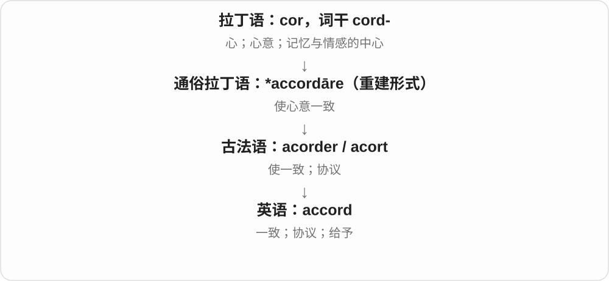

in accord 是相合；an accord 是协议。动词 accord someone respect 则是把适合的尊重给予对方。of one’s own accord 是出于自己意愿。

**常见搭配与例句**

in accord with；a peace accord；accord respect；of her own accord。

> The two groups signed an accord.

两个团体签署了一份协议。

> She left of her own accord.

她是自愿离开的。

**别混淆**

accord 作动词可以是给予，不要每处都译成达成协议。agreement 更日常，accord 作为协议名词常较正式。

### 29. according — 常用于 according to：据……所说；按照、根据

**音标**：英 /əˈkɔːdɪŋ/；美 /əˈkɔːrdɪŋ/

**先抓住这个画面**

according to 像给信息、安排贴一个依据标签：据谁所说，或者按照什么来做。

**怎么拆**

accord 协调、一致 + -ing 的分词形式，逐渐固定在 according to 等搭配中。accord 更早经法语接一致、同心的词族。

**怎么变成今天的意思**

**accord + -ing**  
相符、一致的分词关系

↓

**according to 的固定化**  
与某依据相符 → 据、按照

according to the report 据报告所说；according to the plan 按计划；according to size 按大小。根据信息来源和根据规则是两类常用场景。

**常见搭配与例句**

according to the instructions；according to the weather forecast。

> According to the forecast, it will rain tomorrow.

据天气预报说，明天会下雨。

> Arrange the books according to size.

把书按大小排列。

**别混淆**

表达自己的意见一般用 in my opinion，不通常说 according to me；according to 常用来指出外部来源或依据。

### 30. thinking — 思考；想法；思维方式

**音标**：/ˈθɪŋkɪŋ/

**先抓住这个画面**

脑子如何处理问题，或处理后形成的那套想法。

**怎么拆**

think + -ing；除了动词形式，也作表示思考活动、观点方式的名词。

**怎么变成今天的意思**

**英语 think**  
思考、认为

↓

**think + -ing → thinking**  
思考活动；形成观点的方式

clear thinking 是条理清楚的思考；What is the thinking behind this? 是问这件事背后的考虑。这里不一定追问一段具体脑电过程，而是想知道为什么作这个安排。

**常见搭配与例句**

critical thinking；creative thinking；the thinking behind a decision。

> The exercise encourages independent thinking.

这个练习鼓励独立思考。

> Could you explain the thinking behind the new schedule?

你能解释一下新时间表背后的考虑吗？

**别混淆**

thinking 可指思考方式，a thought 往往是一条具体念头。不要把所有 thinking 都当成“正在想”的时态标志。

### 31. rest — 休息；安静、停下；支托；另有剩下的部分义

**音标**：/rest/

**先抓住这个画面**

休息是一时停住活动；剩余则是拿走一部分后还留着。两条来路分别记，不强编同一故事。

**怎么拆**

休息名词、动词接古英语 ræst、restan；其余、留下义经法语来自拉丁语 restāre。现代部分用法交叠，但 the rest 不能简单解释成睡觉的人。

**怎么变成今天的意思**

**两条来路：古英语 ræst、restan；拉丁语 restāre 经法语 reste、rester**  
前者休息、安静、支撑；后者留下、剩余

↓

**英语同形 rest**  
休息、支托；另一支为其余、剩下的部分；部分动词用法后来交叠

take a rest 休息一下，rest your arm 把手臂放下休息；the rest of the day 这一天剩余时间，the rest of us 我们其余的人。rest on evidence 也可说建立在证据上。

**常见搭配与例句**

take a rest；at rest；the rest of；rest on；rest assured。

> Let’s take a rest before the next climb.

下次攀爬前，我们休息一下吧。

> I read for the rest of the afternoon.

下午余下的时间，我都在看书。

> The rest of the guests are arriving later.

其余客人稍后到。

**别混淆**

the rest 后动词随所指对象：the rest of the water is，the rest of the people are；休息与睡觉也不完全一样。

### 32. resting — 休息中的；静止时的；rest 的 -ing 形式

**音标**：/ˈrestɪŋ/

**先抓住这个画面**

活动暂时放下，身体或物体处在休息、静止的状态。resting 可以描述此刻动作，也可以给一个状态作修饰。

**怎么拆**

rest + -ing。rest 的休息义接旧英语休息、停留词族，这一支与表示剩余部分的 the rest 不必强合为同一来源。

**怎么变成今天的意思**

**rest 休息、停留的词族**  
停止活动、处于安定位置

↓

**rest + -ing → resting**  
正在休息；与休息、静止状态相关

resting on a chair 坐在椅子上休息；resting heart rate 静息心率；a resting place 休息处，也可依语境婉说安葬处。

**常见搭配与例句**

a resting animal；resting on the table。

> The dog was resting in the shade.

狗正在阴凉处休息。

> She left her hand resting on the table.

她把手搁在桌上。

**别混淆**

resting 不一律说明在睡觉。The book is resting on the table 可以只是书放在桌上；sleeping 明确是睡眠。

### 33. date — 椰枣；另源：日期、约会；注明日期、确定年代、交往

**音标**：/deɪt/

**先抓住这个画面**

水果 date 是软甜、里面有长核的椰枣。日历上的 date 则是另一条词源：文件“在某日给出”，后来那个日子就成了日期。

**怎么拆**

果实义经拉丁 dactylus、古普罗旺斯语 datil、古法语 date 进入英语，与 daktylos“手指”相连；可能有闪米特果名受希腊词影响的过程。日期义则来自拉丁 dare“给”、分词 datus 和 data，不能归入手指词根。

**怎么变成今天的意思**

**果实线：希腊 daktylos → 拉丁 dactylus**  
椰枣；手指状联想，也有更早闪米特借词改形的解释

↓

**古普罗旺斯语 datil → 古法语 date → 中古英语 date**  
椰枣、椰枣树

↓

**另源并行线：拉丁 dare → datus / data → 古法语 date → 英语 date**  
给出、注明给出日期 → 日期、约定时间 → 约会；相关动词义

a date with someone 可以是约会；date a letter 是写上日期；date a fossil 是确定年代；date someone 是与某人交往。date back to 则说起源于何时。水果义与这些用法只是恰好同形。

**常见搭配与例句**

dried dates；the date of birth；go on a date；date a document；date back to。

> She chopped the dates and added them to the cake.

她把椰枣切碎后加进蛋糕里。

> Please write today’s date at the top of the form.

请在表格上方写下今天的日期。

> They met for their first date at a quiet café.

他们第一次约会选在一家安静的咖啡馆。

> The pottery has been dated to the tenth century.

这件陶器被确定为十世纪的器物。

**别混淆**

date 指椰枣，日常中文的红枣通常是 jujube。date“日期”与 data 同源，却不是 dactyl 的后代。

### 34. dating — 约会、恋爱交往；确定年代；date 的 -ing 形式

**音标**：/ˈdeɪtɪŋ/

**先抓住这个画面**

给见面约定一个时间，发展出约会、交往这一支；给旧物找出它属于哪个时间，发展出测年这一支。

**怎么拆**

date 去词末 e 加 -ing。这里承接日期、约定时间的 date，近源经法语接拉丁 data 等给出、注明日期的材料；不接椰枣那条同形词源。

**怎么变成今天的意思**

**日期 date → date 动词**  
注明日期、确定年代；安排见面、交往

↓

**date 去 e + -ing → dating**  
测年活动；恋爱交往等

start dating 开始交往；online dating 网络交友、约会；carbon dating 碳年代测定；dating from a period 属于某时期，通常由 date from 接出。

**常见搭配与例句**

They are dating；a dating app；the dating of an object。

> They started dating after meeting at university.

他们在大学认识后开始交往。

> The dating of the pottery helped researchers understand the site.

陶器的年代鉴定帮助研究人员了解了遗址。

**别混淆**

They are dating 常表示正在恋爱交往，不仅是今天碰巧约好见面。dating an old building 则可能是在确定建筑年代，要看对象。

### 35. happen — 发生；碰巧

**音标**：/ˈhæpən/

**先抓住这个画面**

事情实际出现、展开，就是 happen。I happened to see her 则说并非专门安排，而是碰巧见到。

**怎么拆**

中古英语 happenen 等延续，通常可联系 hap 机缘、偶然事件 + -en 动词材料；更早关系有不同解释。不是 happy 直接换尾就只剩开心事件。

**怎么变成今天的意思**

**中古英语 hap 机缘、发生 + 动词材料 -en 等 → happen**  
偶然碰上、发生；旧材料也有其他来源解释

↓

**英语 happen**  
事件发生；碰巧做、碰到

What happened? 发生什么了？；happen to do 碰巧做；happen to someone 某人遭遇、碰到某事。

**常见搭配与例句**

what happened；happen to do；happen to someone。

> What happened after the lights went out?

灯熄灭后发生了什么？

> I happened to meet an old friend at the station.

我碰巧在车站遇到一位老朋友。

**别混淆**

happen 通常不及物，问 What happened? 不写 What was happened?；而 occur 也常是发生，不自动组成被动。

### 36. happened — 发生了；碰巧；happen 的过去式和过去分词

**音标**：/ˈhæpənd/

**先抓住这个画面**

有件事出现了，或某个人碰巧做了某事，就可以用 happened。它本身不告诉你事情好坏，也不一定强调有人安排。

**怎么拆**

happen + -ed，/n/ 后读 /d/；不双写 n。happen 通常接中古英语 hap 机缘、偶然事件与 -en 动词材料，更早形成细节有不同解释。

**怎么变成今天的意思**

**中古英语 hap 及相关动词材料 → happen**  
机缘、事件 → 发生、碰巧

↓

**happen + -ed → happened**  
过去发生；过去碰巧做了某事

What happened? 出什么事了？；happened to someone 发生在某人身上；happened to be there 碰巧在那里；happened upon ... 偶然发现……。

**常见搭配与例句**

happened last week；happened to notice。

> What happened after the meeting ended?

会议结束后发生了什么？

> I happened to find the missing key in an old coat.

我碰巧在一件旧外套里找到了丢失的钥匙。

**别混淆**

happened 通常不及物：The accident happened，不说 was happened。What happened to the window? 问窗户怎么了；I happened to see it 是我碰巧看见了。

### 37. happens — 发生；碰巧；happen 的第三人称单数

**音标**：/ˈhæpənz/

**先抓住这个画面**

事情出现、发生了，用 happens；一个人恰好在某处或做了某事，也能说 happens to。事情本身可以好，也可以坏。

**怎么拆**

happen + -s，/n/ 后读 /z/。happen 接中古英语 happenen 等，通常联系 hap 机缘、偶然事件与动词材料 -en；更早形成细节有不同解释。

**怎么变成今天的意思**

**中古英语 hap 等相关材料 → happen**  
机缘、事件 → 发生、碰巧

↓

**happen + -s → happens**  
单数事件发生；某人碰巧做

What happens next? 接下来会怎样？；happens every day 每天发生；happens to be ... 碰巧是、在……；as it happens 碰巧、说来也巧。

**常见搭配与例句**

it happens often；happens to know。

> What happens if we miss the last bus?

如果错过末班车，会怎么样？

> She happens to know the owner of the shop.

她恰好认识店主。

**别混淆**

happens to someone 是事情发生在某人身上，happens to do 是碰巧做某事。Something happens 是主动结构，不加 is 来造被动。

### 38. happening — 发生的事；正在发生；热闹时髦的〔口语〕

**音标**：/ˈhæpənɪŋ/

**先抓住这个画面**

What is happening? 是现在发生着什么；a strange happening 是一件怪事。口语 a happening place 还可能夸地方热闹、时髦。

**怎么拆**

happen + -ing，不双写最后 n，因为末音节不重读。名词、形容词从发生、活跃等用法发展；艺术里的 happening 又是特定事件表演名称。

**怎么变成今天的意思**

**中古英语 hap 机缘、发生 + 动词材料 -en 等 → happen**  
偶然碰上、发生；旧材料也有其他来源解释

↓

**英语 happen**  
事件发生；碰巧做、碰到

↓

**happen + -ing → happening**  
进行形式；事件名；活跃时髦性质

what is happening；a strange happening；a happening place。艺术语境 happening 常强调事件、参与，不只是任何意外。

**常见搭配与例句**

what is happening；a strange happening；a happening place。

> Nobody understood what was happening.

没人明白当时发生着什么。

> The diary records several unusual happenings.

日记记录了几件不寻常的事。

**别混淆**

happening 在名词前作时髦、热闹义时不是普通动词进行式；是否现在发生仍看句法。

### 39. meeting — 会议；会面；汇合

**音标**：/ˈmiːtɪŋ/

**先抓住这个画面**

把相遇变成一次有目的的相聚，大家交换信息、讨论、决定。

**怎么拆**

meet + -ing；古英语已有 mēting、ġemēting，中古英语 meeting 等，名词不只是今天临时把动作加后缀。

**怎么变成今天的意思**

**古英语 mētan → 中古英语 meten**  
相遇、碰见

↓

**英语 meet**  
相会；碰到、达到、满足某种条件

↓

**古英语 mēting / ġemēting → meeting**  
相聚、集会；现代对应 meet + -ing

hold a meeting 开会，a chance meeting 偶遇，the meeting of two rivers 两河交汇。meeting 可以正式也可以偶然，不是所有都预先排会。

**常见搭配与例句**

hold a meeting；attend a meeting；a chance meeting；a meeting point。

> The meeting lasted less than an hour.

会议持续不到一小时。

> A chance meeting on the train led to a long friendship.

火车上的一次偶遇带来了一段长久友谊。

**别混淆**

meeting 会议、会面，appointment 通常是事先约定的见面时段；一次 appointment 可能对应医疗、服务预约，不都叫工作会议。

### 40. reading — 阅读；读数；解读；朗读会

**音标**：/ˈriːdɪŋ/

**先抓住这个画面**

把信息读出来：读文章是阅读，读仪表是读数，读出另一层意思是解读。

**怎么拆**

read + -ing，接古英语 rǣding、中古英语 reding 等；-ing 既能表示活动，也能把一次读取结果或活动事件名词化。

**怎么变成今天的意思**

**古英语 rǣdan → 中古英语 reden**  
劝告、解释；读懂文字

↓

**古英语 rǣding → 中古英语 reding → reading**  
阅读活动；读取结果、解释

do some reading 是读点东西，a temperature reading 是一次温度读数，my reading of the poem 是我对诗的理解；a poetry reading 是诗歌朗读会。

**常见搭配与例句**

reading skills；a meter reading；a reading of the text；a poetry reading。

> Reading is part of her evening routine.

阅读是她晚间日常的一部分。

> The meter gave a reading of twenty units.

仪表显示读数为二十个单位。

> My reading of the ending is quite different from yours.

我对结局的理解与你很不同。

**别混淆**

reading 是活动或读取结果，reader 是人或设备。an accurate reading 是准确读数，不是“一位准确的读者”。

### 41. feeling — 感觉；感情；直觉；感受的

**音标**：/ˈfiːlɪŋ/

**先抓住这个画面**

身体传回一个信号，心里也留下喜悦、委屈或一种说不清的预感。

**怎么拆**

feel + -ing；接中古英语相应形式，既可为动词形式，也可作独立名词。

**怎么变成今天的意思**

**古英语 fēlan → 中古英语 felen**  
触觉感知、察觉

↓

**英语 feel**  
感到；触摸；给人某种感觉

↓

**feel + -ing → feeling**  
感知这一过程；感觉、情绪或直觉

a strange feeling 是一种奇怪感觉，hurt someone’s feelings 是伤害感情，have a feeling that 是隐约觉得。feeling 的单复数随所指变化，不能只背成一个固定的“感情”。

**常见搭配与例句**

a feeling of；hurt someone’s feelings；have a feeling that；with feeling。

> I had a feeling that we had met before.

我隐约觉得我们以前见过。

> She did not mean to hurt his feelings.

她不是故意伤害他的感情。

**别混淆**

feeling 可能是主观感受，evidence 是支持判断的证据。have a feeling 不等于已证明某事。

### 42. lower — 更低的；下部的；降低、放低

**音标**：英 /ˈləʊə/；美 /ˈloʊər/

**先抓住这个画面**

原来在这个高度或数值，现在再往下挪一些。

**怎么拆**

low + -er 的比较形式，也作使位置、数值降低的动词。另有读 /ˈlaʊə(r)/ 的阴沉、皱眉同形词，日常降价义不要误套那个音。

**怎么变成今天的意思**

**古诺斯语 lágr → 中古英语 lah / loue**  
低、平低

↓

**英语 low**  
位置低；数量、程度小；低落的

↓

**low + -er → lower /ˈləʊə(r)/**  
更低 → 使降低

lower prices 可说更低价格，也可动词说降低价格，句子结构决定。lower your voice 是压低声音，the lower shelf 是下面那层架子。

**常见搭配与例句**

lower the price；lower one’s voice；the lower level；lower than。

> Please lower your voice in the reading room.

阅览室里请小声些。

> The lower shelf holds the heavier books.

较重的书放在下面那层架子上。

**别混淆**

lower 常可及物让某物下降，fall 常是不及物自己下降；They lowered the price 与 The price fell 结构不同。

### 43. lowering — 降低、放下；lower 的 -ing 形式

**音标**：英 /ˈləʊərɪŋ/；美 /ˈloʊərɪŋ/

**先抓住这个画面**

把音量、数量、位置往下调：声音小一点、手放低一点，或把某个数值降下来。

**怎么拆**

lower 使降低、变低 + -ing；lower 的常用动词义由 low 的比较级 lower 更低发展。这里讲 /oʊ/ 这条常用词族。

**怎么变成今天的意思**

**low 低 → lower 更低**  
比较级提供向下的程度关系

↓

**lower 作动词 + -ing → lowering**  
正在降低；降低这一过程

lowering the volume 调低音量；lowering costs 降低成本；lowering a flag 降旗。可以是具体位置，也可以是抽象数值。

**常见搭配与例句**

a way of lowering costs；slowly lowering her hand。

> She was lowering the volume on the radio.

她正在把收音机的音量调低。

> The team found a way of lowering production costs.

团队找到了降低生产成本的方法。

**别混淆**

lowering 是动作、过程；lower 作比较级则是更低的。lower prices 可以是更低价格，lowering prices 明确在说降价动作。

### 44. amaze — 使惊奇；使惊叹

**音标**：/əˈmeɪz/

**先抓住这个画面**

事情超出预期，好到、奇到让人睁大眼睛，就是 amaze。现代通常带惊叹，不只是搞不懂。

**怎么拆**

接古英语 amasian 等，a- 加迷乱、惊呆材料；与 maze 的旧惊乱义相关。不拆成 a + 一个现代明确词义的 ma + ze。

**怎么变成今天的意思**

**古英语 amasian 等 → 中古英语相应形式**  
使困惑、惊呆；a- 与迷乱材料相合

↓

**英语 amaze**  
使惊奇、惊叹

amaze the audience 让观众惊叹；It amazes me that ... ……令我惊讶；never cease to amaze 不断令人惊叹。

**常见搭配与例句**

amaze someone；it amazes me that；never cease to amaze。

> Her memory for small details amazes me.

她对细节的记忆力让我惊叹。

> The performance amazed the audience.

表演让观众惊叹。

**别混淆**

amaze 强调出乎预料的惊叹，amuse 是逗乐、使愉快；相差一个元音，方向不同。

### 45. amazing — 惊人的；很棒的；amaze 的 -ing 形式

**音标**：/əˈmeɪzɪŋ/

**先抓住这个画面**

让别人产生惊叹的那一端是 amazing。口语里也常直接说很棒，不要求真的每次都惊得说不出话。

**怎么拆**

amaze 去末尾 e 加 -ing → amazing；/z/ 仍发音。形容词的令人惊叹义由分词性质发展。

**怎么变成今天的意思**

**古英语 amasian 等 → 中古英语相应形式**  
使困惑、惊呆；a- 与迷乱材料相合

↓

**英语 amaze**  
使惊奇、惊叹

↓

**amaze + -ing → amazing**  
引起惊叹；口语扩大为很棒

an amazing view 惊艳景色；an amazing result 惊人的结果；That is amazing! 太棒了！

**常见搭配与例句**

an amazing view；an amazing result。

> The view from the hill was amazing.

山上的景色很惊艳。

> She did an amazing job with a small budget.

她用不多的预算做得非常出色。

**别混淆**

amazing 常描述原因、事物，amazed 描述被惊到的人；I am amazing 通常在夸自己很出色。

### 46. amazed — 惊讶的、吃惊的；使吃惊了〔过去式、过去分词〕

**音标**：/əˈmeɪzd/

**先抓住这个画面**

事情超出预想，人一下愣住、觉得不可思议，就是 amazed。可以是惊喜，也可以是惊讶于一个糟糕的事实。

**怎么拆**

amaze 接古英语 āmāsian 一类使迷乱、震惊的材料，与 maze 的旧义相关，更远来历不定。现代 amaze 去 e 加完整 -ed，/z/ 后读 /d/。

**怎么变成今天的意思**

**古英语迷乱、震惊材料 → amaze**  
让人一时转不过来 → 使吃惊

↓

**amaze 去 e + -ed → amazed**  
已经使吃惊；人处于惊讶状态

be amazed at something 对某事吃惊；be amazed to see… 看到……很惊讶。

**常见搭配与例句**

an amazed expression 惊讶的表情；amazed by the result 对结果吃惊。

> I was amazed at how quickly she learned.

她学得那么快，让我很惊讶。

> His calm response amazed everyone in the room.

他镇定的回应让屋里所有人都吃了一惊。

**别混淆**

amazed 常说人的感受，amazing 常说引起这种感受的人或事。惊讶不自动等于赞同。

### 47. amazingly — 令人惊讶地；惊人地

**音标**：/əˈmeɪzɪŋli/

**先抓住这个画面**

事情超出了你的预料，心里冒出一句居然。amazingly 可以加强一个性质，也能把整件事标成令人意外。

**怎么拆**

amazing 令人惊讶的 + -ly，较深处接 amaze 的使惊异词族。形容性质转为程度、整句评价。

**怎么变成今天的意思**

**amaze → amazing**  
使惊异 → 令人惊讶的

↓

**amazing + -ly → amazingly**  
以令人惊讶的程度；令人意外的是

amazingly fast 快得惊人；Amazingly, nobody noticed. 令人意外的是，没人注意到。评价可以是好事，也可以只是出乎预料。

**常见搭配与例句**

amazingly well；amazingly, ...。

> The little boat moved amazingly fast.

那条小船快得惊人。

> Amazingly, the old clock still worked.

令人惊讶的是，那座旧钟还能走。

**别混淆**

amazingly 重在惊讶，wonderfully 常重在非常好；惊人的结果未必一定令人满意。

### 48. amazes — 使惊奇、惊叹〔第三人称单数〕

**音标**：/əˈmeɪzɪz/

**先抓住这个画面**

一件事比你原先想的厉害得多、奇特得多，让你忍不住说“居然能这样”，就是 amazes me。

**怎么拆**

amaze + -s，/z/ 后词尾读 /ɪz/。基础词接旧惊乱材料，有逆构历史分析，不当成现代 a- + 迷宫直译。

**怎么变成今天的意思**

**古英语惊乱材料 → 中古英语 amased 等**  
与 maze 的旧迷乱义相连，更远来源未定

↓

**现代 amaze 有从较早相关形式逆构的分析**  
今天使惊奇、惊叹；a- 在这一材料里通常作加强理解，不是否定

↓

**amaze + -s → amazes**  
它使人惊奇、惊叹

never ceases to amaze 总是令人惊叹；what amazes me is 让我惊讶的是。

**常见搭配与例句**

still amazes me；amazes the audience。

> Her ability to remember names still amazes me.

她记名字的本事仍让我惊叹。

> It amazes me that nobody noticed the missing door.

居然没人注意到门不见了，这让我很惊讶。

**别混淆**

amazes 强调超出想象的惊奇，现代常带赞叹；也可以惊讶于不合理的事，褒贬要看内容。

### 49. amazement — 惊讶、惊奇

**音标**：/əˈmeɪzmənt/

**先抓住这个画面**

完全没想到竟会这样，你一时瞪大眼睛，心里冒出“真的？”——这阵强烈惊奇是 amazement。

**怎么拆**

amaze 去 e 加 -ment；amaze 的旧材料有使迷惑、震惊等，现代常指使惊奇。不是 amusement 的拼写变体。

**怎么变成今天的意思**

**旧 amaze 等材料**  
使迷惑、震惊 → 使惊奇

↓

**amaze + -ment → amazement**  
强烈惊讶的状态

to my amazement 令我惊讶的是；in amazement 惊讶地；watch with amazement 惊奇地观看。

**常见搭配与例句**

to my amazement；in amazement。

> To my amazement, the old watch still worked.

令我惊讶的是，那块旧表竟然还能走。

> The children stared in amazement.

孩子们惊奇地盯着看。

**别混淆**

amazement 是惊奇，amusement 是觉得有趣、好笑；你可能两者都有，也可能只惊讶并不开心。

### 50. writing — 写作；书写；文字、作品

**音标**：/ˈraɪtɪŋ/

**先抓住这个画面**

既可以看人正在写，也可以看他已经写出的文字与表达风格。

**怎么拆**

write 去掉末尾 e 后加 -ing，接古英语 wrīting 等形式；只有一个 t，不写 writting。

**怎么变成今天的意思**

**古英语 wrītan → 中古英语 writen**  
刻划、写出文字

↓

**古英语 wrīting → 中古英语 writing → writing**  
书写活动；写成的内容

creative writing 是创意写作，in writing 是以书面形式，her writing 是她的文风或作品；writing skills 是写作能力。

**常见搭配与例句**

in writing；creative writing；writing skills；a piece of writing。

> Please confirm the arrangement in writing.

请以书面形式确认安排。

> Her writing is clear and direct.

她的文字清楚直接。

**别混淆**

writing 可以是写作、文风，handwriting 具体是手写字迹；文章内容优秀，不一定字写得整齐。

### 51. handwriting — 手写；字迹、笔迹

**音标**：/ˈhændraɪtɪŋ/

**先抓住这个画面**

同样的字，每个人下笔速度、线条和形状不同，留下自己的字迹。

**怎么拆**

hand + writing，也与 handwrite + -ing 对应；writing 是 write 去 e 后加 -ing，w 在 write 的常见读音中不发。

**怎么变成今天的意思**

**英语 hand；writing〔write + -ing〕**  
并列组合的两部分

↓

**hand + writing〔write + -ing〕 → handwriting**  
手写活动；手写出的字迹

neat handwriting 是工整字迹，recognize someone’s handwriting 是认出笔迹；通常不可数，不用 handwritings 数几行字。

**常见搭配与例句**

neat handwriting；recognize handwriting；handwriting practice。

> I recognized her handwriting on the envelope.

我认出了信封上她的笔迹。

> His handwriting became clearer with practice.

练习后，他的字写得更清楚了。

**别混淆**

handwriting 是手写字迹或活动，handwritten 是手写的；a handwritten letter 包含可以辨认的 handwriting。

### 52. waiting — 等待；等候中的

**音标**：/ˈweɪtɪŋ/

**先抓住这个画面**

人已经准备好，事情还没轮到自己，于是继续留着等。

**怎么拆**

wait + -ing，中古英语已有 waitynge 等名词形式；可作分词，也可把等待当成一种活动。

**怎么变成今天的意思**

**盎格鲁诺曼语 waiter / waitier → 中古英语 waiten**  
看守、留意、等候

↓

**英语 wait**  
等候；也有侍候、服务用法

↓

**wait + -ing → waiting**  
等待的过程；处于等候状态

a waiting room 等候室，a waiting list 等候名单；There is no waiting 表示不用等，具体标识含义看场所。

**常见搭配与例句**

a waiting room；a waiting list；keep someone waiting。

> Sorry to keep you waiting.

抱歉让你久等了。

> The waiting room was almost empty.

等候室几乎没人。

**别混淆**

waiting 等待过程与 waiter 服务员不同；餐馆的 waiter 可能忙着服务，而不是闲坐等候。

### 53. beginning — 开始；开端；begin 的 -ing 形式

**音标**：/bɪˈɡɪnɪŋ/

**先抓住这个画面**

一段过程最先展开的部分，也可直接表示动作正在开始。

**怎么拆**

begin + -ing，重读末音节后双写 n。名词 beginning 说开端，动词形式在 be 后等结构表达正在开始。

**怎么变成今天的意思**

**古英语 beginnan → 中古英语 beginnen → begin**  
开始，含旧前缀 be- 与旧动词部分

↓

**现代 begin**  
从未发生、未进行转入开始发生、进行

↓

**begin + -ing → beginning**  
开始动作 → 开端、起始部分

at the beginning of 在……开始时，from beginning to end 从头到尾；a new beginning 新起点。

**常见搭配与例句**

at the beginning of；from the beginning；a new beginning；the beginning of。

> I missed the beginning of the film.

我错过了电影开头。

> The move marked a new beginning for the family.

这次搬家标志着这个家庭的新起点。

**别混淆**

at the beginning of the book 指书的开头位置；in the beginning 常泛说最初，不能所有句子只按中文一开始机械选介词。

### 54. interesting — 有趣的；引人关注的

**音标**：英 /ˈɪntrəstɪŋ/；美 /ˈɪntrəstɪŋ/

**先抓住这个画面**

这东西能把别人的注意力吸引过来，让人想继续了解。

**怎么拆**

interest + -ing，分词形成形容词，表示具有引起兴趣的作用。

**怎么变成今天的意思**

**拉丁语 interesse，字面 inter- 在……之间 + esse 存在**  
相关、有影响、重要；并非现代兴趣的逐字翻译

↓

**中世纪拉丁语、法语相关名词 → 英语 interest**  
牵涉的权益、补偿等 → 后发展出兴趣、利息等用法

↓

**interest → interesting**  
使人产生兴趣 → 引人关注的

an interesting question 有意思的问题；find something interesting 觉得某事有趣。事情可能严肃、复杂，却仍然 interesting，不必让人哈哈笑。

**常见搭配与例句**

an interesting idea；find something interesting；interesting to watch。

> She raised an interesting question about the painting.

她就这幅画提出了一个有意思的问题。

> The book is difficult but extremely interesting.

这本书很难，却极其引人入胜。

**别混淆**

interesting 引人关注，funny 常说好笑或奇怪；有趣的历史讲座不必是一场喜剧。

### 55. leading — 领先的；主要的；带领的；另有排版行距义

**音标**：通常 /ˈliːdɪŋ/；排版行距名词 /ˈledɪŋ/

**先抓住这个画面**

主要形容词是在前面引领；排版术语则另走金属铅这一支。

**怎么拆**

引导义 lead /liːd/ + -ing 形成分词和形容词。排版 leading /ˈledɪŋ/ 来自金属铅：旧金属排版用铅条调节行间空隙。两者不可串成同一发音的单线故事。

**怎么变成今天的意思**

**两条独立旧词：古英语 lǣdan；古英语 lēad**  
前者是引导；后者是金属铅

↓

**英语 lead /liːd/；lead /led/**  
引导、领先；铅及相关材料用法

↓

**lead /liːd/ + -ing；lead /led/ + -ing**  
领先、引导；另有排版行距名词

a leading expert 顶尖专家，a leading role 主要角色。a leading question 是有诱导倾向的问题。设计讨论里的 adjust the leading 则是在调行距，读 /ˈledɪŋ/。

**常见搭配与例句**

a leading role；a leading company；a leading question；adjust the leading。

> She is a leading expert on ancient languages.

她是古代语言研究领域的顶尖专家。

> The designer increased the leading to make the text easier to read.

设计师增大行距，让文字更容易阅读。

**别混淆**

leading /ˈliːdɪŋ/ 不总是正在带路，也可是主要的；排版行距另读 /ˈledɪŋ/，保留金属材料名的读音。

### 56. misleading — 误导性的；容易造成错误印象的

**音标**：/ˌmɪsˈliːdɪŋ/

**先抓住这个画面**

表面看起来像在说明事实，实际却把人引向不准确的结论。

**怎么拆**

mislead + -ing，分词作形容词描述信息的效果。

**怎么变成今天的意思**

**日耳曼语系的 mis-，古英语已有**  
方向或结果不对；不是希腊“厌恶”

↓

**古英语 mislǣdan → 中古英语 misleden**  
把人带错方向

↓

**英语 mislead**  
使人得出错误印象或判断

↓

**mislead + -ing → misleading**  
容易把理解带偏的

a misleading average 可能数字算得没错，却掩盖了不同群体的差异；a misleading headline 可能夸大正文内容。所以 misleading 不只等于“数字全是假的”，也包括呈现方式造成的错觉。

**常见搭配与例句**

a misleading impression；misleading information；a misleading comparison。

> The graph is misleading because the vertical axis starts at ninety.

这张图容易误导，因为纵轴从九十开始。

> The phrase gives a misleading impression of how easy the task is.

这个说法让人误以为任务很容易。

**别混淆**

misleading 是使人误解的；misunderstood 是已经被人误解的。一个标题可能 misleading，一位讲话者可能 misunderstood。

### 57. travel — 旅行；移动；传开；行程

**音标**：英、美 /ˈtrævl/

**先抓住这个画面**

人从一个地方到另一个地方；声音、消息甚至机器零件的移动，也能借用这个词。

**怎么拆**

来自中古英语 travail 的变体，近源是古法语 travailler“辛劳、受苦”。更早通常追到与木桩刑具有关的拉丁词族，但具体转变有疑问；旅行义大概与旧时出行辛苦有关。

**怎么变成今天的意思**

**晚期拉丁语 trepalium；常重建 \*tripalium、\*tripaliare**  
刑具及折磨；通常联系三根木桩，具体器形与转义细节不明

↓

**古法语 travailler、travail → 中古英语 travailen、travail**  
受苦、辛劳；艰难行程

↓

**中古英语 travel 等变体 → 英语 travel**  
辛劳、跋涉 → 旅行；进一步泛指移动

I travel for work 是因工作出行；news travels fast 是消息传得快。travel 作一般旅行名词通常不可数，说一次旅行常用 a trip；travels 可以指一系列旅途。

**常见搭配与例句**

travel abroad；travel light；air travel。

> She travels to different cities for work.

她因工作需要到不同城市出差。

> News of the discovery travelled quickly through the village.

这一发现的消息很快传遍了村庄。

> The keyboard has a short key travel.

这款键盘的按键行程很短。

**别混淆**

travel 泛指移动和旅行活动；trip 是一次具体出行。词源中的辛苦不代表今天的 travel 必须艰难。

### 58. traveling — 旅行；随行、流动的；travel 的 -ing 形式〔美式常用拼写〕

**音标**：/ˈtrævəlɪŋ/〔亦可紧缩为 /ˈtrævlɪŋ/〕

**先抓住这个画面**

人从一地到另一地 traveling；表演、设备跟着地点移动，也可说 a traveling show。名词 traveling 还能泛说旅行这项活动。

**怎么拆**

travel + -ing → traveling，美式通常一个 l，英式常写 travelling；travel 的重音在前，不把英式双 l 当所有词都适用的重读规则。

**怎么变成今天的意思**

**法语 travail 等劳作、辛劳材料 → travel**  
历程、行旅的历史发展

↓

**travel + -ing → traveling／travelling**  
旅行动作、活动；随地流动的性质

enjoy traveling 喜欢旅行；a traveling exhibition 巡回展；traveling expenses 差旅开支。篮球里 traveling 另有持球走步违例义。

**常见搭配与例句**

enjoy traveling；a traveling exhibition；traveling expenses。

> She enjoys traveling by train.

她喜欢坐火车旅行。

> The museum organised a traveling exhibition.

博物馆组织了一场巡回展。

**别混淆**

traveling 与 travelling 主要是拼写习惯差异，不是一次旅行和多次旅行的区别。

### 59. asking — 询问、请求；所要求的〔如 asking price〕

**音标**：英 /ˈɑːskɪŋ/；美 /ˈæskɪŋ/

**先抓住这个画面**

卖家把想拿到的价钱先提出来，这个“要价”不等于最后成交价。

**怎么拆**

ask + -ing，有古英语、中古英语对应分词形式；asking price 中像形容词一样说明所开出的价格。

**怎么变成今天的意思**

**古英语 āscian → 中古英语 asken / axen**  
询问、请求

↓

**英语 ask**  
问、请求；要求某个价钱

↓

**ask + -ing → asking**  
询问、请求；价格等被开出的、所要求的

the asking price 要价，for the asking 是只要开口就能得到。普通 I am asking 是我正在问，按句中结构分。

**常见搭配与例句**

the asking price；below the asking price；for the asking。

> The asking price was higher than we expected.

要价比我们预计的高。

> Help was available for the asking.

只要开口，就有人帮忙。

**别混淆**

asking price 卖方要价，sale price、final price 才可能描述实际出售、最后价格；不能见 asking 就认定已经成交。

### 60. calling — 呼叫；使命感；天职、志业

**音标**：英 /ˈkɔːlɪŋ/；美 /ˈkɔːlɪŋ/ 或 /ˈkɑːlɪŋ/

**先抓住这个画面**

像某项工作一直在心里呼唤你，让你觉得这就是自己该投入的方向。

**怎么拆**

call + -ing，中古英语已有相应形式；由呼召、被召去做某事的观念发展为职业召命、使命感，不只表示手机响了。

**怎么变成今天的意思**

**古英语 ċeallian；古诺斯语 kalla → 中古英语 callen**  
呼喊、召唤、称作；相关来源共同影响

↓

**英语 call**  
叫、召唤；命名；打电话；作判断

↓

**call + -ing → calling**  
呼叫、召唤 → 自觉应投入的志业

find one’s calling 是找到志业，feel a calling to teach 是感到教书是自己的使命；也可作普通 call 的进行形式。

**常见搭配与例句**

find one’s calling；a true calling；a calling to do。

> She found her calling in teaching.

她在教书中找到了自己的志业。

> He felt a calling to work with young people.

他觉得帮助年轻人是自己的使命。

**别混淆**

calling 强调内心驱使、使命感，job 是工作职位；工作可以是 calling，也可能只是一份谋生手段。

### 61. leader — 领导者；带头者；领先者

**音标**：英 /ˈliːdə/；美 /ˈliːdər/

**先抓住这个画面**

在前面带方向、组织别人，或者在竞争中走在前面的人或机构。

**怎么拆**

接中古英语 ledere 和古英语 lǣdere，现代可按 lead /liːd/ + -er 分析。不是金属铅加人名词后缀。

**怎么变成今天的意思**

**古英语 lǣdan → 中古英语 leden**  
带领、使人走向某处

↓

**英语 lead /liːd/**  
带路、引导；领先；导致

↓

**lead → leader**  
带领 → 带领的人；居前者

a team leader 团队负责人；a market leader 市场领先企业；a tour leader 带队者。leader 不一定是国家领导人，也不一定仅指人。

**常见搭配与例句**

a team leader；an industry leader；a party leader；follow the leader。

> The team leader asked everyone to share an idea.

团队负责人请每个人提出一个想法。

> The small company became a market leader in its field.

这家小公司成了所在领域的市场领先者。

**别混淆**

leader 强调带领或领先，manager 强调管理职责；同一个人可以兼有两者，也可能只具其中一种角色。

### 62. cheerleader — 啦啦队员；积极鼓吹、支持者

**音标**：英 /ˈtʃɪəliːdə/；美 /ˈtʃɪrliːdər/

**先抓住这个画面**

在场边带着大家鼓劲，也可以比喻不断为某主张叫好的人。

**怎么拆**

cheer 助威、欢呼 + leader，现代体育用语后来发展出积极支持者比喻。不是只指一支啦啦队的队长。

**怎么变成今天的意思**

**古英语 lædan → lead；lædere → leader**  
带领 → 带领者

↓

**现代 leader 的复合、派生**  
带领助威、团伙或乐队；没有带领者

↓

**cheer + leader → cheerleader**  
参与带动助威的人 → 积极支持者

a school cheerleader 校队啦啦队员，a cheerleader for reform 改革的积极支持者。不限性别。

**常见搭配与例句**

a school cheerleader；a cheerleader for；an enthusiastic cheerleader。

> The cheerleaders performed before the match.

啦啦队员在赛前表演。

> He became a vocal cheerleader for the new project.

他成为新项目积极发声的支持者。

**别混淆**

cheerleader 可指普通啦啦队成员，captain 才更明确队长。比喻义有时暗示偏向叫好、缺少批判。

### 63. cheerleading — 啦啦队活动、竞技啦啦操；热情支持、鼓吹〔比喻〕

**音标**：英 /ˈtʃɪəliːdɪŋ/；美 /ˈtʃɪrliːdɪŋ/

**先抓住这个画面**

把口号、舞蹈、技巧动作等组织起来，为队伍助威或参加比赛。比喻时，也说为某事积极叫好、鼓动支持。

**怎么拆**

cheerlead + -ing，与 cheer 助威、leader 领头者、cheerleader 啦啦队员同族。活动名称同时保留助威和现代竞技运动的发展。

**怎么变成今天的意思**

**cheer、lead、cheerleader 等助威词族**  
带领、组织为队伍加油

↓

**cheerlead + -ing → cheerleading**  
啦啦队活动；比喻热情鼓动支持

a cheerleading team 啦啦队；a cheerleading competition 竞技啦啦操比赛；political cheerleading 为政治人物或政策热情站台。

**常见搭配与例句**

competitive cheerleading；uncritical cheerleading。

> She joined the school’s cheerleading team.

她加入了学校啦啦队。

> The article offered analysis rather than simple cheerleading.

那篇文章提供了分析，而不只是热情叫好。

**别混淆**

cheerleading 可以是有技巧、编排和竞赛的运动；比喻义有时暗含只顾叫好、缺少审视，要看上下文。

### 64. opening — 开口；开始；空缺、机会；开场的

**音标**：英 /ˈəʊpənɪŋ/；美 /ˈoʊpənɪŋ/

**先抓住这个画面**

墙上开了一处能通过的口，事情的第一段、岗位的一处空位也像有了入口。

**怎么拆**

open + -ing，古英语已有相应分词和 openung 等名词；从打开动作、开着的缺口延伸为开始、机会。

**怎么变成今天的意思**

**古英语 open → 中古英语 open**  
敞开、未封闭

↓

**古英语 openung 等 → 中古英语 opening → opening**  
打开、开口 → 开始、机会与空缺

an opening in the fence 是篱笆缺口，opening hours 是营业时间，a job opening 是职位空缺；opening remarks 是开场讲话。

**常见搭配与例句**

opening hours；a job opening；an opening in；opening remarks。

> There is a small opening in the wall.

墙上有个小开口。

> The company has several job openings.

公司有几个职位空缺。

**别混淆**

opening 可能是开始或空缺，opener 常是打开工具或开场项目；句子要先看在说动作、机会还是执行物。

### 65. fighting — 战斗、打斗；作战的；奋力争取的

**音标**：/ˈfaɪtɪŋ/

**先抓住这个画面**

把交战的过程拿出来说；形容词有时强调还愿意拼、还有机会。

**怎么拆**

fight + -ing，可作动词分词、名词或形容词。词义从真实交战扩展到竞争、努力争取。

**怎么变成今天的意思**

**古英语 feohtan → 中古英语 fighten**  
打斗、作战；名词也有相应旧形式

↓

**英语 fight**  
打斗；抗争；努力争取

↓

**fight → fighting**  
打斗 → 交战活动；努力拼搏的状态

heavy fighting 激烈交战；fighting spirit 斗志。a fighting chance 是仍有一拼的机会，即使不容易，也不是完全没希望。

**常见搭配与例句**

heavy fighting；a fighting chance；fighting spirit；fighting for a place。

> The news report described heavy fighting near the border.

新闻报道说边境附近发生激烈交战。

> A good final interview would give her a fighting chance.

如果最后一轮面试表现好，她就还有一拼的机会。

**别混淆**

a fighting chance 不等于一定赢；fighting 作名词可以统称一段交战，a fight 常指一次具体冲突。

### 66. learning — 学习；学到的知识、学问

**音标**：英 /ˈlɜːnɪŋ/；美 /ˈlɜːrnɪŋ/

**先抓住这个画面**

既可以看学的过程，也可以看多年学习后积下的知识。

**怎么拆**

learn + -ing；古英语已有 leornung、中古英语 lernyng 等活动名词。学习名词不是只能表正在进行时。

**怎么变成今天的意思**

**古英语 leornian → 中古英语 lernen**  
学习、获得知识技能

↓

**英语 learn**  
学会、学到；得知

↓

**learn + -ing；旧名词形式延续**  
学习过程；积累的知识

language learning 语言学习，a love of learning 好学，a person of great learning 学识深的人；机器学习 machine learning 是专门技术名称。

**常见搭配与例句**

language learning；a love of learning；lifelong learning；machine learning。

> Learning a language takes regular practice.

学语言需要经常练习。

> Her love of learning continued throughout her life.

她一生都保持着好学的热情。

**别混淆**

learning 学习过程、所得学问，education 教育体系、经历、过程范围更广；两词相关而非任何句子都能换。

### 67. telling — 说明问题的；有力揭示的；讲述

**音标**：/ˈtelɪŋ/

**先抓住这个画面**

一个小细节就让整个情况露出来，说服力并不靠篇幅长。

**怎么拆**

tell + -ing，既可普通分词、讲述名词，也可形容词接显露、表明的 tell 用法；不是每次都在说有人正在讲话。

**怎么变成今天的意思**

**古英语 tellan → 中古英语 tellen**  
计数、逐一列举；讲述、告知

↓

**英语 tell**  
告诉；辨认；产生影响；流露信息

↓

**tell + -ing → telling**  
讲述；能够揭示情况、产生效果的

a telling detail 是很说明问题的细节，a telling silence 是意味深长的沉默；in the telling 是在叙述过程中。

**常见搭配与例句**

a telling detail；a telling remark；a telling example；in the telling。

> Her silence was more telling than any answer.

她的沉默比任何回答都更说明问题。

> The report includes one particularly telling example.

报告里有一个格外有说明力的例子。

**别混淆**

telling 常说证据、细节有揭示力，talkative 是人话多；很说明问题的沉默也能是 telling silence。

### 68. speaking — 口语、讲话；发言、说话相关的

**音标**：/ˈspiːkɪŋ/

**先抓住这个画面**

把说话能力或讲话过程拿出来谈；有时也是说明接下来从什么角度说。

**怎么拆**

speak + -ing，可作分词、活动名词或形容词。speaking of...、generally speaking 等已经形成常见话语表达。

**怎么变成今天的意思**

**古英语 specan；更早相关形式常见 sprecan**  
说话；早期形式关系有不同分析

↓

**中古英语 speken → 英语 speak**  
说话、讲某语言、发言；过去 spoke，分词 spoken

↓

**speak → speaking**  
说话 → 口语、讲话活动及相关用法

public speaking 公众演讲，speaking skills 口语技能；generally speaking 一般说来；a speaking role 是有台词的角色，不是演技一定好的角色。

**常见搭配与例句**

speaking skills；public speaking；generally speaking；speaking of...。

> The course helps students improve their speaking skills.

课程帮助学生提升口语技能。

> Generally speaking, the smaller classes allow more discussion.

一般来说，小班能进行更多讨论。

**别混淆**

speaking 口语能力、过程，不等于 writing 书面写作；a speech 通常是一篇、一次具体演说或说话现象。

### 69. driving — 驾驶；推动的；猛烈的〔风雨等〕

**音标**：/ˈdraɪvɪŋ/

**先抓住这个画面**

开车是 driving；背后持续把事情往前推的，也像一个看不见的司机。

**怎么拆**

drive + -ing，去 e；历史有古英语 drīfende 等分词形式。名词活动、形容词动力和猛烈义按句子分开。

**怎么变成今天的意思**

**古英语 drīfan → 中古英语 driven**  
推着走、驱赶、使移动

↓

**英语 drive**  
驾驶；驱动；推动、逼使

↓

**drive + -ing → driving**  
驾驶过程；推动的、猛力逼来的

a driving lesson 驾驶课，a driving force 推动力，driving rain 被风猛力吹打的大雨。不是所有词组都指有人在开车。

**常见搭配与例句**

a driving lesson；a driving force；driving rain；driving skills。

> She is taking driving lessons.

她正在学开车。

> He was the driving force behind the project.

他是项目背后的主要推动者。

**别混淆**

driving 通常 /draɪv/，driven /drɪv/；a driving force 推动因素，a driven person 目标驱动很强的人。

### 70. holding — 持有；所持资产、藏品〔常复数〕；控制相关的

**音标**：英 /ˈhəʊldɪŋ/；美 /ˈhoʊldɪŋ/

**先抓住这个画面**

东西被你握着、拥有着；谈资产或馆藏时，重点是手上有哪些。

**怎么拆**

hold + -ing，从持有、拥有义形成名词与修饰用法。holding company 控股公司中的 holding 也围绕持有股份、控制权益来理解。

**怎么变成今天的意思**

**古英语 healdan → 中古英语 holden**  
保持、照看、拿住

↓

**英语 hold**  
拿住、维持、容纳；举办；影响、控制等

↓

**hold + -ing → holding**  
持有过程；持有的土地、证券、藏品等

a museum’s holdings 博物馆馆藏，share holdings 所持股份，a holding company 控股公司。holdings 常用复数，但具体对象不只股票。

**常见搭配与例句**

museum holdings；share holdings；a holding company；land holdings。

> The museum has expanded its holdings of modern art.

博物馆扩充了现代艺术藏品。

> The report lists the company’s land holdings.

报告列出了公司的土地资产。

**别混淆**

holdings 资产、藏品集合，holder 是持有人或工具；博物馆的 holdings 可以是作品，持有作品的是 museum。

### 71. killing — 杀害；致死；大赚一笔〔固定搭配〕

**音标**：/ˈkɪlɪŋ/

**先抓住这个画面**

可说杀死这一行为或事件；make a killing 在商业口语里却是一下赚很多钱。

**怎么拆**

kill + -ing，形成动词形式或动作、事件名词。make a killing 是固定的获利比喻，不能逐字当成杀人事件。

**怎么变成今天的意思**

**中古英语 killen、kyllen**  
打击、杀死等，较远来源有争议

↓

**英语 kill**  
杀死 → 使停止、毁掉效果、消磨等引申

↓

**kill + -ing → killing**  
致死行为、事件；固定短语有巨额获利义

the killing of an animal 动物被杀，a killing in a crime story 犯罪故事中的一起杀人事件；make a killing on a sale 从一次出售中大赚。

**常见搭配与例句**

the killing of；a criminal killing；make a killing。

> The detective investigated a killing in a quiet village.

侦探调查了一座安静村庄里的一起杀人事件。

> The fictional trader made a killing by selling the rare collection.

故事中的商人出售珍稀收藏，大赚了一笔。

**别混淆**

killing 可以泛说致死，murder 通常指带特定非法、故意性质的杀人概念；具体法律定义依制度，不由英语词缀一刀切。

### 72. showing — 放映；表现；展示；show 的 -ing 形式

**音标**：英 /ˈʃəʊɪŋ/；美 /ˈʃoʊɪŋ/

**先抓住这个画面**

一部电影被放出来算一场放映，一个团队拿出的实际表现也能作为一次 showing。

**怎么拆**

show + -ing，接古英语 scēawung 等相应名词形式，现代有放映场次、表现等独立名词义。

**怎么变成今天的意思**

**古英语 scēawian → 中古英语 schewen**  
看、察看、展示等

↓

**古英语 scēawung／中古英语 showing 一系**  
察看、展示等动作名词

↓

**英语 showing**  
展示；电影场次；表现

the evening showing 是晚场放映，a strong showing 是出色表现。be showing a film 又可以是普通动词正在放片。

**常见搭配与例句**

a strong showing；a poor showing；the first showing；a film showing。

> We booked tickets for the late showing.

我们订了晚场放映的票。

> The new team made a strong showing in the tournament.

新队在锦标赛上表现出色。

**别混淆**

showing 的表现义不只指舞台演员，候选人、运动队、产品销售也可有 strong showing。

### 73. meaning — 含义；意思、意图；意义、价值

**音标**：/ˈmiːnɪŋ/

**先抓住这个画面**

别人说出一串声音，你想知道他到底指什么；人生有 meaning，则在问这件事为何值得做。

**怎么拆**

mean 意指、打算 + -ing，有中古英语 mening 等旧名词。这里接意指的 mean，不接平均数，也不接刻薄的同形词。

**怎么变成今天的意思**

**古英语 mǣnan → 中古英语 menen → mean**  
意指、打算、表示

↓

**中古英语 mening → meaning**  
所指、意图 → 含义、意义、重要性

the meaning of a word 词义，What’s the meaning of this? 这是什么意思，find meaning in work 从工作中找到意义。

**常见搭配与例句**

the meaning of；the intended meaning；full of meaning；find meaning in。

> What is the meaning of this word?

这个词是什么意思？

> She found new meaning in helping others.

她从帮助别人中找到了新的意义。

**别混淆**

meaning 常说所指内容或价值，definition 是对词、概念作出的定义。知道一个定义不代表理解了某段话的全部意思。

### 74. putting — 放置；高尔夫推杆

**音标**：放置 /ˈpʊtɪŋ/；高尔夫推杆 /ˈpʌtɪŋ/

**先抓住这个画面**

同样一串字母，可能是在把书放回去，也可能是在果岭上轻推高尔夫球。

**怎么拆**

普通 putting 是 put + -ing，双写 t；高尔夫 putting 是 putt + -ing，putt 经苏格兰语相关形式进入英语。两种基词和读音要分清，不只按单词长度猜。

**怎么变成今天的意思**

**put + -ing → putting /ˈpʊtɪŋ/**  
放置等动作的形式

↓

**另一路：putt + -ing → putting /ˈpʌtɪŋ/**  
高尔夫推杆活动

putting things away 是收好东西；practise putting 是练习推杆。语境通常很清楚：书包、杯子接放置，球场、球杆接推杆。

**常见搭配与例句**

putting things away；putting it simply；practise putting。

> She is putting the books back on the shelf.

她正在把书放回书架。

> He spent an hour practising his putting.

他花了一小时练习高尔夫推杆。

**别混淆**

一般 put /pʊt/ 和高尔夫 putt /pʌt/ 在常见标准读音中不同；不能因为都写 putting 就只记一个 /ʊ/。

### 75. sitting — 坐着；一次持续活动；开庭或会议的一次；现任的

**音标**：/ˈsɪtɪŋ/

**先抓住这个画面**

sitting 把“坐下来”的动作拉成一段时间：一口气读完、一场会议、一顿分批供应的餐，都可以围绕这段时间来理解。

**怎么拆**

现代 sit + -ing；名词可追到中古英语 sittyng，分词另承古英语 sittende 等形式，后来汇为现代拼写。

**怎么变成今天的意思**

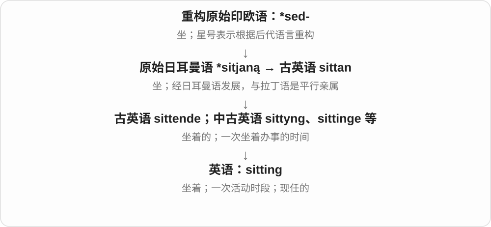

in one sitting 是一口气做完；a sitting president 是现任总统，像仍坐在职位的席位上；a court sitting 是一次开庭。

**常见搭配与例句**

in one sitting；a sitting president；the morning sitting。

> I read the short novel in one sitting.

我一口气读完了这部短篇小说。

> The sitting president attended the ceremony.

现任总统出席了仪式。

> The court’s morning sitting ended at noon.

法院上午的庭审在中午结束。

**别混淆**

session 和名词 sitting 都可指一次会议；sitting 还常说一口气做事的时段，现任义则是形容词。

### 76. standing — 站立的；长期有效的；地位、声誉

**音标**：/ˈstændɪŋ/

**先抓住这个画面**

人站着不坐下，规则立着没撤掉，人在群体里也有自己的位置。

**怎么拆**

stand + -ing，接早期英语相应分词和名词形式；standing 不是只有进行时，已能作形容词及地位、持续时间等名词。

**怎么变成今天的意思**

**古英语 standan → 中古英语 standen / stonden**  
站立；占据一个位置

↓

**古英语 standende 等 → 中古英语 standing 对应形式**  
站立着；持续状态

↓

**英语 standing**  
站立、长期有效；地位声誉

a standing ovation 是起立鼓掌，a standing invitation 是长期有效的邀请，professional standing 是职业声望；a problem of long standing 是存在已久的问题。

**常见搭配与例句**

a standing ovation；a standing invitation；professional standing；of long standing。

> The audience gave the performers a standing ovation.

观众起立为表演者鼓掌。

> Her professional standing grew over the years.

多年来，她的职业声望不断提高。

**别混淆**

standing 形容持续有效，stationary 说不移动；a standing order 还可能是银行常设付款指示等固定术语，不能只译成站立的命令。

### 77. understanding — 理解；体谅；共识、谅解；善解人意的

**音标**：英 /ˌʌndəˈstændɪŋ/；美 /ˌʌndərˈstændɪŋ/

**先抓住这个画面**

不只听到了，还懂了意思；懂到对方为什么这样做，就容易多一层体谅。

**怎么拆**

understand + -ing；古英语有 understanding 等理解名词与相应分词，中古英语延续。不能因为表面有 under、stand 就编成站在下面所以体谅。

**怎么变成今天的意思**

**古英语 understandan → 中古英语 understanden**  
已表示理解、领会；更早语义桥梁有争议

↓

**英语 understand**  
理解含义、处境；领会

↓

**understand + -ing；古英语相应形式延续**  
理解、共识；体谅人的性质

an understanding of a subject 对学科的理解，reach an understanding 达成谅解，an understanding teacher 体谅人的老师。名词、形容词各有场景。

**常见搭配与例句**

an understanding of；reach an understanding；a mutual understanding；an understanding teacher。

> The course gave me a better understanding of the subject.

课程让我更懂这门学科。

> My manager was very understanding when I explained the delay.

我解释延误原因时，经理很体谅。

**别混淆**

understanding 懂、体谅；agreement 同意、协议。能理解对方不等于认同对方的所有做法。

### 78. misunderstanding — 误解；误会；由误会造成的分歧

**音标**：英 /ˌmɪsʌndəˈstændɪŋ/；美 /ˌmɪsʌndərˈstændɪŋ/

**先抓住这个画面**

双方拿着不同版本的意思继续交流，于是越说越不在一条线上。

**怎么拆**

misunderstand + -ing，表示误解这件事或其结果。

**怎么变成今天的意思**

**日耳曼语系的 mis-，古英语已有**  
方向或结果不对；不是希腊“厌恶”

↓

**中古英语 mis- + understand**  
理解错

↓

**英语 misunderstand**  
误解某人的话、意思或意图

↓

**misunderstand + -ing → misunderstanding**  
理解错误；由此产生的误会或分歧

a misunderstanding 可以是对安排、词义或意图的误会；clear up a misunderstanding 就是把误会说明白。有时它也委婉指双方闹了别扭，但不能据此把每次严重冲突都轻描淡写地叫误会。

**常见搭配与例句**

a misunderstanding about something；clear up a misunderstanding；avoid misunderstandings。

> There was a misunderstanding about who would book the room.

大家对谁来订房间有了误会。

> A short phone call cleared up the misunderstanding.

一个简短的电话就澄清了误会。

**别混淆**

miscommunication 强调沟通出了问题；misunderstanding 强调有人理解错了。前者可能造成后者。

### 79. outstanding — 杰出的；显著的；尚未解决或支付的

**音标**：/ˌaʊtˈstændɪŋ/

**先抓住这个画面**

一条是突出于众人，另一条是仍挂在外面没结清。

**怎么拆**

out＋standing 的形容词组合，有突出的旧义，也与 outstand 的构词分析相关；表示向外突出的动词 outstand 又有由 outstanding 逆构的说法，不能把现代动词当作唯一前身。

**怎么变成今天的意思**

**英语 out；standing**  
向外、分离；站立、保持

↓

**outstanding 的突出、分离义**  
后来出现未结清义及显著、杰出的评价义

↓

**现代 outstanding 的两大常用分支**  
优秀突出；尚未处理或支付

an outstanding musician 是非常出色的音乐家；an outstanding invoice 却是还没付的账单。后者可以想成仍悬在待办清单上的事项，完全不是在夸账单优秀。

**常见搭配与例句**

outstanding performance；outstanding ability；outstanding questions；an outstanding balance。

> She gave an outstanding performance in the final.

她在决赛中表现得非常出色。

> Please settle the outstanding invoice by Friday.

请在周五前付清那张尚未结清的发票款项。

**别混淆**

看到 outstanding，要先看后面的名词。achievement 多半在表扬；debt、payment、issue 多半在说尚未解决。

### 80. walking — 步行；适合步行使用的；仿佛活的……

**音标**：英 /ˈwɔːkɪŋ/；美 /ˈwɑːkɪŋ/

**先抓住这个画面**

把走路当成一项活动；作定语时也可说明装备、路线与步行有关。

**怎么拆**

walk + -ing，分词、名词和形容词有相应发展。a walking encyclopedia 把人比成会走路的百科全书，是活的、随处可问的比喻。

**怎么变成今天的意思**

**古英语 wealcan、wealcian 等相关形式**  
转动、移动；揉搓、踩踏等旧义

↓

**中古英语 walken → 英语 walk**  
逐渐形成现代走路、步行等常用义

↓

**walk → walking**  
走 → 步行活动、步行相关的

walking boots 徒步靴，walking distance 步行可及的距离；within walking distance 离得近到可以步行。walking dictionary 是知识或词汇丰富的人。

**常见搭配与例句**

walking boots；a walking tour；within walking distance；a walking encyclopedia。

> The hotel is within walking distance of the museum.

从酒店走路就能到博物馆。

> He is a walking encyclopedia of local history.

说起当地历史，他简直是一部活百科全书。

**别混淆**

walking distance 通常在说方便走到的范围，不是一个固定公里数；walkable 也会谈道路环境是否适合步行。

### 81. lie — 躺、平放着；位于；说谎；谎言

**音标**：/laɪ/

**先抓住这个画面**

同一拼写装着两套词：一个说身体放在哪儿，一个说话是否诚实。先分两套，变化就不乱。

**怎么拆**

躺义接古英语 liċġan，说谎义另接 lēogan，谎言名词也有旧 lyġe。现代同形不等于同源；躺 lie—lay—lain，说谎 lie—lied—lied。

**怎么变成今天的意思**

**古英语 liċġan → 中古英语 liggen、lien → lie〔躺、位于〕**  
身体横放、处于某位置；lie—lay—lain

↓

**另源古英语 lēogan、名词 lyġe → lie〔说谎、谎言〕**  
欺骗、说不实话；lie—lied—lied

lie down 躺下，lie on the bed 躺床上，lie to someone 对某人说谎，tell a lie 说一个谎。lie in 也可在于。

**常见搭配与例句**

lie down；lie on；lie to someone；tell a lie；lie in。

> I lay on the sofa for an hour yesterday.

昨天我在沙发上躺了一小时。

> He lied about where he had been.

他对自己去过哪里撒了谎。

**别混淆**

躺的过去 lay 又与另一个原形 lay 放置同形：lay a book—laid—laid。I lay down yesterday 昨天躺下，I lied yesterday 昨天说谎，不能混。

### 82. twitter — 啁啾、连续细鸣；叽叽喳喳；细碎鸣声

**音标**：英 /ˈtwɪtə/；美 /ˈtwɪtər/

**先抓住这个画面**

树枝上的小鸟发出一串轻细、颤动的叫声，可以用 twitter。人紧张、兴奋地轻声说个不停，也能借这个鸟鸣画面。

**怎么拆**

接中古英语 twiteren 等，属于有拟声背景的日耳曼词族。现代整体认词，不把 -er 当作做某事的人，也不从社交平台名称反推鸟鸣词的来源。

**怎么变成今天的意思**

**有拟声背景的早期鸟鸣词 → 中古英语 twiteren → twitter**  
轻细、连续、颤动的叫声

↓

**鸟鸣 → 相似的人声、兴奋状态**  
既能作动词，也能作鸣声名词

birds twitter 是鸟儿啁啾；a twitter of birds 是一阵细碎鸟鸣；in a twitter 可说激动、忐忑的状态。

**常见搭配与例句**

birds twitter；a twitter of birds；in a twitter。

> Small birds twitter in the branches outside my window.

小鸟在我窗外的树枝间啁啾。

> A faint twitter of birds broke the silence.

轻细的鸟鸣打破了寂静。

**别混淆**

tweet 可以是一声短促鸟叫，twitter 常让人想到一串细碎叫声。这里掌握普通词用法；专名的拼写大写与否还需看语境。

### 83. twittering — 细碎鸟鸣；啁啾的；叽叽喳喳的

**音标**：英 /ˈtwɪtərɪŋ/；美 /ˈtwɪtərɪŋ/

**先抓住这个画面**

闭上眼，只听见一串接一串的小鸟细鸣，这种声音可以说 twittering。它也能修饰发出这种叫声的小鸟。

**怎么拆**

twitter + 完整 -ing → twittering，原词保留。既可为动作形式，也可作为声音的名词或相关修饰语；twitter 本身有拟声背景。

**怎么变成今天的意思**

**早期鸟鸣词 → twitter 啁啾**  
原有连续细碎、颤动的声音意象

↓

**twitter + -ing → twittering**  
正在细鸣；或把这种声音作为整体来描述

the twittering of birds 是鸟儿的啁啾声；twittering birds 是啁啾的小鸟。形容人声时可带轻快、紧张或说个不停的感觉。

**常见搭配与例句**

the twittering of birds；twittering birds；soft twittering。

> We woke to the twittering of birds in the garden.

我们在花园里小鸟的啁啾声中醒来。

> Twittering sparrows gathered on the roof.

啁啾的麻雀聚在屋顶上。

**别混淆**

roaring 是轰鸣、吼叫，twittering 通常轻细得多。读作普通声音描写时，不必套进网络发帖的用法。

### 84. wedding — 婚礼；结婚仪式

**音标**：/ˈwedɪŋ/

**先抓住这个画面**

结婚这件事办成的一场仪式：邀请宾客、交换誓言、庆祝。重点是那次活动。

**怎么拆**

古英语 weddung 是 weddian 的动作名词，经中古英语 wedding 延续。现代对应 wed + -ing，双写 d；常见婚礼义由结婚、订婚活动发展。

**怎么变成今天的意思**

**古英语 weddian → 中古英语 wedden → wed**  
作出承诺、订婚、结婚

↓

**古英语 weddung → 中古英语 wedding → wedding**  
结婚、订婚活动 → 婚礼；现代对应 wed + -ing

a wedding ceremony 婚礼仪式，a wedding dress 婚纱，a wedding reception 婚宴、婚礼后的招待会。

**常见搭配与例句**

a wedding dress；a wedding ceremony；attend a wedding。

> We attended her wedding last Saturday.

上周六我们参加了她的婚礼。

> They want a small wedding with close friends.

他们想办一场只请好友的小婚礼。

**别混淆**

wedding 那场婚礼，marriage 婚姻关系；a happy marriage 说长期关系，a beautiful wedding 常说仪式办得美。

### 85. acting — 表演；临时代理职务的

**音标**：/ˈæktɪŋ/

**先抓住这个画面**

acting 一边是扮演角色，另一边是暂时替某个职位做它该做的事。

**怎么拆**

act + -ing；作名词表示表演，作形容词可表示代理职务。

**怎么变成今天的意思**

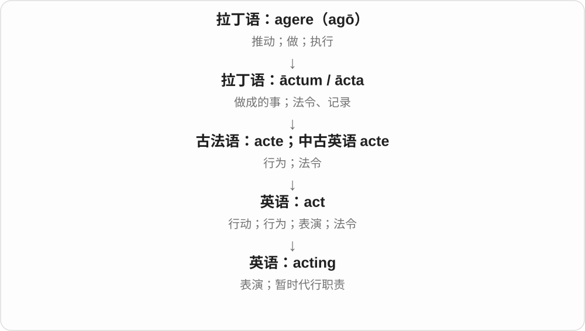

acting manager 是临时履行经理职责的人，不是在“假装当经理”。是否最终正式任命另当别论。

**常见搭配与例句**

an acting career；acting skills；the acting director。

> Her acting made the character believable.

她的表演让这个角色显得可信。

> He served as acting manager for two months.

他担任了两个月的代理经理。

**别混淆**

acting director 是代理主管；an actor 是演员，两者的“角色”并非同一种制度身份。

### 86. hearing — 听觉、听力；听证、庭审；倾听的机会

**音标**：英 /ˈhɪərɪŋ/；美 /ˈhɪrɪŋ/

**先抓住这个画面**

可以说听声音的能力，也可以是正式留出时间听取证据、说明。

**怎么拆**

hear + -ing，形成能力、活动、程序等名词；正式程序义取听取双方或相关信息的意思。

**怎么变成今天的意思**

**古英语 hīeran、hēran 等形式 → 中古英语 heren 等**  
听见

↓

**英语 hear；过去式、过去分词 heard**  
听见；听说；收到消息；听取、审理

↓

**hear → hearing**  
听 → 听觉、听取活动或正式程序

good hearing 听力好；a public hearing 公开听证；give someone a fair hearing 公平听取某人意见。最后这个表达不一定真的在法庭里。

**常见搭配与例句**

hearing loss；a public hearing；a fair hearing；within hearing distance。

> Her hearing is excellent, even in a noisy room.

即使房间嘈杂，她的听力也很好。

> The committee promised to give both sides a fair hearing.

委员会承诺公平听取双方意见。

**别混淆**

hearing 作为能力常不可数，a hearing 作为一次正式程序或听取机会可数；听证不是听力测试。

### 87. target — 目标、指标；靶子；针对、把某人某物定为目标

**音标**：英 /ˈtɑːɡɪt/；美 /ˈtɑːrɡɪt/

**先抓住这个画面**

把视线钉在一个想达到、想影响的点上，就是 target。它可以是销售数字，也可以是一群需要服务的人。

**怎么拆**

较早 target 指小盾，接 targe 及法语 targete 等指小材料，来自日耳曼语盾框、边缘词族。后来用作瞄准物，可能与圆形、同心圈外观有关，再泛化为目标。

**怎么变成今天的意思**

**targe、法语 targete 等**  
较小、常为圆形的盾

↓

**瞄准物 → 现代 target**  
靶子；目标、指标；把某物当目标

meet a target 达到指标；set a target 设目标；target audience 目标受众；target a problem 针对问题；a target of criticism 批评对象。

**常见搭配与例句**

reach the target；target resources at something。

> The team met its target ahead of schedule.

团队提前完成了目标。

> The campaign targets young adults.

那项宣传活动面向年轻成年人。

**别混淆**

goal 常概括想实现的结果，target 常把可瞄准、可衡量或要影响的对象标出来；二者在目标义有重叠。

### 88. targeting — 针对、面向、选定目标；target 的 -ing 形式

**音标**：英 /ˈtɑːɡɪtɪŋ/；美 /ˈtɑːrɡɪtɪŋ/

**先抓住这个画面**

先圈定希望影响的对象，再把帮助、信息或资源对准它。targeting 抓住这个选定并朝向的过程。

**怎么拆**

target + -ing；现代接靶子、目标名词转成的针对动词。较早小盾历史已留在 base target 中，今天按针对哪个对象理解。

**怎么变成今天的意思**

**target 的目标义 → 动词 target**  
把某人某物选定为目标

↓

**target + -ing → targeting**  
针对的动作、过程或方法

targeting a specific audience 面向特定受众；targeting resources at a problem 把资源集中到某问题；better targeting 更精准地选定对象。

**常见搭配与例句**

a targeting strategy；targeting new readers。

> The campaign is targeting new readers.

那项宣传活动面向新读者。

> Better targeting helped the programme reach families who needed support.

更准确地确定对象，帮助那项计划触达了需要支持的家庭。

**别混淆**

targeting 说选定、面向对象，reaching 说触达；选中了对象，不等于信息一定已被所有目标人群看见。

### 89. draw — 画；拉、抽取；吸引；平局〔名词〕

**音标**：英 /drɔː/；美 /drɔː/〔亦有 /drɑː/〕

**先抓住这个画面**

拉窗帘、抽出一张卡，都能抓住拉、抽的旧核心；画图时用拉出线条来帮助记忆，比赛平局则另按固定义学。

**怎么拆**

接古英语 dragan、古英语后期及中古英语的 drawen 等形式，与 drag 共享历史。过去式 drew，分词 drawn；现代画图义与拉取义同词，不任意加一个“画”的拉丁后缀。

**怎么变成今天的意思**

**古英语 dragan → 中古英语 drawen → draw**  
拖、拉；与 drag 同一历史词族

↓

**英语 draw 的多支发展**  
拉开、抽取、吸引；画图；形成平局等固定用法

draw a picture 画图；draw the curtains 拉窗帘；draw attention 吸引注意；end in a draw 平局收场。

**常见搭配与例句**

draw a picture；draw the curtains；draw attention；a draw。

> She drew a simple map on the paper.

她在纸上画了一张简图。

> The announcement drew a large crowd.

公告吸引了一大群人。

> The match ended in a draw.

比赛以平局结束。

**别混淆**

draw 画图通常偏线条、图形，paint 常涉及颜料绘画；但日常艺术分类还有重叠。

### 90. drawing — 绘画；图画、图样；draw 的 -ing 形式

**音标**：英 /ˈdrɔːɪŋ/；美 /ˈdrɔːɪŋ/

**先抓住这个画面**

drawing 可以是画这件事，也可以是画出来的一张图；工程图纸、铅笔画都能从画出的线条理解。

**怎么拆**

draw + -ing → drawing；可作分词、动作名词、作品名词。通常两音节，不把书面字母 w 单独加成一个硬读音节。

**怎么变成今天的意思**

**古英语 dragan → 中古英语 drawen → draw**  
拖、拉；与 drag 同一历史词族

↓

**英语 draw 的多支发展**  
拉开、抽取、吸引；画图；形成平局等固定用法

↓

**draw + -ing → drawing**  
画图过程、图画作品；也保留拉取等动作形式

a pencil drawing 铅笔画；a technical drawing 技术图样；drawing attention 引起注意；a prize drawing 抽奖，也接 draw 的抽取义。

**常见搭配与例句**

a pencil drawing；a technical drawing；drawing attention。

> The wall is covered with children’s drawings.

墙上贴满了孩子们的画。

> Drawing helps her observe small details.

画画帮助她观察细小的地方。

**别混淆**

drawing attention 不是画出注意力，仍是吸引；作品名词 a drawing 则可数。

### 91. drawings — 图画、素描；图样〔复数〕

**音标**：英 /ˈdrɔːɪŋz/；美 /ˈdrɔːɪŋz/，亦 /ˈdrɑːɪŋz/

**先抓住这个画面**

笔在纸上走过，留下一条条线，画出来的一张张图就是 drawings。常强调线条、笔绘的图，不只说正在画的动作。

**怎么拆**

draw + -ing → drawing，再加复数 -s，/ŋ/ 后读 /z/。draw 传自古英语 dragan 拉，经中古英语 drawen 延续，画图是同词的后续发展。

**怎么变成今天的意思**

**古英语 dragan → draw**  
拉、拖 → 多支用法，其中包括画图

↓

**draw + -ing → drawing；+ -s → drawings**  
绘画的动作、产物 → 多张画或图样

pencil drawings 铅笔画；technical drawings 技术图样；drawings of animals 动物图画。

**常见搭配与例句**

a collection of drawings 一组画作；detailed drawings 详细图样。

> The wall was covered with children’s drawings.

墙上贴满了孩子们的画。

> The architect showed us the detailed drawings.

建筑师给我们看了详细图样。

**别混淆**

drawing 说绘画活动时可不可数；drawings 数完成的图画、图样。paintings 更突出用颜料画的作品，二者具体边界也看作品与习惯。

### 92. drawn — 拉、画；吸引、得出〔draw 的过去分词〕

**音标**：英 /drɔːn/；美 /drɔːn/、/drɑːn/

**先抓住这个画面**

东西被拉到某处、线条被画出来、注意力被引过去，都可用 drawn。它是过去分词，常出现在 has drawn、was drawn 等结构里。

**怎么拆**

draw—drew—drawn 是本族不规则变化，drawn 的结尾保留旧分词形式痕迹。较早接古英语 dragan、后来的 drawen 等，不把现代 awn 看作画画专用后缀。

**怎么变成今天的意思**

**古英语 dragan 等 → draw**  
拉 → 画线、吸引、推进到结论等

↓

**draw—drew—drawn**  
过去式 drew；过去分词 drawn，元音分别记

has drawn a map 已画地图；was drawn by 由……画出；drawn to music 被音乐吸引；conclusions drawn 得出的结论。

**常见搭配与例句**

a map drawn by a child；visitors drawn to the exhibition。

> The map was drawn by a local artist.

这张地图由当地一位画家绘制。

> The exhibition has drawn visitors from several nearby towns.

这个展览吸引了附近几个镇的访客。

**别混淆**

drew 是不带 have 的一般过去式；drawn 常与 have、be 等组成完成、被动结构。被吸引也可说 be drawn to something。

### 93. drew — 拉、拖；画；吸引；得出〔draw 的过去式〕

**音标**：/druː/

**先抓住这个画面**

把东西朝某个方向拉，是 drew 的老动作；笔拉出线条能画图，注意力被拉过来是吸引，思路走向结果是得出。

**怎么拆**

draw 的不规则过去式是 drew，过去分词 drawn，现代不能拆成 draw + ew。draw 接古英语 dragan，经后期古英语、中古英语形式发展，与 drag 有历史亲缘。

**怎么变成今天的意思**

**古英语 dragan → draw**  
拉动 → 拉出线条、画；吸引等意义

↓

**draw → drew；分词 drawn**  
旧强变化词族的现代过去式，不是通用后缀

drew a picture 画画；drew the curtains 拉窗帘；drew attention 引起注意；drew a conclusion 得出结论。

**常见搭配与例句**

drew a line；drew people to the exhibition。

> She drew a map to show us the route.

她画了一张地图，给我们说明路线。

> The exhibition drew visitors from nearby towns.

这个展览吸引了附近城镇的访客。

**别混淆**

drew 是过去式，have、had 等结构后通常用 drawn。drew a conclusion 回到把理由推进、带到最后判断的抽象用法。

### 94. engineering — 工程；工程学；设计与建造工作

**音标**：英 /ˌendʒɪˈnɪərɪŋ/；美 /ˌendʒɪˈnɪrɪŋ/

**先抓住这个画面**

把想法变成能运作、能建造的方案，算、设计、测试、维护等都可能在里面。

**怎么拆**

engineer + -ing，把工程师的工作、专业领域作为名词。也可在句中是 engineer 动词的进行形式。

**怎么变成今天的意思**

**拉丁 ingenium → 法语 engin**  
天生能力、巧思 → 巧妙装置、战械

↓

**engineer + -ing → engineering**  
工程设计活动 → 工程专业、学科

civil engineering 土木工程，mechanical engineering 机械工程，engineering design 工程设计；通常作不可数专业名词。

**常见搭配与例句**

civil engineering；mechanical engineering；engineering design。

> He studied mechanical engineering at university.

他在大学学机械工程。

> The bridge is an impressive piece of engineering.

这座桥是一项令人赞叹的工程成果。

**别混淆**

engineering 不只引擎技术；science 常研究规律，engineering 常在约束中应用知识解决设计问题，实际工作可交叉。

### 95. helping — 一份食物；帮助；help 的 -ing 形式

**音标**：/ˈhelpɪŋ/

**先抓住这个画面**

盛饭时勺子一次给你盛到盘里的那一份，就是 a helping。

**怎么拆**

help + -ing；除了帮助的动作名词、分词用法，食物份量义与 help someone to food“给人取食物”相连。

**怎么变成今天的意思**

**古英语 help；helpan**  
帮助；帮助这一动作

↓

**中古英语 help／helpen → 英语 help**  
帮助、协助；使情况好转

↓

**help + -ing → helping**  
帮助这一动作；由取食物用法发展出一份食物

a second helping 是再来一份；helping hands 指帮手或伸出的援手。We are helping 中则只是动词形式，不要把所有 helping 都理解成餐点。

**常见搭配与例句**

a helping of rice；a second helping；a helping hand。

> Would you like a second helping of soup?

你还要再来一份汤吗？

> Thanks for giving us a helping hand.

谢谢你帮了我们一把。

**别混淆**

helping 是食物一次分给或取用的量，portion 范围更广，可以强调一部分或一份的大小。

### 96. shooting — 射击；枪击事件；拍摄

**音标**：/ˈʃuːtɪŋ/

**先抓住这个画面**

同一个动作名词，在摄影现场是拍摄，在体育是射击，在新闻中也可能是枪击事件。

**怎么拆**

shoot + -ing，构成活动名词、进行形式；不同意义都跟随 shoot 的实际分支，不只背射击一种。

**怎么变成今天的意思**

**古英语 scēotan → 中古英语 scheten、schoten → shoot**  
射出、快速移出、抛射

↓

**现代 shoot**  
射击、射门 → 拍摄；迅速生长、嫩枝等分支

↓

**shoot + -ing → shooting**  
射出、拍摄等的活动形式

film shooting 电影拍摄，a shooting competition 射击比赛，a shooting incident 枪击事件。

**常见搭配与例句**

film shooting；a shooting competition；a shooting incident。

> Shooting begins next week at the studio.

拍摄下周在摄影棚开始。

> The museum held an exhibition about shooting sports.

博物馆办了一场射击运动展览。

**别混淆**

shooting star 流星是固定形象说法，不是星星持枪；a film shoot 一次拍摄也常用名词 shoot。

### 97. garden — 花园、庭园、菜园；种植、照料园地

**音标**：英 /ˈɡɑːdən/；美 /ˈɡɑːrdən/

**先抓住这个画面**

一片种花、种菜、种树或供人休憩的地方，通常经过人安排、照料。英语 garden 不只表示种观赏花的地方。

**怎么拆**

经中古英语 gardyn、garden 借自盎格鲁诺曼语 gardin 等；更早来自日耳曼围起来的地方词族。与英语本族词 yard 同源，路线不同。

**怎么变成今天的意思**

**日耳曼围地词族 → 法语 gardin 等**  
围起、照料的园地

↓

**英语 garden 名词 → 动词**  
园地；再说种植、打理花园

a flower garden 花园；a vegetable garden 菜园；garden behind the house 屋后园地。美式 backyard、yard 与英式 garden 的常用范围有差别。

**常见搭配与例句**

work in the garden；a public garden；garden every weekend。

> They grow tomatoes in the garden.

他们在园子里种番茄。

> She likes to garden on weekends.

她喜欢周末做园艺。

**别混淆**

garden 常突出种植、照料的园地；yard 在美式常说房屋周围的院子，即使主要是草坪也可用。具体用途要看语境。

### 98. gardens — 花园、菜园、园地〔复数〕；做园艺〔第三人称单数〕

**音标**：英 /ˈɡɑːdənz/；美 /ˈɡɑːrdənz/

**先抓住这个画面**

把一片地方围起、照料，让花草、蔬菜长起来，是 garden 的具体画面；多块园地是 gardens，动词则说种植、打理园子。

**怎么拆**

garden + -s，/n/ 后读 /z/。garden 经盎格鲁诺曼语 gardin 等借入，较早是日耳曼围地词族；与英语本族词 yard 同源，但借入路线不同。

**怎么变成今天的意思**

**日耳曼围地词族 → 法语 gardin 等 → garden**  
围起、照料的园地

↓

**garden + -s → gardens**  
多个花园、菜园；单数主语做园艺

public gardens 公共花园；vegetable gardens 菜园；gardens behind the houses 屋后的花园；gardens every weekend 每周末打理园子。

**常见搭配与例句**

botanical gardens；gardens full of flowers。

> The houses have small gardens at the back.

这些房子后面都有小花园。

> She gardens whenever she has a free afternoon.

只要有空闲的下午，她就会打理园子。

**别混淆**

garden 可以是花园，也可以是菜园，不只按种花理解。gardens 有时用于一个大型园区、正式名称，实际是否分成多个独立花园要看地点。

### 99. gardening — 园艺、园圃种植与打理

**音标**：英 /ˈɡɑːdənɪŋ/；美 /ˈɡɑːrdənɪŋ/

**先抓住这个画面**

种下去、浇水、除草、修剪，一起组成打理园子的活动。gardening 把这些事作为一项爱好、技能来谈。

**怎么拆**

garden 作动词种植、照料园地，加 -ing 成活动名；较早英语已有相应动作名词。garden 的名词来源又接围起的园地词族。

**怎么变成今天的意思**

**garden 名词 → 园艺动作动词**  
园地 → 打理园地

↓

**garden + -ing → gardening**  
种植、照料园子的活动

do some gardening 做些园艺；gardening tools 园艺工具；a gardening club 园艺社团。作活动名通常不可数。

**常见搭配与例句**

enjoy gardening；learn gardening skills。

> Gardening helps him relax after work.

做园艺能让他下班后放松。

> I spent the afternoon doing some gardening.

我下午做了一会儿园艺。

**别混淆**

garden 是园地，也可作动词；gardening 说打理它的活动。horticulture 是更学术、专业的园艺领域名称。

### 100. housing — 住房；住房供给；外壳、罩壳

**音标**：/ˈhaʊzɪŋ/

**先抓住这个画面**

人需要住处，零件也需要被装在一个外壳里；两种都是给某对象提供容纳空间。

**怎么拆**

house 动词 + -ing，接中古英语 housen 的相应形式。-ing 不只作进行时，也能名词化说住房与构件外壳；s 在常见读音中为 /z/。

**怎么变成今天的意思**

**古英语 hūs → 中古英语 hous**  
住宅、住所、遮蔽处

↓

**英语 house**  
房屋；机构、场所；为……提供空间

↓

**house + -ing → housing**  
提供容纳空间；住房、部件外壳

affordable housing 是可负担住房，housing shortage 是住房短缺；the motor housing 是电机外壳。住房义通常集合不可数，外壳可按物件可数。

**常见搭配与例句**

public housing；a housing shortage；the engine housing。

> The town needs more affordable housing.

镇上需要更多价格可承担的住房。

> The protective housing keeps dust out of the motor.

保护外壳让灰尘不易进入电机。

**别混淆**

housing 不只是一栋 house，常关注整片住处供给或居住条件。零件 housing 更不能翻成机器的住宅小区。

### 101. knowing — 知情的；会意的；心里有数的

**音标**：英 /ˈnəʊɪŋ/；美 /ˈnoʊɪŋ/

**先抓住这个画面**

别人还没明说，你的眼神已经表示“我懂”。

**怎么拆**

know 的 -ing 形式，早已发展为表示知情、精明的分词形容词。

**怎么变成今天的意思**

**英语 know**  
知道

↓

**分词形容词 knowing**  
知情的；心照不宣的、精明的

a knowing smile 常是会心一笑，暗示知道内情；a knowing look 是“你懂的”那种眼神。它不一定表示知识很多，更多是在某个特定场景中看出了别人未说透的东西。

**常见搭配与例句**

a knowing smile；a knowing glance；a knowing look。

> She gave me a knowing smile when he mentioned the surprise.

他提到那份惊喜时，她对我会心一笑。

> The two colleagues exchanged a knowing glance.

两位同事交换了一个心照不宣的眼神。

**别混淆**

knowing 的会意和 knowledgeable 的知识丰富不同。一个 knowing smile 不等于一场学术展示。

### 102. buying — 购买行为；采购

**音标**：/ˈbaɪɪŋ/

**先抓住这个画面**

把买东西这件事当成一个过程或一种行为来谈。

**怎么拆**

buy + -ing。既可作动词现在分词，也可作名词，表示购买、采购活动。

**怎么变成今天的意思**

**古英语 bycġan → 中古英语 byen**  
购买

↓

**英语 buy；过去式、过去分词 bought**  
买；也可比喻接受说法、换取时间

↓

**buy → buying**  
买 → 购买这一行为

online buying 网上购物，panic buying 恐慌性抢购；buying habits 是一个人平时怎么买东西。作名词时常说整体活动，不是一个个买家。

**常见搭配与例句**

buying habits；impulse buying；panic buying；buying power。

> The survey asks about students’ online buying habits.

调查询问学生的网购习惯。

> She made a list to avoid impulse buying.

她列了清单，避免冲动购物。

**别混淆**

buying 是购买活动，shopping 可包含逛店、比较商品而还没买；buyer 才是买的人。

### 103. paying — 支付中的；付费的；有收益的

**音标**：/ˈpeɪɪŋ/

**先抓住这个画面**

客户不是只来看看，而是会掏钱购买；某项业务也可能确实能带来收入。

**怎么拆**

pay + -ing，y 保留，不像 ready 加某些后缀那样变 i。可作动词形式，也已常用来修饰顾客、业务。

**怎么变成今天的意思**

**拉丁 pācāre → 中世纪拉丁相关用法**  
使平静、平息 → 满足、结清

↓

**古法语 paiier → 中古英语 payen → pay**  
给付、支付

↓

**pay + -ing → paying**  
正在支付；会付费、有收益的

a paying customer 是付费顾客，a paying audience 是购票观众；a paying business 可说有收益的生意，但语境中不一定给出严格利润核算。

**常见搭配与例句**

a paying customer；a paying audience；a paying guest。

> The café reserves these seats for paying customers.

咖啡馆把这些座位留给消费顾客。

> The show attracted a large paying audience.

演出吸引了大量购票观众。

**别混淆**

paying customer 是付钱的一方，paid employee 是领报酬的一方；只差词尾，双方角色却不同。

### 104. teaching — 教学；教导；学说、教义〔常用复数〕

**音标**：/ˈtiːtʃɪŋ/

**先抓住这个画面**

教人这项工作是一层；把某个人长期教的那些道理作为内容，也可以叫 teachings。

**怎么拆**

teach + -ing，形成活动名词、动词形式；teachings 复数可集合指所教的道理。不是 teacher 的复数。

**怎么变成今天的意思**

**古英语 tǣċan → 中古英语 techen → teach**  
指示、展示、指导、教导

↓

**现代 teach 词族**  
让人学会；教学者、活动及可教性

↓

**teach + -ing → teaching**  
教导活动 → 所教的内容、道理

teaching experience 教学经验，a teaching method 教学方法；the teachings of a philosopher 某哲学家的学说、教导。

**常见搭配与例句**

teaching experience；teaching methods；language teaching；the teachings of。

> She has ten years of teaching experience.

她有十年教学经验。

> The book examines the philosopher’s teachings.

书中考察了这位哲学家的学说。

**别混淆**

teaching 方法、活动或内容，teacher 是人；a teaching assistant 是助教，不是单纯把两名教师合并成一个词。

### 105. flying — 飞行；飞着的；迅速而顺利的〔固定搭配〕

**音标**：/ˈflaɪɪŋ/

**先抓住这个画面**

既是飞的过程，也能描绘东西正在空中运动；a flying start 则像起步就已经有了速度。

**怎么拆**

fly + -ing，现代保留 y，不改成 fliing；相应历史分词形式可上接古英语。固定比喻逐项记，不把每个 flying 都译正在飞。

**怎么变成今天的意思**

**古英语 flēogan；昆虫名词 flēoge 等**  
飞行动词与飞虫名词的历史相关词族

↓

**英语 fly**  
飞、快速移动；苍蝇；不同复合词各有固定对象

↓

**fly + -ing → flying**  
飞行过程、飞着的 → 部分速度、顺利比喻

a flying bird 飞鸟，a fear of flying 对飞行的恐惧；get off to a flying start 开局顺利，pass with flying colours 出色通过。

**常见搭配与例句**

a flying bird；a flying start；flying lessons；with flying colours。

> She is taking flying lessons.

她正在学习驾驶飞机。

> The project got off to a flying start.

项目开局非常顺利。

**别混淆**

flying colours 是固定的出色成功表达，不是颜料在飞；flying 也与 flight 航班、飞行名词的句法位置不同。

### 106. spending — 支出；花费；正在花费

**音标**：英、美 /ˈspendɪŋ/

**先抓住这个画面**

把花出去的钱汇总成一项活动或数字：家庭支出、政府支出、旅行花费。

**怎么拆**

英语 spend + -ing；既作动词形式，也作表示开支的名词。它承接花费义，不是另从拉丁直接借来的名词。

**怎么变成今天的意思**

**拉丁 expendere／dispendere**  
称出并支付、花出

↓

**中世纪拉丁短化 spendere → 古英语 -spendan**  
支付、用掉；远源可有不同路线分析

↓

**中古英语 spenden → spend**  
也可能与古法语 despendre 合流；后泛指花时间、精力

↓

**英语 spend + -ing → spending**  
花费动作；作为名词指支出

government spending 是政府支出；spending on transport 是交通方面的花费。名词通常不可数，说一项项具体报销费用时更常用 expenses。

**常见搭配与例句**

public spending；consumer spending；spending on housing；cut spending。

> We recorded our spending for a month.

我们记录了一个月的支出。

> The survey compares household spending on transport and food.

调查比较了家庭在交通和食品方面的支出。

**别混淆**

spending 是支出活动或总量，budget 是预算安排；两者可以不一致。spent 是已花费的过去式或分词。

### 107. turning — 转动；转弯处；车削

**音标**：英 /ˈtɜːnɪŋ/；美 /ˈtɜːrnɪŋ/

**先抓住这个画面**

既能指正在转这个动作，也能指路上可以转进去的那条岔路。

**怎么拆**

现代分析为 turn + -ing；相应名词在古英语 turnung、tyrning 和中古英语 turnyng 中已有。车削义保留了远源在车床上旋转加工的画面。

**怎么变成今天的意思**

**希腊语 tornos → 拉丁语 tornus / tornare**  
画圆、车削的工具 → 在车床上旋转加工

↓

**古英语 turnian / turnung；中古英语 turnen / turnyng**  
旋转及旋转动作

↓

**英语 turning**  
转动；岔路；车削加工

英式 take the next turning 是在下一个路口转弯；wood turning 是木工车削。turning point 则把方向变化比作局势的关键转折。

**常见搭配与例句**

the next turning；wood turning；a turning point。

> Take the second turning on the right.

在右边第二个路口转弯。

> He learned wood turning at a local workshop.

他在本地工坊学会了木工车削。

**别混淆**

turn 是基本动词或一次转向；turning 作路口名词时，重在可以转进去的位置。

### 108. ending — 结尾；结局；词尾；结束过程

**音标**：/ˈendɪŋ/

**先抓住这个画面**

故事走到最后一幕，或一个词最末的那几段声音、字母。

**怎么拆**

end + -ing，接古英语 endung 等动作名词形式；现代有独立的结局、词尾用法。

**怎么变成今天的意思**

**古英语 ende → 中古英语 ende**  
边端、尽头、结束

↓

**古英语 endung → 英语 ending**  
结束这一动作；结尾部分

a happy ending 是好结局，a surprise ending 是意外结尾，a verb ending 是动词词尾。ending 不总是故事情节，也可说文本、词形结构。

**常见搭配与例句**

a happy ending；an alternative ending；a word ending。

> I liked the film, but the ending felt rushed.

我喜欢电影，不过结尾显得仓促。

> The lesson compares several common verb endings.

课程比较了几种常见动词词尾。

**别混淆**

end 是更宽的结束、端点，ending 常特别看最后怎样收束。finish a book 既可能写完也可能读完，the ending 是书里结尾本身。

### 109. increasing — 不断增加的；正在增长的

**音标**：/ɪnˈkriːsɪŋ/

**先抓住这个画面**

数字或程度在朝更大的方向走，强调眼下这股上升趋势。

**怎么拆**

increase 去末尾 e 加 -ing；动词现在分词可直接作形容词。

**怎么变成今天的意思**

**拉丁 crescere**  
生长、增加

↓

**拉丁 in- + crescere → increscere**  
长上去、增加

↓

**古法语／盎格鲁法语 encreistre、encress- → 中古英语 encresen**  
变多、增大

↓

**英语 increase**  
动词：增加；名词：增长或增量

↓

**英语 increase + -ing → increasing**  
增加 → 正在增加的

increasing pressure 是越来越大的压力。数学里 increasing 的严格程度要看定义：有时指不下降，有时要求严格上升；strictly increasing 才清楚排除持平。

**常见搭配与例句**

increasing demand；an increasing number of…。

> The library faces increasing demand for quiet study space.

图书馆对安静学习空间的需求越来越大。

> An increasing number of families use the park in the evening.

越来越多的家庭傍晚来这座公园。

**别混淆**

increased 指已经提高后的状态；increasing 更突出仍在上升的过程。

### 110. lying — 躺着；说谎；lie 的 -ing 形式

**音标**：/ˈlaɪɪŋ/

**先抓住这个画面**

同一个 lying，可能是身体平躺，也可能是故意说假话。看 lying on the sofa 和 lying about the result，关系很快就清楚。

**怎么拆**

两支同形 lie 各自加 -ing，都把 ie 改为 y → lying；不是从 lay 加 -ing。躺的过去式 lay，撒谎的过去式 lied，不能因现在分词相同就合并词源。

**怎么变成今天的意思**

**不同古英语来源分别发展为 lie 躺、lie 说谎**  
现代拼写、读音相同，历史分支不同

↓

**两支 lie 的 ie 改 y + -ing → lying**  
躺着、位于；或在说谎

lying on the floor 躺在地板上；lying about something 就某事说谎；lying unused 闲置着。

**常见搭配与例句**

lying on；lying about；lying unused。

> The cat is lying on the sofa.

猫躺在沙发上。

> He admitted lying about his age.

他承认在年龄上说了谎。

**别混淆**

lying 不等于 laying：laying the book down 是把书放下，lying down 是自己躺下。

### 111. listening — 倾听；听力理解；正在听的

**音标**：/ˈlɪsnɪŋ/，亦 /ˈlɪsənɪŋ/

**先抓住这个画面**

听这个活动可以训练，也可以是愿意给别人一点注意力；语言课上又常专说听力。

**怎么拆**

listen + -ing，与较早分词、动作名词形式对应；中间不另加 t 的发音。

**怎么变成今天的意思**

**古英语 hlysnan 等 → 中古英语 listenen、listnen**  
留神听、听取

↓

**英语 listen**  
主动把注意力放在声音或他人表达上

↓

**listen + -ing → listening**  
听的活动、形式 → 语言听力等用法

listening skills 听力、倾听技能，a listening test 听力测试；a listening ear 愿意倾听、支持别人的态度。

**常见搭配与例句**

listening skills；listening comprehension；a listening test；a listening ear。

> The course includes reading and listening practice.

课程包含阅读和听力练习。

> Sometimes people simply need a listening ear.

有时人们只是需要有人愿意倾听。

**别混淆**

listening 主动听、听力理解，hearing 也可说听觉能力、听证会等；听力考试常用 listening test，不能机械全换 hearing。

### 112. strike — 击打、袭来；使突然想到；达成；罢工；好球、保龄球全倒等

**音标**：/straɪk/

**先抓住这个画面**

可先想像一个动作划过、碰到东西：击中身体，也能像念头一下击中脑子。旧词还有移动、擦过等义，不能把所有现代搭配都硬译成打。

**怎么拆**

继承古英语 strīcan，经中古英语 striken；击打是后来的重要分支。罢工义可能与放下工具、降帆等历史场景有关，具体路线不只有一种确定说法。过去式常 struck；分词 struck、stricken 分工看搭配。

**怎么变成今天的意思**

**古英语 strīcan → 中古英语 striken → strike**  
轻擦、抚过、移动等旧义

↓

**英语 strike 的分支扩展**  
击打、碰撞；留下强烈印象；划除、达成；停工

strike the wall 击墙，It struck me that 我突然想到，strike a deal 达成交易，go on strike 罢工，strike a match 划火柴，strike a balance 找到平衡。

**常见搭配与例句**

It struck me that；strike a deal；go on strike；strike a balance；strike a match。

> It suddenly struck me that I had the wrong address.

我突然想到，自己拿错了地址。

> The workers went on strike for better conditions.

工人们为争取更好的工作条件而罢工。

> The branch struck the window during the storm.

风暴中，树枝撞到了窗户。

**别混淆**

strike a deal 达成交易不是殴打交易；体育 strike 含项目专义，棒球好球和保龄球全倒不能按同一得分规则解释。

### 113. striking — 引人注目的、显著的；击打、罢工等；strike 的 -ing 形式

**音标**：/ˈstraɪkɪŋ/

**先抓住这个画面**

有个特点一下撞进视线，让人难以忽略，就是 striking。a striking contrast 是差别非常醒目。

**怎么拆**

strike 去词末 e 加 -ing；动作分词后来在留下鲜明印象这一动词分支上形成常用形容词。strike 的击打、罢工等其他分支也保留相应 -ing 用法。

**怎么变成今天的意思**

**strike + -ing**  
击打等动作分词；也接罢工分支

↓

**留下鲜明印象的分支 → 形容词 striking**  
突出的、引人注目的

a striking difference 显著差别；a striking resemblance 惊人相似；a striking image 令人印象深的画面；striking workers 罢工工人。

**常见搭配与例句**

a striking contrast；striking features。

> There is a striking contrast between the two rooms.

两个房间形成了鲜明对比。

> The report includes interviews with striking workers.

报告收录了对罢工工人的采访。

**别混淆**

striking 的形容词常表示吸引注意，struck 是过去式、过去分词，不能只按中文都含打击就换用。a striking difference 的 difference 不在作击打动作。

### 114. dying — 快死的；逐渐消失的；极想做某事的

**音标**：/ˈdaɪɪŋ/

**先抓住这个画面**

生命或事物快到尽头，还没彻底结束；口语也可以夸张说想得不得了。

**怎么拆**

die 加 -ing 时 ie 改 y，成为 dying。字母变化是拼写规则，不是加了另一个词根。渴望用法是死亡动词的夸张扩展。

**怎么变成今天的意思**

**中古英语 deyen 等，可能借自古诺尔斯语 deyja 等北欧形式**  
死去；具体借入关系保留不确定性

↓

**现代英语 die → dying**  
生命结束 → 声音、风俗等逐渐消失；夸张表示渴望

↓

**die + -ing → dying**  
正在死去、消退 → 夸张说极其渴望

a dying tradition 正在消失的传统，the dying minutes 最后几分钟；be dying to do 极想做，be dying for something 极想要。

**常见搭配与例句**

a dying tradition；be dying to see；be dying for a drink；the dying minutes。

> The museum documents a dying craft.

博物馆记录了一门正在消失的手艺。

> I am dying to hear what happened next.

我特别想知道接下来发生了什么。

**别混淆**

dying 源自 die，dyeing 源自 dye 染色：加 -ing 时 dye 保留 e。I am dying to see it 通常是在表达迫切期待。

### 115. passing — 经过的；短暂的；顺便的；流逝；去世〔委婉语〕

**音标**：英 /ˈpɑːsɪŋ/；美 /ˈpæsɪŋ/

**先抓住这个画面**

东西只是从眼前经过，没有长期停留，于是可以说短暂兴趣、顺便提及或时间流逝。

**怎么拆**

pass + -ing，分词、形容词和名词用法逐渐展开。

**怎么变成今天的意思**

**拉丁 pandere / pandō**  
展开、伸开

↓

**拉丁 passus**  
伸开腿跨出的一步；步幅

↓

**通俗拉丁 \*passāre → 古法语 passer → 英语 pass**  
迈步而过 → 经过、通过

↓

**英语 pass + -ing → passing**  
经过 → 短暂；流逝；死亡的委婉表达

in passing 是顺便、一带而过；a passing interest 是短暂兴趣。someone’s passing 可委婉指去世；a passing grade 则是达到及格标准的成绩，不能只按短暂理解。

**常见搭配与例句**

in passing；a passing interest；the passing of time；a passing grade。

> She mentioned the problem only in passing.

她只是顺便提到了这个问题。

> What began as a passing interest became a lifelong hobby.

起初短暂的兴趣后来变成了终身爱好。

> The family thanked everyone for their support after his passing.

他去世后，家人感谢大家给予的支持。

**别混淆**

passing 不一定等于过去的，past 才常表达已过去的时间。a passing car 是正在经过的车。

### 116. stream — 溪流；连续的一股；流动；流式传送

**音标**：/striːm/

**先抓住这个画面**

溪水不停流过，消息、人、数据也像一条连续的流：a stream of visitors 是接连不断的访客。

**怎么拆**

古英语 stream 等延续，远源与流动材料相关。现代数据、媒体义是连续传输比喻，不是 steam 蒸汽漏了一个 r。

**怎么变成今天的意思**

**古英语 stream → 中古英语 streem → stream**  
流动的水；日耳曼语流动材料

↓

**英语 stream 名词转动词及技术比喻**  
连续流；不断涌入；传送媒体、数据

a mountain stream 山溪；a stream of messages 接连不断的消息；stream a film 在线流式播放电影；a data stream 数据流。

**常见搭配与例句**

a stream of；stream a film；a data stream。

> A narrow stream runs through the woods.

一条小溪流经树林。

> A steady stream of visitors arrived throughout the day.

访客一整天络绎不绝。

**别混淆**

stream 可以是录像内容的在线传送，不自动等于现场 live；stream 与 steam 拼法、读音不同。

### 117. streaming — 流式传输、播放；连续流动的

**音标**：/ˈstriːmɪŋ/

**先抓住这个画面**

内容像水一样一段段送来，接收时就能逐步播放，不必等整个文件都完整下载好。这就是常见媒体 streaming。

**怎么拆**

stream + -ing；从旧的水流、连续流动词族扩展到技术名词。流式传输通常仍有缓冲，不是完全没有任何临时存储。

**怎么变成今天的意思**

**古英语 stream → 中古英语 streem → stream**  
流动的水；日耳曼语流动材料

↓

**英语 stream 名词转动词及技术比喻**  
连续流；不断涌入；传送媒体、数据

↓

**stream + -ing → streaming**  
连续流动；数字媒体的流式传送、播放

streaming services 流媒体服务；video streaming 视频流式传送；live streaming 直播。单独 streaming 不要求一定实时拍摄。

**常见搭配与例句**

streaming services；video streaming；live streaming。

> The service offers streaming films and documentaries.

这项服务提供电影和纪录片的流式播放。

> A slow connection interrupted the video streaming.

连接太慢，打断了视频流式播放。

**别混淆**

streaming 与直播不完全相同：预先录好的影片也能流式播放；live 另外指出实时性。

### 118. cutting — 切割；剪下的片段；插条；尖刻伤人的

**音标**：/ˈkʌtɪŋ/

**先抓住这个画面**

可以是正在切的动作、切下来的东西；说话像刀刃一样刺人，就成了尖刻的。

**怎么拆**

cut + -ing，双写 t。动作名词、剪下物与尖刻形容词从不同用法固定下来，不能只记正在切。

**怎么变成今天的意思**

**中古英语 cutten → 英语 cut**  
切、割，较远来源不确定，通常联系北日耳曼语

↓

**英语 cut 的引申**  
切断连续部分 → 削减、删掉、中断等

↓

**cut + -ing → cutting**  
切割过程；剪下物；如刀割般伤人的话

a newspaper cutting 剪报，a plant cutting 植物插条，a cutting remark 尖刻的话。植物插条是用于繁殖的一段材料，不是所有修剪废料。

**常见搭配与例句**

a cutting remark；take cuttings；a newspaper cutting；cutting equipment。

> She kept a newspaper cutting about the exhibition.

她留着一份关于展览的剪报。

> His cutting remark brought the conversation to a halt.

他尖刻的一句话让谈话停了下来。

**别混淆**

cutting remarks 是话伤人，不是说话音量大；cutting edge 最前沿是另一固定组合，按整体用法理解。

### 119. laughing — 正在笑的；笑这件事；laugh 的 -ing 形式

**音标**：英 /ˈlɑːfɪŋ/；美 /ˈlæfɪŋ/

**先抓住这个画面**

描述笑的进行或把笑作为活动；laughing matter 则是可以当玩笑看的事。

**怎么拆**

laugh + -ing，中古英语已有 laughynge 等形式。不是所有 -ing 结构都只有正在一种译法。

**怎么变成今天的意思**

**古英语 hliehhan、hlæhhan 等 → 中古英语 laughen → laugh**  
笑

↓

**古英语 hleahtor → 中古英语 laughter → laughter**  
笑、笑声的旧名词；不由现代 laugh + -er 人物后缀造出

↓

**laugh + -ing → laughing**  
笑的活动、分词；相关固定搭配

burst out laughing 突然笑起来，can’t stop laughing 笑个不停，no laughing matter 不是闹着玩的事。

**常见搭配与例句**

burst out laughing；can’t stop laughing；no laughing matter。

> The children burst out laughing.

孩子们突然笑起来。

> Losing the only copy is no laughing matter.

弄丢唯一一份副本可不是闹着玩的。

**别混淆**

laughing 正在笑或笑的活动，laughable 通常可笑得站不住脚；a laughing child 与 a laughable excuse 不能互换。

### 120. upset — 使难过；心烦的；打乱；意外胜利

**音标**：动、形 /ʌpˈset/；名 /ˈʌpset/

**先抓住这个画面**

本来稳妥的安排、心情被翻乱；比赛里也能把原定强弱局面掀翻。

**怎么拆**

up- + set，早期有设立、竖起等用法，后来发展出翻倒、打乱及情绪义；up- 在整词里不能固定只翻成向上。

**怎么变成今天的意思**

**古英语 settan → 中古英语 setten**  
使就位、放置；与 sit 的历史词族相连

↓

**英语 set**  
设定、放置；固定的；一套、场景等名词义

↓

**up- + set → upset 的早期用法**  
设起等用法，后来有翻倒、扰乱义

↓

**英语 upset**  
打乱状态；心烦；意外结果

be upset about the news 是因消息难过，upset the schedule 是打乱日程；a major upset 是冷门胜利。过去式仍是 upset，重音随常用词性变化。

**常见搭配与例句**

be upset about；upset the balance；cause an upset；an upset stomach。

> She was upset about the cancelled trip.

旅行取消让她很难过。

> The underdogs caused a major upset in the final.

不被看好的一方在决赛中爆冷获胜。

**别混淆**

upset 情绪义比 angry 更宽，可以悲伤、担忧或生气；an upset 名词在赛事里又可能是弱者获胜，不能一律译成难过。

### 121. upsetting — 令人难过、不安的；打乱、弄翻；upset 的 -ing 形式

**音标**：/ʌpˈsetɪŋ/

**先抓住这个画面**

消息把心情搅乱，事情让人难以平静，就可以叫 upsetting。前面的事物是引起不安的原因。

**怎么拆**

upset + -ing，词末重读短元音后的 t 在这一形式中双写。upset 由较早的翻动、弄翻等物理用法，扩展到打乱情绪。

**怎么变成今天的意思**

**upset 的翻乱、扰动词族**  
使物理状态或心情不再平稳

↓

**upset + -ing → upsetting**  
令人不安的；正在扰乱、弄翻

upsetting news 令人难过的消息；an upsetting experience 令人不安的经历。作动词也可说 upsetting the balance 打破平衡。

**常见搭配与例句**

find something upsetting；deeply upsetting。

> The news was deeply upsetting.

这个消息令人十分难过。

> She found the scene too upsetting to watch.

她觉得那一幕太令人难受，看不下去。

**别混淆**

upset 常说人已经难过、不安；upsetting 常评价使人不安的事。I am upset 与 The news is upsetting 分别落在人和原因上。

### 122. dealing — 经营、交易；发牌；处理、交往的过程

**音标**：/ˈdiːlɪŋ/

**先抓住这个画面**

把分发、买卖或应对当成正在进行的一种活动。

**怎么拆**

deal + -ing，名词或分词用法。意思跟随当前 deal 是发牌、买卖还是处理问题来确定。

**怎么变成今天的意思**

**古英语 dǣl；相关动词 dǣlan → 中古英语 del、delen**  
一份；分开、分配

↓

**英语 deal**  
分发；经营、往来；交易、待遇；大量这一固定短语用法

↓

**deal → dealing**  
分发、交易、处理 → 这些活动及进行状态

art dealing 艺术品交易；dealing with complaints 处理投诉。fair dealing 公平交易、诚实往来，还可在某些制度中形成专门术语。

**常见搭配与例句**

art dealing；dealing in antiques；dealing with customers；fair dealing。

> His business involves dealing in old maps and books.

他的生意涉及买卖旧地图和旧书。

> Dealing with customers requires patience.

与顾客打交道需要耐心。

**别混淆**

dealing in 说交易什么，dealing with 说处理什么、与谁打交道；不必看到 dealing 就理解成非法交易。

### 123. offering — 供品；奉献物；推出的产品或作品

**音标**：英 /ˈɒfərɪŋ/；美 /ˈɔːfərɪŋ/、/ˈɑːfərɪŋ/

**先抓住这个画面**

拿出来献上的东西，可以放在祭坛上，也可以放到货架或观众面前。

**怎么拆**

现代对应 offer + -ing，但这一名词很早已有：古英语 offrian 的名词 offrung，经中古英语 offring 传下。不是近代才加 -ing。

**怎么变成今天的意思**

**拉丁语：ferre；第一人称 ferō**  
带、承载；承受；生出

↓

**拉丁语：ob- + ferre → offerre**  
带到面前；呈献

↓

**古英语 offrian → offrung**  
献上 → 奉献行为、供物

↓

**中古英语 offring → 英语 offering**  
供品；后来也指向公众推出的东西

a new offering 可以是新车、新专辑或新服务，常带产品介绍的语气。普通“报价”通常说 offer。

**常见搭配与例句**

a food offering；the company’s latest offering；a public offering。

> Flowers and fruit were placed beside the shrine as offerings.

鲜花和水果作为供品放在神龛旁。

> The studio’s latest offering is a quiet film about family life.

这家工作室最新推出的是一部平静讲述家庭生活的电影。

**别混淆**

offer 是给对方接受的提议；offering 常是拿出来的那件产品、作品或供物。

### 124. offerings — 供品；提供的产品、作品、服务〔复数〕

**音标**：英 /ˈɒfərɪŋz/；美 /ˈɔːfərɪŋz/、/ˈɑːfərɪŋz/

**先抓住这个画面**

把东西拿出来献上、提供给别人，那些拿出来的东西就是 offerings。可以是仪式供品，也可以是店里的产品、剧院的新作品。

**怎么拆**

offer + -ing → offering，再加 -s。名词有古英语 offrung 等来源，接借入的 offer 词族，远连拉丁 ob- 向前 + ferre 带来。

**怎么变成今天的意思**

**拉丁 offerre 带到面前、献上 → 古英语相关借词与动作名词**  
较早有献上的行为、献上的东西

↓

**offering 的面向公众提供物义 → offerings**  
现代复数可数产品、作品、服务等

seasonal offerings 是当季提供的产品；the theater’s offerings 是剧院上演的作品；offerings at a shrine 是神龛等处的供品。

**常见搭配与例句**

seasonal offerings；the theater’s offerings；offerings at a shrine。

> The bakery’s seasonal offerings include apple cakes.

这家面包店的当季产品包括苹果蛋糕。

> The guide described the offerings left at the old shrine.

导游介绍了旧神龛前留下的供品。

**别混淆**

offerings 作为复数名词是在数提供的东西，不是把正在提供的动作随意加 s；金融专门用法也须结合具体语境。

### 125. saving — 节省；节省下来的量；节约的

**音标**：/ˈseɪvɪŋ/

**先抓住这个画面**

本来要花十元，现在只花八元，少花的两元就是 a saving。

**怎么拆**

save + -ing；动词名词化后可说节省行为，也可指省下来的量。

**怎么变成今天的意思**

**拉丁 salvus → 晚期拉丁 salvare**  
安然无恙 → 使安全、保全

↓

**古法语 sauver → 英语 save**  
救回；保留下来

↓

**save + -ing → saving**  
保全、节约的行为 → 省下来的数量

a saving of two hours 是省下两小时；make a saving 是节约开支。saving 也能是 save 的现在分词，如 I’m saving for a bike。“省下一笔”和“正在攒钱”要靠句子区分。

**常见搭配与例句**

a saving of ten dollars；a substantial saving；cost saving；be saving for something。

> Buying the tickets together gave us a saving of twenty dollars.

一起买票让我们省了二十美元。

> She is saving for a new bicycle.

她正在攒钱买一辆新自行车。

**别混淆**

saving 单数常指一次节约量；savings 常指积蓄，也可指多项节省。不要把所有 -ing 都当成正在进行。

### 126. singing — 唱歌、歌唱；鸣唱

**音标**：/ˈsɪŋɪŋ/

**先抓住这个画面**

把唱这个动作看成一项活动、技能或正在持续的声音。

**怎么拆**

sing + -ing，中古英语已有相应形式。原词的 /ŋ/ 保留，末尾 -ing 又读 /ɪŋ/，不要额外添 /ɡ/。

**怎么变成今天的意思**

**古英语 singan → 中古英语 singen**  
唱、用声音形成旋律

↓

**英语 sing—sang—sung**  
保留不规则元音变化；singing、singer 继续派生

↓

**sing + -ing → singing**  
歌唱活动；正在唱、鸣唱

singing lessons 声乐课，choral singing 合唱，hear singing 听到歌声。可作活动名词或进行时部分。

**常见搭配与例句**

singing lessons；choral singing；hear singing。

> She takes singing lessons every Tuesday.

她每周二上声乐课。

> We could hear singing from the room upstairs.

我们能听到楼上房间传来歌声。

**别混淆**

singing 说声音活动，singer 说人，song 说作品；三者在句子里承担不同角色。

### 127. warn — 警告；提醒提防、事先告知

**音标**：英 /wɔːn/；美 /wɔːrn/

**先抓住这个画面**

危险还没发生，先让别人注意：前面路滑、动作会带来后果。warn 把话指向需要提防的风险。

**怎么拆**

接古英语 warnian 留意、警告，经中古英语 warnen 延续。更早日耳曼语材料有留心、防备的意思；今天常说预先提醒危险或不利后果。

**怎么变成今天的意思**

**古英语 warnian → 中古英语 warnen**  
留意、防备；提前告知危险

↓

**现代 warn**  
提醒提防；警告某人或不要做某事

warn someone about a risk 提醒某人注意风险；warn someone not to do 警告不要做；warn of danger 提醒危险；warn against doing 告诫不要做。

**常见搭配与例句**

warn someone in advance；I warned you。

> The sign warns drivers about the sharp bend.

路牌提醒司机注意急弯。

> She warned me not to touch the wet paint.

她提醒我不要碰未干的油漆。

**别混淆**

warn of／about 提醒某种风险；warn against doing 告诫不要做某事。remind 更广地说提醒记起，不一定涉及危险。

### 128. warning — 警告、预警；警示信号；warn 的 -ing 形式

**音标**：英 /ˈwɔːnɪŋ/；美 /ˈwɔːrnɪŋ/

**先抓住这个画面**

可能出问题的提示已经亮起：一声警报、一块牌子、一次提醒，都能是 a warning。它把 warn 的动作变成可接收的信号或通知。

**怎么拆**

warn + -ing 的现代关系清楚；古英语已有 warnung 一类动词名词，故英语名词有更早历史。后来也指预兆、警示、提前通知。

**怎么变成今天的意思**

**古英语 warnian → warnung 等**  
警告 → 警告动作、通知

↓

**现代 warning**  
警告；预先提示风险的信号；正在警告

a warning sign 警示牌、危险征兆；a weather warning 天气预警；without warning 毫无预兆；a warning light 警示灯；give a warning 发出警告。

**常见搭配与例句**

an early warning；take a warning seriously。

> A warning light appeared on the dashboard.

仪表盘上亮起了警示灯。

> The lights went out without warning.

毫无预兆地，灯全灭了。

**别混淆**

warning 可以是文字、声音，也可以是显示问题的迹象，不一定有人开口。a warning sign 既可能是实体牌子，也可能是抽象征兆。

### 129. warnings — 警告、提醒；危险预兆〔复数〕

**音标**：英 /ˈwɔːnɪŋz/；美 /ˈwɔːrnɪŋz/

**先抓住这个画面**

坏事还没发生，先有一个信号告诉人留意，就是 warnings。它可能是别人说的话，也可能是系统提示、天气预报里的提醒。

**怎么拆**

warning + -s，/ŋ/ 后读 /z/。warning 与 warn + -ing 对应，古英语已有 warnung 一类名词，不能只当今天临时把动词变名词。

**怎么变成今天的意思**

**古英语 warnung 等 → warning；与 warn 相联**  
提前告知、提醒注意

↓

**warning + -s → warnings**  
多条警告、多种预兆

weather warnings 天气预警；ignore warnings 无视警告；early warnings 早期预警。

**常见搭配与例句**

warnings about delays 关于延误的提醒；warnings on the label 标签上的警示。

> The forecast included warnings about strong winds.

天气预报发布了大风预警。

> The machine displays warnings before it runs out of paper.

机器在纸快用完之前会显示提醒。

**别混淆**

warnings 提醒可能的风险，不代表坏事一定会发生。instructions 主要说明如何做，warnings 主要提醒要留意什么。

### 130. warned — 提醒过、警告了〔过去式、过去分词〕

**音标**：英 /wɔːnd/；美 /wɔːrnd/

**先抓住这个画面**

在坏事可能来之前，先把风险告诉人，希望他留意，是 warned。既可以温和提醒，也可以严肃警告。

**怎么拆**

warn 继承古英语 warnian 留意、告知危险，经中古英语 warnen 延续。现代直接加完整 -ed，/n/ 后读 /d/。

**怎么变成今天的意思**

**古英语 warnian → 中古英语 warnen → warn**  
留意、防备 → 提前提醒不利后果

↓

**warn + -ed → warned**  
已经提醒、警告过

warned someone about… 提醒某人注意……；warned someone not to… 告诫某人不要……。

**常见搭配与例句**

warned in advance 事先提醒了；warned of delays 提醒可能延误。

> She warned us that the path was muddy.

她提醒我们小路很泥泞。

> The note warned visitors not to touch the wet paint.

告示提醒访客不要碰未干的油漆。

**别混淆**

warned 不等于 threatened。warn 可以为对方好，指出可能发生的不利结果；threaten 常是以坏结果施压。

### 131. rent — 租金；租入、出租；裂口、撕裂〔另源〕

**音标**：/rent/

**先抓住这个画面**

用一段时间的房子、车或工具，按约给钱，就是租用。动词从哪一边看都可成立，要用 from、to 等把双方关系说清。

**怎么拆**

租金、租用经法语 rente、renter 与相关拉丁收入、交付词接入。裂口和撕裂的 rent 另接本族 rend，不是付不起租金所以把衣服撕破的词源故事。

**怎么变成今天的意思**

**古法语 rente、renter，相关中世纪拉丁形式 → rent〔租用词族〕**  
收入、应付款 → 租金、租用

↓

**另一路：古英语 rendan → rend，过去形式 rent 等**  
撕裂 → rent〔裂口、撕裂形式〕

pay rent 付租金，rent a flat 租公寓，rent something from someone 向某人租入，rent something to someone 租给某人；a rent in the fabric 布上的裂口〔较书面〕。

**常见搭配与例句**

pay rent；rent a flat；rent from；rent to；for rent。

> We rent a small flat from a local family.

我们向当地一户人家租了一套小公寓。

> She rents her spare room to a student.

她把空余房间租给一名学生。

> There was a small rent in the curtain.

窗帘上有一道小裂口。

**别混淆**

rent 可租入也可出租，rent out 更明确出租；rent 租金，rental 可说租用、出租物或相关的。裂口义另源看上下文。

### 132. rented — 租用了、租给了；租来的〔过去式、过去分词〕

**音标**：/ˈrentɪd/

**先抓住这个画面**

付钱临时使用某样东西，或把自己的东西交给别人付费使用，都可以是 rented。谁拿到使用权，要从主语、宾语和介词判断。

**怎么拆**

租赁的 rent 经法语 rente、renter 接收入、应付款相关拉丁材料；与撕裂动词 rend 的同形 rent 分开。现代 rent 加完整 -ed，/t/ 后读 /ɪd/。

**怎么变成今天的意思**

**法语收入、租用材料 → rent**  
应付款、收入 → 租金、租赁动作

↓

**rent + -ed → rented**  
已经租入、出租；租来的

a rented room 租来的房间；rented a bicycle 租了自行车；rented out a flat 把公寓出租了。

**常见搭配与例句**

rented from someone 从某人处租来；rented to someone 租给某人。

> We rented two bicycles for the afternoon.

我们租了两辆自行车，下午使用。

> She rented out the small room above the shop.

她把店铺楼上的小房间租了出去。

**别混淆**

rented a house 只看这几词未必能确定是租入还是出租，常由场景补足。out、from、to 能更明确方向。

### 133. renting — 租用、出租；rent 的 -ing 形式

**音标**：/ˈrentɪŋ/

**先抓住这个画面**

一方付钱使用，一方提供房屋、设备等。renting 的方向由 from、to 或整句角色说清楚。

**怎么拆**

rent 租用、出租的动词 + -ing；这一词族接租金、收益的法语借词材料。这里不是 rend 撕裂的过去式 rent 那条来源。

**怎么变成今天的意思**

**rent 租的相关动词**  
支付或收取租金来提供使用权

↓

**rent + -ing → renting**  
正在租用、出租；租赁活动

renting a flat from someone 向某人租房；renting a room to students 把房间租给学生。from 与 to 帮你判断谁租进、谁租出。

**常见搭配与例句**

renting a car；renting out a room。

> We are renting a flat near the station.

我们正在租住车站附近的一套公寓。

> She is renting a room to a student.

她正把一间房租给一个学生。

**别混淆**

renting 与 buying 的主要区别是按约定暂时使用、并非直接买下；句中 rent 可以从不同一方的视角使用。

### 134. seeking — 正在寻求、寻找；寻求活动

**音标**：/ˈsiːkɪŋ/

**先抓住这个画面**

把 seek 放进进行中的画面：答案还在找，机会还在寻；也能把这个过程本身当名词谈。

**怎么拆**

seek + -ing，不改词干，不把中间读成 king 国王。现代分词、活动名词沿同一动作发展。

**怎么变成今天的意思**

**古英语 sēċan → 中古英语 seken → seek**  
寻找、追求、设法得到

↓

**seek + -ing → seeking**  
正在寻求；寻求这一活动

seeking help 正在求助，seeking new opportunities 寻找新机会，the seeking of knowledge 求知活动〔较正式〕。

**常见搭配与例句**

seeking help；seeking advice；seeking new opportunities。

> We are seeking a simpler solution.

我们正在寻找更简单的解决办法。

> She is seeking work closer to home.

她在找离家更近的工作。

**别混淆**

seeking 找的过程中，finding 是找到或发现；仍在 seeking 不表示已经找到结果。

### 135. crying — 哭泣；正在哭的；〔特定搭配中〕迫切的、明显严重的

**音标**：/ˈkraɪɪŋ/

**先抓住这个画面**

从“在哭喊”转到“问题仿佛在大声要求你注意”。

**怎么拆**

cry + -ing；既是现在分词，也有固定的形容词用法。

**怎么变成今天的意思**

**古法语 crier**  
呼喊；更早来源存在不同解释

↓

**中古英语 crien → 英语 cry**  
呼喊，后来也常说流泪、哭泣

↓

**cry + -ing → crying**  
哭喊着；进一步用于迫切需要处理的问题

a crying baby 是正在哭的婴儿；a crying need 是迫切需求；a crying shame 是非常可惜、令人愤慨的事。后两种不是需要或羞耻真的会哭，而是程度强到仿佛自己在呼喊。这个引申受搭配限制，不宜拿 crying 任意替换 urgent。

**常见搭配与例句**

stop crying；a crying need for housing；a crying shame。

> The crying child calmed down when his father arrived.

父亲到来后，那个哭着的孩子平静了下来。

> There is a crying need for affordable housing in the town.

这座小城迫切需要人们负担得起的住房。

**别混淆**

crying 描述正在发生的动作或固定的强烈程度；tearful 常描述含泪、快哭的状态。

### 136. performing — 表演；正在执行的；表演艺术相关的

**音标**：英 /pəˈfɔːmɪŋ/；美 /pərˈfɔːrmɪŋ/

**先抓住这个画面**

把 perform 放到进行中的动作里；在 performing arts 中，则专门说通过现场表演呈现的艺术。

**怎么拆**

perform + -ing，既是动词形式，也能形成名词性或修饰性用法。

**怎么变成今天的意思**

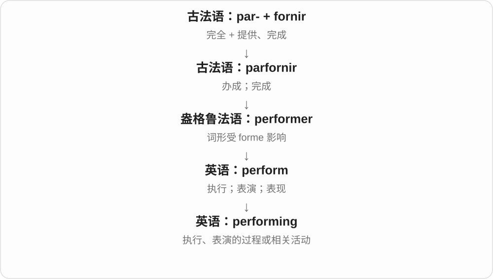

She is performing 是她正在表演；performing arts 常包括戏剧、舞蹈、音乐等，不能逐字译成“正在的艺术”。

**常见搭配与例句**

performing arts；performing live；experience in performing。

> He studied performing arts at college.

他在大学学习表演艺术。

> The band is performing live tonight.

乐队今晚将进行现场演出。

**别混淆**

performing 是动作或相关活动；performance 通常指表现或一场具体演出。

### 137. ban — 禁止、禁令

**音标**：/bæn/

**先抓住这个画面**

有权作决定的一方明确说这事不准再做；作名词是禁令，作动词是实施禁止。

**怎么拆**

古英语 bannan 宣告、命令与北欧同源词 banna 禁止、诅咒等影响中古英语，接到现代禁止义。不是天生只含互联网封号。

**怎么变成今天的意思**

**古英语 bannan 与古诺尔斯语 banna 等 → 中古英语 bannen → ban**  
宣告、命令、禁止等旧义互相影响

↓

**现代 ban**  
禁止的决定；不准进行某事

ban smoking 禁止吸烟，a ban on smoking 禁烟令，ban someone from a place 不准某人进入某地，lift a ban 解除禁令。过去式 banned、分词 banning 双写 n。

**常见搭配与例句**

ban doing；a ban on；ban someone from；lift a ban。

> The library bans food and drink near the computers.

图书馆禁止在电脑旁饮食。

> The school lifted the ban on mobile phones during breaks.

学校取消了课间使用手机的禁令。

**别混淆**

动词 ban 后直接接对象，名词 a ban on 接对象；ban 禁止、banned 已被禁，band 乐队同音近形却不是禁令过去式。

### 138. banning — 禁止、禁用；ban 的 -ing 形式

**音标**：/ˈbænɪŋ/

**先抓住这个画面**

把某种行为、物品划到不准的一边。banning 可以说禁止这项行为本身，也可以进入正在禁止的句子。

**怎么拆**

ban + -ing，单音节词末 n 在这个拼写中双写；发音仍是一段 /n/。ban 的旧宣布、命令词族发展出禁止义。

**怎么变成今天的意思**

**ban 宣布禁止的词族**  
以命令、规则排除某行为

↓

**ban + -ing → banning**  
禁止这件事；相应动词形式

banning smoking 禁止吸烟；banning single-use items 禁用一次性用品；a policy banning something 禁止某物的政策。主词仍需要看完整句子。

**常见搭配与例句**

a rule banning ...；consider banning ...。

> The museum introduced a rule banning flash photography.

博物馆出台了禁止闪光灯摄影的规定。

> The article discusses banning cars from the square.

文章讨论了禁止汽车驶入广场这件事。

**别混淆**

ban 是原形，banning 是 -ing 形式；双写 n 是拼写变化，不表示多禁止一次或程度更强。

### 139. advertising — 广告活动；广告业；广告总称

**音标**：英 /ˈædvətaɪzɪŋ/；美 /ˈædvərtaɪzɪŋ/

**先抓住这个画面**

不是只数某一张海报，而是看整个“让公众注意到产品”的活动与行业。

**怎么拆**

advertise 去掉词尾 e 加 -ing；活动名词通常不可数。

**怎么变成今天的意思**

work in advertising 是从事广告业；advertising on buses 可指公交车上的广告。不能把“两则广告”通常写成 two advertisings。

**常见搭配与例句**

advertising campaign；advertising revenue；work in advertising。

> She works in advertising but prefers writing to designing.

她从事广告业，不过比起设计更喜欢写文案。

> The museum spent very little on advertising.

博物馆在广告上花的钱很少。

**别混淆**

advertising 是宣传活动；marketing 还包括市场研究、定位、定价等更广工作。

### 140. suffering — 痛苦、苦难；正在受苦的

**音标**：英、美 /ˈsʌfərɪŋ/

**先抓住这个画面**

不只是一次疼，而是身体或生活正在被痛苦压着的那种经历。

**怎么拆**

suffer 的动名词、分词形式；中古英语时期已用来指忍受和痛苦状态。

**怎么变成今天的意思**

**拉丁语：ferre；第一人称 ferō**  
带、承载；承受；生出

↓

**拉丁语：sub- + ferre → sufferre**  
从下承托；承受

↓

**盎格鲁法语 suffrir → 中古英语 suffren**  
承受、忍受

↓

**中古英语 suffer + -ing → 英语 suffering**  
承受痛苦的过程；痛苦本身

通常不可数：human suffering 是人类所经历的苦难；复数 sufferings 在较书面叙述里指种种遭遇。也可用 suffering animals 表示受苦的动物。

**常见搭配与例句**

relieve suffering；cause suffering；unnecessary suffering。

> The charity works to reduce suffering after natural disasters.

这家慈善机构致力于减轻自然灾害后的苦难。

> The novel describes the family’s suffering during the winter.

小说描述了这个家庭在冬天遭受的苦难。

**别混淆**

pain 可是一次具体疼痛；suffering 往往包含更长的身体、心理或生活困境。

### 141. shipping — 运输、发货；运费；航运业

**音标**：/ˈʃɪpɪŋ/

**先抓住这个画面**

买东西时常指把货送到你手里的过程、服务或费用；行业报道中也可说整个航运。

**怎么拆**

ship 双写 p + -ing，形成运输活动名词、动词形式。运输方式扩大后，电商 shipping 同样不限定船运。

**怎么变成今天的意思**

**古英语 sċip → 中古英语 schip 等 → ship**  
船；更远来源的劈木解释不作定论

↓

**动词 ship 及现代复合词**  
用船运输 → 不限交通方式的发运；船舶类型与人员

↓

**ship + -ing → shipping**  
发运活动 → 发货、运输、运费；航运业

free shipping 免运费，shipping costs 运费，the shipping industry 航运业；不同搭配范围不同。

**常见搭配与例句**

free shipping；shipping costs；shipping address；the shipping industry。

> The price includes free shipping.

价格包含免运费服务。

> Please check the shipping address before paying.

付款前请核对收货地址。

**别混淆**

shipping 常含发运、运输过程，delivery 更聚焦送达；两词在商店说明中也有重合，不硬定所有店铺的费用范围。

### 142. smoking — 吸烟；冒烟、烟熏；正在冒烟的

**音标**：英 /ˈsməʊkɪŋ/；美 /ˈsmoʊkɪŋ/

**先抓住这个画面**

把冒烟、吸烟当作活动；形容东西时也可以说它正在冒烟，不必然是人在抽。

**怎么拆**

smoke 去末尾 e + -ing；相关分词、活动名词有中古英语及更旧形式。吸烟义随 tobacco 用法专门化。

**怎么变成今天的意思**

**古英语 smoca、smocian 等 → 中古英语 smoke、smoken**  
烟；冒烟

↓

**现代 smoke**  
烟；吸烟；以烟熏制等用法

↓

**smoke + -ing → smoking**  
冒烟、烟熏；吸烟活动及分词用法

No smoking. 禁止吸烟；a smoking chimney 冒烟烟囱。a smoking gun 比喻确凿证据，借刚开过火的枪的形象。

**常见搭配与例句**

No smoking；quit smoking；a smoking chimney；a smoking gun。

> Smoking is not allowed inside the building.

楼内不允许吸烟。

> The report did not contain the smoking gun that reporters expected.

报告里没有记者们期待的那种确凿证据。

**别混淆**

smoking 是活动或分词，smoker 是吸烟者、烟熏设备；smoking gun 常讲证据，未必在讨论真实枪。

### 143. dancing — 跳舞；舞蹈活动；跳动的

**音标**：英 /ˈdɑːnsɪŋ/；美 /ˈdænsɪŋ/

**先抓住这个画面**

把 dance 这个动作变成正在进行或一种活动，也可修饰闪动的光。

**怎么拆**

dance 去 e + -ing，形成 dancing，不写 danceing。

**怎么变成今天的意思**

**古法语、盎格鲁诺曼语 dancer、dauncer → 中古英语 dauncen**  
跳舞；更远来历不定

↓

**现代 dance**  
舞蹈活动、舞会；形象地说轻快跳动

↓

**dance + -ing → dancing**  
跳舞动作、进行形式

go dancing 去跳舞，dancing lessons 舞蹈课，dancing lights 闪动的光。

**常见搭配与例句**

go dancing；dancing lessons；dancing lights。

> We went dancing on Saturday night.

周六晚上我们去跳舞了。

> She has been taking dancing lessons for a year.

她上舞蹈课已经一年了。

**别混淆**

dancing 活动，dancer 人；a dancing teacher 可指正在跳舞的老师，也可能按语境是教舞老师，dance teacher 更明确职业。

### 144. hanging — 悬挂的、悬垂；悬挂饰物；绞刑等名词义

**音标**：/ˈhæŋɪŋ/

**先抓住这个画面**

上面有一点撑着，下面垂下来；吊篮、帷幔都抓这个姿态。另有执行绞刑的名词义，不能看到 hanging 就一律译成挂画。

**怎么拆**

hang + -ing，动作形式、形容词、动作名词和悬挂物名。一般悬挂的过去形式常用 hung，绞刑语境传统多用 hanged；hanging 本身不因此分两种拼写。

**怎么变成今天的意思**

**hang + -ing → hanging**  
悬挂的动作、状态

↓

**名词用法**  
悬挂饰物；也有绞刑这一特定义

a hanging basket 吊篮，wall hangings 壁挂、挂毯，leave something hanging 让某事悬而未决；hang 词尾 /ŋ/ 后这里不额外读 /ɡ/。

**常见搭配与例句**

a hanging basket；wall hangings；leave a question hanging。

> Flowers spilled over the hanging basket.

花从吊篮边垂下来。

> The film leaves the central question hanging.

电影把核心问题留在悬而未决的状态。

**别混淆**

hanging 可悬挂物，hangers 衣架是另一名词；leave hanging 比喻不交代结果、让人等着，不必真挂到高处。

### 145. hunt — 打猎；搜寻；寻找行动

**音标**：/hʌnt/

**先抓住这个画面**

目标没摆在眼前，要一路追踪、翻找，是 hunt 的感觉。目标也可以是钥匙、住处、资料。

**怎么拆**

接古英语 huntian，经中古英语延续，远源有不同解释。不是 hound 猎犬加一个现代变化规则就一定产生 hunt。

**怎么变成今天的意思**

**古英语 huntian → 中古英语 hunten → hunt**  
狩猎、追寻的本族动词

↓

**现代 hunt 名词、动词**  
打猎；费力地寻找

hunt for a job 找工作；hunt for a missing file 搜寻文件；a hunt for evidence 寻找证据的行动。与狩猎实义分语境。

**常见搭配与例句**

hunt for；a hunt for evidence。

> I spent an hour hunting for the missing file.

我花了一小时找丢失的文件。

> The book describes the history of the hunt in the region.

书中描写了该地区狩猎的历史。

**别混淆**

hunt 往往比普通 look for 多持续搜索、追踪的感觉；不保证最终已找到。

### 146. hunting — 狩猎；搜寻；hunt 的 -ing 形式

**音标**：/ˈhʌntɪŋ/

**先抓住这个画面**

hunting 可以说传统打猎，也可以说努力找房、找工作。对象换了，持续追寻的动作感还在。

**怎么拆**

hunt + -ing；古英语 huntung 等动作名词延续。现代可作活动名词、分词等，不因名词化就必须带“正在”。

**怎么变成今天的意思**

**古英语 huntian → 中古英语 hunten → hunt**  
狩猎、追寻的本族动词

↓

**现代 hunt 名词、动词**  
打猎；费力地寻找

↓

**hunt + -ing；古英语相应名词 → hunting**  
狩猎、寻找的活动及动作形式

job hunting 找工作；house hunting 找房；hunting for a solution 寻找解决办法。

**常见搭配与例句**

job hunting；house hunting；hunting for a solution。

> Job hunting takes time and patience.

找工作需要时间和耐心。

> They spent the weekend house hunting.

他们周末都在找房。

**别混淆**

hunting for a job 不涉及猎杀工作；英语复合表达可以直接保留寻找比喻。

### 147. riding — 骑乘活动；另有历史行政区、加拿大选区义

**音标**：/ˈraɪdɪŋ/

**先抓住这个画面**

骑马这个 riding 与地理、选举报道中的 riding，看着一样，却不能都用骑马去猜。

**怎么拆**

骑乘义来自 ride + -ing。地区名义另来自表示三分之一的古诺斯语词，经 trithing 等形式变化；与 north、east 等名称衔接时，开头音逐渐重新分界为 riding。不是骑马一天可绕完的地区。

**怎么变成今天的意思**

**两条独立来路：英语 ride；古诺斯语 þriðjungr**  
前者为骑乘，后者为三分之一

↓

**ride + -ing；þriðjungr → trithing 等形式 → riding**  
骑乘活动；另一支为地区名称及后来的选区用法

horse riding 骑马；East Riding 等历史地名中的 Riding 与第三、三分区有亲缘。加拿大政治文字中 a riding 常指选区，现代选区并不要求只分三块。

**常见搭配与例句**

horse riding；the East Riding；an electoral riding。

> She enjoys horse riding on weekends.

她喜欢周末骑马。

> The historical map divides the county into three ridings.

历史地图把这个郡划为三个区。

> The article compares voting patterns in neighbouring ridings.

文章比较相邻选区的投票模式。

**别混淆**

riding 的地区义不是由骑马覆盖距离定义；同形词要分历史来路。

### 148. wanting — 不足的；欠缺的；不合格的；想要〔动词分词〕

**音标**：英 /ˈwɒntɪŋ/；美 /ˈwɑːntɪŋ/

**先抓住这个画面**

衡量一下，发现需要的部分没有到位，仍然差了一截。

**怎么拆**

want 的分词形容词保留缺少这一旧义，中古英语已有 wantand 等形式，后来 wanting 成为常用拼法。现代还可作想要这个动词的分词，需按句子区分。

**怎么变成今天的意思**

**中古英语 wanten 缺少 → wantand 等分词形式**  
形成欠缺、不足的形容词

↓

**wanting 形式成为常用 → 现代 wanting**  
形容词保留旧义；另可作 want 的普通分词

be found wanting 常指经过检验发现不足；wanting in detail 是细节欠缺。I have been wanting to ask… 则是我一直想问，是动词用法，不表示问题不合格。

**常见搭配与例句**

find something wanting；be found wanting；wanting in detail；have been wanting to…。

> The explanation was clear but wanting in evidence.

解释很清楚，但证据不足。

> I have been wanting to ask how you built the model.

我一直想问，你是怎么做出这个模型的。

**别混淆**

wanted 是被需要或过去想要；wanting 作形容词反而是缺少的。两者不能只靠 -ed/-ing 的情绪形容词口诀判断。

### 149. heading — 标题；小标题；航向；朝某处行进

**音标**：/ˈhedɪŋ/

**先抓住这个画面**

文章顶部写一行提示内容；船的头朝哪边，则给出航向。

**怎么拆**

head + -ing，名词有标题、朝向等义；也可只是动词 head 的进行形式。不是每次出现都表示正在领导。

**怎么变成今天的意思**

**古英语 hēafod / hēafd- → 中古英语 hed / heved 等**  
头；顶端、领头位置

↓

**英语 head**  
头部；前端；负责人；朝向、领导

↓

**head + -ing → heading**  
顶部标识、朝向；也作动词形式

a chapter heading 是章标题，under the heading of ... 是列在某个标题下；a heading of north 是朝北的航向。航行里朝向与受风流影响后的实际轨迹可以不同。

**常见搭配与例句**

a section heading；under a heading；change heading；be heading for。

> Use clear headings to divide the report into sections.

用清楚的小标题把报告分成几部分。

> The boat changed heading as it left the harbour.

船离港时改变了航向。

**别混淆**

heading 可是文中小标题，headline 常说新闻标题；header 更常说页眉、表头或数据头。三者有重叠但关注位置和用途不同。

### 150. rush — 猛冲；赶快、催赶；高峰、涌动；一阵强烈感觉；灯心草等植物

**音标**：/rʌʃ/

**先抓住这个画面**

人或水一股脑儿冲来，叫 rush；忙碌高峰、突然上头的一阵兴奋，也像一股涌上来的力量。植物 rush 则是另源词。

**怎么拆**

动作一支通常经法语 russher、ruser，接更早拉丁材料；从抵退、猛冲到现代赶快、催赶。植物名承古英语 rysc 等，不与动作一支硬合。

**怎么变成今天的意思**

**动作一支：法语 russher、ruser 等 → 英语 rush**  
更早通常接拉丁 recusare 等材料；从抵退、猛冲到赶快等用法

↓

**rush 动词 → 名词涌动、高峰、强烈感觉**  
突然集中的画面可用于客流、需求、兴奋等

↓

**另源 rush 植物名：古英语 rysc 等 → rush**  
灯心草等植物名，不接赶快动词的同一来源

rush to the station 冲去车站；rush someone 催某人；the morning rush 早高峰；a rush of excitement 一阵兴奋。

**常见搭配与例句**

rush hour 高峰时间；no rush 不着急；rush into a decision 仓促作决定。

> Don’t rush into a decision before reading the details.

看清细节前，别仓促作决定。

> She felt a rush of excitement when her name was announced.

听到自己的名字被宣布时，她感到一阵兴奋。

**别混淆**

rush 强调来得急、做得急，有时带没准备好；move quickly 只说明速度。a rush of relief 是一阵释然，也不需要有人真的跑动。

### 151. rushed — 冲、赶快、催促了；仓促的

**音标**：/rʌʃt/

**先抓住这个画面**

把本该慢慢想的事赶着做完，常叫 rushed；人过去急冲进来，也用同形过去式。

**怎么拆**

rush + 完整 -ed，/ʃ/ 后读 /t/；过去分词形容词常写事情做得仓促、时间不够。

**怎么变成今天的意思**

**动作一支：法语 russher、ruser 等 → 英语 rush**  
更早通常接拉丁 recusare 等材料；从抵退、猛冲到赶快等用法

↓

**rush 动词 → 名词涌动、高峰、强烈感觉**  
突然集中的画面可用于客流、需求、兴奋等

↓

**另源 rush 植物名：古英语 rysc 等 → rush**  
灯心草等植物名，不接赶快动词的同一来源

↓

**rush + -ed → rushed**  
过去猛冲、催赶；或做得匆忙

a rushed decision 仓促决定；feel rushed 感到被时间追着；rushed to hospital 被急送医院。

**常见搭配与例句**

rushed through the meal；rushed into the room。

> It was a rushed decision that we later regretted.

那是个仓促决定，我们后来后悔了。

> She rushed into the room with the news.

她带着消息急冲进房间。

**别混淆**

rushed decision 常含时间不足、欠考虑，rapid decision 可以只是决定得快；是否草率仍要看语境、评价。

### 152. rushing — 正在猛冲、赶忙、催赶；急流的

**音标**：/ˈrʌʃɪŋ/

**先抓住这个画面**

人忙着赶时间，是 rushing；溪水飞快冲过去，是 rushing water。都能抓住快速、带势头的过程。

**怎么拆**

rush + -ing；规则动作形式，也可形容快速流动的水等。现代英语最早相关 rushing 记录很早，不把教学顺序当全部年代。

**怎么变成今天的意思**

**动作一支：法语 russher、ruser 等 → 英语 rush**  
更早通常接拉丁 recusare 等材料；从抵退、猛冲到赶快等用法

↓

**rush 动词 → 名词涌动、高峰、强烈感觉**  
突然集中的画面可用于客流、需求、兴奋等

↓

**另源 rush 植物名：古英语 rysc 等 → rush**  
灯心草等植物名，不接赶快动词的同一来源

↓

**rush → rushing〔现代构词对照〕**  
猛冲、匆忙动作的过程；也形容急速水流

rushing to work 正赶去上班；rushing water 急流；stop rushing 别再这么赶。

**常见搭配与例句**

rushing through the task；rushing past。

> Everyone was rushing to catch the last bus.

大家都正赶着去乘末班公交。

> We could hear rushing water below the bridge.

我们能听见桥下急流的声音。

**别混淆**

rushing water 写水流急，running water 范围更广，包括流动水、自来水；不能每个 running 都译成汹涌。

### 153. rushes — 猛冲、赶快、催赶〔第三人称单数〕；涌动、高峰、灯心草等〔复数〕

**音标**：/ˈrʌʃɪz/

**先抓住这个画面**

他早上总急匆匆冲出门，是 he rushes out；河边成片的 rushes 却可能是灯心草。两个来源要靠场景辨认。

**怎么拆**

rush + -es，/ʃ/ 后读 /ɪz/；动作三单和不同来源名词的复数同形。

**怎么变成今天的意思**

**动作一支：法语 russher、ruser 等 → 英语 rush**  
更早通常接拉丁 recusare 等材料；从抵退、猛冲到赶快等用法

↓

**rush 动词 → 名词涌动、高峰、强烈感觉**  
突然集中的画面可用于客流、需求、兴奋等

↓

**另源 rush 植物名：古英语 rysc 等 → rush**  
灯心草等植物名，不接赶快动词的同一来源

↓

**rush + -es → rushes**  
他急冲、催赶；多阵涌动或多株植物等

rushes out of the door 冲出门；rushes to help 急忙帮忙；rushes by the water 水边灯心草。

**常见搭配与例句**

rushes through the work 匆匆做完工作；rushes of excitement 阵阵兴奋。

> He rushes out of the house without breakfast.

他没吃早餐就匆匆冲出家门。

> Tall rushes grew along the edge of the pond.

池塘边长着高高的灯心草。

**别混淆**

rushes through a report 常有赶着做、可能没细看的意味，carefully reviews a report 则明确认真审阅；完成得快不表示读得细。

### 154. fishing — 钓鱼；捕鱼；渔业活动

**音标**：/ˈfɪʃɪŋ/

**先抓住这个画面**

把钓、捞、捕这类事情作为一个活动来看；可以休闲，也可以为谋生。

**怎么拆**

fish 动词 + -ing，接中古英语 fischynge 等形式。通常是活动名词，也可出现在进行时中。

**怎么变成今天的意思**

**古英语 fisċ〔名词〕、fiscian〔动词〕**  
鱼；捕鱼

↓

**中古英语 fisch → fish**  
鱼、鱼肉；捕鱼；比喻寻找、探问

↓

**fish + -ing → fishing**  
捕鱼、钓鱼这项活动

go fishing 去钓鱼，a fishing rod 钓竿，commercial fishing 商业捕捞，a fishing village 渔村。

**常见搭配与例句**

go fishing；a fishing rod；a fishing boat；commercial fishing。

> We went fishing by the lake on Saturday.

周六我们去湖边钓鱼了。

> Fishing is an important source of income for the village.

捕鱼是村庄的重要收入来源。

**别混淆**

fishing 是真实钓鱼或相应比喻；phishing 网络钓鱼故意改了拼写，指诱骗获取信息，不是普通的鱼类活动。

### 155. parking — 停车；停车位、停车设施

**音标**：英 /ˈpɑːkɪŋ/；美 /ˈpɑːrkɪŋ/

**先抓住这个画面**

可以说把车停下来的动作，也可整体说这里有没有地方停车。

**怎么拆**

park 的停车义 + -ing，动作名词常不可数；不因结尾 -ing 就只表示此刻正在发生。

**怎么变成今天的意思**

**法语 parc → 中古英语 park**  
围起来的区域、园地，历史更远联系日耳曼语围栏词

↓

**英语 park**  
园地、公园、专门场区；动词有集中安放、停车等用法

↓

**park + -ing → parking**  
停车动作 → 停车空间、安排

No parking 禁止停车，free parking 免费停车；a parking space 一个停车位，parking fees 停车费。

**常见搭配与例句**

free parking；No parking；a parking space；parking fees。

> The hotel offers free parking.

酒店提供免费停车。

> It took us ten minutes to find a parking space.

我们花了十分钟才找到停车位。

**别混淆**

parking 通常不可数，找一个车位说 a parking space 或 a parking spot，不能照中文一个停车直接写 a parking。

### 156. rolling — 滚动的；起伏的；连续更新的

**音标**：英 /ˈrəʊlɪŋ/；美 /ˈroʊlɪŋ/

**先抓住这个画面**

rolling 像一圈接一圈往前推：球在滚，山丘的轮廓起伏相接，计划也可以随着时间不断向前更新。

**怎么拆**

roll + -ing，由动作形式发展出多种形容词用法。

**怎么变成今天的意思**

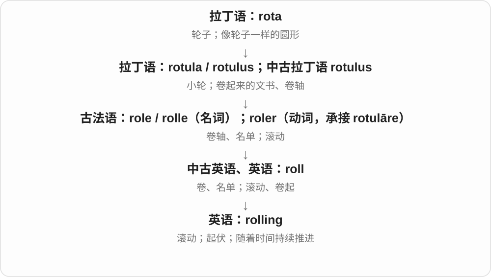

rolling hills 是连绵起伏的丘陵；rolling updates 或 rolling review 强调分批、持续推进，不是一次全部完成。

**常见搭配与例句**

rolling hills；a rolling programme；a rolling average；rolling updates。

> The road crossed a landscape of rolling hills.

道路穿过一片连绵起伏的丘陵。

> Applications are reviewed on a rolling basis.

申请会持续分批审查。

**别混淆**

fixed plan 是固定计划；rolling plan 随时间推进而定期更新，词义重点在连续向前。

### 157. clothe — 给穿衣、提供衣物；覆盖、赋予〔比喻〕

**音标**：英 /kləʊð/；美 /kloʊð/

**先抓住这个画面**

把衣服穿到某人身上，或供给他衣物；也可说把思想包进某种语言、给某物加上外在形式。

**怎么拆**

接中古英语 clothen，更早古英语 *clāþian 属词源重建。与 cloth 同族的动词不是今天任意加一个 e，元音和 th 的清浊也有历史差别。

**怎么变成今天的意思**

**古英语 clāþ → 中古英语 cloth → cloth**  
布、覆盖物、衣物；更远来源不定

↓

**中古英语 clothen → clothe；更早有重建形 \*clāþian**  
给穿衣、提供衣物；比喻覆盖、赋予

feed and clothe children 给孩子吃穿，clothe someone in 给某人穿上……，clothe an idea in words 把思想用语言表达；日常直接说穿某件衣服常用 wear。

**常见搭配与例句**

feed and clothe；clothe someone in；clothe an idea in words。

> The charity helps feed and clothe families in need.

慈善机构帮助困难家庭解决吃穿。

> The writer clothed a simple idea in elegant language.

作者用优雅语言表达了一个简单想法。

**别混淆**

clothe 给穿衣，wear 穿着；She clothed the child 说明她给孩子穿，She wore a coat 说她自己穿着外套。

### 158. clothing — 衣物、服装

**音标**：英 /ˈkləʊðɪŋ/；美 /ˈkloʊðɪŋ/

**先抓住这个画面**

把外套、裤子、衬衫等当一类覆盖身体的物品合起来说，叫 clothing。它是集合用法，不是数一件、两件的普通可数名词。

**怎么拆**

对应 clothe 去末尾 e 加 -ing；相关服装动作、名词材料由中古英语、日耳曼语传统延续。现代最常用名词义不直接译成正在穿衣。

**怎么变成今天的意思**

**cloth、clothe 的日耳曼语衣物、穿衣材料**  
布、衣物与给人穿衣

↓

**中古英语 clothing 等 → clothing**  
衣物集合名词；与 clothe + -ing 对应

warm clothing 保暖衣物；protective clothing 防护服；an item of clothing 一件衣物。clothing 通常单数一致：The clothing is ...。

**常见搭配与例句**

warm clothing；protective clothing；an item of clothing。

> Bring warm clothing for the evening.

晚上要带保暖衣物。

> Each item of clothing has a label.

每件衣物都有标签。

**别混淆**

cloth 是布，clothes 是衣服复数形式，clothing 是不可数集合名词；a clothing 不常用来数一件衣服。

### 159. reaching — 伸向、到达；reach 的进行形式

**音标**：/ˈriːtʃɪŋ/

**先抓住这个画面**

强调正在伸过去、正在接近某个位置或阶段；短语中的动作方向要一起看。

**怎么拆**

reach + -ing，规则形成进行、动作形式，不删 ch，也不双写 h。

**怎么变成今天的意思**

**古英语 ræcan → 中古英语 rechen → reach**  
伸到、够到、到达

↓

**现代 reach**  
身体可及 → 联系得到；达到数值、协议与能力范围

↓

**reach + -ing → reaching**  
正在伸向、达到的动作

reaching for a cup 伸手去拿杯子，reaching out to someone 主动联系；far-reaching 影响深远的作为正文搭配认识。

**常见搭配与例句**

reaching for；reaching out to；reaching a decision。

> She was reaching for her coat when the phone rang.

电话响时，她正伸手拿外套。

> The team is reaching out to former volunteers.

团队正在主动联系从前的志愿者。

**别混淆**

reach for 伸手尝试去够，不保证已拿到；reach the cup 侧重已经够到。

### 160. cooking — 烹饪、做饭；烹饪风格；烹调用的

**音标**：/ˈkʊkɪŋ/

**先抓住这个画面**

说做饭这件事，也说做出来的手艺、风格；cooking oil 则按用途叫烹调用油。

**怎么拆**

cook + -ing，名词、形容修饰接烹调活动。看组合结构，不要把 cooking oil 读成油正在做饭。

**怎么变成今天的意思**

**拉丁 cocus、coquus 等 → 古英语 cōc → cook**  
厨师；相关烹调动词也很早进入日耳曼语、英语

↓

**现代 cook**  
做饭、烹调；厨师；加工编造等比喻

↓

**cook + -ing → cooking**  
烹饪活动、手艺；烹调用途

home cooking 家常烹饪，cooking oil 烹调用油，a cooking class 烹饪课，do the cooking 负责做饭。

**常见搭配与例句**

home cooking；cooking oil；a cooking class；do the cooking。

> He enjoys home cooking more than restaurant food.

他比起餐馆菜更喜欢家常饭菜。

> We signed up for a cooking class.

我们报名参加了烹饪课。

**别混淆**

cooking 活动、手艺，cooker 器具；a cooking class 是教烹饪的课，不是教如何当 cooking 这个人。

### 161. covering — 覆盖物；覆盖层

**音标**：/ˈkʌvərɪŋ/

**先抓住这个画面**

盖在外面的那一层，先看它起什么作用，不限定它是什么材料。

**怎么拆**

cover + -ing 在这里形成名词；同样的形式也能是动词现在分词，要看句子。

**怎么变成今天的意思**

**英语 cover**  
盖住、覆盖

↓

**英语 covering**  
覆盖动作；作为名词指盖在上面的东西

a covering of snow 是一层雪，a protective covering 是保护层，可以是布、塑料或别的材料。a covering 往往指某种实体覆盖物；coverage 则多谈覆盖范围、程度或报道。

**常见搭配与例句**

a thin covering；a protective covering；a covering of dust。

> A thin covering of snow lay on the roof.

屋顶上覆盖着薄薄一层雪。

> Remove the protective covering before using the screen.

使用屏幕前先揭掉保护层。

**别混淆**

cover 常指具体的盖子、套子或封面；covering 更容易突出铺在表面的材料或一层东西，范围有重合。

### 162. recovering — 正在恢复、康复的；正在找回的

**音标**：英 /rɪˈkʌvərɪŋ/；美 /rɪˈkʌvərɪŋ/

**先抓住这个画面**

状态在回来，还没必然完全回到原来水平；也可说正在把丢失东西取回来的动作。

**怎么拆**

recover + -ing，分词、形容词和动作名词用法，中古英语已有相应形式。这里接恢复、取回词族，不接重新覆盖。

**怎么变成今天的意思**

**拉丁语 recuperāre → 法语 recovrer 等 → recover**  
重新取得、恢复、找回

↓

**recover + -ing → recovering**  
正在恢复；正在取回、找回

a recovering patient 康复中的病人，a recovering economy 复苏中的经济，recovering lost files 正在恢复丢失文件。

**常见搭配与例句**

a recovering patient；a recovering economy；recovering files。

> The recovering athlete watched the match from the stands.

那位康复中的运动员在看台上观看比赛。

> The software is recovering the deleted files.

软件正在恢复被删除的文件。

**别混淆**

recovering 过程，recovered 常结果；正在恢复不保证已经完全恢复，也不说明所需时间。

### 163. raising — 抬高、增加；筹集；养育；raise 的 -ing 形式

**音标**：/ˈreɪzɪŋ/

**先抓住这个画面**

把 raise 的动作看成过程；raise 什么，就决定是提价、筹钱还是养孩子。

**怎么拆**

raise 去 e + -ing，中古英语已有 reysynge 等活动名词。拼写、词性改变不取消基础动词多种搭配。

**怎么变成今天的意思**

**古诺尔斯语 reisa → 中古英语 raisen、reysen → raise**  
使升起；与 rise 的日耳曼使动同族形式相关

↓

**现代 raise**  
抬高、增加；提出；筹集；抚养、饲养

↓

**raise + -ing → raising**  
提升、提出、筹集或养育的活动

raising children 养育孩子，raising funds 筹集资金，the raising of a flag 升旗。

**常见搭配与例句**

raising children；raising funds；the raising of a flag。

> Raising children takes patience.

养育孩子需要耐心。

> The team is raising funds for new equipment.

团队正为新设备筹集资金。

**别混淆**

raising 使对象增加、成长，rising 自己上升；raising prices 提价，rising prices 正在上涨的价格。

### 164. swimming — 游泳、游泳运动；正在游泳

**音标**：/ˈswɪmɪŋ/

**先抓住这个画面**

把游泳当一项活动说：swimming is fun 是游泳很有意思；is swimming 则把镜头放到正在进行的动作。

**怎么拆**

swim 双写 m + -ing，中古英语已有对应活动名词。swimming pool 的 swimming 说明池子的用途。

**怎么变成今天的意思**

**古英语 swimman → 中古英语 swymmen → swim**  
游泳、漂浮等水中活动

↓

**swim + -ing → swimming〔双写 m〕**  
游泳活动；进行中的游泳动作

go swimming 去游泳，a swimming pool 游泳池，swimming lessons 游泳课，swimming goggles 游泳镜。

**常见搭配与例句**

go swimming；a swimming pool；swimming lessons；swimming goggles。

> Swimming is her favourite sport.

游泳是她最喜欢的运动。

> The children are swimming in the shallow end.

孩子们正在浅水区游泳。

**别混淆**

go swimming 常不加 to；swimming 作活动名词时不因很多人游便随便加复数 -s。

### 165. annoying — 令人恼火的；烦人的

**音标**：/əˈnɔɪɪŋ/

**先抓住这个画面**

站在事情或人的一边看：它正在制造烦躁。

**怎么拆**

annoy + -ing，可以是现在分词，也可作形容词表示使人烦的。

**怎么变成今天的意思**

**英语 annoy**  
使别人烦恼

↓

**英语 annoying**  
正在烦扰；令人烦的

an annoying habit 是惹人烦的习惯。He is annoying 可以评价他很烦人；He is annoying his sister 则是他正在招惹妹妹，后面带了动作对象。

**常见搭配与例句**

an annoying noise；an annoying habit；find something annoying；annoying someone。

> The app makes an annoying sound every time a message arrives.

这个应用每来一条消息都会发出烦人的声音。

> I find it annoying when the video pauses every few seconds.

视频每隔几秒就暂停一下，我觉得很烦。

**别混淆**

annoying 是让别人烦；annoyed 是自己感到烦。I am annoying 和 I am annoyed 表达的方向完全不同。

### 166. handling — 处理、搬运；操控性能；handle 的 -ing 形式

**音标**：/ˈhændlɪŋ/

**先抓住这个画面**

手上怎样拿、事情怎样处理、车怎样操控，重点都在实际操作这一面。

**怎么拆**

现代对应 handle 去 e + -ing；活动名词也有古英语 handlung、中古英语 handlinge 等旧形，不是刚由现代 handle 造出。

**怎么变成今天的意思**

**古英语 handlian、handle 等 → handle**  
用手接触、操弄；把手等相关形式

↓

**现代 handle**  
操作、处理；把手；昵称等支线

↓

**古英语 handlung → handling**  
操作、处理的活动；现代对应 handle + -ing

careful handling 小心搬运，handling complaints 处理投诉，a car’s handling 汽车操控性能，shipping and handling 运费及处理费用。

**常见搭配与例句**

careful handling；handling complaints；shipping and handling；a car’s handling。

> The glass requires careful handling.

这块玻璃需要小心搬运。

> The review praised the car’s handling.

评测称赞了这辆车的操控表现。

**别混淆**

handling 操作、处理，handle 可把手或处理动词；handling fee 是处理费用，不是买门把手的价格。

### 167. belong — 属于；适合放在；有归属感

**音标**：英 /bɪˈlɒŋ/；美 /bɪˈlɔːŋ/

**先抓住这个画面**

一把钥匙有对应的锁，一件东西有该放的位置，一个人也有能融入的群体。

**怎么拆**

接中古英语 belongen，be- 与 longen“适合、与之有关”组合，更早关联古英语 langian 的相应用法。不能按现代 be + long 译成“是长的”。

**怎么变成今天的意思**

**中古英语 be- + longen → belongen**  
适合、与某处或某人相属

↓

**英语 belong**  
归属于；处在适合的位置；融入

belong to someone 是归某人所有，belong in a drawer 是该放在抽屉，feel you belong 是有归属感。通常不使用被动 be belonged to。

**常见搭配与例句**

belong to；belong in；belong with；a sense of belonging。

> Does this bag belong to you?

这个包是你的吗？

> For the first time, he felt that he belonged.

他第一次有了归属感。

**别混淆**

belong 不等于拥有者主动的 own：The book belongs to her 与 She owns the book 观察方向相反。

### 168. belonging — 归属感；所有物〔常用复数 belongings〕；belong 的 -ing 形式

**音标**：英 /bɪˈlɒŋɪŋ/；美 /bɪˈlɔːŋɪŋ/〔亦有 /bɪˈlɑːŋɪŋ/〕

**先抓住这个画面**

感觉自己在这里有位置、被接纳，是 a sense of belonging；属于自己的实物则常合称 belongings。

**怎么拆**

belong + -ing → belonging；belong 的中古英语归属、相应关系材料延续到现代。这里的 long 不简单等于“很长”，词中的 ng 加 -ing 后也不要求额外读硬 /ɡ/。

**怎么变成今天的意思**

**中古英语 belongen 等 → belong**  
属于、适合、与……有关系

↓

**belong + -ing → belonging**  
归属的状态感；属于自己的实物

a sense of belonging 归属感；personal belongings 私人物品；belonging to the school 属于学校的。

**常见搭配与例句**

a sense of belonging；personal belongings；belonging to。

> The club gave her a sense of belonging.

俱乐部让她有了归属感。

> Please keep your personal belongings with you.

请随身保管私人物品。

**别混淆**

belonging 单数常谈归属，belongings 复数常谈物品；不是多了一点归属感就加 s。

### 169. collect — 收集；领取；使镇定；短祷文

**音标**：动词 /kəˈlekt/；祷文名词英 /ˈkɒlekt/、美 /ˈkɑːlekt/

**先抓住这个画面**

collect 像把散在外面的东西一件件聚回来：邮票、资料、包裹，甚至散乱的思绪。

**怎么拆**

com-（一起）+ legere，经 colligere、collectus 等形式进入英语。

**怎么变成今天的意思**

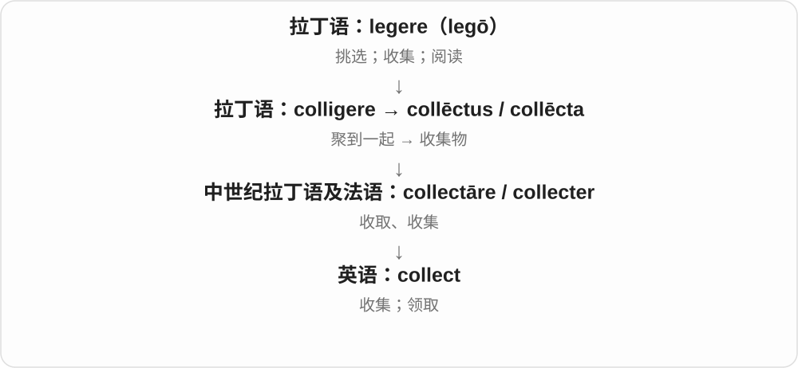

collect a parcel 是领取；collect yourself 是重新镇定。名词 collect 读音前重，另指礼拜中的短祷文，仍联系聚集的历史。

**常见搭配与例句**

collect stamps；collect data；collect a parcel；collect yourself。

> I collect postcards from places I visit.

我收集去过的地方的明信片。

> She paused to collect her thoughts.

她停下来整理了一下思路。

**别混淆**

collect 强调收拢；select 强调挑选，收来的东西不一定全是精选的。

### 170. collecting — 收集、收藏；collect 的 -ing 形式

**音标**：/kəˈlektɪŋ/

**先抓住这个画面**

把分散的东西一件件聚拢；作为爱好时，collecting 还强调按兴趣、主题持续积累。

**怎么拆**

collect + -ing；collect 的较早词族接拉丁 colligere 聚集，含一起与收拢的材料。动作名词把收集这件事当活动来谈。

**怎么变成今天的意思**

**collect 聚集、收集**  
让分散对象来到一起

↓

**collect + -ing → collecting**  
正在收集；收藏活动

stamp collecting 集邮；collecting data 收集数据；collecting donations 募集捐款。活动名与后接宾语的分词结构都常见。

**常见搭配与例句**

coin collecting；a collecting hobby。

> Coin collecting became his favourite hobby.

收藏硬币成了他最喜欢的爱好。

> The team is collecting data from several schools.

团队正在从几所学校收集数据。

**别混淆**

collection 常是收集成的集合、藏品，也能说收集活动；collecting 更直接指做这件事。collector 则是人或相应装置。

### 171. programming — 编程；节目编排；播出内容

**音标**：英 /ˈprəʊɡræmɪŋ/，也读 /ˈprəʊɡrəmɪŋ/；美 /ˈproʊɡræmɪŋ/

**先抓住这个画面**

把要做的动作安排成程序，或把要播出的节目安排成一套内容。

**怎么拆**

program / programme + -ing，双写 m；从动作分词和动名词发展出领域、活动名称。

**怎么变成今天的意思**

**希腊语 graphein 与 gramma / grammat-**  
写、画 → 写下或画出的符号、字母

↓

**希腊语 prographein → programma**  
预先写出、公开写出 → 公告

↓

**后期拉丁语 programma → 法语 programme → 英语 program / programme**  
公告 → 事先列出的安排、节目；后来指计算机指令

↓

**英语 program(me) + -ing → programming**  
编排的活动；计算机编程；节目内容

computer programming 是写程序；children’s programming 常指儿童节目内容。看到电视台语境时别自动译成儿童学编程。

**常见搭配与例句**

learn programming；a programming language；television programming。

> She learned programming by building small games.

她通过制作小游戏学习编程。

> The channel expanded its educational programming.

这个频道增加了教育节目内容。

**别混淆**

program 是一个程序或项目；programming 常说编写、安排这个活动或总体播出内容。

### 172. pulling — 拉、拖、牵引；pull 的 -ing 形式

**音标**：/ˈpʊlɪŋ/

**先抓住这个画面**

把拉的动作当作一段活动或持续过程；不是看到 -ing 就一定另有一个陌生词根。

**怎么拆**

pull + -ing，中古英语已有 pulling、pullyng 等活动名词。pull 为双 l 结尾，直接接 -ing，不再多加一个 l。

**怎么变成今天的意思**

**古英语 pullian → 中古英语 pullen → pull**  
拉、拔、扯；更远来源不明

↓

**现代 pull**  
拉、拖；拉力；吸引、影响等引申

↓

**pull + -ing → pulling**  
拉、拖的动作；相关分词用法

pulling power 拉力，也可吸引人的能力；keep pulling 继续拉。

**常见搭配与例句**

pulling power；keep pulling；pulling the rope。

> Keep pulling until the rope is tight.

继续拉，直到绳子绷紧。

> The engine has enough pulling power for the trailer.

发动机有足够牵引力拖动挂车。

**别混淆**

pulling 活动或分词，puller 执行者、拉具；pulling power 有时说吸引力，要看是发动机还是明星。

### 173. monitoring — 监测；持续检查

**音标**：英 /ˈmɒnɪtərɪŋ/；美 /ˈmɑːnɪtərɪŋ/

**先抓住这个画面**

不是看一眼就走，而是在一段时间里跟踪情况怎样变。

**怎么拆**

monitor + -ing，可作动词现在分词，也常名词化表示监测过程。

**怎么变成今天的意思**

**拉丁语 monere**  
使想起、提醒、告诫

↓

**拉丁语 monitor → 英语 monitor〔名词〕**  
提醒、检查的人 → 监督员；后来也指监测设备、显示器

↓

**英语 monitor〔动词〕**  
从名词发展：持续观察、检查

↓

**英语 monitor + -ing → monitoring**  
持续观察、检查这一过程

air quality monitoring 是空气质量监测；continuous monitoring 是连续监测。它可能发现问题，但单凭 monitoring 这个词不说明已经修复了问题。

**常见搭配与例句**

continuous monitoring；environmental monitoring；a monitoring system。

> Regular monitoring helps the team notice changes early.

定期监测有助于团队尽早发现变化。

> The project includes monitoring of water quality near the factory.

这个项目包括对工厂附近水质的监测。

**别混淆**

inspection 常是一轮现场检查；monitoring 更强调持续或定期跟踪。

### 174. punch — 拳打、一拳；打孔、打孔器；冲击力；宾治饮料

**音标**：英、美 /pʌntʃ/

**先抓住这个画面**

击打、打孔这一支都有“一下用力顶进去”的动作感；饮料 punch 则要单独记，不能解释成把水果打一拳。

**怎么拆**

工具名 punch 是 puncheon 的缩短；击打动词经古法语 ponchonner、中古英语 punchen 传入，还可能受 punish 的旧缩短形式影响。饮料义来源有争议，常联系印地语 pāñc“五”，不能当作已定论。图画工具、击打主线。

**怎么变成今天的意思**

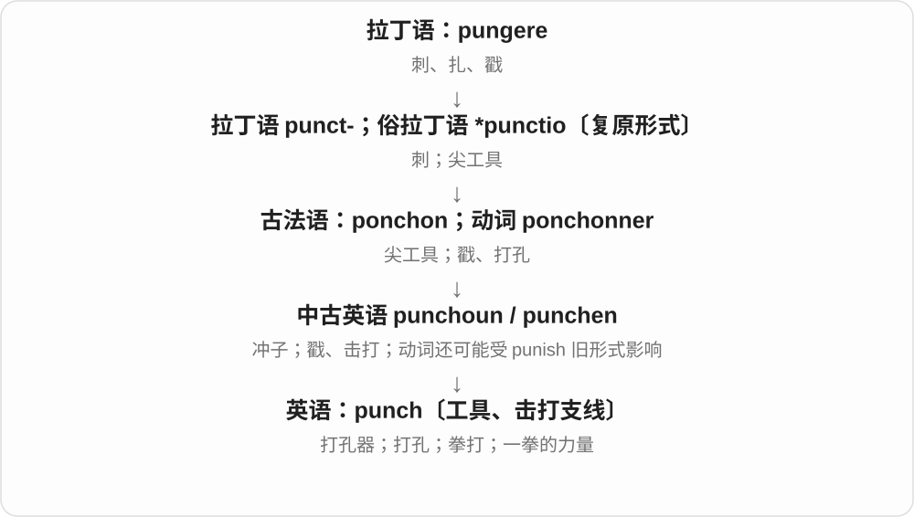

数字键上 punch in 是按键输入；pack a punch 是产生强烈效果。fruit punch 是混合果汁饮料，可含酒也可不含。饮料名常被解释为传统五种原料，但早期记录与语音仍有争议。

**常见搭配与例句**

throw a punch；a hole punch；punch in a number；pack a punch。

> The boxer blocked the punch with his glove.

拳击手用手套挡住了这一拳。

> Punch two holes near the edge of the card.

在卡片边缘附近打两个孔。

> The short speech packed a real punch.

这段简短发言很有冲击力。

> They served a fruit punch made without alcohol.

他们提供了一种不含酒精的混合果汁饮料。

**别混淆**

hit 是宽泛的击打；punch 作击打动词通常用拳。饮料、工具同形，不表示来源一定相同。

### 175. punching — 挥拳、拳打；打孔；punch 的 -ing 形式

**音标**：/ˈpʌntʃɪŋ/

**先抓住这个画面**

拳头击中目标，或者打孔器在纸上压出孔。这里都在说动作，具体是哪一种看后面的对象。

**怎么拆**

punch 动作义 + -ing。punch 的打击、钻孔等旧词义有各自相关传入背景；饮料 punch 则属于另一来源，本页不拿饮料解释动作。

**怎么变成今天的意思**

**punch 的打击、打孔动词用法**  
击中或压穿某物

↓

**punch + -ing → punching**  
拳打、打孔的过程或正在做的动作

a punching bag 拳击沙袋；punching holes 打孔；punching numbers into a keypad 把数字按进键盘。宾语会限定用法。

**常见搭配与例句**

punching a bag；punching holes in paper。

> The boxer practised on a punching bag.

拳击手对着沙袋练习。

> She was punching holes in the sheets for the binder.

她正给纸张打孔，准备装进活页夹。

**别混淆**

punching bag 是拿来练拳的器材；punching holes 中的 punch 则是打孔，不能每次都译成殴打。

### 176. attending — 出席的；负责诊疗的高年资医师

**音标**：/əˈtendɪŋ/

**先抓住这个画面**

普通 attending 是正在参加；医院里的 an attending 则是承担诊疗与监督责任的医生角色。

**怎么拆**

attend + -ing；医师名词由 attending physician 缩短而来。

**怎么变成今天的意思**

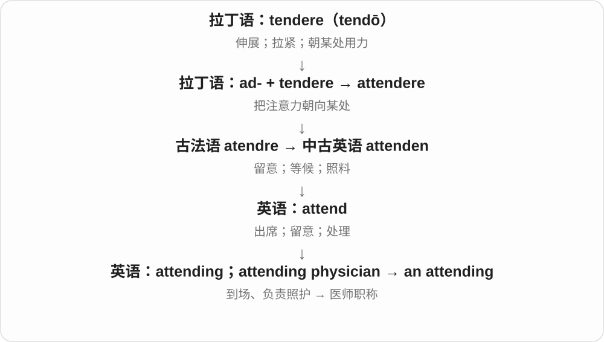

美国医疗语境尤常见，不能一律译作中国职称体系中的“主治医师”。

**常见搭配与例句**

students attending the course；an attending physician；the attending on duty。

> The students attending the workshop received a handbook.

参加工作坊的学生领到了一本手册。

> The resident discussed the case with the attending.

住院医师和负责的高年资医师讨论了病情。

**别混淆**

attendee 是活动参加者；an attending 在医院通常指医生，不是观众。

### 177. chip — 小碎片、薄片；缺口；芯片；筹码；削掉、崩掉一小块

**音标**：/tʃɪp/

**先抓住这个画面**

木头上削下一小片，杯沿崩掉一小块，是最容易抓住的画面。小而薄的片状物又可以成为筹码、食品薄片、电子芯片的名称。

**怎么拆**

接古英语 cipp 木片、小块等与相关削切动词材料。后来的食品片、游戏筹码、半导体芯片等义按小片的形状或作用发展；更远词源不必定成唯一说法。

**怎么变成今天的意思**

**古英语 cipp 及相关削切词族**  
从整体分出的小块、木片

↓

**现代 chip 的具体分支**  
碎片、缺口；食品片、筹码、芯片

a chip in the cup 杯上的缺口；wood chips 木屑；a computer chip 电脑芯片；chips 英式常指薯条，美式常指薯片；chip in 凑份子、插话。

**常见搭配与例句**

chip the paint；a bag of chips；chip in with an idea。

> There is a small chip on the edge of the plate.

盘沿有一个小缺口。

> The device contains a tiny computer chip.

那个装置里有一枚很小的电脑芯片。

**别混淆**

chip 动词常表示分出或掉下一小块，crack 可以只裂开而未掉块。食物 chips 的英美差别要按所在地和菜单判断。

### 178. chips — 碎片；薯片或薯条；筹码、芯片〔复数〕；削下小片等〔动词第三人称单数〕

**音标**：/tʃɪps/

**先抓住这个画面**

从大块上下来一小片，是 chips 的老形象。食物切成小片、小条，游戏用小片作筹码，电子元件做在小薄片上，就有不同现代义。

**怎么拆**

chip + -s，/p/ 后读 /s/。chip 接古英语 cipp 木片、小块及相关削切材料；食品、筹码、芯片是后来按形状、作用发展的分支。

**怎么变成今天的意思**

**古英语小片、削切相关材料 → chip**  
木片、碎片等小块

↓

**chip + -s → chips**  
多个小片；食品、筹码、芯片等不同类型；也可为动作三单

wood chips 木屑、木片；computer chips 计算机芯片；potato chips 食品名称随地区有区别。

**常见搭配与例句**

chips and a sandwich 薯条或薯片配三明治，需看地区；poker chips 扑克牌筹码。

> Wood chips covered the path.

小路上铺着木片。

> The factory produces chips for electronic devices.

工厂生产电子设备所用的芯片。

**别混淆**

英式 chips 常指薯条，美式 chips 常指薄脆薯片；薯片在英式常叫 crisps。电子或桌游语境则与食品无关。

### 179. chipping — 削下、凿落小块；崩缺、掉漆；chip 的 -ing 形式

**音标**：/ˈtʃɪpɪŋ/

**先抓住这个画面**

把旧漆一点点凿掉、杯沿一点点崩缺，都保留小块小块掉下来的画面。chipping in 在对话或凑钱时另按固定搭配理解。

**怎么拆**

chip 双写词末 p 加 -ing，来自小片、削切词族。名词 chippings 尤其英式可说碎石屑；高尔夫中的 chipping 又指短切击球。

**怎么变成今天的意思**

**chip**  
削、崩掉小片；发展出多种固定搭配

↓

**chip + -ing → chipping**  
削凿、崩缺的动作；短切等专门用法

chipping away at the paint 一点点凿漆；paint chipping 掉漆；chipping in for a gift 凑钱买礼物；chipping away at a problem 逐步解决问题。

**常见搭配与例句**

keep chipping away；chipping in with a suggestion。

> He was chipping old paint off the door.

他正在一点点凿掉门上的旧漆。

> Everyone is chipping in to buy a gift.

大家都在凑钱买礼物。

**别混淆**

chipping away 可真说削掉小块，也可比喻持续做一点、慢慢推进；比喻是现代搭配的用法，不必把每次凑钱都想成真削木片。

### 180. accounting — 会计；核算；说明、交代

**音标**：/əˈkaʊntɪŋ/

**先抓住这个画面**

把每笔收入支出放到合适位置，再汇成能看懂的财务记录；这整套工作就是 accounting。

**怎么拆**

account 动词 + -ing，英语动作名词，早有计算义，后发展为财务管理与会计领域的称呼。

**怎么变成今天的意思**

**拉丁 putare**  
修剪、清理；计算、考虑、判断

↓

**拉丁 com- 一起 + putare → computare**  
合起来计算、盘算

↓

**古法语 conter → a + conter → aconter**  
计数、叙述 → 算账、交代

↓

**英语 account〔动词〕**  
交代、说明；占某个比例

↓

**英语 account + -ing → accounting**  
核算、会计；交代说明

accounting department 是会计部门；an accounting of expenses 是开支的完整交代。There is no accounting for tastes 说人的喜好难以解释，不是在抱怨没人做账。

**常见搭配与例句**

financial accounting；an accounting system；an accounting of expenses。

> She studies accounting at college.

她在大学学习会计。

> The treasurer provided a full accounting of the expenses.

财务负责人完整交代了各项开支。

**别混淆**

accountant 是人；accounting 是活动、学科或修饰语。accounts 常指账目，不等于 accounting 的所有用法。

### 181. attacking — 进攻中的；进攻型的

**音标**：/əˈtækɪŋ/

**先抓住这个画面**

把注意力放在向前推进、争取进球或得分，而不是守住现有局面。

**怎么拆**

attack + -ing，现代进行形式也可作形容词，体育里的进攻型尤其常见。

**怎么变成今天的意思**

**意大利语 attaccare 接合、贴上 → 法语 attaquer、attaque**  
接战 → 进攻、攻击

↓

**英语 attack**  
攻击 → 抨击；疾病等突然发作；着手解决

↓

**attack + -ing → attacking**  
进攻 → 进攻中的、进攻型的

attacking football 进攻型足球，an attacking player 进攻型球员；They are attacking the plan 也可能是在批评方案。

**常见搭配与例句**

attacking football；an attacking player；an attacking style。

> The coach prefers an attacking style of football.

教练偏好进攻型足球风格。

> The team added another attacking player after halftime.

中场休息后，球队又增派了一名进攻型球员。

**别混淆**

attacking 风格或正在进攻，attacker 是执行者；一个词修饰打法，一个词指人或其他攻击主体。

### 182. lighting — 照明；灯光布置；点燃过程

**音标**：/ˈlaɪtɪŋ/

**先抓住这个画面**

不只一盏灯，而是整个空间怎么被照亮、光怎么落到人物和物体上。

**怎么拆**

light（照亮、点亮）+ -ing，形成活动或整体照明名词；不接重量轻的那条词义。

**怎么变成今天的意思**

**古英语 lēoht、相关发光动词 → 中古英语 light**  
光、明亮；照亮、点燃

↓

**英语 light〔光义〕**  
光；灯；明亮的；点亮

↓

**light + -ing → lighting**  
照明效果、设备配置；点燃活动

soft lighting 柔和照明，stage lighting 舞台灯光，the lighting of a candle 点蜡烛这一过程。普通照明义通常不可数。

**常见搭配与例句**

soft lighting；natural lighting；stage lighting；lighting design。

> The restaurant has warm, soft lighting.

餐馆的灯光温暖柔和。

> Good lighting makes the small room feel larger.

好的照明让小房间显得更大。

**别混淆**

light 常是一束光、一盏灯等；lighting 更常指整体照明、灯光配置。雷电 lightning 多一个 n，是另一个词形。

### 183. breathing — 呼吸；呼吸着的；呼吸过程、方式

**音标**：/ˈbriːðɪŋ/

**先抓住这个画面**

把吸气、呼气这套持续动作当一件事说；也能修饰生物活着在呼吸，不是把 breath 名词复数化。

**怎么拆**

breathe + -ing，去掉末尾不发音 e，保留动词长元音 /iː/ 和浊 /ð/。

**怎么变成今天的意思**

**古英语 breath 词族 → 中古英语 brethen → breathe**  
气息名词基础上形成呼吸动词

↓

**breathe + -ing → breathing**  
正在呼吸；呼吸这一过程

steady breathing 平稳呼吸，breathing space 缓冲空间、喘息机会，a living, breathing person 活生生的人。

**常见搭配与例句**

steady breathing；normal breathing；breathing space；living and breathing。

> Her breathing became slower and steadier.

她的呼吸变得更慢、更平稳。

> The delay gave us some breathing space.

延后给了我们一点喘息、调整的余地。

**别混淆**

breathing 是过程，breath 是一口气；a breathing space 常比喻留一点处理事情的余地，不只物理上能吸气的房间。

### 184. printing — 印刷；打印；一次印次

**音标**：英 /ˈprɪntɪŋ/；美 /ˈprɪntɪŋ/

**先抓住这个画面**

把文字图像批量复制到纸上，这项工作或这一轮生产就是 printing。

**怎么拆**

print + -ing，动作名词化；具体的一次印刷又发展出印次义。

**怎么变成今天的意思**

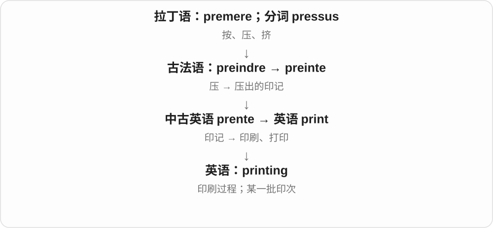

printing costs 是印刷费用；the third printing 是第三次印刷，不保证内容已经修订。

**常见搭配与例句**

printing costs；digital printing；a second printing。

> The publisher reduced printing costs by changing the paper.

出版社通过更换纸张降低了印刷成本。

> The novel reached its third printing within a month.

这部小说一个月内就印到了第三次。

**别混淆**

printing 是印次；edition 是版本。重新印一批，可以仍是同一版本。

### 185. surprising — 令人惊讶的；出人意料的

**音标**：英 /səˈpraɪzɪŋ/；美 /sərˈpraɪzɪŋ/

**先抓住这个画面**

事情本身有点不按预期来，所以让听到、看到的人感到意外。

**怎么拆**

surprise 去末尾 e 加 -ing；作形容词时说引起惊讶的事物，也可以是动词分词。

**怎么变成今天的意思**

**拉丁语 prehendere，缩略形 prendere**  
抓住、取得；分词词干 prehens- / prens-

↓

**古法语 prendre；sur- + prendre → sorprendre / surprise**  
抓住 → 趁不备袭取

↓

**英语 surprise 名词与动词**  
名词先指突然袭取；动词来自名词或法语相关形式

↓

**现代常用义**  
未料到的事情 → 惊讶、使惊讶

↓

**英语 surprise + -ing → surprising**  
使别人惊讶的

a surprising result 是让人惊讶的结果；I am surprised 才是我感到惊讶。not surprising 则说其实很容易料到。

**常见搭配与例句**

a surprising discovery；it is surprising that；hardly surprising。

> The survey produced some surprising results.

调查得出了一些令人意外的结果。

> It is surprising how quickly the town has changed.

这个镇变化如此之快，真让人意外。

**别混淆**

surprising 说引起感受的东西；surprised 说经历惊讶的人或状态。

### 186. challenging — 有挑战性的；困难而考验能力的；带质问意味的

**音标**：/ˈtʃælɪndʒɪŋ/

**先抓住这个画面**

任务向你的能力发出挑战，逼你多想一步、多做一点；它可能难，却仍有值得尝试的意味。

**怎么拆**

challenge + -ing，分词成为形容词。

**怎么变成今天的意思**

**拉丁 calumnia**  
虚假指控、歪曲、中伤；通常联系 calvī / calvor“欺骗”

↓

**拉丁 calumniārī；通俗拉丁相关形式 → 古法语 chalongier / chalengier、chalenge**  
指控、争辩、提出要求

↓

**中古英语 challenge**  
责问、反对 → 挑战、要求较量 → 困难任务

↓

**英语 challenge → challenging**  
考验、挑战 → 考验能力的

a challenging task 可能困难但有价值；a challenging question 也可能是追问、质疑式的问题。比 difficult 更容易突出需要努力与发挥能力，但不是处处都褒义。

**常见搭配与例句**

a challenging role；a challenging task；intellectually challenging。

> The new role is challenging, but she enjoys learning.

新岗位很有挑战性，但她喜欢学习。

> The interviewer asked a challenging question about the evidence.

采访者针对证据提出了一个颇具质疑意味的问题。

**别混淆**

challenging 描述任务给人的挑战；challenged 是受挑战、被质疑等状态，两者方向不同。

### 187. stun — 使惊呆、震惊；使眩晕

**音标**：/stʌn/

**先抓住这个画面**

消息太意外，人一下愣住，便是 stun。既能说坏消息，也能说美景、表现让人惊叹。

**怎么拆**

接中古英语 stonen 等，常联系古法语 estoner 使惊呆、雷击般震惊的材料；具体更早来源不硬定唯一。

**怎么变成今天的意思**

**中古英语 stonen 等，与古法语 estoner 等关系密切**  
使惊呆、失去反应；更早路线有不同解释

↓

**英语 stun**  
使眩晕；使震惊、惊叹

stun the audience 让观众惊叹；stun someone into silence 让人震惊得说不出话；be stunned by 被震惊。

**常见搭配与例句**

stun the audience；stun someone into silence。

> Her unexpected answer stunned the room.

她出人意料的回答让全场愣住。

> The view stunned us into silence.

眼前景色惊艳得我们一时说不出话。

**别混淆**

stun 强于普通 surprise，常带短时反应不过来的感觉；并不每次真的失去意识。

### 188. stunning — 令人惊艳、惊叹的；使惊呆的

**音标**：/ˈstʌnɪŋ/

**先抓住这个画面**

景色、表演太出色，让人一时看愣，就是 stunning。它在形容美时比普通 nice、pretty 更有冲击力。

**怎么拆**

stun + -ing，重读短元音后双写 n → stunning。由使惊呆的分词性质发展出极美、极出色等常用形容义。

**怎么变成今天的意思**

**stun 使惊呆、震惊**  
可由消息、表现或景色触发

↓

**stun + -ing → stunning**  
令人惊呆；常用夸赞极美、出色

a stunning view 惊艳景色；a stunning performance 精彩表演；a stunning defeat 令人震惊的失败，不必正面。

**常见搭配与例句**

a stunning view；a stunning performance；a stunning defeat。

> The terrace offers a stunning view of the valley.

露台能看到令人惊艳的山谷景色。

> The team suffered a stunning defeat.

球队遭遇了令人震惊的失利。

**别混淆**

stunning 描述引起反应的事物，stunned 描述被惊到的状态；stunning defeat 也提醒你它并非处处赞美。

### 189. stunned — 惊呆的；震惊的；眩晕的

**音标**：/stʌnd/

**先抓住这个画面**

stun 把别人震住，stunned 是被震住后的状态。眼睛睁大、话卡住，就是常见画面。

**怎么拆**

stun + -ed，重读短元音后双写 n；末尾 /n/ 后 -ed 读 /d/，整个词通常一个音节。

**怎么变成今天的意思**

**中古英语 stonen 等，与古法语 estoner 等关系密切**  
使惊呆、失去反应；更早路线有不同解释

↓

**英语 stun**  
使眩晕；使震惊、惊叹

↓

**stun + -ed → stunned**  
被惊呆、震住或弄得眩晕的状态

stunned silence 惊愕中的沉默；look stunned 看起来惊呆；stunned by the news 因消息震惊。

**常见搭配与例句**

stunned silence；look stunned；stunned by the news。

> The audience sat in stunned silence.

观众惊呆了，一片沉默。

> He looked stunned when he heard the result.

听到结果时，他看起来愣住了。

**别混淆**

stunned 被惊呆，stunning 常说令人惊艳、极美；She was stunned 与 She was stunning 说的不是同一件事。

### 190. gathering — 聚会；集会；收集、聚集过程

**音标**：英 /ˈɡæðərɪŋ/；美 /ˈɡæðərɪŋ/

**先抓住这个画面**

人拢到一处就成了一场聚会，信息拢到一处则是收集过程。

**怎么拆**

gather + -ing；古英语已有 gaderung、中古英语 gadering，活动名词有历史前身。

**怎么变成今天的意思**

**古英语 gaderian → 中古英语 gaderen**  
聚集、收集，使到一起

↓

**英语 gather**  
收集；聚集；据线索理解

↓

**古英语 gaderung → gathering**  
聚集、集会；现代对应 gather + -ing

a family gathering 家庭聚会，information gathering 信息收集。前者可数，后者更常说活动过程。

**常见搭配与例句**

a family gathering；a social gathering；information gathering。

> The wedding became a large family gathering.

婚礼成了一场大家庭聚会。

> Information gathering took longer than expected.

信息收集花的时间比预计长。

**别混淆**

gathering 聚会、集会范围广，meeting 常有更具体会面、议事目的；家庭吃饭可以是 gathering，不一定是正式会议。

### 191. backing — 支持；资助；衬底；伴奏

**音标**：/ˈbækɪŋ/

**先抓住这个画面**

前面的东西能站稳，是因为后面有资金、材料或声音在托着。

**怎么拆**

back + -ing，既接动词支持，也接名词背面、底层的用途；成为多个场景的名词，不只有进行时。

**怎么变成今天的意思**

**古英语 bæc → 中古英语 bak**  
身体的背部；后方

↓

**英语 back**  
背、后面；回去；支持等用法

↓

**back + -ing → backing**  
支持、衬底、伴奏等名词用法

financial backing 是资金支持，the backing of a carpet 是地毯背衬，backing vocals 是和声伴唱。用后面的对象判断究竟托住的是什么。

**常见搭配与例句**

financial backing；with the backing of；backing vocals。

> The scheme has the backing of local businesses.

这个方案获得了当地企业支持。

> The rug has a thick rubber backing.

地毯背面有厚橡胶衬底。

**别混淆**

backing 说支持或支撑物，backup 常说备用或备份；筹资得到 backing 不表示已建立数据 backup。

### 192. healing — 愈合、恢复过程；有助修复的

**音标**：/ˈhiːlɪŋ/

**先抓住这个画面**

不是只看最后好没好，而是看伤处、关系正一点点恢复的过程。

**怎么拆**

heal + -ing，古英语有 hǣling、中古英语 heelinge 等活动名词；今天也作分词、修饰语。

**怎么变成今天的意思**

**古英语 hǣlan → 中古英语 helen**  
使恢复健康、完好

↓

**英语 heal**  
愈合、痊愈；修复裂痕等

↓

**heal + -ing；旧活动名词延续**  
愈合、恢复过程；修复相关的

the healing process 恢复过程，wound healing 伤口愈合，emotional healing 情感恢复。healing 描述过程或作用，是否完全恢复由句子另交代。

**常见搭配与例句**

the healing process；wound healing；emotional healing。

> The nurse checked how the wound was healing.

护士查看了伤口愈合得怎样。

> Writing became part of her emotional healing.

写作成了她情感恢复过程的一部分。

**别混淆**

healing 过程或特征，healer 起治疗、修复作用的人或事物；不要因 ing 就默认一定表示此刻正在进行的动词。

### 193. bearing — 举止、姿态；关系、影响；轴承；方位

**音标**：英 /ˈbeərɪŋ/；美 /ˈberɪŋ/

**先抓住这个画面**

先从承着、带着来想：一个人怎样持身是一种姿态，机器承托转轴的部件是轴承；方向一义则来自朝向。

**怎么拆**

bear + -ing。bearing 名词从承载、持身、朝某方向等动词用法发展出多个固定意思，不是所有语境都能译为承受中。

**怎么变成今天的意思**

**古英语 beran → 中古英语 beren**  
承载、带来；生育；忍受

↓

**英语 bear；过去式 bore，过去分词通常 borne**  
承受、携带、产生；出生表达中使用 born

↓

**bear 的承托、持身、朝向用法 → bearing**  
轴承；举止；关系；方位

a calm bearing 镇定的举止；have a bearing on 与……有关、对……有影响；get one’s bearings 弄清方位，也可指熟悉新环境。

**常见搭配与例句**

a ball bearing；have no bearing on；get one’s bearings；a confident bearing。

> Her confident bearing helped put the audience at ease.

她自信的举止让听众放松下来。

> This detail has no bearing on the final decision.

这个细节与最后的决定无关。

> I needed a few minutes to get my bearings in the new building.

我花了几分钟才弄清这座新楼里的方位。

**别混淆**

bearings 可能是多个轴承，也可能是方向定位；要看谈机器维修还是找路。have a bearing on 不是把某物放在轴承上。

### 194. touching — 感人的；正在接触的

**音标**：/ˈtʌtʃɪŋ/

**先抓住这个画面**

一封信、一个小举动把人的情绪轻轻碰动，就说它很 touching。

**怎么拆**

touch + -ing，感情影响义固定为形容词感人的；作为普通动词形式也可只是物理接触。

**怎么变成今天的意思**

**古法语 tochier → 中古英语 touchen**  
触碰、敲击；更早来源有讨论

↓

**现代 touch**  
接触 → 影响情感、联系、少量润色

↓

**touch + -ing → touching**  
正在触碰；能够打动情感的

a touching story 感人故事，a touching gesture 感人举动；The branches are touching 只是树枝碰在一起。

**常见搭配与例句**

a touching story；a touching gesture；a touching tribute。

> It was a touching gesture from an old friend.

这是老朋友一个感人的举动。

> The two branches were touching above the path.

两根树枝在小路上方碰在一起。

**别混淆**

touching 形容引起感受的对象，touched 形容感到被打动的人。感动不只悲伤，也可以来自温暖与关爱。

### 195. farming — 农业；耕作、养殖活动

**音标**：英 /ˈfɑːmɪŋ/；美 /ˈfɑːrmɪŋ/

**先抓住这个画面**

不是指哪一块地，而是种、养和经营农场这一行、这一类活动。

**怎么拆**

farm + -ing，名词化农业活动。现代还可借指游戏等反复刷资源，要靠具体场景分清。

**怎么变成今天的意思**

**中古英语 ferme、法语 ferme 与中世纪拉丁 firma 等相关形式**  
固定租金、租约及租地；与古英语同形近义词的远源关系有争议

↓

**现代 farm**  
从租地背景发展为农场；农业经营、种养活动

↓

**farm + -ing → farming**  
农业活动、农场经营；后有反复获取资源等借用

organic farming 有机农业，dairy farming 奶牛养殖，go into farming 从事农业。

**常见搭配与例句**

organic farming；dairy farming；go into farming。

> The family has been involved in farming for generations.

这家人几代都从事农业。

> The course covers several methods of organic farming.

课程介绍几种有机耕作方法。

**别混淆**

farming 活动、行业，a farm 一座农场，farmland 农地；行业不等于一件实体场所。

### 196. caring — 关爱他人的；照料；关怀

**音标**：英 /ˈkeərɪŋ/；美 /ˈkerɪŋ/

**先抓住这个画面**

注意到别人冷不冷、难不难过，并愿意体贴回应。

**怎么拆**

care 去掉末尾 e 后加 -ing，形容词义从关心、照顾的动作发展；也可名词化说照护活动。

**怎么变成今天的意思**

**古英语 caru / ċearu；carian → 中古英语 care / caren**  
忧虑、挂心；关照、在意

↓

**英语 care**  
关心、照顾；注意；忧虑

↓

**care + -ing → caring**  
关照的动作 → 体贴关爱的性质

a caring teacher 是关爱学生的老师，a caring environment 是有支持、关怀的环境。caring for someone 仍可作为动词短语。

**常见搭配与例句**

a caring person；a caring attitude；a caring environment。

> She is a caring teacher who listens to every student.

她是一位愿意倾听每个学生的关爱型老师。

> They wanted to create a caring environment for new staff.

他们希望为新员工营造互相关怀的环境。

**别混淆**

caring 体贴、关怀，careful 小心、仔细；两种优点常相配，但并非同义。

### 197. pointing — 指向的动作；砖石墙的勾缝；勾缝砂浆

**音标**：英、美 /ˈpɔɪntɪŋ/

**先抓住这个画面**

普通语境是用手或工具指向某处；建筑里是把砖石接缝外面的砂浆填好、抹好。

**怎么拆**

point + -ing。建筑义接在 point“填补砖石接缝”这个旧动词义上。

**怎么变成今天的意思**

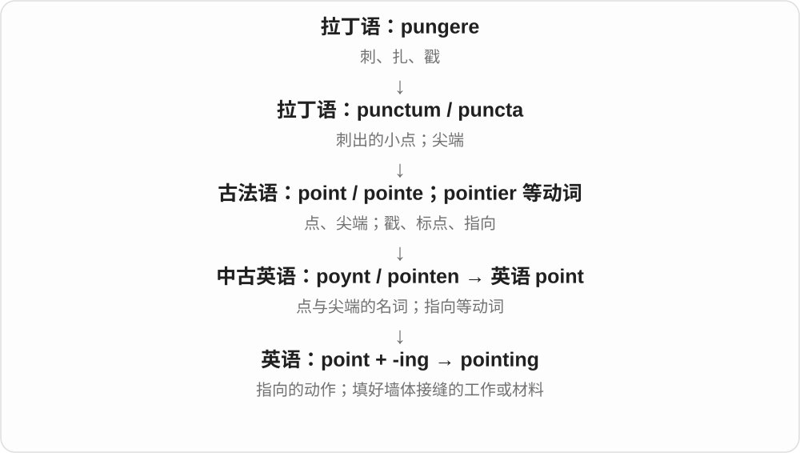

建筑文章说 damaged pointing，通常是墙缝里的砂浆坏了，不是墙上的箭头坏了。两个义项都属于 point 的历史词族，不能靠中文“指”硬推建筑义。

**常见搭配与例句**

a pointing gesture；damaged pointing；repair the pointing。

> The child answered with a pointing gesture.

孩子用一个指向的手势作了回答。

> Rain had washed some of the pointing out of the stone wall.

雨水冲掉了石墙接缝中的一部分砂浆。

**别混淆**

pointing 是墙缝外层处理；plastering 通常是在较大墙面上抹灰。

### 198. threatening — 威胁性的、来势不妙的；threaten 的现在分词

**音标**：/ˈθretənɪŋ/，也读 /ˈθretnɪŋ/

**先抓住这个画面**

声音让你觉得有人要动手，是 threatening；乌云让你觉得暴雨将至，也能 threatening。它把正在威胁或显出危险的状态放在眼前。

**怎么拆**

threaten + -ing；中古英语已有相应形式。可作进行动作，也可作形容词；threat + -en 是更里层动词结构。

**怎么变成今天的意思**

**古英语 þrēat**  
人群、压迫、困扰、威胁等旧义

↓

**古英语 þrēatnian → threaten**  
迫使、威胁；现代对应 threat + -en

↓

**threaten + -ing → threatening**  
正在威胁，或显出可能伤害的性质；-ly 再说方式

a threatening tone 威胁语气，threatening clouds 来势不妙的云，threatening behaviour 带威胁性的行为。

**常见搭配与例句**

a threatening tone；threatening clouds。

> His threatening tone made the room fall silent.

他威胁性的语气让房间安静下来。

> Threatening clouds gathered above the hills.

来势不妙的云在山丘上空聚集。

**别混淆**

threatening 不只说对方明确讲了威胁话，也可来自姿态、环境；threatened 则常说受到威胁的对象。

### 199. carpet — 地毯；给……铺地毯；像地毯一样覆盖

**音标**：英 /ˈkɑːpɪt/；美 /ˈkɑːrpɪt/

**先抓住这个画面**

先想地上铺着一层厚织物。再把这个整片盖住地面的画面用到落叶、花朵等，就能理解 a carpet of leaves。

**怎么拆**

经古法语 carpite 与中古拉丁等厚织物名称，通常联系拉丁 carpere 拔取、梳理材料。英语较早还能说桌布、床罩等，后来地面覆盖物成为主要意思。

**怎么变成今天的意思**

**拉丁相关厚织物名 → 法语 carpite → carpet**  
较早为厚布，可覆盖桌、床等

↓

**现代 carpet**  
地毯；转作动词铺毯、整片覆盖

a thick carpet 厚地毯；lay a carpet 铺地毯；a carpet of flowers 一片如毯的花；sweep something under the carpet 掩盖问题。

**常见搭配与例句**

carpet the room；a red carpet。

> The room has a thick blue carpet.

房间里铺着厚厚的蓝色地毯。

> A carpet of leaves covered the path.

落叶像地毯一样铺满小路。

**别混淆**

rug 通常是较小、可移动的铺地毯，carpet 可说整间房铺设的地毯，也能指一块毯。来源里的 carpere 与希腊 carp- 果实、手腕不是同一个词根。

### 200. carpets — 地毯〔复数〕；铺毯、整片覆盖〔第三人称单数〕

**音标**：英 /ˈkɑːpɪts/；美 /ˈkɑːrpɪts/

**先抓住这个画面**

厚厚铺在地上、把一片地面盖住，是 carpets。草、苔藓、花等铺满一块地方，也会用动词 carpets，把它们看成自然地毯。

**怎么拆**

carpet 经古法语 carpite、中古拉丁相关厚织物名，通常联系拉丁 carpere 拔取、梳理纤维材料；早期也可覆盖桌、床，后常指地毯。现代加 -s，/t/ 后读 /s/。

**怎么变成今天的意思**

**拉丁相关厚织物名 → 法语 carpite → carpet**  
厚布覆盖物 → 现代地面覆盖物

↓

**carpet + -s → carpets；名词转覆盖动词**  
多张地毯；某物整片铺满

thick carpets 厚地毯；clean the carpets 清洁地毯；moss carpets the ground 苔藓铺满地面。

**常见搭配与例句**

carpets in the hall 大厅里的地毯；carpets of flowers 花铺成的大片景观。

> The old house has thick carpets in every room.

老房子每个房间都铺着厚地毯。

> Soft moss carpets the forest floor.

柔软苔藓铺满了林地。

**别混淆**

carpets 作动词常强调大面积、连续覆盖。carpets of flowers 可以是大片花丛的形状比喻，未必是把花真的织成毯子。

### 201. carpeting — 地毯材料、地毯铺装；铺地毯；carpet 的 -ing 形式

**音标**：英 /ˈkɑːpɪtɪŋ/；美 /ˈkɑːrpɪtɪŋ/

**先抓住这个画面**

选装修材料时，把整片地毯材料统称为 carpeting；说工人正在铺地毯，也可用同一个形式。

**怎么拆**

carpet + -ing，常见标准写法不双写 t，因为最后一节不重读。动词名词发展为铺毯动作和地毯材料的集合表达。

**怎么变成今天的意思**

**carpet 名词 → carpet 动词**  
地毯 → 用地毯覆盖

↓

**carpet + -ing → carpeting**  
铺地毯动作；铺装用的地毯材料

new carpeting 新地毯铺装、材料；replace the carpeting 更换地毯；soft carpeting 柔软的地毯材料；carpeting the stairs 给楼梯铺地毯。

**常见搭配与例句**

office carpeting；install new carpeting。

> We chose soft carpeting for the bedroom.

我们为卧室选了柔软的地毯材料。

> They are carpeting the stairs this afternoon.

他们今天下午要给楼梯铺地毯。

**别混淆**

carpeting 说材料通常不可数；carpets 能数一块块地毯。They are carpeting ... 中则是动词进行形式，看后面是否接铺设对象。

### 202. heating — 加热；供暖；供暖系统

**音标**：/ˈhiːtɪŋ/

**先抓住这个画面**

把东西弄热的过程；家里说 the heating，往往就是让整间屋子暖起来的系统。

**怎么拆**

heat + -ing，中古英语已有活动名词。供暖语境常由活动转指设备、系统，不必每次加 system 才成立。

**怎么变成今天的意思**

**古英语 hǣtu〔名词〕、hǣtan〔动词〕→ heat**  
热、热情；使热、变热，与 hot 同族

↓

**现代 heat**  
热量、热度；加热；激烈情绪、压力及比赛分组等用法

↓

**heat + -ing → heating**  
加热过程 → 供暖及系统

central heating 中央供暖，turn on the heating 开暖气，heating costs 取暖费用。

**常见搭配与例句**

central heating；turn on the heating；heating costs。

> We turned on the heating when the evenings became cold.

晚上冷起来后，我们开了暖气。

> The new windows helped reduce heating costs.

新窗户帮助降低了取暖费用。

**别混淆**

heating 系统或活动，heater 某件加热器；The heating is broken 可能是整套供暖出了问题。

### 203. bless — 祝福；为……祈福；赐福

**音标**：/bles/

**先抓住这个画面**

为人祈求福佑是 bless；说自己 blessed with good friends，则把好朋友看成幸运得到的恩惠。

**怎么拆**

接古英语 bletsian、bledsian 等祝圣词，通常追到血相关仪式材料，后来受宗教翻译等扩展为祝福。不是 bliss 快乐直接改一个字母就造出动词。

**怎么变成今天的意思**

**古英语 bletsian 等 → bless**  
宗教祝圣、赐福；通常联系更早血祭仪式材料

↓

**现代 bless**  
祈福、祝福；be blessed with 受惠于、幸运拥有

bless someone 祝福某人；Bless you! 喷嚏后常说的祝福语；be blessed with 有幸拥有。

**常见搭配与例句**

bless someone；bless you；be blessed with。

> The elder blessed the couple before the ceremony.

仪式前，长者为这对伴侣祝福。

> She feels blessed with supportive friends.

她觉得能有支持自己的朋友很幸运。

**别混淆**

现代 bless 不需要实际血祭；旧来源说明词义怎样走来，不是今天的使用要求。

### 204. blessing — 祝福；幸事；赞同、认可

**音标**：/ˈblesɪŋ/

**先抓住这个画面**

祝福这个行为是一种 blessing；给生活带来好处的人或事，也能被看成一份 blessing。with her blessing 又可能只是得到她同意。

**怎么拆**

bless + -ing；古英语已有 bletsung 等相应动作名词。后来从祝福、恩惠扩展到幸事、认可等固定用法。

**怎么变成今天的意思**

**古英语 bletsian 等 → bless**  
宗教祝圣、赐福；通常联系更早血祭仪式材料

↓

**现代 bless**  
祈福、祝福；be blessed with 受惠于、幸运拥有

↓

**bless + -ing；古英语相应名词 → blessing**  
祈福、恩惠；带来好处的事；认可

a blessing in disguise 因祸得福的事；with someone’s blessing 得到某人认可；count your blessings 想想自己已有的幸运。

**常见搭配与例句**

a blessing in disguise；with her blessing；count your blessings。

> The delay turned out to be a blessing in disguise.

延误结果成了一件因祸得福的事。

> The project went ahead with the founder’s blessing.

项目得到创始人认可后继续推进。

**别混淆**

someone’s blessing 在计划语境里可能是认可，不必每次都举行宗教仪式。

### 205. blessings — 祝福；福气；值得感激的好事〔复数〕

**音标**：英、美 /ˈblesɪŋz/

**先抓住这个画面**

有人给你祝福，是 blessings；生活里那些让你觉得“幸好有它”的好事，也可以叫 blessings。

**怎么拆**

bless + -ing 行为名词 → blessing，再加 -s。历史上古英语 bletsunga 等已有祝福、庇佑、福祉的意思，后来又指带来好处的事物。

**怎么变成今天的意思**

**古英语祝福、庇佑的行为名词 → blessing**  
宗教祝福、认可、福祉等相关用法

↓

**带来好处的事物 → blessing → blessings**  
现代也用于生活里值得感激的幸运事

send blessings 是送上祝福；count your blessings 是想想自己已有的好事、值得感激之处；mixed blessings 是有利有弊的好事。

**常见搭配与例句**

send blessings；count your blessings；life’s blessings。

> She sent her blessings to the young couple.

她向那对年轻伴侣送上祝福。

> Quiet mornings are among life’s small blessings.

宁静的早晨是生活中值得珍惜的小幸福之一。

**别混淆**

blessings 可以是祝福的话，也可以是客观上的好事、便利。count your blessings 不是按字面去数别人说过几句祝福。

### 206. boxing — 拳击；另可指装箱活动

**音标**：/ˈbɒksɪŋ/；美 /ˈbɑːksɪŋ/

**先抓住这个画面**

体育报道里通常是拳击运动；仓库里 boxing the goods 才可能是把货装箱。

**怎么拆**

拳击义取 box 击打 + -ing，装箱义则接容器动词 box。现代拼写相同，不能用一个词源故事抹掉差别。

**怎么变成今天的意思**

**中古英语 box 击打、打击**  
更远来源不确定；与盒子义分开

↓

**box → boxing、boxer**  
用拳击打 → 拳击运动、拳击手

↓

**box + -ing → boxing**  
拳击活动；另源容器动词可指装箱

a boxing match 拳击比赛，boxing gloves 拳击手套；boxing up books 把书装箱。

**常见搭配与例句**

a boxing match；boxing gloves；boxing training。

> They watched a boxing match on television.

他们在电视上看了一场拳击比赛。

> The club offers boxing classes for beginners.

俱乐部开设初学者拳击课。

**别混淆**

boxing ring 拳击台现代通常方形，ring 的历史命名不要求今天仍是圆的；不是 box 盒子直接变体育。

### 207. dressing — 穿衣；沙拉调味汁；伤口敷料

**音标**：英、美 /ˈdresɪŋ/

**先抓住这个画面**

不是凡是带 -ing 就只表示正在穿衣：可以是把食物调好用的汁，也可以是把伤口覆盖好用的材料。

**怎么拆**

dress + -ing；名词沿 dress“准备、处理、装扮”的不同意思发展，不是先有连衣裙再变成沙拉酱。

**怎么变成今天的意思**

**拉丁语：regere**  
引导、使直；治理

↓

**拉丁语：dirigere → directus**  
引向一定方向、摆直 → 直的

↓

**通俗拉丁语：\*directiare**  
使直、摆正〔重建形式〕

↓

**古法语 dresser / drecier → 英语 dress**  
安排、整理 → 穿衣、装扮

↓

**英语：dress + -ing → dressing**  
穿衣、处理；用于食物或伤口处理的东西

salad dressing 是拌沙拉的调味汁；a sterile dressing 是无菌敷料。按可数用法区分：酱汁常作不可数，单片敷料可以说 a dressing。

**常见搭配与例句**

salad dressing；a wound dressing；a dressing room。

> Serve the salad with the dressing on the side.

沙拉的调味汁请另外装在一旁。

> The nurse replaced the dressing on his arm.

护士更换了他手臂上的敷料。

**别混淆**

bandage 常指包扎或固定用的绷带；dressing 重点是覆盖伤口的材料，实际用品可能组合使用。

### 208. yield — 产出、带来；让步、屈服；产量、收益等〔名词〕

**音标**：/jiːld/

**先抓住这个画面**

地把收成给出来，人把坚持的位置让出来。把几支常见意思都抓成“交出、给出”，再看是给成果还是退让。

**怎么拆**

古英语 gieldan 有支付、给予、回报等义，经中古英语 yelden 发展。英语后来形成产出、回报、交出控制、屈服等分支，不能把所有分支都硬说成同时新造。

**怎么变成今天的意思**

**古英语 gieldan → 中古英语 yelden**  
支付、给予、回报；交出

↓

**现代 yield 的多支发展**  
产出、带来；让步；相应产量、收益

yield a harvest 产出收成；yield results 带来结果；yield to pressure 向压力屈服；crop yield 作物产量；yield 也见于金融收益、收益率语境。

**常见搭配与例句**

yield useful information；a high crop yield。

> The field yielded a good harvest.

那块田收成很好。

> The search yielded several useful clues.

搜寻带来了几条有用线索。

> She refused to yield to pressure.

她拒绝向压力屈服。

**别混淆**

give way 侧重退让，produce 侧重产出；yield 可以跨这两个方向，靠宾语和 to 等搭配判断。

### 209. yields — 产出、带来；让出、让步〔第三人称单数〕；产量、收益〔复数〕

**音标**：/jiːldz/

**先抓住这个画面**

土地或方法给出结果，是 yields；把原来抓着的位置、控制权交出去，也用 yields。两边都能抓住给予、交出的老方向。

**怎么拆**

yield 继承古英语 gieldan 支付、给予、回报，经中古英语 yelden 延续，后来发展产出、让步等分支。现代加 -s，/d/ 后读 /z/。

**怎么变成今天的意思**

**古英语 gieldan → 中古英语 yelden → yield**  
支付、给予、交出 → 产出、回报、让步

↓

**yield + -s → yields**  
某物产出、某人让步；不同产量、收益

yields results 产生结果；crop yields 作物产量；yields to pressure 向压力让步。

**常见搭配与例句**

higher yields 更高产量；yields a clue 提供线索。

> The garden yields enough beans for the family.

菜园种出的豆子够一家人吃。

> The experiment compares yields from three small plots.

实验比较了三块小地的产量。

**别混淆**

yields 作动词可以是不费力地产生，也可以是交出控制。名词复数的 yields 要看是在数农作物产量，还是别的回报。

### 210. yielded — 产出、给出了；让步、屈服了

**音标**：/ˈjiːldɪd/

**先抓住这个画面**

实验给出有用结果，是 yielded useful results；压力太大，最后让了一步，也用 yielded。现代几条义都能借“给出来、让出去”串联。

**怎么拆**

yield + 完整 -ed，/d/ 后读 /ɪd/；基础词接古英语支付、交出等材料，后来有产出、屈服等用途，不全从庄稼收成这一义派生。

**怎么变成今天的意思**

**古英语 gieldan、geldan 支付、交出 → yield**  
英语后来有产出、给出与屈服等用途

↓

**un- + yielding → unyielding；再加 -ly**  
不让步、不易压弯的性质，及相应方式

↓

**yield + -ed → yielded**  
过去给出、产出，或屈服、让步

yielded results 得到结果；yielded to pressure 向压力让步。

**常见搭配与例句**

yielded a crop 产出庄稼；yielded under the weight 被重量压得弯、塌。

> The experiment yielded useful results.

实验得到了有用结果。

> He eventually yielded to their request.

他最终答应了他们的要求。

**别混淆**

yielded useful results 是产出，yielded to a demand 是让步；是否有 to、后面是什么对象，决定怎么理解。

### 211. yielding — 易弯曲、受压变形的；顺从、肯让步的；正在产出等

**音标**：/ˈjiːldɪŋ/

**先抓住这个画面**

手按下去，材料让开一点，是 yielding；人遇到要求容易退让，也叫 yielding。作分词还可能只是说产出结果。

**怎么拆**

yield + -ing；从让出、受力退让的动词形成柔软、肯让步的形容词，也保留产出的动词分支。

**怎么变成今天的意思**

**yield 让步、受力退让 + -ing**  
材料受压让开；人肯退让

↓

**yielding 的分词与形容词**  
柔软、顺从；也可说正在产出

soft, yielding ground 松软的地面；a yielding nature 易顺从的性格；yielding good results 带来好结果。

**常见搭配与例句**

a yielding surface；yielding to persuasion。

> Their feet sank into the soft, yielding ground.

他们的脚陷进松软的地面。

> The new method is yielding promising results.

新方法正在取得令人鼓舞的结果。

**别混淆**

unyielding 常说坚硬、不肯让步；yielding 常说易受压或愿退让。好坏评价随场景而变，柔软材料不必是缺点。

### 212. unyielding — 不让步的、坚定不移的；坚硬不易变形的

**音标**：/ʌnˈjiːldɪŋ/

**先抓住这个画面**

手压一块硬木，压不下去，是 unyielding；人面对压力也不肯松口、改立场，同样像压不动。这个画面可以记义，不等于物质用法在英语里先出现。

**怎么拆**

un- 不 + yielding 会让、会弯的；人的不让步义记录早于部分物质不易变形义。yield 的较早历史接支付、交出材料。

**怎么变成今天的意思**

**古英语 gieldan、geldan 支付、交出 → yield**  
英语后来有产出、给出与屈服等用途

↓

**un- + yielding → unyielding；再加 -ly**  
不让步、不易压弯的性质，及相应方式

an unyielding attitude 不肯让步的态度；an unyielding surface 坚硬不让的表面。

**常见搭配与例句**

unyielding opposition 坚决反对；an unyielding demand 不肯松口的要求。

> She remained unyielding in her opposition to the plan.

她对那项计划的反对立场始终坚定。

> The mattress felt hard and unyielding.

床垫又硬又不下陷。

**别混淆**

unyielding 可以夸坚定，也可以批评固执，取决于立场；firm 也能说坚定，通常少一点硬顶不动的强度。

### 213. unyieldingly — 不肯让步地；坚定不移地

**音标**：/ʌnˈjiːldɪŋli/

**先抓住这个画面**

对方一再要求变更，他仍然守着原来的立场，unyieldingly 写这种压不动、不松口的方式。褒贬由说话人怎么评价决定。

**怎么拆**

unyielding + -ly；内层 un- 不 + yielding 让步、变形。副词这一层修饰坚持、拒绝、反对等，不是直接把产量 yield 否定掉。

**怎么变成今天的意思**

**古英语 gieldan、geldan 支付、交出 → yield**  
英语后来有产出、给出与屈服等用途

↓

**un- + yielding → unyielding；再加 -ly**  
不让步、不易压弯的性质，及相应方式

↓

**unyielding + -ly → unyieldingly**  
以不松动、不让步的方式

unyieldingly opposed 坚决反对；stand unyieldingly 坚定站住立场。

**常见搭配与例句**

unyieldingly firm 坚定不移；refused unyieldingly 不肯松口地拒绝。

> She stood unyieldingly by her decision.

她坚定不移地坚持自己的决定。

> He remained unyieldingly opposed to the proposal.

他始终坚决反对那项提议。

**别混淆**

unyieldingly 描述不让步，patiently 描述耐心；一个人可能很耐心地解释，却仍坚定不肯改变条件。

### 214. believing — 相信；抱有信念的

**音标**：/bɪˈliːvɪŋ/

**先抓住这个画面**

把相信看成正在持续的心理活动，或一个人表现出的信念态度。

**怎么拆**

believe 去掉末尾 e 后加 -ing，接中古英语 believing 对应形式；不把 -ing 一律只当名词或只当现在时。

**怎么变成今天的意思**

**古英语 belīefan 等 → 中古英语 beleven / bileven**  
相信、信任；与准许、信赖旧词族相关

↓

**英语 believe**  
相信某说法；信赖某人或理念

↓

**believe + -ing → believing**  
相信的活动、状态或态度

keep believing 是继续相信，believing a claim 是相信某说法这个动作；a believing community 在宗教等语境可指有共同信仰的群体。

**常见搭配与例句**

keep believing；believing that；believing in oneself。

> She kept believing that the project could succeed.

她一直相信项目能成功。

> Believing a claim is easier than proving it.

相信一种说法比证明它容易。

**别混淆**

believing 是相信的活动或分词形式，believable 是内容让人信得过；正在相信的人不直接等于内容可靠。

### 215. casting — 选角；铸造；铸件

**音标**：英 /ˈkɑːstɪŋ/；美 /ˈkæstɪŋ/

**先抓住这个画面**

电影开拍前挑演员是 casting；工厂里把液态金属倒进模具成形，也是 casting。

**怎么拆**

cast + -ing，将选角或铸造这个活动名词化；铸造完成的物件也可叫 a casting。

**怎么变成今天的意思**

**古诺尔斯语 kasta → 中古英语 casten**  
投、扔；更早来源未定

↓

**英语 cast**  
投出、发出；铸造；安排角色、演员阵容

↓

**cast + -ing → casting**  
选角、铸造活动；铸件

casting director 负责选角的人，metal casting 金属铸造，a bronze casting 青铜铸件。先看电影还是制造业语境。

**常见搭配与例句**

a casting director；the casting process；metal casting。

> Casting for the main role took three months.

主角的选角花了三个月。

> The factory produces small metal castings.

这家工厂生产小型金属铸件。

**别混淆**

cast 常指已确定的整组演员，casting 常指挑选过程；the cast was excellent 与 the casting took months 关注点不同。

### 216. screening — 放映；筛选、初步筛查；网筛材料

**音标**：/ˈskriːnɪŋ/

**先抓住这个画面**

可以把电影投到幕上让人看，也可以把人或资料过一遍条件，筛出下一步要处理的对象。

**怎么拆**

screen + -ing，分别承接放映、筛选、网筛等已有义项。词尾 -ing 只把活动或过程提出来，不替你选具体意思。

**怎么变成今天的意思**

**中古英语 screne，接法语相应遮挡物名**  
防火、防风的屏障；更早可能日耳曼来源，路线有讨论

↓

**现代 screen**  
屏障、筛网 → 投影幕、显示屏；遮挡、筛选、放映

↓

**screen + -ing → screening**  
放映活动；筛选过程；另有筛网材料名

a private screening 私人放映，a screening interview 初筛面试，screening applications 筛选申请。健康语境另有初步筛查义。

**常见搭配与例句**

a private screening；a film screening；a screening interview。

> We attended a private screening of the documentary.

我们参加了纪录片的私人放映。

> Applicants complete a short screening interview first.

申请者先完成简短的初筛面试。

**别混淆**

screening 初筛与 final selection 最终选择不同；a screening of the film 则是电影放映，不能只按筛查翻。

### 217. quake — 震动、发抖；地震〔earthquake 的常用缩称〕

**音标**：/kweɪk/

**先抓住这个画面**

地面震起来，或人怕得身体发抖，都能 quake；新闻里的 a quake 多是一次地震。可以用同一个震动意象串起来，但动词比现代缩称古老。

**怎么拆**

承古英语 cwacian 地面震、身体颤动材料，远源未定。名词早有颤动义，现代地震名词常缩自 earthquake，不能倒说古老动词来自现代长词缩短。

**怎么变成今天的意思**

**古英语 cwacian → 中古英语 quaken → quake**  
地面震、身体发抖等旧用法，最远来源未定

↓

**quake 动词、名词；earth + quake → earthquake**  
现代单独名词 quake 常是 earthquake 的缩称，不意味着古老动词由现代长词才造出

quake with fear 吓得发抖；quake in your boots 吓得直哆嗦；a powerful quake 强烈地震。

**常见搭配与例句**

the ground began to quake 地面开始震动；a quake struck 发生地震。

> The ground began to quake beneath our feet.

我们脚下的地面开始震动。

> The museum reopened months after the quake.

地震几个月后，博物馆重新开放。

**别混淆**

quake 可以说身体发抖，earthquake 才明确地震；he was quaking 不应译成他在发生地震。

### 218. quakes — 震动、发抖〔第三人称单数〕；地震〔复数〕

**音标**：/kweɪks/

**先抓住这个画面**

地面一阵阵震，动词可用 quakes；几次地震则是名词 quakes。动作、事件都围绕震动，但句法角色不同。

**怎么拆**

quake + -s，/k/ 后读 /s/；古老动词三单与现代常缩自 earthquake 的名词复数同形。

**怎么变成今天的意思**

**古英语 cwacian → 中古英语 quaken → quake**  
地面震、身体发抖等旧用法，最远来源未定

↓

**quake 动词、名词；earth + quake → earthquake**  
现代单独名词 quake 常是 earthquake 的缩称，不意味着古老动词由现代长词才造出

↓

**quake + -s → quakes**  
它震动、发抖；多次地震

minor quakes 小地震；the ground quakes 地面震动；quakes with fear 吓得发抖。

**常见搭配与例句**

frequent quakes；a region prone to quakes 地震多发地区。

> Several small quakes were recorded overnight.

夜间记录到了几次小地震。

> He quakes at the thought of speaking to such a large audience.

一想到要对这么多观众讲话，他就吓得发抖。

**别混淆**

the ground quakes 是主语加动词，several quakes 是数量加事件名词；不能把每个 s 都当多个对象。

### 219. quaking — 正在震动；发抖、害怕得哆嗦的

**音标**：/ˈkweɪkɪŋ/

**先抓住这个画面**

脚下地面正晃，是 quaking；人被吓得站在那里直哆嗦，也能这样说。它可写过程或人的当下状态。

**怎么拆**

quake 去 e 加 -ing；动作形式也可作形容词，接古老地面、身体颤动材料。

**怎么变成今天的意思**

**古英语 cwacian → 中古英语 quaken → quake**  
地面震、身体发抖等旧用法，最远来源未定

↓

**quake 动词、名词；earth + quake → earthquake**  
现代单独名词 quake 常是 earthquake 的缩称，不意味着古老动词由现代长词才造出

↓

**quake → quaking**  
震动、发抖的过程或性质

quaking with fear 吓得发抖；quaking in his boots 吓得直哆嗦。

**常见搭配与例句**

a quaking voice 发颤的声音；quaking ground 震动的地面。

> The children were quaking with fear during the storm.

暴风雨中，孩子们吓得直发抖。

> He admitted that he had been quaking in his boots before the interview.

他承认，面试前自己怕得直哆嗦。

**别混淆**

quaking in your boots 可以夸张地说害怕，不要求真的穿靴子；但反讽句可能用来表示根本没被吓住，仍要看语气。

### 220. quaked — 震动了；发抖了

**音标**：/kweɪkt/

**先抓住这个画面**

爆炸震得窗户、地面晃一下，或人心里很怕、身体直抖，过去发生了就是 quaked。

**怎么拆**

quake 去 e 加完整 -ed，/k/ 后读 /t/；现代常用规则过去式，不必套古代曾有的其他变化。

**怎么变成今天的意思**

**古英语 cwacian → 中古英语 quaken → quake**  
地面震、身体发抖等旧用法，最远来源未定

↓

**quake 动词、名词；earth + quake → earthquake**  
现代单独名词 quake 常是 earthquake 的缩称，不意味着古老动词由现代长词才造出

↓

**quake → quaked**  
过去震动或身体发抖

quaked with fear 怕得发抖；the building quaked 楼房震动。

**常见搭配与例句**

quaked beneath our feet；quaked at the prospect 一想到前景就发怵。

> The windows quaked as the heavy trucks passed.

重型卡车经过时，窗户震动起来。

> She quaked with fear before stepping onto the stage.

上台前，她怕得直发抖。

**别混淆**

quaked 只写震动，不保证造成破坏；collapsed 才明确倒塌，别把震一下自动写成塌下来。

### 221. earthquake — 地震

**音标**：英 /ˈɜːθkweɪk/；美 /ˈɜːrθkweɪk/

**先抓住这个画面**

脚下大地发生震动；比喻也可说某件事造成巨大震荡。

**怎么拆**

earth 大地 + quake 震动，古英语已有相应组合。quake 是完整震动词，不是随意切出的 -quake 后缀。

**怎么变成今天的意思**

**古英语 eorþe → 中古英语 erthe → earth**  
泥土、大地；人所处的世界

↓

**现代 earth**  
土壤、地面 → 地球；材质、世俗生活与接地等

↓

**earth + quake → earthquake**  
大地震动 → 地震

a strong earthquake 强震，earthquake damage 地震损失；政治比喻 political earthquake 说重大冲击。

**常见搭配与例句**

a strong earthquake；earthquake damage；a political earthquake。

> The earthquake damaged several old buildings.

地震损坏了几座老建筑。

> The election result was described as a political earthquake.

选举结果被形容为一次政治地震。

**别混淆**

earthquake 地面震动事件，tsunami 海啸是水体运动灾害；二者有时有关，却不是同名。

### 222. embarrass — 使尴尬、使难堪

**音标**：英 /ɪmˈbærəs/；美 /ɪmˈbærəs/

**先抓住这个画面**

你正在大家面前说话，别人忽然揭出一件糗事，让你不知道脸往哪放，就是 embarrass you。

**怎么拆**

借法语 embarrasser 阻碍、使困窘，关联西班牙等语言的相关形式，细部借入路径有分歧。不是英语 bare 裸的简单加前后缀。

**怎么变成今天的意思**

**法语 embarrasser，接西班牙等罗曼语相关形式**  
阻碍、困住；更远路径有分歧

↓

**英语 embarrass → embarrassment**  
使局促难堪；尴尬及使人难堪的事

embarrass someone 使某人尴尬；be embarrassed about/by 因……难堪；embarrassing 说事情令人尴尬。

**常见搭配与例句**

embarrass someone；be embarrassed about。

> Please do not embarrass me in front of everyone.

请别让我在大家面前难堪。

> The unexpected praise embarrassed him.

突如其来的夸奖让他有些不好意思。

**别混淆**

embarrassed 是人感到难堪，embarrassing 是人或事使别人难堪；要看谁承受、谁造成。

### 223. embarrassing — 令人尴尬、难堪的；embarrass 的 -ing 形式

**音标**：/ɪmˈbærəsɪŋ/

**先抓住这个画面**

同样一个口误，从当事人的感受看是 embarrassed，从这件事给人的影响看是 embarrassing。它把尴尬带给别人。

**怎么拆**

embarrass 保留词尾加 -ing。继承妨碍、使局促的动词线，常作性质形容词说令人不自在，不一定表示动作此刻正在进行。

**怎么变成今天的意思**

**embarrass**  
使人局促、难堪

↓

**embarrass + -ing → embarrassing**  
正在使难堪；具有使人难堪的性质

an embarrassing mistake 尴尬的错误；an embarrassing question 令人难堪的问题；an embarrassing silence 尴尬的沉默；find something embarrassing 觉得某事让人尴尬。

**常见搭配与例句**

an embarrassing moment；an embarrassing situation。

> It was an embarrassing mistake, but we corrected it quickly.

那是个令人尴尬的错误，但我们很快纠正了。

> He can be very embarrassing in public.

他在公共场合有时很让旁人难堪。

**别混淆**

I am embarrassing 在某些语境是我让人难堪；I am embarrassed 才是我感到难堪。词尾在改变感受从哪一方来。

### 224. embarrassed — 尴尬的、难堪的；被弄得不自在；embarrass 的过去式、过去分词

**音标**：/ɪmˈbærəst/

**先抓住这个画面**

当众叫错了名字，大家看过来，你一时不知道怎样接话。这种局促、难堪的感受就是 embarrassed。

**怎么拆**

embarrass + -ed，末尾 /s/ 后读 /t/。embarrass 经法语 embarrasser，较早有妨碍、困住等义，更深罗曼语传入路径有不同解释；现代常说使人社交上窘迫。

**怎么变成今天的意思**

**法语 embarrasser → embarrass**  
妨碍、困住等 → 使局促难堪

↓

**embarrass + -ed → embarrassed**  
受到这种影响；感到难堪

feel embarrassed 感到尴尬；embarrassed about a mistake 为错误难堪；embarrassed to ask 不好意思开口问；an embarrassed smile 尴尬的笑。

**常见搭配与例句**

look embarrassed；be embarrassed by someone’s behaviour。

> I felt embarrassed when I forgot her name.

忘记她名字时，我觉得很尴尬。

> He was too embarrassed to ask the question.

他不好意思开口问那个问题。

**别混淆**

embarrassed 描写受到影响后的感受，embarrassing 描写造成尴尬的性质。人也可以很 embarrassing，只要他的言行让别人难堪。

### 225. awake — 醒着的；醒来、唤醒〔动词〕

**音标**：/əˈweɪk/

**先抓住这个画面**

wake 强调醒过来的动作，be awake 把镜头停在已经醒着的状态。

**怎么拆**

动词接古英语 āwacan、āwacian，经中古英语延续，表面可认 a- + wake。形容词历史还涉及旧分词的缩短，不只是今天随意给 wake 加 a。

**怎么变成今天的意思**

**古英语 āwacan、āwacian → 中古英语 awaken、awakien**  
醒来、唤醒

↓

**英语 awake；形容词亦经旧分词缩短发展**  
醒着的；动词醒来、唤醒

be awake 醒着，stay awake 保持清醒，wide awake 完全清醒，awake to the danger 意识到危险。普通形容词主要在系动词后，名词前常用 waking 等其他表达。

**常见搭配与例句**

stay awake；wide awake；lie awake；awake to。

> I was still awake when you called.

你打电话时我还醒着。

> The sudden noise awoke the whole family.

突如其来的响声把全家人都惊醒了。

**别混淆**

asleep 睡着，awake 醒着；wake up 动作与 stay awake 保持状态不同。动词还可见 awoke、awoken，不要拿醒着的形容词强套时态。

### 226. awaken — 醒来、唤醒；唤起意识、兴趣等

**音标**：/əˈweɪkən/

**先抓住这个画面**

人从睡眠中醒来，也能把一个人原来没注意的想法、兴趣唤起来。awaken 把从沉睡到有意识的变化说出来。

**怎么拆**

经中古英语 awaknen 等延续，接古英语 awæcnan 苏醒的词族，并与 awake、wake 的相应形式相互影响。不是近代才简单拿现代 awake 临时加 -en。

**怎么变成今天的意思**

**古英语 awæcnan 及相邻醒觉词族**  
从睡眠、沉寂进入清醒

↓

**中古英语 → awaken**  
醒来、使醒来；再引申唤起兴趣、认识

awaken from sleep 从睡眠中醒来；awaken someone 叫醒某人；awaken an interest 唤起兴趣。具体醒觉与抽象认识都可用。

**常见搭配与例句**

awaken to a possibility；awaken someone’s curiosity。

> The sound of rain awakened me.

雨声把我唤醒了。

> The visit awakened her interest in local history.

这次参观唤起了她对当地历史的兴趣。

**别混淆**

awake 常可作形容词醒着的；awaken 通常是动词。日常叫醒也常用 wake up，awaken 往往较书面。

### 227. awakening — 醒来；觉醒；猛然意识到

**音标**：/əˈweɪkənɪŋ/

**先抓住这个画面**

从睡着到清醒，也从没看明白到突然明白。awakening 把这个醒过来的变化当作一个过程、经历来谈。

**怎么拆**

awaken 唤醒、醒来 + -ing；awaken 与 awake 的旧英语词族相连。由生理醒来到思想觉醒的比喻发展很自然。

**怎么变成今天的意思**

**awake、awaken 的旧英语词族**  
不再睡着、恢复清醒

↓

**awaken + -ing → awakening**  
醒来这一过程；认识、意识的觉醒

a rude awakening 常指突然、令人不快地认清现实；a political awakening 政治意识的觉醒。也可作动词 awaken 的 -ing 形式。

**常见搭配与例句**

an awakening of interest；a rude awakening。

> Leaving home was a rude awakening for him.

离家生活让他猛然认识到现实并不轻松。

> The book sparked an awakening of interest in local history.

这本书唤起了人们对当地历史的兴趣。

**别混淆**

awake 常作醒着的或醒来；awakening 把变化当名词，或表示正在唤醒的动作。a rude awakening 不必真的被粗暴叫醒。

### 228. binding — 有约束力的；装订、封装部分；绑带、连接固定物

**音标**：/ˈbaɪndɪŋ/

**先抓住这个画面**

协议 binding，是它对相关人形成约束；书的 binding，则把书页固定为一本书的装订结构。一个看抽象约束，一个看具体结合。

**怎么拆**

bind + -ing，中古英语已有 byndynge。可作性质形容词，也可命名连接、装订过程及相关构件，不能每次都译成正在绑。

**怎么变成今天的意思**

**古英语 bindan → 中古英语 binden → bind**  
绑、束、连接

↓

**实体和抽象扩展**  
把材料黏合、书页装订；让承诺、义务产生约束

↓

**bind + -ing → binding**  
约束性质；装订、连接过程与结构

a binding agreement 有约束力的协议，legally binding 具有法律约束力，the book’s binding 书的装订、封装结构。具体法律效力依情境判断，词本身是性质标签。

**常见搭配与例句**

a binding agreement；legally binding；the book’s binding。

> The agreement is binding on both parties.

协议对双方都有约束力。

> The old book’s binding needed repair.

旧书的装订部分需要修理。

**别混淆**

binding 不只是书脊那一小段，也可说整套装订、封装。nonbinding recommendation 是不具约束力的建议，不等于完全没有参考价值。

### 229. demanding — 要求高的；费力的；苛求的

**音标**：英 /dɪˈmɑːndɪŋ/；美 /dɪˈmændɪŋ/

**先抓住这个画面**

demanding 像一个不断伸手向你要时间、精力或注意力的任务，也可以形容不断向别人提要求的人。

**怎么拆**

demand + -ing，分词转成形容词。

**怎么变成今天的意思**

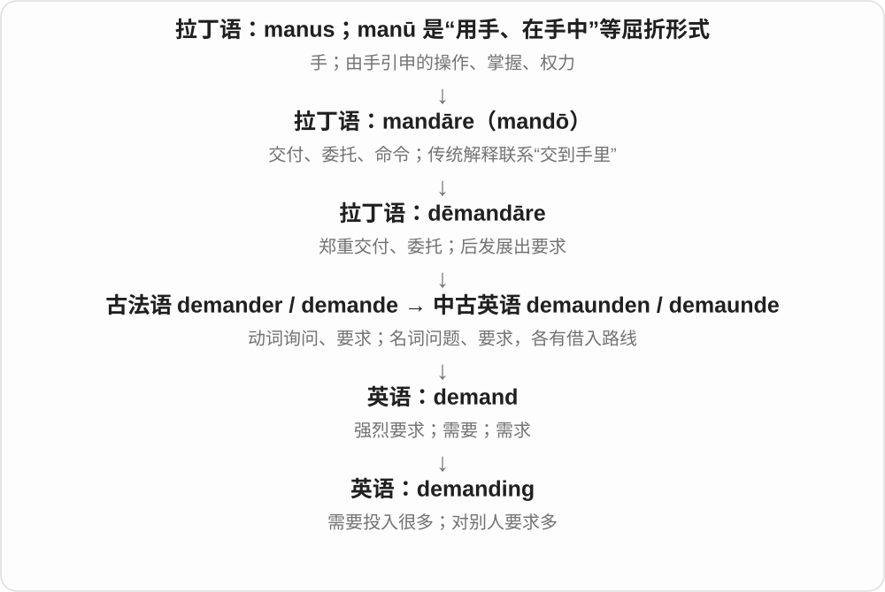

a demanding job 是工作很费力；a demanding customer 是顾客要求多。前者不一定负面，后者常含难伺候的评价。

**常见搭配与例句**

physically demanding；a demanding task；a demanding audience。

> The hike was physically demanding but rewarding.

这次徒步很耗体力，但收获很大。

> The team had to satisfy a particularly demanding client.

团队必须满足一位要求特别多的客户。

**别混淆**

difficult 是困难；demanding 更突出它要求你投入很多能力、时间或精力。

### 230. fascinate — 使着迷；强烈吸引

**音标**：/ˈfæsɪneɪt/

**先抓住这个画面**

你本来只想看一眼，结果越看越想知道，注意力像被吸住了：这个东西 fascinates you。

**怎么拆**

借拉丁 fascinatus，来自 fascinare 施魔法、蛊惑。现代用法多转为吸引注意与兴趣，不是在说真有魔法。

**怎么变成今天的意思**

**拉丁 fascinare 施魔法、蛊惑 → fascinatus、fascinatio**  
像被控制注意力一样无法移开目光

↓

**英语 fascinate、fascination**  
使深深着迷；强烈兴趣与吸引力

something fascinates someone 某物使某人着迷；be fascinated by 对……着迷。事物作主语、感兴趣的人作宾语很常见。

**常见搭配与例句**

fascinate someone；be fascinated by。

> The night sky has always fascinated me.

夜空一直让我着迷。

> The children were fascinated by the tiny machine.

孩子们被那台小机器深深吸引。

**别混淆**

fascinating 说令人着迷，fascinated 说人感到着迷；I am fascinating 是说我本人很吸引人。

### 231. fascinating — 引人入迷的、极有趣的；fascinate 的 -ing 形式

**音标**：/ˈfæsɪneɪtɪŋ/

**先抓住这个画面**

它勾起你的好奇，越看越想知道后面怎样。这种能抓住注意力的性质，就是 fascinating。

**怎么拆**

fascinate 去 e 加 -ing。从较早施魅、使着迷的词族发展为引起强烈兴趣的形容词；现代不要求真有魔法意味。

**怎么变成今天的意思**

**fascinate**  
使着迷、吸引注意力

↓

**fascinate 去 e + -ing → fascinating**  
正在吸引；具有引人入迷的性质

a fascinating story 引人入胜的故事；a fascinating question 极有趣的问题；a fascinating insight 很有启发、让人感兴趣的见解。

**常见搭配与例句**

find something fascinating；a fascinating subject。

> The exhibition tells a fascinating story about the town.

展览讲述了小镇一段引人入胜的故事。

> She is a fascinating person to talk to.

她是个聊起来很有意思的人。

**别混淆**

fascinating 通常比普通 interesting 强，更突出留住注意力。a fascinating person 是一个引人入迷的人，证明 -ing 不只用来形容物。

### 232. fascinated — 入迷的、被深深吸引的；fascinate 的过去式、过去分词

**音标**：/ˈfæsɪneɪtɪd/

**先抓住这个画面**

眼前的东西让你忍不住继续看，耳边的故事让你不想漏掉一句：你的注意力被牢牢吸住了。

**怎么拆**

fascinate 去 e 加 -ed，末尾读 /ɪd/。较早接拉丁 fascinare 施魅、使着迷，词源更深不明；英语后来把像着了魔的吸引力转成日常使注意力入迷。

**怎么变成今天的意思**

**拉丁 fascinare → 法语、英语相关词**  
施魅、使着迷 → 吸引并留住注意力

↓

**fascinate + -ed → fascinated**  
被吸引、处于入迷状态

fascinated by a machine 被机器深深吸引；fascinated with a subject 对某主题入迷；fascinated to learn 很感兴趣地了解到。

**常见搭配与例句**

watch in fascinated silence；be absolutely fascinated。

> The children were fascinated by the old machine.

孩子们被那台老机器深深吸引。

> She listened, fascinated, as he described the journey.

他讲述旅程时，她听得入了迷。

**别混淆**

fascinated 关注注意力被吸引，不保证赞同对象或觉得它漂亮。fascinating 则描写有吸引力、令人想继续了解的一方。

### 233. climbing — 攀爬、攀登运动；攀缘的；climb 的 -ing 形式

**音标**：/ˈklaɪmɪŋ/

**先抓住这个画面**

把一下一下往上攀的动作当活动说；放在 plant 前，则说植物靠支撑往上长。

**怎么拆**

climb + -ing，不双写 b，也不读出 /b/。动作名词、形容词和动词形式取决于句中位置。

**怎么变成今天的意思**

**古英语 climban → 中古英语 climben → climb**  
抓着、攀着向上走

↓

**英语 climb**  
攀爬、爬升；数量、地位逐渐上升

↓

**climb + -ing → climbing**  
攀爬过程、运动；攀缘生长的

rock climbing 攀岩，go climbing 去攀登，a climbing plant 攀缘植物，climbing prices 不断上升的价格。

**常见搭配与例句**

rock climbing；go climbing；a climbing plant。

> She took up rock climbing at university.

她在大学开始练攀岩。

> A climbing plant covered the wall.

一株攀缘植物爬满了墙。

**别混淆**

climbing 不是每次都在讲竞技或登山；a climbing rose 是攀缘蔷薇，不是有人正背着玫瑰爬山。

### 234. worrying — 令人担心的；担忧活动；worry 的 -ing 形式

**音标**：英 /ˈwʌriɪŋ/；美 /ˈwɜːriɪŋ/

**先抓住这个画面**

消息或趋势让别人心里不安；句子里也可说某人正在担心。

**怎么拆**

worry + -ing 保留 y，相关活动名词有中古英语旧形。形容词取造成忧虑的效果，不是已经感到忧虑。

**怎么变成今天的意思**

**古英语 wyrġan → 中古英语 worien**  
勒、扼；咬住撕扯等旧用法

↓

**后有困扰、烦扰 → 现代 worry**  
使心里不安；自己担心；担忧与烦心事

↓

**worry + -ing → worrying**  
担忧的过程；造成担忧的性质

a worrying sign 令人担忧的迹象，a worrying trend 令人担忧的趋势，stop worrying 别再担心。

**常见搭配与例句**

a worrying sign；a worrying trend；stop worrying。

> The report reveals a worrying trend.

报告揭示了一种令人担忧的趋势。

> Stop worrying about what everyone thinks.

别再为每个人怎么想而担心了。

**别混淆**

worrying 原因、效果与 worried 感受区分；worrier 又是容易担心的人，不是形容消息的词。

### 235. entertaining — 有趣的；令人愉快的

**音标**：英 /ˌentəˈteɪnɪŋ/；美 /ˌentərˈteɪnɪŋ/

**先抓住这个画面**

entertaining 像一段故事把你的注意力留住，让你愿意继续听，过程也觉得有意思。

**怎么拆**

entertain + -ing，形容词描述能给人带来娱乐的性质。

**怎么变成今天的意思**

不必让人笑出声；精彩的比赛或生动的讲解也可以 entertaining。

**常见搭配与例句**

an entertaining story；an entertaining speaker；highly entertaining。

> The guide gave an entertaining account of the town’s history.

导游生动有趣地讲述了小镇的历史。

> The match was entertaining despite the low score.

虽然得分不高，这场比赛仍很好看。

**别混淆**

funny 常强调好笑；entertaining 强调有趣好看，可以包含悬念、惊奇或表演。

### 236. fitting — 合宜的；安装配件；试衣

**音标**：/ˈfɪtɪŋ/

**先抓住这个画面**

三种常见场景：表达与场合相称，零件装配得上，或试穿衣服看尺寸对不对。

**怎么拆**

fit 双写 t + -ing，形成动作名词、分词与形容词。常用名词 fittings 多指安装在房间、设备等上的配件。

**怎么变成今天的意思**

**中古英语 fit 适合、相称相关形式 → 现代 fit**  
合适、相配；更远来历不确定

↓

**现代适合词族**  
大小相合、适宜 → 身体状态良好；装配

↓

**fit + -ing → fitting**  
适合、装配 → 合宜；配件；试衣

a fitting tribute 恰如其分的致敬，a dress fitting 试礼服，light fittings 灯具配件。

**常见搭配与例句**

a fitting tribute；a dress fitting；light fittings。

> The concert was a fitting tribute to the composer.

这场音乐会是对作曲家恰如其分的致敬。

> She has a dress fitting on Friday.

她周五要去试礼服、调整尺寸。

**别混淆**

fitting 作合宜形容词不等于 fitful 断断续续；fittings 配件也不同于 clothes outfit 一身穿搭。

### 237. shocking — 令人震惊的；糟透的、骇人的

**音标**：英 /ˈʃɒkɪŋ/；美 /ˈʃɑːkɪŋ/

**先抓住这个画面**

消息、行为让人震惊，也可强烈嫌某事糟糕。它描述造成冲击的东西，不是自己已经惊呆的人。

**怎么拆**

shock + -ing，分词作性质形容词；与 shocked 受惊状态方向不同。

**怎么变成今天的意思**

**法语 choc、choquer，及荷兰语相关碰撞词 → shock**  
猛烈相撞、冲击

↓

**身体感觉与情绪扩展**  
电击、震惊；医学休克另有专门含义

↓

**shock + -ing → shocking**  
造成震惊；强烈负面评价

shocking news 惊人消息，shocking behaviour 骇人行为，a shocking performance 糟透的表现。

**常见搭配与例句**

shocking news；shocking behaviour；a shocking performance。

> The report revealed shocking conditions.

报告揭示了骇人的状况。

> The team gave a shocking performance.

球队表现糟透了。

**别混淆**

shocking 令人震惊，shocked 感到震惊；I am shocking 常会变成我令人震惊，不是我震惊了。

### 238. breeding — 繁殖、繁育、育种；教养、出身〔较旧式〕

**音标**：/ˈbriːdɪŋ/

**先抓住这个画面**

一边是培养下一代生命，另一边是旧式文本里把人的成长环境、礼仪教养也放进培养这幅画面。

**怎么拆**

breed + -ing，已有中古英语等历史形式。生物繁育、养育教育和血统出身义并存，不应把旧社会的阶层评价当生物学结论。

**怎么变成今天的意思**

**古英语 brēdan → breed**  
孵育、繁殖，联系 brood 等词族

↓

**英语繁育与引申**  
繁殖后代、选育品种；滋生某种结果；教养、出身的旧用法

↓

**breed + -ing → breeding**  
繁育过程；养育形成的教养、血统等旧义

the breeding season 繁殖季，a breeding programme 繁育计划，selective breeding 选择育种，good breeding 良好教养〔旧式〕。

**常见搭配与例句**

the breeding season；a breeding programme；selective breeding；good breeding。

> The birds return here during the breeding season.

这些鸟在繁殖季回到这里。

> The old novel repeatedly praises the character’s good breeding.

旧小说反复称赞那个人物教养良好。

**别混淆**

good breeding 在旧小说里通常夸礼仪、教养或出身，不是说人物会繁殖；它可能带阶层背景，不能径直当作天生优劣。

### 239. overwhelm — 压倒；使不知所措；淹没

**音标**：英 /ˌəʊvəˈwelm/；美 /ˌoʊvərˈwelm/

**先抓住这个画面**

任务像浪一下涌过来，你来不及接住，就是 overwhelm。强烈的善意、喜悦也能让人一时承受不住。

**怎么拆**

over- 与旧 whelm 翻覆、覆盖等相合，经中古英语延续。不是 overwhelmed 去 -ed 后才新造出的现代基础词。

**怎么变成今天的意思**

**中古英语 overwhelmen；over- + whelm**  
翻覆、覆盖、淹没的旧动作材料

↓

**英语 overwhelm**  
以数量、力量或情绪压倒，使难以应付

overwhelm someone with requests 大量请求让人应接不暇；be overwhelmed by emotion 被情绪淹没；overwhelm an opponent 压倒对手。

**常见搭配与例句**

overwhelm someone with；overwhelm an opponent。

> Too many choices can overwhelm a new user.

选择太多可能让新用户不知所措。

> The warm welcome overwhelmed her.

热情欢迎让她感动得有些不知所措。

**别混淆**

overwhelm 不一定负面：kindness can overwhelm someone，表示善意强烈到令人感动得不知如何回应。

### 240. overwhelming — 压倒性的；强烈到难以承受的

**音标**：英 /ˌəʊvəˈwelmɪŋ/；美 /ˌoʊvərˈwelmɪŋ/

**先抓住这个画面**

任务多得像浪，力量大到另一边难以对抗，就是 overwhelming。an overwhelming majority 则说支持比例大得有压倒优势。

**怎么拆**

overwhelm + -ing；与 overwhelmed 对照，前者常说明造成压倒感的来源或强度，后者说明承受者状态。

**怎么变成今天的意思**

**over- + whelm 等旧覆盖、翻覆材料 → overwhelm**  
淹没；以力量、情绪压倒

↓

**overwhelm + -ing → overwhelming**  
力量、数量、感受极强、压倒性的

an overwhelming majority 压倒性多数；overwhelming evidence 极有力的大量证据；an overwhelming feeling 强烈感受。

**常见搭配与例句**

an overwhelming majority；overwhelming evidence；an overwhelming feeling。

> The proposal received overwhelming support.

提案获得了压倒性支持。

> The number of choices felt overwhelming.

选择数量多得让人难以招架。

**别混淆**

overwhelming 不总负面，也不把 majority 自动等同全体；压倒性多数仍可能不是百分之百。

### 241. overwhelmed — 不堪重负的；被情绪压倒的

**音标**：英 /ˌəʊvəˈwelmd/；美 /ˌoʊvərˈwelmd/

**先抓住这个画面**

事情或感受已经大到自己一时装不下，便 feel overwhelmed。它可以是压力，也可以是感激、惊喜。

**怎么拆**

overwhelm + -ed；/m/ 后接 /d/，没有额外 /ɪd/ 音节。过去分词发展为常用状态形容词。

**怎么变成今天的意思**

**中古英语 overwhelmen；over- + whelm**  
翻覆、覆盖、淹没的旧动作材料

↓

**英语 overwhelm**  
以数量、力量或情绪压倒，使难以应付

↓

**overwhelm + -ed → overwhelmed**  
被压倒、难以应付的状态

overwhelmed by work 被工作压得喘不过气；overwhelmed with gratitude 满怀强烈感激；feel overwhelmed 感到难以招架。

**常见搭配与例句**

feel overwhelmed；overwhelmed by work；overwhelmed with gratitude。

> He felt overwhelmed by the amount of paperwork.

大量文书工作让他难以招架。

> She was overwhelmed with gratitude for their help.

他们的帮助让她满怀感激。

**别混淆**

overwhelmed 描述承受者状态，overwhelming 描述让人难以承受的力量、数量或感受；两者角色不同。

### 242. answering — 回答、应答的；应答活动、形式

**音标**：英 /ˈɑːnsərɪŋ/；美 /ˈænsərɪŋ/

**先抓住这个画面**

动作在进行，或一个设备、服务的功能就是替人接听、作出回复。

**怎么拆**

answer + -ing，动词形式，也用于 answering machine 等功能修饰语；w 不发音，不按拼写增加 /w/。

**怎么变成今天的意思**

**古英语 andswaru、andswarian → 中古英语 answere**  
回应；and- 对应、反向 + swaru 郑重表态词族

↓

**英语 answer**  
答复、答案；接听、应门；为行为作出解释、负责

↓

**answer + -ing → answering**  
答复、接听 → 应答活动或相应功能

answering questions 回答问题，an answering machine 电话答录机，an answering service 代接、应答服务。

**常见搭配与例句**

answering questions；an answering machine；an answering service。

> She spent the morning answering emails.

她上午一直在回复邮件。

> The message was recorded on the answering machine.

留言被录在电话答录机上。

**别混淆**

answering 是活动、功能修饰，answerable 是应负责、可回答；an answering machine 不是一台须承担责任的机器。

### 243. charming — 迷人的；讨人喜欢的

**音标**：英 /ˈtʃɑːmɪŋ/；美 /ˈtʃɑːrmɪŋ/

**先抓住这个画面**

让人很自然地放松、喜欢上它，不一定奢华或惊艳。

**怎么拆**

charm + -ing；由使人着迷的动作变成描述吸引力的形容词。

**怎么变成今天的意思**

**拉丁语 canere，词典形 cano**  
唱、吟诵

↓

**拉丁语 carmen〔可能经 \*canmen 音变〕**  
歌、诗句、咒语

↓

**古法语 charme → 英语 charm〔名词〕；carminare → charmer → charm〔动词〕**  
咒语；施咒 → 吸引力、使着迷

↓

**英语 charm → charming**  
使着迷 → 讨人喜欢的

a charming village 可能小而朴素；a charming host 是亲切讨喜的主人。单独说 Charming! 也可能是反话，得听语气。

**常见搭配与例句**

a charming person；a charming village；a charming smile。

> We stayed in a charming little hotel by the river.

我们住在河边一家很讨人喜欢的小旅馆。

> She was charming without seeming rehearsed or artificial.

她亲切迷人，没有刻意练过或做作的感觉。

**别混淆**

beautiful 偏外观美；charming 还可以来自性格、细节和气氛。

### 244. cheer — 欢呼、喝彩；鼓舞、使高兴；愉快、振奋

**音标**：英 /tʃɪə/；美 /tʃɪr/

**先抓住这个画面**

词的旧起点是脸、表情：脸上显示心情，后来 cheer 越来越偏向好心情。给人加油、欢呼喝彩，就是把积极情绪表现出来。

**怎么拆**

中古英语 chere 借法语面容、表情词，上接晚期拉丁 cara。由表情转心情，再突出愉快；动词发展鼓舞、喝彩等。

**怎么变成今天的意思**

**晚期拉丁 cara → 古法语 chiere、chere**  
脸、面容、表情

↓

**表情 → 心情 → 好心情、鼓励**  
英语 cheer 的积极意义逐渐占主流

cheer for a team 为球队加油，cheer someone on 为某人鼓劲，cheer someone up 让某人开心些，good cheer 欢乐气氛。Cheers! 也可祝酒，英式口语可致谢。

**常见搭配与例句**

cheer for；cheer someone on；cheer up；Cheers!。

> The crowd cheered as the runner crossed the line.

跑者冲过终点时，人群欢呼起来。

> Her message cheered me up.

她的信息让我开心了些。

**别混淆**

cheer someone up 强调心情变好，不一定大声喊；cheer a player on 则是鼓励他继续努力。

### 245. packing — 打包、装箱；包装填料

**音标**：/ˈpækɪŋ/

**先抓住这个画面**

既可以说把东西往箱里收的过程，也可以说塞在空隙里保护物品的材料。

**怎么拆**

pack + -ing，中古英语已有对应名词。活动和材料两种用法都接装包、装填。

**怎么变成今天的意思**

**中古英语 pak、pakke → pack**  
包、捆；与荷兰语等日耳曼同族词有关，直接传入路径有不同分析

↓

**现代 pack**  
一包、一群；装包、挤满；压紧

↓

**pack + -ing → packing**  
装包过程；填塞、保护用的材料

finish the packing 收拾完行李，packing material 包装填料，a packing list 装箱清单。

**常见搭配与例句**

finish the packing；packing material；a packing list。

> The packing took longer than the journey.

收拾行李花的时间比旅程还长。

> Keep the packing material in case you need to return the item.

保留包装填料，以防需要退货。

**别混淆**

packing 常着眼收拾、装填；packaging 常着眼产品包装及其材料、外观。范围重合，不是一条绝对边界。

### 246. warming — 变暖、加暖；让人暖和、温馨的

**音标**：英 /ˈwɔːmɪŋ/；美 /ˈwɔːrmɪŋ/

**先抓住这个画面**

说温度上升的过程，也说一碗汤、一个故事带来的暖意。

**怎么拆**

warm + -ing，活动名词与分词已有中古英语等旧形式。形容词表示带来暖意，不是已经被暖起来的受动状态。

**怎么变成今天的意思**

**古英语 wearm〔形容词〕、wierman 等〔动词〕→ warm**  
暖的；使暖、变暖；更远词源有不同分析

↓

**现代 warm**  
温暖；热情、亲切；使情绪、关系热起来

↓

**warm + -ing → warming**  
加暖、变暖；让人温暖的

global warming 全球变暖，a warming drink 让人暖和的饮品，a warming story 温馨故事。

**常见搭配与例句**

global warming；a warming drink；a warming meal。

> A warming bowl of soup was waiting for us.

一碗让人暖和的汤正等着我们。

> The chapter explains the meaning of global warming.

这一章解释全球变暖的含义。

**别混淆**

warming 过程或带来暖意，warmth 暖这种状态、感觉；global warming 是固定术语，不能改成全球热情。

### 247. clearing — 林中空地；清除；清算

**音标**：英 /ˈklɪərɪŋ/；美 /ˈklɪrɪŋ/

**先抓住这个画面**

树林中原本挡住视线的树木让出一片开阔处，这就是 a clearing；抽象领域也可以把待处理事项理清。

**怎么拆**

clear + -ing；动作名词可以指清出来的地方，金融中则发展为交易信息核对、整理等清算过程。

**怎么变成今天的意思**

**拉丁语 clarus**  
明亮、清楚、响亮；显著、出名

↓

**古法语 / 英法语 cler → 中古英语 clere → clear**  
清亮、明白 → 无遮挡、无疑惑

↓

**英语 clear + -ing → clearing**  
清除 → 空地；整理待结算的交易

金融 clearing 处理交易的传递、核对、确认及可能的净额计算；settlement 才侧重完成资金或资产转移。具体系统会把两阶段衔接得很紧。

**常见搭配与例句**

a forest clearing；land clearing；a clearing system。

> We found a sunny clearing in the woods.

我们在树林中找到一片阳光充足的空地。

> The diagram separates clearing from final settlement.

示意图把清算与最终结算分开标示。

**别混淆**

clearing 的空地义通常在树林里；clearance 更常是许可、间隙或清仓，不能处处互换。

### 248. questioning — 询问；盘问；带疑问的；不轻信的

**音标**：/ˈkwestʃənɪŋ/

**先抓住这个画面**

questioning 可以是一连串问话，也可以是一个无声的眼神：“这到底怎么回事？”

**怎么拆**

question + -ing，由动词的进行形式发展出名词和形容词用法。

**怎么变成今天的意思**

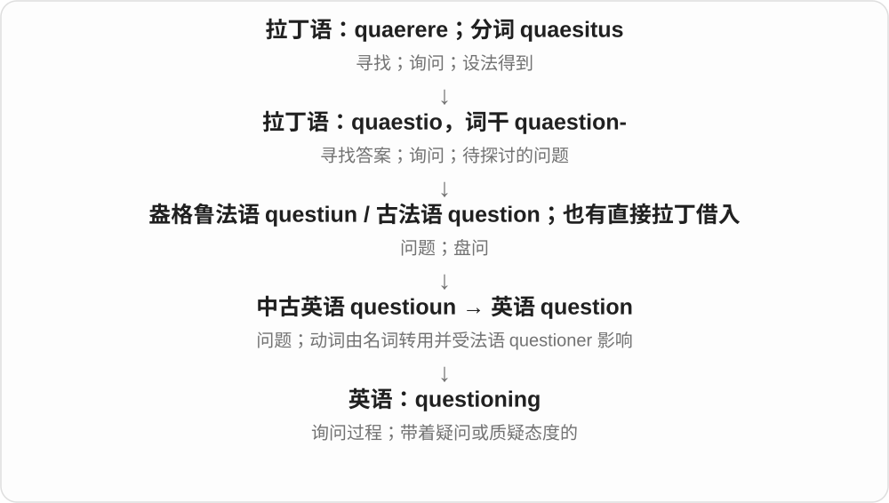

under questioning 是在接受问话；a questioning look 是疑惑的目光；a questioning mind 是愿意追问依据的头脑。这里形容词不等于“自身可疑”。

**常见搭配与例句**

under questioning；a questioning look；a questioning attitude。

> He gave me a questioning look when I arrived with three suitcases.

我提着三个箱子到达时，他疑惑地看了我一眼。

> The witness remained calm throughout the questioning.

证人在整个询问过程中都很镇定。

**别混淆**

questionable 的对象值得怀疑；questioning 的人或神情正在提出疑问。

### 249. yelling — 大喊、叫喊声

**音标**：/ˈjelɪŋ/

**先抓住这个画面**

把大喊当成一项正在发生的活动，或整片声音来听，可以 yelling。

**怎么拆**

yell + -ing；中古英语已有相应形式。这里可作活动名词，也可作正在叫喊的分词。

**怎么变成今天的意思**

**古英语 giellan → 中古英语 yellen → yell**  
发出响亮、尖厉的叫声

↓

**声音与表达的扩展**  
喊出内容；因愤怒、兴奋、呼救等大喊

↓

**yell + -ing → yelling**  
叫喊的活动、声音

stop yelling 别喊了，a lot of yelling 一片叫喊，yelling and cheering 叫喊与欢呼。

**常见搭配与例句**

stop yelling；a lot of yelling。

> There was a lot of yelling after the final whistle.

终场哨后响起一片叫喊。

> They stopped yelling when the room became quiet.

房间安静下来后，他们不再喊了。

**别混淆**

yelling 不保证在吵架；听到比赛中的 yelling，可能是兴奋、加油。a yell 强调一次，yelling 更容易把活动整体来看。

### 250. harvest — 收获、收割；收成、收获季；收获、采集〔动词〕

**音标**：英 /ˈhɑːvɪst/；美 /ˈhɑːrvɪst/

**先抓住这个画面**

庄稼成熟，把它们收回来，是 harvest；收回来的这一季成果，也可以叫 the harvest。现代还可把雨水、能源等收集起来。

**怎么拆**

来自古英语 hærfest，较早主要是秋季名称，后突出收获季、收获动作、收成，再转作动词。更远常接采摘、收集的印欧语词族；词末 est 不是现代最高级后缀。

**怎么变成今天的意思**

**古英语 hærfest → harvest**  
较早为秋季、收获时节

↓

**季节名 → 动作与成果 → 动词**  
收获季；收获、收成；把成果采集回来

a good harvest 好收成；the grape harvest 葡萄采收；harvest crops 收庄稼；harvest rainwater 收集雨水；harvest energy 收集、获取能源。

**常见搭配与例句**

bring in the harvest；harvest time。

> The farmers are preparing for the grape harvest.

农民们正为葡萄采收做准备。

> The building uses a system to harvest rainwater.

这栋建筑用一套系统收集雨水。

**别混淆**

crop 常指所种作物或一批产量，harvest 突出收获过程和收回的成果。harvest 与 autumn、fall 今天有关联，但并非同一个来源词。

### 251. harvesting — 收割、采收、采集的过程；harvest 的 -ing 形式

**音标**：英 /ˈhɑːvɪstɪŋ/；美 /ˈhɑːrvɪstɪŋ/

**先抓住这个画面**

把成熟果实、庄稼或可利用资源一点点收集回来，这个正在进行的动作或过程，是 harvesting。

**怎么拆**

harvest + -ing，词形直接相接；在 harvest 从季节名发展为收获动词之后，形成相应过程表达。water harvesting 等用法继承收集可利用资源的扩展义。

**怎么变成今天的意思**

**harvest 名词 → 动词**  
收获季、收成 → 收获、采集

↓

**harvest + -ing → harvesting**  
正在收集；采收、资源采集过程

harvesting grapes 采收葡萄；harvesting equipment 收割设备；rainwater harvesting 雨水收集；the harvesting season 采收季。

**常见搭配与例句**

begin harvesting；methods of harvesting。

> They are harvesting the apples before the rain arrives.

他们正赶在下雨前采收苹果。

> Rainwater harvesting can provide water for the garden.

收集雨水可以为花园提供用水。

**别混淆**

They are harvesting grapes 中是动词进行形式；rainwater harvesting 中常把整个过程当名词。具体对象决定译为收割、采摘还是收集。

### 252. flowing — 流动的；飘逸、连贯流畅的

**音标**：英 /ˈfləʊɪŋ/；美 /ˈfloʊɪŋ/

**先抓住这个画面**

水在流，长裙、长发也像顺着气流滑下去；文字连贯也能借流畅的感觉。

**怎么拆**

flow + -ing，中古英语已有 flowyng 等形式。分词形容词从实际流动延伸到衣料、线条、表达。

**怎么变成今天的意思**

**古英语 flōwan → 中古英语 flowen → flow**  
流动、流淌

↓

**现代 flow**  
液体、气体流动；过程、话语顺畅；流量、心流等名词

↓

**flow + -ing → flowing**  
正在流；像流动般飘逸、连贯

flowing water 流水，a flowing dress 飘逸长裙，flowing handwriting 流畅字迹。

**常见搭配与例句**

flowing water；a flowing dress；flowing handwriting。

> They rested beside the flowing stream.

他们在流水边休息。

> She wore a long, flowing dress.

她穿着一条飘逸长裙。

**别混淆**

flowing 流动、飘逸，不必是盛水的液体；flowering 开花的接 flower 是另一个词基。

### 253. inning — 〔棒球等〕局、比赛中的一轮

**音标**：/ˈɪnɪŋ/

**先抓住这个画面**

把整场比赛分成一轮轮，轮到队伍上场行动的那一段，发展成 inning 的球类用法；现代最常在棒球里认出一局。

**怎么拆**

Etymonline 追到古英语 innung，来自 innian 进入、收进；Wiktionary 则把现代 inning 解释为从 innings 逆构。旧动作名词与球类单数的形成，分层理解。

**怎么变成今天的意思**

**旧词背景：古英语 innian、innung；另有收进谷物的旧用**  
进入、收进的动作名词

↓

**球类用法与现代 inning**  
Etymonline 追旧词传承；Wiktionary 解释为把 innings 当复数后逆构单数

the first inning 第一局；the final inning 最后一局；in the third inning 在第三局。

**常见搭配与例句**

an extra inning 加赛的一局；the end of the inning 这一局结束。

> The team scored in the first inning.

球队在第一局得了分。

> Rain interrupted the final inning.

雨打断了最后一局。

**别混淆**

棒球常用单数 an inning、复数 innings。板球惯用 an innings 表一个击球局，那个 s 属于固定词形，不能照棒球删掉。

### 254. innings — 〔棒球〕局〔复数〕；〔板球〕击球局〔单复数同形〕

**音标**：/ˈɪnɪŋz/

**先抓住这个画面**

棒球里可以数几局 innings；板球却把一个击球局也叫 an innings。相同外形，计数习惯跟着运动变。

**怎么拆**

现代棒球可按 inning + -s 理解，/ŋ/ 后读 /z/；板球保留固定 innings。更早与进入、收进的旧动词有关，Wiktionary 还把 inning 单数解释为由 innings 逆构。

**怎么变成今天的意思**

**收进、进入的旧词背景 → 球类 innings**  
较早动作词的专门化，单数形成有不同分析

↓

**现代棒球 inning、innings；板球固定 innings**  
棒球按单复数配套，板球一个或多个击球局均保留 s

nine innings 九局〔棒球〕；an excellent innings 一段出色的击球表现〔板球〕。

**常见搭配与例句**

extra innings 加赛局〔棒球〕；the first innings 第一击球局〔板球〕。

> The baseball game lasted nine innings.

这场棒球赛打了九局。

> He played an excellent innings in the cricket match.

他在这场板球比赛里打出了一段精彩表现。

**别混淆**

an innings 不是漏改复数，而是板球正常用法。读到 innings 先看是在谈哪项运动，再判断单复数。

### 255. proving — 证明、检验的过程；面团醒发（尤英式）

**音标**：英 /ˈpruːvɪŋ/；美 /ˈpruːvɪŋ/

**先抓住这个画面**

把东西拿来试，或让实际结果慢慢显出来；做面包时，也会把面团发起来的过程叫 proving。

**怎么拆**

prove + -ing；检验、证明义延续 prove，烘焙义是这个动词的专门用法。

**怎么变成今天的意思**

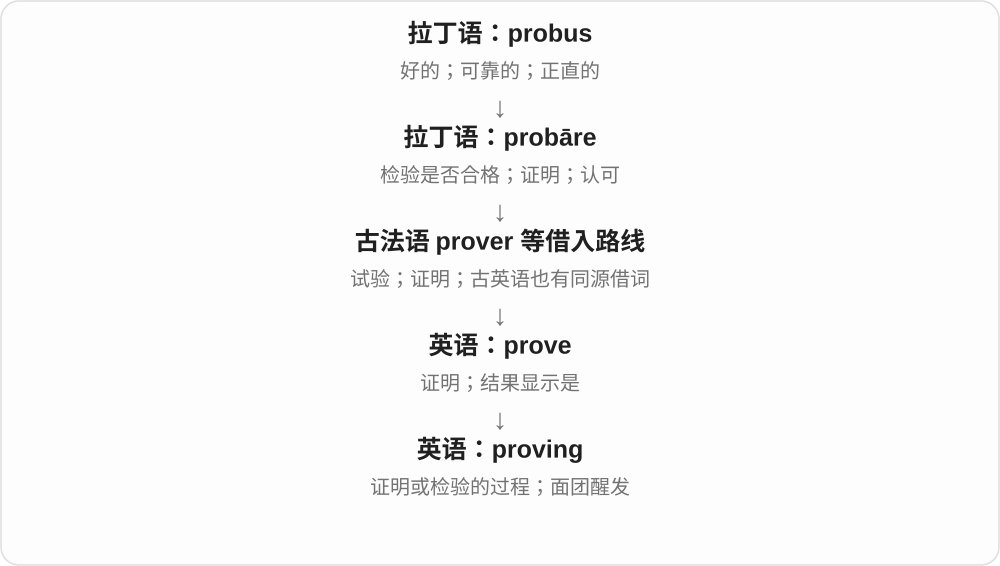

proving ground 是测试场，也能比喻检验能力的地方。烘焙中的 proving 不是证明一个数学命题，而是让面团发酵膨起。

**常见搭配与例句**

a proving ground；proving a theorem；a proving basket。

> The workshop became a proving ground for new ideas.

这个工作坊成了检验新想法的试验场。

> The dough needs more proving time before baking.

面团烘烤前还需要更多醒发时间。

**别混淆**

proving 与 proofing 在烘焙中可对应，英式常说 proving，美式常说 proofing；proofreading 则是校对文字。

### 256. spelling — 拼写、拼法；拼写能力

**音标**：/ˈspelɪŋ/

**先抓住这个画面**

一个词究竟由哪些字母、按什么顺序写出来，就是 spelling；读音听着相同，拼法也可能不同。

**怎么拆**

spell 拼写 + -ing，形成过程、结果名词，也可作动词进行形式；双 l 已在基础词里，不是此处额外变来。

**怎么变成今天的意思**

**法语 espeler 等与日耳曼语讲说词族 → spell〔拼写〕**  
逐字说出、读写字母；与话语分支同族

↓

**spell + -ing → spelling**  
拼写动作、具体拼法和能力

check the spelling 检查拼写，a spelling mistake 拼写错误，British spelling 英式拼法，correct spelling 正确拼写。

**常见搭配与例句**

check the spelling；a spelling mistake；British spelling；correct spelling。

> Please check the spelling of my name.

请核对我的姓名拼写。

> The two words have the same pronunciation but different spellings.

这两个词读音相同，拼写却不同。

**别混淆**

spelling 字母写法，pronunciation 读音；会读不保证会拼，同音词可有不同拼法。

### 257. liking — 喜爱；偏好；满意

**音标**：/ˈlaɪkɪŋ/

**先抓住这个画面**

某种口味正合你的胃口，可以说 it is to your liking；见到一个人很快产生好感，则是 take a liking to。

**怎么拆**

古英语已有动词 līcian 对应的名词 līcung“愉快、喜爱”，经中古英语 likinge 到 liking。现代也可按 like 去 e 加 -ing 理解，不能说名词直到今天才由进行时临时变来。

**怎么变成今天的意思**

**古英语 līcian → līcung**  
使人愉快；由动词形成喜爱、愉快的名词

↓

**中古英语 likinge → 英语 liking**  
喜爱、偏好；现代也有 like 的 -ing 动词形式

a liking for puzzles 是对谜题的爱好；too sweet for my liking 是甜得超过我的喜好。这些表达把个人感受当作名词来说。

**常见搭配与例句**

a liking for；take a liking to；to someone’s liking；for my liking。

> She developed a liking for old maps.

她渐渐喜欢上了旧地图。

> The music was a little too loud for my liking.

这音乐对我来说稍微太响了。

**别混淆**

liking 不表示相似，那是 likeness。I’m liking it 在口语里可强调目前越来越享受，但表达一般喜好通常说 I like it。

### 258. sailing — 帆船运动、航行；船班、开航

**音标**：/ˈseɪlɪŋ/

**先抓住这个画面**

既能是周末去玩帆船，也能是时刻表上的一班船；看是在说活动还是某次出发。

**怎么拆**

对应 sail + -ing，英语有较早航行名词、分词形式的历史。活动名词与可数船班从相关航行动作发展。

**怎么变成今天的意思**

**古英语 seġl / seġlan → sail**  
帆、靠帆航行；名词动词各有旧形式

↓

**英语航行、滑行扩展**  
航海活动、船员、帆的位置；帆般背鳍的鱼名

↓

**sail + -ing → sailing**  
航行、帆船活动；开航时间或一班航程

go sailing 玩帆船，a sailing club 帆船俱乐部，the next sailing 下一班船，smooth sailing 一帆风顺〔比喻〕。

**常见搭配与例句**

go sailing；a sailing club；the next sailing；smooth sailing。

> We go sailing when the weather is good.

天气好时，我们去玩帆船。

> The next sailing is at six o’clock.

下一班船六点开。

**别混淆**

sailing 可数时常指船班，不能都译帆船运动。plain sailing、smooth sailing 常比喻顺利，不是在描述水面绝对没波纹。

### 259. stepping — 迈步；step 的进行形式

**音标**：/ˈstepɪŋ/

**先抓住这个画面**

看到脚正在移动，也可能是一个人正在接手职责或退出岗位；短语决定迈向哪里。

**怎么拆**

step 双写 p + -ing，形成规则进行、动作形式。stepping stone 垫脚石再比喻通向下一阶段的机会。

**怎么变成今天的意思**

**古英语 steppan、stepe → 中古英语 steppen → step**  
迈步；一步、台阶

↓

**现代 step**  
脚的移动 → 程序步骤、进展与界限

↓

**step + -ing → stepping**  
迈步中的动作 → 相应进行、动作形式

stepping in 介入、接手，stepping down 辞职、卸任；a stepping stone to success 走向成功的一块垫脚石。

**常见搭配与例句**

stepping in；stepping down；a stepping stone。

> She is stepping in while the manager is away.

经理不在期间，她正暂时代管。

> The role was a stepping stone to a more senior position.

这个岗位是她走向更高级职位的一块垫脚石。

**别混淆**

stepping down 可以是卸任，不是一定从台阶往下走；stepping on someone’s toes 可说侵犯他人职责、惹恼别人。

### 260. kissing — 亲吻的动作；正在亲吻的；刚好相接的

**音标**：/ˈkɪsɪŋ/

**先抓住这个画面**

把亲吻当一个过程；也可形容两物轻轻挨着，像只是碰了一下，没有大幅重叠。

**怎么拆**

kiss + -ing，早期英语已有相应分词、名词形式。ss 已在基础词里，不需再添一个 s。

**怎么变成今天的意思**

**古英语 cyssan、coss 等 → 中古英语 → kiss**  
亲吻动作及名词，日耳曼语继承词族

↓

**kiss + -ing → kissing**  
亲吻过程、正在亲吻；轻触相接的

kissing goodbye 吻别，a kissing scene 亲吻场景，just kissing 刚好相接〔描述物体时〕。

**常见搭配与例句**

kissing goodbye；a kissing scene；kissing on the cheek。

> The film includes a brief kissing scene.

影片有一小段亲吻场景。

> The two circles were just kissing at one point.

两个圆刚好在一点相接。

**别混淆**

kissing 的 -ing 可过程名词或分词，不能只按一种进行时处理；kissing scene 是场景类型。

### 261. revealing — 透露实情的；发人深省的；暴露较多身体的

**音标**：/rɪˈviːlɪŋ/

**先抓住这个画面**

看上去只是一句话或一个细节，却像在幕布上开了一道缝，让隐藏的东西露出来。

**怎么拆**

reveal + -ing；既可作现在分词，也发展为描述事物性质的形容词。

**怎么变成今天的意思**

**拉丁 velum**  
帷幕；遮盖物；帆

↓

**拉丁 velare → re- + velare → revelare**  
盖住 → 撤去遮盖、揭示

↓

**古法语 reveler → 英语 reveal**  
使隐藏的东西显现

↓

**reveal + -ing → revealing**  
正在揭示 → 能透露信息的

a revealing comment 是一句暴露真实想法的话；a revealing interview 是能让人了解到重要内情的访谈。revealing clothes 则说衣物露出身体较多，具体意思由后面的名词决定。

**常见搭配与例句**

a revealing detail；a revealing comment；a revealing interview；revealing clothes。

> Her hesitation was more revealing than her answer.

她的迟疑比她的回答更能说明问题。

> The documentary includes a revealing interview with the designer.

纪录片里有一段与设计师的访谈，透露了不少内情。

**别混淆**

revealing 不只是“正在公开”。the most revealing detail 里它是形容词，意思是这个细节特别能说明问题。

### 262. bully — 欺凌者；欺负、威逼

**音标**：/ˈbʊli/

**先抓住这个画面**

仗着力量、地位或人数压别人，逼别人害怕、服从。名词说这个人，动词说他怎样对待别人。

**怎么拆**

早期英语有亲爱的、好伙伴等褒义称呼，可能接荷兰语 boel 等材料，确切来源未定；后来经逞威风者等意思，发展为欺负弱者的人，并出现动词。

**怎么变成今天的意思**

**早期 bully 的亲昵称呼、好伙伴义**  
可能与荷兰语相关称呼相连

↓

**词义贬化与动词形成**  
逞威风者 → 欺凌者；欺负、胁迫

a school bully 校园里的欺凌者；bully someone into doing something 胁迫某人做某事；bully someone out of something 胁迫某人放弃某物。

**常见搭配与例句**

stand up to a bully；bully someone into agreeing。

> The new student refused to give in to the bully.

新来的学生不肯向那名欺凌者屈服。

> He tried to bully the others into accepting his plan.

他试图威逼其他人接受自己的计划。

**别混淆**

bully 的历史不宜直接说成 bull 公牛 + -y。现代 tease 可指轻微逗弄，bully 常突出以强压弱的伤害、威逼。

### 263. bullying — 欺凌、霸凌；威吓的、欺凌的

**音标**：/ˈbʊliɪŋ/

**先抓住这个画面**

仗着力量、地位、人数或掌握的信息，让别人难以抵抗地反复受欺负，就是 bullying 的核心画面。它可以是动作，也可形容威吓的做派。

**怎么拆**

bully + -ing，保留 y。由欺负、威吓动词形成活动名词、分词形容词。校园等常用定义强调实际或感知的力量不平衡，以及反复发生或很可能反复发生。

**怎么变成今天的意思**

**bully 欺负、威吓 → bullying**  
反复压迫、欺凌的活动名与分词

↓

**cyber- + bullying → cyberbullying**  
通过数字网络进行的欺凌

school bullying 校园欺凌，bullying behaviour 欺凌行为，a bullying manner 威吓人的态度。

**常见搭配与例句**

bullying behaviour；school bullying。

> The school investigated reports of bullying.

学校调查了欺凌举报。

> His bullying manner made the meeting tense.

他咄咄逼人的态度让会议气氛紧张。

**别混淆**

一次平等争执与典型反复欺凌要分别理解；不符合某一定义的伤害行为，也不因此就变得合理。

### 264. frustrate — 使受挫、懊恼；阻挠、挫败

**音标**：/frʌˈstreɪt/〔亦有 /ˈfrʌstreɪt/〕

**先抓住这个画面**

想往前走，却反复被卡住，这种使努力落空的力量会 frustrate 人；它也可直接挫败计划。

**怎么拆**

接拉丁 frustratus 等分词材料，联系 frustra 徒然、无效。不是把 fruit 水果变化成某种心情词。

**怎么变成今天的意思**

**拉丁 frustra 徒然 → frustrari、frustratus 等 → frustrate**  
使落空、挫败

↓

**英语 frustrate**  
阻挠目标；让人因进展受阻而烦恼

frustrate someone 让某人受挫；frustrate an attempt 挫败一次尝试；frustrate plans 阻挠计划。

**常见搭配与例句**

frustrate someone；frustrate an attempt。

> The repeated errors frustrated everyone on the team.

反复出错让团队里的每个人都很懊恼。

> Bad weather frustrated their plans for an outdoor concert.

坏天气使他们的户外音乐会计划受挫。

**别混淆**

frustrate 比普通 annoy 更常含目标受阻、想做却做不成的成分；具体人也可能感到生气。

### 265. frustrating — 令人受挫、懊恼的

**音标**：/frʌˈstreɪtɪŋ/〔亦有 /ˈfrʌstreɪtɪŋ/〕

**先抓住这个画面**

不是单纯难，而是越想推进越卡住，让人泄气或烦恼。一直转圈却没结果的页面就很 frustrating。

**怎么拆**

frustrate 去末尾 e 加 -ing → frustrating；分词性质说明让人受挫的原因、体验。

**怎么变成今天的意思**

**拉丁 frustra 徒然 → frustrari、frustratus 等 → frustrate**  
使落空、挫败

↓

**英语 frustrate**  
阻挠目标；让人因进展受阻而烦恼

↓

**frustrate + -ing → frustrating**  
使目标受阻、让人懊恼的性质

a frustrating delay 令人懊恼的延误；a frustrating experience 令人受挫的经历；find something frustrating 觉得某事让人烦恼。

**常见搭配与例句**

a frustrating delay；a frustrating experience。

> It was a frustrating wait with no clear explanation.

这次等候没有明确解释，让人很懊恼。

> She found the repeated interruptions frustrating.

反复被打断让她觉得很烦。

**别混淆**

frustrating 描述事情，frustrated 常描述受到影响的人；a frustrated plan 又可能说被挫败的计划。

### 266. marking — 标记、批改；斑纹、地面标线等

**音标**：英 /ˈmɑːkɪŋ/；美 /ˈmɑːrkɪŋ/

**先抓住这个画面**

可以是做标记的过程，也可以是留下的一条条线、一块块特征花纹。

**怎么拆**

mark + -ing，有较早历史动作名词对应形式；markings 复数常指物体、动物身上的特征纹样。

**怎么变成今天的意思**

**古英语 mearc → 中古英语 mark、merk**  
边界、界标、记号

↓

**英语 mark**  
痕迹、标记、目标、分数；做记号、批改等

↓

**mark + -ing → marking**  
标记动作、批改 → 各种标线、斑纹

road markings 道路标线，a bird’s markings 鸟的斑纹；exam marking 阅卷、批改。

**常见搭配与例句**

road markings；distinctive markings；exam marking。

> The bird has distinctive markings on its wings.

这只鸟的翅膀上有鲜明斑纹。

> The teacher spent the evening marking essays.

老师晚上在批改作文。

**别混淆**

marking 可能指过程，markings 常是一项项具体标线、花纹；不是每个 marking 都是评分。

### 267. guessing — 猜测；正在猜的

**音标**：/ˈɡesɪŋ/

**先抓住这个画面**

答案没公开，大家还在给出可能答案；或者故意不说，让别人一直摸不准。

**怎么拆**

guess + -ing，规则构成动词形式，也用于 guessing game 等表达。保留 guess 的双 s，不再另加一个 s。

**怎么变成今天的意思**

**中古英语 gessen、gesse，可能与北欧猜测词有关**  
猜测、推想；具体借入关系不作定论

↓

**现代 guess**  
没有把握地作判断；也可委婉表示我想、大概

↓

**guess + -ing → guessing**  
猜 → 正在猜、猜测活动

a guessing game 猜谜游戏，keep someone guessing 让人一直猜不透。后者常用于计划、去向、结果迟迟不明。

**常见搭配与例句**

a guessing game；keep someone guessing；stop guessing。

> The children played a guessing game on the train.

孩子们在火车上玩猜谜游戏。

> The manager kept us guessing about the new project.

经理一直没透露新项目的情况，让我们猜来猜去。

**别混淆**

guessing 指过程或动作，guesswork 更常概括靠猜来做事的方式；两者不能所有位置机械互换。

### 268. modeling — 建模；制作模型；模特工作

**音标**：英 /ˈmɒdəlɪŋ/；美 /ˈmɑːdəlɪŋ/

**先抓住这个画面**

把东西塑成能观察、计算或展示的样子；从事服装展示时则是模特工作。

**怎么拆**

model + -ing；英式常写 modelling，双写 l。这里两种拼写指同一个词。

**怎么变成今天的意思**

**拉丁语：modus**  
尺度、分寸；方式

↓

**拉丁语 modulus → 通俗拉丁语 \*modellus**  
小尺度、标准 → 样式〔后者为重建形式〕

↓

**意大利语 modello → 法语 modelle → 英语 model**  
供参照的模型、样式

↓

**英语 model〔动词〕 → modeling / modelling**  
制作或运用模型；从事模特工作

financial modeling 是建立财务模型，不是拍金融广告。modeling clay 是可塑形的黏土；modeling agency 是模特经纪公司。

**常见搭配与例句**

mathematical modeling；a modeling career。

> The course combines data analysis with mathematical modeling.

课程结合了数据分析与数学建模。

> She began modeling while at college.

她上大学时开始从事模特工作。

**别混淆**

simulation 强调运行模拟情景；modeling 先强调建立或使用表示系统的模型。

### 269. begging — 乞讨、恳求；正在央求；无人认领、采用〔go begging〕

**音标**：/ˈbeɡɪŋ/

**先抓住这个画面**

begging 可以说反复或正在求人，也可以把乞讨这件事作为名词。go begging 却常反过来：有东西摆着，没人来要。

**怎么拆**

beg + -ing，双写 g，中古英语已有 begging、beggynge 等。固定 go begging 用法不能只把进行词形逐字硬译。

**怎么变成今天的意思**

**中古英语 beggen、beggere 等**  
乞求、乞讨与乞讨者

↓

**beg + -ing → begging**  
恳求、乞讨行为；固定搭配另有无人问津义

begging for help 恳求帮助，street begging 街头乞讨，a chance going begging 一个无人抓住的机会。

**常见搭配与例句**

begging for help；street begging；go begging。

> The child was begging for one more story.

孩子正央求再讲一个故事。

> Several good opportunities went begging.

几个好机会白白错过了。

**别混淆**

an opportunity went begging 说机会没被利用，不是机会在街上乞讨。begging 是名词还是进行动作，由整句结构决定。

### 270. drilling — 钻孔、钻探；反复操练；斜纹布等〔另有同形用法〕

**音标**：/ˈdrɪlɪŋ/

**先抓住这个画面**

drilling noise 多半是钻孔声，drilling students on verbs 则是让学生反复练动词。前半动作换了领域，-ing 仍可表示过程。

**怎么拆**

drill + -ing，双写 l。另有德语 Drilling 三联装枪的借词，以及布料用法，不把所有 drilling 都按英语正在钻解释。

**怎么变成今天的意思**

**中古荷兰语 drillen 等 → 英语 drill**  
钻、转动；工具与反复操练

↓

**现代动作、器具与练习**  
钻孔、钻具；反复训练、演练

↓

**drill + -ing → drilling**  
钻孔、钻探或操练过程

oil drilling 石油钻探，drilling equipment 钻探设备，repetitive drilling 反复操练。行业名词和动词进行形式在句子里的角色不同。

**常见搭配与例句**

oil drilling；drilling equipment；repetitive drilling。

> The drilling noise stopped at noon.

钻孔声中午停了。

> The lesson combines explanation with short periods of drilling.

这节课把讲解与短时反复操练结合起来。

**别混淆**

drilling 不必是地下开采，墙上打孔也可以；语言训练 drilling 也不要求学生在军事队列里活动。

### 271. merchandise — 商品；销售、陈列推广商品

**音标**：名词：英 /ˈmɜːtʃəndaɪs/，美 /ˈmɜːrtʃəndaɪs/；动词：英 /ˈmɜːtʃəndaɪz/，美 /ˈmɜːrtʃəndaɪz/

**先抓住这个画面**

看商店里那批准备卖给顾客的货；作动词时则是想办法把这批货摆好、包装好、卖出去。

**怎么拆**

英语名词借自盎格鲁法语 marchaundise、古法语 marcheandise；法语内部由商人词加后缀形成。英语动词后来由名词转用。

**怎么变成今天的意思**

**拉丁语 merx，属格 mercis**  
货物、商品

↓

**拉丁语 mercari**  
做买卖、交易

↓

**古法语 marcheant → marcheandise；盎格鲁法语 marchaundise**  
商人 → 货物、买卖

↓

**英语 merchandise〔名词 → 动词〕**  
商品 → 销售和推广商品

常作不可数名词，some merchandise 可以是一整批货。乐队、影视和球队语境中常指带品牌或形象的周边产品；并非这个词的唯一意思。

**常见搭配与例句**

display merchandise；official merchandise。

> The shop keeps expensive merchandise behind the counter.

店里把贵重商品放在柜台后面。

> The team sells official merchandise at every game.

球队在每场比赛时销售官方周边商品。

**别混淆**

product 可数，指一种或一件产品；merchandise 把待售商品整体看。名词也有末音 /z/ 的变读。

### 272. merchandising — 商品销售推广、陈列促销；角色、品牌周边商品的经营

**音标**：英 /ˈmɜːtʃəndaɪzɪŋ/；美 /ˈmɜːrtʃəndaɪzɪŋ/

**先抓住这个画面**

让商品更好卖：怎样摆、怎样展示、怎样配合促销。影视语境里，也常说把角色、标志做成玩具、衣服等周边来卖。

**怎么拆**

merchandise 动词经营、销售商品 + -ing；更早词族经法语联系商人、货品、贸易。后来发展出零售推广和品牌周边经营等用法。

**怎么变成今天的意思**

**merchandise 的贸易、商品词族与动词**  
经营、销售商品

↓

**merchandise + -ing → merchandising**  
销售推广、陈列；品牌或作品周边经营

visual merchandising 视觉陈列；retail merchandising 零售商品经营推广；film merchandising 电影周边商品经营。

**常见搭配与例句**

a merchandising strategy；merchandising rights。

> She is responsible for visual merchandising in the store.

她负责这家店的视觉陈列。

> The studio earns money from film merchandising.

那家电影公司通过电影周边商品经营赚钱。

**别混淆**

merchandise 作名词常指货品，merchandising 常说经营、展示、推广活动。品牌周边语境也可能把相关商品经营合在一起谈。

### 273. pierce — 刺穿、穿透；给身体打孔；声音、目光等穿透

**音标**：英 /pɪəs/；美 /pɪrs/

**先抓住这个画面**

尖物穿过材料留下孔，也能用来形容尖锐的声音冲破安静、目光像能看进人心。核心是穿进去、透过去。

**怎么拆**

经中古英语、古法语 percier 等借入，通常追溯到拉丁 pertundere 刺穿、打通的词族，含 per- 穿过与 tundere 敲击材料；具体中间形式有重建分析。

**怎么变成今天的意思**

**拉丁穿过、敲击词族 → 法语 percier**  
刺穿、穿透

↓

**中古英语 → pierce**  
物理打孔、穿透；再有感官、情绪比喻

pierce the skin 刺穿皮肤；have one’s ears pierced 打耳洞；a cry pierces the silence 尖叫划破寂静。

**常见搭配与例句**

pierce a hole；pierce the darkness。

> The needle pierced the fabric.

针穿过了布料。

> A sharp cry pierced the silence.

一声尖叫划破了寂静。

**别混淆**

pierce 强调穿透、刺入；cut 剪切、切割范围更广。具体形态不一定切下一块，pierce 常留下穿孔。

### 274. piercing — 穿孔、穿孔饰品；尖锐刺耳的；有穿透力的

**音标**：英 /ˈpɪəsɪŋ/；美 /ˈpɪrsɪŋ/

**先抓住这个画面**

耳洞是具体的孔；piercing scream 像声音直刺过来，piercing eyes 像目光能看穿人。都从 pierce 的穿透画面展开。

**怎么拆**

pierce 去词末 e 加 -ing，形成分词、形容词和名词。身体穿孔及饰品名由穿孔动作转指孔或相关饰物。

**怎么变成今天的意思**

**pierce + -ing**  
穿透、打孔这一动作

↓

**形容词、名词的固定用法**  
尖锐有穿透力的；身体穿孔、相关饰品

a piercing scream 尖叫；a piercing gaze 锐利目光；an ear piercing 耳部穿孔。名词可数时常说一个孔、一个穿孔饰物。

**常见搭配与例句**

piercing cold；a body piercing。

> A piercing whistle made everyone turn around.

一声尖锐的口哨让大家都转过身来。

> She has a small piercing in one ear.

她一只耳朵上有一个小穿孔。

**别混淆**

pierced 常说明已经被打孔、穿透；piercing 作形容词常说能够产生穿透感的声音、目光、寒冷。

### 275. satisfying — 令人满足的、有成就感的

**音标**：/ˈsætɪsfaɪɪŋ/

**先抓住这个画面**

事情做完，心里有一种“这下舒服了”的感觉。

**怎么拆**

satisfy + -ing；现在分词可描述正在满足某种要求，形容词则描述事物带来的满足感。

**怎么变成今天的意思**

**拉丁 satis**  
足够

↓

**拉丁 satisfacere**  
satis + facere：做得足够、履行义务

↓

**古法语 satisfiier → 英语 satisfy**  
偿付、满足要求 → 使满足

↓

**英语 satisfy + -ing → satisfying**  
能给人满足感的

整理完杂乱的书架、终于解出一道题，都可以是 satisfying。它不一定轰轰烈烈地快乐，而是努力有了结果、事情圆满合上的踏实感。注意词尾 /faɪɪŋ/ 有连续的元音变化。

**常见搭配与例句**

a satisfying job；a satisfying meal；find something satisfying。

> There is something satisfying about fixing a broken chair.

把坏椅子修好，会带来一种满足感。

> The story has a deeply satisfying ending.

这个故事的结尾让人感到十分圆满。

**别混淆**

satisfactory 常表示达到可接受标准；satisfying 更突出亲身体验的满足。报告合格可以是 satisfactory，写完后有成就感才是 satisfying。

### 276. baking — 烘焙、烘烤；烘烤用的；酷热的

**音标**：/ˈbeɪkɪŋ/

**先抓住这个画面**

把烤东西的整套动作叫 baking；a baking tray 是用来烤的盘；It is baking 则像说天气开了烤箱。

**怎么拆**

bake + -ing，去末尾 e，中古英语已有相关形式。过程名词、用途修饰与酷热形容词是不同句法场景。

**怎么变成今天的意思**

**古英语 bacan → 中古英语 baken → bake**  
用干热把食物烘熟、烤熟

↓

**bake + -ing → baking**  
烘烤过程；烘烤用途、酷热性质

home baking 家庭烘焙，a baking tray 烤盘，baking powder 泡打粉，baking hot 酷热。

**常见搭配与例句**

home baking；a baking tray；baking powder；baking hot。

> She spends Sunday mornings baking.

她常在周日早晨烘焙。

> It was baking hot in the car.

车里热得像烤箱。

**别混淆**

baking powder 泡打粉与 baking soda 小苏打不是同一个配方名称；此处知道名称区别，不靠词根判断替换用量。

### 277. damaging — 有害的；造成损害的

**音标**：/ˈdæmɪdʒɪŋ/

**先抓住这个画面**

它关注的是谁在造成损害：一句话、一场风暴或一种做法会让别人受伤、受损。

**怎么拆**

damage + -ing；现在分词转作形容词。

**怎么变成今天的意思**

**拉丁 damnum**  
损失、损害；罚金、处罚

↓

**古法语 damage / domage；动词 damagier**  
损害、损失；使受损

↓

**中古英语 → damage**  
损害；损坏；赔偿金用 damages

↓

**英语 damage + -ing → damaging**  
造成损害 → 有害的

damaging to 后接受损对象；damaging evidence 是对某方不利的证据，并不是证据本身破损了。

**常见搭配与例句**

damaging to；damaging remarks；a damaging leak。

> The allegation was damaging to the company’s reputation.

这项指控损害了公司的名誉。

> They discussed the damaging effects of the delay.

他们讨论了延误造成的不良影响。

**别混淆**

damaged 是已经受损；damaging 是会造成损害。a damaged phone 与 a damaging comment 方向不同。

### 278. sounding — 发声、鸣响；发声的；另源：探测、测深及其结果

**音标**：/ˈsaʊndɪŋ/

**先抓住这个画面**

the sounding of an alarm 是警报响起这件事；take soundings 则是探测深浅或摸清情况，虽然同形，却接另一条 sound。

**怎么拆**

声音线是 sound“发声” + -ing；探测线是来自古法语 sonder 的 sound“探测” + -ing。现代词尾相同，不代表两个 sound 有同一个源头。

**怎么变成今天的意思**

**声音线：拉丁 sonare → 法语 soner → 英语 sound**  
发声

↓

**英语 sound + -ing → sounding**  
发声的动作；正在鸣响的

↓

**另源并行：古法语 sonder → 英语 sound + -ing**  
探测、测深；一次探测或测深结果

名词多见 the sounding of；测深结果常用复数 soundings，take soundings 也可比喻试探意见。不要用“听一听”去硬解释所有测深历史。

**常见搭配与例句**

the sounding of a bell；a sounding board；take soundings。

> The sounding of the bell marked the end of the session.

钟声响起，标志着这一场结束。

> The crew took soundings before entering the shallow channel.

船员在进入浅水道前进行了测深。

**别混淆**

sounding board 字面是共鸣板，比喻可供讨论想法的人；take soundings 的探测义来自另一个 sound。

### 279. trafficking — 贩运、非法交易；traffic 的 -ing 形式

**音标**：/ˈtræfɪkɪŋ/

**先抓住这个画面**

现代常见新闻里不是说正常开车，而是组织贩运人、毒品、野生动物等。

**怎么拆**

traffic 加 k 再接 -ing，保留 /k/ 音。名词接贸易、贩运这条支线，不接单纯车流增加。

**怎么变成今天的意思**

**意大利 traffico、trafficare → 法语 trafique → traffic**  
贸易、往来；更远来源不确定

↓

**现代 traffic**  
交通流、网络流量；贩运、非法交易等动词用法

↓

**traffic + k + -ing → trafficking**  
交易、贩运活动；现代常偏非法贩运

human trafficking 人口贩运，drug trafficking 毒品贩运，wildlife trafficking 野生动物非法贸易。

**常见搭配与例句**

human trafficking；drug trafficking；wildlife trafficking。

> The report examines wildlife trafficking.

报告研究野生动物非法贸易。

> The novel follows an investigation into human trafficking.

小说围绕一宗人口贩运调查展开。

**别混淆**

traffic jam 交通堵塞，trafficking 常贩运行为；同族但不能因为都是移动，就把早高峰叫 trafficking。

### 280. hacking — 动手探索技术；入侵行为；反复干咳的〔依语境〕

**音标**：/ˈhækɪŋ/

**先抓住这个画面**

同一个 hacking，在技术社群可能是兴致勃勃拆解、试做，在安全新闻可能是入侵；a hacking cough 则是短促反复的干咳。

**怎么拆**

hack + -ing，行为过程或形容性质。不同含义跟随 hack 的相应分支；咳嗽来源不确定，不能说人在咳出代码。

**怎么变成今天的意思**

**中古英语 hacken，联系古英语 tohaccian 等**  
用力砍、粗切

↓

**现代技术、技巧义的扩展**  
动手巧做、临时修补、巧妙办法；也指未经授权入侵

↓

**hack + -ing → hacking**  
相应活动或反复、断续的性质

↓

**另看咳嗽分支**  
a hacking cough，短促反复的干咳

creative hacking 创意技术探索，a hacking incident 入侵事件，a hacking cough 断续干咳。MIT 的校园 hacks 还可指富有巧思的恶作剧、创作。

**常见搭配与例句**

creative hacking；a hacking incident；a hacking cough。

> The report describes a hacking incident that affected the website.

报告描述了一次影响网站的入侵事件。

> A hacking cough interrupted his speech.

一阵反复的干咳打断了他的发言。

**别混淆**

单凭 hacking 一词不能判断整件事是违法入侵还是技术探索，要读对象和描述；咳嗽搭配是形容词用法。

### 281. leaning — 倾向、偏好；倾斜、依靠的动作或状态

**音标**：/ˈliːnɪŋ/

**先抓住这个画面**

身体向一边偏，观点也可以向一边偏。political leanings 因此说政治倾向，而不是某人站得歪。

**怎么拆**

lean 倾靠动词 + -ing，接古英语 hlinung、中古英语 lening 等旧形式。名词倾向义由心理上的倾向关系发展。

**怎么变成今天的意思**

**古英语 hleonian／hlinian → 中古英语 lenen → lean 动词**  
倾斜、依靠

↓

**lean + -ing → leaning**  
倾斜、依靠；抽象的倾向、偏好

political leanings 政治倾向，artistic leanings 艺术方面的兴趣、倾向，leaning against the door 靠在门上。名词常见复数，动词形式则看完整句子。

**常见搭配与例句**

political leanings；artistic leanings；leaning against。

> The survey did not ask about political leanings.

调查没有询问政治倾向。

> She was leaning against the door frame.

她当时正靠着门框。

**别混淆**

leaning 常是偏向，不一定已成为最终决定、坚定承诺。leaning 与 learning 学习差一个 r，读音、意思都不同。

### 282. blaming — 责怪、归责的行为；正在责怪

**音标**：/ˈbleɪmɪŋ/

**先抓住这个画面**

把注意力放在“谁的错”这个动作上；有时反复找人背锅，却还没开始解决问题。

**怎么拆**

blame 去末尾 e + -ing；中古英语已有对应名词形式。句中既可作过程名词，也可出现在进行时。

**怎么变成今天的意思**

**希腊 blasphēmein → 拉丁 blasphemāre 等**  
恶言、责骂等旧词族

↓

**古法语 blasmer、blasme → 中古英语 → blame**  
责备、指责；过错责任

↓

**blame 去 e + -ing → blaming**  
责怪的行为；责怪动作进行中

stop blaming 停止责怪，blaming others 责怪别人，a culture of blaming 动辄归责的风气。

**常见搭配与例句**

stop blaming；blaming others；keep blaming。

> Blaming others will not repair the damage.

责怪别人并不能修复损失。

> He kept blaming the weather for every problem.

他不断把每个问题都归咎于天气。

**别混淆**

blaming 是找过错责任，不等于 explaining an error 分析错误；找原因可以必要，也不必总指责一个人。

### 283. mounting — 不断增加的；安装、装裱；支架

**音标**：/ˈmaʊntɪŋ/

**先抓住这个画面**

压力一点点往上走，是 mounting pressure；把零件固定好，或承托它的部件，也用 mounting。

**怎么拆**

英语 mount + -ing；现在分词发展出“越来越大的”形容词义，也形成动作及支撑装置名词。

**怎么变成今天的意思**

**拉丁 mons，属格 montis，词干 mont-**  
山、高地

↓

**通俗拉丁 \*montare〔重构形式〕**  
登上、向上

↓

**古法语 monter／盎格鲁法语 munter**  
上升、爬上、骑上

↓

**中古英语 mounten → mount**  
登上、骑上 → 安装、安排开展；数量增加

↓

**英语 mount + -ing → mounting**  
增加中的；安装动作；安装支座

mounting concern 是担忧持续加深，不是已经停止的“多”。a mounting for a lens 是镜头的安装座；the mounting of a picture 则说装裱动作。

**常见搭配与例句**

mounting pressure；mounting evidence；a rubber mounting。

> She faced mounting pressure to explain the delay.

要求她解释延期的压力越来越大。

> The mechanic replaced a cracked engine mounting.

技师更换了一个开裂的发动机支座。

**别混淆**

increasing 与 mounting 都可说增加；mounting 常让人感觉压力、费用或证据正在一层层累积。

### 284. stretching — 伸展、拉伸；正在延伸的

**音标**：/ˈstretʃɪŋ/

**先抓住这个画面**

把伸展动作作为一项活动来说，也能描述某物向远处延展。

**怎么拆**

stretch + -ing，规则进行形式与动作名词；不用双写 h，直接接 -ing。

**怎么变成今天的意思**

**古英语 streċċan → 中古英语 strecchen → stretch**  
拉伸、伸展、展开

↓

**相应旧过去分词 → straight**  
被拉直、绷直 → 直的；现代独立形容词

↓

**stretch + -ing → stretching**  
伸展动作、进行形式

gentle stretching 轻柔伸展，stretching exercises 拉伸练习；a path stretching into the distance 向远处延伸的小路。

**常见搭配与例句**

gentle stretching；stretching exercises；stretching into the distance。

> The class began with a few minutes of gentle stretching.

课程以几分钟轻柔伸展开始。

> We saw fields stretching to the horizon.

我们看到田野一直延伸到地平线。

**别混淆**

stretching 活动，stretchy 材料可拉伸的性质；能被拉伸的布不等于布正在做运动。

### 285. batting — 击球、击球表现；絮棉、填充纤维层〔另一旧义〕

**音标**：/ˈbætɪŋ/

**先抓住这个画面**

体育里是在挥棒击球；做被子时的 cotton batting 却是蓬松填充层，别在缝纫材料里找运动场。

**怎么拆**

击球为 bat 双写 t 加 -ing。填充材料义接旧 bat、batt 成团、压成层的纤维等名词，与被击打整理的材料背景有关，不是球棒的木头碎屑。

**怎么变成今天的意思**

**古英语 batt、法语 batte 等 → bat〔棒〕**  
棒、击打器具；旧来源相互影响

↓

**bat + -ing → batting〔击球〕；旧 batt 等 + -ing → 填充材料**  
运动过程与纤维集合名分开

batting practice 击球练习，batting average 击球率等指标，cotton batting 棉絮填充料。

**常见搭配与例句**

batting practice；batting average；cotton batting。

> The players began batting practice.

球员们开始击球练习。

> She used cotton batting inside the quilt.

她在被子里用了棉絮填充料。

**别混淆**

batting 在棒球、板球指标中具体含义不同，不能直接搬同一公式；填充料用法通常不可数。

### 286. agreeing — 同意、赞同〔动词形式〕；一致〔较少见名词用法〕

**音标**：/əˈɡriːɪŋ/

**先抓住这个画面**

把 agree 放进正在进行或作为一项行为的句子里：正在点头接受，或者谈“答应这件事”。

**怎么拆**

agree + -ing，保留结尾 e 再加 -ing。多数语境是普通分词、动名词；旧式名词可指 agreement，不必另造奇怪的新词义。

**怎么变成今天的意思**

**拉丁 gratus**  
令人喜欢、受欢迎；也指心怀感谢

↓

**拉丁 gratum → 古法语 gré；a gré → agreer**  
喜欢、意愿；合心意地 → 接受、赞同

↓

**中古英语 agreen → agree**  
意见一致；接受；彼此相合

↓

**英语 agree + -ing → agreeing**  
正在同意；同意这个行为

agreeing to do something 是答应做某事；agreeing with someone 是赞同其看法。不要把 agreeing 当成常用的“令人愉快的”，那个词是 agreeable。

**常见搭配与例句**

agreeing to help；agreeing with the proposal。

> Before agreeing to the plan, she asked about the cost.

答应这项计划前，她询问了费用。

> He kept agreeing with every suggestion without asking questions.

他对每个建议都表示赞同，却没有提出问题。

**别混淆**

agreeing 讲正在同意或同意行为；agreeable 可说令人愉快、乐意接受的性质。

### 287. declaring — 正在宣布；声明这一行为

**音标**：英 /dɪˈkleərɪŋ/；美 /dɪˈklerɪŋ/

**先抓住这个画面**

把“正式说清楚”放进正在进行或作为一项行为讨论的句子。

**怎么拆**

declare 去末尾 e 加 -ing；中古英语已有相应分词、动名词形式。

**怎么变成今天的意思**

**拉丁语 de-**  
离开、向下；也可加强动作或表示解除

↓

**拉丁语 clarus → clarare；declarare**  
清楚 → 使清楚、公开说明

↓

**古法语 declarer → 中古英语 declaren / declaring**  
宣布；宣布这一行为

↓

**现代英语 declare → declaring**  
现在分词或动名词

is declaring 描述正在宣布；before declaring 里的 declaring 是介词后面的动名词。常用来谈宣布结果、申报收入或利益。

**常见搭配与例句**

declaring an interest；before declaring victory；declaring income。

> The official is declaring the final results.

这位官员正在宣布最终结果。

> They waited for all the votes before declaring victory.

他们等所有选票统计完才宣布胜利。

**别混淆**

declared 常指已宣布；declaring 则把宣布当成过程或行为。

### 288. dragging — 拖着、拖动的；拖沓乏味的

**音标**：/ˈdræɡɪŋ/

**先抓住这个画面**

东西没抬离地面，仍拖着；叙事没往前推进，也让人觉得拖拖拉拉。

**怎么拆**

drag + -ing，双写 g。既可作动作分词，也可描述节奏拖沓的性质；前面的 g 仍读 /ɡ/。

**怎么变成今天的意思**

**古英语 dragan、古诺尔斯语 draga 等 → drag**  
拉、拖，相关形式汇合

↓

**力、时间与情绪扩展**  
拖慢的力、拖沓、扫兴之物；界面拖动

↓

**drag + -ing → dragging**  
拖拉动作进行；拖沓、迟缓的性质

a dragging sound 拖行声，dragging footsteps 拖沓脚步，dragging the bag 拖着包，dragging your feet 拖着不愿做的比喻。

**常见搭配与例句**

a dragging sound；dragging footsteps；dragging your feet。

> We heard a dragging sound in the corridor.

我们听到走廊里有拖东西的声音。

> Stop dragging your feet and make a decision.

别再拖着不办，作个决定吧。

**别混淆**

dragging your feet 不必真脚擦地，常说迟迟不愿行动；the film is dragging 说节奏拖沓，不是电影胶片正在被人拉走。

### 289. marching — 齐步行进；有节奏地走；游行〔分词、动名词〕

**音标**：英 /ˈmɑːtʃɪŋ/；美 /ˈmɑːrtʃɪŋ/

**先抓住这个画面**

脚步按节奏一下下向前，常常是一群人一起走，就是 marching。乐队、队伍可以这样行进，日常也可借来形容大步向前。

**怎么拆**

动词 march + -ing → marching。march 借古法语 marcher 行进、踏步，其更远来源有日耳曼语、拉丁语等不同分析；与月份 March 的火星神名词史不同。

**怎么变成今天的意思**

**古法语 marcher 踏、行进 → 英语 march**  
有节奏走的动作，远源未定

↓

**march + -ing → marching**  
现代分词、动名词，可描述队列、游行等

a marching band 是行进乐队；marching through a street 是列队或大步穿过街道；marching in step 是齐步走。

**常见搭配与例句**

a marching band；marching in step；marching through the square。

> A marching band led the parade.

一支行进乐队走在游行队伍前面。

> The children were marching in step across the hall.

孩子们齐步走过礼堂。

**别混淆**

marching 不一定是军队，也不一定是抗议；乐队表演、童话角色等都能有 marching，具体目的看上下文。

### 290. coding — 编程；编码、按类别标记

**音标**：英 /ˈkəʊdɪŋ/；美 /ˈkoʊdɪŋ/

**先抓住这个画面**

把信息写进代码、符号或分类体系；不只计算机里敲程序这一种。

**怎么拆**

code 去 e + -ing，形成动作名词与动词形式。研究里 coding responses 可指给回答分类标记。

**怎么变成今天的意思**

**拉丁 caudex、codex 木板书、书册 → 古法语 code**  
成册法规、法典

↓

**英语 code**  
成套规则 → 符号编码体系；计算机指令

↓

**code + -ing → coding**  
编码动作 → 编程、分类编码

learn coding 学编程，colour coding 颜色编码，coding interview responses 给访谈回答编码分类。

**常见搭配与例句**

learn coding；colour coding；coding skills。

> The school offers an introduction to coding.

学校开设编程入门课。

> The researchers used colour coding to organize the files.

研究人员用颜色编码整理文件。

**别混淆**

coding 可能编程，也可能研究分类；一个采访研究的 coder 不一定在写应用软件。

### 291. wandering — 漫游、流动的；漫游过程；走神、偏离

**音标**：英 /ˈwɒndərɪŋ/；美 /ˈwɑːndərɪŋ/

**先抓住这个画面**

人到处走是 wandering；a wandering mind 则是注意力飘走。它把没有固定路线的动作变成过程或性质。

**怎么拆**

wander + -ing，分词、动作名词和形容词；保留原词全部字母。

**怎么变成今天的意思**

**古英语 wandrian → 中古英语 wandren → wander**  
四处走、偏离路线；旧词更深联系反复转向

↓

**身体走散 → 思绪偏离**  
没有严格路线，注意力也能离开当前任务

↓

**wander + -ing → wandering**  
漫游过程、四处流动的状态

a wandering musician 流动艺人，a wandering mind 容易飘走的心思，years of wandering 多年漫游。

**常见搭配与例句**

a wandering mind；years of wandering。

> A wandering musician stopped in the village.

一位四处游历的音乐家在村里停留。

> She tried to bring her wandering attention back to the book.

她努力把飘走的注意力拉回书上。

**别混淆**

wandering 作形容词不总是此刻正在走；a wandering life 可以整体说漂泊、四处流动的生活方式。

### 292. communicating — 正在交流、传递的；相通的〔房间〕

**音标**：英 /kəˈmjuːnɪkeɪtɪŋ/；美 /kəˈmjuːnəkeɪtɪŋ/

**先抓住这个画面**

普通句子里是交流这个动作在进行；酒店房型里则可能是两个房间中间有门相通。

**怎么拆**

communicate 去末尾 e 加 -ing。形容词相通义接 communicate 的连接、通达支线，不是房间会说话。

**怎么变成今天的意思**

**拉丁语 commūnis → commūnicāre、commūnicāt-**  
共同的 → 使共享、告知、传递

↓

**借入英语 communicate**  
沟通、传达；使相通等

↓

**communicate + -ing → communicating**  
交流、传递；互相通连的

communicating with a client 与客户交流，communicating rooms 相通客房，a communicating door 连通门。

**常见搭配与例句**

communicating rooms；a communicating door；communicating with。

> The hotel gave us two communicating rooms.

酒店给我们安排了两间相通的客房。

> She is communicating with the team through an interpreter.

她正通过口译员与团队交流。

**别混淆**

communicating rooms 房间内部可互通，adjacent rooms 只说相邻，不保证中间有门。

### 293. lick — 舔；一舔；击败、克服〔口语〕

**音标**：英、美 /lɪk/

**先抓住这个画面**

舌头掠过冰淇淋、勺子，是 lick。口语里说终于 lick a problem，又可能是在说总算把难题解决了。

**怎么拆**

舔义承古英语 liccian，经日耳曼词族延续。击败、克服义后来出现，可能与舔食、吞没的比喻有关，具体联系仍不确定，不编成一条必然故事。

**怎么变成今天的意思**

**古英语 liccian → lick 舔**  
名词又可说舔这一下动作

↓

**较晚 lick 击败、克服及相关 licking 用法**  
与舔义的历史联系有可能性分析，现代按语境区分

lick an ice cream 是舔冰淇淋；give something a lick 是舔一下；have a problem licked 是把问题解决、控制住。

**常见搭配与例句**

lick an ice cream；give a lick；have it licked。

> The child leaned forward to lick the ice cream.

孩子探过身去舔冰淇淋。

> We finally managed to lick the problem.

我们终于设法解决了这个难题。

**别混淆**

lick 强调舌头动作，bite 是咬。口语里已经把某个难题 licked，谈的是克服它，不是实际用舌头。

### 294. licking — 舔、舔舐；痛打；惨败〔后两义为口语〕

**音标**：英、美 /ˈlɪkɪŋ/

**先抓住这个画面**

a licking 可以是舔一遍，也可以在比赛里说被狠狠打败。看到 took a licking，先想吃了一场败仗，不要只按舔的动作翻译。

**怎么拆**

lick + 完整 -ing → licking，原词保留。舔的名词用法很早；击败、痛打的另一用法接 lick 的相关口语义，两个意义的更早联系并非完全确定。

**怎么变成今天的意思**

**lick 舔 + -ing → licking**  
给舌头掠过表面的行为命名

↓

**lick 击败、克服的口语义 → a licking**  
名词可说痛打、重挫、比赛中的惨败

give something a licking 可按语境说舔一遍；take a licking 常说遭重挫；a severe licking 是一场惨败、痛打。

**常见搭配与例句**

give a licking；take a licking；a severe licking。

> The puppy gave my hand a thorough licking.

小狗把我的手舔了个遍。

> Our team took a licking in the final.

我们队在决赛中吃了一场惨败。

**别混淆**

licking 不必都是正在舔，-ing 也能形成可数行为名词。体育报道里的 a licking 通常看胜负、比分来理解。

### 295. welcoming — 热情接待的；让人感到自在受欢迎的

**音标**：/ˈwelkəmɪŋ/

**先抓住这个画面**

你推开门，主人笑着招呼你，屋里也温暖舒适，就会觉得这里很 welcoming。它说的是环境或人的接纳感。

**怎么拆**

welcome 动词去词尾 e 加 -ing，既是现在分词，也形成形容词。来源仍接古英语的合意来客与欢迎动作，而不是新借入的外国词。

**怎么变成今天的意思**

**英语 welcome〔经古英语 wilcuma／wilcumian〕**  
欢迎、乐于接待

↓

**英语 welcome + -ing → welcoming**  
正在欢迎；能让人感到被接纳的

a welcoming smile 是迎接你的笑容；a welcoming atmosphere 是让人愿意走进来、待下去的氛围。用来形容地方时，是把人的接待感转到环境上。

**常见搭配与例句**

welcoming staff；a welcoming smile；a welcoming atmosphere。

> The volunteers created a welcoming atmosphere for newcomers.

志愿者为新来的人营造了亲切友好的氛围。

> Soft lighting made the small café feel warm and welcoming.

柔和的灯光让这家小咖啡馆显得温暖而亲切。

**别混淆**

welcoming 多说主动接待的一方；welcome 说被乐意接受的人或事。a welcome guest 是受欢迎的客人，a welcoming host 是热情的主人。

### 296. brewing — 酿造、冲泡的过程；酿酒业；正在酝酿

**音标**：/ˈbruːɪŋ/

**先抓住这个画面**

brew 是做这件事，brewing 可以把镜头放在进行过程上，也能把酿造作为行业名称。看到 storm brewing，又是风暴逐渐形成的画面。

**怎么拆**

brew + -ing，对应中古英语 brewynge 等旧形式。作名词可说酿造过程或行业；作动词形式说明正在酿、正在形成。

**怎么变成今天的意思**

**古英语 brēowan → 中古英语 brewen → brew**  
酿造、调制等液体制作过程

↓

**现代具体与比喻用法**  
酿啤酒、泡茶或冲咖啡；风暴、麻烦正在酝酿

↓

**brew + -ing → brewing**  
制作过程、行业；进行中的酝酿

the brewing process 酿造过程，a career in brewing 酿酒行业的职业，a storm is brewing 风暴正在形成。

**常见搭配与例句**

the brewing process；a career in brewing；a storm is brewing。

> The museum explains the brewing process.

博物馆讲解了酿造过程。

> Dark clouds suggested that a storm was brewing.

乌云表明一场风暴正在酝酿。

**别混淆**

brewing 是过程、行业或动词形式；brewery 是工厂、企业。不能把参观工厂直接说 visit a brewing。

### 297. locking — 锁定、上锁；可锁、用于锁定的

**音标**：英 /ˈlɒkɪŋ/；美 /ˈlɑːkɪŋ/

**先抓住这个画面**

动作在发生，或在说明一种部件能把东西固定住；locking mechanism 是负责锁定的结构。

**怎么拆**

lock + -ing，分词、动作名词和修饰用途。k 后直接接 -ing，不再多写一个 k。

**怎么变成今天的意思**

**古英语 loc〔闩、闭合装置等〕、lūcan〔关〕→ 中古英语 lok 等**  
闭住、固定；现代锁与上锁动作

↓

**lock + -ing → locking**  
上锁过程；能锁定、用于锁定的

a locking mechanism 锁定机构，locking wheels 可锁定脚轮，automatic locking 自动上锁。

**常见搭配与例句**

a locking mechanism；automatic locking；locking wheels。

> The case has a secure locking mechanism.

箱子有牢靠的锁闭机构。

> She was locking the door when the phone rang.

电话响时，她正在锁门。

**别混淆**

locking 上锁、锁定功能，locked 已锁的状态；a locking wheel 可设锁，并不保证此时已经 locked。

### 298. reckon — 认为、估计；计算；把……考虑在内〔reckon with〕

**音标**：/ˈrekən/

**先抓住这个画面**

像在心里把线索、数目理一遍，得出一个判断。口语 I reckon 常是我想、我估计。

**怎么拆**

经中古英语 rekenen 接古英语 recenian、gerecenian 等安排、计算、说明词族，属于日耳曼本族材料，不是现代 re- + 一个独立 ckon。

**怎么变成今天的意思**

**旧英语计算、安排、解释词族**  
把事情理出次序、数清楚

↓

**现代 reckon 的判断扩展**  
估算；认为；考虑某个因素

I reckon... 我想……〔英式等口语常见〕；reckon the cost 计算成本；reckon with a difficulty 考虑、应对困难；reckon on someone 依靠、指望某人。

**常见搭配与例句**

reckon that；a force to be reckoned with。

> I reckon we should leave before noon.

我想我们应该中午前离开。

> We had not reckoned with such heavy traffic.

我们没有预料到交通会这么拥堵。

**别混淆**

reckon 常可比 think 更口语，也能表示估算；reckon with 不一律是算出数字，而是把某个真实因素算进去。

### 299. reckoning — 计算、估计；清算、算总账的时刻；reckon 的 -ing 形式

**音标**：/ˈrekənɪŋ/

**先抓住这个画面**

先是把数目、情况算一遍；再像把一直欠着的账摆到桌面，终于要交代结果、承担后果。

**怎么拆**

reckon + -ing，由计算、评估活动名发展出结账、清算等意义；与日耳曼其他计算、账单词有历史联系。

**怎么变成今天的意思**

**reckon 计算、估计 + -ing**  
计算、判断的过程或结果

↓

**账目算清的比喻**  
清算、面对后果的时刻

by my reckoning 据我估计；a rough reckoning 粗略计算；a day of reckoning 算总账、面对后果的一天。可具体算数，也可用于历史、文学叙述。

**常见搭配与例句**

by anyone’s reckoning；the final reckoning。

> By my reckoning, we have enough time to finish.

据我估算，我们有足够时间完成。

> In the novel, the day of reckoning finally arrives.

小说里，最终面对后果的那一天终于到来。

**别混淆**

reckoning 不总是惩罚或报复。by my reckoning 只是按我的估算；清算意味需要 day、final 等搭配及上下文支持。

### 300. boiling — 沸腾的；热得要命的

**音标**：/ˈbɔɪlɪŋ/

**先抓住这个画面**

正在翻滚冒泡；口语中也可夸张说非常热。

**怎么拆**

boil＋-ing；既是动词形式，也可作形容词。此支只接“沸腾”的动词，不接疖子名词。

**怎么变成今天的意思**

**拉丁 bullīre**  
冒泡、沸腾

↓

**古法语 bolir／boillir → 中古英语 boillen**  
煮沸、沸腾

↓

**英语 boil**  
沸腾；煮；激动的比喻

↓

**boil ＋ -ing → boiling**  
沸腾状态；夸张的炎热

boiling water 是正在沸腾的水；I’m boiling 不是人体真的达到水的沸点，而是人在抱怨热得受不了。把字面和夸张场景分开，就不必逐字翻译。

**常见搭配与例句**

boiling water；boiling point；It’s boiling in here。

> Steam rose from the pot of boiling water.

蒸汽从那锅沸水中升起。

> Can we open a window? It’s boiling in here.

能开扇窗吗？这里热得要命。

**别混淆**

boiling 既可是真实沸腾，也可夸张说很热；是否达到沸点要看对象和语境。

### 301. borrowing — 借用、借入；借词；借鉴来的成分

**音标**：英 /ˈbɒrəʊɪŋ/；美 /ˈbɑːroʊɪŋ/

**先抓住这个画面**

可以说借东西这一行为，也能把借来的词、文学手法等当成一个 borrowing。外语词进入另一语言后，不需要字面还回去。

**怎么拆**

borrow + -ing，保留完整词干。由行为名词发展为一次借用、一个借词或借鉴成分等可数用法。

**怎么变成今天的意思**

**古英语 borgian 等，联系担保、保证的词族**  
担保、借贷；历史上借入、借出方向曾有交叠

↓

**现代 borrow**  
从别人处借来，或借用想法、外语词

↓

**borrow + -ing → borrowing**  
借用行为；借入的词、元素

borrowing from another language 从另一语言借词，French borrowings 法语借词，cultural borrowings 文化借鉴成分。资金语境也可说借入、借款规模。

**常见搭配与例句**

linguistic borrowing；French borrowings。

> English contains many borrowings from French.

英语中有许多来自法语的借词。

> The study examines cultural borrowing between neighboring regions.

研究考察相邻地区之间的文化借鉴。

**别混淆**

语言学 borrowing 与普通临时借用的归还条件不同，是吸收使用的专业比喻。borrower 则主要命名借用者。

### 302. pleasing — 令人愉快的；令人满意的

**音标**：英 /ˈpliːzɪŋ/；美 /ˈpliːzɪŋ/

**先抓住这个画面**

一个颜色、声音或结果进入眼耳或心里，给人一种“舒服、不错”的反应。

**怎么拆**

please + -ing，分词形容能带来愉快或满意的事物。

**怎么变成今天的意思**

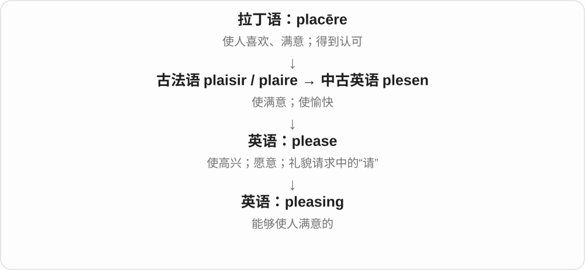

常形容外观、声音、效果；a pleasing result 是令人满意的结果。比 nice 更书面一些。

**常见搭配与例句**

pleasing to the eye；a pleasing result；a pleasing design。

> The room has a pleasing balance of light and colour.

房间的光线和色彩搭配得很舒服。

> It was pleasing to see the team work so well together.

看到团队配合得这么好，令人高兴。

**别混淆**

pleasing 强调带来满意的效果；pleased 强调接收这个效果的人已经感到满意。

### 303. briefing — 情况介绍；任务交代；简报会

**音标**：/ˈbriːfɪŋ/

**先抓住这个画面**

在行动前或情况更新时，把大家需要掌握的重点集中讲清。

**怎么拆**

动词 brief + -ing，形成说明情况这一活动的名词。

**怎么变成今天的意思**

**拉丁语 brevis**  
短的

↓

**法语 bref／brief → 英语 brief**  
短暂、简短；也有简要文书义

↓

**英语 brief 作动词**  
向人交代要点、背景或任务

↓

**brief + -ing → briefing**  
介绍背景、交代任务的活动

a safety briefing 是介绍安全注意事项；a press briefing 是向媒体说明情况。它既能指一场会议，也能指一段介绍，重点是传递必要信息。并非所有 briefing 都很短，也不一定只在任务开始前发生。

**常见搭配与例句**

attend a briefing；a safety briefing；a press briefing；a briefing on the situation。

> Passengers listened to a safety briefing before boarding the boat.

乘客上船前听取了安全事项介绍。

> The director gave a briefing on the project’s progress.

负责人介绍了项目进展。

**别混淆**

meeting 范围宽，可以讨论、谈判；briefing 更突出把信息和要点告诉参与者。

### 304. drying — 干燥、脱水过程；使干的、正在变干的

**音标**：/ˈdraɪɪŋ/

**先抓住这个画面**

水分还在离开物体，是一个进行中的过程；也可说某种东西让皮肤变干。

**怎么拆**

dry + -ing，保留 y，不改成 dr i ing。名词指干燥过程，分词、形容词按动作和作用理解。

**怎么变成今天的意思**

**古英语 drȳġe〔形容词〕、drȳġan〔动词〕→ 中古英语 drye、drien**  
干的；使干、变干

↓

**英语 dry**  
干燥；使干；扩展到不甜、枯燥、冷面幽默等

↓

**dry + -ing → drying**  
干燥过程；正在干、使变干

drying time 干燥时间，a drying rack 晾衣架，a drying effect 使干燥的作用。

**常见搭配与例句**

drying time；a drying rack；the drying process。

> The paint needs more drying time.

油漆还需要更长的干燥时间。

> She hung the shirts on a drying rack.

她把衬衫挂到晾衣架上。

**别混淆**

drying 过程或作用，dried 常是已经干燥的结果；drying fruit 正在脱水的水果、dried fruit 果干。

### 305. dwelling — 住所、住宅；dwell 的现在分词

**音标**：/ˈdwelɪŋ/

**先抓住这个画面**

dwell 是住，dwelling 就是让人住下的地方。它比较中性、书面，能涵盖各种居住建筑，不只独栋房子。

**怎么拆**

dwell + -ing；中古英语已有停留、居所名词，逐步定型为住所。现代也仍可作动词分词。

**怎么变成今天的意思**

**古英语 dwellan 误导、使迷惑；同族有耽搁义**  
早期各日耳曼语言词义发展不同

↓

**中古英语 dwellen 耽搁、停留 → 住下 → dwell**  
现代居住；注意力持续停在某事上

↓

**dwell + -ing → dwelling**  
停留、居住活动 → 居所、住宅

a small dwelling 小住所，human dwellings 人类居所，a dwelling place 居住地。

**常见搭配与例句**

a rural dwelling；a dwelling place。

> A small dwelling stood beside the river.

河边有一处小住宅。

> The map marks the old human dwellings.

地图标出了旧时的人类居所。

**别混淆**

dwelling 强调住人用途；building 建筑物范围更广，仓库、车站也可以是 building。

### 306. preceding — 前面的；紧接在之前的

**音标**：/prɪˈsiːdɪŋ/

**先抓住这个画面**

沿着顺序回头看，指出已经排在前面的那一项。

**怎么拆**

precede 的 -ing 形式；作形容词的用法在中古英语 precedyng 等形式中已经存在。

**怎么变成今天的意思**

**拉丁 cēdere；分词词干 cess-**  
走、离开；让步、让出

↓

**拉丁 prae- + cēdere → praecēdere**  
走在前面、先发生

↓

**中古英语 preceden → precedyng / precedenge**  
在前 → 位于前面的

↓

**英语 preceding**  
前述的、前一个阶段的

the preceding paragraph 是前面的那段；the preceding year 通常是相对于文中时间的上一年，不一定是现在的去年。

**常见搭配与例句**

the preceding chapter；the preceding day；the preceding discussion。

> The answer appears in the preceding paragraph.

答案在前一段中。

> Sales were higher than in the preceding year.

销售额高于前一年。

**别混淆**

previous 可宽泛说以前的；preceding 更强调相对某项的位置和顺序。

### 307. rocking — 摇摆的；摇动；口语也可指音乐很带劲

**音标**：英 /ˈrɒkɪŋ/；美 /ˈrɑːkɪŋ/

**先抓住这个画面**

基本是一来一回地摇，最熟悉的 rocking chair 是能来回摇的椅子。

**怎么拆**

rock 摇动 + -ing，规则动作形式与形容词；音乐语境还能带热烈、很有节奏感的口语评价。

**怎么变成今天的意思**

**另一路古英语 roccian → rock**  
来回摇动

↓

**rock and roll → rock**  
摇动词参与音乐命名 → 摇滚音乐

↓

**rock + -ing → rocking**  
来回摇动的状态、动作

a rocking chair 摇椅，a rocking motion 摇摆动作；rocking the boat 字面摇船，也可比喻扰乱既有局面。

**常见搭配与例句**

a rocking chair；a rocking motion；rocking the boat。

> She sat in a rocking chair by the window.

她坐在窗边的摇椅上。

> The gentle rocking motion made him sleepy.

轻柔摇摆让他困了。

**别混淆**

rocking 摇动，rocky 多石、不稳；rocking chair 不是岩石做的椅子。

### 308. shaping — 塑形、塑造过程；shape 的 -ing 形式

**音标**：/ˈʃeɪpɪŋ/

**先抓住这个画面**

关注轮廓和走向正在怎样被做出来，而不是只看最后成品。

**怎么拆**

shape 去 e + -ing，中古英语已有活动名词 schapynge 等形式。也接影响、决定走向的抽象用法。

**怎么变成今天的意思**

**古英语 ġesceap〔名词〕、scieppan 等〔动词〕→ shape**  
形态、所造之物；塑造、创造

↓

**现代 shape**  
形状、状态；塑造外形、影响发展

↓

**shape + -ing → shaping**  
使成形的过程；影响发展

the shaping of policy 政策形成过程，shaping the future 塑造未来，a shaping tool 塑形工具。

**常见搭配与例句**

the shaping of；shaping the future；a shaping tool。

> The course teaches cutting and shaping wood.

课程教授木材切割和塑形。

> Many groups took part in the shaping of the policy.

许多团体参与了政策的形成。

**别混淆**

shaping 过程，shape 形状或塑造动词；the shaping of the bowl 是做形状的过程，不只是 the shape of the bowl 那个轮廓。

### 309. surfing — 冲浪运动；网上浏览

**音标**：英 /ˈsɜːfɪŋ/；美 /ˈsɜːrfɪŋ/

**先抓住这个画面**

surf 是做动作，surfing 是把整项活动拿出来说。go surfing 多指去冲浪；web surfing 看的是网上浏览。

**怎么拆**

surf + -ing，动作名词、现在分词。物理运动和网络比喻都继承 surf 的相应用法。

**怎么变成今天的意思**

**较早 suff、suffe 等 → surf**  
岸边涌浪、碎浪；更早来源有声音、借词等不同分析

↓

**名词 → 动词**  
在浪上滑行、冲浪

↓

**surf + -ing → surfing**  
冲浪活动；浏览网络的活动

go surfing 去冲浪，learn surfing 学冲浪，web surfing 网上浏览，a surfing lesson 冲浪课。

**常见搭配与例句**

go surfing；a surfing lesson；web surfing。

> They went surfing early in the morning.

他们一大早去冲浪。

> Web surfing took up most of his break.

他休息时大部分时间都在网上浏览。

**别混淆**

surfing 不是冲浪者；人用 surfer，板用 surfboard。上下文无网络对象时，运动义更直观。

### 310. trusting — 信任他人的；容易相信人的

**音标**：/ˈtrʌstɪŋ/

**先抓住这个画面**

把视角放在愿意相信别人的那个人；并不是在评价他自己值不值得信任。

**怎么拆**

trust + -ing，动词进行形式也可成为描述性格、态度的形容词。

**怎么变成今天的意思**

**日耳曼语信心、支持词族 → 中古英语 trust、trost**  
信赖、保护；英语具体传承或北欧借入关系有争论

↓

**现代 trust**  
相信可靠 → 委托责任；另有信托、托拉斯等专门用法

↓

**trust + -ing → trusting**  
相信别人 → 愿意信任他人的

a trusting child 容易相信人的孩子，a trusting relationship 彼此有信任的关系，too trusting 过于轻信。

**常见搭配与例句**

a trusting nature；too trusting；a trusting relationship。

> She has a warm and trusting nature.

她性格温暖，愿意相信别人。

> He worried that he had been too trusting.

他担心自己之前太轻信别人了。

**别混淆**

trusting 相信别人，trustworthy 值得别人相信；一个人可以很轻信，但不一定可靠。

### 311. boulder — 巨石；大圆石

**音标**：英 /ˈbəʊldə/；美 /ˈboʊldər/

**先抓住这个画面**

路边、山坡上一整块大石头，大到很难随手搬动，可以叫 boulder。早期词义常联系被水磨圆的石块，现代也可说形状不规则的巨石。

**怎么拆**

接中古英语 bulder ston 等北欧语相关旧石名的短形。首部有水流绕石的响声、圆物两类分析，更远来源不定；不把它当现代英语的比较级。

**怎么变成今天的意思**

**北欧语相关石名 → 中古英语 bulder ston**  
前部具体来自响声还是圆物有不同分析

↓

**复合石名缩短 → boulder**  
现代指一大块石头，后又形成 bouldering 攀石名称

a large boulder 是一块巨石；a rounded boulder 是大圆石；behind a boulder 是在一块大石头后面。

**常见搭配与例句**

a large boulder；a rounded boulder；behind a boulder。

> A huge boulder stood beside the trail.

小径旁立着一块巨石。

> The river flowed around a rounded boulder.

河水绕过一块大圆石流去。

**别混淆**

pebble 是小圆石，boulder 是大石块；boulder 与 bolder 更大胆的常同音，但一个是石头名词，一个是 bold 的比较级。

### 312. bouldering — 攀石运动；抱石

**音标**：英 /ˈbəʊldərɪŋ/；美 /ˈboʊldərɪŋ/

**先抓住这个画面**

在较低岩石或室内岩面上，攀一条较短的线路，这类运动常叫 bouldering。名字直接让人想到 boulder 那种大石块。

**怎么拆**

boulder + 完整 -ing → bouldering，原词保留。这里 -ing 给相关攀爬活动命名，常用作不可数的运动名称。

**怎么变成今天的意思**

**boulder 大石块 → 相应攀爬活动词**  
从活动的岩石对象取得名称

↓

**boulder + -ing → bouldering**  
现代可在天然岩石或室内岩面进行，成为运动名词

go bouldering 是去攀石；indoor bouldering 是室内攀石；a bouldering wall 是攀石岩壁。运动中常见 problem 指一条待完成的短线路。

**常见搭配与例句**

go bouldering；indoor bouldering；a bouldering wall。

> The sports centre has an indoor bouldering area.

体育中心有一个室内攀石区域。

> She enjoys bouldering at weekends.

她周末喜欢攀石。

**别混淆**

climbing 是更宽的攀爬运动称呼，bouldering 特指其中通常不系绳、线路较短的一类。这里讲运动名称，不把所有攀岩都当成 bouldering。

### 313. rubbing — 擦揉、摩擦；拓印、拓片

**音标**：/ˈrʌbɪŋ/

**先抓住这个画面**

纸盖在有纹路的表面上，拿铅笔等在上面擦，底下凸纹就显出来；于是一次擦动还能得到一张 rubbing。

**怎么拆**

rub 双写 b + -ing。既有普通动作形式，也有由擦印方法命名的拓片名词。

**怎么变成今天的意思**

**中古英语 rubben → rub**  
擦、摩擦；更早具体来路不确定

↓

**英语 rub**  
擦动；摩擦的动作；妨碍、难处等比喻

↓

**rub + -ing → rubbing**  
擦的动作 → 通过擦拓得到的图像

rubbing his eyes 揉眼，make a rubbing 做拓片，a brass rubbing 铜碑、铜板拓印等。

**常见搭配与例句**

make a rubbing；a brass rubbing；rubbing his eyes。

> The children made leaf rubbings with crayons.

孩子们用蜡笔做了叶片拓印。

> She was rubbing her eyes when the phone rang.

电话响时，她正在揉眼睛。

**别混淆**

rubbing 拓印常靠纸上的摩擦显纹，drawing 直接绘画；同一作品看起来像图，不代表制作方式一样。

### 314. winding — 弯曲、蜿蜒的；缠绕；线圈

**音标**：/ˈwaɪndɪŋ/

**先抓住这个画面**

走着走着就转弯，一路不是直线；也能把一圈圈绕成的线叫 winding。

**怎么拆**

取 wind /waɪnd/ 缠绕、曲折行进 + -ing。这里讲常见曲折与卷绕义，不混入风 /wɪnd/ 相关的同形较少见形式。

**怎么变成今天的意思**

**古英语 windan → 中古英语 winden → wind /waɪnd/**  
转动、缠绕、曲折行进

↓

**现代卷绕词族**  
wind—wound—wound；卷起、倒回、展开与放松

↓

**wind + -ing → winding /ˈwaɪndɪŋ/**  
曲折行进、绕卷 → 蜿蜒的；绕组

a winding road 蜿蜒道路，a winding staircase 盘旋楼梯；an electrical winding 可指电气绕组。

**常见搭配与例句**

a winding road；a winding river；a winding staircase。

> A winding road led up to the village.

一条蜿蜒山路通向村庄。

> The electrician inspected the motor winding.

电工检查了电机绕组。

**别混淆**

winding /ˈwaɪndɪŋ/ 弯曲，windy /ˈwɪndi/ 多风；The winding road is windy 两个词都可以出现，但意思不同。

### 315. coping — 应对、应付；墙顶盖石、压顶〔另源〕

**音标**：英 /ˈkəʊpɪŋ/；美 /ˈkoʊpɪŋ/

**先抓住这个画面**

How are you coping 是问你现在应付得怎么样。建筑里的 coping 却像给墙顶披上一层盖子，是压顶，不是墙在应付情绪。

**怎么拆**

应对义是 cope + -ing，去 e；建筑名词由另源 cope 披风、覆盖物发展而来，同样可见 -ing 形式，但意义历史分开。

**怎么变成今天的意思**

**古法语 colper、couper 击打 → 中古英语 coupen**  
交锋、争斗

↓

**交锋 → 应对困难**  
现代 cope，常与 with 连用

↓

**另源名词 cope 披风**  
联系晚期拉丁 cappa；建筑 coping 顶盖、coped 披风义从这条理解

coping skills 应对困难的能力，a coping strategy 应对办法；stone coping 石质墙顶盖层。先看在说人处理困难，还是墙顶结构。

**常见搭配与例句**

coping skills；a coping strategy；stone coping。

> How are you coping with the new schedule?

新日程你应付得怎么样？

> The wall has a sloping stone coping.

墙顶有一层带坡度的石质压顶。

**别混淆**

coping 是过程、方式，不等于问题已解决。建筑压顶义的披盖画面与应对义的交锋来历不同。

### 316. battling — 正在战斗、奋力应对；顽强的

**音标**：/ˈbætlɪŋ/

**先抓住这个画面**

困难还没过去，人还在一点点顶住、往前争取，是一个持续中的画面。

**怎么拆**

battle 去末尾 e + -ing，动词形式也可修饰人、团队的拼搏状态。本页讲战斗词族，不混入另源的古老养肥义。

**怎么变成今天的意思**

**拉丁 battuere〔击打〕→ 晚期拉丁 battualia**  
击打、格斗训练

↓

**法语 bataille、batailler → 英语 battle**  
战斗、交战 → 持续斗争、应对困难

↓

**battle + -ing → battling**  
正在战斗、应对；表现顽强

battling against the wind 与风抗争，a battling team 顽强拼搏的团队。具体困难要看后面的对象。

**常见搭配与例句**

battling against；battling to do；a battling performance。

> They were still battling to keep the project on schedule.

他们仍在努力让项目按进度进行。

> The team earned a draw with a battling performance.

球队凭顽强表现取得平局。

**别混淆**

battling 强调还在进行、奋力应对，不等于已经 won 获胜；它有时也只是普通进行时的一部分。

### 317. chilling — 令人发冷、惊惧的；冷却、使冷却

**音标**：/ˈtʃɪlɪŋ/

**先抓住这个画面**

镜头对准造成寒意的东西：一段证词可怕得让人发凉，就是 chilling；工艺里也可单纯说冷却。

**怎么拆**

chill + -ing，既有分词、冷却过程名词，也常形成引发恐惧的形容词。并非 -ing 总对应正在发生。

**怎么变成今天的意思**

**古英语 ċiele/ċele、ċilian → chill**  
寒冷、变冷；名词与动词各有旧形式

↓

**身体与情绪比喻**  
发冷、害怕、关系冷淡；口语再有冷静、放松

↓

**性质、结果与工具**  
chilly / chilling / chilled / chiller

↓

**chill + -ing → chilling**  
引发冷或恐惧；冷却的动作、过程

a chilling account 令人惊惧的叙述，a chilling warning 令人胆寒的警告，a chilling effect 令人不敢行动、表达的抑制影响，chilling equipment 冷却设备。

**常见搭配与例句**

a chilling account；a chilling warning；a chilling effect。

> The witness gave a chilling account of the night.

目击者讲述了那晚令人胆寒的经历。

> The threats had a chilling effect on public discussion.

威胁让人不敢公开讨论。

**别混淆**

chilling 令人发冷、害怕，chilled 则是冷却后或受寒意影响；chilling effect 不是所有场合都在说降温机器。

### 318. sew — 缝、缝制、缝补

**音标**：英 /səʊ/；美 /soʊ/

**先抓住这个画面**

针带着线反复穿过布，把两片接起来，或把破口补上。这个很具体的动作就是 sew。

**怎么拆**

经中古英语 sewen、sowen 等接古英语 siwian、seowian，属于古老的缝合词族。与 seam 缝、接缝有历史联系。

**怎么变成今天的意思**

**古英语 siwian 等 → 中古英语 sewen**  
用线缝、接合

↓

**现代 sew**  
缝制、缝补；过去式 sewed，过去分词 sewn 或 sewed

sew a dress 缝一条裙子；sew on a button 缝上纽扣；sew up a tear 把破口缝好。拼写 sew 的发音像 sow 播种。

**常见搭配与例句**

sew by hand；sew two pieces together。

> Could you sew this button back on?

你能把这颗纽扣重新缝上吗？

> She sewed the two pieces of fabric together.

她把两片布缝在了一起。

**别混淆**

sew 缝制，sow 播种，常同音但意思不同。sewn 是 sew 的常用过去分词，不能只看到 w 就按 new 的读音类推。

### 319. sewing — 缝纫；针线活；正在缝的东西；sew 的 -ing 形式

**音标**：英 /ˈsəʊɪŋ/；美 /ˈsoʊɪŋ/

**先抓住这个画面**

把一针一线这项活动当作一个技能、爱好，就是 sewing；篮子里没做完的针线活也能叫 her sewing。

**怎么拆**

sew + -ing，较早中古英语已有相应动作名词。现代保留活动名、所做针线活和动词形式等用法。

**怎么变成今天的意思**

**sew 缝 + -ing**  
缝纫这个活动

↓

**sewing 的名词扩展**  
缝纫技能、针线活；待缝、正在缝的东西

a sewing machine 缝纫机；a sewing class 缝纫课；do some sewing 做些针线活。sewing 作活动名时通常不可数。

**常见搭配与例句**

sewing skills；a sewing needle。

> She learned sewing from her grandmother.

她跟祖母学会了缝纫。

> I keep my sewing in this basket.

我把针线活放在这个篮子里。

**别混淆**

sewing 可以是名词，不只表示正在。a sewing machine 是用于缝纫的机器，不必理解为这台机器此刻正在工作。

### 320. decreasing — 逐渐减少的；正在下降的

**音标**：/dɪˈkriːsɪŋ/

**先抓住这个画面**

看见一串数据越排越小，或某种情况正一点点减弱，就能用这个词描述趋势。

**怎么拆**

decrease 去末尾 e 加 -ing；英语分词转作形容词。

**怎么变成今天的意思**

**拉丁 crescere**  
生长、增加

↓

**拉丁 de- + crescere → decrescere**  
向下、离去 + 生长 → 减少

↓

**古法语 descroistre、盎格鲁法语 decreistre／名词 decres**  
减少／减少这一过程

↓

**中古英语 decresen、decres → decrease**  
动词、名词的平行借入

↓

**英语 decrease + -ing → decreasing**  
减少 → 正在减少的

in decreasing order 是按从大到小的顺序。decreasing demand 强调需求正在走低，不只是需求本来就少。数学文本若要排除持平，常明确说 strictly decreasing。

**常见搭配与例句**

decreasing demand；in decreasing order；a decreasing number of…。

> List the values in decreasing order.

把这些数值按从大到小的顺序列出。

> The school has a decreasing number of pupils.

这所学校的学生人数正在减少。

**别混淆**

low 描述水平低；decreasing 描述方向向下。一个很高的数字也可能正在 decreasing。

### 321. flashing — 闪烁、闪动；闪烁的；泛水材料、屋面防水收边

**音标**：/ˈflæʃɪŋ/

**先抓住这个画面**

灯的 flashing 是一闪一闪；屋顶接缝的 flashing 却是一条把水挡开、导开的材料，两个场景不要靠同一个中文硬套。

**怎么拆**

闪动义是 flash + -ing 的动作或分词形式；建筑泛水材料义很早也见 flash，和闪光的确切关系未定，不把“金属反光所以得名”说成定论。

**怎么变成今天的意思**

**中古英语 flashen、flasken 等**  
喷溅、突然涌动等旧用法；有拟声、北欧相关分析

↓

**英语 flash 的突发、闪现用法**  
光一闪；消息、想法突然出现

↓

**flash + -ing → flashing〔闪动〕**  
正在闪、闪烁这件事

↓

**建筑 flash、flashing 的专门用法**  
屋面等接缝防水材料；与光义连接未定

a flashing light 闪灯，flashing around a chimney 烟囱周边泛水收边，damaged flashing 损坏的防水收边。材料不只凭“有没有反光”来判断。

**常见搭配与例句**

a flashing light；metal flashing；flashing around a chimney。

> A flashing light drew our attention to the exit.

一盏闪灯把我们的注意力引向出口。

> The roofer replaced the damaged flashing around the chimney.

屋面工更换了烟囱周围损坏的防水收边。

**别混淆**

flashing lights 闪光的灯，roof flashing 建筑材料；-ing 外形相同不保证每个专业名词都能直接按正在闪来翻。

### 322. speeding — 快速行进；超速驾驶

**音标**：/ˈspiːdɪŋ/

**先抓住这个画面**

作为描述可以是车飞快掠过；作为交通名词，通常就是超过规定速度开车。

**怎么拆**

speed + -ing，动词活动名词化，也可作进行时或修饰语。交通违法义是现代车辆语境里的固定用法。

**怎么变成今天的意思**

**古英语 spēd、spēdan**  
成功、顺利进展；使成功、前进

↓

**中古英语 sped → speed**  
较早出现快速义 → 速度、加快、超速

↓

**speed + -ing → speeding**  
快速移动；特指超速驾驶行为

a speeding car 疾驰的车，a speeding ticket 超速罚单，be stopped for speeding 因超速被拦下。

**常见搭配与例句**

a speeding car；a speeding ticket；be caught speeding。

> The police stopped the driver for speeding.

警方因超速拦下了司机。

> A speeding train passed the platform.

一列疾驰的火车经过站台。

**别混淆**

speeding ticket 指超速相关处罚文书，不是快递车票；speeding up 加快与超速驾驶要按完整搭配分。

### 323. tying — 系、绑、连接；正在系、打平

**音标**：/ˈtaɪɪŋ/

**先抓住这个画面**

正在把结打好或把两件事连起来。看到 tying，认回 tie，不要误以为另有一个动词 ty。

**怎么拆**

tie 加 -ing 时，ie 改 y，形成 tying；相应动作名词也有古英语、中古英语旧形式。die → dying 也可帮助记这个拼写变化。

**怎么变成今天的意思**

**古英语 tēag、tēah → 中古英语 teye 等 → tie〔名词〕**  
绳、系带 → 连结物、关系、领带等

↓

**古英语 tīġan 等 → 中古英语 teien 等 → tie〔动词〕**  
绑、连接 → 系结；比赛打平

↓

**tie + -ing → tying〔ie 变 y〕**  
正在系结、连接；相应动作名词

tying a knot 打结，tying shoelaces 系鞋带，tying ideas together 把想法串起来。

**常见搭配与例句**

tying a knot；tying shoelaces；tying ideas together。

> He was tying his shoelaces when the phone rang.

电话响时，他正在系鞋带。

> The final paragraph is useful for tying the ideas together.

最后一段有助于把这些想法串起来。

**别混淆**

tying 是 tie 的 -ing，tiring 是 tire 使疲倦、变累的 -ing；两者差一个 r，读音意义都不同。

### 324. bathe — 洗澡、给……洗澡；浸洗；游泳、海水浴；使沐浴在光等之中

**音标**：/beɪð/

**先抓住这个画面**

让身体或某个部位进入水里、用水洗，后来也能把光线充满房间说成沐浴其中。

**怎么拆**

经中古英语 bathen 接古英语 bathian、baþian，属于 bath 洗浴、浴水的日耳曼词族。现代 bathe 与 bath 拼写、读音、使用习惯不同。

**怎么变成今天的意思**

**古英语 baþian → 中古英语 bathen**  
浸洗、洗浴

↓

**现代 bathe 的具体与比喻用法**  
洗澡、游泳、浸洗；被光等包围

bathe the baby 给婴儿洗澡；bathe a wound 清洗伤口；bathe in the sea 在海里游泳、海水浴〔英式等〕；be bathed in sunlight 沐浴在阳光中。

**常见搭配与例句**

bathe in warm water；a room bathed in light。

> She bathed the baby before bedtime.

她睡前给婴儿洗了澡。

> The room was bathed in warm afternoon light.

房间沐浴在温暖的午后光线中。

**别混淆**

bath 名词常读英 /bɑːθ/、美 /bæθ/；bathe 读 /beɪð/。日常 take a bath、have a bath 更直接说洗澡，bathe 的搭配随地区、场景变化。

### 325. bathing — 洗澡、沐浴；游泳、海水浴；bathe 的 -ing 形式

**音标**：/ˈbeɪðɪŋ/

**先抓住这个画面**

看海边标牌 No bathing，这里往往是禁止下水游泳，不是禁止在家洗澡。场景帮助你给浴这个字选对意思。

**怎么拆**

bathe 去末尾 e 加 -ing，形成活动名和分词；中古英语已有相应 bathynge 等形式。本页先讲 bathe 这一读音、词族的常见用法。

**怎么变成今天的意思**

**bathe + -ing**  
浸洗、入水的活动形式

↓

**bathing 的不同场景**  
洗澡；在海、湖等处游泳、海水浴

a bathing suit 泳衣；sea bathing 海水浴；bathing the baby 给婴儿洗澡。名词、动词形式需要结合搭配和地点。

**常见搭配与例句**

a bathing area；bathing in the sea。

> The sign by the lake said “No bathing”.

湖边标牌写着“禁止游泳”。

> He bought a new bathing suit for the holiday.

他为度假买了一件新泳衣。

**别混淆**

bathing 不一律是浴室内洗澡。bathing suit 是泳衣这一固定搭配；在日常美式里也常说 swimsuit。

### 326. rant — 激烈地长篇抱怨、咆哮；一通激烈言论

**音标**：英 /rænt/，部分英音 /rɑːnt/；美 /rænt/

**先抓住这个画面**

本来只要说个不满，却越说越大声、越说越长，旁人很难插话。rant 常带说话者情绪很冲、言辞过头的评价。

**怎么拆**

借自荷兰语 randten、ranten 等胡乱高谈、狂言词，英语早期也有喧闹欢乐等义；更早来源不明。现代主要落在高声、激烈地说一大通。

**怎么变成今天的意思**

**荷兰语 randten／ranten → 英语 rant**  
胡乱高谈、喧闹；来源更早不定

↓

**现代 rant 动词、名词**  
激烈长篇抱怨；一通情绪化言论

rant about the service 对服务大发牢骚；rant at someone 冲某人咆哮；go on a rant 大发一通议论；rant and rave 大喊大叫、暴跳如雷。

**常见搭配与例句**

a long rant；rant on about something。

> He went on a long rant about the delayed train.

他对列车延误大发了一通牢骚。

> She ranted about the poor service for several minutes.

她激烈地抱怨了几分钟服务太差。

**别混淆**

complain 可是平静地提出不满；rant 把声量、情绪或言辞过火突出出来。把别人的话叫 a rant，本身常带批评。

### 327. ranting — 激烈咆哮、长篇抱怨；rant 的 -ing 形式

**音标**：/ˈræntɪŋ/，也有 /ˈrɑːntɪŋ/ 等读法

**先抓住这个画面**

话一大串地冲出来，夹着怒气、夸张或指责。ranting 让人想到正在喋喋不休地发火，而不是从容陈述。

**怎么拆**

rant + -ing，接从荷兰语借入的喧闹、激烈高谈词。可作进行结构中的分词，也作动作名词或名词前的描述。

**怎么变成今天的意思**

**rant**  
激烈地说、抱怨；早期有喧闹词义

↓

**rant + -ing → ranting**  
咆哮、激烈抱怨这一动作

was ranting about the bill 正在对账单大发牢骚；stop ranting 别再咆哮；a ranting speaker 激烈叫嚷的发言者。

**常见搭配与例句**

ranting and raving；listen to someone’s ranting。

> He was ranting about the price of the repair.

他正在对维修价格大发牢骚。

> The recording captured several minutes of angry ranting.

录音录下了几分钟愤怒的咆哮。

**别混淆**

ranting 在评价别人讲话时通常不中性；reporting 只是报告，arguing 是争辩，两者不自动有 ranting 的过火感。

### 328. rants — 激烈地说一大通〔第三人称单数〕；几通激烈抱怨〔复数〕

**音标**：英 /rænts/，部分英音 /rɑːnts/；美 /rænts/

**先抓住这个画面**

话带着火气，一大串涌出来，是 rants 的动作；几次这种长篇发作，也能数成 rants。

**怎么拆**

rant + -s，/t/ 后读 /s/。基础词借荷兰语高谈、喧闹材料，更早来源不明，现代名动词各自接规则词尾。

**怎么变成今天的意思**

**荷兰语 randten、ranten 等 → 英语 rant**  
高谈、喧闹 → 激烈地说一大通

↓

**rant + -s → rants**  
他、她长篇激烈说；几通抱怨

rants about the traffic 是为交通大声抱怨一通；online rants 是网上的几通激烈言论。

**常见搭配与例句**

rants at the staff 向工作人员大发牢骚；angry rants 愤怒的长篇抱怨。

> He rants about the traffic every morning.

他每天早上都为交通大发牢骚。

> I stopped reading his angry rants online.

我不再读他在网上那些愤怒的长篇抱怨。

**别混淆**

rants 常突出说得激动、冗长，argues 可是有条理地论证；不把所有争辩都当成 rant。

### 329. ranted — 激烈地说了一大通；大声抱怨了

**音标**：英 /ˈræntɪd/，部分英音 /ˈrɑːntɪd/；美 /ˈræntɪd/

**先抓住这个画面**

刚才气冲冲讲了半天、停不下来，叫 ranted。它说的常是那种带情绪的长篇说法。

**怎么拆**

rant + 完整 -ed，/t/ 后读 /ɪd/。词末 nt 已是辅音组合，不双写 t。

**怎么变成今天的意思**

**荷兰语高谈、喧闹相关材料 → 英语 rant**  
早期高谈、喧闹，后来常是激烈长篇言论

↓

**rant + -ed → ranted**  
过去激烈说了一大通

ranted about the delay 是为延误大发牢骚；ranted at someone 是向某人发作。

**常见搭配与例句**

ranted for ten minutes 激烈说了十分钟；ranted about the cost 为费用大发牢骚。

> He ranted for ten minutes about the cancelled meeting.

他为取消的会议气冲冲抱怨了十分钟。

> She ranted at the screen when the connection failed again.

连接又断了，她冲着屏幕大发牢骚。

**别混淆**

ranted 表现说话的情绪、方式；explained 说把原因说明白，不规定一定带长篇火气。

### 330. frighten — 使害怕；吓到

**音标**：/ˈfraɪtən/

**先抓住这个画面**

fright 是害怕这份感觉，frighten 是让这份感觉在别人心里出现。

**怎么拆**

fright + -en → frighten，-en 构成使进入状态的动词；t 通常保留，gh 不发音。

**怎么变成今天的意思**

**古英语 fryhtu、fyrhto 等 → fright**  
惊惧、害怕的日耳曼语名词

↓

**fright + -en → frighten**  
使产生惊惧

frighten someone 吓到某人；frighten someone away 吓走；frighten easily 很容易受惊，依主语解释。

**常见搭配与例句**

frighten someone；frighten someone away。

> The loud music frightened the cat.

响亮的音乐吓到了猫。

> The warning was intended to inform people, not frighten them.

这则提醒是为了告知情况，而不是吓人。

**别混淆**

frighten 讲引起害怕，frightened 是承受后的害怕状态，frightening 是令人害怕的性质。

### 331. frightening — 令人害怕的；frighten 的 -ing 形式

**音标**：/ˈfraɪtənɪŋ/

**先抓住这个画面**

声音、经历或想象让人心里一紧，它本身就可以叫 frightening。说的是引起害怕的那个东西。

**怎么拆**

frighten 使害怕 + -ing，形成分词和形容词；frighten 又接 fright 恐惧及动词化材料。

**怎么变成今天的意思**

**fright → frighten**  
恐惧 → 使害怕

↓

**frighten + -ing → frightening**  
正在使人害怕；具有这种效果的

a frightening experience 可怕经历；a frightening noise 吓人的声响；find something frightening 觉得某事可怕。

**常见搭配与例句**

a frightening thought；frighteningly close。

> The sudden noise was frightening.

突如其来的声响很吓人。

> Getting lost in the dark was a frightening experience.

在黑暗中迷路是一次可怕的经历。

**别混淆**

frightened 常说人感到害怕，frightening 常说事物令人害怕。The child is frightened 与 The noise is frightening 主角不同。

### 332. smashing — 极好的、出色的〔口语，常带英式或略旧语气〕；打碎的过程

**音标**：/ˈsmæʃɪŋ/

**先抓住这个画面**

We had a smashing time 往往是在说玩得真好，而不是大家都去打碎东西。它把有力量、效果强的感觉借来表达赞赏。

**怎么拆**

smash + -ing，既能是动作形式、过程名词，也形成极好的固定形容词。赞扬义联系强烈成功、效果的用法，不把近似发音的盖尔语句子当已证实来源。

**怎么变成今天的意思**

**英语 smash，具体远源不确定，可能拟声**  
强烈撞击、打碎的动作与声音

↓

**强烈效果的比喻**  
压倒性击败；巨大成功，smash hit

↓

**smash + -ing → smashing**  
打碎、猛击的动作形式

↓

**赞扬性固定用法**  
令人赞叹、极好的

a smashing idea 极好的点子，a smashing time 非常愉快的时光，the smashing of glass 打碎玻璃的过程。

**常见搭配与例句**

a smashing idea；a smashing time；the smashing of glass。

> We had a smashing time at the reunion.

我们在重聚活动上过得非常愉快。

> “That’s a smashing idea,” she said.

“这点子真棒。”她说。

**别混淆**

smashing 不总等于破坏性的；名词动作看上下文，形容词赞扬常可换 great、excellent。俚语 smashed 醉了也不能直接套到 smashing。

### 333. sweating — 出汗、流汗；sweat 的 -ing 形式

**音标**：/ˈswetɪŋ/

**先抓住这个画面**

身体汗水冒出来是一支；紧张到像在冒汗、为难题忙得焦头烂额，也会用 sweating 描述压力。

**怎么拆**

sweat + -ing，已有中古英语相应动作名。sweat 末尾不双写 t，sweating 不读 sweet 甜的元音 /iː/。

**怎么变成今天的意思**

**古英语 swāt/swǣtan 等 → sweat**  
汗、出汗

↓

**sweat + -ing → sweating**  
出汗过程、正在出汗；压力比喻

start sweating 开始出汗，heavy sweating 大量出汗，sweating over a deadline 为期限焦头烂额，no sweating required 不必费大劲〔语境用法〕。

**常见搭配与例句**

start sweating；heavy sweating；sweating over。

> He was sweating after carrying the boxes upstairs.

把箱子搬上楼后，他出汗了。

> The team was sweating over the deadline.

团队正为截止日期忙得焦头烂额。

**别混淆**

sweating 普通现象名或动词形式，不等于已确定病因；sweater 衣服名与 sweating 动作分开。

### 334. acknowledging — 承认、确认；表示注意、认出对方的

**音标**：英 /əkˈnɒlɪdʒɪŋ/；美 /əkˈnɑːlɪdʒɪŋ/

**先抓住这个画面**

别人走进来，你点头示意看见了；讨论中，你承认自己原来忽略的问题，都是 acknowledging 的不同画面。

**怎么拆**

acknowledge + -ing，去末尾 e。可作动词形式，也能修饰 nod、smile 等，表示那个动作传达了认出、回应或承认。

**怎么变成今天的意思**

**英语 acknowledge**  
承认事实；确认收到；对人或贡献表示认可

↓

**acknowledge + -ing → acknowledging**  
承认、确认的动作；表示认出、回应的性质

acknowledging a mistake 承认错误，acknowledging receipt 确认收悉，an acknowledging nod 表示认出、回应的点头。具体意思由承认或回应的对象决定。

**常见搭配与例句**

acknowledging a mistake；acknowledging receipt；an acknowledging nod。

> She gave him an acknowledging nod as he entered.

他进来时，她点头示意看见了。

> Acknowledging the mistake was the first step towards fixing it.

承认错误是纠正它的第一步。

**别混淆**

acknowledging receipt 只确认收到了，不必同意内容；点头 acknowledging someone 也不等于承诺接受对方全部要求。

### 335. buzzing — 嗡嗡声；嗡响、忙碌热闹的；兴奋的〔口语〕

**音标**：/ˈbʌzɪŋ/

**先抓住这个画面**

手机在桌上嗡嗡振动，现场热闹得像一窝蜂，或者人刚经历好事还兴奋着，都可能用 buzzing。

**怎么拆**

buzz + -ing。分词可描述正在嗡响、活跃，也形成声音名词和兴奋的口语形容词。

**怎么变成今天的意思**

**拟声来源，中古英语已有相关形式**  
嗡嗡声，像蜂、机器的连续低响

↓

**群体谈话与兴奋的比喻**  
热议、活跃气氛；兴奋感

↓

**buzz + -ing → buzzing**  
嗡响的声音、状态；兴奋活跃

a buzzing sound 嗡嗡声，buzzing with activity 忙碌热闹，I’m still buzzing. 我还兴奋着呢。

**常见搭配与例句**

a buzzing sound；buzzing with activity；still buzzing。

> A buzzing sound came from the light.

灯那里传来嗡嗡声。

> She was still buzzing after the performance.

演出结束后，她还兴奋着。

**别混淆**

buzzing phone 通常是声响、振动，buzzing fans 可以是兴奋状态。不要见 -ing 就全译成正在叫。

### 336. spying — 间谍活动、暗中搜集信息；正在窥探

**音标**：/ˈspaɪɪŋ/

**先抓住这个画面**

spy 可以说人或动作，spying 则把暗中观察、搜集信息当作正在发生的事或整个行为来谈。

**怎么拆**

spy + -ing，接中古英语 spyinge 等旧形式。y 在这里保留；不是每次见 -ing 都必须翻成正在。

**怎么变成今天的意思**

**法兰克语等日耳曼语的观察相关形式 → 古法语 espier**  
观察、窥探

↓

**中古英语 espien／spien → spy**  
窥探、暗中搜集信息；也可说看到、发现

↓

**spy + -ing → spying**  
暗中搜集信息这一行为；进行中的动作

accused of spying 被指控从事间谍活动，spying on a rival 暗中监视对手，a history of spying 间谍活动史。

**常见搭配与例句**

accused of spying；spying on；a history of spying。

> The documentary explores the history of spying.

纪录片探讨了间谍活动的历史。

> The character discovers that someone has been spying on him.

这个角色发现有人一直在暗中监视他。

**别混淆**

spying 可是名词，spying on someone 也可处于动词结构。public observation 公开观察不因看了别人就自动是 spying。

### 337. tasting — 品尝；品鉴活动；正在尝、尝起来〔分词〕

**音标**：/ˈteɪstɪŋ/

**先抓住这个画面**

把几种食物、饮料逐一试尝比较，这次活动就叫 a tasting；普通句子里也可只是尝这个动作。

**怎么拆**

taste 去 e 加 -ing，动作名词和分词用法；中古英语已有 tastynge 等形式。

**怎么变成今天的意思**

**法语 taster〔触摸、尝试、品尝等〕→ 中古英语 tasten → taste**  
通过接触、试尝来感知；更早拉丁语形式的具体发展有不同分析

↓

**英语 taste**  
品尝、味道、味觉；少量体验；喜好、审美判断

↓

**taste + -ing → tasting**  
品尝活动；尝的动作或相关性质

a wine tasting 葡萄酒品鉴，a tasting menu 小份多道品尝菜单，a tasting session 试吃活动。

**常见搭配与例句**

a wine tasting；a tasting menu；a tasting session。

> The shop is holding a cheese tasting this afternoon.

店里今天下午举办奶酪品尝活动。

> We chose the restaurant’s tasting menu.

我们选了餐厅的小份多道品尝菜单。

**别混淆**

tasting 活动，taste 味道、品味等基础概念；a tasting menu 通常安排多道小份体验，不是把菜单纸拿来尝。

### 338. stalk — 茎、梗；悄悄接近；跟踪、纠缠；大步走

**音标**：英 /stɔːk/；美 /stɔːk/ 或 /stɑːk/

**先抓住这个画面**

植物上支撑叶、花的一根茎可叫 stalk；动词则常让人想到悄悄靠近或不断跟随。两类用法分别记来源。

**怎么拆**

植物名词经中古英语 stalke 等，接日耳曼支撑、茎的词族；跟踪动词经中古英语 stalken 接旧英语悄悄移动材料，更远分析有分歧。不硬画成植物茎直接变成跟踪。

**怎么变成今天的意思**

**名词 stalk 的茎、支撑材料；动词 stalk 的移动材料**  
两条来源分析分别保留

↓

**现代不同词义并存**  
茎梗；悄悄接近、持续跟踪；大步走

a celery stalk 一根芹菜梗；a cat stalking a bird 悄悄靠近鸟的猫；stalk out of the room 大步走出房间。对人的持续跟踪、纠缠常带负面含义。

**常见搭配与例句**

flower stalks；stalk a target；stalk away。

> She cut a stalk of celery into small pieces.

她把一根芹菜梗切成了小段。

> The cat stalked a bird through the grass.

猫穿过草丛悄悄靠近一只鸟。

**别混淆**

植物 stem、stalk 有具体搭配习惯；动词 stalk 比普通 follow 更突出隐蔽、持续或令人不安的跟随。不同词义不能只靠一个动作画面全包。

### 339. stalking — 跟踪、尾随、纠缠；潜行跟进；stalk 的 -ing 形式

**音标**：英 /ˈstɔːkɪŋ/；美 /ˈstɔːkɪŋ/ 或 /ˈstɑːkɪŋ/

**先抓住这个画面**

把持续跟随、反复纠缠这件事当作一个行为来谈。也可在狩猎、动物活动中说隐蔽地接近。

**怎么拆**

动词 stalk + -ing；英语较早已有相应潜行动作名词。现代针对人的持续跟踪用法又发展出特定社会语境。

**怎么变成今天的意思**

**stalk 的潜行、跟进动词词族**  
悄悄移动、接近

↓

**stalk + -ing → stalking**  
潜行行为；持续跟踪、纠缠

report stalking 反映、举报跟踪纠缠；stalking behaviour 跟踪行为。也可说 a cat stalking prey 猫潜行接近猎物，此时是动词分词结构。

**常见搭配与例句**

persistent stalking；online stalking。

> The article discusses the impact of stalking on victims.

文章讨论了跟踪纠缠对受害者的影响。

> We watched a cat stalking its prey.

我们看见一只猫正在悄悄接近猎物。

**别混淆**

stalking 对人的用法常是持续、非自愿的纠缠，不等同于普通社交平台 follow 关注。动物狩猎语境的评价又不同。

### 340. chewing — 咀嚼；chew 的现在分词；供咀嚼用的

**音标**：/ˈtʃuːɪŋ/

**先抓住这个画面**

chew 的反复咬磨正在发生，是 chewing；chewing gum 则让 -ing 说明这种胶是给人嚼的。

**怎么拆**

chew + -ing，不双写 w。旧英语已有相应动作名；现代也作分词、用途修饰。

**怎么变成今天的意思**

**古英语 ceowan → 中古英语 chewen → chew**  
反复用牙齿压碎、咀嚼

↓

**chew + -ing → chewing**  
咀嚼活动；按咀嚼用途修饰

chewing gum 口香糖，the sound of chewing 咀嚼声，chewing movements 咀嚼动作。

**常见搭配与例句**

chewing gum；chewing movements。

> He was chewing a piece of gum.

他正在嚼一片口香糖。

> The recording picked up the sound of chewing.

录音录下了咀嚼声。

**别混淆**

chewing gum 里 gum 是供咀嚼的物，不是胶自己在咀嚼；-ing 与后项的关系按用途理解。

### 341. chanting — 吟诵；有节奏的呼喊

**音标**：英 /ˈtʃɑːntɪŋ/；美 /ˈtʃæntɪŋ/

**先抓住这个画面**

关注持续传来的念诵声或一群人整齐重复的话。

**怎么拆**

chant + -ing；既可作动名词，也可出现在进行时里。

**怎么变成今天的意思**

**拉丁语 canere，词典形 cano**  
唱、吟诵

↓

**拉丁语 cantare**  
反复唱；后来成为普通的“唱”

↓

**古法语 chanter → 中古英语 chaunten → chant〔动词〕**  
唱、吟诵

↓

**英语 chant〔名词〕，也受法语 chant 影响**  
吟唱声、反复喊的词句

↓

**英语 chant + -ing → chanting**  
吟唱、反复喊 → 进行中的声音或活动

the chanting grew louder 是呼喊声越来越响；a chanting crowd 是正在喊口号的人群。它不自动说明人群是庆祝还是抗议。

**常见搭配与例句**

rhythmic chanting；the sound of chanting；a chanting crowd。

> We could hear chanting from the courtyard.

我们能听见庭院里传来的吟诵声。

> The chanting stopped when the announcer began to speak.

播音员开始讲话时，齐声呼喊停了下来。

**别混淆**

a chant 可以是一段具体口号或曲调；chanting 常指持续的行为或声音。

### 342. trending — 正在成为热门的、热议中的；呈某种趋势的

**音标**：/ˈtrendɪŋ/

**先抓住这个画面**

大家这会儿正往这个话题聚，讨论度往上走；网上热榜常用它，不是表示这个话题永远最重要。

**怎么拆**

trend + -ing，由正在发展、形成趋势的分词用法扩展到热门话题形容词。

**怎么变成今天的意思**

**古英语 trendan → 中古英语 trenden**  
转、滚动等旧动作

↓

**英语方向、走势用法 → trend**  
河道等朝某方向延伸，再借到事情发展倾向

↓

**trend + -ing → trending**  
正在呈趋势；网络上正热议

a trending topic 热议话题，trending searches 热门搜索，trending upward 呈上升趋势。

**常见搭配与例句**

a trending topic；trending searches；trending upward。

> The interview became a trending topic overnight.

这段采访一夜之间成了热议话题。

> Searches for the song are trending upward.

这首歌的搜索量呈上升趋势。

**别混淆**

trending 说此刻走热，trendy 说符合时髦风尚；一个 trending 灾害话题不该因此翻成时髦灾害。

### 343. exhausting — 令人精疲力竭的；消耗大的

**音标**：/ɪɡˈzɔːstɪŋ/

**先抓住这个画面**

这件事像不断从人身上抽走精力，做完很难再动。

**怎么拆**

exhaust + -ing；分词形容词强调造成耗竭的事物或活动。

**怎么变成今天的意思**

**拉丁 haurire → ex- + haurire → exhaurire**  
汲取水 → 抽尽、耗尽

↓

**拉丁过去分词 exhaustus**  
已抽空、已用尽

↓

**英语 exhaust**  
抽尽、耗尽；也使人精疲力竭

↓

**英语 exhaust + -ing → exhausting**  
使精疲力竭 → 令人疲惫的

an exhausting day 是让人累坏的一天；emotionally exhausting 是精神情绪上耗费巨大。活动不必有很多体力劳动。

**常见搭配与例句**

an exhausting journey；emotionally exhausting；find something exhausting。

> Moving house was more exhausting than we expected.

搬家比我们预想的更累人。

> The constant arguments became emotionally exhausting.

持续不断的争吵让人在情绪上疲惫不堪。

**别混淆**

exhausting 说让人累；exhaustive 说检查、说明等无遗漏，不是更高级的累。

### 344. abide — 忍受；遵守〔常见于 abide by〕；居留、持续〔较旧用法〕

**音标**：/əˈbaɪd/

**先抓住这个画面**

最常见的两处：I can’t abide it 是我受不了；abide by the rules 是遵守规则。旧的停留、保持材料在不同搭配中保留下来。

**怎么拆**

经中古英语 abiden 接古英语 abidan 等等待、停留、忍耐词族，与 bide 相连。现代主要保留固定搭配与较书面用法。

**怎么变成今天的意思**

**古英语、中古英语的等待、停留材料**  
留下、坚持承受

↓

**现代 abide 的固定用法**  
忍受；遵守、依照；较旧的居留、持续

can’t abide rudeness 无法忍受无礼；abide by an agreement 遵守协议。abide by 中 by 属于固定搭配，后接所遵守的规则、约定。

**常见搭配与例句**

abide by the rules；cannot abide something。

> Everyone must abide by the rules of the game.

每个人都必须遵守比赛规则。

> I can’t abide that constant noise.

我受不了那种不停的噪声。

**别混淆**

abide by 是遵守，can’t abide 是无法忍受。看到 by 和句子的否定形式，往往就能判断常见分支。

### 345. abiding — 持久的、长存的；abide 的 -ing 形式

**音标**：/əˈbaɪdɪŋ/

**先抓住这个画面**

兴趣、信念、感情过了很久仍在那里，没有轻易消失。abiding 常把 abide 旧的停留、持续感保留下来。

**怎么拆**

abide 去末尾 e 加 -ing；由继续停留、存在的动词用法形成持久的分词形容词。

**怎么变成今天的意思**

**abide 的停留、持续分支**  
保持存在、不离开

↓

**abide + -ing → abiding**  
持续的；长久不变的

an abiding interest 持久兴趣；abiding love 长久的爱；an abiding memory 长存的记忆。语体往往较书面。

**常见搭配与例句**

an abiding belief；a deep and abiding interest。

> She has an abiding interest in astronomy.

她一直对天文学抱有浓厚兴趣。

> The trip left him with an abiding love of the sea.

那次旅行让他从此长久地热爱大海。

**别混淆**

abide by 是遵守，但 an abiding interest 不表示遵守兴趣；这里取持续存在的历史分支。

### 346. transporting — 运送；transport 的现在分词或动名词

**音标**：英 /trænsˈpɔːtɪŋ/；美 /trænsˈpɔːrtɪŋ/

**先抓住这个画面**

transporting 把镜头放在“正在把东西从一处送到另一处”这个动作上，也能把整个动作作为话题。

**怎么拆**

transport + -ing，是英语动词的常规变化。

**怎么变成今天的意思**

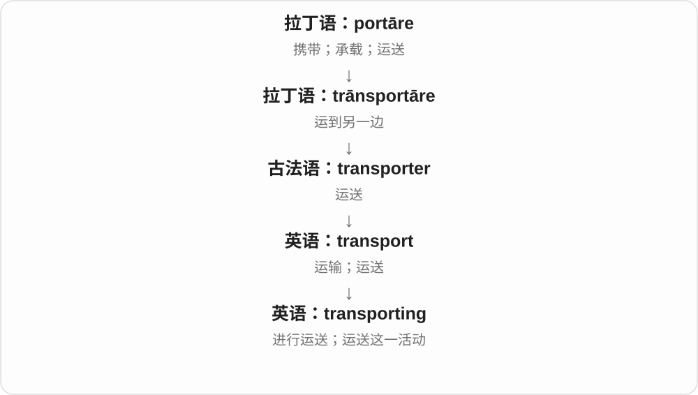

They are transporting… 说正在运送；Transporting goods is costly 把运货这件事放到主语位置。它不是一个与 transport 无关的新词根。

**常见搭配与例句**

transporting goods（运输货物）；the cost of transporting…（运送……的成本）。

> They are transporting the equipment by rail.

他们正在通过铁路运送设备。

> Transporting fresh food requires careful planning.

运输生鲜食品需要周密安排。

**别混淆**

transporting 是动作形式；transporter 是运输者或运输车辆；transportation 是较正式的运输过程名词。

### 347. airing — 通风、晾晒；公开讨论；播出

**音标**：英 /ˈeərɪŋ/；美 /ˈerɪŋ/

**先抓住这个画面**

衣物拿出来接触空气，问题也拿出来给大家听；节目则被播给观众。

**怎么拆**

air + -ing，从名词空气与动词通风、公开、广播的不同用法名词化。不是每次都在说飞行。

**怎么变成今天的意思**

**希腊 āēr → 拉丁 āēr → 法语 air**  
空气

↓

**英语 air**  
空气、空中；通风、公开、播出等动词义

↓

**air + -ing → airing**  
让空气接触；让公众听到、看到

give the room an airing 是给房间通风，give an issue an airing 是让问题公开讨论；the first airing of a show 是节目首次播出。

**常见搭配与例句**

give something an airing；a public airing；a television airing。

> The blankets needed a good airing.

毯子需要好好晾一晾。

> The proposal received a public airing at the meeting.

提议在会上得到公开讨论。

**别混淆**

airing 是通风、公开讨论等活动，airfare 是机票价；air 前半不总意味着航空运输。

### 348. wrapping — 包装材料；包裹的动作；文本换行

**音标**：/ˈræpɪŋ/

**先抓住这个画面**

wrapping paper 是包东西的纸，the wrapping 可以说外面的包装。电脑里的 text wrapping 则关注文字怎样折到下一行。

**怎么拆**

wrap + -ing，双写 p；中古英语已有 wrappinge 等。既可说包的过程，又可命名包裹材料，另外继承文本 wrap 的排版义。

**怎么变成今天的意思**

**中古英语 wrappen、wrappe**  
包、折叠；更早来源未完全确定

↓

**现代 wrap**  
用材料包围；包裹物、食物卷；收尾与文本换行等扩展

↓

**wrap + -ing → wrapping**  
包装过程、材料；换行过程

wrapping paper 包装纸，remove the wrapping 拆掉包装，text wrapping 文本换行。wrapping 作材料总称常不可数，也可在具体语境说某层包装。

**常见搭配与例句**

wrapping paper；remove the wrapping；text wrapping。

> The children saved the colourful wrapping paper.

孩子们留下了彩色包装纸。

> The editor supports automatic text wrapping.

这个编辑器支持文本自动换行。

**别混淆**

wrapping 不只是一种进行时。包装纸通常叫 wrapping paper，别把 paper 当成动作本身。

### 349. fencing — 击剑；围栏材料；安装围栏

**音标**：/ˈfensɪŋ/

**先抓住这个画面**

一条意义保留人的攻防动作，另一条变成隔开空间的材料与工作。

**怎么拆**

fence + -ing 可描述现代结构；早期英语也有从 defencing 缩短的形式，核心仍是防卫。

**怎么变成今天的意思**

**拉丁复合词中的 -fendere**  
击打、推撞；通常不独立使用

↓

**拉丁 de-“离开” + -fendere → defendere**  
把攻击挡开 → 保护、防卫

↓

**拉丁 defens- 词干及防护名词 → 古法语 defens／defense**  
防护、防御

↓

**中古英语 defens／defense → defense／defence**  
防御；后来也指辩护、辩护方

↓

**中古英语 defens 缩短为 fence**  
防卫；起保护作用的东西

↓

**英语 fence**  
围栏；动词发展出围住、防卫、击剑等义

↓

**英语 fencing；早期也与 defencing 的缩短相连**  
防卫行动

↓

**现代 fencing**  
击剑运动；围栏材料或围栏施工

take up fencing 是开始练击剑；buy fencing 多半是买围栏材料。材料义通常不可数，可以说 some fencing 或 meters of fencing；一段具体围栏则常说 a fence。先看动作与物品的区别，两个义就不难分。

**常见搭配与例句**

take fencing lessons；wire fencing；install fencing；fencing equipment。

> He started fencing lessons at school.

他在学校开始上击剑课。

> We need more wire fencing for the garden.

花园还需要更多铁丝围栏材料。

**别混淆**

fencing equipment 在体育场多指击剑装备；fencing materials 在施工场景指围栏材料。单看 fencing 一个词不足以确定场景。

### 350. crave — 强烈渴望、迫切想要

**音标**：/kreɪv/

**先抓住这个画面**

不是随口觉得还不错，而是特别想得到某样东西：很想吃甜食，也可以特别渴望关注、安静或认可。

**怎么拆**

经中古英语 craven 接古英语 crafian 请求、要求、恳求，属于日耳曼本族词。由要求、恳求发展为现代的强烈渴望。

**怎么变成今天的意思**

**古英语 crafian → 中古英语 craven**  
请求、要求、恳求

↓

**现代 crave**  
强烈想得到、渴望满足

crave chocolate 特别想吃巧克力；crave attention 渴望关注；crave peace 渴望安宁。常直接接宾语。

**常见搭配与例句**

crave approval；crave something sweet。

> After the long hike, I craved something salty.

长途徒步后，我特别想吃点咸的。

> The child craved attention from the adults.

孩子很渴望得到大人的关注。

**别混淆**

want 可以只是想要；crave 通常把欲望、需求说得更强。desire 较正式，crave 更容易让人感到迫切。

### 351. craving — 强烈渴望；特别想吃某物的欲望

**音标**：/ˈkreɪvɪŋ/

**先抓住这个画面**

那股很想得到的劲头，可以被当作一个东西来讲：a craving。一阵突然想吃某样东西的感觉很典型。

**怎么拆**

crave 去词末 e 加 -ing，形成名词、分词；更早中古英语、古英语已有同族的请求、要求动作名词。

**怎么变成今天的意思**

**古英语、中古英语的请求动作名词词族**  
要求、迫切需求

↓

**现代 crave → craving**  
强烈想要 → 这股渴望本身

a craving for chocolate 对巧克力的强烈渴望；satisfy a craving 满足渴望。动词 crave 直接接对象，名词 craving 常接 for。

**常见搭配与例句**

food cravings；a sudden craving for something sweet。

> I had a sudden craving for noodles.

我突然特别想吃面条。

> A small snack satisfied her craving for something sweet.

一小份点心满足了她想吃甜食的欲望。

**别混淆**

crave 是动词，craving 作名词时可数，常说 a craving for；也能表示 crave 的进行动作，要按句子位置区分。

### 352. stash — 藏起、存放；私藏的一份、储备

**音标**：/stæʃ/

**先抓住这个画面**

留一包饼干在抽屉深处，想吃时再拿，这包私下存着的东西是 a stash，把它藏好是 stash it away。可以很日常，不必有犯罪情节。

**怎么拆**

较早是藏匿俚语，来源未定，可能受 stow、cache 启发，但不能当作已证实的两词混成。名词后来由动词发展。

**怎么变成今天的意思**

**较早英语俚语 stash：藏起**  
远源未定，或受 stow、cache 等启发

↓

**动词 → 藏物、私藏存货的名词**  
现代普通物品也可用，不必总有违法含义

stash something away 把东西藏好、存起；a stash of snacks 一份私藏零食。

**常见搭配与例句**

stash money in a drawer 把钱藏在抽屉；a secret stash 秘藏物。

> I keep a stash of biscuits in my desk.

我在书桌里藏了一份饼干。

> You can stash your bag under the seat for now.

你可以先把包塞到座位下面。

**别混淆**

stash 常有放到不显眼处、留作私用的感觉，store 更中性；stash snacks 不代表零食是非法的。

### 353. stashed — 藏起、塞好、存放了

**音标**：/stæʃt/

**先抓住这个画面**

出门前把备用钥匙放到不显眼的地方，或把外套暂塞到座位下面，过去做了就是 stashed。常有收在一旁、留着再拿的感觉。

**怎么拆**

stash + 完整 -ed，/ʃ/ 后读 /t/；没有新增音节。动词远源未定，现代过去式构词清楚。

**怎么变成今天的意思**

**较早英语俚语 stash：藏起**  
远源未定，或受 stow、cache 等启发

↓

**动词 → 藏物、私藏存货的名词**  
现代普通物品也可用，不必总有违法含义

↓

**stash + -ed → stashed**  
过去藏起、放在一处留用

stashed away 藏好、存起；stashed in a drawer 藏在抽屉里。

**常见搭配与例句**

stashed under the seat；had stashed some money away。

> She stashed a spare key behind the plant pot.

她把一把备用钥匙藏在花盆后面。

> We stashed our jackets under the seats.

我们把外套塞在座位下面。

**别混淆**

stashed 常有特意收进不显眼位置的感觉，left 只说留下、放在某处；是不是隐蔽，后者不说明。

### 354. stashing — 正在藏起、收存

**音标**：/ˈstæʃɪŋ/

**先抓住这个画面**

把零钱一把把存到盒子里，或把备用物资藏在一旁留用，过程就是 stashing。它常比普通放下多一点藏存的用意。

**怎么拆**

stash + -ing；现代动作形式。来源虽未全定，不能因此不拆这一层明确的 -ing。

**怎么变成今天的意思**

**较早英语俚语 stash：藏起**  
远源未定，或受 stow、cache 等启发

↓

**动词 → 藏物、私藏存货的名词**  
现代普通物品也可用，不必总有违法含义

↓

**stash + -ing → stashing**  
把东西藏存、放到一旁的过程

stashing money away 藏钱存起；stashing supplies 储藏物资。

**常见搭配与例句**

stashing snacks in a bag；stashing a coat under a seat。

> He was stashing coins in a jar for the trip.

他正把硬币存进罐子，为旅行攒钱。

> She had a habit of stashing snacks in every bag.

她习惯在每个包里藏点零食。

**别混淆**

stashing 关注把东西放好、藏存，hoarding 更容易突出不断积存、舍不得用或不愿分出；不是每次存放都叫囤积。

### 355. stashes — 藏起、存放〔第三人称单数〕；私藏储备〔复数〕

**音标**：/ˈstæʃɪz/

**先抓住这个画面**

他把零钱藏进旧盒子，是 he stashes it；几处各放一点应急零食，是 several stashes。动作和藏起来的一份东西同形。

**怎么拆**

stash + -es，/ʃ/ 后读 /ɪz/，多一个音节；动词三单和名词复数同形。

**怎么变成今天的意思**

**较早英语俚语 stash：藏起**  
远源未定，或受 stow、cache 等启发

↓

**动词 → 藏物、私藏存货的名词**  
现代普通物品也可用，不必总有违法含义

↓

**stash + -es → stashes**  
他藏放；多份私藏物、储备

stashes money away 藏钱存起；secret stashes 几份秘藏储备。

**常见搭配与例句**

stashes snacks in a drawer；stashes of supplies 各处储备。

> He stashes spare change in an old tin.

他把零钱藏在一个旧铁盒里。

> We found little stashes of sweets in several drawers.

我们在几个抽屉里找到一份份私藏的糖果。

**别混淆**

stashes 名词常是一份份存着的物品，hiding places 是藏东西的位置；一个说物，一个说地方。

### 356. lurk — 潜伏、藏着待着；隐约存在；网络中只看不发言

**音标**：英 /lɜːk/；美 /lɝːk/

**先抓住这个画面**

人藏在不显眼的地方，旁边的人没有马上注意到。网络里看讨论却不发言，也借这个不露面的画面。

**怎么拆**

中古英语 lurken 躲藏等，可能与斯堪的纳维亚相关词相连，具体更早来源不确定。后来可说暗中移动、风险潜在，也用于网络旁观。

**怎么变成今天的意思**

**中古英语 lurken；可能接北欧相关材料**  
躲藏、藏而不露

↓

**现代 lurk**  
潜伏；疑虑隐存；在论坛只看不发言

lurk in the shadows 潜伏在阴影里；danger lurks 危险潜伏；lurk on a forum 在论坛潜水、只看不发言。

**常见搭配与例句**

lurk nearby；lurk in the background。

> A cat lurked behind the garden wall.

一只猫躲在花园围墙后面。

> I usually lurk on the forum rather than post comments.

我通常在论坛只看，不发评论。

**别混淆**

hide 直接说躲藏，lurk 常有不露面、还可能出现或行动的感觉。网络潜水用法并不自动带恶意，是不发言的参与方式。

### 357. lurking — 潜伏、暗藏；隐约存在的；lurk 的 -ing 形式

**音标**：英 /ˈlɜːkɪŋ/；美 /ˈlɝːkɪŋ/

**先抓住这个画面**

表面看着平静，后面还藏着一个疑虑或风险。lurking 常让人感觉事情尚未明摆出来，但并没有消失。

**怎么拆**

lurk + -ing，继承藏而不露的旧动词义，再用分词描写隐藏的人、危险、疑虑；网络中也可说正在潜水浏览。

**怎么变成今天的意思**

**lurk**  
躲藏、藏而不露

↓

**lurk + -ing → lurking**  
潜伏的动作；尚未显露的状态

a lurking danger 潜在危险；a lurking suspicion 隐约挥之不去的怀疑；lurking behind the door 藏在门后；lurking online 网上只看不发言。

**常见搭配与例句**

lurking in the background；a lurking doubt。

> There was a lurking doubt in her mind.

她心里一直隐隐有个疑问。

> We noticed a cat lurking behind the bins.

我们注意到一只猫藏在垃圾桶后面。

**别混淆**

lurking 修饰 doubt、suspicion 时说疑虑隐存，读成背景中尚在、并未消失的感觉即可。

### 358. practise — 练习；实行；从事专业工作〔英式动词〕

**音标**：/ˈpræktɪs/

**先抓住这个画面**

亲手去做，可以是为熟练而反复做，也可以是正式从事这项工作。

**怎么拆**

与 practice 动词同一历史路线；英式拼写用 -ise 区分动词与名词，不能把词尾的 s 当成另一个词根。

**怎么变成今天的意思**

**希腊 prássein／práttein**  
做、实行、完成

↓

**希腊 praktós → praktikós → 后期拉丁 practicus**  
做成的、可做的 → 与行动和实际事务有关的

↓

**中世纪拉丁 practicāre → 古法语 pratiser／practiser → 中古英语 practisen**  
实行、从事；反复做以熟练

↓

**英语 practise／practice**  
英式动词通常用 practise；美式动词用 practice

practise speaking English 是练习说英语；practise medicine 是行医，不是还没资格上岗的“练习医生”。后接另一个动作时常用 -ing，不用 practise to do。

**常见搭配与例句**

practise doing；practise the piano；practise law；practise what you preach。

> We practise introducing ourselves in pairs.

我们两人一组练习自我介绍。

> He practises law in a small coastal town.

他在一座海滨小城从事律师工作。

**别混淆**

英式名词 practice、动词 practise 读音相同；美式两种词性通常都写 practice。

### 359. practising — 练习、从事；执业的；仍奉行某宗教的〔英式拼写〕

**音标**：/ˈpræktɪsɪŋ/

**先抓住这个画面**

正在练技能是 practising；a practising lawyer 是在执业的律师；a practising Catholic 则是实际奉行信仰的天主教徒。

**怎么拆**

practise 去末尾 e 加 -ing，承接实行、从事、反复练习等词义。英式常区分动词 practise 与名词 practice；美式动词通常也写 practice。

**怎么变成今天的意思**

**practise 实行、练习 + -ing**  
正在实行、练习

↓

**practising 的人物状态用法**  
正在执业的；实际奉行宗教的

practising the piano 练钢琴；a practising doctor 执业医生；a practising Buddhist 实际奉行信仰的佛教徒。美式通常写 practicing。

**常见搭配与例句**

keep practising；a practising architect。

> She is practising the piano upstairs.

她正在楼上练钢琴。

> He worked as a practising architect for many years.

他从事建筑师工作多年。

**别混淆**

a practising doctor 不是实习医生，重点是正在从事这一职业；练习义与执业义取 practise 的不同常见分支。

### 360. herring — 鲱鱼

**音标**：/ˈherɪŋ/

**先抓住这个画面**

一种常见成群游动、也常被腌制或熏制食用的海鱼。red herring 还常比喻让人偏离主线的东西。

**怎么拆**

中古英语 hering 承接古英语 hering、hæring 等鱼名，更远来源未定。有关灰色、鱼群或鱼骨等的分析各有讨论，不能当确定命名故事。

**怎么变成今天的意思**

**古英语 hering、hæring → 中古英语 hering**  
旧鱼名延续

↓

**现代 herring 与固定表达**  
鲱鱼；red herring 引开注意的线索、话题

pickled herring 腌鲱鱼；smoked herring 熏鲱鱼；a red herring 转移注意力的线索或话题。鱼名复数常保持 herring，也见 herrings。

**常见搭配与例句**

a shoal of herring；a red herring in the argument。

> They served pickled herring with bread.

他们端上腌鲱鱼配面包。

> The question about his age was a red herring.

关于他年龄的问题把讨论引偏了。

**别混淆**

herring 的末尾不是现代动词加 -ing。red herring 可以出现在侦探故事或争论中，意义是干扰主线，不要求真有一条鱼。

### 361. eddy — 涡流；打旋、回旋

**音标**：/ˈedi/

**先抓住这个画面**

大股水往前，石头旁一小块水却绕回去兜圈，那就是 an eddy。空气也能局部回旋；动词 eddy 写这种绕圈过程。

**怎么拆**

接苏格兰 ydy 等，可能与古诺斯 iða、古英语 ed- 再次、回转等旧材料有关；现代动词由涡流名词发展，不能从结尾 y 就当形容词。

**怎么变成今天的意思**

**苏格兰 ydy 等 → eddy 名词**  
可能联系古诺斯 iða、古英语回转等材料，不同来源分析不宜硬定一个现代拆法

↓

**涡流名词 → eddy 动词**  
液体、空气局部绕回打旋，不是所有顺流移动都叫 eddy

an eddy in the river 河中涡流；leaves eddy in the wind 叶子随风打旋。

**常见搭配与例句**

a small eddy；eddy around a rock 绕石头回旋。

> A small eddy formed behind the rock.

石头后面形成了一小股涡流。

> Dry leaves began to eddy around the doorway.

干叶开始在门口打旋。

**别混淆**

eddy 着重局部绕回、旋转，drift 着重随外力逐渐移走；水里一片叶子可以被带进涡流，既漂又转。

### 362. eddies — 涡流〔复数〕；打旋、回旋〔第三人称单数〕

**音标**：/ˈediz/

**先抓住这个画面**

石头后有一处处小回旋水，是 eddies；烟在角落绕圈不散，动词也可说 eddies。

**怎么拆**

eddy 的 y 变 i 加 -es；名词复数和动词三单同形，读 /z/ 结尾。

**怎么变成今天的意思**

**苏格兰 ydy 等 → eddy 名词**  
可能联系古诺斯 iða、古英语回转等材料，不同来源分析不宜硬定一个现代拆法

↓

**涡流名词 → eddy 动词**  
液体、空气局部绕回打旋，不是所有顺流移动都叫 eddy

↓

**eddy → eddies**  
多个局部回旋流；它打旋

small eddies 小涡流；eddies in the current 水流里的局部回旋。

**常见搭配与例句**

smoke eddies around the ceiling 烟在天花板附近打旋；eddies behind rocks 石后涡流。

> Foam collected in little eddies beside the bank.

泡沫聚在岸边一股股小涡流里。

> Smoke eddies beneath the low ceiling.

烟在低矮的天花板下打旋。

**别混淆**

eddies 不一定巨大，whirlpool 常让人想到较明显、集中的水旋；不能所有小涡流都夸成吞船的大旋涡。

### 363. eddying — 正在打旋、回旋的

**音标**：/ˈediɪŋ/

**先抓住这个画面**

水、烟、叶子正在局部绕回兜圈，叫 eddying；写出它不只是移动，还带旋转的路径。

**怎么拆**

eddy + -ing，保留 y → eddying；和 eddies、eddied 的变 y 为 i 分开。

**怎么变成今天的意思**

**苏格兰 ydy 等 → eddy 名词**  
可能联系古诺斯 iða、古英语回转等材料，不同来源分析不宜硬定一个现代拆法

↓

**涡流名词 → eddy 动词**  
液体、空气局部绕回打旋，不是所有顺流移动都叫 eddy

↓

**eddy + -ing → eddying**  
回旋流动的过程正在发生

eddying water 回旋的水；eddying leaves 打旋的叶子。

**常见搭配与例句**

smoke eddying above the fire；eddying around a pillar。

> We watched smoke eddying above the fire.

我们看着烟在火堆上方回旋。

> The boat turned slowly in the eddying water.

小船在回旋的水里缓缓转动。

**别混淆**

eddying 写旋转路径，wafting 写轻柔地被气流等带动；同一缕烟可能两者兼有，词的关注点不同。

### 364. eddied — 打旋、回旋了

**音标**：/ˈedid/

**先抓住这个画面**

风把落叶卷到门边，一阵阵绕圈，过去发生了就是 eddied。不是沿一条直线飘过，而是局部折回来转。

**怎么拆**

eddy 的 y 变 i 加完整 -ed，词尾读 /d/；前面的 /i/ 来自基底末尾，不是额外插入的 /ɪd/。

**怎么变成今天的意思**

**苏格兰 ydy 等 → eddy 名词**  
可能联系古诺斯 iða、古英语回转等材料，不同来源分析不宜硬定一个现代拆法

↓

**涡流名词 → eddy 动词**  
液体、空气局部绕回打旋，不是所有顺流移动都叫 eddy

↓

**eddy → eddied**  
过去发生局部回旋、打旋

eddied around the corner 在角落打旋；eddied behind the rock 在石后回旋。

**常见搭配与例句**

leaves eddied in the wind；smoke eddied upwards 烟回旋而上。

> Leaves eddied around our feet.

落叶在我们脚边打旋。

> The stream eddied behind the fallen branch.

溪水在倒下的树枝后回旋。

**别混淆**

eddied 可以边回旋边往上、往前，并非绝对固定在一个点；关键是流动含局部绕回的旋转。

### 365. flatter — 更平的〔比较级〕；奉承、使显得好看〔动词，来源另辨〕

**音标**：英 /ˈflætə/；美 /ˈflætər/

**先抓住这个画面**

地面更平，是 flat 的比较；话说得让人很受用、衣服衬得人好看，则是另一动词用法，不能只用更平解释。

**怎么拆**

比较级为 flat + -er，双写 t。奉承动词有中古英语 flatteren 等旧形，法语抚慰、奉承与日耳曼语相近动词的关系有不同分析；不把现代比较级当它确定的直接祖先。

**怎么变成今天的意思**

**古诺尔斯语 flatr → 中古英语 flat → flat**  
平、摊开、处在一个平面

↓

**flat + -er → flatter〔比较级〕**  
更平、较扁

↓

**中古英语 flatteren 等 → flatter〔动词〕**  
奉承、使有好感；更早路线有不同分析

a flatter surface 更平表面，flatter someone 奉承某人，That colour flatters you 那颜色很衬你，flatter yourself 自以为、往自己脸上贴金。

**常见搭配与例句**

a flatter surface；flatter someone；flatter yourself；the colour flatters。

> The new path is flatter than the old one.

新小路比旧路更平。

> Your kind words flatter me, but I still have much to learn.

你的好话让我很受用，但我还有很多要学。

**别混淆**

flatter 比较级与奉承动词同形；flattering 可中看、衬人，也可奉承，不是 flatten 压平的进行形式。

### 366. flattering — 赞美、讨好的；衬得人好看的

**音标**：英 /ˈflætərɪŋ/；美 /ˈflætərɪŋ/

**先抓住这个画面**

好听的话让人觉得被夸了；合适的衣服、角度也能把人显得更好看，像替人把优点亮出来。

**怎么拆**

flatter 奉承、使人满意 + -ing，形成分词形容词。由赞美、给人好印象，扩展到衣着、图像衬得好看。

**怎么变成今天的意思**

**flatter 的赞美、讨好用法**  
让人对自己有好印象

↓

**flattering 的形容词发展**  
赞美的；外观上显得更好的

flattering remarks 赞美、讨好的话；a flattering photo 显得人好看的照片；a flattering dress 衬人的裙子。是否带虚假讨好意味要看语境。

**常见搭配与例句**

a flattering comparison；flattering lighting。

> That colour is very flattering on you.

那个颜色很衬你。

> She smiled at the flattering comment.

听到那句赞美，她笑了。

**别混淆**

flattering 是带来好印象的；flattered 常是人感到受宠若惊。a flattering photo 说视觉效果衬人，flattered 则描述人心理上的感受。

### 367. rumble — 发出低沉隆隆声；隆隆声

**音标**：/ˈrʌmbəl/

**先抓住这个画面**

远处雷声滚过、重车从街上驶过，那种低而连续的轰隆感是 rumble。肚子饿得咕噜响，也能用它。

**怎么拆**

中古英语 rumblen 等，与旧的吼叫、低声响材料相连，有反复尾 -le；本身带拟声性质。不是把现代罗马 Rome 当基础词。

**怎么变成今天的意思**

**旧低沉吼声材料 → 中古英语 rumblen**  
反复、连续的低沉声响

↓

**英语 rumble**  
隆隆作响；名词指这种声响

thunder rumbles 雷声隆隆；a rumbling stomach 咕噜响的肚子；a distant rumble 远处低沉响声。

**常见搭配与例句**

a distant rumble；thunder rumbles。

> Thunder rumbled in the distance.

远处雷声隆隆。

> My stomach began to rumble during the meeting.

开会时我的肚子开始咕噜响。

**别混淆**

rumble 常低沉、持续，crack 可是突然清脆的一声；声响画面不同。

### 368. rumbling — 正在隆隆、咕噜响；低沉连续的声响；隆隆响着移动

**音标**：/ˈrʌmblɪŋ/

**先抓住这个画面**

低沉声音正滚动、持续，叫 rumbling。远雷、车轮、肚子都能成为声源，听感像在低处“隆隆”推进。

**怎么拆**

rumble 去 e + 完整 -ing，常读 /ˈrʌmblɪŋ/；基础词里的 b 发音，不按 thumb 的 mb 处理。

**怎么变成今天的意思**

**中古英语 rumblen → rumble**  
低沉、连续的声响材料，大概拟声，与其他日耳曼语相近形式可比较

↓

**雷、车轮、腹部等低声 → 动作、比喻**  
隆隆、咕噜；也可带着这种声音移动，不限定一个声源

↓

**rumble 去 e + -ing → rumbling**  
低沉作响的过程、声音与状态

a rumbling stomach 是咕噜叫的肚子，the rumbling of thunder 是隆隆雷声；也能修饰深沉的声音。

**常见搭配与例句**

low rumbling 低沉隆隆声；a rumbling train 隆隆行驶的火车。

> The rumbling of thunder grew louder.

隆隆雷声越来越响。

> His rumbling stomach made us both laugh.

他的肚子咕噜叫，让我们俩都笑了。

**别混淆**

rumbling 常给人持续、滚动感；a bang 更像突然一记巨响。描述同一场雷雨，可以按声音变化选不同词。

### 369. rumblings — 隐约的隆隆声；不满、变化等的苗头、风声

**音标**：/ˈrʌmblɪŋz/

**先抓住这个画面**

远处低低滚来的声音叫 rumblings；比喻还没全面爆发、但已经听得到的一点不满或变化，就是“苗头、风声”。

**怎么拆**

rumble 去 e + 完整 -ing → rumbling 声音、活动名词，再加复数 -s，读 /z/。不是一次给动词加一个不可分的 -ings 后缀。

**怎么变成今天的意思**

**中古英语 rumblen → rumble**  
低沉、连续声响材料，大概拟声

↓

**rumble → rumbling → rumblings**  
隆隆声名词复数；低声抱怨、尚不明显的变化迹象

rumblings of discontent 是开始传出的不满，rumblings of change 是变化的苗头；不是每次都已形成公开的大抗议。

**常见搭配与例句**

distant rumblings 远处隆隆声；early rumblings 早期风声、迹象。

> Distant rumblings of thunder reached us from the hills.

远处山间的隆隆雷声传到我们这里。

> There were rumblings of discontent about the new schedule.

对新时间表已经开始传出不满的声音。

**别混淆**

rumblings 比 loud protests 更含隐约、尚在酝酿的感觉；与 rumours 传闻可在风声场景接近，但不必每次都是真假未定的消息。

### 370. moan — 呻吟、低声哀叫；抱怨、发牢骚

**音标**：英 /məʊn/；美 /moʊn/

**先抓住这个画面**

疼、难受时拖出一声低低的声音，是 moan；对小事不停说不满，也可以叫 moan。

**怎么拆**

中古英语 mone、monen 等已有哀叹、悲伤、抱怨材料，可能承接更早英语相关词，细节有讨论。后来也常指低声、不成词的痛苦声。

**怎么变成今天的意思**

**中古英语 mone、monen 等**  
哀叹、抱怨、悲伤

↓

**现代 moan 名词与动词**  
低声呻吟；口语抱怨

moan in pain 痛得呻吟；moan about the weather 抱怨天气；have a moan 发发牢骚〔口语〕。

**常见搭配与例句**

let out a moan；stop moaning about it。

> He let out a low moan of pain.

他痛得低声呻吟。

> They kept moaning about the weather.

他们一直在抱怨天气。

**别混淆**

groan 也可说低沉呻吟、抱怨；moan 常让人想到拖长的哀声。抱怨义重在持续说不满，不需要真发出呻吟声。

### 371. moaning — 呻吟；抱怨、发牢骚；moan 的 -ing 形式

**音标**：英 /ˈməʊnɪŋ/；美 /ˈmoʊnɪŋ/

**先抓住这个画面**

听到一阵阵痛苦低声，或听一个人反复抱怨，moaning 都可能出现。听场景，而不只听声音高低。

**怎么拆**

moan + -ing；由动词形成进行形式、动作名称等。保留呻吟和抱怨两条常见分支。

**怎么变成今天的意思**

**moan 呻吟、抱怨 + -ing**  
持续进行该动作

↓

**moaning 的动作名词与分词**  
呻吟声、抱怨行为；正在呻吟或抱怨

moaning in pain 疼得呻吟；constant moaning 不停发牢骚；moaning about the delay 抱怨耽搁。

**常见搭配与例句**

a moaning sound；stop the moaning。

> A moaning sound came from the next room.

隔壁传来呻吟声。

> I’m tired of all this moaning about the food.

我听烦了这些关于饭菜的抱怨。

**别混淆**

moaning 常对抱怨带一点不耐烦的评价；complaining 范围更广，正式提出问题也能用。

### 372. moans — 呻吟、低声哀叹、抱怨〔第三人称单数〕；呻吟声、抱怨〔复数〕

**音标**：英 /məʊnz/；美 /moʊnz/

**先抓住这个画面**

低沉、拖长地发出不舒服的声音，是 moans 的基本感觉。口语里总在说这不满意、那不满意，也会被叫 moans。

**怎么拆**

moan 接中古英语 mone、monen 等哀叹、悲伤、抱怨材料，和更早英语词的具体承接有讨论。现代加 -s，/n/ 后读 /z/。

**怎么变成今天的意思**

**中古英语 mone、monen 等 → moan**  
哀叹、悲伤、抱怨 → 低沉呻吟声

↓

**moan + -s → moans**  
某人呻吟、抱怨；多声呻吟、几次抱怨

moans about the weather 抱怨天气；moans of pain 痛苦呻吟；constant moans 不停抱怨。

**常见搭配与例句**

moans and groans 唉声叹气；the wind moans 风低沉呼啸〔比喻〕。

> He moans about the weather every morning.

他每天早晨都抱怨天气。

> The audience heard low moans from behind the stage.

观众听到舞台后传来低低的呻吟声。

**别混淆**

moans 可以是不成词的声音，也可以是说得出内容的抱怨。形容别人 moans 往往带对其抱怨太多的不耐烦。

### 373. moaned — 呻吟了、哀叹了；抱怨了〔过去式、过去分词〕

**音标**：英 /məʊnd/；美 /moʊnd/

**先抓住这个画面**

不舒服时拖着声音哼了一声，或带不满地说了几句，就是 moaned。共同点是低沉、不太愉快的表达。

**怎么拆**

moan 的中古英语材料已有哀叹、悲伤、抱怨用法，后来低沉呻吟义也常见。现代直接加完整 -ed，/n/ 后读 /d/。

**怎么变成今天的意思**

**中古英语哀叹、抱怨材料 → moan**  
悲伤的声音、话语 → 呻吟、口语抱怨

↓

**moan + -ed → moaned**  
已经呻吟、哀叹或抱怨

moaned about the delay 抱怨延误；moaned softly 低低呻吟；moaned in the wind 在风里低鸣。

**常见搭配与例句**

moaned that… 抱怨说……；moaned all afternoon 抱怨了一下午。

> He moaned about the long wait.

他抱怨等得太久。

> The old gate moaned in the wind.

旧门在风中发出低沉的响声。

**别混淆**

moaned that 后面常能看见抱怨内容，moaned softly 则可能只是声音。不能每次都译为身体疼痛。

### 374. linger — 逗留；迟迟不散；徘徊

**音标**：英 /ˈlɪŋɡə/；美 /ˈlɪŋɡər/

**先抓住这个画面**

人已经该走，却又在门口多停一会儿；气味也能在房间里久久不散。

**怎么拆**

接中古英语 lengeren，相关基础 lengen 上溯古英语 lenġan“延长、耽搁”，与 long 词族相连；-er 在这里是历史动词材料，不是执行动作的人。

**怎么变成今天的意思**

**古英语 lenġan → 中古英语 lengen／lengeren**  
延长、耽搁 → 继续停留

↓

**英语 linger**  
逗留；感受、气味等久久持续

linger over a meal 是慢慢吃、舍不得结束；a smell lingers 是气味迟迟不散。可描述温柔留恋，也可描述不想要的后遗影响。

**常见搭配与例句**

linger over；linger on；a lingering doubt。

> We lingered over coffee after lunch.

午饭后，我们喝着咖啡久久没走。

> The smell of smoke lingered in the room.

烟味在房间里迟迟不散。

**别混淆**

linger 是动词，longer 常是比较级；拼写与发音不同，不能用 linger 直接代替 wait longer。

### 375. lingering — 迟迟不散的、持续未消的；逗留、拖延

**音标**：英 /ˈlɪŋɡərɪŋ/；美 /ˈlɪŋɡərɪŋ/

**先抓住这个画面**

人已经走了，香味还在；事情结束了，疑问还留着。lingering 抓住比预想留得更久、不肯散的感觉。

**怎么拆**

linger 逗留、迟迟不去 + -ing；linger 的较早词族接延长、拖久等材料。分词形容词把延留变成持续存在的性质。

**怎么变成今天的意思**

**linger 的逗留、延长词义**  
不很快离开或结束

↓

**linger + -ing → lingering**  
仍逗留；某种感觉、状态迟迟不散

a lingering smell 挥之不去的气味；lingering doubts 仍未消除的疑虑；lingering by the door 在门边逗留。

**常见搭配与例句**

a lingering memory；a lingering feeling。

> There was a lingering smell of coffee in the room.

房间里仍留着咖啡香。

> She had lingering doubts about the explanation.

她对那个解释仍存疑虑。

**别混淆**

lasting 可中性说持久；lingering 常更突出本应或可能结束、却仍留下的感觉。美好记忆也可以 lingering，未必负面。

### 376. weep — 哭泣、流泪；哀悼；缓缓渗出

**音标**：/wiːp/

**先抓住这个画面**

眼泪一滴滴落下来，常带悲伤，也可以喜极而泣。weep 比日常 cry 更偏重流泪这一面。

**怎么拆**

接古英语 wepan，旧有流泪、哭诉、哀悼等义；较早是强变化词族，现代常用过去式、过去分词 wept。渗出液体的比喻也很早出现。

**怎么变成今天的意思**

**古英语 wepan 等哭泣词族**  
流泪、哀悼、哭诉

↓

**现代 weep → wept → wept**  
流泪；有时比喻缓缓渗液

weep with joy 喜极而泣；weep for someone 为某人流泪；weep over a loss 因失去而哭泣。说墙面 weep 时可指渗出湿气。

**常见搭配与例句**

weep quietly；weep bitterly。

> She began to weep when she read the letter.

读到那封信时，她开始流泪。

> He wept with relief when he heard the good news.

听到好消息时，他如释重负地哭了。

**别混淆**

cry 可以泛指哭，也可以喊；weep 主要落在流泪、悲泣。sob 则把抽噎、一顿一顿的哭声突出出来。

### 377. weeping — 哭泣、流泪；垂枝的；weep 的 -ing 形式

**音标**：/ˈwiːpɪŋ/

**先抓住这个画面**

人低头流泪；柳树枝条向下垂，看起来也像低头哭泣。weeping willow 的名字借了这种姿态。

**怎么拆**

weep + -ing；作为流泪的分词、名词有很长历史。后来用于枝条弯垂的树木名称，形成形状比喻。

**怎么变成今天的意思**

**weep + -ing → weeping**  
哭泣、正在流泪；伴有眼泪的

↓

**形状比喻 → weeping willow 等**  
枝条下垂，姿态像低头流泪

was weeping 正在哭泣；a weeping child 哭泣的孩子；a weeping willow 垂柳；weeping branches 下垂的枝条。

**常见搭配与例句**

quiet weeping；branches of a weeping willow。

> She heard a child weeping in the next room.

她听见隔壁房间有个孩子在哭。

> A weeping willow shaded the edge of the pond.

一棵垂柳为池塘边遮着阴。

**别混淆**

weeping willow 用低垂姿态给树形命名。普通 weeping 是否表进行时，要看 was、is 等整句结构。

### 378. wept — 哭了、流泪了；weep 的过去式、过去分词

**音标**：/wept/

**先抓住这个画面**

事情已经触动人，眼泪落过。wept 可以接悲伤，也可以接团聚、放心后的激动。

**怎么拆**

接 weep 的旧哭泣词族；古英语有强变化 weop、wopen 等，后来的英语改用 wept 这套形式。现代结尾 t 不意味着它从古至今只有同一变位规则。

**怎么变成今天的意思**

**古英语 wepan、weop、wopen 等**  
流泪及旧变位

↓

**后起 wept → 现代 weep、wept、wept**  
现代常用过去式、过去分词

wept quietly 静静流泪；wept for joy 高兴得哭了；had wept all night 曾哭了一整夜。

**常见搭配与例句**

wept over the letter；wept with relief。

> She wept quietly on the train home.

回家的火车上，她静静地流泪。

> They wept with joy when they were reunited.

重聚时，他们喜极而泣。

**别混淆**

weep /wiːp/ 与 wept /wept/ 的元音不同。wept 常比 cried 稍有书面、叙述色彩，具体悲喜由搭配决定。

### 379. weeps — 流泪、哭泣；哀悼〔第三人称单数〕

**音标**：/wiːps/

**先抓住这个画面**

眼泪不断流出来，是 weeps。可以伤心、悼念，也可以高兴得流泪；相较 cry，它常更突出流泪，也更有书面叙事感。

**怎么拆**

weep 接古英语 wēpan 的哭泣、哀悼词族。现代第三人称单数直接加 -s，/p/ 后读 /s/；过去式、分词另是 wept。

**怎么变成今天的意思**

**古英语 wēpan → weep**  
流泪、哭诉、哀悼

↓

**weep + -s → weeps**  
某人流泪、哭泣

weeps with joy 喜极而泣；weeps for someone 为某人流泪、哀悼；weeps quietly 静静流泪。

**常见搭配与例句**

weeps alone 独自哭泣；weeps at the ending 看到结尾流泪。

> The character weeps when he reads the letter.

那个角色读信时流下了眼泪。

> She weeps with joy at the end of the play.

戏剧结尾，她喜极而泣。

**别混淆**

weeps 不一定有很响的哭声，也不保证原因是悲伤。with joy 等搭配会把原因说明白。

### 380. scrape — 刮、擦；擦伤、刮痕；勉强凑出或过关；困境

**音标**：/skreɪp/

**先抓住这个画面**

硬边沿着表面擦过去，刮下薄薄一层，可能还带刺耳声音。凑钱很吃力时，也像把边边角角都刮来凑。

**怎么拆**

中古英语 scrapen 等，大概合有古诺斯 skrapa 与同族古英语 scrapian 的材料。早期刮去、擦除，后来有费力搜集、勉强凑出和陷入难处等用法。

**怎么变成今天的意思**

**古诺斯、古英语相关刮擦材料 → scrapen**  
刮去表层、擦除

↓

**现代 scrape**  
刮擦；费力凑集、勉强通过；难处

scrape paint off 刮掉漆；scrape one’s knee 擦破膝盖；scrape together some money 勉强凑些钱；scrape through an exam 勉强通过考试。

**常见搭配与例句**

a scrape on the car；get into a scrape。

> She scraped the mud off her boots.

她把靴子上的泥刮掉。

> We scraped together enough money for the tickets.

我们勉强凑够了买票的钱。

**别混淆**

scratch 常突出划出细痕，scrape 常突出一片表面被刮擦。scrape by 是勉强维持、过活，意思由完整搭配给出。

### 381. scraping — 刮擦；刮下的少量东西；scrape 的 -ing 形式

**音标**：/ˈskreɪpɪŋ/

**先抓住这个画面**

金属边在地上拖，耳朵听到刮擦声；勺子刮过碗底，最后那一点残余也被收起来。

**怎么拆**

scrape 去词末 e 加 -ing；动作名词说刮擦，scrapings 常说刮下的碎屑、少量残余。技术语境中的数据采集也是后来专门用法，不能一律按实体刮擦理解。

**怎么变成今天的意思**

**scrape 的旧刮擦词族**  
沿表面刮过、擦去

↓

**scrape + -ing → scraping**  
动作、声音；刮下的少量材料

a scraping sound 刮擦声；scraping paint 刮漆；scraping the bowl clean 把碗刮干净；scraping by 勉强维持生活。

**常见搭配与例句**

the scraping of a chair；scrapings from the pan。

> We heard a scraping sound as the chair moved across the floor.

椅子在地板上移动时，我们听到一阵刮擦声。

> She was scraping the last bit of dough from the bowl.

她正在把碗里最后一点面团刮出来。

**别混淆**

scraping 是动作或名词，scrape 的过去式是 scraped。a scraping sound 可作声音的描述，不要求整句话一定是进行时。

### 382. overflow — 溢出；挤满；溢流、额外容纳部分

**音标**：动词：英 /ˌəʊvəˈfləʊ/、美 /ˌoʊvərˈfloʊ/；名词常重音在前

**先抓住这个画面**

容器满了还继续来，于是越过边缘；人群、情绪太多也可以 overflow。

**怎么拆**

over- 超出 + flow，古英语 oferflōwan 等旧组合延续。名词与动词重音常有差别，具体连读也受语境影响。

**怎么变成今天的意思**

**古英语 flōwan → 中古英语 flowen → flow**  
流动、流淌

↓

**现代 flow**  
液体、气体流动；过程、话语顺畅；流量、心流等名词

↓

**古英语 oferflōwan → overflow**  
流出边缘；现代满溢、过量及备用容纳部分

the bath overflows 浴缸溢水，overflow with joy 喜悦满溢，overflow parking 额外停车区域。

**常见搭配与例句**

overflow with；the bath overflows；overflow parking；an overflow pipe。

> The bath overflowed while he was answering the phone.

他接电话时，浴缸水溢出来了。

> The hall was overflowing with people.

大厅里挤满了人。

**别混淆**

overflow 超出原容纳范围，outflow 只说流出；正常管道排水 outflow 不必先漫过边缘。

### 383. overflowing — 满溢、溢出的；充满、洋溢着的

**音标**：英 /ˌəʊvəˈfləʊɪŋ/；美 /ˌoʊvərˈfloʊɪŋ/

**先抓住这个画面**

容器装满后，水从边上流出来。再把画面借给人群、感情：多到像装不下。

**怎么拆**

overflow 溢出 + -ing；over- 越过、超过 + flow 流，组合成超过边界而流出。抽象用法把容量画面延伸到感受、数量。

**怎么变成今天的意思**

**over- + flow → overflow**  
流过容器边界、溢出

↓

**overflow + -ing → overflowing**  
正在溢出；满到装不下般的

an overflowing sink 溢水的洗涤池；overflowing with joy 满心欢喜；overflowing with people 人多得满满当当。with 后接充满的内容。

**常见搭配与例句**

overflowing bins；a heart overflowing with gratitude。

> The sink was overflowing with water.

洗涤池里的水满得溢了出来。

> She was overflowing with excitement.

她满心兴奋。

**别混淆**

full 可以只说装满；overflowing 更突出已到边界、甚至越出来的量感。比喻里也可能是积极情绪。

### 384. dazzle — 使眼花、使目眩；使惊艳

**音标**：/ˈdæzəl/

**先抓住这个画面**

强光让你一时看不清，是 dazzle；一个人表演太精彩，让你看得目不暇接、惊叹不已，也借这个画面。

**怎么拆**

daze 使发懵等 + -le 反复形式，早有迷糊、发懵材料；后来常用于强光与令人惊叹的表现。

**怎么变成今天的意思**

**daze 等迷糊、发懵材料 + -le → dazzle**  
使一时难辨清楚

↓

**现代 dazzle 的光与比喻用法**  
强光晃眼；光彩、表现令人惊艳

be dazzled by lights 被灯光晃花眼；dazzle an audience 使观众惊艳；a dazzling performance 惊艳演出。

**常见搭配与例句**

be dazzled by；dazzle an audience。

> The headlights dazzled me.

车前灯晃得我眼花。

> Her performance dazzled the audience.

她的表演让观众惊艳。

**别混淆**

dazzle 可让人惊艳，也可真的妨碍视线；并非所有发亮的东西都在积极夸赞。

### 385. dazzling — 耀眼的、令人目眩的；精彩夺目的

**音标**：/ˈdæzlɪŋ/

**先抓住这个画面**

光太亮，一下晃了眼；表演、才华太出色，也像亮得把人震住。

**怎么拆**

dazzle 使眼花、使赞叹 + -ing；形成分词和形容词。具体强光的反应，转为对精彩表现的赞叹。

**怎么变成今天的意思**

**dazzle 的晃眼、使惊叹用法**  
强光刺激；精彩表现震住人

↓

**dazzle + -ing → dazzling**  
具有耀眼、令人赞叹的效果

dazzling sunlight 耀眼阳光；a dazzling performance 精彩夺目的表演；a dazzling display of skill 令人惊叹的技艺展示。

**常见搭配与例句**

a dazzling smile；dazzling colours。

> The dazzling sunlight made her shield her eyes.

耀眼的阳光让她抬手遮住眼睛。

> The dancers gave a dazzling performance.

舞者们献上了一场精彩夺目的表演。

**别混淆**

dazzling 强调事物造成的效果；dazzled 常说人已经被晃到眼、被震住。比喻用法不要求真的存在强光。

### 386. jog — 慢跑；轻推、轻碰；唤起、促使想起

**音标**：英 /dʒɒɡ/；美 /dʒɑːɡ/

**先抓住这个画面**

跑步时步伐轻轻颠动，也能轻碰一下某人、让一个提醒把记忆推醒。jog 的几个常用意思围绕轻微推动、颠动展开。

**怎么拆**

早期有上下颠动、轻推等义，来源未定，可能与旧 shog 等摇动词相连。现代健身慢跑义后来广泛流行。

**怎么变成今天的意思**

**较早 jog 的颠动、轻推用法**  
让东西轻轻动一下

↓

**动作与比喻的发展**  
轻步慢跑；轻推；刺激记忆使人想起

go for a jog 去慢跑；jog someone’s elbow 轻碰某人手肘；jog your memory 提醒你、唤起记忆。memory 搭配不是让记忆去跑步。

**常见搭配与例句**

jog around the park；a note to jog my memory。

> He jogs around the park before breakfast.

他早餐前绕公园慢跑。

> The old photograph jogged her memory.

那张旧照片唤起了她的记忆。

**别混淆**

jogging 常是较轻缓的跑步活动；sprinting 则强调冲刺。jog a memory 的轻推是比喻，保留促进想起的感觉。

### 387. jogging — 慢跑；jog 的 -ing 形式

**音标**：英 /ˈdʒɒɡɪŋ/；美 /ˈdʒɑːɡɪŋ/

**先抓住这个画面**

把一阵阵轻缓跑动当作一项活动、习惯，常用 jogging。它最常让人想到健身慢跑。

**怎么拆**

jog + -ing，末尾 g 双写；较早也能说颠动等动作，现代活动名常取慢跑这一支。

**怎么变成今天的意思**

**jog 的颠动、慢跑词义 + -ing**  
形成动作、活动名称

↓

**现代常用 jogging**  
作为锻炼习惯的慢跑

go jogging 去慢跑；take up jogging 开始把慢跑当爱好；jogging shoes 慢跑鞋。活动名通常不可数。

**常见搭配与例句**

morning jogging；jogging in the park。

> She took up jogging last spring.

她去年春天开始慢跑。

> We often go jogging in the park.

我们经常去公园慢跑。

**别混淆**

jog 是动词或一次慢跑的名词，jogging 常说这项活动。go for a jog 与 go jogging 都是常见表达。

### 388. jogger — 慢跑者

**音标**：英 /ˈdʒɒɡə/；美 /ˈdʒɑɡɚ/

**先抓住这个画面**

穿着运动服，在河边轻松跑一段的人，是 a jogger。重点是以轻松、持续的跑步锻炼的人，不一定参加比赛。

**怎么拆**

jog 双写 g，加完整 -er；早期做人称名词已有缓慢重步者、轻推者义，现代慢跑者用法后来流行。

**怎么变成今天的意思**

**jog 较早指颠动、轻推，可能接中古英语 shoggen 变体**  
远源未定，不把健身跑当作所有义的起点

↓

**轻推 → 提醒；有节奏移动 → 现代健身慢跑**  
jogger 后来常指慢跑者，joggers 也指运动裤

↓

**jog + -er → jogger**  
双写 g，做这种动作的人

a morning jogger 晨跑者；a regular jogger 经常慢跑的人。

**常见搭配与例句**

an occasional jogger；a jogger on the riverside path。

> A jogger passed us on the riverside path.

一位慢跑者从河边小路上经过。

> I am only an occasional jogger.

我只是偶尔慢跑的人。

**别混淆**

jogger 常说慢跑锻炼者，sprinter 是冲刺短跑者；跑步者的活动侧重点不同。

### 389. joggers — 慢跑者〔复数〕；运动长裤〔常作复数〕

**音标**：英 /ˈdʒɒɡəz/；美 /ˈdʒɑɡɚz/

**先抓住这个画面**

公园里几个慢跑的人是 joggers；服装店里 a pair of joggers 则是一条运动长裤。前者是人，后者是适合休闲、运动的裤装名称。

**怎么拆**

jogger + -s，读 /z/；既可按普通复数说多人，也有常用复数的服装义。

**怎么变成今天的意思**

**jog 较早指颠动、轻推，可能接中古英语 shoggen 变体**  
远源未定，不把健身跑当作所有义的起点

↓

**轻推 → 提醒；有节奏移动 → 现代健身慢跑**  
jogger 后来常指慢跑者，joggers 也指运动裤

↓

**jogger + -s → joggers**  
多个慢跑者；服装义通常用复数形式

morning joggers；a pair of joggers；cotton joggers 棉质运动裤。

**常见搭配与例句**

joggers on the path；wear joggers。

> The path was busy with morning joggers.

早晨，那条小路上有不少慢跑的人。

> He wore cotton joggers and a loose T-shirt.

他穿着棉质运动长裤和宽松的T恤。

**别混淆**

three joggers 常是三个人，three pairs of joggers 才常是三条裤子；计数单位帮你认出指代。

### 390. jogged — 慢跑了；轻碰、唤起记忆了

**音标**：英 /dʒɒɡd/；美 /dʒɑɡd/

**先抓住这个画面**

昨天慢慢跑了一段，是 jogged；看到老照片，一下想起某人，也是 it jogged my memory。不要只背运动那一义。

**怎么拆**

jog 双写 g 加完整 -ed，读 /d/；不增加 /ɪd/ 音节。

**怎么变成今天的意思**

**jog 较早指颠动、轻推，可能接中古英语 shoggen 变体**  
远源未定，不把健身跑当作所有义的起点

↓

**轻推 → 提醒；有节奏移动 → 现代健身慢跑**  
jogger 后来常指慢跑者，joggers 也指运动裤

↓

**jog + -ed → jogged**  
双写 g，过去慢跑、轻推或提醒

jogged around the park；jogged my memory；jogged his elbow。

**常见搭配与例句**

jogged home；had jogged for twenty minutes。

> We jogged around the park before breakfast.

早餐前，我们绕公园慢跑了一圈。

> Her note jogged my memory about the meeting.

她的便条让我想起了那场会议。

**别混淆**

jogged 作为运动通常是轻松、持续的跑，sprinted 是冲刺；不是所有跑得动都属于同一速度。

### 391. jogs — 慢跑；轻碰；唤起记忆〔第三人称单数〕；几次慢跑

**音标**：英 /dʒɒɡz/；美 /dʒɑɡz/

**先抓住这个画面**

每天轻松跑一段，是 jogs；一句提示让你想起某事，也是 jogs your memory，像把沉着的记忆轻轻碰醒。

**怎么拆**

jog + -s，/ɡ/ 后读 /z/；动词三单和名词复数同形，慢跑义不是词的最早起点。

**怎么变成今天的意思**

**jog 较早指颠动、轻推，可能接中古英语 shoggen 变体**  
远源未定，不把健身跑当作所有义的起点

↓

**轻推 → 提醒；有节奏移动 → 现代健身慢跑**  
jogger 后来常指慢跑者，joggers 也指运动裤

↓

**jog + -s → jogs**  
他或她慢跑、轻推；或多次慢跑

jogs every morning；jogs my memory；short jogs around the park。

**常见搭配与例句**

jogs someone’s elbow 轻碰某人手肘；jogs along the river。

> She jogs along the river every morning.

她每天早晨沿河慢跑。

> That photograph jogs my memory of the old house.

那张照片唤起了我对老房子的记忆。

**别混淆**

jogs my memory 是促使想起，loses my memory 才是失去记忆；这里借轻推的旧画面，不是记忆在跑步。

### 392. hover — 悬停；在附近徘徊、守候；鼠标指针停留

**音标**：英 /ˈhɒvə/；美 /ˈhʌvər/

**先抓住这个画面**

直升机待在空中同一处，鼠标停在图标上，人又在门边迟迟不走。都像在某个位置附近停留、微微活动。

**怎么拆**

经中古英语 hoveren，接较早 hoven 悬浮、逗留等及旧反复动作材料 -er。更远来源分析不一；这个 -er 不是做某事的人。

**怎么变成今天的意思**

**较早 hoven + 反复动作材料 → hoveren**  
悬浮、来回微动、逗留

↓

**现代 hover 的场景扩展**  
空中悬停；附近守候；指针停留

hover above the ground 在地面上方悬停；hover near the door 在门边徘徊；hover over an icon 把鼠标悬停在图标上。

**常见搭配与例句**

a helicopter hovers；hover over a button。

> The helicopter hovered above the field.

直升机在田野上方悬停。

> Hover over the icon to see a short description.

把鼠标悬停在图标上，就能看到简短说明。

**别混淆**

hover 常保持在某处或附近；fly 只说飞行，不一定停在一处。电脑 hover 是把空间停留的画面用于指针。

### 393. hovering — 悬停、徘徊、守候；hover 的 -ing 形式

**音标**：英 /ˈhɒvərɪŋ/；美 /ˈhʌvərɪŋ/

**先抓住这个画面**

保持在某个位置附近不离开。可以是飞行器，也可以是一个总在旁边转、让人感觉被盯着的人。

**怎么拆**

hover + -ing；由悬停、逗留的动词进入分词和状态描写。不同对象保留附近停留这一核心。

**怎么变成今天的意思**

**hover 的悬浮、逗留词义 + -ing**  
持续维持附近位置

↓

**hovering 的具体与人物描写**  
正在悬停；在附近徘徊、过分守候

a hovering helicopter 悬停的直升机；hovering by the entrance 在入口边徘徊；hovering over someone 总在某人旁边转、盯着。

**常见搭配与例句**

hovering above the water；hovering nearby。

> A bird was hovering above the water.

一只鸟在水面上方悬停。

> He kept hovering by the door, unsure whether to leave.

他一直在门边徘徊，不确定该不该走。

**别混淆**

hovering over a person 可能带让对方不自在的照管、监督意味；hovering over an icon 则通常是中性的电脑动作。

### 394. hovered — 悬停了；在附近徘徊、停留了

**音标**：英 /ˈhɒvəd/；美 /ˈhʌvərd/

**先抓住这个画面**

已经在某处附近留过一阵，是 hovered。可以是空中飞行，也可以是人在门旁迟迟没离开。

**怎么拆**

hover + -ed，英式元音后、美式 /r/ 后词尾读 /d/；不另添 /ɪd/。

**怎么变成今天的意思**

**中古英语 hoveren → hover**  
在附近悬浮、徘徊、微动

↓

**hover + -ed → hovered**  
过去在某处或附近停留

hovered over the field 在田野上方悬停了；hovered by the door 在门旁徘徊。

**常见搭配与例句**

hovered over the button 指针停在按钮上；prices hovered 价格徘徊。

> A bird hovered above the garden.

一只鸟在花园上方悬停。

> He hovered by the door, unsure whether to enter.

他在门旁徘徊，拿不准要不要进去。

**别混淆**

hovered 着重留在附近；passed 着重经过同一个位置，动作的时间感觉不同。

### 395. hovers — 悬停；在附近徘徊；指针停留〔第三人称单数〕

**音标**：英 /ˈhɒvəz/；美 /ˈhʌvərz/

**先抓住这个画面**

直升机待在空中同一处，人在门边徘徊，指针停在图标附近，都可用 hovers。抓住在某处附近留着的画面。

**怎么拆**

hover + -s，读 /z/。hover 经中古英语 hoveren，较早 hoven 的悬浮、逗留材料加旧动作成分；更远分析未定。

**怎么变成今天的意思**

**hoven 等 → hoveren → hover**  
悬浮、微动、逗留

↓

**hover + -s → hovers**  
它悬停、在附近停留

hovers above the ground 在地面上方悬停；hovers near the door 在门附近徘徊。

**常见搭配与例句**

hovers over an icon 指针停在图标上；hovers around a value 在某个数值附近波动。

> The helicopter hovers above the field.

直升机在田野上方悬停。

> The temperature hovers around ten degrees.

温度在十度左右徘徊。

**别混淆**

hovers around a number 不必想成数字飞在空中，而是上下小幅变化、整体留在附近。

### 396. tiring — 使人疲倦的、累人的；逐渐感到累〔动词形式〕

**音标**：英 /ˈtaɪərɪŋ/；美 /ˈtaɪərɪŋ/

**先抓住这个画面**

一天不停赶路，活动本身消耗体力，所以是 tiring。说 I’m tiring，则是在用动词说我渐渐累了，别把 -ing 一律套成形容词。

**怎么拆**

tire 去 e + -ing，形成动作形式和使人疲劳的形容词。词尾变化不表示所有 tiring 都只能修饰物体。

**怎么变成今天的意思**

**古英语 tēorian / tȳrian → tire 动词**  
衰竭、疲劳、使疲倦，更远来源不确定

↓

**tire + -ing → tiring**  
造成疲劳的；或 tire 的进行形式

a tiring journey 累人的旅程，a tiring day 让人疲惫的一天，physically tiring work 很费体力的工作。

**常见搭配与例句**

a tiring journey；a tiring day；physically tiring work。

> It was a long and tiring journey.

那是一段漫长而累人的旅程。

> Looking after the event was tiring but rewarding.

操办活动很累，却也很有收获。

**别混淆**

tiring 常说费精力，tiresome 又常嫌烦、嫌单调。通常 The trip was tiring，We were tired，分别落在原因与结果。

### 397. itch — 痒、发痒；迫切想做某事

**音标**：/ɪtʃ/

**先抓住这个画面**

身体痒，会忍不住想挠；把那股按捺不住的冲动借到心里，就能说特别想行动。

**怎么拆**

经中古英语接古英语发痒的日耳曼词族，更远来源未定。由身体痒的感觉，扩展为急切、想满足某种愿望。

**怎么变成今天的意思**

**旧英语、中古英语的发痒词族**  
引起想挠的身体感觉

↓

**现代身体与心理比喻**  
痒；迫不及待、强烈想做

My arm itches. 手臂痒；an itch on the leg 腿上一处痒感；itch to do something 迫切想做某事。常见进行形式 itching to do。

**常见搭配与例句**

scratch an itch；an itch to travel。

> The woollen scarf made my neck itch.

羊毛围巾弄得我的脖子发痒。

> After a week indoors, he had an itch to go exploring.

在室内待了一周后，他特别想出去探索一番。

**别混淆**

itch 侧重痒和想挠，pain 侧重疼痛。比喻 itch to travel 则是按捺不住想旅行，不是身体症状。

### 398. itching — 发痒、瘙痒；迫不及待想做；itch 的 -ing 形式

**音标**：/ˈɪtʃɪŋ/

**先抓住这个画面**

身体那股想挠的感觉持续着；比喻里则是心里按捺不住，特别想去做。

**怎么拆**

itch + -ing，较早中古英语已有相应动作、感觉名词。现代延续身体痒和心理急切两条用法。

**怎么变成今天的意思**

**itch 发痒 + -ing**  
持续的痒感、发痒过程

↓

**itching to do 的比喻搭配**  
像痒得难忍那样，迫切想行动

itching skin 发痒的皮肤；itching to leave 急着离开；itching for a chance 迫切想得到一个机会。to 后接动作，for 后接对象。

**常见搭配与例句**

an itching sensation；itching to get started。

> The rough fabric left her skin itching.

粗糙布料弄得她皮肤发痒。

> The children were itching to open their presents.

孩子们迫不及待想拆礼物。

**别混淆**

itching to do 在日常常只是迫切愿望，不是报告身体发痒；结合后面的动作就能选对意思。

### 399. loom — 织布机；隐约显出庞大轮廓；逼近〔动词另源〕

**音标**：英、美 /luːm/

**先抓住这个画面**

名词 loom 是把线织成布的机器。动词 loom 则像雾中一座大楼慢慢显出来，又大又压人；不妙的事快要发生，也能说 loom。

**怎么拆**

织布机名词承古英语 geloma 工具、器物，后来缩成 loom 并集中到织机义；heirloom 保留旧物件义。显得庞大、逼近的动词来源不确定，不能从织机直接推出。

**怎么变成今天的意思**

**古英语 geloma 工具、器物 → loom → 织布机义**  
同一旧物件义还保留在 heirloom 传家物中

↓

**另源不定的 loom 动词 → 庞大而模糊地出现、显得逼近**  
实体视觉画面用于事件将近、压力显著

a weaving loom 是织布机；loom out of the mist 是从雾里隐约显出庞大身影；loom large 是显得突出、重要，常带压力感。

**常见搭配与例句**

a weaving loom；loom out of the mist；loom large。

> The museum displays a wooden loom.

博物馆里展出了一台木制织布机。

> A stone tower began to loom out of the mist.

一座石塔开始从雾中隐约显出庞大轮廓。

> The cost continued to loom large in their discussions.

费用问题在他们的讨论中始终十分突出。

**别混淆**

appear 可以只是出现，loom 常带大、模糊、压近或令人担忧的感觉。名词机器和这个动词应分别记来源。

### 400. looming — 逼近、迫近的；隐约显出庞大身形的

**音标**：英、美 /ˈluːmɪŋ/

**先抓住这个画面**

日历上的截止日越来越近，人也越来越有压力，就是 a looming deadline。它像一个越来越占据视野的大东西，不能忽视。

**怎么拆**

loom 动词 + 完整 -ing → looming，词基保留。这里接显得庞大、逼近的动词，不是从织布机这个名词推导出截止日期。

**怎么变成今天的意思**

**另源不定的 loom 动词：庞大而模糊地显现**  
与织机同形，历史不确定而分开说明

↓

**loom + -ing → looming**  
可描述正在显现，也常修饰即将到来、令人有压力的事

a looming deadline 是逼近的截止日；a looming crisis 是迫近的危机；looming over the town 可说庞然俯临镇子上方。

**常见搭配与例句**

a looming deadline；a looming crisis；looming over the town。

> The looming deadline made everyone work more carefully.

逼近的截止日期让大家工作得更加认真。

> A dark shape was looming above the trees.

树木上方隐约显出一个庞大的暗色身影。

**别混淆**

upcoming 较中性地说即将到来，looming 常多一层压迫、担忧或显著占据注意力的感觉。并不是任何开心的将来安排都自然用 looming。

### 401. glide — 平滑移动、滑行；滑翔；轻松通过

**音标**：/ɡlaɪd/

**先抓住这个画面**

天鹅在水面不紧不慢地划过，看起来几乎不费劲。glide 把移动的平顺、连续、轻巧突出出来。

**怎么拆**

接古英语 glidan 平滑移动、滑过等旧强变化词族；后来现代常用规则过去式 glided。更远与哪些 gl- 词有关存在推测，不把所有 gl 开头词都当一个可拆前缀。

**怎么变成今天的意思**

**古英语 glidan → 中古英语相关形式**  
滑行、顺畅地移动

↓

**现代 glide；过去常 glided**  
平滑移动、滑翔；比喻顺利通过

glide across the water 滑过水面；glide through the air 在空中滑翔；glide through an exam 轻松通过考试；glide into the room 轻巧地走进房间。

**常见搭配与例句**

glide smoothly；glide past。

> A swan glided across the lake.

一只天鹅平滑地游过湖面。

> She seemed to glide through the crowded room.

她在拥挤的房间里穿行，显得轻巧从容。

**别混淆**

slide 常关注沿表面滑动，也可滑倒；glide 更突出顺滑、轻巧的移动。滑翔语境还要按飞行方式理解，不能都译成地面滑行。

### 402. gliding — 滑行、滑翔；滑翔运动；glide 的 -ing 形式

**音标**：/ˈɡlaɪdɪŋ/

**先抓住这个画面**

鸟儿展开翅膀平稳掠过，船沿水面顺畅前进，都能看到 gliding。作为运动名词时，常说驾驶滑翔机的活动。

**怎么拆**

glide 去词末 e 加 -ing，既形成动作分词，也形成滑行、滑翔的活动名词；继承旧平滑移动词族。

**怎么变成今天的意思**

**glide**  
平滑移动、滑行、滑翔

↓

**glide + -ing → gliding**  
动作、方式；滑翔运动

gliding over the water 滑过水面；a gliding motion 平顺的滑动；go gliding 去玩滑翔；a gliding club 滑翔俱乐部。

**常见搭配与例句**

smooth gliding；birds gliding overhead。

> We watched birds gliding above the cliffs.

我们看着鸟儿在峭壁上方滑翔。

> He joined a gliding club last summer.

他去年夏天加入了一个滑翔俱乐部。

**别混淆**

gliding 作活动名词不必译成正在：She enjoys gliding 是喜欢滑翔运动。was gliding 才在相应时态中说正在滑行、滑翔。

### 403. uplift — 提升、振奋；上升、隆起；使振奋、抬升

**音标**：名词 /ˈʌplɪft/；动词 /ˌʌpˈlɪft/

**先抓住这个画面**

把高度、心情或整体处境往上带；a sense of uplift 是心情被托起来，地理里的 uplift 则可说地面隆起。

**怎么拆**

up- 向上 + lift，名词、动词都围绕抬升；常见名词前重音，动词后重音，也有词典记录读法变化。

**怎么变成今天的意思**

**古诺斯语 lypta → 中古英语 liften → lift**  
往空中抬起、举起

↓

**up- + lift → uplift**  
向上举起 → 身体、地面、情绪等的提升

a sense of uplift 振奋感，uplift the audience 使观众振奋，geological uplift 地质隆起。

**常见搭配与例句**

a sense of uplift；uplift the audience；geological uplift。

> The concert gave the audience a sense of uplift.

音乐会让观众感到振奋。

> The exhibit explained the uplift of the mountains.

展览解释了山体的抬升。

**别混淆**

uplift 提升、振奋，airlift 空运是交通方式，deadlift 硬拉是动作名，都是 lift 但前项给不同范围。

### 404. uplifting — 振奋人心的、令人鼓舞的；提升

**音标**：/ʌpˈlɪftɪŋ/

**先抓住这个画面**

本来心情低落，看完、听完某件事，精神像被往上托起来。uplifting 常形容这种积极情绪效果。

**怎么拆**

uplift 提起、提升 + -ing；up 向上 + lift 抬起的物理结构，较自然地比喻成精神受到鼓舞。

**怎么变成今天的意思**

**up + lift → uplift**  
向上抬起；再说精神提升

↓

**uplift + -ing → uplifting**  
令人振奋、受到鼓舞的

an uplifting story 鼓舞人的故事；uplifting music 振奋的音乐；an uplifting experience 振奋人心的经历。

**常见搭配与例句**

an uplifting message；find something uplifting。

> The film tells an uplifting story about friendship.

电影讲了一个鼓舞人心的友谊故事。

> She found the music deeply uplifting.

她觉得那段音乐让人精神大振。

**别混淆**

uplifting 多强调带来积极精神感受；exciting 强调兴奋、刺激，不一定使人精神上得到鼓舞。

### 405. kneel — 跪、跪下；车辆降低车身方便上下客〔专门用法〕

**音标**：/niːl/

**先抓住这个画面**

膝盖弯下、靠膝着地，是 kneel。常见日常场景是跪下来修东西、与孩子平视，并不每次都在表示臣服。

**怎么拆**

接古英语 cnēowlian，经中古英语 knelen 延续，历史与 knee 同族。现代可按膝部词加旧动作词尾理解，不拿 -le 在所有词里统一译成小。

**怎么变成今天的意思**

**古英语 cnēow → 中古英语 kne → knee**  
膝，开头的旧辅音后来不再发音

↓

**相关古英语 cnēowlian → kneel**  
以膝着地、跪

↓

**现代变化**  
kneel → knelt / kneeled；过去式、分词两种形式均见

kneel down 跪下，kneel beside someone 跪在某人旁，kneel on one knee 单膝跪；knelt /nelt/、kneeled /niːld/。

**常见搭配与例句**

kneel down；kneel beside；knelt；kneeled。

> She knelt beside the child to tie his shoelaces.

她跪在孩子身旁，帮他系鞋带。

> He kneeled on the mat to examine the model.

他跪在垫子上查看模型。

**别混淆**

kneel 与 bend the knees 屈膝不总相同：站着屈膝未必跪地。kneeling bus 可指降低车身让乘客更易登车的公交车，是拟人式技术用法。

### 406. kneeling — 跪着、下跪；kneel 的 -ing 形式

**音标**：/ˈniːlɪŋ/

**先抓住这个画面**

把膝盖落到地上，身体由膝部支撑。kneeling 说这项动作或所处姿势。

**怎么拆**

kneel + -ing；kneel 与 knee 膝的日耳曼词族相连。开头 k 在现代常见读音里不发音。

**怎么变成今天的意思**

**knee 膝与 kneel 下跪的相邻词族**  
身体以膝部接触支撑面

↓

**kneel + -ing → kneeling**  
正在下跪；处在跪姿

kneeling on the floor 跪在地板上；a kneeling position 跪姿；kneeling beside a chair 跪在椅子旁。姿势也常作为修饰语。

**常见搭配与例句**

kneeling down；a kneeling figure。

> He was kneeling on the floor, looking for the key.

他正跪在地上找钥匙。

> The sculpture shows a kneeling figure.

雕塑表现了一个跪着的人物。

**别混淆**

kneeling 跪着与 sitting 坐着不同，主要支撑、接触方式不同。具体用途可以是找东西、工作、礼仪，不由姿势词单独决定。

### 407. waffle — 华夫饼；啰嗦、说空话；犹豫、立场摇摆〔动词另源〕

**音标**：英 /ˈwɒfəl/；美 /ˈwɑːfəl/

**先抓住这个画面**

早餐盘里带格子花纹的饼，是 a waffle。谈话里说 someone waffles，却可能嫌他讲一堆没重点，或一直下不了决定。

**怎么拆**

食物名借荷兰语 wafel，远接蜂巢、网状材料，与 weave 相关。动词另接较早 waff 小犬吠叫及反复动作材料，后来有空谈、摇摆义，不能由饼的格子推出。

**怎么变成今天的意思**

**荷兰语及日耳曼蜂巢、网状词 → waffle 食物名**  
格纹使食物与蜂巢、网状形状相连

↓

**另源 waff 吠叫、反复声音 → waffle 动词**  
从啰嗦、空谈走向犹豫、立场反复等用法

英式口语 waffle on 常是没重点地说个不停；美式 waffle on an issue 常说立场不定。看到菜单时则按华夫饼理解。

**常见搭配与例句**

a waffle with syrup；waffle on；waffle over a decision。

> She ordered a waffle with strawberries.

她点了一份配草莓的华夫饼。

> Please do not waffle on; tell us your main point.

别再啰嗦绕圈了，告诉我们你的重点。

> The committee continued to waffle over the decision.

委员会对这个决定仍摇摆不定。

**别混淆**

waffle 食物与 waffle 动词同形分源。waver 也能说摇摆，waffle 的谈话、决策用法常带批评。

### 408. waffling — 啰嗦空谈；犹豫不决、立场反复

**音标**：英 /ˈwɒflɪŋ/；美 /ˈwɑːflɪŋ/

**先抓住这个画面**

问题已经摆出来，对方却一会儿这样、一会儿那样，始终不落定，是 waffling。英式语境还常说绕来绕去、讲一堆没重点的话。

**怎么拆**

waffle 动词去末尾 e，加完整 -ing → waffling。这里接的是说话、犹豫动词的历史，不是食物名词的蜂巢借词线。

**怎么变成今天的意思**

**较早反复吠叫、空谈材料 → waffle 动词**  
后来有没重点地说、犹豫、立场摇摆的用法

↓

**waffle 去 e + -ing → waffling**  
可作动作形式，也可把这种空谈、摇摆作为名词谈

stop waffling 叫人别再空谈、犹豫；waffling over a decision 是迟迟做不出决定。两种批评的共同点，是对方没把事情说定、做定。

**常见搭配与例句**

stop waffling；waffling on；waffling over a decision。

> We wasted half an hour listening to his waffling.

我们浪费了半小时听他绕来绕去地说空话。

> She was tired of his waffling over a simple decision.

一个简单决定他都犹豫来犹豫去，她已经听烦了。

**别混淆**

careful thought 是认真权衡，waffling 常是旁人嫌你没重点、来回摆。并非凡是决定慢都能中性地用这个词。

### 409. dangle — 悬垂、晃荡；把东西吊着晃；拿好处引诱

**音标**：英、美 /ˈdæŋɡəl/

**先抓住这个画面**

钥匙挂在手指上来回晃，是 dangle。把一个好处悬在人面前，让对方心动，也能借这个悬着晃的画面。

**怎么拆**

通常联系北欧语表示摆动、松松悬着的词，如丹麦语 dangle、瑞典语 dangla；具体传入路线有不确定。英语整体借入后发展出相应比喻。

**怎么变成今天的意思**

**北欧语悬摆相关材料 → 英语 dangle**  
近似来源较清楚，具体中间路线有不同分析

↓

**松松悬着、晃动 → 把好处摆在面前引诱**  
动作的可见形态用于抽象诱因

dangle from a branch 是从树枝上垂着；dangle keys 是把钥匙悬着晃；dangle a reward 是拿奖励作诱因。

**常见搭配与例句**

dangle from；dangle in front of；dangle a reward。

> A few loose threads dangle from the sleeve.

几根松线头从袖口垂下来。

> The manager tried to dangle a promotion in front of her.

经理试图拿升职的承诺来吸引她。

**别混淆**

hang 可以只是挂着，dangle 更突出松松悬垂、可能晃动。引诱义里，给出的好处也可能只是承诺，未必已经兑现。

### 410. dangling — 悬垂、晃荡的；悬着未解决的

**音标**：英、美 /ˈdæŋɡlɪŋ/

**先抓住这个画面**

耳饰、线头、双腿松松垂着，可以叫 dangling。事情被留在那里，没有得到处理，也像悬着没落地。

**怎么拆**

dangle 去末尾不发音 e，加完整 -ing → dangling。它可描述悬摆动作、相应外观，也用于被留着、没得到解决的状态。

**怎么变成今天的意思**

**北欧语相关悬摆词 → dangle**  
松松挂着、能来回晃是核心动作

↓

**dangle 去 e + -ing → dangling**  
动作形式与状态修饰；抽象说事情悬而未决

dangling earrings 是垂坠耳饰；dangling wires 是垂着的电线；leave a question dangling 是把问题悬在那里不回答。

**常见搭配与例句**

dangling earrings；dangling threads；leave the question dangling。

> She wore long, dangling earrings.

她戴着长长的垂坠耳饰。

> The interview left several important questions dangling.

采访留下几个重要问题，没有得到回答。

**别混淆**

dangling 不只说垂直向下，还常有松悬、晃动或未接妥的感觉。抽象用法里的悬着，重点在事情没有了结。

### 411. fray — 磨损散线；使烦躁、关系受损；争斗〔名词，另一源〕

**音标**：/freɪ/

**先抓住这个画面**

绳头、衣边磨久了，一根根线松散出来；耐心、神经也会像这样被一点点磨坏。the fray 的争斗义另走一条来源。

**怎么拆**

磨损动词经古法语 fraier、froiier 等接拉丁语 fricare 摩擦；争斗名词缩自 affray，与较早惊扰、骚动材料相连。

**怎么变成今天的意思**

**拉丁语 fricare → 法语相关词 → fray 动词**  
摩擦磨损 → 线头散开；情绪、关系受损

↓

**affray 缩短为 fray 名词**  
惊扰、骚动 → 争斗、激烈竞争

the rope is fraying 绳子正在散线；tempers begin to fray 人们开始失去耐心；enter the fray 加入争斗、竞争。

**常见搭配与例句**

fray at the edges；stay above the fray。

> The rope began to fray at one end.

绳子的一端开始散线。

> As the delay grew longer, tempers began to fray.

随着延误越来越久，人们开始烦躁起来。

> Another candidate entered the fray.

又一位候选人加入了角逐。

**别混淆**

frayed nerves 接磨损、受刺激的比喻；enter the fray 接争斗名词。两支不能仅凭同形编成同一条历史。

### 412. fraying — 磨损散线、逐渐受损；fray 的 -ing 形式

**音标**：/ˈfreɪɪŋ/

**先抓住这个画面**

线头还在一根根松开，关系也可能还在一点点变坏。fraying 抓住这个持续变化的过程。

**怎么拆**

fray + -ing，保留 y；取摩擦、磨损的动词分支。比喻用于耐心、关系、社会联系等逐渐受损。

**怎么变成今天的意思**

**fray 的磨耗、散线动作**  
材料逐渐失去原本完整边缘

↓

**fray + -ing 的持续及比喻用法**  
正在散线；关系、耐心逐渐受损

fraying fabric 正在散线的布料；fraying ties 逐渐受损的联系；patience is fraying 耐心正在消磨。

**常见搭配与例句**

a fraying friendship；fraying at the seams。

> The fabric is fraying around the buttonhole.

扣眼周围的布料正在散线。

> The letters reveal a fraying friendship.

这些信件显示出一段逐渐受损的友谊。

**别混淆**

frayed 常看已经磨坏的状态，fraying 常看正在磨坏的过程；两者都可能作修饰语，语境决定时间侧重。

### 413. splinter — 细碎片、木刺；裂成碎片、分裂

**音标**：英 /ˈsplɪntə/；美 /ˈsplɪntər/

**先抓住这个画面**

木板裂开，蹦出一条尖尖的细片，就是 splinter。团队裂成几小块，也借这个画面说 splinter。

**怎么拆**

名词经中古荷兰语 splinter 借入，与 splint 的薄片词族相连；英语再由名词发展出裂成细片、使分裂的动词。

**怎么变成今天的意思**

**中古荷兰语 splinter → 英语名词**  
劈裂后的细长碎片

↓

**名词 → 动词与群体比喻**  
裂碎；团队、组织分裂

a splinter of wood 一根木刺；a splinter in your finger 手指上的木刺；a splinter group 分裂出去的小团体。

**常见搭配与例句**

wood splinters；splinter into small groups。

> A splinter of wood caught in his sleeve.

一根木刺挂住了他的袖子。

> The group splintered into several smaller factions.

这个团体分裂成了几个较小派别。

**别混淆**

splinter 的 -er 在这里不表示做事的人。shard 常说玻璃、陶器等硬物碎片，splinter 常突出细长、尖的碎片。

### 414. splintering — 裂碎、分裂；splinter 的 -ing 形式

**音标**：英 /ˈsplɪntərɪŋ/；美 /ˈsplɪntərɪŋ/

**先抓住这个画面**

材料正在一片片裂开，或一个原本完整的群体正在分成小块。强调裂开的过程和声音、局面。

**怎么拆**

splinter 裂成碎片 + -ing；名词的碎片画面先进入动词，再形成动作名词、分词。

**怎么变成今天的意思**

**splinter 碎片名词 → 裂碎动词**  
整体分裂成细小部分

↓

**splinter + -ing**  
正在裂碎；分裂过程

the splintering of wood 木材裂碎；a splintering sound 裂碎声；the splintering of a movement 一场运动的分裂。

**常见搭配与例句**

the sound of splintering wood；splintering into factions。

> They heard the sound of splintering wood.

他们听见木头裂碎的声音。

> The dispute led to the splintering of the group.

争端导致这个团体分裂。

**别混淆**

splitting 泛指分开，splintering 更容易让人想到碎裂成好几个部分；比喻群体时也突出碎片化。

### 415. spank — 打屁股；狠揍；〔比喻〕大败

**音标**：/spæŋk/

**先抓住这个画面**

这个词常说手掌或扁平物拍打屁股；体育口语里也可把压倒性击败夸张说成 spank。先认识常见动作和比喻。

**怎么拆**

常见拍打义来源不确定，可能与拍击的拟声有关。虽与 span 拼写接近，不能直接断成 span + -k 就证明来历。

**怎么变成今天的意思**

**较早拍打动词 spank**  
可能拟声，更早来源未定

↓

**字面与比喻**  
拍打屁股 → 大败对手等口语扩展

spank someone 打某人屁股，spank the opposition 大败对手〔口语〕。体育里常是夸张说一方大胜。

**常见搭配与例句**

spank someone；spank the opposition。

> The character threatens to spank anyone who breaks the rule.

这个角色威胁要打任何违规者的屁股。

> The home team spanked their rivals in the final.

主队在决赛中大败对手。

**别混淆**

spank 的常用义不要混入 span 的跨距；spanking 在某些固定说法中另有强烈、崭新的程度用法，不能见字就都译成打。

### 416. spanking — 拍打、打屁股；固定表达中加强语气：崭新的、很快的等

**音标**：/ˈspæŋkɪŋ/

**先抓住这个画面**

a spanking 可以说一次拍打臀部的惩罚；brand spanking new 却只是在用力强调全新。这两组常见用法要分开记。

**怎么拆**

拍打名词对应 spank + -ing，spank 更远可能有拟声背景。另一个很大、出色、迅速的形容词 spanking 较早已有，来源不全确定；不能把所有加强语气义都编成由打屁股逐步演变。

**怎么变成今天的意思**

**spank + -ing**  
拍打的动作名词、分词

↓

**另见较早 spanking 的加强形容词材料**  
很出色、很快；固定加强表达，来源未全确定

a spanking 打屁股的惩罚；brand spanking new 崭新的；at a spanking pace 以很快的速度，稍带旧式或生动表达色彩。

**常见搭配与例句**

a brand spanking new bicycle；spanking along。

> She arrived on a brand spanking new bicycle.

她骑着一辆崭新的自行车来了。

> The novel describes a child’s fear of getting a spanking.

小说描写一个孩子害怕挨打屁股的心情。

**别混淆**

brand spanking new 作为整体表示全新，spanking 不必按拍打翻译。读到 a spanking 则通常是动作名词，冠词与后面的搭配帮助分义。

### 417. simmer — 小火慢煮、微沸；情绪暗涌、怒气未消

**音标**：英 /ˈsɪmə/；美 /ˈsɪmər/

**先抓住这个画面**

锅里轻轻冒泡，热着但没有翻腾；怒气藏在表面下面，也像锅里一直有热度。

**怎么拆**

由较早 simperen 等慢煮、轻响形式变化而来，可能有拟声成分，更远来源未定。轻微加热的画面后来用于情绪。

**怎么变成今天的意思**

**较早 simperen 等 → simmer**  
液体轻响、缓慢加热、微沸

↓

**simmer 的情绪与固定搭配**  
压着的怒气或紧张持续；simmer down 平静下来

simmer the soup 小火慢煮汤；simmer with anger 生着闷气；let it simmer 让它慢慢煮。具体时间由食谱决定。

**常见搭配与例句**

bring to a simmer；simmer down。

> Leave the soup to simmer gently.

让汤用小火轻轻煮着。

> He sat silently, simmering with anger.

他默默坐着，心里憋着怒气。

**别混淆**

boil 常说明显沸腾；simmer 是轻微冒泡、温和持续加热。情绪 simmer 则突出热度压在表面下。

### 418. simmering — 小火煮着的；暗中持续、酝酿着的

**音标**：英 /ˈsɪmərɪŋ/；美 /ˈsɪmərɪŋ/

**先抓住这个画面**

表面可能平静，里面的热度却一直在。可以是慢煮的锅，也可以是迟迟没有消失的矛盾、怨气。

**怎么拆**

simmer + -ing，形成分词、形容词。由持续微沸转到情绪和问题长期保持活跃的比喻。

**怎么变成今天的意思**

**simmer 轻微持续加热 + -ing**  
正在微沸、慢煮

↓

**simmering 的比喻状态**  
怨气、紧张、争执暗中持续

simmering soup 小火煮着的汤；simmering resentment 暗藏而持续的怨恨；a simmering dispute 酝酿不息的争端。

**常见搭配与例句**

simmering tensions；a simmering pot。

> Steam rose from the simmering soup.

小火煮着的汤冒出蒸汽。

> The meeting exposed simmering resentment within the team.

会议暴露出团队内一直暗藏的怨气。

**别混淆**

simmering 常表示尚未完全爆发的紧张；explosive 更强调有爆发力或容易爆发。暗中持续多久，要看上下文。

### 419. nag — 唠叨、不断催促或挑错；使人一直不安；爱唠叨的人；老马

**音标**：/næɡ/

**先抓住这个画面**

同一件事一遍遍念叨，像一点点啃着你的耐心，就是 nag；一个疑问也能 nag at you，在心里咬住不放。老马那个名词是另一来源。

**怎么拆**

动词大概来自斯堪的纳维亚啃咬材料，与 gnaw 同族；唠叨者名词由动词发展。nag 老马、原来的小骑乘马名词更早、来源未定，不与唠叨动词硬合。

**怎么变成今天的意思**

**方言啃咬材料 → nag 动词**  
大概接斯堪的纳维亚语言相关形式，与 gnaw 同族；并非现代 gnaw 直接换拼写

↓

**一点点啃咬 → 不断挑错、唠叨；也可写疑虑挥之不去**  
nag 老马名词是另源词，更早来路未定，不能把唠叨义全从马推出来

nag someone to do something 唠叨着催某人做事；nag at someone 不断唠叨或困扰某人；an old nag 一匹老马。

**常见搭配与例句**

stop nagging 的基础动词；don’t mean to nag。

> I don’t want to nag, but the bins still need emptying.

我不想一直唠叨，不过垃圾桶还是得倒。

> One unanswered question continued to nag at me.

一个没得到回答的问题一直让我放不下。

**别混淆**

remind 可以只是提醒一次；nag 带反复、令对方烦的视角。说 don’t nag me 常是在表达被催烦了，不必因此断定提醒内容无理。

### 420. nagging — 唠叨、不断催促；挥之不去的；持续隐隐作痛的

**音标**：/ˈnæɡɪŋ/

**先抓住这个画面**

nagging doubt 不是疑虑在说话，而是它像唠叨一样，隔一会儿就冒出来；nagging pain 也多是持续烦扰、难甩开的痛。

**怎么拆**

nag 双写 g 加 -ing；动作形式可作行为名词，也能形容不断啃扰注意力的疑虑、疼痛等。

**怎么变成今天的意思**

**方言啃咬材料 → nag 动词**  
大概接斯堪的纳维亚语言相关形式，与 gnaw 同族；并非现代 gnaw 直接换拼写

↓

**一点点啃咬 → 不断挑错、唠叨；也可写疑虑挥之不去**  
nag 老马名词是另源词，更早来路未定，不能把唠叨义全从马推出来

↓

**nag → nagging**  
持续唠叨；进一步写不断回来、让人放不下

a nagging doubt 挥之不去的疑虑；nagging pain 持续隐痛；constant nagging 不停唠叨。

**常见搭配与例句**

stop nagging；a nagging feeling that something is wrong。

> I had a nagging doubt about the figures.

我对那些数字总有一丝挥之不去的疑虑。

> The nagging pain in his shoulder made it hard to concentrate.

肩膀持续的隐痛让他难以集中注意力。

**别混淆**

nagging pain 侧重持续烦扰，不表示必然剧烈；sharp pain 侧重尖锐疼痛的性质。这里是用词区别，具体疼痛强弱看情境。

### 421. nags — 唠叨、不断困扰〔第三人称单数〕；爱唠叨的人、老马〔复数〕

**音标**：/næɡz/

**先抓住这个画面**

小问题总冒出来，让人没法完全放心，是 a doubt nags at me；有人反复催别人做事，也用 nags。

**怎么拆**

nag + -s，/ɡ/ 后读 /z/；动词三单与名词复数同形，但老马名词另源。

**怎么变成今天的意思**

**方言啃咬材料 → nag 动词**  
大概接斯堪的纳维亚语言相关形式，与 gnaw 同族；并非现代 gnaw 直接换拼写

↓

**一点点啃咬 → 不断挑错、唠叨；也可写疑虑挥之不去**  
nag 老马名词是另源词，更早来路未定，不能把唠叨义全从马推出来

↓

**nag + -s → nags**  
他反复催、挑错；疑虑不断困扰；名词也可有复数

nags at me 一直让我不安；nags someone about chores 因家务不停唠叨某人。

**常见搭配与例句**

a doubt that nags；nags him to tidy up。

> A small doubt nags at me whenever I read the report.

每次读这份报告，总有一点疑虑让我放不下。

> He nags his housemate about the washing-up.

他总因洗碗的事唠叨室友。

**别混淆**

a doubt nags at me 常是挥之不去，不一定达到恐惧；terrifies me 才强调让我极其害怕。

### 422. nagged — 唠叨、催促了；一直困扰了

**音标**：/næɡd/

**先抓住这个画面**

过去被同一要求念了很多遍，或一个念头一直没法放下，都可用 nagged。人的话可以唠叨，心里的问题可以啃扰。

**怎么拆**

nag 双写 g 加完整 -ed，读 /d/；单音节重读短元音后接一个辅音字母时，这里按规则双写。

**怎么变成今天的意思**

**方言啃咬材料 → nag 动词**  
大概接斯堪的纳维亚语言相关形式，与 gnaw 同族；并非现代 gnaw 直接换拼写

↓

**一点点啃咬 → 不断挑错、唠叨；也可写疑虑挥之不去**  
nag 老马名词是另源词，更早来路未定，不能把唠叨义全从马推出来

↓

**nag + -ed → nagged**  
过去反复催促；或持续留在心里使不安

nagged about money 因钱的事被唠叨；a question nagged at me 一个问题一直困扰我。

**常见搭配与例句**

nagged him to finish；nagged at the back of her mind。

> She nagged him to finish the repair before winter.

她反复催他在冬天前修好。

> The possibility of an error nagged at me all night.

可能出了错这个念头整晚都让我放不下。

**别混淆**

nagged 是持续反复，asked once 是问一次；故事里用了 nagged，通常已带被催烦或甩不开的感觉。

### 423. naggingly — 持续烦扰地；让人挥之不去地；唠叨地

**音标**：/ˈnæɡɪŋli/

**先抓住这个画面**

一件事没大到让你立刻停下，却总在脑海里冒出来，叫 naggingly。它写的是像小刺一样不断提醒你的感觉。

**怎么拆**

nagging + -ly；内层 nag 双写 g 加 -ing，外层把不断烦扰的性质用于方式、程度。

**怎么变成今天的意思**

**方言啃咬材料 → nag 动词**  
大概接斯堪的纳维亚语言相关形式，与 gnaw 同族；并非现代 gnaw 直接换拼写

↓

**一点点啃咬 → 不断挑错、唠叨；也可写疑虑挥之不去**  
nag 老马名词是另源词，更早来路未定，不能把唠叨义全从马推出来

↓

**nag → nagging → naggingly**  
不断啃扰的性质，转成持续烦扰的方式

naggingly familiar 熟悉得让人老想追问在哪里见过；naggingly uncertain 持续让人放不下的不确定。

**常见搭配与例句**

remained naggingly incomplete；naggingly aware of a problem。

> His face looked naggingly familiar.

他的脸让我总觉得在哪儿见过，却想不起来。

> The explanation remained naggingly incomplete.

这个解释始终缺着一块，让人难以释怀。

**别混淆**

naggingly familiar 常是熟悉却暂时想不起在哪里见过，instantly recognizable 则是一下就认得出；前者带着没解决的小疑问。

### 424. howl — 嚎叫、长号；风呼啸；大声哭喊或大笑；嚎叫声

**音标**：/haʊl/

**先抓住这个画面**

狼拖长嗓子嗷地叫，风在窗外长长呼啸，人也能大声笑、哭。抓住延长、响亮的一阵声音。

**怎么拆**

经中古英语 howlen、houlen 等延续，联系较早日耳曼长号词族，通常认为有拟声性质；不强定更远唯一来源。

**怎么变成今天的意思**

**较早长号、嚎叫的拟声词族**  
拖长的响亮声音

↓

**现代 howl 的多类声源**  
动物嚎、人喊笑、风呼啸；相应声音名词

a wolf howls 狼嚎；the wind howls 风呼啸；howl with laughter 放声大笑；a howl of pain 一声痛叫。名词、动词都常见。

**常见搭配与例句**

hear a howl；howl at the moon。

> We heard wolves howling in the distance.

我们听见远处有狼在嚎叫。

> The joke made everyone howl with laughter.

那个笑话让大家放声大笑。

**别混淆**

howl 不是所有动物叫声的统称，常突出长、响的声音。howl with laughter 明确是大笑，不要机械译成哭嚎。

### 425. howling — 嚎叫、呼啸的；极大的〔部分口语搭配〕

**音标**：/ˈhaʊlɪŋ/

**先抓住这个画面**

风、狼的长叫声持续着，是 howling；howling success 则是口语里的巨大成功，取强烈、引人注意的程度感。

**怎么拆**

howl + -ing，较早英语已有相应动作名词。后来的口语形容词还用于强调程度，而不一定真的发出声音。

**怎么变成今天的意思**

**howl 嚎叫、呼啸 + -ing**  
发声过程、持续的声音性质

↓

**部分口语程度搭配**  
强烈、极大 → a howling success 等

howling wind 呼啸的风；howling wolves 嚎叫的狼；a howling success 巨大成功。具体声音与程度评价按搭配分开。

**常见搭配与例句**

hear howling；a howling wind。

> The howling wind kept us awake.

呼啸的风让我们无法入睡。

> The school concert was a howling success.

学校音乐会大获成功。

**别混淆**

howling success 不要求成功本身在喊叫，这是固定的夸张形容词用法。普通 howling wind 则直接说声音。

### 426. hoard — 囤积、珍藏；储藏的一批物品

**音标**：英 /hɔːd/；美 /hɔːrd/

**先抓住这个画面**

把东西一件件收起来留着，常带不想放手、还要继续积攒的感觉；藏起来的一批硬币也可叫 a hoard。

**怎么拆**

名词接古英语 hord 宝藏、珍贵储备；动词接同族 hordian 收集存放。更远材料与遮藏的词根相连，现代可说珍藏，也可带过度囤积的批评意味。

**怎么变成今天的意思**

**古英语 hord、hordian**  
宝藏、储备；收集并存放

↓

**现代 hoard 名词、动词**  
储藏的一批；囤积、珍藏

hoard food 囤积食物；hoard old magazines 舍不得丢旧杂志而大量积存；a hoard of coins 一批窖藏硬币；hoard information 把信息攥在手里。

**常见搭配与例句**

a secret hoard；hoard things for later。

> Archaeologists found a hoard of silver coins.

考古学家发现了一批窖藏银币。

> He tends to hoard old notebooks instead of throwing them away.

他总爱把旧笔记本攒着，不舍得扔。

**别混淆**

hoard 与 horde 常同音。hoard 是囤积或储藏物，horde 是一大群人等；a hoard of coins 与 a horde of tourists 不能混拼。

### 427. hoarding — 囤积；另源英式名词：工地围挡、广告牌

**音标**：英 /ˈhɔːdɪŋ/；美 /ˈhɔːrdɪŋ/

**先抓住这个画面**

hoarding food 是把食物囤起来；a hoarding beside the road 却可能是路边广告牌。同形词需要按是否在说动作、具体构筑物来分。

**怎么拆**

囤积义是 hoard + -ing，接古英语 hord 宝藏词族。围挡、广告牌义另接旧 hoard 木围、支架等，与法语 hourd 等构筑物材料有关，不能从存东西推出所有义项。

**怎么变成今天的意思**

**hoard 储藏 + -ing → hoarding**  
囤积行为、正在囤积

↓

**另一旧 hoard〔木围构筑物〕→ hoarding**  
英式围挡、用于展示广告的大牌面

food hoarding 囤积食品；hoarding old papers 囤积旧纸张；a construction hoarding 施工围挡；an advertising hoarding 广告牌。

**常见搭配与例句**

hoarding supplies；a large roadside hoarding。

> She was hoarding cardboard boxes for the move.

她在为搬家攒纸箱。

> A large advertising hoarding stood beside the road.

路边立着一块大广告牌。

**别混淆**

囤积这一过程通常不可数；广告牌、围挡可以说 a hoarding、several hoardings。冠词和复数能帮你辨别两条来源。

### 428. hoarder — 爱积存东西的人；囤积者

**音标**：英 /ˈhɔːdə/；美 /ˈhɔrdɚ/

**先抓住这个画面**

用不上也舍不得丢，东西越堆越多，日常可以称这样的人 a hoarder。这个词常带评价，也可轻松自嘲，语气要结合说话场景。

**怎么拆**

现代可对应 hoard + -er；古英语 hordere 已有财物保管者、司库义，后来才有普通积存者及更强负面用法。

**怎么变成今天的意思**

**古英语 hord 藏存物、hordian 积存 → hoard**  
藏起来保存、留待以后用

↓

**hoarder 早有保管财物者，后有积存者、囤物者义**  
现代逐词看对象、评价，不由称呼直接下判断

↓

**hoard 与旧人物材料 → hoarder**  
现代积存者、囤物者；较早人物义不只负面

a hoarder of books 攒书不放的人；a compulsive hoarder 强迫性囤物者。

**常见搭配与例句**

a lifelong hoarder 长年爱存东西的人；a bit of a hoarder 有点爱攒东西的人。

> I am a bit of a hoarder when it comes to old notebooks.

说到旧笔记本，我有点舍不得丢。

> The character is a hoarder who keeps every letter he receives.

那个角色爱存东西，收到的每封信都留着。

**别混淆**

hoarder 强调存着不放、常有过量感，collector 常有主动选择某类藏品的意思；不能只看物品多就完全等同。

### 429. hoarders — 积存者、囤物者〔复数〕

**音标**：英 /ˈhɔːdəz/；美 /ˈhɔrdɚz/

**先抓住这个画面**

有些人存报纸，有些人攒空盒，留着不放、越堆越多，文章可以把他们叫 hoarders。称呼说的是积存习惯，具体程度还要看描述。

**怎么拆**

hoarder + -s，读 /z/；人物词较早已有保管财物义，现代词义、评价不能只靠 -er 机械断定。

**怎么变成今天的意思**

**古英语 hord 藏存物、hordian 积存 → hoard**  
藏起来保存、留待以后用

↓

**hoarder 早有保管财物者，后有积存者、囤物者义**  
现代逐词看对象、评价，不由称呼直接下判断

↓

**hoarder + -s → hoarders**  
多位爱积存、囤起东西的人

hoarders of information 把信息攥在手里不分享的人；hoarders of old papers 攒旧纸不放的人。

**常见搭配与例句**

people described as hoarders；a group of hoarders。

> The article described people who had become hoarders of old newspapers.

文章描写了一些把旧报纸越攒越多、不舍得丢的人。

> The essay criticised managers who acted as hoarders of information.

文章批评了那些把信息攥在手里不分享的经理。

**别混淆**

hoarders 是积存的人，hoards 是一批批积存物；有无 -er 改变了指人的角色层。

### 430. hoards — 囤积、积存〔第三人称单数〕；藏存物、宝藏〔复数〕

**音标**：英 /hɔːdz/；美 /hɔrdz/

**先抓住这个画面**

东西已经很多，还不断攒着不拿出来，是 hoards；考古挖到几批藏在一起的硬币，也可叫 hoards。后者不自动批评古人囤物。

**怎么拆**

hoard + -s，读 /z/；动词三单、名词复数同形，基础词接古英语 hord 藏存物及对应积存动词。

**怎么变成今天的意思**

**古英语 hord 藏存物、hordian 积存 → hoard**  
藏起来保存、留待以后用

↓

**hoarder 早有保管财物者，后有积存者、囤物者义**  
现代逐词看对象、评价，不由称呼直接下判断

↓

**hoard + -s → hoards**  
他积存；多批藏存物、宝藏

hoards supplies 囤积物资；coin hoards 藏存的一批批钱币。

**常见搭配与例句**

hoards old magazines 存着旧杂志不放；ancient hoards 古代藏存物。

> He hoards old magazines instead of throwing them away.

他攒着旧杂志，不肯扔掉。

> The museum has several ancient coin hoards on display.

博物馆展出了几批古代藏存钱币。

**别混淆**

hoards coins 可以说积存钱币的动作，coin hoards 是一批批藏存的钱币；词序会改变整组意思。

### 431. hoarded — 囤积、藏存了；被积存的

**音标**：英 /ˈhɔːdɪd/；美 /ˈhɔrdɪd/

**先抓住这个画面**

把纸、食物等不断往储藏室放，后来成了一大堆，过去做过这件事，就是 hoarded。是否带批评，要看积存是否过量、是否不肯拿出来。

**怎么拆**

hoard + 完整 -ed，/d/ 后读 /ɪd/，增加音节；过去式、过去分词。

**怎么变成今天的意思**

**古英语 hord 藏存物、hordian 积存 → hoard**  
藏起来保存、留待以后用

↓

**hoarder 早有保管财物者，后有积存者、囤物者义**  
现代逐词看对象、评价，不由称呼直接下判断

↓

**hoard + -ed → hoarded**  
过去积存、囤起，或被这样保存

hoarded supplies 囤起的物资；hoarded wealth 积存的财富。

**常见搭配与例句**

hoarded in a cupboard 存在柜里；hoarded for years 积存多年。

> They had hoarded enough firewood to fill the shed.

他们积存的柴火足以装满棚子。

> The room was crowded with things he had hoarded for years.

房间里挤满他多年攒下的东西。

**别混淆**

hoarded 常比 stored 更突出积攒、留着不放，stored 只中性说储存；同一箱东西可从不同态度描写。

### 432. whopping — 巨大的、惊人的〔口语，常加强数字〕

**音标**：英 /ˈwɒpɪŋ/；美 /ˈwɑːpɪŋ/

**先抓住这个画面**

数字比预想大一大截，说出来要特意加重语气。a whopping seven hundred pages 就是足足七百页，重点在惊讶。

**怎么拆**

whop 重击、猛打的动词 + -ing，形成夸张的大、惊人等形容词。现代常作为口语程度评价，原动词本身较少见。

**怎么变成今天的意思**

**whop + -ing**  
重击、强烈动作的相应形式

↓

**口语形容词 whopping**  
异常大、数量大得惊人

a whopping number 惊人的数量；a whopping seven hundred pages 足足七百页。数字前的 a whopping 即使后面是复数量词也常出现。

**常见搭配与例句**

a whopping amount；a whopping ninety per cent。

> The report ran to a whopping seven hundred pages.

报告竟然长达七百页。

> The bag weighed a whopping eighteen kilos.

那个包重达十八公斤。

**别混淆**

whopping 比 large 更口语、更有惊讶感。它是在评价数量很大，不是精确的计量单位。

### 433. gape — 张大嘴惊看；大大敞开

**音标**：/ɡeɪp/

**先抓住这个画面**

看到惊人的东西，嘴巴不自觉地张开、盯着看，是 gape；一个裂口像嘴张着，也可以说 gape。

**怎么拆**

中古英语 gapen 与古诺斯语 gapa 等张嘴材料相连，具体本族延续与借入分析有讨论。与 gap 缺口同族。

**怎么变成今天的意思**

**较早日耳曼、北欧张嘴词族 → 中古英语 gapen**  
把嘴张开

↓

**现代 gape 的人和开口用法**  
张嘴惊看；洞、裂口大大敞开

gape at someone 张着嘴惊看某人；gape in astonishment 惊得目瞪口呆；a hole gapes open 洞大大敞开。

**常见搭配与例句**

stand and gape；gape at the sight。

> We gaped at the enormous cake.

我们张着嘴，惊讶地看着那个巨大的蛋糕。

> A large hole gaped in the roof.

屋顶上裂开了一个大洞。

**别混淆**

stare 是盯着看，gape 往往多出张嘴、惊讶或发愣的画面。不是给 gap 名词随意加一个 e 形成的现代规则。

### 434. gaping — 大张着的、大敞开的；巨大、明显的〔缺口等〕

**音标**：/ˈɡeɪpɪŋ/

**先抓住这个画面**

口子敞得很大，像张着嘴。a gaping hole 常能看见具体破洞，也能说计划里一个明显的大漏洞。

**怎么拆**

gape 去末尾 e 加 -ing；由大大张开，形成开口宽大、缺失明显的状态描写。

**怎么变成今天的意思**

**gape 大张、敞开 + -ing**  
正在敞开、张嘴的

↓

**gaping 修饰缺口等**  
巨大敞口；明显严重的缺失

a gaping hole 大洞；a gaping gap 巨大缺口；gaping mouths 张大的嘴；gaping at something 张嘴惊看。

**常见搭配与例句**

a gaping hole in the argument；a gaping entrance。

> The storm left a gaping hole in the roof.

风暴在屋顶上留下了一个大洞。

> There is a gaping hole in his explanation.

他的解释里有一个明显的大漏洞。

**别混淆**

gaping 更突出开口大、缺口显眼；empty 是里面没有东西。a gaping hole 也可以是论证中的明显漏洞。

### 435. bruise — 瘀伤、青紫痕；碰伤、挫伤；伤害感情、自尊

**音标**：/bruːz/

**先抓住这个画面**

撞一下，表皮未必破，但里面受伤、留下青紫；水果被压也会出现软烂色斑。自尊被伤到，也借用 bruise。

**怎么拆**

古英语 brysan 的压碎、挫伤材料与法语 bruiser 等击碎、压伤材料发生融合。现代动词说挫伤，名词说留下的瘀伤。

**怎么变成今天的意思**

**古英语与法语相关词的融合**  
压、击打、挫伤

↓

**现代 bruise 的身体、果实与情感义**  
瘀伤；水果碰伤；自尊等受挫

a bruise on the arm 手臂上的瘀伤；bruise easily 容易碰伤、产生瘀痕；bruise someone’s pride 伤了某人的自尊。

**常见搭配与例句**

a bruised apple；a bruised ego。

> He had a bruise on his knee after the fall.

摔倒后，他的膝盖上有一块瘀伤。

> The apples bruise easily, so handle them gently.

这些苹果很容易碰伤，拿的时候轻一点。

**别混淆**

cut 常说割破、切开的伤口；bruise 侧重撞压造成的瘀伤，表面未必破。水果 bruised 也不等于已经完全腐烂。

### 436. bruising — 瘀伤、挫伤；激烈而令人受挫的

**音标**：/ˈbruːzɪŋ/

**先抓住这个画面**

具体是一片片瘀痕；比喻 a bruising debate，则像争辩中来回挨打，激烈、耗人、让人受挫。

**怎么拆**

bruise + -ing；一支把挫伤作为过程、结果名称，一支形成造成伤害或严酷考验的形容词。

**怎么变成今天的意思**

**bruise 挫伤 + -ing**  
挫伤过程、瘀伤情况

↓

**bruising 的比喻形容词**  
激烈、严酷、让人受打击的

bruising on the skin 皮肤上的瘀伤；a bruising encounter 激烈冲突；a bruising election campaign 激烈而令人疲惫受挫的竞选。

**常见搭配与例句**

a bruising battle；signs of bruising。

> There was some bruising around his elbow.

他的手肘周围有些瘀伤。

> The proposal survived a bruising debate.

这项提案在激烈争辩后得以保留。

**别混淆**

bruising 可以说身体瘀伤，也可以评价竞争激烈；bruised 则通常看已经受伤、受挫的对象。

### 437. grate — 擦碎、磨碎；发刺耳声、使烦躁；另源名词：金属栅格、炉箅

**音标**：/ɡreɪt/

**先抓住这个画面**

奶酪在刨丝器上来回擦，碎屑落下来；尖硬的声音在耳朵里来回磨，也让人觉得烦。金属栅格这一名词另有来源。

**怎么拆**

刮擦动词经古法语 grater，接法兰克语等刮、抓材料。栅格名词经法语或中世纪拉丁 grata，接拉丁 cratis 编织框架；两条借词后来同形。

**怎么变成今天的意思**

**古法语 grater → 动词 grate**  
刮擦、磨碎 → 声音刺耳、惹烦

↓

**法语／拉丁 grata、cratis → 名词 grate**  
栅格、炉箅；不同来源

grate cheese 擦奶酪丝；grate ginger 擦碎姜；grate on someone’s nerves 磨得人心烦；a metal grate 金属栅格。

**常见搭配与例句**

grate finely；a fire grate。

> Grate a little cheese over the pasta.

在意面上擦一点奶酪丝。

> His constant humming began to grate on her nerves.

他不停哼歌，开始让她心烦。

> A metal grate covered the opening.

开口上盖着金属栅格。

**别混淆**

grate 与 great 很棒的同音但含义不同；grate 的动作分支和栅格名词也要按上下文分开。声音磨人来自刮擦的比喻。

### 438. grating — 刺耳、烦人的；刮擦、擦碎；另源名词：栅格、格栅

**音标**：/ˈɡreɪtɪŋ/

**先抓住这个画面**

a grating voice 像粗糙表面磨过耳朵；a metal grating 则是看得见的格栅。一个听觉比喻，一个框架实物。

**怎么拆**

动词 grate 去 e 加 -ing，可说擦碎、刮擦，分词形容词再说刺耳、惹烦。栅格名词 grating 接另源的名词 grate，不把金属框架编成由令人心烦变来。

**怎么变成今天的意思**

**刮擦动词 grate + -ing**  
擦碎、刮擦；声音粗厉、烦人

↓

**另源栅格名词 grate → grating**  
平行或交叉杆组成的框架

a grating noise 刺耳噪声；a grating tone 刺耳的语调；grating cheese 正在擦奶酪；an iron grating 铁格栅。

**常见搭配与例句**

a harsh, grating voice；a grating over the drain。

> The machine made a harsh, grating noise.

机器发出粗厉刺耳的噪声。

> She was grating cheese while the soup simmered.

汤小火炖着时，她正在擦奶酪丝。

> Leaves had collected on the iron grating.

树叶积在了铁格栅上。

**别混淆**

grating 作形容词描述声音或行为令人不舒服；作可数名词 a grating 多指具体格栅。冠词、修饰词与场景能帮助分义。

### 439. swirl — 打旋、回旋；轻搅成旋涡；旋纹、一阵交织活动

**音标**：英 /swɜːl/；美 /swɝl/

**先抓住这个画面**

奶倒进咖啡后绕出一圈圈花纹，或烟、叶子在风里兜圈，就是 swirl。既可写动作，也可写那一圈纹、那一团回旋。

**怎么拆**

早期苏格兰英语等已有涡流、打旋材料，远源未定；动词有邻近日耳曼来源或由名词转用等分析。现代先把 swirl 视作整体，不强定一种远古拆法。

**怎么变成今天的意思**

**早期苏格兰等英语 swirl 名词、动词材料**  
涡流、打旋；远源未定，有邻近日耳曼形式等分析

↓

**打旋动作 → 旋涡形纹样、密集交织的事物**  
swirly 接名词 swirl 与 -y；不据现代短词先学就硬定所有年代

swirl the liquid 轻搅液体成旋涡；a swirl of cream 一圈奶油纹；rumours swirl 传言纷起。

**常见搭配与例句**

swirl around 在周围打旋；a swirl of activity 一阵纷乱活动。

> Swirl the glass gently to mix the juice.

轻轻转动杯子，把果汁混匀。

> A swirl of cream spread across the coffee.

一圈奶油纹在咖啡表面散开。

**别混淆**

swirl 着重绕圈运动，waft 着重被柔和带动；同一缕烟可轻飘又转圈，不是两词互相排斥。

### 440. swirling — 正在打旋、盘绕的；纷乱交织的

**音标**：英 /ˈswɜːlɪŋ/；美 /ˈswɝlɪŋ/

**先抓住这个画面**

雪、雾、烟一阵阵绕着转，叫 swirling；传言、情绪交织，也能像一团回旋的东西裹着人。

**怎么拆**

swirl + -ing；动作形式也可形容盘绕、密集交织的性质，现代不同对象都抓住旋动意象。

**怎么变成今天的意思**

**早期苏格兰等英语 swirl 名词、动词材料**  
涡流、打旋；远源未定，有邻近日耳曼形式等分析

↓

**打旋动作 → 旋涡形纹样、密集交织的事物**  
swirly 接名词 swirl 与 -y；不据现代短词先学就硬定所有年代

↓

**swirl + -ing → swirling**  
回旋动作的过程，或像回旋一样交织

swirling snow 打旋的雪；swirling mist 回旋的雾；swirling rumours 纷起交织的传言。

**常见搭配与例句**

swirling around；swirling patterns 旋动般的图案。

> We could barely see through the swirling snow.

打旋的雪里，我们几乎看不清。

> The painting was full of swirling patterns.

画里满是盘绕回旋般的图案。

**别混淆**

swirling rumours 常写消息交织、四起，不保证内容真；confirmed reports 才明确经过证实。

### 441. swirls — 打旋、轻搅〔第三人称单数〕；旋纹、涡流〔复数〕

**音标**：英 /swɜːlz/；美 /swɝlz/

**先抓住这个画面**

围巾上一个个卷转花纹是 swirls；风把叶子卷来卷去，动词也能用 swirls。看的是纹样，还是正在发生的动作，要放回句子。

**怎么拆**

swirl + -s，/l/ 后读 /z/；名词复数和动词三单同形，远源未定。

**怎么变成今天的意思**

**早期苏格兰等英语 swirl 名词、动词材料**  
涡流、打旋；远源未定，有邻近日耳曼形式等分析

↓

**打旋动作 → 旋涡形纹样、密集交织的事物**  
swirly 接名词 swirl 与 -y；不据现代短词先学就硬定所有年代

↓

**swirl + -s → swirls**  
它打旋、使回旋；多个旋纹、涡流

swirls of smoke 旋动的团团烟；swirls of colour 盘绕的彩纹。

**常见搭配与例句**

smoke swirls around 烟在周围打旋；swirls the water。

> The scarf was covered in blue and green swirls.

围巾上布满蓝绿相间的旋纹。

> Smoke swirls above the roof.

烟在屋顶上方打旋。

**别混淆**

swirls of colour 强调颜色绕成卷纹，stripes 是条纹；都可能在布上，但不是同一种图案。

### 442. swirled — 打旋、回旋了；轻搅、转动了

**音标**：英 /swɜːld/；美 /swɝld/

**先抓住这个画面**

液体在杯子里转出圈，或风把落叶卷成一团转起来，过去发生了就是 swirled。它抓住运动路径的回旋。

**怎么拆**

swirl + 完整 -ed，/l/ 后读 /d/；动词可以是自己打旋，也可以及物地把液体等轻搅成旋。

**怎么变成今天的意思**

**早期苏格兰等英语 swirl 名词、动词材料**  
涡流、打旋；远源未定，有邻近日耳曼形式等分析

↓

**打旋动作 → 旋涡形纹样、密集交织的事物**  
swirly 接名词 swirl 与 -y；不据现代短词先学就硬定所有年代

↓

**swirl + -ed → swirled**  
过去形成或造成回旋动作

swirled the liquid 转动、轻搅液体；leaves swirled 落叶打旋。

**常见搭配与例句**

swirled around her feet；swirled into the room 旋动着进入房间。

> Leaves swirled around our feet.

落叶在我们脚边打旋。

> She swirled the liquid in the glass.

她轻轻转动杯中的液体。

**别混淆**

swirled the water 写水绕圈，spilled the water 写水洒出；杯中转动不等于已经洒到外面。

### 443. swirly — 有旋纹的；卷曲盘绕的；打旋的

**音标**：英 /ˈswɜːli/；美 /ˈswɝli/

**先抓住这个画面**

糖霜、笔迹、布料上绕来绕去的卷纹，叫 swirly。它能写静态花纹，不一定东西此刻真在转。

**怎么拆**

swirl 名词 + -y；把旋转、卷纹写成性质。swirl 远源未定，但这一层形容词构词清楚。

**怎么变成今天的意思**

**早期苏格兰等英语 swirl 名词、动词材料**  
涡流、打旋；远源未定，有邻近日耳曼形式等分析

↓

**打旋动作 → 旋涡形纹样、密集交织的事物**  
swirly 接名词 swirl 与 -y；不据现代短词先学就硬定所有年代

↓

**swirl + -y → swirly**  
有旋纹、卷曲盘绕或打旋的性质

swirly patterns 卷转花纹；swirly handwriting 卷曲花哨的笔迹。

**常见搭配与例句**

a swirly design；swirly icing 旋纹糖霜。

> The cake had a swirly icing pattern.

蛋糕上的糖霜带着卷转花纹。

> I found her swirly handwriting difficult to read.

她那卷曲花哨的笔迹让我不太好辨认。

**别混淆**

swirly design 可以是静止的旋纹，swirling liquid 则常是液体正在打旋；性质、过程不可只按都像转圈就混用。

### 444. captivate — 迷住；使入迷

**音标**：/ˈkæptɪveɪt/

**先抓住这个画面**

没有真的绑住你，却把你的注意力牢牢抓住，让你舍不得移开。这就是 captivate。

**怎么拆**

来自 captīvus“被俘的”这一词族，晚期拉丁语 captīvāre、captīvātus 与英语 captivate 相连。可用 captive + -ate 辅助记忆。

**怎么变成今天的意思**

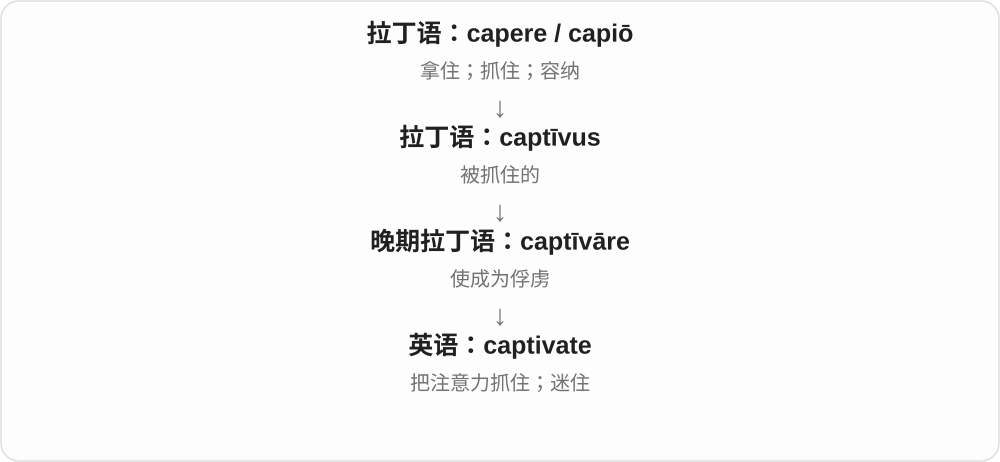

词义从把人控制住转成把人的兴趣吸引住。它常用于音乐、故事、风景或个人魅力，通常带欣赏的语气。

**常见搭配与例句**

captivate an audience；be captivated by…；a captivating story。

> The storyteller captivated the children with her voice.

讲故事的人用她的声音让孩子们听得入迷。

> We were captivated by the view from the mountain.

山上的景色让我们着迷。

**别混淆**

capture attention 可以只是成功引起注意；captivate 往往表示吸引得更深，让人持续投入。

### 445. captivating — 迷人的、令人着迷的

**音标**：/ˈkæptɪveɪtɪŋ/

**先抓住这个画面**

故事、笑容、表演把人的注意力抓住，让人忍不住继续看。captivating 的画面就是心神被吸住了。

**怎么拆**

captivate 使着迷 + -ing；更早拉丁语 captivare 俘获等与 capere 抓住同族。抓住人的材料进入吸引注意、感情的比喻。

**怎么变成今天的意思**

**capere、captivare 等抓住词族 → captivate**  
由俘获、抓住联系到使人着迷

↓

**captivate + -ing → captivating**  
具有吸住注意、感情的效果

a captivating story 迷人的故事；a captivating smile 迷人的笑容；a captivating performance 令人着迷的表演。

**常见搭配与例句**

a captivating voice；find something captivating。

> She told a captivating story about her travels.

她讲了一个关于旅行的迷人故事。

> The singer’s captivating voice held the audience’s attention.

歌手迷人的嗓音牢牢吸引着观众。

**别混淆**

captivating 描写带来吸引力的事物；captivated 常说人被迷住。The story is captivating；I’m captivated by the story。

### 446. sheath — 鞘；护套、外包层；紧身直筒裙

**音标**：英、美 /ʃiːθ/

**先抓住这个画面**

刀刃外面有个贴身的套，电线外面也有包着它的层，这种贴合外套就是 sheath 的画面。衣服若紧贴身体、线条简洁，也会借这个形象。

**怎么拆**

承古英语 sceath 等鞘、套词，经中古英语 shethe 延续。更远可能联系劈开等材料，但具体意象仍是词源分析；现代先按完整套、外层名词记。

**怎么变成今天的意思**

**古英语鞘词 → 中古英语 shethe → sheath**  
贴合刀刃的容器、外套

↓

**刀鞘 → 相似管状包层；衣服的贴身轮廓**  
现代可用于技术外套或 sheath dress 服装名称

a leather sheath 是皮鞘；a protective sheath 是保护套；a sheath dress 是线条贴身的直筒裙。

**常见搭配与例句**

a leather sheath；a protective sheath；a sheath dress。

> The display included a sword and its leather sheath.

展品中有一把剑及其皮鞘。

> A protective sheath covered the cable.

电缆外包着一层保护套。

**别混淆**

sheath 是名词，末尾 /θ/；sheathe 是动词，末尾 /ð/。词尾多出的 e 不单独读，却帮助区分这两个词。

### 447. sheathe — 把刀剑收入鞘中；包覆、套住

**音标**：英、美 /ʃiːð/

**先抓住这个画面**

把刀刃送回贴合它的套里，是 sheathe。再扩展一步，用外层把东西包起来，也可以用这个动词。

**怎么拆**

与 sheath 鞘的旧词族相连，历史可能承旧英语动词，也可能在中古英语由名词构成。现代直接对应 sheath 名词、sheathe 动词，th 常由 /θ/ 变 /ð/。

**怎么变成今天的意思**

**古英语鞘词及相关动词 → 中古英语 shethen**  
具体继承或名词构词路线有不同分析

↓

**sheathe 收入鞘 → 一般包覆、套住**  
现代词尾 e 不发音，动词末尾是浊辅音 /ð/

sheathe a sword 是把剑收入鞘；sheathe something in a covering 是给东西包一层外套；unsheathe 是抽出鞘。

**常见搭配与例句**

sheathe a sword；sheathe in；unsheathe。

> The actor paused to sheathe his sword.

演员停下来，把剑收入鞘中。

> The workers sheathe the pipes in a protective covering.

工人们给管道包上保护层。

**别混淆**

sheathe 是动作，sheath 是鞘、套。日常收回普通物品不一概用 sheathe，通常要有入鞘或包覆的画面。

### 448. sheathing — 包覆、加套；护层、外包材料

**音标**：英、美 /ˈʃiːðɪŋ/

**先抓住这个画面**

东西外面包着的一层护材，可以叫 sheathing。这里不只是说正在包，也能直接给那层材料命名。

**怎么拆**

sheathe 去词末不发音 e，加完整 -ing → sheathing，保留动词的 /ð/。从包覆动作形成相关过程、包覆材料的名词用法。

**怎么变成今天的意思**

**sheath 鞘、套 ↔ sheathe 包覆**  
名词与动词的 /θ/、/ð/ 对应要分开

↓

**sheathe 去 e + -ing → sheathing**  
既可说过程，也可说起包覆作用的材料

protective sheathing 是保护包层；plastic sheathing 是塑料护层；the sheathing around a cable 是电缆外的包层。

**常见搭配与例句**

protective sheathing；plastic sheathing；the outer sheathing。

> The cable had a thick layer of plastic sheathing.

电缆外有一层厚塑料护层。

> The diagram labels the outer sheathing separately.

图中把外包层单独标了出来。

**别混淆**

sheathing 的名词用法不必逐字译成正在入鞘。技术说明里看到它，先判断是谈覆盖动作，还是已经在外面的那层材料。

### 449. flurry — 一阵纷乱或忙碌；一阵雪、风；使慌乱

**音标**：英 /ˈflʌri/；美 /ˈflɜːri/

**先抓住这个画面**

事情突然密集地一股脑儿来，又往往只来一阵，叫 a flurry：一阵飘雪、一连串来电、一阵忙乱，都抓住短时间纷至沓来的画面。

**怎么拆**

更早来源未定，有拟声或散布、撒落材料的分析；早期一阵风、纷乱义先见，阵雪与后来突然增多的活动义各自发展，名词再转动词。

**怎么变成今天的意思**

**早期 flurry：一阵风、纷乱活动**  
来源未定，拟声或 flurr 散布等相关分析均保留不确定性

↓

**flurry：阵雪；一阵突然增多的活动**  
名词再转动词使慌乱、雪成阵飘落；不是所有分支都从雪义开始

a flurry of activity 一阵忙碌；a flurry of messages 一连串消息；a snow flurry 一阵雪。

**常见搭配与例句**

in a flurry 慌忙中；a flurry of excitement 一阵激动。

> The announcement caused a flurry of messages.

公告引来了一连串消息。

> A brief snow flurry passed over the village.

一阵短暂的雪掠过村庄。

**别混淆**

a flurry 通常短促、集中，a steady stream 则强调持续不断；一阵来得急不等于会一直不停。

### 450. flurries — 一阵阵雪、纷乱或忙碌〔复数〕；使慌乱、雪成阵飘落〔第三人称单数〕

**音标**：英 /ˈflʌriz/；美 /ˈflɜːriz/

**先抓住这个画面**

不是持续一整天的大雪，而是一阵阵飘来，可以说 snow flurries；消息或活动一波一波涌来，也能用复数。

**怎么拆**

flurry 的 y 变 i 加 -es；名词复数和动词三单同形，读 /z/ 结尾。

**怎么变成今天的意思**

**早期 flurry：一阵风、纷乱活动**  
来源未定，拟声或 flurr 散布等相关分析均保留不确定性

↓

**flurry：阵雪；一阵突然增多的活动**  
名词再转动词使慌乱、雪成阵飘落；不是所有分支都从雪义开始

↓

**flurry → flurries**  
多个短暂阵发；动词也有同形三单

snow flurries 一阵阵雪；flurries of activity 一阵阵忙碌。

**常见搭配与例句**

occasional flurries 偶尔几阵雪；flurries of messages。

> Light snow flurries continued through the morning.

整个上午不时飘来一阵阵小雪。

> There were brief flurries of activity before each train arrived.

每趟火车到站前，都会出现短暂的一阵忙碌。

**别混淆**

flurries 常突出阵发、短暂，blizzard 是强烈暴风雪；不能看到下雪就把强度、持续性也合在一起。

### 451. flurried — 慌乱、匆忙的；使慌乱了

**音标**：英 /ˈflʌrid/；美 /ˈflɜːrid/

**先抓住这个画面**

突然被催着出门，外套、钥匙都抓得乱七八糟，可以说 a flurried departure。它常写急急忙忙、没完全稳住的样子。

**怎么拆**

flurry 的 y 变 i 加完整 -ed，读 /d/；动词过去分词可作形容词，描述被搅得匆忙、慌乱。

**怎么变成今天的意思**

**早期 flurry：一阵风、纷乱活动**  
来源未定，拟声或 flurr 散布等相关分析均保留不确定性

↓

**flurry：阵雪；一阵突然增多的活动**  
名词再转动词使慌乱、雪成阵飘落；不是所有分支都从雪义开始

↓

**flurry → flurried**  
使慌乱的过去形式；也形容急忙、失去从容

a flurried apology 匆忙慌乱的道歉；a flurried departure 慌忙离开。

**常见搭配与例句**

looked flurried；a flurried attempt to explain。

> She offered a flurried apology and hurried out.

她慌忙道歉，然后急匆匆出去了。

> There was a flurried search for the missing keys.

大家慌慌张张地找那串不见的钥匙。

**别混淆**

hurried 主要说赶时间，flurried 多一层有些忙乱、不从容；赶得快也可能有条不紊。

### 452. flurrying — 正在使慌乱；雪正成阵飘落

**音标**：英 /ˈflʌriɪŋ/；美 /ˈflɜːriɪŋ/

**先抓住这个画面**

一阵阵雪正在飘，是 flurrying 的天气用法；人因催促、突发问题乱了思路，也属于 flurry 动词的另一种常见方向。

**怎么拆**

flurry + -ing，保留 y → flurrying；不像接 -ed、-es 时变 y 为 i。

**怎么变成今天的意思**

**早期 flurry：一阵风、纷乱活动**  
来源未定，拟声或 flurr 散布等相关分析均保留不确定性

↓

**flurry：阵雪；一阵突然增多的活动**  
名词再转动词使慌乱、雪成阵飘落；不是所有分支都从雪义开始

↓

**flurry + -ing → flurrying**  
阵雪正在飘落；或正造成慌乱

snow was flurrying 雪正成阵飘落；flurrying around the windows 窗边阵阵飘动。

**常见搭配与例句**

flurrying in the wind；the flurrying snow。

> Snow was flurrying past the window.

一阵阵雪从窗前飘过。

> We watched the flurrying snow from the warm kitchen.

我们从暖和的厨房里望着阵阵飘动的雪。

**别混淆**

flurrying 常写阵发、飘动的雪，snowing 是更广的下雪；天气语境不把它硬译成人在慌乱。

### 453. wail — 哭号、哀号；发出尖长声；哭号声

**音标**：/weɪl/

**先抓住这个画面**

哭声不是一声短促的抽噎，而是拉长、响亮地拖出去。警笛和风也能借这种声音叫 wail。

**怎么拆**

经中古英语 weilen 等，接古诺斯 væla 哀叹，来自表示悲苦、哀叹的 væ。后来既描写人的哭号，也描写类似的长鸣。

**怎么变成今天的意思**

**古诺斯 væ、væla → 中古英语相关形式**  
悲苦的喊声、哀叹

↓

**现代 wail**  
高声哭号；警笛等拖长的声音

wail with grief 悲痛地哭号；the wail of a siren 警笛的长鸣；wail about something 哭着或大声抱怨某事。

**常见搭配与例句**

let out a wail；a distant wail。

> A siren wailed in the distance.

远处警笛长鸣。

> The child let out a loud wail when the balloon burst.

气球爆裂时，孩子放声哭了起来。

**别混淆**

weep 更侧重流泪，sob 更突出抽噎，wail 更突出响亮、拖长的声音。声音来源也可不是人。

### 454. wailing — 哭号、哀号；长鸣；wail 的 -ing 形式

**音标**：/ˈweɪlɪŋ/

**先抓住这个画面**

声音拉得长，尖而响，一阵接一阵。wailing sirens 把警笛描写得像在高声哀号。

**怎么拆**

wail + -ing，接古诺斯哀叹、哭号词族。现代可说人正在哭号，也可说警笛、乐器等的长鸣声。

**怎么变成今天的意思**

**wail**  
长声哭号、哀叹；类似声音

↓

**wail + -ing → wailing**  
哭号动作；长鸣的声音特征

a wailing baby 放声哭的婴儿；wailing sirens 长鸣的警笛；the wailing of the wind 风的呼号。

**常见搭配与例句**

wailing with grief；hear someone wailing。

> Wailing sirens broke the silence.

长鸣的警笛打破了寂静。

> She could hear a baby wailing upstairs.

她能听见楼上有个婴儿在放声哭。

**别混淆**

wailing 不只说情绪，也可描述声音本身。a wailing siren 是按声形作比喻，理解成尖长的鸣响即可。

### 455. scaffold — 脚手架、临时支撑架；高台；搭支架

**音标**：英 /ˈskæfəʊld/；美 /ˈskæfoʊld/

**先抓住这个画面**

修墙时，先在外侧搭个能站人、放工具的架子，帮工人够到高处。这是 scaffold 的核心实物画面。

**怎么拆**

经古北法语、古法语 eschafaut 等平台、支架词借入；通常上溯重构的通俗拉丁 *catafalicum 等材料，但部分改形路径有不确定性。现代英语不宜靠字面硬拆各音节。

**怎么变成今天的意思**

**法语 eschafaut 等；更早路径含重构材料**  
高台、临时支撑架

↓

**英语 scaffold**  
施工支架；平台；比喻提供结构支持

a scaffold around the building 楼外脚手架；a wooden scaffold 木制高架；scaffold a task 为任务提供分步支持。历史叙述中也可指刑台。

**常见搭配与例句**

put up a scaffold；a temporary scaffold。

> Workers stood on a scaffold beside the wall.

工人站在墙边的脚手架上。

> The tutor used questions to scaffold the discussion.

辅导老师用一连串问题为讨论搭起思路支架。

**别混淆**

scaffold 可数，说一座支架；scaffolding 常统称整个支架体系或材料。用作比喻时，抓住先搭支持、让事情够得着的画面。

### 456. scaffolding — 脚手架体系、脚手架材料；临时支持框架

**音标**：英 /ˈskæfəʊldɪŋ/；美 /ˈskæfoʊldɪŋ/

**先抓住这个画面**

架子把人托到暂时够不着的地方。学习时，提示、示范、分步骤也像临时脚手架，帮助人逐渐独立完成。

**怎么拆**

与 scaffold 同属法语借词支架、平台词族，现代可对应 scaffold + -ing；脚手架的名词用法很早已有。后来又把临时支撑比喻用于学习、写作、系统等。

**怎么变成今天的意思**

**法语支架材料 → scaffold／scaffolding**  
临时高架及支架体系

↓

**现代比喻 scaffolding**  
为学习或建设过程提供结构支持

covered in scaffolding 外面搭满脚手架；erect scaffolding 搭脚手架；learning scaffolding 学习支架、阶段性支持。常作不可数统称。

**常见搭配与例句**

remove the scaffolding；temporary scaffolding。

> The building was covered in scaffolding.

那栋楼外面搭满了脚手架。

> The worksheet provides scaffolding for students writing their first essay.

练习纸为第一次写作文的学生提供分步支持。

**别混淆**

some scaffolding 指一套或一些支架材料；a scaffold 可指一座具体架子。教育比喻中的支架，重点是先提供结构帮助。

### 457. prune — 西梅干；修剪；删减

**音标**：/pruːn/

**先抓住这个画面**

名词是一颗果干；动词是一把剪刀。两个画面不要强行接成同一来源。

**怎么拆**

水果名 prune 经古法语来自拉丁 prunum 李子。修剪的 prune 则来自古法语 proignier 一支，进一步来源有争议，并不是把李子剪成干。

**怎么变成今天的意思**

**水果路线：希腊 proumnon → 拉丁 prunum → 法语 prune／pronne**  
李子名称；英语后来常指干果

↓

**英语 prune（名词）**  
西梅干、李子干

↓

**另一路线：古法语 proignier → 英语 prune（动词）**  
修整 → 修剪枝条、删减内容；更早来源不确定

吃的是 prunes，剪的是 prune the roses。动词还能用于文章或预算：prune a paragraph 是删掉多余部分，使它更精简。这两种 prune 都很实用，但只有水果名属于本页 prun- 李子的词源线。

**常见搭配与例句**

prune juice；dried prunes；prune a tree；prune unnecessary details。

> She stirred chopped prunes into the porridge.

她把切碎的西梅干拌进粥里。

> The gardener pruned the rose bush after flowering.

开花后，园丁修剪了那株玫瑰。

> We pruned several repetitive paragraphs from the report.

我们从报告里删去了几段重复内容。

**别混淆**

plum 通常说新鲜李子；prune 作名词通常说李子干。trim 也是修整，prune 更常使人想到有选择地剪去枝条或多余内容。

### 458. pruning — 修剪枝条；删减的过程；正在修剪

**音标**：/ˈpruːnɪŋ/

**先抓住这个画面**

把多余枝条剪掉，让留下的部分更合适，是 pruning。文章、计划删去多余内容，也借这个修整画面。

**怎么拆**

动词 prune 接古法语 proignier、poroindre 等，远源有不同解释。英语早有整理羽毛、仪容等用法，现代修枝义也可能另次借入；现代去 e 加 -ing。

**怎么变成今天的意思**

**法语修整材料 → 英语 prune**  
整理、削去多余部分；具体借入有层次

↓

**prune 去 e + -ing → pruning**  
修剪过程；删减的比喻

pruning the roses 修剪玫瑰；careful pruning 细致修剪；pruning a draft 删减草稿。

**常见搭配与例句**

pruning shears 修枝剪；time spent pruning 用在修剪上的时间。

> She spent the morning pruning the roses.

她用一上午修剪玫瑰。

> The draft improved after some careful pruning.

草稿经仔细删减后变好了。

**别混淆**

这个动词与果干 prune 不是同一个来源。pruning 是剪掉多余枝、内容，不要编成把李子剪成干果。

### 459. bicker — 为小事斗嘴；争吵不休

**音标**：英 /ˈbɪkə/；美 /ˈbɪkər/

**先抓住这个画面**

你一句我一句，为谁没关灯、谁又晚到之类的小事来回争，是 bicker。重点常在琐碎、反复，听着让人烦。

**怎么拆**

接中古英语 bikere 争斗、小规模交战，可能与中古荷兰语 bicken 攻击及表示反复动作的 -er 有关。这里的历史 -er 不表示做事的人，现代整体认 bicker。

**怎么变成今天的意思**

**早期攻击、争斗材料 → 中古英语 bicker**  
具体远源有可能性分析，不当作确定的现代英语拼接

↓

**争斗 → 用言语反复争执**  
现代常说为小事斗嘴、挑嘴争吵

bicker about money 是为钱斗嘴；bicker over details 是为细节争执；bicker with someone 是与某人斗嘴。

**常见搭配与例句**

bicker about；bicker over；bicker with。

> They bicker about whose turn it is to wash up.

他们为轮到谁洗碗而斗嘴。

> The committee should not bicker over every small detail.

委员会不该为每个小细节争吵不休。

**别混淆**

argue 可以认真辩论或争论重大问题；bicker 常显得琐碎、没完没了。它通常带说话者嫌争执无益的评价。

### 460. bickering — 斗嘴；为琐事反复争吵；爱争吵的

**音标**：英 /ˈbɪkərɪŋ/；美 /ˈbɪkərɪŋ/

**先抓住这个画面**

一件小事翻来覆去吵，谁也不让谁，这种持续的斗嘴叫 bickering。把动作当成一整段令人厌烦的争执来看。

**怎么拆**

bicker + 完整 -ing → bickering，词形保留。既可作动作形式，也可作争吵行为的名词，或修饰争吵中的人。

**怎么变成今天的意思**

**中古英语 bicker 争斗 → 言语上的斗嘴**  
从小规模交战转向琐碎反复的口角

↓

**bicker + -ing → bickering**  
现代可把反复斗嘴当作整体行为来谈

constant bickering 是不断斗嘴；bickering over money 是为钱争吵；bickering siblings 是吵个不停的兄弟姐妹。

**常见搭配与例句**

constant bickering；stop the bickering；bickering over details。

> Their constant bickering spoiled the journey.

他们一路吵个不停，把旅行的兴致都搅坏了。

> The bickering siblings finally agreed on a film.

吵个不停的兄弟姐妹终于就看哪部电影达成了一致。

**别混淆**

a discussion 可以有建设性，bickering 常意味着反复口角、推进不大。作为行为名词时，常直接说 the bickering 或 constant bickering。

### 461. sear — 灼烧、烫焦表面；使留下深刻印记

**音标**：英 /sɪə/；美 /sɪr/

**先抓住这个画面**

热锅一碰，食物表面很快焦香上色，是 sear 的常见厨房画面。强烈的经历像烙印一样留在记忆里，也能借这个词表达。

**怎么拆**

动词接古英语 searian 枯干、变干，属于更早表示干燥的日耳曼词族。后来有使焦枯、灼烧表面等义，再引申为强烈地刻印在感受或记忆里。

**怎么变成今天的意思**

**古英语 searian 枯干 → 英语 sear**  
从失去水分、枯焦发展到灼烧等动作

↓

**sear 烫烧、留下灼痕 → sear into memory**  
感受深到仿佛烙在记忆中

sear the surface 是烫焦表面；sear into someone’s memory 是深深刻入某人记忆。后一种用法常带强烈、令人不安的感受。

**常见搭配与例句**

sear the meat；sear the surface；sear into the memory。

> The hot pan can sear the surface of the tofu.

热锅可以把豆腐表面煎出焦色。

> Some images sear themselves into our memory.

有些画面会深深烙进我们的记忆。

**别混淆**

burn 的范围更广，sear 常突出强热作用于表面。记忆义里的烙印是比喻，句子通常仍会交代具体经历或形象。

### 462. searing — 灼热的；尖锐、强烈而深刻的；煎焦表面的过程

**音标**：英 /ˈsɪərɪŋ/；美 /ˈsɪrɪŋ/

**先抓住这个画面**

searing heat 像要把人烤焦；a searing criticism 则像话语烫到痛处，尖锐得让人难受。身体上的灼热扩展成感受上的强烈。

**怎么拆**

sear + 完整 -ing → searing，原词不改。先有灼烧动作的 -ing 形式，再有很热、猛烈、刺痛人心等形容词用法。

**怎么变成今天的意思**

**sear 灼烧、煎表面 + -ing → searing**  
可说动作过程，也可修饰具有灼烧感的东西

↓

**强烈热感 → 强烈感受、尖锐批评**  
形容词不必表示某个动作此刻正在进行

searing heat 是灼热高温；searing pain 是灼痛、剧痛；a searing account 是直击人心、令人难受的叙述。

**常见搭配与例句**

searing heat；searing criticism；a searing account。

> The walkers rested in the shade to escape the searing heat.

徒步者在阴凉处休息，躲开灼人的高温。

> The report offered a searing criticism of the project’s failures.

报告尖锐地批评了项目的种种失败。

**别混淆**

hot 可以只是温度高，searing 通常更强烈。a searing review 常是尖锐严厉的评论，而不是温暖友好的夸奖。

### 463. seared — 煎焦表面的；被灼烧的；深深刻入的

**音标**：英 /sɪəd/；美 /sɪrd/

**先抓住这个画面**

菜单上的 seared fish 常强调鱼的外表经过高热煎制。a memory seared into the mind 则像被烙下的印记，久久不散。

**怎么拆**

sear + 完整 -ed → seared，动词过去式、过去分词，也可作修饰语。/r/ 后 -ed 读 /d/；sear 本身来自枯干、灼烧的旧词族。

**怎么变成今天的意思**

**古英语枯干动词 → sear 灼烧、煎表面**  
强热与留下痕迹形成共同画面

↓

**sear + -ed → seared**  
已经发生的动作，或由此形成的状态

seared tuna 是表面煎制的金枪鱼；seared into memory 是深深刻在记忆里。看到食物名时，它并不单独告诉你中心熟到了什么程度。

**常见搭配与例句**

seared fish；seared on the outside；seared into memory。

> The menu includes seared fish with vegetables.

菜单上有配蔬菜的煎鱼。

> The scene remained seared into her memory.

那个场景一直深深刻在她的记忆里。

**别混淆**

seared 突出灼烧或煎表面的处理；cooked 是更一般的煮熟、做熟。比喻用法保留的是留下强烈印记的感觉。

### 464. whittle — 用小刀削、削制；一点点削减〔常接 down、away〕

**音标**：英、美 /ˈwɪtəl/

**先抓住这个画面**

一刀削掉一小片木头，慢慢削出形状，是 whittle。预算、名单也能这样一点点削掉，变得更少。

**怎么拆**

现代动词来自中古英语 whittel 刀具名，它又接更早 thwittle、古英语 thwitan 削切材料。不是现代先有 whittle 动词再给小刀命名。

**怎么变成今天的意思**

**古英语削切材料 → 较早刀具名 thwittle、whittel**  
器具名称由切削词族发展

↓

**刀具名 → whittle 削切 → 逐步削减的比喻**  
削去一小片一小片，让整体慢慢减少

whittle a figure 是削一个小雕像；whittle down a list 是逐步缩短名单；whittle away savings 可说一点点耗掉积蓄。

**常见搭配与例句**

whittle from wood；whittle down；whittle away。

> He liked to whittle small figures from scraps of wood.

他喜欢用零碎木料削小雕像。

> We need to whittle the list down to five names.

我们需要把名单逐步缩到五个人。

**别混淆**

cut 可以一刀切断，whittle 常突出一点点削。比喻削减时，也常带逐渐减少、反复筛去的过程感。

### 465. whittling — 削木、削制；一点点削减

**音标**：英、美 /ˈwɪtlɪŋ/

**先抓住这个画面**

坐着把木头一片片削下来的过程，是 whittling。把候选名单慢慢筛小，也可以用 whittling down 来表达。

**怎么拆**

whittle 去末尾不发音 e，加完整 -ing → whittling。-ing 既形成动作形式，也可给削制这项活动命名。

**怎么变成今天的意思**

**早期刀具名 → whittle 削切**  
现代动作借具体器具名称发展

↓

**whittle 去 e + -ing → whittling**  
动作过程、活动名词；削减比喻接同一动作画面

wood whittling 是削木活动；whittling down the options 把削去木片的动作转到选择上：逐步排除，留下更少的选项。

**常见搭配与例句**

wood whittling；whittling down the list；whittling away。

> Whittling became his favourite quiet hobby.

削木成了他最喜欢的安静爱好。

> The team is whittling down the number of options.

团队正在逐步缩小选择范围。

**别混淆**

whittling 常比简单 reducing 更有一小步一小步去除的画面。它与 whistling 吹口哨形近，但不是同一个动作。

### 466. goad — 刺激、激将、驱使；赶牛尖棒；刺激因素

**音标**：英 /ɡəʊd/；美 /ɡoʊd/

**先抓住这个画面**

赶牛的尖棒戳一下，逼动物往前；goad 人则常用挖苦、挑战把人激得做出反应。尖棒名词很古老，但英语动词最早已有抽象刺激义。

**怎么拆**

名词承古英语 gad 尖头器物、赶牛棒，后来转动词。不要因为意象直观，就把字面用棒赶的动词记录排在抽象煽动动词之前。

**怎么变成今天的意思**

**古英语 gad → goad 名词**  
尖头器物，尤其赶牛的尖棒；远源比较材料有不确定性

↓

**名词 → goad 动词**  
最早动词记录已有煽动、刺激行动义，字面用棒赶的动词记录较晚

goad someone into doing something 激将某人去做；goad someone on 不断刺激、煽动。

**常见搭配与例句**

a goad to action 行动的刺激因素；refuse to be goaded。

> Don’t let them goad you into an argument.

别让他们用激将法把你拽进争吵。

> The farmer carried a goad beside the cattle.

农夫在牛群旁拿着一根赶牛尖棒。

**别混淆**

encourage 常带支持、鼓励，goad 则更像戳、激、逼，可能让人做本来不愿做的事；作用方向相似，态度不同。

### 467. goaded — 刺激、激将了；被逼得、激得去做的

**音标**：英 /ˈɡəʊdɪd/；美 /ˈɡoʊdɪd/

**先抓住这个画面**

本来不想争，被对方一句句刺得终于回嘴，就是 was goaded into responding。into 后面点被激出来的动作。

**怎么拆**

goad + 完整 -ed，/d/ 后读 /ɪd/；过去形式和被动形式，来自尖棒名词转用的动词。

**怎么变成今天的意思**

**古英语 gad → goad 名词**  
尖头器物，尤其赶牛的尖棒；远源比较材料有不确定性

↓

**名词 → goad 动词**  
最早动词记录已有煽动、刺激行动义，字面用棒赶的动词记录较晚

↓

**goad + -ed → goaded**  
过去刺激、激将；或已被激得行动

goaded into a fight 被激得打架；goaded into replying 被激得回应。

**常见搭配与例句**

goaded by insults；goaded him on。

> He was goaded into replying by their insults.

他们的辱骂激得他终于回了嘴。

> The crowd goaded the players on with shouts and taunts.

人群用喊叫和挖苦不断刺激球员。

**别混淆**

goaded into agreeing 更带受刺激、受逼的成分，gladly agreed 才明确高兴地同意；不要漏掉被动句的压力来源。

### 468. goading — 不断刺激、激将；这种挑衅行为

**音标**：英 /ˈɡəʊdɪŋ/；美 /ˈɡoʊdɪŋ/

**先抓住这个画面**

一句句刺你，等着你忍不住做出反应，这种过程是 goading；还可以把它当作整场挑衅行为来讲。

**怎么拆**

goad + -ing；动作形式也可作行为名词，承尖棒催促到刺激行动的用法。

**怎么变成今天的意思**

**古英语 gad → goad 名词**  
尖头器物，尤其赶牛的尖棒；远源比较材料有不确定性

↓

**名词 → goad 动词**  
最早动词记录已有煽动、刺激行动义，字面用棒赶的动词记录较晚

↓

**goad + -ing → goading**  
正在刺激、激将；或命名这类行为

stop goading someone 别再激某人；goading him into a reaction 刺激他做出反应。

**常见搭配与例句**

constant goading；ignore the goading。

> Stop goading him into losing his temper.

别再刺激他发脾气了。

> She refused to react to his constant goading.

面对他不停激将，她不肯作出反应。

**别混淆**

goading 往往试图激出具体反应，mocking 可以只是取笑；一句话可以两者兼有，但重点不同。

### 469. goads — 刺激、激将〔第三人称单数〕；赶牛尖棒、刺激因素〔复数〕

**音标**：英 /ɡəʊdz/；美 /ɡoʊdz/

**先抓住这个画面**

他故意笑你不敢，想逼你出手，是 he goads you；不止一根赶牛尖棒，名词复数也是 goads。

**怎么拆**

goad + -s，/d/ 后读 /z/；名词复数和动词三单同形，尖棒名词转出刺激行动的动词。

**怎么变成今天的意思**

**古英语 gad → goad 名词**  
尖头器物，尤其赶牛的尖棒；远源比较材料有不确定性

↓

**名词 → goad 动词**  
最早动词记录已有煽动、刺激行动义，字面用棒赶的动词记录较晚

↓

**goad + -s → goads**  
他用挑衅刺激；多根尖棒或多个刺激因素

goads him into replying 激他回应；goads the crowd on 煽动人群。

**常见搭配与例句**

goads his rival；goads them into action。

> He goads his rival with remarks about the last defeat.

他拿上次失败的事刺激对手。

> Her impatience goads the team into rushing the work.

她的不耐烦逼得团队匆忙赶工。

**别混淆**

goads someone into a fight 强调被刺激着卷入冲突；invites someone to talk 则可以是友好邀请，不能都简化成叫人做事。

### 470. sopping — 湿透的；浸湿、吸取液体的过程

**音标**：英 /ˈsɒpɪŋ/；美 /ˈsɑːpɪŋ/

**先抓住这个画面**

衣服、鞋湿得透透、像吸满水的海绵，可以说 sopping wet。日常先把它当很湿、湿透的强烈表达来用。

**怎么拆**

sop 双写 p + 完整 -ing；旧 sop、soppian 有浸泡、泡软材料，现代分词、形容词保留被水浸透的状态。

**怎么变成今天的意思**

**古英语 sop、soppian 等 → 中古英语 soppen → sop**  
浸泡、使液体吸进去；浸软的东西

↓

**sop 双写 p + -ing → sopping**  
浸湿动作；sopping wet 中强调湿透

sopping wet 是湿透，sopping up spilled water 是吸起洒出的水；后一种仍是 sop up 的动作。

**常见搭配与例句**

sopping clothes 湿透的衣服；sopping wet shoes 湿透的鞋。

> My shoes were sopping wet after the walk.

走完那段路，我的鞋湿透了。

> She took off her sopping coat at the door.

她在门口脱下湿透的外套。

**别混淆**

sopping wet 与 soaking wet 意思很近，都比 a little damp 强得多；区别通常是习惯表达，而非精确含水比例。

## 这一组要分清什么

amazing 是令人惊叹，amazed 是感到惊叹；drawing 可数作品与不可数活动分用。clothing 通常不可数；lying 同形却有躺和说谎两支；king 不能拆成 k 加普通动作 -ing。

## 串起来练习

Seeing an amazing drawing gave her a sense of belonging in the art class.

看到一幅惊艳的画，让她在美术课上产生了归属感。
