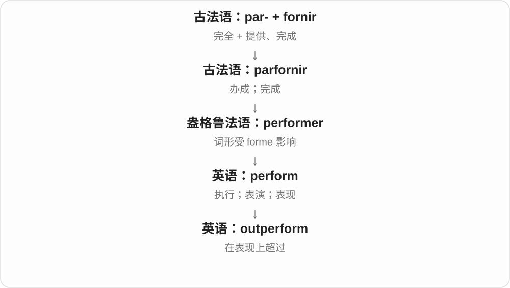

# 0012 · out- — 向外、外部；超过、胜过〔常见前缀〕

[逐词精讲目录](../00_逐词精讲目录.md) · [总目录](../00_总目录_按常用程度.md)

## 核心词根与来源

out- 来自古英语 ut 向外等本族材料，早用于名词、动词和形容词。最有用的两条主线是向外、处在外部，以及在某个动作或指标上超过。outperform、outnumber 的比较对象很关键，不能只当动作发生在外面。

**OUT：先越过里面与外面的边，再看能否超过别人的界限**

outflow 是流出去，outlay 是钱拿出去；outrun 则把自己跑到别人前面，outweigh 是分量或影响超过另一方。

- **具体外部与外流**：outdoor · outfield · outpost · outflow · outpouring · outrigger
- **超过别人的动作和程度**：outrun · outperform · outnumber · outweigh · outdo · outlast · outgrow · outbid
- **从原位置向外、被排出**：outcast · outlaw · outbound · outsource · outcrop
- **固定表达单独掌握**：outlay · outlet · outlook · outset · outstanding · outspoken · outcry · outburst
- **last → lasts：延续动词的第三人称单数**：last · lasts
- **bid → bids：现代 s 形式**：bid · bids

## 词形与演化规律

out- + run、weigh、number、perform，常形成超过某人的及物动词；out- + flow、pour 等可表示向外流出。outlay 联系 lay 放，outrigger 还经历 outligger 受 rig 影响的变化。outrage 的法语、拉丁借词史不同，不要把每个 out 开头的字都当此英语前缀。

古英语持续材料的继承支，sts 辅音群保留。

不是所有义都从竞拍发展，保留旧宣布、要求支。

## 单词速览（按词族由简到繁）

同一基础词的相关扩展放在一起，先读基础形式，再读扩展；各组之间优先读常用的。具体词源关系见各词讲解。

| 单词 | 音标 | 核心意思 |
|---|---|---|
| [out](#w-53) | /aʊt/ | 向外；在外；不在；熄灭或用完；公开显露 |
| [outlook](#w-4) | /ˈaʊtlʊk/ | 看法；人生观；前景；所见景色 |
| [outlet](#w-5) | /ˈaʊtlet/ | 出口；排出口；插座〔美式〕；销售点；表达渠道 |
| [do](#w-54) | 动词强读 /duː/，弱读 /də/；唱名英 /dəʊ/、美 /doʊ/ | 做；实施；疑问、否定或强调的助动词；do〔音乐唱名，另源〕 |
| [outdo](#w-30) | /ˌaʊtˈduː/ | 超过；胜过 |
| [outdoor](#w-2) | 英 /ˈaʊtdɔː/；美 /ˈaʊtdɔːr/ | 户外的；用于露天活动的 |
| [last](#w-55) | 英 /lɑːst/；美 /læst/ | 最后的；上一个；持续；耐用 |
| [lasts](#w-77) | 英 /lɑːsts/；美 /læsts/ | 持续、维持；耐用、经用〔第三人称单数〕 |
| [outlast](#w-28) | 英 /ˌaʊtˈlɑːst/；美 /ˌaʊtˈlæst/ | 比……持久；比……存在得更久 |
| [number](#w-56) | 英 /ˈnʌmbə/；美 /ˈnʌmbər/ | 数；数量；号码；编号；总数达到 |
| [outnumber](#w-23) | 英 /ˌaʊtˈnʌmbə/；美 /ˌaʊtˈnʌmbər/ | 数量超过；人数多于 |
| [play](#w-57) | /pleɪ/ | 玩；比赛；演奏；表演；播放；戏剧 |
| [outplay](#w-49) | /ˌaʊtˈpleɪ/ | 比……表现更好；在比赛中压过 |
| [live](#w-58) | 动 /lɪv/；形、副 /laɪv/ | 生活；居住；活的；现场直播的 |
| [outlive](#w-31) | /ˌaʊtˈlɪv/ | 比……活得久；比……持续更久 |
| [run](#w-59) | /rʌn/ | 跑；流；运转；经营；一段连续过程 |
| [outrun](#w-24) | 英 /ˌaʊtˈrʌn/；美 /ˌaʊtˈrʌn/ | 跑得比……快；超出、超过 |
| [source](#w-60) | 英 /sɔːs/；美 /sɔːrs/ | 来源；源头；消息来源；采购、取得 |
| [outsource](#w-25) | 英 /ˈaʊtsɔːs/；美 /ˈaʊtsɔːrs/ | 外包 |
| [sell](#w-61) | /sel/ | 出售；卖得；推销、说服接受 |
| [outsell](#w-46) | /ˌaʊtˈsel/ | 比……卖得多；销量超过 |
| [grow](#w-62) | 英 /ɡrəʊ/；美 /ɡroʊ/ | 生长；增长；种植；逐渐变得 |
| [outgrow](#w-32) | 英 /ˌaʊtˈɡrəʊ/；美 /ˌaʊtˈɡroʊ/ | 长得不再适合；成长后摆脱；发展到超过容量 |
| [score](#w-63) | 英 /skɔː/；美 /skɔːr/ | 分数、比分；得分；刻痕、刻线；总谱；二十〔旧用法〕 |
| [outscore](#w-48) | 英 /ˌaʊtˈskɔː/；美 /ˌaʊtˈskɔːr/ | 得分超过 |
| [smart](#w-64) | 英 /smɑːt/；美 /smɑːrt/ | 聪明的；得体利落的；智能的；刺痛、因羞辱难受〔动词〕 |
| [outsmart](#w-33) | 英 /ˌaʊtˈsmɑːt/；美 /ˌaʊtˈsmɑːrt/ | 智胜；用机巧胜过 |
| [flow](#w-65) | 英 /fləʊ/；美 /floʊ/ | 流动；流淌；顺畅进行；流量、流动 |
| [outflow](#w-20) | 英 /ˈaʊtfləʊ/；美 /ˈaʊtfloʊ/ | 流出；流出量、流出物 |
| [perform](#w-66) | 英 /pəˈfɔːm/；美 /pərˈfɔːrm/ | 执行；表演；表现 |
| [outperform](#w-21) | 英 /ˌaʊtpəˈfɔːm/；美 /ˌaʊtpərˈfɔːrm/ | 表现胜过；优于 |
| [lay](#w-67) | /leɪ/ | 放下、铺设、安置；下蛋；非专业的、非神职的〔另源形容词〕 |
| [outlay](#w-26) | /ˈaʊtleɪ/ | 支出；投入的费用〔尤指启动项目等〕 |
| [outstanding](#w-1) | /ˌaʊtˈstændɪŋ/ | 杰出的；显著的；尚未解决或支付的 |
| [rank](#w-68) | /ræŋk/ | 等级、军衔、名次、行列；给……排名、处于某名次；难闻的、十足的〔另源形容词〕 |
| [outrank](#w-52) | /ˌaʊtˈræŋk/ | 级别高于、排名超过 |
| [bid](#w-69) | /bɪd/ | 出价、投标；努力争取；吩咐、致意〔较正式〕 |
| [bids](#w-78) | /bɪdz/ | 出价、竞标、争取的尝试〔复数〕；出价、吩咐、致意〔第三人称单数〕 |
| [outbid](#w-34) | /ˌaʊtˈbɪd/ | 出价超过、以更高价压过 |
| [pace](#w-70) | 常用 /peɪs/；另源书面介词 /ˈpɑːtʃeɪ/ 等 | 步子；速度；节奏；踱步；控制速度 |
| [outpace](#w-39) | 英 /ˌaʊtˈpeɪs/；美 /ˌaʊtˈpeɪs/ | 比……走得快；发展或增长快于…… |
| [strip](#w-71) | /strɪp/ | 长条；地带；连环漫画；剥去、脱去；剥夺 |
| [outstrip](#w-40) | /ˌaʊtˈstrɪp/ | 超过、超越；把……甩在后面 |
| [outfit](#w-3) | /ˈaʊtfɪt/ | 一套衣服；成套装备；团队或机构〔口语〕；配备 |
| [shine](#w-72) | /ʃaɪn/ | 发光、反光；照耀；擦亮；表现出色；光泽 |
| [outshine](#w-37) | /ˌaʊtˈʃaɪn/ | 比……更亮；胜过、使相形见绌 |
| [pour](#w-73) | 英 /pɔː/；美 /pɔːr/ | 倒、倾倒；涌入、倾泻；下大雨 |
| [outbreak](#w-6) | /ˈaʊtbreɪk/ | 突然发生；爆发；疫情暴发 |
| [weigh](#w-74) | /weɪ/ | 称重；重达；权衡 |
| [outweigh](#w-15) | /ˌaʊtˈweɪ/ | 比……更重；重要性超过 |
| [wit](#w-75) | /wɪt/ | 机智、风趣；头脑、理智；风趣的人 |
| [outwit](#w-38) | /ˌaʊtˈwɪt/ | 以智取胜、智胜、巧妙胜过 |
| [outreach](#w-8) | /ˈaʊtriːtʃ/ | 主动接触公众的服务或联络工作 |
| [flank](#w-76) | /flæŋk/ | 侧腹、侧面；侧翼；位于……两侧 |
| [outflank](#w-44) | /ˌaʊtˈflæŋk/ | 从侧翼包抄；以策略取得优势 |
| [outskirts](#w-9) | 英 /ˈaʊtskɜːts/；美 /ˈaʊtskɜːrts/ | 城镇边缘；外围地区〔复数〕 |
| [outlaw](#w-10) | 英 /ˈaʊtlɔː/；美 /ˈaʊtlɔː/ | 亡命之徒；逃犯；宣布为非法 |
| [outset](#w-11) | /ˈaʊtset/ | 开始；开端 |
| [outpost](#w-12) | 英 /ˈaʊtpəʊst/；美 /ˈaʊtpoʊst/ | 前哨；偏远站点；外围分支 |
| [outspoken](#w-13) | 英 /ˌaʊtˈspəʊkən/；美 /ˌaʊtˈspoʊkən/ | 直言不讳的；敢于公开表达意见的 |
| [outpatient](#w-14) | /ˈaʊtpeɪʃənt/ | 门诊患者；门诊的 |
| [outcry](#w-16) | /ˈaʊtkraɪ/ | 强烈抗议；愤怒的呼声；大声喊叫 |
| [outburst](#w-17) | 英 /ˈaʊtbɜːst/；美 /ˈaʊtbɜːrst/ | 突然爆发；感情、言语的迸发 |
| [outfield](#w-18) | /ˈaʊtfiːld/ | 外场；棒球、板球等的外野 |
| [outcast](#w-19) | 英 /ˈaʊtkɑːst/；美 /ˈaʊtkæst/ | 被排斥者；遭群体排斥的 |
| [outbound](#w-22) | /ˈaʊtbaʊnd/ | 向外去的；离港的；出站或向外发送的 |
| [outpouring](#w-27) | 英 /ˈaʊtpɔːrɪŋ/；美 /ˈaʊtpɔːrɪŋ/ | 倾泻；大量涌现的感情、反应等 |
| [outgrowth](#w-35) | 英 /ˈaʊtɡrəʊθ/；美 /ˈaʊtɡroʊθ/ | 长出部分；自然发展出的结果、产物 |
| [outhouse](#w-36) | /ˈaʊthaʊs/ | 室外附属建筑；室外厕所〔尤美式〕 |
| [outrigger](#w-41) | 英 /ˈaʊtrɪɡə/；美 /ˈaʊtrɪɡər/ | 船的外伸平衡装置；外伸支架、支腿等 |
| [outtake](#w-42) | /ˈaʊtteɪk/ | 未采用的镜头；删去的录音片段 |
| [outgroup](#w-45) | /ˈaʊtɡruːp/ | 外群体；自己认同圈子之外的群体 |
| [outfall](#w-50) | /ˈaʊtfɔːl/，美亦 /ˈaʊtfɑːl/ | 排水口；排放水流进入水体的出口 |
| [outsize](#w-51) | 英 /ˈaʊtsaɪz/；美 /ˈaʊtsaɪz/ | 特大的；超常规模的 |

## 逐词讲解

### 1. out — 向外；在外；不在；熄灭或用完；公开显露

**音标**：/aʊt/

**先抓住这个画面**

先想一条边界：东西从里面出去，或者已不在原来的范围内。

**怎么拆**

继承古英语 ūt“向外”和 ūte“在外面”，经中古英语 out／oute 到现代 out；不是拉丁 ex- 的缩写。

**怎么变成今天的意思**

**古英语 ūt；ūte**  
向外；在外面

↓

**中古英语 out／oute**  
两类旧形式承接、合流

↓

**英语 out**  
外出、在外；还发展出结束、显露等意思

go out 是出去；She’s out 是她不在这里；the lights are out 是灯灭了。新闻 is out，则是消息已公开。不同搭配保留不同方向或结果，不能每处都生硬译成“外面”。动词 out someone 可指公开别人的隐秘身份，尤其涉及性取向时。

**常见搭配与例句**

go out；out of the room；run out of time；find out；the news is out。与动词连用时要把整个短语一起理解。

> Please take these empty boxes out.

请把这些空盒子拿出去。

> I called, but she was out.

我打了电话，不过她当时不在。

> The lights went out during the storm.

暴风雨期间，灯灭了。

> The news is out, so there is no point keeping it secret.

消息已经公开，再保密也没有意义了。

**别混淆**

outside 更直接指外部的位置；out 的用途更广，既能表示方向，也能表示状态和结果。

### 2. outlook — 看法；人生观；前景；所见景色

**音标**：/ˈaʊtlʊk/

**先抓住这个画面**

向外看见什么，也延伸成怎样看世界、怎样看未来。

**怎么拆**

out＋look，在英语中组合；从向外看、所见景色这一类意思，发展出看问题的方式和预期。

**怎么变成今天的意思**

**英语 out；look**  
向外；看

↓

**英语 outlook**  
向外看的视野、景色

↓

**抽象用法：outlook**  
看待生活的方式；对未来的展望

a positive outlook 是看事情时较积极的态度；the economic outlook 则是在现有信息下，对经济前景的判断。前者偏人的看法，后者偏未来形势。

**常见搭配与例句**

outlook on life；a positive outlook；the economic outlook；an outlook for growth。

> Travel changed her outlook on life.

旅行改变了她看待生活的方式。

> The outlook for the industry remains uncertain.

这个行业的前景仍不明朗。

**别混淆**

view 可以是一项具体意见；outlook 常是比较整体的看法或未来展望。

### 3. outlet — 出口；排出口；插座〔美式〕；销售点；表达渠道

**音标**：/ˈaʊtlet/

**先抓住这个画面**

让水、电、货物或情绪从这里流出去。

**怎么拆**

中古英语 outlete 等，与 outleten“放出”有关，现代可看 out＋let。这里 let 是放行，不是表示“小”的 -let 后缀。

**怎么变成今天的意思**

**中古英语 outleten；outlete**  
放出；出口、出水口

↓

**英语 outlet**  
容许东西流出的开口

↓

**多种比喻及技术用法**  
电源接口、销售渠道、表达或释放渠道

水管的 outlet 是出水口；electrical outlet 是电源插座；retail outlet 是商品卖出的销售点。an outlet for creativity 则是把创意表达出来的渠道。它们都保留了“有地方让东西出来”的画面。

**常见搭配与例句**

a water outlet；an electrical outlet；a retail outlet；an outlet for emotion；a news outlet。

> Is there an electrical outlet near the desk?

书桌附近有电源插座吗？

> Painting gives her an outlet for her creativity.

绘画给了她一个发挥创造力的渠道。

> The brand opened a new retail outlet downtown.

这个品牌在市中心开了一家新的零售店。

**别混淆**

outlet store 常指厂家折扣店，但 outlet 本身不保证打折。英式英语常用 socket 表示电源插座。

### 4. do — 做；实施；疑问、否定或强调的助动词；do〔音乐唱名，另源〕

**音标**：动词强读 /duː/，弱读 /də/；唱名英 /dəʊ/、美 /doʊ/

**先抓住这个画面**

可以表示“动手做”，也可以只负责把句子搭起来。

**怎么拆**

日常动词继承古英语 dōn、中古英语 don。does、did、done 属于其屈折变化。音乐唱名 do 则来自意大利语唱名体系，用来替换 ut，与“做”不是同一来源。

**怎么变成今天的意思**

**日常动词：古英语 dōn；音乐唱名：意大利语 do**  
做；另一路是替换 ut 的唱名

↓

**中古英语 do；近代音乐用语 do**  
动词逐渐兼作助动词；唱名独立借入

↓

**现代英语 do**  
同形词须按动词或音乐读法区分

I do the washing 中，do 真正在表达做事；Do you agree? 中，它不表示另做一件事，只帮助提问。I do agree 把 do 读重，就成了“我确实同意”。英式口语 a do 还可以是一场聚会，来自活动义。

**常见搭配与例句**

do the work；do your best；do not／don’t；Do you…?；I do agree。一般活动常用 do，制作出东西常用 make，但具体搭配要单独记。

> I’ll do the washing while you cook.

你做饭时，我来洗衣服。

> Do you need a copy of the report?

你需要一份报告副本吗？

> I do understand why you’re upset.

我确实明白你为什么难过。

> The choir sang the scale from do to the higher do.

合唱团从 do 唱音阶，一直唱到高八度的 do。

**别混淆**

do you make bread? 里的 do 帮助提问，make 才描述制作。唱名 do 的元音与动词 do 不同。

### 5. outdo — 超过；胜过

**音标**：/ˌaʊtˈduː/

**先抓住这个画面**

做同一件事时，比对方更出色或做得更多。

**怎么拆**

out- 在这里表示超越，加 do；这是英语内部的派生，不是“到外面做”。

**怎么变成今天的意思**

**古英语 dōn**  
做、实施、放置

↓

**中古英语 don／do**  
保留动作义，也出现助动词用法

↓

**英语 do**  
做；构成疑问、否定或强调

↓

**out- 超越 ＋ do → outdo**  
在表现或程度上超过

想象两个人都在布置展台，一方不断加巧思，希望 outdo the other。outdo yourself 是比自己以前还出色，常用来称赞一次格外成功的表现。

**常见搭配与例句**

outdo a rival；outdo each other；outdo yourself；outdo—outdid—outdone。

> The two teams tried to outdo each other with creative designs.

两支队伍都想用有创意的设计超过对方。

> You’ve outdone yourself with this meal.

你这顿饭做得比以往还出色。

**别混淆**

overdo 强调超过合适尺度，可能不好；outdo 强调超过比较对象，不必带负面评价。

### 6. outdoor — 户外的；用于露天活动的

**音标**：英 /ˈaʊtdɔː/；美 /ˈaʊtdɔːr/

**先抓住这个画面**

事情发生在门外，或东西是为户外使用准备的。

**怎么拆**

out＋door，英语形容词组合。door 提供室内外的边界，整个词不是指某一种“向外开的门”。

**怎么变成今天的意思**

**英语 out；door**  
在外；门

↓

**英语 outdoor**  
在建筑物之外活动或使用的

outdoor pool 是露天泳池；outdoor clothing 是适合户外活动的衣物。即使衣服此刻放在屋里，仍可以叫 outdoor clothing，因为说的是用途。

**常见搭配与例句**

outdoor activities；outdoor seating；an outdoor swimming pool。通常放在名词前。

> The café has a small outdoor seating area.

这家咖啡馆有一小片户外座位区。

> We planned several outdoor activities for the weekend.

我们为周末安排了几项户外活动。

**别混淆**

outdoor 是形容词；outdoors 是副词或名词。说 outdoor sports，但说 play outdoors。

### 7. last — 最后的；上一个；持续；耐用

**音标**：英 /lɑːst/；美 /læst/

**先抓住这个画面**

顺序走到最末是一条线；东西还能撑多久、能用多久，是另一条常见动词线。

**怎么拆**

“最后”接中古英语 laste／latst，是 latest 相关旧形式缩短，远接古英语 latost；“持续”动词另接古英语 lǣstan。不要把两条近源只凭同形压成一次现代派生。

**怎么变成今天的意思**

**并行来源：古英语 latost；lǣstan**  
最晚、最后；持续等旧动词

↓

**英语 last**  
最后、上一个；持续、耐用

the last page 是最后一页，last week 是上周，the last three weeks 是过去三周。The battery lasts ten hours 是能用十小时，make food last 是让食物够吃更久。

**常见搭配与例句**

last week；at last；the last time；last for；make something last。

> The meeting lasted two hours.

会议持续了两小时。

> This is the last bus tonight.

这是今晚最后一班公交车。

> We met last Friday.

我们上周五见过面。

**别混淆**

last 与 latest 不同：the last train 可以是当日末班车，the latest train information 是最新列车信息。last 做持续动词也不是形容词直接放后。

### 8. lasts — 持续、维持；耐用、经用〔第三人称单数〕

**音标**：英 /lɑːsts/；美 /læsts/

**先抓住这个画面**

一件事从开始延续到结束，或一件东西用了一阵仍然能用，是 lasts。抓住时间上撑得住、没有结束这个感觉。

**怎么拆**

持续动词 last 继承古英语 lǣstan 跟随、履行、延续材料；表示最后的形容词接另一条较晚、最迟材料。现代动词加 -s，尾读 /sts/。

**怎么变成今天的意思**

**古英语 lǣstan → 动词 last**  
履行、延续 → 持续、经用

↓

**last + -s → lasts**  
某事持续；某物耐用

lasts an hour 持续一小时；lasts for years 能用多年；lasts longer 持续更久。

**常见搭配与例句**

as long as it lasts 在它仍持续的时候；the feeling lasts 感觉持续。

> The lesson lasts forty minutes.

这节课持续四十分钟。

> This bag lasts longer than my old one.

这个包比我原来的那个更耐用。

**别混淆**

lasts 是动词三单。the last chapter 的 last 是最后的，不用因为 chapter 是复数就给形容词加 s。

### 9. outlast — 比……持久；比……存在得更久

**音标**：英 /ˌaʊtˈlɑːst/；美 /ˌaʊtˈlæst/

**先抓住这个画面**

双方一起开始，一方结束了，另一方还在。

**怎么拆**

out- 表示超过，加 last“持续”；不是 out 加“最后一个”的名词性解释。

**怎么变成今天的意思**

**英语 out-；last**  
超过；持续

↓

**英语 outlast**  
持续时间超过另一事物

电池可以 outlast 另一块电池；一种习惯也可能 outlast 当初形成它的环境。比较的是时间长度，不是速度或质量。

**常见搭配与例句**

outlast a rival；outlast the competition；a tradition that outlasts an empire。

> This battery outlasts the cheaper model.

这块电池比便宜的那款续航更久。

> The friendship outlasted their years at university.

他们大学毕业之后，这份友谊仍延续了很久。

**别混淆**

outlive 常指比某人活得久，也能比喻存在更久；outlast 更常用于材料、状态、竞争或制度的持续时间。

### 10. number — 数；数量；号码；编号；总数达到

**音标**：英 /ˈnʌmbə/；美 /ˈnʌmbər/

**先抓住这个画面**

既能说有多少，也能给每个东西一个便于认出的号。

**怎么拆**

名词经古法语 nombre、盎格鲁法语 noumbre 接拉丁 numerus；动词有古法语 nombrer 的借入支线，不必全看成英语名词临时变动词。

**怎么变成今天的意思**

**拉丁 numerus**  
数；数量

↓

**古法语 nombre / 盎格鲁法语 noumbre；动词 nombrer**  
数量；数、计数

↓

**中古英语 nombre / nombren → 英语 number**  
数、号码；计数、编号

a phone number 是识别号码，不是电话总数。the number of students 说学生总人数，通常接单数动词；a number of students 相当于若干学生，接复数动词。动词还可说给页面编号、人数总计多少。

**常见搭配与例句**

the number of；a number of；a phone number；number the pages。

> The number of visitors has doubled.

访客总人数翻了一番。

> A number of visitors have asked for a map.

有些访客索要了地图。

> Please number the pages before printing the document.

打印文档前请给页面编号。

> The volunteers now number over a hundred.

志愿者现在总共有一百多人。

**别混淆**

numeral 更明确指表示数的符号；number 可指抽象数值、数量或识别号码。

### 11. outnumber — 数量超过；人数多于

**音标**：英 /ˌaʊtˈnʌmbə/；美 /ˌaʊtˈnʌmbər/

**先抓住这个画面**

两边排开来数，这一边的人或东西更多。

**怎么拆**

out-“超过” + number；这里 out 表示在数量上胜过，不是把数字拿到外面。

**怎么变成今天的意思**

**拉丁 numerus**  
数；数量

↓

**古法语 nombre / 盎格鲁法语 noumbre；动词 nombrer**  
数量；数、计数

↓

**中古英语 nombre / nombren → 英语 number**  
数、号码；计数、编号

↓

**英语 out- + number → outnumber**  
在数量上超过

A outnumbers B 表示 A 比 B 多。be outnumbered 则是自己处在人数或数量较少的一边；不是说自己一定会输。

**常见搭配与例句**

outnumber someone；be heavily outnumbered；outnumber two to one。

> On this street, bicycles outnumber cars.

这条街上的自行车比汽车多。

> The home fans outnumbered the visitors by three to one.

主队球迷人数是客队球迷的三倍。

**别混淆**

outperform 是表现更好；outnumber 只比较数量，多不等于强。

### 12. play — 玩；比赛；演奏；表演；播放；戏剧

**音标**：/pleɪ/

**先抓住这个画面**

先把自己投入一场活动：孩子做游戏，球员参加比赛，演员进入角色，音乐家让乐曲响起来。

**怎么拆**

接古英语 plegian、plegan 等动词及 plega 一系名词，经中古英语延续。更远来源不完全确定，不靠现代字母再拆一条虚构古词根。

**怎么变成今天的意思**

**古英语 plegian／plegan；plega**  
游戏、活动；游戏这一名词

↓

**中古英语 pleyen／pleye → 英语 play**  
玩、比赛、表演、演奏；剧作等

play football 通常不加冠词，play the piano 常加 the，play a role 是扮演角色，play a video 是播放。a play 是舞台剧，at play 可说在玩或某因素正在起作用。

**常见搭配与例句**

play a game；play the guitar；play a role；a play by Shakespeare。

> The children were playing in the garden.

孩子们在花园玩。

> She plays the violin in a local orchestra.

她在当地乐团拉小提琴。

> The theatre will stage a new play next month.

剧院下个月将上演一部新剧。

**别混淆**

play 强调参与、扮演或使内容响起，work 强调工作、运作；但 play a role in a process 也可用于严肃事件，不必是娱乐。

### 13. outplay — 比……表现更好；在比赛中压过

**音标**：/ˌaʊtˈpleɪ/

**先抓住这个画面**

双方都在出招，但其中一方在关键配合、技术或策略上做得更好。

**怎么拆**

out-（超过）+ play（比赛、发挥），形成及物动词比较双方表现。

**怎么变成今天的意思**

**古英语 plegian／plegan；plega**  
游戏、活动；游戏这一名词

↓

**中古英语 pleyen／pleye → 英语 play**  
玩、比赛、表演、演奏；剧作等

↓

**out- + play → outplay**  
比赛表现超过对手

be outplayed 是被对手在场上压过。表现更好不保证最终分数必胜，所以报道里可以说 outplayed but lost。

**常见搭配与例句**

outplay an opponent；be outplayed；outplay the opposition。

> The visitors outplayed us for most of the match.

客队在比赛大部分时间里表现优于我们。

> They were outplayed but still managed to win.

他们场面上处于下风，却还是赢了。

**别混淆**

outplay 比的是比赛表现，outscore 比的是得分；胜负、分数与过程评价可能不完全一致。

### 14. live — 生活；居住；活的；现场直播的

**音标**：动 /lɪv/；形、副 /laɪv/

**先抓住这个画面**

动词说生命在继续、日子怎样过；形容词说它是活的，或事件此刻正在发生。

**怎么拆**

动词接古英语 libban、lifian，经中古英语延续。形容词 live /laɪv/ 来自 alive 去掉开头弱音，不能把同拼写当成只有一种读音。

**怎么变成今天的意思**

**古英语 libban / lifian → 中古英语 live 等形式**  
活着、生活

↓

**英语动词 live /lɪv/**  
活；居住；过某种生活

↓

**alive → 形容词、副词 live /laɪv/**  
活的 → 实时、现场的

live in a town /lɪv/ 是住在镇上；live music /laɪv/ 是现场音乐，broadcast live 是现场直播。a live wire 指带电电线，live system 可说正在运行的系统。

**常见搭配与例句**

live in；live on；live a quiet life；live music；broadcast live。

> They live in a village near the coast.

他们住在海边的一个村庄。

> The concert will be broadcast live.

音乐会将现场直播。

> She loves listening to live music.

她喜欢听现场音乐。

**别混淆**

live /lɪv/ 是动词，life /laɪf/ 是生命这个名词，live /laɪv/ 常修饰名词；He is alive 常说他还活着，不说 He is live 来替代这一日常表达。

### 15. outlive — 比……活得久；比……持续更久

**音标**：/ˌaʊtˈlɪv/

**先抓住这个画面**

两条时间线并排，一条结束了，另一条还继续。

**怎么拆**

out-（超过）+ live，接中古英语 outliven 等形式；不是走到户外生活，而是寿命、持续时间超过。

**怎么变成今天的意思**

**古英语 libban / lifian → 中古英语 live 等形式**  
活着、生活

↓

**中古英语 outliven → outlive**  
活过、持续超过另一个对象

outlive a person 是比某人长寿，outlive its usefulness 是已经超过有用的阶段，不再适用。作品、名声也能 outlive its creator。

**常见搭配与例句**

outlive someone；outlive its usefulness；outlive expectations。

> Her work has outlived its creator.

她的作品在创作者去世后仍长久流传。

> The old policy has outlived its usefulness.

旧政策已经失去了原有用处。

**别混淆**

outlive 比较生命或持续时长，outlast 范围更宽，包括物件耐用、困难忍耐。两者可重叠，但 outlive 会更明显唤起生命线的比喻。

### 16. run — 跑；流；运转；经营；一段连续过程

**音标**：/rʌn/

**先抓住这个画面**

脚步连续向前，水持续流过，机器一直运转；抓住“动起来并持续进行”。

**怎么拆**

接古英语 rinnan、iernan 及相关古诺尔斯语形式，中古英语旧词形受分词等影响逐渐形成 run。过去式 ran /ræn/，过去分词 run，不是 runned。

**怎么变成今天的意思**

**古英语 rinnan / iernan、古诺尔斯语 rinna → 中古英语 rinnen / runnen**  
奔跑；流动

↓

**英语 run**  
跑；流动；运行、经营；连续进行

run a race 跑比赛，water runs 水流，run a business 经营生意，run a program 运行程序。a run of good luck 是一连串好运，go for a run 是去跑步。

**常见搭配与例句**

run a business；run a program；run out of；go for a run；in the long run。

> She runs a small bookshop.

她经营一家小书店。

> Leave the program running while you check the results.

检查结果时，让程序继续运行。

**别混淆**

run 运行并不总是人腿在跑；running water 是流动水，running a shop 是经营商店。先看主语宾语是什么。

### 17. outrun — 跑得比……快；超出、超过

**音标**：英 /ˌaʊtˈrʌn/；美 /ˌaʊtˈrʌn/

**先抓住这个画面**

同一方向前进，你跑到对方前面；引申为增长比资源、预期更快。

**怎么拆**

out-（胜过、超出）+ run；过去式 outran，过去分词 outrun，沿用 run 的不规则变化。

**怎么变成今天的意思**

**古英语 rinnan / iernan、古诺尔斯语 rinna → 中古英语 rinnen / runnen**  
奔跑；流动

↓

**英语 run**  
跑；流动；运行、经营；连续进行

↓

**out- + run → outrun**  
跑过、超过某人或某种限度

outrun a pursuer 跑过追赶者，demand outruns supply 需求增长超出供给。out- 这里是比较胜过，不只空间向外。

**常见搭配与例句**

outrun a pursuer；outrun expectations；outrun demand。

> The dog easily outran me.

狗轻轻松松就跑过了我。

> Demand has outrun our production capacity.

需求已经超过了我们的生产能力。

**别混淆**

outrun 强调比对方快、超出，run out 则是耗尽、用完；前后位置不同，不能混成同一短语。

### 18. source — 来源；源头；消息来源；采购、取得

**音标**：英 /sɔːs/；美 /sɔːrs/

**先抓住这个画面**

顺着河水往上找，找到它最初冒出来的地方；消息、材料和问题也有各自的源头。

**怎么拆**

古法语 sourse 来自 sourdre“涌起”的分词名词形式，追到拉丁语 surgere；英语先作名词，取得货源义的动词是较晚发展。

**怎么变成今天的意思**

**拉丁语：regere**  
引导、使直；治理

↓

**拉丁语：sub- + regere → surrigere / surgere**  
从下向上挺起 → 升起

↓

**古法语 sourdre → sourse**  
涌起 → 泉源、起点

↓

**英语：source**  
来源；后来也作动词，表示取得货源

a source of income 是收入来源；cite your sources 是注明资料来源；source materials locally 是从本地采购材料。source code 则是程序的源代码。

**常见搭配与例句**

the source of a river；a reliable source；source something from…。

> Please name the source of this information.

请说明这条信息的来源。

> The restaurant sources its vegetables from local farms.

这家餐厅从当地农场采购蔬菜。

**别混淆**

cause 是造成结果的原因；source 更着重东西从哪里来，消息来源不等于事件原因。

### 19. outsource — 外包

**音标**：英 /ˈaʊtsɔːs/；美 /ˈaʊtsɔːrs/

**先抓住这个画面**

本来可以自己组织人来做的工作，改为交给外部供应者完成。

**怎么拆**

out-“外部” + source〔动词，取得供应〕；现代英语商业构词。

**怎么变成今天的意思**

**拉丁语：regere**  
引导、使直；治理

↓

**拉丁语：sub- + regere → surrigere / surgere**  
从下向上挺起 → 升起

↓

**古法语 sourdre → sourse**  
涌起 → 泉源、起点

↓

**英语：source**  
来源；后来也作动词，表示取得货源

↓

**现代英语：out- + source → outsource**  
从组织外部取得某项服务

outsource payroll 是把工资核算交外部做；外包可以给同一城市的公司，并不必然转到国外。

**常见搭配与例句**

outsource work to；outsource production；outsource customer support。

> The firm outsources its payroll to a local specialist.

这家公司把工资核算外包给本地专业服务商。

> They decided not to outsource the design work.

他们决定不把设计工作外包。

**别混淆**

offshore 强调转移到海外；outsource 强调交给外部，两者可以同时发生，也可分别发生。

### 20. sell — 出售；卖得；推销、说服接受

**音标**：/sel/

**先抓住这个画面**

把东西给对方、换回钱是卖；把一个想法讲得让别人愿意接受，也可借卖来表达。

**怎么拆**

继承古英语 sellan，旧义比今天宽，包括给予、交付；收钱转让义在古英语已出现。变化 sell—sold—sold。

**怎么变成今天的意思**

**古英语 sellan → 中古英语 sellen**  
交给、给予；已发展为收钱转让

↓

**英语 sell**  
出售 → 推销商品、让别人接受主意

sell a car 卖车，sell well 卖得好，sell an idea to someone 向某人推销想法，sell out 售罄或出卖原则。

**常见搭配与例句**

sell something to someone；sell well；sell out；sell an idea。

> They sell fresh bread every morning.

他们每天早上卖鲜面包。

> She sold the idea to the team with a clear demonstration.

她用清楚的演示让团队接受了这个想法。

**别混淆**

sell 动词，sale 名词；The book sells well 是主动形式表达卖得好，不用硬改成 is sold well。

### 21. outsell — 比……卖得多；销量超过

**音标**：/ˌaʊtˈsel/

**先抓住这个画面**

把两种商品销量摆在一起比，一种卖的数量超过另一种。

**怎么拆**

out- 胜过、超过 + sell。常见变化 outsold、outsold；这里 out- 不是卖到外面去。

**怎么变成今天的意思**

**古英语 sellan → 中古英语 sellen**  
交给、给予；已发展为收钱转让

↓

**英语 sell**  
出售 → 推销商品、让别人接受主意

↓

**out- + sell → outsell**  
销售表现超过对方

outsell a rival 销量超过竞争对手，A outsells B by two to one A的销量是B的两倍。

**常见搭配与例句**

outsell a rival；outsell the previous model；outsell by two to one。

> The cheaper model outsold the premium version.

便宜型号的销量超过高配版。

> Her new album outsold the previous one in its first week.

她的新专辑首周销量超过了上一张。

**别混淆**

outsell 比较销量，oversell 说卖过量或夸大；前缀 out- 与 over- 不是都能翻成外面卖。

### 22. grow — 生长；增长；种植；逐渐变得

**音标**：英 /ɡrəʊ/；美 /ɡroʊ/

**先抓住这个画面**

从一点点长起来，借说数量增加、能力发展，甚至某种感觉逐渐出现。

**怎么拆**

继承古英语 grōwan，经中古英语 growen 发展。过去式 grew /ɡruː/，过去分词 grown，英 /ɡrəʊn/、美 /ɡroʊn/。

**怎么变成今天的意思**

**古英语 grōwan → 中古英语 growen**  
生长、增加、繁茂

↓

**英语 grow；过去式 grew，过去分词 grown**  
生长、增长；种植；逐渐变得

plants grow 植物生长；grow tomatoes 种番茄；grow tired 渐渐疲倦，grow to like something 渐渐喜欢上。grow up 是长大，不只是某一个尺寸变大。

**常见搭配与例句**

grow up；grow into；grow tired；grow to understand；grow a business。

> The children have grown a lot since last year.

从去年到现在，孩子们长大了很多。

> We grow herbs on the kitchen windowsill.

我们在厨房窗台种香草。

> I grew to appreciate the quiet village.

我渐渐喜欢上这座安静村庄。

**别混淆**

grow 可以自己生长，也可以及物说种植；grow tired 中 tired 是变得怎样，不是被种出来的东西。

### 23. outgrow — 长得不再适合；成长后摆脱；发展到超过容量

**音标**：英 /ˌaʊtˈɡrəʊ/；美 /ˌaʊtˈɡroʊ/

**先抓住这个画面**

自己长大了，原来的外壳或阶段装不下了。

**怎么拆**

out- 超过＋grow 生长；英语内部派生，变化仍沿用 grow—grew—grown，所以是 outgrew、outgrown。

**怎么变成今天的意思**

**英语 out-；grow**  
超过；成长

↓

**英语 outgrow**  
长大到超过原有大小或阶段

孩子 outgrow a coat，是身体长大，衣服不合适；公司 outgrow an office，是业务或人员扩大，办公室不够用了。习惯或兴趣也能被 outgrow，表示长大后不再那样。

**常见搭配与例句**

outgrow your clothes；outgrow a habit；outgrow an office。

> He has already outgrown the coat we bought last winter.

去年冬天买的外套，他已经穿不下了。

> The business quickly outgrew its first office.

公司的发展很快就让最初的办公室不够用了。

**别混淆**

grow out of 常可表达相近意思；outgrow 后直接接衣服、习惯或空间，不用再加 of。

### 24. score — 分数、比分；得分；刻痕、刻线；总谱；二十〔旧用法〕

**音标**：英 /skɔː/；美 /skɔːr/

**先抓住这个画面**

先想在东西上刻一道记号，再想把记号累计成成绩。比赛得几分、考试拿多少分，由这里理解最直观。

**怎么拆**

接中古英语 scor、scoren，与古诺尔斯语表示刻痕、刻记的词相连。旧英语也有二十这一支的记录。名词、动词历史互相关联，不把所有现代意思硬说成同一天产生。

**怎么变成今天的意思**

**古诺尔斯语 skor、skora 等 → 中古英语 scor、scoren**  
刻痕、刻记；用刻记计数

↓

**英语 score**  
刻线、记数 → 分数、得分；记录各声部的总谱等

score a goal 进球，a test score 考试分数，the final score 最终比分；score the surface 刻划表面。a musical score 是乐谱、总谱。a score 表二十是旧式计数，scores of 表许多，不必逐个数成整二十。

**常见搭配与例句**

score a goal；a high score；the final score；a film score；scores of people。

> She scored twice in the final ten minutes.

她在最后十分钟两次得分。

> The orchestra is rehearsing the film score.

管弦乐团正在排练那部电影的配乐总谱。

**别混淆**

score 结果或得分，grade 可是等级、评分；音乐 score 不表示歌曲拿到的比赛分数。settle a score 可比喻报复旧怨。

### 25. outscore — 得分超过

**音标**：英 /ˌaʊtˈskɔː/；美 /ˌaʊtˈskɔːr/

**先抓住这个画面**

比较的不是谁动作多，而是谁分数更多。out- 在这里表示在某项表现上超过对方。

**怎么拆**

out- 超过 + score 得分，组成及物动词，后接被超过的球队、对手。

**怎么变成今天的意思**

**古诺尔斯语 skor、skora 等 → 中古英语 scor、scoren**  
刻痕、刻记；用刻记计数

↓

**英语 score**  
刻线、记数 → 分数、得分；记录各声部的总谱等

↓

**out- + score → outscore**  
得分比对手多

outscore the opposition 得分超过对手，outscore someone by ten points 比某人多得十分。只说一节得分更多，不保证整场获胜。

**常见搭配与例句**

outscore the opposition；outscore them 20–12；outscore by ten points。

> Our team outscored them 18–10 in the final quarter.

最后一节，我们队以十八比十的单节得分压过他们。

> She outscored every other player in the tournament.

这次锦标赛中，她的得分超过了其他所有球员。

**别混淆**

outscore 比得分，outplay 比场上整体表现；打得更好也可能没有得更多分。

### 26. smart — 聪明的；得体利落的；智能的；刺痛、因羞辱难受〔动词〕

**音标**：英 /smɑːt/；美 /smɑːrt/

**先抓住这个画面**

聪明像反应锋利、说话利索；衣着也可以干净利落。动词那条旧支线则真是刺痛、心里难受。

**怎么拆**

古英语尖锐疼痛词系后来发展尖刻、敏捷、聪明等义，具体转义可能经机锋、精于判断等，不把一条比喻当唯一来源。衣着、设备义再专门化。

**怎么变成今天的意思**

**古英语 smeart〔形容词〕、smeortan 等〔动词〕**  
刺痛的、造成尖锐疼痛；感到刺痛

↓

**中古英语及后续 smart**  
话语尖刻、机敏；聪明、利落、穿着得体；设备智能

↓

**现代动词 smart**  
刺痛、难受；保留旧感觉支线

a smart child 聪明孩子，a smart suit 得体套装，a smart device 智能设备；My eyes smart. 眼睛刺痛。

**常见搭配与例句**

a smart child；a smart suit；a smart device；smart from。

> That was a smart way to solve the problem.

那是解决问题的聪明办法。

> My eyes smarted from the smoke.

烟熏得我的眼睛刺痛。

**别混淆**

smart 聪明或穿着利落，wise 常偏判断智慧。smart 动词不是变聪明；smarts 口语名词可指聪明才智。

### 27. outsmart — 智胜；用机巧胜过

**音标**：英 /ˌaʊtˈsmɑːt/；美 /ˌaʊtˈsmɑːrt/

**先抓住这个画面**

对方也在想办法，但你算得更巧、看得更远，于是赢过了他。

**怎么拆**

out- 超过 + smart，表示在机智、策略上胜过。不是把聪明放到外面。

**怎么变成今天的意思**

**古英语 smeart〔形容词〕、smeortan 等〔动词〕**  
刺痛的、造成尖锐疼痛；感到刺痛

↓

**中古英语及后续 smart**  
话语尖刻、机敏；聪明、利落、穿着得体；设备智能

↓

**现代动词 smart**  
刺痛、难受；保留旧感觉支线

↓

**out- + smart → outsmart**  
在机智、谋略方面胜过

outsmart an opponent 智胜对手，outsmart the system 用巧妙方式绕过、胜过系统规则。

**常见搭配与例句**

outsmart an opponent；outsmart a rival；outsmart the system。

> The smaller player outsmarted his stronger opponent.

个子较小的选手用机智战胜了更强壮的对手。

> The fox outsmarted the hunter in the story.

故事里的狐狸智胜了猎人。

**别混淆**

outsmart 重点是聪明策略，outnumber 是数量更多，outspend 是花得更多；同一个 out- 可说明在不同方面超过。

### 28. flow — 流动；流淌；顺畅进行；流量、流动

**音标**：英 /fləʊ/；美 /floʊ/

**先抓住这个画面**

水一路往前走，没有被卡住；话、工作、想法顺着接下去，也能说 flow。

**怎么拆**

继承古英语 flōwan，名词由相应流动动作发展。心理学 flow 的心流是后来的专门用法；flower 花不来自 flow + -er。

**怎么变成今天的意思**

**古英语 flōwan → 中古英语 flowen → flow**  
流动、流淌

↓

**现代 flow**  
液体、气体流动；过程、话语顺畅；流量、心流等名词

water flows 水流动，the flow of traffic 车流，ideas flow 想法不断涌来，go with the flow 顺势而为。

**常见搭配与例句**

water flows；the flow of traffic；ideas flow；go with the flow。

> The river flows through the town.

河流穿过小镇。

> The conversation flowed naturally.

交谈自然顺畅地进行着。

**别混淆**

flow 流动过程，flood 可大量水涌入、洪水；flow 不必水量很大。flower 另接法语、拉丁花词，不拿拼写判同源。

### 29. outflow — 流出；流出量、流出物

**音标**：英 /ˈaʊtfləʊ/；美 /ˈaʊtfloʊ/

**先抓住这个画面**

仍看同一个边界，这次东西离开内部往外走；不一定是事故或损失。

**怎么拆**

out- 向外 + flow，旧英语已有相关动词形式，名词由流出动作形成。

**怎么变成今天的意思**

**古英语 flōwan → 中古英语 flowen → flow**  
流动、流淌

↓

**现代 flow**  
液体、气体流动；过程、话语顺畅；流量、心流等名词

↓

**旧 ūtflōwan 等 → outflow**  
向外流动；现代对应 out- + flow

the outflow of water 水流出，control the outflow 控制流出，an outflow of funds 资金流出。

**常见搭配与例句**

the outflow of；control the outflow；water outflow。

> A narrow channel controls the outflow from the lake.

一条窄水道控制着湖水流出。

> The chart compares inflows and outflows each month.

图表比较每月的流入和流出。

**别混淆**

outflow 流出与 leak 泄漏不同；从设计出口正常排水也叫 outflow，不必有破洞。

### 30. perform — 执行；表演；表现

**音标**：英 /pəˈfɔːm/；美 /pərˈfɔːrm/

**先抓住这个画面**

一件事不只停留在计划里，而是真正做出来：执行任务、演奏曲子，也能看机器跑得怎样。

**怎么拆**

主要源于古法语 parfornir“完成”，经 performer 进入英语，词形受 forme 影响；不能简单讲成拉丁 per- + forma。

**怎么变成今天的意思**

“把事情做出来”连起执行和表演。The computer performs well 说运行表现好，不是在演戏。

**常见搭配与例句**

perform a task；perform on stage；perform well；perform an experiment。

> The team performed a series of tests.

团队进行了一系列测试。

> The new laptop performs well even with several apps open.

即使同时打开几个应用，新笔记本电脑也运行良好。

**别混淆**

form 是形成；perform 是执行，历史来源不同，只发生过词形影响。

### 31. outperform — 表现胜过；优于

**音标**：英 /ˌaʊtpəˈfɔːm/；美 /ˌaʊtpərˈfɔːrm/

**先抓住这个画面**

把两个对象放在同一项比较里，一个跑得更快、做得更好，就 outperform 另一个。

**怎么拆**

out- 表超过，接 perform。

**怎么变成今天的意思**

比较的是某个方面，不一定说明各方面都强。outperform expectations 也可指超出预期。

**常见搭配与例句**

outperform competitors；outperform expectations；consistently outperform。

> The new battery outperformed the old one in the test.

新电池在测试中的表现优于旧电池。

> The team outperformed everyone’s expectations.

团队的表现超出了所有人的预期。

**别混淆**

outperform 通常直接接比较对象；不需要再加 than。

### 32. lay — 放下、铺设、安置；下蛋；非专业的、非神职的〔另源形容词〕

**音标**：/leɪ/

**先抓住这个画面**

把一本书平放在桌上、把轨道铺到地面，lay 都有让东西落到某个位置的感觉；lay an egg 则是产蛋的固定说法。

**怎么拆**

放置的动词承古英语 lecgan，与 lie 躺的本族词有使动关系。另一个 lay 非神职、非专业的，经法语接拉丁 laicus、希腊 laikos 属于普通人的，须分开词源。

**怎么变成今天的意思**

**古英语 lecgan → 中古英语 leien → lay 动词**  
使躺下、放置

↓

**法语 lai、拉丁 laicus 等 → lay 形容词**  
普通人的、非神职、非专业的另源词

lay the book on the table 把书放桌上；lay the foundations 打基础；lay eggs 下蛋；a lay audience 非专业听众。动词变化 lay—laid—laid。

**常见搭配与例句**

lay something down；lay the foundations；a lay reader。

> She laid the book on the table.

她把书放在桌上。

> The guide explains the science for a lay audience.

指南为非专业读者解释这些科学知识。

**别混淆**

lay 放某物通常要有对象，lie 躺是对象自己处在那儿；I lay the book down／I lie down。lie 的过去式也写 lay，要靠句子区分。

### 33. outlay — 支出；投入的费用〔尤指启动项目等〕

**音标**：/ˈaʊtleɪ/

**先抓住这个画面**

想把事情做起来，先要把一笔钱拿出来付设备、场地等，这笔投入是 outlay。画面是钱从口袋往外放。

**怎么拆**

out- + lay 放置的材料；lay out money 花钱、支出的动词组合可帮助理解名词。不能把名词当成 out + lie 说谎。

**怎么变成今天的意思**

**out- + lay**  
往外放、付出相应资源的组合

↓

**名词 outlay**  
为某事支付、投入的费用

the initial outlay 初期投入；a capital outlay 资本支出；outlay on equipment 设备投入。常指为开始或完成项目而先花出的款项。

**常见搭配与例句**

an initial outlay；a large financial outlay。

> The project requires a substantial initial outlay.

项目需要相当大的一笔初期投入。

> The new equipment soon repaid the outlay.

新设备很快带回了足以抵回那笔投入的收益。

**别混淆**

outlay 是投入支出，不是最终 profit 利润；revenue 收入与现金流出的方向相反。

### 34. outstanding — 杰出的；显著的；尚未解决或支付的

**音标**：/ˌaʊtˈstændɪŋ/

**先抓住这个画面**

一条是突出于众人，另一条是仍挂在外面没结清。

**怎么拆**

out＋standing 的形容词组合，有突出的旧义，也与 outstand 的构词分析相关；表示向外突出的动词 outstand 又有由 outstanding 逆构的说法，不能把现代动词当作唯一前身。

**怎么变成今天的意思**

**英语 out；standing**  
向外、分离；站立、保持

↓

**outstanding 的突出、分离义**  
后来出现未结清义及显著、杰出的评价义

↓

**现代 outstanding 的两大常用分支**  
优秀突出；尚未处理或支付

an outstanding musician 是非常出色的音乐家；an outstanding invoice 却是还没付的账单。后者可以想成仍悬在待办清单上的事项，完全不是在夸账单优秀。

**常见搭配与例句**

outstanding performance；outstanding ability；outstanding questions；an outstanding balance。

> She gave an outstanding performance in the final.

她在决赛中表现得非常出色。

> Please settle the outstanding invoice by Friday.

请在周五前付清那张尚未结清的发票款项。

**别混淆**

看到 outstanding，要先看后面的名词。achievement 多半在表扬；debt、payment、issue 多半在说尚未解决。

### 35. rank — 等级、军衔、名次、行列；给……排名、处于某名次；难闻的、十足的〔另源形容词〕

**音标**：/ræŋk/

**先抓住这个画面**

把一排人或事物摆出先后，就是 rank 的排名画面；但 rank smell 难闻气味走另一条旧词源，不能理解成高级气味。

**怎么拆**

行列名词经法语接入英语，再发展等级和排名动词。难闻、过度的形容词接古英语 ranc，历史分开，不都从队伍名次生出来。

**怎么变成今天的意思**

**古法语 ranc、rang 等 → 中古英语 rank**  
行列 → 地位、等级、排名；较远为日耳曼语背景

↓

**rank 名词 → 排列、评级的动词**  
把对象放入次序；处于某名次

↓

**古英语 ranc → 另一路形容词 rank**  
旺盛、过度等旧义 → 难闻、十足等现代义；不与排名硬接

military rank 军衔，rank first 排第一，rank among the best 名列前茅，the rank and file 普通成员，a rank smell 刺鼻臭味。

**常见搭配与例句**

military rank；rank first；rank among；the rank and file；a rank smell。

> The school ranks among the best in the region.

学校名列当地前茅。

> A rank smell came from the old drain.

旧排水沟飘出一股刺鼻臭味。

**别混淆**

rank 排名可按不同标准，不能自动等于品质；rank 形容难闻与 ranking 评级不在同一条意思链。

### 36. outrank — 级别高于、排名超过

**音标**：/ˌaʊtˈræŋk/

**先抓住这个画面**

把两个人、机构放在同一套等级里比，一个在另一个之上；这里 out- 是超过，不是走出队伍。

**怎么拆**

out- 超过 + rank 等级、排名，形成比较级别高低的动词，后面可直接接比较对象。

**怎么变成今天的意思**

**古法语 ranc、rang 等 → 中古英语 rank**  
行列 → 地位、等级、排名；较远为日耳曼语背景

↓

**rank 名词 → 排列、评级的动词**  
把对象放入次序；处于某名次

↓

**out- + rank → outrank**  
在等级、名次等方面高于

outrank an officer 级别高于某军官，outrank a competitor 排名超过竞争者，outrank someone in seniority 资历级别更高。

**常见搭配与例句**

outrank someone；outrank a competitor；outrank in seniority。

> She outranks him in the organization.

她在机构里的级别高于他。

> The new model outranked its rivals in the survey.

新型号在调查排名中超过了对手。

**别混淆**

outrank 侧重等级、名次，outperform 表现更好；职位高不等于每件事做得更好。

### 37. bid — 出价、投标；努力争取；吩咐、致意〔较正式〕

**音标**：/bɪd/

**先抓住这个画面**

拍卖场上报一个愿付的数，叫 bid；争取一项机会也能说 make a bid。较正式的 bid farewell 则是致告别，不是在拍卖再见。

**怎么拆**

古英语 biddan 请求、要求与 bēodan 提供、宣布在后来合流，所以今天既有出价，也有吩咐、致意。不能把所有义都倒推成竞拍。

**怎么变成今天的意思**

**古英语 biddan 与 bēodan**  
请求、要求；提供、宣布，两套旧动词

↓

**中古英语至现代 bid 的合流**  
出价；吩咐；致问候等不同用法

bid for a contract 投标争取合同，bid fifty pounds 出价五十英镑，a bid to win 力图取胜；bid farewell 致告别。竞价常用 bid/bid/bid，正式旧义也见 bade、bidden。

**常见搭配与例句**

bid for；make a bid；a bid to do；bid farewell。

> She bid fifty pounds for the painting.

她为这幅画出价五十英镑。

> The team made a final bid to save the project.

团队作了最后一次挽救项目的努力。

**别混淆**

bid 可是报价也可是尝试；an attempt 和 a bid 语义重叠，但 a bid of fifty pounds 是一个报价，不能直接换成 attempt。

### 38. bids — 出价、竞标、争取的尝试〔复数〕；出价、吩咐、致意〔第三人称单数〕

**音标**：/bɪdz/

**先抓住这个画面**

把自己愿意付多少、愿意承担什么提出来，是 bids 的出价、竞标义。a bid to do something 又能说为了做到某事发起的一次尝试。

**怎么拆**

bid 合流古英语 biddan 请求、要求与 beodan 提供、宣布两套材料，不是所有意思都从拍卖发展。现代加 -s，/d/ 后读 /z/。

**怎么变成今天的意思**

**古英语 biddan、beodan → 合流后的 bid**  
请求、要求；提供、宣布

↓

**bid + -s → bids**  
多次出价、尝试；某人出价、致意等

bids for the painting 对画作的出价；bids to host… 争取举办……的申请、尝试；bids farewell 告别。

**常见搭配与例句**

several bids 几次出价；bids for attention 争取注意的尝试。

> The auction received several bids for the painting.

拍卖收到几笔对这幅画的出价。

> In the final scene, the traveller bids farewell to his friends.

最后一幕里，旅人与朋友们告别。

**别混淆**

bids 不全是钱。bids for attention 是努力引人注意，bids farewell 保留致意、说出祝愿的旧方向。

### 39. outbid — 出价超过、以更高价压过

**音标**：/ˌaʊtˈbɪd/

**先抓住这个画面**

对方报五十，你报六十，把对方价格越过去；out- 这里表示胜过，不是站在屋外出价。

**怎么拆**

out- 超过 + bid 出价。常用过去式、过去分词也为 outbid，和竞价义 bid 一样不必加 -ed。

**怎么变成今天的意思**

**古英语 biddan 与 bēodan**  
请求、要求；提供、宣布，两套旧动词

↓

**中古英语至现代 bid 的合流**  
出价；吩咐；致问候等不同用法

↓

**out- + bid → outbid**  
在出价上超过另一方

outbid a rival 出价超过对手，be outbid 被别人以更高价格超过；常直接接竞争者作宾语。

**常见搭配与例句**

outbid a rival；be outbid；outbid someone for something。

> Another buyer outbid us for the painting.

另一位买家对这幅画的报价超过了我们。

> She was willing to raise her offer but was outbid again.

她愿意加价，却再次被别人以更高价超过。

**别混淆**

outbid 说价格报得更高，不自动等于最终成功成交；outdo 更泛说表现胜过，未必涉及报价。

### 40. pace — 步子；速度；节奏；踱步；控制速度

**音标**：常用 /peɪs/；另源书面介词 /ˈpɑːtʃeɪ/ 等

**先抓住这个画面**

从迈出一步，走到一步接一步的快慢，再走到工作、变化和生活的节奏。

**怎么拆**

常用词接拉丁 passus“一步”，经法语 pas；书面 pace“恕我不同意”则来自拉丁 pāx“和平”的变格，另源。

**怎么变成今天的意思**

**拉丁 pandere / pandō**  
展开、伸开

↓

**拉丁 passus**  
伸开腿跨出的一步；步幅

↓

**古法语 pas → 英语 pace /peɪs/**  
一步 → 步速、节奏；也作动词

↓

**并列的另一源：拉丁 pāx → pāce → 英语书面 pace**  
此线不接前面的步伐词；和平、获准 → 表示有礼貌地提出不同意见

keep pace with 是跟上；pace yourself 是分配体力、控制节奏；pace the room 是来回踱步。另源的书面介词用于礼貌反驳，不能译成 according to“根据”。

**常见搭配与例句**

at your own pace；keep pace with；pace yourself；pace the room。

> Work at your own pace, but check your progress regularly.

按自己的节奏工作，但要定期检查进度。

> He paced the corridor while waiting for the news.

他等待消息时在走廊里来回踱步。

> Pace the earlier critic, the ending is not entirely predictable.

恕我不同意先前那位评论者，这个结局并非完全可以预料。

**别混淆**

speed 偏速度数值；pace 还强调做事推进的节奏。pace oneself 不是一味追求快。

### 41. outpace — 比……走得快；发展或增长快于……

**音标**：英 /ˌaʊtˈpeɪs/；美 /ˌaʊtˈpeɪs/

**先抓住这个画面**

两边都在向前，一边的步子更快，渐渐甩开另一边。

**怎么拆**

out- 超过 + pace 步速、行进；现代英语直接合成。

**怎么变成今天的意思**

**拉丁 passus**  
一步、步幅

↓

**古法语 pas／拉丁 passus → 英语 pace**  
一步、步速 → 行进或发展的节奏

↓

**英语 out- + pace → outpace**  
在速度上超过 → 发展、增长更快

可以是跑步者超过另一个人，也可以是需求增长快过生产。outpace 常让人注意两个变化速度的差距，不只说静态数量谁更大；小企业的增长率也可能 outpace 大企业。

**常见搭配与例句**

outpace demand；demand outpaces supply；outpace one’s rivals；growth outpaces。

> The younger runner quickly outpaced the rest of the group.

年轻跑者很快在速度上超过了组里其他人。

> Demand for the service has outpaced the team’s ability to respond.

对这项服务的需求增长，已超过团队的响应能力。

**别混淆**

surpass 可表示在水平或数量上超过，outpace 更突出速度和发展节奏；outnumber 才专说数量更多。

### 42. strip — 长条；地带；连环漫画；剥去、脱去；剥夺

**音标**：/strɪp/

**先抓住这个画面**

名词看形状，是窄长一条；动词看动作，把表面那层取掉，或把某人拥有的东西拿走。

**怎么拆**

长条名词常联系 stripe 或中古低地德语 strippe；剥去动词接古英语剥夺、劫掠相关形式。两路可作形象联想，但不把全部历史压成先撕出一条布的故事。

**怎么变成今天的意思**

**名词 strip 的路线**  
长条；联系 stripe 或中古低地德语相应形式，远源未定

↓

**动词 strip 的旧英语路线**  
剥夺、脱去 → 去覆盖层、取走

a strip of paper 一条纸，a strip of land 一条地带，a comic strip 连环漫画，strip paint off 剥去油漆，strip someone of power 剥夺权力。

**常见搭配与例句**

a strip of paper；a comic strip；strip paint off；strip someone of。

> Cut the paper into narrow strips.

把纸剪成细条。

> The committee stripped him of his title.

委员会撤销了他的头衔。

**别混淆**

strip 长条与 stripe 条纹相关却不是同一个现代词；strip 除衣物外还可剥油漆、绝缘层、权利。stripped/stripping 双写 p。

### 43. outstrip — 超过、超越；把……甩在后面

**音标**：/ˌaʊtˈstrɪp/

**先抓住这个画面**

两边都在往前，一边快得把另一边留在后面；需求跑过供应、成绩超过预期，都可 outstrip。

**怎么拆**

out- 胜过 + 旧的快速移动 strip 是一种解释，也有联系 outstrike 等形式的看法，来路不完全确定。不是比别人脱得更多；那只是后来可作的双关。

**怎么变成今天的意思**

**out- + 旧快速前行形式；具体分析有争议**  
跑得更快、越过

↓

**英语 outstrip**  
实际速度或数量、成就超过

demand outstrips supply 需求超过供给，outstrip expectations 超过预期，outstrip competitors 超越竞争者。

**常见搭配与例句**

outstrip supply；outstrip expectations；outstrip competitors。

> Demand for the tickets quickly outstripped supply.

门票需求很快超过了供应。

> Her progress outstripped all our expectations.

她的进步超出了我们所有人的预期。

**别混淆**

outstrip 不一定是竞争胜负：成本增长超过收入也可说 costs outstrip income。outstripped/outstripping 双写 p。

### 44. outfit — 一套衣服；成套装备；团队或机构〔口语〕；配备

**音标**：/ˈaʊtfɪt/

**先抓住这个画面**

为一个场合或任务，把需要的东西配齐。

**怎么拆**

与 fit out“装备齐全”有关。较早名词指为航行等配备的行为和装备，随后扩展到服装及一班人；动词 outfit 表示为……配备。

**怎么变成今天的意思**

**英语 fit out；out 与 fit**  
把合适的装备配齐

↓

**名词 outfit；由名词形成动词 outfit**  
成套装备；提供装备

↓

**服装及组织等延伸义**  
一套衣服；一起做事的一班人

一件上衣只是 garment，一套搭配好的穿着才常叫 outfit。摄影 outfit 可以是一套设备；a small publishing outfit 又可以是一家小出版机构，语气较随意。

**常见搭配与例句**

a casual outfit；a camping outfit；outfit a vehicle with equipment；a small outfit。

> She chose a simple outfit for the interview.

她为面试选了一套简洁的衣服。

> The van was outfitted with shelves and a small workbench.

这辆厢式车配上了架子和一张小工作台。

> They run a small design outfit from a shared office.

他们在一间共享办公室里经营一家小设计公司。

**别混淆**

outfit 不是“衣服不合身”。fit out 在这里说装备、配齐，out 并非否定。

### 45. shine — 发光、反光；照耀；擦亮；表现出色；光泽

**音标**：/ʃaɪn/

**先抓住这个画面**

灯能自己发光，金属能把光反回来，都能 shine；人把本事用出来，也像在人群中发亮。

**怎么拆**

继承古英语 sċīnan 等发光词族，旧有强变化，常见过去式 shone；擦鞋、擦亮常用 shined，部分其他用法也会见 shined。不是每个语境只有一种过去式。

**怎么变成今天的意思**

**古英语 sċīnan → 中古英语 shinen → shine**  
发光、反光；显得出众

↓

**打磨与才华引申**  
把表面擦亮；人在表现上发光

↓

**现代派生组合**  
shiny、shiner、outshine、shoeshine；sunshine、moonshine

the sun shines 阳光照耀，shine a light on 照亮、揭示，shine at something 在某方面出色，shine shoes 擦亮鞋，a glossy shine 亮泽。

**常见搭配与例句**

shine a light on；shine through；shine at；shine shoes。

> The sun shone through the window.

阳光从窗户照进来。

> She really shines when working with children.

和孩子们一起工作时，她特别能发挥所长。

**别混淆**

shine 可以持续亮，flash 常突然一闪；shone 英常 /ʃɒn/、美常 /ʃoʊn/，别直接按 shine 的 /aɪ/ 读。

### 46. outshine — 比……更亮；胜过、使相形见绌

**音标**：/ˌaʊtˈʃaɪn/

**先抓住这个画面**

两盏灯摆一起，这盏更亮；两个人同场表现，一个亮得让另一个不那么显眼。

**怎么拆**

out- 超过 + shine，构成比较性动词，不是 out 出去 + shine 亮就只能表示到外面晒太阳。

**怎么变成今天的意思**

**古英语 sċīnan → 中古英语 shinen → shine**  
发光、反光；显得出众

↓

**打磨与才华引申**  
把表面擦亮；人在表现上发光

↓

**out- + shine → outshine**  
亮过、表现超过

outshine the stars 比星光更亮，outshine the competition 表现超过竞争者，outshine a colleague 使同事相形见绌。

**常见搭配与例句**

outshine the competition；outshine everyone；outshine the stars。

> The young actor outshone the more famous stars.

这位年轻演员的表现盖过了更出名的明星。

> The bright planet seemed to outshine the nearby stars.

那颗明亮行星仿佛比附近的恒星还亮。

**别混淆**

outshine 超过别人，shine 只说自己亮或出色；shone、outshone 的关系也可一起记。

### 47. pour — 倒、倾倒；涌入、倾泻；下大雨

**音标**：英 /pɔː/；美 /pɔːr/

**先抓住这个画面**

把壶倾斜，水连续流出来，是 pour；人群一下涌进门、雨像倒下来一样，也借这个流动的画面。

**怎么拆**

中古英语已有 pour 的相关形式，确切来源未定；一种分析联系法语方言 purer 筛、倒水等，更远拉丁材料只是可能路线。不能把“倒水为了净化”当成确定历史故事。

**怎么变成今天的意思**

**中古英语相关形式**  
倾倒液体等；更早来源不确定

↓

**现代 pour 的扩展**  
倒出、涌入；雨下得很大

pour water into a glass 把水倒进杯里；pour out one’s feelings 倾诉感情；It is pouring 下大雨。细沙等能连续流动的颗粒也可用 pour。

**常见搭配与例句**

pour into；pour out；pour with rain。

> Pour the water slowly into the bowl.

把水慢慢倒进碗里。

> People poured into the square after the announcement.

消息宣布后，人群涌入了广场。

**别混淆**

pour 强调倾倒、成流，spill 强调洒出、溢出常带意外；有意把水倒进杯子是 pour，不等于 spill it。

### 48. outbreak — 突然发生；爆发；疫情暴发

**音标**：/ˈaʊtbreɪk/

**先抓住这个画面**

原本没有显露或受控制的事情，突然冲出来。

**怎么拆**

out＋break，与 break out 的动词表达相关。英语早有表示冲出、逃出的 outbreak 动词；常用名词把突然爆发的事件命名出来。

**怎么变成今天的意思**

**英语 out；break，以及 break out 的表达**  
冲出、突然发生

↓

**较早动词 outbreak；后来名词 outbreak**  
冲破限制；突发事件

↓

**现代名词 outbreak**  
疾病、冲突等突然发生或集中出现

an outbreak of violence 是暴力突然出现；a disease outbreak 是疾病在一段时间和地点内异常出现或增加。out 不要求事件发生在室外，核心是事情显露、爆发了。

**常见搭配与例句**

an outbreak of disease；the outbreak of war；an outbreak of violence。

> The talks were interrupted by an outbreak of violence.

突然爆发的暴力事件打断了谈判。

> The report describes a local outbreak of measles.

报告描述了一次当地的麻疹暴发。

**别混淆**

outbreak 是名词；break out 是动词短语：a fire broke out。不要把它当普通火苗向外“折断”。

### 49. weigh — 称重；重达；权衡

**音标**：/weɪ/

**先抓住这个画面**

把东西放在秤上看多重；考虑方案时，也像把好处、坏处放到两边掂量。

**怎么拆**

继承古英语 wegan，旧义包括举、承载与称量。思想上的权衡是中古时期已有的延伸。gh 今天不发音，weigh 与 way 同音。

**怎么变成今天的意思**

**古英语 wegan → 中古英语 weien**  
举起、搬动；称量、具有重量

↓

**英语 weigh**  
称重；重达；权衡考虑

weigh the bag 给包称重，The bag weighs five kilos 包重五公斤，weigh the options 权衡选项。weigh anchor 是起锚，保留举起的旧义。

**常见搭配与例句**

weigh five kilos；weigh the options；weigh the evidence；weigh anchor。

> The suitcase weighs twelve kilos.

行李箱重十二公斤。

> We need to weigh the benefits against the cost.

我们需要权衡收益与成本。

**别混淆**

weigh 是动词，weight 通常作重量名词；How much does it weigh? 对应 What is its weight?。weigh the options 不涉及实际天平。

### 50. outweigh — 比……更重；重要性超过

**音标**：/ˌaʊtˈweɪ/

**先抓住这个画面**

两边放到天平上，一边的分量更大。

**怎么拆**

out- 表示超过，加 weigh“称重、具有重量”。英语内部派生，后来常把重量比喻为重要性。

**怎么变成今天的意思**

**英语 out-；weigh**  
超过；有重量

↓

**英语 outweigh**  
重量超过；重要性或影响超过

The benefits outweigh the costs 不是说好处数量更多，而是总体分量更大、值得优先考虑。三个小好处未必 outweigh 一个严重问题，比较的是重要程度。

**常见搭配与例句**

benefits outweigh costs；advantages outweigh disadvantages；be outweighed by。

> The advantages outweigh the disadvantages in this case.

在这种情况下，优点的分量大于缺点。

> Her experience outweighed my concerns about her limited formal training.

她的经验分量更重，超过了我对她正规培训不足的顾虑。

**别混淆**

outnumber 比较数量；outweigh 常比较权重、影响或重要性。它后面直接接比较对象，不加 than。

### 51. wit — 机智、风趣；头脑、理智；风趣的人

**音标**：/wɪt/

**先抓住这个画面**

不是只会背知识，而是脑子转得快，能把想法接成巧妙、好笑的话；复数 wits 也可说保持清醒判断的脑力。

**怎么拆**

继承古英语表示头脑、知道的词族，早期范围比现代幽默更广。to wit 即、也就是说，保留旧动词知道的用法。

**怎么变成今天的意思**

**古英语 witt、gewit、witan 等 → wit**  
头脑、理解、知道；更远常联系看见到知道

↓

**现代 wit 的常用重点**  
机智表达、脑力；wits 为理智、反应能力

↓

**继承与派生**  
witness 见证；witty 机智；outwit 智胜；witless 无脑判断

quick wit 敏捷机智，keep your wits 保持清醒，at your wits’ end 无计可施，to wit 即、也就是说〔较正式〕。

**常见搭配与例句**

quick wit；keep your wits；at your wits’ end；to wit。

> Her wit made the conversation lively.

她的机智让谈话活跃起来。

> We were at our wits’ end when the key finally turned up.

我们正无计可施，钥匙终于出现了。

**别混淆**

wit 常强调机智表达，不等于所有 intelligence 智力；quick-witted、dim-witted 中 -witted 说具有何种头脑。

### 52. outwit — 以智取胜、智胜、巧妙胜过

**音标**：/ˌaʊtˈwɪt/

**先抓住这个画面**

不是力气更大，而是想得更巧，绕过对方的办法、计划；侦探和对手斗智常见。

**怎么拆**

out- 超过 + wit 头脑、机智，组成在智谋上胜过的动词；out 不只是走到外面。

**怎么变成今天的意思**

**古英语 witt、gewit、witan 等 → wit**  
头脑、理解、知道；更远常联系看见到知道

↓

**out- + wit → outwit**  
用脑力、策略胜过对方

outwit an opponent 智胜对手，outwit a rival 巧胜竞争者，outwit a trap 巧妙避开陷阱。

**常见搭配与例句**

outwit an opponent；outwit a rival；outwit a trap。

> The detective tried to outwit the thief.

侦探试图智胜窃贼。

> The small team outwitted its much larger rival.

小团队巧妙胜过了规模大得多的对手。

**别混淆**

outwit 智谋上胜过，outrank 等级高于；高职位不保证每次智斗都获胜。

### 53. outreach — 主动接触公众的服务或联络工作

**音标**：/ˈaʊtriːtʃ/

**先抓住这个画面**

把服务或联系伸向原本不容易接触到的人。

**怎么拆**

名词与 reach out“向外伸、主动接触”的短语有关；英语另有较早的 outreach 动词。现代常用名词不是必须经过那个旧动词才出现。

**怎么变成今天的意思**

**英语 out；reach，以及 reach out**  
向外；伸到、接触

↓

**名词 outreach：向外伸展的行动**  
与较早同形动词并非必须的先后派生链

↓

**组织、社区中的 outreach**  
主动去接触公众、提供服务或建立联系

图书馆把活动带进社区、大学主动向本来很少接触校园的学生介绍机会，都可叫 outreach。重点在主动走出去接触，而不是坐在办公室等人上门。

**常见搭配与例句**

community outreach；an outreach programme；outreach workers；public outreach。

> The library runs an outreach programme for nearby villages.

图书馆面向附近村庄开展主动上门的服务项目。

> The university expanded its outreach to local schools.

大学扩大了与当地学校主动联系的工作。

**别混淆**

advertising 主要推广信息或商品；outreach 更强调建立接触，常含服务、教育或帮助，也可用于商业联络。

### 54. flank — 侧腹、侧面；侧翼；位于……两侧

**音标**：/flæŋk/

**先抓住这个画面**

身体的两侧、队伍左右边缘、山坡侧面，都从 flank 的侧面画面理解。两棵树 flank 门口，就是站在门两旁。

**怎么拆**

借古法语 flanc 侧面，通常认为有更早日耳曼来源；名词的位置义又用于动词。不是 flan 甜点加 k。

**怎么变成今天的意思**

**古法语 flanc → 英语 flank**  
身体侧面；更早通常联系日耳曼语材料

↓

**flank 的位置义扩展；+ -er、out-**  
位于两侧；侧翼人物；绕到侧后形成优势

the left flank 左翼；the animal’s flank 动物侧腹；be flanked by trees 两侧有树；the flank of a hill 山的侧坡。

**常见搭配与例句**

the left flank；be flanked by trees；the flank of a hill。

> Two stone lions flank the entrance.

入口两侧各有一尊石狮。

> The horse had a white mark on its flank.

马的侧腹有一块白斑。

**别混淆**

flank 是侧面、侧翼，不限军事进攻；A flanks B 也可只是 A 位于 B 旁边。

### 55. outflank — 从侧翼包抄；以策略取得优势

**音标**：/ˌaʊtˈflæŋk/

**先抓住这个画面**

不朝正面硬挤，而是绕到对方侧后，取得更有利的位置；商业、辩论里也能借这个画面说巧胜对手。

**怎么拆**

out- 越出、超过 + flank 侧翼 → outflank；原有侧翼行动义，又扩展成策略上胜过。

**怎么变成今天的意思**

**古法语 flanc → 英语 flank**  
身体侧面；更早通常联系日耳曼语材料

↓

**flank 的位置义扩展；+ -er、out-**  
位于两侧；侧翼人物；绕到侧后形成优势

↓

**out- + flank → outflank**  
绕过侧翼，进而取得战术、竞争优势

outflank an opponent 绕过、胜过对手；outflank a rival 在竞争策略上压过对方；outflank the opposition 取得对反对方的优势。

**常见搭配与例句**

outflank an opponent；outflank a rival。

> The historical map shows how the force tried to outflank its opponent.

历史地图展示了这支部队如何试图从侧翼绕过对手。

> The smaller company outflanked its rivals with a simpler service.

小公司凭借更简便的服务在策略上胜过竞争者。

**别混淆**

outflank 强调通过位置、策略取得优势，不只比数量、速度；outnumber 则明确说人数、数量更多。

### 56. outskirts — 城镇边缘；外围地区〔复数〕

**音标**：英 /ˈaʊtskɜːts/；美 /ˈaʊtskɜːrts/

**先抓住这个画面**

城市快要散开的外缘一圈。

**怎么拆**

out＋skirts。skirt 不仅指裙子，也曾指物体的边沿；复数 skirts 与 out 结合，描写城镇外缘。

**怎么变成今天的意思**

**英语 out；skirt 的边沿义**  
外围；下缘或边缘

↓

**英语 outskirts**  
城镇的外围边缘地区

从市中心往外走，密集街区慢慢变疏，接近乡间，那一带常是 outskirts。用裙摆帮助想象“外缘”可以，但这只是形象联系，不是说城镇真的像一条裙子。

**常见搭配与例句**

on the outskirts of a city；the northern outskirts。通常用复数，并说 on the outskirts。

> They live on the outskirts of the city.

他们住在城市边缘。

> A new warehouse was built on the northern outskirts.

北部城郊新建了一座仓库。

**别混淆**

suburb 通常是一片郊区社区；outskirts 更强调城镇边缘的位置，可能包含住宅、工厂或空地。

### 57. outlaw — 亡命之徒；逃犯；宣布为非法

**音标**：英 /ˈaʊtlɔː/；美 /ˈaʊtlɔː/

**先抓住这个画面**

旧时是被放到法律保护之外的人；现代动词常说依法禁止。

**怎么拆**

经古英语 ūtlaga 借自斯堪的纳维亚语，比较古诺尔斯语 útlagi；旧词本已包含 out 与 law 对应的成分。不是现代英语才第一次把两个词拼起来。

**怎么变成今天的意思**

**古诺尔斯语 útlagi／相关斯堪的纳维亚形式**  
被置于法律保护外的人

↓

**古英语 ūtlaga；动词 ūtlagian**  
借入名词，并有宣布放逐等动词

↓

**中古英语 outlawe → 英语 outlaw**  
逃犯、亡命之徒；宣布为非法

历史上的 outlaw 不只是“犯了法”，还涉及被排除在法律保护之外。现代西部故事中常指逃犯或匪徒；outlaw a practice 则是把一种做法规定为非法，不是在把法律赶出去。

**常见搭配与例句**

an outlaw hiding in the hills；outlaw a practice；a proposal to outlaw something。

> The novel follows an outlaw hiding in the mountains.

这部小说讲述了一个藏在山中的逃犯的故事。

> The proposal would outlaw the sale of those stolen objects.

这项提案将禁止出售那些被盗物品。

**别混淆**

criminal 是更通用的罪犯；outlaw 常带逃亡、历史或故事色彩。动词 outlaw 是禁止，不是钻法律空子。

### 58. outset — 开始；开端

**音标**：/ˈaʊtset/

**先抓住这个画面**

事情刚出发、第一步才迈出去，就把条件和约定说清。

**怎么拆**

out- + set，替代较早 outsetting 等形式，发展为开始、初期名词。不是说事情的结局在外面。

**怎么变成今天的意思**

**古英语 settan → 中古英语 setten**  
使就位、放置；与 sit 的历史词族相连

↓

**英语 set**  
设定、放置；固定的；一套、场景等名词义

↓

**out- + set → outset**  
初始阶段、起点

最常一起记 from the outset 从一开始，at the outset 在开始时；谈项目、关系、论证都可用。

**常见搭配与例句**

from the outset；at the outset；clear at the outset。

> We agreed on the budget from the outset.

我们从一开始就约定了预算。

> At the outset, the task seemed straightforward.

起初，这项任务看起来很简单。

**别混淆**

outset 开端，outcome 结果；同样 out- 开头，后半与整词历史决定方向完全不同。

### 59. outpost — 前哨；偏远站点；外围分支

**音标**：英 /ˈaʊtpəʊst/；美 /ˈaʊtpoʊst/

**先抓住这个画面**

主体在别处，这里是伸出去、离核心较远的一个据点。

**怎么拆**

out-（在外、外围）+ post（驻点），由前沿或远处驻点扩到偏远研究站、业务分支等。

**怎么变成今天的意思**

**out-；post〔驻点〕**  
并列构词部分

↓

**outpost**  
外围前哨、远处站点或分支

a remote outpost 偏远据点，a research outpost 研究站点，a company’s outpost 某公司的外设分支。不是每一个都承担军事任务。

**常见搭配与例句**

a remote outpost；a research outpost；an outpost of。

> The researchers worked at a remote outpost in the mountains.

研究人员在山里一个偏远站点工作。

> The small gallery became an outpost of the city’s art scene.

这家小画廊成了城市艺术圈向外延伸的一个据点。

**别混淆**

outpost 外围驻点，output 输出；都有 out，后半选的词义完全不同。

### 60. outspoken — 直言不讳的；敢于公开表达意见的

**音标**：英 /ˌaʊtˈspəʊkən/；美 /ˌaʊtˈspoʊkən/

**先抓住这个画面**

心里怎么想，就明确地说出来，不因为可能得罪人就藏着。

**怎么拆**

out-＋spoken，spoken 是 speak 对应的过去分词形式。这里构成表示说话风格的形容词，不能被动地理解为“已经被人在外面说过的”。

**怎么变成今天的意思**

**英语 out-；spoken**  
公开、充分地；说话相关的分词形式

↓

**较早苏格兰用法 outspoken**  
坦率、敢于发言的

↓

**英语 outspoken**  
直言不讳，尤其敢公开批评

an outspoken critic 不一定说话最多，而是意见表达得鲜明，不怕反对。它可以带赞赏，也可以暗示说话太直接，取决于语境。

**常见搭配与例句**

an outspoken critic；outspoken about an issue；outspoken in criticism。

> She has been an outspoken critic of the proposal.

她一直直言不讳地批评这项提案。

> He is outspoken about problems that others prefer to avoid.

对于别人宁愿回避的问题，他会明确表达自己的看法。

**别混淆**

talkative 是爱说话；outspoken 是敢明确说自己的意见。一个平时安静的人也能在关键问题上 outspoken。

### 61. outpatient — 门诊患者；门诊的

**音标**：/ˈaʊtpeɪʃənt/

**先抓住这个画面**

来医院接受检查或治疗，但不作为住院病人留在病房。

**怎么拆**

out- + patient；out- 标示相对住院体系而言在外，不是说患者只能在户外看病。

**怎么变成今天的意思**

**拉丁 patī／patior；完成分词 passus**  
承受、经历、忍受

↓

**拉丁 patiēns → 古法语 pacient**  
承受着的；能忍受的；承受病痛的人

↓

**中古英语 pacient → 英语 patient**  
有耐心的；接受医疗照护的人

↓

**英语 out- + patient → outpatient**  
接受诊治但不住院的患者

an outpatient appointment 是门诊预约；outpatient treatment 通常做完可以离开。它描述医疗安排，不直接说明病情轻重，也不意味着不需要持续治疗。

**常见搭配与例句**

an outpatient clinic；outpatient care；be treated as an outpatient。

> She returned to the hospital as an outpatient for a follow-up examination.

她回医院以门诊方式接受复查。

> The new building contains several outpatient clinics.

新楼内设有几个门诊诊室。

**别混淆**

inpatient 是住院患者；outpatient 是门诊患者。二者都可以在同一所医院接受医疗服务。

### 62. outcry — 强烈抗议；愤怒的呼声；大声喊叫

**音标**：/ˈaʊtkraɪ/

**先抓住这个画面**

不满从心里冲到外面，变成大家都能听到的反对声。

**怎么拆**

out“向外” + cry“喊”；从大声叫喊发展出公开抗议的常用义。

**怎么变成今天的意思**

**古法语 crier**  
呼喊；更早来源存在不同解释

↓

**中古英语 crien → 英语 cry**  
呼喊，后来也常说流泪、哭泣

↓

**out + cry → outcry**  
喊出声；公众强烈反对的呼声

新闻里的 public outcry 常指公众强烈反对某项决定。它不要求所有人真的站在街头喊；大量投诉、公开批评和抗议也能构成 outcry。记忆画面是“大家的不满一起冒出来”。

**常见搭配与例句**

a public outcry；an outcry over the decision；spark an outcry。

> The plan to close the library caused a public outcry.

关闭图书馆的计划引起了公众强烈抗议。

> After an outcry from residents, the council changed the proposal.

居民强烈反对后，议会修改了提案。

**别混淆**

complaint 可以是一人较平静的投诉；outcry 突出强烈而公开的反应。常见名词重音在 out。

### 63. outburst — 突然爆发；感情、言语的迸发

**音标**：英 /ˈaʊtbɜːst/；美 /ˈaʊtbɜːrst/

**先抓住这个画面**

情绪原本压在里面，忽然一下冲出来，形成一次 outburst。可以是怒吼，也可以是笑声或别的突然活动。

**怎么拆**

联系中古英语 outbersten 等，现代可按 out 向外 + burst 爆发理解。这里重点学重音在前的名词。

**怎么变成今天的意思**

**古英语 berstan → 中古英语 bresten、bersten → burst**  
突然裂开、内部压力冲破阻挡；词中音序历史上有变化

↓

**具体破裂 → 突然涌出、发生**  
burst into tears；a burst of energy

↓

**out + burst → outburst**  
情绪、活动突然爆发

an outburst of anger 怒气爆发，an emotional outburst 情绪突然发作，a sudden outburst 突然迸发。

**常见搭配与例句**

an outburst of；an emotional outburst。

> He apologised for his angry outburst.

他为刚才的怒气爆发道歉。

> Her announcement was followed by an outburst of laughter.

她宣布完，大家爆发出一阵笑声。

**别混淆**

outburst 不只等于生气；要看 of 后说哪种情绪、活动。名词 an outburst 与短语动词 burst out 分开安排句子。

### 64. outfield — 外场；棒球、板球等的外野

**音标**：/ˈaʊtfiːld/

**先抓住这个画面**

比内场更靠外围、离击球中心较远的场区；在那里守备的人也可被合称为 outfield。

**怎么拆**

out 外部 + field 场地，形成体育外场等名称。不是所有不在球场里的地方，而是场地内部划出的外区。

**怎么变成今天的意思**

**out 外部；field 场地**  
并列构词部分

↓

**outfield**  
球场较外围的区域；相关守备阵容

a ball into the outfield 打向外野的球；an outfield player 在足球等语境通常指非门将球员，不能硬套成棒球外野手。

**常见搭配与例句**

in the outfield；a ball to the outfield；an outfield player。

> The ball landed deep in the outfield.

球落在外野深处。

> Three players were positioned across the outfield.

三名球员分布在外野守备。

**别混淆**

outfield 外场仍在比赛场地内，不是 out of bounds 出界；足球 outfield player 另有排除门将的固定用法。

### 65. outcast — 被排斥者；遭群体排斥的

**音标**：英 /ˈaʊtkɑːst/；美 /ˈaʊtkæst/

**先抓住这个画面**

大家围成一个圈，却不让某个人进来；他被留在圈外。

**怎么拆**

out 向外 + cast 扔出，发展为被社会、家庭或群体拒绝接纳的人。作名词通常可数。

**怎么变成今天的意思**

**古诺尔斯语 kasta → 中古英语 casten**  
投、扔；更早来源未定

↓

**英语 cast**  
投出、发出；铸造；安排角色、演员阵容

↓

**out + cast → outcast**  
被抛在外面 → 被群体排斥者

a social outcast 遭社会排斥的人，feel like an outcast 感到不被接纳。重点是关系上的排斥。

**常见搭配与例句**

a social outcast；feel like an outcast；an outcast from society。

> At her new school, she felt like an outcast.

在新学校，她觉得自己不被接纳。

> The story follows a social outcast who finds a new community.

故事讲述一名遭排斥者找到新群体的经历。

**别混淆**

outsider 可能只是圈外人、外来者；outcast 更明显带有遭拒绝、被排斥的处境。

### 66. outbound — 向外去的；离港的；出站或向外发送的

**音标**：/ˈaʊtbaʊnd/

**先抓住这个画面**

从这里出发，朝别处走。

**怎么拆**

out＋bound；bound 是朝某处去的，来自古诺尔斯语 búinn“准备好的”一支。它不等于 bind“绑”的过去分词，虽然后者可能影响了拼写。

**怎么变成今天的意思**

**英语 out；方向形容词 bound**  
向外；后者经中古英语 boun 接古诺尔斯语 búinn

↓

**英语 outbound**  
准备向外走、正向外走

↓

**运输及通信中的 outbound**  
出发、离港；向外发送

outbound flight 是从当前机场往外飞的航班；outbound traffic 可以是离开城市的车流，也可以是系统发向外部的数据。外部的方向要以说话人的参考点为准。

**常见搭配与例句**

an outbound flight；outbound traffic；outbound messages；the outbound journey。

> Outbound flights were delayed by the fog.

出港航班因雾延误。

> The system records both inbound and outbound messages.

系统同时记录收到和发出的消息。

**别混淆**

inbound 是朝这里来，outbound 是从这里出去。bound 在这个词里不表示把东西绑在外面。

### 67. outpouring — 倾泻；大量涌现的感情、反应等

**音标**：英 /ˈaʊtpɔːrɪŋ/；美 /ˈaʊtpɔːrɪŋ/

**先抓住这个画面**

杯里的水一下倒出来；很多人的支持、悲伤、愤怒也像这样一起涌出，就是 an outpouring。

**怎么拆**

out- + pouring，pour 倒、倾泻 + -ing 动作名词材料。常见抽象义取水大量涌出的画面，不是说支持者真的泼水。

**怎么变成今天的意思**

**pour → pouring；out- 向外**  
倾倒、向外流出的组合

↓

**outpouring**  
大量表达、涌现的感情或反应

an outpouring of support 大量支持；an outpouring of grief 悲伤涌现；public outpourings of anger 公众集中表达愤怒。

**常见搭配与例句**

an outpouring of support；an outpouring of emotion。

> The announcement prompted an outpouring of support.

消息引来了大量支持。

> Her letter was a moving outpouring of gratitude.

她的信感人地倾诉了满心感激。

**别混淆**

outpouring 强调大量、较自然集中的表达，statement 是一份声明；一份冷静公文不因谈感情就一定是 outpouring。

### 68. outgrowth — 长出部分；自然发展出的结果、产物

**音标**：英 /ˈaʊtɡrəʊθ/；美 /ˈaʊtɡroʊθ/

**先抓住这个画面**

枝条从树上伸出去，一个新项目从旧项目中长出来，都可以是 outgrowth。

**怎么拆**

out- 向外 + growth 生长物，由向外长出的部分延伸到后续发展成果。

**怎么变成今天的意思**

**古英语 grōwan → grow；相关旧名词 → growth**  
生长 → 生长过程、长出的东西

↓

**现代 growth 的方向、程度派生**  
低处长、向外长、重新长、长过量

↓

**out- + growth → outgrowth**  
向外长出的部分 → 衍生结果

an outgrowth of earlier work 早期工作的自然延伸，a bony outgrowth 骨性突起；看实物还是抽象结果。

**常见搭配与例句**

an outgrowth of；a natural outgrowth；an outgrowth from。

> The new course is an outgrowth of last year’s workshops.

新课程是去年工坊自然发展出的成果。

> Small outgrowths appeared along the branch.

枝条上长出了小小的突起。

**别混淆**

outgrowth 结果不一定是坏事；overgrowth 侧重过度生长。outgrow 又是另一动词，常说长大得不再适合。

### 69. outhouse — 室外附属建筑；室外厕所〔尤美式〕

**音标**：/ˈaʊthaʊs/

**先抓住这个画面**

主屋之外另有一间小建筑，具体可能是储物间，也可能是独立厕所。

**怎么拆**

out-（外面）+ house，接中古英语 outhous 等形式。美式常特别指室外厕所，其他语境可较宽地说附属建筑。

**怎么变成今天的意思**

**英语 out-；house**  
并列组合的两部分

↓

**out- + house → outhouse**  
主屋外的附属房；某些用法特指室外厕所

历史乡居叙述常见；the outhouse 在美国故事里通常容易被理解为户外厕所。具体用法有地区差异。

**常见搭配与例句**

an old outhouse；an outdoor outhouse；the outhouse behind the cottage。

> The cottage once had an outhouse at the end of the garden.

小屋过去在花园尽头有一间室外厕所。

> Old tools were stored in one of the outhouses.

旧工具存放在一间附属小屋里。

**别混淆**

outhouse 与 outside 不是同一个词性：后者可说在外面，前者是一种建筑名。

### 70. outrigger — 船的外伸平衡装置；外伸支架、支腿等

**音标**：英 /ˈaʊtrɪɡə/；美 /ˈaʊtrɪɡər/

**先抓住这个画面**

独木舟旁边伸出横架，再连一根浮体，船更不容易翻；这种伸到主体外面辅助稳定的装置，可叫 outrigger。

**怎么拆**

由较早 outligger 外伸杆等形式受 rig 装配的词形影响而来，更早与 lie 躺、处于某位置的日耳曼词族相连。不是 out + rigger 一个人走到外面的简单职业名。

**怎么变成今天的意思**

**较早 outligger**  
从船身等向外伸出的杆、构件

↓

**受 rig 词形影响 → outrigger**  
外伸平衡装置及其他外伸支撑构件

an outrigger canoe 带外伸平衡装置的独木舟；crane outriggers 起重机外伸支腿。具体结构不同，共同点是向主体外伸出以支撑、稳定等。

**常见搭配与例句**

an outrigger canoe；extend the outriggers。

> The canoe has a wooden outrigger for stability.

这条独木舟有一个木制外伸平衡装置。

> The crane operator extended the outriggers.

起重机操作员展开了外伸支腿。

**别混淆**

outrigger 是构件、装置，outlier 是与其他点偏离的观测值等；虽然远处词形材料有关，现代不是同一个东西。

### 71. outtake — 未采用的镜头；删去的录音片段

**音标**：/ˈaʊtteɪk/

**先抓住这个画面**

拍是拍了、录是录了，但最终版本把这一段拿出去了。

**怎么拆**

out 外面 + take 一次拍摄或录音；组成名词，指没有进入成品的拍摄或录音材料。

**怎么变成今天的意思**

**英语 out；take 的录制名词义**  
在外；一次录制

↓

**outtake**  
未放入最终成品的片段

电影片尾的搞笑花絮常由 outtakes 组成，但 outtake 不一定好笑，也可能只是另一种表演、技术不合适或时间不够而被剪掉。核心是未采用，不是质量一定差。

**常见搭配与例句**

film outtakes；studio outtakes；a collection of outtakes。

> The DVD includes several amusing outtakes.

这张 DVD 收录了几段有趣的未采用镜头。

> An outtake from the recording session was released years later.

那次录音中一段未采用的片段，多年后才被发行。

**别混淆**

retake 是重新拍的一次；outtake 是没被最终采用的一段。两者关注点不同，同一个镜头可能重拍多次并留下多个 outtakes。

### 72. outgroup — 外群体；自己认同圈子之外的群体

**音标**：/ˈaʊtɡruːp/

**先抓住这个画面**

先画出“我们”这圈，圈外被看作“他们”的就是 outgroup。

**怎么拆**

out（在外）+ group，与 ingroup 对照；不是出去旅行的那个小组。

**怎么变成今天的意思**

**out；group**  
并列构词部分

↓

**outgroup**  
在某个群体认同之外的另一群体

outgroup members 是外群体成员，outgroup stereotypes 是对外群体的刻板看法。这里先学社会群体义，分类生物学另有专门用法。

**常见搭配与例句**

outgroup members；outgroup attitudes；outgroup stereotypes。

> The study examined attitudes toward outgroup members.

研究考察了人们对外群体成员的态度。

> Contact with an outgroup can challenge old stereotypes.

与外群体接触可能打破原有刻板印象。

**别混淆**

outgroup 圈外人不必是 enemy 敌人；它先标认同边界，关系可以友好、中立或冲突。

### 73. outfall — 排水口；排放水流进入水体的出口

**音标**：/ˈaʊtfɔːl/，美亦 /ˈaʊtfɑːl/

**先抓住这个画面**

管道或水道走到末端，把水排进河、海等地方的那个出口。

**怎么拆**

out- 向外 + fall，联系水向外流落的画面，固定成排放出口、排水系统末端等名称。不是所有东西掉出箱子都用 outfall。

**怎么变成今天的意思**

**out- 向外；fall 水流落、排出的画面**  
并列构词部分

↓

**outfall**  
排水系统向外排放的出口

a stormwater outfall 雨水排放口，a sewage outfall 污水排放口；词只说出口用途，不说明处理水平。

**常见搭配与例句**

a stormwater outfall；a sewage outfall；an outfall pipe。

> The map shows the location of the stormwater outfall.

地图标出了雨水排放口的位置。

> Engineers inspected the outfall pipe after the storm.

工程师在暴风雨后检查了排水口管道。

**别混淆**

outfall 排放口，waterfall 瀑布；fallout 则是另一固定词，可指后果或放射性沉降物，不靠换顺序互译。

### 74. outsize — 特大的；超常规模的

**音标**：英 /ˈaʊtsaɪz/；美 /ˈaʊtsaɪz/

**先抓住这个画面**

大到跑到普通规格之外；也能说影响、作用比通常预期更大。

**怎么拆**

out- 超出 + size，形成超常尺寸的表达。outsize 和 outsized 都可见，现代还常修饰抽象影响。

**怎么变成今天的意思**

**古法语 assise 的缩短形式 sise、cise → 中古英语 sise**  
规定、限度；规定的量

↓

**英语 size**  
数量、规格 → 大小、尺寸；按尺寸调整

↓

**out- + size → outsize**  
超出正常规格 → 特大、超常

an outsize suitcase 特大手提箱，an outsize influence 异常大的影响；不是只说位置在尺寸外面。

**常见搭配与例句**

an outsize suitcase；an outsize role；an outsize influence。

> The small country has an outsize influence on the industry.

这个小国对该行业有着超出其规模的影响力。

> An outsize suitcase blocked the narrow passage.

一只特大手提箱堵住了狭窄通道。

**别混淆**

outsize 与 oversize 在具体大小上有重合；outsize influence 更突出影响超过通常比例，不是衣服尺码。

## 这一组要分清什么

outweigh 常说一方影响大过另一方，不只体重；outnumber 数量更多／outperform 表现更好；outlay 支出／outlet 出口等；outfit 全套装备、服装已有固定用法。

## 串起来练习

The small team outperformed its rivals despite a lower initial outlay.

尽管初期投入较少，这个小团队的表现却超过了竞争对手。
