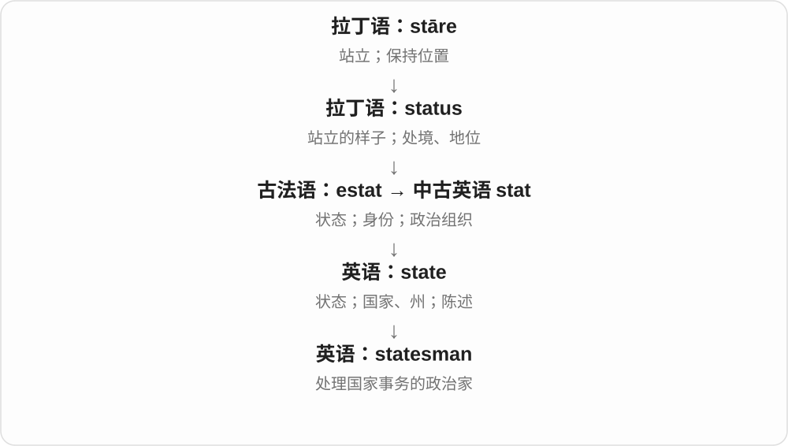
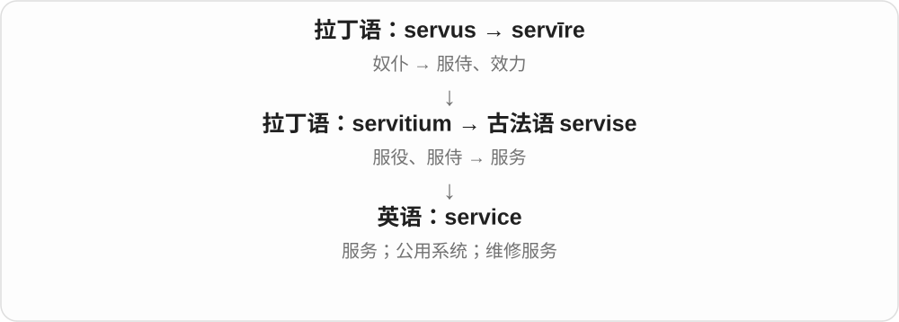
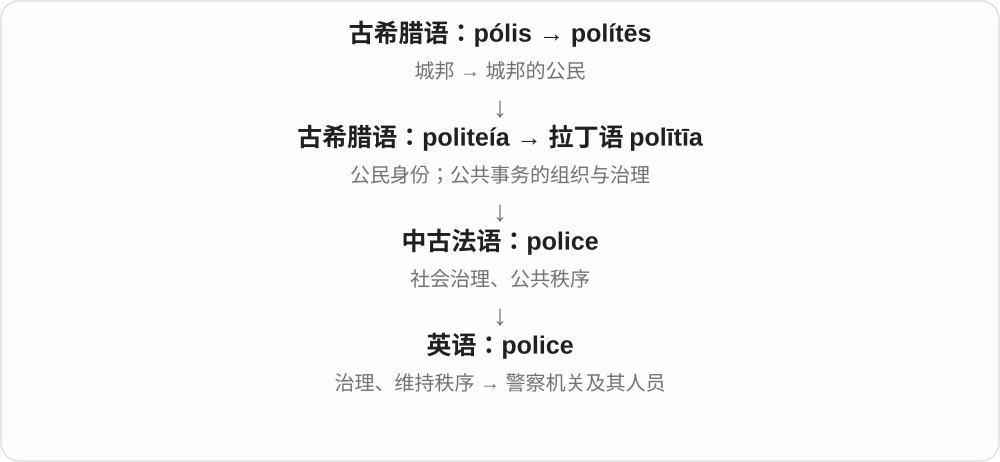
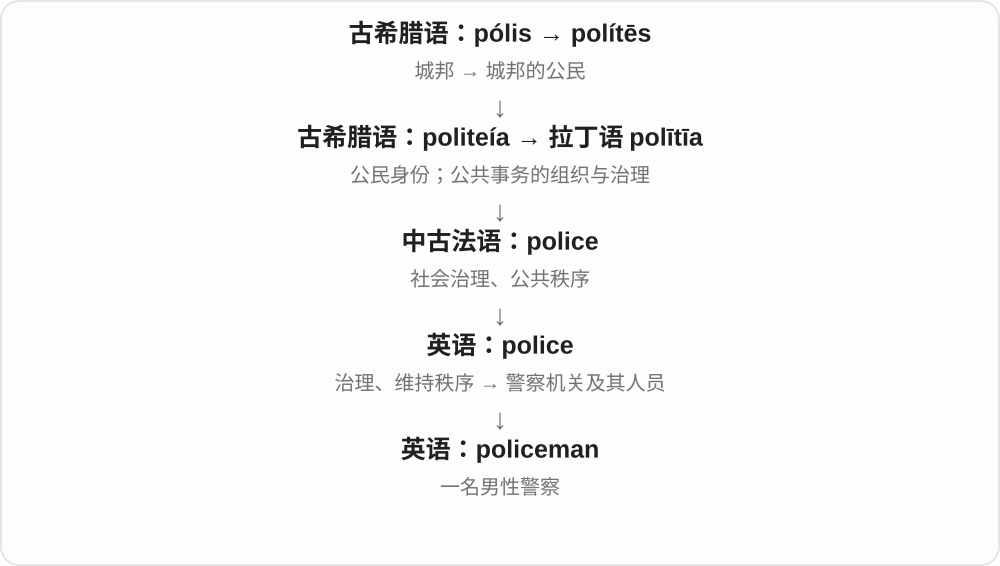
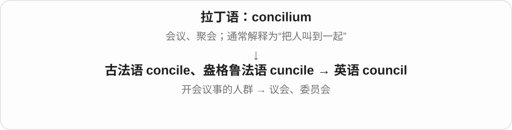
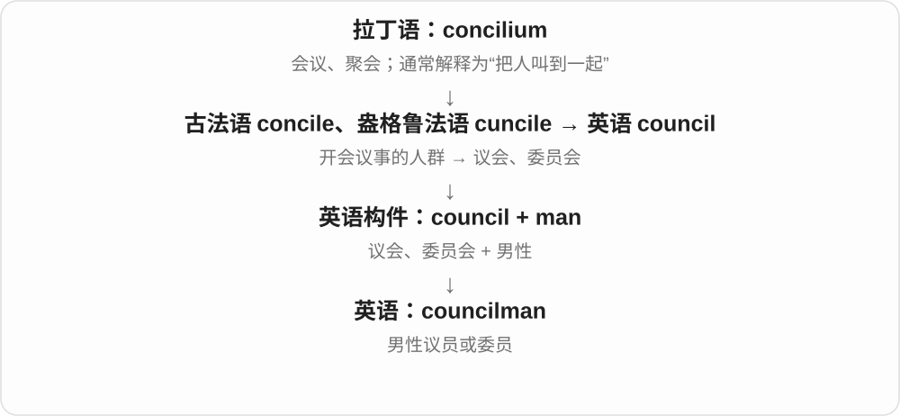
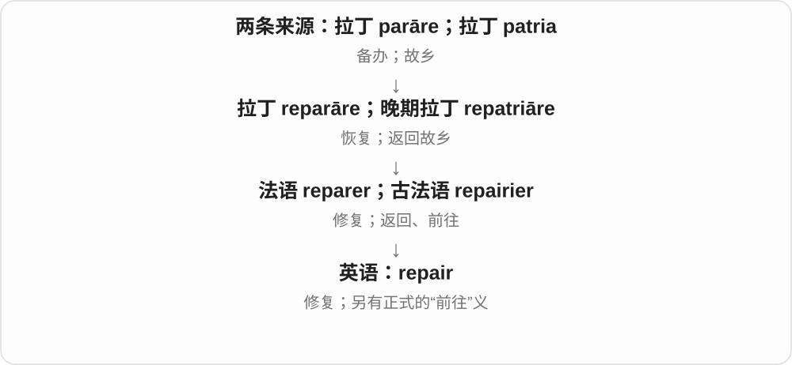

# 0013 · -man — 人，常见于男性人物、职业、身份等合词；部分固定词也有泛指用法

[逐词精讲目录](../00_逐词精讲目录.md) · [总目录](../00_总目录_按常用程度.md)

## 核心词根与来源

man 是古英语 man、mann 延续的本族词，早有人的义，也已有男性等用法；现代独立最常说成年男性。放进合词，具体是否指男性、是否保留传统泛称或职位名称，要看完整词和文体，不能统一抹掉或夸大性别。

**MAN：把工作、领域或角色接到一个人物身上**

repair 修理 → repairman 维修工；ferry 渡运 → ferryman 摆渡人；snowman 则是雪做的人形，不能都理解成真实男性职业。

- **职业基础与人物**：repair · repairman；patrol · patrolman；ferry · ferryman；rifle · rifleman
- **组织、职务和人员**：congress · congressman；clergy · clergyman；crew · crewman；service · serviceman
- **场景决定意思**：line · lineman；letter · letterman；law · lawman；woodsman
- **表演、故事和虚构形象**：stunt · stuntman；hang · hangman；bogey · bogeyman；snowman
- **line → lining：沿线排列的过程**：line · lining
- **crew → crews：工作团队复数与配备人员三单**：crew · crews
- **与 rifleman 对照：rifles 的名词、动词用法**：rifles

## 词形与演化规律

chairman／chairmen、ferryman／ferrymen 等通常改 man 为 men，而非 mans。非重读末尾 -man、-men 在不少词中都弱化为 /mən/，拼写单复数不保证读音都清楚区别。snowman、bogeyman 等也可有较完整元音。保留各词实际读法。

与衬里同形，正文保留两个常用分支。

不是英语 grow 改字母；现代 s 读 z。

这里以 rifleman 的基本词作对照，不把 rifles 说成 -man 的派生词。rifle 的步枪名与划出沟纹有关，rifle through 则是翻找，词史均联系法语 rifler 的刮、掠夺材料。

## 单词速览（按词族由简到繁）

同一基础词的相关扩展放在一起，先读基础形式，再读扩展；各组之间优先读常用的。具体词源关系见各词讲解。

| 单词 | 音标 | 核心意思 |
|---|---|---|
| [work](#w-117) | 英 /wɜːk/；美 /wɜːrk/ | 工作；运作；奏效；作品 |
| [workman](#w-29) | 英 /ˈwɜːkmən/；美 /ˈwɜːrkmən/ | 工人；工匠〔传统称呼〕 |
| [man](#w-118) | /mæn/ | 成年男子；人〔部分泛称、旧用法〕；配备人员 |
| [state](#w-119) | /steɪt/ | 状态；国家、州；陈述 |
| [statesman](#w-9) | /ˈsteɪtsmən/ | 政治家；善于处理国家事务的人 |
| [show](#w-120) | 英 /ʃəʊ/；美 /ʃoʊ/ | 展示；说明；带路；节目；展览 |
| [showman](#w-42) | 英 /ˈʃəʊmən/；美 /ˈʃoʊmən/ | 演出经营者；善于吸引观众的人 |
| [business](#w-121) | /ˈbɪznəs/，也 /ˈbɪznɪs/ | 商业；生意；企业；事务；职责范围 |
| [businessman](#w-2) | /ˈbɪznəsmən/ | 商人；商界男性人士 |
| [line](#w-122) | 英、美 /laɪn/ | 线；一行；队列；路线；沿线排；加衬里 |
| [lining](#w-163) | /ˈlaɪnɪŋ/ | 内衬、衬里、内层；加衬、沿边排列〔现在分词、动名词〕 |
| [lineman](#w-15) | /ˈlaɪnmən/ | 线路工〔美式〕；美式橄榄球线锋 |
| [service](#w-123) | 英 /ˈsɜːvɪs/；美 /ˈsɜːrvɪs/ | 服务；公共服务系统；检修；礼拜 |
| [serviceman](#w-56) | 英 /ˈsɜːvɪsmən/；美 /ˈsɜːrvɪsmən/ | 男性军人；维修服务人员〔另一用法〕 |
| [country](#w-124) | /ˈkʌntri/ | 国家；乡村、乡间；地区；乡村音乐〔简称〕 |
| [countryman](#w-34) | /ˈkʌntrimən/ | 同胞；某国人；乡下人〔尤男性称谓〕 |
| [law](#w-125) | /lɔː/ | 法律；法规；法学；规律、定律 |
| [lawman](#w-72) | 英 /ˈlɔːmæn/；美 /ˈlɔːmæn/ | 执法者；警官〔尤见美式、历史、西部故事〕 |
| [post](#w-126) | 英 /pəʊst/；美 /poʊst/ | 柱；张贴、帖子；邮递；岗位、驻点 |
| [postman](#w-23) | 英 /ˈpəʊstmən/；美 /ˈpoʊstmən/ | 邮递员〔传统男性称谓，也可泛用〕 |
| [air](#w-127) | 英 /eə/；美 /er/ | 空气；天空；通风；公开表达；播出 |
| [airman](#w-36) | 英 /ˈeəmən/；美 /ˈermən/ | 航空人员；空军人员；飞行员〔按语境〕 |
| [watch](#w-128) | 英 /wɒtʃ/；美 /wɑːtʃ/、/wɔːtʃ/ | 观看；留意；守望；值班；手表 |
| [watchman](#w-26) | 英 /ˈwɒtʃmən/；美 /ˈwɑːtʃmən/ | 看守人；守夜人〔传统职业称谓〕 |
| [police](#w-129) | 英、美 /pəˈliːs/ | 警察；警察机关；维持秩序、监督执行 |
| [policeman](#w-5) | 英、美 /pəˈliːsmən/ | 男警察 |
| [fire](#w-130) | 英 /ˈfaɪə/；美 /ˈfaɪər/ | 火；火灾；点燃；开火；解雇；热情 |
| [fireman](#w-16) | 英 /ˈfaɪəmən/；美 /ˈfaɪərmən/ | 消防员〔传统称谓〕；锅炉司炉工 |
| [space](#w-131) | 英、美 /speɪs/ | 空间；空位；间隔；太空；留间隔 |
| [spaceman](#w-73) | 英、美 /ˈspeɪsmæn/ | 宇航员；太空人〔常见于旧式用语、儿童故事〕 |
| [strong](#w-132) | 英 /strɒŋ/；美 /strɔːŋ/、/strɑːŋ/ | 强的；坚固的；强烈的；浓的 |
| [strongman](#w-37) | 英 /ˈstrɒŋmæn/；美 /ˈstrɔːŋmæn/ | 大力士；政治强人 |
| [trade](#w-133) | /treɪd/ | 贸易；交易；行业、手艺；交换 |
| [tradesman](#w-55) | /ˈtreɪdzmən/ | 技术工；手艺人；旧用商人 |
| [council](#w-134) | 英、美 /ˈkaʊnsəl/ | 议会；委员会；理事会 |
| [councilman](#w-19) | 英、美 /ˈkaʊnsəlmən/ | 男性议员、委员会成员〔主要美式〕 |
| [door](#w-135) | 英 /dɔː/；美 /dɔːr/ | 门；出入口；机会之门 |
| [doorman](#w-39) | 英 /ˈdɔːmən/；美 /ˈdɔːrmən/ | 门童；门卫、门口接待人员 |
| [sea](#w-136) | /siː/ | 海；海洋；大片事物的比喻 |
| [seaman](#w-17) | /ˈsiːmən/ | 海员；水手；特定海军军衔 |
| [sale](#w-137) | /seɪl/ | 出售、销售；促销、降价销售 |
| [coach](#w-138) | 英 /kəʊtʃ/；美 /koʊtʃ/ | 教练；辅导者；长途客车、车厢；指导训练 |
| [coachman](#w-62) | 英 /ˈkəʊtʃmən/；美 /ˈkoʊtʃmən/ | 马车夫 |
| [letter](#w-139) | 英 /ˈletə/；美 /ˈletər/ | 字母；信；按字面写出的条文；写上字母 |
| [letterman](#w-20) | 英 /ˈletəmən/；美 /ˈletərmən/ | 获校队字母奖章的运动员〔美式〕 |
| [congress](#w-140) | 名词：英 /ˈkɒŋɡres/、美 /ˈkɑːŋɡrəs/；少用动词 /kənˈɡres/ | 代表大会；议会；美国国会；聚会 |
| [congressman](#w-3) | 英 /ˈkɒŋɡrəsmən/；美 /ˈkɑːŋɡrəsmən/ | 国会议员〔通常指男性，尤指美国众议员〕 |
| [fish](#w-141) | /fɪʃ/ | 鱼；鱼肉；捕鱼；搜寻、探问 |
| [camera](#w-142) | 英、美 /ˈkæmərə/，也读 /ˈkæmrə/ | 照相机；摄像机；镜头 |
| [cameraman](#w-12) | 英、美 /ˈkæmərəmæn/，也读 /ˈkæmrəmæn/ | 摄影师；摄像师〔男性或传统职位称呼〕 |
| [weather](#w-143) | 英 /ˈweðə/；美 /ˈweðər/ | 天气；风化、受风雨侵蚀；挺过〔困难〕 |
| [weatherman](#w-48) | 英 /ˈweðəmæn/；美 /ˈweðərmæn/ | 男性天气预报员 |
| [chair](#w-148) | 英 /tʃeə/；美 /tʃer/ | 椅子；主席、主持人；教授职位；主持 |
| [chairman](#w-1) | 英 /ˈtʃeəmən/；美 /ˈtʃermən/ | 主席；董事长；会议主持人 |
| [wood](#w-144) | /wʊd/ | 木材、木头；树林 |
| [sport](#w-145) | 英 /spɔːt/；美 /spɔːrt/ | 体育运动；消遣；有风度的人；展示、穿戴 |
| [boat](#w-146) | 英 /bəʊt/；美 /boʊt/ | 船、小船；乘船、划船等〔动词〕 |
| [boatman](#w-69) | 英 /ˈbəʊtmən/；美 /ˈboʊtmən/ | 船夫、操船者 |
| [crew](#w-147) | /kruː/ | 全体船员、机组；工作班组；一群伙伴；担任船员 |
| [crews](#w-164) | /kruːz/ | 船员团队、机组、工作班组〔复数〕；为……配备人员〔第三人称单数〕 |
| [crewman](#w-54) | /ˈkruːmən/ | 男性船员、机组或其他乘务组成员 |
| [milk](#w-149) | /mɪlk/ | 奶、乳；挤奶；榨取、充分利用〔比喻〕 |
| [milkman](#w-65) | /ˈmɪlkmən/ | 送奶工〔传统称呼〕 |
| [snow](#w-150) | 英 /snəʊ/；美 /snoʊ/ | 雪；下雪 |
| [snowman](#w-21) | 英 /ˈsnəʊmæn/；美 /ˈsnoʊmæn/ | 雪人 |
| [wing](#w-151) | /wɪŋ/ | 翼、翅膀、机翼；侧翼、派别；临场发挥〔wing it〕 |
| [wingman](#w-35) | /ˈwɪŋmən/，也读 /ˈwɪŋmæn/ | 僚机飞行员；支援搭档、帮忙打圆场的朋友 |
| [hang](#w-152) | /hæŋ/ | 悬挂、挂着；垂下；悬而未决；绞死〔特定义〕 |
| [hangman](#w-49) | /ˈhæŋmæn/ | 执行绞刑者〔历史等语境〕；猜字母游戏名 |
| [repair](#w-153) | 英 /rɪˈpeə/；美 /rɪˈper/ | 修理；修复；正式旧用：前往 |
| [repairman](#w-60) | 英 /rɪˈpeəmən/；美 /rɪˈpermən/ | 男性维修工；修理人员 |
| [craft](#w-154) | 英 /krɑːft/；美 /kræft/ | 手艺、技艺；手工活动；精心制作；船艇、飞行器 |
| [craftsman](#w-14) | 英 /ˈkrɑːftsmən/；美 /ˈkræftsmən/ | 熟练工匠、手艺人；技艺高超的创作者 |
| [rifle](#w-155) | /ˈraɪfəl/ | 步枪；翻找、搜掠〔动词〕 |
| [rifles](#w-165) | 英、美 /ˈraɪfəlz/ | 步枪〔复数〕；翻找、搜寻〔第三人称〕 |
| [rifleman](#w-66) | /ˈraɪfəlmən/ | 步枪兵 |
| [patrol](#w-156) | 英 /pəˈtrəʊl/；美 /pəˈtroʊl/ | 巡逻；巡逻队 |
| [patrolman](#w-59) | 英 /pəˈtrəʊlmən/；美 /pəˈtroʊlmən/ | 巡警；男性巡逻警员 |
| [ferry](#w-157) | /ˈferi/ | 渡船；轮渡；接送、运送 |
| [ferryman](#w-87) | /ˈferimən/ | 摆渡人；渡船船夫 |
| [handy](#w-158) | /ˈhændi/ | 方便实用的；手边的；手巧的 |
| [handyman](#w-38) | /ˈhændimæn/ | 杂务修理工、维修能手 |
| [stunt](#w-159) | /stʌnt/ | 特技动作；吸引注意的噱头；妨碍成长〔另源动词〕 |
| [stuntman](#w-52) | /ˈstʌntmæn/ | 男性特技演员；特技替身 |
| [clergy](#w-160) | 英 /ˈklɜːdʒi/；美 /ˈklɜːrdʒi/ | 神职人员〔集合〕 |
| [clergyman](#w-18) | 英 /ˈklɜːdʒimən/；美 /ˈklɜːrdʒimən/ | 男性神职人员〔常指基督教〕 |
| [kin](#w-161) | /kɪn/ | 亲属；亲人 |
| [kinsman](#w-50) | /ˈkɪnzmən/ | 男性亲属〔较正式、文学〕 |
| [salesman](#w-6) | /ˈseɪlzmən/ | 男销售员；推销员 |
| [fisherman](#w-7) | 英 /ˈfɪʃəmən/；美 /ˈfɪʃərmən/ | 渔民；钓鱼者 |
| [sportsman](#w-22) | 英 /ˈspɔːtsmən/；美 /ˈspɔːrtsmən/ | 男运动员；热爱体育活动的人 |
| [bogey](#w-162) | 英 /ˈbəʊɡi/；美 /ˈboʊɡi/ | 使人害怕的东西；鬼怪；高于标准杆一杆〔高尔夫〕 |
| [bogeyman](#w-70) | 英 /ˈbəʊɡimæn/；美 /ˈboʊɡimæn/ | 吓小孩的虚构怪物；被渲染成可怕威胁的人或事 |
| [conman](#w-53) | 英 /ˈkɒnmæn/；美 /ˈkɑːnmæn/ | 骗子；靠取得信任行骗的人 |
| [woodsman](#w-85) | /ˈwʊdzmən/ | 林业工人；熟悉林地生活、劳作的人 |

## 逐词讲解

### 1. work — 工作；运作；奏效；作品

**音标**：英 /wɜːk/；美 /wɜːrk/

**先抓住这个画面**

人付出劳动把事情做成；机器能按预期运转；一种办法能产生效果。

**怎么拆**

名词接古英语 weorc，动词接 wyrcan 等本族形式，经中古英语延续；与“做、制作”的日耳曼语词族相连。

**怎么变成今天的意思**

**古英语 weorc；wyrcan → 中古英语 work／werken**  
工作、做出的事物；做、制作

↓

**英语 work**  
工作；运作；做出的成果

I work here 是在这里工作，The printer works 是打印机能用，The plan worked 是办法奏效。work 说工作或劳动通常不可数；a work of art 和 collected works 则可数，指作品。

**常见搭配与例句**

at work；go to work；work on；work out；a work of art。

> This key does not work in the front door.

这把钥匙打不开前门。

> She has a lot of work to finish before Friday.

她周五前有很多工作要完成。

> We tried a different approach, and it worked.

我们试了另一种做法，结果奏效了。

**别混淆**

job 是一份职位或具体任务，可数；work 是工作活动，常不可数。I have a lot of work 不能机械写成 many works。

### 2. workman — 工人；工匠〔传统称呼〕

**音标**：英 /ˈwɜːkmən/；美 /ˈwɜːrkmən/

**先抓住这个画面**

穿着工作服，带工具来安装、维修、建造的人。

**怎么拆**

work + man，接古英语 weorcmann 及中古英语 werkman。历史上 man 指人或男性的材料参与，现代具体称呼宜看岗位与语境。

**怎么变成今天的意思**

**古英语 weorc；wyrcan → 中古英语 work／werken**  
工作、做出的事物；做、制作

↓

**古英语 weorcmann → 英语 workman**  
从事劳动，尤其手工、施工工作的人

常见于施工、维修叙述；worker 更宽泛、也更中性。workmen 是复数，不用 workmans。

**常见搭配与例句**

a skilled workman；a workman’s tools；workmen on the roof。

> A workman came to repair the window.

一位工人来修窗户。

> The workmen left their tools beside the gate.

工人们把工具放在大门旁。

**别混淆**

workman 通常强调手工或体力技术劳动；office worker 不常直接换成 office workman。

### 3. man — 成年男子；人〔部分泛称、旧用法〕；配备人员

**音标**：/mæn/

**先抓住这个画面**

眼前可以是一名男子；放进一些历史形成的词里，也可能只是说一个人。

**怎么拆**

接古英语 man、mann，经中古英语延续；复数 men /men/ 是历史元音变化留下的形式，不是加普通 -s。作动词的 man 从名词发展，表示给岗位、设备配人。

**怎么变成今天的意思**

**古英语 man / mann → 中古英语 man**  
人；也用于成年男性

↓

**英语 man**  
男子；部分旧词保留人的泛义

a young man 指年轻男子，mankind 保留整个人类的泛义；man the desk 是派人值守服务台，不要求值守者必须为男性。现代泛指人可直接用 person、people。

**常见搭配与例句**

a young man；men and women；man the reception desk；a man of few words。

> A young man offered to carry her bag.

一名年轻男子提出帮她提包。

> Two volunteers will man the information desk.

两名志愿者将值守咨询台。

**别混淆**

man、male、human 侧重点不同：man 常指成年男子，male 是性别分类，human 指人类。不能把所有带 man 的词都解释成只限成年男性。

### 4. state — 状态；国家、州；陈述

**音标**：/steɪt/

**先抓住这个画面**

先给事物拍一张“此刻是什么样”的照片：房间的状态、人的处境，都可以用 state。政治中，它又表示有组织的国家或州。

**怎么拆**

整词经法语、拉丁语传入，核心来自 status“所处的状态”。不能拆成英语 s + tate。

**怎么变成今天的意思**

从“站成什么样”到“处于什么状态”，再到社会的组织形态。动词 state 是把情况明确说出来，语气通常比 say 正式。

**常见搭配与例句**

in a good state；a member state；state clearly；state that…。

> The house was in a poor state when we bought it.

我们买下这栋房子时，它的状况很差。

> Please state your reason for applying.

请说明你的申请理由。

**别混淆**

state 常说当前状况；status 更常问身份、级别或进度类别。state a reason 是陈述理由，不是建立国家。

### 5. statesman — 政治家；善于处理国家事务的人

**音标**：/ˈsteɪtsmən/

**先抓住这个画面**

statesman 通常不只是“从政的人”，还带有眼光、经验和处理公共事务能力受到认可的意味。

**怎么拆**

state + 连接的 -s- + man，词形受到法语 homme d’État“国家事务之人”的影响。

**怎么变成今天的意思**

国家事务把 state 与从事者连接起来。现代评价一个人是否称得上 statesman，往往包含敬意；也可用 stateswoman 或更中性的表达。

**常见搭配与例句**

an elder statesman；an experienced statesman；a respected statesman。

> He was remembered as a statesman who sought compromise.

人们记得他是一位寻求妥协的政治家。

> The retired leader became an elder statesman in the party.

这位退休领导人成了党内德高望重的政治元老。

**别混淆**

politician 是职业或角色描述；statesman 通常带正面评价，但并不保证此人实际表现一定好。

### 6. show — 展示；说明；带路；节目；展览

**音标**：英 /ʃəʊ/；美 /ʃoʊ/

**先抓住这个画面**

把原本对方看不见、不明白的东西，放到他眼前。

**怎么拆**

接古英语 scēawian 一系，经中古英语 schewen 等形式延续。现代动词有使看见、表明等用法，名词也指表演、展览。

**怎么变成今天的意思**

**古英语 scēawian → 中古英语 schewen**  
看、察看、展示等

↓

**英语 show**  
使看见、展示；节目、展出等名词义

show me the photo 是给我看照片，show that 是结果表明，show someone to a seat 是领某人到座位。a TV show 是电视节目，a flower show 是花展。

**常见搭配与例句**

show someone something；show how；show up；on show；a TV show。

> Could you show me how this machine works?

你能示范一下这台机器怎么用吗？

> The figures show a steady increase.

数字表明有稳定增长。

> We went to a photography show.

我们去看了摄影展。

**别混淆**

show 常把结果、证据或动作展示出来，tell 主要靠话语告知。Show me how to do it 强调示范，不只是告诉名称。

### 7. showman — 演出经营者；善于吸引观众的人

**音标**：英 /ˈʃəʊmən/；美 /ˈʃoʊmən/

**先抓住这个画面**

知道怎样摆出场面、抓住注意力，让观众愿意看下去。

**怎么拆**

show（演出）+ man（人这一称呼材料），历史上可说展演经营者，后来也说善表演、造声势者。

**怎么变成今天的意思**

**英语 show；man**  
并列的构词材料

↓

**show + man → showman**  
经营展演或懂得吸引观众的人

a born showman 是天生会掌控观众的人，可用于演员、主持或公众人物。是否真诚、有实质内容不能仅由会做场面判断。

**常见搭配与例句**

a natural showman；a great showman；a travelling showman。

> The singer is a natural showman.

这位歌手天生善于调动观众。

> A travelling showman brought the attraction to the village.

一位巡回展演经营者把这个节目带到村子。

**别混淆**

showman 关注展示和带动观众的能力，showrunner 是电视创作制作的负责角色，不是另一种写法。

### 8. business — 商业；生意；企业；事务；职责范围

**音标**：/ˈbɪznəs/，也 /ˈbɪznɪs/

**先抓住这个画面**

最早是人忙着处理的事情，现代很大一支专指经营、交易及为此成立的企业。

**怎么拆**

接古英语 bisiġnes、中古英语 businesse 等，历史对应 busy + -ness。后来商业、事务义独立发展，读音压缩；现代普通忙碌另写 busyness。

**怎么变成今天的意思**

**古英语 bisiġ → 中古英语 bisy / busie**  
忙碌、勤勉、被事务占住

↓

**古英语 bisiġnes → 中古英语 businesse → business**  
忙碌、事务 → 商业、企业等

start a business 是创业，do business with 是与人做生意，on business 是出差办事；none of your business 是与你无关，语气可能生硬。

**常见搭配与例句**

start a business；do business with；on business；mind one’s own business。

> She runs a small business from home.

她在家经营一家小企业。

> He is in London on business.

他在伦敦办事出差。

> Let’s get down to business.

我们开始谈正事吧。

**别混淆**

business 泛指商业时常不可数，a business 是一家企业。business hours 是营业时间，不是只说员工忙了多少小时。

### 9. businessman — 商人；商界男性人士

**音标**：/ˈbɪznəsmən/

**先抓住这个画面**

把一个人的主要工作放在经营和商业活动这一边来介绍。

**怎么拆**

business + man，后半常弱读 /mən/，复数 businessmen。business 本身读音已压缩，不逐个念成 busy + ness + man。

**怎么变成今天的意思**

**英语 business；man**  
并列组合的两部分

↓

**business + man → businessman**  
从事商业活动的男性

a local businessman 是当地商人，a successful businessman 是事业有成的商人；不保证每个人都是公司唯一老板。

**常见搭配与例句**

a local businessman；a successful businessman；a retired businessman。

> A local businessman donated books to the school.

当地一位商人向学校捐了书。

> Her father was a businessman who travelled frequently.

她父亲是位经常出差的商人。

**别混淆**

businessman 偏商界身份，entrepreneur 常突出创办、开拓事业；businessperson 是不限定性别的对应称呼。

### 10. line — 线；一行；队列；路线；沿线排；加衬里

**音标**：英、美 /laɪn/

**先抓住这个画面**

一根拉长的绳，可以变成纸上的痕迹，也可以变成一排人。

**怎么拆**

现代词融合古英语 līne 与法语 ligne；法语路线明确接拉丁 līnea“麻线”。“加衬里”另接古英语 līn“亚麻布”，不是把一条细线放进衣服。

**怎么变成今天的意思**

**拉丁 līnum → līneus → līnea**  
亚麻 → 亚麻制的 → 麻线、绳、线条

↓

**古法语 ligne 与古英语 līne 在中古英语中合流**  
绳索、行列、线条；古英语形式还保留日耳曼语言的传承

↓

**英语 line**  
线、行、队列、路线；沿线排列

↓

**独立动词路线：古英语 līn〔亚麻布〕 → 英语 line**  
用布覆盖里面 → 给……加衬里

draw a line 是画线，stand in line 是排队，train line 是铁路线路。line a box 则是给盒子里面铺一层东西。

**常见搭配与例句**

a straight line；in line；a line of text；line a tray with…。

> Draw a line between the two points.

在这两个点之间画一条线。

> We waited in line outside the museum.

我们在博物馆外排队等候。

> Line the tray with baking paper.

在烤盘里铺上烘焙纸。

**别混淆**

row 常是一横排；line 可指队列、连续痕迹或联系路线。衬里义要另按布料画面理解。

### 11. lining — 内衬、衬里、内层；加衬、沿边排列〔现在分词、动名词〕

**音标**：/ˈlaɪnɪŋ/

**先抓住这个画面**

衣服里面贴着身体的那一层布，是 lining。lining a box 是给盒子里铺一层；lining the road 则可能说东西沿道路排开。

**怎么拆**

衬里动词 line 接古英语 lin 亚麻布；线条、排列的 line 有古英语 line 与法语 ligne 等合流材料，最终也与亚麻、线有关。现代 line 去 e 加完整 -ing；加衬动作转衬里名词。

**怎么变成今天的意思**

**古英语 lin 亚麻布 → line 加衬 → lining**  
用布覆盖里面 → 衬里的材料、内层

↓

**另支 line 排列；line 去 e + -ing → lining**  
沿线排列；或正在给东西加衬

a silk lining 丝绸内衬；the lining of a coat 外套衬里；trees lining the road 沿路排列的树。

**常见搭配与例句**

lining a drawer 给抽屉铺衬；a silver lining 困境里的一线好处〔比喻〕。

> The coat has a soft cotton lining.

这件外套有柔软的棉质内衬。

> Tall trees were lining both sides of the road.

道路两旁排列着高树。

**别混淆**

lining 最常见名词是里面的一层，不是普通线条。silver lining 借乌云边亮光说困境中的好处，要整体理解。

### 12. lineman — 线路工〔美式〕；美式橄榄球线锋

**音标**：/ˈlaɪnmən/

**先抓住这个画面**

line 若是电线、电话线，lineman 是维护它的人；line 若是橄榄球队前线，这个词就是线锋。两个意思要把场景接上。

**怎么拆**

line + man；相应人物称呼已有职业和运动两条固定用法，复数 linemen。不是所有排队的人。

**怎么变成今天的意思**

**line 的线路、前线义**  
基础名词在不同场景的分化

↓

**line + man → lineman**  
线路工；橄榄球前线球员

a power lineman 电力线路工；an offensive lineman 进攻线锋。足球边裁常见 linesman 等词，不要把有无 s 全部忽略。

**常见搭配与例句**

a defensive lineman；a power lineman。

> A lineman inspected the damaged power line.

一名线路工检查了损坏的电线。

> The team signed an experienced offensive lineman.

球队签下了一位经验丰富的进攻线锋。

**别混淆**

lineman 与 linesman 在不同地区、运动中有用法差别；读新闻先看是电力维修、橄榄球还是足球。

### 13. service — 服务；公共服务系统；检修；礼拜

**音标**：英 /ˈsɜːvɪs/；美 /ˈsɜːrvɪs/

**先抓住这个画面**

你需要交通、维修或帮助，有人或一套系统持续把这件事提供给你。

**怎么拆**

经法语 servise 来自拉丁语 servitium，与 servīre 同族；不是必须由英语 serve 加 -ice 造出。

**怎么变成今天的意思**

bus service 是公交服务；a service 可以是一次车辆保养或宗教礼拜。service 作动词常指给机器检修保养。

**常见搭配与例句**

customer service；bus services；a church service；service a car。

> The village has a regular bus service.

村里有定时公交服务。

> We had the car serviced before the trip.

出发前我们给汽车做了保养。

**别混淆**

service 更突出服务内容、系统或一次维护；serve 是服务、供给的动作。

### 14. serviceman — 男性军人；维修服务人员〔另一用法〕

**音标**：英 /ˈsɜːvɪsmən/；美 /ˈsɜːrvɪsmən/

**先抓住这个画面**

service 在 armed services 军队这一支里，serviceman 常指男性军人；家电场景里也可能说来维修的人。

**怎么拆**

service + man，人物名随 service 的服役、维修服务等不同义分化。复数 servicemen，不能一律按服务员来理解。

**怎么变成今天的意思**

**service 的军队服役、维修服务等义**  
同一基础词的不同使用场景

↓

**service + man → serviceman**  
男性军人；维修服务人员

a former serviceman 退役军人；a television serviceman 电视机维修人员。service member、repair technician 等可在相应场景清楚说明角色。

**常见搭配与例句**

a former serviceman；a service member。

> The exhibition includes letters from servicemen.

展览里有军人写的信。

> The serviceman came to inspect the broken appliance.

维修人员来检查损坏的电器。

**别混淆**

serviceman 不是所有 waiter 餐厅服务员的通称；former serviceman 通常与服役经历有关，而不是以前端过盘子。

### 15. country — 国家；乡村、乡间；地区；乡村音乐〔简称〕

**音标**：/ˈkʌntri/

**先抓住这个画面**

本来是一片土地；往政治边界看，是国家，往城市外看，是乡间。

**怎么拆**

借古法语 contree，经中古英语 contre，上接通俗拉丁重建形式 *(terra) contrāta“面对的土地”，与 contrā 有关。星号表重建，不当作实见古文。country 不是 county 加 r。

**怎么变成今天的意思**

**古法语 contree → 中古英语 contre**  
面对的一片土地、区域

↓

**英语 country**  
国家；乡间；一片有特点的地域

visit a country 访问一个国家，live in the country 住乡下，mountain country 山区。country music 是乡村音乐，也可简称 country。

**常见搭配与例句**

a foreign country；in the country；across the country；country music。

> She has lived in three different countries.

她在三个不同国家住过。

> They moved from the city to the country.

他们从城市搬到了乡下。

**别混淆**

country 国家、乡间，county 通常是郡、县等行政区；拼写近，来路和行政层级不一样。

### 16. countryman — 同胞；某国人；乡下人〔尤男性称谓〕

**音标**：/ˈkʌntrimən/

**先抓住这个画面**

country 选国家，是同国的人；选乡间，则是熟悉、生活在乡下的人。

**怎么拆**

country + man，man 的男性、人两种传统用法参与构词。女性对应 countrywoman，泛指不标性别可按语境用 compatriot 等。

**怎么变成今天的意思**

**country；man**  
并列构词成分

↓

**countryman**  
同国之人；乡村居民的传统称谓

a fellow countryman 一位同胞，a lifelong countryman 一辈子住乡下的人。要从句中看说的是国籍联系还是乡村生活。

**常见搭配与例句**

a fellow countryman；his countrymen；a lifelong countryman。

> He was pleased to meet a fellow countryman abroad.

在国外遇到一位同胞，他很高兴。

> A lifelong countryman, he knew the local fields well.

他一辈子住乡下，熟悉当地田野。

**别混淆**

countryman 同胞与 countryside 乡间不等于同一义群；同一 country 在复合词里可用不同义项。

### 17. law — 法律；法规；法学；规律、定律

**音标**：/lɔː/

**先抓住这个画面**

人们把规则定下来，作为共同遵守、判断事情的依据；科学里也借来称稳定规律。

**怎么拆**

古英语 lagu 借自古诺尔斯语 lǫg，后者原是 lag“放置、层次”等词的复数，抓“确立下来的规则”。law 与拉丁 lēx 来的 legal 意思相关，来路不同。

**怎么变成今天的意思**

**古诺尔斯语 lǫg → 古英语 lagu**  
原意为放下、确立的事物 → 法、规章

↓

**中古英语 lawe → 英语 law**  
法律、规则、定律

the law 法律体系，a law 一条法律；study law 学法学。the laws of physics 是物理定律，不是议会制定的法案。

**常见搭配与例句**

by law；break the law；study law；a law of nature。

> She decided to study law at university.

她决定在大学学法学。

> The novel imagines a society with very different laws.

小说设想了一个法律很不一样的社会。

**别混淆**

law 法律或规律，rule 规则范围更广；并非家里每条 rule 都是国家法律。law 和 legal 不能只按相同中文就视作现代派生。

### 18. lawman — 执法者；警官〔尤见美式、历史、西部故事〕

**音标**：英 /ˈlɔːmæn/；美 /ˈlɔːmæn/

**先抓住这个画面**

西部片里代表执法的一方，常叫 lawman；他可能是警长等角色，不是研究法条的所有人。

**怎么拆**

较早有古英语、古诺斯语法律事务人物材料；现代执法者义可按 law 法律 + man 理解。复数 lawmen。

**怎么变成今天的意思**

**早期法律事务人物词的相关材料**  
古英语、古诺斯语已有相应称呼

↓

**现代 law + man → lawman**  
执行法律者的常见美式称呼

a frontier lawman 边疆执法者；a veteran lawman 老练警官。常带报道或故事语气，普通正式岗位可直接说 police officer 等具体称谓。

**常见搭配与例句**

a lawman；a frontier lawman。

> The western follows a retired lawman.

这部西部片讲述一位退休执法者的故事。

> The lawman asked the witnesses to wait outside.

执法警官请证人在外面等候。

**别混淆**

lawyer 律师与 lawman 执法者不同；同有 law，不代表职业、职责相同。

### 19. post — 柱；张贴、帖子；邮递；岗位、驻点

**音标**：英 /pəʊst/；美 /poʊst/

**先抓住这个画面**

路边一根柱，墙上一张告示，邮局里一封信，工作中的一个岗位——拼写相同，要分来源、分场景。

**怎么拆**

柱义经古英语、古法语接拉丁 postis；邮递义经法语 poste 接意大利 posta 驿站，岗位、驻点义也与法语 poste 相关。张贴与在显眼柱面等公布告示的用法相连。不要统统解释成 post- 在后。

**怎么变成今天的意思**

**拉丁 postis → 古英语、古法语 post；另一路意大利 posta → 法语 poste**  
柱子；另有驿站、安置位置等词源

↓

**英语 post**  
柱、张贴；邮递；岗位、驻点等同形用法

a fence post 篱笆柱，post a notice 张贴告示，post a letter 邮寄信件，a job post 工作岗位；a social media post 社交平台帖子从公开发布用法扩展。

**常见搭配与例句**

a fence post；post a notice；post a letter；a teaching post；a social media post。

> She posted a notice on the door.

她在门上贴了张告示。

> I need to post this letter today.

我今天要把信寄出去。

> He accepted a teaching post at the local school.

他接受了当地学校的一个教学岗位。

> A wooden post supports the fence.

一根木柱撑着篱笆。

**别混淆**

post 名词、动词的多义要看宾语和场景；post- 在 postwar 等词里表示战后，是另一个前缀用法，不能套到 postman 说成后面的人。

### 20. postman — 邮递员〔传统男性称谓，也可泛用〕

**音标**：英 /ˈpəʊstmən/；美 /ˈpoʊstmən/

**先抓住这个画面**

不是只坐在邮局里的人，而是把邮件送到住户、单位的人。

**怎么拆**

post（邮件投递）+ man；现代不指定性别可说 postal worker、mail carrier，具体岗位仍按职责。

**怎么变成今天的意思**

**post〔邮件、投递〕；man**  
并列构词部分

↓

**postman**  
从事邮件收取、投递的人

the local postman 当地邮递员，the postman delivers letters 邮递员送信；英式很常见。

**常见搭配与例句**

the local postman；the postman’s bag；wait for the postman。

> The postman delivered a parcel this morning.

邮递员今早送来一个包裹。

> Our postman knows every lane in the village.

我们的邮递员熟悉村里每条小路。

**别混淆**

postman 投递员，postmaster 邮局负责人；不是每一位邮递员都管理整个邮局。

### 21. air — 空气；天空；通风；公开表达；播出

**音标**：英 /eə/；美 /er/

**先抓住这个画面**

本来是围在身边、看不见却能呼吸的东西；让东西接触空气，就有通风、公开的感觉。

**怎么拆**

空气义经法语 air、拉丁 aer 接希腊 aer；现代 air 本身已不能再拆成有意义的英语小块。

**怎么变成今天的意思**

**希腊 aer，属格 aeros**  
空气

↓

**拉丁 aer → 法语 air → 英语 air**  
空气

↓

**英语 air 的动词及广播用法**  
让空气接触 → 通风；把意见说出来；通过无线电播出

fresh air 是新鲜空气；air the room 是通风；air concerns 是把担忧公开讲出来；on air 是正在播出。an air of mystery 的神秘气质、put on airs 的摆架子还涉及法语表示神态的另一历史用法，远源有争议，别硬说所有义项都由空气一条线变来。

**常见搭配与例句**

fresh air；in the air；air an opinion；on air；up in the air〔尚未确定〕。

> Open the window and let some fresh air in.

打开窗户，让新鲜空气进来。

> The meeting gave everyone a chance to air their concerns.

会议让每个人都有机会说出自己的担忧。

> The interview will air on Sunday evening.

这段访谈将在周日晚间播出。

**别混淆**

air 和 heir 继承人同音。air concerns 是表达担忧，不是让担忧消失；clear the air 才常比喻消除误会、把话说开。

### 22. airman — 航空人员；空军人员；飞行员〔按语境〕

**音标**：英 /ˈeəmən/；美 /ˈermən/

**先抓住这个画面**

工作与航空、空军联系起来，但不只坐在驾驶舱的人。

**怎么拆**

air + man，man 在职业词中有各自历史沿用；airman 可泛指航空相关人员，部分军事体系还有特定身份、等级用法。

**怎么变成今天的意思**

**英语 air；man〔从业者〕**  
并列组合的两部分

↓

**air + man〔从业者〕 → airman**  
航空、空军相关人员

a young airman 是年轻航空或空军人员；具体是飞行员、维修或其他岗位，需要上下文。不能仅从词尾 man 决定每个制度中的性别范围。

**常见搭配与例句**

an experienced airman；a retired airman；an airman’s account。

> The memoir was written by a former airman.

回忆录由一位前航空人员撰写。

> The exhibition records the experiences of wartime airmen.

展览记录了战时航空人员的经历。

**别混淆**

pilot 明确驾驶航空器，airman 范围可能更宽。airman 与 airline employee 又不是所有语境都同义。

### 23. watch — 观看；留意；守望；值班；手表

**音标**：英 /wɒtʃ/；美 /wɑːtʃ/、/wɔːtʃ/

**先抓住这个画面**

眼睛和注意力留在那里，持续看；手表则帮你留意时间，但得经过旧计时装置的历史再连起来。

**怎么拆**

动词接古英语 wæċċan，名词接 wæċċe，关联清醒、守望。计时器义早期见于唤醒睡者的钟，后来才用于小型便携表，不编守卫一开始就戴现代腕表的故事。

**怎么变成今天的意思**

**古英语 wæċċe〔名词〕、wæċċan〔动词〕→ 中古英语 wacche / wacchen**  
清醒守望、观察、值守

↓

**英语 watch**  
持续看、留意、守卫；闹醒计时装置后发展出便携表义

watch a film 看电影，watch the children 看护孩子，keep watch 值守，a wristwatch 腕表。过去式 watched /wɒtʃt/、美 /wɑːtʃt/，-ed 不加一音节。

**常见搭配与例句**

watch a film；watch out；keep watch；on watch；check your watch。

> We watched the birds from the window.

我们从窗边观察鸟儿。

> She checked her watch before leaving.

离开前，她看了一下手表。

**别混淆**

see 看见可以无意间发生，watch 通常持续有意看，look at 是把目光投向；看一场电影 watch、see 都可有自然语境。

### 24. watchman — 看守人；守夜人〔传统职业称谓〕

**音标**：英 /ˈwɒtʃmən/；美 /ˈwɑːtʃmən/

**先抓住这个画面**

值班守着建筑、街道或其他场所，留意异常的人。

**怎么拆**

watch（守卫、值守）+ man，中古英语有 waccheman；词的传统形式带 man，现代也常按岗位说 guard、security officer。

**怎么变成今天的意思**

**watch；man**  
并列构词部分

↓

**watchman**  
执行看守、值守工作的人

a night watchman 守夜人，a factory watchman 工厂看守人。不是每个戴 watch 手表的男人。

**常见搭配与例句**

a night watchman；a factory watchman；the watchman’s round。

> The night watchman checked the empty building.

守夜人查看了空楼。

> A watchman opened the gate for the delivery truck.

看守人为送货卡车打开了大门。

**别混淆**

watchman 职业守卫，watchmaker 造表、修表工；前者取 watch 守望义，后者取表义。

### 25. police — 警察；警察机关；维持秩序、监督执行

**音标**：英、美 /pəˈliːs/

**先抓住这个画面**

一群人共同生活，需要有人维持公共秩序。这个词从广义的“治理社会”，逐渐收窄到负责治安的人和机构。

**怎么拆**

经法语 police、拉丁语 polītīa，追到希腊语 politeía；不能把现代 police 拆成 poli + ce 来解释。

**怎么变成今天的意思**

the police 通常作复数：The police are here。说一名警察用 a police officer。动词 police 还能说监督规则执行，如 police online forums。

**常见搭配与例句**

call the police；a police officer；police an event；police the rules。

> The police are asking witnesses to contact them.

警方正在请目击者与他们联系。

> Moderators police the forum to keep personal attacks out.

版主监督论坛秩序，防止人身攻击。

**别混淆**

police 是执法人员或执法监督；policy 是做事方针。二者是同源分支，不是一个词拼错了。

### 26. policeman — 男警察

**音标**：英、美 /pəˈliːsmən/

**先抓住这个画面**

police 后面加上 man，把警察机关这群人中的一名男性单独指出来。

**怎么拆**

英语 police + man；复数 policemen，第二部分通常读 /mən/，单复数靠拼写和上下文分辨。

**怎么变成今天的意思**

这个词明确带男性含义。只想说明职业时，police officer 更通用。

**常见搭配与例句**

a uniformed policeman；a plainclothes policeman。

> A policeman helped the child find her father.

一名男警察帮助那个孩子找到了父亲。

> The witness gave her account to a policeman at the scene.

目击者向现场一名男警察讲述了经过。

**别混淆**

a policeman 是一个人；the police 是警方或警察群体。标准用法中不把单个人称为 a police。

### 27. fire — 火；火灾；点燃；开火；解雇；热情

**音标**：英 /ˈfaɪə/；美 /ˈfaɪər/

**先抓住这个画面**

先是燃烧发光、发热的火；后来也说火器射击、强烈热情，解雇则是另一个常用动词义。

**怎么拆**

接古英语 fȳr、中古英语 fyr，远早于现代枪械；动词点燃由火名词等相关用法发展。射击与火器背景相连，不把解雇解释成真拿火烧人。

**怎么变成今天的意思**

**古英语 fȳr → 中古英语 fyr**  
火；更早属日耳曼继承词族

↓

**英语 fire**  
火、点燃；射击；解雇；热情等扩展

light a fire 生火，a house fire 房屋火灾，fire a weapon 开火，fire someone 解雇。fire questions at 连珠炮式发问；fire in her eyes 可说眼里有热情、斗志。

**常见搭配与例句**

a fire breaks out；catch fire；fire someone；fire questions at；play with fire。

> A fire broke out in the old warehouse.

旧仓库起火了。

> The reporter fired questions at the spokesperson.

记者向发言人连珠炮似的发问。

> She was fired after repeatedly missing work.

她多次缺勤后被解雇了。

**别混淆**

on fire 着火，under fire 遭火力攻击或批评；fire 的强度比喻不保证每次真有火焰。

### 28. fireman — 消防员〔传统称谓〕；锅炉司炉工

**音标**：英 /ˈfaɪəmən/；美 /ˈfaɪərmən/

**先抓住这个画面**

现代常是灭火的人，蒸汽机历史里却可能是负责让炉火一直烧着的人。

**怎么拆**

fire + man，按与火打交道的职责命名；灭火与维持炉火是两种工作，不能说所有旧火车 firemen 都在扑火。

**怎么变成今天的意思**

**fire；man**  
并列构词部分

↓

**fireman**  
传统消防员称谓；另为维持锅炉燃烧的司炉工

a fireman in an old story 可能消防员，a locomotive fireman 常是蒸汽机车司炉工。现代不标性别的消防职业称呼通常用 firefighter。

**常见搭配与例句**

a locomotive fireman；a fireman’s helmet；a retired fireman。

> The retired fireman spoke about his career.

退休消防员讲述了职业经历。

> The locomotive fireman tended the boiler fire.

机车司炉工照管锅炉炉火。

**别混淆**

fireman 在旧火车、轮船语境先查司炉义；firefighter 则明确对抗火灾，不是添煤工作的通称。

### 29. space — 空间；空位；间隔；太空；留间隔

**音标**：英、美 /speɪs/

**先抓住这个画面**

桌上能放东西的空处，字与字之间的缝，人与人需要的余地，都可以是 space。

**怎么拆**

经古法语 espace、盎格鲁法语 space 承接拉丁语 spatium。动词由名词发展出安排间距等用法；太空义是较后扩展。

**怎么变成今天的意思**

**拉丁语 spatium**  
空间、范围、距离；也指一段时间，远源尚有不同解释

↓

**古法语 espace / 盎格鲁法语 space → 中古英语 space → 现代 space**  
空间、间隔、时间段；后来包括太空和抽象活动领域

↓

**英语名词 space → 动词 space**  
空间、间隔 → 把东西隔开安排

leave some space 是留些位置；give someone space 是给对方自主和安静的余地。space 也可说时间段，如 in the space of a week。太空通常说 in space，不加 the。

**常见搭配与例句**

enough space for；personal space；in space；space the chairs evenly。

> Leave enough space between the chairs.

椅子之间要留出足够空间。

> I need some space to think about the decision.

我需要一点独处的余地来考虑这个决定。

> The spacecraft spent six months in space.

这艘航天器在太空中运行了六个月。

**别混淆**

room 可指房间，也可指可用空间；space 更广，还指太空、间距与数学空间。

### 30. spaceman — 宇航员；太空人〔常见于旧式用语、儿童故事〕

**音标**：英、美 /ˈspeɪsmæn/

**先抓住这个画面**

把进入太空的人直接叫作“太空人”，是很容易想象的命名。

**怎么拆**

space + man；科幻、通俗作品中形成，后来也用来称真实的宇航员。

**怎么变成今天的意思**

**拉丁语 spatium**  
空间、范围、距离；也指一段时间，远源尚有不同解释

↓

**古法语 espace / 盎格鲁法语 space → 中古英语 space → 现代 space**  
空间、间隔、时间段；后来包括太空和抽象活动领域

↓

**英语 space + man → spaceman**  
在太空旅行、工作的人；科幻中的太空来客

现代正式职业称谓常用 astronaut；spaceman 在玩具、故事中仍很自然。复数是 spacemen。

**常见搭配与例句**

a toy spaceman；a spaceman’s helmet；two spacemen。

> The child dressed as a spaceman for the school play.

孩子在学校话剧里打扮成太空人。

> A toy spaceman stood beside the model rocket.

模型火箭旁边摆着一个玩具太空人。

**别混淆**

astronaut 是现代正式通用称呼；spaceman 往往带旧式、通俗或故事色彩。

### 31. strong — 强的；坚固的；强烈的；浓的

**音标**：英 /strɒŋ/；美 /strɔːŋ/、/strɑːŋ/

**先抓住这个画面**

施得出力，也扛得住力；味道、感情、论据等也能有分量、有强度。

**怎么拆**

接古英语 strang、中古英语 strong 等，旧词族与紧、严格、有力相关。比较级 stronger、最高级 strongest，常见读音在 /ŋ/ 后带 /ɡ/。

**怎么变成今天的意思**

**古英语 strang → 中古英语 strong / strang**  
强、有力；更早有紧、严等相关义

↓

**英语 strong**  
力量大；坚固；强烈、浓的

a strong person 力气大的人，a strong bridge 坚固桥，strong coffee 浓咖啡，a strong argument 有力论据。对应不同对象，别都译强壮。

**常见搭配与例句**

strong coffee；strong evidence；strong support；a strong smell。

> The bridge must be strong enough to carry heavy vehicles.

桥必须足够坚固，能承载重型车辆。

> She made a strong case for changing the plan.

她为修改计划提出了有力理由。

**别混淆**

strong 能施力或承力，也能说浓度、说服力；hard 硬不保证 strong 抗破坏，脆硬材料仍可能易碎。

### 32. strongman — 大力士；政治强人

**音标**：英 /ˈstrɒŋmæn/；美 /ˈstrɔːŋmæn/

**先抓住这个画面**

竞技表演里靠力量惊人，政治语境里靠强势控制掌权；两种强不能混成同一种身份。

**怎么拆**

strong + man，物理力量与政治控制是并列常见命名背景，不是所有大力士都演变成统治者。

**怎么变成今天的意思**

**strong；man**  
并列构词部分

↓

**strongman**  
力量竞技、表演者；强势掌权人物

a circus strongman 马戏大力士，a political strongman 政治强人。后者常含强力、专断统治意味，不只是中性强壮男人。

**常见搭配与例句**

a circus strongman；a strongman competition；a political strongman。

> A strongman lifted heavy weights in the show.

表演中，一位大力士举起重物。

> The biography examines the rise of a political strongman.

传记考察了一位政治强人的崛起。

**别混淆**

strong man 分写可只是强壮男人；strongman 连写常是固定角色名。政治人物也不因这个词就声称肌肉很强。

### 33. trade — 贸易；交易；行业、手艺；交换

**音标**：/treɪd/

**先抓住这个画面**

既能说货物、服务的交换，也能说靠什么手艺吃饭。by trade 问的是职业，不是交换来的身份。

**怎么拆**

中古英语借中古低地德语路径、轨迹词，后有惯常做法、行业与商业活动义；与 tread 踩踏词族相关。别把英语 trade 当 Latin trad- 交付的直接派生。

**怎么变成今天的意思**

**中古低地德语 trade 路径、轨迹 → 中古英语 trade**  
道路、做事的途径

↓

**现代 trade**  
惯常活动、行业 → 手艺、职业；商业交易

international trade 国际贸易，trade with a country 与某国贸易，trade cards 交换卡片；a carpenter by trade 职业是木匠。

**常见搭配与例句**

international trade；trade with；by trade；learn a trade。

> She is an electrician by trade.

她的职业是电工。

> The two countries trade agricultural products.

两国进行农产品贸易。

**别混淆**

trade 可指技术职业，不只买卖；business 范围也广，但 learn a trade 通常指学一门手艺。

### 34. tradesman — 技术工；手艺人；旧用商人

**音标**：/ˈtreɪdzmən/

**先抓住这个画面**

现代常见是靠熟练手艺工作的人员，比如修管道、装线路的工匠；具体范围随地区变化。

**怎么拆**

trade 手艺、行业 + 连接的 s + man 人。历史也有商人义，现代技术工义常见；复数 tradesmen。

**怎么变成今天的意思**

**中古低地德语 trade 路径、轨迹 → 中古英语 trade**  
道路、做事的途径

↓

**现代 trade**  
惯常活动、行业 → 手艺、职业；商业交易

↓

**trade + s + man → tradesman**  
从事某门行业、手艺的人

a skilled tradesman 熟练技术工，a local tradesman 本地工匠；性别中性表达可用 tradesperson。

**常见搭配与例句**

a skilled tradesman；a local tradesman；hire a tradesman。

> We hired a local tradesman to repair the door.

我们请了本地工匠修门。

> The project needs several skilled tradesmen.

项目需要几名熟练技术工。

**别混淆**

tradesman 常说手艺职业，trader 更偏交易买卖；个别历史、地区用法有重叠，不能硬说永远互斥。

### 35. council — 议会；委员会；理事会

**音标**：英、美 /ˈkaʊnsəl/

**先抓住这个画面**

一群被召集起来、代表某个群体讨论和决定事情的人，逐渐成为一个固定机构。

**怎么拆**

经古法语 concile、盎格鲁法语 cuncile 来自拉丁语 concilium“聚会、会议”。它与 counsel“建议”的直接拉丁词源不同。

**怎么变成今天的意思**

a city council 是市议会；a student council 是学生代表组成的议事机构。具体权限要看所在组织，不能只凭这个词认定它一定是国家立法机关。

**常见搭配与例句**

the city council；a council meeting；serve on a council。

> The council voted to repair the public library.

议会投票决定修缮公共图书馆。

> She represents her class on the student council.

她代表班级参加学生议事会。

**别混淆**

council 是议事机构；counsel 是建议或法律顾问。两词同音，拼写和直接来源不同。

### 36. councilman — 男性议员、委员会成员〔主要美式〕

**音标**：英、美 /ˈkaʊnsəlmən/

**先抓住这个画面**

在 council 里担任成员的男性；词尾直接说明人。

**怎么拆**

council + man。复数 councilmen。

**怎么变成今天的意思**

常指市镇议员；作姓氏前的头衔可写 Councilman。这个词本身不表示议长或市长。

**常见搭配与例句**

a city councilman；Councilman Harris；elect a councilman。

> The councilman asked residents about the bus service.

这位市议员询问居民对公交服务的看法。

> Councilman Harris voted against the proposal.

哈里斯议员投了反对票。

**别混淆**

councilman 是成员；chair 是主持该机构的人；councilmember 不限定性别。

### 37. door — 门；出入口；机会之门

**音标**：英 /dɔː/；美 /dɔːr/

**先抓住这个画面**

分隔里外又让人通过的那道门；由能不能进来，很自然地用来比喻机会。

**怎么拆**

继承古英语 duru、dor 等，属于很古老的门词族。现代复合词常用它作可辨认的完整基本词。

**怎么变成今天的意思**

**古英语 duru、dor → 中古英语 dore → door**  
门、门户

↓

**现代 door 词族**  
出入口 → 相关部件、人员；也比喻机会

open the door 开门；open doors for someone 给某人创造机会；next door 是隔壁，the people next door 是隔壁的人。

**常见搭配与例句**

open the door；at the door；next door；open doors for。

> Someone is waiting at the door.

有人正在门口等。

> Learning another language can open doors for you.

学习另一门语言可以为你打开机会之门。

**别混淆**

door 可指活动门扇或门口，doorway 更明确说门的开口；gate 常指围墙、院子等的门或出入口。

### 38. doorman — 门童；门卫、门口接待人员

**音标**：英 /ˈdɔːmən/；美 /ˈdɔːrmən/

**先抓住这个画面**

在建筑入口迎接来客、帮忙开门或管理出入的人，具体职责看场所。

**怎么拆**

door + man，人、男子的组合成分。词形保留历史上以男子命名职业的方式；现代常见于酒店、公寓等场所。复数 doormen。

**怎么变成今天的意思**

**古英语 duru、dor → 中古英语 dore → door**  
门、门户

↓

**现代 door 词族**  
出入口 → 相关部件、人员；也比喻机会

↓

**door + man → doorman**  
门口工作的人 → 门童、门卫

a hotel doorman 酒店门童，the apartment doorman 公寓门卫；不一定只是全天替人拉门，也可能负责接待、协助叫车等。

**常见搭配与例句**

a hotel doorman；an apartment doorman；ask the doorman。

> The doorman helped us carry the bags inside.

门童帮我们把包提进了里面。

> Ask the doorman which entrance to use.

问问门卫该走哪个入口。

**别混淆**

doorman 与 receptionist 接待员工作可能有交集，但 receptionist 通常在接待台，doorman 聚焦入口。

### 39. sea — 海；海洋；大片事物的比喻

**音标**：/siː/

**先抓住这个画面**

一片与陆地相接的广大咸水水域；人群等铺满视野，也能像一片海一样描述。

**怎么拆**

继承古英语 sǣ，属日耳曼古老水域词。更远来源有不同解释，不把凶猛、渗透等假说讲成确定现代意思。

**怎么变成今天的意思**

**古英语 sǣ → 中古英语 see → sea**  
海；日耳曼古老水域词，更远来历有争论

↓

**现代 sea 词族**  
海域、海水 → 岸边、航行、海洋生物等复合词

at sea 在海上，by the sea 在海边，a sea of faces 一片人海；all at sea 也可说茫然无措。

**常见搭配与例句**

at sea；by the sea；a sea of；go to sea。

> We spent the summer by the sea.

我们在海边度过了夏天。

> She looked out at a sea of faces.

她望着眼前密密麻麻的人群。

**别混淆**

sea 与 see 看见同音不同源；ocean 常指全球较大洋域，具体地名、日常泛称各有习惯，不按大小一刀切。

### 40. seaman — 海员；水手；特定海军军衔

**音标**：/ˈsiːmən/

**先抓住这个画面**

在船上从事航海工作的人；某些海军体系也把它用作具体等级称谓。

**怎么拆**

sea + man，古英语已有 sǣmann。复数 seamen，不能因为后面是 man 就把海上任何男子都算职业海员。

**怎么变成今天的意思**

**古英语 sǣ → 中古英语 see → sea**  
海；日耳曼古老水域词，更远来历有争论

↓

**现代 sea 词族**  
海域、海水 → 岸边、航行、海洋生物等复合词

↓

**sea + man → seaman**  
从事海上工作的人 → 海员

an experienced seaman 有经验的海员，an able seaman 熟练水手、特定等级称呼。

**常见搭配与例句**

an experienced seaman；a merchant seaman；an able seaman。

> The experienced seaman noticed the change in the weather.

有经验的海员注意到了天气变化。

> He worked as a merchant seaman for many years.

他从事商船海员工作多年。

**别混淆**

seaman 人，seam 接缝、semen 精液是同音或近音的别词；具体语境与拼写很重要。

### 41. sale — 出售、销售；促销、降价销售

**音标**：/seɪl/

**先抓住这个画面**

sell 是去卖的动作，sale 可以是一笔成交、一次出售，或商店打折卖货的活动。

**怎么拆**

接中古英语 sale、晚期古英语 sala，可能受古诺尔斯语同形词影响。与 sell 是历史同族，不是今天 sell 随意换元音的名词规则。

**怎么变成今天的意思**

**晚期古英语 sala；可能有古诺尔斯语 sala 影响**  
售卖行为，与 sell 同属旧日耳曼词族

↓

**现代 sale**  
销售、出售；降价促销，复数 sales 另有集合用法

for sale 待售，on sale 上市出售或打折促销，a summer sale 夏季促销。a sale of land 土地出售，未必降价。

**常见搭配与例句**

for sale；on sale；a summer sale；make a sale。

> The house next door is for sale.

隔壁房子在出售。

> I bought the jacket in the summer sale.

我在夏季促销时买了这件夹克。

**别混淆**

for sale 表可买；on sale 英美、场景不同，可能只是开售，也可能降价。看到 sale 不都等于便宜。

### 42. coach — 教练；辅导者；长途客车、车厢；指导训练

**音标**：英 /kəʊtʃ/；美 /koʊtʃ/

**先抓住这个画面**

车把人带到目的地，教练把人带过一道关；这是能把两个常见意思接起来的历史比喻。

**怎么拆**

车辆词经法语、德语等接匈牙利 kocsi，与地名 Kocs 有关。英语学生俚语把辅导过考的人比作载人前进的车，后来用于体育等教练。

**怎么变成今天的意思**

**匈牙利地名 Kocs → kocsi〔来自 Kocs 的车〕**  
以制车闻名的地方 → 相应车辆名称

↓

**经德语 Kutsche、法语 coche 等 → coach**  
马车；客车、车厢

↓

**英语辅导者比喻 → coach**  
带人过考试关 → 辅导者、教练；也作指导动词

a football coach 足球教练，a life coach 人生指导者，travel by coach 坐长途客车，coach a team 指导队伍。美式 fly coach 常说坐经济舱。

**常见搭配与例句**

a football coach；travel by coach；coach a team；fly coach。

> The coach helped her improve her technique.

教练帮助她改进技术。

> We travelled to the city by coach.

我们乘长途客车去了城里。

**别混淆**

coach 教练、客车不同于 couch 沙发，只差一个字母但读音、来源都不同。train 强调训练，coach 强调指导者带着提高的过程。

### 43. coachman — 马车夫

**音标**：英 /ˈkəʊtʃmən/；美 /ˈkoʊtʃmən/

**先抓住这个画面**

旧时坐在马车上，握缰绳驾车的人；这个词接车辆那一路，不是男教练的普通名称。

**怎么拆**

coach 马车 + man，复数 coachmen。固定职业名称保留旧马车场景。

**怎么变成今天的意思**

**匈牙利地名 Kocs → kocsi〔来自 Kocs 的车〕**  
以制车闻名的地方 → 相应车辆名称

↓

**经德语 Kutsche、法语 coche 等 → coach**  
马车；客车、车厢

↓

**coach + man → coachman**  
驾马车的人

the coachman’s seat 马车夫座位，a coachman holding the reins 握缰绳的马车夫。常见于历史、小说、老照片。

**常见搭配与例句**

the coachman’s seat；the coachman held the reins；an old coachman。

> The coachman pulled on the reins and stopped the horses.

马车夫拉住缰绳，让马停下。

> The passengers waited while the coachman loaded the luggage.

马车夫装行李时，乘客们等着。

**别混淆**

coachman 马车夫，coach driver 现代常说客车司机；male coach 才可直接说男性教练。

### 44. letter — 字母；信；按字面写出的条文；写上字母

**音标**：英 /ˈletə/；美 /ˈletər/

**先抓住这个画面**

一个个字母排在一起，就能把想告诉对方的话装进一封信。

**怎么拆**

拉丁 littera 经古法语 letre 进入英语；letter 的两个常用名词义在这条历史路线中相连。

**怎么变成今天的意思**

**拉丁 littera／litera**  
字母；复数也可指书信、文献和学问

↓

**古法语 letre → 英语 letter**  
字母；写成的书信

a letter 可以是 A、B 这样的一个字母，也可以是一整封信。to the letter 则是“连字面细节都照做”，如严格按说明操作。作动词时可指给牌子写字。另有罕见 letter“出租者”，来自 let + -er，与本页不同源。

**常见搭配与例句**

a letter of thanks；capital letters；follow the instructions to the letter。

> Write your name in capital letters.

请用大写字母写下你的名字。

> I found a letter from my grandmother inside the book.

我在书里发现了一封奶奶写的信。

> She followed the instructions to the letter.

她一丝不差地按说明操作。

**别混淆**

letter 是字母或书信；word 是由字母组成的词。字面条文叫 the letter，条文背后的用意常叫 the spirit。

### 45. letterman — 获校队字母奖章的运动员〔美式〕

**音标**：英 /ˈletəmən/；美 /ˈletərmən/

**先抓住这个画面**

美国学校有时给达到校队参赛标准的运动员颁校名字母标志；获这种标志的人可叫 letterman，不是送信员。

**怎么拆**

letter 字母标志 + man，取学校体育奖励的特定文化用法；复数 lettermen。姓氏 Letterman 则是专名，不能反过来解释普通名词。

**怎么变成今天的意思**

**letter 的校队字母标志义**  
学校体育中的认可标志

↓

**letter + man → letterman**  
获得这种校队认可的运动员

a varsity letterman 获校队字母奖章的运动员；a letterman jacket 带相应字母标志的校队夹克。具体标准看学校。

**常见搭配与例句**

a varsity letterman；a letterman jacket。

> He became a varsity letterman in his second year.

他在第二年获得了校队字母奖章。

> The character wears an old letterman jacket.

这个角色穿着一件旧校队字母夹克。

**别混淆**

letterman 不是 mail carrier 邮递员；这里的 letter 是奖励标志，不是一封信。

### 46. congress — 代表大会；议会；美国国会；聚会

**音标**：名词：英 /ˈkɒŋɡres/、美 /ˈkɑːŋɡrəs/；少用动词 /kənˈɡres/

**先抓住这个画面**

各地的人向同一处走来，坐下来共同议事。

**怎么拆**

借拉丁 congressus“相会、交锋”，接 con-“共同” + gradī → congredī；动词由名词转用。

**怎么变成今天的意思**

**拉丁 gradus；gradī / gradior**  
一步、台阶、等级；走、迈步

↓

**拉丁 con- + gradī → congredī → congressus**  
一起走来、相会；也可对阵交锋

↓

**英语 congress**  
集会 → 代表大会；部分国家的立法机构

a scientific congress 是学术大会；特指美国国会通常大写 Congress。原来的“相会”也产生过其他旧义，不能反过来把所有 congress 都理解成美国国会。

**常见搭配与例句**

an international congress；a congress of delegates；Congress。

> Researchers presented their findings at an international congress.

研究者在一次国际大会上展示了研究结果。

> Congress debated the proposal.

美国国会辩论了这项提案。

**别混淆**

conference 是会议常用词；congress 常突出正式代表、专业大会或议会组织。

### 47. congressman — 国会议员〔通常指男性，尤指美国众议员〕

**音标**：英 /ˈkɒŋɡrəsmən/；美 /ˈkɑːŋɡrəsmən/

**先抓住这个画面**

Congress 是国会，congressman 是其中的议员称呼；美国语境尤其常说众议员，不是所有政府工作人员。

**怎么拆**

congress + man；congress 来自拉丁会合、走到一起的词族。现代这个称谓通常带男性含义，复数 congressmen。

**怎么变成今天的意思**

**congress**  
大会、国会

↓

**congress + man → congressman**  
相应男性议员的常用称呼

a local congressman 本地区的国会议员；write to a congressman 给议员写信。常用不指性别的替代是 member of Congress；具体机构看国家。

**常见搭配与例句**

a congressman；a member of Congress。

> The congressman met local residents.

这位国会议员会见了当地居民。

> She wrote to her congressman about the proposal.

她就那项提案给本选区国会议员写了信。

**别混淆**

congressman 与 senator 参议员在常见美国新闻里有职务区分；不能把所有来自 Congress 的人都在任何场景只译成同一个细分职位。

### 48. fish — 鱼；鱼肉；捕鱼；搜寻、探问

**音标**：/fɪʃ/

**先抓住这个画面**

水里游的是鱼，设法把它钓上来是 fish；伸手翻找，也像把想要的东西捞出来。

**怎么拆**

名词和动词分别接古英语 fisċ、fiscian。旧日常命名的 fish 还可以宽指水生动物，因此有些带 fish 的动物名并非现代生物分类中的鱼。

**怎么变成今天的意思**

**古英语 fisċ〔名词〕、fiscian〔动词〕**  
鱼；捕鱼

↓

**中古英语 fisch → fish**  
鱼、鱼肉；捕鱼；比喻寻找、探问

go fishing 去钓鱼，fish for keys 翻找钥匙，fish for compliments 故意引别人夸自己。一般说 two fish，fishes 可用于多种鱼等语境。

**常见搭配与例句**

go fishing；a piece of fish；fish for compliments；a fish out of water。

> We saw several fish in the clear water.

我们在清水里看到几条鱼。

> He fished in his bag for the keys.

他在包里翻找钥匙。

**别混淆**

fish 作鱼肉通常不可数；a fish 是一条鱼。a fish out of water 比喻身处陌生环境、不自在的人。

### 49. camera — 照相机；摄像机；镜头

**音标**：英、美 /ˈkæmərə/，也读 /ˈkæmrə/

**先抓住这个画面**

原来像一个让光进来的小暗室，后来成了我们手里的拍摄设备。

**怎么拆**

借自拉丁 camera“拱顶房间”；设备义是 camera obscura“暗室”的简称，再扩展到摄影和录像。英语 chamber 与它同源，却经法语走了另一条路。

**怎么变成今天的意思**

**古希腊语 kamara → 拉丁语 camera**  
有拱顶的空间、房间；更早来源未定

↓

**新拉丁语 camera obscura；英语简称 camera**  
暗室成像装置

↓

**英语 camera 的摄影、摄像义**  
暗箱式成像装置 → 拍照或录影设备

a camera 可以拍照片，也可以录视频，具体靠上下文。on camera 是在镜头前、被录下来；in camera 在法律等语境则是秘密地、非公开地，保留“在内室”这个拉丁用法。

**常见搭配与例句**

a digital camera；a security camera；on camera。

> She raised the camera to photograph the birds.

她举起相机拍摄那些鸟。

> The interview was recorded on camera.

这次采访用摄像机录了下来。

**别混淆**

camera 是设备；photograph 是照片。camera 不等于 phone，但手机中通常装有 camera。

### 50. cameraman — 摄影师；摄像师〔男性或传统职位称呼〕

**音标**：英、美 /ˈkæmərəmæn/，也读 /ˈkæmrəmæn/

**先抓住这个画面**

站在摄影机后面，负责把画面拍下来的人。

**怎么拆**

camera + man；摄影设备名加人员成分，成为职业称呼。

**怎么变成今天的意思**

**古希腊语 kamara → 拉丁语 camera**  
有拱顶的空间、房间；更早来源未定

↓

**新拉丁语 camera obscura；英语简称 camera**  
暗室成像装置

↓

**英语 camera 的摄影、摄像义**  
暗箱式成像装置 → 拍照或录影设备

↓

**英语 camera + man → cameraman**  
操作摄像或电影摄影设备的人

新闻、电视和电影中常用这个词。现代也常说 camera operator，不强调性别。复数 cameramen 的 men 变为 /men/。

**常见搭配与例句**

a television cameraman；a news cameraman；work as a cameraman。

> The cameraman followed the runner along the track.

摄像师沿跑道跟拍那名跑步者。

> A cameraman and a reporter arrived before noon.

一名摄像师和一名记者在中午前到了。

**别混淆**

photographer 常说拍静态照片的人；cameraman 在许多场景中特别指视频或电影摄影人员。

### 51. weather — 天气；风化、受风雨侵蚀；挺过〔困难〕

**音标**：英 /ˈweðə/；美 /ˈweðər/

**先抓住这个画面**

抬头看晴雨、感受冷暖是名词；木头在户外被晒旧是动词；人或公司撑过风波，也能借这幅画面来说。

**怎么拆**

古英语 weder 经中古英语延续，后来词中拼写变为 th。现代动词由天气名词发展：暴露在天气中、经受风雨，再延伸到经受危机。远源与吹风的联系有不同分析，本文不作确定定论。

**怎么变成今天的意思**

**古英语 weder → 中古英语 weder → weather**  
天空、大气、风暴等天气状况

↓

**名词 weather 派生动词用法**  
受风雨影响而风化；经受风暴 → 挺过困难

bad weather 坏天气，a weather forecast 天气预报，weather a storm 挺过风暴或风波。weather 通常不可数，谈天气常说 the weather。

**常见搭配与例句**

the weather forecast；bad weather；weather a crisis；weather the storm。

> The weather changed quickly in the mountains.

山里的天气变得很快。

> The small business managed to weather the crisis.

这家小企业设法挺过了危机。

**别混淆**

weather 某时某地的天气，climate 较长期的气候特点；weather 与 whether“是否”常同音，不能互换拼写。

### 52. weatherman — 男性天气预报员

**音标**：英 /ˈweðəmæn/；美 /ˈweðərmæn/

**先抓住这个画面**

在节目里告诉你明天会不会下雨的人。man 在这里是人物成分，常用于男性预报员。

**怎么拆**

weather 天气 + man 人，合成职业称呼。泛指不限定性别的工作者时，weather forecaster 或 weather presenter 更方便。

**怎么变成今天的意思**

**古英语 weder → 中古英语 weder → weather**  
天空、大气、风暴等天气状况

↓

**名词 weather 派生动词用法**  
受风雨影响而风化；经受风暴 → 挺过困难

↓

**weather + man → weatherman**  
播报、预报天气的男性人员

the TV weatherman 电视天气预报员，according to the weatherman 据预报员所说；复数 weathermen。

**常见搭配与例句**

the TV weatherman；according to the weatherman；a local weatherman。

> The weatherman says it will rain tomorrow.

天气预报员说明天会下雨。

> She interviewed the local weatherman about the forecast.

她采访了当地的男性天气预报员，询问天气预测情况。

**别混淆**

weatherman 职业称呼，weather 天气；并非天气好的人。meteorologist 气象学家更侧重专业研究、预测背景，不必都在电视上播报。

### 53. chair — 椅子；主席、主持人；教授职位；主持

**音标**：英 /tʃeə/；美 /tʃer/

**先抓住这个画面**

从坐的一把椅子，延伸到坐在那个位置上承担的职责。

**怎么拆**

经法语 chaiere、拉丁 cathedra 接希腊 kathédra：katá“向下” + hédra“座位”。现代英语 chair 已不能直接拆出这两个成分。

**怎么变成今天的意思**

**希腊 hédra**  
座位、底座；几何立体的面

↓

**希腊 katá + hédra → kathédra → 拉丁 cathedra**  
向下 + 座位 → 椅子、席位

↓

**古法语 chaiere → 中古英语 chayere → 英语 chair**  
椅子 → 权威席位 → 主持人、主席等职务

↓

**英语 chair 由名词发展动词**  
担任会议主持或委员会主席

take a chair 是坐一把椅子；the chair of the meeting 是会议主持人；chair a meeting 是主持会议。a chair in history 可指历史学教授职位，不能按家具理解。

**常见搭配与例句**

sit on a chair；the chair of the committee；chair a meeting；hold a chair in history。

> Please pull up a chair and join us.

请搬把椅子过来，和我们一起坐。

> She will chair the meeting this afternoon.

她将主持今天下午的会议。

> He holds a chair in modern history.

他担任现代史教授。

**别混淆**

seat 更泛指座位或可坐的地方；chair 通常指供一人坐、有椅背的家具，也常用于主持职位。

### 54. chairman — 主席；董事长；会议主持人

**音标**：英 /ˈtʃeəmən/；美 /ˈtʃermən/

**先抓住这个画面**

坐在主持席位上，负责把讨论和决策往前带的人。

**怎么拆**

chair“权威或主持席位” + man；从占据某种席位的人，成为正式职务名称。不是所有坐椅子的男子都叫 chairman。

**怎么变成今天的意思**

**希腊 hédra**  
座位、底座；几何立体的面

↓

**希腊 katá + hédra → kathédra → 拉丁 cathedra**  
向下 + 座位 → 椅子、席位

↓

**古法语 chaiere → 中古英语 chayere → 英语 chair**  
椅子 → 权威席位 → 主持人、主席等职务

↓

**英语 chair + man → chairman**  
主持席位上的人 → 主席、董事长等

chairman of the board 通常是董事长；chairman of a committee 是委员会主席。传统上也曾用作不区分性别的职位名；现代说法常直接用 chair。

**常见搭配与例句**

chairman of the board；committee chairman；elect a chairman；serve as chairman。

> The chairman asked each member to speak in turn.

主席请各位成员依次发言。

> The board elected a new chairman.

董事会选出了新任董事长。

**别混淆**

chairman 负责主持、领导某组织或董事会；CEO 是首席执行官。两种职务可能由同一人担任，但不是词义上的同一个职位。

### 55. wood — 木材、木头；树林

**音标**：/wʊd/

**先抓住这个画面**

站着长成一片是树林，取下来做桌椅、烧火的是木材；wood 可以从两面看同一种东西。

**怎么拆**

继承古英语 wudu、widu，经中古英语延续。古词就同时涉及树木集合和木材，不必编成现代先有木板再变树林。

**怎么变成今天的意思**

**古英语 wudu、widu → 中古英语 wode**  
树木、树林；木材

↓

**英语 wood**  
木头这种材料；一片树林

made of wood 木制的，a piece of wood 一块木头；a wood 或 the woods 一片树林。wood 作材料通常不可数，woods 作树林很常见。

**常见搭配与例句**

made of wood；a piece of wood；in the woods；out of the woods。

> The bench is made of solid wood.

长椅由实木制成。

> We followed a narrow path through the woods.

我们沿着窄路穿过树林。

**别混淆**

tree 是单棵树，wood 是材料或林地。out of the woods 还可比喻脱离困境；wood 与 would 常同音，拼写、语法不同。

### 56. sport — 体育运动；消遣；有风度的人；展示、穿戴

**音标**：英 /spɔːt/；美 /spɔːrt/

**先抓住这个画面**

现代主要先想体育运动；旧的娱乐玩乐还留在一些表达里，动词 sport 则可说显眼地穿着、留着某种外观。

**怎么拆**

中古英语 disport 的前部脱落成 sport，上接法语 desporter 消遣，历史有让心情离开严肃事务的画面。不是 s- 加 port 港口。

**怎么变成今天的意思**

**古法语 desporter 消遣 → 中古英语 disport、sport**  
让心情离开正事 → 娱乐、玩乐

↓

**现代 sport**  
娱乐活动 → 体育运动；也保留玩乐、展示等义

play sport 参加体育运动，a team sport 团队运动，be a good sport 输赢、玩笑中有风度；sport a beard 留着胡须。

**常见搭配与例句**

a team sport；competitive sport；a good sport；sport a beard。

> Swimming is her favourite sport.

游泳是她最喜欢的运动。

> He was a good sport about losing the game.

他输了比赛也很有风度。

**别混淆**

sport 不仅是竞技比赛，语境也可说娱乐；a good sport 评价人有风度，不是说一项运动规则好。

### 57. boat — 船、小船；乘船、划船等〔动词〕

**音标**：英 /bəʊt/；美 /boʊt/

**先抓住这个画面**

浮在水上载人、载物的工具。日常常指较小船只，但实际名称也有传统例外，不靠一个绝对尺寸界线区分 boat、ship。

**怎么拆**

本族词，接古英语 bāt，经中古英语延续。更远常联系劈开的木材等重建，近源先记可靠旧形；动词由船名发展。

**怎么变成今天的意思**

**古英语 bāt → 中古英语 bot、boot 等 → boat**  
船、较小的船舶；更远与劈木等联系的解释不强定

↓

**英语 boat 与用途、动力合成**  
乘船、划船；按帆、桨、牵引和渡运给船命名

by boat 乘船，a fishing boat 渔船，rock the boat 字面摇船，也可比喻打乱既有局面；in the same boat 同处一种处境。

**常见搭配与例句**

by boat；a fishing boat；rock the boat；in the same boat。

> We crossed the lake by boat.

我们乘船穿过了湖。

> We are all in the same boat with this difficult deadline.

面对这个紧迫期限，我们的处境都一样。

**别混淆**

boat 常较小、ship 常较大型，但用名有例外；in the same boat 是处境相同，不要求两个人真一起坐船。

### 58. boatman — 船夫、操船者

**音标**：英 /ˈbəʊtmən/；美 /ˈboʊtmən/

**先抓住这个画面**

以操船、运人等为工作的人；故事里常是在河上把旅客送到对岸的船夫。

**怎么拆**

boat + man，来自中古英语 boteman 等旧组合，复数 boatmen。职业现代也可用 boat operator 等不限定性别的表达。

**怎么变成今天的意思**

**古英语 bāt → 中古英语 bot、boot 等 → boat**  
船、较小的船舶；更远与劈木等联系的解释不强定

↓

**英语 boat 与用途、动力合成**  
乘船、划船；按帆、桨、牵引和渡运给船命名

↓

**boat + man → boatman**  
操船、以船运人为业者

a local boatman 当地船夫，hire a boatman 请船夫，an experienced boatman 有经验的操船者。

**常见搭配与例句**

a local boatman；an experienced boatman；hire a boatman。

> The boatman took us across the river.

船夫送我们过了河。

> An experienced boatman guided the small vessel through the channel.

一位有经验的操船者引导小船穿过水道。

**别混淆**

boatman 常职业操船，passenger 乘客；不是船上每一个男性乘客都自然叫 boatman。

### 59. crew — 全体船员、机组；工作班组；一群伙伴；担任船员

**音标**：/kruː/

**先抓住这个画面**

历史画面是给队伍添进一批增援，后来这批一起做事的人就成了一个 crew。

**怎么拆**

古法语 creue 是 creistre“生长”的阴性过去分词名词用法，表示增援人手，进入中古英语 crue。现代 crew 不是从英语 grow 改写出来的。

**怎么变成今天的意思**

**拉丁 crescere**  
生长、增加

↓

**古法语 creistre → creue**  
生长 → 增援、补充的人手

↓

**中古英语 crue → 英语 crew**  
增援队伍 → 船员、机组、工作班组

↓

**英语 crew〔动词〕**  
担任船员；为船等配备人员

film crew 通常指拍摄工作人员，与演员 cast 区分；cabin crew 是客舱乘务人员。口语 my crew 也可以是常混在一起的朋友。旧方言中牲畜栏的同形词另源，不走这条历史。

**常见搭配与例句**

a film crew；cabin crew；crew a sailing boat。

> The film crew arrived before sunrise.

摄制组在日出前就到了。

> She spent the summer crewing on a small sailing boat.

她整个夏天都在一艘小帆船上当船员。

**别混淆**

team 强调合作团队，crew 特别常见于操作船、飞机、设备或完成拍摄施工等具体任务的人。

### 60. crews — 船员团队、机组、工作班组〔复数〕；为……配备人员〔第三人称单数〕

**音标**：/kruːz/

**先抓住这个画面**

一群人一起负责让船、飞机或拍摄工作运作，是 a crew。几支分别工作的团队，就用 crews。

**怎么拆**

crew 经古法语 creue，原为 creistre 生长的分词名词化，较早拉丁 crescere；增援人手发展成船员、工作班组。现代加 -s，元音后读 /z/。

**怎么变成今天的意思**

**拉丁 crescere → 法语 creue → crew**  
增长、增援人手 → 工作团队

↓

**crew + -s → crews**  
多支机组、船员团队、工作班组

film crews 摄制组；rescue crews 救援队；flight crews 机组人员团队。

**常见搭配与例句**

two crews 两个班组；crews working together 共同工作的班组。

> Two film crews worked in different parts of the town.

两个摄制组在镇上的不同地方工作。

> The boat crews practised together on the lake.

几支船队在湖上一起练习。

**别混淆**

crews 常在数不同团队，不只是把同一队里的几个人分别数。几名成员可以说 crew members。

### 61. crewman — 男性船员、机组或其他乘务组成员

**音标**：/ˈkruːmən/

**先抓住这个画面**

crew 是一起把船、飞机等运转起来的班组，crewman 指其中一名男性成员，具体工作还要看场景。

**怎么拆**

crew + man；crew 原有补充人员、队伍等历史，现代在船、飞机、制作班组等场景使用。复数 crewmen。

**怎么变成今天的意思**

**crew**  
协同工作的船员、机组等班组

↓

**crew + man → crewman**  
其中的男性成员

a ship’s crewman 船员；a crew member 是不特别说明性别的常用称呼。词本身不固定等于 captain 船长。

**常见搭配与例句**

a crewman；a member of the crew。

> A crewman helped secure the equipment.

一名船员帮忙固定设备。

> The crewman reported the problem to the captain.

那名船员向船长报告了问题。

**别混淆**

passenger 乘客乘坐交通工具，crewman 属于运转、服务班组；两者不是仅凭都在船上就一样。

### 62. milk — 奶、乳；挤奶；榨取、充分利用〔比喻〕

**音标**：/mɪlk/

**先抓住这个画面**

名词说奶，动词说把奶挤出来；一段经历被反复拿来博同情、求关注，也能像不断挤取那样说 milk。

**怎么拆**

奶名词继承古英语 meolc 等，挤奶动词继承 melcan，经中古英语两路到同形 milk。植物饮品、乳白液体借形态用途称 milk，不是所有奶字食品都来自同一动物。

**怎么变成今天的意思**

**古英语 meolc、meoluc → 中古英语 milk 等 → milk〔名词〕**  
奶、乳

↓

**古英语 melcan → 中古英语 milken → milk〔动词〕**  
挤奶；与名词同族，现代词形相同

↓

**现代外形与动作比喻**  
乳白液体、颜色；尽量榨取关注、利益等

a glass of milk 一杯奶，milk a cow 挤牛奶，oat milk 燕麦饮品，milk an opportunity 尽量利用机会，cry over spilt milk 为不可挽回的事懊悔。

**常见搭配与例句**

a glass of milk；milk a cow；oat milk；cry over spilt milk。

> She added a little milk to her tea.

她往茶里加了一点奶。

> The comedian milked the joke for every laugh he could get.

喜剧演员把那个笑话反复发挥，尽可能多逗出些笑声。

**别混淆**

milk 名词常不可数，a milk 可在点单口语中代指一份；milk 比喻榨取常带过度利用语气，看具体宾语。

### 63. milkman — 送奶工〔传统称呼〕

**音标**：/ˈmɪlkmən/

**先抓住这个画面**

把奶送到住户门前的人；man 是人物材料，不是把牛奶做成人形。

**怎么拆**

milk + man，按配送的产品命名职业。复数 milkmen；不同地区、时代的配送制度可不同，词本身不保证只送玻璃瓶奶。

**怎么变成今天的意思**

**古英语 meolc、meoluc → 中古英语 milk 等 → milk〔名词〕**  
奶、乳

↓

**milk + man → milkman**  
送奶的人

the milkman’s round 送奶路线，the local milkman 当地送奶工，leave a note for the milkman 留字条给送奶工。

**常见搭配与例句**

the local milkman；the milkman’s round；leave a note for the milkman。

> The milkman left two bottles by the door.

送奶工在门边放了两瓶奶。

> She left a note for the milkman.

她给送奶工留了张字条。

**别混淆**

milkman 配送，dairy farmer 奶农、生产方；一人可能兼做，但送到门口的人不一定亲自养牛。

### 64. snow — 雪；下雪

**音标**：英 /snəʊ/；美 /snoʊ/

**先抓住这个画面**

从空中飘下、落地积成白层的雪。英语名词和动词同形：snow on the road 是路上的雪，It is snowing 是正在下雪。

**怎么拆**

名词继承古英语 snāw，经中古英语变成 snow。现代动词接中古英语基于雪名词的形式发展，不能把名词、动词当完全同一次借词。

**怎么变成今天的意思**

**古英语 snāw → 中古英语 snaw、snow → snow**  
雪；本族继承词

↓

**中古英语 snouen 等 → 现代动词 snow**  
下雪；现代动词形式接名词发展

heavy snow 大雪，fresh snow 新雪，It snows 下雪，be snowed in 被雪困住。snow 常不可数，the winter snows 可说多场降雪、大片积雪。

**常见搭配与例句**

heavy snow；fresh snow；It is snowing；be snowed in。

> Fresh snow covered the road.

新雪覆盖了道路。

> It started to snow just after midnight.

刚过午夜就开始下雪。

**别混淆**

snow 雪，sleet、hail 是不同天气现象；snowy 是有雪、多雪的形容词，snowing 是下雪动作正在发生。

### 65. snowman — 雪人

**音标**：英 /ˈsnəʊmæn/；美 /ˈsnoʊmæn/

**先抓住这个画面**

用雪堆成像人的形状，眼睛、鼻子等可以再放上去；名字说材料和造型。

**怎么拆**

snow + man 人，复数 snowmen。这里 man 是人形的命名材料，不是保证里面有个真正的人。

**怎么变成今天的意思**

**古英语 snāw → 中古英语 snaw、snow → snow**  
雪；本族继承词

↓

**snow + man → snowman**  
用雪做的人形

build a snowman 堆雪人，a melting snowman 正在融化的雪人，two snowmen 两个雪人。

**常见搭配与例句**

build a snowman；a melting snowman；two snowmen。

> We built a snowman in the garden.

我们在花园里堆了个雪人。

> The snowman began to melt in the afternoon sun.

雪人在午后的阳光下开始融化。

**别混淆**

snowman 雪人，snowball 雪球；做雪人可以用雪球堆，但两个词不是同一形状名称。

### 66. wing — 翼、翅膀、机翼；侧翼、派别；临场发挥〔wing it〕

**音标**：/wɪŋ/

**先抓住这个画面**

先想身体两边伸出去的部分；飞机、楼的一侧、队伍两翼都可借这幅形状。政治 wing 说阵营一派，不是真的长出翅膀。

**怎么拆**

借古诺斯语 vængr 经中古英语传下。更远联系风、吹的词源有可能但不确定。wing it 临场应付有舞台侧幕等旧解释，不把一种故事当定论。

**怎么变成今天的意思**

**古诺斯语 vængr → 中古英语 wenge、winge → wing**  
动物翼；侧边伸出部分等

↓

**两侧伸展的形状、位置引申**  
机翼、建筑侧翼、舞台侧幕；群体一派

↓

**现代常用派生与组合**  
人物位置、翼展、翼尖、翼装、带翼形凸起的器件

spread your wings 展翅、施展能力，under someone’s wing 受某人保护，the east wing 东侧楼翼，wing it 临场应付。

**常见搭配与例句**

spread your wings；under someone’s wing；the east wing；wing it。

> The museum opened a new east wing.

博物馆开放了新东翼。

> I had no notes, so I had to wing it.

我没有笔记，只好临场发挥。

**别混淆**

wing 翼，feather 羽毛不是同一部位；蝙蝠有翼却没有鸟类那种羽毛，wing 不只鸟能用。

### 67. wingman — 僚机飞行员；支援搭档、帮忙打圆场的朋友

**音标**：/ˈwɪŋmən/，也读 /ˈwɪŋmæn/

**先抓住这个画面**

飞行中有人在旁配合支援；日常借来指陪你、帮你搭话打圆场的朋友，不一定真的会开飞机。

**怎么拆**

wing 侧翼 + man 人物，先是航空配合角色，再引申社交支援伙伴。传统名称并不要求所有现代使用对象都按字面男性来解释。

**怎么变成今天的意思**

**古诺斯语 vængr → 中古英语 wenge、winge → wing**  
动物翼；侧边伸出部分等

↓

**wing + man → wingman**  
侧翼配合的飞行伙伴

↓

**航空支援关系 → 日常搭档比喻**  
陪同支援、帮忙打圆场的人

a reliable wingman 可靠僚机伙伴、搭档，act as someone’s wingman 当某人的助攻搭档，a pilot and a wingman 飞行员与僚机伙伴。

**常见搭配与例句**

a reliable wingman；act as someone’s wingman；a pilot and a wingman。

> The pilot stayed close to her wingman.

飞行员与她的僚机伙伴保持接近。

> He asked a friend to be his wingman at the party.

他请一位朋友在聚会上帮忙打圆场。

**别混淆**

wingman 支援搭档，winger 边路球员；社交语境的 wingman 常帮建立联系，不等于正式工作上的所有 assistant。

### 68. hang — 悬挂、挂着；垂下；悬而未决；绞死〔特定义〕

**音标**：/hæŋ/

**先抓住这个画面**

一件东西上端挂住，下面悬着；画挂墙上，衣服垂在钩上，未决问题也像答案还没落地。

**怎么拆**

英语合流了古英语及北欧相关的使悬挂、处于悬挂状态的动词材料，现代既能及物也能不及物。一般常用 hang/hung/hung，绞刑义传统多用 hanged。

**怎么变成今天的意思**

**古英语、北欧悬挂动词材料**  
使物悬挂与处于悬挂状态的旧形式合流

↓

**英语 hang**  
挂起、垂下；抽象悬置等

hang a picture 挂画，hang on a hook 挂在钩上，hang up 挂起、挂断电话，get the hang of 掌握做法；最后是整组习语，不逐字译成拿到悬挂。

**常见搭配与例句**

hang a picture；hang on a hook；hang up；get the hang of。

> A coat hung on the hook by the door.

门边钩子上挂着一件外套。

> Hang the picture a little higher.

把画挂高一点。

**别混淆**

hang/hung 与 hang/hanged 常用义分工；hang 可以自己垂挂，也可以把别的东西挂起来，不必每次都加 be。

### 69. hangman — 执行绞刑者〔历史等语境〕；猜字母游戏名

**音标**：/ˈhæŋmæn/

**先抓住这个画面**

历史材料里是执行绞刑的人；英语课堂说 play hangman，则通常是猜隐藏单词字母的游戏。

**怎么拆**

hang 悬挂、绞死的相应义 + man，承中古英语人物组合；游戏借用同名形象命名，不是所有出现这个词都在说现实刑罚。

**怎么变成今天的意思**

**hang + man 的中古英语组合**  
执行绞刑的人

↓

**hangman 的游戏用法**  
以猜字母为核心的同名游戏

the hangman 历史中的行刑者；play hangman 玩猜字母游戏。复数人物形式 hangmen，游戏名通常不按人数加复数。

**常见搭配与例句**

the hangman；play hangman。

> The historical novel includes a scene with the town’s hangman.

历史小说里有一个涉及镇上行刑者的场景。

> The class played hangman to practise vocabulary.

全班玩猜字母游戏练习词汇。

**别混淆**

hangman 不是任何正在把东西挂起来的人；普通挂画动作不能顺手把人称作 a hangman。

### 70. repair — 修理；修复；正式旧用：前往

**音标**：英 /rɪˈpeə/；美 /rɪˈper/

**先抓住这个画面**

repair 最常用的意思是把损坏的东西重新弄到能用：补好屋顶，也修复受损的关系。

**怎么拆**

修复义来自 re- + parāre → reparāre；repair to“前往”另来自 repatriāre“返回故乡”，与 patria 相连。

**怎么变成今天的意思**

in good repair 是保养状态良好。After dinner we repaired to the lounge 里的 repair 是前往，完全没有修东西的意思。

**常见搭配与例句**

repair a roof；repair the damage；in good repair；repair to the lounge。

> The technician repaired the broken switch.

技术员修好了坏掉的开关。

> It took time to repair their relationship.

修复他们的关系需要时间。

> After dinner, we repaired to the lounge.

晚饭后，我们移步休息室。（正式语体）

**别混淆**

repair 恢复原有功能；replace 是换上另一个。repair to 的旧义不能按“重新准备”硬解释。

### 71. repairman — 男性维修工；修理人员

**音标**：英 /rɪˈpeəmən/；美 /rɪˈpermən/

**先抓住这个画面**

电器坏了，找人查问题、换件、修好；这种角色传统称 repairman，不是重新准备的人。

**怎么拆**

repair 修理 + man；复数 repairmen。repair 与 prepare 准备拼写相近，历史、意思不能随意混。

**怎么变成今天的意思**

**repair**  
修理、使恢复功能

↓

**repair + man → repairman**  
从事修理的人

an appliance repairman 家电维修工；call a repairman 找维修人员。repair technician 也可清楚表示职业而不特别点性别。

**常见搭配与例句**

call a repairman；an appliance repairman。

> We called a repairman to inspect the washing machine.

我们叫了维修人员来检查洗衣机。

> The repairman found a loose connection.

维修工发现有一处连接松了。

**别混淆**

repairman 维修人员，salesman 销售人员；买设备和修设备是不同岗位。

### 72. craft — 手艺、技艺；手工活动；精心制作；船艇、飞行器

**音标**：英 /krɑːft/；美 /kræft/

**先抓住这个画面**

把东西做好的一门本领是 craft，把文章、器物细细安排出来也可 craft。谈一艘船、一架飞行器时，它又是固定的载具词。

**怎么拆**

接古英语 cræft 力量、本领，技能义很早。舟船义可能联系行业、航海本领等旧用法，具体形成不定；不能只说凡手工做的东西都叫一艘 craft。

**怎么变成今天的意思**

**古英语 cræft → craft**  
力量、本领 → 技能、手艺、行业

↓

**熟练制作与巧计**  
craft 动词精心制作；crafty 也发展为善于耍手腕

↓

**器物、舟船与飞行器**  
craft 舟船义的具体形成有不同分析；后来用于水上、空中、太空载具

learn a craft 学一门手艺，arts and crafts 美术手工，craft a speech 精心撰写演讲，small craft 小型船艇，spacecraft 航天器。

**常见搭配与例句**

learn a craft；arts and crafts；craft a speech；small craft。

> She learned her craft from an experienced potter.

她向一位有经验的陶艺师学艺。

> He carefully crafted his reply.

他细细斟酌了自己的回复。

> Several small craft were moored near the pier.

几艘小艇停在码头附近。

**别混淆**

craft 的技能义不只手工，也可说写作、表演等本领。载具义单复数常同形，一艘 craft、多艘 craft；其他手工活动复数 crafts 又有不同用法。

### 73. craftsman — 熟练工匠、手艺人；技艺高超的创作者

**音标**：英 /ˈkrɑːftsmən/；美 /ˈkræftsmən/

**先抓住这个画面**

不是随便动过手的人，而是掌握一门手艺、能把东西做得讲究的人；也可夸写作等工作有工匠般技法。

**怎么拆**

craft 技艺 + 连接成分 -s- + man 人，历史联系 craft 的所有格形式。这里的 s 不是做手艺这个动词的第三人称。

**怎么变成今天的意思**

**古英语 -es 等所有格形式 → 中古英语 -s/-es**  
某物的、与某物有关的关系

↓

**在复合词中固化为连接成分 -s-**  
前后两部分连成一个名称；较新词也可类推形成

↓

**craft + -s- + man → craftsman**  
从事一门技艺、擅长手艺的人

a skilled craftsman 熟练工匠，a master craftsman 大师级手艺人，a literary craftsman 文字技法娴熟的作者；复数 craftsmen。

**常见搭配与例句**

a skilled craftsman；a master craftsman；craftsmen at work。

> A skilled craftsman repaired the old wooden chair.

一位熟练工匠修好了那把旧木椅。

> The novelist is a careful craftsman of dialogue.

这位小说家写对白很讲究技巧。

**别混淆**

craftsman 强调手艺、技巧，crafty 则常说狡猾，不能只见 craft 就以为是同样评价。泛指人也可用 craftsperson、artisan。

### 74. rifle — 步枪；翻找、搜掠〔动词〕

**音标**：/ˈraɪfəl/

**先抓住这个画面**

名词是步枪；若读到 rifle through papers，场景变成翻找一堆纸，不是在说纸堆里有枪。

**怎么拆**

动词材料经法语 rifler 刮、掠夺等，后来有刻槽义；rifled gun 指枪管有相应槽纹，缩短成名词 rifle。翻找、搜掠与器物命名沿不同义支走。

**怎么变成今天的意思**

**法语 rifler → 英语 rifle 动词**  
刮、搜掠等材料，后来也有刻槽义

↓

**rifled gun 等缩短 → rifle 名词**  
按枪管结构得名的步枪

a historical rifle 历史步枪；rifle through a drawer 翻找抽屉。这里学习词义和历史名称，不把两个场景混成同一个动作。

**常见搭配与例句**

a rifle；rifle through papers。

> The museum displays a nineteenth-century rifle.

博物馆展出了一支十九世纪步枪。

> He rifled through the papers looking for the receipt.

他在纸堆中翻找收据。

**别混淆**

rifle through 是翻找，fire a rifle 才是另一种动宾搭配；看到动词 rifle 不能默认场景一定发生射击。

### 75. rifles — 步枪〔复数〕；翻找、搜寻〔第三人称〕

**音标**：英、美 /ˈraɪfəlz/

**先抓住这个画面**

展柜里的 rifles 是步枪；he rifles through a drawer 是他在抽屉里翻找。先看它在句子里是物品，还是找东西的动作。

**怎么拆**

rifle + -s → rifles，/l/ 后读 /z/。枪名接 rifle 划出沟纹的动作；翻找义较早联系掠夺、搜刮。两路历史都联系法语 rifler 的刮、掠取材料。

**怎么变成今天的意思**

**法语 rifler 刮、掠取 → rifle 的搜刮、翻找分支**  
现代 rifle through 常用于翻找物品

↓

**划沟纹的 rifle → rifled firearm 的枪名 rifle → rifles**  
此处只认词名和历史联系，不把两义逐字互译

old rifles 是旧步枪；rifles through papers 是翻找文件。翻找用法常带 through，动作本身不保证带走东西。

**常见搭配与例句**

old rifles；rifles through a drawer；rifles through papers。

> The museum displayed several old rifles behind glass.

博物馆在玻璃柜里陈列了几支旧步枪。

> He rifles through the drawer for his notebook.

他翻找抽屉，想找到自己的笔记本。

**别混淆**

rifles 与 rifles through 的句法不同。前面 several 后面通常在数物品；单数人物主语后加 through，常是在说翻找。

### 76. rifleman — 步枪兵

**音标**：/ˈraɪfəlmən/

**先抓住这个画面**

rifle 是步枪，rifleman 在军事、历史语境里是携带、使用这种武器的士兵称谓。

**怎么拆**

rifle + man；这里取器物名词，不取 rifle through 翻找的动词义。复数 riflemen。

**怎么变成今天的意思**

**rifle 的器物义**  
步枪

↓

**rifle + man → rifleman**  
相应士兵称谓

a rifleman in a historical unit 历史部队中的步枪兵；Rifleman 也可在某些军队作具体军衔称谓，按文本所属制度看。

**常见搭配与例句**

a rifleman；a unit of riflemen。

> The archive includes letters written by a young rifleman.

档案中有一位年轻步枪兵写的信。

> The painting shows a group of riflemen in uniform.

画中是一群穿军服的步枪兵。

**别混淆**

rifleman 指士兵角色，不泛指任何手里出现过步枪的人；也不是翻抽屉者的通常名称。

### 77. patrol — 巡逻；巡逻队

**音标**：英 /pəˈtrəʊl/；美 /pəˈtroʊl/

**先抓住这个画面**

不是走一次路到目的地，而是沿一片区域来回查看，观察是否有问题；这个动作或执行的队伍是 patrol。

**怎么拆**

借法语 patrouille、patrouiller 等巡查、来回走动材料，早先与踩踏、涉水的表达相连。现代不是 pat 轻拍 + roll 滚动的英语拼接。

**怎么变成今天的意思**

**法语 patrouille、patrouiller**  
来回走动、巡查的材料

↓

**英语 patrol 名词、动词**  
巡逻；巡逻队

on patrol 在巡逻；patrol the area 巡查该区域；a patrol car 巡逻车。动词通常接区域，或不带宾语说正巡逻。

**常见搭配与例句**

on patrol；a police patrol。

> Rangers patrol the park every morning.

护林员每天早晨巡查公园。

> A patrol car stopped outside the building.

一辆巡逻车停在楼外。

**别混淆**

patrol 巡查不同于 casual walk 随意散步，通常带观察、保护、执勤等目的。

### 78. patrolman — 巡警；男性巡逻警员

**音标**：英 /pəˈtrəʊlmən/；美 /pəˈtroʊlmən/

**先抓住这个画面**

patrol 是巡逻，patrolman 是做巡逻警务的人；具体警衔、岗位按地区制度理解。

**怎么拆**

patrol + man；复数 patrolmen。现代常也用 patrol officer，不特别说明性别。

**怎么变成今天的意思**

**patrol**  
巡逻、巡逻队

↓

**patrol + man → patrolman**  
巡逻警务人员的传统称谓

a highway patrolman 公路巡警；a local patrolman 当地巡警。不能只按 man 推断任何随意走动的男性。

**常见搭配与例句**

a patrolman；a patrol officer。

> The patrolman directed traffic away from the blocked road.

巡警指挥车辆避开封闭的道路。

> A patrolman spoke to the driver.

一名巡警和驾驶员交谈。

**别混淆**

patrolman 巡警与 pedestrian 行人不同；后者步行经过，不因此在执行巡查。

### 79. ferry — 渡船；轮渡；接送、运送

**音标**：/ˈferi/

**先抓住这个画面**

船把人和车从河这一岸送到另一岸，是 ferry；动词后来也能说用车把一批人来回接送。

**怎么拆**

动词承古英语 ferian 搬运、运送，与 fare 行进的本族词族有关；名词渡口、渡运、渡船又受同族北欧形式影响。不是 fairy 仙女的同一个词。

**怎么变成今天的意思**

**古英语 ferian**  
运送，后来尤常涉及渡水

↓

**名词 ferry 及现代动词扩展**  
渡运、渡船；各种来回接送

take the ferry 乘轮渡；a car ferry 汽车轮渡；ferry passengers to a station 把乘客接送到车站。复数 ferries，过去式 ferried。

**常见搭配与例句**

take a ferry；ferry passengers。

> We took a ferry across the river.

我们坐轮渡过了河。

> A minibus ferried guests to the hotel.

一辆小巴把客人接送到酒店。

**别混淆**

ferry 轮渡与 cruise ship 邮轮功能不同；动词 ferry 强调运送、接送，不保证一定用船。

### 80. ferryman — 摆渡人；渡船船夫

**音标**：/ˈferimən/

**先抓住这个画面**

ferry 是渡船、渡运，ferryman 是把人从这一岸送到另一岸的那个人；故事里也常用这个角色。

**怎么拆**

ferry + man，保留 y；复数 ferrymen。并非每一个坐轮渡的男性乘客都叫 ferryman。

**怎么变成今天的意思**

**ferry**  
渡运、渡船

↓

**ferry + man → ferryman**  
从事摆渡的人

the village ferryman 村里的摆渡人；an old ferryman 老船夫。现代大型轮渡岗位通常还有 captain、crew 等更具体分工。

**常见搭配与例句**

a ferryman；the old ferryman。

> The ferryman took them across the river.

摆渡人把他们送过了河。

> The tale begins with a traveller meeting an old ferryman.

故事从一位旅人遇到老船夫开始。

**别混淆**

ferryman 侧重摆渡角色，passenger 是被运送的人；同在船上，关系方向不同。

### 81. handy — 方便实用的；手边的；手巧的

**音标**：/ˈhændi/

**先抓住这个画面**

工具一伸手就拿得到、拿起来好用，人动手也很熟练。

**怎么拆**

现代可看 hand + -y；历史还有中古英语 hendi、handy 及更早熟练的相关词形影响，不把它当只表示手多。

**怎么变成今天的意思**

**古英语 hand → 中古英语 hand / hond**  
手；与操作、工作者相关的用法

↓

**早期 hendi / handy 等相关形式 → handy**  
熟练、便利、随手可用

come in handy 是派上用场，keep a pen handy 是把笔放在手边，be handy with tools 是善用工具。

**常见搭配与例句**

come in handy；keep handy；a handy guide；handy with tools。

> Keep a notebook handy during the interview.

采访时把笔记本放在手边。

> The extra bag came in handy on the journey home.

返程时，多带的袋子派上了用场。

**别混淆**

handy 方便、手巧，handmade 手工制成；机器做的工具也能非常 handy。

### 82. handyman — 杂务修理工、维修能手

**音标**：/ˈhændimæn/

**先抓住这个画面**

门松了、架子坏了，能动手处理各种小修小补的人，就是 handyman。handy 在这里强调手巧、会修，man 命名人物。

**怎么拆**

handy 动手熟练的 + man 人，复合职业、角色名。复数 handymen /ˈhændimen/；需要中性称呼也可见 handyperson。

**怎么变成今天的意思**

**hand 手 → handy**  
顺手、便利；动手熟练的

↓

**handy + man；handy + -ly**  
handyman 修修补补的能手、杂务工；handily 熟练、方便或轻松地

hire a handyman 雇杂务修理工，a handyman service 杂务维修服务。

**常见搭配与例句**

a local handyman；a handyman service。

> They hired a handyman to fix the cupboard doors.

他们雇了一位杂务修理工修柜门。

> He is a skilled handyman around the house.

他是家里修修补补的能手。

**别混淆**

handyman 范围常在多种小维修、杂务；不表示拥有所有专业施工资质，具体能力看实际从业内容。

### 83. stunt — 特技动作；吸引注意的噱头；妨碍成长〔另源动词〕

**音标**：/stʌnt/

**先抓住这个画面**

影片里的高难度表演可叫 stunt；为了吸引眼球做的宣传花样也可这样叫。另一个动词 stunt 则说成长被压住、没长开。

**怎么拆**

表演、噱头名词十九世纪见于美式运动俚语，确切来源未定。妨碍成长的动词与较早 stunt 短、迟钝等本族材料有关，不能把两条都硬编成同一场特技导致长不高。

**怎么变成今天的意思**

**较早 stunt 形容、动词材料**  
短、受阻等材料 → 阻碍成长的动词

↓

**十九世纪 stunt 名词**  
吸引注意、娱乐的特技；来源未定

a publicity stunt 宣传噱头；perform a stunt 表演特技；stunt growth 阻碍生长。看它是名词还是动词，也看对象是什么。

**常见搭配与例句**

a publicity stunt；stunt development。

> The event was dismissed as a publicity stunt.

这场活动被批评只是宣传噱头。

> The film used trained performers for the stunts.

影片使用受过训练的表演者完成特技。

**别混淆**

stunt 特技、噱头与 stun 使震惊不同；stuntman 取特技义，不是发育受阻者的名称。

### 84. stuntman — 男性特技演员；特技替身

**音标**：/ˈstʌntmæn/

**先抓住这个画面**

演员的角色要完成高风险动作，影片可能请受过训练的特技演员代演；男性称谓常见 stuntman。

**怎么拆**

stunt 特技动作 + man；不是把 stunt 发育受阻的动词义拿来解释成矮小的人。复数 stuntmen。

**怎么变成今天的意思**

**stunt 的特技义**  
为表演等设计的特殊动作

↓

**stunt + man → stuntman**  
从事这类表演的男性人物

a professional stuntman 职业特技演员；work as a stuntman 当特技演员；也有 stunt performer 等不特别点性别的称呼。

**常见搭配与例句**

a stuntman；a stunt performer。

> A stuntman performed the difficult action sequence.

一位特技演员完成了那段高难度动作戏。

> He worked as a stuntman before becoming an actor.

他成为演员前做过特技演员。

**别混淆**

stuntman 表演特技，stand-in 常是替演员走位、打光等的替身，角色可以不同；不能所有替身都当作动作特技演员。

### 85. clergy — 神职人员〔集合〕

**音标**：英 /ˈklɜːdʒi/；美 /ˈklɜːrdʒi/

**先抓住这个画面**

不是单指某一位牧师，而是把从事宗教职务的人作为一群来称呼，叫 the clergy。具体哪些职位算在内，随宗教传统、文本而异。

**怎么拆**

经中古英语 clergie、法语 clergie 接晚期拉丁 clericatus，关联 clericus 神职者与职位、群体材料。它没有保留现代字面 -ate，但历史确有相关名词尾。

**怎么变成今天的意思**

**晚期拉丁 clericus → clericatus → 法语 clergie**  
神职身份、群体；法语也有学识、学者相关义

↓

**中古英语 clergie → clergy**  
现代常集指神职人员

the clergy 神职人员；members of the clergy 神职人员成员；clergy and laity 神职人员与普通信众。

**常见搭配与例句**

the clergy；members of the clergy。

> Members of the clergy attended the meeting.

一些神职人员参加了会议。

> The book examines relations between the clergy and local residents.

书中考察神职人员与当地居民的关系。

**别混淆**

clergy 是集合称呼，单说一位可说 a member of the clergy；clerk 现代常是职员，不能把两者的现义混同。

### 86. clergyman — 男性神职人员〔常指基督教〕

**音标**：英 /ˈklɜːdʒimən/；美 /ˈklɜːrdʒimən/

**先抓住这个画面**

clergy 是神职人员这一整体，clergyman 从里面指出一位男性，不必单靠词形判断具体是哪个教派或职级。

**怎么拆**

clergy + man，保留 clergy 的 y；clergy 的历史经法语、拉丁语与教士、学识相关材料相连。复数 clergymen。

**怎么变成今天的意思**

**clergy**  
神职人员整体

↓

**clergy + man → clergyman**  
其中一位男性神职人员

a local clergyman 当地一位神职人员；clergy member 是不特别点明性别的相关称呼。具体 priest、minister 等头衔仍按宗派、职务。

**常见搭配与例句**

a clergyman；a member of the clergy。

> A local clergyman spoke at the ceremony.

当地一位神职人员在仪式上发言。

> The letters describe his life as a clergyman.

这些信描述了他担任神职人员的生活。

**别混淆**

clergy 是集合称呼，不说 a clergy 表一位；clergyman 是可数人物名词，可以说 a clergyman。

### 87. kin — 亲属；亲人

**音标**：/kɪn/

**先抓住这个画面**

把一群有家庭、亲属关系的人作为整体来说，比逐个说叔叔、表姐更概括。

**怎么拆**

继承古英语 cynn，较早有种类、亲族等义，现代亲属义突出。king 与它远处相关，但不代表每个 kin 都是君王。

**怎么变成今天的意思**

**古英语 cynn → 中古英语 kyn → kin**  
种类、亲族、血统等历史用法

↓

**现代 kin 词族**  
亲属；由亲近、同类关系形成的类似、投契等

next of kin 最近亲属，one’s kin 某人的亲人；日常 relatives 更常见，kin 常在正式称谓、文学表达或固定短语里。

**常见搭配与例句**

next of kin；one’s kin；close kin；kin and friends。

> The form asks for the name of your next of kin.

表格要求填写最近亲属的姓名。

> She travelled home to visit her kin.

她回乡探望亲人。

**别混淆**

kin 多为集合式亲属称呼，a relative 更直接说一位亲属；next of kin 具体按何规则认定要看文件或制度语境。

### 88. kinsman — 男性亲属〔较正式、文学〕

**音标**：/ˈkɪnzmən/

**先抓住这个画面**

知道是亲戚、是男性，但不一定要说清他到底是叔叔还是表兄。

**怎么拆**

kin 亲族的所有格成分 + man 男性，形成男性亲属称谓；复数 kinsmen，后半元音变化，不能只加 s。

**怎么变成今天的意思**

**古英语 cynn → 中古英语 kyn → kin**  
种类、亲族、血统等历史用法

↓

**现代 kin 词族**  
亲属；由亲近、同类关系形成的类似、投契等

↓

**kin 的关系形式 + man → kinsman**  
亲族中的男性 → 男性亲属

a distant kinsman 远房男性亲属，his kinsmen 他的男性亲属们；历史、小说里比日常闲聊常见。

**常见搭配与例句**

a distant kinsman；a close kinsman；his kinsmen。

> A distant kinsman arrived with news from home.

一位远房男性亲属带着家乡消息来了。

> The letter was addressed to one of his kinsmen.

信写给了他的一位男性亲属。

**别混淆**

kinsman 亲属，countryman 同国人、乡下人等另看语境；不能把同乡直接当有血缘。

### 89. salesman — 男销售员；推销员

**音标**：/ˈseɪlzmən/

**先抓住这个画面**

负责把产品介绍给客户、促成销售的人。salesman 通常指男性；不强调性别时可以用 salesperson。

**怎么拆**

sales 销售 + man 人、男人 → salesman；中间 s 属 sales 这一材料，不另造一个 sale-sm 词根。

**怎么变成今天的意思**

**sales + man**  
从事销售的人

↓

**salesman → salesmanship**  
销售员；相关销售技巧

a car salesman 汽车销售员；a travelling salesman 旅行推销员。复数 salesmen，读 /ˈseɪlzmən/，常与单数弱读听起来相同。

**常见搭配与例句**

a car salesman；an experienced salesman。

> The salesman explained the differences between the two models.

销售员解释了两款型号的区别。

> He worked as a car salesman for several years.

他做过几年汽车销售员。

**别混淆**

salesman 说人，salesmanship 说本领；salesperson 是不强调性别的常用对应，不是销售技巧。

### 90. fisherman — 渔民；钓鱼者

**音标**：英 /ˈfɪʃəmən/；美 /ˈfɪʃərmən/

**先抓住这个画面**

捕鱼的人，既可职业出海，也可坐河边休闲垂钓。

**怎么拆**

fisher + man，前部已经是捕鱼者，后接人物成分 man。复数 fishermen，读音中末部通常仍弱读 /mən/。

**怎么变成今天的意思**

**古英语 fisċ〔名词〕、fiscian〔动词〕**  
鱼；捕鱼

↓

**中古英语 fisch → fish**  
鱼、鱼肉；捕鱼；比喻寻找、探问

↓

**fisher + man → fisherman**  
捕鱼、钓鱼的人

a local fisherman 当地渔民，an amateur fisherman 业余钓鱼者，fishermen at sea 海上渔民。

**常见搭配与例句**

a local fisherman；an amateur fisherman；fishermen at sea。

> The fisherman repaired his nets before dawn.

渔民在天亮前修补渔网。

> Two fishermen were sitting quietly by the river.

两个钓鱼者静静坐在河边。

**别混淆**

fisherman 传统词形含 man，强调不限定性别可用 fisher 或具体说 fishing workers；不要把复数写成 fishermans。

### 91. sportsman — 男运动员；热爱体育活动的人

**音标**：英 /ˈspɔːtsmən/；美 /ˈspɔːrtsmən/

**先抓住这个画面**

按参与运动来称呼人，常指男性；传统用法还可包括钓鱼、狩猎等户外活动爱好者。

**怎么拆**

sports + man，复数 sportsmen。不是每个词中的 s 都另有一层深奥词根，这里接运动类别形式。

**怎么变成今天的意思**

**sport〔活动、娱乐、运动〕→ sports**  
复数及运动类别修饰形式

↓

**sports 与人物、品格、衣着成分组合**  
运动参与者、体育风度、运动服装

↓

**sports + man → sportsman**  
参与运动、户外体育活动的男性

a keen sportsman 热爱体育的人，a professional sportsman 职业男运动员。按地区、语境可有较宽或较窄范围。

**常见搭配与例句**

a keen sportsman；a professional sportsman；an accomplished sportsman。

> He was a keen sportsman throughout his school years.

上学那些年，他一直热爱体育。

> The prize recognizes an outstanding young sportsman.

奖项表彰一名出色的青年男运动员。

**别混淆**

sportsman 带男性信息，sportsperson 不指定性别，athlete 常强调训练、竞技者；范围并非每处完全相同。

### 92. bogey — 使人害怕的东西；鬼怪；高于标准杆一杆〔高尔夫〕

**音标**：英 /ˈbəʊɡi/；美 /ˈboʊɡi/

**先抓住这个画面**

一条意思是吓人的怪物、被人放大的恐惧；高尔夫里又借同名材料，形成高于标准杆一杆的计分名称。

**怎么拆**

常与 bogy、bogle 等鬼怪词族相连，更早来源未定。高尔夫义十九世纪后期发展，可能联系想象对手 Bogey 的命名，不从 bog 泥潭直接推出。

**怎么变成今天的意思**

**bogy、bogey 等鬼怪词族**  
吓人的东西，更早来源未定

↓

**高尔夫等场景的 bogey**  
后来形成的特定计分、称呼义

the bogey of failure 失败这一令人恐惧的东西；make a bogey 打出高于标准杆一杆的成绩。英式口语还可指鼻屎，语体随意。

**常见搭配与例句**

a bogey；a bogey on the final hole。

> Failure had become his greatest bogey.

失败成了他最大的恐惧。

> She made a bogey on the final hole.

她在最后一洞打出高于标准杆一杆的成绩。

**别混淆**

高尔夫 bogey 高于标准杆一杆，birdie 低一杆；普通“吓人的东西”义不能拿杆数解释。

### 93. bogeyman — 吓小孩的虚构怪物；被渲染成可怕威胁的人或事

**音标**：英 /ˈbəʊɡimæn/；美 /ˈboʊɡimæn/

**先抓住这个画面**

故事里说“不听话怪物就来”，那个虚构吓人角色是 bogeyman；评论里也可说某个人被塑造成众人害怕的假想敌。

**怎么拆**

bogey 鬼怪 + man；北美也常写 boogeyman，另有 bogyman 等变体。这里不取高尔夫高一杆的义。

**怎么变成今天的意思**

**bogey 的鬼怪义**  
用来制造恐惧的虚构东西

↓

**bogey + man → bogeyman**  
吓人怪物；比喻被塑造的威胁

the bogeyman of the story 故事里的怪物；turn someone into a bogeyman 把某人塑造成可怕威胁。复数 bogeymen。

**常见搭配与例句**

a childhood bogeyman；a political bogeyman。

> The child was frightened by stories about the bogeyman.

孩子被关于怪物的故事吓到了。

> The article argues that the group has been turned into a convenient bogeyman.

文章认为，这个群体被塑造成了一个现成的可怕假想敌。

**别混淆**

bogeyman 强调恐惧形象或被渲染的威胁，enemy 敌人不一定虚构；用比喻义时，常在质疑恐惧被如何制造。

### 94. conman — 骗子；靠取得信任行骗的人

**音标**：英 /ˈkɒnmæn/；美 /ˈkɑːnmæn/

**先抓住这个画面**

先装得可靠，让你愿意相信，再利用你的信任骗钱、骗利益，就是 conman 的典型套路。它不仅是偶尔说错话的人。

**怎么拆**

con 的 confidence 欺诈缩称 + man；也可理解为 confidence man 的缩短形式。不是反对的 con + man，后半主要标人物。

**怎么变成今天的意思**

**confidence trick／confidence man → con 的骗局义**  
先骗得信任，再骗取利益

↓

**con + man → conman**  
以取得信任来行骗的人

a clever conman 狡猾骗子，expose a conman 揭穿骗子。也常分写 con man，con artist 则是常见的不带 man 的说法。

**常见搭配与例句**

a clever conman；expose a conman；con artist。

> The film follows a conman who invents a false identity.

电影讲述一个伪造身份行骗的骗子。

> The journalist exposed the conman’s scheme.

记者揭穿了骗子的计划。

**别混淆**

conman 涉及欺骗意图，不能把一次诚实错误直接当骗局。cunning 狡猾在意义上有关，但它本身不是 conman 的词源。

### 95. woodsman — 林业工人；熟悉林地生活、劳作的人

**音标**：/ˈwʊdzmən/

**先抓住这个画面**

不只是进树林散步，而是常在林中工作、懂得林地生活门道的人，可叫 woodsman。

**怎么拆**

woods 林地、树林 + man；中间 s 是 woods 的一部分，不是拼写时随意加的连接音。复数 woodsmen。

**怎么变成今天的意思**

**woods**  
树林、林地的常用复数形式

↓

**woods + man → woodsman**  
林中工作或熟悉林地生活的人

an experienced woodsman 熟悉林地工作的老手；a skilled woodsman 林地工作、生活经验丰富的人。具体可能是伐木等职业，也可能强调经验。

**常见搭配与例句**

an experienced woodsman；a skilled woodsman。

> The woodsman knew the paths through the forest.

这位熟悉林地的人知道林中的小路。

> The story describes the daily work of a woodsman.

故事描述了一位林业工人的日常工作。

**别混淆**

woodsman 常比 tourist 游客多了长期经验或职业关系；woodman 也有相关历史用法，但现代不能只按去掉 s 就普遍互换。

## 这一组要分清什么

lineman 的线路工、橄榄球线锋看场景；serviceman 不等于所有餐厅服务员；lawman 执法者／lawyer 律师；letterman 是校队文化用法，不是送信员。repair technician、crew member、member of Congress 等可在相应场合准确点明角色。

## 串起来练习

The repairman spoke to a crewman while the ferryman prepared for the crossing.

维修人员在和一名船员交谈，摆渡人则为过河作准备。
