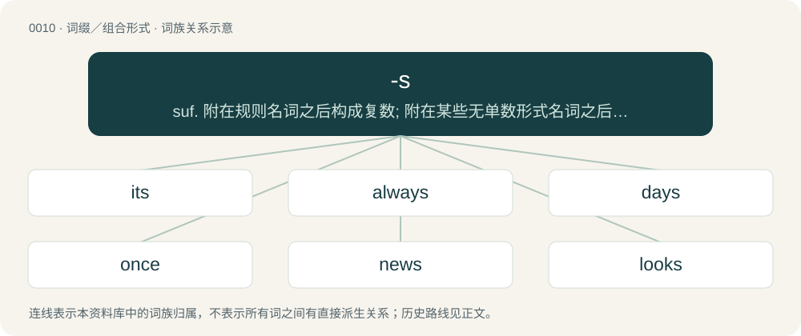

# 0013 · -s — suf. 附在规则名词之后构成复数; 附在某些无单数形式名词之后构成复数glasses, socks, trousers; 附在某些名词之后构成单数billiards, checkers, works; 用以构成表示反复或一贯之动作或状态的副词always, Sundays; 附在原形动词之后, 构成第三人称单数一般现在时态的陈述语气: comes, goe

[总目录](../00_总目录_按常用程度.md)

**类型**：词缀／组合形式　｜　**来源语言**：见词源记录

## 核心含义与来源

- 核心含义：suf. 附在规则名词之后构成复数; 附在某些无单数形式名词之后构成复数glasses, socks, trousers; 附在某些名词之后构成单数billiards, checkers, works; 用以构成表示反复或一贯之动作或状态的副词always, Sundays; 附在原形动词之后, 构成第三人称单数一般现在时态的陈述语气: comes, goes, tries, walks
- 英文含义：Used to form regular plurals of nouns.
- 词形：-s

**多个词源／构词路径**：同一拼写可能有不同来源；以下按词性和含义分别列出。

**来源记录 1**（后缀／后置成分；Used to form regular plurals of nouns.）

Inherited from Middle English -s, -es, from Old English -as, nominative-accusative plural ending of masculine a-stem (i.e. strong) declension nouns, from Proto-West Germanic \*-ōs, from Proto-Germanic \*-ōs, \*‑ōz, from Proto-Indo-European \*-es, \*-oes (plural endings). The spread of this ending in later Middle English was once argued to have been the result of Anglo-Norman influence; however, -as was already the most common Old English plural marker (used in approximately 40% of Old English nouns), and was initially more common in the North of England where French influence was weakest, only later gradually spreading south, replacing the usual southern plural ending -en. Cognate with Scots -s (plural ending), Saterland Frisian -s (plural ending), West Frisian -s (plural ending), Dutch -s (plural ending), Low German -s (plural ending), Danish -er (plural ending), Swedish -r, -ar, -or (plural ending), Icelandic -ar (plural ending), Gothic -𐍉𐍃 (-ōs, nominative plural ending of a-stem masculine nouns). Not directly related to German -er (plural ending) which has a different origin.

**来源记录 2**（后缀／后置成分；Used to form the third-person singular indicative present tense of verbs.）

From Middle English -(e)s (third-person singular ending), from Northumbrian Old English -es, -as (third-person singular endings). Gradually replaced the older -eth, from Old English -(e)þ, -aþ, during the Middle English and Early Modern English periods. It is predominantly believed that -(e)s is identical to the Old English second-person singular ending -es, -est (cf. archaic Modern English -est, as in thou singest). The use for the third-person singular would have been caused by speakers of Old Norse who switched to speaking English and confounded the endings due to analogy with their native tongue. In Old Norse, the second and third person singular indicative forms were identical (e.g. þú masar, hann masar; þú þekkir, hann þekkir; etc.). An alternative theory sees the shift from /θ/ in -eth to /s/ (later /z/) in -(e)s as a mere phonetic simplification due to the frequency of the ending, but the objection to this is that no such development can be observed anywhere else in English. Nevertheless the relative similarity in sound between both forms may have facilitated the spread of -es.

**来源记录 3**（后缀／后置成分；Used in the formation of certain English adverbs.）

From Middle English -es, from Old English -es, the masculine and neuter genitive singular ending of strong nouns. More at -'s.

**来源记录 4**（后缀／后置成分；Possessive marker, indicating that an object belongs to the word bearing the marker.）

A variant spelling of -'s, partly an archaism, partly by dropping the apostrophe.

**来源记录 5**（后缀／后置成分；Hypocoristic suffix）

Modern sense in slang \[circa 1936\]. According to OED, a colloquial clipping of the hypocoristic diminutive suffix -sy. As AHD writes, -sy itself usually being informal, ironic and/or jocular, and possibly a combination of -s (“plural marker”) and conflation of -y as adjectival with its sense as a diminutive suffix (e.g., puppy, kitty), the latter notion probably from Scots.

## 词族图

## 单词速览（常用到不常用）

| 单词 | 音标 | 释义 |
|---|---|---|
| [its](#w-1) | 美 /ɪʔ.s/；/ɪts/ | pron. 它的 |
| [always](#w-2) | 英 /ˈɔːl.weɪz/；/ˈɔl.weɪz/ | adv. 总是, 始终 |
| [days](#w-3) | /ˈdeɪz/ | n. 一生, 时期；adv. 每天, 在白天 |
| [once](#w-4) | 英 /wʌn(t)s/；美 /wʌn(t)s/ | adv. 一次, 曾经, 一旦；conj. 一旦, 一经；n. 一次 |
| [news](#w-5) | 英 /njuːz/；美 /nuːz/ | n. 新闻, 消息, 报导；\[法\] 新闻, 消息, 新闻报导 |
| [looks](#w-6) | /lʊks/ | n. 美貌 |
| [sometimes](#w-7) | /ˈsʌm.taɪmz/ | adv. 有时, 时常, 往往 |
| [perhaps](#w-8) | 英 /pəˈhæps/；美 /pɚˈhæps/ | adv. 也许, 大概 |
| [towards](#w-9) | 英 /təˈwɔːdz/；美 /tʊˈwɔɹdz/ | prep. 向, 对于, 为了 |
| [sports](#w-10) | /spɔːɹts/ | n. (英)运动会, 运动的, 适用于运动的, 运动会的, 与运动会有关的 |
| [yours](#w-11) | 英 /jɔː(ɹ)z/；美 /jɔɹz/ | pron. 你的(东西), 你们的(东西) |
| [heads](#w-12) | /hɛdz/ | 【英文】High-grade marijuana. |
| [besides](#w-13) | 英 /bɪˈsaɪdz/；美 /bɪˈsaɪdz/ | prep. 除...之外；adv. 而且, 此外 |
| [nights](#w-14) | /naɪts/ | n. 每夜, 在任何夜晚 |
| [economics](#w-15) | 英 /ˌiːkəˈnɒmɪks/；美 /ˌɛkəˈnɑmɪks/ | n. 经济学；\[经\] 经济学 |
| [amongst](#w-16) | 英 /əˈmʌŋst/；/əˈmɜŋst/ | prep. 在...当中, 在...之间, 在...之中 |
| [overseas](#w-17) | 英 /ˌəʊvəˈsiːz/；美 /ˌoʊvɚˈsiːz/ | a. 海外的, 国外的；adv. 在海外, 在国外 |
| [earnings](#w-18) | /ˈəːniŋ/ | n. 所赚的钱, 工资, 收入；\[经\] 工资, 收入, 收益, 盈余 |
| [ours](#w-19) | 英 /ˈaʊəz/；美 /ˈaʊɚz/ | pron. 我们的 |
| [shorts](#w-20) | 英 /ʃɔː(ɹ)ts/ | n. 短裤, (美)男人的短衬裤；\[经\] 空头户, 空头, 短期债券 |
| [tops](#w-21) | 英 /tɒps/；美 /tɑps/ | a. 第一流的, 最上等的 |
| [chambers](#w-22) | 英 /ˈt͡ʃeɪmbəz/；美 /ˈt͡ʃeɪmbɚz/ | 【英文】Chiefly in in chambers: a judge's private office which is used for hearings that do not need to be held in open court. |
| [holmes](#w-23) |  | n. 福尔摩斯（英国作家柯南道尔所著侦探小说中的神探） |
| [backwards](#w-24) | 英 /ˈbækwɜːdz/；美 /ˈbækwɜɹdz/ | adv. 向后 |
| [olds](#w-25) |  | n. 老者（old的复数形式） |
| [hers](#w-26) | 英 /ˈhɜːz/；美 /ˈhɝz/ | pron. 她的 |
| [theirs](#w-27) | 英 /ðɛəz/；美 /ðɛɚz/ | pron. 他们的 |
| [cousins](#w-28) | 英 /ˈkʌzn̩s/；美 /ˈkʌz(ə)ns/ | n. 卡曾斯（姓） |
| [pops](#w-29) | 美 /pɑps/ | abbr. 流行曲调（popular tunes）；大众音乐会（popular concerts） |
| [ducks](#w-30) | /dʌks/ | 【英文】Dear (used as a pet name). |
| [upstairs](#w-31) | 英 /ˌʌpˈstɛəz/；美 /ˌʌpˈstɛɹz/ | a. 楼上的；adv. 在楼上, 向楼上, 处于更高地位；n. 楼层 |
| [greens](#w-32) | /ɡɹiːnz/ | n. 绿叶蔬菜 |
| [moms](#w-33) | 英 /mɒmz/ | abbr. 密西根数学系统（Michigan's Own Mathematical System） |
| [forwards](#w-34) | 英 /ˈfɔːwədz/；美 /ˈfɔɹwɚdz/ | adv. 向前；今后 |
| [downstairs](#w-35) | 英 /daʊnˈstɛəz/；美 /daʊnˈstɛɹz/ | n. 楼下；a. 楼下的；adv. 在楼下 |
| [props](#w-36) | /prɔps/ | n. 小道具；支柱；后盾（prop的复数） |
| [outdoors](#w-37) | /aʊtˈdɔː(ɹ)z/ | n. 户外, 野外活动；adv. 在户外, 在野外 |
| [mans](#w-38) | /mænz/ | abbr. 自然科学学会会员（Member of the Academy of Sciences） |
| [shits](#w-39) | /ʃɪts/ | n. 屎( shit的名词复数 ); 拉屎; 假话; 运气；v. 大便, 拉屎( shit的第三人称单数 ); 拉屎弄脏（某物）; 取笑; 欺骗 |
| [evenings](#w-40) | /ˈiːvnɪŋz/ | n. 每晚, 在任何晚上 |
| [amidst](#w-41) | 英 /aˈmɪdst/ | prep. 在...当中 |
| [taps](#w-42) | 英 /tæps/ | n. (美军)熄灯号, 熄灯鼓 |
| [whereabouts](#w-43) | /ˌ(h)wɛəɹəˈbaʊts/ | n. 下落, 所在之处；adv. 在何处 |
| [narcotics](#w-44) |  | n. 麻醉毒品；麻醉剂（narcotic的复数） |
| [crackers](#w-45) | /ˈkrækəz/ | a. 精神错乱的, 癫狂的, 狂热的 |
| [darts](#w-46) | 英 /ˈdɑːts/ | n. 掷镖游戏 |
| [hubs](#w-47) | /hʌbz/ | n. 毂；枢纽；中心（hub的复数） |
| [sweeps](#w-48) | /swiːps/ | n. 清扫；废屑；\[俚\]无赖汉（sweep的复数）；赌金（等于sweepstakes） |
| [tights](#w-49) | 英 /taɪts/ | n. 紧身衣裤 |
| [shenanigans](#w-50) | 英 /ʃɪˈnæn.ɪ.ɡənz/；美 /ʃəˈnæn.ə.ɡɪnz/ | n. （尤指可笑、有趣的）恶作剧, 诡计, 鬼把戏 |
| [handbags](#w-51) | /ˈhændbæɡz/ | n. （女用）手提包, 手提袋( handbag的复数形式 ) |
| [acoustics](#w-52) | /əˈkuː.stɪks/ | n. 音响效果, 声学；\[化\] 声学 |
| [whence](#w-53) | /ʍɛns/ | adv. 从何处, 出于什么原因, 从哪个；n. 来处, 根源 |
| [outwards](#w-54) | 英 /ˈaʊtwədz/；美 /ˈaʊtwɚdz/ | adv. 向外地 |
| [withers](#w-55) | 英 /ˈwɪð.əz/；美 /ˈwɪð.ɚz/ | n. 马肩隆（马肩骨间的隆起部）；\[古\]感情, 情绪 |
| [snows](#w-56) | 英 /snəʊz/；美 /snoʊz/ | n. 雪( snow的名词复数 ); 下雪; \[用复数\] 积雪; （某地或某时的）降雪量；v. （用花言巧语）蒙( snow的第三人称单数 ); 使雪片般地落下; 用雪覆盖; 用雪阻困(over, under) |
| [haves](#w-57) | /hævz/ | n. 富人；富国 |
| [totes](#w-58) | /ˈtəʊts/ | n. 手提, 拖, 拉( tote的名词复数 )；v. 手提, 背负, 携带( tote的第三人称单数 ) |
| [yous](#w-59) | 英 /juːz/；/iːz/ | n. 你们 |
| [butters](#w-60) | 英 /ˈbʌt.əz/；美 /ˈbʌ.tɚz/ | n. 黄油( butter的名词复数 ); 黄油状的食品；v. 抹黄油于…上( butter的第三人称单数 ) |
| [pliers](#w-61) | 英 /ˈplaɪ.ə(ɹ)z/ | n. 钳子；\[医\] 镊, 钳 |
| [regs](#w-62) | /reɡs/ | n. 海军学校规则 |
| [tongs](#w-63) | 英 /tɒŋz/；美 /tɔŋz/ | n. 钳子, 夹具；\[医\] 钳 |
| [probs](#w-64) |  | (prob 的复数) abbr. 可能性（等于probability）；可能的（probable）；大概（等于probably）；问题（等于problem） |
| [aerobics](#w-65) | 英 /əˈɹəʊbɪks/；美 /əˈɹoʊbɪks/ | n. 有氧运动法；增氧健身法 |
| [debs](#w-66) |  | 【英文】A debutante ball or debut. |
| [munchies](#w-67) | 英 /ˈmʌn(t)ʃiːz/；美 /ˈmʌn(t)ʃiz/ | n. 小点心 |
| [electrics](#w-68) | /iˈlektriks/ | \[电\] 电体 |
| [torts](#w-69) | 英 /tɔːts/；美 /toɹts/ | n. &lt;律&gt;民事侵权行为( tort的复数形式 ) |
| [thereabouts](#w-70) | 英 /ˈðɛəɹəbaʊts/；美 /ˈðɛɹəˌbaʊts/ | adv. 在那附近, 大约, 上下, 左右 |
| [rounders](#w-71) | /ˈɹaʊ̯nd.ə(ɹ)z/ | n. 圆场棒球 |
| [aerials](#w-72) | /ˈeərɪəlz/ | n. 天线( aerial的复数形式 ) |
| [nibbles](#w-73) | 英 /ˈnɪbl̩z/；美 /ˈnɪb(ə)ls/ | vt.& vi. 啃, 一点一点地咬（nibble的第三人称单数形式） |
| [phonetics](#w-74) | /fəˈnɛt.ɪks/ | n. 语音学, 语音体系, 表音拼法；\[医\] 语音学 |
| [suds](#w-75) | /sʌdz/ | n. 肥皂水, 泡沫；vt. 用肥皂水洗；vi. 形成起泡肥皂水 |
| [cahoots](#w-76) | 英 /kəˈhuːts/；美 /kəˈhuts/ | 与...共谋 |
| [mids](#w-77) |  | (mid 的复数) a. 中间的, 中央的, 中部的；prep. 在...之中 |
| [sonics](#w-78) | /ˈsɔniks/ | n. 声能学 |
| [dramatics](#w-79) | /drəˈmætiks/ | n. 演剧活动, 舞台技术, 演剧技术, 戏剧艺术研究, 戏剧性行径 |
| [utters](#w-80) | 英 /ˈʌtəz/；美 /ˈʌtəɹz/ | v. 以口发出声音( utter的第三人称单数 ); 说, 讲 |
| [unawares](#w-81) | /ˌʌnəˈwɛə(ɹ)z/ | adv. 出其不意地, 没想到, 不料, 不知不觉地 |
| [oodles](#w-82) | /ˈuːd(ə)lz/ | pl. 许多, 大量 |
| [readies](#w-83) | /ˈrediz/ | n. 现钱( ready的名词复数 )；v. 做好…的准备, （为…）做好准备( ready的第三人称单数 ) |
| [orthodontics](#w-84) | /,ɔːθəuˈdɔntiks/ | \[医\] 正牙学 |
| [whatevs](#w-85) | 英 /ˈwɒtˌɛvz/；/ˈwʌtˌɛvz/ | 【英文】Whatever. |
| [brights](#w-86) | 英 /bɹaɪts/ | \[地质\]亮煤 |
| [lats](#w-87) | /læts/ | \[复\]n.背阔肌 |
| [afters](#w-88) | /ˈɑːftəz. ˈæf-/ | n. 正餐后的甜食 |
| [dungarees](#w-89) | 英 /ˌdʌŋ.ɡəˈɹiːz/ | n. 粗布工作服 |
| [uglies](#w-90) |  | (ugly 的复数) a. 丑陋的, 邪恶的, 险恶的, 不祥的；n. 丑陋的人(或物) |
| [laters](#w-91) | 英 /ˈleɪtəz/；美 /ˈleɪtɚz/ | adv. late的变形；adj. late 的一种比较级形式；稍迟的，较晚的；adv. late 的比较级 稍迟；后来；随后；较晚地 |
| [quickens](#w-92) | 英 /ˈkwɪk(ə)ns/ | v. （使）变快, 增速, 加快( quicken的第三人称单数 ); 苏醒, 使有生机 |
| [hereabouts](#w-93) |  | adv. 在这里附近 |
| [toxics](#w-94) |  | n. 毒物（toxic的复数形式） |
| [mends](#w-95) | 英 /mɛndz/ | v. 修理, 修补( mend的第三人称单数 ); 改\[纠\]正; 改善\[进\]; 恢复 |
| [toodles](#w-96) | /ˈtuːd(ə)lz/ | 表示“再见”的感叹词 |
| [supes](#w-97) |  | 【英文】super; extremely. |

## 逐词详解

### 1. its

**词性**：限定词　｜　**音标**：美 /ɪʔ.s/；/ɪts/

**中文释义**：pron. 它的

**英文义项**：Belonging to it.

**构词拆分**：it + -s (possessive marker)；it + -'s

**词源与演化**：

Equivalent to it + -s (possessive marker). From the earlier form it's (it + -'s), which is now considered nonstandard. Began to displace his as the possessive of the neuter pronoun in the Middle English period; had fully displaced it by the 1700s.

**例句**：

> The charm of Kyoto consists of the beauty of its old temples.

### 2. always

**词性**：副词　｜　**音标**：英 /ˈɔːl.weɪz/；/ˈɔl.weɪz/

**中文释义**：adv. 总是, 始终

**英文义项**：At all times; throughout all time; since the beginning. / Constantly during a certain period, or regularly at stated intervals (opposed to sometimes or occasionally).

**构词拆分**：alway + -s

**词源与演化**：

From Middle English alweyes, alwayes, alweys, a variant of Middle English alwey, alway (“always”), from Old English ealneġ, ealne weġ (“always, perpetually”, literally “all the way, all the while, continuously”), from ealne + weġ (accusative case), equivalent to alway + -s. Cognate with Scots always (“always”), Low German allerwegens (“very often”, literally “all ways'”). More at all, way.

**例句**：

> Green has always been my favorite color. I’ve loved it for as long as I can remember.

该用例对应义项：At all times; throughout all time; since the beginning.

### 3. days

**词性**：名词　｜　**音标**：/ˈdeɪz/

**中文释义**：n. 一生, 时期；adv. 每天, 在白天

**英文义项**：A particular time or period of vague extent. / Life.

**构词拆分**：day + -s (plural ending)

**词源与演化**：

From Middle English dayes, dawes, from Old English dagas, from Proto-Germanic \*dagōs, \*dagōz, plural of \*dagaz, equivalent to day + -s (plural ending).

**例句**：

> Things were more relaxed in Grandpa's days.

该用例对应义项：A particular time or period of vague extent.

### 4. once

**词性**：副词　｜　**音标**：英 /wʌn(t)s/；美 /wʌn(t)s/

**中文释义**：adv. 一次, 曾经, 一旦；conj. 一旦, 一经；n. 一次

**英文义项**：One and only one time. / Formerly; during some period in the past.

**构词拆分**：one + -s

**词源与演化**：

From Middle English ones, from Old English ānes, a remodelling (after ān (“one”)) of ǣnes, itself an extension of ǣne (“once”) with the genitive suffix -es. Equivalent to one + -s. Cognate with Saterland Frisian enst, insen (“once”), West Frisian iens (“once”), Dutch eens (“once”), German Low German eens, ins (“once”), German einst (“once”). More at one (including regarding the development of the pronunciation) and -s.

**例句**：

> Wang notes that flowers have rooted and grow in the area once covered with ice.

该用例对应义项：Formerly; during some period in the past.

### 5. news

**词性**：名词　｜　**音标**：英 /njuːz/；美 /nuːz/

**中文释义**：n. 新闻, 消息, 报导；\[法\] 新闻, 消息, 新闻报导

**英文义项**：New information of interest. / Information about current events disseminated by the media.

**构词拆分**：new (noun) + -s (plural suffix)

**词源与演化**：

From Middle English newes, newys (“new things”), equivalent to new (noun) + -s (plural suffix). Compare Saterland Frisian Näis (“news”), East Frisian näjs (“news”), West Frisian nijs (“news”), Dutch nieuws (“news”), German Low German Neeis (“new things; news”), though, unlike the English word, those cognates originated as genitives, not as plurals. Sometimes erroneously claimed to be an acronym of "North, East, West, South" or "Noteworthy Events, Weather, Sports".

**例句**：

> The news is that a new leader will be elected in one month.

该用例对应义项：Information about current events disseminated by the media.

### 6. looks

**词性**：名词　｜　**音标**：/lʊks/

**中文释义**：n. 美貌

**英文义项**：One's appearance or attractiveness.

**构词拆分**：look + -s

**例句**：

> His charm and good looks accounted for much of his popularity in the polls.

该用例对应义项：One's appearance or attractiveness.

### 7. sometimes

**词性**：副词　｜　**音标**：/ˈsʌm.taɪmz/

**中文释义**：adv. 有时, 时常, 往往

**英文义项**：On some occasions, over some periods, or in certain circumstances, but not always.

**构词拆分**：sometime + -s (adverbial suffix)

**词源与演化**：

From Middle English sumtymes, somtymes, som tymes, equivalent to sometime + -s (adverbial suffix). Compare West Frisian somstiden (“sometimes”), Dutch somtijds, somwijlen (“sometimes”).

**例句**：

> Sometimes I sit and think, but mostly I just sit.

该用例对应义项：On some occasions, over some periods, or in certain circumstances, but not always.

### 8. perhaps

**词性**：副词　｜　**音标**：英 /pəˈhæps/；美 /pɚˈhæps/

**中文释义**：adv. 也许, 大概

**英文义项**：Possibly. / By chance.

**构词拆分**：per- + hap (“chance, coincidence”) + -s

**词源与演化**：

From Middle English perhappes, perhappous, variant of earlier perhap (“perhaps, possibly”), equivalent to per- + hap (“chance, coincidence”) + -s, on model of Middle English parchaunce (modern perchance).

**例句**：

> He was seriously wounded, perhaps fatally.

该用例对应义项：Possibly.

### 9. towards

**词性**：形容词　｜　**音标**：英 /təˈwɔːdz/；美 /tʊˈwɔɹdz/

**中文释义**：prep. 向, 对于, 为了

**英文义项**：Near; at hand; in state of preparation; toward.

**构词拆分**：toward + -s (adverbial suffix)

**词源与演化**：

From Middle English towardes, from Old English tōweardes, tōwærdes, equivalent to toward + -s (adverbial suffix).

**例句**：

> This policy is sure to go a long way towards stimulating business.

### 10. sports

**词性**：名词　｜　**音标**：/spɔːɹts/

**中文释义**：n. (英)运动会, 运动的, 适用于运动的, 运动会的, 与运动会有关的

**英文义项**：Synonym of sport (“the class of physical activies; athletics”).

**构词拆分**：sport + -s

**词源与演化**：

From sport + -s.

**例句**：

> If it were not for sports, how dull school life would be!

### 11. yours

**词性**：代词　｜　**音标**：英 /jɔː(ɹ)z/；美 /jɔɹz/

**中文释义**：pron. 你的(东西), 你们的(东西)

**英文义项**：That or those belonging to you; the possessive second-person singular pronoun used without a following noun. / Your house or home.

**构词拆分**：your + -s

**词源与演化**：

From Middle English youres, ȝoures, attested since the 1300s. Equivalent to your + -s (compare -'s); formed by analogy to his. Displaced yourn in standard speech.

**例句**：

> Their encyclopedia is good, but yours is even better.

该用例对应义项：That or those belonging to you; the possessive second-person singular pronoun used without a following noun.

### 12. heads

**词性**：名词　｜　**音标**：/hɛdz/

**英文义项**：High-grade marijuana.

**词源与演化**：

From head (from the notion that it gives a head high) + -s (possibly either genitive or plural).

### 13. besides

**词性**：介词　｜　**音标**：英 /bɪˈsaɪdz/；美 /bɪˈsaɪdz/

**中文释义**：prep. 除...之外；adv. 而且, 此外

**英文义项**：In addition to. / Other than; except for; instead of.

**构词拆分**：beside + -s (adverbial suffix)

**词源与演化**：

From Middle English bisides (also bisiden), extension of biside, equivalent to beside + -s (adverbial suffix).

**例句**：

> Besides José, I'll invite Jay and Renée, the three of them.

该用例对应义项：In addition to.

### 14. nights

**词性**：副词　｜　**音标**：/naɪts/

**中文释义**：n. 每夜, 在任何夜晚

**英文义项**：At night (during night-time, especially on a regular basis).

**构词拆分**：night + -s (adverbial genitive suffix)

**词源与演化**：

Inherited from Middle English nightes, from Old English nihtes (“at night, by night”), equivalent to night + -s (adverbial genitive suffix). Cognate with Old Frisian nachtes, Old Saxon nahtes, German nachts (all “nights, at night”).

**例句**：

> I work nights, my brother only afternoons, and my son days.

该用例对应义项：At night (during night-time, especially on a regular basis).

### 15. economics

**词性**：名词　｜　**音标**：英 /ˌiːkəˈnɒmɪks/；美 /ˌɛkəˈnɑmɪks/

**中文释义**：n. 经济学；\[经\] 经济学

**英文义项**：Now chiefly home economics: the art or science of household management, especially relating to the appropriate organization of resources; housekeeping. / Management of household finances; also, the financial situation of a household.

**构词拆分**：economic + -s；economic (noun) (obsolete) + -s (suffix forming pluralia tantum, and regular plural forms of nouns)

**词源与演化**：

From economic (noun) (obsolete) + -s (suffix forming pluralia tantum, and regular plural forms of nouns). Economic is derived from Middle English economike, iconomique (“household management”), and then: \* from Middle French iconomique, oeconomique, and Old French iconomike (“(noun) household management; person in charge of household management; (adjective) relating to household management; relating to domestic or family matters; relating to management of a state; reducing costs or expenses, economical”) (modern French économique); and \* from their etymon Latin oeconomicus (“(noun) household manager, housekeeper, steward; (adjective) relating to orderly arrangement of written material”) (whence Late Latin economicus (“relating to (management of) a household”)), and economica (“household management”), both from Ancient Greek οἰκονομῐκός (oikonomĭkós, “skilled in household management; frugal, thrifty, economical”) (whence Koine Greek οἰκονομῐκός (oikonomĭkós, “relating to orderly arrangement of written material”)); from οἰκονόμος (oikonómos, “master of a house; household manager, steward; administrator, manager”) + -ῐκός (-ĭkós, suffix meaning ‘of or relating to’ forming adjectives). Οἰκονόμος (Oikonómos) is derived from οἶκος (oîkos, “dwelling place, house; estate”) (ultimately from Proto-Indo-European \*weyḱ- (“(verb) to enter in; to settle; (noun) settlement”)) + νόμος (nómos, “law, ordinance”) (from νέμω (némō, “to distribute; to possess”) (ultimately from Proto-Indo-European \*nem- (“to distribute; to give; to take”)) + -ος (-os, suffix forming o-grade action nouns from verbs)). By surface analysis, econom(y) + -ics (suffix forming nouns denoting fields of knowledge or practice).

**例句**：

> Mary studied economics for five years before going into banking.

该用例对应义项：The study of resource and wealth allocation, consumption, and distribution, of capital and investment, and of management of the factors of production.

### 16. amongst

**词性**：介词　｜　**音标**：英 /əˈmʌŋst/；/əˈmɜŋst/

**中文释义**：prep. 在...当中, 在...之间, 在...之中

**英文义项**：Denotes a mingling or intermixing with distinct or separable objects. See usage note at amidst.

**构词拆分**：amongs + -t (excrescent)；among + -s (genitive)

**词源与演化**：

From amongs + -t (excrescent), from among + -s (genitive). By surface analysis, among + -st (excrescent). Root among from Old English ongemang, from on (“in”) + gemang (“assemblage, mingling”).

**例句**：

> Janek feels very at ease amongst his friends, but gets incredibly nervous when meeting new people.

该用例对应义项：Denotes a mingling or intermixing with distinct or separable objects. See usage note at amidst.

### 17. overseas

**词性**：形容词　｜　**音标**：英 /ˌəʊvəˈsiːz/；美 /ˌoʊvɚˈsiːz/

**中文释义**：a. 海外的, 国外的；adv. 在海外, 在国外

**英文义项**：Abroad, especially across the sea. / Used with ethnicities, nationalities, or religious affiliations: living (being resident) in a foreign country.

**构词拆分**：oversea + -s

**词源与演化**：

From earlier oversea, equivalent to oversea + -s. Compare West Frisian oerseesk, Dutch overzees, German Übersee, Danish oversøisk.

**例句**：

> Overseas Chinese communities exist in North and South America.

该用例对应义项：Used with ethnicities, nationalities, or religious affiliations: living (being resident) in a foreign country.

### 18. earnings

**词性**：名词　｜　**音标**：/ˈəːniŋ/

**中文释义**：n. 所赚的钱, 工资, 收入；\[经\] 工资, 收入, 收益, 盈余

**英文义项**：Wages, money earned, income. / Business profits.

**构词拆分**：From earning + -s.

**词源与演化**：

From earning + -s.

**例句**：

> Earnings from Nauru's export of phosphate remains an important source of income.

### 19. ours

**词性**：代词　｜　**音标**：英 /ˈaʊəz/；美 /ˈaʊɚz/

**中文释义**：pron. 我们的

**英文义项**：Excluding the person(s) being addressed (exclusive ours) / Including the person(s) being addressed (inclusive ours).

**构词拆分**：our + -s

**词源与演化**：

From Middle English oures, attested since the 1300s. Equivalent to our + -s (compare -'s); formed by analogy to his. Displaced ourn (from Middle English ouren) in standard speech.

**例句**：

> As we get older, maintaining an active social life should be a priority of ours.

该用例对应义项：That or those belonging to people in general.

### 20. shorts

**词性**：名词　｜　**音标**：英 /ʃɔː(ɹ)ts/

**中文释义**：n. 短裤, (美)男人的短衬裤；\[经\] 空头户, 空头, 短期债券

**英文义项**：A garment worn over the pelvic area ending above the knees, not covering the entire length of the leg, designed for warm weather or for sports. / Underpants.

**构词拆分**：short + -s

**词源与演化**：

From short + -s.

**例句**：

> After a scare like that, you might need to change your shorts.

该用例对应义项：Underpants.

### 21. tops

**词性**：名词　｜　**音标**：英 /tɒps/；美 /tɑps/

**中文释义**：a. 第一流的, 最上等的

**英文义项**：The uppermost field of a dartboard; the double-20 field

**构词拆分**：top + -s (diminutive)

**词源与演化**：

Likely top + -s (diminutive).

**例句**：

> Scoring 38 more points leaves him with tops for the win.

该用例对应义项：The uppermost field of a dartboard; the double-20 field

### 22. chambers

**词性**：名词　｜　**音标**：英 /ˈt͡ʃeɪmbəz/；美 /ˈt͡ʃeɪmbɚz/

**英文义项**：Chiefly in in chambers: a judge's private office which is used for hearings that do not need to be held in open court. / Originally, a set of rooms at an Inn of Court used by one or more barristers as an office and residence; now, the office of one or more barristers in any building.

**构词拆分**：chamber + -s (suffix forming pluralia tantum and regular plurals of nouns, and the third-person singular simple present indicative forms of verbs)

**词源与演化**：

From chamber + -s (suffix forming pluralia tantum and regular plurals of nouns, and the third-person singular simple present indicative forms of verbs).

**例句**：

> Attorneys, both of you, see me in my chambers right now.

### 23. holmes

**词性**：名词

**中文释义**：n. 福尔摩斯（英国作家柯南道尔所著侦探小说中的神探）

**英文义项**：An informal term of address, like man or dude.

**构词拆分**：homeboy + -s (hypocoristic suffix)

**词源与演化**：

Possibly from homeboy + -s (hypocoristic suffix), with the spelling influenced by Sherlock Holmes.

**例句**：

> Hey, holmes! What's up?

该用例对应义项：An informal term of address, like man or dude.

### 24. backwards

**词性**：形容词　｜　**音标**：英 /ˈbækwɜːdz/；美 /ˈbækwɜɹdz/

**中文释义**：adv. 向后

**英文义项**：Synonym of backward; see usage notes there.

**构词拆分**：backward + -s

**词源与演化**：

From backward + -s. See also -s (“used in the formation of certain adverbs: backwards, downwards, inwards, etc.”).

**例句**：

> I've just invented a new word processor allowing to pronounce words backwards.

### 25. olds

**词性**：名词

**中文释义**：n. 老者（old的复数形式）

**英文义项**：One's parents. / Anyone portrayed in the context as not young; for example, anyone older than the speaker's audience of coevals; often, middle-aged adults or older adults.

**构词拆分**：old + -s

**词源与演化**：

From old + -s; compare old folks, old man.

**例句**：

> Her friends at school snicker at how the olds are clueless about TikTok trends. But they can't shame us olds about it very effectively, because we're old enough to know that today's trends too shall pass.

该用例对应义项：Anyone portrayed in the context as not young; for example, anyone older than the speaker's audience of coevals; often, middle-aged adults or older adults.

### 26. hers

**词性**：代词　｜　**音标**：英 /ˈhɜːz/；美 /ˈhɝz/

**中文释义**：pron. 她的

**英文义项**：That or those belonging to her; the possessive case of she, used without a following noun. / Her house or home.

**构词拆分**：her + -s

**词源与演化**：

From Middle English hires, heres, hers, attested since the 1300s. Equivalent to her + -s (compare -'s).

**例句**：

> That handbag is hers. These gloves are also hers.

该用例对应义项：That or those belonging to her; the possessive case of she, used without a following noun.

### 27. theirs

**词性**：代词　｜　**音标**：英 /ðɛəz/；美 /ðɛɚz/

**中文释义**：pron. 他们的

**英文义项**：That or those belonging to them; the possessive case of they, used without a following noun. / Their house or home.

**构词拆分**：their + -s

**词源与演化**：

From Middle English theires, attested since the 1300s. Equivalent to their + -s (compare -'s); formed by analogy to his. Displaced theirn (from Middle English theiren, formed by analogy to mine, thine) in standard speech.

**例句**：

> This luggage is theirs. These passports are also theirs.

该用例对应义项：That or those belonging to them; the possessive case of they, used without a following noun.

### 28. cousins

**词性**：名词　｜　**音标**：英 /ˈkʌzn̩s/；美 /ˈkʌz(ə)ns/

**中文释义**：n. 卡曾斯（姓）

**英文义项**：The American intelligence services (from a British perspective) or the British intelligence services (from an American perspective).

**构词拆分**：cousin + -s (suffix forming pluralia tantum, regular plurals of nouns, and the third-person singular indicative present tense forms of verbs)

**词源与演化**：

From cousin + -s (suffix forming pluralia tantum, regular plurals of nouns, and the third-person singular indicative present tense forms of verbs). The plural noun noun 1 sense 1 (“American or British intelligence services”) was popularized in the works of the English author John le Carré (David John Moore Cornwell; 1930–2020).

**例句**：

> On my mother's side of the family, I have three male cousins.

### 29. pops

**词性**：名词　｜　**音标**：美 /pɑps/

**中文释义**：abbr. 流行曲调（popular tunes）；大众音乐会（popular concerts）

**英文义项**：Father, dad. / A man old enough to be the speaker's father.

**构词拆分**：From pop (“dad”) + -s (hypocoristic suffix).

**词源与演化**：

From pop (“dad”) + -s (hypocoristic suffix).

**例句**：

> Hey, pops, I'm home.

该用例对应义项：Father, dad.

### 30. ducks

**词性**：名词　｜　**音标**：/dʌks/

**英文义项**：Dear (used as a pet name).

**构词拆分**：duck + -s

**词源与演化**：

From duck (“darling”) + -s (hypocoristic suffix).

### 31. upstairs

**词性**：形容词　｜　**音标**：英 /ˌʌpˈstɛəz/；美 /ˌʌpˈstɛɹz/

**中文释义**：a. 楼上的；adv. 在楼上, 向楼上, 处于更高地位；n. 楼层

**英文义项**：Located on a higher floor or level of a building. / Pertaining to a pitched ball that is high, and usually outside the strike zone.

**构词拆分**：up- + stair + -s

**词源与演化**：

From up- + stair + -s.

**例句**：

> We rent out the upstairs bedroom to a student.

该用例对应义项：Located on a higher floor or level of a building.

### 32. greens

**词性**：名词　｜　**音标**：/ɡɹiːnz/

**中文释义**：n. 绿叶蔬菜

**英文义项**：Leaves and leaf-like parts of edible plants when eaten as vegetables or in salads. / Green vegetables; edible plants or plant parts that contain chlorophyll.

**构词拆分**：green + -s

**词源与演化**：

From Middle English grenes, equivalent to green + -s. Compare Saterland Frisian Gräinieten (“vegetable”), West Frisian grienten (“vegetables, greens”), Dutch groenten (“vegetables, greens”), German Low German Gröönten (“vegetables, greens”), Danish grøntsager (“vegetables”), Swedish grönsaker (“vegetables”).

**用法示例／搭配（非完整句）**：

> starches, meats, and greens

该用例对应义项：Green vegetables; edible plants or plant parts that contain chlorophyll.

### 33. moms

**词性**：名词　｜　**音标**：英 /mɒmz/

**中文释义**：abbr. 密西根数学系统（Michigan's Own Mathematical System）

**英文义项**：Affectionate term of address for one's mother.

**构词拆分**：mom + -s

**词源与演化**：

From mom + -s (hypocoristic suffix).

**例句**：

> Yanni's mom is Jewish and Jewish moms are no fool.

### 34. forwards

**词性**：副词　｜　**音标**：英 /ˈfɔːwədz/；美 /ˈfɔɹwɚdz/

**中文释义**：adv. 向前；今后

**英文义项**：Synonym of forward in most senses.

**构词拆分**：forward + -s

**词源与演化**：

From forward + -s (adverbial suffix).

**例句**：

> Life can only be understood backwards; but it must be lived forwards.

### 35. downstairs

**词性**：形容词　｜　**音标**：英 /daʊnˈstɛəz/；美 /daʊnˈstɛɹz/

**中文释义**：n. 楼下；a. 楼下的；adv. 在楼下

**英文义项**：Located on a lower floor. / Originating in or associated with a lower, embedded clause, as opposed to the matrix clause.

**构词拆分**：down- + stair + -s

**词源与演化**：

From down- + stair + -s.

**例句**：

> The kids sleep in the downstairs bedroom; we sleep in the upstairs one.

该用例对应义项：Located on a lower floor.

### 36. props

**词性**：名词　｜　**音标**：/prɔps/

**中文释义**：n. 小道具；支柱；后盾（prop的复数）

**英文义项**：Respect for, or recognition of, another person; an expression of approval or a special acknowledgment; accolades; praise.

**词源与演化**：

Clipping of proper (as in "proper respect" or "proper recognition") + -s.

**例句**：

> I've got to give props to Roger for the way he handled that situation.

该用例对应义项：Respect for, or recognition of, another person; an expression of approval or a special acknowledgment; accolades; praise.

### 37. outdoors

**词性**：名词　｜　**音标**：/aʊtˈdɔː(ɹ)z/

**中文释义**：n. 户外, 野外活动；adv. 在户外, 在野外

**英文义项**：The environment outside of enclosed structures. / The natural environment in the open air, countryside away from cities and buildings.

**构词拆分**：out + doors；outdoor (adjective) + -s (adverbial genitive suffix)

**词源与演化**：

From out + doors (plural of door), probably as a shortening of out of doors. Alternatively, from outdoor (adjective) + -s (adverbial genitive suffix).

**例句**：

> He won't leave his house: he's afraid of the outdoors.

该用例对应义项：The environment outside of enclosed structures.

### 38. mans

**词性**：名词　｜　**音标**：/mænz/

**中文释义**：abbr. 自然科学学会会员（Member of the Academy of Sciences）

**英文义项**：Synonym of man.

**构词拆分**：man + -s

**词源与演化**：

From man + -s (hypocoristic suffix).

**例句**：

> Whose mans is this?

该用例对应义项：Synonym of man.

### 39. shits

**词性**：名词　｜　**音标**：/ʃɪts/

**中文释义**：n. 屎( shit的名词复数 ); 拉屎; 假话; 运气；v. 大便, 拉屎( shit的第三人称单数 ); 拉屎弄脏（某物）; 取笑; 欺骗

**英文义项**：Synonym of diarrhea.

**词源与演化**：

From -s.

**例句**：

> He had the shits for three days.

该用例对应义项：Synonym of diarrhea.

### 40. evenings

**词性**：副词　｜　**音标**：/ˈiːvnɪŋz/

**中文释义**：n. 每晚, 在任何晚上

**英文义项**：In the evening, during the evening.

**构词拆分**：evening + -s (adverbial suffix)

**词源与演化**：

From evening + -s (adverbial suffix). Compare with Dutch avonds, Low German avends, German abends.

**例句**：

> The theatre group would always give open-air performances on fine summer evenings.

### 41. amidst

**词性**：介词　｜　**音标**：英 /aˈmɪdst/

**中文释义**：prep. 在...当中

**英文义项**：In the midst or middle of; surrounded or encompassed by; among.

**构词拆分**：amids + -t (excrescent)；amid + -s (genitive)

**词源与演化**：

From amids + -t (excrescent), from amid + -s (genitive). By surface analysis, amid + -st (excrescent). Root amid from Middle English amidde, amiddes, on midden, from Old English on middan (“in the middle”), from midd (“central”) (English mid).

**例句**：

> I want to live in a big postmodern castle amidst majestic nature.

### 42. taps

**词性**：名词　｜　**音标**：英 /tæps/

**中文释义**：n. (美军)熄灯号, 熄灯鼓

**英文义项**：A signal, by drum or trumpet, for extinguishing all lights in soldiers' quarters and retiring to bed, usually given about a quarter of an hour after tattoo; the signal is sometimes also given during the funeral of a soldier.

**构词拆分**：tap (noun) + -s

**词源与演化**：

From tap (noun) + -s. Noun 1 sense 1 (“signal for extinguishing all lights in soldiers’ quarters and retiring to bed”) is from the fact that the signal was originally made using a drum.

**例句**：

> Using the taps is worth it and releasing the vents is not.

### 43. whereabouts

**词性**：副词　｜　**音标**：/ˌ(h)wɛəɹəˈbaʊts/

**中文释义**：n. 下落, 所在之处；adv. 在何处

**英文义项**：In, at or near what location.

**构词拆分**：whereabout + -s (adverbial suffix)

**词源与演化**：

From Middle English wheraboutes, equivalent to whereabout + -s (adverbial suffix).

**例句**：

> Whereabouts do you live?

该用例对应义项：In, at or near what location.

### 44. narcotics

**词性**：形容词

**中文释义**：n. 麻醉毒品；麻醉剂（narcotic的复数）

**英文义项**：Pertaining to illicit drugs, especially psychoactive ones.

**构词拆分**：From narcotic + -s.

**词源与演化**：

From narcotic + -s.

**例句**：

> Sami turned to alcohol and narcotics to stop the pain.

### 45. crackers

**词性**：名词　｜　**音标**：/ˈkrækəz/

**中文释义**：a. 精神错乱的, 癫狂的, 狂热的

**英文义项**：A kind of noisy leather pants or trousers. / Testicles.

**构词拆分**：cracker + -s

**词源与演化**：

From cracker + -s. The South African sense is from their sound and its status as a plurale tantum by association with trousers. The adjectival sense derives from British naval expressions referring to firecrackers in one's head, originally as "he's got the crackers" and then "he's gone crackers" before the present "he is crackers".

**例句**：

> Mum, the rice crackers have gotten damp and they're not nice anymore.

### 46. darts

**词性**：名词　｜　**音标**：英 /ˈdɑːts/

**中文释义**：n. 掷镖游戏

**英文义项**：A game or sport in which darts are thrown at a board, and points are scored depending on where the darts land.

**构词拆分**：dart + -s

**词源与演化**：

From dart + -s (pluralia tantum).

**例句**：

> I never get tired of watching Tom and Mary play darts.

### 47. hubs

**词性**：名词　｜　**音标**：/hʌbz/

**中文释义**：n. 毂；枢纽；中心（hub的复数）

**英文义项**：Husband.

**词源与演化**：

Clipping of husband + -s.

**例句**：

> The El Harrach Market was one of the most important commercial hubs in Algeria.

### 48. sweeps

**词性**：名词　｜　**音标**：/swiːps/

**中文释义**：n. 清扫；废屑；\[俚\]无赖汉（sweep的复数）；赌金（等于sweepstakes）

**英文义项**：The Nielsen ratings used to measure television show viewership several times a year.

**构词拆分**：sweep + -s

**词源与演化**：

From sweep + -s (pluralia tantum suffix).

**例句**：

> When we think of nineteenth-century chimney sweeps, we think of ragamuffins with soot on their cheeks.

### 49. tights

**词性**：名词　｜　**音标**：英 /taɪts/

**中文释义**：n. 紧身衣裤

**英文义项**：A close-fitting, sheer or non-sheer skin-tight garment worn principally by women and girls that covers the body completely from the waist down, usually including the feet. / A similar, non-sheer garment worn by dancers of either sex, especially by ballet dancers.

**构词拆分**：From tight + -s.

**词源与演化**：

From tight + -s.

**例句**：

> She put two pairs of sheer tights in the suitcase.

### 50. shenanigans

**词性**：名词　｜　**音标**：英 /ʃɪˈnæn.ɪ.ɡənz/；美 /ʃəˈnæn.ə.ɡɪnz/

**中文释义**：n. （尤指可笑、有趣的）恶作剧, 诡计, 鬼把戏

**英文义项**：Mischievous play, especially by children. / Deceitful tricks; trickery; games.

**构词拆分**：shenanigan + -s

**词源与演化**：

From shenanigan + -s.

**例句**：

> Shanti and Tom are playing noisily upstairs again. They’re up to their usual shenanigans.

该用例对应义项：Mischievous play, especially by children.

### 51. handbags

**词性**：名词　｜　**音标**：/ˈhændbæɡz/

**中文释义**：n. （女用）手提包, 手提袋( handbag的复数形式 )

**英文义项**：An insignificant fight or argument.

**构词拆分**：handbag + -s

**词源与演化**：

From handbag + -s. In the sense of fight, a clipping of handbags at dawn or handbags at ten paces (1980s).

**例句**：

> Please do not invite crime by leaving handbags and valuables on your seat unattended.

### 52. acoustics

**词性**：名词　｜　**音标**：/əˈkuː.stɪks/

**中文释义**：n. 音响效果, 声学；\[化\] 声学

**英文义项**：The science of sounds, teaching their nature, phenomena and laws. / The properties of a space that affect how sound carries.

**构词拆分**：acoustic + -s

**词源与演化**：

From acoustic + -s.

**例句**：

> The acoustics in the opera house gave the whole concert a spooky sound.

该用例对应义项：The properties of a space that affect how sound carries.

### 53. whence

**词性**：连词　｜　**音标**：/ʍɛns/

**中文释义**：adv. 从何处, 出于什么原因, 从哪个；n. 来处, 根源

**英文义项**：Used for introducing the result of a fact that has just been stated; thence

**构词拆分**：when + -s

**词源与演化**：

From Middle English whennes, from Old English hwanon (with adverbial genitive -s), related to hwonne (whence when). Analyzable as when + -s.

**例句**：

> I scored more than you in the exam, whence we can conclude that I am better at the subject than you are.

该用例对应义项：Used for introducing the result of a fact that has just been stated; thence

### 54. outwards

**词性**：副词　｜　**音标**：英 /ˈaʊtwədz/；美 /ˈaʊtwɚdz/

**中文释义**：adv. 向外地

**英文义项**：From the interior toward the exterior; in an outward direction.

**构词拆分**：outward + -s；out + -wards

**词源与演化**：

From Middle English outwardes, from Old English ūtweardes; equivalent to outward + -s or out + -wards. Cognate with German auswärts.

**例句**：

> His body type is born balanced! Wide shoulders, slim waist, belly not popping outwards.

### 55. withers

**词性**：名词　｜　**音标**：英 /ˈwɪð.əz/；美 /ˈwɪð.ɚz/

**中文释义**：n. 马肩隆（马肩骨间的隆起部）；\[古\]感情, 情绪

**英文义项**：The part of the back of a four-legged animal that is between the shoulder blades; in many species the highest point of the body and the standard place to measure the animal's height.

**词源与演化**：

From dialectal English wither (“against”) (compare wither-) + -s; see with. So-named because it is the part of the horse that pushes against a load. Compare German Widerrist (“withers”), from wider (“against”) + Rist (“wrist”).

**例句**：

> On hot days like this, the sun withers crops and cracks the earth.

### 56. snows

**词性**：名词　｜　**音标**：英 /snəʊz/；美 /snoʊz/

**中文释义**：n. 雪( snow的名词复数 ); 下雪; \[用复数\] 积雪; （某地或某时的）降雪量；v. （用花言巧语）蒙( snow的第三人称单数 ); 使雪片般地落下; 用雪覆盖; 用雪阻困(over, under)

**英文义项**：One or both regions of the Earth where it snows the year round; the Arctic and/or Antarctic. / A woman's pale-coloured breasts.

**构词拆分**：snow + -s (suffix forming pluralia tantum and regular plurals of nouns; and the third-person singular indicative present tense of verbs)

**词源与演化**：

From snow + -s (suffix forming pluralia tantum and regular plurals of nouns; and the third-person singular indicative present tense of verbs).

**例句**：

> In places where it snows a lot, kerosene is an indispensable item.

### 57. haves

**词性**：名词　｜　**音标**：/hævz/

**中文释义**：n. 富人；富国

**英文义项**：The wealthy or privileged, and those with power and possessions.

**构词拆分**：have + -s

**词源与演化**：

From have + -s, from Middle English heven, hebben, from Old English hebban, from Proto-West Germanic \*habbjan, from Proto-Germanic \*habjaną (“to take up, lift”), from Proto-Indo-European \*kh₂pyéti, from the root \*kap-. See have for details.

**例句**：

> The gap between the haves and the have nots is widening.

### 58. totes

**词性**：副词　｜　**音标**：/ˈtəʊts/

**中文释义**：n. 手提, 拖, 拉( tote的名词复数 )；v. 手提, 背负, 携带( tote的第三人称单数 )

**英文义项**：Totally.

**词源与演化**：

Clipping of totally + -s (hypocoristic suffix).

**例句**：

> That was totes like the best night ever!

该用例对应义项：Totally.

### 59. yous

**词性**：代词　｜　**音标**：英 /juːz/；/iːz/

**中文释义**：n. 你们

**英文义项**：You. / You.

**构词拆分**：you + -s

**词源与演化**：

From you + -s (plural suffix).

**例句**：

> What are yous up to tonight?

该用例对应义项：You.

### 60. butters

**词性**：形容词　｜　**音标**：英 /ˈbʌt.əz/；美 /ˈbʌ.tɚz/

**中文释义**：n. 黄油( butter的名词复数 ); 黄油状的食品；v. 抹黄油于…上( butter的第三人称单数 )

**英文义项**：Ugly.

**词源与演化**：

Originally a clipping of butterface (“a person with an attractive body but an unattractive face”) + -s (hypocoristic suffix).

**例句**：

> When he runs out of knives, Lyle butters his toast with a spoon.

### 61. pliers

**词性**：名词　｜　**音标**：英 /ˈplaɪ.ə(ɹ)z/

**中文释义**：n. 钳子；\[医\] 镊, 钳

**英文义项**：A pincer-like gripping tool that multiplies the strength of the user's hand, often used for bending things.

**构词拆分**：ply + -er + -s

**词源与演化**：

From ply (“to bend”) + -er + -s.

**例句**：

> I need a pair of pliers to get a good grip on that broken screw.

该用例对应义项：A pincer-like gripping tool that multiplies the strength of the user's hand, often used for bending things.

### 62. regs

**词性**：名词　｜　**音标**：/reɡs/

**中文释义**：n. 海军学校规则

**英文义项**：Low-grade or commercial-grade marijuana.

**词源与演化**：

Shortening of regular + -s (possibly either genitive or plural).

### 63. tongs

**词性**：名词　｜　**音标**：英 /tɒŋz/；美 /tɔŋz/

**中文释义**：n. 钳子, 夹具；\[医\] 钳

**英文义项**：An instrument or tool used for picking things up without touching them with the hands or fingers, consisting of two slats or grips hinged at the end or in the middle, and sometimes including a spring to open the grips. / A large scissors-like two-piece center-hinged forged-iron implement with oval-loop handles and with pointed tips turned inward (in the same plane as and perpendicular to the handles) to facilitate lifting and carrying a block of ice. Often called ice tongs.

**构词拆分**：tong (“tool for manipulating things in a fire”) + -s

**词源与演化**：

From Middle English tonges, equivalent to tong (“tool for manipulating things in a fire”) + -s.

**例句**：

> Unable to find a spatula, Tom used tongs to flip the pancakes.

### 64. probs

**词性**：副词

**中文释义**：(prob 的复数) abbr. 可能性（等于probability）；可能的（probable）；大概（等于probably）；问题（等于problem）

**英文义项**：Synonym of probably.

**构词拆分**：probably + -s

**词源与演化**：

From probably + -s.

### 65. aerobics

**词性**：名词　｜　**音标**：英 /əˈɹəʊbɪks/；美 /əˈɹoʊbɪks/

**中文释义**：n. 有氧运动法；增氧健身法

**英文义项**：A form of exercise, designed to enhance one's cardiovascular fitness, normally performed to music.

**构词拆分**：aerobic + -s

**词源与演化**：

From aerobic + -s.

**例句**：

> Real men go to the gym to pump iron, not to do aerobics.

### 66. debs

**词性**：名词

**英文义项**：A debutante ball or debut.

**词源与演化**：

Clipping of debutante or debut + -s (hypocoristic suffix).

### 67. munchies

**词性**：名词　｜　**音标**：英 /ˈmʌn(t)ʃiːz/；美 /ˈmʌn(t)ʃiz/

**中文释义**：n. 小点心

**英文义项**：Food, especially convenience snack foods. / Hunger, especially a craving for food as a result of alcohol or cannabis consumption.

**构词拆分**：munchie//munchy + -s

**词源与演化**：

From munchie /munchy + -s.

**例句**：

> I've got the munchies.

该用例对应义项：Hunger, especially a craving for food as a result of alcohol or cannabis consumption.

### 68. electrics

**词性**：名词　｜　**音标**：/iˈlektriks/

**中文释义**：\[电\] 电体

**英文义项**：All the electrical components and wiring of a machine or system.

**构词拆分**：electric + -s

**词源与演化**：

From electric + -s.

**例句**：

> The technician is still trying to fix the electrics.

### 69. torts

**词性**：名词　｜　**音标**：英 /tɔːts/；美 /toɹts/

**中文释义**：n. &lt;律&gt;民事侵权行为( tort的复数形式 )

**英文义项**：Synonym of tort law (“the area of law dealing with wrongful acts, whether intentional or negligent, regarded as non-criminal and unrelated to contracts, which cause injuries and can be remedied in civil courts, usually through the awarding of damages”).

**构词拆分**：tort + -s (suffix forming pluralia tantum, and regular plurals of nouns)

**词源与演化**：

From tort + -s (suffix forming pluralia tantum, and regular plurals of nouns).

**例句**：

> You're not a baker if you can't bake torts.

### 70. thereabouts

**词性**：名词　｜　**音标**：英 /ˈðɛəɹəbaʊts/；美 /ˈðɛɹəˌbaʊts/

**中文释义**：adv. 在那附近, 大约, 上下, 左右

**英文义项**：Location; whereabouts.

**构词拆分**：thereabout + -s (suffix forming adverbs)

**词源与演化**：

The adverb is derived from Middle English there-aboutes, þare aboutes (“of a place or an object: around there, in its vicinity; of time: about then, around that time”) \[and other forms\], from ther (“in that place, in those places, there; on that; thither, to that place; from there, thence; at that time; thereupon; in that situation, under those circumstances; in that case, with regard to that”) (from Old English þǣr (“there”)) + aboutes (“in all directions, around”, adverb), aboutes (“in all directions from, on all sides of; near; concerned with”, preposition) (from aboute, abouten (“so as to surround; so as to cover; on the border or edge; as measured around the outside; to as to travel around something; so as to revolve about an axis or centre; aside; in all directions; in the vicinity; in connection with something; in several places; everywhere, throughout; to all or everyone; almost, approximately; concerning; in succession; so as to be or happen”, adverb), aboute, abouten (“surrounding; covering; over; upon; on the border of; in all directions; in the vicinity of, near to; in several places; everywhere, throughout; almost, approximately; concerning; engaged in; on behalf of”, preposition) (from Old English abūtan, onbūtan (“about; round about; on; on the outside”)) + -s (suffix forming adverbs)); see further at thereabout. The English word is analysable as thereabout + -s (suffix forming adverbs). The noun may result from a confusion of thereabouts with whereabouts. The word is attested later than thereabout.

**例句**：

> He went off to the People's Square or somewhere thereabouts.

### 71. rounders

**词性**：名词　｜　**音标**：/ˈɹaʊ̯nd.ə(ɹ)z/

**中文释义**：n. 圆场棒球

**英文义项**：A team sport played with bat and ball with one fielding side and one batting side. It is similar to softball and baseball.

**构词拆分**：round + -er + -s

**词源与演化**：

From round + -er + -s, presumably for the circuit that batters make around the field.

### 72. aerials

**词性**：名词　｜　**音标**：/ˈeərɪəlz/

**中文释义**：n. 天线( aerial的复数形式 )

**英文义项**：Aerial skiing.

**构词拆分**：aerial (“move involving one or both feet leaving the ground”) + -s

**词源与演化**：

From aerial (“move involving one or both feet leaving the ground”) + -s.

### 73. nibbles

**词性**：名词　｜　**音标**：英 /ˈnɪbl̩z/；美 /ˈnɪb(ə)ls/

**中文释义**：vt.& vi. 啃, 一点一点地咬（nibble的第三人称单数形式）

**英文义项**：Small forms of finger food or snacks such as nuts or potato chips (crisps), often eaten as an accompaniment to drinks.

**构词拆分**：nibble + -s

**词源与演化**：

From nibble + -s.

**例句**：

> He always nibbles on cheese and olives.

### 74. phonetics

**词性**：名词　｜　**音标**：/fəˈnɛt.ɪks/

**中文释义**：n. 语音学, 语音体系, 表音拼法；\[医\] 语音学

**英文义项**：The study of the physical sounds of human speech, concerned with the physical properties of speech sounds (phones), and the processes of their physiological production, auditory reception, and neurophysiological perception, and their representation by written symbols.

**构词拆分**：phonetic + -s

**词源与演化**：

From phonetic + -s.

**例句**：

> This dictionary shows the phonetics of the words.

该用例对应义项：The study of the physical sounds of human speech, concerned with the physical properties of speech sounds (phones), and the processes of their physiological production, auditory reception, and neurophysiological perception, and their representation by written symbols.

### 75. suds

**词性**：名词　｜　**音标**：/sʌdz/

**中文释义**：n. 肥皂水, 泡沫；vt. 用肥皂水洗；vi. 形成起泡肥皂水

**英文义项**：Lather; foam or froth formed by mixing soap and water. / Beer.

**构词拆分**：sud + -s

**词源与演化**：

From the plural of sud, a variant of sod (“a bubbling or boiling”), equivalent to sud + -s. Related to seethe.

**例句**：

> We went out for some pizza and suds.

该用例对应义项：Beer.

### 76. cahoots

**词性**：名词　｜　**音标**：英 /kəˈhuːts/；美 /kəˈhuts/

**中文释义**：与...共谋

**英文义项**：Chiefly preceded by in: collaboration or collusion, chiefly for a nefarious reason.

**构词拆分**：cahoot + -s (suffix forming regular plurals of nouns)

**词源与演化**：

From earlier cahoot + -s (suffix forming regular plurals of nouns). Cahoot is probably borrowed: \* from French cahute (“hut, shack”), from Dutch kajuit (“cabin on a ship”), from Middle Low German kajüte, probably from Middle Dutch kayhute; further etymology uncertain, possibly borrowed from Old French \*cahute, chahute (whence Middle French quahute), a blend of cabane (“cabin, hut, shack”) + hute (“hut”) (ultimately from Proto-Indo-European \*(s)kewH- (“to conceal, hide; to cover; hide, skin”)); or \* from French cohorte (“group of people supporting the same person or thing, cohort”), from Latin cohors (“cohort; crowd”), ultimately from Proto-Indo-European \*ḱóm (“beside, by; near; with”) + \*ǵʰer- (“to enclose”) (and if so, a doublet of cohort).

**例句**：

> Those two are definitely in cahoots.

该用例对应义项：Chiefly preceded by in: collaboration or collusion, chiefly for a nefarious reason.

### 77. mids

**词性**：名词

**中文释义**：(mid 的复数) a. 中间的, 中央的, 中部的；prep. 在...之中

**英文义项**：Middle-grade marijuana.

**词源与演化**：

Shortening of middle + -s (possibly either genitive or plural).

### 78. sonics

**词性**：名词　｜　**音标**：/ˈsɔniks/

**中文释义**：n. 声能学

**英文义项**：The science and technology of sound.

**构词拆分**：sonic + -s

**词源与演化**：

From sonic + -s.

### 79. dramatics

**词性**：名词　｜　**音标**：/drəˈmætiks/

**中文释义**：n. 演剧活动, 舞台技术, 演剧技术, 戏剧艺术研究, 戏剧性行径

**英文义项**：The art of acting and stagecraft. / Dramatic behaviour.

**构词拆分**：dramatic + -s

**词源与演化**：

From dramatic + -s; see -ics.

**例句**：

> We got hooked on it, the excitement, the dramatics and the whole thing.

### 80. utters

**词性**：名词　｜　**音标**：英 /ˈʌtəz/；美 /ˈʌtəɹz/

**中文释义**：v. 以口发出声音( utter的第三人称单数 ); 说, 讲

**英文义项**：Unwanted depressions or other marks on the surface of an object caused when a tool is pressed too hard or vibrates against the surface.

**构词拆分**：utter + -s (suffix forming pluralia tantum, and third-person singular simple present indicative forms of verbs)

**词源与演化**：

From utter + -s (suffix forming pluralia tantum, and third-person singular simple present indicative forms of verbs). The noun is imitative of the sound of a tool repeatedly striking the surface of an object.

**例句**：

> A utters locution B, meaning illocution C, and resulting in perlocution D.

### 81. unawares

**词性**：副词　｜　**音标**：/ˌʌnəˈwɛə(ɹ)z/

**中文释义**：adv. 出其不意地, 没想到, 不料, 不知不觉地

**英文义项**：Unexpectedly or by surprise. / Inadvertently.

**构词拆分**：unaware + -s (adverbial suffix)

**词源与演化**：

From unaware + -s (adverbial suffix). Attested earlier than unaware.

**例句**：

> Your question catches/takes me unawares, I don't know the answer right now...

该用例对应义项：Unexpectedly or by surprise.

### 82. oodles

**词性**：名词　｜　**音标**：/ˈuːd(ə)lz/

**中文释义**：pl. 许多, 大量

**英文义项**：unspecified large amount, number, or quantity; lots, tons.

**词源与演化**：

Uncertain; perhaps from scadoodles (“unspecified large amount, number, or quantity”) (US, slang) (although the Oxford English Dictionary notes this is attested slightly later), or from boodle (“whole collection or lot”) (US, dialectal), caboodle (“large collection of people or things”) (US, slang) + -s (suffix forming pluralia tantum).

### 83. readies

**词性**：名词　｜　**音标**：/ˈrediz/

**中文释义**：n. 现钱( ready的名词复数 )；v. 做好…的准备, （为…）做好准备( ready的第三人称单数 )

**英文义项**：Cash, especially bank notes.

**构词拆分**：ready + -s

**词源与演化**：

From ready + -s, from ready money.

**例句**：

> Voice clips are entered into a submission queue that readies them for listening.

### 84. orthodontics

**词性**：名词　｜　**音标**：/,ɔːθəuˈdɔntiks/

**中文释义**：\[医\] 正牙学

**英文义项**：A specialty of dentistry concerned with correcting misalignment of teeth.

**构词拆分**：orthodontic + -s；ortho- (“correct, straight”) + -odont + -ics

**词源与演化**：

From orthodontic + -s, equivalent to ortho- (“correct, straight”) + -odont + -ics.

### 85. whatevs

**词性**：感叹词　｜　**音标**：英 /ˈwɒtˌɛvz/；/ˈwʌtˌɛvz/

**英文义项**：Whatever.

**词源与演化**：

Clipping of whatever + -s (hypocoristic suffix).

### 86. brights

**词性**：名词　｜　**音标**：英 /bɹaɪts/

**中文释义**：\[地质\]亮煤

**英文义项**：Bold or vivid colours; also, clothes, cosmetics, etc., with such colours. / Household utensils (such as cutlery, ornaments, and plate) made of shiny metal.

**构词拆分**：bright (adjective) + -s (suffix forming pluralia tantum)

**词源与演化**：

From bright (adjective) + -s (suffix forming pluralia tantum).

**例句**：

> Your brights are on.

该用例对应义项：Synonym of high-beams.

### 87. lats

**词性**：名词　｜　**音标**：/læts/

**中文释义**：\[复\]n.背阔肌

**英文义项**：Latrines: rudimentary or military facilities for urination and defecation.

**词源与演化**：

Clipping of latrine (q.v.) + -s.

### 88. afters

**词性**：名词　｜　**音标**：/ˈɑːftəz. ˈæf-/

**中文释义**：n. 正餐后的甜食

**英文义项**：Dessert. / The festivities held after a wedding meal.

**构词拆分**：after + -s

**词源与演化**：

From after + -s (hypocoristic suffix).

**例句**：

> To keep costs down at our wedding, we only had family at the banquet, but invited all our friends to the afters.

该用例对应义项：The festivities held after a wedding meal.

### 89. dungarees

**词性**：名词　｜　**音标**：英 /ˌdʌŋ.ɡəˈɹiːz/

**中文释义**：n. 粗布工作服

**英文义项**：Heavy denim pants or trousers, usually with bib and braces, worn especially as work clothing.

**构词拆分**：dungaree + -s

**词源与演化**：

From dungaree + -s, from Hindi डूंगरी (ḍūṅgrī, “coarse calico”), from the name of a village.

**例句**：

> Helen donned a pair of faded dungarees and grabbed her knapsack before rushing off to school.

该用例对应义项：Heavy denim pants or trousers, usually with bib and braces, worn especially as work clothing.

### 90. uglies

**词性**：名词

**中文释义**：(ugly 的复数) a. 丑陋的, 邪恶的, 险恶的, 不祥的；n. 丑陋的人(或物)

**英文义项**：Ugliness.

**构词拆分**：ugly + -s

**词源与演化**：

From ugly + -s.

### 91. laters

**词性**：感叹词　｜　**音标**：英 /ˈleɪtəz/；美 /ˈleɪtɚz/

**中文释义**：adv. late的变形；adj. late 的一种比较级形式；稍迟的，较晚的；adv. late 的比较级 稍迟；后来；随后；较晚地

**英文义项**：See you later; an expression used at parting.

**构词拆分**：later (“see you later”) + -s (hypocoristic suffix)

**词源与演化**：

From later (“see you later”) + -s (hypocoristic suffix). Compare toodles and bye-byes.

### 92. quickens

**词性**：名词　｜　**音标**：英 /ˈkwɪk(ə)ns/

**中文释义**：v. （使）变快, 增速, 加快( quicken的第三人称单数 ); 苏醒, 使有生机

**英文义项**：Synonym of couch grass (“a species of grass, Elymus repens”); also, the underground rhizomes of this, and sometimes other grasses.

**构词拆分**：quicken + -s (suffix forming pluralia tantum, plurals of nouns, and the third-person singular indicative present tense of verbs)

**词源与演化**：

From quicken + -s (suffix forming pluralia tantum, plurals of nouns, and the third-person singular indicative present tense of verbs).

### 93. hereabouts

**词性**：副词

**中文释义**：adv. 在这里附近

**英文义项**：Near here.

**构词拆分**：hereabout + -s

**词源与演化**：

From hereabout + -s (See adverbial genitive).

### 94. toxics

**词性**：名词

**中文释义**：n. 毒物（toxic的复数形式）

**英文义项**：Toxic waste

**构词拆分**：toxic + -s

**词源与演化**：

From toxic + -s.

### 95. mends

**词性**：名词　｜　**音标**：英 /mɛndz/

**中文释义**：v. 修理, 修补( mend的第三人称单数 ); 改\[纠\]正; 改善\[进\]; 恢复

**英文义项**：Recompense; restoration or reparation, especially (Christianity) from sin. / Repair, restoration; also, healing, recovery.

**构词拆分**：mend (noun, verb) + -s (suffix forming pluralia tantum, regular plurals of nouns, and the third-person singular indicative present tense of verbs)

**词源与演化**：

From mend (noun, verb) + -s (suffix forming pluralia tantum, regular plurals of nouns, and the third-person singular indicative present tense of verbs).

**例句**：

> Kindness is the bridge that connects hearts and mends souls.

### 96. toodles

**词性**：感叹词　｜　**音标**：/ˈtuːd(ə)lz/

**中文释义**：表示“再见”的感叹词

**英文义项**：Goodbye.

**词源与演化**：

Clipping of toodle-oo + -s (hypocoristic suffix).

### 97. supes

**词性**：副词

**英文义项**：super; extremely.

**词源与演化**：

Clipping of super + -s (hypocoristic suffix).
