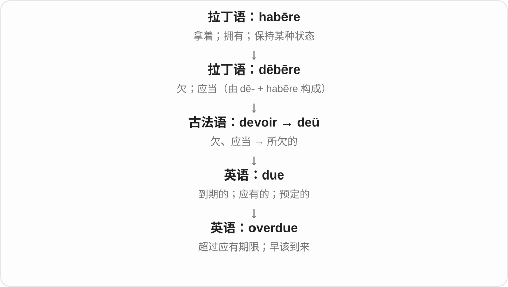
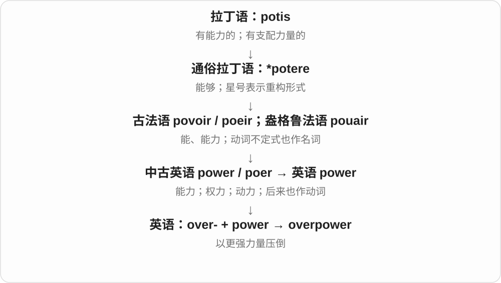
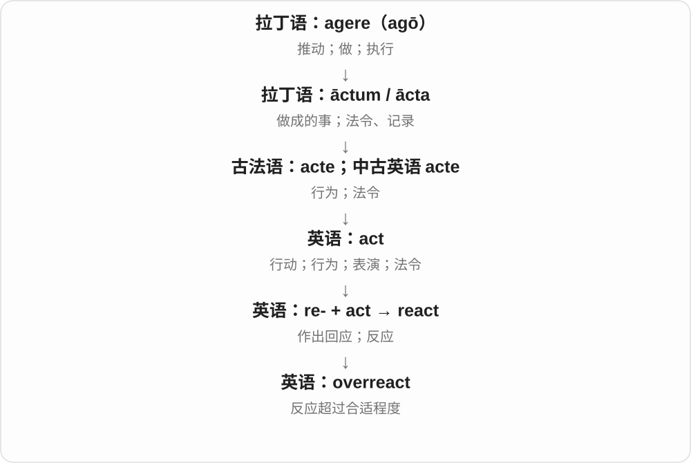
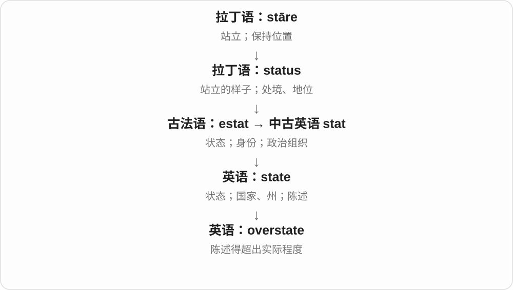
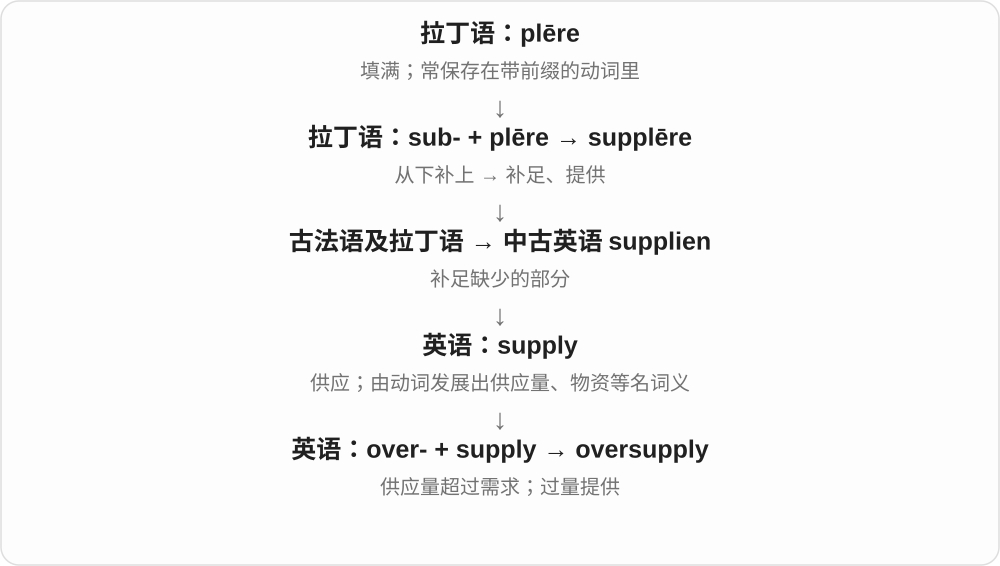
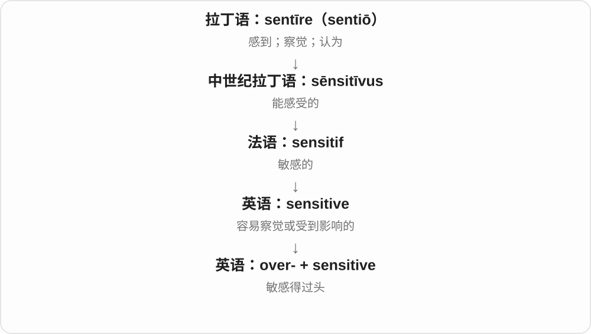

# 0014 · over- — 在上、越过；过量、过度；超出时间或程度

[逐词精讲目录](../00_逐词精讲目录.md) · [总目录](../00_总目录_按常用程度.md)

## 核心词根与来源

over- 来自古英语 ofer，在本族词里早表示上方、跨越等，也发展出超过通常或合适程度的用法。它不是所有词里的过头：overview 总览、overhead 上方的等，不必含过量的批评。

**OVER：一支跨到上面、另一边；一支越过合适限度**

overlay 在原图上叠一层，overhang 在路上方伸出；overuse 是用太多，overstay 是待太久。先问是空间关系，还是超过尺度。

- **覆盖、上方与翻转**：lay · overlay；lie · overlie · overlying；hang · overhang；turn · overturn
- **评价、数量和复杂性过头**：rate · overrate · overrated；estimate · overestimate · overestimation；simplify · oversimplify · oversimplification
- **空间、使用、衣着和资格过量**：crowd · overcrowd · overcrowded；use · overuse；dress · overdress · overdressed；qualified · overqualified
- **暴露、代表性和时间**：expose · overexpose · overexposure；represent · overrepresent · overrepresented；stay · overstay；overwrought · overdone
- **crowd → crowds：人群复数与挤满动词**：crowd · crowds
- **bite → bites：常用 s 形式**：bite · bites

## 词形与演化规律

over- + rate → overrate → overrated；over- + simplify → oversimplify，与 oversimplification 成组；over- + qualified、represented 表相对某个标准或总体的过量。overlay—overlaid—overlaid 与 overlie—overlay—overlain 是两套变化，要分清动作和位置。

crowd + s，尾 dz；不是 crow 乌鸦的派生。

原词已有 e，加复数或三单 s；末尾 ts。

## 单词速览（按词族由简到繁）

同一基础词的相关扩展放在一起，先读基础形式，再读扩展；各组之间优先读常用的。具体词源关系见各词讲解。

| 单词 | 音标 | 核心意思 |
|---|---|---|
| [do](#w-115) | 动词强读 /duː/，弱读 /də/；唱名英 /dəʊ/、美 /doʊ/ | 做；实施；疑问、否定或强调的助动词；do〔音乐唱名，另源〕 |
| [overdo](#w-37) | 英 /ˌəʊvəˈduː/；美 /ˌoʊvərˈduː/ | 做过头；过分；使过火 |
| [over](#w-116) | 英 /ˈəʊvə/；美 /ˈoʊvər/ | 在上方；越过；超过；结束；遍及 |
| [overrate](#w-135) | 英 /ˌəʊvəˈreɪt/；美 /ˌoʊvərˈreɪt/ | 高估；评价过高 |
| [overrated](#w-12) | 英 /ˌəʊvəˈreɪtɪd/；美 /ˌoʊvərˈreɪtɪd/ | 被高估的；名过其实的 |
| [work](#w-117) | 英 /wɜːk/；美 /wɜːrk/ | 工作；运作；奏效；作品 |
| [overwork](#w-58) | 英 动 /ˌəʊvəˈwɜːk/；名 /ˈəʊvəwɜːk/；美动 /ˌoʊvərˈwɜːrk/ | 过度工作；使过劳 |
| [use](#w-118) | 名词 /juːs/；动词 /juːz/ | 使用；用途；用处 |
| [overuse](#w-31) | 动词 英 /ˌəʊvəˈjuːz/、美 /ˌoʊvərˈjuːz/；名词 英 /ˌəʊvəˈjuːs/、美 /ˌoʊvərˈjuːs/ | 过度使用；滥用〔次数、程度过多〕 |
| [overused](#w-45) | 英 /ˌəʊvəˈjuːzd/；美 /ˌoʊvərˈjuːzd/ | 使用过度的；用滥了的 |
| [stay](#w-119) | /steɪ/ | 停留；保持；暂住；暂停执行 |
| [overstay](#w-99) | 英 /ˌəʊvəˈsteɪ/；美 /ˌoʊvərˈsteɪ/ | 逗留超过期限；待得太久 |
| [turn](#w-120) | 英 /tɜːn/；美 /tɜːrn/ | 转动、转向；变成；轮次 |
| [overturn](#w-24) | 英 /ˌəʊvəˈtɜːn/；美 /ˌoʊvərˈtɜːrn/ | 翻倒、掀翻；推翻决定、裁决 |
| [rate](#w-121) | /reɪt/ | 比率；速度、频率；费用；评价 |
| [lie](#w-122) | /laɪ/ | 躺、平放着；位于；说谎；谎言 |
| [lay](#w-125) | /leɪ/ | 放下、铺设、安置；下蛋；非专业的、非神职的〔另源形容词〕 |
| [overlay](#w-23) | 动词 英 /ˌəʊvəˈleɪ/、美 /ˌoʊvərˈleɪ/；名词 英 /ˈəʊvəleɪ/、美 /ˈoʊvərleɪ/ | 覆盖、叠加；覆盖层、叠加信息层 |
| [overlie](#w-136) | 英 /ˌəʊvəˈlaɪ/；美 /ˌoʊvərˈlaɪ/ | 位于……之上；覆盖在上〔地层等描写〕 |
| [dress](#w-123) | 英、美 /dres/ | 穿衣；装扮；整理、处理；连衣裙；衣着 |
| [overdress](#w-138) | 英 /ˌəʊvəˈdres/；美 /ˌoʊvərˈdres/ | 穿得过于正式、华丽；给人穿得过多 |
| [overdressed](#w-96) | 英 /ˌəʊvəˈdrest/；美 /ˌoʊvərˈdrest/ | 穿得过于正式、隆重的；穿得过多的 |
| [crowd](#w-124) | /kraʊd/ | 人群、一群人；挤满、挤入；围拢 |
| [crowds](#w-141) | /kraʊdz/ | 人群、大群人〔复数〕；挤满、挤靠〔第三人称单数〕 |
| [overcrowd](#w-137) | 英 /ˌəʊvəˈkraʊd/；美 /ˌoʊvərˈkraʊd/ | 使过度拥挤；把太多人、物挤进 |
| [overcrowded](#w-28) | 英 /ˌəʊvəˈkraʊdɪd/；美 /ˌoʊvərˈkraʊdɪd/ | 过度拥挤的 |
| [hang](#w-126) | /hæŋ/ | 悬挂、挂着；垂下；悬而未决；绞死〔特定义〕 |
| [overhang](#w-42) | 动词 英 /ˌəʊvəˈhæŋ/、美 /ˌoʊvərˈhæŋ/；名词 英 /ˈəʊvəhæŋ/、美 /ˈoʊvərhæŋ/ | 悬伸在……上方；突出悬垂部分 |
| [represent](#w-127) | /ˌreprɪˈzent/ | 代表；描绘；象征；把……表现为 |
| [overrepresent](#w-140) | 英 /ˌəʊvəˌreprɪˈzent/；美 /ˌoʊvərˌreprɪˈzent/ | 使某群体、类型在样本等中所占比例偏高 |
| [overrepresented](#w-89) | 英 /ˌəʊvəˌreprɪˈzentɪd/；美 /ˌoʊvərˌreprɪˈzentɪd/ | 所占比例过高的；呈现偏多的 |
| [qualify](#w-132) | 英 /ˈkwɒlɪfaɪ/；美 /ˈkwɑːləfaɪ/ | 具备资格；使符合条件；限定、修正说法 |
| [qualified](#w-128) | 英 /ˈkwɒlɪfaɪd/；美 /ˈkwɑːləfaɪd/ | 合格、有资质的；有限度、带保留的 |
| [overqualified](#w-88) | 英 /ˌəʊvəˈkwɒlɪfaɪd/；美 /ˌoʊvərˈkwɑːlɪfaɪd/ | 资历、能力超过岗位要求的 |
| [expose](#w-133) | 英 /ɪkˈspəʊz/；美 /ɪkˈspoʊz/ | 使暴露；揭露；让接触 |
| [exposure](#w-129) | 英 /ɪkˈspəʊʒə/；美 /ɪkˈspoʊʒər/ | 暴露；接触；曝光；公众关注 |
| [overexpose](#w-139) | 英 /ˌəʊvərɪkˈspəʊz/；美 /ˌoʊvərɪkˈspoʊz/ | 使曝光过度；让人或事物过多公开露面 |
| [overexposure](#w-90) | 英 /ˌəʊvərɪkˈspəʊʒə/；美 /ˌoʊvərɪkˈspoʊʒər/ | 曝光过度；过度接触或公开露面 |
| [bite](#w-130) | /baɪt/ | 咬；叮；刺痛；一口；产生明显影响 |
| [bites](#w-142) | /baɪts/ | 咬、叮、产生刺痛或影响〔第三人称单数〕；咬痕、一口量〔复数〕 |
| [overbite](#w-101) | 英 /ˈəʊvəbaɪt/；美 /ˈoʊvərbaɪt/ | 深覆合；上门牙对下门牙的垂直覆盖过多〔常见口语医疗义〕 |
| [estimate](#w-131) | 名词 /ˈestɪmət/；动词 /ˈestɪmeɪt/ | 估计、估算；估计值、预估费用 |
| [overestimate](#w-39) | 英动词 /ˌəʊvərˈestɪmeɪt/；美 /ˌoʊvərˈestɪmeɪt/；名词末尾 /mət/ | 高估；估得过高的数值 |
| [overestimation](#w-114) | 英 /ˌəʊvərˌestɪˈmeɪʃən/；美 /ˌoʊvərˌestəˈmeɪʃən/ | 高估；估计过高的结果 |
| [overview](#w-1) | 英 /ˈəʊvəvjuː/；美 /ˈoʊvərvjuː/ | 概览；总体介绍 |
| [overtime](#w-2) | 英 /ˈəʊvətaɪm/；美 /ˈoʊvərtaɪm/ | 加班；加班时间或报酬；比赛加时 |
| [overhead](#w-3) | 形、名：英 /ˈəʊvəhed/、美 /ˈoʊvərhed/；副：英 /ˌəʊvəˈhed/、美 /ˌoʊvərˈhed/ | 头顶上的；在上方；经常性间接开支；额外开销 |
| [oversight](#w-4) | 英 /ˈəʊvəsaɪt/；美 /ˈoʊvərsaɪt/ | 监督；疏漏 |
| [overweight](#w-6) | 英 /ˌəʊvəˈweɪt/；美 /ˌoʊvərˈweɪt/ | 超过规定重量的；体重超标的 |
| [overlap](#w-7) | 动词：英 /ˌəʊvəˈlæp/、美 /ˌoʊvərˈlæp/；名词常前重音 /ˈoʊvərlæp/ | 重叠、部分覆盖；时间交叠、范围相交；重叠部分 |
| [overthrow](#w-8) | 英 /ˌəʊvəˈθrəʊ/；美 /ˌoʊvərˈθroʊ/〔动词〕 | 推翻、打倒；投得过远〔另一路用法〕 |
| [overhaul](#w-9) | 名词英 /ˈəʊvəhɔːl/、美 /ˈoʊvərhɔːl/；动词英 /ˌəʊvəˈhɔːl/、美 /ˌoʊvərˈhɔːl/ | 全面检修、翻修；彻底改革；大修 |
| [overdose](#w-10) | 名词：英 /ˈəʊvədəʊs/、美 /ˈoʊvərdoʊs/；动词亦常读英 /ˌəʊvəˈdəʊs/、美 /ˌoʊvərˈdoʊs/ | 用药过量；过量摄入；使或因过量用药 |
| [overlook](#w-11) | 动词英 /ˌəʊvəˈlʊk/、美 /ˌoʊvərˈlʊk/；名词英 /ˈəʊvəlʊk/、美 /ˈoʊvərlʊk/ | 俯瞰；忽略；宽容不计较；观景处〔名词，尤美式〕 |
| [oversee](#w-13) | 英 /ˌəʊvəˈsiː/；美 /ˌoʊvərˈsiː/ | 监督；统筹照看 |
| [overdue](#w-14) | 英 /ˌəʊvəˈdjuː/；美 /ˌoʊvərˈduː/ | 逾期的；早该发生的 |
| [overload](#w-15) | 英 动 /ˌəʊvəˈləʊd/；名 /ˈəʊvələʊd/；美动 /ˌoʊvərˈloʊd/ | 使超载；使负担过重；过载 |
| [simplify](#w-134) | /ˈsɪmplɪfaɪ/ | 简化；使容易理解 |
| [oversimplify](#w-112) | 英 /ˌəʊvəˈsɪmplɪfaɪ/；美 /ˌoʊvərˈsɪmplɪfaɪ/ | 把问题过分简单化 |
| [oversimplification](#w-72) | 英 /ˌəʊvəsɪmplɪfɪˈkeɪʃən/；美 /ˌoʊvərsɪmplɪfɪˈkeɪʃən/ | 过度简化；过分简单化的说法、结果 |
| [overboard](#w-17) | 英 /ˈəʊvəbɔːd/；美 /ˈoʊvərbɔːrd/ | 越过船边、落入水中；做得过头 |
| [override](#w-18) | 英 /ˌəʊvəˈraɪd/；美 /ˌoʊvərˈraɪd/〔动词〕 | 压过；推翻；越过默认设置而接管 |
| [overflow](#w-20) | 动词：英 /ˌəʊvəˈfləʊ/、美 /ˌoʊvərˈfloʊ/；名词常重音在前 | 溢出；挤满；溢流、额外容纳部分 |
| [overrun](#w-21) | 动词英 /ˌəʊvəˈrʌn/、美 /ˌoʊvərˈrʌn/；名词英 /ˈəʊvərʌn/、美 /ˈoʊvərʌn/ | 泛滥、侵占；超时、超支；超出量 |
| [overtake](#w-22) | 英 /ˌəʊvəˈteɪk/；美 /ˌoʊvərˈteɪk/ | 追上并超过；突然侵袭或压倒 |
| [overdrive](#w-25) | 名词英 /ˈəʊvədraɪv/、美 /ˈoʊvərdraɪv/；动词英 /ˌəʊvəˈdraɪv/、美 /ˌoʊvərˈdraɪv/ | 超速挡；高强度运转；过度驱使 |
| [overwhelm](#w-26) | 英 /ˌəʊvəˈwelm/；美 /ˌoʊvərˈwelm/ | 压倒；使不知所措；淹没 |
| [overgrown](#w-27) | 英 /ˌəʊvəˈɡrəʊn/；美 /ˌoʊvərˈɡroʊn/ | 杂草丛生的、长满植物的；长得过大的 |
| [overcast](#w-29) | 英 /ˈəʊvəkɑːst/；美 /ˈoʊvərkæst/ | 阴天的；天空被云层盖住的 |
| [overkill](#w-34) | 英 /ˈəʊvəkɪl/；美 /ˈoʊvərkɪl/ | 过度措施；用力、配置过头 |
| [overpass](#w-35) | 英 /ˈəʊvəpɑːs/；美 /ˈoʊvərpæs/ | 跨线桥；高架跨越通道 |
| [overpower](#w-36) | 英 /ˌəʊvəˈpaʊə/；美 /ˌoʊvərˈpaʊər/ | 制服；压倒；使难以承受 |
| [overdraft](#w-38) | 英 /ˈəʊvədrɑːft/；美 /ˈoʊvərdræft/ | 账户透支；透支金额、透支额度〔按语境〕 |
| [overdone](#w-40) | 英 /ˌəʊvəˈdʌn/；美 /ˌoʊvərˈdʌn/ | 做过头的；煮老、烤过头的；过分夸张的 |
| [overreact](#w-41) | 英 /ˌəʊvəriˈækt/；美 /ˌoʊvəriˈækt/ | 反应过度 |
| [overreaction](#w-44) | 英 /ˌəʊvəriˈækʃən/；美 /ˌoʊvəriˈækʃən/ | 反应过度 |
| [overcoat](#w-43) | 英 /ˈəʊvəkəʊt/；美 /ˈoʊvərkoʊt/ | 厚外套、大衣；外层涂层 |
| [overrule](#w-46) | 英 /ˌəʊvəˈruːl/；美 /ˌoʊvərˈruːl/ | 否决；驳回；推翻原决定 |
| [overpopulation](#w-47) | 英 /ˌəʊvəpɒpjuˈleɪʃən/；美 /ˌoʊvərpɑːpjuˈleɪʃən/ | 人口过多；种群过度增长 |
| [overshadow](#w-48) | 英 /ˌəʊvəˈʃædəʊ/；美 /ˌoʊvərˈʃædoʊ/ | 遮住光；使黯然失色；给……蒙上阴影 |
| [overheat](#w-49) | 英 /ˌəʊvəˈhiːt/；美 /ˌoʊvərˈhiːt/ | 过热；使过热 |
| [overthink](#w-50) | 英 /ˌəʊvəˈθɪŋk/；美 /ˌoʊvərˈθɪŋk/ | 想得过多；过度琢磨 |
| [overzealous](#w-51) | 英 /ˌəʊvəˈzeləs/；美 /ˌoʊvərˈzeləs/ | 过分热心的；积极过头的 |
| [overstate](#w-54) | 英 /ˌəʊvəˈsteɪt/；美 /ˌoʊvərˈsteɪt/ | 夸大；言过其实 |
| [overstatement](#w-64) | 英 /ˌəʊvəˈsteɪtmənt/；美 /ˌoʊvərˈsteɪtmənt/ | 夸大；超过实际的陈述 |
| [overprotective](#w-55) | 英 /ˌəʊvəprəˈtektɪv/；美 /ˌoʊvərprəˈtektɪv/ | 过度保护的 |
| [overhear](#w-56) | 英 /ˌəʊvəˈhɪə/；美 /ˌoʊvərˈhɪr/ | 无意中听到；听见本来不是说给自己的话 |
| [overreach](#w-57) | 英 /ˌəʊvəˈriːtʃ/；美 /ˌoʊvərˈriːtʃ/ | 伸得过远；超出能力、权限；过度扩张 |
| [overlying](#w-59) | 英 /ˌəʊvəˈlaɪɪŋ/；美 /ˌoʊvərˈlaɪɪŋ/ | 位于上方的；上覆的 |
| [overgrowth](#w-60) | 英 /ˈəʊvəɡrəʊθ/；美 /ˈoʊvərɡroʊθ/ | 过度生长；丛生、覆盖的植物 |
| [overshoot](#w-61) | 动词英 /ˌəʊvəˈʃuːt/、美 /ˌoʊvərˈʃuːt/；名词常前重音 | 越过目标；超出预期水平 |
| [overactive](#w-62) | 英 /ˌəʊvərˈæktɪv/；美 /ˌoʊvərˈæktɪv/ | 过分活跃的；活动过度的 |
| [overcharge](#w-63) | 英 /ˌəʊvəˈtʃɑːdʒ/；美 /ˌoʊvərˈtʃɑːrdʒ/〔动词〕 | 多收费；过度充电；过量装入 |
| [overwrought](#w-66) | 英 /ˌəʊvəˈrɔːt/；美 /ˌoʊvərˈrɔːt/ | 情绪紧绷、激动不安的；过度雕琢的〔作品〕 |
| [overconfident](#w-67) | 英 /ˌəʊvəˈkɒnfɪdənt/；美 /ˌoʊvərˈkɑːnfɪdənt/ | 过于自信的；自负而轻敌的 |
| [overconfidence](#w-78) | 英 /ˌəʊvəˈkɒnfɪdəns/；美 /ˌoʊvərˈkɑːnfɪdəns/ | 过度自信 |
| [oversupply](#w-68) | 英 /ˌəʊvəsəˈplaɪ/；美 /ˌoʊvərsəˈplaɪ/ | 供应过多；供给过剩；过量供应 |
| [overwrite](#w-69) | 英 /ˌəʊvəˈraɪt/；美 /ˌoʊvərˈraɪt/ | 覆盖写入；写得过多、过度修饰 |
| [overproduction](#w-73) | 英 /ˌəʊvəprəˈdʌkʃən/；美 /ˌoʊvərprəˈdʌkʃən/ | 生产过剩；产出过量 |
| [overstep](#w-74) | 英 /ˌəʊvəˈstep/；美 /ˌoʊvərˈstep/ | 越过界限；超越权限 |
| [overexcited](#w-76) | 英 /ˌəʊvərɪkˈsaɪtɪd/；美 /ˌoʊvərɪkˈsaɪtɪd/ | 过于兴奋的 |
| [overpay](#w-77) | 英 /ˌəʊvəˈpeɪ/；美 /ˌoʊvərˈpeɪ/ | 付多；付得过高 |
| [overtone](#w-85) | 英 /ˈəʊvətəʊn/；美 /ˈoʊvərtoʊn/ | 泛音；暗含的意味或色彩 |
| [overspend](#w-91) | 英 /ˌəʊvəˈspend/；美 /ˌoʊvərˈspend/ | 超支；花费过多 |
| [overcompensate](#w-93) | 英 /ˌəʊvəˈkɒmpenseɪt/；美 /ˌoʊvərˈkɑːmpenseɪt/ | 补偿过度、矫枉过正 |
| [overcook](#w-94) | 英 /ˌəʊvəˈkʊk/；美 /ˌoʊvərˈkʊk/ | 煮过头；烹调过度 |
| [overdramatic](#w-95) | 英 /ˌəʊvədrəˈmætɪk/；美 /ˌoʊvərdrəˈmætɪk/ | 过于戏剧化的；反应夸张的 |
| [overstock](#w-97) | 英 /ˌəʊvəˈstɒk/；美 /ˌoʊvərˈstɑːk/〔动词〕 | 备货过多；库存过剩 |
| [overlong](#w-98) | 英 /ˌəʊvəˈlɒŋ/；美 /ˌoʊvərˈlɔːŋ/ | 过长的；拖得太久的 |
| [overcapacity](#w-102) | 英 /ˌəʊvəkəˈpæsɪti/；美 /ˌoʊvərkəˈpæsɪti/ | 产能过剩、容量过剩 |
| [overconsumption](#w-103) | 英 /ˌəʊvəkənˈsʌmpʃən/；美 /ˌoʊvərkənˈsʌmpʃən/ | 过度消费；过量消耗 |
| [overripe](#w-106) | /ˌəʊvəˈraɪp/；美 /ˌoʊvərˈraɪp/ | 熟过头的、过熟的 |
| [overplay](#w-107) | /ˌəʊvəˈpleɪ/〔英〕；/ˌoʊvərˈpleɪ/〔美〕 | 夸大；表演过火；播放过多 |
| [oversell](#w-108) | 英 /ˌəʊvəˈsel/；美 /ˌoʊvərˈsel/ | 超卖；过度吹捧、推销 |
| [oversensitive](#w-111) | 英 /ˌəʊvəˈsensətɪv/；美 /ˌoʊvərˈsensətɪv/ | 过于敏感的 |
| [overclock](#w-113) | 英 /ˌəʊvəˈklɒk/；美 /ˌoʊvərˈklɑːk/ | 使超频、超频运行 |

## 逐词讲解

### 1. do — 做；实施；疑问、否定或强调的助动词；do〔音乐唱名，另源〕

**音标**：动词强读 /duː/，弱读 /də/；唱名英 /dəʊ/、美 /doʊ/

**先抓住这个画面**

可以表示“动手做”，也可以只负责把句子搭起来。

**怎么拆**

日常动词继承古英语 dōn、中古英语 don。does、did、done 属于其屈折变化。音乐唱名 do 则来自意大利语唱名体系，用来替换 ut，与“做”不是同一来源。

**怎么变成今天的意思**

**日常动词：古英语 dōn；音乐唱名：意大利语 do**  
做；另一路是替换 ut 的唱名

↓

**中古英语 do；近代音乐用语 do**  
动词逐渐兼作助动词；唱名独立借入

↓

**现代英语 do**  
同形词须按动词或音乐读法区分

I do the washing 中，do 真正在表达做事；Do you agree? 中，它不表示另做一件事，只帮助提问。I do agree 把 do 读重，就成了“我确实同意”。英式口语 a do 还可以是一场聚会，来自活动义。

**常见搭配与例句**

do the work；do your best；do not／don’t；Do you…?；I do agree。一般活动常用 do，制作出东西常用 make，但具体搭配要单独记。

> I’ll do the washing while you cook.

你做饭时，我来洗衣服。

> Do you need a copy of the report?

你需要一份报告副本吗？

> I do understand why you’re upset.

我确实明白你为什么难过。

> The choir sang the scale from do to the higher do.

合唱团从 do 唱音阶，一直唱到高八度的 do。

**别混淆**

do you make bread? 里的 do 帮助提问，make 才描述制作。唱名 do 的元音与动词 do 不同。

### 2. overdo — 做过头；过分；使过火

**音标**：英 /ˌəʊvəˈduː/；美 /ˌoʊvərˈduː/

**先抓住这个画面**

本来适量就好，却越过了合适的程度。

**怎么拆**

现代是 over-“过度”＋do；古英语 oferdōn、中古英语 overdon 已有这一组合，不是近代才造出的。

**怎么变成今天的意思**

**古英语 oferdōn**  
ofer- 超过＋dōn 做

↓

**中古英语 overdon**  
做过分、超过限度

↓

**英语 overdo**  
用力、装饰、表达或烹饪等过度

overdo the decoration 是装饰太多；overdo the praise 是夸得让人不舒服。关键不是动作坏，而是程度越界了。单说 Don’t overdo it 就是别弄得太过。

**常见搭配与例句**

overdo it；overdo the makeup；overdo the special effects；overdo—overdid—overdone。

> The film overdoes the special effects.

这部电影的特效用得太过了。

> A little decoration is enough; don’t overdo it.

稍微装饰一下就够了，别弄得太满。

**别混淆**

redo 是重做；overdo 是做过头。overwork 更专指工作过度，overdo 可用于很多动作。

### 3. over — 在上方；越过；超过；结束；遍及

**音标**：英 /ˈəʊvə/；美 /ˈoʊvər/

**先抓住这个画面**

先想跨过一条线，随后可以是空间越过去、数值超出去，或一段事情走到终点。

**怎么拆**

接古英语 ofer，经中古英语 over 延续。现代可作介词、副词及构词材料，不把各个固定短语都还原成物体飞过头顶。

**怎么变成今天的意思**

**古英语 ofer → 中古英语 over**  
在上；越过

↓

**英语 over**  
上方、跨越；超过；结束；遍及等用法

over the bridge 是过桥，over fifty 是超过五十，the meeting is over 是会议结束。all over the floor 是满地，think it over 是仔细考虑。

**常见搭配与例句**

over the years；all over；over and over；be over；think over。

> The plane flew over the town.

飞机飞过小镇上空。

> The meeting is over, but the work is not finished.

会议结束了，但工作还没完成。

> There were over a hundred people in the hall.

大厅里有一百多人。

**别混淆**

over 可表示跨越且常有覆盖、遍及等义，above 更多只说明比某处高；over fifty 与 above fifty 在数值语境可重叠。

### 4. overrate — 高估；评价过高

**音标**：英 /ˌəʊvəˈreɪt/；美 /ˌoʊvərˈreɪt/

**先抓住这个画面**

真实水平只有七分，却给了十分；把能力、质量或作用评得过高，就是 overrate。

**怎么拆**

over- 过度 + rate 评价、给等级，构成评价过高的动词；不是 rate 一定指利率。

**怎么变成今天的意思**

**rate**  
评价、定等级

↓

**over- + rate → overrate**  
把评价抬得过高

overrate someone’s ability 高估某人能力；overrate a film 把电影评价过高。这个词本身是一种评价，需与事实依据分开。

**常见搭配与例句**

overrate the importance；be overrated。

> Do not overrate the importance of one result.

不要把一个结果的重要性估得过高。

> Some viewers felt that the critics had overrated the film.

一些观众觉得评论家把这部电影评价得过高。

**别混淆**

overrate 评价偏高，overestimate 更常估计数量、能力或程度偏高；语境可重叠，不能只按中文高估当完全无差别。

### 5. overrated — 被高估的；名过其实的

**音标**：英 /ˌəʊvəˈreɪtɪd/；美 /ˌoʊvərˈreɪtɪd/

**先抓住这个画面**

大家夸得很厉害，你体验后觉得没那么好，可说 overrated；它不是纯粹不好，而是好名声超过了你认为的实际水平。

**怎么拆**

overrate + -ed，过去分词常作形容词。原形 rate 的评价层与 over- 过头都在里面。

**怎么变成今天的意思**

**over- + rate → overrate**  
评价过高

↓

**overrate + -ed → overrated**  
被评价过高的

an overrated film 被高估的电影；highly overrated 被大大高估。通常带说话者判断，不是客观评分的固定单位。

**常见搭配与例句**

an overrated actor；highly overrated。

> I liked the restaurant, but I thought it was overrated.

我喜欢那家餐厅，但觉得它有些名过其实。

> The novel was widely praised, though some readers called it overrated.

小说广受赞扬，不过有些读者说它被高估了。

**别混淆**

bad 是差，overrated 是评价过高；一部好电影仍可能被某人认为 overrated，因为其名声更高。

### 6. work — 工作；运作；奏效；作品

**音标**：英 /wɜːk/；美 /wɜːrk/

**先抓住这个画面**

人付出劳动把事情做成；机器能按预期运转；一种办法能产生效果。

**怎么拆**

名词接古英语 weorc，动词接 wyrcan 等本族形式，经中古英语延续；与“做、制作”的日耳曼语词族相连。

**怎么变成今天的意思**

**古英语 weorc；wyrcan → 中古英语 work／werken**  
工作、做出的事物；做、制作

↓

**英语 work**  
工作；运作；做出的成果

I work here 是在这里工作，The printer works 是打印机能用，The plan worked 是办法奏效。work 说工作或劳动通常不可数；a work of art 和 collected works 则可数，指作品。

**常见搭配与例句**

at work；go to work；work on；work out；a work of art。

> This key does not work in the front door.

这把钥匙打不开前门。

> She has a lot of work to finish before Friday.

她周五前有很多工作要完成。

> We tried a different approach, and it worked.

我们试了另一种做法，结果奏效了。

**别混淆**

job 是一份职位或具体任务，可数；work 是工作活动，常不可数。I have a lot of work 不能机械写成 many works。

### 7. overwork — 过度工作；使过劳

**音标**：英 动 /ˌəʊvəˈwɜːk/；名 /ˈəʊvəwɜːk/；美动 /ˌoʊvərˈwɜːrk/

**先抓住这个画面**

原本能承受的劳动一再加码，超过了身体或人的持续承受能力。

**怎么拆**

over-（过度）+ work；相关组合可接中古英语或更早本族材料。名词说过量劳动，动词说过度工作或使某人过劳。

**怎么变成今天的意思**

**古英语 weorc；wyrcan → 中古英语 work／werken**  
工作、做出的事物；做、制作

↓

**英语 work**  
工作；运作；做出的成果

↓

**over- + work → overwork**  
工作超过适当限度；过量劳动

Don’t overwork yourself 是别让自己过劳；be overworked 是工作负担太重。名词 from overwork 说因过量劳动，不能只因为某天很忙就替人作诊断。

**常见搭配与例句**

overwork yourself；overworked staff；stress and overwork。

> Do not overwork yourself before the exam.

考前别把自己累过头。

> The clinic was short of staff, and the remaining nurses were overworked.

诊所人手不足，留下的护士工作负担过重。

**别混淆**

overtime 是超出正常工时的加班，overwork 评价工作过量；加班未必每次都到过劳程度，正常工时内也可能负荷过重。

### 8. use — 使用；用途；用处

**音标**：名词 /juːs/；动词 /juːz/

**先抓住这个画面**

use 的画面很简单：手里有个东西，把它拿来完成一件事。东西可以是钥匙，也可以是时间、方法或一句话。

**怎么拆**

来自拉丁语 ūtī 的词族。名词经 ūsus、古法语 us 传入；动词经古法语 user，背后有据 ūsus 形成的拉丁语动词。现代 use 本身不必再切。

**怎么变成今天的意思**

动词说“拿来做事”，名词既可说使用这个动作，也可说用途。put something to good use 就是让它真正帮上忙；be of no use 则是派不上用场。

**常见搭配与例句**

use A to do B；make use of…；the use of…；be of use。used to do 说过去常做；be used to doing 说已经习惯，两者结构不同。

> We used an old box to store the cables.

我们拿一个旧盒子来装电线。

> This tool has several uses, including opening paint cans.

这个工具有几种用途，包括打开油漆罐。

**别混淆**

名词 use 结尾 /s/，动词 /z/。use 可以很中性；use someone 若没有说明合作背景，常有“利用别人”的负面意味。

### 9. overuse — 过度使用；滥用〔次数、程度过多〕

**音标**：动词 英 /ˌəʊvəˈjuːz/、美 /ˌoʊvərˈjuːz/；名词 英 /ˌəʊvəˈjuːs/、美 /ˌoʊvərˈjuːs/

**先抓住这个画面**

一个词、一种效果用太多，本来有效也变得烦；overuse 看的是使用超过合适程度。

**怎么拆**

over- 过度 + use 使用；承 use 的名动读音区别，动词常 /juːz/，名词常 /juːs/。不是末尾 s 永远读一种音。

**怎么变成今天的意思**

**use 名词、动词**  
使用；有相应读音区别

↓

**over- + use → overuse**  
过度使用及这种行为

overuse a word 一个词用太多；the overuse of effects 特效的过度使用。说明数量、频率过量，不必表示用法本身违法。

**常见搭配与例句**

overuse a phrase；the overuse of。

> Writers sometimes overuse fashionable phrases.

作者有时会过多使用流行说法。

> The review criticised the overuse of special effects.

评论批评了特效的过度使用。

**别混淆**

misuse 重点是用错、用途不当，overuse 重点是用太多；即使用途正确也可能过度。

### 10. overused — 使用过度的；用滥了的

**音标**：英 /ˌəʊvəˈjuːzd/；美 /ˌoʊvərˈjuːzd/

**先抓住这个画面**

设备老是被用、某个说法到处都说，超过合适程度就容易损耗或变得没新意。

**怎么拆**

over- 过度 + used，描述使用太多后的状态；来源动词 overuse 由 over- + use 组成。

**怎么变成今天的意思**

**法语 user → 英语 use**  
使用；经法语接拉丁使用词族

↓

**use + -ed → used**  
使用过的；习惯；旧时经常发生的构式

↓

**over- + use → overuse；其分词 overused**  
使用过度 → 被用滥的

an overused phrase 用滥的说法，an overused muscle 过度使用的肌肉，an overused example 老被重复的例子。

**常见搭配与例句**

an overused phrase；an overused example；overused equipment。

> The article avoids overused phrases.

文章避免陈词滥调。

> The overused equipment needed frequent repairs.

设备使用过度，需要频繁维修。

**别混淆**

used 只说用过，overused 多了过度的评价；popular 受欢迎也未必是用滥。

### 11. stay — 停留；保持；暂住；暂停执行

**音标**：/steɪ/

**先抓住这个画面**

原本可以走开或改变，现在仍留在这个位置或状态：stay here、stay calm 都沿着“保持住”理解。

**怎么拆**

历史涉及法语表示停留与支撑的相关词形。词典对日常 stay 是否直接来自拉丁 stāre 的路线有不同处理，不能把所有义项压成一条确定链。

**怎么变成今天的意思**

学习时先抓“继续留在原处或原状态”。支撑物、船桅支索等名词还涉及日耳曼语来源，不是都由日常“住几天”变来。

**常见搭配与例句**

stay at home；stay calm；stay with friends；a short stay。

> We stayed with friends for the weekend.

我们周末住在朋友家。

> Please stay calm while we find a solution.

在我们寻找解决办法时，请保持冷静。

**别混淆**

stay 常是暂住或保持状态；live 强调居住、生活。stay calm 不需要加 to be。

### 12. overstay — 逗留超过期限；待得太久

**音标**：英 /ˌəʊvəˈsteɪ/；美 /ˌoʊvərˈsteɪ/

**先抓住这个画面**

原说待三天，到了期限还不走，是 overstay；做客久到不再受欢迎，也有固定说法 overstay one’s welcome。

**怎么拆**

over- 超过时间 + stay 停留。不是再来住宿一次，而是同一次停留越过了相应时间界限。

**怎么变成今天的意思**

**stay**  
停留、逗留

↓

**over- + stay → overstay**  
停留超过规定、约定或合适时长

overstay one’s welcome 做客过久惹人厌；overstay a visa 逾期停留是常见搭配，具体规定由现实证件和地区决定，词条只说明逾期这一词义。

**常见搭配与例句**

overstay your welcome；overstay a permitted period。

> We left early so as not to overstay our welcome.

我们早点离开，免得做客太久让人厌烦。

> The notice warned guests not to overstay the agreed period.

通知提醒客人不要超过约定期限继续逗留。

**别混淆**

stay longer 只说待更久，overstay 通常暗示超过某个应遵守或合宜的限度。

### 13. turn — 转动、转向；变成；轮次

**音标**：英 /tɜːn/；美 /tɜːrn/

**先抓住这个画面**

先想一根木料在车床上旋转：方向变了，外形也能变。英语把这个动作扩展到转弯、变颜色和事情的转折。

**怎么拆**

中古英语 turnen 融合晚期古英语 turnian 与古法语 torner 等路线，都可追到拉丁语 tornare；名词也受法语 torn / tourn 影响，不只是现代动词直接改词性。

**怎么变成今天的意思**

**希腊语 tornos → 拉丁语 tornus / tornare**  
画圆、车削的工具 → 在车床上旋转加工

↓

**并行：晚期古英语 turnian；古法语 torner / 英法语 turner**  
旋转、转向、改变

↓

**中古英语 turnen → 英语 turn**  
转动；变化；轮到的机会

Turn left 是转向；turn red 是变红；your turn 是轮到你。turn a handle 让把手转动，turn to someone 则是转而向某人求助。

**常见搭配与例句**

turn into；turn on/off；take turns；a sharp turn。

> Turn left at the next street.

在下一条街左转。

> The leaves turned yellow in October.

十月里，树叶变黄了。

> It is your turn to choose a game.

轮到你选游戏了。

**别混淆**

rotate 更具体地说旋转；turn 还可以是转向、变成某种状态，或一次轮流的机会。

### 14. overturn — 翻倒、掀翻；推翻决定、裁决

**音标**：英 /ˌəʊvəˈtɜːn/；美 /ˌoʊvərˈtɜːrn/

**先抓住这个画面**

桌子被掀翻，原来朝上的面变了；一个决定不再成立，也像被翻掉，叫 overturn。

**怎么拆**

over- 翻越、翻转 + turn 转，中古英语已有相关组合；抽象推翻义从既定安排被翻转的画面扩展。

**怎么变成今天的意思**

**over- + turn**  
翻转、翻倒

↓

**overturn 的抽象扩展**  
推翻已有决定、规则等

overturn a table 掀翻桌子；overturn a decision 推翻决定；a vehicle overturned 车辆翻覆。

**常见搭配与例句**

overturn a decision；overturn a conviction。

> The vehicle overturned on the bend.

车辆在弯道上翻覆了。

> The appeal led to the decision being overturned.

申诉使原决定被推翻了。

**别混淆**

overturn 推翻、翻倒，turn over 可在更多场景说翻面、移交等；不是两个部分换位后所有义项都仍相同。

### 15. rate — 比率；速度、频率；费用；评价

**音标**：/reɪt/

**先抓住这个画面**

通常要问每多少单位有多少：每小时多少钱、每分钟多少次。作动词则是给水平、质量打评价。

**怎么拆**

比率、核定数值词经法语等接拉丁 rata 规定份额，关联 reri 计算、判断。旧的斥责动词 rate 另源不明，留在 berate 中。

**怎么变成今天的意思**

**拉丁 rata 规定、核定的部分 → 法语、英语 rate**  
固定份额、数值 → 比率、价格、评估

↓

**现代 rate**  
单位数量的量、频率；评价高低

↓

**另一路 rate 斥责 → berate**  
斥责词远源不明；不从比率硬推出来

an hourly rate 每小时收费，a growth rate 增长率，rate a film 给电影评分；at this rate 照这样下去。

**常见搭配与例句**

an hourly rate；a growth rate；rate highly；at this rate。

> What is your hourly rate?

你每小时收费多少？

> How would you rate the service?

你会怎样评价这项服务？

**别混淆**

rate 往往要有分母或比较基准，total 总量不一样；high birthrate 高出生率不等于总人口必然世界最多。

### 16. lie — 躺、平放着；位于；说谎；谎言

**音标**：/laɪ/

**先抓住这个画面**

同一拼写装着两套词：一个说身体放在哪儿，一个说话是否诚实。先分两套，变化就不乱。

**怎么拆**

躺义接古英语 liċġan，说谎义另接 lēogan，谎言名词也有旧 lyġe。现代同形不等于同源；躺 lie—lay—lain，说谎 lie—lied—lied。

**怎么变成今天的意思**

**古英语 liċġan → 中古英语 liggen、lien → lie〔躺、位于〕**  
身体横放、处于某位置；lie—lay—lain

↓

**另源古英语 lēogan、名词 lyġe → lie〔说谎、谎言〕**  
欺骗、说不实话；lie—lied—lied

lie down 躺下，lie on the bed 躺床上，lie to someone 对某人说谎，tell a lie 说一个谎。lie in 也可在于。

**常见搭配与例句**

lie down；lie on；lie to someone；tell a lie；lie in。

> I lay on the sofa for an hour yesterday.

昨天我在沙发上躺了一小时。

> He lied about where he had been.

他对自己去过哪里撒了谎。

**别混淆**

躺的过去 lay 又与另一个原形 lay 放置同形：lay a book—laid—laid。I lay down yesterday 昨天躺下，I lied yesterday 昨天说谎，不能混。

### 17. lay — 放下、铺设、安置；下蛋；非专业的、非神职的〔另源形容词〕

**音标**：/leɪ/

**先抓住这个画面**

把一本书平放在桌上、把轨道铺到地面，lay 都有让东西落到某个位置的感觉；lay an egg 则是产蛋的固定说法。

**怎么拆**

放置的动词承古英语 lecgan，与 lie 躺的本族词有使动关系。另一个 lay 非神职、非专业的，经法语接拉丁 laicus、希腊 laikos 属于普通人的，须分开词源。

**怎么变成今天的意思**

**古英语 lecgan → 中古英语 leien → lay 动词**  
使躺下、放置

↓

**法语 lai、拉丁 laicus 等 → lay 形容词**  
普通人的、非神职、非专业的另源词

lay the book on the table 把书放桌上；lay the foundations 打基础；lay eggs 下蛋；a lay audience 非专业听众。动词变化 lay—laid—laid。

**常见搭配与例句**

lay something down；lay the foundations；a lay reader。

> She laid the book on the table.

她把书放在桌上。

> The guide explains the science for a lay audience.

指南为非专业读者解释这些科学知识。

**别混淆**

lay 放某物通常要有对象，lie 躺是对象自己处在那儿；I lay the book down／I lie down。lie 的过去式也写 lay，要靠句子区分。

### 18. overlay — 覆盖、叠加；覆盖层、叠加信息层

**音标**：动词 英 /ˌəʊvəˈleɪ/、美 /ˌoʊvərˈleɪ/；名词 英 /ˈəʊvəleɪ/、美 /ˈoʊvərleɪ/

**先抓住这个画面**

原图还在，上面再铺一层路线、文字或颜色，这层可以叫 overlay，叠上去的动作也叫 overlay。

**怎么拆**

over- 在上 + lay 放置，承古英语 oferlecgan 等材料；动词变化 overlay—overlaid—overlaid。不是 over + lie 躺的同一组变化。

**怎么变成今天的意思**

**古英语 ofer- + lecgan → 相应组合**  
在上面放、覆盖

↓

**英语 overlay 动词、名词**  
叠加；叠加在表面的层

overlay a map with data 把数据叠到地图上；a transparent overlay 透明覆盖层。名词、动词常有重音位置区别。

**常见搭配与例句**

overlay data on a map；a text overlay。

> The app overlays directions on the camera view.

应用把方向提示叠加在相机画面上。

> A transparent overlay shows the old street plan.

一层透明叠图显示了旧街道布局。

**别混淆**

overlay 强调一层放到另一层上；overwrite 覆写会替代原有内容，不能把叠层都理解成删除原图。

### 19. overlie — 位于……之上；覆盖在上〔地层等描写〕

**音标**：英 /ˌəʊvəˈlaɪ/；美 /ˌoʊvərˈlaɪ/

**先抓住这个画面**

一层黏土自然处在砂层上面，写地层关系可用 overlie；重点是它在那里，不是某人正在把它铺上去。

**怎么拆**

over- 在上 + lie 躺、处在某处，承古英语相应组合。变化 overlie—overlay—overlain，其中过去式 overlay 又与另一动词 overlay 同形。

**怎么变成今天的意思**

**over- + lie 的本族组合**  
处在上方、覆在上层

↓

**overlie → overlay → overlain**  
原形、过去式、过去分词的固定变化

clay overlies sand 黏土在砂层之上；overlying layers 上覆层。较常见于技术、科学或精细位置描写。

**常见搭配与例句**

overlie a layer；be overlain by。

> A layer of clay overlies the sand.

一层黏土覆在砂层上面。

> The older rock is overlain by younger deposits.

较老岩石上覆着较新的沉积层。

**别混淆**

overlie 说处在上面；overlay 说覆盖、叠放时变化是 overlay—overlaid—overlaid。原形相近、某个变化同形，不能把整套形式混起来。

### 20. dress — 穿衣；装扮；整理、处理；连衣裙；衣着

**音标**：英、美 /dres/

**先抓住这个画面**

先想“把人或东西收拾妥当”：给人穿好衣服、把菜调好味、把伤口包扎好，都是不同场景里的整理。

**怎么拆**

古法语 dresser / drecier 来自通俗拉丁语 *directiare“使直、摆正”，远源是 directus。英语名词从动词发展；连衣裙义比一般衣着义更专门。

**怎么变成今天的意思**

**拉丁语：regere**  
引导、使直；治理

↓

**拉丁语：dirigere → directus**  
引向一定方向、摆直 → 直的

↓

**通俗拉丁语：\*directiare**  
使直、摆正〔重建形式〕

↓

**古法语 dresser / drecier → 英语 dress**  
安排、整理 → 穿衣、装扮

↓

**英语：dress〔名词〕**  
衣着；后来特别指连衣裙

dress a child 是给孩子穿衣；dress a wound 是包扎伤口；a dress 是一件连衣裙。formal dress 指正式衣着，不只限裙子。

**常见搭配与例句**

get dressed；dress for dinner；dress a wound；a summer dress。

> The children can dress themselves now.

孩子们现在已经能自己穿衣了。

> She wore a simple blue dress to the party.

她穿了一条简洁的蓝色连衣裙去参加聚会。

> The nurse cleaned and dressed the wound.

护士清洁并包扎了伤口。

**别混淆**

wear 强调穿着的状态；dress 强调穿衣、装扮动作或穿衣风格。

### 21. overdress — 穿得过于正式、华丽；给人穿得过多

**音标**：英 /ˌəʊvəˈdres/；美 /ˌoʊvərˈdres/

**先抓住这个画面**

大家都穿休闲装，你却穿了隆重礼服，可能 overdress for the occasion；另一条则是衣服套得比温度需要多。

**怎么拆**

over- 过度 + dress 穿衣、打扮。过度依据场合、天气等标准，不是绝对说穿得漂亮就是错。

**怎么变成今天的意思**

**dress**  
穿衣、给人穿衣、打扮

↓

**over- + dress → overdress**  
穿得超过场合或保暖所需

overdress for a party 参加聚会穿得太隆重；overdress a child 给孩子穿得过多。普通服装评价要看主语和场景。

**常见搭配与例句**

overdress for；be overdressed。

> I did not want to overdress for the casual dinner.

我不想为那顿随意晚餐穿得太隆重。

> The guide explains how to avoid overdressing for a warm-weather walk.

指南说明天气暖和散步时怎样避免穿得过多。

**别混淆**

dress up 盛装打扮可以正合适，overdress 才加入对这个场景而言过头的判断。

### 22. overdressed — 穿得过于正式、隆重的；穿得过多的

**音标**：英 /ˌəʊvəˈdrest/；美 /ˌoʊvərˈdrest/

**先抓住这个画面**

穿着本身可能很漂亮，只是与场合比显得太隆重，便是 overdressed；也可说保暖衣物过多。

**怎么拆**

overdress + -ed，过去分词常作形容词；dress 末尾 /s/ 后的 -ed 读 /t/，不多读一个音节。

**怎么变成今天的意思**

**over- + dress → overdress**  
打扮或穿衣超过所需

↓

**overdress + -ed → overdressed**  
处于穿得过头的状态

feel overdressed 觉得自己穿得太隆重；overdressed for the occasion 相对这个场合太正式。相反 underdressed 可说穿得不够正式或不够保暖。

**常见搭配与例句**

overdressed for；feel overdressed。

> I felt overdressed when everyone else arrived in jeans.

其他人都穿牛仔裤到场，我觉得自己穿得太隆重了。

> He was slightly overdressed for the informal gathering.

对那场非正式聚会来说，他穿得稍显隆重。

**别混淆**

well dressed 衣着得体、漂亮，overdressed 则与场合不够匹配；不代表衣服质量差。

### 23. crowd — 人群、一群人；挤满、挤入；围拢

**音标**：/kraʊd/

**先抓住这个画面**

许多人挤在一处，是 a crowd；动词说人或东西把空间塞紧。网络复合词里的 crowd 则能是分散各地、一起参与的大众。

**怎么拆**

动词继承古英语 crūdan 推、挤，经中古英语到现代；名词人群由聚挤动作发展。不能只靠拼写把 crow 乌鸦和某个 d 后缀合起来。

**怎么变成今天的意思**

**古英语 crūdan → 中古英语 crouden → crowd〔动词〕**  
推挤、挤压

↓

**英语 crowd〔名词〕及后来的参与比喻**  
挤在一起的人 → 人群；也可说共同参与的大众

a crowd of people 一群人，crowd into a room 挤进房间，crowd around 围拢，crowd out 挤走、排挤，stand out from the crowd 脱颖而出。

**常见搭配与例句**

a crowd of；crowd into；crowd around；crowd out；stand out from the crowd。

> A crowd gathered outside the theatre.

剧院外聚起一群人。

> People crowded around the tiny stage.

人们围拢在小舞台周围。

**别混淆**

crowd 不保证愤怒、暴力，mob 常更带失控、威胁色彩；crowdfunding 的人不一定身体站在同一屋里。

### 24. crowds — 人群、大群人〔复数〕；挤满、挤靠〔第三人称单数〕

**音标**：/kraʊdz/

**先抓住这个画面**

很多人聚在一起，让空间显得拥挤，是 crowds。动词也能说人或东西挤到某处，把空间占满。

**怎么拆**

crowd 动词继承古英语 crudan 推挤、挤压；名词人群由聚挤动作发展。现代加 -s，/d/ 后读 /z/。

**怎么变成今天的意思**

**古英语 crudan → crowd 动词 → 人群名词**  
推挤 → 挤在一起的人

↓

**crowd + -s → crowds**  
几群人、大量人；某物挤满

large crowds 大群人；crowds of visitors 大批访客；avoid the crowds 避开拥挤人群。

**常见搭配与例句**

draw crowds 吸引大批人；crowds around… 挤到……周围〔三单〕。

> Large crowds gathered outside the theatre.

大批人聚在剧院外。

> We walked early to avoid the crowds.

我们早早出去走走，以避开拥挤人群。

**别混淆**

crowds 常能整体说很多人聚来，不一定要精确区分成几组。a crowd 是一个人群，crowds 可以是接连的人群或大批人。

### 25. overcrowd — 使过度拥挤；把太多人、物挤进

**音标**：英 /ˌəʊvəˈkraʊd/；美 /ˌoʊvərˈkraʊd/

**先抓住这个画面**

房间本来装得下十个人，却挤进二十个，空间就不够了；overcrowd 强调超过舒适或合理容量。

**怎么拆**

over- 过度 + crowd 聚集、挤入。crowd 已有名词人群和动词挤满的作用，整个词取动作。

**怎么变成今天的意思**

**crowd**  
人群；使挤满

↓

**over- + crowd → overcrowd**  
让空间挤得过头

overcrowd a room 把房间挤得太满；do not overcrowd the page 也可比喻页面别塞太多内容。

**常见搭配与例句**

overcrowd a space；overcrowd the page。

> Too much furniture can overcrowd a small room.

家具太多会把小房间塞得过满。

> Do not overcrowd the page with decorative elements.

别在页面上堆太多装饰元素。

**别混淆**

crowd 只说聚集、挤满，overcrowd 特别判断数量过量；热闹的一场活动不一定已经超过容量。

### 26. overcrowded — 过度拥挤的

**音标**：英 /ˌəʊvəˈkraʊdɪd/；美 /ˌoʊvərˈkraʊdɪd/

**先抓住这个画面**

人多到行走、使用空间都困难，是 overcrowded；有时也形容安排塞得太满。

**怎么拆**

overcrowd + -ed，也可表面对照 over- + crowded。过去分词常作形容词，-ed 在 /d/ 后读 /ɪd/。

**怎么变成今天的意思**

**over- + crowd → overcrowd**  
使空间挤得过头

↓

**overcrowd + -ed → overcrowded**  
过度拥挤的状态

an overcrowded train 过度拥挤的火车；overcrowded housing 过度拥挤的居住环境；通常带空间不足的负面意味。

**常见搭配与例句**

overcrowded classrooms；an overcrowded train。

> The train was overcrowded during rush hour.

高峰时段火车拥挤不堪。

> The school needs more space for its overcrowded classrooms.

学校教室过度拥挤，需要更多空间。

**别混淆**

crowded 挤、overcrowded 挤得过量；empty 空与这两个词是在不同端点描述，并非一见人多就只有 overcrowded。

### 27. hang — 悬挂、挂着；垂下；悬而未决；绞死〔特定义〕

**音标**：/hæŋ/

**先抓住这个画面**

一件东西上端挂住，下面悬着；画挂墙上，衣服垂在钩上，未决问题也像答案还没落地。

**怎么拆**

英语合流了古英语及北欧相关的使悬挂、处于悬挂状态的动词材料，现代既能及物也能不及物。一般常用 hang/hung/hung，绞刑义传统多用 hanged。

**怎么变成今天的意思**

**古英语、北欧悬挂动词材料**  
使物悬挂与处于悬挂状态的旧形式合流

↓

**英语 hang**  
挂起、垂下；抽象悬置等

hang a picture 挂画，hang on a hook 挂在钩上，hang up 挂起、挂断电话，get the hang of 掌握做法；最后是整组习语，不逐字译成拿到悬挂。

**常见搭配与例句**

hang a picture；hang on a hook；hang up；get the hang of。

> A coat hung on the hook by the door.

门边钩子上挂着一件外套。

> Hang the picture a little higher.

把画挂高一点。

**别混淆**

hang/hung 与 hang/hanged 常用义分工；hang 可以自己垂挂，也可以把别的东西挂起来，不必每次都加 be。

### 28. overhang — 悬伸在……上方；突出悬垂部分

**音标**：动词 英 /ˌəʊvəˈhæŋ/、美 /ˌoʊvərˈhæŋ/；名词 英 /ˈəʊvəhæŋ/、美 /ˈoʊvərhæŋ/

**先抓住这个画面**

屋檐、树枝从边缘伸出来，盖在走道上方；动词是 overhang，伸出的那一块也可叫 an overhang。

**怎么拆**

over- 在上 + hang 悬挂，承古英语 oferhangan。过去式、过去分词通常 overhung；不照普通动词写成 overhanged 表这类悬伸。

**怎么变成今天的意思**

**古英语 ofer- + hangan**  
悬在某物上方

↓

**英语 overhang 动词、名词**  
悬伸；悬出的部分

branches overhang the path 树枝伸在小路上方；a roof overhang 屋檐外伸部分。动词与名词重音常有区别。

**常见搭配与例句**

overhang the road；a rocky overhang。

> Branches overhang the narrow path.

树枝悬伸在狭窄小路上方。

> We sheltered under a rocky overhang.

我们躲在一块外伸岩石的下方。

**别混淆**

overhang 突出、悬在上方，overlay 是铺、叠一层在上面；悬空树枝不一定贴在路面上。

### 29. represent — 代表；描绘；象征；把……表现为

**音标**：/ˌreprɪˈzent/

**先抓住这个画面**

让不在眼前的人、事或观点，通过一个人、图像或符号显现出来。这个画面可帮助记忆。

**怎么拆**

经法语 représenter 来自拉丁语 repraesentāre 展现、使呈现等用法，与 present 词族相关。现代常用代表义，不等于每次都把东西再提交一次。

**怎么变成今天的意思**

**拉丁语 praesens；相关 praesentāre**  
在眼前、在场；把东西放到眼前、呈上

↓

**经法语进入英语 present 词族**  
当前、在场；礼物；展示、提交

↓

**拉丁语 repraesentāre → 法语 représenter → 英语 represent**  
展现、表现 → 代表、描绘、象征

represent a company 代表公司；a symbol represents water 符号表示水；represent something as easy 把某事表现得很容易。表现方式未必客观准确。

**常见搭配与例句**

represent someone；represent a proportion；represent something as；a symbol represents。

> She will represent the school at the conference.

她将代表学校参加会议。

> The blue line represents the river on the map.

地图上的蓝线表示河流。

**别混淆**

present 展示，represent 代表、描绘；re- 的历史作用不能强迫每个现代用法都译再次。

### 30. overrepresent — 使某群体、类型在样本等中所占比例偏高

**音标**：英 /ˌəʊvəˌreprɪˈzent/；美 /ˌoʊvərˌreprɪˈzent/

**先抓住这个画面**

研究所有年龄的人，却主要找年轻人来填表，年轻人在样本里就被 overrepresent。重点是与目标总体、合理基准相比的比例。

**怎么拆**

over- 超过 + represent 代表、呈现；不是所有代表都代表得太热情。

**怎么变成今天的意思**

**represent**  
代表、呈现某群体等

↓

**over- + represent → overrepresent**  
让某类所占比例高于相应基准

overrepresent one age group 让某年龄段样本比例偏高；small samples may overrepresent certain experiences 小样本可能偏重某些经历。

**常见搭配与例句**

overrepresent a group；be overrepresented。

> The survey may overrepresent frequent internet users.

调查中经常上网者的比例可能偏高。

> The collection overrepresents work from one period.

藏品中过多集中于某一个时期的作品。

**别混淆**

overrepresent 主要是比例或呈现偏多，不等于 misrepresent 描述错误；样本记录可真实，但某类在里面占比过高。

### 31. overrepresented — 所占比例过高的；呈现偏多的

**音标**：英 /ˌəʊvəˌreprɪˈzentɪd/；美 /ˌoʊvərˌreprɪˈzentɪd/

**先抓住这个画面**

某类人、作品在样本里出现得比目标总体比例更多，就是 overrepresented；不只看绝对人数大不大。

**怎么拆**

overrepresent + -ed，形成被过多代表、呈现的状态；末尾在 /t/ 后读 /ɪd/。

**怎么变成今天的意思**

**over- + represent → overrepresent**  
某类型在样本或呈现中比例偏高

↓

**overrepresent + -ed → overrepresented**  
处于这种比例偏高的状态

overrepresented in the sample 在样本中比例偏高；相反 underrepresented 比例偏低。比较基准应由文章说明。

**常见搭配与例句**

overrepresented in；an overrepresented group。

> Younger users were overrepresented in the sample.

样本中年轻用户的比例偏高。

> One genre was heavily overrepresented in the selection.

这份选集中，某一种体裁的比例明显过高。

**别混淆**

many 很多是数量判断，overrepresented 是相对比例判断；一小组总共五人，其中某类四人，也可能比例过高。

### 32. qualify — 具备资格；使符合条件；限定、修正说法

**音标**：英 /ˈkwɒlɪfaɪ/；美 /ˈkwɑːləfaɪ/

**先抓住这个画面**

一条常用路是条件够了、可以参加；另一条是给话加条件，让它别说得太满。

**怎么拆**

经法语 qualifier 及中世纪拉丁 qualificāre，历史接 quālis 什么样 + facere 使、做的组合成分。不是现代英语直接把 quality 尾巴改成 fy 才第一次造出来。

**怎么变成今天的意思**

**拉丁 quālis 什么样 → quālitās → 法语 qualité → quality**  
某物是什么性质 → 特点、质量

↓

**中世纪拉丁 qualificāre → 法语 qualifier → qualify**  
赋予、说明性质 → 使具资格；限定说法

qualify for the final 获得决赛资格，qualify as a teacher 取得教师资格；qualify a statement 为说法加限制。

**常见搭配与例句**

qualify for；qualify as；qualify someone to do；qualify a statement。

> The team qualified for the final.

球队获得了决赛资格。

> She qualified her earlier statement by adding a condition.

她补充一个条件，对先前的说法作了限定。

**别混淆**

qualify for 针对准入对象，qualify as 针对身份；qualify my support 可能是给支持加保留，绝非让支持拿证。

### 33. qualified — 合格、有资质的；有限度、带保留的

**音标**：英 /ˈkwɒlɪfaɪd/；美 /ˈkwɑːləfaɪd/

**先抓住这个画面**

说人时常是条件、训练达标；说支持或赞同时，反而可能是有条件地支持。

**怎么拆**

qualify 以辅音字母 f 加 y 结尾，加 -ed 时 y 改 i，成为 qualified。两种主要形容词义接 qualify 的资格、限定两分支。

**怎么变成今天的意思**

**拉丁 quālis 什么样 → quālitās → 法语 qualité → quality**  
某物是什么性质 → 特点、质量

↓

**中世纪拉丁 qualificāre → 法语 qualifier → qualify**  
赋予、说明性质 → 使具资格；限定说法

↓

**qualify + -ed → qualified**  
具资格 → 合格；被限定 → 有保留

a qualified teacher 合格教师，qualified support 有保留的支持；well qualified for 很适合、很有资质担任。

**常见搭配与例句**

a qualified teacher；qualified support；qualified approval。

> A qualified electrician checked the wiring.

一位合格电工检查了线路。

> The proposal received only qualified support.

提议只获得了有保留的支持。

**别混淆**

qualified support 不是完全支持；unqualified support 无保留支持。别把形容词只记成合格。

### 34. overqualified — 资历、能力超过岗位要求的

**音标**：英 /ˌəʊvəˈkwɒlɪfaɪd/；美 /ˌoʊvərˈkwɑːlɪfaɪd/

**先抓住这个画面**

岗位只需要基础操作，申请人却有多年高级经验，招聘者可能说 overqualified；不是不合格，而是超过这份工作的需求。

**怎么拆**

over- 超出 + qualified 符合资格的；qualified 还来自 qualify + -ed。这里 over 看的是岗位匹配，不是获得资格这一动作做坏了。

**怎么变成今天的意思**

**qualify → qualified**  
使符合资格、具备资格 → 合格的

↓

**over- + qualified → overqualified**  
资历超过特定岗位需求的

overqualified for a job 对某岗位而言资历过高。要说清相对于哪份工作，不是绝对地知识太多。

**常见搭配与例句**

overqualified for；an overqualified applicant。

> The manager thought she was overqualified for the entry-level role.

经理觉得她的资历超过了那个入门岗位的要求。

> Being overqualified did not mean he disliked the work.

资历超过要求，并不意味着他不喜欢这份工作。

**别混淆**

unqualified 不具资格，overqualified 是资格超过需求；两者不能因都可能未被录用就译成同一种不合格。

### 35. expose — 使暴露；揭露；让接触

**音标**：英 /ɪkˈspəʊz/；美 /ɪkˈspoʊz/

**先抓住这个画面**

把盖子掀开，让原本受保护或被藏住的东西显露出来。

**怎么拆**

经法语 exposer 借入；对应拉丁 ex-“出去” + pōnere 的 expōnere，但词形受 poser〔源于 pausāre〕替换影响。

**怎么变成今天的意思**

**晚期拉丁 pausāre → 古法语 poser**  
使停下、使安放 → 放置

↓

**拉丁 pōnere 及其复合词的影响**  
相似词形和“放置”意义交汇；不是单纯直系音变

↓

**古法语 exposer → 中古英语 exposen → 英语 expose**  
对应拉丁 expōnere“放到外面、展示”的意义

可以把皮肤暴露在阳光下，把谎言揭穿，也可以让学生接触新思想。不是每次 expose 都有羞耻或危险意味。

**常见搭配与例句**

expose something to；expose a lie；be exposed to。

> Removing the panel exposed the wires underneath.

取下盖板后，下面的电线露了出来。

> The course exposes students to different ways of thinking.

这门课程让学生接触不同的思考方式。

**别混淆**

reveal 偏揭示信息；expose 还突出失去遮蔽、直接接触外界。

### 36. exposure — 暴露；接触；曝光；公众关注

**音标**：英 /ɪkˈspəʊʒə/；美 /ɪkˈspoʊʒər/

**先抓住这个画面**

遮挡拿开了，人或物开始直接接触外界。

**怎么拆**

expose + -ure，在英语中形成名词。expose 的法语路线兼有 pausāre 与 pōnere 的影响。

**怎么变成今天的意思**

**晚期拉丁 pausāre → 古法语 poser**  
使停下、使安放 → 放置

↓

**拉丁 pōnere 及其复合词的影响**  
相似词形和“放置”意义交汇；不是单纯直系音变

↓

**古法语 exposer → 中古英语 exposen → 英语 expose**  
对应拉丁 expōnere“放到外面、展示”的意义

↓

**英语 expose + -ure → exposure**  
被暴露、接触外界的过程或状态

sun exposure 是接触阳光；media exposure 是进入公众视野；摄影 exposure 是感光材料或传感器接收光线的过程和程度。

**常见搭配与例句**

exposure to；media exposure；a long exposure。

> The fabric faded after prolonged exposure to sunlight.

长时间日晒后，布料褪色了。

> A long exposure turned the moving lights into bright trails.

长曝光把移动的灯光拍成了明亮的轨迹。

**别混淆**

experience 常是亲自做事积累的经验；exposure to 可能只是接触、见识过。

### 37. overexpose — 使曝光过度；让人或事物过多公开露面

**音标**：英 /ˌəʊvərɪkˈspəʊz/；美 /ˌoʊvərɪkˈspoʊz/

**先抓住这个画面**

拍照时光给多了，亮部细节丢掉；明星、品牌出现得太频繁，也可说被 overexpose。两种场景都超过了合适暴露程度。

**怎么拆**

over- 过度 + expose 暴露、曝光；不是 expose 的每个含义都只与相机有关。

**怎么变成今天的意思**

**expose**  
使显露；摄影中让感光材料受光

↓

**over- + expose → overexpose**  
暴露、曝光超过合适程度

overexpose a photograph 使照片曝光过度；overexpose a celebrity 让明星过多曝光。比喻义常含受众审美疲劳的担忧。

**常见搭配与例句**

overexpose an image；overexpose a performer。

> The bright background caused her to overexpose the photo.

明亮背景使她把照片拍得曝光过度了。

> The producer did not want to overexpose the young actor.

制片人不想让那位年轻演员曝光得过于频繁。

**别混淆**

overexpose 过多显露、受光，overlook 反而可能忽略；两个 over- 开头不能只靠前缀猜成同方向动作。

### 38. overexposure — 曝光过度；过度接触或公开露面

**音标**：英 /ˌəʊvərɪkˈspəʊʒə/；美 /ˌoʊvərɪkˈspoʊʒər/

**先抓住这个画面**

照片太亮只是其中一条；人、品牌或材料接触某环境太多，也可讨论 overexposure，具体超过什么要看后面的对象。

**怎么拆**

over- + exposure，也与 overexpose 的动名对应。exposure 取暴露、接触或摄影曝光的哪一义，整词跟着场景走。

**怎么变成今天的意思**

**expose／exposure**  
暴露、接触、摄影曝光的动名词族

↓

**over- + exposure → overexposure**  
相应程度过量

overexposure in the media 媒体曝光过多；overexposure of an image 图像曝光过度；overexposure to something 过多接触某物。

**常见搭配与例句**

media overexposure；overexposure to。

> Overexposure washed out the detail in the sky.

曝光过度让天空的细节一片发白。

> The campaign risked overexposure in the media.

这场宣传有媒体曝光过多的风险。

**别混淆**

overexposure 并不总指过度晒太阳，也不总表示知名度高；同一个词可说照片、媒体或其他暴露量。

### 39. bite — 咬；叮；刺痛；一口；产生明显影响

**音标**：/baɪt/

**先抓住这个画面**

用牙压住、切下一点；寒风或尖刻的话也可以像牙一样让人感到刺痛。

**怎么拆**

继承古英语 bītan，经中古英语 biten 发展。过去式 bit /bɪt/，过去分词 bitten /ˈbɪtən/；不用 bited。

**怎么变成今天的意思**

**古英语 bītan → 中古英语 biten**  
咬；有用牙切开的旧意象

↓

**英语 bite；过去式 bit，过去分词 bitten**  
咬；叮；刺痛；产生影响

bite an apple 咬苹果；an insect bite 虫叮；a bite to eat 一点吃的。The new rules are starting to bite 是新规则开始产生明显影响。

**常见搭配与例句**

take a bite；a bite to eat；bite into；bite one’s lip；begin to bite。

> She took a bite of the sandwich.

她咬了一口三明治。

> The cold wind bit into our faces.

寒风吹得我们的脸刺痛。

> The higher costs are beginning to bite.

成本上涨开始让人明显感到压力。

**别混淆**

bite 指咬、叮，不等于所有昆虫蜇刺的 sting；a bite 一口是动作或份量，a bit 常是一点、小块。

### 40. bites — 咬、叮、产生刺痛或影响〔第三人称单数〕；咬痕、一口量〔复数〕

**音标**：/baɪts/

**先抓住这个画面**

牙齿切入、夹住东西，是 bites。被咬留下的痕迹、吃下去的一口量也能这样数；风、寒意等则借刺进去的感觉表达。

**怎么拆**

bite 继承古英语 bītan，经中古英语 biten 延续。现代直接加 -s，/t/ 后读 /s/；过去式另是 bit，分词是 bitten。

**怎么变成今天的意思**

**古英语 bītan → bite**  
用牙切开、咬住 → 咬痕、一口量及刺痛比喻

↓

**bite + -s → bites**  
某物咬、刺；多处咬痕或几口量

bites the apple 咬苹果；small bites 小口、一小口一小口；insect bites 虫咬痕。

**常见搭配与例句**

takes two bites 咬两口；the cold bites 寒气刺骨。

> She bites into the apple.

她咬了一口苹果。

> He finished the sandwich in three bites.

他三口吃完了三明治。

**别混淆**

bites 作名词可以说动作、痕迹或一口的量。a bite to eat 还可说少量吃的东西，不必是某个咬痕。

### 41. overbite — 深覆合；上门牙对下门牙的垂直覆盖过多〔常见口语医疗义〕

**音标**：英 /ˈəʊvəbaɪt/；美 /ˈoʊvərbaɪt/

**先抓住这个画面**

咬合时，上门牙在垂直方向盖住下门牙太多，常见资料会说 an overbite。关键是上下覆盖，不是单纯牙齿向前突出。

**怎么拆**

over- 过度、覆盖在上 + bite 咬合。属于牙齿咬合关系名称，不能只译成咬得太用力。

**怎么变成今天的意思**

**bite 的咬合义**  
上下牙合在一起的关系

↓

**over- + bite → overbite**  
上牙对下牙垂直覆盖过多的常见命名

have an overbite 有深覆合；describe an overbite 描述这种咬合关系。这里只帮助看懂名称，不从单词给具体人作判断。

**常见搭配与例句**

an overbite；the degree of overbite。

> The dentist explained what an overbite means.

牙医解释了深覆合是什么意思。

> The diagram distinguishes an overbite from an overjet.

图示区分了垂直覆合过多与水平前突。

**别混淆**

overbite 看垂直覆盖；overjet 常看水平向前的距离，两者在大众说法里有时混用，但专业位置关系不同。

### 42. estimate — 估计、估算；估计值、预估费用

**音标**：名词 /ˈestɪmət/；动词 /ˈestɪmeɪt/

**先抓住这个画面**

没有把每一项都量到最精确，先根据已有资料算个合理范围；不是闭眼瞎猜，而是承认仍有不确定性。

**怎么拆**

接拉丁 aestimāre 估价、评价及 aestimātus 等形式；名词与动词的进入路径、用法有发展。今天名词末尾弱读 /mət/，动词读 /meɪt/。

**怎么变成今天的意思**

**拉丁 aestimāre / aestimātus**  
估价、判断价值及其相应形式

↓

**英语 estimate；法语 estimacion → estimation**  
估算、评估；过程、结果、评价

estimate the cost 估算费用，an estimate of the number 人数估计，a rough estimate 粗估，at an estimated cost of 预计费用为。装修报价里的 estimate 常是预计费用。

**常见搭配与例句**

estimate the cost；a rough estimate；an estimate of；get an estimate。

> We estimate that the repairs will take two weeks.

我们估计维修需要两周。

> The builder gave us a rough estimate of the cost.

建筑工给我们粗略估了一下费用。

**别混淆**

estimate 通常有依据但不保证精确；guess 可更偏猜。estimate 也不必总说大约，可明确给区间、假设和估算依据。

### 43. overestimate — 高估；估得过高的数值

**音标**：英动词 /ˌəʊvərˈestɪmeɪt/；美 /ˌoʊvərˈestɪmeɪt/；名词末尾 /mət/

**先抓住这个画面**

把实际分量想得太大：预估要花很多钱而实际更少，或自信能力很强而实际没那么强。

**怎么拆**

over- 超过应有程度 + estimate。动词说判断高了，名词说那项偏高估计；与 underestimate 形成方向相反的一对。

**怎么变成今天的意思**

**拉丁 aestimāre / aestimātus**  
估价、判断价值及其相应形式

↓

**英语 estimate；法语 estimacion → estimation**  
估算、评估；过程、结果、评价

↓

**over- + estimate → overestimate**  
把数量、能力、重要性等估得过高

overestimate demand 高估需求，overestimate your ability 高估自己的能力，an overestimate of the cost 费用的偏高估计。

**常见搭配与例句**

overestimate demand；overestimate ability；an overestimate of。

> The company overestimated demand for the new product.

公司高估了新产品的需求。

> The first figure turned out to be an overestimate.

第一个数字后来证明估高了。

**别混淆**

overestimate 不总是夸赞：高估困难也可能让人不敢开始。It is hard to overestimate its importance 强调其极重要，不是说不重要。

### 44. overestimation — 高估；估计过高的结果

**音标**：英 /ˌəʊvərˌestɪˈmeɪʃən/；美 /ˌoʊvərˌestəˈmeɪʃən/

**先抓住这个画面**

预计要一百件，实际只需六十件；把需求估得高于实际，是 overestimation。它也可说高估能力、重要性。

**怎么拆**

over- + estimation，也与 overestimate 的动名词对应；不是 overestimate 的普通 -ing 形式。

**怎么变成今天的意思**

**estimate／estimation**  
估计动作与相应名词

↓

**over- + estimation → overestimation**  
数量、能力、程度等估计偏高

an overestimation of demand 对需求的高估；lead to overestimation 导致估计偏高。说估计错了哪一面，比只译错误更清楚。

**常见搭配与例句**

an overestimation of；a serious overestimation。

> The surplus resulted from an overestimation of demand.

余货是高估需求造成的。

> The plan relied on an overestimation of the team’s capacity.

计划建立在对团队能力过高的估计上。

**别混淆**

overestimation 偏高，underestimation 偏低；error 只说有错，不指出方向。

### 45. overview — 概览；总体介绍

**音标**：英 /ˈəʊvəvjuː/；美 /ˈoʊvərvjuː/

**先抓住这个画面**

overview 像先摊开整张地图，知道有哪些区域，再决定往哪儿细看。

**怎么拆**

over-（整体地、从上面）+ view（看）。

**怎么变成今天的意思**

它让读者先建立整体结构，通常不把每个细节都讲完。overview of a subject 是这个主题的全貌介绍。

**常见搭配与例句**

give an overview；a brief overview；an overview of the project。

> The first chapter gives an overview of the topic.

第一章概述了这个主题。

> Could you give us a brief overview of the plan?

你能简要介绍一下计划的全貌吗？

**别混淆**

summary 压缩已有内容；overview 强调范围和结构。两者可能重叠，但关注点不同。

### 46. overtime — 加班；加班时间或报酬；比赛加时

**音标**：英 /ˈəʊvətaɪm/；美 /ˈoʊvərtaɪm/

**先抓住这个画面**

规定的工作时间或比赛时间结束后，再多出来的那一段，就是 overtime 的基本画面。over 在这里是超出原定边界。

**怎么拆**

over- 加 time，19 世纪用于超过正常工时的工作时间，后来也用于这段工作的报酬以及体育加时。

**怎么变成今天的意思**

**英语 over-；time**  
超出；时间

↓

**英语 overtime**  
超出正常工时的时间；再扩展到报酬与比赛加时

work overtime 是加班；be paid overtime 是得到加班报酬；go into overtime 常说比赛进入加时。并不是任何“时间慢慢过去”都写成这个词。

**常见搭配与例句**

work overtime；overtime pay；the game went into overtime。

> She worked overtime to finish the month-end report.

她加班完成了月末报告。

> The tied game went into overtime.

平局的比赛进入了加时。

**别混淆**

overtime 一个词是加班或加时；over time 两个词通常是“随着时间推移”。这是空格会改变意思的一组。

### 47. overhead — 头顶上的；在上方；经常性间接开支；额外开销

**音标**：形、名：英 /ˈəʊvəhed/、美 /ˈoʊvərhed/；副：英 /ˌəʊvəˈhed/、美 /ˌoʊvərˈhed/

**先抓住这个画面**

空间里看头顶；经营里则是即使不直接多做一件产品，也得维持的那层开支。

**怎么拆**

over + head，古英语 oferhēafod 已有上方义。开支义是后来的抽象用法；不能把“钱花在天花板上”当真实演化原因。

**怎么变成今天的意思**

**古英语 hēafod / hēafd- → 中古英语 hed / heved 等**  
头；顶端、领头位置

↓

**古英语 oferhēafod → overhead**  
在头顶、上方

↓

**后来的 overhead 开支用法**  
维持运作的间接成本；额外消耗

overhead wires 是架空电线，birds flying overhead 是鸟在上空飞。business overheads 常指租金、管理等间接费用；computational overhead 是计算的额外开销。

**常见搭配与例句**

overhead lighting；fly overhead；overhead costs；reduce overhead。

> A helicopter circled overhead.

直升机在上空盘旋。

> The small office helped keep overhead costs down.

小办公室有助于控制间接运营开支。

**别混淆**

overhead costs 不等于所有成本：原材料等直接成本通常另分；具体核算口径按业务。副词重音常在后半，名词形容词常在前半。

### 48. oversight — 监督；疏漏

**音标**：英 /ˈəʊvəsaɪt/；美 /ˈoʊvərsaɪt/

**先抓住这个画面**

同一个词能说看住了，也能说看漏了，要靠搭配分辨。

**怎么拆**

over- + sight；早期用于监督，后来也用于从某处看过去而未注意到的疏忽。这两义与 oversee／overlook 历史中的不同看法相关。

**怎么变成今天的意思**

**英语 over-；sight**  
上方、越过；看、视野

↓

**oversight 的监督义**  
从全局照看

↓

**oversight 的疏漏义**  
越过去没注意到 → 无意漏掉

regulatory oversight 是监管；an unfortunate oversight 是一次不幸的疏漏。前者常不可数，后者常可数。想象目光从上面看全局，或者从一个细节上滑过去，就能把相反的两义分开。

**常见搭配与例句**

independent oversight；an oversight committee；an administrative oversight；due to an oversight。

> The project needs independent oversight.

这个项目需要独立监督。

> An oversight committee reviews the annual report.

监督委员会审查年度报告。

> Leaving her name off the list was an oversight.

名单上漏掉她的名字是一次疏忽。

> The payment was delayed because of an administrative oversight.

由于行政工作中的疏漏，款项延迟支付了。

**别混淆**

We need more oversight 是需要更多监督，不是更多错误。It was an oversight 才常在解释“这是一次疏漏”。

### 49. overweight — 超过规定重量的；体重超标的

**音标**：英 /ˌəʊvəˈweɪt/；美 /ˌoʊvərˈweɪt/

**先抓住这个画面**

重过了眼前采用的上限或参照标准；可以是包裹，也可以是身体状况描述。

**怎么拆**

over- 超出 + weight，形容词按重量过高理解。说人体时常译超重，具体判定不由这个词单独给出。

**怎么变成今天的意思**

**古英语 wiht、gewiht → 中古英语 weight → weight**  
重量；与 weigh 称重同族

↓

**现代 weight**  
重的量 → 影响力、重要性；也指训练负重

↓

**over- + weight → overweight**  
超过参考重量 → 超重

overweight baggage 超重行李，an overweight parcel 超重包裹；词义是比较关系，先看标准。

**常见搭配与例句**

overweight baggage；an overweight parcel；slightly overweight。

> The airline charged extra because the bag was overweight.

航空公司因行李超重加收费用。

> The parcel was overweight for the selected service.

包裹超过了所选服务的重量上限。

**别混淆**

overweight 重量超，oversize 尺寸超；小箱子也可能很重，大箱子也可能很轻。

### 50. overlap — 重叠、部分覆盖；时间交叠、范围相交；重叠部分

**音标**：动词：英 /ˌəʊvəˈlæp/、美 /ˌoʊvərˈlæp/；名词常前重音 /ˈoʊvərlæp/

**先抓住这个画面**

两张纸压住一部分，中间共同那块就是 overlap；会议时间、职责范围也能这样撞在一起。

**怎么拆**

over 覆过 + lap 搭接，构成一部分盖过另一部分的动词和名词；不用膝盖或舔饮义来讲。

**怎么变成今天的意思**

**缠绕、搭接的 lap 用法**  
部分盖住另一部分；与 wrap 等旧形态的关系有不同分析

↓

**over + lap → overlap**  
部分覆盖，继而时间、范围交叠

overlapping circles 重叠的圆，an overlap in duties 职责交叉，meetings overlap 会议时间撞在一起。

**常见搭配与例句**

overlap with；an overlap between；overlapping schedules。

> The two circles overlap in the middle.

两个圆在中间重叠。

> Our responsibilities overlap in several areas.

我们的职责在几方面有交叉。

**别混淆**

overlap 常是部分共同，identical 是完全相同；时间 overlap 不要求两个事件从头到尾同时开始结束。

### 51. overthrow — 推翻、打倒；投得过远〔另一路用法〕

**音标**：英 /ˌəʊvəˈθrəʊ/；美 /ˌoʊvərˈθroʊ/〔动词〕

**先抓住这个画面**

把原来立着的地位翻倒；体育里也可以单纯说球投过了该到的位置。

**怎么拆**

over- + throw，中古英语已有推翻相关形式；现代政治、制度语境固定为推翻。体育过远义则直接取 over 过量、超过。

**怎么变成今天的意思**

**古英语 þrāwan → 中古英语 throwen**  
转动、扭转

↓

**现代 throw**  
抛、掷；旧转动义保留于制陶等用法

↓

**over- + throw → overthrow**  
翻倒、使失去地位；另有超过目标的投掷

overthrow a ruler 推翻统治者，the overthrow of a government 政权被推翻。变化 overthrew、overthrown；名词重音常靠前。

**常见搭配与例句**

overthrow a ruler；the overthrow of；overthrow the target。

> The book describes the overthrow of the old regime.

书中描写旧政权被推翻的过程。

> The player overthrew his teammate by several metres.

球员投球超过队友位置好几米。

**别混淆**

overthrow 推翻不同于普通 oppose 反对；overthrow the target 体育中可投过头，不需要政治解释。

### 52. overhaul — 全面检修、翻修；彻底改革；大修

**音标**：名词英 /ˈəʊvəhɔːl/、美 /ˈoʊvərhɔːl/；动词英 /ˌəʊvəˈhɔːl/、美 /ˌoʊvərˈhɔːl/

**先抓住这个画面**

不是拧紧一颗松螺丝就走，而是把整套系统检查、修整一遍；机器能 overhaul，过时的制度也能 overhaul。

**怎么拆**

over- + haul，早期航海用法涉及反向拉绳、松开索具以检查，后来扩展为全面检修、改革。名词常重读前部，动词常重读后部。

**怎么变成今天的意思**

**法语 haler 与日耳曼相应拉、取词**  
拉、拖，进入中古英语 halen 等

↓

**英语 haul**  
费力拉、搬运；一趟路及取得的一批东西

↓

**航海 over- + haul → overhaul**  
检查、修整索具 → 全面检修、改革

overhaul an engine 全面检修发动机，overhaul a system 彻底改革系统，need an overhaul 需要大修、全面整改。

**常见搭配与例句**

overhaul a system；need an overhaul。

> The engine needs a complete overhaul.

发动机需要一次全面大修。

> The school overhauled its admissions process.

学校彻底改革了招生程序。

**别混淆**

overhaul 的 over- 不在此简单译运得过多；常用核心是全面检查、更新，也有追上、超过的其他用法。

### 53. overdose — 用药过量；过量摄入；使或因过量用药

**音标**：名词：英 /ˈəʊvədəʊs/、美 /ˈoʊvərdoʊs/；动词亦常读英 /ˌəʊvəˈdəʊs/、美 /ˌoʊvərˈdoʊs/

**先抓住这个画面**

一份药越过了适当范围，量多到可能造成伤害。

**怎么拆**

英语 over-“超过” + dose。名词指过量这一事件或用量，动词指发生、造成过量；动词也有与名词同样前重音的读法。

**怎么变成今天的意思**

**希腊 didomi；不定式 didonai**  
给、给予

↓

**希腊 dosis → 后期拉丁 dosis**  
给予；给出的一份药

↓

**法语 dose 或直接拉丁借入 → 英语 dose**  
一剂药；给定的一份

↓

**英语 over- + dose → overdose**  
超过适当剂量；过量摄入

a drug overdose 可以是意外，并不自动说明有自伤意图。动词常用 overdose on something；非医学语境偶尔会夸张地说某种东西接触过多。

**常见搭配与例句**

a drug overdose；an accidental overdose；overdose on a drug。

> The hospital treated several cases of accidental overdose.

医院处理了几起意外用药过量的病例。

> The report stated that the patient had overdosed on medication.

报告指出，这名患者服用了过量药物。

**别混淆**

overeat 是吃得过多；overdose 更具体地涉及剂量，尤其药物。它也不等于 addiction“成瘾”：一次过量和持续依赖是不同概念。

### 54. overlook — 俯瞰；忽略；宽容不计较；观景处〔名词，尤美式〕

**音标**：动词英 /ˌəʊvəˈlʊk/、美 /ˌoʊvərˈlʊk/；名词英 /ˈəʊvəlʊk/、美 /ˈoʊvərlʊk/

**先抓住这个画面**

可以从高处看下去，也可以让视线越过某个细节。

**怎么拆**

中古英语 overloken，over＋look；旧义包括仔细查看、从高处看。后来又发展出越过而未注意、选择不追究等义，不能只用一个机械的“过度看”解释。

**怎么变成今天的意思**

**中古英语 overloken**  
over＋look；查看、从上方看

↓

**英语 overlook 的不同语义分支**  
俯瞰；未注意或不予追究

↓

**动词及后出的地点名词 overlook**  
俯瞰、忽略、宽容；可俯瞰景色的地点

房间 overlooks the sea，是从那里能看见海景。overlook a typo 是漏看了错字，未必故意；overlook a small mistake 可以是看到了但不计较。名词 an overlook 指能向下眺望的观景点。

**常见搭配与例句**

overlook a valley；overlook a detail；overlook a minor fault；a scenic overlook。

> Our balcony overlooks a quiet garden.

我们的阳台俯瞰着一座安静的花园。

> I overlooked a small error in the final paragraph.

我没注意到最后一段里的一个小错误。

> We can overlook a minor delay, but not a false explanation.

我们可以不计较一点延误，但不能接受编造的解释。

> They stopped at a scenic overlook above the river.

他们在河流上方的一处观景点停了下来。

**别混淆**

oversee 通常是监督管理；overlook 在现代常是忽略或俯瞰。不能把负责监督项目写成 overlook the project。

### 55. oversee — 监督；统筹照看

**音标**：英 /ˌəʊvəˈsiː/；美 /ˌoʊvərˈsiː/

**先抓住这个画面**

站在能看全局的位置，确保事情有人管、进展有人盯。

**怎么拆**

古英语 ofer 上方、越过 + seon 看见 → oferseon 俯察、照看，后来发展为监督。不是最近才把两个现代英语单词拼起来。

**怎么变成今天的意思**

**古英语 ofer；seon**  
上方、越过；看见

↓

**古英语 oferseon → 英语 oversee**  
俯察、照看 → 监督、统筹

oversee a project 通常表示对项目总体负责，不意味着每项工作都亲手做。像站在稍高的位置看全场，哪里偏了就协调、纠正。over- 在这里帮助理解全局照看，不是看得过头。

**常见搭配与例句**

oversee a project；oversee operations；oversee–oversaw–overseen。

> She oversees a team of twelve researchers.

她负责监督一个由十二名研究人员组成的团队。

> An independent committee will oversee the selection process.

一个独立委员会将监督选拔过程。

**别混淆**

oversee 是监督；overlook 现代常表示忽略或俯瞰。尤其不要把 I oversaw the error 当成“我漏看了错误”。

### 56. overdue — 逾期的；早该发生的

**音标**：英 /ˌəʊvəˈdjuː/；美 /ˌoʊvərˈduː/

**先抓住这个画面**

规定时间已经过去，事情却还没完成，就像日历上的期限被越过去了，是 overdue。

**怎么拆**

over-（超过）+ due（到期的）。

**怎么变成今天的意思**

可以实指书没按时归还、账单没按时付款，也可表达评价：a long overdue apology 是早就该来的道歉。

**常见搭配与例句**

an overdue bill；an overdue library book；long overdue；overdue for repair。

> This library book is three days overdue.

这本图书馆的书已经逾期三天。

> The school received a long overdue upgrade.

学校终于进行了早该进行的改造。

**别混淆**

late 泛指迟；overdue 明确带有一个已过的应到时间。due 只说期限到了，不一定已经迟。

### 57. overload — 使超载；使负担过重；过载

**音标**：英 动 /ˌəʊvəˈləʊd/；名 /ˈəʊvələʊd/；美动 /ˌoʊvərˈloʊd/

**先抓住这个画面**

袋子、机器或人的容量有上限，装进去的却超过它能承担的量。

**怎么拆**

over-（过度）+ load（负荷、装载），作为动词或名词表示超过相应容量。

**怎么变成今天的意思**

**英语 over-；load**  
组合时并列的材料

↓

**over- + load → overload**  
负荷超过承受范围

overload a vehicle 是使车辆超载，information overload 是信息过载。overload someone with tasks 是给过多任务；具体承受范围取决于对象。

**常见搭配与例句**

information overload；overload with；an electrical overload。

> Do not overload the washing machine.

不要往洗衣机里塞过多衣物。

> Too many notifications can cause information overload.

通知过多可能造成信息过载。

**别混淆**

load 是负荷或装载，overload 明确说超过适当或允许范围；忙碌不自动等于任何技术意义的过载。

### 58. simplify — 简化；使容易理解

**音标**：/ˈsɪmplɪfaɪ/

**先抓住这个画面**

把不必要的环节、层次或说法减少，让事情更容易处理。

**怎么拆**

借自法语 simplifier；现代可对应 simple 的词干 simpl- + -ify 使变成。历史借入与现代可分析的构词关系同时存在。

**怎么变成今天的意思**

**拉丁语 simplex → 古法语 simple → 中古英语 symple**  
一重、一层；不复杂

↓

**英语 simple**  
简单、朴素、不加修饰；某些语境也可贬称头脑简单

↓

**法语 simplifier → 英语 simplify**  
使简单、简化

simplify a process 简化流程；simplify an explanation 简化说明。过去式 simplified，动词 -fy 变 -fied。简化可以合理，也可能丢掉关键条件。

**常见搭配与例句**

simplify the process；simplify the rules；simplify something for beginners。

> The new form simplifies the registration process.

新表格简化了注册流程。

> She simplified the explanation without losing the main point.

她简化了解释，同时保留了要点。

**别混淆**

simplify 是做简化的动作，simple 是简单这一性质；把关键条件也删掉，可能得到 simplistic 那样过分简单化的结论。

### 59. oversimplify — 把问题过分简单化

**音标**：英 /ˌəʊvəˈsɪmplɪfaɪ/；美 /ˌoʊvərˈsɪmplɪfaɪ/

**先抓住这个画面**

解释本来要抓重点，但若把关键条件、差异都删掉，听起来简单却开始失真，就是 oversimplify。

**怎么拆**

over- 过度 + simplify 简化；simplify 中还有 simple 的词干 + -ify 使变成这一层。

**怎么变成今天的意思**

**simple → simplify**  
简单的 → 使简化

↓

**over- + simplify → oversimplify**  
简化超过合适限度

oversimplify a problem 把问题过分简单化；oversimplify the relationship 过度简化关系。常用于反驳某个看似一针见血却漏掉复杂性的说法。

**常见搭配与例句**

oversimplify the issue；an oversimplified explanation。

> That explanation oversimplifies a complex problem.

那个解释把复杂问题说得过于简单了。

> We should simplify the instructions without oversimplifying the task.

我们应简化指令表述，同时避免把任务本身说得过于简单。

**别混淆**

simplify 可以是有用地提炼，oversimplify 加入简化过头的批评；短解释并不自动失真。

### 60. oversimplification — 过度简化；过分简单化的说法、结果

**音标**：英 /ˌəʊvəsɪmplɪfɪˈkeɪʃən/；美 /ˌoʊvərsɪmplɪfɪˈkeɪʃən/

**先抓住这个画面**

oversimplify 是把事情说得太简单，oversimplification 可直接指那种省掉关键条件的说法。

**怎么拆**

over- + simplification；也与 oversimplify 的 -ify／-ification 动名对应。simplification 中 -fic- 是 -ify 相应扩展材料，不是一个完全无关的 fic 单词。

**怎么变成今天的意思**

**simplify／simplification**  
简化动作与相应名词

↓

**over- + simplification → oversimplification**  
过度简化及其产物

a gross oversimplification 严重的过度简化；an oversimplification of history 对历史的简单化说法。可数时常指一个具体说法。

**常见搭配与例句**

an oversimplification of；avoid oversimplification。

> Calling it a simple mistake is an oversimplification.

把它称为一个简单错误，是过度简化。

> The author avoids oversimplification without making the explanation too long.

作者既避免过度简化，也没有把解释写得太长。

**别混淆**

summary 摘要只说压缩内容，oversimplification 批评压缩得失真；好的摘要不必变成过度简化。

### 61. overboard — 越过船边、落入水中；做得过头

**音标**：英 /ˈəʊvəbɔːd/；美 /ˈoʊvərbɔːrd/

**先抓住这个画面**

越过船的边缘掉到外面；引申就像越过合理界限，把一件事做过了。

**怎么拆**

over 越过 + board 船侧，中古英语已有 overbord。go overboard 后来形成过头、过度投入的比喻。

**怎么变成今天的意思**

**古英语 bord → 中古英语 bord、boord**  
木板、平面、桌子；船侧的历史形式也交叠

↓

**over + bord → overboard**  
越过船侧 → 落水；比喻做过头

fall overboard 从船上落水；go overboard with decorations 装饰做得太夸张。throw an idea overboard 也可比喻抛弃想法。

**常见搭配与例句**

fall overboard；man overboard；go overboard；throw overboard。

> A bag fell overboard during the crossing.

渡海途中，一个包掉出了船边。

> We went overboard with the decorations this year.

今年我们把装饰弄得太夸张了。

**别混淆**

overboard 落到船外或做过头，aboard 在船上；go overboard 不必真的发生落水。

### 62. override — 压过；推翻；越过默认设置而接管

**音标**：英 /ˌəʊvəˈraɪd/；美 /ˌoʊvərˈraɪd/〔动词〕

**先抓住这个画面**

两条指令相冲突，较强、较高优先级的那条占上风；机器本来自动做，人也可以接管。

**怎么拆**

古英语 oferrīdan，经中古英语 overriden；对应 over- 越过、压过 + ride。由骑过、压过发展到压倒原有决定。变化 override—overrode—overridden。

**怎么变成今天的意思**

**古英语 rīdan → 中古英语 riden**  
骑乘、乘坐着移动

↓

**英语 ride**  
骑马、骑车、乘车；一段乘坐经历

↓

**古英语 ofer- + rīdan → override**  
骑过、压过 → 使另一决定或控制失效

override a decision 推翻决定，override the automatic settings 越过自动设置。a manual override 是人工接管功能，名词通常重音靠前。

**常见搭配与例句**

override a decision；override the default；a manual override。

> An administrator can override the default settings.

管理员可以更改并取代默认设置。

> Safety concerns overrode the desire to finish quickly.

安全方面的顾虑压过了尽快完成的愿望。

**别混淆**

override 是较高优先级取代当前行为；overload 是负载过大。override 某设置不表示把设备负荷加大。

### 63. overflow — 溢出；挤满；溢流、额外容纳部分

**音标**：动词：英 /ˌəʊvəˈfləʊ/、美 /ˌoʊvərˈfloʊ/；名词常重音在前

**先抓住这个画面**

容器满了还继续来，于是越过边缘；人群、情绪太多也可以 overflow。

**怎么拆**

over- 超出 + flow，古英语 oferflōwan 等旧组合延续。名词与动词重音常有差别，具体连读也受语境影响。

**怎么变成今天的意思**

**古英语 flōwan → 中古英语 flowen → flow**  
流动、流淌

↓

**现代 flow**  
液体、气体流动；过程、话语顺畅；流量、心流等名词

↓

**古英语 oferflōwan → overflow**  
流出边缘；现代满溢、过量及备用容纳部分

the bath overflows 浴缸溢水，overflow with joy 喜悦满溢，overflow parking 额外停车区域。

**常见搭配与例句**

overflow with；the bath overflows；overflow parking；an overflow pipe。

> The bath overflowed while he was answering the phone.

他接电话时，浴缸水溢出来了。

> The hall was overflowing with people.

大厅里挤满了人。

**别混淆**

overflow 超出原容纳范围，outflow 只说流出；正常管道排水 outflow 不必先漫过边缘。

### 64. overrun — 泛滥、侵占；超时、超支；超出量

**音标**：动词英 /ˌəʊvəˈrʌn/、美 /ˌoʊvərˈrʌn/；名词英 /ˈəʊvərʌn/、美 /ˈoʊvərʌn/

**先抓住这个画面**

数量冲进来占满地方，或进度一路跑过原定边界。

**怎么拆**

over-（越过、覆盖）+ run；过去式 overran，分词 overrun；名词常与动词重音不同。

**怎么变成今天的意思**

**古英语 rinnan / iernan、古诺尔斯语 rinna → 中古英语 rinnen / runnen**  
奔跑；流动

↓

**英语 run**  
跑；流动；运行、经营；连续进行

↓

**over- + run → overrun**  
大量侵入覆盖；超过计划边界

be overrun with weeds 杂草丛生，a meeting overruns 会议超时，a cost overrun 费用超支。共同点是越过原有容量、边界。

**常见搭配与例句**

overrun with；overrun by；a cost overrun；a project overrun。

> The garden was overrun with weeds.

花园里杂草丛生。

> The meeting overran by twenty minutes.

会议超时二十分钟。

**别混淆**

outrun 比另一方快、超过，overrun 常说超出范围或大量占据；一场 overrun 的会议是超时，不是跑步冠军。

### 65. overtake — 追上并超过；突然侵袭或压倒

**音标**：英 /ˌəʊvəˈteɪk/；美 /ˌoʊvərˈteɪk/

**先抓住这个画面**

原先在后面的东西赶上来，超过你或把你笼罩住。

**怎么拆**

中古英语 over- + take 的组合早期用于追赶抓住；over- 在最早构形中的作用并不完全明确。后来用于超越，也用于夜色、灾祸等突然赶上人。

**怎么变成今天的意思**

**中古英语 over-；take**  
前缀；抓住、取得

↓

**早期 overtake**  
追赶、赶上并抓住

↓

**现代常用义**  
超越；不幸或情绪等突然压过来

overtake a cyclist 是从后面超过骑车人；sales overtook the rival 是销售额超过对手；be overtaken by events 是局势发展太快，原计划跟不上了。共同画面是某样东西从后面赶过来。

**常见搭配与例句**

overtake–overtook–overtaken；overtake a vehicle；be overtaken by events。

> The faster runner overtook me near the finish line.

那位跑得更快的选手在终点附近超过了我。

> The original plan was overtaken by events.

形势的发展让原计划跟不上了。

**别混淆**

catch up with 是追到同一位置，overtake 常还包含超过。take over 是接管，不能和 overtake 只按同样两个词素混用。

### 66. overdrive — 超速挡；高强度运转；过度驱使

**音标**：名词英 /ˈəʊvədraɪv/、美 /ˈoʊvərdraɪv/；动词英 /ˌəʊvəˈdraɪv/、美 /ˌoʊvərˈdraɪv/

**先抓住这个画面**

机器或人进入更强、更紧的工作状态；比喻里像把档位继续推高。

**怎么拆**

over- + drive，古英语 oferdrīfan、中古英语 overdriven 有过度驱使的旧形式；汽车超速挡、音频过载等是后来技术用法。

**怎么变成今天的意思**

**古英语 drīfan → 中古英语 driven**  
推着走、驱赶、使移动

↓

**英语 drive**  
驾驶；驱动；推动、逼使

↓

**over- + drive → overdrive**  
过度驱使；技术档位、过载；引申高强度运转

go into overdrive 进入高度活跃、紧绷运转状态；a mind in overdrive 思绪高速翻腾。汽车 overdrive 是特定传动比背景的档位，不直接等于违法超速。

**常见搭配与例句**

go into overdrive；work in overdrive；an overdrive gear。

> Preparations went into overdrive before the festival.

节庆前，筹备工作进入了高强度状态。

> Her imagination went into overdrive after she read the letter.

读信后，她的想象一下子飞快运转起来。

**别混淆**

overdrive 超速挡和 speeding 车辆超速不是同一判断；比喻义强调强度，不保证产出更好。

### 67. overwhelm — 压倒；使不知所措；淹没

**音标**：英 /ˌəʊvəˈwelm/；美 /ˌoʊvərˈwelm/

**先抓住这个画面**

任务像浪一下涌过来，你来不及接住，就是 overwhelm。强烈的善意、喜悦也能让人一时承受不住。

**怎么拆**

over- 与旧 whelm 翻覆、覆盖等相合，经中古英语延续。不是 overwhelmed 去 -ed 后才新造出的现代基础词。

**怎么变成今天的意思**

**中古英语 overwhelmen；over- + whelm**  
翻覆、覆盖、淹没的旧动作材料

↓

**英语 overwhelm**  
以数量、力量或情绪压倒，使难以应付

overwhelm someone with requests 大量请求让人应接不暇；be overwhelmed by emotion 被情绪淹没；overwhelm an opponent 压倒对手。

**常见搭配与例句**

overwhelm someone with；overwhelm an opponent。

> Too many choices can overwhelm a new user.

选择太多可能让新用户不知所措。

> The warm welcome overwhelmed her.

热情欢迎让她感动得有些不知所措。

**别混淆**

overwhelm 不一定负面：kindness can overwhelm someone，表示善意强烈到令人感动得不知如何回应。

### 68. overgrown — 杂草丛生的、长满植物的；长得过大的

**音标**：英 /ˌəʊvəˈɡrəʊn/；美 /ˌoʊvərˈɡroʊn/

**先抓住这个画面**

花园没人打理，植物长得把小路、地面盖住，是 overgrown；也可比喻一个长得过大却仍像小孩的人或物。

**怎么拆**

over- 过度、盖过 + grown，grow 的过去分词。不是简单所有长成的东西都叫 overgrown。

**怎么变成今天的意思**

**古英语 grōwan → grow；分词 grown**  
生长 → 已长成、已增长

↓

**over- + grown → overgrown**  
生长过度、长得覆盖某处

an overgrown garden 杂草丛生的花园，overgrown with weeds 长满杂草，an overgrown path 被植物覆盖的小路。

**常见搭配与例句**

an overgrown garden；overgrown with weeds；an overgrown path。

> The garden was overgrown with weeds.

花园里杂草丛生。

> We followed an overgrown path to the old house.

我们沿一条被草木覆盖的小路走向老房子。

**别混淆**

grown 长成、长过，overgrown 多了过度、覆盖；homegrown 本地培育不必是野草长疯。

### 69. overcast — 阴天的；天空被云层盖住的

**音标**：英 /ˈəʊvəkɑːst/；美 /ˈoʊvərkæst/

**先抓住这个画面**

抬头看，一层云像盖子一样把天空罩住，光线灰蒙蒙。

**怎么拆**

over 在上方、覆盖 + cast，原有覆盖之义，天气形容词用来描述天空被云盖住。

**怎么变成今天的意思**

**古诺尔斯语 kasta → 中古英语 casten**  
投、扔；更早来源未定

↓

**英语 cast**  
投出、发出；铸造；安排角色、演员阵容

↓

**over + cast → overcast**  
覆盖在上 → 天空布满云

an overcast sky 阴云密布的天空，an overcast morning 阴天的早晨；不必已经下雨。

**常见搭配与例句**

an overcast sky；overcast weather；remain overcast。

> The sky was overcast, but it stayed dry.

天空阴沉，但一直没下雨。

> We set off on a cold, overcast morning.

我们在一个寒冷阴沉的早晨出发。

**别混淆**

cloudy 泛指有云，云量可以不大；overcast 更接近整片天空都被云盖住。rainy 直接说多雨或正在下雨。

### 70. overkill — 过度措施；用力、配置过头

**音标**：英 /ˈəʊvəkɪl/；美 /ˈoʊvərkɪl/

**先抓住这个画面**

解决一件小事却上了远超需要的阵仗，好比为拍一只蚊子搬来大炮。

**怎么拆**

over- 过量 + kill；历史有超过消灭目标所需破坏力的军事用法，后来泛指远超需要的投入、复杂安排。

**怎么变成今天的意思**

**中古英语 killen、kyllen**  
打击、杀死等，较远来源有争议

↓

**英语 kill**  
杀死 → 使停止、毁掉效果、消磨等引申

↓

**over- + kill → overkill**  
超过所需破坏程度 → 日常措施、投入过量

That’s overkill 那太过头了，a bit of overkill 有点大材小用；可用于设备、程序、安保、装饰等，不只金钱花得多。

**常见搭配与例句**

seem like overkill；a bit of overkill；complete overkill。

> Hiring a full film crew for a short greeting seems like overkill.

为拍一句简短问候请整个摄制组，似乎阵仗太大了。

> A huge spreadsheet would be overkill for this tiny list.

这张小名单用一个庞大表格来处理，未免小题大做。

**别混淆**

overkill 是超过实际需要的程度，overwork 是工作过度；用两台备用电脑应付一张名单可能 overkill，但不一定让人 overwork。

### 71. overpass — 跨线桥；高架跨越通道

**音标**：英 /ˈəʊvəpɑːs/；美 /ˈoʊvərpæs/

**先抓住这个画面**

一条路从上面跨过另一条路、铁路等，让两股交通不用在同一平面相交。

**怎么拆**

over- 在上、越过 + pass 通行，名词为上方跨越的通道。另有较少见动词义，本轮主学交通设施名词。

**怎么变成今天的意思**

**over- 在上、越过；pass 通行**  
并列构词部分

↓

**overpass**  
从上方跨越其他线路的通道

a pedestrian overpass 人行天桥，a highway overpass 公路跨线桥；不是所有 elevated road 高架道路都只是一处交叉跨线桥。

**常见搭配与例句**

a pedestrian overpass；a highway overpass；cross the overpass。

> We crossed the railway on a pedestrian overpass.

我们通过人行天桥跨过铁路。

> The bus passed beneath the overpass.

公交车从跨线桥下驶过。

**别混淆**

overpass 从上面跨过，underpass 从下面穿过；同一交叉设施也可从不同线路观察来描述。

### 72. overpower — 制服；压倒；使难以承受

**音标**：英 /ˌəʊvəˈpaʊə/；美 /ˌoʊvərˈpaʊər/

**先抓住这个画面**

overpower 是一股更强的力量盖过另一股：人被制服，味道被盖住，情绪也可能把人整个淹没。

**怎么拆**

over- 表示超过、压倒，加 power；英语内部构词。

**怎么变成今天的意思**

overpower someone 可指用力量制服；a smell overpowers a dish 是味道盖过食物其他滋味。be overpowered by grief 是悲痛强烈到难以承受。

**常见搭配与例句**

overpower an opponent；be overpowered by emotion；overpower the flavour。

> The guards quickly overpowered the intruder.

保安很快制服了闯入者。

> Too much garlic can overpower the other flavours.

蒜放得太多会盖住其他味道。

**别混淆**

overwhelm 很宽泛，可由数量、工作或情绪压垮；overpower 常更突出一股强力压住另一方。

### 73. overdraft — 账户透支；透支金额、透支额度〔按语境〕

**音标**：英 /ˈəʊvədrɑːft/；美 /ˈoʊvərdræft/

**先抓住这个画面**

从账户支取的金额超过原有余额，是 overdraft；词里的 draft 沿支取分支，不是写了一份过长草稿。

**怎么拆**

over- 超过 + draft 支取、支款相关用法。现代名词可指透支行为、已透支金额，也可指约定额度，按具体文件辨认。

**怎么变成今天的意思**

**古英语拉、拖词族 → 中古英语 draught、draght → draft**  
拉取、抽取；画出、写下的东西

↓

**不同对象的抽取、拉动**  
初稿、制图；空气流；抽选；从桶取酒、支取款项

↓

**over- + draft → overdraft**  
超过余额的支取 → 透支及相关金额、额度

an overdraft facility 透支服务安排，an overdraft limit 透支额度，an overdraft fee 透支费用。

**常见搭配与例句**

an overdraft limit；an overdraft fee；an overdraft facility。

> The statement showed an overdraft.

账单显示账户透支了。

> The letter explained the overdraft limit.

信中解释了透支额度。

**别混淆**

overdraft 不是账户里多出来的自有存款；limit、balance、fee 分别上限、余额、费用，不把同词所有金融用法当同一个数。

### 74. overdone — 做过头的；煮老、烤过头的；过分夸张的

**音标**：英 /ˌəʊvəˈdʌn/；美 /ˌoʊvərˈdʌn/

**先抓住这个画面**

牛排做得太久、妆画得太重、笑话讲得太满，都像手没有及时收住，可说 overdone。

**怎么拆**

overdo 的过去分词，over- 过度 + do 做；变化 overdo—overdid—overdone，done 不是独立表示完成度太高的后缀。

**怎么变成今天的意思**

**over- + do → overdo**  
做得过度

↓

**overdo → overdone**  
已经做过头；固定形容用法

overdone meat 煮老的肉；an overdone joke 反复用、讲过头的笑话；the makeup looks overdone 妆显得过重。

**常见搭配与例句**

slightly overdone；an overdone effect。

> The vegetables were a little overdone.

蔬菜煮得稍过了头。

> The dramatic ending felt overdone.

那个戏剧性的结尾让人觉得有些用力过猛。

**别混淆**

done 可以说完成、熟了，overdone 加入过头的判断；well done 在食物语境还可按所要求熟度使用，不总是在抱怨做坏。

### 75. overreact — 反应过度

**音标**：英 /ˌəʊvəriˈækt/；美 /ˌoʊvəriˈækt/

**先抓住这个画面**

overreact 像一个小火星触发了很大的警报，回应的强度超过了事情本身需要。

**怎么拆**

over-（过度）+ react。

**怎么变成今天的意思**

常用于情绪和行为，也可说市场对消息反应过大。“过度”带评价，争论中双方可能看法不同。

**常见搭配与例句**

overreact to criticism；overreact to the news；try not to overreact。

> I overreacted to a small mistake.

我对一个小错误反应过度了。

> The market may have overreacted to the announcement.

市场对这项公告的反应可能过大了。

**别混淆**

overreact 强调反应太强；react quickly 只是反应快，两者不相同。

### 76. overreaction — 反应过度

**音标**：英 /ˌəʊvəriˈækʃən/；美 /ˌoʊvəriˈækʃən/

**先抓住这个画面**

事情只需要一点回应，却用了很大情绪、措施；over- 评的是反应相对于事情过了头。

**怎么拆**

over- 过度 + reaction 反应，名词命名过强回应；不是接在 act 后表示在上面再次行动。

**怎么变成今天的意思**

**法语 réaction、拉丁相关反作用构词 → reaction**  
对动作、刺激的回应

↓

**over- + reaction → overreaction**  
超出合适程度的反应

an overreaction to criticism 对批评的过激反应，call it an overreaction 认为反应过度，avoid an overreaction 避免反应过度。

**常见搭配与例句**

an overreaction to；call it an overreaction；avoid an overreaction。

> She later admitted that cancelling the trip was an overreaction.

她后来承认，取消旅行有些反应过度。

> He described the response as an overreaction to a minor mistake.

他认为，对一个小错误作出这样的回应太过头了。

**别混淆**

overreaction 带程度不恰当的判断，不是所有强烈反应都过度；reaction 可以完全合理。

### 77. overcoat — 厚外套、大衣；外层涂层

**音标**：英 /ˈəʊvəkəʊt/；美 /ˈoʊvərkoʊt/

**先抓住这个画面**

普通衣服已经穿好，外面再罩一件挡风寒的大衣。over- 交代在上、在外，不是衣服太过分。

**怎么拆**

over- 覆在上面、外面 + coat。衣物义固定为穿在其他衣服外面的较厚大衣；涂层语境也可说外层覆盖。

**怎么变成今天的意思**

**古法语 cote/cotte → 中古英语 cote → coat**  
衣服、外衣；更早联系日耳曼语衣物名称

↓

**over- + coat → overcoat**  
罩在其他衣物外的大衣；最外层覆盖

a wool overcoat 羊毛大衣，a heavy overcoat 厚大衣，an overcoat worn over a suit 套在西装外的大衣。

**常见搭配与例句**

a wool overcoat；a heavy overcoat；put on an overcoat。

> He wore a wool overcoat over his suit.

他在西装外套了一件羊毛大衣。

> She took off her overcoat as soon as she entered the warm room.

她一进温暖的房间就脱下了大衣。

**别混淆**

overcoat 常指御寒外衣；raincoat 强调防雨，不能只按长短互相替换。over- 也不是所有词中都表示过量。

### 78. overrule — 否决；驳回；推翻原决定

**音标**：英 /ˌəʊvəˈruːl/；美 /ˌoʊvərˈruːl/

**先抓住这个画面**

原本已有一个意见或决定，更有权作主的人把它压过去，换成另一个结果。

**怎么拆**

over-“在上、胜过” + rule〔裁定〕，英语构词。

**怎么变成今天的意思**

**拉丁语：regere**  
引导、使直；治理

↓

**拉丁语：regula**  
直尺、直条；准则

↓

**古法语 riule / reule；riuler**  
规则；管理、划直线〔名词和动词两路〕

↓

**英语：rule**  
规则；统治、裁定、划线

↓

**英语：over- + rule → overrule**  
凭更高权力否决或推翻

法庭上 overrule an objection 是驳回异议；日常也可说上级否决某人的决定，不限法院。

**常见搭配与例句**

overrule an objection；overrule a decision；be overruled。

> The judge overruled the objection.

法官驳回了异议。

> The manager overruled my decision to postpone the launch.

经理否决了我推迟发布的决定。

**别混淆**

override 范围更广，也可覆盖设置或使系统限制失效；overrule 主要针对判断、决定和异议。

### 79. overpopulation — 人口过多；种群过度增长

**音标**：英 /ˌəʊvəpɒpjuˈleɪʃən/；美 /ˌoʊvərpɑːpjuˈleɪʃən/

**先抓住这个画面**

成员数量超过特定环境、资源和安排能够持续承受的范围。

**怎么拆**

over-“过度” + population。

**怎么变成今天的意思**

**拉丁 populus**  
人民、人群；更早来源未定

↓

**晚期拉丁 populātiō → 英语 population**  
人群 → 一地居民、人口数量

↓

**英语生物学及统计用法**  
种群；作为研究对象的总体

↓

**英语 over- + population → overpopulation**  
相对于承载条件而言数量过多

不是地图上人看起来密集就能下结论。讨论 overpopulation 要说明相对于什么资源、空间或生态条件；也可用于动物，不只指人。

**常见搭配与例句**

concerns about overpopulation；overpopulation of an island。

> The report examines overpopulation in relation to water supply and land use.

报告把人口过多问题与供水和土地利用联系起来考察。

> The island’s deer overpopulation damaged young trees.

岛上的鹿数量过多，损害了幼树。

**别混淆**

high population density 是密度高；overpopulation 包含“超过承载范围”的判断，二者不能自动等同。

### 80. overshadow — 遮住光；使黯然失色；给……蒙上阴影

**音标**：英 /ˌəʊvəˈʃædəʊ/；美 /ˌoʊvərˈʃædoʊ/

**先抓住这个画面**

大树的影子盖住小屋，小屋暗了；一个成就、坏消息过于抢眼，也能把旁边别的事压得不显眼。

**怎么拆**

over- 在上、覆盖 + shadow，古英语 ofersċeadwian 等已有对应形式，不是最近从 over 多余硬造的新词。

**怎么变成今天的意思**

**古英语 sċeadu 与相关词形 sċeaduwe 等**  
阴影、遮阴

↓

**中古英语 shade/shadow**  
同一旧词不同形态走向现代两个词

↓

**英语 shadow**  
投影、阴暗 → 笼罩、跟随、模拟角色

↓

**over- + shadow → overshadow**  
盖上阴影 → 比……突出、遮去关注或带来阴霾

overshadow a success 给成功蒙阴影，overshadow other achievements 让其他成就黯然失色，be overshadowed by 被……掩盖。

**常见搭配与例句**

overshadow a success；overshadow other achievements；be overshadowed by。

> The scandal overshadowed the company’s achievements.

丑闻掩盖了公司的成就。

> The tall building overshadowed the little garden.

高楼遮住了小花园的光。

**别混淆**

overshadow 可是别的事更耀眼，也可是坏消息笼罩，未必有人故意抢风头；foreshadow 是预示、伏笔，前缀方向不同。

### 81. overheat — 过热；使过热

**音标**：英 /ˌəʊvəˈhiːt/；美 /ˌoʊvərˈhiːt/

**先抓住这个画面**

热过了适合的程度，设备可能开始出问题；人或经济也可借这个过头的形象表达。

**怎么拆**

over- 过量 + heat，中古英语已有 overheten 等相应形式。可不及物自己过热，也可及物把某物弄过热。

**怎么变成今天的意思**

**古英语 hǣtu〔名词〕、hǣtan〔动词〕→ heat**  
热、热情；使热、变热，与 hot 同族

↓

**现代 heat**  
热量、热度；加热；激烈情绪、压力及比赛分组等用法

↓

**over- + heat → overheat**  
加热过量、温度过高；后有发展过猛比喻

the engine overheats 发动机过热，an overheated room 过热的房间，an overheated economy 过热经济。

**常见搭配与例句**

an engine overheats；avoid overheating；an overheated room。

> The laptop overheated during the long video call.

长时间视频通话时，笔记本电脑过热了。

> Do not overheat the sauce.

别把酱汁加热过头。

**别混淆**

overheat 是过热，preheat 是提前加热，reheat 是再次加热；三个前缀分别讲程度、时间、重复。

### 82. overthink — 想得过多；过度琢磨

**音标**：英 /ˌəʊvəˈθɪŋk/；美 /ˌoʊvərˈθɪŋk/

**先抓住这个画面**

把一个问题翻来覆去地拆，反而更难作决定。

**怎么拆**

over- 过度 + think 思考。这里 over- 表示超过合适程度，不是站在物体上面思考。

**怎么变成今天的意思**

**英语 over-；think**  
过度；思考

↓

**overthink**  
对问题想得过多、过细

明明只需回复一句话，却猜对方每个标点有什么深意，可能是在 overthink。这个词是日常评价，不是医学诊断；也不能用它来否定确实需要仔细考虑的重要问题。

**常见搭配与例句**

overthink a decision；overthink the details；try not to overthink it。

> I spent an hour overthinking a reply that only needed one sentence.

我花了一小时反复琢磨回复，其实一句话就够了。

> The design works well; let’s not overthink the colour of the button.

这个设计已经很好用了；按钮颜色就别再想得太复杂了。

**别混淆**

think carefully 是认真考虑，overthink 认为思考已经多到妨碍行动或清晰判断。两者边界要看实际问题。

### 83. overzealous — 过分热心的；积极过头的

**音标**：英 /ˌəʊvəˈzeləs/；美 /ˌoʊvərˈzeləs/

**先抓住这个画面**

本想认真把事办好，却因为太卖力、太严格而做过了头。

**怎么拆**

over- 过度 + zealous 热心的；英语用前缀直接标出程度超过合适范围。

**怎么变成今天的意思**

**希腊 zelos 热切、竞相追求，也可指嫉妒 → 拉丁 zelus**  
同一份强烈在意，可以往投入，也可以往占有和竞争发展

↓

**中世纪拉丁 zelosus → 英语 zealous**  
经较直接的拉丁借入线，主要保留热心、热切义

↓

**英语 over- + zealous → overzealous**  
热心或积极到了过度的程度

an overzealous official 可能执法、审查太严；overzealous editing 可能把作者本来需要的细节也删掉。它常承认有积极动机，却批评结果失当。

**常见搭配与例句**

an overzealous official；overzealous enforcement；overzealous editing。

> An overzealous editor removed every informal phrase.

一位过分较真的编辑删掉了所有非正式表达。

> The organiser apologised for the overzealous security checks.

组织者为过度严格的安检道歉。

**别混淆**

enthusiastic 可以纯粹褒义；overzealous 明确认为过度。careless 是不够用心，几乎是另一个方向的问题。

### 84. overstate — 夸大；言过其实

**音标**：英 /ˌəʊvəˈsteɪt/；美 /ˌoʊvərˈsteɪt/

**先抓住这个画面**

真实影响只有这么大，话却把它画得更大，便是 overstate。

**怎么拆**

over-（超过）+ state（陈述）。

**怎么变成今天的意思**

夸大的可以是规模、价值、把握程度等。cannot overstate the importance of… 是强调“再怎么强调其重要性也不为过”。

**常见搭配与例句**

overstate the risk；overstate the case；cannot overstate the importance。

> The headline overstated the size of the increase.

标题夸大了增长幅度。

> It is hard to overstate how much her advice helped me.

她的建议对我帮助之大，怎么说都不为过。

**别混淆**

overstate 不一定故意撒谎；也可能只是判断太强。exaggerate 范围相近，使用更广。

### 85. overstatement — 夸大；超过实际的陈述

**音标**：英 /ˌəʊvəˈsteɪtmənt/；美 /ˌoʊvərˈsteɪtmənt/

**先抓住这个画面**

东西有点好，却说成全世界最好；陈述往实际之上抬得过高。

**怎么拆**

overstate + -ment，也可看成 over- 过量 + statement。名词指夸大这个做法或具体那句话。

**怎么变成今天的意思**

**state〔陈述〕+ -ment → statement**  
把事情说出来的陈述、说法

↓

**under-/over-/re- 与 statement 组合**  
说轻、说过头、重新表达

↓

**overstate + -ment／over- + statement → overstatement**  
说过头、超过实际的表述

an overstatement of the benefits 夸大好处，without overstatement 不夸张地说。可谈数字、效果，也可谈人的评价。

**常见搭配与例句**

an overstatement of；a serious overstatement；without overstatement。

> Calling it a complete failure is an overstatement.

说它彻底失败，有些夸大。

> The report contains an overstatement of the likely benefits.

报告夸大了可能带来的好处。

**别混淆**

overstatement 是说过头；overestimate 是估计偏高。一个估计如果被公开说出，也可能同时属于两者。

### 86. overprotective — 过度保护的

**音标**：英 /ˌəʊvəprəˈtektɪv/；美 /ˌoʊvərprəˈtektɪv/

**先抓住这个画面**

为了不让对方受一点伤，连他本可以自己尝试的机会也挡掉了。

**怎么拆**

英语 over-“过度”+ protective。

**怎么变成今天的意思**

**拉丁 tegere / tectus**  
盖住；tectus 是分词词干

↓

**拉丁 prō- + tegere → prōtegere / prōtectus**  
在前面遮护、保护

↓

**中世纪拉丁 prōtectīvus → 英语 protective**  
具有保护作用的；也可作 protect + -ive 理解

↓

**英语 over- + protective → overprotective**  
保护过头的；常说对孩子或亲友的态度

它评价保护程度过强，不等于没有爱心。常见场景是对方希望练习独立，而保护者不愿放手；语气通常带批评。

**常见搭配与例句**

an overprotective parent；overprotective of；become overprotective。

> Her overprotective parents rarely let her make decisions alone.

父母保护过度，很少让她独自作决定。

> He worried that checking on his brother every hour seemed overprotective.

他担心每小时查看弟弟的情况，显得保护过头了。

**别混淆**

protective 可以是赞许；overprotective 已经加上“超过合适程度”的判断。

### 87. overhear — 无意中听到；听见本来不是说给自己的话

**音标**：英 /ˌəʊvəˈhɪə/；美 /ˌoʊvərˈhɪr/

**先抓住这个画面**

你没在对话中心，但声音传过来，耳朵接到了别人的话。

**怎么拆**

over- + hear，旧英语已有 oferhīeran 等形式；历史义不只一个，现代常用义是听见并非直接说给自己的话，不必逐字译超过听。

**怎么变成今天的意思**

**古英语 hīeran、hēran 等形式 → 中古英语 heren 等**  
听见

↓

**英语 hear；过去式、过去分词 heard**  
听见；听说；收到消息；听取、审理

↓

**旧英语 oferhīeran → overhear**  
旧组合的听相关用法 → 现代常说偶然听到他人话语

overhear a conversation 偶然听见对话；overhear someone say... 听见某人说……。过去式、过去分词 overheard。

**常见搭配与例句**

overhear a conversation；overhear someone saying；be overheard。

> I overheard two passengers discussing the delay.

我无意中听见两位乘客讨论延误。

> She lowered her voice so that nobody would overhear.

她压低声音，免得旁人听见。

**别混淆**

overhear 通常强调偶然、并非说给自己；eavesdrop 更明确是有意偷听。不能只看都是听别人说话就当成相同动机。

### 88. overreach — 伸得过远；超出能力、权限；过度扩张

**音标**：英 /ˌəʊvəˈriːtʃ/；美 /ˌoʊvərˈriːtʃ/

**先抓住这个画面**

原本只够这么远，却非要伸到更远处；目标或权力超出自己能稳妥掌握的范围。

**怎么拆**

over- 超出 + reach 能力范围。由实际过度伸展形成能力、权力等抽象扩张义。

**怎么变成今天的意思**

**古英语 ræcan → 中古英语 rechen → reach**  
伸到、够到、到达

↓

**现代 reach**  
身体可及 → 联系得到；达到数值、协议与能力范围

↓

**over- + reach → overreach**  
超出可及范围 → 过度扩张、越权

overreach yourself 勉强做超出能力的事，government overreach 政府过度干预、越权；名词也常见。

**常见搭配与例句**

overreach yourself；overreach its authority；a case of overreach。

> The company overreached itself by opening too many branches.

公司开分店过多，扩张超出了自身能力。

> Critics said the agency had overreached its authority.

批评者认为机构超出了权限。

**别混淆**

overreach 常评价做过头，reach out 主动联系通常中性或正面；都含 reach，不是同一动作。

### 89. overlying — 位于上方的；上覆的

**音标**：英 /ˌəʊvəˈlaɪɪŋ/；美 /ˌoʊvərˈlaɪɪŋ/

**先抓住这个画面**

看一张地层剖面图，目标层上面盖着的那层可叫 the overlying layer。不是一层撒了更多谎的东西。

**怎么拆**

overlie 的 -ing 形式，lie 接 -ing 时变 lying。既可在进行式里用，也常作位置关系的形容词。

**怎么变成今天的意思**

**over- + lie → overlie**  
位于、覆盖在上方

↓

**overlie + -ing → overlying**  
上覆的；相应进行形式

overlying soil 上覆土壤；overlying rock 上覆岩层。通常按较技术的上、下层关系理解。

**常见搭配与例句**

an overlying layer；overlying sediments。

> The diagram separates the rock from the overlying soil.

图示把岩石与上覆土壤分开标示。

> Water passed through the overlying layers.

水穿过了上面的几层。

**别混淆**

overlying 是 lie 处在上面的词族，overlaid 常是另一动词 overlay 铺覆的分词；不能只因都译覆盖就把英语形式互换。

### 90. overgrowth — 过度生长；丛生、覆盖的植物

**音标**：英 /ˈəʊvəɡrəʊθ/；美 /ˈoʊvərɡroʊθ/

**先抓住这个画面**

枝蔓杂草长得太密，把小路、墙面都盖住，便形成 overgrowth。

**怎么拆**

over- 过度、覆盖 + growth。可以强调长得过多，也可以指覆盖在别的东西上的茂密生长物。

**怎么变成今天的意思**

**古英语 grōwan → grow；相关旧名词 → growth**  
生长 → 生长过程、长出的东西

↓

**现代 growth 的方向、程度派生**  
低处长、向外长、重新长、长过量

↓

**over- + growth → overgrowth**  
生长过量；茂密覆盖物

an overgrowth of weeds 杂草丛生，clear the overgrowth 清掉丛生植物；也用于别的生长语境。

**常见搭配与例句**

an overgrowth of weeds；clear the overgrowth；thick overgrowth。

> An overgrowth of weeds hid the old steps.

丛生杂草遮住了旧台阶。

> They cleared the overgrowth from the garden path.

他们清除了花园小路上丛生的植物。

**别混淆**

overgrowth 多少超过需要或覆盖别物；undergrowth 按林下位置叫，不一定过量。

### 91. overshoot — 越过目标；超出预期水平

**音标**：动词英 /ˌəʊvəˈʃuːt/、美 /ˌoʊvərˈʃuːt/；名词常前重音

**先抓住这个画面**

想停在这里，结果冲过头；数值、预算、车辆都能用这个目标画面。

**怎么拆**

over- 越过 + shoot，旧有射过、越过词形。现代动作不一定涉及射击；过去式、分词 overshot。

**怎么变成今天的意思**

**古英语 scēotan → 中古英语 scheten、schoten → shoot**  
射出、快速移出、抛射

↓

**现代 shoot**  
射击、射门 → 拍摄；迅速生长、嫩枝等分支

↓

**over- + shoot → overshoot**  
冲过目标 → 超出应到位置或水平

overshoot the target 超过目标，overshoot the runway 冲出跑道，overshoot the budget 超预算。

**常见搭配与例句**

overshoot the target；overshoot the runway；overshoot the budget。

> The taxi overshot the entrance and had to turn back.

出租车开过了入口，只好掉头。

> Spending overshot the original budget.

支出超出了原预算。

**别混淆**

overshoot 强调超出预定位置、水平，不是所有提高都 overshoot；underestimate 则是估计过低，过程不同。

### 92. overactive — 过分活跃的；活动过度的

**音标**：英 /ˌəʊvərˈæktɪv/；美 /ˌoʊvərˈæktɪv/

**先抓住这个画面**

不是没动力，而是活动、反应多过了当前合适的程度。

**怎么拆**

over- 过度 + active 活跃的；over 在这里说程度超出，不是空间在上面。

**怎么变成今天的意思**

**拉丁语 agere → āctus、āctīvus → 法语 actif**  
做、行动 → 行动、积极活动的

↓

**英语 active 及其后续构词**  
活跃、起作用；使启动；相应方式、人物与活动

↓

**over- + active → overactive**  
活跃 → 过于活跃的

an overactive imagination 过度活跃的想象，常说想得太多、把小事脑补成大问题。某些医学搭配也用它描述活动过度，但需要具体看对象。

**常见搭配与例句**

an overactive imagination；an overactive mind；an overactive system。

> My overactive imagination turned every small noise into a mystery.

我过分活跃的想象把每个小声响都脑补成了谜团。

> His overactive mind kept inventing problems that never happened.

他过分活跃的头脑总在设想那些从未发生的问题。

**别混淆**

overactive 不只是 very active 很活跃，over- 常包含过头、不合适的评价。

### 93. overcharge — 多收费；过度充电；过量装入

**音标**：英 /ˌəʊvəˈtʃɑːdʒ/；美 /ˌoʊvərˈtʃɑːrdʒ/〔动词〕

**先抓住这个画面**

该收十元收成二十元，是账上的过头；电池补得超过合适限度，是充电上的过头。

**怎么拆**

中古英语已有相应组合，现代对应 over- 过度 + charge。分别接收费、充电、装载等分支。

**怎么变成今天的意思**

**拉丁 carrus〔车〕→ 晚期拉丁 carricāre**  
把货装上车、装载

↓

**法语 chargier／charge → 英语 charge**  
负担、装入 → 责任、费用、指控、电荷等分支

↓

**over- + charge → overcharge**  
收、充、装得过多

overcharge a customer 多收顾客钱，be overcharged 被多收费，overcharge a battery 过度充电。名词 an overcharge 可指多收部分，重音常前移。

**常见搭配与例句**

overcharge a customer；be overcharged；an overcharge on the bill。

> The restaurant accidentally overcharged us.

餐馆不小心多收了我们的钱。

> The bill included an overcharge of twenty dollars.

账单里有多收的二十美元。

**别混淆**

overcharge 多收，不一定就是整项商品价格贵；undercharge 少收是反方向。具体是否错误需看约定费用。

### 94. overwrought — 情绪紧绷、激动不安的；过度雕琢的〔作品〕

**音标**：英 /ˌəʊvəˈrɔːt/；美 /ˌoʊvərˈrɔːt/

**先抓住这个画面**

人像一根绷得太紧的弦，担忧、激动压在一起，平静不下来；作品也可能加工太多，显得用力过头。

**怎么拆**

历史是 overwork 的旧过去分词，wrought 是 work 的旧变化材料；现代 overwrought 已有固定情绪、作品评价义，不等于所有加班者都必然情绪失控。

**怎么变成今天的意思**

**overwork；旧分词 wrought 的材料**  
过度工作、加工

↓

**固定形容词 overwrought**  
情绪过分激动；作品过分雕琢

emotionally overwrought 情绪紧绷激动；overwrought prose 过分雕琢的文风。常比普通 worried 担心强。

**常见搭配与例句**

emotionally overwrought；overwrought prose。

> After the long argument, she felt exhausted and overwrought.

长时间争论后，她既疲惫又情绪紧绷。

> The review criticised the novel’s overwrought prose.

评论批评小说的文字雕琢过度。

**别混淆**

overworked 常说工作过量，overwrought 常说情绪激动紧张；有历史联系，也不该在所有句子里视为同义。

### 95. overconfident — 过于自信的；自负而轻敌的

**音标**：英 /ˌəʊvəˈkɒnfɪdənt/；美 /ˌoʊvərˈkɑːnfɪdənt/

**先抓住这个画面**

把自己的把握估得太高，以至于忽略难点和风险。

**怎么拆**

over-“过度” + confident；现代透明构词。

**怎么变成今天的意思**

**拉丁语 fidere；同族名词 fides**  
信任、相信；信用、信义

↓

**拉丁语 confidere**  
con- 在这里通常作加强理解 + fidere → 充分信任

↓

**拉丁语 confidens / confident- → 法语 confident → 英语 confident**  
信任着的 → 有信心的、自信的

↓

**英语 over- + confident → overconfident**  
自信超过适当程度 → 过于自信的

人可能因为前几次成功就变得 overconfident，少做准备。这个词有批评意味，不只是 confident 的更强版本。

**常见搭配与例句**

become overconfident；an overconfident prediction；overconfident about。

> Early success made the team overconfident.

早期的成功让团队过于自信了。

> He was overconfident about finishing the work in one day.

他过于自信，以为一天就能做完这项工作。

**别混淆**

confident 可以是健康的自信；overconfident 表示信心超过实际根据。

### 96. overconfidence — 过度自信

**音标**：英 /ˌəʊvəˈkɒnfɪdəns/；美 /ˌoʊvərˈkɑːnfɪdəns/

**先抓住这个画面**

心里的把握大过实际能力或证据，像把胜算提前打了太高的分。

**怎么拆**

over-“过度” + confidence“信心”；与 overconfident 相配的名词。

**怎么变成今天的意思**

**拉丁语 fidere；同族名词 fides**  
信任、相信；信用、信义

↓

**拉丁语 confidere**  
con- 在这里通常作加强理解 + fidere → 充分信任

↓

**拉丁语 confidentia；古法语 confidence 或直接借入**  
信任、把握

↓

**中古英语 confidence → confidence**  
信任别人 → 也指对自己的信心；私密的信任关系

↓

**英语 over- + confidence → overconfidence**  
过度 + 信心 → 对自己或判断过分有把握

可以说 overconfidence led to mistakes，过分自信导致失误。心理学也研究人如何高估自己的判断准确度。

**常见搭配与例句**

overconfidence in；a sign of overconfidence；avoid overconfidence。

> Overconfidence caused them to skip an important check.

过度自信使他们跳过了一项重要检查。

> Her warning helped us avoid overconfidence.

她的提醒帮助我们避免了盲目自信。

**别混淆**

confidence 只是有信心；overconfidence 带超出合理程度这一判断。

### 97. oversupply — 供应过多；供给过剩；过量供应

**音标**：英 /ˌəʊvəsəˈplaɪ/；美 /ˌoʊvərsəˈplaɪ/

**先抓住这个画面**

需要十箱，却运来了二十箱：不只是东西多，而是超过了所需的量。

**怎么拆**

over-“过度” + supply；英语名词与动词构词，名词记录较早。

**怎么变成今天的意思**

an oversupply of goods 是供过于求；be oversupplied with 是被提供了过多东西。过剩是相对需求而言，不等于这些东西永远没用。

**常见搭配与例句**

an oversupply of housing；oversupply the market；be oversupplied with…。

> An oversupply of tickets forced the organizers to lower the price.

门票供过于求，迫使主办方降价。

> The warehouse was oversupplied with boxes of the wrong size.

仓库里供应了过多尺寸不对的箱子。

**别混淆**

abundance 是丰富，可是好事；oversupply 明确带有超过需求、配置过量的意思。

### 98. overwrite — 覆盖写入；写得过多、过度修饰

**音标**：英 /ˌəʊvəˈraɪt/；美 /ˌoʊvərˈraɪt/

**先抓住这个画面**

已有一层内容，新文字再压上去；数据里旧内容可能被替代，文风里则可能堆得过头。

**怎么拆**

over-（覆盖、过度）+ write，过去式 overwrote、过去分词 overwritten，与 write 的不规则变化一致。

**怎么变成今天的意思**

**古英语 wrītan → 中古英语 writen**  
刻划、写出文字

↓

**英语 write**  
书写；创作；写入数据

↓

**over- + write → overwrite**  
在上面写；过量写作

overwrite a file 是覆盖文件中的旧内容，overwritten prose 是过度铺陈的文字。改写作品用 rewrite 更泛，不都意味着数据覆盖。

**常见搭配与例句**

overwrite a file；overwrite existing data；overwritten prose。

> The program asked before overwriting the existing file.

覆盖已有文件前，程序先询问了确认。

> The editor thought the opening chapter was overwritten.

编辑觉得开篇写得过分铺陈。

**别混淆**

overwrite 常替代已有内容，append 是接到末尾；写入发生的位置、旧内容是否保留是关键差别。

### 99. overproduction — 生产过剩；产出过量

**音标**：英 /ˌəʊvəprəˈdʌkʃən/；美 /ˌoʊvərprəˈdʌkʃən/

**先抓住这个画面**

生产的量超过实际需要、需求或适当程度；不只是产量很大。

**怎么拆**

over- 过度 + production 生产、产生。可谈工业库存，也可在其他领域说某物产生过量。

**怎么变成今天的意思**

**拉丁 producere 引出、带出 → 法语及英语 produce**  
产出、制造、产生

↓

**英语 production 及派生**  
生产、制作 → 复制；生产过量

↓

**over- + production → overproduction**  
产出超过需要 → 生产过剩

overproduction of goods 商品生产过剩，reduce overproduction 减少过量生产；影视评论也可指制作加工过头。

**常见搭配与例句**

overproduction of；industrial overproduction；reduce overproduction。

> Overproduction left the company with unsold stock.

生产过剩让公司积压了卖不掉的库存。

> The report links waste to the overproduction of goods.

报告把浪费与商品生产过量联系起来。

**别混淆**

mass production 大规模生产，overproduction 超过需求；前者规模大并不自动后者过剩。

### 100. overstep — 越过界限；超越权限

**音标**：英 /ˌəʊvəˈstep/；美 /ˌoʊvərˈstep/

**先抓住这个画面**

脚跨过了一条不该跨的线，现代常用来讲职责、礼貌或允许范围。

**怎么拆**

over- 越过 + step，继承对应古英语组合，而非现代才首次把两词拼起。由跨越延伸为超出应有范围。

**怎么变成今天的意思**

**古英语 steppan、stepe → 中古英语 steppen → step**  
迈步；一步、台阶

↓

**现代 step**  
脚的移动 → 程序步骤、进展与界限

↓

**over- + step → overstep**  
跨过去 → 越界、越权

overstep the mark 做过头，overstep your authority 越权，overstep the bounds 超出界限。

**常见搭配与例句**

overstep the mark；overstep your authority；overstep the bounds。

> The manager was accused of overstepping her authority.

经理被指越权。

> I did not mean to overstep the mark by asking.

我这样问并不是有意冒犯、越界。

**别混淆**

step over 可以说跨过实际物体，overstep 常说越过抽象界限，语气往往带负面评价。

### 101. overexcited — 过于兴奋的

**音标**：英 /ˌəʊvərɪkˈsaɪtɪd/；美 /ˌoʊvərɪkˈsaɪtɪd/

**先抓住这个画面**

兴奋得有点超过头，难以安静、集中或控制行动；over- 在这里是过度，不是上方。

**怎么拆**

over- 过度 + excited，描述兴奋程度过高。

**怎么变成今天的意思**

**拉丁 excitāre 经法语、英语路径 → excite**  
唤起、激起

↓

**excite + -ed → excited**  
被激起兴趣、情绪的；兴奋的

↓

**over- + excited → overexcited**  
兴奋超过合适程度的

get overexcited 变得过于兴奋，an overexcited child 太兴奋的孩子，try not to get overexcited 别激动过头。

**常见搭配与例句**

get overexcited；become overexcited；an overexcited crowd。

> The children got overexcited before the party.

聚会前，孩子们兴奋过头了。

> Try not to get overexcited about an unconfirmed result.

结果还没确认，尽量别激动过头。

**别混淆**

overexcited 带过度评价，不一定是生病；excited 本身可很正常、积极，over- 才加上超过合适程度。

### 102. overpay — 付多；付得过高

**音标**：英 /ˌəʊvəˈpeɪ/；美 /ˌoʊvərˈpeɪ/

**先抓住这个画面**

该付的线在这里，实际给的钱越过了它；也可能只是事后觉得不值这个价。

**怎么拆**

over-（超过、过度）+ pay。过去式、过去分词 overpaid，保留 pay → paid 的变化。

**怎么变成今天的意思**

**拉丁 pācāre → 中世纪拉丁相关用法**  
使平静、平息 → 满足、结清

↓

**古法语 paiier → 中古英语 payen → pay**  
给付、支付

↓

**over- + pay → overpay**  
支付超过应付或合理数量

overpay for a ticket 是为票花太多钱；overpay an employee 是多付薪酬。可能是计算错误，也可能是价格评价，两者不是同一事实。

**常见搭配与例句**

overpay for；be overpaid；overpay by an amount。

> I think we overpaid for those chairs.

我觉得那几把椅子我们买贵了。

> The company accidentally overpaid her by fifty pounds.

公司不慎多付给她五十英镑。

**别混淆**

overpay 付多，underpay 付少；overtime pay 是加班工资，over- 出现在不同组合里，不能都解释为付错钱。

### 103. overtone — 泛音；暗含的意味或色彩

**音标**：英 /ˈəʊvətəʊn/；美 /ˈoʊvərtoʊn/

**先抓住这个画面**

主声音旁边还带着别的声音；主话题里也可能带着另一层意味。

**怎么拆**

over- + tone，音乐义仿译德语 Oberton“上方的音”；后来比喻额外的含义或色彩。

**怎么变成今天的意思**

**希腊 teinein → tonos**  
拉伸 → 张紧、琴弦张力；音调

↓

**拉丁 tonus → 古法语 ton → 英语 tone**  
声音、音调 → 语气等

↓

**德语 Oberton → 英语 over- + tone**  
高于基音的分音

↓

**英语 overtone 的比喻义**  
话语或事件附带的暗示与色彩

音乐中的 overtone 指高于基音的分音，泛音会影响音色；不必把所有泛音都当成基频的整数倍谐波。a story with political overtones 是故事带政治意味，这些意味可能没有被明说，但读者感受得到。

**常见搭配与例句**

political overtones；religious overtones；overtones of concern；musical overtones。

> The speech had clear political overtones.

这篇演讲带有明显的政治意味。

> The instrument produces a rich set of overtones.

这件乐器能产生丰富的泛音。

**别混淆**

overtone 与 undertone 的比喻义有重叠，不是一个必须公开、一个必须隐藏。先看作者要突出附带意味还是潜在情绪。

### 104. overspend — 超支；花费过多

**音标**：英 /ˌəʊvəˈspend/；美 /ˌoʊvərˈspend/

**先抓住这个画面**

钱花过了计划线，或者明显超过了必要程度。

**怎么拆**

英语 over-“过度”+ spend，早期还有耗尽的用法；现代常指花钱太多。过去式、过去分词是 overspent，保留 spend→spent 的变化。

**怎么变成今天的意思**

**拉丁 expendere／dispendere**  
称出并支付、花出

↓

**中世纪拉丁短化 spendere → 古英语 -spendan**  
支付、用掉；远源可有不同路线分析

↓

**中古英语 spenden → spend**  
也可能与古法语 despendre 合流；后泛指花时间、精力

↓

**英语 over- + spend → overspend**  
过度耗用 → 花费超过限度或需要

overspend on decorations 是在装饰上花得太多；overspend the budget 是超过预算。这个“过”需要参照某个预算、限额或实际需要。

**常见搭配与例句**

overspend on；overspend the budget；avoid overspending；have overspent。

> We overspent on the venue and had to simplify the decorations.

场地费用超了支，我们只好简化装饰。

> It is easy to overspend when every small purchase feels insignificant.

每笔小额购买都显得无足轻重时，很容易不知不觉花过头。

**别混淆**

spend 只说花费；overspend 增加了过量或越界的判断。它不等于买贵东西，有很多小额支出也可能超支。

### 105. overcompensate — 补偿过度、矫枉过正

**音标**：英 /ˌəʊvəˈkɒmpenseɪt/；美 /ˌoʊvərˈkɑːmpenseɪt/

**先抓住这个画面**

天平左边轻了，本来补一点就好，却在右边放得太多，又向另一头倒；行为上也会这样用力过头。

**怎么拆**

over- 超过适当程度 + compensate 弥补。可以说给付补偿过多，也可说为了盖过不足而在另方面过度表现。

**怎么变成今天的意思**

**拉丁 com- + pensāre → compensāre**  
放在一起称量 → 抵平、弥补

↓

**英语 compensate / compensation**  
补偿动作与补偿、薪酬等名词各有借入史

↓

**over- + compensate → overcompensate**  
想补平，结果补过头

overcompensate for a weakness 为弥补弱点而过度反应，overcompensate by doing 通过做某事补偿过头，overcompensate financially 金钱补偿过多。

**常见搭配与例句**

overcompensate for；overcompensate by doing。

> He overcompensated for his nervousness by talking too loudly.

他为了掩饰紧张，说话大声得过了头。

> The adjustment overcompensated for the original error.

那次调整对最初的误差补偿过度。

**别混淆**

overcompensate 不是尽力弥补的中性赞扬，而是指出超过合适程度；中文常译矫枉过正，但对象不只改错误。

### 106. overcook — 煮过头；烹调过度

**音标**：英 /ˌəʊvəˈkʊk/；美 /ˌoʊvərˈkʊk/

**先抓住这个画面**

该停的时候没停，食材煮得太软、肉太干；关注超过合适程度。

**怎么拆**

over- 过量、超过 + cook。并非必然烧焦，也可能只是质地、口感过了。

**怎么变成今天的意思**

**拉丁 cocus、coquus 等 → 古英语 cōc → cook**  
厨师；相关烹调动词也很早进入日耳曼语、英语

↓

**现代 cook**  
做饭、烹调；厨师；加工编造等比喻

↓

**over- + cook → overcook**  
烹调超过合适时间、程度

overcook the pasta 把意面煮过头，overcooked vegetables 煮太烂的蔬菜。

**常见搭配与例句**

overcook the pasta；overcooked vegetables；avoid overcooking。

> Be careful not to overcook the pasta.

注意别把意面煮过头。

> The vegetables were overcooked and mushy.

蔬菜煮过头，软烂了。

**别混淆**

overcook 过熟、煮过头，burn 烧焦；一份意面过软可 overcooked，却没有焦黑。

### 107. overdramatic — 过于戏剧化的；反应夸张的

**音标**：英 /ˌəʊvədrəˈmætɪk/；美 /ˌoʊvərdrəˈmætɪk/

**先抓住这个画面**

事情本没有那么严重，表现却像一场大灾难。

**怎么拆**

over-“过度” + dramatic，明确加上超过合适程度的评价。

**怎么变成今天的意思**

**希腊 dráō / drân**  
做、行动、表演

↓

**希腊 drâma，词干 dramat-**  
做出的行动；戏剧作品

↓

**希腊 dramatikós → 后期拉丁 dramaticus → 英语 dramatic**  
戏剧的；有强烈效果、引人注目的

↓

**英语 over- + dramatic → overdramatic**  
戏剧性或情绪反应过度的

常修饰表演、语气或反应。它表达说话人的评价，不是客观量表；在评论真实感受时要留意语气。

**常见搭配与例句**

an overdramatic reaction；an overdramatic performance；sound overdramatic。

> The director asked for a quieter, less overdramatic performance.

导演要求表演收敛些，不要那么夸张。

> Calling the minor delay a disaster sounded overdramatic.

把这点小延误叫作灾难，听起来太夸张了。

**别混淆**

melodramatic 常带煽情风格；overdramatic 直接强调过了头，不必属于某种戏剧类型。

### 108. overstock — 备货过多；库存过剩

**音标**：英 /ˌəʊvəˈstɒk/；美 /ˌoʊvərˈstɑːk/〔动词〕

**先抓住这个画面**

备的货比能卖、能用的多，东西堆在那里占空间。

**怎么拆**

over- 过度 + stock 备货；名词也可指多出来的库存。分别看动作还是多余货品。

**怎么变成今天的意思**

**古英语 stocc → 中古英语 stok**  
树干、树桩；支撑主体

↓

**英语 stock 的后续多支**  
基础、来源；储备、资本 → 库存、股票、原料、汤底

↓

**over- + stock → overstock**  
备货过量；过剩存货

overstock a store 备货过多，be overstocked with coats 外套库存过多，sell overstock 出售过剩库存。

**常见搭配与例句**

overstocked with；overstock a store；excess overstock。

> The shop overstocked winter coats after a mild autumn.

秋季温和，店里冬外套备多了。

> The warehouse is overstocked with last year’s models.

仓库积压了过多的去年型号。

**别混淆**

overstock 库存多，不等于 oversell 卖出超过供应；前者货压多，后者承诺卖得超过可供。

### 109. overlong — 过长的；拖得太久的

**音标**：英 /ˌəʊvəˈlɒŋ/；美 /ˌoʊvərˈlɔːŋ/

**先抓住这个画面**

内容已经讲够了，后面还在继续，长到超过需要或耐心。

**怎么拆**

over-（过度）+ long（长），组合明确加上超过适当限度的评价。

**怎么变成今天的意思**

**古英语 long／lang → 中古英语 long**  
长度大；持续时间久

↓

**英语 long**  
长的；长时间；另有渴望的动词用法

↓

**over- + long → overlong**  
长得过头、持续过久

an overlong speech 是冗长讲话，an overlong film 是被评价为拖得太长的电影。限度取决于用途，不由词名设定统一分钟数。

**常见搭配与例句**

an overlong speech；an overlong introduction；feel overlong。

> The report has an overlong introduction.

报告的引言过于冗长。

> The final scene felt overlong.

最后一场戏显得拖得太久。

**别混淆**

long 可以中性说长，overlong 明确说太长；longish 较温和，并不一定批评过量。

### 110. overcapacity — 产能过剩、容量过剩

**音标**：英 /ˌəʊvəkəˈpæsɪti/；美 /ˌoʊvərkəˈpæsɪti/

**先抓住这个画面**

能造、能装的量比实际需要多：厂房和机器都备着，却没有那么多订单把它们用满。

**怎么拆**

over- 过多 + capacity 能力、产能，名词说可供能力超出需求。

**怎么变成今天的意思**

**拉丁 capax〔词干 capac-〕、capācitās → 法语 capacité → capacity**  
能容纳 → 容量、能力

↓

**over- + capacity → overcapacity**  
供应、生产能力相对需求过多

industrial overcapacity 工业产能过剩，excess capacity and overcapacity 过剩能力，overcapacity in the industry 行业产能过剩。

**常见搭配与例句**

industrial overcapacity；overcapacity in；reduce overcapacity。

> The industry faced overcapacity after demand fell.

需求下降后，行业面临产能过剩。

> The report links idle factories to overcapacity.

报告把闲置工厂与产能过剩联系起来。

**别混淆**

overcapacity 常过剩产能，overload 常实际负荷超出能承受的限度；有多余工厂与把一台机器压得太满方向不同。

### 111. overconsumption — 过度消费；过量消耗

**音标**：英 /ˌəʊvəkənˈsʌmpʃən/；美 /ˌoʊvərkənˈsʌmpʃən/

**先抓住这个画面**

资源被取用的速度或数量超过合理限度，就是在 consumption 前加了 over-。

**怎么拆**

over- 过度 + consumption；英语复合派生。

**怎么变成今天的意思**

**拉丁 sūmere；过去分词 sūmptus**  
拿取；取用

↓

**拉丁 cōnsūmere → cōnsūmptiō**  
消耗 → 消耗的行为

↓

**古法语 consumpcion → 中古英语 → consumption**  
消费、消耗；消耗量

↓

**英语 over- + consumption**  
消耗 → 超过适当限度的消耗

可以谈能源、商品或食物；“过度”的标准取决于需要、承受能力和讨论的背景，并不是任何消费都算。

**常见搭配与例句**

overconsumption of resources；reduce overconsumption。

> The report links waste to the overconsumption of disposable goods.

报告把浪费与过度消费一次性商品联系起来。

> Repairing old devices can help reduce overconsumption.

修理旧设备有助于减少过度消费。

**别混淆**

consumption 是中性的使用；overconsumption 已含“用得过多”的评价。

### 112. overripe — 熟过头的、过熟的

**音标**：/ˌəʊvəˈraɪp/；美 /ˌoʊvərˈraɪp/

**先抓住这个画面**

本来刚好能吃，再放一阵变得太软、味道变化，叫 overripe。over- 把成熟推过了合适的点。

**怎么拆**

over- 过度 + ripe → overripe，连续两个 r 分属前缀末与原词首，不是为了短元音双写。

**怎么变成今天的意思**

**古英语 rīpe 适合收获、成熟 → ripe**  
与 reap 收获词族有关

↓

**ripe + -en、-ness；un-、over- + ripe**  
变熟；成熟状态；未熟、过熟

↓

**over- + ripe → overripe**  
超过适熟阶段

overripe bananas 过熟香蕉；overripe fruit 过熟果；有时作比喻说表达过浓、感情过熟滥。

**常见搭配与例句**

overripe bananas；overripe fruit。

> The bananas were overripe but useful for baking.

香蕉熟过头了，不过适合拿来烘焙。

> The seller removed the overripe fruit from the display.

卖家把过熟果从陈列中拿走了。

**别混淆**

overripe 不必每次都等于 rotten 腐烂；它先说成熟程度超过理想点，是否腐坏要另看实际。

### 113. overplay — 夸大；表演过火；播放过多

**音标**：/ˌəʊvəˈpleɪ/〔英〕；/ˌoʊvərˈpleɪ/〔美〕

**先抓住这个画面**

本来一点强调就够，却不断往上加，最后显得过头。

**怎么拆**

over-（过度）+ play（表演、播放、发挥），在不同场景里分别说渲染过度、表演过火或频繁播放。

**怎么变成今天的意思**

**古英语 plegian／plegan；plega**  
游戏、活动；游戏这一名词

↓

**中古英语 pleyen／pleye → 英语 play**  
玩、比赛、表演、演奏；剧作等

↓

**over- + play → overplay**  
表演、强调或播放超过适当程度

overplay the danger 是夸大危险，overplay a role 是演得太用力。overplay one’s hand 比喻高估筹码、把优势用过头，反而失利。

**常见搭配与例句**

overplay a role；overplay the importance；overplay one’s hand。

> The article overplays the risks and ignores the benefits.

文章夸大风险，忽略益处。

> He overplayed his hand and lost the support he needed.

他把自己的优势估得过高，反而失去了所需支持。

**别混淆**

overplay 是过度发挥或渲染，replay 是重来、重放；重复一次不一定就算播放过量。

### 114. oversell — 超卖；过度吹捧、推销

**音标**：英 /ˌəʊvəˈsel/；美 /ˌoʊvərˈsel/

**先抓住这个画面**

座位只有一百个却卖了一百一十张，卖过量了；把效果夸得超过实际，也算说过头。

**怎么拆**

over- 过度 + sell，分别发展出超过供应量、过度推销和夸大价值的用法。变化 oversold、oversold。

**怎么变成今天的意思**

**古英语 sellan → 中古英语 sellen**  
交给、给予；已发展为收钱转让

↓

**英语 sell**  
出售 → 推销商品、让别人接受主意

↓

**over- + sell → oversell**  
卖出超过供应；推销或描述得过头

oversell a flight 超售航班座位，oversell an idea 过度吹捧想法，do not oversell your results 不要夸大成果。

**常见搭配与例句**

oversell a flight；oversell an idea；oversell the benefits。

> The hotel had oversold its rooms for the weekend.

酒店把周末客房超售了。

> The presentation oversold the benefits of the new system.

演示夸大了新系统的好处。

**别混淆**

oversell 不等于 outsell 销量胜过；一个是超过适当界线，一个是比另一方卖得多。

### 115. oversensitive — 过于敏感的

**音标**：英 /ˌəʊvəˈsensətɪv/；美 /ˌoʊvərˈsensətɪv/

**先抓住这个画面**

反应超过说话人认为合适的程度，例如把一句普通提醒听成严重指责。

**怎么拆**

over-（过度）+ sensitive。

**怎么变成今天的意思**

它包含评价，尤其形容人时可能显得在否定对方感受。理解词义时要看是谁认为“过度”。

**常见搭配与例句**

be oversensitive about something；an oversensitive response。

> He worries that he is oversensitive about his accent.

他担心自己对口音问题太敏感。

> The alarm is oversensitive and reacts to passing insects.

警报器过于敏感，连飞过的昆虫都会触发它。

**别混淆**

sensitive 可以是优点；oversensitive 明确带“太过”的判断，不能当作中性同义词。

### 116. overclock — 使超频、超频运行

**音标**：英 /ˌəʊvəˈklɒk/；美 /ˌoʊvərˈklɑːk/

**先抓住这个画面**

电脑部件按时钟节拍工作，overclock 把节拍频率调到高于标定值；不是把墙上时钟拨快来骗电脑。

**怎么拆**

over- 超出 + clock 电子时钟、时钟频率，合成计算机动词，也有名词用法。时钟在这里是运行节拍来源，不只是显示几点。

**怎么变成今天的意思**

**中世纪拉丁 clocca 及法语、荷兰语相关钟铃词**  
铃、钟；更远常联系拟声和凯尔特词

↓

**中古英语 clokke → clock**  
报时钟 → 各种时钟、计时；动词记录时间、速度

↓

**电子 clock 时钟频率 + over- → overclock**  
高于标定时钟频率运行

overclock a processor 让处理器超频，an overclocked chip 超频芯片，a factory overclock 出厂超频设置。

**常见搭配与例句**

overclock a processor；an overclocked chip；a factory overclock。

> The review compares the chip at its normal speed and when overclocked.

评测比较了芯片正常频率和超频时的表现。

> The article explains what it means to overclock a processor.

文章解释了处理器超频是什么意思。

**别混淆**

overclock 改时钟频率，change the system time 改系统显示时间；两者不能按都有 clock 就当同件事。

## 这一组要分清什么

overuse 太多／misuse 用错；overqualified 资历超过岗位，不是没资格；overrepresented 相对比例过高，不只是绝对人数多；overlay 叠层／overwrite 覆写；overwrought 固定情绪义不等于所有 overworked。

## 串起来练习

An overly simple plan can lead to an overestimation of demand and an overcrowded schedule.

过于简单的计划可能导致需求高估，也把日程塞得太满。
