# 0015 · dis- — 分开、撤除、逆转；不、缺少〔前缀〕

[逐词精讲目录](../00_逐词精讲目录.md) · [总目录](../00_总目录_按常用程度.md)

## 核心词根与来源

dis- 可经法语 des- 或直接接拉丁 dis- 分开、向不同方向等材料，后来广泛表示否定、撤除、逆转。不是所有词都只有一个不字：disinfect 消毒、discolour 变色都已经有固定动作义。

**DIS：把原来的连接、状态或肯定拆开，再看具体拆走了什么**

disconnect 把连接断开，disentangle 把缠绕解开，disobedient 把服从否定掉；disabuse 则是让错误观念从脑里退下去。

- **否定性质或态度**：obey · obedient · disobedient；honour · dishonour；honest · dishonest
- **断开连接、解除缠绕**：connect · disconnect · disconnection；engage · disengage · disengagement；entangle · disentangle
- **撤除、纠正与赋权反向**：infect · disinfect · disinfection；enfranchise · disenfranchise；abuse · disabuse
- **变化和辨清意义**：colour · discolour · discoloured；ambiguity · disambiguation · disambiguate
- **respect → respects：顾及、敬意与方面**：respect · respects
- **harmony → harmonies：和声的多种安排**：harmony · harmonies
- **comfort 的安慰、具体舒适物与状态**：comfort · comforts · comforted
- **dis- 的不信任与不相信**：trust · distrust · distrusts · distrusted · distrusting · believe · disbelieve · disbelieves · disbelieved · disbelieving

## 词形与演化规律

dis- + obedient；dis- + en- + franchise；dis- + en- + tangle，各层都要看。-ment、-ation 再形成名词，如 disengagement、disambiguation；后者历史上早于逆构动词 disambiguate。dishonour／dishonor、discolour／discolor 有常见英美拼写差别。

拉丁回头看词族，经法语名词进入，英语动词加三单 s。

辅音字母后 y 变 i 加 -es；复数常数和声部分、搭配，不把抽象协调强行拆成一个个对象。

comfort 名词和动词各有法语历史；comforts 可数让生活舒适的具体事物，不把所有抽象舒适都机械复数。

distrust、disbelieve 是现代否定构词；相信说法与信任可靠性分开看，不靠前缀硬定怀疑强弱。

## 单词速览（按词族由简到繁）

同一基础词的相关扩展放在一起，先读基础形式，再读扩展；各组之间优先读常用的。具体词源关系见各词讲解。

| 单词 | 音标 | 核心意思 |
|---|---|---|
| [like](#w-93) | /laɪk/ | 喜欢；像、如同；点赞 |
| [dislike](#w-4) | /dɪsˈlaɪk/ | 不喜欢；反感；厌恶感 |
| [own](#w-94) | 英 /əʊn/；美 /oʊn/ | 自己的；拥有；承认〔常见 own up〕 |
| [disown](#w-48) | 英 /dɪsˈəʊn/；美 /dɪsˈoʊn/ | 否认与……的关系；不认〔亲属等〕 |
| [please](#w-95) | 英 /pliːz/；美 /pliːz/ | 使高兴、满意；请；随自己愿意 |
| [pleasure](#w-114) | 英 /ˈpleʒə/；美 /ˈpleʒər/ | 快乐；乐趣；令人高兴的事 |
| [displease](#w-83) | 英 /dɪsˈpliːz/；美 /dɪsˈpliːz/ | 使不悦；让人不满意 |
| [displeasure](#w-26) | 英 /dɪsˈpleʒə/；美 /dɪsˈpleʒər/ | 不悦；不满 |
| [believe](#w-96) | /bɪˈliːv/ | 相信；认为；信任 |
| [belief](#w-117) | /bɪˈliːf/ | 相信、信念、信仰 |
| [disbelief](#w-16) | /ˌdɪsbɪˈliːf/ | 不相信、难以置信、惊愕 |
| [disbelieving](#w-155) | /ˌdɪsbɪˈliːvɪŋ/ | 不相信的；露出难以置信神情的 |
| [disbelieved](#w-156) | /ˌdɪsbɪˈliːvd/ | 当时不相信；不被相信的 |
| [disbelieves](#w-159) | /ˌdɪsbɪˈliːvz/ | 不相信、认为不真实〔第三人称单数〕 |
| [disbelieve](#w-66) | /ˌdɪsbɪˈliːv/ | 不相信；认为不真实 |
| [service](#w-97) | 英 /ˈsɜːvɪs/；美 /ˈsɜːrvɪs/ | 服务；公共服务系统；检修；礼拜 |
| [disservice](#w-37) | 英 /dɪsˈsɜːvɪs/；美 /dɪsˈsɜːrvɪs/ | 伤害；帮倒忙；不公正的对待 |
| [able](#w-98) | /ˈeɪbəl/ | 能够……的；有才能的 |
| [disable](#w-12) | /dɪsˈeɪbəl/ | 使不能运作；禁用；使某种能力受损 |
| [information](#w-99) | 英 /ˌɪnfəˈmeɪʃən/；美 /ˌɪnfərˈmeɪʃən/ | 信息；资料；消息 |
| [disinformation](#w-33) | 英 /ˌdɪsɪnfəˈmeɪʃən/；美 /ˌdɪsɪnfərˈmeɪʃən/ | 为误导而传播的虚假信息 |
| [similar](#w-100) | 英 /ˈsɪmələ/；美 /ˈsɪmələr/ | 相似的；类似的；相似〔几何〕 |
| [dissimilar](#w-31) | 英 /dɪˈsɪmələ/；美 /dɪˈsɪmələr/ | 不相似的；差别明显的 |
| [trust](#w-101) | /trʌst/ | 信任；相信；托付；信托 |
| [distrusted](#w-154) | /dɪsˈtrʌstɪd/ | 不信任了；受到怀疑、不被信任的 |
| [distrusts](#w-157) | /dɪsˈtrʌsts/ | 不信任、怀疑可靠性〔第三人称单数〕 |
| [distrusting](#w-158) | /dɪsˈtrʌstɪŋ/ | 正在怀疑、不信任；多疑的 |
| [distrust](#w-17) | /dɪsˈtrʌst/ | 不信任；怀疑可靠性 |
| [continue](#w-102) | /kənˈtɪnjuː/ | 继续；接着做；持续 |
| [discontinue](#w-28) | /ˌdɪskənˈtɪnjuː/ | 停止；不再生产、提供或进行 |
| [discontinuation](#w-56) | /ˌdɪskənˌtɪnjuˈeɪʃən/ | 停止；停产；终止供应 |
| [respect](#w-103) | /rɪˈspekt/ | 尊重；顾及；方面 |
| [respects](#w-150) | /rɪˈspekts/ | 尊重、顾及〔第三人称单数〕；方面、敬意、问候〔复数用法〕 |
| [disrespect](#w-11) | /ˌdɪsrɪˈspekt/ | 不尊重；失礼；不敬 |
| [disrespectful](#w-10) | /ˌdɪsrɪˈspektfəl/ | 不尊重人的、无礼的 |
| [content](#w-104) | 内容：英 /ˈkɒntent/、美 /ˈkɑːntent/；满足：/kənˈtent/ | 内容；所含物；含量；满足的 |
| [discontent](#w-19) | /ˌdɪskənˈtent/ | 不满；不满足 |
| [credit](#w-105) | /ˈkredɪt/ | 信用；赊购；功劳；学分；记入账户 |
| [discredit](#w-20) | /dɪsˈkredɪt/ | 使不再可信；损害名誉 |
| [agree](#w-106) | /əˈɡriː/ | 同意；意见一致；相符；适合 |
| [disagree](#w-2) | /ˌdɪsəˈɡriː/ | 不同意；不一致；不相适应 |
| [disagreement](#w-7) | /ˌdɪsəˈɡriːmənt/ | 意见不合；分歧；不一致 |
| [interested](#w-107) | 英 /ˈɪntrəstɪd/；美 /ˈɪntrəstɪd/ | 感兴趣的；有利害关系的 |
| [disinterested](#w-39) | 英 /dɪsˈɪntrəstɪd/；美 /dɪsˈɪntrəstɪd/ | 不偏不倚的；无私利牵涉的；有时表示没兴趣 |
| [color](#w-108) | 美 /ˈkʌlər/；英 /ˈkʌlə/ | 颜色；色彩；给……上色；影响看法 |
| [discolor](#w-84) | 美 /dɪsˈkʌlər/；英 /dɪsˈkʌlə/ | 使变色；变色；褪色 |
| [appear](#w-109) | 英 /əˈpɪə/；美 /əˈpɪr/ | 出现；看起来、似乎；出场 |
| [disappear](#w-3) | 英 /ˌdɪsəˈpɪə/；美 /ˌdɪsəˈpɪr/ | 消失；不见；不复存在 |
| [prove](#w-110) | 英 /pruːv/；美 /pruːv/ | 证明；证实；结果显示是 |
| [disprove](#w-36) | 英 /dɪsˈpruːv/；美 /dɪsˈpruːv/ | 证明错误；证伪 |
| [honest](#w-111) | 英 /ˈɒnɪst/；美 /ˈɑnɪst/ | 诚实的；坦诚的；真诚的 |
| [dishonest](#w-13) | 英 /dɪsˈɒnɪst/；美 /dɪsˈɑnɪst/ | 不诚实的；带有欺骗性的 |
| [dishonesty](#w-24) | 英 /dɪsˈɒnɪsti/；美 /dɪsˈɑnɪsti/ | 不诚实；欺骗行为 |
| [honor](#w-112) | 英 /ˈɒnə/；美 /ˈɑnər/ | 荣誉；尊敬；给予表彰；履行 |
| [dishonor](#w-41) | 英 /dɪsˈɒnə/；美 /dɪsˈɑnər/ | 耻辱；损害名誉；使蒙羞 |
| [abuse](#w-113) | 名词 /əˈbjuːs/；动词 /əˈbjuːz/ | 滥用；虐待；辱骂 |
| [disabuse](#w-92) | /ˌdɪsəˈbjuːz/ | 使不再误信；纠正某人的错误想法〔正式〕 |
| [colour](#w-115) | 英 /ˈkʌlə/；美 /ˈkʌlər/ | 颜色；特色；上色；影响判断 |
| [discolour](#w-149) | 英 /dɪsˈkʌlə/；美 /dɪsˈkʌlər/ | 使变色；褪色、变色〔英式拼写〕 |
| [discoloured](#w-88) | 英 /dɪsˈkʌləd/；美 /dɪsˈkʌlərd/ | 变色的；褪色、颜色异常的〔英式拼写〕 |
| [mount](#w-116) | /maʊnt/ | 登上、骑上；安装；开展；增加；山、支架、坐骑 |
| [dismount](#w-57) | /dɪsˈmaʊnt/ | 下马、下车；卸下；体操下法 |
| [comfort](#w-118) | 英 /ˈkʌmfət/；美 /ˈkʌmfərt/ | 安慰；舒适；安心；使宽慰 |
| [comforts](#w-152) | 英 /ˈkʌmfəts/；美 /ˈkʌmfərts/ | 安慰〔第三人称单数〕；让生活舒适的东西〔复数〕 |
| [comforted](#w-153) | 英 /ˈkʌmfətɪd/；美 /ˈkʌmfərtɪd/ | 安慰了；感到宽慰的 |
| [discomfort](#w-9) | 英 /dɪsˈkʌmfət/；美 /dɪsˈkʌmfərt/ | 不适；不安；使不舒服 |
| [connect](#w-119) | /kəˈnekt/ | 连接；联系起来；产生共鸣 |
| [disconnect](#w-14) | 动词 /ˌdɪskəˈnekt/；名词 /ˈdɪskənekt/ | 断开；脱离；脱节 |
| [disconnection](#w-54) | /ˌdɪskəˈnekʃən/ | 断开；断连；疏离感 |
| [honour](#w-120) | 英 /ˈɒnə/；美 /ˈɑnər/ | 荣誉；尊敬；履行〔英式常用拼写〕 |
| [dishonour](#w-49) | 英 /dɪsˈɒnə/；美 /dɪsˈɑːnər/ | 耻辱；使蒙羞；不履行、拒绝承兑〔英式拼写〕 |
| [engage](#w-121) | /ɪnˈɡeɪdʒ/ | 参与、使投入；吸引注意；雇请；使接合 |
| [disengage](#w-40) | /ˌdɪsɪnˈɡeɪdʒ/ | 脱开、解除接合；抽身、退出互动 |
| [disengagement](#w-47) | /ˌdɪsɪnˈɡeɪdʒmənt/ | 脱离；撤出；不再投入、疏离 |
| [regard](#w-122) | 英 /rɪˈɡɑːd/；美 /rɪˈɡɑːrd/ | 看待、认为；注视；关心、敬重；方面；问候〔复数〕 |
| [disregard](#w-8) | 英 /ˌdɪsrɪˈɡɑːd/；美 /ˌdɪsrɪˈɡɑːrd/ | 不理会、忽视；不顾 |
| [satisfied](#w-123) | /ˈsætɪsfaɪd/ | 满意的；确信的；得到满足的 |
| [dissatisfied](#w-23) | /dɪsˈsætɪsfaɪd/ | 不满意的、不满的 |
| [unity](#w-124) | /ˈjuːnəti/，也读 /ˈjuːnɪti/ | 团结；统一；整体性 |
| [disunity](#w-72) | /dɪsˈjuːnəti/ | 不团结；分歧；涣散 |
| [loyal](#w-125) | /ˈlɔɪəl/ | 忠诚的；始终支持的 |
| [disloyal](#w-43) | /dɪsˈlɔɪəl/ | 不忠的；背弃信任或支持的 |
| [qualify](#w-126) | 英 /ˈkwɒlɪfaɪ/；美 /ˈkwɑːləfaɪ/ | 具备资格；使符合条件；限定、修正说法 |
| [disqualify](#w-35) | 英 /dɪsˈkwɒlɪfaɪ/；美 /dɪsˈkwɑːləfaɪ/ | 取消资格；使不具备资格 |
| [disqualification](#w-29) | /dɪsˌkwɒlɪfɪˈkeɪʃən/ | 取消资格；使不合资格的条件 |
| [satisfaction](#w-127) | /ˌsætɪsˈfækʃən/ | 满意、满足感；要求得到履行 |
| [dissatisfaction](#w-22) | /ˌdɪsˌsætɪsˈfækʃən/ | 不满、不满意 |
| [harmony](#w-128) | 英 /ˈhɑːməni/；美 /ˈhɑːrməni/ | 和谐、协调；和声 |
| [harmonies](#w-151) | 英 /ˈhɑːməniz/；美 /ˈhɑːrməniz/ | 和声、和声声部或搭配〔复数〕 |
| [disharmony](#w-76) | 英 /dɪsˈhɑːməni/；美 /dɪsˈhɑːrməni/ | 不和、不协调；不谐和 |
| [passionate](#w-129) | /ˈpæʃənət/ | 热情的；感情强烈的；热衷于……的 |
| [dispassionate](#w-63) | /dɪsˈpæʃənət/ | 冷静客观的；不受感情左右的 |
| [approve](#w-130) | 英 /əˈpruːv/；美 /əˈpruːv/ | 赞同；认可；批准 |
| [disapprove](#w-27) | 英 /ˌdɪsəˈpruːv/；美 /ˌdɪsəˈpruːv/ | 不赞同；不认可 |
| [lodge](#w-131) | 英 /lɒdʒ/；美 /lɑːdʒ/ | 小屋、山林旅舍；寄宿、安置；卡住；正式提交 |
| [dislodge](#w-45) | 英 /dɪsˈlɒdʒ/；美 /dɪsˈlɑːdʒ/ | 使脱落、移出；使离开稳固位置 |
| [illusion](#w-132) | /ɪˈluːʒən/ | 错觉；幻觉般的表象；不切实际的想法 |
| [disillusion](#w-73) | /ˌdɪsɪˈluːʒən/ | 使幻想破灭；幻灭 |
| [disillusionment](#w-44) | /ˌdɪsɪˈluːʒənmənt/ | 幻灭；理想破灭；失望后的醒悟 |
| [locate](#w-133) | 英 /ləʊˈkeɪt/；美 /ˈloʊkeɪt/，也 /loʊˈkeɪt/ | 找到位置；把……设在 |
| [dislocate](#w-86) | 英 /ˈdɪsləkeɪt/，也 /dɪsləʊˈkeɪt/；美 /ˈdɪsloʊkeɪt/ | 使脱位；打乱、使失常 |
| [disclose](#w-5) | 英 /dɪsˈkləʊz/；美 /dɪsˈkloʊz/ | 透露；披露；揭示 |
| [obey](#w-134) | 英 /əˈbeɪ/；美 /əˈbeɪ/ | 服从；遵守 |
| [dispatch](#w-6) | /dɪˈspætʃ/ | 派遣、发送；发货；迅速处理；急件、现场通讯 |
| [integrate](#w-135) | 英 /ˈɪntɪɡreɪt/；美 /ˈɪntəɡreɪt/ | 整合；融入；使取消隔离；求积分 |
| [disintegrate](#w-42) | /dɪsˈɪntɪɡreɪt/ | 碎裂；瓦解；解体 |
| [disintegration](#w-30) | 英 /dɪsˌɪntɪˈɡreɪʃən/；美 /dɪsˌɪntəˈɡreɪʃən/ | 碎裂；解体；瓦解；衰变 |
| [assemble](#w-136) | /əˈsembəl/ | 集合；召集；组装 |
| [disassemble](#w-60) | /ˌdɪsəˈsembəl/ | 拆卸；把整体拆成部件 |
| [disassembly](#w-65) | /ˌdɪsəˈsembli/ | 拆卸、拆解；反汇编及其结果〔计算机〕 |
| [proportional](#w-137) | 英 /prəˈpɔːʃənl/；美 /prəˈpɔːrʃənl/ | 成比例的；按比例分配的 |
| [ambiguous](#w-138) | /æmˈbɪɡjuəs/ | 有歧义的；意思不明确的 |
| [ambiguity](#w-141) | /ˌæmbɪˈɡjuːəti/ | 歧义；不明确之处 |
| [orient](#w-139) | 动词：英 /ˈɔːrient/；美 /ˈɔːrient/；名、形：英 /ˈɔːriənt/；美 /ˈɔːriənt/ | 使朝向；确定方位；使熟悉；东方〔旧称〕；珍珠光泽〔专门义〕 |
| [embark](#w-140) | 英 /ɪmˈbɑːk/；美 /ɪmˈbɑːrk/ | 登船、登乘；着手、开始 |
| [disembark](#w-51) | 英 /ˌdɪsɪmˈbɑːk/；美 /ˌdɪsɪmˈbɑːrk/ | 下船、下机、离开所乘交通工具 |
| [discard](#w-18) | 动词英 /dɪsˈkɑːd/、美 /dɪsˈkɑːrd/；名词常前重音 | 丢弃；弃牌；弃掉的东西 |
| [infect](#w-142) | /ɪnˈfɛkt/ | 使感染；感染他人情绪 |
| [disinfect](#w-62) | /ˌdɪsɪnˈfekt/ | 消毒；清除计算机病毒〔技术比喻〕 |
| [disinfection](#w-52) | /ˌdɪsɪnˈfekʃən/ | 消毒 |
| [disproportionate](#w-21) | 英 /ˌdɪsprəˈpɔːʃənət/；美 /ˌdɪsprəˈpɔːrʃənət/ | 不成比例的；不相称的；过大的 |
| [obedient](#w-143) | /əˈbiːdiənt/ | 听话的；服从要求的 |
| [disobedient](#w-53) | /ˌdɪsəˈbiːdiənt/ | 不服从的；不听话的 |
| [disorderly](#w-25) | 英 /dɪsˈɔːdəli/；美 /dɪsˈɔːrdərli/ | 混乱的；扰乱秩序的 |
| [tangle](#w-144) | /ˈtæŋɡəl/ | 缠结；乱成一团；使缠绕 |
| [entangle](#w-146) | /ɪnˈtæŋɡəl/ | 缠住；使陷入复杂关系 |
| [disentangle](#w-81) | /ˌdɪsɪnˈtæŋɡəl/ | 解开缠结；理清复杂关系、问题 |
| [distaste](#w-38) | /dɪsˈteɪst/ | 反感、厌恶、不喜欢 |
| [distasteful](#w-32) | /dɪsˈteɪstfəl/ | 令人反感、令人不快的 |
| [disrepair](#w-46) | 英 /ˌdɪsrɪˈpeə/；美 /ˌdɪsrɪˈper/ | 失修；破损失养状态 |
| [disorientation](#w-50) | 英 /dɪsˌɔːriənˈteɪʃən/；美 /dɪsˌɔːriənˈteɪʃən/ | 迷失方向；定向障碍；茫然 |
| [repute](#w-145) | /rɪˈpjuːt/ | 名声、声望；认为、看作 |
| [disrepute](#w-64) | /ˌdɪsrɪˈpjuːt/ | 坏名声；声誉扫地的状态 |
| [disreputable](#w-70) | 美 /ˌdɪsˈrepjətəbəl/ | 名声不好的；不体面的；可疑的 |
| [enfranchise](#w-147) | /ɪnˈfræntʃaɪz/ | 给予选举权；赋予权利〔正式〕 |
| [disenfranchise](#w-79) | /ˌdɪsɪnˈfræntʃaɪz/ | 剥夺选举权等权利；使失去参与、发声的机会 |
| [disambiguate](#w-148) | /ˌdɪsæmˈbɪɡjueɪt/ | 消除歧义；明确指哪一种意思或对象 |
| [disambiguation](#w-82) | /ˌdɪsæmbɪɡjuˈeɪʃən/ | 消歧；消除歧义的过程 |
| [disburse](#w-85) | 英 /dɪsˈbɜːs/；美 /dɪsˈbɜːrs/ | 支付；拨付、发放款项 |

## 逐词讲解

### 1. like — 喜欢；像、如同；点赞

**音标**：/laɪk/

**先抓住这个画面**

I like this song 是这首歌合我心意；This song sounds like jazz 是它听起来像爵士乐。同一拼写，前者说感受，后者说相似，先看句子结构。

**怎么拆**

“喜欢”的动词接古英语 līcian“使人愉快、合意”；“相像”的形容词等接古英语 ġelīc，并受到古诺尔斯语同源形式影响。两支更早都与形态、相似相关，但由相似到合意的具体语义过程不完全确定，不能当成现代英语里的直接派生。

**怎么变成今天的意思**

**古英语两支：līcian；ġelīc**  
使人愉快、合意；相似、同样

↓

**中古英语 liken；lik／like**  
动词的喜欢义；相似义及相关介词用法

↓

**现代英语 like**  
喜欢、像；后发展出网络点赞等用法

古老动词的表达方向更接近“这件事令我满意”，后来常用“我喜欢这件事”。现代动词 like 后可接名词或 doing；表示像时，like 把两样东西作比较。I’d like 则是较客气地说想要。社交平台的 a like 是一次点赞。

**常见搭配与例句**

like doing；would like to do；look like；What is it like?〔询问怎么样〕；give a post a like。

> I like walking through the park before work.

我喜欢上班前在公园里散步。

> The cloud looks like a sleeping cat.

那朵云看起来像一只睡着的猫。

> I would like to ask one more question.

我想再问一个问题。

> The photograph received hundreds of likes.

这张照片获得了几百个赞。

**别混淆**

What does she like? 问她喜欢什么；What is she like? 问她是怎样的人。like 与 as 都能比较，但 as a teacher 常表示身份“作为教师”，like a teacher 表示“像教师一样”。

### 2. dislike — 不喜欢；反感；厌恶感

**音标**：/dɪsˈlaɪk/

**先抓住这个画面**

食物、行为或环境让你不乐意接近，可以用 dislike。它明确表达负面感受，程度又不必强到 hate。

**怎么拆**

英语 dis- 与动词 like 组合，16 世纪已有记录，后来也作名词。它将外来的否定前缀与英语本族词放在一起，不是一个完整拉丁词直接借入。

**怎么变成今天的意思**

**英语动词 like；否定 dis-**  
喜欢；相反、不

↓

**英语 dislike 动词〔16 世纪〕 → 相应名词**  
不喜欢；对人或事的反感

dislike doing something 是不喜欢做某事。作名词时 a dislike of noise 是对噪声的反感；likes and dislikes 则是各种好恶。

**常见搭配与例句**

dislike waiting；a strong dislike of；take a dislike to；likes and dislikes。

> I dislike being interrupted while I am reading.

我不喜欢看书时被打断。

> He made no secret of his dislike of noisy restaurants.

他毫不掩饰自己对吵闹餐馆的反感。

**别混淆**

dislike 不等于 hate 那么强烈；unlike 主要用于比较差异。喜欢与不喜欢说的是感受，相像与不像说的是比较。

### 3. own — 自己的；拥有；承认〔常见 own up〕

**音标**：英 /əʊn/；美 /oʊn/

**先抓住这个画面**

同样是一本书，强调这是我自己的；作动词则把人与所有物直接连起来。

**怎么拆**

形容词接古英语 āgen，是 āgan“拥有”的旧分词相关形式。现代 own 动词的形成又与 owner 等名词及旧拥有动词相互关联，不只把两种词性画成一个简单新派生。

**怎么变成今天的意思**

**古英语 āgen → 中古英语 owen / oun**  
自己的；早期与拥有动词相连

↓

**英语 own**  
自己的；拥有、承认

my own room 是我自己的房间，on my own 是独自或独立完成，own a shop 是拥有商店。own up to a mistake 是坦承错误，别把 to 后直接接动词原形。

**常见搭配与例句**

my own；on one’s own；own a business；own up to。

> She wants a room of her own.

她想要一间属于自己的房间。

> They own a small bakery.

他们拥有一家小面包店。

> He finally owned up to breaking the vase.

他终于承认是自己打碎了花瓶。

**别混淆**

own 强调属于自己或自己负责，owe 是欠。I own the car 是我拥有车，I owe money 是我欠钱。

### 4. disown — 否认与……的关系；不认〔亲属等〕

**音标**：英 /dɪsˈəʊn/；美 /dɪsˈoʊn/

**先抓住这个画面**

不是单纯没拥有，而是明确说：这事、这个人与我无关，我不认。

**怎么拆**

dis-（否定、解除关系）+ own（认作自己的、承认关系），把认领、归属反过来。

**怎么变成今天的意思**

**古英语 āgen → 中古英语 owen / oun**  
自己的；早期与拥有动词相连

↓

**英语 own**  
自己的；拥有、承认

↓

**dis- + own → disown**  
拒绝承认所有、亲属或其他关联

disown a statement 是否认声明与自己有关，disown a child 是不认子女，后者语气强烈。也有计算机命令等专用语境，不能自动套成家庭意思。

**常见搭配与例句**

disown a statement；disown responsibility；disown a relative。

> The politician disowned the statement attributed to him.

这位政治人物否认那份被指由他作出的声明。

> The novel tells of a son disowned by his family.

小说讲述一个被家人断绝关系的儿子的故事。

**别混淆**

disown 拒绝承认关系，disagree 只是意见不同。与家人争论一次不等于 disown 他们。

### 5. please — 使高兴、满意；请；随自己愿意

**音标**：英 /pliːz/；美 /pliːz/

**先抓住这个画面**

让对方觉得“这样合我的意”；请求别人做事时，就变成了较礼貌的“如果你愿意，请……”。

**怎么拆**

经古法语 plaisir / plaire 来自拉丁语 placēre。请求中的 please 与 if it please you 一类旧表达有关，不是一个毫无来历的礼貌小词。

**怎么变成今天的意思**

The result pleased her 是结果让她满意；Please sit down 是请坐；Do as you please 是随你喜欢怎么做。

**常见搭配与例句**

please someone；hard to please；if you please；as you please。

> The good news pleased everyone in the room.

好消息让屋里每个人都很高兴。

> Please leave the door open.

请把门留开。

> You can arrange the furniture as you please.

你可以按自己喜欢的方式摆放家具。

**别混淆**

please 是使人高兴的动作；pleased 是感到高兴；pleasant 是事物或人令人相处舒服。

### 6. pleasure — 快乐；乐趣；令人高兴的事

**音标**：英 /ˈpleʒə/；美 /ˈpleʒər/

**先抓住这个画面**

某件事让你觉得享受，于是那份舒服、满足或开心本身就叫 pleasure。

**怎么拆**

来自古法语 plaisir 的名词用法，英语中词尾按 -ure 调整；与 please 同源，但不是直接把现代 please 加 -ure。

**怎么变成今天的意思**

read for pleasure 是为乐趣阅读；take pleasure in 是从中得到快乐；My pleasure 是礼貌地说很乐意。

**常见搭配与例句**

for pleasure；take pleasure in；a pleasure to meet you；simple pleasures。

> She reads poetry for pleasure, not for an exam.

她读诗是为了享受，不是为了考试。

> It was a pleasure to work with such a thoughtful team.

和这样周到的团队合作很愉快。

**别混淆**

pleasure 是名词，pleasant 是形容词。It was a pleasure 与 It was pleasant 都可表达愉快，但句法不同。

### 7. displease — 使不悦；让人不满意

**音标**：英 /dɪsˈpliːz/；美 /dɪsˈpliːz/

**先抓住这个画面**

本来期待一件事顺心，结果却让人皱眉或失望。

**怎么拆**

经古法语 desplaisir 来自拉丁语 displicēre，属于 dis- 否定 + placēre 的历史组合；现代可直接看出 dis- + please。

**怎么变成今天的意思**

较书面，常以消息、决定或行为作主语。The delay displeased her 就是延误让她不高兴。

**常见搭配与例句**

displease someone；greatly displease。

> The sudden change displeased several members of the team.

突然的变动让几名团队成员不满。

> He knew that the answer would displease his manager.

他知道这个回答会让经理不高兴。

**别混淆**

displease 说让人不满意；disappoint 通常更强调没有达到期待，二者可以重叠。

### 8. displeasure — 不悦；不满

**音标**：英 /dɪsˈpleʒə/；美 /dɪsˈpleʒər/

**先抓住这个画面**

把那种“不合我意”的情绪本身拿出来说。

**怎么拆**

来自古法语 desplaisir 的名词用法，与 displease 同源；现代可分析成 dis- + pleasure，但有独立借入历史。

**怎么变成今天的意思**

常用于 express displeasure、show displeasure，语气正式。可以只是一句冷淡回应，也可以公开表态。

**常见搭配与例句**

express displeasure；show displeasure；to someone’s displeasure。

> She made no attempt to hide her displeasure.

她丝毫没有掩饰自己的不满。

> The neighbours expressed their displeasure at the late-night noise.

邻居们对深夜噪声表达了不满。

**别混淆**

displeasure 是不愉快情绪；disapproval 是不认可的判断，两者可能同时出现。

### 9. believe — 相信；认为；信任

**音标**：/bɪˈliːv/

**先抓住这个画面**

一句话进到耳中，你把它当成是真的；对人、原则也可以交出信赖。

**怎么拆**

接古英语 belīefan 等、中古英语 beleven、bileven。历史可辨 be- 与旧时准许、信赖的词族关联，但不是 be“是”+ 今天的 leave“离开”。

**怎么变成今天的意思**

**古英语 belīefan 等 → 中古英语 beleven / bileven**  
相信、信任；与准许、信赖旧词族相关

↓

**英语 believe**  
相信某说法；信赖某人或理念

believe someone 是相信他说的，believe in someone 是信任其能力、人品等；believe that 引出看法。believe in ghosts 又可能是相信鬼存在，in 之后对象不同，关系也不同。

**常见搭配与例句**

believe that；believe someone；believe in；hard to believe。

> I believe she is telling the truth.

我相信她说的是真话。

> Even when I struggled, my teacher believed in me.

即使我遇到困难，老师仍对我有信心。

**别混淆**

believe you 相信你这番话，believe in you 常说我对你有信心；know 更常说认为已知事实。语气还取决于上下文，不以一个词简单划定证据等级。

### 10. belief — 相信、信念、信仰

**音标**：/bɪˈliːf/

**先抓住这个画面**

把一件事认作真的，或者把信任放在一个人、价值、信仰上；belief 可以谈相信这件事，也可以谈具体相信的内容。

**怎么拆**

承接古英语 gelēafa 等旧信任词，中古形式的前段受 believe 类比影响。后来名词末音变成 /f/，和动词 believe /v/ 分开；不是 belief + -e 就必然能造任何动词。

**怎么变成今天的意思**

**古英语 gelēafa 等信任、信仰词 → 中古英语 bileve 等**  
信任、相信；词形受 believe 影响

↓

**英语 belief / believe**  
名词 /f/ 与动词 /v/ 的对应形成

belief in someone 对某人的信任，the belief that 相信……的看法，religious beliefs 宗教信仰，beyond belief 难以置信。

**常见搭配与例句**

belief in；the belief that；religious beliefs；beyond belief。

> She never lost her belief in the team.

她从未失去对团队的信任。

> The decision was based on the belief that demand would grow.

决定基于需求会增长的看法。

**别混淆**

belief 名词、believe 动词；believe someone 可相信某人的话，belief in someone 更自然对应对其能力、为人等有信任。

### 11. disbelief — 不相信、难以置信、惊愕

**音标**：/ˌdɪsbɪˈliːf/

**先抓住这个画面**

听完消息，第一反应是“怎么可能？”；不一定已做理性反驳，也可能只是惊讶到一下不敢相信。

**怎么拆**

dis- 否定、反向 + belief 相信，形成不信的状态名词。很多常用搭配突出意外消息带来的震惊。

**怎么变成今天的意思**

**古英语 gelēafa 等信任、信仰词 → 中古英语 bileve 等**  
信任、相信；词形受 believe 影响

↓

**英语 belief / believe**  
名词 /f/ 与动词 /v/ 的对应形成

↓

**dis- + belief → disbelief**  
不相信；难以相信的惊愕

in disbelief 难以置信地，stare in disbelief 惊愕地盯着看，suspend disbelief 暂时接受虚构设定。

**常见搭配与例句**

in disbelief；stare in disbelief；suspend disbelief。

> She stared at the result in disbelief.

她难以置信地盯着结果。

> The fantasy asks readers to suspend disbelief.

这部幻想作品需要读者暂时接受虚构设定。

**别混淆**

disbelief 常见震惊、不信；doubt 是怀疑、没把握，不必吃惊。suspend disbelief 是进入作品的约定，不等于证明设定真实。

### 12. disbelieving — 不相信的；露出难以置信神情的

**音标**：/ˌdɪsbɪˈliːvɪŋ/

**先抓住这个画面**

听到一个过于意外的消息，脸上写着“真的吗”，那种眼神可以叫 disbelieving。

**怎么拆**

disbelieve 去 e，加完整 -ing；从不相信的动作，常形成对眼神、笑声等的性质描述。

**怎么变成今天的意思**

**古英语 belyfan、beliefan 等 → 中古英语 bileven、beleven**  
相信、信赖；更远与珍视、喜爱词族相连

↓

**英语 believe → dis- + believe → disbelieve**  
相信 → 不相信说法为真

↓

**disbelieve + -ing → disbelieving〔去 e〕**  
不相信的活动 → 难以置信的表现

a disbelieving look 是不信的眼神；a disbelieving laugh 是像在说“怎么可能”的笑。

**常见搭配与例句**

a disbelieving stare 难以置信的注视；disbelieving the account 不信那番叙述。

> She gave me a disbelieving look.

她用难以置信的眼神看了我一眼。

> He let out a disbelieving laugh when he heard the price.

听见价格，他难以置信地笑了一声。

**别混淆**

disbelieving 形容某人不信或露出不信的反应；unbelievable 形容事情难以置信。

### 13. disbelieved — 当时不相信；不被相信的

**音标**：/ˌdɪsbɪˈliːvd/

**先抓住这个画面**

过去听了却没有接受为真，叫 disbelieved；叙述不被大家相信，也能用被动。

**怎么拆**

disbelieve 去 e，加完整 -ed；/v/ 后读 /d/，没有额外 /ɪd/ 音节。

**怎么变成今天的意思**

**古英语 belyfan、beliefan 等 → 中古英语 bileven、beleven**  
相信、信赖；更远与珍视、喜爱词族相连

↓

**英语 believe → dis- + believe → disbelieve**  
相信 → 不相信说法为真

↓

**disbelieve + -ed → disbelieved〔去 e〕**  
过去不信；未被接受为真

disbelieved her account 是当时不信她的叙述，was disbelieved 是所说的话不被信。

**常见搭配与例句**

widely disbelieved 普遍不被相信的；disbelieved at first 起初不被信的。

> I disbelieved the report until I saw the photographs.

我原先不信那份报道，直到看见照片。

> Her account was disbelieved at first.

她的叙述起初不被相信。

**别混淆**

disbelieved 是相信与否的态度，disproved 是证明某个说法不成立；没有被相信，不等于已经被证明为假。

### 14. disbelieves — 不相信、认为不真实〔第三人称单数〕

**音标**：/ˌdɪsbɪˈliːvz/

**先抓住这个画面**

听到一个说法，心里没有把它当成真事，是 disbelieves。通常比日常 doesn’t believe 显得书面一些。

**怎么拆**

disbelieve + -s，保留末尾 e，/v/ 后读 /z/。前面的 dis- 给相信动词加上否定意思。

**怎么变成今天的意思**

**古英语 belyfan、beliefan 等 → 中古英语 bileven、beleven**  
相信、信赖；更远与珍视、喜爱词族相连

↓

**英语 believe → dis- + believe → disbelieve**  
相信 → 不相信说法为真

↓

**disbelieve + -s → disbelieves**  
他、她不相信

disbelieves the account 是不信那番叙述，disbelieves someone 是不信对方所说。

**常见搭配与例句**

disbelieves the story 不信那个故事；disbelieves the explanation 不信那番解释。

> She disbelieves the story because the dates do not match.

日期对不上，因此她不信那个故事。

> He disbelieves anyone who promises instant success.

谁承诺能立刻成功，他都不信。

**别混淆**

disbelieves 说不把内容当真；disagrees 说不同意。相信一个人确实有某观点，也仍可不同意该观点。

### 15. disbelieve — 不相信；认为不真实

**音标**：/ˌdɪsbɪˈliːv/

**先抓住这个画面**

面对一个说法，不把它接纳为真，有时还明确怀疑、否认。

**怎么拆**

dis-（否定）+ believe，17世纪已见；不是 dis- 在这里表示“把过去的相信全部撤销”这一唯一过程。

**怎么变成今天的意思**

**古英语 belīefan 等 → 中古英语 beleven / bileven**  
相信、信任；与准许、信赖旧词族相关

↓

**英语 believe**  
相信某说法；信赖某人或理念

↓

**dis- + believe → disbelieve**  
不信、拒绝相信

disbelieve a story 是不信故事内容，disbelieve someone 是不信对方所说。比日常 don’t believe 更书面，否定态度可依语境有不同强弱。

**常见搭配与例句**

disbelieve an account；disbelieve someone；no reason to disbelieve。

> I had no reason to disbelieve her.

我没有理由不相信她的话。

> Several readers disbelieved the account of the journey.

几位读者不相信那段旅程的记述。

**别混淆**

disbelieve 不相信是真的，disagree 不同意观点；对方确实偏好某种食物，你可以相信他说的，但不同意那食物最好吃。

### 16. service — 服务；公共服务系统；检修；礼拜

**音标**：英 /ˈsɜːvɪs/；美 /ˈsɜːrvɪs/

**先抓住这个画面**

你需要交通、维修或帮助，有人或一套系统持续把这件事提供给你。

**怎么拆**

经法语 servise 来自拉丁语 servitium，与 servīre 同族；不是必须由英语 serve 加 -ice 造出。

**怎么变成今天的意思**

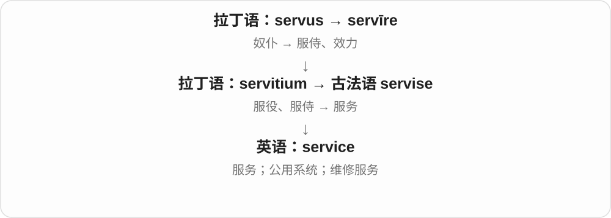

bus service 是公交服务；a service 可以是一次车辆保养或宗教礼拜。service 作动词常指给机器检修保养。

**常见搭配与例句**

customer service；bus services；a church service；service a car。

> The village has a regular bus service.

村里有定时公交服务。

> We had the car serviced before the trip.

出发前我们给汽车做了保养。

**别混淆**

service 更突出服务内容、系统或一次维护；serve 是服务、供给的动作。

### 17. disservice — 伤害；帮倒忙；不公正的对待

**音标**：英 /dɪsˈsɜːvɪs/；美 /dɪsˈsɜːrvɪs/

**先抓住这个画面**

本来该提供帮助，结果让对方更吃亏，或让人对他产生不公正的印象。

**怎么拆**

dis- + service，把有益的服务转成相反效果。

**怎么变成今天的意思**

常用 do someone a disservice，可能是有意，也可能出于好心。还可说某种描述低估了对象。

**常见搭配与例句**

do someone a disservice；a serious disservice；a disservice to…。

> Doing all the homework for him would do him a disservice.

把作业全替他做完，反而会害了他。

> Calling it a simple toy does the design a disservice.

把它说成一个简单玩具，低估了这个设计。

**别混淆**

disservice 不只是没帮上忙，通常表示确实造成不利影响或不公平评价。

### 18. able — 能够……的；有才能的

**音标**：/ˈeɪbəl/

**先抓住这个画面**

事情摆在面前，你有本领、有条件把它做成，就是 able。an able teacher 则是说这位老师很能干。

**怎么拆**

经古法语来自拉丁语 habilis，最初有便于拿取、合用的意思，根在 habēre。不能把它当作所有 -able 后缀的历史祖先。

**怎么变成今天的意思**

东西合手、适用 → 人胜任、有本领。现代 be able to 也能说条件允许，不一定只谈个人天赋。

**常见搭配与例句**

be able to do…；an able assistant；will be able to…。

> Will you be able to finish by Friday?

你能在星期五前完成吗？

> She is an able organizer who keeps everyone informed.

她是个能干的组织者，会让所有人及时了解情况。

**别混淆**

can 是情态动词；able 是形容词，要说 be able to。able 与后缀 -able 后来在意义上靠近，但来源不同。

### 19. disable — 使不能运作；禁用；使某种能力受损

**音标**：/dɪsˈeɪbəl/

**先抓住这个画面**

开关一关，功能就用不了了；故障一来，设备无法工作。这种“让它失去运作能力”是 disable。

**怎么拆**

dis-（去除、使相反）+ able（能够的）。

**怎么变成今天的意思**

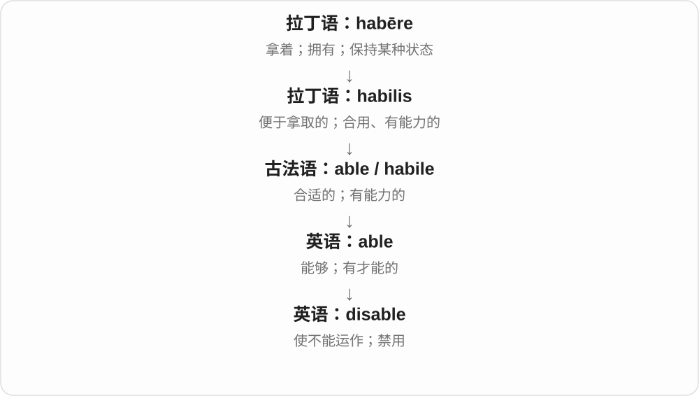

技术语境通常是有意禁用；事故或疾病语境可指某种功能受损。说人时要看具体影响，不能理解成整个人没有能力。

**常见搭配与例句**

disable an account；disable a feature；a disabled vehicle。

> You can disable automatic updates in the settings.

你可以在设置里关闭自动更新。

> The storm disabled the island’s main transmitter.

暴风雨使岛上的主发射机无法运作。

**别混淆**

delete 是删除内容；disable 常只是停用，内容或设置仍在。unable 则是形容某次做不到。

### 20. information — 信息；资料；消息

**音标**：英 /ˌɪnfəˈmeɪʃən/；美 /ˌɪnfərˈmeɪʃən/

**先抓住这个画面**

你原先不知道几点、在哪里、怎么做，补上这些空白的内容就是 information。

**怎么拆**

来自法语 information、拉丁语 īnfōrmātiō；与 inform 同族，但英语 information 不是必须由英语 inform 后来造出。

**怎么变成今天的意思**

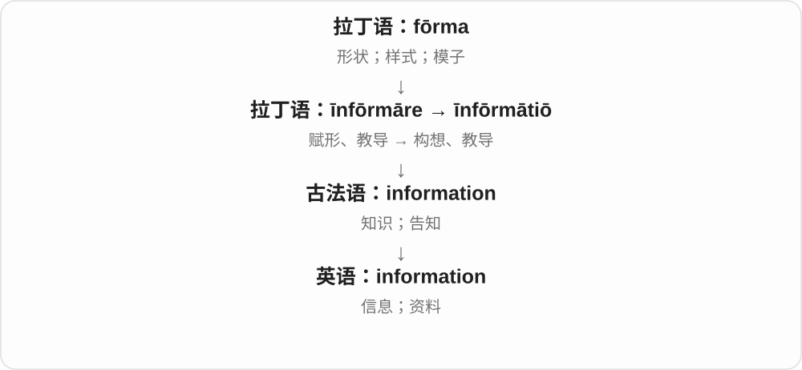

历史上的教导、构想变成让人知道情况的内容。现代通常是不可数名词：一条信息说 a piece of information。

**常见搭配与例句**

provide information；useful information；information about…。

> The website provides information about train services.

这个网站提供列车服务的信息。

> We need more information before deciding.

我们需要更多信息才能作决定。

**别混淆**

data 是记录的数据；information 强调能告诉我们情况的内容。普通英语不说 an information。

### 21. disinformation — 为误导而传播的虚假信息

**音标**：英 /ˌdɪsɪnfəˈmeɪʃən/；美 /ˌdɪsɪnfərˈmeɪʃən/

**先抓住这个画面**

明知内容不真实，还设计、散布它，让别人形成错误认识。

**怎么拆**

dis- + information；现代主要义强调有意误导，不能只按 dis- 机械理解成“没有信息”。

**怎么变成今天的意思**

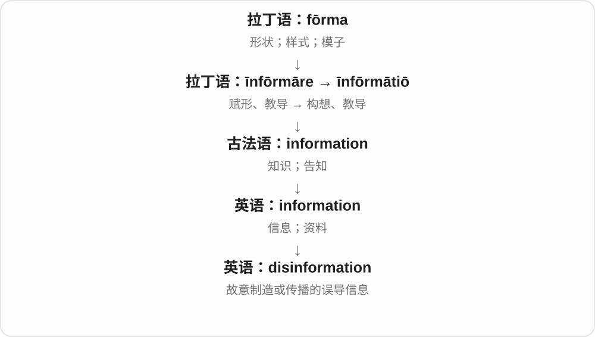

常涉及有组织的虚假消息，但一个人也可能故意散布。判断时既要看内容，也要看有无误导意图。

**常见搭配与例句**

a disinformation campaign；spread disinformation；counter disinformation。

> The report exposed a campaign of deliberate disinformation.

报告揭露了一场蓄意散布虚假信息的行动。

> They fabricated documents as part of the disinformation effort.

他们伪造文件，作为误导行动的一部分。

**别混淆**

信息有错，不足以单独证明是 disinformation；无意误传通常用 misinformation。

### 22. similar — 相似的；类似的；相似〔几何〕

**音标**：英 /ˈsɪmələ/；美 /ˈsɪmələr/

**先抓住这个画面**

不是同一个东西，但放在一起比较，有些特点很像。

**怎么拆**

法语 similaire 接中世纪拉丁 similāris，再接拉丁 similis“相像”；不是英语 sim 加一个能独立解释的 ilar。

**怎么变成今天的意思**

**拉丁 similis**  
相像、同类；与 simul“一起、同时”同族

↓

**中世纪拉丁 similāris → 法语 similaire → 英语 similar**  
具有相同或相近特点的

a similar problem 是类似问题，仍可能有关键差别。几何中的 similar shapes 是形状相同、对应长度按同一比例变化，不要求大小一致。

**常见搭配与例句**

similar to；similar in size；a similar approach。

> The two bags look similar, but one is much lighter.

两个包看着相似，但其中一个轻得多。

> The smaller triangle is similar to the larger one.

小三角形与大三角形相似。

**别混淆**

same 是同一个或相同的；similar 只是相似。常说 similar to，不说 similar with。

### 23. dissimilar — 不相似的；差别明显的

**音标**：英 /dɪˈsɪmələ/；美 /dɪˈsɪmələr/

**先抓住这个画面**

比较两件东西，重点落在不像的地方。

**怎么拆**

dis-“不、相反” + similar；也与拉丁 dissimilis 的形式对应。

**怎么变成今天的意思**

**拉丁 similis**  
相像、同类；与 simul“一起、同时”同族

↓

**中世纪拉丁 similāris → 法语 similaire → 英语 similar**  
具有相同或相近特点的

↓

**英语 dis- + similar → dissimilar**  
不相似、不同类的

dissimilar materials 是性质不相似的材料。not dissimilar 是委婉地说有些相像，不表示严格完全一样。

**常见搭配与例句**

dissimilar to；dissimilar in；not dissimilar。

> The two methods are dissimilar in both cost and complexity.

两种方法在成本和复杂程度上都很不一样。

> His experience was not dissimilar to mine.

他的经历与我的颇有些相似。

**别混淆**

different 范围更广，只要有区别即可；dissimilar 常突出整体特点没有那么相像。

### 24. trust — 信任；相信；托付；信托

**音标**：/trʌst/

**先抓住这个画面**

觉得对方靠得住，所以敢把事情、秘密或责任交给他。

**怎么拆**

中古英语 trust、trost 属日耳曼语信心、支持词族。常见词源解释联系古诺尔斯语 traust，但具体借入或本族传承有争论，不把一条路线说死。

**怎么变成今天的意思**

**日耳曼语信心、支持词族 → 中古英语 trust、trost**  
信赖、保护；英语具体传承或北欧借入关系有争论

↓

**现代 trust**  
相信可靠 → 委托责任；另有信托、托拉斯等专门用法

trust someone 信任某人，trust someone with a secret 把秘密托付某人；a trust 还可是按特定安排持有、管理资产的组织或法律关系。这里只帮助读词，不展开法律规则。

**常见搭配与例句**

trust someone；trust someone with；put your trust in；trust your judgement。

> I trust her to keep the information private.

我相信她会对这些信息保密。

> You need to trust your own judgement.

你需要相信自己的判断。

**别混淆**

believe someone 常是相信他这次说的话，trust someone 更偏觉得此人可靠；可能相信一句话，却仍不愿把钱托付给说话者。

### 25. distrusted — 不信任了；受到怀疑、不被信任的

**音标**：/dɪsˈtrʌstɪd/

**先抓住这个画面**

过去一直觉得某人靠不住，用 distrusted；一个解释被很多人怀疑，也可说 was distrusted。

**怎么拆**

distrust + 完整 -ed，/t/ 后读 /ɪd/。词根 trust 不改变，过去词尾另添音节。

**怎么变成今天的意思**

**日耳曼信心、支持材料 → 中古英语 trust、trost**  
与古诺尔斯 traust 等相连，具体传承有不同分析

↓

**现代 trust**  
信任、依赖；也可将责任交托

↓

**dis- + trust → distrust**  
对可靠性不放心、不信任

↓

**distrust + -ed → distrusted**  
过去不信任；不被信任

distrusted his motives 是怀疑他的动机；widely distrusted 是普遍不被信任。

**常见搭配与例句**

deeply distrusted 深深不信任的；distrusted the explanation 不信那番解释。

> She distrusted his sudden offer of help.

她对他突然提出帮忙心存疑虑。

> The explanation was widely distrusted.

那番解释普遍不被信任。

**别混淆**

distrusted 是可靠性上的怀疑；disliked 是不喜欢。过去不喜欢的人，也可能仍被认为办事可靠。

### 26. distrusts — 不信任、怀疑可靠性〔第三人称单数〕

**音标**：/dɪsˈtrʌsts/

**先抓住这个画面**

对方说得再好，心里仍觉得靠不住，这种态度是 distrusts。人、数字、消息来源都能成为对象。

**怎么拆**

dis- + trust → distrust，再加 -s；否定前缀加在信任动词上，末尾 /sts/。

**怎么变成今天的意思**

**日耳曼信心、支持材料 → 中古英语 trust、trost**  
与古诺尔斯 traust 等相连，具体传承有不同分析

↓

**现代 trust**  
信任、依赖；也可将责任交托

↓

**dis- + trust → distrust**  
对可靠性不放心、不信任

↓

**distrust + -s → distrusts**  
他、她不信任

distrusts the source 是不信消息来源；distrusts his own memory 是对自己的记忆没把握。

**常见搭配与例句**

distrusts strangers 不信任陌生人；distrusts the figures 不信这些数字。

> She distrusts figures that have no clear source.

她不信没有明确来源的数字。

> He distrusts his own memory and writes everything down.

他对自己的记忆没把握，什么都记下来。

**别混淆**

distrusts 与 mistrusts 大量重叠；不要硬规定一个一定有证据、另一个一定没有证据。

### 27. distrusting — 正在怀疑、不信任；多疑的

**音标**：/dɪsˈtrʌstɪŋ/

**先抓住这个画面**

心里总留着一份“恐怕靠不住”，叫 distrusting；用来形容人时，突出他不愿轻易相信。

**怎么拆**

distrust + 完整 -ing，直接接词尾。由不信任动作，可描述这种态度或人的性质。

**怎么变成今天的意思**

**日耳曼信心、支持材料 → 中古英语 trust、trost**  
与古诺尔斯 traust 等相连，具体传承有不同分析

↓

**现代 trust**  
信任、依赖；也可将责任交托

↓

**dis- + trust → distrust**  
对可靠性不放心、不信任

↓

**distrust + -ing → distrusting**  
怀疑的活动、态度

distrusting the result 是对结果不信；a distrusting look 是带着疑心的眼神。

**常见搭配与例句**

distrusting his memory 怀疑自己的记忆；increasingly distrusting 越来越不信任。

> Distrusting his memory, he checked the note again.

他不信自己的记忆，又检查了一遍便条。

> She was becoming increasingly distrusting of their promises.

她变得越来越不信他们的承诺。

**别混淆**

distrusting 说不肯相信的态度；untrustworthy 则说对象不值得信任，不要把怀疑者和被怀疑者混在一起。

### 28. distrust — 不信任；怀疑可靠性

**音标**：/dɪsˈtrʌst/

**先抓住这个画面**

觉得可能靠不住，因此不愿轻易相信、交付或依赖。

**怎么拆**

dis- 否定、相反 + trust，构成名词和动词。与 mistrust 用法大幅重叠，不硬分成一个有证据、一个绝无证据。

**怎么变成今天的意思**

**日耳曼语信心、支持词族 → 中古英语 trust、trost**  
信赖、保护；英语具体传承或北欧借入关系有争论

↓

**现代 trust**  
相信可靠 → 委托责任；另有信托、托拉斯等专门用法

↓

**dis- + trust → distrust**  
信任的反面 → 不信任

distrust the information 不信这些信息，distrust of authority 对权威的不信任；a deep distrust 深深的不信任。

**常见搭配与例句**

distrust of；deep distrust；distrust the source。

> Years of broken promises created deep distrust.

多年不兑现的承诺造成了深深的不信任。

> She distrusted the figures in the report.

她不信任报告里的数字。

**别混淆**

distrust 与 mistrust 都可说不信任；dislike 是不喜欢，可能不喜欢某人却仍觉得他办事可靠。

### 29. continue — 继续；接着做；持续

**音标**：/kənˈtɪnjuː/

**先抓住这个画面**

continue 像把一段线接下去：事情可以一直在做，也可以暂停后接着做。

**怎么拆**

经古法语 continuer 来自拉丁语 continuāre，联系 continuus“连在一起的”；远源是 continēre“保持在一起”。

**怎么变成今天的意思**

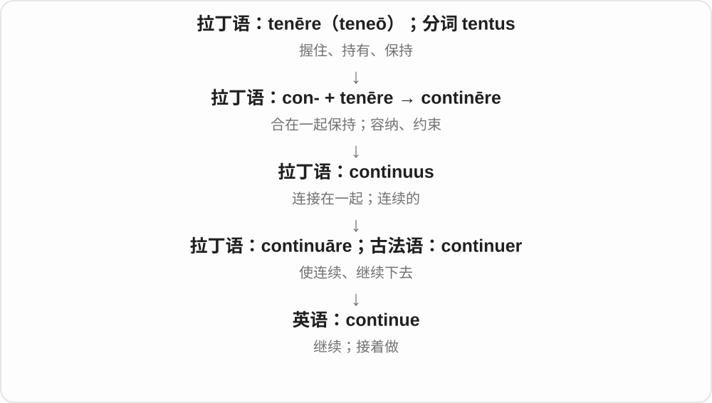

要看语境区分“没停”和“停后再来”。We continued after lunch 就明显有一段午饭间隔。

**常见搭配与例句**

continue doing / to do；continue with the work；continue for two hours。

> Please continue reading from the next paragraph.

请从下一段接着读。

> The rain continued throughout the night.

雨持续下了一整夜。

**别混淆**

continue 强调接下去；restart 强调从停止状态重新启动，可能从头开始。

### 30. discontinue — 停止；不再生产、提供或进行

**音标**：/ˌdɪskənˈtɪnjuː/

**先抓住这个画面**

discontinue 像把原先一直供应的产品或服务这条线切断，从此不再接着做。

**怎么拆**

来自古法语 descontinuer，现代可拆成 dis- + continue；否定、停止的构词在借入前已有。

**怎么变成今天的意思**

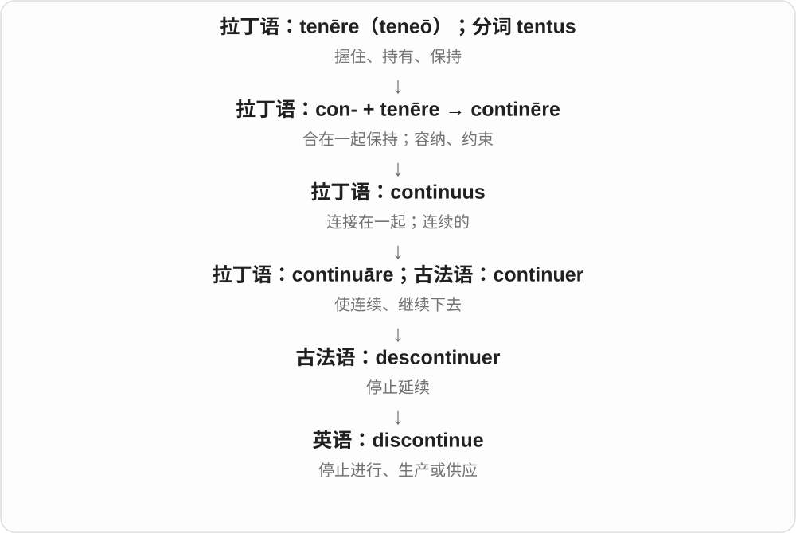

常见于产品、服务、惯例。比 pause 更容易表示某项安排正式结束，不只是短暂停一会儿。

**常见搭配与例句**

discontinue a product；discontinue a service；be discontinued。

> The company will discontinue the older model next year.

公司明年将停止生产旧型号。

> The library discontinued the service because few people used it.

图书馆因使用者很少而停止了这项服务。

**别混淆**

pause 是暂时停顿；discontinue 通常停止原有安排，是否以后恢复另说。

### 31. discontinuation — 停止；停产；终止供应

**音标**：/ˌdɪskənˌtɪnjuˈeɪʃən/

**先抓住这个画面**

discontinuation 像正式宣布“这条线到这里为止”，不再继续原来的产品、服务或安排。

**怎么拆**

discontinue + -ation；与 discontinue 停止延续的用法相连。

**怎么变成今天的意思**

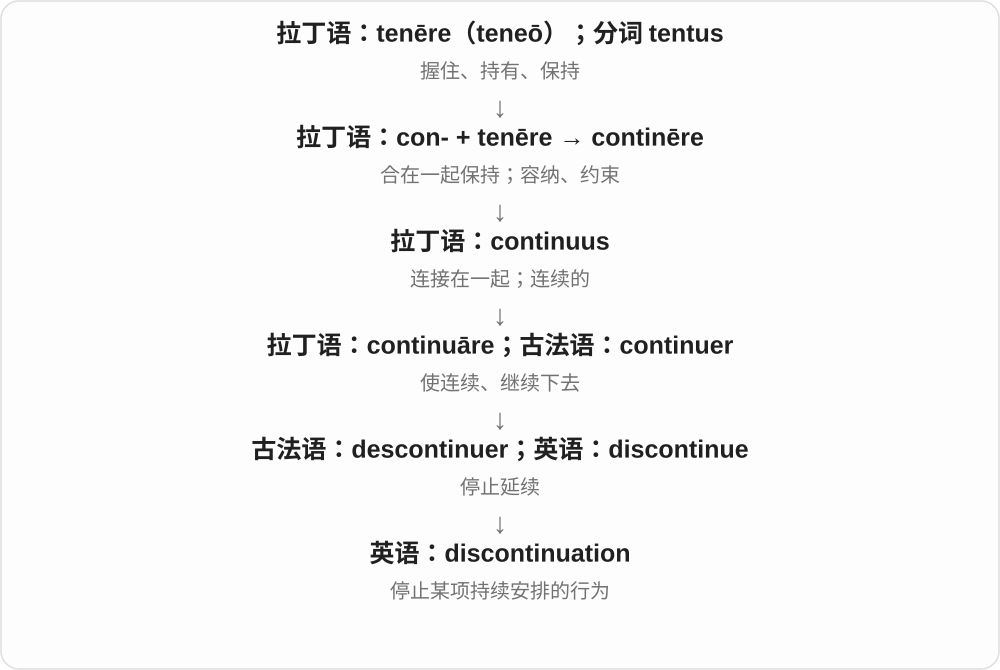

常用于公告、服务说明和项目报告。重点是有意识停止某项原先持续的安排。

**常见搭配与例句**

discontinuation of a service；product discontinuation；announce discontinuation。

> The company announced the discontinuation of the old service.

公司宣布停止提供旧服务。

> Customers received notice before the product’s discontinuation.

产品停产前，客户收到了通知。

**别混淆**

interruption 是中途被打断，通常仍可能恢复；discontinuation 更常表示正式结束。

### 32. respect — 尊重；顾及；方面

**音标**：/rɪˈspekt/

**先抓住这个画面**

respect 像认真把别人放进自己的视线：承认他的价值，也顾及他的意愿、界限和权利。

**怎么拆**

拉丁语 re-（回）+ specere（看）形成 respicere；名词 respect 经法语传入，动词由名词发展。

**怎么变成今天的意思**

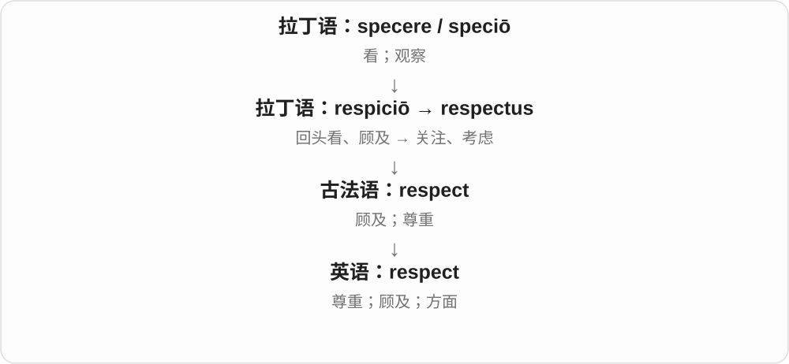

“回头看、留意”发展为顾及、重视。in this respect 里的 respect 则是“所关注的这一点”，不是尊敬。

**常见搭配与例句**

respect someone’s privacy；have respect for；in many respects。

> Please respect her decision to leave early.

请尊重她提前离开的决定。

> The two designs are similar in several respects.

这两种设计在几个方面很相似。

**别混淆**

respect 不要求你赞同对方。你可以尊重一个人，同时不同意他的判断。

### 33. respects — 尊重、顾及〔第三人称单数〕；方面、敬意、问候〔复数用法〕

**音标**：/rɪˈspekts/

**先抓住这个画面**

把对方的需要、边界放在心上，是 respects。in some respects 把事情分成几个观察方面；pay respects 则是表达敬意、致意。

**怎么拆**

respect 接法语 respect、拉丁 respectus，连 re- 回与 specere 看，较早回头看、顾及。现代加 -s，/t/ 后读 /s/；名词复数有固定搭配发展。

**怎么变成今天的意思**

**拉丁 respicere、respectus → 法语、英语 respect**  
回头看、顾及 → 尊重、考虑

↓

**respect + -s → respects**  
某人尊重；若干方面、表达的敬意

respects your decision 尊重你的决定；in many respects 在许多方面；pay one’s respects 致意、表达敬意。

**常见搭配与例句**

in all respects 在各方面；give someone my respects 代我向某人致意。

> She respects our decision to wait.

她尊重我们再等等的决定。

> The two plans are similar in several respects.

这两个计划在几个方面相似。

**别混淆**

respect 泛说尊重常不可数；respects 在方面、致意这些用法里要整体看搭配。不是每个 respect 都只是把敬意数成一份两份。

### 34. disrespect — 不尊重；失礼；不敬

**音标**：/ˌdɪsrɪˈspekt/

**先抓住这个画面**

disrespect 像把别人的感受、身份或边界随手拨到一边，表现得不当回事。

**怎么拆**

dis-（否定、反面）+ respect。

**怎么变成今天的意思**

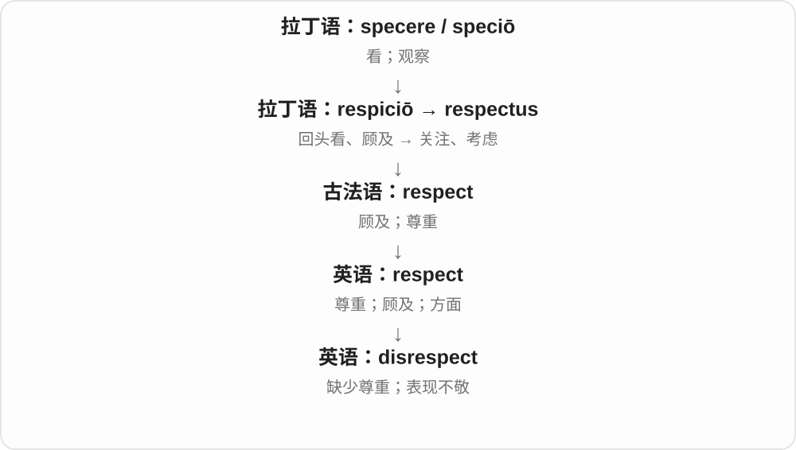

可作不可数名词，也可作动词。判断是否失礼需要语境，不是所有反对意见都叫 disrespect。

**常见搭配与例句**

show disrespect for；no disrespect intended；disrespect someone。

> Interrupting her repeatedly showed disrespect.

一再打断她显得很不尊重人。

> You can disagree without showing disrespect.

你可以表示不同意见，同时保持尊重。

**别混淆**

disagreement 是不同意，disrespect 是不尊重；两者可以分开。

### 35. disrespectful — 不尊重人的、无礼的

**音标**：/ˌdɪsrɪˈspektfəl/

**先抓住这个画面**

把别人的身份、感受当作不值得在意，说话做事缺少应有尊重，就是 disrespectful。它评价行为方式和态度。

**怎么拆**

dis- 否定、缺乏 + respectful；也能与 disrespect 不尊重 + -ful 的词族关系一起理解。

**怎么变成今天的意思**

**respect 尊重 + -ful → respectful**  
表现出尊重的

↓

**respectful 的方式、否定形式**  
respectfully 以尊重的方式；disrespectful 缺乏尊重

↓

**dis- + respectful → disrespectful**  
缺乏尊重的

be disrespectful to someone 对某人无礼，a disrespectful comment 不尊重人的评论，a disrespectful tone 无礼口气。

**常见搭配与例句**

be disrespectful to；a disrespectful tone。

> His disrespectful tone upset the other participants.

他不尊重人的口气让其他参与者不快。

> She apologised for being disrespectful to the teacher.

她为自己对老师无礼而道歉。

**别混淆**

不同意别人不自动是 disrespectful；不同意见与表达方式是否尊重，是两件可分别判断的事。

### 36. content — 内容；所含物；含量；满足的

**音标**：内容：英 /ˈkɒntent/、美 /ˈkɑːntent/；满足：/kənˈtent/

**先抓住这个画面**

content 有两个画面：书里装着什么，是“内容”；觉得眼前拥有的已经够了，是“满足”。同源，但重音不同。

**怎么拆**

来自拉丁语 contentus，是 continēre“容纳、保持”的分词。内容义指被装在里面的东西；满足义联系自足、安于现状。

**怎么变成今天的意思**

内容名词重音在前；满足形容词、使满足的动词重音在后。a table of contents 是目录；the contents of a bag 是包里的东西。

**常见搭配与例句**

online content；sugar content；be content with…；be content to do… 。

> The course focuses on the content of the argument.

课程关注论证的内容。

> She is content with a quiet evening at home.

在家安静地度过一个晚上，她就很满足。

> Check the sugar content on the label.

查看标签上的含糖量。

**别混淆**

happy 可指开心的情绪；content 更像平静地觉得“这样就够了”，不必兴高采烈。

### 37. discontent — 不满；不满足

**音标**：/ˌdɪskənˈtent/

**先抓住这个画面**

discontent 像看着现状，心里觉得“这样还不行”，希望事情有所改变。

**怎么拆**

dis-（否定、相反）+ content（满足）。

**怎么变成今天的意思**

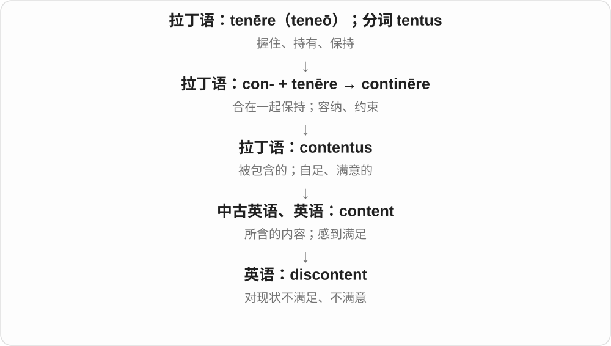

名词最常见，常说一群人对待遇、安排或生活状况的不满；并不一定已经发脾气或公开抗议。

**常见搭配与例句**

discontent with…；growing discontent；express discontent。

> There was growing discontent with the new timetable.

人们对新时间表的不满日益增加。

> The survey revealed widespread discontent among staff.

调查显示员工中普遍存在不满。

**别混淆**

anger 是愤怒；discontent 是不满意的状态，可以很安静，也可能积累成愤怒。

### 38. credit — 信用；赊购；功劳；学分；记入账户

**音标**：/ˈkredɪt/

**先抓住这个画面**

credit 可以先想一笔“相信与认可”：相信你会还钱，允许先买后付；认可你做过的贡献，把功劳记给你。

**怎么拆**

经法语 crédit，来自拉丁语 crēditum“托付之物、借贷”，属于 crēdere“相信”的词族。英语动词由名词发展。

**怎么变成今天的意思**

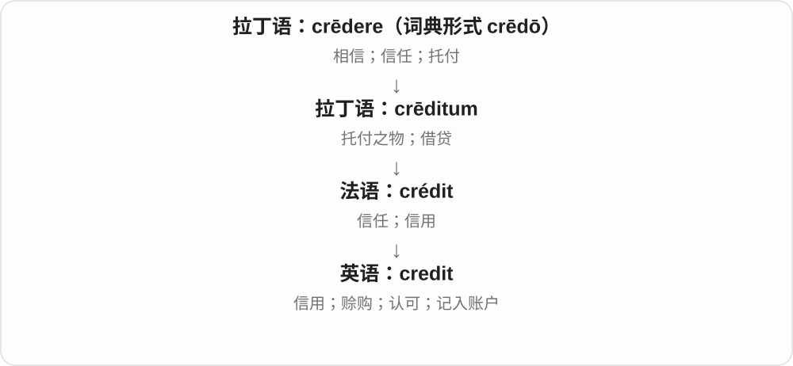

信任走进交易，形成信用和赊购；认可贡献，形成 give credit。学分也是对完成课程的正式认可。不同场景都要结合搭配理解，不能一律译成信用。

**常见搭配与例句**

buy on credit；give someone credit；take credit for…；earn course credits；credit money to an account。

> Give Maya credit for solving the problem.

这个问题是玛雅解决的，功劳应该归她。

> The shop allows customers to buy furniture on credit.

这家店允许顾客赊购家具。

**别混淆**

credit 既有信任与金融义，也有功劳和学分义。Give her credit 常是“认可她的贡献”，不是“借钱给她”。

### 39. discredit — 使不再可信；损害名誉

**音标**：/dɪsˈkredɪt/

**先抓住这个画面**

discredit 像把一个说法脚下的支撑抽掉：原来有人信，现在证据或反驳使它站不住了。

**怎么拆**

dis-（取消、相反）+ credit（信任、声誉），是英语的否定性构词。

**怎么变成今天的意思**

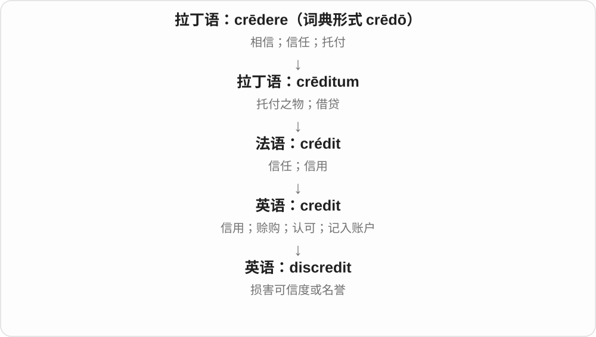

可以用证据推翻一个理论，也可以用攻击手段损害一个人的可信度。动词只说明使其失去信任，不保证使用的手段公正。

**常见搭配与例句**

discredit a claim；discredit a theory；discredit a witness；bring discredit on… 。

> The new evidence discredited the original explanation.

新证据使原先的解释失去了可信度。

> They tried to discredit her by spreading false rumors.

他们试图散布虚假传闻来损害她的名誉。

**别混淆**

disagree 是不同意；discredit 要进一步损害说法或来源的可信度。单说“我不喜欢”通常还谈不上 discredit。

### 40. agree — 同意；意见一致；相符；适合

**音标**：/əˈɡriː/

**先抓住这个画面**

一件事让你觉得可以接受，于是点头；几个人的看法也就合到了一起。

**怎么拆**

经古法语 agreer，接 a gré“合心意”，远接拉丁 gratum。末尾不是英语 free，也不按 a + 一个现代独立 gree 随意拆。

**怎么变成今天的意思**

**拉丁 gratus**  
令人喜欢、受欢迎；也指心怀感谢

↓

**拉丁 gratum → 古法语 gré；a gré → agreer**  
喜欢、意愿；合心意地 → 接受、赞同

↓

**中古英语 agreen → agree**  
意见一致；接受；彼此相合

agree with someone 同意某人，agree to a proposal 接受提议，agree on a date 商定日期。食物 doesn’t agree with me 是吃了不舒服；两组数据 agree 则是对得上。

**常见搭配与例句**

agree with；agree to do；agree on；I couldn’t agree more。

> We agreed on a date for the next meeting.

我们商定了下次开会的日期。

> I agree with your conclusion, but not with every detail.

我赞同你的结论，但不是每个细节都赞同。

> Rich food does not agree with me.

太油腻的食物让我吃了不舒服。

**别混淆**

accept 可以只是接受安排而未必赞同其道理；agree 表示点头认可或彼此一致。

### 41. disagree — 不同意；不一致；不相适应

**音标**：/ˌdɪsəˈɡriː/

**先抓住这个画面**

你向一个方向点头，我向另一个方向看：意见、说法或结果没对齐。

**怎么拆**

经盎格鲁法语 disagreer、古法语 desagreer 进入中古英语；dis- 表否定或相反。现代可以拆作 dis- + agree，历史上却已有法语整词。

**怎么变成今天的意思**

**拉丁 gratus**  
令人喜欢、受欢迎；也指心怀感谢

↓

**古法语 agreer → desagreer；盎格鲁法语 disagreer**  
合意、赞同 → 不合意、不同意

↓

**中古英语 disagre → 英语 disagree**  
不同意；说法或结果不相符

disagree with someone about/on something 是在某事上不同意某人。可以礼貌地分歧，不一定吵架。食物 disagree with someone 则表示吃了不适。

**常见搭配与例句**

disagree with；disagree about；politely disagree。

> We disagree about the best way to spend the money.

我们对这笔钱怎样花最好有不同看法。

> The two reports disagree on the number of visitors.

两份报告给出的游客人数不一致。

**别混淆**

argue 可以争论；disagree 只说明意见不同，未必发生争吵。

### 42. disagreement — 意见不合；分歧；不一致

**音标**：/ˌdɪsəˈɡriːmənt/

**先抓住这个画面**

把双方没能对齐的地方挑出来：可能是小看法不同，也可能是严重争执。

**怎么拆**

英语 dis- + agreement，或按 disagree + -ment 分析；两种现代构词解释都成立，远源同 agree。

**怎么变成今天的意思**

**拉丁 gratus**  
令人喜欢、受欢迎；也指心怀感谢

↓

**拉丁 gratum → 古法语 gré；a gré → agreer**  
喜欢、意愿；合心意地 → 接受、赞同

↓

**中古英语 agreen → agree**  
意见一致；接受；彼此相合

↓

**英语 agreement／disagree → disagreement**  
一致的否定；不同意这件事 → 分歧

a disagreement over money 为钱产生的分歧。in disagreement with the findings 也可说不认同研究结论，并不必然涉及人际冲突。

**常见搭配与例句**

a minor disagreement；disagreement over；resolve a disagreement。

> They resolved their disagreement over the schedule.

他们解决了对日程安排的分歧。

> There is disagreement among researchers about the cause.

研究者们对原因有不同意见。

**别混淆**

disagreement 不一定有争吵；argument 更容易指双方展开争论或一场口角。

### 43. interested — 感兴趣的；有利害关系的

**音标**：英 /ˈɪntrəstɪd/；美 /ˈɪntrəstɪd/

**先抓住这个画面**

注意力被吸引的是我；或者这件事会影响我的利益，所以我也是相关一方。

**怎么拆**

interest + -ed，过去分词形容词化。既接引起兴趣的动词义，也保留牵涉利益的意思。

**怎么变成今天的意思**

**拉丁语 interesse，字面 inter- 在……之间 + esse 存在**  
相关、有影响、重要；并非现代兴趣的逐字翻译

↓

**中世纪拉丁语、法语相关名词 → 英语 interest**  
牵涉的权益、补偿等 → 后发展出兴趣、利息等用法

↓

**interest → interested**  
引起关注、牵涉利益 → 有兴趣或有利害关系的

be interested in art 对艺术感兴趣；interested parties 利害相关方。后一搭配不是对活动觉得有趣的派对。

**常见搭配与例句**

be interested in doing something；an interested buyer；interested parties。

> I’m interested in learning how the machine works.

我有兴趣了解这台机器怎样运转。

> The report was sent to all interested parties.

报告发给了所有相关方。

**别混淆**

interested 说感受或关系，interesting 说能引起兴趣的特征。I’m interested in history，不是 I’m interesting in history。

### 44. disinterested — 不偏不倚的；无私利牵涉的；有时表示没兴趣

**音标**：英 /dɪsˈɪntrəstɪd/；美 /dɪsˈɪntrəstɪd/

**先抓住这个画面**

做判断时没有自己的好处夹在中间，因此能更公正；并不是脑子已经不想参与。

**怎么拆**

来自 disinterest 的分词或 dis- + interested，两个构词分析都与历史用法有关。无偏私与没兴趣两义长期有交叠，不是现代才发生的单纯误用。

**怎么变成今天的意思**

**拉丁语 interesse，字面 inter- 在……之间 + esse 存在**  
相关、有影响、重要；并非现代兴趣的逐字翻译

↓

**中世纪拉丁语、法语相关名词 → 英语 interest**  
牵涉的权益、补偿等 → 后发展出兴趣、利息等用法

↓

**dis- + interested / disinterest + -ed → disinterested**  
无利害关系、不偏私；也有缺乏兴趣用法

a disinterested observer 不偏不倚的观察者；disinterested advice 不受个人利益影响的建议。正式写作中通常优先用它表达公正，用 uninterested 明确表达没兴趣。

**常见搭配与例句**

a disinterested observer；a disinterested opinion；disinterested advice。

> We asked a disinterested expert to review both proposals.

我们请一位没有利害关系的专家评审两份提议。

> A disinterested observer might reach a different conclusion.

一位不偏不倚的观察者可能得出不同结论。

**别混淆**

公正的人可以非常关心事情本身，只是不谋私利。读到没兴趣义也要认识它，但学习表达时分清两词更不容易含混。

### 45. color — 颜色；色彩；给……上色；影响看法

**音标**：美 /ˈkʌlər/；英 /ˈkʌlə/

**先抓住这个画面**

眼前呈现什么颜色；比喻时，就像给一件事蒙上一层带色的滤镜。

**怎么拆**

名词经古法语和英法语来自拉丁 color。动词也有拉丁 colorare、法语 colorer 的借入链，不只是现代英语名词临时变动词。

**怎么变成今天的意思**

**拉丁 color**  
颜色；肤色；外表

↓

**古法语 color、英法语 colur 等 → 英语 color / colour**  
颜色；引申为特色、看事情的色彩

↓

**动词旁支：拉丁 colorare → 法语 colorer → 英语 color**  
给东西着色；也指影响叙述或判断

What color is it? 问它是什么颜色。Past experience colored his judgment 说过去的经历影响了他的判断，就像看世界时戴上有色镜片。color 主要是美式拼写；英国通常写 colour，意义一样。

**常见搭配与例句**

in color；a change of color；color a picture；color somebody’s judgment。

> Choose a color that is easy to see against the white background.

选一种在白色背景上容易看清的颜色。

> Her earlier disappointment colored her view of the new proposal.

她之前的失望影响了她对新提案的看法。

**别混淆**

color 指颜色或总体色彩，shade 常说同一种颜色的深浅变体。动词 color a judgment 并不是给判断涂颜料。

### 46. discolor — 使变色；变色；褪色

**音标**：美 /dɪsˈkʌlər/；英 /dɪsˈkʌlə/

**先抓住这个画面**

原本正常的颜色走样了：发黄、变暗、染上斑迹，都可能算。

**怎么拆**

经古法语 descolorer 进入英语；des- 加 colorer 上色，对应改变或失去原有颜色。不是所有 dis- 都只表示完全去掉。

**怎么变成今天的意思**

**拉丁 colorare → 古法语 colorer、descolorer**  
上色 → 改变正常颜色

↓

**英语 discolor**  
使变色；也可说本身变色

阳光让布料变色，水渍让纸张发黄，都可以用 discolor。颜色不一定变淡，也可能变深或变得不均匀。英国常写 discolour。它通常带外观变差或不再正常的意味。

**常见搭配与例句**

sunlight discolors fabric；discolored paper；discolor over time。

> Direct sunlight can discolor the fabric over time.

长时间的阳光直射会让布料变色。

> The old paper had discolored around the edges.

旧纸的边缘已经变色了。

**别混淆**

fade 强调颜色渐淡；discolor 更宽，泛指偏离正常颜色。recolor 是重新着色，往往是有意的操作。

### 47. appear — 出现；看起来、似乎；出场

**音标**：英 /əˈpɪə/；美 /əˈpɪr/

**先抓住这个画面**

眼前原先没有，现在看见了，是出现；眼前呈现某种样子，也能说看起来如何。

**怎么拆**

借古法语 aparoir，接拉丁 apparere，历史由 ad- + parere 显露组成。英语现代不能把 a- 当否定，再把 ppear 编成词根。

**怎么变成今天的意思**

**拉丁 ad- + parere 显露 → apparere → 古法语 aparoir**  
显出来、变得可见

↓

**中古英语 apperen → appear**  
出现 → 看起来、给人某种印象

appear on screen 出现在屏幕上，appear tired 看起来累，appear to be 似乎是；It appears that... 看起来……。

**常见搭配与例句**

appear on；appear to be；appear tired；It appears that。

> A message appeared on the screen.

屏幕上出现了一条消息。

> She appears to know the area well.

她似乎很熟悉这一带。

**别混淆**

appear 看起来不保证事实已证实；appear a problem 不说突然出现一个问题，改 a problem appeared。

### 48. disappear — 消失；不见；不复存在

**音标**：英 /ˌdɪsəˈpɪə/；美 /ˌdɪsəˈpɪr/

**先抓住这个画面**

原来能看见、能找到，现在看不见、找不到了；并不自动说明东西化为乌有。

**怎么拆**

dis- 反向、解除 + appear，也有法语相应形式影响。现代通常不及物，后面不直接带被弄没的物品作普通宾语。

**怎么变成今天的意思**

**拉丁 ad- + parere 显露 → apparere → 古法语 aparoir**  
显出来、变得可见

↓

**中古英语 apperen → appear**  
出现 → 看起来、给人某种印象

↓

**dis- + appear → disappear**  
出现的反面 → 消失、不见

disappear into the crowd 消失在人群中，disappear from view 从视野消失；The keys disappeared 钥匙不见了。

**常见搭配与例句**

disappear into；disappear from view；disappear without trace。

> The boat disappeared into the fog.

船消失在雾中。

> My keys seem to have disappeared again.

我的钥匙似乎又不见了。

**别混淆**

disappear 不见，destroy 毁坏；人转过街角 disappears from view，并不表示被毁灭。

### 49. prove — 证明；证实；结果显示是

**音标**：英 /pruːv/；美 /pruːv/

**先抓住这个画面**

把说法放到证据或实践面前，让人看出它是否站得住。

**怎么拆**

来自拉丁语 probāre，经古法语 prover 等路线进入英语；古英语也有同源借词。probāre 本来与“检验是否够好、够可靠”相关。

**怎么变成今天的意思**

prove a claim 是证明一个主张；prove yourself 是用表现证明自己的能力；prove useful 是实践下来发现有用，不要求后面再加一个宾语。

**常见搭配与例句**

prove that…；prove to be useful；prove someone wrong；prove yourself。

> The records prove that the payment was made on time.

记录证明款项按时付出了。

> The spare battery proved useful during the trip.

备用电池在旅途中果然派上了用场。

**别混淆**

prove 表示拿出足以支持结论的证明；suggest 只是提示一种可能。实际证明到哪一步，要看证据和语境。

### 50. disprove — 证明错误；证伪

**音标**：英 /dɪsˈpruːv/；美 /dɪsˈpruːv/

**先抓住这个画面**

不是说“我不信”，而是拿出材料，让那个主张站不住。

**怎么拆**

经古法语 desprover 借入，历史构词 des- 否定、撤销 + prover 证明；现代可看作 dis- + prove。

**怎么变成今天的意思**

可用于理论、猜测、指控。一个真正适用的反例可以推翻“所有情况都如此”的断言。

**常见搭配与例句**

disprove a theory；disprove an allegation；disprove a claim。

> A single counterexample disproved the general claim.

一个反例就推翻了那条普遍断言。

> The new records disproved the rumour.

新发现的记录证实那则传言不实。

**别混淆**

disapprove 是不赞同；disprove 是证明不对。你不喜欢一个结论，并不等于你证伪了它。

### 51. honest — 诚实的；坦诚的；真诚的

**音标**：英 /ˈɒnɪst/；美 /ˈɑnɪst/

**先抓住这个画面**

说出来的话和自己知道的事实尽量对得上，不靠欺骗占便宜。

**怎么拆**

经古法语 honeste 接拉丁 honestus，后者来自 honos 荣誉；不能拆成英语 honor 加 -est 最高级。

**怎么变成今天的意思**

**拉丁 honos／honor**  
荣誉；尊敬

↓

**拉丁 honestus**  
值得尊敬的；正直的

↓

**古法语 honeste → 英语 honest**  
值得尊敬 → 公平、真实、不欺骗

an honest answer 是诚实回答；be honest with someone 是对某人坦诚。an honest mistake 指无意犯下的错误：这里不是夸错误诚实，而是说其中没有故意欺骗。

**常见搭配与例句**

to be honest；an honest answer；an honest mistake；honest about something。

> Please be honest with me about what happened.

请坦诚告诉我发生了什么。

> It was an honest mistake, and she corrected it immediately.

那是个无心之失，她立即作了纠正。

**别混淆**

honest 不等于 correct。一个人可以诚实表达自己的判断，却仍然判断错。h 不发音，所以是 an honest person。

### 52. dishonest — 不诚实的；带有欺骗性的

**音标**：英 /dɪsˈɒnɪst/；美 /dɪsˈɑnɪst/

**先抓住这个画面**

知道事情不是那样，却故意让别人相信另一套说法。

**怎么拆**

经古法语 deshoneste 进入英语；构词关系是 dis- 不 + honest 诚实，远源接拉丁 honestus。

**怎么变成今天的意思**

**拉丁 honos／honor**  
荣誉；尊敬

↓

**拉丁 honestus**  
值得尊敬的；正直的

↓

**古法语 deshoneste → 英语 dishonest**  
不正直、不体面 → 不诚实、欺骗性的

a dishonest answer 是不诚实的回答；dishonest about costs 是在费用问题上不坦诚。重点通常是欺骗或故意误导，与单纯记错、算错不同。

**常见搭配与例句**

a dishonest claim；dishonest behavior；dishonest about something。

> It would be dishonest to claim that I did all the work myself.

声称全部工作都是我一个人做的，会很不诚实。

> The story exposes the dishonest methods used by the salesman.

故事揭露了那名推销员使用的欺骗手段。

**别混淆**

incorrect 可能只是弄错；dishonest 带有不诚实的判断。不能只因一句话不准确就断定说话者 dishonest。

### 53. dishonesty — 不诚实；欺骗行为

**音标**：英 /dɪsˈɒnɪsti/；美 /dɪsˈɑnɪsti/

**先抓住这个画面**

信任不是一下消失的，而是被隐瞒、编造和作弊一点点破坏。

**怎么拆**

历史经古法语 deshonesté，接 honestas 词族；现代可看作 dis- + honesty，或与 dishonest 的名词形式对应。

**怎么变成今天的意思**

**拉丁 honos／honor**  
荣誉；尊敬

↓

**拉丁 honestus**  
值得尊敬的；正直的

↓

**拉丁 honestas 与古法语 deshonesté**  
正直 → 不体面、失去荣誉

↓

**英语 dishonesty**  
突出不诚实或缺乏诚信

an act of dishonesty 是一次不诚实行为；academic dishonesty 可涵盖作弊、抄袭等违反学术诚信的行为。这个名词把具体行为和不诚实品质作为讨论对象。

**常见搭配与例句**

an act of dishonesty；academic dishonesty；a pattern of dishonesty。

> Repeated dishonesty destroyed their trust in him.

反复的不诚实行为让他们不再信任他。

> The school explains its policy on academic dishonesty to every student.

学校向每个学生说明有关学术不诚信的规定。

**别混淆**

dishonesty 关注诚信问题，inaccuracy 关注不准确；二者可能同时存在，也可能只是后者。

### 54. honor — 荣誉；尊敬；给予表彰；履行

**音标**：英 /ˈɒnə/；美 /ˈɑnər/

**先抓住这个画面**

把一个人或一件承诺认真放在心上，并用行动表示它值得尊重。

**怎么拆**

名词经古法语 honor，动词经 honorer；最终接拉丁 honor 与 honorare。h 不发音。

**怎么变成今天的意思**

**拉丁 honos／honor**  
尊敬；荣誉；声望

↓

**古法语 onor／honor；honorer**  
荣誉；尊重

↓

**英语 honor／honour**  
尊敬、荣誉；尊重并履行

an honor 是一件让人感到光荣的事；honor a person 是向人致敬；honor a promise 是尊重并兑现承诺。“给荣誉”和“守承诺”看似不同，其实都在认真对待某人或某件事。

**常见搭配与例句**

in honor of；It is an honor to…；honor a commitment。

> It was an honor to introduce the guest speaker.

能够介绍那位特邀演讲者，我感到很荣幸。

> The company promised to honor the agreement.

公司承诺履行协议。

> The ceremony will honor volunteers from the local community.

仪式将表彰当地社区的志愿者。

**别混淆**

honor 是美式常用拼写，honour 是英式常用拼写。honor 比普通 praise 更常涉及正式尊敬、荣誉或守信。

### 55. dishonor — 耻辱；损害名誉；使蒙羞

**音标**：英 /dɪsˈɒnə/；美 /dɪsˈɑnər/

**先抓住这个画面**

原本受人看重的名声，因为行为被弄上了一块污点。

**怎么拆**

经古法语 deshonor 等形式，接否定、相反的 des-/dis- 与 honor 词族；现代可理解为 dis- + honor。

**怎么变成今天的意思**

**拉丁 honos／honor**  
尊敬；荣誉；声望

↓

**古法语 des- + honor → deshonor**  
失去或损害荣誉

↓

**英语 dishonor**  
耻辱；使蒙羞

bring dishonor on a group 是使团体蒙羞；dishonor a promise 是违背承诺。重点是行为损害了应有的信任或尊重，不只是当事人一时难为情。

**常见搭配与例句**

bring dishonor on；dishonor a promise；a sense of dishonor。

> The deception brought dishonor on the organization.

这次欺骗行为让组织蒙羞。

> He refused to dishonor the promise he had made.

他不愿违背自己作出的承诺。

**别混淆**

dishonor 比 embarrassment 尴尬更重，涉及名誉或原则；英式常写 dishonour。

### 56. abuse — 滥用；虐待；辱骂

**音标**：名词 /əˈbjuːs/；动词 /əˈbjuːz/

**先抓住这个画面**

abuse 常有“把使用变成伤害”的感觉：权力被拿来欺压人，信任被拿来谋私，或者一个人受到持续的恶劣对待。

**怎么拆**

拉丁语 ab- + ūtī，形成 abūtī，相关形式是 abūsus；再经法语传入。ab- 在这里不能机械译成现代英语里某个固定动作。

**怎么变成今天的意思**

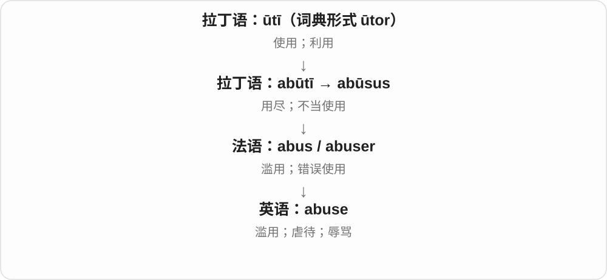

这支历史上有用尽、不当使用等意思。在现代英语里，它既可指滥用权力或资源，也可指身体、心理上的虐待，以及攻击人的辱骂。

**常见搭配与例句**

abuse power；abuse someone’s trust；verbal abuse；child abuse；suffer abuse。

> The manager abused his authority to silence complaints.

经理滥用职权，压制投诉。

> The referee faced a stream of verbal abuse from the crowd.

裁判遭到观众接连不断的辱骂。

**别混淆**

名词 abuse 结尾 /s/，动词 /z/。criticism 可以是针对问题的批评；abuse 往往带有人身攻击或伤害，不只是意见尖锐。

### 57. disabuse — 使不再误信；纠正某人的错误想法〔正式〕

**音标**：/ˌdɪsəˈbjuːz/

**先抓住这个画面**

对方一直以为这件事很容易，你把真实情况讲清，让他不再抱这个错觉，就是 disabuse someone of that idea。

**怎么拆**

dis- 去除 + abuse 的较早欺骗、误导义，并与法语 desabuser 相应。不能只按今天 abuse 虐待硬译成停止虐待。

**怎么变成今天的意思**

**abuse 的旧欺骗、误导义**  
让人误信的材料

↓

**dis- + abuse → disabuse**  
使摆脱错误观念、受骗状态

disabuse someone of a notion 纠正某人的错误想法；be quickly disabused 很快认清自己想错了。宾语是人，错误观念常用 of 接。

**常见搭配与例句**

disabuse someone of the idea；disabuse of a notion。

> The first week disabused me of the idea that the job was easy.

第一周的经历就让我打消了这份工作很轻松的想法。

> She gently disabused him of that mistaken notion.

她温和地纠正了他的那个错误观念。

**别混淆**

correct a mistake 可以直接改错误，disabuse 通常让某个人不再相信某个错误想法；它不是“反对一切 abuse”的通用动词。

### 58. colour — 颜色；特色；上色；影响判断

**音标**：英 /ˈkʌlə/；美 /ˈkʌlər/

**先抓住这个画面**

既是眼睛看到的色彩，也可以是让故事和场景鲜活起来的细节。

**怎么拆**

color 的主要英式拼写，与它共享法语和拉丁语来源。-our 的拼写保留了英语历史中的法语影响，不是另一个词根。

**怎么变成今天的意思**

**拉丁 color**  
颜色；肤色；外表

↓

**古法语 color、英法语 colur 等 → 英语 color / colour**  
颜色；引申为特色、看事情的色彩

local colour 是地方特色，例如当地人的口音、街道、食物和生活习惯，不只是城市的配色。add colour to a story 是让故事更有画面、更生动。写英式文章用 colour，美式常用 color，一篇文章尽量统一。

**常见搭配与例句**

local colour；add colour to something；colour in a picture；show one’s true colours。

> The market scenes add local colour to the novel.

市场的场景给这部小说增添了地方特色。

> The children coloured in the animals on the worksheet.

孩子们给练习纸上的动物涂了颜色。

**别混淆**

colour 与 color 的差别主要是拼写惯例，不能硬分成不同意思。show one’s true colours 表示露出真实面目，来自颜色作为身份标识的联系。

### 59. discolour — 使变色；褪色、变色〔英式拼写〕

**音标**：英 /dɪsˈkʌlə/；美 /dɪsˈkʌlər/

**先抓住这个画面**

原来白的布慢慢发黄，木头表面颜色变得不一样，discolour 常说这种不想要的颜色变化。

**怎么拆**

dis- 表离开正常状态、改变 + colour 颜色，与法语 descolorer 等历史材料相连；美式常写 discolor。不是只要出现 dis- 就一定彻底没有颜色。

**怎么变成今天的意思**

**dis- 与 colour 的颜色材料**  
离开原来颜色、发生变色

↓

**discolour／discolor**  
常见英美拼写的对应动词

discolour fabric 使织物变色；the paper discoloured 纸变色了。可带宾语，也可说物体自身发生变化。

**常见搭配与例句**

discolour over time；discolour the surface。

> Sunlight can discolour the fabric.

日光可能使织物变色。

> The paper had discoloured with age.

纸张随着年头久远已经变色。

**别混淆**

discolour 常是变色、褪色，colour 动词可主动上色；旧纸发黄不一定是有人刻意给它上了新颜色。

### 60. discoloured — 变色的；褪色、颜色异常的〔英式拼写〕

**音标**：英 /dɪsˈkʌləd/；美 /dɪsˈkʌlərd/

**先抓住这个画面**

discolour 说发生颜色变化，discoloured 可以直接描述变化后那件物品：发黄的纸、变了色的布。

**怎么拆**

discolour + -ed；既可作过去分词，也常作形容词。美式相应为 discolored，不是另有一个 red 红色藏在末尾。

**怎么变成今天的意思**

**discolour**  
变色、使变色

↓

**discolour + -ed → discoloured**  
变色后的状态；相应形容用法

discoloured paper 变色的纸；discoloured fabric 变色织物；原因可能不同，词本身只描述颜色与原来、正常情况不同。

**常见搭配与例句**

discoloured fabric；a discoloured patch。

> The old photograph was badly discoloured.

那张旧照片变色很严重。

> We replaced the discoloured curtain.

我们换掉了那幅变色的窗帘。

**别混淆**

discoloured 颜色发生变化，不等于所有 coloured 有颜色的；彩色纸正常有颜色，不因此就是变质、褪色。

### 61. mount — 登上、骑上；安装；开展；增加；山、支架、坐骑

**音标**：/maʊnt/

**先抓住这个画面**

先想“往高处去”，再想“把东西安到它的位置”：人骑上马，相机装上支架，准备工作到位后活动就能开展。

**怎么拆**

动词经法语 monter 接重构 *montare。名词“山”另有拉丁 mons → 古英语 munt 的早期借入路线；“坐骑、支架”等名词义则接英语动词。

**怎么变成今天的意思**

**拉丁 mons，属格 montis，词干 mont-**  
山、高地

↓

**名词支线：拉丁 mons → 古英语 munt → mount**  
山，多见于山名

↓

**动词支线：\*montare → 法语 monter／munter → 中古英语 mounten**  
登上、骑上

↓

**英语 mount 动词及其派生名词**  
安装、安排开展、增加；支架、坐骑

mount a camera 是把相机装好；mount a campaign 是组织开展活动；costs mount 是费用不断增加。Mount Fuji 中 Mount 是“山”。电脑里 mount a drive 是把存储卷接入可访问的文件系统。

**常见搭配与例句**

mount something on；mount a campaign；costs mount；a camera mount。

> She mounted the camera on a small tripod.

她把相机装在一个小三脚架上。

> Repair costs continued to mount after the inspection.

检查后，维修费用仍在不断增加。

> The museum is mounting an exhibition of local photographs.

博物馆正在筹办一场本地摄影展。

**别混淆**

climb 强调攀爬动作；mount 还可以说骑上、安装和组织开展。mount 与 mound“土堆”不能仅凭字形当成同一个词。

### 62. dismount — 下马、下车；卸下；体操下法

**音标**：/dɪsˈmaʊnt/

**先抓住这个画面**

上马叫 mount，离开马背落到地上就是 dismount；体操里从器械下来完成落地，也保留这个方向。

**怎么拆**

英语 dis- 表分离、相反 + mount，并有法语 desmonter 的对应影响。作为名词，dismount 可指体操的下法、下器械动作。

**怎么变成今天的意思**

**拉丁 mons，属格 montis，词干 mont-**  
山、高地

↓

**通俗拉丁 \*montare〔重构形式〕**  
登上、向上

↓

**古法语 monter／盎格鲁法语 munter**  
上升、爬上、骑上

↓

**中古英语 mounten → mount**  
登上、骑上 → 安装、安排开展；数量增加

↓

**英语 dis- + mount → dismount；受法语 desmonter 对应形式影响**  
下马、下车；拆下，离开安装位置

dismount from a bicycle 是下自行车，语气较正式，常见于标识。a clean dismount 是体操里干净利落的下法。拆卸设备也可用，但日常常用 remove 或 take off。

**常见搭配与例句**

dismount from；cyclists must dismount；a difficult dismount。

> Cyclists must dismount before crossing the narrow bridge.

骑车人过这座窄桥前必须下车。

> She landed her dismount without taking a step.

她完成下法落地后，没有移动脚步。

**别混淆**

get off 最日常；dismount 较正式，也有骑术、体操等明确场景。

### 63. comfort — 安慰；舒适；安心；使宽慰

**音标**：英 /ˈkʌmfət/；美 /ˈkʌmfərt/

**先抓住这个画面**

有人或某种环境把你接住，让身心不再那么难受。

**怎么拆**

晚期拉丁 confortāre 原来偏“使更有力量”；经法语 conforter 和名词 confort 分别传入英语，逐渐侧重安慰与舒适。

**怎么变成今天的意思**

**拉丁 fortis**  
强壮、坚固、勇敢；更早来源有不同分析

↓

**晚期拉丁 con- + fortis → confortāre**  
使更有力量；con- 常作加强语气理解

↓

**古法语 conforter〔动词〕／confort〔名词〕→ 中古英语**  
给予支持、安慰；安慰、宽慰

↓

**现代英语 comfort**  
安慰；舒适、安心；n 后来变为 m

comfort a friend 是安慰朋友；sit in comfort 是坐得舒服；take comfort in something 是从某件事得到宽慰。由“给人力量”走到“让人安心”，比硬记“舒服”更能连起这些用法。

**常见搭配与例句**

comfort someone；take comfort in；a source of comfort；in comfort。

> Her friend’s quiet presence gave her comfort.

朋友安静地陪着，让她得到安慰。

> The wider seats allow passengers to travel in comfort.

更宽的座椅让乘客旅途中坐得舒服。

> He tried to comfort the frightened child.

他试着安慰受到惊吓的孩子。

**别混淆**

comfort 可照顾身体感受，也可缓解情绪；console 通常更集中在失落、悲伤后的安慰。

### 64. comforts — 安慰〔第三人称单数〕；让生活舒适的东西〔复数〕

**音标**：英 /ˈkʌmfəts/；美 /ˈkʌmfərts/

**先抓住这个画面**

一个拥抱让难过的人缓过来，是 comforts 的动作；热水、舒服的床等让日子好过的东西，也可以合称 comforts。

**怎么拆**

comfort + -s，/t/ 后读 /s/。名词、动词同形变化；更早法语 confort 的 n 在英语拼写里变成 m。

**怎么变成今天的意思**

**拉丁 fortis → 晚期拉丁 confortare**  
强壮、有力量 → 加强、支持

↓

**古法语 conforter、confort → 英语 comfort**  
动词、名词各有借入路线；安慰、舒适

↓

**comfort + -s → comforts**  
他、她安慰；几样舒适便利之物

comforts a friend 是安慰朋友；the comforts of home 是家里那些舒服、方便的条件。

**常见搭配与例句**

small comforts 一点点能让人好受的东西；comforts the child 安慰孩子。

> She comforts the child with a quiet story.

她轻声讲故事，安慰那个孩子。

> After the long trip, we enjoyed the comforts of home.

长途旅行后，我们享受着家里的舒适。

**别混淆**

comfort 泛指舒适、安慰时常不可数；comforts 可数带来舒适的具体东西、条件，不是每个抽象状态都加 s。

### 65. comforted — 安慰了；感到宽慰的

**音标**：英 /ˈkʌmfətɪd/；美 /ˈkʌmfərtɪd/

**先抓住这个画面**

难过时有人陪着、说了几句话，心里好受一些，就是 felt comforted。它不一定消除问题，而是先给人一点支撑。

**怎么拆**

动词 comfort + 完整 -ed，/t/ 后读 /ɪd/。古代“加强、支持”的动作，经借词历史进入安慰义。

**怎么变成今天的意思**

**拉丁 fortis → 晚期拉丁 confortare**  
强壮、有力量 → 加强、支持

↓

**古法语 conforter、confort → 英语 comfort**  
动词、名词各有借入路线；安慰、舒适

↓

**comfort + -ed → comforted**  
过去安慰；得到宽慰

comforted her after the news 是在她听到消息后安慰她；felt comforted by his presence 是有他在就好受一些。

**常见搭配与例句**

comforted a friend 安慰了朋友；comforted by familiar voices 因熟悉的声音得到宽慰。

> He comforted his friend after the difficult conversation.

那场难受的谈话后，他安慰了朋友。

> I felt comforted by the familiar voices around me.

身边熟悉的声音让我感到宽慰。

**别混淆**

comforted 常针对难过、痛苦后的好受一点，reassured 常针对担忧、疑虑减轻；两种感受可以一起出现。

### 66. discomfort — 不适；不安；使不舒服

**音标**：英 /dɪsˈkʌmfət/；美 /dɪsˈkʌmfərt/

**先抓住这个画面**

舒服、安定的感觉被打破，身体或心里开始别扭。

**怎么拆**

名词经古法语 desconfort，动词经 desconforter 传入；des- + conforter。现代可对照 dis- + comfort，不能把所有历史节点都排在现代 comfort 后。

**怎么变成今天的意思**

**拉丁 fortis**  
强壮、坚固、勇敢；更早来源有不同分析

↓

**晚期拉丁 con- + fortis → confortāre**  
使更有力量；con- 常作加强语气理解

↓

**古法语 des- + conforter → desconforter / desconfort**  
使失去支持或勇气；不幸、忧伤

↓

**中古英语／现代英语 discomfort**  
后来转为身体不适、心理不安；也作动词

它常比 pain 温和，可以是鞋挤脚，也可以是社交场合的别扭。正式语境也用作动词 make uncomfortable，但日常名词更常见。

**常见搭配与例句**

cause discomfort；physical discomfort；a sense of discomfort。

> The tight collar caused some discomfort.

紧衣领让人有些不舒服。

> His joke created a noticeable sense of discomfort in the room.

他的玩笑让屋里的人明显感到不自在。

**别混淆**

discomfit 是使窘迫、使难堪，远源走 facere“做”，不与 discomfort 直接同源，虽然后来意义接近。

### 67. connect — 连接；联系起来；产生共鸣

**音标**：/kəˈnekt/

**先抓住这个画面**

connect 像在两个点之间接上一条线：插上电缆，关联两件事，或跟一个人建立谈得来的关系。

**怎么拆**

con-（一起）+ nectere（绑、连接），形成拉丁语 connectere。不是 con + next“下一个”。

**怎么变成今天的意思**

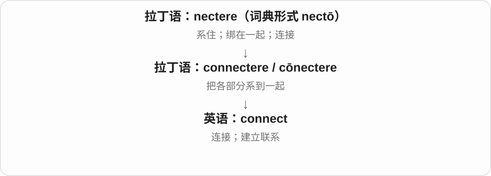

原本的系在一起扩展到设备、交通、思想和人际关系。connect with someone 有时表示彼此理解，不必真的有一条线。

**常见搭配与例句**

connect A to B；connect A with B；connect to the internet；connect with an audience。

> Connect the monitor to the laptop with this cable.

用这根线把显示器连到笔记本电脑上。

> Her stories helped her connect with the audience.

她讲的故事帮助她与观众产生了共鸣。

**别混淆**

connect 是建立联系；attach 常强调把一物附在另一物上。connect 两个网络不必把它们合成一个整体。

### 68. disconnect — 断开；脱离；脱节

**音标**：动词 /ˌdɪskəˈnekt/；名词 /ˈdɪskənekt/

**先抓住这个画面**

disconnect 是把刚才接着的线断开。名词说 a disconnect 时，也可以形容两边根本没对上。

**怎么拆**

dis-（分开、取消）+ connect，是英语内部的前缀构词。

**怎么变成今天的意思**

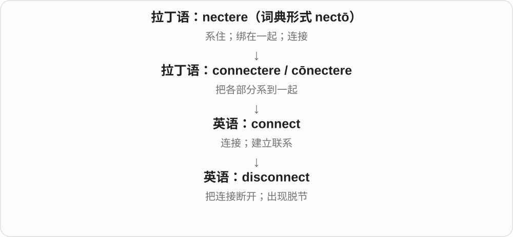

设备可以被拔掉，人也可以暂时脱离信息和工作。a disconnect between words and actions 则说话与行动之间接不上。

**常见搭配与例句**

disconnect A from B；disconnect the power；a disconnect between…；disconnect from work。

> Disconnect the printer from the computer before moving it.

移动打印机前，先断开它与电脑的连接。

> There is a disconnect between the policy and everyday practice.

这项政策与日常实际做法存在脱节。

**别混淆**

disconnect 强调切断联系；turn off 强调停止运行。设备关机后，电源线可能仍然连接着。

### 69. disconnection — 断开；断连；疏离感

**音标**：/ˌdɪskəˈnekʃən/

**先抓住这个画面**

disconnection 是从接通到断开的那件事，也可以是断开后留下的状态。

**怎么拆**

dis- + connection；也可与 disconnect 的动作名词关系一起理解。

**怎么变成今天的意思**

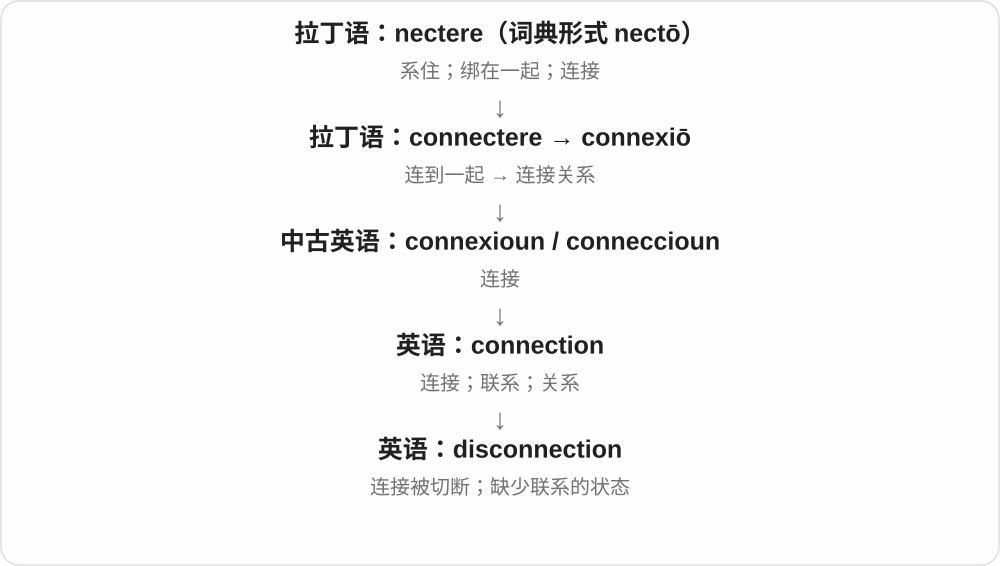

网络中它常是一次中断；人际语境中则可能指长期缺少交流和归属的感受。

**常见搭配与例句**

a sudden disconnection；service disconnection；a sense of disconnection；disconnection from… 。

> A brief disconnection interrupted the video call.

一次短暂断连打断了视频通话。

> The essay explores her sense of disconnection from city life.

这篇文章探讨了她对城市生活的疏离感。

**别混淆**

disconnection 可说实际连接中断；isolation 更突出孤立、缺少接触的处境。两者不必同时发生。

### 70. honour — 荣誉；尊敬；履行〔英式常用拼写〕

**音标**：英 /ˈɒnə/；美 /ˈɑnər/

**先抓住这个画面**

别人郑重地表达敬意，或自己郑重地守住承诺。

**怎么拆**

与 honor 同源同义，保留 -our 的常见英式拼写；u 不构成独立词缀。

**怎么变成今天的意思**

**拉丁 honos／honor**  
尊敬；荣誉；声望

↓

**古法语 onor／honor；honorer**  
荣誉；尊重

↓

**英语 honor／honour**  
尊敬、荣誉；尊重并履行

a guest of honour 是贵宾；in honour of someone 是为向某人致敬。动词 honour a promise 也表示兑现承诺，不能只记成“荣耀”而看不懂日常行为。

**常见搭配与例句**

a guest of honour；in honour of；honour a promise。

> The library held an event in honour of its first director.

图书馆举办活动，向首任馆长致敬。

> She made every effort to honour her promise.

她尽一切努力兑现自己的承诺。

**别混淆**

honour 与 honor 是拼写差别。相关英式 honoured、honourable 对应美式 honored、honorable。

### 71. dishonour — 耻辱；使蒙羞；不履行、拒绝承兑〔英式拼写〕

**音标**：英 /dɪsˈɒnə/；美 /dɪsˈɑːnər/

**先抓住这个画面**

honour 牵着荣誉、守信；dishonour 可以说让名誉受损，也可以说没有兑现承诺、没有承兑相关票据。

**怎么拆**

经古法语 deshonor 等不荣誉的材料，现代对应 dis- + honour；美式常写 dishonor。不能因为 honour 的 h 不读，就把词形里的 h 删掉。

**怎么变成今天的意思**

**古法语 deshonor 等**  
失去荣誉、耻辱的材料

↓

**英语 dishonour／dishonor**  
耻辱、使蒙羞；不兑现相关义务

bring dishonour on someone 使某人蒙羞；dishonour a promise 不守承诺；a dishonoured cheque 被拒绝兑付的支票。具体商业、法律义按文中情况辨认。

**常见搭配与例句**

bring dishonour；dishonour an agreement。

> The scandal brought dishonour on the institution.

丑闻使机构蒙羞。

> He refused to dishonour the promise he had made.

他不愿违背已经作出的承诺。

**别混淆**

dishonour 有失信、耻辱等评价；disagree 只是不同意。说某人 dishonoured a promise 比只是 changed their mind 语气重。

### 72. engage — 参与、使投入；吸引注意；雇请；使接合

**音标**：/ɪnˈɡeɪdʒ/

**先抓住这个画面**

把人、注意力或部件接进一件事里：学生投入讨论，故事抓住读者，齿轮接上工作，都可以 engage。

**怎么拆**

经法语 engagier，en- 在……中 + gage 担保、承诺，先有承诺绑定背景，后来进入投入、雇请、订婚和机械接合等义。

**怎么变成今天的意思**

**法语 en gage、engagier → engage**  
在担保、承诺之下 → 使受约束、参与

↓

**多场景的联系与投入**  
吸引注意、雇请、订婚；机械接合；参与行动

↓

**派生与独立借词**  
engaged、engaging；法语 engagement → engagement；disengage 脱开

engage in discussion 参加讨论，engage with an idea 认真回应观点，engage the audience 吸引观众，engage the gears 使齿轮接合。

**常见搭配与例句**

engage in；engage with；engage the audience；engage the gears。

> The activity engaged every student in the class.

活动让全班学生都投入其中。

> The article engages with several opposing views.

文章认真回应了几种相反观点。

**别混淆**

engage in 常参加活动，engage with 强调与对象互动、认真处理；engage the audience 直接接被吸引的人。

### 73. disengage — 脱开、解除接合；抽身、退出互动

**音标**：/ˌdɪsɪnˈɡeɪdʒ/

**先抓住这个画面**

原来接着、投入着，现在把连接松开：零件脱开、人停止争执、注意力离开，都可沿这个画面。

**怎么拆**

接法语 désengager 等，现代可拆 dis- 分开、解除 + engage；不是把 engage 内的 en- 换成否定。

**怎么变成今天的意思**

**法语 en gage、engagier → engage**  
在担保、承诺之下 → 使受约束、参与

↓

**法语 désengager → disengage；dis- + engage**  
解除接合、约束 → 抽身退出

disengage the clutch 使离合器分离，disengage from an argument 从争论中抽身，disengage the mechanism 脱开机构。

**常见搭配与例句**

disengage from；disengage the clutch；disengage the mechanism。

> He disengaged from the argument and went outside.

他退出争论，走到外面。

> The device disengages automatically when the cycle ends.

周期结束时，装置会自动脱开。

**别混淆**

disengage 退出联系，disagree 不同意；可以仍积极讨论而不同意，也可以不表态就抽身离开。

### 74. disengagement — 脱离；撤出；不再投入、疏离

**音标**：/ˌdɪsɪnˈɡeɪdʒmənt/

**先抓住这个画面**

原本咬合、参与或投入，后来慢慢抽离出来；disengagement 可以是实体脱开，也可说人对活动不再上心。

**怎么拆**

disengage + -ment，可再看 dis- 分离 + engage 接合、参与。历史有法语相关撤离材料，现代不同领域沿脱开的核心使用。

**怎么变成今天的意思**

**engage → disengage**  
接合、参与 → 脱开、退出

↓

**disengage + -ment → disengagement**  
脱离过程、撤出或不投入的状态

disengagement from politics 对政治不再投入；troop disengagement 部队脱离接触、撤开；employee disengagement 员工投入感下降。

**常见搭配与例句**

disengagement from；a process of disengagement。

> The survey showed growing disengagement among employees.

调查显示员工的投入感在下降。

> The talks focused on the disengagement of troops.

会谈重点讨论部队脱离接触的问题。

**别混淆**

disengagement 重点是脱离、撤出，不等于 disagreement 意见不同；有异议的人也可能仍积极参与。

### 75. regard — 看待、认为；注视；关心、敬重；方面；问候〔复数〕

**音标**：英 /rɪˈɡɑːd/；美 /rɪˈɡɑːrd/

**先抓住这个画面**

先把目光、心思放到某处，再看“你把它当什么”。放在心上可变成关心、敬重；in this regard 则把讨论目光限定到这一方面。

**怎么拆**

经古法语 regarder、reguarder 与名词 regard 的相应路径；更早的 garder 有看守、留意的日耳曼语背景。re- 在旧词中带加强等作用，不机械译成再次守卫。

**怎么变成今天的意思**

**古法语 regarder、reguarder → 中古英语 regarden → regard〔动词〕**  
留意看、看待；后有尊重、认为

↓

**法语 regard → 中古英语 regard、regarde → regard〔名词〕**  
注意、看待 → 关心、敬重；方面、问候等

regard A as B 把 A 看作 B，have regard for 顾及，hold someone in high regard 敬重某人，in this regard 在这方面，Best regards 信末问候。

**常见搭配与例句**

regard A as B；have regard for；in this regard；with regard to；Best regards。

> They regard her as a reliable colleague.

他们认为她是一位可靠的同事。

> The report says little in this regard.

报告在这方面没说多少。

**别混淆**

regard as 后不再套一个多余的 as；regard 可作动词，regarding 常是关于。regards 复数可问候，但单数 regard 不一般独立说一声问候。

### 76. disregard — 不理会、忽视；不顾

**音标**：英 /ˌdɪsrɪˈɡɑːd/；美 /ˌdɪsrɪˈɡɑːrd/

**先抓住这个画面**

信息、规则就在眼前，却不把它算进自己的行动里；可以故意不理，也可在要求对方别把旧消息当回事。

**怎么拆**

dis- 否定、逆转 + regard 顾及，形成不理会的动词，也可作不顾的名词。

**怎么变成今天的意思**

**古法语 regarder、reguarder → 中古英语 regarden → regard〔动词〕**  
留意看、看待；后有尊重、认为

↓

**法语 regard → 中古英语 regard、regarde → regard〔名词〕**  
注意、看待 → 关心、敬重；方面、问候等

↓

**dis- + regard → disregard**  
不予考虑、不顾及

disregard a warning 不理警告，disregard the previous email 忽略上一封邮件，a disregard for safety 不顾安全。

**常见搭配与例句**

disregard a warning；disregard the previous email；a disregard for。

> Please disregard the date in my previous message.

请忽略我上一条消息中的日期。

> The review criticized the company’s disregard for safety.

评论批评了公司不顾安全的态度。

**别混淆**

disregard 常比 overlook 更有不把它当回事的感觉；overlook 还可是不小心漏看。disregard 具体动作、态度，regardless 常修饰不受某条件影响。

### 77. satisfied — 满意的；确信的；得到满足的

**音标**：/ˈsætɪsfaɪd/

**先抓住这个画面**

需要被填上了，心里觉得“可以了”。

**怎么拆**

satisfy 的过去式和过去分词，y 改 i 加 -ed；分词也用作形容词。

**怎么变成今天的意思**

**拉丁 satis**  
足够

↓

**拉丁 satisfacere**  
satis + facere：做得足够、履行义务

↓

**古法语 satisfiier → 英语 satisfy**  
偿付、满足要求 → 使满足

↓

**英语 satisfied**  
被满足 → 满意；得到充分证据 → 确信

I am satisfied with the result 表示结果达到了你的期待；I am satisfied that ... 表示你经过考虑，认为后面的事情确实如此。后者不是“我很高兴那件事发生了”。读长句时先看跟的是 with 还是 that。

**常见搭配与例句**

be satisfied with；be satisfied that；a satisfied customer。

> Are you satisfied with the repair?

你对这次维修满意吗？

> We are satisfied that the figures are accurate.

我们确信这些数字是准确的。

**别混淆**

satisfied 说感受或判断的一方；satisfying 说让人获得满足感的事情。

### 78. dissatisfied — 不满意的、不满的

**音标**：/dɪsˈsætɪsfaɪd/

**先抓住这个画面**

看过结果后，心里说“这可不行”。

**怎么拆**

dis- 表否定或相反状态，加 satisfied；常表达对实际得到的东西不满意。

**怎么变成今天的意思**

**英语 satisfied**  
满意的

↓

**英语 dis- + satisfied**  
不满意、有不满情绪的

dissatisfied customers 通常是体验达不到期待的客户；dissatisfied with the service 是对服务有意见。它比“还有一个需求没满足”更容易让人听出负面评价，但不一定已到愤怒或投诉的程度。

**常见搭配与例句**

be dissatisfied with；a dissatisfied customer；feel dissatisfied。

> Several customers were dissatisfied with the delivery service.

几位顾客对配送服务不满意。

> She felt dissatisfied with the quality of her first draft.

她对自己初稿的质量不满意。

**别混淆**

unsatisfied 更容易突出“还没满足”，dissatisfied 更容易突出“不满意”。二者有重叠，不能当成绝不互换的规则。

### 79. unity — 团结；统一；整体性

**音标**：/ˈjuːnəti/，也读 /ˈjuːnɪti/

**先抓住这个画面**

unity 像一幅拼图虽然有许多小片，但放在一起显出一个完整图案。它谈的是合在一起的状态。

**怎么拆**

来自古法语 unité，远源为拉丁语 ūnitās；不是英语 unite 再临时加 -y 产生的历史。

**怎么变成今天的意思**

可说团队团结、设计整体协调；数学里 unity 也可以指一。不同场景都在谈“作为一个整体”。

**常见搭配与例句**

a sense of unity；unity of purpose；unity in diversity。

> The shared goal gave the team a sense of unity.

共同目标让团队产生了团结感。

> The repeated colours create unity across the design.

重复出现的颜色让整个设计协调统一。

**别混淆**

union 常指联合体；unity 讲整体保持连贯、团结。uniformity 则强调各部分都一样。

### 80. disunity — 不团结；分歧；涣散

**音标**：/dɪsˈjuːnəti/

**先抓住这个画面**

disunity 像一队人拉同一辆车却朝着不同方向使劲，整体缺少共同步调。

**怎么拆**

dis-（分开、缺乏）+ unity（团结）。

**怎么变成今天的意思**

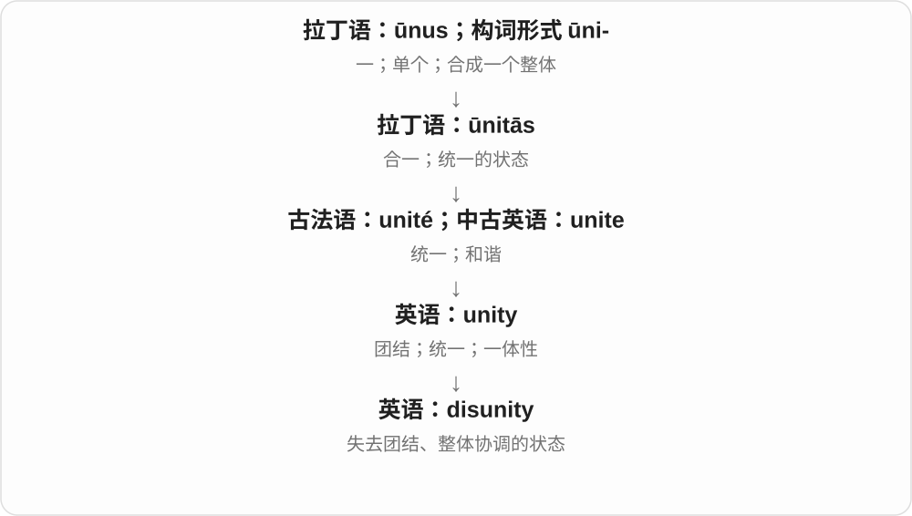

可以表现为内部争执、分裂或难以协作。它不必意味着组织已经正式解体。

**常见搭配与例句**

internal disunity；political disunity；a sign of disunity。

> Internal disunity weakened the campaign.

内部不团结削弱了这场行动。

> The meeting exposed deep disunity within the group.

会议暴露出这个群体内部严重的不和。

**别混淆**

disagreement 是某件事上意见不同；disunity 往往说整个群体的凝聚和配合出了问题。

### 81. loyal — 忠诚的；始终支持的

**音标**：/ˈlɔɪəl/

**先抓住这个画面**

关系遇到困难时，你仍站在对方这一边，不轻易改换支持对象。

**怎么拆**

经古法语 loial 接拉丁 legalis。历史上从遵守应尽义务、守信，走向忠诚；与 legal 是经不同路线形成的同源双式词。

**怎么变成今天的意思**

**拉丁语 lex，属格 legis**  
法律、规则

↓

**拉丁语 legalis**  
属于法律的；依法的

↓

**古法语 loial / leial**  
守法、尽义务的 → 忠实的

↓

**法语 loyal → 英语 loyal**  
忠诚的、始终支持的

a loyal friend 是可靠、始终支持的朋友；loyal customers 是经常回来消费的顾客。loyal 本身不要求对方每个决定都赞同。

**常见搭配与例句**

be loyal to；a loyal friend；loyal customers。

> She remained loyal to her friends during difficult times.

困难时期她仍忠于朋友。

> The small bakery has many loyal customers.

这家小面包店有许多忠实顾客。

**别混淆**

obedient 强调听从命令；loyal 强调持续的支持、忠诚和归属。

### 82. disloyal — 不忠的；背弃信任或支持的

**音标**：/dɪsˈlɔɪəl/

**先抓住这个画面**

原本别人以为你会站在这一边，你却背离了承诺或关系。

**怎么拆**

经盎格鲁法语 desleal / desloial 借入；法语内部为否定 des- + loial。现代对应 dis- + loyal。

**怎么变成今天的意思**

**拉丁语 lex，属格 legis**  
法律、规则

↓

**拉丁语 legalis**  
属于法律的；依法的

↓

**古法语 loial / leial**  
守法、尽义务的 → 忠实的

↓

**盎格鲁法语 des- + loial → desloial / desleal**  
不忠、不守信的

↓

**中古英语 → disloyal**  
背离支持关系的

通常需要一个被忠于的对象。有人把批评也叫 disloyal，是说话人的评价；这个词本身不证明批评就是背叛。

**常见搭配与例句**

be disloyal to；disloyal conduct。

> He felt disloyal when he shared his friend’s private story.

他把朋友的私事说出去后，觉得自己辜负了朋友。

> She argued that honest criticism was not disloyal.

她认为诚实的批评并不是不忠。

**别混淆**

dishonest 是不诚实；disloyal 是不忠，强调关系和承诺受到背离。

### 83. qualify — 具备资格；使符合条件；限定、修正说法

**音标**：英 /ˈkwɒlɪfaɪ/；美 /ˈkwɑːləfaɪ/

**先抓住这个画面**

一条常用路是条件够了、可以参加；另一条是给话加条件，让它别说得太满。

**怎么拆**

经法语 qualifier 及中世纪拉丁 qualificāre，历史接 quālis 什么样 + facere 使、做的组合成分。不是现代英语直接把 quality 尾巴改成 fy 才第一次造出来。

**怎么变成今天的意思**

**拉丁 quālis 什么样 → quālitās → 法语 qualité → quality**  
某物是什么性质 → 特点、质量

↓

**中世纪拉丁 qualificāre → 法语 qualifier → qualify**  
赋予、说明性质 → 使具资格；限定说法

qualify for the final 获得决赛资格，qualify as a teacher 取得教师资格；qualify a statement 为说法加限制。

**常见搭配与例句**

qualify for；qualify as；qualify someone to do；qualify a statement。

> The team qualified for the final.

球队获得了决赛资格。

> She qualified her earlier statement by adding a condition.

她补充一个条件，对先前的说法作了限定。

**别混淆**

qualify for 针对准入对象，qualify as 针对身份；qualify my support 可能是给支持加保留，绝非让支持拿证。

### 84. disqualify — 取消资格；使不具备资格

**音标**：英 /dɪsˈkwɒlɪfaɪ/；美 /dɪsˈkwɑːləfaɪ/

**先抓住这个画面**

原本想参加、被选中，某项规则或情况让它失去准入资格。

**怎么拆**

dis- 取消、相反 + qualify，形成取消资格动词。disqualify someone from doing 是常用结构。

**怎么变成今天的意思**

**拉丁 quālis 什么样 → quālitās → 法语 qualité → quality**  
某物是什么性质 → 特点、质量

↓

**中世纪拉丁 qualificāre → 法语 qualifier → qualify**  
赋予、说明性质 → 使具资格；限定说法

↓

**dis- + qualify → disqualify**  
资格被取消、受阻 → 取消资格

disqualify a competitor 取消选手资格，be disqualified from the race 被取消比赛资格；原因可能是违规或资格条件不符。

**常见搭配与例句**

disqualify someone from；be disqualified for；disqualify a competitor。

> The runner was disqualified for a false start.

跑者因抢跑被取消资格。

> The rule disqualifies employees from entering the competition.

规则规定员工没有资格参加这项比赛。

**别混淆**

disqualify 资格被取消，lose 比赛落败；输了比赛不自动等于被取消资格。

### 85. disqualification — 取消资格；使不合资格的条件

**音标**：/dɪsˌkwɒlɪfɪˈkeɪʃən/

**先抓住这个画面**

运动员原本站在起跑线上，却因违规被请出赛场：这个资格被拿走的结果叫 disqualification。

**怎么拆**

dis-（否定、取消）+ qualification，也可从 disqualify 对应到名词。

**怎么变成今天的意思**

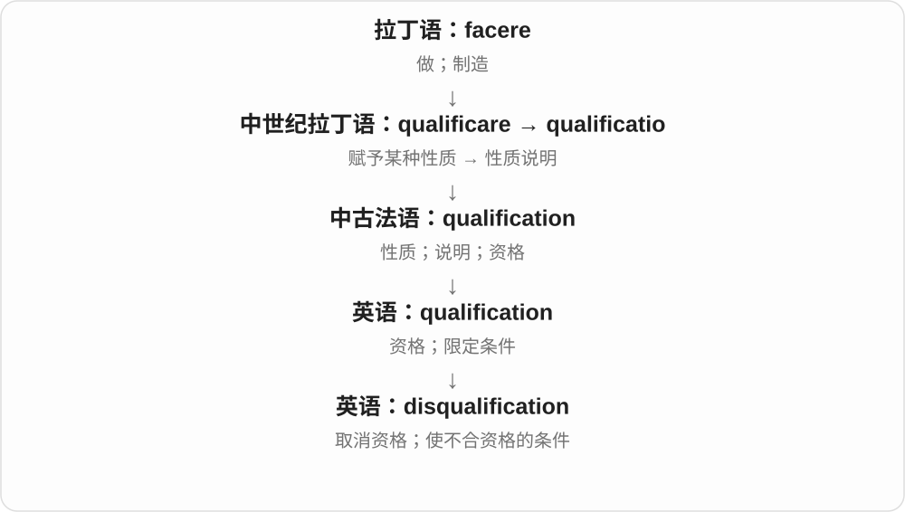

qualification 是达到门槛，disqualification 是因某个条件或行为不能继续享有资格。通常需要说明具体规则。

**常见搭配与例句**

disqualification from a race；grounds for disqualification。

> The false start led to his disqualification.

抢跑导致他被取消资格。

> Missing the deadline may be grounds for disqualification.

错过截止日期可能成为取消资格的理由。

**别混淆**

elimination 可能只是正常淘汰；disqualification 通常涉及资格条件或违规。

### 86. satisfaction — 满意、满足感；要求得到履行

**音标**：/ˌsætɪsˈfækʃən/

**先抓住这个画面**

“够了、达到了”的状态，或者由此得到的心里踏实。

**怎么拆**

经法语 satisfaction／satisfaccion 和拉丁 satisfactio 借入，历史上与 satisfy 同族，并非英语先有 satisfy 再简单加后缀。

**怎么变成今天的意思**

**拉丁 satisfacere → satisfactio**  
履行、补偿 → 履行或补偿这一行为

↓

**古法语 satisfaccion → 英语 satisfaction**  
满足要求；满意和满足感

customer satisfaction 是客户对体验是否满意，job satisfaction 是从工作中获得的满足感。to someone’s satisfaction 表示做到让某人认可的程度；它强调事情已经处理到位，不一定需要热情赞扬。

**常见搭配与例句**

customer satisfaction；job satisfaction；to my satisfaction；take satisfaction in。

> She takes satisfaction in helping new colleagues settle in.

帮助新同事适应环境让她很有满足感。

> The issue was resolved to everyone’s satisfaction.

问题得到了解决，大家都认可处理结果。

**别混淆**

satisfaction 是感觉或达到要求的状态；satisfy 是造成这个结果的动词。不要写 I am satisfaction。

### 87. dissatisfaction — 不满、不满意

**音标**：/ˌdɪsˌsætɪsˈfækʃən/

**先抓住这个画面**

把“这没有达到我的期待”这种感受当成一件事来谈。

**怎么拆**

dis- + satisfaction；与 dissatisfied 配套，但现代构词直接以名词 satisfaction 为基础。

**怎么变成今天的意思**

**英语 satisfaction**  
满意、满足

↓

**英语 dissatisfaction**  
不满意的状态或情绪

express dissatisfaction 是把不满说出来，growing dissatisfaction 是不满在增加。这个词可以指很多人对待遇、安排或结果的共同态度，不需要每个人都表现得很愤怒。

**常见搭配与例句**

dissatisfaction with；express dissatisfaction；widespread dissatisfaction。

> Staff expressed dissatisfaction with the new schedule.

员工表达了对新排班的不满。

> The survey revealed growing dissatisfaction with the service.

调查显示，人们对服务的不满正在增加。

**别混淆**

disappointment 偏期待落空的失望；dissatisfaction 偏认为现状或结果不好，常伴随希望改变。

### 88. harmony — 和谐、协调；和声

**音标**：英 /ˈhɑːməni/；美 /ˈhɑːrməni/

**先抓住这个画面**

不是每个人都唱同一个音，而是不同声音放在一起能配合，这就是 harmony 的音乐画面。人与人、颜色与布局，也可以协调相处。

**怎么拆**

经法语 harmonie、拉丁 harmonia 接希腊 harmonía，原与接合、配合有关，早有声音协调、意见一致等义。

**怎么变成今天的意思**

**希腊 harmonía**  
拼接、结合，进而说声音配合、意见一致

↓

**拉丁 harmonia → 法语 harmonie → harmony**  
和声、协调、和谐

sing in harmony 唱和声，live in harmony 和睦生活，in harmony with 与……协调，colour harmony 色彩协调。

**常见搭配与例句**

in harmony；in harmony with。

> The two singers blended beautifully in harmony.

两位歌手的和声配合得很美。

> The new building is in harmony with its surroundings.

新建筑与周围环境协调。

**别混淆**

harmony 不要求所有部分完全相同；音乐里的 unison 常说同音或同一旋律线，harmony 则看不同音如何结合。

### 89. harmonies — 和声、和声声部或搭配〔复数〕

**音标**：英 /ˈhɑːməniz/；美 /ˈhɑːrməniz/

**先抓住这个画面**

几个人唱不同的音，放在一起却合得上；这些互相配合的声音、和声安排，可以叫 harmonies。

**怎么拆**

harmony 的辅音字母 n 后 y 改 i，加 -es。基础词经法语、拉丁语接希腊 harmonia 接合、配合。

**怎么变成今天的意思**

**希腊 harmonia 接合、配合 → 拉丁、法语相应词**  
声音合得上；人与事相协调

↓

**英语 harmony 及相关词**  
和声、和谐；相关音乐名称

↓

**harmony → harmonies**  
不同和声安排、和声部分

sing harmonies 常说唱和声部分；rich harmonies 说声音搭配丰富，不是每个人都唱同一条主旋律。

**常见搭配与例句**

vocal harmonies 人声和声；close harmonies 密集和声。

> The singers added soft harmonies to the chorus.

歌手们给副歌加上柔和的和声。

> I love the rich harmonies in this song.

我喜欢这首歌里丰富的和声。

**别混淆**

melodies 是一条条先后流动的曲调，harmonies 更关注不同声音怎样配合；记住线条与搭配的区别。

### 90. disharmony — 不和、不协调；不谐和

**音标**：英 /dɪsˈhɑːməni/；美 /dɪsˈhɑːrməni/

**先抓住这个画面**

几部分凑在一起合不上，可能是声音刺耳，也可能是团队彼此冲突；这种失去配合的状态就是 disharmony。

**怎么拆**

dis- 否定、缺乏 + harmony，形成缺少和谐、协调的状态名词。

**怎么变成今天的意思**

**希腊 harmonía**  
拼接、结合，进而说声音配合、意见一致

↓

**拉丁 harmonia → 法语 harmonie → harmony**  
和声、协调、和谐

↓

**dis- + harmony → disharmony**  
缺乏和谐、配合

disharmony within a team 团队内部不和，a sense of disharmony 不协调感，social disharmony 社会关系不和。

**常见搭配与例句**

disharmony within；a sense of disharmony。

> Conflicting goals created disharmony within the team.

目标相互冲突，造成团队内部不和。

> The clashing colours gave the room a sense of disharmony.

颜色相互冲撞，让房间显得不协调。

**别混淆**

disharmony 通常说整体不协调；一个局部分歧不一定说明所有人都敌对。

### 91. passionate — 热情的；感情强烈的；热衷于……的

**音标**：/ˈpæʃənət/

**先抓住这个画面**

这件事触动你很深，谈起来或做起来就有明显的投入。

**怎么拆**

借中世纪拉丁 passiōnātus，经中古英语 passionat 形成；现代可联系 passion + -ate，但历史形容词并非单纯英语新造。

**怎么变成今天的意思**

**拉丁 patī／patior；完成分词 passus**  
承受、经历、忍受

↓

**中世纪拉丁 passiōnātus → 中古英语 passionat**  
受强烈情感影响的

↓

**英语 passionate**  
热情的；感情强烈的

be passionate about something 常说热爱某事业或活动；a passionate kiss 则是强烈的爱情表达。passionate argument 可以是激烈而投入的论说，并不一定指争吵。

**常见搭配与例句**

be passionate about；a passionate advocate；a passionate speech。

> She is passionate about making science accessible to children.

她热衷于让孩子们也能理解科学。

> He gave a passionate speech in support of the library.

他发表了一番充满热忱的演讲，支持图书馆。

**别混淆**

enthusiastic 常强调积极兴奋；passionate 更容易强调持续而强烈的感情。形容词词尾读 /ət/，不是 /eɪt/。

### 92. dispassionate — 冷静客观的；不受感情左右的

**音标**：/dɪsˈpæʃənət/

**先抓住这个画面**

先把自己的激动放到一边，再按事实仔细衡量。

**怎么拆**

dis- 表示除去、脱离，接 passionate；并不是“讨厌有激情的人”。

**怎么变成今天的意思**

**拉丁 patī／patior；完成分词 passus**  
承受、经历、忍受

↓

**中世纪拉丁 passiōnātus → 中古英语 passionat**  
受强烈情感影响的

↓

**英语 passionate**  
热情的；感情强烈的

↓

**英语 dis- + passionate → dispassionate**  
不让强烈感情支配判断

a dispassionate assessment 强调冷静衡量，不因喜欢或讨厌某一方就改变标准。它可以带赞许，但不意味着对人的困难完全不关心。

**常见搭配与例句**

a dispassionate analysis；a dispassionate observer；a dispassionate assessment。

> We need a dispassionate assessment of the costs and benefits.

我们需要冷静评估成本和收益。

> She gave a dispassionate account of a conflict in which she had been involved.

她冷静客观地讲述了自己曾参与的一场冲突。

**别混淆**

impassive 常描述脸上看不出情绪；dispassionate 更关注判断过程不被情绪带偏。

### 93. approve — 赞同；认可；批准

**音标**：英 /əˈpruːv/；美 /əˈpruːv/

**先抓住这个画面**

看过之后点头：“这个可以。”点头可能是个人态度，也可能是正式许可。

**怎么拆**

拉丁语 ad- + probāre 形成 approbāre，d 在 p 前同化为 p；经古法语进入英语。

**怎么变成今天的意思**

approve of a decision 是赞同决定；approve a budget 是正式批准预算。是否有 of 往往让重心从态度转向授权。

**常见搭配与例句**

approve of something；approve a plan；approve an application。

> The committee approved the revised budget.

委员会批准了修改后的预算。

> I do not approve of the way he treated his assistant.

我不赞同他对待助理的方式。

**别混淆**

prove 是用证据证明；approve 是认可。审批通过，也不表示其中每个判断都已经获得证明。

### 94. disapprove — 不赞同；不认可

**音标**：英 /ˌdɪsəˈpruːv/；美 /ˌdɪsəˈpruːv/

**先抓住这个画面**

对一个行为摇头，认为它不妥。

**怎么拆**

dis- 否定 + approve。

**怎么变成今天的意思**

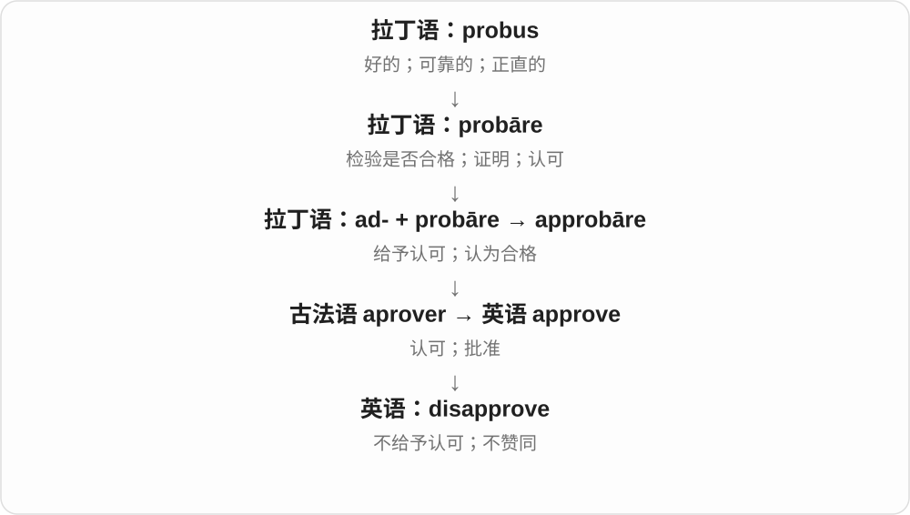

最常见 disapprove of something 或 disapprove of someone doing something。正式语境也可直接接需要审批的事项。

**常见搭配与例句**

disapprove of the decision；strongly disapprove。

> Her parents disapproved of the risky plan.

她父母不赞同那个冒险的计划。

> He clearly disapproved, but he did not interrupt.

他明显不赞同，但没有打断别人。

**别混淆**

disapprove 说态度或审批结果；disprove 说用证据推翻说法。

### 95. lodge — 小屋、山林旅舍；寄宿、安置；卡住；正式提交

**音标**：英 /lɒdʒ/；美 /lɑːdʒ/

**先抓住这个画面**

先是一处能住下的小屋，再是让人、东西安顿在某处。东西牢牢卡住像在那儿住下了；正式 lodge a complaint 则是把投诉交到相应机构。

**怎么拆**

名词经中古英语 logge，来自古法语 loge；动词联系法语 logier 安置、住宿。更早树叶棚、树皮顶的解释有推测成分，不当作逐层已证实的建筑史。

**怎么变成今天的意思**

**古法语 loge 小屋、棚廊 → lodge**  
更早联系日耳曼语遮蔽处名称，树叶棚等解释有推测成分

↓

**住下、安置 → 固定、存放**  
物件卡在某处；向正式机构提交材料等

a mountain lodge 山中旅舍，lodge with a family 在一户人家寄宿，be lodged in 卡在……里，lodge a complaint 正式提出投诉。

**常见搭配与例句**

lodge with；be lodged in；lodge a complaint。

> We stayed at a small mountain lodge.

我们住在一间小山间旅舍。

> A pebble was lodged in the sole of his shoe.

一颗小石子卡在他的鞋底里。

**别混淆**

lodge 的卡住、提交义不等于真的住旅馆；名词也可指社团地方分会等，须看场景。

### 96. dislodge — 使脱落、移出；使离开稳固位置

**音标**：英 /dɪsˈlɒdʒ/；美 /dɪsˈlɑːdʒ/

**先抓住这个画面**

石子卡在鞋底是 lodged；把它弄出来就是 dislodge。一个人长期占着领先位置，别人把他挤下来，也能这样比喻。

**怎么拆**

承法语 deslogier、相关中古英语形式，现代对应 dis- 离开、反向 + lodge 安顿、卡住。

**怎么变成今天的意思**

**古法语 loge 小屋、棚廊 → lodge**  
更早联系日耳曼语遮蔽处名称，树叶棚等解释有推测成分

↓

**住下、安置 → 固定、存放**  
物件卡在某处；向正式机构提交材料等

↓

**后缀与反向动作**  
lodging 住宿；lodger 寄宿者；dislodge 使脱离原位置

dislodge a stone 弄出石子，dislodge debris 使碎屑脱离，dislodge someone from a position 使人离开原有位置。

**常见搭配与例句**

dislodge something from；dislodge debris。

> A gentle shake dislodged the coin from the slot.

轻轻一摇，硬币从槽里掉了出来。

> No challenger had managed to dislodge her from first place.

还没有挑战者能把她从第一名的位置挤下来。

**别混淆**

dislodge 不只是移动一点，而常强调原来固定、卡住或占据的位置被解除；不一定是把东西毁掉。

### 97. illusion — 错觉；幻觉般的表象；不切实际的想法

**音标**：/ɪˈluːʒən/

**先抓住这个画面**

看起来或感觉像真的，但实际情况与那个印象不一致。

**怎么拆**

拉丁 illusio 接 illudere 戏弄、欺骗；in- 在、对着 + ludere 玩，经古法语进入英语。

**怎么变成今天的意思**

**拉丁 ludere 玩、戏弄；ludus 游戏**  
既可娱乐，也可戏弄或用技巧躲闪

↓

**拉丁 in- + ludere → illudere；分词词干 illus-**  
戏弄、欺骗，使人信以为真

↓

**拉丁 illusio → 古法语 illusion → 英语 illusion**  
戏弄、欺骗 → 错觉或不实的印象

an optical illusion 是视觉错觉；the illusion of control 是觉得自己能控制局面，实际却未必。魔术也靠制造这种表象，不一定是在恶意骗人。

**常见搭配与例句**

an optical illusion；create the illusion of；be under the illusion that；have no illusions about。

> The mirrors create the illusion of a much larger room.

镜子让房间看起来大了很多。

> She had no illusions about how difficult the project would be.

她清楚这个项目会很难，没有不切实际的幻想。

**别混淆**

delusion 更突出错误信念；illusion 常突出骗人的表象或印象，但日常抽象用法有交叉。

### 98. disillusion — 使幻想破灭；幻灭

**音标**：/ˌdɪsɪˈluːʒən/

**先抓住这个画面**

原先把某人或某件事想得很好，事实一来，那层好看的想象被戳破了。

**怎么拆**

dis- 去除 + illusion 幻想；英语先有名词，再形成同形动词，不把全部历史画成动词先行。

**怎么变成今天的意思**

**拉丁 ludere 玩、戏弄；ludus 游戏**  
既可娱乐，也可戏弄或用技巧躲闪

↓

**拉丁 in- + ludere → illudere；分词词干 illus-**  
戏弄、欺骗，使人信以为真

↓

**拉丁 illusio → 古法语 illusion → 英语 illusion**  
戏弄、欺骗 → 错觉或不实的印象

↓

**英语 dis- + illusion → disillusion〔名词〕**  
去掉幻想、幻灭

↓

**名词 disillusion → 同形动词**  
使人不再抱有原先美好的想法

disillusion someone 是让人失去原先的美好期待；a sense of disillusion 是幻灭感。重点不只是一件事没做好，而是原先相信的整体形象变了。

**常见搭配与例句**

disillusion someone；a sense of disillusion；disillusion with politics。

> The repeated broken promises disillusioned many volunteers.

一再落空的承诺让许多志愿者失去了原先的期待。

> The memoir describes her growing sense of disillusion.

回忆录描写了她越来越强烈的幻灭感。

**别混淆**

disappoint 可以只是没得到想要的结果；disillusion 常让人连原先的信任、理想也失去。

### 99. disillusionment — 幻灭；理想破灭；失望后的醒悟

**音标**：/ˌdɪsɪˈluːʒənmənt/

**先抓住这个画面**

把从满怀期待到看清落差的过程，以及留下的失落感，作为一件事来说。

**怎么拆**

disillusion + -ment；保留 dis- 去除 + illusion 幻想的结构。

**怎么变成今天的意思**

**拉丁 ludere 玩、戏弄；ludus 游戏**  
既可娱乐，也可戏弄或用技巧躲闪

↓

**拉丁 in- + ludere → illudere；分词词干 illus-**  
戏弄、欺骗，使人信以为真

↓

**拉丁 illusio → 古法语 illusion → 英语 illusion**  
戏弄、欺骗 → 错觉或不实的印象

↓

**英语 dis- + illusion → disillusion〔名词〕**  
去掉幻想、幻灭

↓

**名词 disillusion → 同形动词**  
使人不再抱有原先美好的想法

↓

**英语 disillusion + -ment → disillusionment**  
使幻想破灭 → 幻灭过程或状态

disillusionment with politics 是对政治失去原先的信任；growing disillusionment 是失望、幻灭感不断加深。通常不可数。

**常见搭配与例句**

growing disillusionment；deep disillusionment；disillusionment with。

> The novel moves from youthful idealism to disillusionment.

小说从年轻时的理想主义写到后来的幻灭。

> Repeated delays led to widespread disillusionment with the project.

一再延期让大家对项目普遍失去了原先的期待。

**别混淆**

disappointment 可以短暂而具体；disillusionment 往往涉及更深的期待、信仰或信任改变。

### 100. locate — 找到位置；把……设在

**音标**：英 /ləʊˈkeɪt/；美 /ˈloʊkeɪt/，也 /loʊˈkeɪt/

**先抓住这个画面**

可以给东西找个地方放下，也可以反过来查清它被放在哪里。

**怎么拆**

来自拉丁语 locatus，locare“放置”的分词。原有安置方向，后来发展为确定位置；不是 local 截去 l。

**怎么变成今天的意思**

**拉丁语 locus**  
地方、位置

↓

**拉丁语 locare**  
放置、安置；也指出租

↓

**拉丁语 locatus → 英语 locate**  
已放置的 → 安置；查明位置

locate a leak 是找出漏点；be located near the station 是位于车站附近。后者不一定描述一次“找到了”的动作。

**常见搭配与例句**

locate the source；be located in…。

> The engineers located the source of the noise.

工程师找出了噪声来源的位置。

> The library is located beside the river.

图书馆位于河边。

**别混淆**

find 范围更广；locate 明确强调找到位置或安排位置。

### 101. dislocate — 使脱位；打乱、使失常

**音标**：英 /ˈdɪsləkeɪt/，也 /dɪsləʊˈkeɪt/；美 /ˈdɪsloʊkeɪt/

**先抓住这个画面**

本来接合或运行得好好的，被一下推离原位。

**怎么拆**

中世纪拉丁语 dislocatus，dislocare“移出位置”的分词；英语先见分词形容词，后用作动词。表面可拆 dis- + locate，但不是唯一历史路线。

**怎么变成今天的意思**

**拉丁语 locus**  
地方、位置

↓

**拉丁语 locare**  
放置、安置；也指出租

↓

**中世纪拉丁语 dis- + locare → dislocare / dislocatus**  
移离位置；脱位的

↓

**英语 dislocate〔先形容词，后动词〕**  
使脱位；扰乱既有安排

dislocate a shoulder 常说肩关节脱位；dislocate trade 是使贸易体系失常。它比一般 move 更强调原有关系被破坏。

**常见搭配与例句**

dislocate a joint；dislocate normal activity。

> He dislocated his shoulder during the match.

他在比赛中肩关节脱位。

> The transport strike dislocated deliveries across the region.

交通罢工打乱了整个地区的配送。

**别混淆**

relocate 只是换位置；dislocate 往往含错位、失序或损伤。

### 102. disclose — 透露；披露；揭示

**音标**：英 /dɪsˈkləʊz/；美 /dɪsˈkloʊz/

**先抓住这个画面**

把原来像关在里面的信息打开，让别人知道。

**怎么拆**

经古法语 desclore / desclos，远接拉丁 claudere；通俗拉丁 *disclaudere 是重建形式。现代可按 dis- + close 理解。

**怎么变成今天的意思**

**拉丁 claudere；分词 clausus**  
关上、围住、使结束；复合词常变为 -cludere / -clusus

↓

**通俗拉丁 \*disclaudere → 古法语 desclore / desclos → 中古英语 disclosen**  
解除封闭、打开；星号形式是重建

↓

**现代英语 disclose**  
把原先没有公开的信息说出来

disclose information 是把信息公开或告诉有关的人；不一定是泄密，也可以是按要求正式披露。说 disclose something to someone，通常不说 disclose someone something。

**常见搭配与例句**

disclose details；disclose that；disclose information to；decline to disclose。

> The company declined to disclose the purchase price.

公司拒绝透露收购价格。

> She disclosed the problem to the project manager.

她把这个问题告知了项目经理。

**别混淆**

discover 是发现原本不知道的事；disclose 是把信息告知别人，二者行动方向不同。

### 103. obey — 服从；遵守

**音标**：英 /əˈbeɪ/；美 /əˈbeɪ/

**先抓住这个画面**

听到要求后按要求行动，是 obey；交通规则不是一个人在讲话，但遵守它们也能说 obey the rules。

**怎么拆**

经盎格鲁法语、古法语 obeir 接拉丁 oboedire 听从，含 ob- 与 audire 听的材料；英语词形已变化，不从 o + bey 临时拼义。

**怎么变成今天的意思**

**拉丁 oboedire → 法语 obeir**  
听从、服从

↓

**英语 obey**  
服从人或遵守要求、规则

obey a command 服从命令；obey the law 遵守法律；obey someone 听从某人。通常直接接对象，不加 obey to。

**常见搭配与例句**

obey the rules；obey an order。

> All drivers must obey the traffic rules.

所有驾驶员都必须遵守交通规则。

> The dog obeyed the command immediately.

狗立刻按指令行动了。

**别混淆**

hear 听见不保证照做，obey 强调按要求行动；agree 赞同也不自动等于已 obey。

### 104. dispatch — 派遣、发送；发货；迅速处理；急件、现场通讯

**音标**：/dɪˈspætʃ/

**先抓住这个画面**

货物准备好就发走，人准备好就派出去，事情抓紧办掉，都带 dispatch 的“迅速送出、办妥”感觉。记者从现场发回的通讯也可叫 a dispatch。

**怎么拆**

借西班牙 despachar 和／或意大利 dispacciare 等，des-、dis- 接分离、解除的历史材料。后半可能联系捆缚、阻碍等不同来源，尚有争论，不是英语 dis- + patch 补丁。

**怎么变成今天的意思**

**西班牙 despachar、意大利 dispacciare 等 → 英语 dispatch**  
发出、赶快办妥，des-／dis- 接分离等旧材料

↓

**dispatch → 派遣、发货、迅速处理及相应名词**  
后半更早来源存在不同解释，不按现代 patch 硬拆

dispatch a parcel 发包裹；dispatch a team 派出团队；dispatch a task 迅速处理任务；dispatches from the front 前线通讯。

**常见搭配与例句**

dispatch a parcel；dispatch a team；a dispatch from。

> The warehouse dispatched the parcel this morning.

仓库今天早上发出了包裹。

> The newspaper published her dispatch from the mountain village.

报纸刊登了她从山村发回的现场通讯。

**别混淆**

dispatch 发出不等于 deliver 已送达；名词也可能是急件、通讯，不总是动词的机械重复。另有迅速处置、杀死的用法，需按叙事语境分义。

### 105. integrate — 整合；融入；使取消隔离；求积分

**音标**：英 /ˈɪntɪɡreɪt/；美 /ˈɪntəɡreɪt/

**先抓住这个画面**

把原来分开的部分接好，让它们在一个整体里运作。

**怎么拆**

来自拉丁 integratus，接 integrare 使完整、integer 完整；不是 in- 进入 + 一个英语 tegrate。

**怎么变成今天的意思**

**拉丁 integer**  
完整、未受损；历史上与否定 in- 和 tangere 触碰的词根有关

↓

**拉丁 integrare → integratus → 英语 integrate**  
使完整 → 完整的；英语后来用作整合的动词

integrate the payment system 是接通支付系统；integrate into a community 是融入社区。数学里 integrate a function 是对函数积分；社会史中也可指取消学校等场所的种族隔离。

**常见搭配与例句**

integrate A into B；integrate with；integrate a function。

> The team integrated the booking tool into its website.

团队把预订工具整合进了网站。

> The programme helps newcomers integrate into the local community.

这个项目帮助新来的人融入当地社区。

> We learned to integrate simple polynomial functions.

我们学习了对简单多项式函数求积分。

**别混淆**

combine 可以只是放到一起；integrate 更强调各部分能在整体中配合。融入社会也不必等于抹去个人文化。

### 106. disintegrate — 碎裂；瓦解；解体

**音标**：/dɪsˈɪntɪɡreɪt/

**先抓住这个画面**

原来连在一起的东西失去连接，散成碎片或各自分开。

**怎么拆**

dis- 分开、逆转 + integrate；英语内部构词。

**怎么变成今天的意思**

**拉丁 integer**  
完整、未受损；历史上与否定 in- 和 tangere 触碰的词根有关

↓

**拉丁 integrare → integratus → 英语 integrate**  
使完整 → 完整的；英语后来用作整合的动词

↓

**英语 dis- + integrate → disintegrate**  
形成整体 → 失去整体、散开

纸张能 disintegrate，组织或关系也能 disintegrate。后者不是人真的碎成了小块，而是把他们连在一起的关系撑不住了。

**常见搭配与例句**

disintegrate into pieces；begin to disintegrate；a relationship disintegrates。

> The old paper began to disintegrate when it was touched.

那张旧纸一碰就开始碎裂。

> Without a common plan, the alliance gradually disintegrated.

没有共同计划，联盟逐渐瓦解了。

**别混淆**

break 可以只是断一处；disintegrate 常强调整体散开。dissolve 可能说溶解，不能把两种物理过程一概等同。

### 107. disintegration — 碎裂；解体；瓦解；衰变

**音标**：英 /dɪsˌɪntɪˈɡreɪʃən/；美 /dɪsˌɪntəˈɡreɪʃən/

**先抓住这个画面**

把整体一步步散开的过程当成一件事来讲。

**怎么拆**

可分析为 disintegrate + -ion，或 dis- + integration；不必把两种构词解释硬排成前后祖先。

**怎么变成今天的意思**

**拉丁 integer**  
完整、未受损；历史上与否定 in- 和 tangere 触碰的词根有关

↓

**英语 disintegrate + -ion／dis- + integration → disintegration**  
失去完整性、分解的过程

the disintegration of a coalition 是联盟瓦解；在核物理里也可指放射性衰变及一次衰变事件。普通句子里通常是整体撑不住、逐渐散开。

**常见搭配与例句**

the disintegration of；gradual disintegration；radioactive disintegration。

> The novel follows the gradual disintegration of a family business.

小说描写一家家族企业逐渐瓦解的过程。

> The report describes the disintegration of the rock into smaller fragments.

报告描写岩石碎裂成较小碎块的过程。

**别混淆**

integration 是整合，disintegration 是解体；disagreement 仅是分歧，并不必然意味着群体已经瓦解。

### 108. assemble — 集合；召集；组装

**音标**：/əˈsembəl/

**先抓住这个画面**

把散开的成员、材料或零件带到一处，组成一个整体。

**怎么拆**

拉丁 assimulāre 经古法语 assembler 进入中古英语；与 assimilate 远源相同，却沿法语路线发展出聚集、组装义。

**怎么变成今天的意思**

**拉丁 similis**  
相像、同类；与 simul“一起、同时”同族

↓

**拉丁 assimulāre → 古法语 assembler → 中古英语 assemblen**  
使相似、合到一起 → 聚集

↓

**现代英语 assemble**  
集合；组装零件

人可以 assemble outside，集合到外面；你也可以 assemble a desk，把桌子零件装起来。被动句 The desk is assembled 说已经装好，不是桌子自己去集合。

**常见搭配与例句**

assemble a team；assemble furniture；assemble at；assemble evidence。

> The volunteers assembled outside the community centre.

志愿者在社区中心外集合。

> It took us an hour to assemble the bookshelf.

我们花了一小时组装书架。

**别混淆**

collect 只是收集；assemble 往往还把各部分组织成整体。assimilate 则强调吸收、趋同。

### 109. disassemble — 拆卸；把整体拆成部件

**音标**：/ˌdɪsəˈsembəl/

**先抓住这个画面**

把装好的整体一步步拆回零件。

**怎么拆**

dis-“拆开、逆转” + assemble。

**怎么变成今天的意思**

**拉丁 similis**  
相像、同类；与 simul“一起、同时”同族

↓

**拉丁 assimulāre → 古法语 assembler → 中古英语 assemblen**  
使相似、合到一起 → 聚集

↓

**现代英语 assemble**  
集合；组装零件

↓

**英语 dis- + assemble → disassemble**  
逆转组装 → 拆卸成部件

disassemble a machine 通常是为了清洁、检查、搬运或维修。它不等于砸坏；动作有时可逆，零件仍能重新装回。

**常见搭配与例句**

disassemble a device；disassemble into parts；disassemble for cleaning。

> The table can be disassembled for transport.

这张桌子可以拆开运输。

> The technician disassembled the motor to inspect the bearings.

技术员拆开电机检查轴承。

**别混淆**

dismantle 也可拆除大型结构或抽象制度；disassemble 常突出把可组装物拆成零件。dissemble 是掩饰。

### 110. disassembly — 拆卸、拆解；反汇编及其结果〔计算机〕

**音标**：/ˌdɪsəˈsembli/

**先抓住这个画面**

原来装成一个整体，现在拆回零件；计算机里从机器码看回汇编表示，也借这种拆开看结构的画面。

**怎么拆**

dis- 分开、解除 + assembly 装配。计算机专门义接 assembly language 的汇编名称，不是把议会成员拆开。

**怎么变成今天的意思**

**法语 assembler、assemblée 等 → assembly**  
聚在一起 → 集会；部件组合

↓

**dis- + assembly → disassembly**  
装配的反向操作 → 拆解

↓

**计算机专门引申**  
把机器码转换为汇编表示的反汇编、结果

disassembly instructions 拆卸说明，complete disassembly 完全拆卸，inspect the disassembly 查看反汇编结果。

**常见搭配与例句**

disassembly instructions；complete disassembly；inspect the disassembly。

> The manual includes disassembly instructions.

手册附有拆卸说明。

> The engineer inspected the disassembly to understand the program.

工程师查看反汇编结果来理解程序。

**别混淆**

disassembly 拆装或机器码转换，disassemble 动作；反汇编通常不等于恢复原来所有源代码与注释。

### 111. proportional — 成比例的；按比例分配的

**音标**：英 /prəˈpɔːʃənl/；美 /prəˈpɔːrʃənl/

**先抓住这个画面**

一个量改变时，另一个量按相应比例改变，而不是随便一起涨一点。

**怎么拆**

经法语 proporcionel 或直接借自拉丁 proportionalis；现代可分析为 proportion + -al，但历史形容词不是只在英语里形成。

**怎么变成今天的意思**

**拉丁 portio，属格 portionis**  
份额、部分

↓

**拉丁 proportio → proportionalis → 法语 proporcionel 或直接借入**  
比例 → 与比例有关的

↓

**英语 proportional**  
成比例的、按比例的

directly proportional to 在数学里说正比：一个量加倍，另一个也加倍，比例保持不变。proportional representation 指按票数等比例分配代表席位的制度概念，具体办法可以不同。

**常见搭配与例句**

directly proportional to；inversely proportional to；proportional representation。

> At a fixed price per item, the total cost is proportional to the number ordered.

每件单价固定时，总费用与订购数量成正比。

> The chart uses proportional circles to show the relative sizes of the populations.

图表用大小成比例的圆表示各地人口的相对规模。

**别混淆**

相关 correlated 只说两个量有联系；严格的 proportional 要求相应的比例关系，不是只要一起上升就算。

### 112. ambiguous — 有歧义的；意思不明确的

**音标**：/æmˈbɪɡjuəs/

**先抓住这个画面**

ambiguous 像一句话前面出现两条岔路，读者不知道该沿哪一条理解。

**怎么拆**

来自拉丁语 ambi-（两边、周围）+ agere，形成 ambigere，再到 ambiguus。这里不是把现代单词随意拆成 ambi + guous。

**怎么变成今天的意思**

常指一句话、信号或证据可以有不止一种解释。说话者未必故意含糊，有时只是表达没写清。

**常见搭配与例句**

an ambiguous answer；ambiguous wording；an ambiguous signal。

> The instructions are ambiguous about when to start.

说明没有明确交代什么时候开始，存在多种理解。

> Her smile gave an ambiguous signal.

她的笑容让人猜不准是什么意思。

**别混淆**

vague 是缺少细节或边界；ambiguous 是可能通向多种解释，区别在“少信息”与“有岔路”。

### 113. ambiguity — 歧义；不明确之处

**音标**：/ˌæmbɪˈɡjuːəti/

**先抓住这个画面**

ambiguity 是理解岔路本身：同一句话，有人走到这个意思，有人走到另一个意思。

**怎么拆**

现代对应 ambiguous + -ity；历史经法语来自拉丁语 ambiguitās，名词有自己的借入路线。

**怎么变成今天的意思**

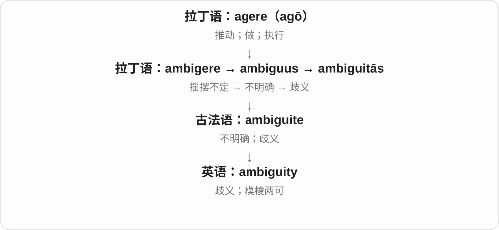

不可数时指不明确的状态，可数时是一处具体歧义。文学可以有意保留 ambiguity，操作说明则通常应减少。

**常见搭配与例句**

remove ambiguity；an ambiguity in the wording；leave room for ambiguity。

> The revised sentence removes the ambiguity.

修改后的句子消除了歧义。

> The ending leaves room for ambiguity.

这个结尾保留了多种解释的空间。

**别混淆**

uncertainty 泛指不确定；ambiguity 常关乎同一表达或情形存在多种解释。

### 114. orient — 使朝向；确定方位；使熟悉；东方〔旧称〕；珍珠光泽〔专门义〕

**音标**：动词：英 /ˈɔːrient/；美 /ˈɔːrient/；名、形：英 /ˈɔːriənt/；美 /ˈɔːriənt/

**先抓住这个画面**

先认出太阳升起的那一边，再用这个参照弄清方向。

**怎么拆**

名词接拉丁 oriēns“升起、东方”，经法语及中古英语传入；动词另借法语 orienter。不能把所有用法当成英语名词自己变动词。

**怎么变成今天的意思**

**拉丁 orīrī；分词 ortus**  
升起、出现、出生

↓

**拉丁 oriēns / orient-**  
正在升起 → 日出方向、东方

↓

**名词：法语 orient／拉丁 oriēns → 中古英语 orient → 英语 orient**  
东方；后来也说东方珍珠及其光泽

↓

**动词的平行路线：法语 orient → orienter → 英语 orient**  
朝东 → 确定任意方位、使适应

orient the map 是把地图摆到与实地方向相符；orient new staff 是让新员工了解环境。现代动词已不限于朝东。the Orient 是历史上的“东方”称呼，范围随时代与说话者而变。

**常见搭配与例句**

orient the map；orient oneself；orient someone to…。

> Use the compass to orient the map.

用指南针调整地图的朝向。

> The tour helps new students orient themselves on campus.

这次导览帮助新生熟悉校园、认清方向。

**别混淆**

orient 是常见动词；orientate 意义基本相同，在英式英语更常见。二者不需要人为分成完全不同动作。

### 115. embark — 登船、登乘；着手、开始

**音标**：英 /ɪmˈbɑːk/；美 /ɪmˈbɑːrk/

**先抓住这个画面**

脚踏上船，旅程开始了；把研究、事业也想成一段航程，embark on a project 就是踏上这段新旅程。

**怎么拆**

借法语 embarquer，en- 进入在 b 前同化为 em-，加 barque 船。对应 bark 的船义，不是狗叫或树皮。

**怎么变成今天的意思**

**en- 进入 + 法语 barque 船 → embarquer**  
把人、货装上船；登船

↓

**法语 → 英语 embark**  
登船出发 → 开始旅程或一项事业

embark on a journey 开始旅程，embark on a career 开始职业生涯，embark on a project 着手项目。具体登乘可用 embark at a port 等。

**常见搭配与例句**

embark on a project；embark on a journey。

> Passengers embarked at the small harbour.

乘客在小港口登船。

> The team embarked on a new research project.

团队着手一项新的研究项目。

**别混淆**

抽象开始义常说 embark on，不随意省略 on 直接接 project。这个词较正式，常让开始带有新阶段、长过程的感觉。

### 116. disembark — 下船、下机、离开所乘交通工具

**音标**：英 /ˌdɪsɪmˈbɑːk/；美 /ˌdɪsɪmˈbɑːrk/

**先抓住这个画面**

embark 是上去出发，disembark 是从所乘船、飞机等下来。镜头从踏上旅程换成到站离开。

**怎么拆**

dis- 反向、离开 + embark，历史也联系法语 desembarquer。较早中心是从船上下到岸上，后来适用于其他交通工具。

**怎么变成今天的意思**

**en- 进入 + 法语 barque 船 → embarquer**  
把人、货装上船；登船

↓

**法语 → 英语 embark**  
登船出发 → 开始旅程或一项事业

↓

**相应名词与反向动作**  
embarkation 登乘；disembark 下船、下机等

disembark from a ship 下船，passengers disembark 乘客下船、下机。可不带宾语，也有直接接交通工具的用法。

**常见搭配与例句**

disembark from；passengers disembark。

> We disembarked from the ferry just before noon.

我们快到中午时下了渡轮。

> Passengers waited for permission to disembark.

乘客等候获准下机。

**别混淆**

disembark 强调离开所乘交通工具；arrive 是到达，车船到了不代表乘客已经下去。

### 117. discard — 丢弃；弃牌；弃掉的东西

**音标**：动词英 /dɪsˈkɑːd/、美 /dɪsˈkɑːrd/；名词常前重音

**先抓住这个画面**

手里有一张不想留的牌，出掉；再借来讲扔掉不要的物品、做法或想法。

**怎么拆**

dis- 移除 + card，接弃牌动作扩展为舍弃。现代很多宾语不再是卡片。

**怎么变成今天的意思**

**希腊 chartes 纸、纸草 → 拉丁 charta → 法语 carte**  
书写材料、纸片

↓

**中古英语 carde → card**  
纸牌、卡片 → 证件、节目单与电子卡等

↓

**dis- + card → discard**  
弃牌 → 丢弃、抛开

discard old papers 丢旧纸，discard an idea 放弃想法；名词 discards 可说弃物。

**常见搭配与例句**

discard old papers；discard an idea；discarded materials。

> Discard the damaged packaging.

丢掉破损包装。

> The team discarded the first design and started again.

团队弃用了第一个设计，重新开始。

**别混淆**

discard 丢弃不等于必然回收 recycle；discard a theory 是不再采用它，不是拿剪刀剪论文。

### 118. infect — 使感染；感染他人情绪

**音标**：/ɪnˈfɛkt/

**先抓住这个画面**

一滴颜色进入清水，慢慢染开：infect 的早期画面就是染入、沾染，后来常用于病原体传播。

**怎么拆**

in-（进入）+ facere 形成 inficere，分词 infectus 经法语等途径传入。

**怎么变成今天的意思**

染入东西 → 使受到污染 → 使感染。情绪用法借同一种扩散画面，但 enthusiasm 的感染可以是好事。

**常见搭配与例句**

infect someone with…；infected tissue；infectious enthusiasm。

> The virus can infect several plant species.

这种病毒能感染几种植物。

> Her enthusiasm infected the whole team.

她的热情感染了整个团队。

**别混淆**

affect 是宽泛影响；infect 常涉及病原体或情绪的传播。

### 119. disinfect — 消毒；清除计算机病毒〔技术比喻〕

**音标**：/ˌdɪsɪnˈfekt/

**先抓住这个画面**

表面看起来干净，还要处理可能导致感染的微生物，这个消毒动作是 disinfect；电脑里也可借来表示清除病毒。

**怎么拆**

接法语 desinfecter，现代对应 dis- 撤除 + infect 感染。不是只把 infect 前加不，就变成没有感染过的形容词。

**怎么变成今天的意思**

**法语 desinfecter；dis- + infect 的对应**  
逆转、消除感染相关因素

↓

**英语 disinfect**  
对物体消毒；计算机中清除病毒

disinfect a surface 给表面消毒；disinfect equipment 给设备消毒；名词 disinfection 消毒。这个词描述处理动作，不由一个词保证任何特定情境的处理结果。

**常见搭配与例句**

disinfect a surface；disinfection of equipment。

> The staff disinfected the work surfaces.

工作人员给操作台面消了毒。

> The manual explains how the equipment is disinfected.

手册说明了这些设备的消毒过程。

**别混淆**

clean 清洁、disinfect 消毒、sterilize 灭菌在专门语境有区别；消毒不等于宣称已消灭所有种类、形态的微生物。

### 120. disinfection — 消毒

**音标**：/ˌdɪsɪnˈfekʃən/

**先抓住这个画面**

不是说已经没有 infection 这个状态，而是说采取处理，破坏、去除许多致病微生物。它是过程名称。

**怎么拆**

现代可对应 dis- 去除、反转 + infection，亦联系 disinfect 消毒的名词形式和法语相应命名。dis- 在这里引入去除污染、感染因素的处理关系。

**怎么变成今天的意思**

**拉丁 in- 向内 + facere 的相关形式 → inficere**  
浸入、染色；沾染、污染

↓

**拉丁 īnfectiō 经法语等 → infection**  
污染、感染；现代也借用于计算机感染

↓

**dis-／disinfect 的相应名词 → disinfection**  
针对微生物污染的消毒过程

surface disinfection 表面消毒，cleaning and disinfection 清洁与消毒，a disinfection procedure 消毒程序。具体处理类别、效果由方法与条件决定。

**常见搭配与例句**

surface disinfection；cleaning and disinfection；a disinfection procedure。

> The training explains the difference between cleaning and disinfection.

培训解释了清洁和消毒的区别。

> The report describes the surface disinfection procedure.

报告描述了表面消毒程序。

**别混淆**

disinfection 不等于 sterilization 灭菌；消毒不保证杀灭所有微生物形态，如某些芽孢。cleaning 清洁也不自动与消毒同义。

### 121. disproportionate — 不成比例的；不相称的；过大的

**音标**：英 /ˌdɪsprəˈpɔːʃənət/；美 /ˌdɪsprəˈpɔːrʃənət/

**先抓住这个画面**

投入、反应或负担与事情本身对不上，常常是一边过头了。

**怎么拆**

dis- 不 + proportionate；是在相称的形容词前加否定，不是直接从 disproportion 任意补字母。

**怎么变成今天的意思**

**拉丁 portio，属格 portionis**  
份额、部分

↓

**拉丁 proportio → 中世纪拉丁 proportionare → proportionatus**  
比例 → 按比例安排 → 配合相称的

↓

**英语 proportionate〔形容词〕**  
大小、程度相称的

↓

**英语 dis- + proportionate → disproportionate**  
不相称的、比例失衡的

a disproportionate response 是反应过度或不相称；a disproportionate share 是相对其人数、地位等占了过大的份额。比较基准有时由上下文提供。

**常见搭配与例句**

disproportionate to；a disproportionate burden；a disproportionate share。

> A small number of errors caused a disproportionate amount of extra work.

少量错误带来了大得不相称的额外工作量。

> The penalty seemed disproportionate to the mistake.

处罚看起来与那个错误不相称。

**别混淆**

large 只说数量大；disproportionate 说相对某个基准大得不相称。

### 122. obedient — 听话的；服从要求的

**音标**：/əˈbiːdiənt/

**先抓住这个画面**

不是一次碰巧照做，而是容易听从要求、遵从指令；可用 obedient 描述这种表现或倾向。

**怎么拆**

经法语 obedient 接拉丁 oboediens，来自与 obey 同族的听从动词。现代形式不是把完整 obey 直接加 ient；要把 obey／obedient 当作相关词形记。

**怎么变成今天的意思**

**拉丁 oboediens → 法语 obedient**  
听从的分词材料

↓

**英语 obedient；与 obey 对照**  
服从、听话的／服从

obedient to rules 遵从规则；an obedient dog 听指令的狗。评价成人过于 obedient，可能强调顺从而非赞赏，要看语气。

**常见搭配与例句**

obedient to；an obedient child。

> The dog is calm and obedient.

这只狗安静又听指令。

> The character remains obedient to the old rules.

这个角色始终遵从旧规则。

**别混淆**

obedient 服从的，obsequious 过分逢迎、低声下气；两者程度和评价不同。

### 123. disobedient — 不服从的；不听话的

**音标**：/ˌdɪsəˈbiːdiənt/

**先抓住这个画面**

明明收到要求，却不按要求做；disobedient 把 obedient 的服从这一点否定掉。

**怎么拆**

dis- + obedient，英语经中古英语、法语 desobedient 等形式延续；现代拆分清楚，不等于一定由现代英语第一次造出。

**怎么变成今天的意思**

**法语 desobedient → 中古英语相应形式**  
不服从的

↓

**dis- + obedient 的现代对应**  
否定服从的状态、表现

a disobedient child 不听话的孩子；be disobedient to authority 不服从权威。用来评价一个人时，隐含说话者认为对方应该服从。

**常见搭配与例句**

disobedient behaviour；a disobedient child。

> The story follows a clever but disobedient child.

故事讲述一个聪明但不听话的孩子。

> The officer described the conduct as disobedient.

那位军官称这种行为不服从命令。

**别混淆**

disobedient 不等于 incapable 没能力；做不到与有意不听从是两回事，不能仅凭没有完成就判断不服从。

### 124. disorderly — 混乱的；扰乱秩序的

**音标**：英 /dɪsˈɔːdəli/；美 /dɪsˈɔːrdərli/

**先抓住这个画面**

原本排成一列的人突然挤作一团；disorderly 的画面是秩序没有维持住。

**怎么拆**

disorder + -ly，或从 dis- + orderly 看否定关系；常见用法是形容词。

**怎么变成今天的意思**

**拉丁语：ōrdō；词干 ōrdin-**  
一行、一列；次序、等级、安排

↓

**法语 desordre → 英语 disorder**  
没有秩序；混乱

↓

**英语：disorder + -ly → disorderly**  
混乱、无规矩的

a disorderly room 是凌乱的房间；disorderly conduct 常指扰乱公共秩序的行为。学习后者作为固定搭配即可，具体法律范围因地方而异。

**常见搭配与例句**

disorderly conduct；a disorderly crowd；a disorderly room。

> The once tidy desk had become disorderly.

原来整洁的书桌变得凌乱了。

> The teacher calmed the disorderly group before the lesson.

上课前，老师让那群吵闹的学生安静下来。

**别混淆**

disorganized 常说缺少组织安排；disorderly 还可能突出吵闹、不守秩序。

### 125. tangle — 缠结；乱成一团；使缠绕

**音标**：/ˈtæŋɡəl/

**先抓住这个画面**

耳机线越拉越乱，几根线互相绕住，这是一团 tangle；责任、手续乱得分不清，也可以借同一个画面。

**怎么拆**

中古英语 tanglen 等缠绕材料，有些形式与 entangle 缩短有关，也有斯堪的纳维亚语词族的分析。海藻名与缠绕的联系有不确定处，不硬编成唯一来源。

**怎么变成今天的意思**

**中古英语 tanglen 等**  
缠绕、陷入复杂情况的材料

↓

**现代 tangle 名词、动词**  
乱成团；使缠绕；一团复杂关系

a tangle of wires 一团乱线；get tangled 缠住；tangle with someone 和某人争斗、打交道，常暗示不好惹。

**常见搭配与例句**

a tangle of cables；get tangled。

> The cables were in a hopeless tangle.

那些线缠得乱成一团。

> Her hair tangled in the wind.

她的头发被风吹乱，缠在一起。

**别混淆**

knot 常指一个结，tangle 是多处缠绕的乱团；线可以缠成一团，却没有一个刻意打好的结。

### 126. entangle — 缠住；使陷入复杂关系

**音标**：/ɪnˈtæŋɡəl/

**先抓住这个画面**

绳子、渔网把东西绞在一起，难以分开，是 entangle；人陷入复杂纠纷，也像被一张关系网缠住。

**怎么拆**

en- 进入 + tangle 缠结，中古英语已有相关形式。不是说任何联系 connection 都难以脱身。

**怎么变成今天的意思**

**en- 进入 + tangle 缠结 → entangle**  
使陷入纠缠、复杂关系

↓

**entangle + -ment → entanglement**  
缠住状态；复杂牵连；特定学科的纠缠

be entangled in a net 被网缠住；be entangled in a dispute 卷入纠纷；entangle something with something 使纠缠。

**常见搭配与例句**

be entangled in；entangle with。

> The rope became entangled in the branches.

绳子缠在了树枝上。

> They were entangled in a long dispute.

他们陷入了一场漫长的纠纷。

**别混淆**

entangle 常突出难分开、难摆脱，connect 只说连接；连接充电线不一定叫 entangle。

### 127. disentangle — 解开缠结；理清复杂关系、问题

**音标**：/ˌdɪsɪnˈtæŋɡəl/

**先抓住这个画面**

耳机线缠成一团，一根根分出来，是 disentangle；事实、责任混成团时，也需要这样理清。

**怎么拆**

dis- 解开、分离 + entangle 缠住；entangle 里还有 en- + tangle。层次是解除缠绕，不只是最后的 tangle 后面随意接字母。

**怎么变成今天的意思**

**en- + tangle → entangle**  
使缠绕、卷入

↓

**dis- + entangle → disentangle**  
把缠绕解开；把纠结关系理清

disentangle the wires 解开线；disentangle fact from opinion 把事实与意见区分开；disentangle oneself from obligations 摆脱纠缠的义务。

**常见搭配与例句**

disentangle from；disentangle the facts。

> She carefully disentangled the necklace from the other jewellery.

她小心地把项链从其他首饰中解开。

> It took time to disentangle fact from rumour.

把事实和传言理清花了一些时间。

**别混淆**

separate 泛指分开，disentangle 强调原本缠在一起、关系复杂；解开线后不一定把线剪断。

### 128. distaste — 反感、厌恶、不喜欢

**音标**：/dɪsˈteɪst/

**先抓住这个画面**

像某种味道让你不愿再尝一口；进一步也可以反感某种行为、风格，不局限于舌头。

**怎么拆**

dis- 否定、反向 + taste，形成不喜欢、反感的名词等用法。现代常见抽象厌恶义，不能限定为味觉坏了。

**怎么变成今天的意思**

**法语 taster〔触摸、尝试、品尝等〕→ 中古英语 tasten → taste**  
通过接触、试尝来感知；更早拉丁语形式的具体发展有不同分析

↓

**英语 taste**  
品尝、味道、味觉；少量体验；喜好、审美判断

↓

**dis- + taste → distaste**  
不喜欢、反感

a distaste for violence 反感暴力，with distaste 带着厌恶，express distaste 表达反感。

**常见搭配与例句**

a distaste for；with distaste；express distaste。

> She has a strong distaste for gossip.

她很反感闲言碎语。

> He looked at the mess with obvious distaste.

他看着那堆脏乱，明显很嫌恶。

**别混淆**

distaste 反感，bad taste 可坏味道、不得体；distaste for a joke 是听者感受，a tasteless joke 评价笑话本身。

### 129. distasteful — 令人反感、令人不快的

**音标**：/dɪsˈteɪstfəl/

**先抓住这个画面**

事情摆在面前，让人想避开、不愿接受。重点在引起不喜欢，不一定说味道难吃。

**怎么拆**

可按 distaste + -ful，或 dis- + tasteful 分析。两种材料关系都能帮助认形；实际先掌握令人反感的常见用法。

**怎么变成今天的意思**

**法语 taster〔触摸、尝试、品尝等〕→ 中古英语 tasten → taste**  
通过接触、试尝来感知；更早拉丁语形式的具体发展有不同分析

↓

**英语 taste**  
品尝、味道、味觉；少量体验；喜好、审美判断

↓

**distaste + -ful / dis- + tasteful → distasteful**  
使人不喜欢、反感的

find something distasteful 觉得某事令人反感，a distasteful task 令人不快的任务，distasteful remarks 令人反感的言论。

**常见搭配与例句**

find it distasteful；a distasteful task；distasteful to someone。

> She found his comments distasteful.

她觉得他的评论令人反感。

> He accepted the distasteful task of clearing out the abandoned shed.

他接下了清理废弃棚屋这件令人不快的差事。

**别混淆**

distasteful 令某人反感，tasteless 常批评缺乏分寸；两词有重叠，但一个必要、合规的任务也可能让某人觉得 distasteful。

### 130. disrepair — 失修；破损失养状态

**音标**：英 /ˌdɪsrɪˈpeə/；美 /ˌdɪsrɪˈper/

**先抓住这个画面**

disrepair 像一栋长期没人维护的房子：门坏了、墙裂了，问题一处处积累起来。

**怎么拆**

dis-（缺少、相反）+ repair；这里 repair 是修缮、保养状态。

**怎么变成今天的意思**

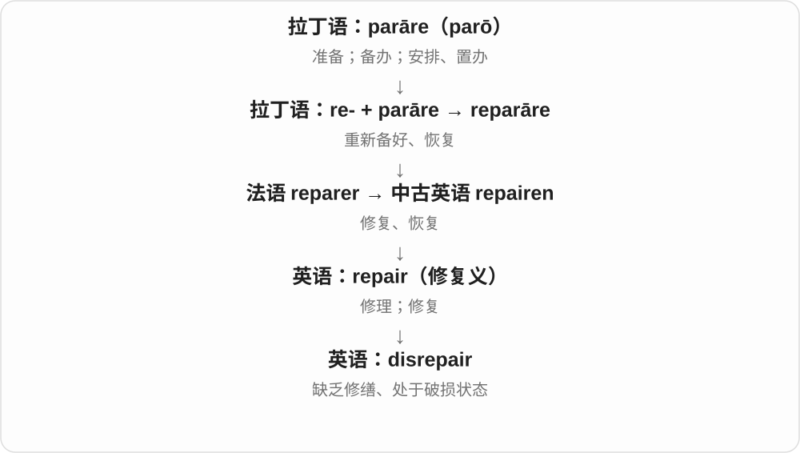

常用 fall into disrepair、be in disrepair。它描述东西的状态，通常不是一次修理失败。

**常见搭配与例句**

fall into disrepair；a state of disrepair；in serious disrepair。

> The empty house gradually fell into disrepair.

那栋空房子逐渐失修破败。

> The playground equipment was in serious disrepair.

游乐场设备严重失修。

**别混淆**

damage 可以由突然事件造成；disrepair 通常使人想到长期缺少维修保养。

### 131. disorientation — 迷失方向；定向障碍；茫然

**音标**：英 /dɪsˌɔːriənˈteɪʃən/；美 /dɪsˌɔːriənˈteɪʃən/

**先抓住这个画面**

原来的方向参照失效，一时不知道自己在哪里、该往哪走。

**怎么拆**

dis- + orientation；也有从 disorientate 形成动作或状态名词的分析。

**怎么变成今天的意思**

**拉丁 orīrī；分词 ortus**  
升起、出现、出生

↓

**拉丁 oriēns / orient-**  
正在升起 → 日出方向、东方

↓

**法语 orienter → orientation；也有英语 orient + -ation 分析**  
确定方位或朝向

↓

**英语 orientation**  
朝向；定位、适应新环境；取向

↓

**英语 dis- + orientation → disorientation；亦联系 disorientate**  
失去方位或环境定位

可以是走出陌生地铁站时的方向混乱，也可比喻突然进入新环境后的茫然。专业语境中还可涉及对时间、地点或人物的定位。

**常见搭配与例句**

a sense of disorientation；spatial disorientation；cause disorientation。

> The identical corridors created a sense of disorientation.

一模一样的走廊让人感到迷失方向。

> Moving to a new country brought me a brief period of disorientation.

搬到新国家后，我经历了一段短暂的茫然期。

**别混淆**

confusion 是宽泛的糊涂；disorientation 特别像丢了坐标，不知道自身位置。

### 132. repute — 名声、声望；认为、看作

**音标**：/rɪˈpjuːt/

**先抓住这个画面**

把人们对某人的评价收成一个简洁的名词：of good repute 就是大家说起来都认可。

**怎么拆**

动词经古法语 reputer 或直接拉丁 reputare 传入，名词 repute 后由英语动词发展；与独立借入的 reputation 同源。

**怎么变成今天的意思**

**拉丁 putare**  
修剪、清理；计算、考虑、判断

↓

**拉丁 re- + putare → reputare**  
反复盘算、考虑、评价

↓

**古法语 reputer／直接拉丁来源 → 英语 repute**  
认为、评价；后有声望名词义

现代名词常在固定搭配中出现，如 a scholar of international repute。动词较少单独用原形，更多见被动 be reputed to be。

**常见搭配与例句**

of good repute；of international repute；held in high repute；be reputed to be。

> She is a scholar of international repute.

她是一位享有国际声望的学者。

> The institution was once held in high repute.

这家机构曾受到高度尊重。

**别混淆**

reputation 更日常；repute 较正式。high repute 明确是好声望，不能把所有 repute 都当作赞美。

### 133. disrepute — 坏名声；声誉扫地的状态

**音标**：/ˌdɪsrɪˈpjuːt/

**先抓住这个画面**

不是一次别人不喜欢你，而是公众评价已经落到低处，信任被损坏了。

**怎么拆**

dis- 不良、相反 + repute 名声，英语抽象名词。

**怎么变成今天的意思**

**拉丁 putare**  
修剪、清理；计算、考虑、判断

↓

**拉丁 re- + putare → reputare**  
反复盘算、考虑、评价

↓

**古法语 reputer／直接拉丁来源 → 英语 repute**  
认为、评价；后有声望名词义

↓

**英语 dis- + repute → disrepute**  
不良名声、低评价

最常见 bring something into disrepute，让某机构或职业蒙羞；fall into disrepute 是逐渐失去声誉。通常不可数。

**常见搭配与例句**

bring into disrepute；fall into disrepute；be held in disrepute。

> The scandal brought the profession into disrepute.

丑闻让整个职业的名誉受损。

> The theory fell into disrepute after repeated failures.

多次失败后，这套理论失去了信誉。

**别混淆**

disreputable 是形容词，用来修饰人或事；disrepute 是名词，表示名誉受损的状态。

### 134. disreputable — 名声不好的；不体面的；可疑的

**音标**：美 /ˌdɪsˈrepjətəbəl/

**先抓住这个画面**

别人听到这个名字就皱眉，或从它的做派觉得靠不住；这个词把好的口碑翻到了反面。

**怎么拆**

dis- 否定、相反 + reputable，英语构词；不是从英语 dispute 派生。

**怎么变成今天的意思**

**拉丁 putare**  
修剪、清理；计算、考虑、判断

↓

**拉丁 re- + putare → reputare**  
反复盘算、考虑、评价

↓

**古法语 reputer／直接拉丁来源 → 英语 repute**  
认为、评价；后有声望名词义

↓

**英语 repute 名词 + -able → reputable**  
后来稳定为有好名声、可信的

↓

**英语 dis- + reputable → disreputable**  
名声不好、行为不体面的

可以说不可靠的生意、声名狼藉的人，也可用带幽默色彩的方式形容破旧、不体面的外观。它不自动等于已经被法院认定违法。

**常见搭配与例句**

a disreputable dealer；disreputable behaviour；a disreputable appearance。

> The investigation exposed a disreputable business practice.

调查揭露了一种不光彩的经营手法。

> He arrived wearing a rather disreputable old coat.

他穿着一件颇不体面的旧外套来了。

**别混淆**

unpopular 是不受欢迎；disreputable 更关乎不良名声、品行或可信度。

### 135. enfranchise — 给予选举权；赋予权利〔正式〕

**音标**：/ɪnˈfræntʃaɪz/

**先抓住这个画面**

原来不在有投票权的范围里，后来被纳入，enfranchise 常说把选举权赋给这些人。

**怎么拆**

经法语 enfranchir 等赋予自由、权利的词族，en- 使进入 + franchise 特权、自由权利的材料。这里不是给人开一家加盟店。

**怎么变成今天的意思**

**法语 enfranchir 等**  
使获得自由、权利

↓

**英语 enfranchise**  
给予选举权等权利

enfranchise voters 赋予选民投票权；the newly enfranchised 新近获得选举权的人。历史范围因制度而异，词义重点是授予权利的方向。

**常见搭配与例句**

enfranchise citizens；newly enfranchised voters。

> The reform enfranchised a wider group of citizens.

改革赋予了更广泛的公民群体选举权。

> Newly enfranchised voters took part in the election.

新近获得选举权的选民参加了选举。

**别混淆**

franchise 在现代商业可指特许经营，enfranchise 的常用政治义却是赋予权利；不能从同一词形把二者都译成加盟。

### 136. disenfranchise — 剥夺选举权等权利；使失去参与、发声的机会

**音标**：/ˌdɪsɪnˈfræntʃaɪz/

**先抓住这个画面**

原本应有的一票或参与机会被拿走，就是 disenfranchise；也可批评某种安排实际上让人无法发声。

**怎么拆**

dis- + enfranchise，先看 en- + franchise 赋权，再看 dis- 撤除。这里不是把一个 franchise 加盟店拆掉。

**怎么变成今天的意思**

**enfranchise**  
赋予投票权等权利

↓

**dis- + enfranchise → disenfranchise**  
剥夺权利、排除参与

disenfranchised voters 被剥夺或实际无法行使投票权的选民；feel disenfranchised 感到被排斥、没有发言机会。描述具体制度时须看文章给出的事实。

**常见搭配与例句**

disenfranchise voters；a disenfranchised group。

> The historian studied laws that disenfranchised certain voters.

历史学家研究了剥夺某些选民投票权的法律。

> Some residents felt disenfranchised by the decision-making process.

一些居民觉得自己被排除在决策过程之外。

**别混淆**

disenfranchise 剥夺权利或实际排除参与，discourage 使泄气不一定到这一步；不能把所有令人不高兴的安排都不加说明地用这个词。

### 137. disambiguate — 消除歧义；明确指哪一种意思或对象

**音标**：/ˌdɪsæmˈbɪɡjueɪt/

**先抓住这个画面**

bank 是银行还是河岸？把上下文补清，让读者知道这里究竟指哪一个，就是 disambiguate。

**怎么拆**

英语由较早的 disambiguation 逆构出动词。现代可看 dis- 去除 + ambigu- 歧义材料 + -ate 的对应，但不能把学习顺序当历史，声称较短动词先出现。

**怎么变成今天的意思**

**较早 disambiguation**  
消除歧义的名词

↓

**逆构 disambiguate**  
从较长名词形成相应动作动词

disambiguate a word 明确词义；disambiguate two names 区分同名对象；上下文常是关键，不一定更换原词。

**常见搭配与例句**

disambiguate a term；use context to disambiguate。

> The next sentence helps disambiguate the word.

下一句话帮助明确了这个词的意思。

> We added the birth year to disambiguate the two authors.

我们补上出生年份，以区分两位同名作者。

**别混淆**

clarify 澄清范围更大，disambiguate 尤其解决多个可能意思或指向之间的选择；句子难懂不一定都因为歧义。

### 138. disambiguation — 消歧；消除歧义的过程

**音标**：/ˌdɪsæmbɪɡjuˈeɪʃən/

**先抓住这个画面**

同一个词、名字有多种可能，给信息帮人选对指向；disambiguation 命名这个过程。

**怎么拆**

dis- 去除 + ambiguous 歧义材料 + -ation，在英语中早于动词 disambiguate。现代两者动名对应清楚，却不能把 -ation 一律讲成后加于较短英语动词。

**怎么变成今天的意思**

**dis- + 歧义词干 + -ation → disambiguation**  
命名去除歧义的过程

↓

**后来的 disambiguate 与其对应**  
名词与逆构动词成组使用

word sense disambiguation 词义消歧；a disambiguation page 同名对象区分页面。这里关心是哪一义、哪一对象，不是判定哪个词更漂亮。

**常见搭配与例句**

word sense disambiguation；a disambiguation page。

> The task involves word sense disambiguation.

这项任务涉及词义消歧。

> The website uses a disambiguation page for shared names.

网站用消歧页面区分共用同一名称的对象。

**别混淆**

translation 翻译与 disambiguation 消歧不同；翻译前可能需要先消歧，但消歧本身不一定换语言。

### 139. disburse — 支付；拨付、发放款项

**音标**：英 /dɪsˈbɜːs/；美 /dɪsˈbɜːrs/

**先抓住这个画面**

一笔资金已经存在一个“大钱袋”里，现在按用途从里面拿出一部分，付到该收钱的人手里。

**怎么拆**

古法语 des-“取出、移除” + bourse“钱袋” → desbourser → 英语 disburse。bourse 远接拉丁 bursa。现代 dis- 在这里帮助记“向外付”，不是简单的“不付”。

**怎么变成今天的意思**

**拉丁 bursa → 古法语 bourse**  
钱袋

↓

**古法语 des- + bourse → desbourser**  
把钱从袋里付出

↓

**英语 disburse**  
支付、拨出款项

常见于机构拨款、发放资助、结算费用。重点是钱实际付出去，不能把“答应给钱”或“批准预算”自动等同于 disburse。它较正式，日常在咖啡店付款通常直接说 pay。

**常见搭配与例句**

disburse funds；disburse money to recipients；funds disbursed in stages。

> The foundation will disburse the grant in two instalments.

基金会将分两期拨付这笔资助。

> Only half of the approved funds had been disbursed by June.

到六月，获批资金只拨付了一半。

**别混淆**

allocate 是把资金用途划定，disburse 是付出去；disperse 是分散人群、颗粒等，虽相似却不是这个“钱袋”词。

## 这一组要分清什么

disagree 意见不同，不等于 disengage 退出参与；disinfect 消毒不等于所有情境的 sterilize 灭菌；disabuse 纠正误信，不是按现代虐待义硬翻；disinformation 有意误导与普通错误信息也须分清。

## 串起来练习

We need to disambiguate the instructions before calling anyone disobedient.

在说谁不服从之前，我们应先把指令中的歧义讲清楚。
