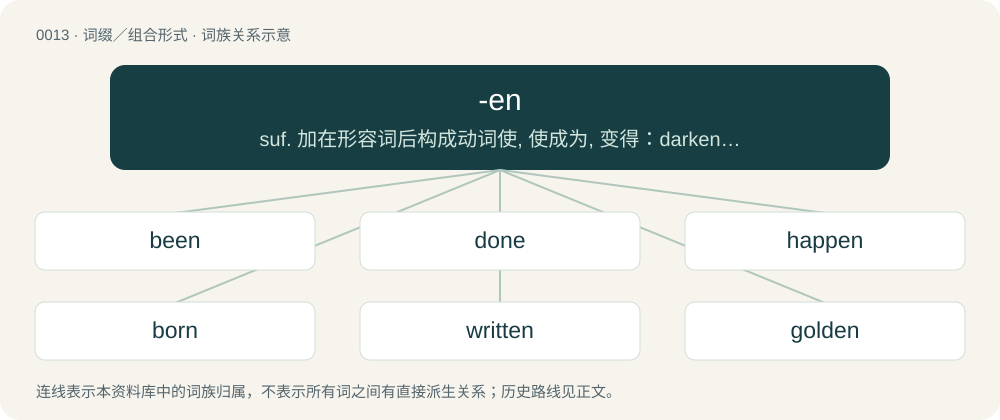

# 0016 · -en — suf. 加在形容词后构成动词使, 使成为, 变得：darken, weaken; 加在名词后构成动词变得有,使有,具有：heighten,hearten,strengthen; 加在物质名词后构成形容词表示由...制的, 由...构成的, ...一样的：wooden, woolen; 构成某些不规则动词的过去分词：risen, written; 用以构成某

[总目录](../00_总目录_按常用程度.md)

**类型**：词缀／组合形式　｜　**来源语言**：见词源记录

## 核心含义与来源

- 核心含义：suf. 加在形容词后构成动词使, 使成为, 变得：darken, weaken; 加在名词后构成动词变得有,使有,具有：heighten,hearten,strengthen; 加在物质名词后构成形容词表示由...制的, 由...构成的, ...一样的：wooden, woolen; 构成某些不规则动词的过去分词：risen, written; 用以构成某些名词的复数：children,brethren
- 英文含义：Denotes the past participle form when attached to a verb.
- 词形：-en

**多个词源／构词路径**：同一拼写可能有不同来源；以下按词性和含义分别列出。

**来源记录 1**（后缀／后置成分；Denotes the past participle form when attached to a verb.）

From Middle English -n, -en, past participle ending of strong verbs (compare Middle English take(n), took, taken (“take, took, taken”)), from Old English -en and Old Norse -inn, past participle ending of strong verbs (compare Old Norse taka, tók, tekinn (“take, took, taken”)), ultimately from Proto-Germanic \*-inaz, a variant of \*-anaz. In Middle English, the suffix was often weakened to -e or disappeared (compare Southern Middle English do(n), dud(e), ydo (“do, did, done”)), but not in others (compare cume(n), com, ycume (“come, came, come”)), from Proto-Germanic \*-anaz, from Proto-Indo-European \*-nós.

**来源记录 2**（后缀／后置成分；Used to denote the plural form of a small number of English nouns, the majority of whose etymologies go back to the n-stem (i.e. weak noun) declension of Germanic languages.）

From Middle English -en, -n, the plural suffix of weak nouns (n-stems), from Old English -an, from Proto-West Germanic \*-an m, \*-ōn f or n, from Proto-Germanic \*-an- m, \*-ōn- f or n, from Proto-Indo-European \*-on-, o-grade form of the n-stem suffix. Reinforced by the early Middle English dative plural ending -en, from late Old English -an, weakened form of earlier -um.

**来源记录 3**（后缀／后置成分；When attached to certain adjectives, it forms a transitive verb whose meaning is, to make (adjective). Usually, the verb is ergative, sometimes not. The same construction could also be done to certain (fewer) nouns, as, strengthen, in which case the verb means roughly, "to give (noun) to", or "to become like (noun)".）

From Middle English -(e)nen, -(e)nien, from Old English -nian, from Proto-West Germanic \*-inōn, from Proto-Germanic \*-inōną. Cognate with Saterland Frisian -enje, West Frisian -enje, Danish -ne, Swedish -na, Icelandic -na.

**来源记录 4**（后缀／后置成分；Pertaining to, having the qualities of, resembling, or like.）

From Middle English -en, from Old English -en, from Proto-West Germanic \*-īn, from Proto-Germanic \*-īnaz; suffix meaning "made of, consisting of, having the qualities of" applied to nouns to form adjectives. Akin to Dutch -en, German -en, Icelandic -inn, Latin -īnus. See -ine.

**来源记录 5**（后缀／后置成分；Used to form the diminutives of certain nouns.）

From Middle English -en, from Old English -en, from the neuter form of -en (“pertaining to”, adjective-forming suffix).

**来源记录 6**（后缀／后置成分；Denotes a female form of a few nouns.）

From Middle English -ene, -en, from Old English -en, from Proto-West Germanic \*-ini, from Proto-Germanic \*-inī.

**来源记录 7**（后缀／后置成分；Indicates the presence of a carbon-carbon double bond.）

From French -ène.

## 词族图

## 单词速览（常用到不常用）

| 单词 | 音标 | 释义 |
|---|---|---|
| [been](#w-1) | /ˈbɪn/ | be的过去分词 |
| [done](#w-2) | 英 /dʌn/ | a. 完成了的, 好了的；do的过去分词 |
| [happen](#w-3) | /ˈhæpən/ | vi. 发生, 发生, 恰巧 |
| [born](#w-4) | 英 /bɔːn/；美 /boɹn/ | a. 天生的；bear的过去分词 |
| [written](#w-5) | /ˈɹɪ.tn̩/ | a. 书面的, 写成文字的；write的过去分词 |
| [golden](#w-6) | 英 /ˈɡəʊl.dən/；美 /ˈɡoʊl.dən/ | a. 金的, 含金的, 金色的, 贵重的, 繁盛的；\[法\] 金制的, 金色的, 兴隆的 |
| [chicken](#w-7) | 英 /ˈt͡ʃɪkɪn/；美 /ˈt͡ʃɪkən/ | n. 小鸡, 鸡肉 |
| [chosen](#w-8) | 英 /ˈt͡ʃəʊ.zən/；美 /ˈt͡ʃoʊ.zən/ | choose的过去分词 |
| [driven](#w-9) | /ˈdɹɪvn̩/ | a. 有紧迫感的；drive的过去分词 |
| [hidden](#w-10) | /ˈhɪd.(ə)n/ | a. 隐藏的；hide的过去分词；\[计\] 隐藏的 |
| [gotten](#w-11) | 英 /ˈɡɒt.n̩/；美 /ˈɡɑ.tən/ | get的过去分词 |
| [stolen](#w-12) | 英 /ˈstəʊ.ln̩/；美 /ˈstoʊ.ln̩/ | steal的过去分词；\[经\] 被偷窃的 |
| [forgotten](#w-13) | 英 /fəˈɡɒt.n̩/；美 /fɚˈɡɑ.tn̩/ | forget的过去分词 |
| [fallen](#w-14) | 英 /ˈfɔːlən/；美 /ˈfɔlən/ | a. 堕落的, 落下来的, 陷落的；fall的过去分词 |
| [wooden](#w-15) | 英 /ˈwʊdn̩/ | a. 木制的, 呆笨的, 木然的 |
| [beaten](#w-16) | /ˈbiː.tən/ | a. 被打败了的, 筋疲力竭的, 敲平的, 踏平的；beat的过去分词 |
| [cow](#w-17) | 美 /kaʊ/ | n. 母牛, 母兽；vt. 威胁 |
| [eaten](#w-18) | /ˈiː.tn̩/ | eat的过去分词 |
| [strengthen](#w-19) | 英 /ˈstɹɛŋ(k)θən/ | vt. 加强, 变坚固；vi. 变强, 股票上涨 |
| [threaten](#w-20) | 英 /ˈθɹɛt.n̩/ | vt. 恐吓, 威胁, 预示...的凶兆；vi. 威胁, 恫吓, 可能来临 |
| [sworn](#w-21) | 英 /swɔːn/；美 /swɔɹn/ | swear的过去分词 |
| [maiden](#w-22) | 英 /ˈmeɪdən/ | n. 年轻未婚女子, 少女, 处女；a. 未婚的, 处女的, 初次的, 无经验的 |
| [rotten](#w-23) | 英 /ˈɹɒtn̩/；美 /ˈɹɑtn̩/ | a. 腐烂的, 恶臭的, 堕落的, 风化的, 虚弱的；\[经\] 腐烂的, 堕落的 |
| [drunken](#w-24) | /ˈdɹʌŋkən/ | a. 酒醉的 |
| [ridden](#w-25) | /ˈɹɪd.n̩/ | ride的过去分词；\[法\] 受折磨的, 受虐待的, 受支配的 |
| [linen](#w-26) | /ˈlɪnɪn/ | n. 亚麻布, 亚麻线, 亚麻制品；a. 亚麻布制的, 亚麻的 |
| [harden](#w-27) | 英 /ˈhɑːdn̩/；美 /ˈhɑɹdn̩/ | vt. 使变硬, 使坚强, 使冷酷；vi. 变硬, 变冷酷 |
| [brethren](#w-28) | /ˈbɹɛðɹən/ | n. 弟兄们, 教友们 |
| [tighten](#w-29) | /ˈtaɪ.tən/ | vt. 勒紧, 使变紧；vi. 变紧, 绷紧 |
| [bitten](#w-30) | /ˈbɪt.ən/ | bite的过去分词 |
| [weaken](#w-31) | 美 /ˈwikən/ | vt. 削弱, 减弱, 使虚弱；vi. 变弱, 变软弱 |
| [aspen](#w-32) | /ˈæspən/ | n. 山杨；a. 山杨的, 颤抖的 |
| [shorten](#w-33) | 英 /ˈʃɔːtn̩/；美 /ˈʃɔɹtn̩/ | vt. 弄短, 缩短, 减少；vi. 缩小, 变短 |
| [lessen](#w-34) | 英 /ˈlɛsən/ | vt. 减少, 缩小, 减轻；vi. 变小 |
| [loosen](#w-35) | 英 /ˈluːsən/；美 /ˈlusən/ | vt. 放松, 松开, 解除；vi. 变松, 松弛 |
| [undone](#w-36) | /ʌnˈdʌn/ | 【英文】Not fastened. |
| [woken](#w-37) | 英 /ˈwəʊ.kən/；美 /ˈwoʊ.kən/ | wake的过去分词 |
| [soften](#w-38) | 英 /ˈsɒfən/；美 /ˈsɔfən/ | v. (使)变柔软, (使)变柔和 |
| [lighten](#w-39) | /ˈlaɪ.tn̩/ | vt. 照亮, 点亮, 减轻, 使轻松, 闪出；vi. 发亮, 打闪, 变轻 |
| [broaden](#w-40) | /ˈbrɒːdn/ | vi. 变宽, 扩大；vt. 放宽, 使扩大 |
| [straighten](#w-41) | /ˈstɹeɪtn̩/ | vt. 弄直, 整顿, 清理, 使改正；vi. 直起来, 改正, 好转 |
| [brighten](#w-42) | /ˈbɹaɪtən/ | vi. 变亮, 活跃；vt. 使生辉, 使快活 |
| [widen](#w-43) | /ˈwaɪdn̩/ | vt. 弄宽, 加宽, 扩大；vi. 变宽, 扩大 |
| [enlighten](#w-44) | /ɪnˈlaɪtən/ | vt. 教育, 启发, 启蒙, 开导, 教导 |
| [linden](#w-45) | /ˈlɪn.dən/ | n. 椴, 菩提树；\[医\] 椴树(菩提树) |
| [deepen](#w-46) | /ˈdiːpən/ | vi. 深化；vt. 使加深, 使强烈 |
| [sharpen](#w-47) | 英 /ˈʃɑːpən/；美 /ˈʃɑɹpən/ | vt. 使尖锐, 使敏捷, 加重, 削尖；vi. 尖锐化, 变锋利 |
| [brazen](#w-48) | /ˈbɹeɪ̯zən/ | a. 黄铜制的, 厚颜无耻的；vt. 厚脸皮地对待 |
| [heathen](#w-49) | /ˈhiːðən/ | n. 异教徒, 异族人, 粗野的人；a. 异教的, 野蛮的 |
| [frighten](#w-50) | /ˈfɹaɪ.tən/ | vt. 使惊吓；vi. 惊恐 |
| [worsen](#w-51) | 英 /ˈwɜːsn̩/；美 /ˈwɝsn̩/ | vt. 使更坏, 使恶化；vi. 变得更坏, 恶化 |
| [smitten](#w-52) | /ˈsmɪ.tn̩/ | smite的过去分词 |
| [fasten](#w-53) | 英 /ˈfɑːsn̩/；美 /ˈfæsn̩/ | vt. 拴紧, 使固定, 系, 集中于, 强加于；vi. 扣紧 |
| [flatten](#w-54) | /ˈflæ.tən/ | vi. 使...不活跃, 变平；vt. 弄平, 打倒, 使失去光泽 |
| [hasten](#w-55) | /ˈheɪ.sn̩/ | vt. 催促, 加紧；vi. 赶快, 急忙 |
| [hain](#w-56) |  | 围起用作牧场 |
| [oxen](#w-57) | 英 /ˈɒksən/；美 /ˈɑksən/ | 牛, 公牛 |
| [darken](#w-58) | 英 /ˈdɑːkən/；美 /ˈdɑɹkən/ | vt. 弄暗, 使模糊；vi. 暗下来, 颜色变深 |
| [quicken](#w-59) | 英 /ˈkwɪk(ə)n/ | vt. 加快, 激发, 使有生气, 鼓舞, 使复活；vi. 加快, 变活跃, 进入胎动期 |
| [freshen](#w-60) | /ˈfɹɛʃən/ | v. (使)显得新鲜, (使)精神饱满, (使)减少咸味 |
| [earthen](#w-61) | 英 /ˈɜː(ɹ)θən/；美 /ˈɝθən/ | a. 土制的, 陶制的 |
| [heighten](#w-62) | /ˈhaɪ̯.tən/ | vt. 增高, 提高, 加强；vi. 升高, 变大 |
| [olden](#w-63) | 英 /ˈəʊl.dn̩/；美 /ˈoʊldn̩/ | a. 古时的, 从前的；vt. 使衰老；vi. 变老 |
| [dampen](#w-64) | /ˈdæmpən/ | vt. 弄湿, 使沮丧；vi. 变湿, 丧气 |
| [lengthen](#w-65) | /ˈlɛŋθən/ | vt. 加长, 使延长；vi. 变长 |
| [sweeten](#w-66) | /ˈswiːtən/ | vt. 使变甜, 加糖于, 使悦耳, 使温和, 减轻；vi. 变甜 |
| [thicken](#w-67) | 美 /ˈθɪkən/ | vi. 变浓, 变厚, 变得模糊, 变为复杂；vt. 使变厚, 加强, 使模糊 |
| [woolen](#w-68) | /ˈwʊlən/ | n. 毛制品；a. 羊毛的, 羊毛制的, 毛织的 |
| [toughen](#w-69) | /ˈtʌfən/ | v. (使)变坚韧, (使)变顽强 |
| [ripen](#w-70) | /ˈɹaɪpən/ | vt. 使成熟；vi. 成熟 |
| [christen](#w-71) | /ˈkɹɪsən/ | vt. 为...施洗礼, 命名 |
| [elven](#w-72) | 英 /ˈɛlv(ə)n/ | 小精灵, 精灵族 |
| [liven](#w-73) | /ˈlaɪvən/ | vt. 使高兴, 使快活；vi. 快活起来 |
| [silken](#w-74) | /ˈsɪlkən/ | a. 丝的, 绸制的, 柔软的, 圆滑的 |
| [liken](#w-75) | 英 /ˈlaɪk(ə)n/；美 /ˈlaɪkən/ | vt. 比喻, 比拟 |
| [bolden](#w-76) | 英 /ˈbəʊld(ə)n/；美 /ˈboʊld(ə)n/ | \[人名\] 博尔登 |
| [fatten](#w-77) | /ˈfætən/ | vi. 养肥；vt. 使肥胖 |
| [stiffen](#w-78) | /ˈstɪfən/ | vt. 使变硬, 使僵硬, 使顽强, 使严厉；vi. 变粘, 变硬, 变强烈 |
| [ashen](#w-79) | /ˈæʃ.ən/ | a. 由灰烬构成的, 灰色的, 苍白的；\[机\] 灰的, 似灰的 |
| [whiten](#w-80) | /ˈ(h)waɪ̯.tən/ | vt. 使白, 漂白；vi. 变白 |
| [leaden](#w-81) | /ˈlɛdən/ | a. 铅制的, 呆滞的, 铅灰色的, 沉闷的；\[机\] 铅的, 铅包的 |
| [sicken](#w-82) | /ˈsɪkən/ | vt. 患病, 使厌倦, 使恶心；vi. 生病, 作呕 |
| [hearken](#w-83) | 英 /ˈhɑːk(ə)n/；美 /ˈhɑɹkən/ | vi. 倾听 |
| [redden](#w-84) | /ˈɹɛdn̩/ | vi. 变红, 脸红；vt. 使变红 |
| [gooden](#w-85) |  | \[人名\] \[英格兰人姓氏\] 古登绰号，来源于常用中世纪英语问候用语，含义是“晚上好”(good evening) |
| [blacken](#w-86) | /ˈblækən/ | vt. 使变黑, 诽谤；vi. 变黑 |
| [moisten](#w-87) | /ˈmɔɪsən/ | vt. 弄湿；vi. 变潮湿 |
| [dwarven](#w-88) |  | 【英文】Similar to a dwarf, for example in stature. |
| [graven](#w-89) | /ˈgreivən/ | 【英文】To make or become grave (serious or sombre) |
| [gladden](#w-90) | /ˈɡlædən/ | vt. 使喜悦；vi. 喜悦 |
| [cheapen](#w-91) | /ˈtʃiːpən/ | v. 减价, 跌价 |
| [lowen](#w-92) |  | \[人名\] \[英格兰人姓氏\] 洛温 Lewin的变体 |
| [smarten](#w-93) | /ˈsmɑːt(ə)n/ | vt. 使潇洒, 使整洁；vi. 变潇洒, 变强烈 |
| [wilden](#w-94) | /ˈwaɪldən/ | \[人名\] 怀尔登 |
| [sadden](#w-95) | /ˈsædən/ | vt. 使忧愁, 使悲哀；vi. 忧愁, 悲哀 |
| [louden](#w-96) | 英 /ˈlaʊdn̩/ | v. (使声音)变响亮 |
| [quieten](#w-97) | /ˈkwaɪ.ə.tən/ | vi.vt. (使)安静, 平静下来, (使)平息, (使)平静, (使)镇静；vt. 抚慰, 安慰 |
| [slacken](#w-98) | /ˈslæ.kən/ | vt. 使松弛, 放松, 放慢；vi. 变松弛, 减弱, 松劲 |

## 逐词详解

### 1. been

**词性**：动词　｜　**音标**：/ˈbɪn/

**中文释义**：be的过去分词

**英文义项**：remote past form of be.

**构词拆分**：By surface analysis, be + -en

**词源与演化**：

From Middle English been (past participle), from Old English (ġe)bēon. By surface analysis, be + -en.

**例句**：

> We been knew they was doing this.

该用例对应义项：remote past form of be.

### 2. done

**词性**：形容词　｜　**音标**：英 /dʌn/

**中文释义**：a. 完成了的, 好了的；do的过去分词

**英文义项**：Having completed or finished an activity. / Completed or finished.

**构词拆分**：do + -en (past participle ending)

**词源与演化**：

From Middle English don, idon, ydon, ȝedon, gedon, from Old English dōn, ġedōn, from Proto-West Germanic \*dān, from Proto-Germanic \*dēnaz (past participle of \*dōną (“to do”)). Equivalent to do + -en (past participle ending). Cognate with Scots dune, deen, dene, dane (“done”), Saterland Frisian däin (“done”), West Frisian dien (“done”), Dutch gedaan (“done”), German Low German daan (“done”), German getan (“done”). More at do.

**例句**：

> I can't believe he just walked up and spoke to her like that, those kind of things just aren't done!

该用例对应义项：Fashionable, socially acceptable, tasteful.

### 3. happen

**词性**：动词　｜　**音标**：/ˈhæpən/

**中文释义**：vi. 发生, 发生, 恰巧

**英文义项**：To occur or take place. / To do or occur by chance or unexpectedly.

**构词拆分**：hap (“a chance, occurrence, byfall”) + -en (verbal suffix)

**词源与演化**：

From Middle English happenen, hapnen, augmented from Middle English happen (“to come to pass, happen”), perhaps from Old English hæppan (“to move accidentally, slip”) and/or from Old Norse \*happa, \*heppa, from Proto-Germanic \*hampijaną (“to fit in, be fitting”). Equivalent to hap (“a chance, occurrence, byfall”) + -en (verbal suffix).

**例句**：

> It happened that a police car was passing my house just at that moment.

该用例对应义项：To do or occur by chance or unexpectedly.

### 4. born

**词性**：形容词　｜　**音标**：英 /bɔːn/；美 /boɹn/

**中文释义**：a. 天生的；bear的过去分词

**英文义项**：Having from birth (or as if from birth) a certain quality or character; innate; inherited.

**构词拆分**：bear + -en

**词源与演化**：

From Middle English born, boren, borne, iborne, from Old English boren, ġeboren, from Proto-West Germanic \*boran, \*gaboran, from Proto-Germanic \*buranaz, past participle of Proto-Germanic \*beraną (“to bear, carry”), equivalent to bear + -en. Cognate with Saterland Frisian gebooren (“born”), West Frisian berne (“born”), Dutch geboren (“born”), German geboren (“born”), Swedish boren (“born”).

**例句**：

> In the United States, information describing the operation of nuclear weapons is born secret.

该用例对应义项：Having from birth (or as if from birth) a certain quality or character; innate; inherited.

### 5. written

**词性**：形容词　｜　**音标**：/ˈɹɪ.tn̩/

**中文释义**：a. 书面的, 写成文字的；write的过去分词

**英文义项**：Of, relating, or characteristic of writing (i.e., of that which has been written). / Having been written.

**构词拆分**：write + -en

**词源与演化**：

Morphologically write + -en.

**例句**：

> I can speak Japanese fairly well, but I have no understanding whatsoever of written Japanese.

该用例对应义项：Having been written.

### 6. golden

**词性**：形容词　｜　**音标**：英 /ˈɡəʊl.dən/；美 /ˈɡoʊl.dən/

**中文释义**：a. 金的, 含金的, 金色的, 贵重的, 繁盛的；\[法\] 金制的, 金色的, 兴隆的

**英文义项**：Made of, or relating to, gold. / Having a color or other richness suggestive of gold.

**构词拆分**：gold + -en

**词源与演化**：

From Middle English golden, a restored form (due to the noun gold) of earlier Middle English gulden, gylden, gilden ("golden"; &gt; English gilden), from Old English gylden (“golden”), from Proto-West Germanic \*gulþīn, from Proto-Germanic \*gulþīnaz (“golden, made of gold”), equivalent to gold + -en. Cognate with Dutch gouden, gulden (“golden”), German gülden, golden (“golden”), Danish gylden (“golden”). Doublet of gilden. More at gold.

**例句**：

> After retiring, Bob and Judy moved to Arizona to live out their golden years.

该用例对应义项：Relating to the elderly or retired.

### 7. chicken

**词性**：名词　｜　**音标**：英 /ˈt͡ʃɪkɪn/；美 /ˈt͡ʃɪkən/

**中文释义**：n. 小鸡, 鸡肉

**英文义项**：A domesticated subspecies of red junglefowl (Gallus gallus domesticus). / The meat from this bird eaten as food.

**构词拆分**：cock + -en

**词源与演化**：

From Middle English chiken (also as chike &gt; English chick), from Old English ċicen, ċycen (“chicken”), of uncertain origin. Possibly from Proto-West Germanic \*kiukīn (“chicken”), or alternatively from Proto-West Germanic \*kukkīn, equivalent to cock + -en. Compare North Frisian schückling (“chicken”), Saterland Frisian Sjuuken (“chicken”), Dutch kuiken (“chick, chicken”), German Low German Küken (“chick”), whence German Küken (“chick”), (elevated, obsolete) German Küchlein (“chick”) and Old Norse kjúklingr (“chicken”).

**例句**：

> Don't play chicken with a freight train; you're guaranteed to lose.

该用例对应义项：A confrontational game in which the participants move toward each other at high speed (usually in automobiles); the player who turns first to avoid colliding into the other is the "chicken" (that is, the loser).

### 8. chosen

**词性**：形容词　｜　**音标**：英 /ˈt͡ʃəʊ.zən/；美 /ˈt͡ʃoʊ.zən/

**中文释义**：choose的过去分词

**英文义项**：picked; selected / elected

**构词拆分**：choose + -en (past participle ending)

**词源与演化**：

From Middle English chosen, ychosen, ichosen, re-analysed variant of coren, icoren, ȝecoren (“chosen”), from Old English coren, ġecoren (“chosen”), past participle of Old English ċēosan (“to choose”). Morphologically equivalent to choose + -en (past participle ending).

**例句**：

> The chosen candidate accepted the award with pride.

该用例对应义项：picked; selected

### 9. driven

**词性**：形容词　｜　**音标**：/ˈdɹɪvn̩/

**中文释义**：a. 有紧迫感的；drive的过去分词

**英文义项**：Obsessed; passionately motivated to achieve goals. / Formed into snowdrifts by wind. (of snow)

**构词拆分**：drive + -en

**词源与演化**：

From drive + -en.

**用法示例／搭配（非完整句）**：

> highly driven

该用例对应义项：Obsessed; passionately motivated to achieve goals.

### 10. hidden

**词性**：形容词　｜　**音标**：/ˈhɪd.(ə)n/

**中文释义**：a. 隐藏的；hide的过去分词；\[计\] 隐藏的

**英文义项**：Located or positioned out of sight; not visually apparent. / Obscure.

**构词拆分**：hid + -en

**词源与演化**：

Morphologically hid + -en.

**用法示例／搭配（非完整句）**：

> hidden treasure; hidden talents

该用例对应义项：Located or positioned out of sight; not visually apparent.

### 11. gotten

**词性**：形容词　｜　**音标**：英 /ˈɡɒt.n̩/；美 /ˈɡɑ.tən/

**中文释义**：get的过去分词

**英文义项**：Obtained, acquired.

**构词拆分**：got + -en

**词源与演化**：

Morphologically got + -en.

**例句**：

> I'd still be spinning my wheels if I hadn't gotten that scholarship.

### 12. stolen

**词性**：形容词　｜　**音标**：英 /ˈstəʊ.ln̩/；美 /ˈstoʊ.ln̩/

**中文释义**：steal的过去分词；\[经\] 被偷窃的

**英文义项**：That has been stolen.

**构词拆分**：stole + -en

**词源与演化**：

From Middle English stolen, istolen, from Old English stolen, ġestolen, from Proto-Germanic \*stulanaz, past participle of Proto-Germanic \*stelaną (“to steal”), equivalent to stole + -en. Cognate with Scots stellin, stollin (“stolen”), Saterland Frisian stäälen (“stolen”), West Frisian stellen (“stolen”), Dutch gestolen (“stolen”), German Low German stohlen (“stolen”), German gestohlen (“stolen”), Swedish stulen (“stolen”).

**例句**：

> I must have stolen it when I lost control of myself momentarily.

### 13. forgotten

**词性**：形容词　｜　**音标**：英 /fəˈɡɒt.n̩/；美 /fɚˈɡɑ.tn̩/

**中文释义**：forget的过去分词

**英文义项**：Of which knowledge has been lost; which is no longer remembered.

**构词拆分**：By surface analysis, forgot + -en

**词源与演化**：

From Middle English foryoten, from Old English forġeten, from Proto-West Germanic \*fragetan. By surface analysis, forgot + -en.

**例句**：

> They have never forgotten to send a birthday present to their mother.

### 14. fallen

**词性**：形容词　｜　**音标**：英 /ˈfɔːlən/；美 /ˈfɔlən/

**中文释义**：a. 堕落的, 落下来的, 陷落的；fall的过去分词

**英文义项**：Having dropped by the force of gravity. / Killed, especially in battle.

**构词拆分**：fall + -en

**词源与演化**：

Morphologically fall + -en.

**例句**：

> Fallen leaves covered the forest floor.

该用例对应义项：having dropped by the force of gravity

### 15. wooden

**词性**：形容词　｜　**音标**：英 /ˈwʊdn̩/

**中文释义**：a. 木制的, 呆笨的, 木然的

**英文义项**：Made of wood. / As if made of wood; moving awkwardly, or speaking with dull lack of emotion.

**构词拆分**：wood + -en

**词源与演化**：

From wood + -en. Dates from 1530s, gradually replaced treen (“made from a tree”), from Middle English treen, from Old English triewen.

**例句**：

> On a recent windy day, hundreds of visitors climbed wooden stairs to take pictures in front of the glacier.

该用例对应义项：Made of wood.

### 16. beaten

**词性**：形容词　｜　**音标**：/ˈbiː.tən/

**中文释义**：a. 被打败了的, 筋疲力竭的, 敲平的, 踏平的；beat的过去分词

**英文义项**：Defeated. / Repeatedly struck, or formed or flattened by blows.

**构词拆分**：beat + -en

**词源与演化**：

From beat + -en.

**用法示例／搭配（非完整句）**：

> a beaten path; beaten gold; the beaten victims of the attack

该用例对应义项：Repeatedly struck, or formed or flattened by blows.

### 17. cow

**词性**：名词　｜　**音标**：美 /kaʊ/

**中文释义**：n. 母牛, 母兽；vt. 威胁

**英文义项**：An adult female of the species Bos taurus, especially one that has calved. / Any member of the species Bos taurus that is not of a bucking breed or fighting breed, regardless of sex or age, including steers and calves.

**构词拆分**：kye + -en

**词源与演化**：

Inherited from Middle English cow, cou, from Old English cū (“cow”), from Proto-West Germanic \*kō, from Proto-Germanic \*kōz (“cow”), from Proto-Indo-European \*gʷṓws (“cow”). Cognate with Sanskrit गो (go), Ancient Greek βοῦς (boûs), Persian گاو (gâv)), Latvian govs (“cow”), Proto-Slavic \*govędo (Serbo-Croatian govedo, Russian говядина (govjadina, “beef”), Scots coo (“cow”), North Frisian ko, kø (“cow”), West Frisian ko (“cow”), Dutch koe (“cow”), Low German Koh, Koo, Kau (“cow”), German Kuh (“cow”), Danish and Swedish ko (“cow”), Norwegian Bokmål and Norwegian Nynorsk ku (“cow”), Faroese kúgv (“cow”), Icelandic kýr (“cow”), Latin bōs (“ox, bull, cow”) (whence English beef), Armenian կով (kov, “cow”). Doublet of beef. The plural kine is from Middle English kyne, kyn, kuin, kiin, kien (“cows”), either a double plural of Middle English ky, kye (“cows”), equivalent to modern kye + -en, or inherited from Old English cūna (“cows', of cows”), genitive plural of cū (“cow”).

**例句**：

> We saw lots of cows at the farm show, including some surprisingly gigantic bulls.

该用例对应义项：Any member of the species Bos taurus that is not of a bucking breed or fighting breed, regardless of sex or age, including steers and calves.

### 18. eaten

**词性**：形容词　｜　**音标**：/ˈiː.tn̩/

**中文释义**：eat的过去分词

**英文义项**：Having been consumed by eating.

**构词拆分**：eat + -en

**词源与演化**：

From Middle English eten, from Old English eten, from Proto-West Germanic \*etan, from Proto-Germanic \*etanaz; morphologically eat + -en.

**例句**：

> As a matter of fact, I haven't eaten anything since this morning.

### 19. strengthen

**词性**：动词　｜　**音标**：英 /ˈstɹɛŋ(k)θən/

**中文释义**：vt. 加强, 变坚固；vi. 变强, 股票上涨

**英文义项**：To make strong or stronger; to add strength to; to increase the strength of; to fortify. / To empower; to give moral strength to; to encourage; to enhearten.

**构词拆分**：strength + -en

**词源与演化**：

From rare Middle English strengthenen (14th c.), from earlier strengthen (12th c.), where -en is the infinitive ending. Probably the original form was reinterpreted as strength + -en around the time when the infinitive ending was being apocopated in late Middle English.

**用法示例／搭配（非完整句）**：

> strengthen one's willpower

该用例对应义项：To make strong or stronger; to add strength to; to increase the strength of; to fortify.

### 20. threaten

**词性**：动词　｜　**音标**：英 /ˈθɹɛt.n̩/

**中文释义**：vt. 恐吓, 威胁, 预示...的凶兆；vi. 威胁, 恫吓, 可能来临

**英文义项**：To make a threat against someone; to use threats. / To menace, or be dangerous.

**构词拆分**：threat + -en

**词源与演化**：

From Middle English thretenen, from Old English þrēatnian (“to urge, force, compel”), equivalent to threat + -en.

**例句**：

> The new information threatened our original hypothesis.

该用例对应义项：To call into question the validity of (a belief, idea, or viewpoint); to challenge.

### 21. sworn

**词性**：形容词　｜　**音标**：英 /swɔːn/；美 /swɔɹn/

**中文释义**：swear的过去分词

**英文义项**：Given or declared under oath. / Bound as though by an oath.

**构词拆分**：swear + -en

**词源与演化**：

From Middle English sworen, isworen, from Old English sworen, ġesworen, from Proto-West Germanic \*swaran, \*giswaran, from Proto-Germanic \*swaranaz, past participle of Proto-Germanic \*swarjaną (“to swear”), equivalent to swear + -en.

**例句**：

> His sworn statement convinced the judge.

该用例对应义项：Given or declared under oath.

### 22. maiden

**词性**：形容词　｜　**音标**：英 /ˈmeɪdən/

**中文释义**：n. 年轻未婚女子, 少女, 处女；a. 未婚的, 处女的, 初次的, 无经验的

**英文义项**：Virgin. / Without offspring.

**构词拆分**：maid + -en

**词源与演化**：

From Middle English mayden, meiden, from Old English mæġden (“girl”), originally a diminutive of mæġeþ (“girl”) via diminutive suffix -en, from Proto-West Germanic \*magaþ, from Proto-Germanic \*magaþs. Equivalent to maid + -en.

**例句**：

> He bowled a record twelve maiden overs in his spell of 8-33 in 21 overs.

该用例对应义项：Being an over in which no runs are scored.

### 23. rotten

**词性**：形容词　｜　**音标**：英 /ˈɹɒtn̩/；美 /ˈɹɑtn̩/

**中文释义**：a. 腐烂的, 恶臭的, 堕落的, 风化的, 虚弱的；\[经\] 腐烂的, 堕落的

**英文义项**：Of perishable items, overridden with bacteria and other infectious agents. / In a state of decay.

**构词拆分**：By surface analysis, rot + -en (past participle)

**词源与演化**：

From Middle English roten, from Old Norse rotinn (“decayed, rotten”), past participle of an unrecorded verb related to Old Norse rotna (“to rot”) and Old English rotian (“to rot”), ultimately from Proto-Germanic \*rutāną (“to rot”). See rot. By surface analysis, rot + -en (past participle).

**例句**：

> If you leave a bin unattended for a few weeks, the rubbish inside will turn rotten.

该用例对应义项：Of perishable items, overridden with bacteria and other infectious agents.

### 24. drunken

**词性**：形容词　｜　**音标**：/ˈdɹʌŋkən/

**中文释义**：a. 酒醉的

**英文义项**：Drunk, in the state of intoxication after having drunk an alcoholic beverage. / Given to habitual excessive use of alcohol.

**构词拆分**：drink + -en

**词源与演化**：

From Middle English drunken, ydronken, idrunken, from Old English druncen, ġedruncen (“drunk; drunken”), from Proto-Germanic \*drunkanaz (“drunken”), past participle of Proto-Germanic \*drinkaną (“to drink”), equivalent to drink + -en. Cognate with West Frisian dronken (“drunk; drunken”), Dutch dronken (“drunk; drunken”), German betrunken (“drunk; drunken”), Swedish drucken (“drunk; drunken”).

**用法示例／搭配（非完整句）**：

> a drunken display of crude exuberance

该用例对应义项：Characterized by or resulting from drunkenness.

### 25. ridden

**词性**：形容词　｜　**音标**：/ˈɹɪd.n̩/

**中文释义**：ride的过去分词；\[法\] 受折磨的, 受虐待的, 受支配的

**英文义项**：Full of. / Oppressed, dominated or plagued by.

**构词拆分**：ride + -en

**词源与演化**：

Morphologically ride + -en. See ride (verb).

**例句**：

> The horse had to be broken in before it could be ridden.

### 26. linen

**词性**：名词　｜　**音标**：/ˈlɪnɪn/

**中文释义**：n. 亚麻布, 亚麻线, 亚麻制品；a. 亚麻布制的, 亚麻的

**英文义项**：Thread or cloth made from flax fiber. / Domestic textiles, such as tablecloths, bedding, towels, underclothes, etc., that are made of linen or linen-like fabrics of cotton or other fibers; linens.

**构词拆分**：line + -en

**词源与演化**：

From Middle English lynnen, lynen, from Old English līnen (“linen", "made of flax”), from Proto-West Germanic \*līnīn (“made of flax”), from Proto-Germanic \*līną (“flax”), from Proto-Indo-European \*līno- (“flax”), equivalent to line + -en. Cognate with Latin līnum (“flax”) and thus also Linum. More at line.

**例句**：

> She put the freshly cleaned linens into the linen closet.

该用例对应义项：Domestic textiles, such as tablecloths, bedding, towels, underclothes, etc., that are made of linen or linen-like fabrics of cotton or other fibers; linens.

### 27. harden

**词性**：动词　｜　**音标**：英 /ˈhɑːdn̩/；美 /ˈhɑɹdn̩/

**中文释义**：vt. 使变硬, 使坚强, 使冷酷；vi. 变硬, 变冷酷

**英文义项**：To become hard. / To make something hard or harder.

**构词拆分**：hard + -en

**词源与演化**：

From Middle English hardenen, equivalent to hard + -en. Cognate with Danish hærdne (“to harden; cure”), Swedish hårdna (“to harden”), Norwegian herdne (“to harden”), Icelandic harðna (“to harden”).

**例句**：

> Brother men who live after us, Harden not your hearts against us.

### 28. brethren

**词性**：名词　｜　**音标**：/ˈbɹɛðɹən/

**中文释义**：n. 弟兄们, 教友们

**英文义项**：kinsmen

**构词拆分**：brother + -en (plural ending)

**词源与演化**：

From Early Modern English brethren, plural of brother, from Middle English brethren, from Middle English brethere, brether + -en (plural ending). Ultimately from Old English brōþor, brōþru (“brothers, brethren”), influenced by Old English brēþer, dative singular of brōþor (“brother”). Equivalent to brother + -en (plural ending). Compare German Brüder (“brothers, brethren”). More at brother. The vowel change (from o to e) is called umlaut.

**例句**：

> And though he knew his brethren, he was not known by them.

### 29. tighten

**词性**：动词　｜　**音标**：/ˈtaɪ.tən/

**中文释义**：vt. 勒紧, 使变紧；vi. 变紧, 绷紧

**英文义项**：To make tighter. / To become tighter.

**构词拆分**：tight + -en

**词源与演化**：

Synchronically equivalent to tight + -en, but actually derived from Middle English tighten, from Old English tyhtan, thus originally unrelated to tight (Old English \*þiht).

**例句**：

> If the government doesn't tighten the money supply, inflation is certain to be harsh.

该用例对应义项：To make money harder to borrow or obtain.

### 30. bitten

**词性**：形容词　｜　**音标**：/ˈbɪt.ən/

**中文释义**：bite的过去分词

**英文义项**：That has received a bite. / Abruptly cut off, as roots or leaves may be.

**构词拆分**：bit + -en

**词源与演化**：

Morphologically bit + -en.

**用法示例／搭配（非完整句）**：

> the postman's bitten leg

该用例对应义项：That has received a bite.

### 31. weaken

**词性**：动词　｜　**音标**：美 /ˈwikən/

**中文释义**：vt. 削弱, 减弱, 使虚弱；vi. 变弱, 变软弱

**英文义项**：To make weaker or less strong. / To become weaker or less strong.

**构词拆分**：From weak + -en.

**词源与演化**：

From weak + -en.

**例句**：

> Over the years my enthusiasm for the job has weakened.

该用例对应义项：To become weaker or less strong.

### 32. aspen

**词性**：形容词　｜　**音标**：/ˈæspən/

**中文释义**：n. 山杨；a. 山杨的, 颤抖的

**英文义项**：Pertaining to the aspen tree.

**构词拆分**：asp + -en

**词源与演化**：

From Middle English aspen, corresponding to asp + -en.

**例句**：

> Mary's parents live in a 8,000 sq ft. mountaintop home in Aspen.

### 33. shorten

**词性**：动词　｜　**音标**：英 /ˈʃɔːtn̩/；美 /ˈʃɔɹtn̩/

**中文释义**：vt. 弄短, 缩短, 减少；vi. 缩小, 变短

**英文义项**：To make shorter; to abbreviate. / To become shorter.

**构词拆分**：short + -en (verbal suffix)

**词源与演化**：

From Middle English shortnen, schortenen, equivalent to short + -en (verbal suffix). In some senses, a continuation (in altered form) of Middle English schorten (“to make short, shorten”), from Old English sċortian (“to become short”), from Proto-Germanic \*skurtōną (“to shorten”).

**用法示例／搭配（非完整句）**：

> to shorten an allowance of food

该用例对应义项：To reduce or diminish in amount, quantity, or extent; to lessen.

### 34. lessen

**词性**：动词　｜　**音标**：英 /ˈlɛsən/

**中文释义**：vt. 减少, 缩小, 减轻；vi. 变小

**英文义项**：To make less; to diminish; to reduce. / To become less.

**构词拆分**：less + -en (verbal suffix)

**词源与演化**：

From Middle English lessenen, lasnen, equivalent to less + -en (verbal suffix).

**例句**：

> Sami agreed to testify against Layla in order to lessen his sentence.

### 35. loosen

**词性**：动词　｜　**音标**：英 /ˈluːsən/；美 /ˈlusən/

**中文释义**：vt. 放松, 松开, 解除；vi. 变松, 松弛

**英文义项**：To make loose. / To become loose.

**构词拆分**：loose + -en

**词源与演化**：

From loose + -en.

**例句**：

> I noticed that my seatbelt had gradually loosened during the journey.

该用例对应义项：To become loose.

### 36. undone

**词性**：形容词　｜　**音标**：/ʌnˈdʌn/

**英文义项**：Not fastened. / Ruined; brought to nought.

**构词拆分**：undo + -en (past participle ending)

**词源与演化**：

From Middle English undon, from Old English ondōn, from Proto-Germanic \*andadōnaz, past participle of \*andadōną (“to undo”), equivalent to undo + -en (past participle ending). Cognate with Dutch ontdaan (“stripped, undone, upset”).

**例句**：

> Woe is me, for I am utterly undone!

该用例对应义项：Ruined; brought to nought.

### 37. woken

**词性**：动词　｜　**音标**：英 /ˈwəʊ.kən/；美 /ˈwoʊ.kən/

**中文释义**：wake的过去分词

**英文义项**：To make or become woke or woker.

**构词拆分**：From woke + -en.

**词源与演化**：

From woke + -en.

**例句**：

> If Sam had woken up earlier, he wouldn't have missed the bus.

### 38. soften

**词性**：动词　｜　**音标**：英 /ˈsɒfən/；美 /ˈsɔfən/

**中文释义**：v. (使)变柔软, (使)变柔和

**英文义项**：To make something soft or softer. / To undermine the morale of someone (often soften up).

**构词拆分**：soft + -en

**词源与演化**：

From Middle English softenen, softnen, equivalent to soft + -en.

**例句**：

> Before the invasion, we softened up the enemy with the artillery.

该用例对应义项：To undermine the morale of someone (often soften up).

### 39. lighten

**词性**：动词　｜　**音标**：/ˈlaɪ.tn̩/

**中文释义**：vt. 照亮, 点亮, 减轻, 使轻松, 闪出；vi. 发亮, 打闪, 变轻

**英文义项**：To make brighter or clearer; to illuminate. / To become brighter or clearer; to brighten.

**构词拆分**：light + -en

**词源与演化**：

From Middle English lightnen, equivalent to light + -en.

**例句**：

> Sorrow can be lightened by being openly brought out.

该用例对应义项：To alleviate; to reduce the burden of.

### 40. broaden

**词性**：动词　｜　**音标**：/ˈbrɒːdn/

**中文释义**：vi. 变宽, 扩大；vt. 放宽, 使扩大

**英文义项**：To make broad or broader. / To become broad or broader.

**构词拆分**：broad + -en

**词源与演化**：

From broad + -en (verbal suffix).

**例句**：

> The roads gradually broadened as we drove into the countryside.

该用例对应义项：To become broad or broader.

### 41. straighten

**词性**：动词　｜　**音标**：/ˈstɹeɪtn̩/

**中文释义**：vt. 弄直, 整顿, 清理, 使改正；vi. 直起来, 改正, 好转

**英文义项**：To cause to become straight. / To become straight.

**构词拆分**：straight + -en

**词源与演化**：

From straight + -en. Compare Scots strauchten (“to straighten”).

**用法示例／搭配（非完整句）**：

> to straighten one's affairs

该用例对应义项：To put in order; to sort; to tidy up.

### 42. brighten

**词性**：动词　｜　**音标**：/ˈbɹaɪtən/

**中文释义**：vi. 变亮, 活跃；vt. 使生辉, 使快活

**英文义项**：To make bright or brighter in color. / To make illustrious, or more distinguished; to add luster or splendor to

**构词拆分**：From bright + -en.

**词源与演化**：

From bright + -en.

**例句**：

> Having Mark around the place really brightens things up.

该用例对应义项：To make more cheerful and pleasant; to enliven

### 43. widen

**词性**：动词　｜　**音标**：/ˈwaɪdn̩/

**中文释义**：vt. 弄宽, 加宽, 扩大；vi. 变宽, 扩大

**英文义项**：To become wide or wider. / To make wide or wider.

**构词拆分**：wide + -en (verbal suffix)

**词源与演化**：

From wide + -en (verbal suffix).

**例句**：

> His eyes widened as her negligee fell to the floor.

该用例对应义项：To become wide or wider.

### 44. enlighten

**词性**：动词　｜　**音标**：/ɪnˈlaɪtən/

**中文释义**：vt. 教育, 启发, 启蒙, 开导, 教导

**英文义项**：To supply with light. / To make something clear to (someone); to give knowledge or understanding to.

**构词拆分**：light + -en

**词源与演化**：

Formerly also inlighten, from Middle English enlightenen, inlightnen, a hybrid formed from inlighten (“to enlighten, illuminate”), from Old English inlīhtan, onlīhtan, enlīhtan (“to enlighten, illuminate, give light to, give sight to”) and lightnen (“to enlighten, illuminate”) (equivalent to light + -en). Cognate with Dutch inlichten (“to enlighten, inform”), Old High German inliuhten (“to enlighten, illuminate”), Gothic 𐌹𐌽𐌻𐌹𐌿𐌷𐍄𐌾𐌰𐌽 (inliuhtjan, “to enlighten, illuminate”). More at inlight, -en.

**例句**：

> She tried to enlighten them about the rules of the program, but they remained belligerently and self-righteously ignorant.

该用例对应义项：To make something clear to (someone); to give knowledge or understanding to.

### 45. linden

**词性**：名词　｜　**音标**：/ˈlɪn.dən/

**中文释义**：n. 椴, 菩提树；\[医\] 椴树(菩提树)

**英文义项**：Any of various deciduous trees of the genus Tilia, having heart-shaped leaves. / The soft wood of such trees.

**构词拆分**：lind + -en

**词源与演化**：

From Middle English linden, from Old English linden (“linden”, adjective), from Proto-Germanic \*lindīnaz, from Proto-Germanic \*lindō (“linden tree”), equivalent to lind + -en. Cognate with Middle Low German linden (“linden”, adjective), German Low German Linnenboom (“linden-tree”), West Frisian linenbeam (“linden-tree”), German linden (“linden”, adjective). The English noun developed from the adjective.

**例句**：

> In the forest, under an old linden tree, there was a well.

### 46. deepen

**词性**：动词　｜　**音标**：/ˈdiːpən/

**中文释义**：vi. 深化；vt. 使加深, 使强烈

**英文义项**：To make deep or deeper / To make darker or more intense; to darken

**构词拆分**：deep + -en

**词源与演化**：

From deep + -en.

**例句**：

> The water deepens as you go toward the middle of the channel.

该用例对应义项：To become deeper

### 47. sharpen

**词性**：动词　｜　**音标**：英 /ˈʃɑːpən/；美 /ˈʃɑɹpən/

**中文释义**：vt. 使尖锐, 使敏捷, 加重, 削尖；vi. 尖锐化, 变锋利

**英文义项**：To make sharp. / To become sharp.

**构词拆分**：sharp + -en

**词源与演化**：

From Middle English scharpenen, scharpnen, equivalent to sharp + -en.

**用法示例／搭配（非完整句）**：

> to sharpen a pencil or a knife or a musical note

该用例对应义项：To make sharp.

### 48. brazen

**词性**：形容词　｜　**音标**：/ˈbɹeɪ̯zən/

**中文释义**：a. 黄铜制的, 厚颜无耻的；vt. 厚脸皮地对待

**英文义项**：Brass-like in appearance or character; bright, ruddy, hard. / Sounding harsh and loud, like brass cymbals or brass instruments.

**构词拆分**：brass + -en

**词源与演化**：

From Middle English brasen, from Old English bræsen (“brazen, of brass”); equivalent to brass + -en (compare golden, wooden, etc.). The word originally meant “of brass”; the figurative verb sense (as in brazen it out (“face impudently”)) dates from the 1550s (perhaps evoking the sense “face like brass, unmoving and not showing shame”), and the adjective sense “impudent” from the 1570s. Compare brass neck, bold as brass.

**例句**：

> She was brazen enough to deny stealing the handbag even though she was caught on camera doing so.

该用例对应义项：Shameless or impudent; shocking or audacious; brash.

### 49. heathen

**词性**：形容词　｜　**音标**：/ˈhiːðən/

**中文释义**：n. 异教徒, 异族人, 粗野的人；a. 异教的, 野蛮的

**英文义项**：Not adhering to an Abrahamic religion; pagan. / Uncultured; uncivilized; savage; barbarian.

**构词拆分**：heath (“heathland”) + -en

**词源与演化**：

From Middle English hethen, from Old English hǣþen, from Proto-West Germanic \*haiþin, from Proto-Germanic \*haiþīnaz (“heathen, pagan”, adjective), equivalent to heath (“heathland”) + -en. Cognate with West Frisian heiden, Dutch heiden, Middle High German heiden, German Heiden, German Heide, Swedish heden, Danish hedensk (from heden + -sk), Icelandic heiðinn. See also Proto-Germanic \*haiduz, Old Norse heiðr (honour, bright, moor), Icelandic heiður (honour).

**例句**：

> How so? Do you not want to bet? Are you a heathen?

### 50. frighten

**词性**：动词　｜　**音标**：/ˈfɹaɪ.tən/

**中文释义**：vt. 使惊吓；vi. 惊恐

**英文义项**：To cause to feel fear; to scare; to cause to feel alarm or fright. / To become scared or alarmed.

**构词拆分**：fright + -en

**词源与演化**：

From Middle English \*frightenen, equivalent to fright + -en.

**例句**：

> Avery puts a sheet over her head, pretending to be a ghost to frighten Emily.

该用例对应义项：To cause to feel fear; to scare; to cause to feel alarm or fright.

### 51. worsen

**词性**：动词　｜　**音标**：英 /ˈwɜːsn̩/；美 /ˈwɝsn̩/

**中文释义**：vt. 使更坏, 使恶化；vi. 变得更坏, 恶化

**英文义项**：To make worse; to impair. / To become worse; to get worse.

**构词拆分**：worse + -en

**词源与演化**：

From Middle English wursnen; equivalent to worse + -en.

**例句**：

> As for further retaliation: adding such fuel to the fire, as it were, will only worsen the already unpleasant state of affairs.

该用例对应义项：To make worse; to impair.

### 52. smitten

**词性**：形容词　｜　**音标**：/ˈsmɪ.tn̩/

**中文释义**：smite的过去分词

**英文义项**：Affected by an act of smiting. / Made irrationally enthusiastic.

**构词拆分**：smite + -en (past participle ending)

**词源与演化**：

From Middle English smiten, from Old English smiten, ġesmiten, from Proto-Germanic \*smitanaz, past participle of Proto-Germanic \*smītaną (“to hurl; fling”), equivalent to smite + -en (past participle ending).

**例句**：

> Gabriel spotted Rima from afar and got smitten with her.

### 53. fasten

**词性**：动词　｜　**音标**：英 /ˈfɑːsn̩/；美 /ˈfæsn̩/

**中文释义**：vt. 拴紧, 使固定, 系, 集中于, 强加于；vi. 扣紧

**英文义项**：To attach or connect in a secure manner. / To cause to take close effect; to make to tell; to land.

**构词拆分**：fast + -en

**词源与演化**：

From Middle English fastenen, from Old English fæstnian, from Proto-West Germanic \*fastinōn (“to secure, fasten”). Equivalent to fast + -en.

**例句**：

> The sailor fastened the boat to the dock with a half-hitch.

该用例对应义项：To attach or connect in a secure manner.

### 54. flatten

**词性**：动词　｜　**音标**：/ˈflæ.tən/

**中文释义**：vi. 使...不活跃, 变平；vt. 弄平, 打倒, 使失去光泽

**英文义项**：To make something flat or flatter. / To press one's body tightly against a surface, such as a wall or floor, especially in order to avoid being seen or harmed.

**构词拆分**：flat + -en

**词源与演化**：

From flat + -en.

**例句**：

> As there was a lot of damage, we chose the heavy roller to flatten the pitch.

该用例对应义项：To make something flat or flatter.

### 55. hasten

**词性**：动词　｜　**音标**：/ˈheɪ.sn̩/

**中文释义**：vt. 催促, 加紧；vi. 赶快, 急忙

**英文义项**：To move or act in a quick fashion. / To make someone speed up or make something happen quicker.

**构词拆分**：haste + -en (verbal suffix)

**词源与演化**：

Originally intransitive, from haste + -en (verbal suffix).

**例句**：

> Hasten after him—stop him—beg him to speak to me for a single moment.

### 56. hain

**词性**：动词

**中文释义**：围起用作牧场

**英文义项**：To hedge or fence in; enclose; protect by hedging. / To save; spare; refrain from using or spending.

**构词拆分**：hedge + -en

**词源与演化**：

From earlier hayne, from Middle English \*haynen, \*heynen, from Old Norse hegna (“to protect; defend”), from Proto-Germanic \*haginjaną (“to hedge”), equivalent to hedge + -en. Cognate with Icelandic hegna (“to fence; confine; punish”), Swedish hägna (“to fence off; enclose; protect”), Danish hegne (“to enclose; fence in”). Related to hedge. The noun is from Middle English heyn.

**例句**：

> "Have you found it, Wiggins?" "No, sir, we hain't," said one of the youths.

### 57. oxen

**词性**：形容词　｜　**音标**：英 /ˈɒksən/；美 /ˈɑksən/

**中文释义**：牛, 公牛

**英文义项**：Of, relating to, or resembling an ox; oxlike

**构词拆分**：ox + -en (plural ending)

**词源与演化**：

From Middle English oxen, from Old English oxan, from Proto-West Germanic \*ohsan, from Proto-Germanic \*uhsniz, nominative and accusative plural of \*uhsô (“ox”), equivalent to ox + -en (plural ending).

**例句**：

> One hair of a woman draws more than a team of oxen.

### 58. darken

**词性**：动词　｜　**音标**：英 /ˈdɑːkən/；美 /ˈdɑɹkən/

**中文释义**：vt. 弄暗, 使模糊；vi. 暗下来, 颜色变深

**英文义项**：To make dark or darker by reducing light. / To become dark or darker (having less light).

**构词拆分**：dark + -en

**词源与演化**：

From Middle English derkenen, dirkenen, from Old English \*deorcnian, \*diercnian (“to darken”), from Proto-West Germanic \*dirkinōn (“to darken”), equivalent to dark + -en. Cognate with Scots derken, durken (“to darken”), Old High German tarchanjan, terchinen (“to darken”), Middle High German terken, derken (“to darken”).

**例句**：

> The jealousy is starting to darken Tom's mind.

### 59. quicken

**词性**：动词　｜　**音标**：英 /ˈkwɪk(ə)n/

**中文释义**：vt. 加快, 激发, 使有生气, 鼓舞, 使复活；vi. 加快, 变活跃, 进入胎动期

**英文义项**：To put (someone or something) in a state of activity or vigour comparable to life; to excite, to rouse. / To inspire or stimulate (an action, a feeling, etc.).

**构词拆分**：quick (“moving with swiftness; occurring in a short time; (archaic) alive, living; (archaic) pregnant”) + -en (suffix attached to some adjectives forming transitive verbs meaning ‘to make \[adjective\]’)

**词源与演化**：

From Middle English quikenen (“to become alive again after dying; to raise (someone) from the dead; to regain consciousness or strength; to give vitality, revive; to regain validity; to nourish; to spare (the life of someone or something); to ignite; to illuminate; of events: to happen more quickly; of clouds: to form”) \[and other forms\], from quiken (“to come to life; to become alive again after dying; to give or regain vitality, revive; of a seed: to germinate, grow; to arouse (anger); to inspire; to reinforce, strengthen; to make (a substance) alchemically active; to nourish, sustain; to sharpen; to ignite; to illuminate; of news: to spread”) + -en (suffix forming the infinitive forms of verbs). Quiken is derived from Old English cwician (“to bring to life, vivify; to come to life, become living; to quicken”), from cwic (“alive, live, living; mentally agile; intelligent, keen”) (ultimately from Proto-Germanic \*kwikwaz (“alive; lively; quick”) and Proto-Indo-European \*gʷeyh₃- (“to live”)) + -ian (suffix forming verbs from adjectives and nouns). The English word may be analysed as quick (“moving with swiftness; occurring in a short time; (archaic) alive, living; (archaic) pregnant”) + -en (suffix attached to some adjectives forming transitive verbs meaning ‘to make \[adjective\]’). Cognates \* Danish kvikne (“to quicken, revive”) \* Icelandic kvikna (“to ignite; to turn on”) \* Swedish kvickna (“to revive”)

**例句**：

> My heartbeat quickened when I heard him approach.

该用例对应义项：To become quicker or faster.

### 60. freshen

**词性**：动词　｜　**音标**：/ˈfɹɛʃən/

**中文释义**：v. (使)显得新鲜, (使)精神饱满, (使)减少咸味

**英文义项**：To be refreshed. / To become cool.

**构词拆分**：fresh + -en

**词源与演化**：

From fresh + -en.

**用法示例／搭配（非完整句）**：

> to freshen water, fish, or flesh

该用例对应义项：To make less salty; to separate, as water, from saline ingredients.

### 61. earthen

**词性**：形容词　｜　**音标**：英 /ˈɜː(ɹ)θən/；美 /ˈɝθən/

**中文释义**：a. 土制的, 陶制的

**英文义项**：Made of earth or mud. / Made of clay.

**构词拆分**：By surface analysis, earth + -en (“made of”)

**词源与演化**：

From Middle English erthen, urthen, from Old English eorþen, yrþen, ierþen (“made of earth”), from Proto-Germanic \*irþīnaz. Cognate with Dutch aarden (“earthen”), German irden (“earthen”). By surface analysis, earth + -en (“made of”).

**例句**：

> The earthen pizza oven was lined with hot coals.

### 62. heighten

**词性**：动词　｜　**音标**：/ˈhaɪ̯.tən/

**中文释义**：vt. 增高, 提高, 加强；vi. 升高, 变大

**英文义项**：To make high; to raise higher; to elevate. / To advance, increase, augment, make larger, more intense, stronger etc.

**构词拆分**：height + -en (verbal suffix)

**词源与演化**：

From Middle English heightenen, hyghtenen, equivalent to height + -en (verbal suffix).

**用法示例／搭配（非完整句）**：

> to heighten a flavor or a tint

该用例对应义项：To advance, increase, augment, make larger, more intense, stronger etc.

### 63. olden

**词性**：形容词　｜　**音标**：英 /ˈəʊl.dn̩/；美 /ˈoʊldn̩/

**中文释义**：a. 古时的, 从前的；vt. 使衰老；vi. 变老

**英文义项**：From or relating to a previous era.

**构词拆分**：old + -en (“made of”)

**词源与演化**：

From Middle English olden, probably originally an inflected plural form of old (compare Old English ealdum, dative plural of eald (“old”)), but later reanalysed as equivalent to old + -en (“made of”). Otherwise derived from Old Norse aldinn (“ancient, old”).

**例句**：

> In the olden days, people wore garters to keep their stockings from falling down.

### 64. dampen

**词性**：动词　｜　**音标**：/ˈdæmpən/

**中文释义**：vt. 弄湿, 使沮丧；vi. 变湿, 丧气

**英文义项**：To make damp or moist; to make moderately wet. / To become damp or moist.

**构词拆分**：From damp + -en.

**词源与演化**：

From damp + -en.

**例句**：

> We won't let the bad news dampen our spirits.

该用例对应义项：To lessen; to dull; to make less intense (said of emotions and non-physical things).

### 65. lengthen

**词性**：动词　｜　**音标**：/ˈlɛŋθən/

**中文释义**：vt. 加长, 使延长；vi. 变长

**英文义项**：To make longer, to extend the length of. / To become longer.

**构词拆分**：From length + -en.

**词源与演化**：

From length + -en.

**例句**：

> You need to lengthen the story if you want to have it published.

该用例对应义项：To make longer, to extend the length of.

### 66. sweeten

**词性**：动词　｜　**音标**：/ˈswiːtən/

**中文释义**：vt. 使变甜, 加糖于, 使悦耳, 使温和, 减轻；vi. 变甜

**英文义项**：To make sweet to the taste. / To make (more) pleasant or to the mind or feelings.

**构词拆分**：sweet + -en

**词源与演化**：

From sweet + -en. Eclipsed non-native Middle English doucen and endoucen, borrowed from Old French adoucir and endoucir (“to sweeten”).

**用法示例／搭配（非完整句）**：

> to sweeten rooms or apartments that have been infected

该用例对应义项：To make pure and healthful by destroying noxious matter.

### 67. thicken

**词性**：动词　｜　**音标**：美 /ˈθɪkən/

**中文释义**：vi. 变浓, 变厚, 变得模糊, 变为复杂；vt. 使变厚, 加强, 使模糊

**英文义项**：To make thicker (in the sense of wider). / To make thicker (in the sense of more viscous).

**构词拆分**：thick + -en

**词源与演化**：

From Middle English thickenen, thikkenen, perhaps from Old Norse þykkna (“to thicken”); equivalent to thick + -en. Cognate with Swedish tjockna (“to thicken”), Icelandic þykkna (“to thicken”).

**用法示例／搭配（非完整句）**：

> to thicken a sauce

该用例对应义项：To make thicker (in the sense of more viscous).

### 68. woolen

**词性**：形容词　｜　**音标**：/ˈwʊlən/

**中文释义**：n. 毛制品；a. 羊毛的, 羊毛制的, 毛织的

**英文义项**：Made of wool. / Of or relating to wool or woolen cloths.

**构词拆分**：wool + -en

**词源与演化**：

From Middle English wollen, wullen, from Old English wyllen, from Proto-Germanic \*wullīnaz (“woollen”), equivalent to wool + -en. Cognate with Scots wollin, wolne, wowne (“woollen”), Dutch wollen (“woollen”), German wollen (“woollen”), Danish uldne (“woollen”), Norwegian Bokmål ullen (“fuzzy; woolen”).

**用法示例／搭配（非完整句）**：

> woolen manufactures

该用例对应义项：Of or relating to wool or woolen cloths.

### 69. toughen

**词性**：动词　｜　**音标**：/ˈtʌfən/

**中文释义**：v. (使)变坚韧, (使)变顽强

**英文义项**：To make tough. / To become tough.

**构词拆分**：From tough + -en.

**词源与演化**：

From tough + -en.

**例句**：

> The new training program is designed to toughen the athletes.

该用例对应义项：To make tough.

### 70. ripen

**词性**：动词　｜　**音标**：/ˈɹaɪpən/

**中文释义**：vt. 使成熟；vi. 成熟

**英文义项**：Of grain, fruit, flowers, etc., to grow ripe; to become mature. / To approach or come to perfection.

**构词拆分**：ripe + -en (inchoative and factitive suffix)

**词源与演化**：

From Middle English \*ripenen, extended form of ripen, from Old English rīpian. In the modern form, equivalent to ripe + -en (inchoative and factitive suffix). As in several other verbs, the alteration seems to have occurred during the time when the infinitive and plural ending -en was in the process of being lost (and was thus open to reinterpretation). The earliest attestation is deverbal Middle English ripening (“causing ripeness, ripening”).

**例句**：

> The warm sun ripened the corn.

该用例对应义项：To cause (something) to mature; to make ripe.

### 71. christen

**词性**：动词　｜　**音标**：/ˈkɹɪsən/

**中文释义**：vt. 为...施洗礼, 命名

**英文义项**：To perform the religious rite of baptism upon; to baptize. / To name.

**构词拆分**：By surface analysis, Christ + -en

**词源与演化**：

From Middle English cristenen, cristnien, from Old English cristnian (“to christen, baptise”), from cristen (“Christen, Christian”) + -nian. Cognate with Saterland Frisian kristenje (“to christen”), Dutch kerstenen (“to christen”), Middle Low German kristenen, kerstenen, karstenen (“to christen”), Danish kristne (“to christen”), Swedish kristna (“to christen”), Icelandic kristna (“to christen”). By surface analysis, Christ + -en.

**例句**：

> I christened my new boots today with a walk in the snow.

该用例对应义项：To use for the first time.

### 72. elven

**词性**：形容词　｜　**音标**：英 /ˈɛlv(ə)n/

**中文释义**：小精灵, 精灵族

**英文义项**：Belonging or relating to, or characteristic of, elves; elfin, elflike.

**构词拆分**：elf + -en (suffix with the sense ‘pertaining to; having the qualities of; resembling’ forming adjectives)

**词源与演化**：

From the attributive use of Middle English elven (“elf or fairy of either sex”) (see etymology 1), like English elfin, reinterpreted as elf + -en (suffix with the sense ‘pertaining to; having the qualities of; resembling’ forming adjectives). The word first appears in the English author and philologist J. R. R. Tolkien’s works The Hobbit (1937) and The Lord of the Rings (1954–1955): see the quotations.

**例句**：

> The quickest way to the elven neighborhood is through the orc neighborhood.

### 73. liven

**词性**：动词　｜　**音标**：/ˈlaɪvən/

**中文释义**：vt. 使高兴, 使快活；vi. 快活起来

**英文义项**：To cause to be more lively, or to become more lively.

**构词拆分**：life + -en；live (adjective) + -en

**词源与演化**：

Partly from life + -en; partly from live (adjective) + -en; and partly a shortening of enliven. Cognate with Norwegian Nynorsk livna (“to quicken, come alive”), Faroese livna (“to come to life, come alive”), Icelandic lifna (“to come to life”).

**例句**：

> Let's liven up this party!

该用例对应义项：To cause to be more lively, or to become more lively.

### 74. silken

**词性**：形容词　｜　**音标**：/ˈsɪlkən/

**中文释义**：a. 丝的, 绸制的, 柔软的, 圆滑的

**英文义项**：Made of silk. / Having a smooth, soft, or light texture.

**构词拆分**：silk + -en (“made of”)

**词源与演化**：

From Middle English silken, selken, seolkene, from Old English seolcen, from seolc (“silk”) + -en, from an unattested early Proto-West Germanic borrowing from Latin sēricum, from Ancient Greek σηρικός (sērikós, “silken”), from σήρ (sḗr, “silkworm”) + -ικός (-ikós, “-ic”). Equivalent to silk + -en (“made of”). Cognate with Scots selkin, silkin (“silken”), Icelandic silki (“silken”).

**用法示例／搭配（非完整句）**：

> a silken veil

该用例对应义项：Made of silk.

### 75. liken

**词性**：动词　｜　**音标**：英 /ˈlaɪk(ə)n/；美 /ˈlaɪkən/

**中文释义**：vt. 比喻, 比拟

**英文义项**：Followed by to or (archaic) unto: to regard or state that (someone or something) is like another person or thing; to compare. / Chiefly followed by to: to make (oneself, someone, or something) resemble another person or thing.

**构词拆分**：like (adjective) + -en (suffix forming verbs with the sense ‘to make \[adjective\]’)

**词源与演化**：

From Middle English liknen (“to be comparable; to compare (often disparagingly); to make (someone) equal to another person; to regard (something) as equal to another thing; to regard (something) as likely; to resemble; to take (something) as a substitute; to apply, be adapted or suitable; to tend (to sin)”) \[and other forms\], from liken (“to be comparable; to compare; to be appropriate; to form”), from lik (“alike, analogous, similar; appropriate, suitable; equal; homogeneous; identical, the same; indicative; likely (to be or do something), probable; possible; simultaneous; more or most like (?)”) + -en (suffix forming infinitives of verbs). Lik is derived from Old English ġelīċ (“like, similar”), from Proto-Germanic \*galīkaz (“like, similar; equal”), ultimately from Proto-Indo-European \*leyg- (“like, similar; even, level”). The English word is analysable as like (adjective) + -en (suffix forming verbs with the sense ‘to make \[adjective\]’).

**例句**：

> The physics teacher likened the effect of mass on space to an indentation in a sheet of rubber.

该用例对应义项：Followed by to or (archaic) unto: to regard or state that (someone or something) is like another person or thing; to compare.

### 76. bolden

**词性**：动词　｜　**音标**：英 /ˈbəʊld(ə)n/；美 /ˈboʊld(ə)n/

**中文释义**：\[人名\] 博尔登

**英文义项**：Synonym of embolden (“To render (someone) bolder or more courageous”).

**构词拆分**：From bold + -en.

**词源与演化**：

From bold + -en.

### 77. fatten

**词性**：动词　｜　**音标**：/ˈfætən/

**中文释义**：vi. 养肥；vt. 使肥胖

**英文义项**：To cause (a person or animal) to be fat or fatter. / To become fat or fatter.

**构词拆分**：From fat + -en.

**词源与演化**：

From fat + -en.

**例句**：

> He gradually fattened in the five years after getting married.

该用例对应义项：To become fat or fatter.

### 78. stiffen

**词性**：动词　｜　**音标**：/ˈstɪfən/

**中文释义**：vt. 使变硬, 使僵硬, 使顽强, 使严厉；vi. 变粘, 变硬, 变强烈

**英文义项**：To make stiff. / To become stiff.

**构词拆分**：stiff + -en

**词源与演化**：

From Middle English stifnen, equivalent to stiff + -en.

**例句**：

> Stiffen the cream by adding gelatine.

该用例对应义项：make stiff or stiffer

### 79. ashen

**词性**：形容词　｜　**音标**：/ˈæʃ.ən/

**中文释义**：a. 由灰烬构成的, 灰色的, 苍白的；\[机\] 灰的, 似灰的

**英文义项**：Made from the wood of the ash-tree.

**构词拆分**：ash + -en (“made or consisting of”)

**词源与演化**：

From Middle English asshen, aisshen, esscen, from Old English æsċen (“made of ashwood”), equivalent to ash + -en (“made or consisting of”). Cognate with Scots aschin, eschin (“ashen”).

**例句**：

> An ashen bow and quiver of arrows beside.

该用例对应义项：Made from the wood of the ash-tree.

### 80. whiten

**词性**：动词　｜　**音标**：/ˈ(h)waɪ̯.tən/

**中文释义**：vt. 使白, 漂白；vi. 变白

**英文义项**：(To cause) to become white or whiter; to bleach or blanch. / To increase the security of an iterated block cipher by steps that combine the data with portions of the key.

**构词拆分**：white + -en

**词源与演化**：

From Middle English whitenen, whitnen, from Old Norse hvítna (“to whiten”), from Proto-Germanic \*hwītnōną (“to whiten, become white”), from Proto-Indo-European \*kwind-, \*kwint- (“bright”), equivalent to white + -en. Cognate with Icelandic hvítna (“to whiten”), Swedish vitna, hvitna (“to whiten”), Danish hvidne (“to whiten”). Compare Old English hwītian (“to whiten, become white, be white, make white”).

**例句**：

> The trees in spring whiten with blossoms.

该用例对应义项：(To cause) to become white or whiter; to bleach or blanch.

### 81. leaden

**词性**：形容词　｜　**音标**：/ˈlɛdən/

**中文释义**：a. 铅制的, 呆滞的, 铅灰色的, 沉闷的；\[机\] 铅的, 铅包的

**英文义项**：Resembling the color of lead, metallic or dark gray; (of daylight) dim, overcast. / Resembling the density of lead, heavy.

**构词拆分**：By surface analysis, lead + -en

**词源与演化**：

From Middle English leden, leaden, from Old English lēaden (“leaden, of lead”). Cognate with West Frisian leaden (“leaden”), Dutch loden (“leaden”). By surface analysis, lead + -en.

**例句**：

> The sky was dark and overcast, a leaden pall producing a deep gloom.

该用例对应义项：Resembling the color of lead, metallic or dark gray; (of daylight) dim, overcast.

### 82. sicken

**词性**：动词　｜　**音标**：/ˈsɪkən/

**中文释义**：vt. 患病, 使厌倦, 使恶心；vi. 生病, 作呕

**英文义项**：To make ill. / To become ill.

**构词拆分**：sick + -en

**词源与演化**：

From Middle English sekenen, equivalent to sick + -en. Cognate with Danish sygne (“to pine”), Swedish sjukna (“to fall ill; become sick”), Norwegian sykne, Icelandic sjúkna (“to sicken; become sick”).

**例句**：

> The infection will sicken him until amputation is needed.

该用例对应义项：To make ill.

### 83. hearken

**词性**：动词　｜　**音标**：英 /ˈhɑːk(ə)n/；美 /ˈhɑɹkən/

**中文释义**：vi. 倾听

**英文义项**：To hear (something) with attention; to have regard to (something). / To listen; to attend or give heed to what is uttered; to hear with attention, compliance, or obedience.

**构词拆分**：hark + -en

**词源与演化**：

From Middle English herkenen (“to listen (attentively); to pay attention, take heed”) \[and other forms\], from Old English hercnian, heorcnian, hyrcnian, from \*heorcian (“to hark”) infixed with -n-, from Proto-West Germanic \*hauʀijan, from Proto-Germanic \*hauzijaną (“to hear”), from Proto-Indo-European \*h₂ḱh₂owsyéti (“to be sharp-eared, hear well”), from \*h₂eḱ- (“sharp”) + \*h₂ṓws (“ear”) + \*-yéti (denominative suffix), thus equivalent to hark + -en. The spelling of the English word was probably influenced by hear; a similarly analogical pronunciation existed in Early Modern English.

**例句**：

> Tom would hearken back to his childhood when he heard the birdsong.

### 84. redden

**词性**：动词　｜　**音标**：/ˈɹɛdn̩/

**中文释义**：vi. 变红, 脸红；vt. 使变红

**英文义项**：To become red or redder. / To make red or redder.

**构词拆分**：red + -en

**词源与演化**：

From red + -en.

**例句**：

> With every minute, the flames began to redden the sky in a dramatic display.

### 85. gooden

**词性**：动词

**中文释义**：\[人名\] \[英格兰人姓氏\] 古登绰号，来源于常用中世纪英语问候用语，含义是“晚上好”(good evening)

**英文义项**：To make good; improve; better; perfect. / To become good.

**构词拆分**：good + -en

**词源与演化**：

From good + -en. Compare Middle English goden, godien (“to make good, become good, endow with goods”), from Old English gōdian (“to improve, get better; make better; endow, enrich”). More at good.

### 86. blacken

**词性**：动词　｜　**音标**：/ˈblækən/

**中文释义**：vt. 使变黑, 诽谤；vi. 变黑

**英文义项**：To cause to be or become black. / To become black.

**构词拆分**：black + -en (verbal suffix)

**词源与演化**：

From Middle English blaknen, blakkenen, equivalent to black + -en (verbal suffix).

**例句**：

> The sky blackened as the storm clouds rolled in.

该用例对应义项：To become black.

### 87. moisten

**词性**：动词　｜　**音标**：/ˈmɔɪsən/

**中文释义**：vt. 弄湿；vi. 变潮湿

**英文义项**：To make moist or moister. / To become moist or moister.

**构词拆分**：From moist + -en.

**词源与演化**：

From moist + -en.

**例句**：

> His eyes began to moisten as he held back tears.

该用例对应义项：To become moist or moister.

### 88. dwarven

**词性**：形容词

**英文义项**：Similar to a dwarf, for example in stature. / Of, pertaining to, or made by or for dwarfs/dwarves.

**构词拆分**：dwarf + -en

**词源与演化**：

From dwarv(es) + -en.

### 89. graven

**词性**：动词　｜　**音标**：/ˈgreivən/

**英文义项**：To make or become grave (serious or sombre)

**构词拆分**：From grave (adjective) + -en.

**词源与演化**：

From grave (adjective) + -en.

### 90. gladden

**词性**：动词　｜　**音标**：/ˈɡlædən/

**中文释义**：vt. 使喜悦；vi. 喜悦

**英文义项**：To cause (something) to become more glad.

**构词拆分**：From glad + -en.

**词源与演化**：

From glad + -en.

### 91. cheapen

**词性**：动词　｜　**音标**：/ˈtʃiːpən/

**中文释义**：v. 减价, 跌价

**英文义项**：To decrease the value or price of; to make cheaper. / To make vulgar.

**构词拆分**：From cheap + -en.

**词源与演化**：

From cheap + -en.

**例句**：

> My parents say that YouTube and streaming services cheapen the magic of film.

### 92. lowen

**词性**：动词

**中文释义**：\[人名\] \[英格兰人姓氏\] 洛温 Lewin的变体

**英文义项**：To make or become low.

**构词拆分**：low + -en

**词源与演化**：

From low + -en.

### 93. smarten

**词性**：动词　｜　**音标**：/ˈsmɑːt(ə)n/

**中文释义**：vt. 使潇洒, 使整洁；vi. 变潇洒, 变强烈

**英文义项**：To make smarter in appearance; to refurbish or spruce up. / To increase the speed of (one's travel on foot, etc.).

**构词拆分**：From smart + -en.

**词源与演化**：

From smart + -en.

**例句**：

> Smarten up and stop making dumb plans.

### 94. wilden

**词性**：动词　｜　**音标**：/ˈwaɪldən/

**中文释义**：\[人名\] 怀尔登

**英文义项**：to make or become wild or wilder

**构词拆分**：From wild + -en.

**词源与演化**：

From wild + -en.

### 95. sadden

**词性**：动词　｜　**音标**：/ˈsædən/

**中文释义**：vt. 使忧愁, 使悲哀；vi. 忧愁, 悲哀

**英文义项**：To make sad or unhappy. / To become sad or unhappy.

**构词拆分**：sad + -en

**词源与演化**：

From Middle English saddenen, equivalent to sad + -en.

**例句**：

> It saddens me to think that I might have hurt someone.

该用例对应义项：To make sad or unhappy.

### 96. louden

**词性**：动词　｜　**音标**：英 /ˈlaʊdn̩/

**中文释义**：v. (使声音)变响亮

**英文义项**：To become louder.

**构词拆分**：loud + -en

**词源与演化**：

From loud + -en.

**例句**：

> Billings had backheeled Louden Powers just as he got to the door, and now was kneeling on the chest of the discomfited scoundrel.

### 97. quieten

**词性**：动词　｜　**音标**：/ˈkwaɪ.ə.tən/

**中文释义**：vi.vt. (使)安静, 平静下来, (使)平息, (使)平静, (使)镇静；vt. 抚慰, 安慰

**英文义项**：To make quiet. / To become quiet.

**构词拆分**：quiet + -en

**词源与演化**：

From quiet + -en (verbal suffix).

**例句**：

> quieten down please, the speaker is going to start.

该用例对应义项：To become quiet.

### 98. slacken

**词性**：动词　｜　**音标**：/ˈslæ.kən/

**中文释义**：vt. 使松弛, 放松, 放慢；vi. 变松弛, 减弱, 松劲

**英文义项**：To gradually decrease in intensity or tautness; to become slack; to lag. / To make slack, less taut, or less intense.

**构词拆分**：slack + -en

**词源与演化**：

From Middle English slakenen, equivalent to slack + -en.

**用法示例／搭配（非完整句）**：

> The pace slackened.

该用例对应义项：To gradually decrease in intensity or tautness; to become slack; to lag.
