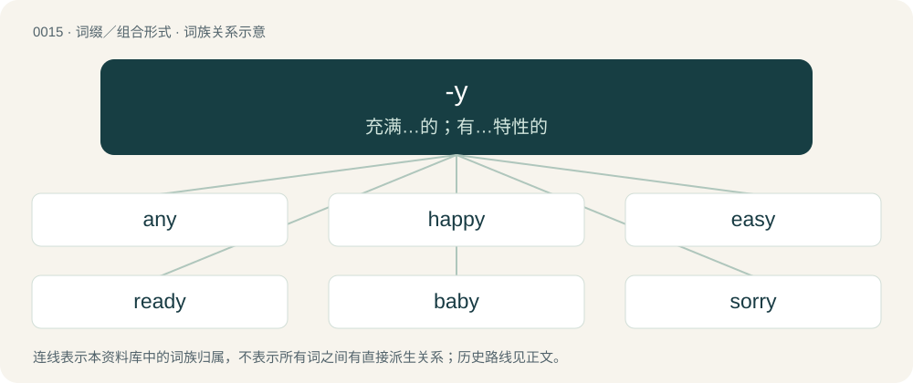

# 0017 · -y — 充满…的；有…特性的

[总目录](../00_总目录_按常用程度.md)

**类型**：词缀／组合形式　｜　**来源语言**：见词源记录

## 核心含义与来源

- 核心含义：充满…的；有…特性的
- 英文含义：Added to nouns and adjectives to form adjectives meaning “having the quality of”, either “involving the referent” or “analogous to it”.
- 词形：-y

**多个词源／构词路径**：同一拼写可能有不同来源；以下按词性和含义分别列出。

**来源记录 1**（后缀／后置成分；Added to nouns and adjectives to form adjectives meaning “having the quality of”, either “involving the referent” or “analogous to it”.）

From Middle English -y, -i, from Old English -iġ (“-y, -ic”, suffix), from Proto-West Germanic \*-g, from Proto-Germanic \*-īgaz (“-y, -ic”), from Proto-Indo-European \*-kos, \*-ikos, \*-iḱos (“-y, -ic”). Cognate with Scots -ie (“-y”), West Frisian -ich (“-y”), Dutch -ig (“-y”), Low German -ig (“-y”), German -ig (“-y”), Swedish -ig (“-y”), Gothic -𐌹𐌲𐍃 (-igs, “-y”), Latin -icus (“-y, -ic”), Ancient Greek -ικός (-ikós), Sanskrit -इक (-ika). Doublet of -ac and -ic.

**来源记录 2**（后缀／后置成分；Forming abstract nouns denoting a condition, quality, or state.）

From Middle English -y, -ie, -ee, -e, from Anglo-Norman and Middle French -ie and -é, from Latin -ia, -ium, -tās, Ancient Greek -ίᾱ (-íā), -ειᾰ (-eiă), -ιον (-ion). Cognate (as far as Latin -ia is involved) with German -ei and Dutch -ij.

## 词族图

## 单词速览（常用到不常用）

| 单词 | 音标 | 释义 |
|---|---|---|
| [any](#w-1) | 英 /ɛni/；美 /ɪni/ | a. 任何的；pron. 任何 |
| [happy](#w-2) | 英 /ˈhæpi/ | a. 快乐的, 幸福的, 愉快的, 恰当的 |
| [easy](#w-3) | /ˈiːzi/ | a. 容易的, 缓缓的, 舒适的, 从容的, 宽容的, 流畅的, 随便的, 自在的, 疲软的；adv. 容易地, 慢慢地 |
| [ready](#w-4) | 英 /ˈɹɛd.i/ | n. 预备好的状态, 现款；a. 准备好的, 备用的, 可以使用的；adv. 预先, 迅速 |
| [baby](#w-5) | 英 /ˈbeɪ.bi/ | n. 婴孩；\[医\] 婴儿 |
| [sorry](#w-6) | 英 /ˈsɒɹi/；美 /ˈsɑɹi/ | a. 难过的, 悲哀的, 遗憾的 |
| [crazy](#w-7) | 英 /ˈkɹeɪ.zi/ | a. 发狂的, 狂热的 |
| [funny](#w-8) | 英 /ˈfʌni/ | a. 好笑的, 有趣的, 滑稽的；n. 滑稽人物 |
| [heavy](#w-9) | 英 /ˈhɛv.i/ | a. 重的, 巨大的, 沉重的, 笨重的, 过度的；adv. 沉重地；n. 重物, 严肃角色 |
| [holy](#w-10) | 英 /ˈhəʊli/；美 /ˈhoʊli/ | a. 神圣的, 圣洁的, 至善的；n. 神圣的东西 |
| [healthy](#w-11) | 英 /ˈhɛl.θi/ | a. 健康的, 有益健康的, 卫生的；\[医\] 健康的 |
| [lucky](#w-12) | 英 /ˈlʌki/ | a. 幸运的, 吉祥的, 好运的, 侥幸的 |
| [victory](#w-13) | 英 /ˈvɪktəɹi/；美 /ˈvɪktɚi/ | n. 胜利, 战胜, 克服 |
| [plenty](#w-14) | 英 /ˈplɛnti/；美 /ˈplɛnti/ | n. 充分, 很多, 丰富；a. 很多的, 足够的, 丰富的 |
| [angry](#w-15) | 英 /ˈæŋ.ɡɹi/ | a. 生气的, 愤怒的 |
| [tony](#w-16) | /ˈtəʊni/ | a. 高贵的, 时髦的 |
| [ministry](#w-17) | /ˈmɪnɪstɹi/ | n. 部, 内阁, 服务；\[经\] 部 |
| [tiny](#w-18) | /ˈtaɪni/ | a. 很少的, 微小的 |
| [guilty](#w-19) | /ˈɡɪl.ti/ | a. 犯罪的, 有过失的, 自觉有错的, 心虚的；\[法\] 有罪的, 犯罪的, 自觉有罪的 |
| [recovery](#w-20) | /ɹɪˈkʌvəɹi/ | n. 恢复, 复原, 痊愈, 重获；\[计\] 恢复 |
| [dirty](#w-21) | 英 /ˈdɜːti/；美 /ˈdɝti/ | a. 肮脏的, 卑鄙的；vt. 弄脏；vi. 变脏 |
| [factory](#w-22) | 英 /ˈfæk.tə.ɹi/；美 /ˈfæk.tɚ.i/ | n. 工厂, 产生地, 代理店；\[经\] 工厂, 代理店, 商行在国外的代理处 |
| [hungry](#w-23) | 英 /ˈhʌŋ.ɡɹi/ | a. 饥饿的, 荒年的, 渴望的, 不毛的；\[化\] 欠鞣皮 |
| [andy](#w-24) | /ˈændi/ | n. 安迪（男子名, 等于Andrew） |
| [sexy](#w-25) | 英 /ˈsɛksi/ | a. 有性感的, 色情的 |
| [buddy](#w-26) | 英 /ˈbʌdi/；美 /ˈbʌdi/ | 【英文】Resembling a bud. |
| [silly](#w-27) | /ˈsɪl.i/ | a. 愚蠢的, 糊涂的 |
| [scary](#w-28) | 英 /ˈskɛə.ɹi/；美 /ˈskɛə.ɹi/ | a. 容易受惊的, 胆小的, 提心吊胆的 |
| [daddy](#w-29) | 英 /ˈdædi/ | n. 爸爸 |
| [difficulty](#w-30) | /ˈdɪfɪkəlti/ | n. 困难, 难点 |
| [steady](#w-31) | /ˈstɛdi/ | a. 稳定的, 不动摇的, 沉着的, 稳固的, 坚定的, 经常的；vt. 使稳定, 使坚定；vi. 变为沉着, 稳固 |
| [worthy](#w-32) | 英 /ˈwɜː.ði/；美 /ˈwɝ.ði/ | n. 杰出人物；a. 有价值的, 可敬的, 值得的 |
| [bloody](#w-33) | /ˈblʌ.di/ | a. 血腥的, 嗜杀的, 有血的 |
| [lazy](#w-34) | 英 /ˈleɪ̯zi(ː)/ | a. 懒惰的, 怠惰的, 缓慢的；vi. 懒散 |
| [pussy](#w-35) | 英 /ˈpʊsi/ | n.〈非正式〉猫咪；〈侮辱〉女阴；〈侮辱〉娘娘腔；a. 多脓的；\[网络\] 小猫；阴户；小猫咪 |
| [nasty](#w-36) | 英 /ˈnɑː.sti/；美 /ˈnæs.ti/ | a. 污秽的, 下流的, 险恶的 |
| [slavery](#w-37) | /ˈslævəɹi/ | 【英文】Covered in slaver; slobbery. |
| [wealthy](#w-38) | 英 /ˈwɛl.θi/ | a. 富有的, 丰裕的, 充分的 |
| [sandy](#w-39) | /ˈsændi/ | a. 沙的, 沙地的, 多沙的 |
| [rocky](#w-40) | 英 /ˈɹɒki/；美 /ˈɹɑki/ | a. 岩石的, 多石的, 像岩石的, 无情的, 摇动的, 摇晃的 |
| [courtesy](#w-41) | 英 /ˈkɜːtəsi/；美 /ˈkɝɾəsi/ | n. 礼貌, 谦恭, 好意；\[法\] 优待, 礼貌, 恩惠 |
| [mighty](#w-42) | 英 /ˈmaɪti/；美 /ˈmaɪti/ | n. 有势力的人；a. 有势力的, 强大的, 有力的；adv. 很, 极 |
| [monkey](#w-43) | 英 /ˈmʌŋki/ | n. 猴子, 猿, 打桩锤；vi. 淘气, 胡闹；vt. 嘲弄 |
| [sunny](#w-44) | 英 /ˈsʌni/；/ˈsʊni/ | a. 阳光充足的, 乐观的, 快乐的, 像太阳的 |
| [grocery](#w-45) | 英 /ˈɡɹəʊ.s(ə.)ɹi/；美 /ˈɡɹoʊ.s(ə.)ɹi/ | n. 食品杂货店, 食品杂货业 |
| [creepy](#w-46) | 英 /ˈkɹiːpi/；美 /ˈkɹipi/ | a. 爬行的, 令人毛骨悚然的 |
| [shitty](#w-47) | 英 /ˈʃɪti/；美 /ˈʃɪti/ | 劣等的, 较差的 |
| [consistency](#w-48) | /kənˈsɪs.tən.si/ | n. 坚硬性, 黏稠度, 一致性；\[化\] 稠度; 一致性 |
| [skinny](#w-49) | /ˈskɪni/ | a. 似皮的, 极瘦的, 少的, 小气的；\[医\] 皮的; 消瘦的 |
| [kitty](#w-50) | 英 /ˈkɪti/；美 /ˈkɪti/ | n. 小猫, 全部赌注 |
| [handy](#w-51) | /ˈhæn.di/ | a. 便利的, 敏捷的, 容易取得的；\[化\] 便于使用的; 易操作的 |
| [sally](#w-52) | /ˈsæli/ | 【英文】A member of the Salvation Army. |
| [tricky](#w-53) | /ˈtɹɪk.i/ | a. 狡猾的, 机敏的 |
| [risky](#w-54) | /ˈɹɪski/ | a. 危险的 |
| [misery](#w-55) | 英 /ˈmɪz(ə)ɹɪ/；美 /ˈmɪz(ə)ɹi/ | n. 痛苦, 悲惨, 不幸, 穷困 |
| [mommy](#w-56) | 英 /ˈmɒm.i/ | n. 妈咪 |
| [bunny](#w-57) | 英 /ˈbʌni/ | n. 兔子 |
| [shiny](#w-58) | /ˈʃaɪ.ni/ | a. 有光泽的, 发光的, 辉煌的, 磨光的, 磨损的 |
| [bully](#w-59) | 英 /ˈbʊli/ | n. 欺凌弱小者, 土霸；vt. 威胁, 恐吓, 欺负；vi. 欺负 |
| [messy](#w-60) | /ˈmɛsi/ | a. 散乱的, 污秽的, 麻烦的 |
| [irony](#w-61) | 英 /ˈaɪə.ni/；美 /ˈaɪ.ɚ.ni/ | 【英文】Of or pertaining to the metal iron. |
| [lengthy](#w-62) | /ˈleŋθi/ | a. 冗长的, 漫长的 |
| [tasty](#w-63) | /ˈteɪsti/ | a. 好吃的, 可口的 |
| [naughty](#w-64) | 英 /ˈnɔːti/；/ˈnɔti/ | a. 顽皮的, 没规矩的, 不适当的, 下流的 |
| [woody](#w-65) | /ˈwʊdi/ | a. 多树木的, 木质的 |
| [fatty](#w-66) | 英 /ˈfæt.i/；美 /ˈfæt.i/ | a. 肥胖的, 脂肪的, 含脂肪的；\[医\] 脂肪的 |
| [filthy](#w-67) | /ˈfɪlθi/ | a. 污秽的, 丑恶的 |
| [hairy](#w-68) | 英 /ˈhɛə.ɹi/；美 /ˈhɛɹ.i/ | a. 多毛的, 毛状的, 长毛的 |
| [spicy](#w-69) | /ˈspaɪsi/ | a. 香的, 多香料的, 辛辣的, 下流的 |
| [sticky](#w-70) | /ˈstɪki/ | a. 粘的, 有粘性的, 顽固的 |
| [horny](#w-71) | 英 /ˈhɔːni/；美 /ˈhoɹni/ | a. 角的, 似角一样坚硬的, 角质的, 老茧的；\[医\] 角性的, 角的 |
| [jelly](#w-72) | 英 /ˈd͡ʒɛli/ | 【英文】Jealous. |
| [registry](#w-73) | 英 /ˈɹɛd͡ʒɪstɹi/ | n. 登记处, 登记名册；\[计\] 登录库 |
| [greedy](#w-74) | /ˈɡɹiːdi/ | a. 贪婪的, 贪得的, 贪吃的 |
| [jealousy](#w-75) | /ˈd͡ʒɛl.ə.si/ | n. 妒忌, 猜忌, 羡慕；\[法\] 妒忌, 嫉妒, 猜忌 |
| [rainy](#w-76) | /ˈɹeɪni/ | a. 下雨的, 多雨的 |
| [salty](#w-77) | 英 /ˈsɒlti/；美 /ˈsɔlti/ | a. 有盐分的, 咸味浓的, 海洋的, 辛辣的, 有经验的 |
| [thirsty](#w-78) | 英 /ˈθɜːs.ti/；美 /ˈθɝs.ti/ | a. 口渴的, 渴望的, 干燥的 |
| [grammy](#w-79) | /ɡɹæ.mi/ | 【英文】grandmother |
| [almighty](#w-80) | /ɔːlˈmaɪti/ | a. 万能的, 全能的 |
| [classy](#w-81) | 英 /ˈklɑːsi/ | a. 上等的, 优等的, 漂亮的 |
| [shady](#w-82) | /ˈʃeɪdi/ | a. 荫凉的, 成荫的, 阴暗的, 隐蔽的；\[法\] 成问题的, 令人怀疑的 |
| [juicy](#w-83) | /ˈd͡ʒuːsi/ | a. 多汁液的, 生动的, 多水分的 |
| [sleepy](#w-84) | /ˈsliːpi/ | a. 困乏的, 欲睡的 |
| [dusty](#w-85) | /ˈdʌsti/ | a. 灰尘多的, 无聊的, 含糊的, 粉末状的 |
| [noisy](#w-86) | 英 /ˈnɔɪzi/ | a. 嘈杂的, 喧闹的；\[机\] 噪声的, 嘈杂的 |
| [percy](#w-87) | 美 /ˈpɝki/ | n. 珀西（男子名） |
| [fuzzy](#w-88) | 英 /ˈfʌzi/ | a. 有微毛的, 模糊的；\[电\] 微毛 |
| [speedy](#w-89) | /ˈspiː.di/ | a. 快的, 迅速的；\[经\] 快的, 迅速的 |
| [dummy](#w-90) | /ˈdʌmi/ | n. 傀儡, 假人, 仿制品；a. 虚设的, 假的, 名义上的 |
| [sonny](#w-91) | /ˈsʌni/ | n. 宝贝, 小家伙 |
| [comfy](#w-92) | /ˈkʌm.fi/ | a. 舒服的,轻松的 |
| [funky](#w-93) | /fʌŋki/ | a. 畏缩的, 怯懦的, 恶臭的 |
| [faulty](#w-94) | 英 /ˈfɒlti/；美 /ˈfɔlti/ | a. 有过失的, 有缺点的, 不完美的, 应受责备的；\[经\] 缺点多的 |
| [granny](#w-95) | /ˈɡɹæni/ | n. 奶奶, 老奶奶, 老婆婆, 外婆, 婆婆妈妈的人, 唠叨挑剔的人, 接生婆 |
| [rusty](#w-96) | /ˈɹʌsti/ | a. 生锈的, 腐蚀的, 生疏的, 顽固的, 腐烂的；\[医\] 锈色的 |
| [slippery](#w-97) | /ˈslɪpəɹi/ | a. 滑的, 光滑的, 靠不住的, 圆滑的, 不稳固的；\[法\] 狡猾的, 不可靠的, 不安定的 |
| [willy](#w-98) | /ˈwɪli/ | n. 阴茎；阳物；柳树（等于willow） |
| [benny](#w-99) | /ˈbɛni/ | n. 安非他明(药片) |
| [curly](#w-100) | 英 /ˈkɜːli/；美 /ˈkɝli/ | a. 拳曲的, 卷毛的, 弯曲的 |
| [muddy](#w-101) | 英 /ˈmʌdi/ | a. 泥泞的, 浑浊的, 模糊的；vt. 使污浊, 使沾上泥污 |
| [fluffy](#w-102) | /ˈflʌfi/ | a. 毛绒绒的, 蓬松的, 空洞的, 无内容的, 不明确的；\[医\] 绒毛状的 |
| [nanny](#w-103) | /ˈnæni/ | n. 保姆；母山羊 |
| [poppy](#w-104) | 英 /ˈpɒpi/；美 /ˈpɑpi/ | n. 罂粟；\[医\] 罂粟 |
| [sloppy](#w-105) | 英 /ˈslɒ.pi/；美 /ˈslɑ.pi/ | a. 泥泞的, 潮湿的, 粗心的 |
| [cheesy](#w-106) | /ˈt͡ʃiːzi/ | a. 干酪质的, 俊俏的, 优秀的；\[医\] 干酪样的 |
| [needy](#w-107) | /ˈniːdi/ | a. 贫穷的, 贫困的, 生活艰苦的 |
| [fiery](#w-108) | /ˈfaɪəɹi/ | a. 炽热的, 热烈的, 暴躁的 |
| [goofy](#w-109) | 英 /ˈɡuːfi/；美 /ˈɡufi/ | a. 愚笨的, 傻瓜的 |
| [mastery](#w-110) | 英 /ˈmɑː.stə.ɹi/；美 /ˈmæs.tə.ɹi/ | n. 征服, 统治权, 优势, 精通, 掌握；\[法\] 统治权, 控制权, 征服 |
| [mummy](#w-111) | /ˈmʌm.i/ | 【英文】mother. |
| [wary](#w-112) | 英 /ˈwɛə.ɹi/；美 /ˈwɛɚ.i/ | a. 谨慎的, 小心的, 机警的, 周到的, 唯恐的 |
| [windy](#w-113) | /ˈwɪn.di/ | a. 多风的, 风强的, 腹胀的, 吹牛的 |
| [furry](#w-114) | 英 /ˈfɜː.ɹi/；美 /ˈfɜɹ.i/ | a. 毛皮的, 盖着毛皮的, 似毛皮的 |
| [sweaty](#w-115) | /ˈswɛti/ | a. 出汗的, 吃力的 |
| [witty](#w-116) | 英 /ˈwɪti/；美 /ˈwɪti/ | a. 富于机智的, 诙谐的 |
| [cloudy](#w-117) | 英 /ˈklaʊ̯diː/；/ˈklæʊ̯diː/ | a. 多云的, 有愁容的, 云的, 浑浊的；\[建\] (混)浊的 |
| [indy](#w-118) |  | n. 印第安纳·琼斯（人名, Indiana Jones, 昵称Indy）；印第安纳波利斯式赛车运动；印地赛车 |
| [dolly](#w-119) | 英 /ˈdɒli/；美 /ˈdɑli/ | n. 洋娃娃, (洗衣用)捣棒；vi. 移动车；vt. 用移动车移动 |
| [icy](#w-120) | /ˈaɪsi/ | a. 冰的, 冰冷的, 冷淡的, 滑溜的 |
| [yummy](#w-121) | /ˈjʌm.i/ | a. 美味的, 可口的, 赏心悦目的, 愉快的 |
| [quirky](#w-122) | 英 /ˈkwɜːki/ | a. 诡诈的, 突兀的, 古怪的, 离奇的；\[法\] 诡诈的, 颇为曲折的 |
| [spooky](#w-123) | 英 /ˈspuːki/ | a. 幽灵一般的, 吓人的, 令人毛骨悚然的 |
| [tidy](#w-124) | /ˈtaɪ.di/ | n. 椅子的背罩, 装杂物的容器；a. 整齐的, 有条理的；vt. 弄整齐, 收拾, 整理 |
| [dependency](#w-125) | 英 /dɪˈpɛndənsi/ | n. 属国, 保护地, 从属物；\[医\] 从属, 从属部 |
| [sneaky](#w-126) | /ˈsniːki/ | a. 鬼祟的, 卑微的 |
| [cheeky](#w-127) | /ˈt͡ʃiːki/ | a. 厚颜的, 无耻的, 色情的 |
| [chilly](#w-128) | 英 /ˈt͡ʃɪli/ | a. 寒冷的, 冷淡的, 不友好的；\[建\] 番椒, 冷 |
| [crappy](#w-129) | 美 /ˈkɹæpi/ | a. &lt;俚&gt;蹩脚的, 没价值的, 讨厌的 |
| [milky](#w-130) | 英 /ˈmɪlki/ | a. 乳状的, 乳白色的, 柔和的 |
| [catchy](#w-131) | /ˈkæt͡ʃi/ | a. 易记住的, 欺骗性的, 不规则发生的 |
| [grumpy](#w-132) | 英 /ˈɡɹʌmpi/ | a. 性情乖戾的, 脾气暴躁的, 生气的 |
| [trendy](#w-133) | /ˈtɹɛndi/ | a. 随潮流的, 时髦的, 赶潮流的 |
| [snowy](#w-134) | 英 /ˈsnəʊi/；美 /ˈsnoʊi/ | a. 多雪的, 雪的, 被雪所覆盖着的, 下雪的 |
| [stormy](#w-135) | 美 /ˈstɔɹmi/ | a. 暴风雨的, 粗暴的, 激烈的 |
| [greasy](#w-136) | 英 /ˈɡɹiː.si/；美 /ˈɡɹi.si/ | a. 油腻的, 含脂肪多的 |
| [shaky](#w-137) | /ˈʃeɪki/ | a. 震动的, 摇晃的, 动摇的 |
| [burglary](#w-138) | 英 /ˈbɜː.ɡlə.ɹi/；美 /ˈbɝ.ɡlɚ.i/ | n. 夜盗行为, 盗窃, 盗窃行为；\[法\] 夜盗行为, 夜间入屋窃盗罪, 窃盗 |
| [clumsy](#w-139) | 英 /ˈklʌmzi/ | a. 笨拙的, 不雅观的, 粗陋的 |
| [contingency](#w-140) | /kənˈtɪnd͡ʒənsi/ | n. 偶然性, 可能性, 意外事故；\[经\] 意外事故, 意外开支, 偶然事故 |
| [chubby](#w-141) | /ˈt͡ʃʌbi/ | a. 圆胖的 |
| [creamy](#w-142) | /ˈkɹiːmi/ | a. 含乳脂的, 乳脂状的, 奶油色的；\[建\] 含乳油的, 似乳油的 |
| [glossy](#w-143) | 英 /ˈɡlɒsi/；美 /ˈɡlɔsi/ | a. 平滑的, 有光泽的 |
| [buffy](#w-144) | /ˈbʌfi/ | a. 喝醉了的 |
| [hubby](#w-145) | /ˈhʌbi/ | n. 丈夫 |
| [smiley](#w-146) | /ˈsmaɪli/ | \[计\] 微笑符 |
| [cocky](#w-147) | 英 /ˈkɒki/；美 /ˈkɑki/ | a. 骄傲的, 自大的, 太过自信的 |
| [edgy](#w-148) | 英 /ˈɛd͡ʒi/ | a. 刀口锐利的, 尖利的, 急躁的 |
| [freaky](#w-149) | /ˈfɹiː.ki/ | a. (=freakish)畸形的, 捉摸不定的 |
| [gloomy](#w-150) | 英 /ˈɡluːmi/；美 /ˈɡlumi/ | a. 抑沉的, 忧闷的, 黑暗的, 悲观的 |
| [gritty](#w-151) | /ˈɡɹɪti/ | a. 有砂砾的, 坚韧不拔的 |
| [misty](#w-152) | /ˈmɪsti/ | a. 有雾的, 模糊的, 笼罩着雾的 |
| [pinky](#w-153) | /ˈpɪŋki/ | a. 带淡红色的, 比较激进的 |
| [predatory](#w-154) | 英 /ˈpɹɛdət(ə)ɹi/；美 /ˈpɹɛdəˌtɔɹi/ | a. 掠夺成性的, 捕食生物的, 掠夺的；\[医\] 捕食的 |
| [hearty](#w-155) | 英 /ˈhɑːti/；美 /ˈhɑɹti/ | a. 诚恳的, 健壮的, 热烈的, 丰盛的 |
| [crispy](#w-156) | /ˈkɹɪs.pi/ | a. 卷曲的, 松脆的, 易碎的, 干脆的, 干净利落的, 生气勃勃的 |
| [kinky](#w-157) | /ˈkɪŋki/ | a. 弯曲的, 古怪的 |
| [hefty](#w-158) | /ˈhɛfti/ | a. 重的, 肌肉发达的 |
| [oily](#w-159) | /ˈɔɪli/ | a. 油的, 油滑的, 油嘴的；\[化\] 油的; 含油的; 油性的; 油质的; 多油的; 油腻的; 油滑的 |
| [itchy](#w-160) | /ˈɪt͡ʃi/ | a. 渴望的, 痒的, 生疥疮的 |
| [lofty](#w-161) | 英 /ˈlɒfti/；美 /ˈlɔːfti/ | a. 高的, 傲慢的, 崇高的, 高级的, 玄虚的 |
| [picky](#w-162) | /ˈpɪki/ | a. 吹毛求疵的, 挑剔的, 找麻烦的 |
| [pricey](#w-163) | /ˈpɹaɪsi/ | a. 昂贵的, 价格高的 |
| [doggy](#w-164) | 英 /ˈdɒ.ɡi/；美 /ˈdɔ.ɡi/ | n. 小狗儿；a. 时髦的, 装阔气的 |
| [smoky](#w-165) | 美 /ˈsmoʊki/ | a. 冒烟的, 满是烟的, 熏脏的, 烟灰色的 |
| [buggy](#w-166) | 英 /ˈbʌ.ɡi/ | 【英文】Infested with insects. |
| [dodgy](#w-167) | /ˈdɒd͡ʒ.i/ | a. 狡猾的, 逃避的, 难弄的 |
| [chunky](#w-168) | /ˈt͡ʃʌŋki/ | a. 矮矮胖胖的 |
| [lousy](#w-169) | /ˈlaʊ.zi/ | a. 污秽的, 恶心的, 生虱的 |
| [shelly](#w-170) | /ˈʃɛli/ | a. 多壳的, 壳一般的, 有壳的 |
| [bulky](#w-171) | /ˈbʌlki/ | a. 庞大的；\[机\] 庞大, 笨重 |
| [leafy](#w-172) | /ˈliːfi/ | a. 叶茂盛的, 多叶的, 叶状的 |
| [piggy](#w-173) | /ˈpɪɡi/ | n. 小猪；a. 贪心的, 似猪的, 邋遢的 |
| [stony](#w-174) | 英 /ˈstəʊni/；美 /ˈstoʊni/ | a. 多石的, 无情的 |
| [hasty](#w-175) | /ˈheɪsti/ | a. 匆匆的, 轻率的, 性怠的 |
| [husky](#w-176) | 英 /ˈhʌs.ki/ | n. 强壮结实之人, 爱斯基摩人；a. 有壳的, 声音沙哑的, 强壮的 |
| [iggy](#w-177) |  | 【英文】The ignore function of such a chat system. |
| [smelly](#w-178) | /ˈsmɛli/ | a. 发臭的, 有臭味的 |
| [stationery](#w-179) | 英 /ˈsteɪʃ(ə)n(ə)ɹi/；美 /ˈsteɪʃənɛɹi/ | n. 文具, 信纸；\[法\] 文具 |
| [wacky](#w-180) | /ˈwæk.iː/ | a. 古怪的 |
| [fishy](#w-181) | 英 /ˈfɪʃi/ | a. 鱼似的, 多鱼的, 腥臭的, 呆滞的 |
| [grizzly](#w-182) | /ˈɡɹɪzli/ | a. 略为灰色的, 呈灰色的；n. 灰熊 |
| [rosy](#w-183) | 英 /ˈɹəʊzi/；美 /ˈɹoʊzi/ | a. 蔷薇色的, 玫瑰红色的 |
| [shabby](#w-184) | 英 /ˈʃæbi/ | a. 衣衫褴褛的, 低劣的, 破旧的, 吝啬的, 卑鄙的 |
| [blurry](#w-185) | /ˈblɜːɹi/ | a. 模糊的, 不清楚的, 污脏的 |
| [fruity](#w-186) | /ˈfɹuːti/ | a. 水果的, 有果味的, 有(低级)趣味的, 圆润的 |
| [missy](#w-187) | /ˈmɪs.i/ | n. 少女, 姑娘, 小姐 |
| [potty](#w-188) | 英 /ˈpɒti/；美 /ˈpɑti/ | a. 微小的, 不足道的；n. 便壶 |
| [shorty](#w-189) | 英 /ˈʃɔː.ti/；美 /ˈʃoɹ.ti/ | n. 矮个子, 特别短的东西 |
| [silky](#w-190) | /ˈsɪlki/ | a. 丝的, 柔滑的 |
| [bony](#w-191) | 英 /ˈbəʊni/；美 /ˈboʊni/ | a. 如骨的, 多骨的, 瘦骨嶙峋的 |
| [donny](#w-192) | /ˈdɒni/ | 【英文】Don; bloke; dude; any man. |
| [flashy](#w-193) | /ˈflæʃi/ | a. 闪光的, 一瞬间的, 浮华的 |
| [floppy](#w-194) | /ˈflɒ.pi/ | a. 叭嗒叭嗒响的, 松软的 |
| [lefty](#w-195) | /ˈlɛfti/ | n. 左撇子, 左翼分子 |
| [chemically](#w-196) | /ˈkɛm.ɪ.kli/ | 【英文】Reminiscent of chemicals. |
| [cinematography](#w-197) | 英 /ˌsɪn.ə.məˈtɒɡ.ɹə.fiː/ | n. 电影制片术；\[医\] \[外科手术\]电影照相术 |
| [grassy](#w-198) | 英 /ˈɡɹɑːsi/；美 /ˈɡɹæsi/ | a. 草绿色的, 象草的, 长满草的 |
| [modesty](#w-199) | /ˈmɒd.ə.sti/ | n. 谦逊, 质朴, 羞怯 |
| [shadowy](#w-200) | 英 /ˈʃæd.əʊ.i/；美 /ˈʃæd.oʊ.i/ | a. 有影的, 暗黑的, 朦胧的, 虚幻的 |
| [wavy](#w-201) | /ˈweɪvi/ | a. 有波浪的, 多浪的, 波浪状的, 波动的, 不稳定的 |
| [corny](#w-202) | 英 /ˈkɔːni/；美 /ˈkɔɹni/ | a. 谷类的, 乡巴佬似的, 粗野的；\[建\] 角制的, 角(质)的 |
| [dreamy](#w-203) | 英 /ˈdɹiː.mi/ | a. 空幻的, 梦想的 |
| [girly](#w-204) | 英 /ˈɡɜːli/；美 /ˈɡɝli/ | a. 像少女的 |
| [lacy](#w-205) | 英 /ˈleɪ.si/ | a. 丝带的, 花边的, 花边状的 |
| [sissy](#w-206) | /ˈsɪsi/ | n. 女孩子, 女人腔的男人, 胆小鬼；a. 女人腔的 |
| [crunchy](#w-207) | /ˈkɹʌnt͡ʃi/ | a. 发嘎吱嘎吱声的 |
| [giddy](#w-208) | 英 /ˈɡɪd.i/；美 /ˈɡɪd.i/ | a. 眼花的, 头晕的；v. (使)眼花, (使)眩晕 |
| [sketchy](#w-209) | /ˈskɛt͡ʃi/ | a. 概略的, 草草完成的 |
| [thingy](#w-210) | 英 /ˈθɪŋiː/；美 /ˈθɪŋi/ | 物(体)的, 物质的, 实际的 |
| [crafty](#w-211) | 英 /ˈkɹɑːfti/；美 /ˈkɹæfti/ | a. 狡诈的, 诡计多端的, 巧妙的 |
| [matty](#w-212) | /ˈmætiː/ | n. 马蒂（女子名, 姓氏） |
| [sassy](#w-213) | 英 /ˈsasi/；美 /ˈsæsi/ | a. 无礼的, 充满生气的, 时髦的 |
| [airy](#w-214) | 英 /ˈɛə.ɹi/；/ˈɛɹ.i/ | a. 空气的, 空中的, 通风的, 幻想的, 轻快的 |
| [bubbly](#w-215) | /ˈbʌbli/ | a. 多泡的, 起泡的；n. 香槟酒 |
| [telly](#w-216) | /ˈtɛli/ | n. 电视 |
| [foggy](#w-217) | /ˈfɒɡi/ | a. 雾深的, 模糊的 |
| [nutty](#w-218) | 英 /ˈnʌti/；美 /ˈnʌti/ | a. 产坚果的 |
| [watery](#w-219) | 英 /ˈwɔːtəɹi/；美 /ˈwɔtəɹi/ | a. 水的, 湿的, 平淡的, 稀薄的, 水淋淋的 |
| [bumpy](#w-220) | /ˈbʌmpi/ | a. 颠簸的, 崎岖不平的 |
| [shaggy](#w-221) | /ˈʃæɡi/ | a. 毛发蓬乱的, 粗浓的, 草木丛生的 |
| [tacky](#w-222) | /ˈtæki/ | a. 发粘的, 破烂的, 俗丽的 |
| [bouncy](#w-223) | 英 /ˈbaʊnsi/；美 /ˈbaʊnsi/ | a. 快活的, 精神饱满的, 有弹性的, 自大的 |
| [dishonesty](#w-224) | /dɪsˈɒnɪ.sti/ | n. 不诚实；\[法\] 不诚实, 诈欺, 不正 |
| [hilly](#w-225) | /ˈhɪli/ | a. 多丘陵的, 多山岗的, 险峻的 |
| [nerdy](#w-226) | /ˈnɜː(ɹ)di/ | a. 傻瓜似的；蠢的 |
| [nifty](#w-227) | /ˈnɪfti/ | a. 俏皮的, 时髦的；n. 俏皮话, 漂亮话 |
| [baggy](#w-228) | /ˈbæɡi/ | a. 袋状的, 松垂的 |
| [gabby](#w-229) | /ˈɡæb.i/ | a. 饶舌的 |
| [cranky](#w-230) | 英 /kɹænki/；美 /kɹæŋki/ | a. 古怪的, 暴躁的, 脾气坏的 |
| [curvy](#w-231) | 英 /ˈkɜː.vi/；美 /ˈkɚ.vi/ | a. 弯曲的；曲线美的（等于curvaceous） |
| [starry](#w-232) | 英 /ˈstɑː.ɹi/；美 /ˈstɑɹ.i/ | a. 星光照耀的, 多星的, 星形的, 明亮的 |
| [cuddly](#w-233) | /ˈkʌdli/ | a. 可爱的, 适于搂抱的, 喜欢拥抱的, 可拥抱的 |
| [soggy](#w-234) | 美 /ˈsɑɡi/；/ˈsɒɡi/ | a. 浸水的, 沉闷的；\[化\] 欠硫; 硫化不足 |
| [touchy](#w-235) | /ˈtʌt͡ʃi/ | a. 易怒的, 难以取悦的, 过于敏感的 |
| [puffy](#w-236) | /ˈpʌfi/ | a. 胀大的, 肥胖的, 喘气的, 一阵阵吹的；\[医\] 虚肿的, 浮肿的 |
| [sugary](#w-237) | 英 /ˈʃʊɡəɹi/ | a. 含糖的, 糖一般的, 甜的 |
| [breezy](#w-238) | /ˈbɹiːzi/ | a. 有微风的, 通风好的, 活泼的 |
| [slutty](#w-239) | /ˈslʌti/ | a. 淫荡的 |
| [stinky](#w-240) | /ˈstɪŋki/ | a. 发恶臭的 |
| [groovy](#w-241) | /ˈɡɹuvi/ | a. 槽的, 墨守成规的 |
| [gully](#w-242) | /ˈɡʌli/ | n. 小峡谷, 排水沟 |
| [pointy](#w-243) | /ˈpɔɪnti/ | a. 尖的 |
| [jerky](#w-244) | 英 /ˈd͡ʒɜːki/；美 /ˈd͡ʒɝki/ | a. 急动的, 抽筋的, 不平稳的；n. 牛肉干 |
| [livery](#w-245) | /ˈlivəri/ | 【英文】Like liver. |
| [sporty](#w-246) | 英 /ˈspɔːti/；美 /ˈspɔɹti/ | a. 象运动员的, 有体育道德精神的, 炫耀的, 华而不实的, 花哨的, 供娱乐的 |
| [motley](#w-247) | 英 /ˈmɒtli/；美 /ˈmɑtli/ | a. 杂色的, 穿杂色衣的, 杂乱的, 混杂的；n. 杂色, 杂色衣服, 混杂, 小丑 |
| [steamy](#w-248) | /ˈstiː.mi/ | a. 蒸汽的, 充满蒸汽的 |
| [bitchy](#w-249) | /ˈbɪt͡ʃi/ | a. 开下流玩笑的, 好挑剔的 |
| [dreary](#w-250) | 英 /ˈdɹɪəɹi/；美 /ˈdɹɪɚi/ | a. 沉闷的 |
| [reddy](#w-251) | 英 /ˈɹɛdi/ | 【英文】Somewhat red in colour. |
| [slimy](#w-252) | 英 /ˈslaɪ.mi/ | a. 泥的, 泥泞的, 粘糊糊的, 讨厌的 |
| [allegory](#w-253) | 英 /ˈælɪɡəɹi/；美 /ˈæləˌɡɔɹi/ | n. 寓言 |
| [busty](#w-254) | /ˈbʌsti/ | a. 大胸脯的, 胸部丰满的 |
| [feisty](#w-255) | /ˈfaɪsti/ | a. 激动的, 活跃的, 好争吵的, 坐立不安的 |
| [sparkly](#w-256) | /ˈspɑːklɪ/ | 闪耀的 |
| [squeaky](#w-257) | /ˈskwiːki/ | a. 吱吱响的, 发轧声的 |
| [trashy](#w-258) | /ˈtɹæʃi/ | a. 碎屑的, 没用的, 垃圾似的 |
| [leaky](#w-259) | /ˈliːki/ | a. 有漏洞的, 易泄漏秘密的, 爱哭的；\[电\] 漏的 |
| [scrappy](#w-260) | /ˈskɹæpi/ | a. 杂凑的, 不连贯的, 爱打架的, 坚决的 |
| [teeny](#w-261) | 英 /ˈtiː.ni/；美 /ˈti.ni/ | 【英文】A teenager; a teenybopper. |
| [woolly](#w-262) | /ˈwʊli/ | a. 羊毛制的, 模糊的, 似羊毛的, 蓬乱的 |
| [fussy](#w-263) | /ˈfʌ.si/ | a. 易怒的, 爱挑剔的, 难取悦的, 易烦恼的 |
| [goody](#w-264) | /ˈɡʊdi/ | n. 身分低微之老妇, 糖果, 姥姥；a. 感伤的, 伪善的；interj. 太好了 |
| [shoddy](#w-265) | 英 /ˈʃɒd.i/；美 /ˈʃɑ.di/ | a. 用长弹毛做的, 以次充好的；n. 长弹毛, 软再生毛, 赝品 |
| [squishy](#w-266) | /ˈskwɪʃi/ | a. 湿软的, 粘糊糊的 |
| [flirty](#w-267) | 英 /ˈflɜːti/；美 /ˈflɜɹti/ | a. 轻浮的 |
| [prickly](#w-268) | /ˈprikli/ | a. 多刺的, 满是针刺的, 针刺般痛的 |
| [stingy](#w-269) | /ˈstɪŋi/ | 【英文】Stinging; able or inclined to sting. |
| [stuffy](#w-270) | /ˈstʌfi/ | a. 闷热的, 窒息的, 乏味的, 固步自封的, 自以为是的 |
| [trusty](#w-271) | 英 /ˈtɹʌsti/ | a. 可信任的, 可信赖的, 可靠的；n. 可信任的人, 模范犯人 |
| [wobbly](#w-272) | 英 /ˈwɒb(ə)li/；美 /ˈwɑb(ə)li/ | a. 摆动的, 不稳定的 |
| [earthy](#w-273) | 英 /ˈɜː.θi/；美 /ˈɝθi/ | a. 土的, 土质的, 土味的 |
| [cheery](#w-274) | 英 /ˈt͡ʃɪəɹi/；美 /ˈt͡ʃɪɚi/ | a. 愉快的 |
| [crusty](#w-275) | /ˈkɹʌsti/ | a. 有硬皮的, 易怒的；\[建\] 硬的, 有壳的, 似外皮的 |
| [meaty](#w-276) | /ˈmiːti/ | a. 肉的, 似肉的, 多肉的 |
| [snappy](#w-277) | /ˈsnæpi/ | a. 厉声说话的；生气勃勃的；时髦的；爽快的 |
| [titty](#w-278) | /ˈtɪti/ | n. 乳房, 乳头（等于teat） |
| [expiry](#w-279) | /ɪkˈspaɪ.əɹ.i/ | n. 终结, 满期, 呼气, 断气；\[经\] 满期, 到期 |
| [foxy](#w-280) | 英 /ˈfɒksi/；美 /ˈfɑksi/ | a. 如狐的, 狡猾的, 赤褐色的 |
| [jazzy](#w-281) | /ˈd͡ʒæzi/ | a. 爵士的, 奔放的, 激烈的 |
| [moby](#w-282) | /ˈmɔbi/ | a. 大的, 巨大的 |
| [pushy](#w-283) | 英 /ˈpʊʃ.i/ | a. 粗鲁的, 固执己见的, 好胜而爱出风头的 |
| [silvery](#w-284) | /ˈsɪlvəɹi/ | a. 像银的, 银色的, 银铃一般的 |
| [arty](#w-285) | /ˈɑː(ɹ)ti/ | a. 装作爱好艺术的, 附庸风雅的 |
| [fleshy](#w-286) | /ˈflɛʃi/ | a. 肉的, 肉体的 |
| [sultry](#w-287) | 英 /ˈsʌltɹi/；美 /ˈsʌltɹi/ | a. 闷热的, 粗暴的, 放荡的, 激烈的 |
| [booby](#w-288) | /ˈbuːbi/ | 【英文】Displaying breasts prominently. |
| [bushy](#w-289) | 英 /ˈbʊʃi/ | a. 灌木一样的, 灌木茂密的, 浓密的 |
| [ginny](#w-290) | 英 /ˈdʒɪni/ | 【英文】Affected by gin; resembling or characteristic of gin. |
| [gory](#w-291) | 英 /ˈɡɔː.ɹi/；美 /ˈɡɔɹ.i/ | a. 血淋淋的, 满是血的, 血污的 |
| [roddy](#w-292) |  | 【英文】Full of rods or twigs. |
| [tranny](#w-293) | 美 /ˈtɹæni/ | n. 半导体收音机；晶体管收音机 |
| [bossy](#w-294) | 英 /ˈbɒsi/；美 /ˈbɔsi/ | a. 专横的, 浮雕装饰的 |
| [gummy](#w-295) | /ˈɡʌmi/ | a. 树胶的, 粘的；\[医\] 树胶状的, 梅毒瘤状的 |
| [confectionery](#w-296) | /kənˈfɛkʃənəɹi/ | n. 甜食, 糕饼制造业, 糖果店；\[建\] 糖食店 |
| [cleary](#w-297) |  | 【英文】A clear marble (sphere used in games), usually colored, but without decoration or design. |
| [colliery](#w-298) | 英 /ˈkɒl.jə.ɹi/；美 /ˈkɑl.jɚ.ɪ/ | n. 煤矿；\[建\] 煤井, 煤矿 |
| [perky](#w-299) | 美 /ˈpɝki/ | a. 得意洋洋的, 快活的, 敏捷的, 美观的, 傲慢的, 神气的 |
| [slurry](#w-300) | 英 /ˈslɜːɹi/；美 /ˈslɝi/ | 【英文】Slurred, tending to slur. |
| [chewy](#w-301) | /ˈt͡ʃuː.i/ | a. 需要多嚼的, 难嚼的 |
| [geeky](#w-302) | /ˈɡiːki/ | a. &lt;俚&gt;令人讨厌的 |
| [mushy](#w-303) | /ˈmʌ.ʃi/ | a. 浓粥状的, 含糊不清, 感伤的 |
| [runny](#w-304) | 英 /ˈɹʌni/ | a. 松软的, 水分过多的, 流鼻涕的 |
| [spotty](#w-305) | /ˈspɒti/ | a. 有斑点的, 有污点的, 质量不一的, 发疹的 |
| [tilly](#w-306) | /ˈtɪli/ | 【英文】Containing till (unsorted glacial sediment). |
| [upholstery](#w-307) | 英 /ʌpˈhəʊlstəɹi/ | n. 家具被覆材料, 家具装饰用品业 |
| [whitey](#w-308) | /ˈwaɪti/ | n. 白人社会 |
| [heady](#w-309) | /ˈhɛdi/ | a. 顽固的, 任性的, 性急的, 猛烈的 |
| [patchy](#w-310) | /ˈpæt͡ʃi/ | a. 补缀的, 凑合的, 不调和的, 散落的, 斑驳的, 不完全的 |
| [thorny](#w-311) | 英 /ˈθɔːni/；美 /ˈθɔɹni/ | a. 多刺的, 令人苦恼的 |
| [chatty](#w-312) | 美 /ˈt͡ʃæti/ | a. 饶舌的, 爱讲闲话的 |
| [posey](#w-313) | /ˈpəusiː/ | a. 装门面的；矫揉造作的；自命不凡的 |
| [ziggy](#w-314) |  | 【英文】zigzaggy |
| [buttery](#w-315) | 英 /ˈbʌtəɹi/；美 /ˈbʌt(ə)ɹi/ | n. 配膳室；a. 涂用黄油的, 谄媚的 |
| [choppy](#w-316) | 英 /ˈt͡ʃɒ.pi/；美 /ˈt͡ʃɑ.pi/ | a. 猛地一动一停的, 突变的；\[经\] 震荡的 |
| [saucy](#w-317) | 英 /ˈsɔːsi/；/ˈsɔ.si/ | a. 莽撞的, 活泼的, 漂亮的 |
| [canny](#w-318) | /ˈkæni/ | a. 精明的, 谨慎的, 节约的 |
| [telephony](#w-319) | 英 /təˈlɛf.ə.ni/ | n. 电话学, 电话通信, 电话制造；\[电\] 电话学 |
| [whiny](#w-320) | /ˈwaɪni/ | a. 好发牢骚的, 嘀咕不停的,烦躁的 |
| [clingy](#w-321) | /ˈklɪŋi/ | a. 粘住的, 紧贴的 |
| [flowery](#w-322) | 英 /ˈflaʊəɹi/；美 /ˈflaʊəɹi/ | a. 多花的, 绚丽的, 华丽的 |
| [nappy](#w-323) | /ˈnæpi/ | 【英文】Having a nap (of cloth etc.); downy; shaggy. |
| [pasty](#w-324) | 英 /ˈpeɪsti/ | a. 面糊似的, (脸色)苍白的, 软弱的；n. 肉馅饼 |
| [flaky](#w-325) | /ˈfleɪki/ | a. 薄片的, 成片的, 薄而易剥落的 |
| [peachy](#w-326) | /ˈpiːt͡ʃi/ | a. 桃似的, 桃色的, 出色的, 绝妙的 |
| [pearly](#w-327) | /ˈpəːli/ | a. 珍珠似的, 产珍珠的, 用珍珠装饰的, 用珠母装饰的, 珍贵的 |
| [tipsy](#w-328) | /ˈtɪp.si/ | a. 喝醉的, 倾斜的 |
| [gooey](#w-329) | 英 /ˈɡuːi/；美 /ˈɡui/ | a. 胶粘的, 自作多情的；n. 胶粘物, 性格软弱的人 |
| [thrifty](#w-330) | /ˈθɹɪfti/ | a. 节俭的, 兴旺的, 繁茂的 |
| [trippy](#w-331) | /ˈtɹɪ.pi/ | a. (如)由致幻药引起幻觉的 |
| [nosy](#w-332) | 英 /ˈnəʊziː/；美 /ˈnoʊzi/ | a. 大鼻子的, 好管闲事的, 爱打听的；n. 大鼻者 |
| [scruffy](#w-333) | 英 /ˈskɹʌf.i/ | a. 不整齐的, 肮脏的, 破旧的, 褴褛的 |
| [sparky](#w-334) | /ˈspɑːki/ | a. 活泼的, 充满活力的 |
| [weighty](#w-335) | /ˈweɪti/ | a. 重的, 有份量的, 沉重的, 重大的, 严肃的；\[法\] 有影响力的, 重要的, 重的 |
| [clunky](#w-336) | /ˈklʌŋki/ | a. 粗笨的；笨重的 |
| [flappy](#w-337) | /ˈflæpi/ | a. 飞扬的 |
| [grainy](#w-338) | /ˈɡɹeɪni/ | a. 有纹理的, 粒状的, 多粒的, 木纹状的 |
| [lumpy](#w-339) | /ˈlʌmpi/ | a. 多瘤的, 波浪起伏的, 粗笨的 |
| [teary](#w-340) | 英 /ˈtɪəɹi/；美 /ˈtɪɚi/ | a. 哭泣的 |
| [wonky](#w-341) | 英 /ˈwɒŋ.kɪ/；美 /ˈwɑŋ.ki/ | 【英文】Technically worded, in the style of jargon. |
| [doughty](#w-342) | 英 /ˈdaʊti/；美 /ˈdaʊti/ | a. 强悍的, 勇敢的, 刚强的 |
| [dusky](#w-343) | /ˈdʌs.ki/ | a. 微暗的, 暗淡的, 暗黑色的, 多黑影的, 黑黝黝的, 微黑色的, 忧郁的 |
| [gaudy](#w-344) | 英 /ˈɡɔːdi/；/ˈɡɔ.di/ | a. 俗丽的, 华而不实的；n. 盛大宴会 |
| [musty](#w-345) | 英 /ˈmʌsti/ | a. 发霉的, 霉臭的, 落伍的 |
| [oxy](#w-346) | /ˈɔksi/ | a. 牛的；像牛的；含氧的 |
| [seedy](#w-347) | /ˈsiːdi/ | a. 多种子的, 结籽的, 破烂的, 肮脏的 |
| [snarky](#w-348) | 英 /ˈsnɑː.ki/；美 /ˈsnɑɹ.ki/ | a. 恶声恶气的, （突然）咬人的 |
| [addy](#w-349) |  | n. 阿迪（男子名） |
| [burly](#w-350) | 英 /ˈbɜːli/；美 /bɝli/ | 【英文】Full of burls or knots; knotty. |
| [dingy](#w-351) | /ˈdɪn.d͡ʒi/ | a. 暗淡的, 昏暗的, 邋遢的 |
| [drowsy](#w-352) | /ˈdɹaʊzi/ | a. 昏昏欲睡的；\[医\] 倦睡的, 瞌睡的 |
| [fizzy](#w-353) | /ˈfɪzi/ | a. 嘶嘶作响的, 起泡沫的 |
| [leniency](#w-354) | /ˈliːni.ən(t)si/ | n. 宽大, 温和, 慈悲为怀；\[法\] 宽大, 宽恕, 仁慈 |
| [racy](#w-355) | /ˈɹeɪsi/ | a. 保持原味的, 活泼的, 生动的, 为竞赛设计的 |
| [steely](#w-356) | /ˈstiːli/ | a. 钢的, 钢制的, 钢铁般的 |
| [lolly](#w-357) | /ˈlɒl.i/ | 【英文】Eliciting a response of LOL; funny. |
| [scaly](#w-358) | /ˈskeɪli/ | a. 有鳞的, 鳞状的, 覆有鳞片的, 积垢的, 积水垢的, 介壳虫蛀的；\[医\] 鳞状的, 有鳞屑的 |
| [chucky](#w-359) | /ˈt͡ʃʌki/ | \[英方\]小鸡 |
| [lusty](#w-360) | /ˈlʌsti/ | a. 健壮的, 精力充沛的 |
| [snoopy](#w-361) | /ˈsnuːpi/ | a. 爱窥探的, 爱管闲事的 |
| [batty](#w-362) | 英 /ˈbæti/；美 /ˈbæti/ | a. 疯癫的, 古怪的, 蝙蝠的 |
| [bitty](#w-363) | /ˈbɪti/ | a. 零零碎碎的 |
| [measly](#w-364) | 英 /ˈmiːzli/；美 /ˈmizli/ | a. 患麻疹的；\[医\] 米珠的, 含囊尾蚴的 |
| [scratchy](#w-365) | /ˈskɹæt͡ʃi/ | a. 潦草的, 刺痛的, 发痒的, 凑合的, 发擦刮声的, 乖戾的 |
| [showy](#w-366) | 英 /ˈʃəʊ.i/；美 /ˈʃoʊ.i/ | a. 艳丽的, 炫耀的 |
| [stealthy](#w-367) | /ˈstɛlθi/ | a. 秘密的, 掩人耳目的, 鬼鬼祟祟的；\[法\] 隐密的, 暗中的 |
| [glassy](#w-368) | 英 /ˈɡlɑːsi/；美 /ˈɡlæsi/ | a. 玻璃质的, 玻璃状的, 如镜的；\[医\] 玻璃状的 |
| [grubby](#w-369) | /ˈɡɹʌbi/ | a. 污秽的, 肮脏的, 生蛆的 |
| [iffy](#w-370) | /ˈɪfi/ | a. 富于偶然性的, 可怀疑的, 未确定的 |
| [loony](#w-371) | /ˈluːni/ | a. 发狂的, 极蠢的；n. 疯子 |
| [gnarly](#w-372) | 英 /ˈnɑːli/；美 /ˈnɑɹli/ | a. 多瘤的, 粗糙的 |
| [powdery](#w-373) | 美 /ˈpaʊdəɹi/ | a. 粉的, 粉状的 |
| [shifty](#w-374) | /ˈʃɪfti/ | a. 变化的；\[法\] 善于应变的, 多策略的, 诡诈的 |
| [whammy](#w-375) | 英 /ˈ(h)wæmi/ | n. 吉祥物, 晦气 |
| [grimy](#w-376) | /ˈɡɹaɪmi/ | a. 污秽的, 肮脏的 |
| [skimpy](#w-377) | /ˈskɪmpi/ | a. 不足的, 吝啬的 |
| [stretchy](#w-378) | /ˈstɹɛt͡ʃi/ | a. 可延伸的, 有弹性的, 易延伸过长的 |
| [sundry](#w-379) | 英 /ˈsʌnd.ɹi/ | a. 各式各样的；\[经\] 杂的, 各种, 各式各样的 |
| [swampy](#w-380) | /ˈswɒmpi/ | a. 沼泽的, 沼泽多的, 湿地的, 松软的 |
| [wimpy](#w-381) | /ˈwimpi/ | a. &lt;俚&gt; = wimpish |
| [homey](#w-382) | 美 /ˈhoʊmi/ | a. 家庭似的, 自在的, 舒适的 |
| [lovey](#w-383) | /ˈlʌvi/ | n. 宝贝；亲爱的（对爱人的昵称） |
| [natty](#w-384) | 英 /ˈnæti/ | 【英文】Natural, as opposed to steroid enhanced. |
| [punchy](#w-385) | /ˈpʌnt͡ʃi/ | a. 有力的, 生气勃勃的 |
| [soapy](#w-386) | 英 /ˈsəʊpi/；美 /ˈsoʊpi/ | a. 涂着肥皂的, 谄媚的, 圆滑的 |
| [spiky](#w-387) | 英 /ˈspaɪki/ | a. 大钉一般的, 长而尖的, 钉满钉子的, 有穗的 |
| [beefy](#w-388) | /ˈbiːfi/ | a. (牛)多肉的, 象牛肉的, 粗壮的, 结实的 |
| [frisky](#w-389) | /ˈfɹɪski/ | a. 乱跳的, 欢闹的 |
| [bally](#w-390) | /ˈbæli/ | 【英文】A balaclava. |
| [bowery](#w-391) | /ˈbaʊəɹi/ | a. 有亭子的, 像亭子的, 有树荫的 |
| [dicky](#w-392) | /ˈdɪki/ | a. 站不稳的, 靠不住的, 软弱的；n. 小孩围涎 |
| [gutsy](#w-393) | 英 /ˈɡʌt.si/ | a. 有勇气的, 有力量的 |
| [lanky](#w-394) | 美 /ˈleɪ̯ŋki/；/ˈlæŋk.i/ | a. 瘦长的 |
| [twisty](#w-395) | /ˈtwɪsti/ | a. 扭曲的, 狡猾的, 不老实的；\[法\] 歪曲事实的, 不正直的 |
| [wintry](#w-396) | 英 /ˈwɪnt(ə)ɹɪ/；美 /ˈwɪnt(ə)ɹi/ | a. 如冬的, 寒冷的, 冬的, 冷淡的 |
| [dorky](#w-397) | /ˈdɔːki/ | a. 愚蠢的; 无能的; 不称职的; 笨的 |
| [hunky](#w-398) | 英 /ˈhʌŋ.ki/ | n. 来自中欧(或东欧)的移民 |
| [pissy](#w-399) | /ˈpɪsi/ | a. 低劣的；臭尿一样的；讨厌的 |
| [toasty](#w-400) | 美 /ˈtoʊsti/ | a. 温暖舒适的 |
| [scrawny](#w-401) | 英 /ˈskɹɔːni/；美 /ˈskɹɔni/ | a. 瘦的, 骨瘦如柴的 |
| [stocky](#w-402) | 英 /ˈstɒki/；美 /ˈstɑki/ | a. 矮胖的, 健壮结实的 |
| [waxy](#w-403) | /ˈwæksi/ | a. 蜡制的, 像蜡的, 蜡色的, 苍白的, 生气的, 柔软的, 光滑的；\[医\] 蜡状的, 蜡的 |
| [balmy](#w-404) | 英 /ˈbɑːmi/；美 /ˈbɑmi/ | a. 芳香的, 温和的, 止痛的；\[化\] 香脂气味的 |
| [chitty](#w-405) | /ˈt͡ʃɪti/ | \[经\] 单据, 证件, 证明书 |
| [nitty](#w-406) | 英 /ˈnɪtiː/；美 /ˈnɪti/ | a. 多虱卵的 |
| [saggy](#w-407) | /ˈsæɡi/ | a. 松懈的, 下垂的 |
| [glittery](#w-408) | /ˈglitəri/ | a. 闪光的, 闪烁的 |
| [minty](#w-409) | 美 /ˈmɪnti/ | a. 有薄荷香的, 有薄荷味的 |
| [moldy](#w-410) | /ˈmoʊldi/ | a. 发霉的, 腐臭的 |
| [skippy](#w-411) | /ˈskipi/ | n. \[美俚\]日本女人（尤其指妓女） |
| [stubby](#w-412) | /ˈstʌbi/ | a. 又短又秃的(铅笔), 粗而短的(身材), 浓密短硬的(毛发) |
| [velvety](#w-413) | /ˈvɛlvəti/ | a. 像天鹅绒的, 轻软光滑的, 柔和的, 平和的 |
| [chalky](#w-414) | /ˈtʃɒːki/ | a. 白垩的；\[建\] 白垩的 |
| [dopey](#w-415) | /ˈdəʊpi/ | a. 被麻醉的, 呆笨的, 迟钝的 |
| [ducky](#w-416) | 英 /ˈdʌk.i/ | a. 极好的, 可爱的, 令人愉快的 |
| [gluttony](#w-417) | /ˈɡlʌ.tən.i/ | n. 暴食, 贪食；\[医\] 善饥 |
| [jittery](#w-418) | 英 /ˈd͡ʒɪt.ɹi/；美 /ˈd͡ʒɪt.ə.ɹi/ | a. 极度紧张不安的 |
| [lowery](#w-419) | 英 /ˈlaʊəɹi/；美 /ˈlaʊəɹi/ | a. 阴暗的, 阴霾的 |
| [rickety](#w-420) | 英 /ˈɹɪk.ɪ.ti/ | a. 患佝偻病的, 虚弱的, 摇摆的；\[医\] 佝偻病的 |
| [sappy](#w-421) | /ˈsæpi/ | a. 树液多的, 精力充沛的 |
| [daffy](#w-422) | 英 /ˈdæfi/ | a. 愚笨的, 疯狂的 |
| [dicey](#w-423) | /ˈdaɪsi/ | a. 不确定的, 危险的, 冒险性的 |
| [jumpy](#w-424) | /ˈd͡ʒʌmpi/ | a. 跳跃的, 跳动的, 神经质的 |
| [loopy](#w-425) | /ˈluː.pi/ | a. 多圈的, 呆头呆脑的, 糊涂的 |
| [porky](#w-426) | 英 /ˈpɔː(ɹ).ki/ | a. 猪肉的, 肥胖的 |
| [roomy](#w-427) | 英 /ˈɹuːmi/ | a. 广阔的, 宽敞的, 宽大的 |
| [hoppy](#w-428) | 英 /ˈhɒpi/；美 /ˈhɑpi/ | n. 吸毒成瘾者；a. 蛇麻草的；啤酒花的；跳动的 |
| [slinky](#w-429) | /ˈslɪŋki/ | a. 鬼鬼祟祟的, 苗条的 |
| [tubby](#w-430) | /ˈtʌbi/ | a. 桶状的, 肥胖的, 发钝音的 |
| [boxy](#w-431) | /ˈbɒk.si/ | a. 似盒子的, 盒状的 |
| [marshy](#w-432) | 美 /ˈmɑɹʃi/ | a. 多沼地的, 湿地的, 沼地的 |
| [swanky](#w-433) | /ˈswæŋki/ | a. 爱出风头的, 炫耀的 |
| [dewy](#w-434) | /ˈdjuː.i/ | a. 露湿的, 带露水的, 如露的 |
| [dilly](#w-435) | /ˈdɪli/ | n. 好东西, 杰出人物 |
| [mossy](#w-436) | 英 /ˈmɒsi/；美 /ˈmɔsi/ | a. 生苔的, 似苔的, 陈腐的 |
| [raspy](#w-437) | 英 /ˈɹɑː.spɪ/；美 /ˈɹæs.pi/ | a. 刺耳的, 粗糙的, 易怒的 |
| [snazzy](#w-438) | 英 /ˈsnæzi/ | a. 华丽的, 华丽而俗气的, 时髦的 |
| [spiny](#w-439) | /ˈspaɪni/ | a. 多刺的, 尽是尖刺的, 尖刺状的, 麻烦的, 棘手的 |
| [tangy](#w-440) | /ˈtæŋiː/ | a. 有强烈盐味的, 气味刺鼻的, 有刺激性的 |
| [dinky](#w-441) | /ˈdɪŋki/ | a. 极小的, 不足道的, 整洁的 |
| [frothy](#w-442) | /ˈfrɒθi/ | a. 有泡的, 起泡的, 多泡的 |
| [panicky](#w-443) | /ˈpænɪki/ | a. 恐慌的, 惊慌失措的；\[法\] 恐慌的, 由恐慌引起的 |
| [preppy](#w-444) | 美 /ˈpɹɛ.pi/ | n. 预科生 |
| [slattery](#w-445) |  | 【英文】rainy; wet; sloppy |
| [alrighty](#w-446) |  | 【英文】Used to affirm, indicate agreement, or consent. |
| [brainy](#w-447) | /ˈbɹeɪni/ | a. 脑筋好的, 聪明的 |
| [chippy](#w-448) | /ˈt͡ʃɪpi/ | a. 枯燥无味的, 身体不舒服的, 易怒的；n. (美)(非正式)荡妇, 妓女 |
| [hokey](#w-449) | 英 /ˈhəʊki/；美 /ˈhoʊki/ | a. 虚情假意的, 做作的 |
| [leathery](#w-450) | /ˈlɛðəɹi/ | a. 皮似的, 皮质的, 皮般吞坚韧的 |
| [mammy](#w-451) | /ˈmæmi/ | n. 妈妈, 保姆 |
| [plucky](#w-452) | /ˈplʌki/ | a. 有勇气的, 有胆量的, 大胆的 |
| [spongy](#w-453) | /ˈspʌnd͡ʒi/ | a. 海绵状的, 海绵质的, 多孔的；\[医\] 海绵状的, 海绵构造的 |
| [covey](#w-454) | 英 /ˈkəʊvi/；美 /ˈkoʊvi/ | 【英文】A male person, a man; a chap, a chappie. |
| [debby](#w-455) | /ˈdebi/ | n. 初次登台的演员；初入社交界的少女 |
| [feely](#w-456) | /ˈfiːli/ | n. (Feely)人名；(英)菲利 |
| [groggy](#w-457) | 英 /ˈɡɹɒ.ɡi/；美 /ˈɡɹɑ.ɡi/ | a. 酒醉的, 东歪西倒的, 摇摇晃晃的 |
| [pithy](#w-458) | /ˈpɪθi/ | a. 有髓的, 由髓组成的, 简洁有力的 |
| [rubbery](#w-459) | /ˈɹʌbəɹi/ | a. 橡胶似的, 有弹力的 |
| [sucky](#w-460) | /ˈsʌki/ | a. \[俚语\]令人不快的, 让人讨厌的 |
| [taxidermy](#w-461) | 英 /ˈtæksɪdəmi/；美 /ˈtæksɪdɚmi/ | n. 动物标本剥制术 |
| [washy](#w-462) | /ˈwɒʃi/ | a. 稀薄的, 水分多的, 多水的, 淡的, 退色的, 乏味的, 脆弱的 |
| [birdy](#w-463) | 美 /ˈbɝdi/ | a. 如鸟的, 多鸟的 |
| [downy](#w-464) | /ˈdaʊni/ | a. 绒毛的, 柔和的, 有草丘陵地的 |
| [frizzy](#w-465) | /ˈfɹɪzi/ | a. 卷曲的 |
| [inky](#w-466) | /ˈɪŋki/ | a. 墨水的, 给墨水弄污的, 漆黑的 |
| [villainy](#w-467) | /ˈviləni/ | 【英文】Characteristic of a villain. |
| [whimsy](#w-468) | /ˈwɪmzi/ | n. 怪念头, 离奇的东西, 反复无常, 绞盘 |
| [grouchy](#w-469) | /ˈɡɹaʊt͡ʃi/ | a. 不高兴的, 不平的 |
| [gusty](#w-470) | 英 /ˈɡʌs.ti/ | a. 刮风的, 阵阵猛急的, 突发的, 津津有味的 |
| [baldy](#w-471) | 英 /ˈbɔːl.di/；美 /ˈbɔl.di/ | n. 秃子；n. (Baldy)人名；(法)巴尔迪；a. 秃的；秃顶的 |
| [corky](#w-472) | /ˈkɒːki/ | a. 软木的, 活泼的 |
| [itty](#w-473) | /ˈɪti/ | 【英文】Extremely small; itty-bitty. |
| [kooky](#w-474) | 英 /ˈkuːki/；美 /ˈkuki/ | a. 古怪的, 乖僻的, 疯狂的, 讨厌的 |
| [leery](#w-475) | 英 /ˈlɪəɹi/；美 /ˈlɪɚi/ | a. 机敏的, 猜疑的, 狡猾的 |
| [peasy](#w-476) |  | 【英文】Resembling or characteristic of peas. |
| [ashy](#w-477) | /ˈæʃi/ | a. 灰的, 覆盖着灰的, 苍白的；\[机\] 灰的, 含灰的, 灰色的 |
| [starchy](#w-478) | 美 /ˈstɑɹt͡ʃi/ | a. 淀粉的, 浆糊的, 浆糊状的, 古板的 |
| [touristy](#w-479) | 英 /ˈtʊəɹɪsti/ | a. 游览者的, 游览者喜欢的 |
| [twitchy](#w-480) | /ˈtwɪt͡ʃi/ | a. 抽搐的, 抽动的, 痉挛性的； 焦躁不安的 |
| [bawdy](#w-481) | 英 /ˈbɔːdi/；美 /ˈbɔ.di/ | a. 淫秽的, 言语猥亵的 |
| [catty](#w-482) | /ˈkæti/ | a. 恶毒的, 如猫的；\[经\] 斤 |
| [gravelly](#w-483) | 英 /ˈɡɹævəli/ | a. 多碎石的, 铺有碎石的, 碎石构成的 |
| [henny](#w-484) | /ˈhɛni/ | 【英文】Resembling or characteristic of a hen. |
| [joinery](#w-485) | /ˈdʒɔinəri/ | n. 细木工技术, 细木工活, 细木工行业 |
| [pappy](#w-486) | /ˈpæpi/ | a. 半流质的, 冲淡了的 |
| [reedy](#w-487) | /ˈɹiː.di/ | a. 芦苇丛生的, 芦苇做的, 芦苇状的 |
| [wordy](#w-488) | 美 /ˈwɝdi/ | a. 罗唆的, 口头的, 多言的 |
| [bendy](#w-489) | /ˈbɛndi/ | a. 易弯曲的,柔韧的 |
| [cubby](#w-490) | 美 /kʌbi/ | n. 小房间 |
| [hammy](#w-491) | /ˈhæmi/ | a. 有火腿香味的, (非正式)表演过火的 |
| [snooty](#w-492) | 英 /ˈsnuːti/；美 /ˈsnuti/ | a. 傲慢的, 自大自满的, 鄙视别人的 |
| [snotty](#w-493) | /ˈsnɒti/ | a. 流鼻涕的, 蛮横无礼的 |
| [ballsy](#w-494) | /ˈbɔlzi/ | a. 有胆量的, 有种的 |
| [craggy](#w-495) | 英 /ˈkɹæɡ.i/ | a. 多岩的, 崎岖的, 峻峭的, 多峭壁的 |
| [hetty](#w-496) | /ˈhɛti/ | n. 海蒂（Henrietta的昵称） |
| [raggedy](#w-497) | /ˈɹæɡɪdi/ | a. 有些破的, 有些参差不齐的, 有些刺耳的 |
| [beachy](#w-498) | /ˈbiːt͡ʃi/ | a. 多沙砾的 |
| [muggy](#w-499) | /ˈmʌɡi/ | a. 闷热的 |
| [peppy](#w-500) | /ˈpɛpi/ | a. 精神充沛的, 活泼的, 起动快的 |
| [righty](#w-501) | /ˈraiti/ | n. 右派, 保守派 |
| [wrinkly](#w-502) | /ˈɹɪŋk(ə)li/ | a. 有皱纹的, 易生皱纹的 |
| [antsy](#w-503) | /ˈæn.tsi/ | a. 热锅上的蚂蚁般的,坐立不安的 |
| [boozy](#w-504) | /ˈbuːzi/ | a. 酩酊的, 嗜酒的 |
| [choosy](#w-505) | /ˈt͡ʃuːzi/ | a. 慎重选择的, 好挑剔的 |
| [cringey](#w-506) | /ˈkɹɪnd͡ʒi/ | 【英文】Characterised by causing feelings of embarrassment; embarrassing. |
| [snobby](#w-507) | 英 /ˈsnɒbi/；美 /ˈsnɑbi/ | a. 势利的（等于snobbish） |
| [stringy](#w-508) | /ˈstɹɪŋi/ | a. 线, 绳的, 纤维的, 粘性的 |
| [summery](#w-509) | /ˈsʌməɹi/ | a. 夏的, 夏天似的 |
| [wifey](#w-510) |  | 【英文】Of, befitting, pertaining to, or characteristic of a wife. |
| [zippy](#w-511) | 英 /ˈzɪpi/ | a. 元气旺盛的, 敏捷的, 活泼的 |
| [blocky](#w-512) | 英 /ˈblɒk.i/；美 /ˈblɑk.i/ | a. 短而结实的, 斑驳的 |
| [campy](#w-513) | 美 /ˈkæmpi/ | a. 一副下流相的, 忸怩作态的 |
| [frilly](#w-514) | /ˈfɹɪli/ | a. 有饰边的, 多饰边的 |
| [hosiery](#w-515) | 美 /ˈhoʊʒəɹi/ | n. 袜, 内衣裤 |
| [knotty](#w-516) | 英 /ˈnɒti/；美 /ˈnɑti/ | a. 有结的, 多节的, 多瘤的, 棘手的 |
| [sooty](#w-517) | /ˈsʊti/ | a. 煤烟熏黑的, 乌黑的 |
| [spunky](#w-518) | /ˈspʌŋki/ | a. 有精神的, 生气蓬勃的, 容易发怒的 |
| [wiry](#w-519) | /ˈwaɪ(ə)ɹi/ | a. 金属线制的, 瘦长结实的；\[医\] 弦样的(指脉搏) |
| [barony](#w-520) | 英 /ˈbæ.ɹə.ni/ | n. 男爵领地, 男爵爵位 |
| [dotty](#w-521) | 美 /ˈdɑ.ti/；/ˈdɒti/ | 【英文】Having many dots. |
| [matey](#w-522) | /ˈmeiti/ | a. 易为人亲近的, 融洽的；n. 伙伴, 朋友 |
| [poopy](#w-523) | /ˈpuːpi/ | \[网络\] 疲倦的 |
| [feathery](#w-524) | 美 /ˈfɛ.ðəɹ.i/ | a. 生有羽毛的, 柔软如羽毛的 |
| [heraldry](#w-525) | 英 /ˈhɛɹ.əl.dɹi/ | n. 纹章学, 纹章, 家徽 |
| [sippy](#w-526) | /ˈsɪpɪ/ | n. 夕皮士（指50～80岁有稳固收入的消费者） |
| [tingly](#w-527) | /ˈtɪŋɡli/ | a. 有刺痛感的；引起激动的 |
| [tippy](#w-528) | /ˈtɪpi/ | a. 头等的, 容易倾斜的, 多绒尖的 |
| [wiggly](#w-529) | 英 /ˈwɪɡl̩i/；美 /ˈwɪɡ(ə)li/ | a. 左右摇摆的, 蠕动的, 起伏的 |
| [beady](#w-530) | 英 /ˈbiː.di/；美 /ˈbi.di/ | a. 晶亮如小珠的, 饰有珠子的, 起泡的 |
| [leggy](#w-531) | /ˈlɛɡi/ | a. 长腿的, 腿细长的, 茎长的 |
| [uppity](#w-532) | /ˈʌpəti/ | a. 自负的, 傲慢的,不易控制的 |
| [yucky](#w-533) | 英 /ˈjʌkɪ/；美 /ˈjʌki/ | a. 令人讨厌的, 难以下咽的 |
| [blustery](#w-534) | 美 /ˈblʌstəɹi/ | a. (天气)恶劣的, 狂风暴雨的, 风大的 |
| [bratty](#w-535) | 美 /ˈbɹæti/ | a. 讨厌的, 不服从的 |
| [clammy](#w-536) | /ˈklæmi/ | a. 湿粘的, 病态的 |
| [froggy](#w-537) | 英 /ˈfɹɒɡi/；/ˈfɹɑɡi/ | a. 多蛙的, 法国的；n. 法国人 |
| [lemony](#w-538) | /ˈleməni/ | a. 柠檬的 |
| [peaky](#w-539) | /ˈpiːki/ | a. 有峰的, 多峰的, 尖的, 消瘦的 |
| [pudgy](#w-540) | /ˈpʌd͡ʒi/ | a. 矮胖的 |
| [ratty](#w-541) | 英 /ˈɹæti/；美 /ˈɹæti/ | a. 像老鼠的, 鼠臭的, 破烂的, 易怒的 |
| [buzzy](#w-542) | /ˈbʌzi/ | n. 伸缩式风钻 |
| [crabby](#w-543) | /ˈkɹæb.i/ | a. 脾气坏的, 易怒的, 坏脾气的 |
| [linky](#w-544) | /ˈlɪŋki/ | 【英文】Of or pertaining to hyperlinks. |
| [springy](#w-545) | /ˈspɹɪŋi/ | a. 有弹力的, 轻快的, 多泉水的 |
| [streaky](#w-546) | /ˈstɹiːki/ | a. 有条纹的, 有斑点的, 容易变的 |
| [telegraphy](#w-547) | 英 /təˈlɛɡɹəfi/；美 /təˈlɛɡɹəfi/ | n. 电报学, 电信术, 电报通讯, 电报机装置；\[电\] 电报术 |
| [winky](#w-548) | /ˈwɪŋki/ | n. 闪闪（《哈利·波特》中的精灵） |
| [angsty](#w-549) | 美 /ˈeɪ̯ŋ(k)sti/；/ˈæŋ(k)sti/ | 【英文】Fraught with angst. |
| [finicky](#w-550) | /ˈfɪnɪki/ | a. 过分注意的, 过分周到的, 过分讲究的 |
| [kiddy](#w-551) | /ˈkɪdi/ | n. 小孩, 小家伙 |
| [smarty](#w-552) | 英 /ˈsmɑːti/；美 /ˈsmɑɹti/ | n. 自作聪明的人 |
| [tweety](#w-553) |  | n. 翠迪（卡通形象） |
| [fiddly](#w-554) | /ˈfɪdli/ | a. 需要手巧的, 要求高精度的 |
| [gimmicky](#w-555) | /ˈɡɪmɪki/ | a. 巧妙手法的 |
| [kissy](#w-556) | /ˈkisi/ | a. 想要接吻的 |
| [pally](#w-557) | 英 /ˈpali/ | a. 亲密的 |
| [twiggy](#w-558) | /ˈtwi^i/ | a. 象细枝的, 苗条的 |
| [bluesy](#w-559) | /ˈbluːzi/ | a. 布鲁斯乐的(一种摇摆乐) |
| [crumbly](#w-560) | /ˈkrʌmbli/ | a. 易碎的, 脆的 |
| [dressy](#w-561) | /ˈdɹɛsi/ | a. 衣着考究的 |
| [folksy](#w-562) | 英 /fəʊksi/；美 /foʊksi/ | a. 和气的, 有民间风味的 |
| [mouldy](#w-563) | /ˈmoʊldi/ | a. 发霉的, 陈腐的, 乏味的 |
| [musky](#w-564) | 英 /ˈmʌs.ki/ | a. 麝香的, 产生麝香的, 麝香似的 |
| [tarry](#w-565) | /ˈtɑː.ɹi/ | 【英文】Resembling tar. |
| [boggy](#w-566) | 美 /ˈbɑ.ɡi/ | a. 似沼泽的 |
| [junky](#w-567) | /ˈd͡ʒʌŋkiː/ | n. 吸海洛因成瘾者, 吸毒的人, 毒品贩子, 废旧品商人 |
| [wispy](#w-568) | /ˈwɪspi/ | a. 小束状的, 细微的, 飘渺的 |
| [cutty](#w-569) | /ˈkʌti/ | a. 极短的, 锐利的；n. 短匙, 短柄烟斗 |
| [foamy](#w-570) | 英 /ˈfəʊmi/；美 /ˈfoʊmi/ | a. 全是泡沫的, 起泡沫的, 泡沫的 |
| [hissy](#w-571) | /ˈhɪsi/ | 【英文】A tantrum, a fit. |
| [pacey](#w-572) |  | ——见 pacy |
| [slushy](#w-573) | /ˈslʌʃi/ | a. 融雪的, 泥泞的, 胡说八道的 |
| [strappy](#w-574) | 英 /ˈstɹapi/ | a. (鞋类或衣服)有襻的,有带子的 |
| [zesty](#w-575) | 美 /ˈzɛsti/ | a. 强烈的兴趣, 热心, 热忱, 热情, 滋味, 风趣, 香味, 风味；vt. 给...加香味, 给...调味, 给...添风趣, 给...增兴趣 |
| [chummy](#w-576) | /ˈt͡ʃʌ.mɪ/ | a. 亲密的, 很友好的 |
| [mealy](#w-577) | /ˈmiːli/ | a. 粉状的 |
| [tweedy](#w-578) |  | a. 穿花呢服的, 穿着漂亮的, 松散悠闲的, 男子气概的 |
| [woozy](#w-579) | /ˈwuːzi/ | a. 头昏眼花的, 虚弱的 |
| [achy](#w-580) | /ˈeɪ.ki/ | a. 疼痛的 |
| [cagey](#w-581) | /ˈkeɪd͡ʒi/ | a. 狡猾的, 机警的, 有戒心的, 不敢表态的, 小心谨慎的, 不甚友善的 |
| [floaty](#w-582) | 英 /ˈfləʊti/；美 /ˈfloʊti/ | a. 能浮起的, 吃水浅的 |
| [creasy](#w-583) | 英 /ˈkɹiːsi/；美 /ˈkɹisi/ | a. 有折痕的, 皱纹多的 |
| [gassy](#w-584) | 英 /ˈɡæsi/ | a. 气体的, 气状的, 含气的 |
| [jammy](#w-585) | /ˈd͡ʒæm.i/ | a. 粘上果酱的 |
| [nippy](#w-586) | /ˈnɪpi/ | a. 刺骨的, 凛冽的, 锐利的 |
| [pouty](#w-587) | /ˈpauti/ | a. 生气的, 鼓起的 |
| [preachy](#w-588) | 美 /ˈpɹit͡ʃi/ | a. 爱讲道的, 爱教训人的 |
| [shandy](#w-589) | /ˈʃændi/ | 【英文】wild, energetic, romping, boisterous, rambunctious |
| [tinny](#w-590) | 英 /ˈtɪni/ | a. 锡的, 含锡的, 像锡的 |
| [webby](#w-591) | /ˈwebi/ | a. 丝网的 |
| [brassy](#w-592) | 英 /ˈbɹɑː.si/；美 /ˈbɹæs.i/ | a. 似黄铜的, 厚脸皮的；n. 铜头高尔夫球棍 |
| [flighty](#w-593) | /ˈflaɪti/ | a. 轻浮的, 轻狂的, 心情浮动的 |
| [outdoorsy](#w-594) | 英 /aʊtˈdɔːzi/；美 /aʊtˈdɔɹzi/ | a. 户外的,适用于户外(活动者)的,爱好野外活动的 |
| [pervy](#w-595) |  | 【英文】Behaving or looking like a sexual pervert. |
| [rummy](#w-596) | 英 /ˈɹʌmɪ/；美 /ˈɹʌmi/ | 【英文】Resembling or tasting of rum. |
| [scummy](#w-597) | /ˈskʌmi/ | a. 满是浮渣的, 浮渣一般的, 下流的 |
| [syrupy](#w-598) | /ˈsɪr.ə.pi/ | a. 糖浆的, 糖浆状的, 甜蜜的, 美妙的, 太甜的, 伤感的 |
| [wakey](#w-599) | 英 /ˈweɪ.ki/ | 【英文】The day on which one wakes up and travels home. |
| [weedy](#w-600) | /ˈwiːdi/ | a. 尽是杂草的, 似杂草的, 瘦弱的, 蔓生的 |
| [bussy](#w-601) | /ˈbʌsi/ | 【英文】A bus driver. |
| [peppery](#w-602) | 美 /ˈpɛpəɹi/ | a. 胡椒的, 辛辣的, 很辣的, 急躁的, 易怒的 |
| [polyamory](#w-603) | 英 /ˌpɒ.lɪˈæ.mə.ɹi/；美 /ˌpɑ.lijˈæ.m(ə).ɹi/ | n. the state or practice of having more than one open; 脚踏两只船; 多边恋; 多元之爱 |
| [snuggly](#w-604) |  | 【英文】Cuddly; pleasant to snuggle with. |
| [creaky](#w-605) | /ˈkɹiːki/ | a. 嘎吱嘎吱的 |
| [doty](#w-606) | /ˈdəuti/ | 腐朽的(指木材等) |
| [goldy](#w-607) | /ˈ^əjldi/ | a. 似黄金的, 金黄的 |
| [grungy](#w-608) | /ˈɡɹʌnd͡ʒi/ | 【英文】Of or relating to grunge music. |
| [lossy](#w-609) | 英 /ˈlɒsi/；美 /ˈlɑsi/ | \[计\] 有损耗的, 有损失的 |
| [brawny](#w-610) | 英 /bɹɔːni/；美 /bɹɔni/ | a. 肌肉结实的, 顽强的；\[医\] 多肉的, 肌肤的 |
| [breathy](#w-611) | /ˈbɹɛθi/ | a. 带呼吸声的 |
| [punky](#w-612) | 英 /ˈpʌŋki/；美 /ˈpʌŋki/ | a. 含火绒（或朽木）的; 松软的; 有弹性的; 闷烧的 |
| [scanty](#w-613) | /ˈskænti/ | a. 缺乏的, 仅有的, 不够的, 狭小的, 吝啬的 |
| [sealy](#w-614) |  | \[人名\] \[英格兰人姓氏\] 西利 Sealey的变体; \[地名\] \[美国\] 锡利 |
| [shimmery](#w-615) | 英 /ˈʃɪməɹi/；美 /ˈʃɪməɹi/ | a. 微微发亮的 |
| [weepy](#w-616) | /ˈwiːpi/ | a. 要哭的, 眼泪汪汪的；n. 伤感的电影(或小说、戏剧等) |
| [cissy](#w-617) | /ˈsɪsi/ | a. 有女人腔的, 懦弱的 |
| [skelly](#w-618) | /ˈskɛli/ | 【英文】A skeleton, especially a human one. |
| [witchy](#w-619) | /ˈwɪt͡ʃi/ | a. 像巫师的；与巫师有关的 |
| [dumpy](#w-620) | /ˈdʌmpi/ | 【英文】Of or relating to a garbage dump; rubbishy. |
| [glitchy](#w-621) | /ˈɡlɪt͡ʃi/ | 有小故障的；异常的 |
| [toothy](#w-622) | /ˈtuː.θi/ | a. 露齿的 |
| [mouthy](#w-623) | /ˈmauði/ | a. 说大话的, 大声叫嚣的, 多嘴的 |
| [screwy](#w-624) | /ˈskɹuː.i/ | a. 螺旋形的, 扭曲的, 乖诞的, 疯颠的, 讨价精明苛刻的 |
| [scrubby](#w-625) | /ˈskɹʌbi/ | a. 个子矮的, 矮小的, 灌木丛生的, 多短硬毛的 |
| [spindly](#w-626) | 英 /ˈspɪnd.li/ | a. 纺锤形的, 细长的 |
| [beaty](#w-627) | /ˈbiːti/ | a. 摇摆的, 节奏强烈的 |
| [burry](#w-628) | /ˈbəːri/ | a. 多刺的 |
| [fidgety](#w-629) | /ˈfɪd͡ʒɪti/ | a. 不安的, 不沉着的, 烦燥的, 难以取悦的 |
| [gunny](#w-630) | /ˈɡʌni/ | 【英文】Resembling or characteristic of a gun. |
| [soppy](#w-631) | /ˈsɒpi/ | a. 浑身湿透的, 多雨的, 假情假义的 |
| [stumpy](#w-632) | /ˈstʌmpi/ | a. 树墩似的, 多根茬的；n. 矮胖者 |
| [hoary](#w-633) | 英 /hɔː.ɹi/；美 /hɔɹ.i/ | a. 灰白的, 陈旧的；\[医\] 灰发的, 白发的 |
| [hoody](#w-634) | /ˈhʊdi/ | n. 年轻小混混 |
| [marly](#w-635) | /ˈmɑːli/ | a. 泥灰土的 |
| [mucky](#w-636) | /ˈmʌki/ | a. 粪的, 脏的 |
| [peaty](#w-637) | /ˈpiːtiː/ | a. 泥煤似的, 多泥煤的 |
| [slippy](#w-638) | /ˈslɪpi/ | a. 快的 |
| [bitsy](#w-639) | /ˈbɪtsi/ | a. &lt;口&gt;小的,极小的 |
| [frumpy](#w-640) | 英 /ˈfɹʌm.pɪ/；美 /ˈfɹʌm.pi/ | a. 心地不良的, 不见世面的 |
| [millinery](#w-641) | 美 /ˈmɪl.nɚˌi/ | n. 女帽, 妇女的头饰 |
| [pitty](#w-642) | /ˈpɪti/ | n. (Pitty)人名；(西)皮蒂 |
| [soupy](#w-643) | /ˈsuːpi/ | a. 汤汁一样的, 糊状的, 雾浓的 |
| [splashy](#w-644) | /ˈsplæʃi/ | a. 容易溅开的, 泥泞的, 遍布斑点的 |
| [swirly](#w-645) | 美 /ˈswɜɹ.li/ | a. 纠结的, 缠绕的, 成涡旋形的 |
| [blinky](#w-646) | /ˈblɪŋki/ | a. \[美国方言\](牛奶)酸的 |
| [gossipy](#w-647) | /ˈgɒsipi/ | a. 喜饶舌的, 漫谈式的 |
| [rolly](#w-648) | 英 /ˈɹəʊlɪ/；美 /ˈɹoʊli/ | n. 禄来牌照相机（等于Rollei） |
| [giggly](#w-649) | /ˈɡɪ.ɡə.li/ | a. 傻笑的, 吃吃笑的 |
| [keely](#w-650) |  | \[人名\] \[爱尔兰姓氏\] 基利 Keeley的变体 |
| [spanky](#w-651) | /ˈspæŋki/ | 【英文】brand spanking new |
| [adjacency](#w-652) | 美 /əˈdʒeɪsənsi/ | n. 邻接, 邻接物；\[计\] 邻近; 邻接 |
| [massy](#w-653) | 美 /ˈmæsi/ | a. 大而重的, 厚实的, 有质量的, 实心的, 大而浓密的 |
| [nervy](#w-654) | 英 /ˈnɜː.vi/；美 /ˈnɝ.vi/ | a. 有勇气的, 易激动的 |
| [broody](#w-655) | /ˈbɹuːdi/ | a. (要)抱窝的, 多产的, 思考的 |
| [chappy](#w-656) | /ˈt͡ʃæpi/ | n. 喜爱卖弄的人, 花花公子, 家伙, 小伙子；a. 皲裂的, 龟裂的 |
| [doughy](#w-657) | 英 /ˈdəʊˌi/；美 /ˈdoʊi/ | a. 面团的, 半熟的, 苍白的；\[医\] 柔软的, 生面团似的, 迟钝的 |
| [hooky](#w-658) | /ˈhʊki/ | 【英文】Full of hooks (in any sense). |
| [scaredy](#w-659) |  | 【英文】Characterised by being timorous or afraid. |
| [smarmy](#w-660) | 英 /ˈsmɑː.mi/；美 /ˈsmɑɹ.mi/ | a. 虚情假意的, 爱说奉承话的 |
| [smutty](#w-661) | 英 /ˈsmʌti/ | a. 煤灰色的, 患黑穗病的, 猥亵的；\[法\] 污染的, 猥亵的 |
| [swaggy](#w-662) | 英 /ˈswɒɡi/；美 /ˈswæ.ɡi/ | swaggy (comparative more swaggy, superlative most swaggy)；(obsolete) Inclined to swag; sinking, hanging, or leaning by its weight.； |
| [throaty](#w-663) | /ˈθɹəʊti/ | a. 喉音的, 嘶哑的 |
| [cartoony](#w-664) | 美 /kɑɹˈtuni/ | 【英文】Having the style of a cartoon. |
| [chirpy](#w-665) | /ˈt͡ʃɜː(ɹ)pi/ | a. 喳喳叫的, 快活的, 活泼的 |
| [dippy](#w-666) | /ˈdɪpi/ | a. 脑筋不正常的, 昏头昏脑的 |
| [matchy](#w-667) | /ˈmæt͡ʃi/ | 【英文】color-coordinated, matching, especially to an excess. |
| [nobby](#w-668) | /ˈnɒbi/ | a. 贵族似的, 时髦的, 华丽的 |
| [pulpy](#w-669) | /ˈpʌlpi/ | a. 果肉状的, 纸浆状的, 泥状的；\[医\] 髓样的, 软的 |
| [ritzy](#w-670) | /ˈɹɪtsi/ | a. 豪华的, 时髦的, 讲究的 |
| [squiggly](#w-671) | /ˈskwɪɡli/ | a. 弯弯曲曲的 |
| [bleary](#w-672) | 英 /ˈblɪəɹi/；美 /ˈblɪɚi/ | a. 眼睛模糊的, 朦胧的 |
| [divvy](#w-673) | 英 /ˈdɪvi/ | v. 分摊；n. 分摊, 分配, 瓜分 |
| [flowy](#w-674) | 英 /ˈfləʊi/；美 /ˈfloʊi/ | \[网络\] 流动 |
| [hacky](#w-675) | /ˈhæki/ | n. 出租汽车司机 |
| [jiggy](#w-676) | /ˈd͡ʒɪɡi/ | a. 活跃的；激动的 |
| [loamy](#w-677) | /ˈləumi/ | a. 壤土(似)的 |
| [melty](#w-678) | /ˈmɛlti/ | 【英文】Having a high tendency to melt. |
| [noddy](#w-679) | 英 /ˈnɒdi/；美 /ˈnɑdi/ | n. 笨人, 傻瓜, 黑燕鸥 |
| [spammy](#w-680) | 英 /ˈspæm.i/ | 【英文】Resembling or characteristic of spam (the meat product). |
| [bluey](#w-681) | 英 /ˈbluː.i/ | (=bluish)带蓝色的, \[澳\]樵夫的包裹 |
| [cordy](#w-682) |  | n. (Cordy)人名；(英)科迪；(法、意)科尔迪 |
| [huffy](#w-683) | /ˈhʌfi/ | a. 怒冲冲的 |
| [kitschy](#w-684) | /ˈkɪt͡ʃi/ | 艺术上浅薄鄙俗但技巧娴熟的 |
| [laggy](#w-685) | /ˈlæɡi/ | 【英文】Having a delayed response to a change in the factors influencing it. |
| [softy](#w-686) | /ˈsɒfti/ | n. 傻子, 多愁善感的人 |
| [welly](#w-687) | /ˈwɛli/ | n. 长筒雨靴；长筒胶靴 |
| [briny](#w-688) | 英 /ˈbɹaɪni/ | a. 盐水似的, 海水似的, 咸的；\[机\] 含盐度 |
| [buggery](#w-689) | /ˈbʌɡəɹi/ | n. 鸡奸；\[法\] 鸡奸者, 兽奸 |
| [dancy](#w-690) |  | \[人名\] \[英格兰人姓氏\] 丹西 Dansie的变体 |
| [jiggly](#w-691) | 美 /ˈd͡ʒɪɡ.əˌli/ | a. 不平稳的, 摇晃的 |
| [lippy](#w-692) | 英 /ˈlɪpi/ | a. 爱顶嘴的, 无礼的 |
| [peary](#w-693) | /ˈpɛəɹi/ | 【英文】Resembling pears, pear-like. |
| [slouchy](#w-694) | /ˈslaʊt͡ʃi/ | a. 没精打采的, 不整齐的 |
| [techy](#w-695) | /ˈtɛki/ | a. 易怒的,暴躁的 |
| [bristly](#w-696) | /ˈbɹɪsli/ | a. 有刚毛的, 如刚毛的, 易怒的 |
| [brushy](#w-697) | /ˈbɹʌʃi/ | a. 如毛刷的, 毛茸茸的, 矮林多的 |
| [gally](#w-698) | /ˈgæli/ | vt. 吓唬 |
| [snippy](#w-699) | /ˈsnɪpi/ | a. 暴躁的, 傲慢的 |
| [tatty](#w-700) | /ˈtæti/ | a. 穿破的, 粗糙的, 不值钱的 |
| [appy](#w-701) | /ˈæ.pi/ | n. (Appy)人名；(法)阿皮；abbr. 附件切除术（appendectomy） |
| [grabby](#w-702) | 美 /ˈɡɹæbi/ | a. 贪婪的 |
| [mosey](#w-703) | 美 /ˈmoʊ.zi/ | 【英文】Hairy, furry. |
| [renny](#w-704) |  | 伦尼（人名） |
| [blotchy](#w-705) | /ˈblɒtʃi/ | a. 到处有污点的 |
| [dually](#w-706) | 英 /ˈdjuːəli/；美 /ˈdu.əli/ | 【英文】A pickup truck with four wheels on the rear axle. |
| [genny](#w-707) | /ˈdʒini/ | n. 发电机 |
| [holography](#w-708) | /hɒˈlɒgrəfi/ | n. 全息摄影术；\[计\] 全息照相术 |
| [shouty](#w-709) |  | 大喊大叫的；吵吵嚷嚷的 |
| [swarthy](#w-710) | 美 /ˈswɔɹði/ | a. 黑黝黝的 |
| [archy](#w-711) | /ˈɑɹt͡ʃi/ | a. 拱形的, 曲线形的 |
| [cappy](#w-712) | /ˈkæpi/ | a. 如帽般的 |
| [drizzly](#w-713) | /ˈdrizli/ | a. 下毛毛雨的 |
| [gauzy](#w-714) | /ˈgɒːzi/ | a. 纱似的, 薄的 |
| [trisomy](#w-715) | 英 /ˈtɹʌɪ.sə(ʊ)mi/ | n. \[生\]三(染色)体性,三(染色)体细胞 |
| [yachty](#w-716) | /ˈjɔti/ | a. 似快艇的, 适合游艇的 |
| [beery](#w-717) | 英 /ˈbɪəɹi/；美 /ˈbɪɚi/ | a. 啤酒的, 象啤酒的, 喝啤酒喝醉的 |
| [chesty](#w-718) | /ˈt͡ʃɛsti/ | a. 胸部大的, 胸部丰满的, 骄傲的 |
| [eggy](#w-719) | /ˈɛɡi/ | a. 含有（打过的）蛋的； 有蛋的味道的 |
| [shrubby](#w-720) | 美 /ˈʃɹʌbi/ | a. 灌木的, 灌木一般的, 灌木繁茂的 |
| [woodsy](#w-721) | 英 /ˈwʊdzi/ | a. 树林的 |
| [deary](#w-722) | 英 /ˈdɪəɹi/；美 /ˈdɪɚi/ | n. 亲爱的人 |
| [douchey](#w-723) |  | 【英文】Characteristic of a douche (jerk) or douchebag; obnoxious. |
| [gammy](#w-724) | /ˈɡæmi/ | 【英文】Grandmother. |
| [judgy](#w-725) | /ˈd͡ʒʌd͡ʒi/ | 【英文】Inclined to make (disapproving) judgments; judgmental. |
| [toady](#w-726) | 英 /ˈtəʊ.di/；美 /ˈtoʊ.di/ | n. 谄媚者, 马屁精；v. 谄媚, 拍马屁 |
| [wheezy](#w-727) | /ˈwiːzi/ | a. 气喘的 |
| [drafty](#w-728) | 英 /ˈdɹɑːfti/；美 /ˈdɹæfti/ | a. 通风良好的, 有穿堂风的 |
| [filmy](#w-729) | /ˈfɪlmi/ | a. 薄膜的, 薄的, 朦胧的 |
| [holey](#w-730) | 英 /ˈhəʊli/；美 /ˈhoʊli/ | a. 有穴的, 多洞的 |
| [limey](#w-731) | /ˈlaɪmi/ | n. 英国海军, 英国人 |
| [poofy](#w-732) | /ˈpʊfi/ | 【英文】Pertaining to or describing homosexual behaviour or culture. |
| [quilty](#w-733) |  | n. 奎尔蒂（姓氏） |
| [drippy](#w-734) | /ˈdɹɪpi/ | a. 滴水的, 湿淋淋的, 多雨的 |
| [glowy](#w-735) | 英 /ˈɡləʊ.i/；美 /ˈɡloʊ.i/ | 【英文】Glowing. |
| [jarry](#w-736) | /dʒærɪ/ | \[人名\] 贾里 |
| [knobby](#w-737) | 英 /ˈnɒbi/；美 /ˈnɑbi/ | a. 多节的, 多瘤的 |
| [rapey](#w-738) | 美 /ˈɹeɪpi/ | 【英文】Sexually aggressive or inappropriate in a way that causes fear or unease. |
| [dungy](#w-739) | /ˈdʌŋi/ | a. 粪污的, 肮脏的 |
| [haberdashery](#w-740) | /ˈhæbədæʃəri/ | n. 男子服饰经售店, 杂货商店 |
| [herby](#w-741) | 英 /ˈhɜː.bi/；美 /ˈ(h)ɝ.bi/ | a. 长满草的, 草的, 似草的 |
| [showery](#w-742) | 英 /ˈʃaʊəɹi/ | a. 阵雨的 |
| [silty](#w-743) | /ˈsilti/ | a. 淤泥的, 塞满了淤泥的 |
| [coppery](#w-744) | 英 /ˈkɒpəɹi/；美 /ˈkɑpəɹi/ | a. 含铜的, 铜一样的, 铜制的；\[建\] 似铜的, 含铜的, 铜的 |
| [helly](#w-745) |  | \[人名\] 赫利 |
| [mangy](#w-746) | /ˈmeɪn.d͡ʒi/ | a. 疥癣的, 污秽的 |
| [mardy](#w-747) | 英 /ˈmɑːdi/ | \[人名\] 马迪 |
| [skanky](#w-748) | 美 /ˈskeɪ̯ŋ.ki/；/ˈskæŋ.ki/ | 令人反感的；令人讨厌的 |
| [gamey](#w-749) | /ˈɡeɪmi/ | a. 多猎物的, 味道强的, 勇敢的 |
| [moley](#w-750) |  | 【英文】Pertaining to, full of, or characteristic of moles (burrowing insectivores). |
| [grippy](#w-751) | /ˈɡripi/ | a. &lt;口&gt;患流行性感冒的 |
| [malty](#w-752) | /ˈmɒːlti/ | a. 麦芽的, 有麦芽的, 喝醉的 |
| [mopey](#w-753) | 英 /ˈməʊpɪ/；美 /ˈmoʊpi/ | a. 没精打采的,闷闷不乐的,消沉的 |
| [siggy](#w-754) |  | 【英文】A sig (signature used in posted messages). |
| [squinty](#w-755) | /ˈskwɪnti/ | a. 斜视眼的, 斗鸡眼的 |
| [ticky](#w-756) | /ˈtɪ.ki/ | n. \[南非\]三便士 |
| [veiny](#w-757) | /ˈveɪni/ | a. 多静脉的, 有静脉的, 多脉纹的 |
| [warty](#w-758) | /ˈwɒːti/ | a. 有疣的, 多疣的, 似疣的；\[医\] 有疣的, 疣状的 |
| [delly](#w-759) |  | n. (Delly)人名；(匈、罗)德伊 |
| [punny](#w-760) | 英 /ˈpʌni/ | a. 一语双关的 |
| [sinewy](#w-761) | /ˈsɪnjuːi/ | a. 强壮的, 结实的, 多腱的 |
| [bothy](#w-762) | 英 /ˈbɒθi/；美 /ˈbɑθi/ | n. 茅屋, 劳动者的合住小屋 |
| [papery](#w-763) | /ˈpeipəri/ | a. 薄如纸的 |
| [stripy](#w-764) | /ˈstɹaɪp.i/ | a. 有条纹的, 有斑纹的 |
| [crotchety](#w-765) | 英 /ˈkɹɒtʃ.ə.tɪ/；美 /ˈkɹɑ.t͡ʃɪ.ti/ | a. 有怪想的, 反复无常的, 想入非非的 |
| [cruddy](#w-766) | /ˈkɹʌdi/ | a. 透光不均匀的 |
| [garlicky](#w-767) | 英 /ˈɡɑːlɪki/；美 /ˈɡɑɹlɪki/ | a. 有大蒜气味的 |
| [handsy](#w-768) | /ˈhæn(d)zi/ | 【英文】Prone to touching other people with one's hands, especially in an inappropriate or sexual manner. |
| [oaky](#w-769) | 美 /ˈoʊki/ | 【英文】Resembling or characteristic of the oak tree or its wood. |
| [orangey](#w-770) | /ˈɔrindʒi;ˈɔː-/ | a. (尤指在颜色或滋味方面)似橙的 |
| [sharky](#w-771) |  | 【英文】Resembling or characteristic of a shark. |
| [talky](#w-772) | /ˈtɔː.ki/ | a. 对话过多的 |
| [slaty](#w-773) | 英 /ˈsleɪti/ | a. 石板一样的, 石板色的 |
| [stanky](#w-774) |  | 【英文】smelly; stinky |
| [warby](#w-775) |  | 【英文】Unkempt, disreputable. |
| [derpy](#w-776) | 美 /ˈdɝˈpi/ | 【英文】Foolish, silly. |
| [octopussy](#w-777) |  | 八爪女 |
| [rooty](#w-778) | /ˈruːti/ | a. 多根的, 根似的 |
| [wormy](#w-779) | /ˈwəːmi/ | a. 有蛀虫的, 虫多的, 虫蛀的 |
| [flinty](#w-780) | /ˈflɪnti/ | a. 燧石的, 含燧石的, 坚硬的, 冷酷的 |
| [flippy](#w-781) | /ˈflɪpi/ | a. 宽松式喇叭形的 |
| [greeny](#w-782) | /ˈgriːni/ | a. 呈绿色的 |
| [killy](#w-783) |  | \[人名\] 基利 |
| [pocky](#w-784) | 英 /ˈpɒki/；美 /ˈpɑki/ | a. 有痘疮的 |
| [scabby](#w-785) | /ˈskæb.i/ | a. 结痂的, 下贱的；\[医\] 痂的, 疥疮的 |
| [shinny](#w-786) | /ˈʃɪni/ | vi. 攀, 爬 |
| [slappy](#w-787) | /ˈslæpi/ | 【英文】Resembling a slap, especially of sound. |
| [banky](#w-788) | /ˈbæŋ.ki/ | 【英文】Hilly; sloping. |
| [beardy](#w-789) | 英 /ˈbɪədi/ | 【英文】Bearded. |
| [citrusy](#w-790) | /ˈsɪtɹəsi/ | 【英文】Resembling a citrus fruit in taste or aroma. |
| [dangly](#w-791) | /ˈdæŋɡli/ | a. 悬摆的, 摆晃的 |
| [grotty](#w-792) | /ˈ^rɔti/ | a. 坏的, 恶劣的, 龌龊的 |
| [huggy](#w-793) | /ˈhʌɡi/ | 【英文】Tending to hug; affectionate in a physical way. |
| [mousy](#w-794) | /ˈmaʊsi/ | a. 象老鼠的, 多老鼠的, 胆小的 |
| [nasally](#w-795) | /ˈneɪzəli/ | 【英文】That sounds nasal. |
| [biggy](#w-796) | /ˈbɪɡi/ | \[医\]\[=bismuth glycine glucose yeast(agar)\]甘氨酸铋葡糖酵母（琼脂） |
| [crinkly](#w-797) | /ˈkriŋkli/ | a. 起皱的, 绉褶多的, 蜷缩的 |
| [muzzy](#w-798) | /ˈmʌzi/ | a. 发呆的, 无精神的, 含糊的 |
| [stripey](#w-799) |  | 【英文】A marine fish found from Australia to Hawaii and Japan, Microcanthus strigosus, which is sometimes kept in aquaria. |

## 逐词详解

### 1. any

**词性**：副词　｜　**音标**：英 /ɛni/；美 /ɪni/

**中文释义**：a. 任何的；pron. 任何

**英文义项**：To even the slightest extent; at all. / Used before different, before comparatives with more and less, and idiomatically before other comparatives, generally in interrogative, hypothetical, or negative contexts.

**构词拆分**：one + -y

**词源与演化**：

From Middle English any, eny, ony, ani, aniȝ, eniȝ, æniȝ, from Old English ǣniġ (“any”), from Proto-West Germanic \*ainīg, \*ainag, from Proto-Germanic \*ainagaz, from Proto-Germanic \*ainaz (“one”), equivalent to one + -y. Cognate with Saterland Frisian eenich (“some”), West Frisian iennich (“only”), Dutch enig (“any, some”), Afrikaans enig (“any”), German Low German enig (“some”), German einig (“some”); via Proto-Indo-European \*óynos cognate with Latin ūllus (“any”), Latin ūnicus (whence Italian unico (“unique”), French unique (“unique”)). Piecewise doublet of unique.

**例句**：

> If you get any taller, you'll start having to duck through doorways!

该用例对应义项：Used before different, before comparatives with more and less, and idiomatically before other comparatives, generally in interrogative, hypothetical, or negative contexts.

### 2. happy

**词性**：形容词　｜　**音标**：英 /ˈhæpi/

**中文释义**：a. 快乐的, 幸福的, 愉快的, 恰当的

**英文义项**：Having a feeling arising from a consciousness of well-being or of enjoyment; enjoying good of any kind, such as comfort, peace, or tranquillity; blissful, contented, joyous. / Experiencing the effect of favourable fortune; favored by fortune or luck; fortunate, lucky.

**构词拆分**：hap (“chance, luck, fortune”) + -y

**词源与演化**：

From Middle English happy (“fortunate, happy”), perhaps an alteration of Middle English happyn, happen (“fortunate, happy”), possibly related to or from Old Norse heppinn (“fortunate, happy”); and potentially assimilated to be equivalent to hap (“chance, luck, fortune”) + -y. Compare also Icelandic heppinn (“lucky”), Faroese heppin (“fortunate, lucky, happy”), Norwegian Nynorsk heppen (“lucky”), Scots happin (“fortunate, blessed”). See further at hap.

**例句**：

> Are you happy to pay me back by the end of the week?

该用例对应义项：Content, willing, satisfied (with or to do something); having no objection (to something).

### 3. easy

**词性**：形容词　｜　**音标**：/ˈiːzi/

**中文释义**：a. 容易的, 缓缓的, 舒适的, 从容的, 宽容的, 流畅的, 随便的, 自在的, 疲软的；adv. 容易地, 慢慢地

**英文义项**：Comfortable; at ease. / Requiring little skill or effort.

**构词拆分**：ease + -y

**词源与演化**：

From Middle English esy, eesy, partly from Middle English ese (“ease”) + -y, equivalent to ease + -y, and partly from Anglo-Norman eisé from Old French aisié (“eased, at ease, at leisure”), past participle of aisier (“to put at ease”), from aise (“empty space, elbow room, opportunity”), of uncertain origin. See ease. Merged with Middle English ethe, eathe (“easy”), from Old English īeþe, from Proto-Germanic \*auþuz, from Proto-Indo-European \*h₂éwtus, from Proto-Indo-European \*h₂ew- (“to enjoy, consume”). Compare also Old Saxon ōþi, Old High German ōdi, Old Norse auðr, auð-, Icelandic auð (adverb), auð-, all meaning "easy." More at ease, eath.

**例句**：

> She has a reputation for being easy; they say she slept with half the senior class.

该用例对应义项：Consenting readily to sex.

### 4. ready

**词性**：形容词　｜　**音标**：英 /ˈɹɛd.i/

**中文释义**：n. 预备好的状态, 现款；a. 准备好的, 备用的, 可以使用的；adv. 预先, 迅速

**英文义项**：Prepared for immediate action or use. / first only used predicatively, freely used from the end of the 17th century

**词源与演化**：

From Middle English redy, redi, rædiȝ, iredi, ȝerǣdi, alteration ( + -y) of earlier irēd, irede, ȝerād (“ready, prepared”), from Old English rǣde, ġerǣde (also ġerȳde) ("prepared, prompt, ready, ready for riding (horse), mounted (on a horse), skilled, simple, easy"), from Proto-Germanic \*garaidijaz, \*raidijaz, from base \*raidaz (“ready”), from Proto-Indo-European \*h₂reh₁dʰ-, \*h₂reh₁- (“to count, put in order, arrange, make comfortable”) and also probably conflated with Proto-Indo-European \*reydʰ- (“to ride”) in the sense of "set to ride, able or fit to go, ready". Cognate with Scots readie, reddy (“ready, prepared”), West Frisian ree (“ready”), Dutch gereed (“ready”), German bereit (“ready”), Danish rede (“ready”), Swedish redo (“ready, fit, prepared”), Norwegian reiug (“ready, prepared”), Icelandic greiður (“easy, light”), Gothic 𐌲𐌰𐍂𐌰𐌹𐌸𐍃 (garaiþs, “arranged, ordered”).

**例句**：

> The cave was like a ready-made home for us.

该用例对应义项：first only used predicatively, freely used from the end of the 17th century

### 5. baby

**词性**：名词　｜　**音标**：英 /ˈbeɪ.bi/

**中文释义**：n. 婴孩；\[医\] 婴儿

**英文义项**：A very young human, particularly from birth to a couple of years old or until walking is fully mastered. / A very young human, even if not yet born.

**构词拆分**：babe + -y/-ie (“endearing and diminutive suffix”)

**词源与演化**：

From Middle English baby, babie (“baby”), a diminutive form of babe (“babe, baby”), equivalent to babe + -y/-ie (“endearing and diminutive suffix”). Perhaps ultimately imitative of baby talk (compare babble).

**例句**：

> Her baby had always been active, even before he was born, when he would kick her bladder.

该用例对应义项：A very young human, even if not yet born.

### 6. sorry

**词性**：形容词　｜　**音标**：英 /ˈsɒɹi/；美 /ˈsɑɹi/

**中文释义**：a. 难过的, 悲哀的, 遗憾的

**英文义项**：Regretful or apologetic for one's actions. / Grieved or saddened, especially by the loss of something or someone.

**构词拆分**：By surface analysis, sor(e) + -y

**词源与演化**：

From Middle English sory, from Old English sāriġ (“feeling or expressing grief, sorry, grieved, sorrowful, sad, mournful, bitter”), from Proto-West Germanic \*sairag, from Proto-Germanic \*sairagaz (“sad”), from Proto-Indo-European \*seh₂yro (“hard, rough, painful”). Cognate with Scots sairie (“sad, grieved”), Saterland Frisian seerich (“sore, inflamed”), West Frisian searich (“sad, sorry”), Low German serig (“sick, scabby”), German dialectal sehrig (“sore, sad, painful”), Swedish sårig. By surface analysis, sor(e) + -y. Unrelated to sorrow despite the similarity in form and meaning.

**例句**：

> The President was sorry to hear that the Ambassador was leaving.

该用例对应义项：Grieved or saddened, especially by the loss of something or someone.

### 7. crazy

**词性**：形容词　｜　**音标**：英 /ˈkɹeɪ.zi/

**中文释义**：a. 发狂的, 狂热的

**英文义项**：Of unsound mind; insane; demented. / Out of control.

**构词拆分**：craze (“to crush”) + -y

**词源与演化**：

From craze (“to crush”) + -y, akin to being "crazed up". Compare cracked up (“suffered a mental breakdown; be insane”), crackpot. Compare typologically Russian чо́кнутый (čóknutyj).

**例句**：

> When she gets on the motorcycle she goes crazy.

该用例对应义项：Out of control.

### 8. funny

**词性**：形容词　｜　**音标**：英 /ˈfʌni/

**中文释义**：a. 好笑的, 有趣的, 滑稽的；n. 滑稽人物

**英文义项**：Amusing; humorous; comical. / Strange or unusual, often in an unpleasant way.

**构词拆分**：fun + -y

**词源与演化**：

From fun + -y.

**例句**：

> I know you'll enjoy chatting with her — she's really funny and smart.

该用例对应义项：Amusing; humorous; comical.

### 9. heavy

**词性**：形容词　｜　**音标**：英 /ˈhɛv.i/

**中文释义**：a. 重的, 巨大的, 沉重的, 笨重的, 过度的；adv. 沉重地；n. 重物, 严肃角色

**英文义项**：Having great weight. / Heavyset: overweight.

**构词拆分**：heave + -y

**词源与演化**：

From Middle English hevy, heviȝ, from Old English hefiġ, hefeġ, hæfiġ (“heavy; important, grave, severe, serious; oppressive, grievous; slow, dull”), from Proto-West Germanic \*habīg (“heavy, hefty, weighty”), from Proto-Germanic \*habīgaz (“heavy, hefty, weighty”), from Proto-Indo-European \*kap- (“to take, grasp, hold”). Equivalent to heave + -y. Related to have. Cognate with Scots hevy, havy, heavy (“heavy”), Saterland Frisian heeuwich, häwich (“violent, angry”), West Frisian hevich (“violent”), Dutch hevig (“violent, severe, intense, acute”), German Low German hevig (“violent, fierce, intense, angry”), German hebig (compare heftig (“fierce, severe, intense, violent, heavy”)), Icelandic höfugur (“heavy, weighty, important”), Latin capāx (“large, wide, roomy, spacious, capacious, capable, apt”). Compare typologically Russian объёмный (obʺjómnyj), ёмкий (jómkij) (akin to име́ть (imétʹ), взять (vzjatʹ)).

**例句**：

> He was a heavy sleeper, a heavy eater and a heavy smoker – certainly not an ideal husband.

该用例对应义项：Doing the specified activity more intensely than most other people.

### 10. holy

**词性**：形容词　｜　**音标**：英 /ˈhəʊli/；美 /ˈhoʊli/

**中文释义**：a. 神圣的, 圣洁的, 至善的；n. 神圣的东西

**英文义项**：Dedicated to a religious purpose or a god. / Revered in a religion.

**构词拆分**：whole + -y

**词源与演化**：

From Middle English ali, aly, hale, halege, hali, halȝe, hayly, holi, holia, holie, holiȝ, holy, hooly, oli, oly, wholy, woly, from Old English hāleġ, hāliġ (“holy, sacred; healthy, sound”), from Proto-West Germanic \*hailag, from Proto-Germanic \*hailagaz (“holy, sacred”), from Proto-Germanic \*hailaz (“healthy; whole”), from Proto-Indo-European \*kéh₂ilos (“intact, whole; complete; hale, healthy, sound”), equivalent to whole + -y and a doublet of later wholly. Cognates Cognate with Scots halie, haly (“holy”), Yola holly, holy (“holy”), Saterland Frisian helig (“holy”), Alemannic German, Dutch, and German heilig (“holy, sacred”), Cimbrian hòolig (“holy”), Luxembourgish helleg (“holy”), Vilamovian haeliḱ, haliky, hȧlikjy, hǡliḱ (“holy”), Yiddish הייליק (heylik, “holy”), Danish and Norwegian Bokmål hellig (“holy”), Faroese heilagur (“holy”), Icelandic heilagur, helgur (“holy”), Norwegian Nynorsk heilag, heilag’u (“holy”), Swedish helig (“holy”), Gothic 𐌷𐌰𐌹𐌻𐌰𐌲𐍃 (hailags, “holy”); also Latin cael, caelus, caelum, coelus, coelum (“heaven; sky; climate, weather”), Belarusian цэ́лы (cély, “entire, whole”), Bulgarian цял (cjal, “entire, full, intact, whole; real, regular, veritable”), Czech and Slovak celý (“whole”), Macedonian цел (cel, “entire, whole”), Polish cały (“entire, whole”), Russian це́лый (célyj, “entire, whole”), Serbo-Croatian це̏о, ци̏јел, ци̏о, cȅo, cȉjel, cȉo (“entire, whole”), Slovene cel (“whole”), Ukrainian ці́лий (cílyj, “entire, whole”). More at whole.

**例句**：

> I'm planning to visit the holy city of Jerusalem this Christmas.

该用例对应义项：Dedicated to a religious purpose or a god.

### 11. healthy

**词性**：形容词　｜　**音标**：英 /ˈhɛl.θi/

**中文释义**：a. 健康的, 有益健康的, 卫生的；\[医\] 健康的

**英文义项**：Enjoying good health; free from disease or disorder. / Conducive to health.

**构词拆分**：health + -y

**词源与演化**：

From health + -y.

**例句**：

> Sam unwrapped the sandwich and took a healthy bite out of the middle.

该用例对应义项：Significant, hefty; beneficial.

### 12. lucky

**词性**：形容词　｜　**音标**：英 /ˈlʌki/

**中文释义**：a. 幸运的, 吉祥的, 好运的, 侥幸的

**英文义项**：Favoured by luck; fortunate; having good success or good fortune. / Producing, or resulting in, good fortune

**构词拆分**：luck + -y

**词源与演化**：

From Middle English lukky, equivalent to luck + -y. Cognate with Scots lucky (“lucky”), West Frisian lokkich (“lucky, fortunate”), Dutch gelukkig (“lucky, fortunate, happy”). Compare also Danish lykkelig (“happy”), Swedish lycklig (“happy, lucky”), German glücklich (“happy”), Saterland Frisian glukkelk (“happy”).

**例句**：

> The downed pilot is very lucky to be alive.

该用例对应义项：Favoured by luck; fortunate; having good success or good fortune.

### 13. victory

**词性**：名词　｜　**音标**：英 /ˈvɪktəɹi/；美 /ˈvɪktɚi/

**中文释义**：n. 胜利, 战胜, 克服

**英文义项**：The condition or state of having won a battle or competition, or having succeeded in an effort; (countable) an instance of this.

**构词拆分**：victor + -y (suffix forming abstract nouns denoting a condition, quality, or state)

**词源与演化**：

The noun is derived from Middle English victory, victori, victorie (“supremacy, victory; a defeat or vanquishing, conquest; superior military force; might, power, strength; triumphal celebration or procession; monument commemorating a defeat; superior position, dominance; mastery; moral victory, vindication; success, triumph; redemption, salvation; resurrection of Jesus; means of achieving spiritual victory; reward for or token of perseverance in a spiritual struggle”) \[and other forms\], borrowed from Anglo-Norman victorie and Old French victorie, a variant of victoire (“victory, win”) (modern French victoire), from Latin victōria (“victory”), from victor (“champion, winner, victor; conqueror, vanquisher”) (ultimately from Proto-Indo-European \*weyk- (“to contain, envelop; to overcome”)) + -ia (suffix forming feminine abstract nouns). The English word is analysable as victor + -y (suffix forming abstract nouns denoting a condition, quality, or state), and displaced Middle English siȝe, sye. The interjection is derived from the noun. Cognates Cognate with French victoire, Italian vittoria, Portuguese vitoria, Spanish victoria, Romanian victorie. Tamil வெற்றி (veṟṟi) (pronounced roughly like "vetri") is a false cognate.

**例句**：

> It was a great victory on the battlefield.

该用例对应义项：The condition or state of having won a battle or competition, or having succeeded in an effort; (countable) an instance of this.

### 14. plenty

**词性**：名词　｜　**音标**：英 /ˈplɛnti/；美 /ˈplɛnti/

**中文释义**：n. 充分, 很多, 丰富；a. 很多的, 足够的, 丰富的

**英文义项**：A more-than-adequate amount; plenitude; a great deal.

**词源与演化**：

From Anglo-Norman plent(é) + -y, from Middle English plentie, plentee, plente, from Anglo-Norman plenté, from Old French plenté, from Latin plēnitātem, accusative of plēnitās (“fullness”), from plenus (“complete, full”), from Proto-Indo-European \*pl̥h₁nós (“full”), from which English full also comes, via Proto-Germanic. Related to the Latin derivatives replenish, plenary, complete, deplete, replete.

**例句**：

> We are lucky to live in a land of peace and plenty.

该用例对应义项：A more-than-adequate amount; plenitude; a great deal.

### 15. angry

**词性**：形容词　｜　**音标**：英 /ˈæŋ.ɡɹi/

**中文释义**：a. 生气的, 愤怒的

**英文义项**：Displaying or feeling anger. / Inflamed and painful.

**构词拆分**：anger + -y

**词源与演化**：

From Middle English angry, equivalent to anger + -y; see anger.

**例句**：

> The broken glass left two angry cuts across my arm.

该用例对应义项：Inflamed and painful.

### 16. tony

**词性**：形容词　｜　**音标**：/ˈtəʊni/

**中文释义**：a. 高贵的, 时髦的

**英文义项**：Stylish, high-toned, upscale.

**构词拆分**：tone + -y

**词源与演化**：

From tone + -y.

**例句**：

> Tony did not want to work in a shop or a factory.

### 17. ministry

**词性**：名词　｜　**音标**：/ˈmɪnɪstɹi/

**中文释义**：n. 部, 内阁, 服务；\[经\] 部

**英文义项**：A government department at the administrative level, normally headed by a minister (or equivalent rank, e.g. secretary of state), who holds it as portfolio, especially in a constitutional monarchy, but also as a polity. / The complete body of government ministers (whether or not they are in cabinet) under the leadership of a head of government (such as a prime minister)

**构词拆分**：minister + -y

**词源与演化**：

From Middle English mynisterie, borrowed from Old French menistere, in turn borrowed itself from Latin ministerium; equivalent to minister + -y.

**例句**：

> They work for the ministry of agriculture.

该用例对应义项：A government department at the administrative level, normally headed by a minister (or equivalent rank, e.g. secretary of state), who holds it as portfolio, especially in a constitutional monarchy, but also as a polity.

### 18. tiny

**词性**：形容词　｜　**音标**：/ˈtaɪni/

**中文释义**：a. 很少的, 微小的

**英文义项**：Very small.

**词源与演化**：

From Middle English tine, tyne (“very small”) + -y. Perhaps from tine.

**例句**：

> The last time you saw her, she was just a tiny baby.

### 19. guilty

**词性**：形容词　｜　**音标**：/ˈɡɪl.ti/

**中文释义**：a. 犯罪的, 有过失的, 自觉有错的, 心虚的；\[法\] 有罪的, 犯罪的, 自觉有罪的

**英文义项**：Responsible for a dishonest act. / Judged to have committed a crime.

**构词拆分**：guilt + -y

**词源与演化**：

From Middle English gilty, gulty, from Old English gyltiġ (“offending, guilty”); equivalent to guilt + -y.

**例句**：

> I still feel guilty about having forgotten his bday.

该用例对应义项：Responsible for a dishonest act.

### 20. recovery

**词性**：名词　｜　**音标**：/ɹɪˈkʌvəɹi/

**中文释义**：n. 恢复, 复原, 痊愈, 重获；\[计\] 恢复

**英文义项**：The act or process of regaining or repossession of something lost. / A clever verbal solution to an embarrassing verbal mistake.

**构词拆分**：recover + -y

**词源与演化**：

From recover + -y, from Middle English recoveree, from Old French recovree, from recovrer (“recover”).

**例句**：

> When I realized I'd called my teacher "Mom" again, I made a quick recovery saying that she loves me so much that she reminds me of my mother.

该用例对应义项：A clever verbal solution to an embarrassing verbal mistake.

### 21. dirty

**词性**：形容词　｜　**音标**：英 /ˈdɜːti/；美 /ˈdɝti/

**中文释义**：a. 肮脏的, 卑鄙的；vt. 弄脏；vi. 变脏

**英文义项**：Unclean; covered with or containing unpleasant substances such as dirt or grime. / That makes one unclean; corrupting, infecting.

**构词拆分**：dirt + -y

**词源与演化**：

From Middle English dirti, alteration of earlier dritti, equivalent to dirt + -y. Cognate with Middle Low German drēterich (“dirty”). See also drite.

**例句**：

> At the reception, Uncle Nick got drunk and told dirty jokes to the bridesmaids.

该用例对应义项：Morally unclean; obscene or indecent, especially sexually.

### 22. factory

**词性**：名词　｜　**音标**：英 /ˈfæk.tə.ɹi/；美 /ˈfæk.tɚ.i/

**中文释义**：n. 工厂, 产生地, 代理店；\[经\] 工厂, 代理店, 商行在国外的代理处

**英文义项**：A building or other place where manufacturing takes place. / A police station.

**构词拆分**：factor + -y

**词源与演化**：

Probably from factor + -y, although in noun sense 1 (“a place where manufacturing takes place”) apparently influenced strongly by association with Classical Latin fact-, the past participial stem of faciō (“to make”); compare manufactory and Latin factōrium (“an oil press”). In noun sense 8 (“a trading establishment”), originally after Portuguese feitoria. In noun sense 9 (“an invoice or inventory”), probably after obsolete Dutch facture (“bill”); see facture. Compare Dutch factorij, Middle French factorie, Spanish factoría.

**用法示例／搭配（非完整句）**：

> factory settings; factory defaults; a factory reset

该用例对应义项：The original state of an electronic device, as it was when it came from the manufacturer.

### 23. hungry

**词性**：形容词　｜　**音标**：英 /ˈhʌŋ.ɡɹi/

**中文释义**：a. 饥饿的, 荒年的, 渴望的, 不毛的；\[化\] 欠鞣皮

**英文义项**：Affected by hunger; having the physical need for food. / Causing hunger.

**构词拆分**：hunger + -y

**词源与演化**：

From Middle English hungry, from Old English hungriġ, from Proto-West Germanic \*hungrug, from Proto-Germanic \*hungrugaz (“hungry”); equivalent to hunger + -y. Cognate with West Frisian hongerich (“hungry”), Dutch hongerig (“hungry”), German hungrig (“hungry”), Swedish hungrig (“hungry”), Icelandic hungraður (“hungry”).

**例句**：

> My kids go to bed hungry every night because I haven’t got much money for food.

该用例对应义项：Affected by hunger; having the physical need for food.

### 24. andy

**词性**：名词　｜　**音标**：/ˈændi/

**中文释义**：n. 安迪（男子名, 等于Andrew）

**英文义项**：android

**构词拆分**：android + -y

**词源与演化**：

From android + -y, coined by Philip K. Dick in his 1968 novel Do Androids Dream of Electric Sheep?.

**例句**：

> I was looking for Andy. Do you know where he is?

### 25. sexy

**词性**：形容词　｜　**音标**：英 /ˈsɛksi/

**中文释义**：a. 有性感的, 色情的

**英文义项**：Having sex appeal; attractive. / Intriguing, appealing, likely to excite interest.

**构词拆分**：sex + -y

**词源与演化**：

From sex + -y.

**例句**：

> He didn't really like me; all he wanted was for me to be sexy with him.

该用例对应义项：Sexual; relating to or involving sex.

### 26. buddy

**词性**：形容词　｜　**音标**：英 /ˈbʌdi/；美 /ˈbʌdi/

**英文义项**：Resembling a bud.

**构词拆分**：bud + -y

**词源与演化**：

From Middle English buddy, buddi, equivalent to bud + -y.

### 27. silly

**词性**：形容词　｜　**音标**：/ˈsɪl.i/

**中文释义**：a. 愚蠢的, 糊涂的

**英文义项**：Laughable or amusing through foolishness or a foolish appearance. / Absurdly large.

**构词拆分**：seel (“happiness, bliss”) + -y

**词源与演化**：

From Middle English seely, sēlī, from Old English sǣliġ, ġesǣliġ (“lucky, fortunate”), from Proto-West Germanic \*sālīg, from \*sāli; equivalent to seel (“happiness, bliss”) + -y. Doublet of Seelie. The semantic evolution is “lucky” to “innocent” to “naive” to “foolish”. Compare the similar evolution of daft (originally meaning “accommodating”), and almost the reverse with nice (originally meaning “ignorant”).

**例句**：

> They were laughing at a silly joke.

该用例对应义项：Laughable or amusing through foolishness or a foolish appearance.

### 28. scary

**词性**：形容词　｜　**音标**：英 /ˈskɛə.ɹi/；美 /ˈskɛə.ɹi/

**中文释义**：a. 容易受惊的, 胆小的, 提心吊胆的

**英文义项**：Causing fear or anxiety / Uncannily striking or surprising.

**构词拆分**：scare + -y

**词源与演化**：

From scare + -y.

**例句**：

> Linda changed her hair, and it’s scary how much she looks like her mother.

该用例对应义项：Uncannily striking or surprising.

### 29. daddy

**词性**：形容词　｜　**音标**：英 /ˈdædi/

**中文释义**：n. 爸爸

**英文义项**：Characteristic of or resembling a dad or father.

**构词拆分**：dad + -y

**词源与演化**：

From dad + -y (suffix forming adjectives with the sense ‘having the quality of’).

**例句**：

> Daddy, can you read me a story before I go to sleep?

### 30. difficulty

**词性**：名词　｜　**音标**：/ˈdɪfɪkəlti/

**中文释义**：n. 困难, 难点

**英文义项**：The state of being difficult, or hard to do. / An obstacle that hinders achievement of a goal.

**构词拆分**：dis- + facile + -ty；difficult + -y

**词源与演化**：

From Middle English difficulte, from Middle French and Anglo-Norman difficulte and their etymon Latin difficultas, from difficul, older form of difficilis (“hard to do, difficult”), from dis- + facilis (“easy”); see difficile and difficult. Equivalent to dis- + facile + -ty. Also analysable as difficult + -y, though the adjective is historically a backformation from the noun.

**例句**：

> My mom is old and has a lot of difficulty (in) remembering all her grandchildren's names.

该用例对应义项：The state of being difficult, or hard to do.

### 31. steady

**词性**：形容词　｜　**音标**：/ˈstɛdi/

**中文释义**：a. 稳定的, 不动摇的, 沉着的, 稳固的, 坚定的, 经常的；vt. 使稳定, 使坚定；vi. 变为沉着, 稳固

**英文义项**：Firm in standing or position; not tottering or shaking; fixed; firm. / Constant in feeling, purpose, or pursuit; not fickle, changeable, or wavering; not easily moved or persuaded to alter a purpose; resolute.

**构词拆分**：stead + -y

**词源与演化**：

From Middle English stedy, studi, stidiȝ, perhaps continuing Old English stæþþiġ, ġestæþþiġ (“steadfast, stable, firm, staid”), equivalent to stead + -y; or calquing Middle Low German or Middle Dutch stēdig. Cognate with Saterland Frisian stoadig (“steady”), West Frisian stadich (“slow”), Danish stedig, stadig, steeg, Swedish stadig, Icelandic stöðugur, German stätig, stetig. Compare also Old English ġestedegian (“to bring to a standstill”) and Dutch steeds (“more and more”). Adjective sense 8 is a semantic loan from Singapore Hokkien 在 (chāi, “confident, skilled”, literally “steady”).

**例句**：

> Hold the ladder steady while I go up.

该用例对应义项：Firm in standing or position; not tottering or shaking; fixed; firm.

### 32. worthy

**词性**：名词　｜　**音标**：英 /ˈwɜː.ði/；美 /ˈwɝ.ði/

**中文释义**：n. 杰出人物；a. 有价值的, 可敬的, 值得的

**英文义项**：A distinguished or eminent person. / a good, wise and virtuous person.

**构词拆分**：worth + -y

**词源与演化**：

From Middle English worthy, wurthi, from Old English \*weorþiġ (“worthy”), equivalent to worth + -y. Cognate with Dutch waardig (“worthy”), Middle Low German werdig (“worthy”), German würdig (“worthy”), Swedish värdig (“worthy”), Icelandic verðugur (“worthy”).

**例句**：

> Never tell the truth to people who are not worthy of it.

### 33. bloody

**词性**：形容词　｜　**音标**：/ˈblʌ.di/

**中文释义**：a. 血腥的, 嗜杀的, 有血的

**英文义项**：Covered in blood. / Characterised by bloodshed.

**构词拆分**：blood + -y

**词源与演化**：

From Middle English blody, blodi, from Old English blōdiġ, blōdeġ (“bloody”), from Proto-West Germanic \*blōdag, from Proto-Germanic \*blōþagaz (“bloody”), equivalent to blood + -y. Cognate with Saterland Frisian bläidich, blöidig, blouderch (“bloody”), West Frisian bloedich (“bloody”), Dutch bloedig (“bloody”), German Low German blödig (“bloody”), German blutig (“bloody”), Danish blodig (“bloody”), Swedish blodig (“bloody”), Faroese blóðigur (“bloody”), Icelandic blóðugur (“bloody”). See Wikipedia for thoughts on sense evolution.

**例句**：

> All that remained of his right hand after the accident was a bloody stump.

该用例对应义项：Covered in blood.

### 34. lazy

**词性**：形容词　｜　**音标**：英 /ˈleɪ̯zi(ː)/

**中文释义**：a. 懒惰的, 怠惰的, 缓慢的；vi. 懒散

**英文义项**：Unwilling to do work or make an effort; disinclined to exertion. / Causing or characterised by idleness; relaxed or leisurely.

**构词拆分**：lays + -y

**词源与演化**：

Attested since 1540, origin uncertain. Probably from Low German and Middle Low German lasich (“slack, feeble, lazy”), from las, from Old Saxon lask, from Proto-Germanic \*lasiwaz, \*laskaz (“feeble, weak”), from Proto-Indo-European \*las- (“weak”). Akin to Dutch leuzig (“lazy”), German lässig (“casual, nonchalant, laid-back, easy-going”), Old Norse lasinn (“limpy, tired, weak”), Old English lesu, lysu (“false, evil, base”). More at lush. An alternative etymology traces lazy to Early Modern English laysy, a derivative of lay (plural lays + -y) in the same way that tipsy is derived from tip. See lay.

**例句**：

> I love staying inside and reading on a lazy Sunday.

该用例对应义项：Causing or characterised by idleness; relaxed or leisurely.

### 35. pussy

**词性**：名词　｜　**音标**：英 /ˈpʊsi/

**中文释义**：n.〈非正式〉猫咪；〈侮辱〉女阴；〈侮辱〉娘娘腔；a. 多脓的；\[网络\] 小猫；阴户；小猫咪

**英文义项**：A cat. / The female genitalia; the vulva or vagina.

**构词拆分**：puss + -y

**词源与演化**：

From puss (“cat”) + -y (diminutive suffix). Usage of the word to refer to a coward may be influenced by pusillanimous.

**例句**：

> I’m gonna get me some pussy tonight.

该用例对应义项：Sexual intercourse with a female; usually in the phrase get some pussy.

### 36. nasty

**词性**：名词　｜　**音标**：英 /ˈnɑː.sti/；美 /ˈnæs.ti/

**中文释义**：a. 污秽的, 下流的, 险恶的

**英文义项**：Something nasty. / Sexual intercourse.

**词源与演化**：

From Middle English nasty, nasti, naxty, naxte (“unclean, filthy”), whence also Early Modern English nasky (“nasty”), of obscure origin. Probably from earlier Middle English \*naskty, \*naskedy, from Middle English \*nasked (“dirty, messy”) + -y, ultimately of North Germanic origin (comparable to Danish nasket (“dirty, foul, unpleasant”), Swedish naskot (“dirty, filthy”), Swedish naskig, naskug (“nasty, dirty, messy”)), themselves all probably related to Proto-Germanic \*hnaskuz (“tender, soft”). Likely doublet of nesh and nosh. Cognate with Scots nastie, nestie (“dirty, filthy”). Alternative theories have also been proposed, which include: \* From Low German nask (“nasty”) + -y. \* Middle Dutch nestich, nistich ("nasty, dirty, unpleasant" &gt; Modern Dutch nestig (“dirty, filthy, unclean; lazy, cranky”)), perhaps ultimately connected to the Scandinavian word above, or related to \*nest (“nest”). \* From Old French nastre (“lowly, strange”), shortened form of villenastre (“infamous, bad”), from vilein (“villain”) + -astre (pejorative suffix), from Latin -aster. \* Other suggestions include Old High German naz (“wet”), hardening of English nesh(y) (“soft”), or alteration of English naughty. \* Modern use of the word is sometimes attributed to the popular and often derogatory 19th century American political cartoons of Thomas Nast, but the word predates him.

**例句**：

> He caught a nasty cold because he stayed up late last night.

### 37. slavery

**词性**：形容词　｜　**音标**：/ˈslævəɹi/

**英文义项**：Covered in slaver; slobbery.

**构词拆分**：slaver + -y

**词源与演化**：

From slaver + -y.

### 38. wealthy

**词性**：名词　｜　**音标**：英 /ˈwɛl.θi/

**中文释义**：a. 富有的, 丰裕的, 充分的

**英文义项**：Synonym of rich: the wealthy people of a society or of the world collectively. / A rich person.

**构词拆分**：wealth + -y

**词源与演化**：

From Middle English welthy, welþi, equivalent to wealth + -y. Cognate with Middle Dutch weldech, weeldech (“magnificent, luscious, lavish”).

**例句**：

> F. Scott Fitzgerald never got over Ginevra King's dad reminding him he wasn't a wealthy and needed to aim lower.

该用例对应义项：A rich person.

### 39. sandy

**词性**：形容词　｜　**音标**：/ˈsændi/

**中文释义**：a. 沙的, 沙地的, 多沙的

**英文义项**：Covered with sand. / Sprinkled with sand.

**构词拆分**：sand + -y

**词源与演化**：

From Middle English sandi, sondy, sandiȝ, from Old English sandiġ (“sandy”), equivalent to sand + -y. Cognate with Dutch zandig (“sandy”), German sandig (“sandy”), Swedish sandig (“sandy”).

**例句**：

> Some plants grow best in sandy soil.

该用例对应义项：Containing sand.

### 40. rocky

**词性**：形容词　｜　**音标**：英 /ˈɹɒki/；美 /ˈɹɑki/

**中文释义**：a. 岩石的, 多石的, 像岩石的, 无情的, 摇动的, 摇晃的

**英文义项**：Abounding in, or full of, rocks; consisting of rocks. / Like a rock; rigid, solid.

**构词拆分**：rock + -y (suffix forming adjectives meaning ‘having the quality of’)

**词源与演化**：

From Middle English rokki, rokky (“rocky”), from rok, rokke (“rock; a rock or stone; large rock by a coast or in the sea; rocky outcrop on a mountain, cliff; castle, citadel, stronghold”) \[and other forms\] + -i (suffix forming adjectives). Rok, rokke are derived from: \* Old English \*rocc (“rock”); and \* Anglo-Norman roc, roce, roque, and Old French roce, roke, roque, variants of roche (“rock”); both from Medieval Latin roca, rocca; further etymology uncertain, possibly of Celtic origin. The English word is analysable as rock + -y (suffix forming adjectives meaning ‘having the quality of’).

**用法示例／搭配（非完整句）**：

> a rocky mountain a rocky shore

该用例对应义项：Abounding in, or full of, rocks; consisting of rocks.

### 41. courtesy

**词性**：名词　｜　**音标**：英 /ˈkɜːtəsi/；美 /ˈkɝɾəsi/

**中文释义**：n. 礼貌, 谦恭, 好意；\[法\] 优待, 礼貌, 恩惠

**英文义项**：Polite behavior. / A polite gesture or remark, especially as opposed to an obligation or standard practice.

**构词拆分**：courteous + -y (abstract noun suffix)

**词源与演化**：

From Middle English curteisie, curtesie, from Anglo-Norman curtesie, from Old French curteisie, cortoisie. Equivalent to courteous + -y (abstract noun suffix). By surface analysis, court + -esy.

**例句**：

> He was always known for his grace, kindness, and courtesy to people of every rank.

该用例对应义项：Polite behavior.

### 42. mighty

**词性**：形容词　｜　**音标**：英 /ˈmaɪti/；美 /ˈmaɪti/

**中文释义**：n. 有势力的人；a. 有势力的, 强大的, 有力的；adv. 很, 极

**英文义项**：Very strong; possessing might. / Very heavy and powerful.

**构词拆分**：might + -y

**词源与演化**：

From Middle English mighty, mightie, mighti, myghty, miȝty, maȝty, from Old English mihtiġ, mehtiġ, meahtiġ, mæhtiġ (“mighty”), from Proto-West Germanic \*mahtīg (“mighty”), from Proto-Germanic \*mahtīgaz (“mighty”), equivalent to might + -y. Cognate with Scots michty, mychty, Saterland Frisian machtich, Dutch machtig, German Low German machtig, German mächtig, Swedish mäktig.

**例句**：

> He's a mighty wrestler, but you are faster than him.

该用例对应义项：Very strong; possessing might.

### 43. monkey

**词性**：名词　｜　**音标**：英 /ˈmʌŋki/

**中文释义**：n. 猴子, 猿, 打桩锤；vi. 淘气, 胡闹；vt. 嘲弄

**英文义项**：A member of the clade Simiiformes other than those in the clade Hominoidea containing apes, generally (but not universally) distinguished by small size, tails, and cheek pouches. / Any simian, including humans.

**构词拆分**：monk + -ey (diminutive suffix)

**词源与演化**：

Uncertain: \* May be derived from monk + -ey (diminutive suffix), \* or borrowed from Middle Low German Moneke, the name of the son of Martin the Ape in Reynard the Fox (which may represent an unattested colloquial Middle Low German \*moneke, \*moneken), itself of uncertain origin: \*\* Possibly derived from a Romance term represented by Late Middle French monne (whence Modern French mone (“monkey”)) or earlier Old French monnekin (“monkey”), originally Monnekin, the name of a monkey in Li Dis d'Entendement. Compare also Old French and Middle French monin (“monkey”). \*\*\* The French terms may have been borrowed from Italian monna (“monkey”), from Old Spanish mona (“female monkey”), itself a shortening of mamona, variant of maimón, from Arabic مَيْمُون (maymūn, “baboon”)). \*\*\* However, Old French monnekin may alternatively be unrelated to the other terms, instead being a borrowing of Early Middle Dutch mannekin (a diminutive of man, literally “little human”), and if so monkey is a doublet of mannequin; see modern Dutch manneken.

**例句**：

> No, no, no, not you. I want to talk to the organ grinder, not the monkey.

该用例对应义项：Synonym of puppet: a person dancing to another's tune, a person controlled or directed by another.

### 44. sunny

**词性**：形容词　｜　**音标**：英 /ˈsʌni/；/ˈsʊni/

**中文释义**：a. 阳光充足的, 乐观的, 快乐的, 像太阳的

**英文义项**：Featuring a lot of sunshine. / Receiving a lot of sunshine.

**构词拆分**：sun + -y

**词源与演化**：

From Middle English sunni, from Old English \*sunniġ. Cognate with West Frisian sinnich, Low German sünnig, sonnig, Dutch zonnig, German sonnig. Equivalent to sun + -y.

**例句**：

> I would describe Spain as sunny, but it's nothing in comparison to the Sahara.

该用例对应义项：Receiving a lot of sunshine.

### 45. grocery

**词性**：名词　｜　**音标**：英 /ˈɡɹəʊ.s(ə.)ɹi/；美 /ˈɡɹoʊ.s(ə.)ɹi/

**中文释义**：n. 食品杂货店, 食品杂货业

**英文义项**：Retail foodstuffs and other household supplies. / A shop or store that sells groceries; a grocery store.

**构词拆分**：grocer + -y

**词源与演化**：

From Middle English grocerye, equivalent to grocer + -y. Compare gross. Doublet of groceria.

**例句**：

> The grocery store included a meat market.

该用例对应义项：a marketplace where groceries are sold

### 46. creepy

**词性**：形容词　｜　**音标**：英 /ˈkɹiːpi/；美 /ˈkɹipi/

**中文释义**：a. 爬行的, 令人毛骨悚然的

**英文义项**：Moving by creeping along. / Producing an uneasy fearful sensation, as of things crawling over one's skin.

**构词拆分**：creep + -y

**词源与演化**：

From creep + -y.

**例句**：

> That creepy old man keeps leering at me!

该用例对应义项：Causing discomfort through exhibiting sexually inappropriate behavior.

### 47. shitty

**词性**：形容词　｜　**音标**：英 /ˈʃɪti/；美 /ˈʃɪti/

**中文释义**：劣等的, 较差的

**英文义项**：Very bad; unpleasant; miserable; insignificant. / Under the influence of illicit drugs or alcohol; drunk; high.

**构词拆分**：shit + -y

**词源与演化**：

From shit + -y. Cognate with German Low German schittig (“dirty, shitty”), German scheißig (“shitty”).

**例句**：

> The television I bought there was so shitty that I will never shop there again.

该用例对应义项：Very bad; unpleasant; miserable; insignificant.

### 48. consistency

**词性**：名词　｜　**音标**：/kənˈsɪs.tən.si/

**中文释义**：n. 坚硬性, 黏稠度, 一致性；\[化\] 稠度; 一致性

**英文义项**：Local coherence. / Correspondence or compatibility.

**构词拆分**：consistence + -y；consist + -ency

**词源与演化**：

By surface analysis, consistent + -cy, consistence + -y or consist + -ency.

**例句**：

> They want to achieve a high degree of consistency in their process and their product.

该用例对应义项：Reliability or uniformity; the quality of being consistent.

### 49. skinny

**词性**：形容词　｜　**音标**：/ˈskɪni/

**中文释义**：a. 似皮的, 极瘦的, 少的, 小气的；\[医\] 皮的; 消瘦的

**英文义项**：Thin, generally in a negative sense (as opposed to slim, which is thin in a positive sense). / Of food or a beverage, having reduced fat or calories.

**构词拆分**：skin + -y

**词源与演化**：

From Middle English skinny (“resembling skin”), equivalent to skin + -y. The meaning associated with lack of fat or muscle possibly derives from the phrase skin and bones; the meaning associated with nudity refers to the exposed skin.

**用法示例／搭配（非完整句）**：

> Her recent weight loss has made her look rather skinny than slender

该用例对应义项：Thin, generally in a negative sense (as opposed to slim, which is thin in a positive sense).

### 50. kitty

**词性**：名词　｜　**音标**：英 /ˈkɪti/；美 /ˈkɪti/

**中文释义**：n. 小猫, 全部赌注

**英文义项**：A young cat; a kitten. / An adult cat; also (often childish), sometimes in the form Kitty: a pet name for a cat of any age.

**构词拆分**：kitt(en) + -y (diminutive suffix)

**词源与演化**：

From kitt(en) + -y (diminutive suffix). Compare Dutch katje (“kitty”). Etymology 1 sense 2 (“vulva and/or vagina”) is probably modelled after the use of pussy to refer to the body part, from the appearance of an unshaven vulva.

**例句**：

> He said there was a beast with fangs in the alley, but it turned out to be a cute little kitty.

该用例对应义项：A young cat; a kitten.

### 51. handy

**词性**：形容词　｜　**音标**：/ˈhæn.di/

**中文释义**：a. 便利的, 敏捷的, 容易取得的；\[化\] 便于使用的; 易操作的

**英文义项**：Easy to use, useful. / Nearby, within reach.

**构词拆分**：hand + -y

**词源与演化**：

From Middle English handy, hondi (attested in personal names), alteration of earlier hendi (“handy, skillful”), from Old English \*hendiġ (“skillful”) (attested in listhendiġ (“skilled in art”)), from Proto-West Germanic \*handīg, \*handag, \*handug, from Proto-Germanic \*handugaz (“handy, skillful, nimble”), from \*handuz (“hand”), equivalent to hand + -y. Cognate with Saterland Frisian jäntich (“handy”), Middle Low German handich (“skillful, apt”), Middle High German handec, hendec (“manual, hand-held”), Old Norse hǫndugr (“efficient”), Gothic 𐌷𐌰𐌽𐌳𐌿𐌲𐍃 (handugs, “wise, clever”). Akin to Dutch handig (“handy”), Norwegian hendig (“handy”), Swedish händig (“handy”).

**例句**：

> She's very handy: she made all her own kitchen cupboards.

该用例对应义项：Dexterous, skilful. (of a person)

### 52. sally

**词性**：名词　｜　**音标**：/ˈsæli/

**英文义项**：A member of the Salvation Army.

**构词拆分**：salvation + -y

**词源与演化**：

From salvation + -y.

### 53. tricky

**词性**：形容词　｜　**音标**：/ˈtɹɪk.i/

**中文释义**：a. 狡猾的, 机敏的

**英文义项**：Hard to deal with, complicated. / Adept at using deception.

**构词拆分**：trick + -y

**词源与演化**：

From trick + -y.

**例句**：

> I don't want any of your tricky money, thank you!

该用例对应义项：Relating to or associated with a prostitution trick.

### 54. risky

**词性**：形容词　｜　**音标**：/ˈɹɪski/

**中文释义**：a. 危险的

**英文义项**：Dangerous; involving risks.

**构词拆分**：risk + -y

**词源与演化**：

From risk + -y.

**例句**：

> Jumping on the train from the bridge to catch the terrorist was a highly risky operation.

该用例对应义项：Dangerous; involving risks.

### 55. misery

**词性**：名词　｜　**音标**：英 /ˈmɪz(ə)ɹɪ/；美 /ˈmɪz(ə)ɹi/

**中文释义**：n. 痛苦, 悲惨, 不幸, 穷困

**英文义项**：Great unhappiness; extreme pain of body or mind; wretchedness; distress; woe. / A bodily ache or pain.

**构词拆分**：miser + -y

**词源与演化**：

From Middle English miserie, from Old French miserie (modern: misère), from Latin miseria, from miser, equivalent to miser + -y. Doublet of misère and mizeria.

**例句**：

> Ever since his wife left him you can see the misery on his face.

该用例对应义项：Great unhappiness; extreme pain of body or mind; wretchedness; distress; woe.

### 56. mommy

**词性**：名词　｜　**音标**：英 /ˈmɒm.i/

**中文释义**：n. 妈咪

**英文义项**：Mother. / A sexually attractive mother.

**构词拆分**：mom + -y

**词源与演化**：

From mom + -y (diminutive suffix).

**例句**：

> My girlfriend loves it when I call her mommy.

该用例对应义项：A dominant female partner, often used as a term of address.

### 57. bunny

**词性**：形容词　｜　**音标**：英 /ˈbʌni/

**中文释义**：n. 兔子

**英文义项**：Easy or unchallenging.

**构词拆分**：bun + -y；bun (“rabbit”) + -y (diminutive suffix)

**词源与演化**：

From bun (“rabbit”) + -y (diminutive suffix). Probably from Scottish Gaelic bun (“bottom, butt, stump, stub”), from Old Irish bun (“the thick end of anything, base, butt, foot”), from Proto-Celtic \*bonus, though its origin is uncertain. Compare also English bum. Together with rabbit, bunny has largely displaced its former rhyme cony (see cony for more).

**例句**：

> Let’s start on the bunny slope.

该用例对应义项：Easy or unchallenging.

### 58. shiny

**词性**：形容词　｜　**音标**：/ˈʃaɪ.ni/

**中文释义**：a. 有光泽的, 发光的, 辉煌的, 磨光的, 磨损的

**英文义项**：Reflecting light. / Emitting light.

**构词拆分**：shine + -y

**词源与演化**：

From shine + -y (adjectival suffix).

**例句**：

> Saw the moon like a shiny dime on a deep blue velvet carpet.

该用例对应义项：reflecting light

### 59. bully

**词性**：名词　｜　**音标**：英 /ˈbʊli/

**中文释义**：n. 欺凌弱小者, 土霸；vt. 威胁, 恐吓, 欺负；vi. 欺负

**英文义项**：A person who is intentionally physically or emotionally cruel to others, especially to those whom they perceive as being vulnerable or of less power or privilege. / A noisy, blustering, tyrannical person, more insolent than courageous; one who is threatening and quarrelsome.

**词源与演化**：

From 1530, as a term of endearment, probably a diminutive ( + -y) of Dutch boel (“lover; brother”), from Middle Dutch boel, boele (“brother; lover”), from Old Dutch \*buolo, from Proto-Germanic \*bōlô (compare Middle Low German bôle (“brother”), Middle High German buole (“brother; close relative; close relation”) (whence German Buhle (“lover”)), Old English Bōla, Bōlla (personal name), diminutive of expressive \*bō- (“brother, father”). Compare also Latvian bālinš (“brother”). More at boy. The term acquired a negative connotation during the 17th century; first ‘noisy, blustering fellow’ then ‘a person who is cruel to others’. Possibly influenced by bull (“male cattle”) or via the ‘prostitute's minder’ sense. The positive senses are dated, but survive in phrases such as bully pulpit.

**例句**：

> I noticed you being a bully towards people with disabilities.

该用例对应义项：A person who is intentionally physically or emotionally cruel to others, especially to those whom they perceive as being vulnerable or of less power or privilege.

### 60. messy

**词性**：形容词　｜　**音标**：/ˈmɛsi/

**中文释义**：a. 散乱的, 污秽的, 麻烦的

**英文义项**：In a disorderly state; chaotic; disorderly. / Prone to causing mess.

**构词拆分**：mess + -y

**词源与演化**：

From mess + -y.

**例句**：

> They keep starting fights with Sam, they're so messy.

该用例对应义项：Argumentative, spreading spreading gossip, talking behind someone's back

### 61. irony

**词性**：形容词　｜　**音标**：英 /ˈaɪə.ni/；美 /ˈaɪ.ɚ.ni/

**英文义项**：Of or pertaining to the metal iron.

**构词拆分**：iron + -y

**词源与演化**：

From Middle English hyrony, yreny, yrony, yrunny, equivalent to iron + -y.

**例句**：

> The scrap yard had bins marked for irony aluminum, such as aluminum engine blocks not wholly cleaned of bolts, studs, brackets, and so on.

该用例对应义项：Of or pertaining to the metal iron.

### 62. lengthy

**词性**：形容词　｜　**音标**：/ˈleŋθi/

**中文释义**：a. 冗长的, 漫长的

**英文义项**：Having length; long and overextended, especially in time rather than dimension. / Speaking or writing at length; long-winded.

**构词拆分**：length + -y

**词源与演化**：

From length + -y.

**例句**：

> She died last night after a lengthy illness.

该用例对应义项：Having length; long and overextended, especially in time rather than dimension.

### 63. tasty

**词性**：形容词　｜　**音标**：/ˈteɪsti/

**中文释义**：a. 好吃的, 可口的

**英文义项**：Having a pleasant or satisfying flavor. / Appealing; when applied to persons, sexually appealing.

**构词拆分**：taste + -y

**词源与演化**：

From taste + -y. The Philippine sense is due to a genericized trademark from Taystee Bread Company, a defunct American company.

**例句**：

> You could make this tasty meal for breakfast.

该用例对应义项：Having a pleasant or satisfying flavor.

### 64. naughty

**词性**：形容词　｜　**音标**：英 /ˈnɔːti/；/ˈnɔti/

**中文释义**：a. 顽皮的, 没规矩的, 不适当的, 下流的

**英文义项**：Mischievous; tending to misbehave or act badly (especially of a child). / Sexually provocative; now in weakened sense, risqué, cheeky.

**构词拆分**：naught + -y

**词源与演化**：

From late Middle English noughti, naughty (“evil, immoral, wicked”), from nought (“evil, immoral”) + -ī̆ (suffix forming adjectives). Analysable as naught + -y.

**例句**：

> If I see you send another naughty email to your friends, you will be forbidden from using the computer!

该用例对应义项：Sexually provocative; now in weakened sense, risqué, cheeky.

### 65. woody

**词性**：形容词　｜　**音标**：/ˈwʊdi/

**中文释义**：a. 多树木的, 木质的

**英文义项**：Covered in woods; wooded. / Consisting of wood; resembling wood in appearance or texture.

**构词拆分**：wood + -y

**词源与演化**：

From Middle English woodi, wody, wodi, equivalent to wood + -y.

**例句**：

> Subshrubs, shrubs, trees and lianas are all woody plants.

该用例对应义项：Non-herbaceous.

### 66. fatty

**词性**：形容词　｜　**音标**：英 /ˈfæt.i/；美 /ˈfæt.i/

**中文释义**：a. 肥胖的, 脂肪的, 含脂肪的；\[医\] 脂肪的

**英文义项**：Containing, composed of, or consisting of fat. / Sometimes, especially, containing excess fat.

**构词拆分**：fat + -y

**词源与演化**：

From Middle English fatty, equivalent to fat + -y. Cognate with Saterland Frisian fattig (“fatty”), Dutch vettig (“fatty, greasy”), German Low German fettig (“fatty”), German fettig (“fatty”).

**用法示例／搭配（非完整句）**：

> fatty alcohol

该用例对应义项：Of or related to fat.

### 67. filthy

**词性**：形容词　｜　**音标**：/ˈfɪlθi/

**中文释义**：a. 污秽的, 丑恶的

**英文义项**：Covered with filth; very dirty. / Obscene or offensive.

**构词拆分**：filth + -y

**词源与演化**：

From Middle English filthy, filthi, equivalent to filth + -y.

**例句**：

> As filthy as a pigsty.

该用例对应义项：disgustingly dirty; filled or smeared with offensive matter

### 68. hairy

**词性**：形容词　｜　**音标**：英 /ˈhɛə.ɹi/；美 /ˈhɛɹ.i/

**中文释义**：a. 多毛的, 毛状的, 长毛的

**英文义项**：Having a lot of body hair. / Having a lot of fur.

**构词拆分**：hair + -y

**词源与演化**：

From Middle English hery, heeri, hary, equivalent to hair + -y. Compare Saterland Frisian hierich (“hairy”), West Frisian hierrich (“hairy”), Dutch harig (“hairy”), German Low German harig (“hairy”), German haarig (“hairy”), Swedish hårig (“hairy”), Icelandic hárugur (“hairy”). Compare also Old English hǣriht (“hairy”) and ġehǣre (“hairy”). The sense "terrifying, scary" possibly results from a blend of hair-raising and scary.

**例句**：

> It’s a hairy problem, and will probably take several weeks to sort out.

该用例对应义项：Difficult, complex, intricate, or intimidating.

### 69. spicy

**词性**：形容词　｜　**音标**：/ˈspaɪsi/

**中文释义**：a. 香的, 多香料的, 辛辣的, 下流的

**英文义项**：Of, pertaining to, or containing spice. / Of a flavor, provoking a burning sensation due to the presence of capsaicin or a similar chemical.

**构词拆分**：spice + -y

**词源与演化**：

From spic(e) + -y. First attested in the 16th century.

**例句**：

> I don't want my children to see the spicy images on this web site.

该用例对应义项：Risqué, sexy, racy; mildly pornographic.

### 70. sticky

**词性**：形容词　｜　**音标**：/ˈstɪki/

**中文释义**：a. 粘的, 有粘性的, 顽固的

**英文义项**：Tending to stick; able to adhere via the drying of a viscous substance. / Difficult, awkward.

**构词拆分**：From stick + -y.

**词源与演化**：

From stick + -y.

**例句**：

> We should make the printing direction sticky so the user doesn't have to keep setting it.

该用例对应义项：Persistent.

### 71. horny

**词性**：形容词　｜　**音标**：英 /ˈhɔːni/；美 /ˈhoɹni/

**中文释义**：a. 角的, 似角一样坚硬的, 角质的, 老茧的；\[医\] 角性的, 角的

**英文义项**：Hard or bony, like an animal's horn. / Having the hard consistency and pale colour of an animal's horn.

**构词拆分**：horn + -y

**词源与演化**：

From Middle English horny, equivalent to horn + -y. Compare German hornig. Compare also Dutch hoornachtig, Swedish hornaktig, Old English hyrniġ (“angular”). Piecewise doublet of corny.

**例句**：

> It's hard to find good fanart of this character because most of the drawings are super horny.

该用例对应义项：Sexually exciting; arousing.

### 72. jelly

**词性**：形容词　｜　**音标**：英 /ˈd͡ʒɛli/

**英文义项**：Jealous.

**词源与演化**：

Clipping of jealous + -y (informal adjective ending).

### 73. registry

**词性**：名词　｜　**音标**：英 /ˈɹɛd͡ʒɪstɹi/

**中文释义**：n. 登记处, 登记名册；\[计\] 登录库

**英文义项**：A building in which things are registered or where registers are kept. / A record; an account; a register.

**构词拆分**：register + -y

**词源与演化**：

A variant of registery, from Middle English regestery (“?a record book; ?a bookmark”), partly from Medieval Latin regesterium, registerium and probably also partly formed with -ery. Equivalent to register + -y.

**例句**：

> In Germany, people can only get married at the registry office.

### 74. greedy

**词性**：形容词　｜　**音标**：/ˈɡɹiːdi/

**中文释义**：a. 贪婪的, 贪得的, 贪吃的

**英文义项**：Having greed; consumed by selfish desires. / Prone to overeat.

**构词拆分**：greed + -y

**词源与演化**：

From Middle English gredy, from Anglian Old English grēdiġ (“greedy, hungry, eager”) (cognate West Saxon form grǣdiġ), from Proto-Germanic \*grēdagaz (“hungry”), from Proto-Germanic \*grēdaz, \*grēduz, \*grēdô (“hunger”), from Proto-Indo-European \*gʰer-. Equivalent to greed + -y. Cognate with Old Saxon grādag (“greedy”), Dutch graag (“gladly, willingly”), Old High German grātag (“greedy”), Danish grådig (“greedy”), Norwegian Bokmål grådig (“greedy”) (from Old Norse gráðigr (“greedy”), gráði (“greed, hunger”)), Gothic 𐌲𐍂𐌴𐌳𐌰𐌲𐍃 (grēdags, “hungry”). Sanskrit गृद्धि (gṛddhi, “greed”) is a false cognate.

**例句**：

> This regular expression performs a greedy match.

该用例对应义项：Tending to match as much text as possible.

### 75. jealousy

**词性**：名词　｜　**音标**：/ˈd͡ʒɛl.ə.si/

**中文释义**：n. 妒忌, 猜忌, 羡慕；\[法\] 妒忌, 嫉妒, 猜忌

**英文义项**：A state of being jealous; a jealous attitude.

**构词拆分**：jealous + -y

**词源与演化**：

From Middle English jalousie, from Old French jalousie, equivalent to jealous + -y. Doublet of jalousie. Related also to zeal, zealous. Displaced native Old English æfest and Old English nīþ.

**例句**：

> She was mad with jealousy.

该用例对应义项：A state of being jealous; a jealous attitude.

### 76. rainy

**词性**：形容词　｜　**音标**：/ˈɹeɪni/

**中文释义**：a. 下雨的, 多雨的

**英文义项**：Pouring with rain; wet; showery

**构词拆分**：rain + -y

**词源与演化**：

From Middle English reyny, from Old English reġniġ, from Proto-West Germanic \*regnag, from Proto-Germanic \*regnagaz (“rainy”), equivalent to rain + -y. Cognate with Saterland Frisian rienig (“rainy”), West Frisian reinich (“rainy”), Dutch regenig (“rainy”), German regnig (“rainy”), Swedish regnig (“rainy”).

**例句**：

> Due to the rainy weather, we decided not to play in the park.

该用例对应义项：Pouring with rain; wet; showery

### 77. salty

**词性**：形容词　｜　**音标**：英 /ˈsɒlti/；美 /ˈsɔlti/

**中文释义**：a. 有盐分的, 咸味浓的, 海洋的, 辛辣的, 有经验的

**英文义项**：Tasting of salt. / Containing salt.

**构词拆分**：salt + -y

**词源与演化**：

Inherited from Middle English salti. Equivalent to salt + -y. Compare Saterland Frisian soaltig (“salty”), West Frisian sâltich (“salty”), Dutch zoutig (“salty”), German Low German soltig (“salty”), German salzig (“salty”). (coarse; irritated, annoyed): Referencing the sharp, 'spicy' flavor of salt. (indignant): Perhaps implying the person is a crybaby, shedding salty tears, or derived from the preceding.

**例句**：

> Tom might have eaten the stew if it had been less salty.

### 78. thirsty

**词性**：形容词　｜　**音标**：英 /ˈθɜːs.ti/；美 /ˈθɝs.ti/

**中文释义**：a. 口渴的, 渴望的, 干燥的

**英文义项**：Needing to drink water or any liquid that can supply water. / Craving alcohol; especially, experiencing some alcohol withdrawal.

**构词拆分**：thirst + -y

**词源与演化**：

From Middle English thirsty, from Old English þurstiġ, from Proto-West Germanic \*þurstug. Equivalent to thirst + -y. Cognate with Dutch dorstig, German durstig.

**例句**：

> This is the third time that girl brought up her crush. She must really be thirsty for him.

该用例对应义项：Craving or desiring sex.

### 79. grammy

**词性**：名词　｜　**音标**：/ɡɹæ.mi/

**英文义项**：grandmother

**构词拆分**：gramma + -y

**词源与演化**：

From gramma + -y.

**例句**：

> I believe that Ariana Grande is going to win a Grammy award.

### 80. almighty

**词性**：形容词　｜　**音标**：/ɔːlˈmaɪti/

**中文释义**：a. 万能的, 全能的

**英文义项**：Unlimited in might; omnipotent; all-powerful / Great; extreme; terrible.

**构词拆分**：al- + might + -y

**词源与演化**：

From Middle English almyghty, almighty, from Old English ælmihtiġ (“all-powerful”), from Proto-Germanic \*alamahtīgaz, equivalent to al- + might + -y.

**例句**：

> I heard an almighty crash and ran into the kitchen to see what had happened.

该用例对应义项：Great; extreme; terrible.

### 81. classy

**词性**：形容词　｜　**音标**：英 /ˈklɑːsi/

**中文释义**：a. 上等的, 优等的, 漂亮的

**英文义项**：Elegant, highly stylish or fashionable. / Of a superior type; especially, exhibiting admirable personal qualities.

**构词拆分**：class + -y

**词源与演化**：

From class + -y. Piecewise doublet of classic.

**例句**：

> Ignoring his coarse insults was a classy response.

该用例对应义项：Of a superior type; especially, exhibiting admirable personal qualities.

### 82. shady

**词性**：形容词　｜　**音标**：/ˈʃeɪdi/

**中文释义**：a. 荫凉的, 成荫的, 阴暗的, 隐蔽的；\[法\] 成问题的, 令人怀疑的

**英文义项**：Abounding in shades. / Causing shade.

**构词拆分**：shade + -y

**词源与演化**：

From shade + -y. Compare Saterland Frisian skaadich, skaddich (“shady”), German schattig (“shady”).

**例句**：

> He is a shady character.

该用例对应义项：Not trustworthy; disreputable.

### 83. juicy

**词性**：形容词　｜　**音标**：/ˈd͡ʒuːsi/

**中文释义**：a. 多汁液的, 生动的, 多水分的

**英文义项**：Having lots of juice. / Exciting; titillating.

**构词拆分**：By surface analysis, juic(e) + -y

**词源与演化**：

From Middle English jousy, jowsy (“drunken”, literally “full of juice (liquor)”). By surface analysis, juic(e) + -y.

**例句**：

> I do not keep up with all the latest juicy rumors.

该用例对应义项：Exciting; titillating.

### 84. sleepy

**词性**：形容词　｜　**音标**：/ˈsliːpi/

**中文释义**：a. 困乏的, 欲睡的

**英文义项**：Tired; feeling the need for sleep. / Suggesting tiredness.

**构词拆分**：sleep + -y

**词源与演化**：

From Middle English slepy, from Old English \*slǣpiġ (attested in unslǣpiġ (“sleepless”)), from Proto-West Germanic \*slāpag (“sleepy”), equivalent to sleep + -y. Cognate with Saterland Frisian släipich (“sleepy”), West Frisian sliepich (“sleepy”), dialectal Dutch slapig, slepig (“sleepy”), German Low German slapig, släpig, slöpig (“sleepy”), archaic German schlafig (“sleepy”).

**用法示例／搭配（非完整句）**：

> a sleepy drink or potion

该用例对应义项：Tending to induce sleep.

### 85. dusty

**词性**：形容词　｜　**音标**：/ˈdʌsti/

**中文释义**：a. 灰尘多的, 无聊的, 含糊的, 粉末状的

**英文义项**：Covered with dust. / Powdery and resembling dust.

**构词拆分**：dust + -y

**词源与演化**：

From Middle English dusty, dusti, from Old English dūstiġ, dystiġ, dȳstiġ (“dusty”), equivalent to dust + -y. Cognate with Dutch donzig (“cottony, downy, woolly”), German dunstig (“hazy, misty”).

**用法示例／搭配（非完整句）**：

> a dusty peach color

该用例对应义项：Grey or greyish.

### 86. noisy

**词性**：形容词　｜　**音标**：英 /ˈnɔɪzi/

**中文释义**：a. 嘈杂的, 喧闹的；\[机\] 噪声的, 嘈杂的

**英文义项**：Making a noise, especially a loud unpleasant sound / Full of noise.

**构词拆分**：noise + -y

**词源与演化**：

From noise + -y.

**用法示例／搭配（非完整句）**：

> the noisy crowd.

该用例对应义项：Making a noise, especially a loud unpleasant sound

### 87. percy

**词性**：名词　｜　**音标**：美 /ˈpɝki/

**中文释义**：n. 珀西（男子名）

**英文义项**：A unit of Percocet.

**词源与演化**：

Clipping of Percocet + -y.

**例句**：

> "Shall I leave, Percy?" she asked. He clutched her hand to detain her.

### 88. fuzzy

**词性**：形容词　｜　**音标**：英 /ˈfʌzi/

**中文释义**：a. 有微毛的, 模糊的；\[电\] 微毛

**英文义项**：Covered with fuzz or a large number of tiny loose fibres like a carpet or many stuffed animals. / Vague or imprecise.

**构词拆分**：fuzz + -y

**词源与演化**：

Uncertain. Apparently from fuzz + -y, though some sources suggest that fuzz derives from fuzzy. Compare fozy, or Low German fussig (“loose; spongy”).

**例句**：

> I finally threw out a large stack of fuzzy photos.

该用例对应义项：Not clear; unfocused.

### 89. speedy

**词性**：动词　｜　**音标**：/ˈspiː.di/

**中文释义**：a. 快的, 迅速的；\[经\] 快的, 迅速的

**英文义项**：To process in a faster than normal, accelerated way. / To apply the speedy rule in an online community (often the deletion rule); to speedy delete.

**构词拆分**：speed + -y

**词源与演化**：

From Middle English spedy, spedi, from Old English spēdiġ (“having good speed, lucky, prosperous; having means, wealthy, opulent, rich in material wealth; rich in, abounding in, abundant, plenteous, copious; powerful”), from Proto-Germanic \*spōdigaz (“successful, hurried”), equivalent to speed + -y. Cognate with Scots speedy (“speedy”), Dutch spoedig (“speedy, swift, rapid, quick”), German sputig, spudig (“industrious, speedy”).

**例句**：

> The guy is \*not\* so obviously insignificant that speedying him is appropriate.

该用例对应义项：To apply the speedy rule in an online community (often the deletion rule); to speedy delete.

### 90. dummy

**词性**：名词　｜　**音标**：/ˈdʌmi/

**中文释义**：n. 傀儡, 假人, 仿制品；a. 虚设的, 假的, 名义上的

**英文义项**：A silent person; a person who does not talk. / A stupid person.

**构词拆分**：dumb + -y

**词源与演化**：

From dumb + -y. Pacifier sense from dummy teat where dummy is in the sense of a nonfunctional replica.

**例句**：

> To understand the effects of the accident, we dropped a dummy from the rooftop.

该用例对应义项：Something constructed with the size and form of a human, to be used in place of a person.

### 91. sonny

**词性**：名词　｜　**音标**：/ˈsʌni/

**中文释义**：n. 宝贝, 小家伙

**英文义项**：A familiar form of address for a boy. / Form of address to a boy or man, to express contempt, warning etc.

**构词拆分**：son + -y

**词源与演化**：

From son + -y.

**例句**：

> Come here, sonny. You'll be my eyes.

### 92. comfy

**词性**：形容词　｜　**音标**：/ˈkʌm.fi/

**中文释义**：a. 舒服的,轻松的

**英文义项**：Comfortable.

**词源与演化**：

Clipping of comfortable + -y (adjectival suffix). Origin: early 19th century.

**例句**：

> The robe and slippers were so warm and comfy she just fell asleep in her chair.

该用例对应义项：Comfortable.

### 93. funky

**词性**：形容词　｜　**音标**：/fʌŋki/

**中文释义**：a. 畏缩的, 怯懦的, 恶臭的

**英文义项**：Offbeat, unconventional or eccentric. / Not quite right; of questionable quality; not appropriate to the context.

**构词拆分**：funk + -y

**词源与演化**：

From funk + -y.

**例句**：

> She likes funky clothes.

该用例对应义项：stylish and modern in an unconventional way

### 94. faulty

**词性**：形容词　｜　**音标**：英 /ˈfɒlti/；美 /ˈfɔlti/

**中文释义**：a. 有过失的, 有缺点的, 不完美的, 应受责备的；\[经\] 缺点多的

**英文义项**：Having or displaying faults; not perfect; not adequate or acceptable.

**构词拆分**：From fault + -y.

**词源与演化**：

From fault + -y.

**例句**：

> I don't think you can infer that from the premise. It's a faulty argument.

该用例对应义项：Having or displaying faults; not perfect; not adequate or acceptable.

### 95. granny

**词性**：名词　｜　**音标**：/ˈɡɹæni/

**中文释义**：n. 奶奶, 老奶奶, 老婆婆, 外婆, 婆婆妈妈的人, 唠叨挑剔的人, 接生婆

**英文义项**：A grandmother. / Any elderly woman, regardless of if she has grandchildren.

**构词拆分**：grannam + -y

**词源与演化**：

From gran(nam) + -y.

**例句**：

> That granny over there needs your assistance.

该用例对应义项：Any elderly woman, regardless of if she has grandchildren.

### 96. rusty

**词性**：形容词　｜　**音标**：/ˈɹʌsti/

**中文释义**：a. 生锈的, 腐蚀的, 生疏的, 顽固的, 腐烂的；\[医\] 锈色的

**英文义项**：Marked or corroded by rust. / Of the rust color, reddish or reddish-brown.

**构词拆分**：rust + -y

**词源与演化**：

From Middle English rusty, from Old English rūstiġ (“rusty”), from Proto-Germanic \*rustagaz (“rusty”), equivalent to rust + -y. Cognate with Saterland Frisian rusterch (“rusty”), West Frisian rustich, roastich (“rusty”), Dutch roestig (“rusty”), German Low German rusterig, rüsterig (“rusty”), German rostig (“rusty”), Swedish rostig (“rusty”).

**例句**：

> You get rusty if you haven't spoken English for a long time.

### 97. slippery

**词性**：形容词　｜　**音标**：/ˈslɪpəɹi/

**中文释义**：a. 滑的, 光滑的, 靠不住的, 圆滑的, 不稳固的；\[法\] 狡猾的, 不可靠的, 不安定的

**英文义项**：Of a surface, having low friction, often due to being covered in a non-viscous liquid, and therefore hard to grip, hard to stand on without falling, etc. / Evasive; difficult to pin down.

**构词拆分**：slip + -er

**词源与演化**：

From Middle English slipperie, an extended form ( + -y) of Middle English slipper, sliper (“slippery”), from Old English slipor (“slippery”), from Proto-Germanic \*slipraz (“smooth, slippery”), equivalent to slip + -er. Compare also Middle English slibbri, slubbri (“slippery”) borrowed from Middle Dutch or Middle Low German slibberich (“slippery”). Cognate with German schlüpfrig (“slippery”), Danish slibrig (“slippery”), Swedish slipprig (“slippery”).

**例句**：

> Oily substances render things slippery.

该用例对应义项：Of a surface, having low friction, often due to being covered in a non-viscous liquid, and therefore hard to grip, hard to stand on without falling, etc.

### 98. willy

**词性**：形容词　｜　**音标**：/ˈwɪli/

**中文释义**：n. 阴茎；阳物；柳树（等于willow）

**英文义项**：Self-willed; willful.

**构词拆分**：will + -y

**词源与演化**：

From Middle English willy, willi, equivalent to will + -y. Cognate with Dutch willig (“obedient, hearsome”), German willig (“willing”), Swedish villig (“willing, agreeable”).

**例句**：

> Tom's face turned red as he accidentally flashed his willy while changing at the gym.

### 99. benny

**词性**：名词　｜　**音标**：/ˈbɛni/

**中文释义**：n. 安非他明(药片)

**英文义项**：An amphetamine tablet.

**构词拆分**：benzedrine + -y

**词源与演化**：

From ben(zedrine) + -y.

**例句**：

> Benny Hill was a huge Francophile and spoke French fluently.

### 100. curly

**词性**：形容词　｜　**音标**：英 /ˈkɜːli/；美 /ˈkɝli/

**中文释义**：a. 拳曲的, 卷毛的, 弯曲的

**英文义项**：Having curls. / Curling in a direction, as opposed to straight (quotation marks or apostrophes)

**构词拆分**：curl + -y

**词源与演化**：

From curl + -y.

**例句**：

> They envied her naturally curly hair.

该用例对应义项：(of hair) having curls or waves

### 101. muddy

**词性**：形容词　｜　**音标**：英 /ˈmʌdi/

**中文释义**：a. 泥泞的, 浑浊的, 模糊的；vt. 使污浊, 使沾上泥污

**英文义项**：Covered or splashed with, or full of, mud (“wet soil”). / Of water or some other liquid: containing mud or (by extension) other sediment in suspension; cloudy, turbid.

**构词拆分**：mud + -y (suffix meaning ‘having the quality of’ forming adjectives)

**词源与演化**：

The adjective is derived from Late Middle English muddi, moddy, muddy (“covered with or full of mud, muddy”), from mud, mudde (“mud; turbid water”) + -i (suffix forming adjectives). Mud, mudde is possibly borrowed from Middle Dutch modde, and/or Middle Low German modde, mudde, from Proto-Germanic \*mud-, \*mudra- (“mud”), possibly from Proto-Indo-European \*mū-, \*mew- (“moist”). The English word is analysable as mud + -y (suffix meaning ‘having the quality of’ forming adjectives). Doublet of muddle. The verb is derived from the adjective. cognates \* Middle Low German moddich, muddich (German Low German muddig (“muddy; mouldy”))

**例句**：

> The previously limpid water was now muddy as a result of the struggle between the alligator and the wild boar.

该用例对应义项：Of water or some other liquid: containing mud or (by extension) other sediment in suspension; cloudy, turbid.

### 102. fluffy

**词性**：形容词　｜　**音标**：/ˈflʌfi/

**中文释义**：a. 毛绒绒的, 蓬松的, 空洞的, 无内容的, 不明确的；\[医\] 绒毛状的

**英文义项**：Covered with fluff. / Light; soft; airy.

**构词拆分**：fluff + -y

**词源与演化**：

From fluff + -y. Compare German flauschig (“fluffy”).

**例句**：

> Being in love with my boyfriend gives me a fluffy feeling inside.

该用例对应义项：Warm and comforting.

### 103. nanny

**词性**：名词　｜　**音标**：/ˈnæni/

**中文释义**：n. 保姆；母山羊

**英文义项**：A child's nurse. / A grandmother.

**构词拆分**：nan (“grandmother; nursemaid”) + -y

**词源与演化**：

From nan (“grandmother; nursemaid”) + -y. The root is from nana (“grandma; nanny”), which is from nanna (“grandmother”), which is possibly derived from Proto-Celtic \*nana (“grandmother”). See also Proto-Brythonic \*nanī, Welsh nain (“grandmother”), Galician nana (“mama”), Spanish nana (“granny; nanny; mommy; housekeeper”), Sicilian nanna (“grandma”), Italian nonna (“granny”), Late Latin nonna (“nun; tutoress; old woman”), Norman nonne (“nun”), Old French nonain (“nun”). All probably ultimately from a Proto-Indo-European root imitative of a child babbling, similar to Ancient Greek νάννα (nánna). (1795) It has often been assumed that the English term was originally a widespread child's word for "female adult other than mother" (compare Greek νάννα (nánna, “aunt”), nanna). On the other hand, according to recent research of the Dutch historical linguists Hans Beelen and Nicoline van der Sijs (published in Onze Taal, September 2018), on which see also etymologiebank.nl, in Dutch), the term nanny (and the British colloquial nan for "grandmother") may actually be eponymous, viz. being originally an affective form (i.e. a hypocoristic) of the popular female name Anne. The Dutch statesman and scientist Constantijn Huygens Jr. made the following observation during one of his many sojourns in England (noted in his Journaal, dated 13 December 1692): "Yesterday I received 10lb of chocolate again, from niece Becker, and she had Nanny, her maid, bringing me the money that she had owed me" (Gisteren kreegh 10 ℔ choccolate wederom van nicht Becker, en had Nanny, haer meidt, geweest om mij 't geldt, dat van haer hebben most, te brengen). Beelen and van der Sijs therefore assumed that "since many female domestic servants were named "Nan" or "Nanny", the name became a sobriquet for the profession of "maid, childminder" in the 18ᵗʰ century". ("Omdat veel vrouwelijke huisbedienden in het Engels de voornaam Nan of Nanny hadden, verschoof de betekenis in de achttiende eeuw naar die van een beroepsaanduiding: ‘meid, kindermeisje’")

**例句**：

> The nanny was keeping a close watch on her little charges.

该用例对应义项：A child's nurse.

### 104. poppy

**词性**：形容词　｜　**音标**：英 /ˈpɒpi/；美 /ˈpɑpi/

**中文释义**：n. 罂粟；\[医\] 罂粟

**英文义项**：Having a popping or bursting sound. / Of a beverage: resembling soda pop; effervescent, fizzy.

**构词拆分**：pop (“loud, sharp sound; fizzy drink; to make or burst with a loud, sharp sound; to stand out”) + -y (suffix forming adjectives with the sense ‘having the quality of’)

**词源与演化**：

From pop (“loud, sharp sound; fizzy drink; to make or burst with a loud, sharp sound; to stand out”) + -y (suffix forming adjectives with the sense ‘having the quality of’).

**例句**：

> We made a cake and we put poppy seeds inside.

### 105. sloppy

**词性**：形容词　｜　**音标**：英 /ˈslɒ.pi/；美 /ˈslɑ.pi/

**中文释义**：a. 泥泞的, 潮湿的, 粗心的

**英文义项**：Composed of or covered in slop; very wet. / Careless, messy; not neat, elegant, or careful.

**构词拆分**：slop + -y

**词源与演化**：

From slop + -y.

**例句**：

> The carpenter did a sloppy job of building the staircase.

该用例对应义项：Careless, messy; not neat, elegant, or careful.

### 106. cheesy

**词性**：形容词　｜　**音标**：/ˈt͡ʃiːzi/

**中文释义**：a. 干酪质的, 俊俏的, 优秀的；\[医\] 干酪样的

**英文义项**：Of or relating to cheese. / Resembling or containing cheese.

**构词拆分**：cheese + -y

**词源与演化**：

From Middle English chesy, equivalent to cheese + -y. Doublet of caseic. Compare German käsig (“cheesy”).

**例句**：

> This sandwich is full of cheesy goodness.

该用例对应义项：Of or relating to cheese.

### 107. needy

**词性**：形容词　｜　**音标**：/ˈniːdi/

**中文释义**：a. 贫穷的, 贫困的, 生活艰苦的

**英文义项**：In need; poor. / Desiring constant affirmation; lacking self-confidence.

**构词拆分**：need + -y

**词源与演化**：

From Middle English nedy, nedi (“necessitous”), from Old English nēdiġ, \*nīediġ ("of need, obligated, compelled"; found in the derivative nīediġnes (“obligation”)), from Proto-Germanic \*naudigaz (“of need, forced, compelled”), equivalent to need + -y. Cognate with Scots nedy, neidy (“needy, necessitous, impoverished”), Saterland Frisian niedich (“miserable, poor, wretched, needy”), Saterland Frisian nöödich (“necessary, needful”), West Frisian nedich (“needful, needed”), Dutch nodig (“necessary”), Middle Low German nōdich (“necessary, urgent, by requirement”), German nötig (“necessary, needful”), Danish nødig (“necessary”), Swedish nödig (“necessary”), Icelandic nauðugur (“constrained”).

**例句**：

> Needy people want to give too, but have few material goods to offer.

该用例对应义项：In need; poor.

### 108. fiery

**词性**：形容词　｜　**音标**：/ˈfaɪəɹi/

**中文释义**：a. 炽热的, 热烈的, 暴躁的

**英文义项**：Of or relating to fire. / Burning or glowing.

**构词拆分**：fire + -y

**词源与演化**：

From Middle English fyry, from fyr (“fire”), equivalent to fire + -y.

**用法示例／搭配（非完整句）**：

> a fiery temper

该用例对应义项：Tempestuous or emotionally volatile; sulfurous.

### 109. goofy

**词性**：形容词　｜　**音标**：英 /ˈɡuːfi/；美 /ˈɡufi/

**中文释义**：a. 愚笨的, 傻瓜的

**英文义项**：Quirky or silly, often in a humorous manner; daft.

**构词拆分**：goof + -y

**词源与演化**：

From goof (“foolish and/or silly person”, noun) + -y (suffix forming adjectives with the sense form ‘having the quality of’; and forming informal nouns denoting associated persons or things).

**例句**：

> Donald Duck, Mickey Mouse, and Goofy went camping in the mountains.

### 110. mastery

**词性**：名词　｜　**音标**：英 /ˈmɑː.stə.ɹi/；美 /ˈmæs.tə.ɹi/

**中文释义**：n. 征服, 统治权, 优势, 精通, 掌握；\[法\] 统治权, 控制权, 征服

**英文义项**：The position or authority of a master; dominion; command; supremacy; superiority. / Superiority in war or competition; victory; triumph; preeminence.

**构词拆分**：master + -y

**词源与演化**：

From Middle English maistery, maistrie, mastere, mastry, from Old French maistrie, equivalent to master + -y.

**例句**：

> Drawing on my fine mastery of the English language, I said nothing.

### 111. mummy

**词性**：名词　｜　**音标**：/ˈmʌm.i/

**英文义项**：mother.

**构词拆分**：mum + -y (diminutive suffix)

**词源与演化**：

From mum + -y (diminutive suffix), related to mom and mommy, from mother.

### 112. wary

**词性**：形容词　｜　**音标**：英 /ˈwɛə.ɹi/；美 /ˈwɛɚ.i/

**中文释义**：a. 谨慎的, 小心的, 机警的, 周到的, 唯恐的

**英文义项**：Cautious of danger; carefully watching and guarding against deception, trickery, and dangers; suspiciously prudent / Characterized by caution; guarded; careful; on one's guard

**构词拆分**：ware + -y

**词源与演化**：

From the adjective ware + -y.

**例句**：

> He is wary of dogs.

该用例对应义项：Cautious of danger; carefully watching and guarding against deception, trickery, and dangers; suspiciously prudent

### 113. windy

**词性**：形容词　｜　**音标**：/ˈwɪn.di/

**中文释义**：a. 多风的, 风强的, 腹胀的, 吹牛的

**英文义项**：Accompanied by wind. / Unsheltered and open to the wind.

**构词拆分**：wind + -y

**词源与演化**：

From Middle English windy, from Old English windiġ (“windy”), from Proto-Germanic \*windigaz (“windy”), equivalent to wind + -y. Cognate with Saterland Frisian wiendich (“windy”), West Frisian winich (“windy”), Dutch winderig (“windy”), German Low German windig (“windy”), German windig (“windy”), Swedish vindig (“windy”), Icelandic vindugur (“windy”). The “frightened” sense probably derives from the phrase have the wind up.

**例句**：

> The Tex-Mex meal had made them somewhat windy.

该用例对应义项：Flatulent.

### 114. furry

**词性**：形容词　｜　**音标**：英 /ˈfɜː.ɹi/；美 /ˈfɜɹ.i/

**中文释义**：a. 毛皮的, 盖着毛皮的, 似毛皮的

**英文义项**：Covered with fur, or with something resembling fur. / Resembling or characteristic of fur.

**构词拆分**：fur + -y

**词源与演化**：

From fur + -y.

**例句**：

> His treatment of our furry friends was nothing short of appalling.

该用例对应义项：Covered with fur, or with something resembling fur.

### 115. sweaty

**词性**：形容词　｜　**音标**：/ˈswɛti/

**中文释义**：a. 出汗的, 吃力的

**英文义项**：Covered in sweat. / Having a tendency to sweat.

**构词拆分**：sweat + -y

**词源与演化**：

From Middle English swety, equivalent to sweat + -y.

**例句**：

> I stick to casual because ranked lobbies are way too sweaty.

该用例对应义项：Attracting many extremely competitive players.

### 116. witty

**词性**：形容词　｜　**音标**：英 /ˈwɪti/；美 /ˈwɪti/

**中文释义**：a. 富于机智的, 诙谐的

**英文义项**：Clever; amusingly ingenious. / Full of wit.

**构词拆分**：wit + -y

**词源与演化**：

From Middle English witty, witti, from Old English wittiġ, witiġ, ġewittiġ (“clever, wise”), from Proto-West Germanic \*witīg, \*witag, from Proto-Germanic \*witagaz, \*wītagaz (“knowing, wise, clever”), equivalent to wit + -y. Cognate with Middle Low German wittich, gewittich (“knowing, clever, wise, understanding”), German witzig (“funny, witty”), Norwegian Bokmål vettig, Norwegian Nynorsk vittig (“witty”).

**例句**：

> She may have grown older, but she has grown no less witty.

该用例对应义项：Quick of mind; insightful; in possession of wits.

### 117. cloudy

**词性**：形容词　｜　**音标**：英 /ˈklaʊ̯diː/；/ˈklæʊ̯diː/

**中文释义**：a. 多云的, 有愁容的, 云的, 浑浊的；\[建\] (混)浊的

**英文义项**：Covered with or characterised by clouds. / Not transparent or clear.

**构词拆分**：cloud + -y

**词源与演化**：

From Middle English cloudy (“cloudy, overcast, gloomy, dark", also "hilly, rocky”), from Old English clūdiġ (“stony, rocky”), equivalent to cloud + -y.

**用法示例／搭配（非完整句）**：

> a cloudy infrastructure

该用例对应义项：Using or relating to cloud computing.

### 118. indy

**词性**：名词

**中文释义**：n. 印第安纳·琼斯（人名, Indiana Jones, 昵称Indy）；印第安纳波利斯式赛车运动；印地赛车

**英文义项**：An independent entity.

**词源与演化**：

From independent, by shortening, + -y.

**例句**：

> Tom met his future wife Mary at the Indy 500.

### 119. dolly

**词性**：名词　｜　**音标**：英 /ˈdɒli/；美 /ˈdɑli/

**中文释义**：n. 洋娃娃, (洗衣用)捣棒；vi. 移动车；vt. 用移动车移动

**英文义项**：A doll. / A roughly cylindrical wooden object used as a base when molding pie crust.

**构词拆分**：doll + -y

**词源与演化**：

From doll + -y, from the given name Dorothy, originally applied either to a woman or female pet or to a children's toy, and expanded to refer to various types of contrivances or devices. The Online Etymology Dictionary, while considering the reason for applying it to such devices unobvious, compares how the names jack, jenny and jimmy are also applied to devices.

### 120. icy

**词性**：形容词　｜　**音标**：/ˈaɪsi/

**中文释义**：a. 冰的, 冰冷的, 冷淡的, 滑溜的

**英文义项**：Pertaining to, resembling, or abounding in ice; cold; frosty. / Covered with ice, wholly or partially.

**构词拆分**：ice + -y

**词源与演化**：

From ice + -y; cf. Old English īsiġ.

**例句**：

> Roads and trees glazed with an icy film.

该用例对应义项：shiny and slick as with a thin coating of ice

### 121. yummy

**词性**：形容词　｜　**音标**：/ˈjʌm.i/

**中文释义**：a. 美味的, 可口的, 赏心悦目的, 愉快的

**英文义项**：Delicious.

**构词拆分**：yum + -y

**词源与演化**：

From yum + -y.

**例句**：

> He invited us home to lunch on Sunday and cooked really yummy snails.

### 122. quirky

**词性**：形容词　｜　**音标**：英 /ˈkwɜːki/

**中文释义**：a. 诡诈的, 突兀的, 古怪的, 离奇的；\[法\] 诡诈的, 颇为曲折的

**英文义项**：Given to quirks or idiosyncrasies; strange in a somewhat silly, awkward manner, potentially cute.

**构词拆分**：From quirk + -y.

**词源与演化**：

From quirk + -y.

**例句**：

> She has a quirky laugh.

该用例对应义项：Given to quirks or idiosyncrasies; strange in a somewhat silly, awkward manner, potentially cute.

### 123. spooky

**词性**：形容词　｜　**音标**：英 /ˈspuːki/

**中文释义**：a. 幽灵一般的, 吓人的, 令人毛骨悚然的

**英文义项**：Eerie, or suggestive of ghosts or the supernatural. / Spooked; afraid; frightened.

**构词拆分**：From spook + -y.

**词源与演化**：

From spook + -y.

**例句**：

> When there are no men around, the night is somewhat spooky.

### 124. tidy

**词性**：形容词　｜　**音标**：/ˈtaɪ.di/

**中文释义**：n. 椅子的背罩, 装杂物的容器；a. 整齐的, 有条理的；vt. 弄整齐, 收拾, 整理

**英文义项**：Arranged neatly and in order. / Not messy; neat and controlled.

**构词拆分**：tide (“time”) + -y

**词源与演化**：

From Middle English tidy, tydy, tidi (“timely, seasonal, opportune”), from tide (“time”) + -y. Cognate with Saterland Frisian tiedig (“timely, early”), Dutch tijdig (“timely”), German Low German tiedig (“timely”), German zeitig (“seasonal, timely”), Danish tidig (“timely”), Swedish tidig (“timely”).

**例句**：

> She always kept her desk immaculately tidy; nothing was ever out of place.

该用例对应义项：Arranged neatly and in order.

### 125. dependency

**词性**：名词　｜　**音标**：英 /dɪˈpɛndənsi/

**中文释义**：n. 属国, 保护地, 从属物；\[医\] 从属, 从属部

**英文义项**：A state of dependence; a refusal to exercise initiative. / Something dependent on, or subordinate to, something else

**构词拆分**：dependent + -cy；dependence + -y；depend + -ency

**词源与演化**：

From dependent + -cy or dependence + -y or depend + -ency.

**例句**：

> In the United States' governmental structure, the military is conceived as a dependency under the executive branch.

该用例对应义项：Something dependent on, or subordinate to, something else

### 126. sneaky

**词性**：形容词　｜　**音标**：/ˈsniːki/

**中文释义**：a. 鬼祟的, 卑微的

**英文义项**：Elusive; difficult to capture or observe due to constantly outwitting the adversaries. / Dishonest; deceitful.

**构词拆分**：sneak + -y

**词源与演化**：

From sneak + -y.

**例句**：

> Catching those thieves will be hard: they're so sneaky!

该用例对应义项：Elusive; difficult to capture or observe due to constantly outwitting the adversaries.

### 127. cheeky

**词性**：形容词　｜　**音标**：/ˈt͡ʃiːki/

**中文释义**：a. 厚颜的, 无耻的, 色情的

**英文义项**：Impudent; impertinent; impertinently bold, often in a way that is regarded as endearing or amusing. / Tending to expose the cheeks of the buttocks.

**构词拆分**：cheek + -y

**词源与演化**：

From cheek + -y. Compare typologically barefaced, bald-faced; Italian sfacciato (&lt; Latin ex- + faciēs); French effronté, Italian sfrontato (&lt; Latin ex- + frons), Polish czelny (&lt; czoło).

**例句**：

> If you're cheeky once more, I won't read you a story tonight.

### 128. chilly

**词性**：形容词　｜　**音标**：英 /ˈt͡ʃɪli/

**中文释义**：a. 寒冷的, 冷淡的, 不友好的；\[建\] 番椒, 冷

**英文义项**：Cold enough to cause discomfort. / Feeling uncomfortably cold.

**构词拆分**：chill + -y

**词源与演化**：

From chill + -y. Cognate with Swedish kylig (“chilly”), Norwegian kjølig (“chilly”).

**例句**：

> I’m getting rather chilly over here – could you shut the window please?

该用例对应义项：Feeling uncomfortably cold.

### 129. crappy

**词性**：形容词　｜　**音标**：美 /ˈkɹæpi/

**中文释义**：a. &lt;俚&gt;蹩脚的, 没价值的, 讨厌的

**英文义项**：Of very poor quality; unpleasant; distasteful. / Bad, sick, or depressed.

**构词拆分**：crap + -y

**词源与演化**：

From crap + -y.

**例句**：

> Put the crappy diapers in the brown pail and the wet ones in the yellow pail.

该用例对应义项：Covered in crap (faeces/feces).

### 130. milky

**词性**：形容词　｜　**音标**：英 /ˈmɪlki/

**中文释义**：a. 乳状的, 乳白色的, 柔和的

**英文义项**：Resembling milk in color, consistency, smell, etc.; consisting of milk. / Of the black in an image, appearing as dark gray rather than black.

**构词拆分**：milk + -y

**词源与演化**：

From Middle English mylky, melky; from Old English \*meolciġ, from Proto-West Germanic \*melukig, from Proto-Germanic \*melukigaz. Equivalent to milk + -y. Cognate with Saterland Frisian moalkig (“milky”), West Frisian molkich (“milky”), Dutch melkig (“milky”), German Low German melkig (“milky”), German milchig (“milky”), Danish mælkig (“milky”), Swedish mjölkig (“milky”), Icelandic mjólkugur (“milky”). Doublet of milchig.

**用法示例／搭配（非完整句）**：

> milky cocoa milky tea

该用例对应义项：Containing (an especially large amount of) milk.

### 131. catchy

**词性**：形容词　｜　**音标**：/ˈkæt͡ʃi/

**中文释义**：a. 易记住的, 欺骗性的, 不规则发生的

**英文义项**：Instantly appealing and memorable. / Tending to catch or ensnare; entangling.

**构词拆分**：catch + -y

**词源与演化**：

From catch + -y.

**例句**：

> Eric wrote a catchy tune to play on his acoustic guitar while Alyssa plays the drums.

该用例对应义项：Instantly appealing and memorable.

### 132. grumpy

**词性**：形容词　｜　**音标**：英 /ˈɡɹʌmpi/

**中文释义**：a. 性情乖戾的, 脾气暴躁的, 生气的

**英文义项**：Dissatisfied and irritable.

**构词拆分**：grump + -y

**词源与演化**：

From grump + -y.

**例句**：

> The old man was grumpy because he couldn’t find his glasses.

该用例对应义项：Dissatisfied and irritable.

### 133. trendy

**词性**：形容词　｜　**音标**：/ˈtɹɛndi/

**中文释义**：a. 随潮流的, 时髦的, 赶潮流的

**英文义项**：Of, or in accordance with the latest trend, fashion or hype.

**构词拆分**：trend + -y

**词源与演化**：

From trend + -y.

**例句**：

> I hate those trendy pre-wrinkled shirts.

该用例对应义项：Of, or in accordance with the latest trend, fashion or hype.

### 134. snowy

**词性**：形容词　｜　**音标**：英 /ˈsnəʊi/；美 /ˈsnoʊi/

**中文释义**：a. 多雪的, 雪的, 被雪所覆盖着的, 下雪的

**英文义项**：Marked by snow; characterized by snow. / Covered with snow; snow-covered; besnowed.

**构词拆分**：By surface analysis, snow + -y

**词源与演化**：

From Middle English snowy, snawy; from Old English snāwiġ. By surface analysis, snow + -y.

**用法示例／搭配（非完整句）**：

> snowy hillside

该用例对应义项：Covered with snow; snow-covered; besnowed.

### 135. stormy

**词性**：形容词　｜　**音标**：美 /ˈstɔɹmi/

**中文释义**：a. 暴风雨的, 粗暴的, 激烈的

**英文义项**：Of or pertaining to storms. / Characterized by, or proceeding from, a storm; subject to storms; agitated with strong winds and heavy rain.

**构词拆分**：storm + -y

**词源与演化**：

From Middle English stormy, stormi, from Old English \*stormiġ (“stormy”), equivalent to storm + -y. Cognate with Dutch stormig (“stormy”), German stürmisch (“stormy”), Swedish stormig (“stormy”).

**用法示例／搭配（非完整句）**：

> a stormy season or a stormy day

该用例对应义项：Characterized by, or proceeding from, a storm; subject to storms; agitated with strong winds and heavy rain.

### 136. greasy

**词性**：形容词　｜　**音标**：英 /ˈɡɹiː.si/；美 /ˈɡɹi.si/

**中文释义**：a. 油腻的, 含脂肪多的

**英文义项**：Having a slippery surface; having a surface covered with grease. / Containing a lot of grease or fat.

**构词拆分**：grease + -y

**词源与演化**：

From Middle English gresi, gressy, equivalent to grease + -y.

**用法示例／搭配（非完整句）**：

> a greasy mineral

该用例对应义项：Having a slippery surface; having a surface covered with grease.

### 137. shaky

**词性**：形容词　｜　**音标**：/ˈʃeɪki/

**中文释义**：a. 震动的, 摇晃的, 动摇的

**英文义项**：Shaking or trembling. / Nervous, anxious.

**构词拆分**：shake + -y

**词源与演化**：

From shake + -y.

**例句**：

> He’s a nice guy but when he talks to me, he acts shaky.

该用例对应义项：Nervous, anxious.

### 138. burglary

**词性**：名词　｜　**音标**：英 /ˈbɜː.ɡlə.ɹi/；美 /ˈbɝ.ɡlɚ.i/

**中文释义**：n. 夜盗行为, 盗窃, 盗窃行为；\[法\] 夜盗行为, 夜间入屋窃盗罪, 窃盗

**英文义项**：The crime of unlawfully breaking into a vehicle, house, store, or other enclosure with the intent to steal. / Under the common law, breaking and entering of the dwelling of another at night with the intent to commit a felony.

**构词拆分**：By surface analysis, burglar + -y

**词源与演化**：

From New Latin burglaria. By surface analysis, burglar + -y. Displaced native Old English hūsbryċe (literally “house-breach”).

**例句**：

> He was arrested on the charge of burglary.

### 139. clumsy

**词性**：形容词　｜　**音标**：英 /ˈklʌmzi/

**中文释义**：a. 笨拙的, 不雅观的, 粗陋的

**英文义项**：Awkward, lacking coordination, not graceful, not dextrous. / Not elegant or well-planned, lacking tact or subtlety.

**构词拆分**：clumse (“a stupid fellow; lout”) + -y

**词源与演化**：

Possibly from an alteration of clumsed (“benumbed”) or from clumse (“a stupid fellow; lout”) + -y. More at clumse.

**例句**：

> He's very clumsy. I wouldn't trust him with carrying the dishes.

该用例对应义项：Awkward, lacking coordination, not graceful, not dextrous.

### 140. contingency

**词性**：名词　｜　**音标**：/kənˈtɪnd͡ʒənsi/

**中文释义**：n. 偶然性, 可能性, 意外事故；\[经\] 意外事故, 意外开支, 偶然事故

**英文义项**：The quality of being contingent, of happening by chance. / A possibility; something which may or may not happen. A chance occurrence, especially in finance, unexpected expenses.

**构词拆分**：contingence + -y

**词源与演化**：

From contingence + -y (16th century).

**例句**：

> The president's lack of a defined contingency plan is maladroit at best.

### 141. chubby

**词性**：形容词　｜　**音标**：/ˈt͡ʃʌbi/

**中文释义**：a. 圆胖的

**英文义项**：Of a person: slightly overweight, somewhat fat, and hence plump, rounded, and soft. / Of a body part: containing a moderate amount of fat.

**构词拆分**：chub + -y

**词源与演化**：

Recorded since 1611, from chub (“short, thick fish species used as bait"; used metaphorically since 1558 for "lazy person”), an assibilated form of cub (“a lump, heap, mass”) and cob, from Middle English \*cubbe (found only in derivative cubbel (“a block to which an animal is tethered”)), from Old Norse kubbr, kumbr (“block, stump, log”) and/or Old Norse kumben (“stumpy”), equivalent to chub + -y. Cognate with dialectal Swedish kubbug (“fat, plump, chubby”). More at chub.

**例句**：

> It’s quite normal for babies to have chubby cheeks.

该用例对应义项：Of a body part: containing a moderate amount of fat.

### 142. creamy

**词性**：形容词　｜　**音标**：/ˈkɹiːmi/

**中文释义**：a. 含乳脂的, 乳脂状的, 奶油色的；\[建\] 含乳油的, 似乳油的

**英文义项**：Containing cream. / Of food or drink, having the rich taste or thick, smooth texture of cream, whether or not it actually contains cream.

**构词拆分**：cream + -y

**词源与演化**：

From Middle English cremy, equivalent to cream + -y. Piecewise doublet of cremey.

**用法示例／搭配（非完整句）**：

> creamy chocolate

该用例对应义项：Of food or drink, having the rich taste or thick, smooth texture of cream, whether or not it actually contains cream.

### 143. glossy

**词性**：形容词　｜　**音标**：英 /ˈɡlɒsi/；美 /ˈɡlɔsi/

**中文释义**：a. 平滑的, 有光泽的

**英文义项**：Having a smooth, silklike, reflective (shiny) surface. / Attention-grabbing and superficially attractive.

**构词拆分**：gloss + -y

**词源与演化**：

From gloss + -y.

**用法示例／搭配（非完整句）**：

> glossy magazine

该用例对应义项：Having a smooth, silklike, reflective (shiny) surface.

### 144. buffy

**词性**：形容词　｜　**音标**：/ˈbʌfi/

**中文释义**：a. 喝醉了的

**英文义项**：Of a buff color.

**构词拆分**：buff + -y

**词源与演化**：

From buff + -y.

**例句**：

> If you watch past season 4 of Buffy the Vampire Slayer without me, I'm going to kill you.

### 145. hubby

**词性**：名词　｜　**音标**：/ˈhʌbi/

**中文释义**：n. 丈夫

**英文义项**：Husband.

**词源与演化**：

Diminutive of husband + -y.

**例句**：

> Laura thought Jack was the most wonderful hubby in the world.

该用例对应义项：Husband.

### 146. smiley

**词性**：形容词　｜　**音标**：/ˈsmaɪli/

**中文释义**：\[计\] 微笑符

**英文义项**：Cheerful and happy; smiling. / Having one's throat slit from side to side.

**构词拆分**：smile + -y (adjectival suffix)

**词源与演化**：

From smile + -y (adjectival suffix). The noun is from the adjective, after smiley face.

**用法示例／搭配（非完整句）**：

> have a smiley demeanor

该用例对应义项：Cheerful and happy; smiling.

### 147. cocky

**词性**：形容词　｜　**音标**：英 /ˈkɒki/；美 /ˈkɑki/

**中文释义**：a. 骄傲的, 自大的, 太过自信的

**英文义项**：Overly confident; arrogant and boastful.

**构词拆分**：cock (“male domestic chicken”) + -y (suffix forming adjectives with the sense of ‘having the quality of’)

**词源与演化**：

From cock (“male domestic chicken”) + -y (suffix forming adjectives with the sense of ‘having the quality of’).

**例句**：

> A very cocky young man.

该用例对应义项：overly self-confident or self-assertive

### 148. edgy

**词性**：形容词　｜　**音标**：英 /ˈɛd͡ʒi/

**中文释义**：a. 刀口锐利的, 尖利的, 急躁的

**英文义项**：Nervous, apprehensive. / Creatively challenging; cutting edge; leading edge.

**构词拆分**：edge + -y

**词源与演化**：

From edge + -y. Compare German eckig (“angular, edgy”).

**用法示例／搭配（非完整句）**：

> an edgy temper

该用例对应义项：Irritable.

### 149. freaky

**词性**：形容词　｜　**音标**：/ˈfɹiː.ki/

**中文释义**：a. (=freakish)畸形的, 捉摸不定的

**英文义项**：Resembling a freak. / Odd; bizarre; unusual.

**构词拆分**：freak + -y

**词源与演化**：

From freak + -y.

**例句**：

> I've heard the props and costumes in this play are quite freaky.

该用例对应义项：Odd; bizarre; unusual.

### 150. gloomy

**词性**：形容词　｜　**音标**：英 /ˈɡluːmi/；美 /ˈɡlumi/

**中文释义**：a. 抑沉的, 忧闷的, 黑暗的, 悲观的

**英文义项**：Not very illuminated; dim because of darkness, especially when appearing depressing or frightening. / Suffering from gloom; melancholy; dejected.

**构词拆分**：gloom + -y

**词源与演化**：

From gloom + -y. Cognate with Saterland Frisian glumig (“dark, gloomy”).

**例句**：

> The cavern was gloomy.

该用例对应义项：Not very illuminated; dim because of darkness, especially when appearing depressing or frightening.

### 151. gritty

**词性**：形容词　｜　**音标**：/ˈɡɹɪti/

**中文释义**：a. 有砂砾的, 坚韧不拔的

**英文义项**：Containing sand or grit; consisting of grit; caused by grit; full of hard particles. / Spirited; resolute; unyielding.

**构词拆分**：grit + -y

**词源与演化**：

From grit + -y.

**例句**：

> That goth woman is very gritty.

该用例对应义项：Spirited; resolute; unyielding.

### 152. misty

**词性**：形容词　｜　**音标**：/ˈmɪsti/

**中文释义**：a. 有雾的, 模糊的, 笼罩着雾的

**英文义项**：Covered in mist; foggy. / Dim; vague; obscure.

**构词拆分**：mist + -y

**词源与演化**：

From Middle English misty, mysty, misti, from Old English mistiġ (“misty, dark”), from Proto-West Germanic \*mistig (“misty”), equivalent to mist + -y. Cognate with Scots misty, mistie (“misty”), West Frisian mistich (“misty, foggy”), Dutch mistig (“misty, foggy”), German Low German mistig (“foggy”).

**例句**：

> Her eyes grew misty the night her long-time friend passed away.

该用例对应义项：With tears in the eyes; dewy-eyed.

### 153. pinky

**词性**：形容词　｜　**音标**：/ˈpɪŋki/

**中文释义**：a. 带淡红色的, 比较激进的

**英文义项**：Pinkish.

**构词拆分**：pink + -y

**词源与演化**：

From pink + -y.

**例句**：

> I'm so fancy, I lift my pinky when I hold the steering wheel.

### 154. predatory

**词性**：形容词　｜　**音标**：英 /ˈpɹɛdət(ə)ɹi/；美 /ˈpɹɛdəˌtɔɹi/

**中文释义**：a. 掠夺成性的, 捕食生物的, 掠夺的；\[医\] 捕食的

**英文义项**：Of, or relating to a predator. / Living by preying on other living animals.

**构词拆分**：predator + -y

**词源与演化**：

Borrowed from Latin praedātōrius, equivalent to predator + -y.

**用法示例／搭配（非完整句）**：

> predatory inclusion

该用例对应义项：Exploiting or victimizing others for personal gain.

### 155. hearty

**词性**：形容词　｜　**音标**：英 /ˈhɑːti/；美 /ˈhɑɹti/

**中文释义**：a. 诚恳的, 健壮的, 热烈的, 丰盛的

**英文义项**：Warm and cordial towards another person. / Energetic, active or eager.

**构词拆分**：heart + -y

**词源与演化**：

Equivalent to heart + -y.

**例句**：

> a hearty welcome; hearty in supporting the government.

该用例对应义项：Warm and cordial towards another person.

### 156. crispy

**词性**：形容词　｜　**音标**：/ˈkɹɪs.pi/

**中文释义**：a. 卷曲的, 松脆的, 易碎的, 干脆的, 干净利落的, 生气勃勃的

**英文义项**：Having a crisp texture; brittle yet tender. / Denoting something is impressive or desirable; cool, awesome; fresh.

**构词拆分**：crisp + -y

**词源与演化**：

From Middle English crispy (“crisped, curly”), equivalent to crisp + -y.

**例句**：

> These biscuits are very crispy.

该用例对应义项：Having a crisp texture; brittle yet tender.

### 157. kinky

**词性**：形容词　｜　**音标**：/ˈkɪŋki/

**中文释义**：a. 弯曲的, 古怪的

**英文义项**：Full of kinks; liable to kink or curl. / Marked by unconventional sexual preferences or behavior, as fetishism, sadomasochism, and other sexual practices.

**构词拆分**：kink + -y

**词源与演化**：

From kink + -y. Compare Spanish canquiñi (“nappy”).

**用法示例／搭配（非完整句）**：

> kinky hair

该用例对应义项：Full of kinks; liable to kink or curl.

### 158. hefty

**词性**：形容词　｜　**音标**：/ˈhɛfti/

**中文释义**：a. 重的, 肌肉发达的

**英文义项**：With heft; heavy, strong, vigorous, mighty, impressive / Strong; bulky.

**构词拆分**：heft (“weight”) + -y

**词源与演化**：

19th century. From heft (“weight”) + -y. The similarity with German heftig (“vigorous, violent, intense”) is apparently coincidental. From the German are Dutch, Danish, Norwegian heftig, Swedish häftig.

**例句**：

> They use some hefty bolts to hold up road signs.

该用例对应义项：Strong; bulky.

### 159. oily

**词性**：形容词　｜　**音标**：/ˈɔɪli/

**中文释义**：a. 油的, 油滑的, 油嘴的；\[化\] 油的; 含油的; 油性的; 油质的; 多油的; 油腻的; 油滑的

**英文义项**：Covered with or containing oil. / Resembling oil.

**构词拆分**：oil + -y

**词源与演化**：

From Middle English oylei, equivalent to oil + -y. Compare German ölig (“oily”), Swedish oljig (“oily”).

**用法示例／搭配（非完整句）**：

> oily machinery; oily rags; oily fish; oily cooking

该用例对应义项：Covered with or containing oil.

### 160. itchy

**词性**：形容词　｜　**音标**：/ˈɪt͡ʃi/

**中文释义**：a. 渴望的, 痒的, 生疥疮的

**英文义项**：Characterized by itching. (of a condition) / Feeling an itching sensation; feeling a need to be scratched. (of a person, animal or body part)

**构词拆分**：itch + -y

**词源与演化**：

From Middle English \*yicchy, \*ȝicchi, from Old English ġiċċiġ (“itchy”), equivalent to itch + -y. Cognate with Scots yeukie (“itchy”), West Frisian jokkerich (“itchy”), Dutch jeukachtig and jeukerig (“itchy”).

**例句**：

> My nose always gets itchy the moment I put on my face mask.

该用例对应义项：Feeling an itching sensation; feeling a need to be scratched. (of a person, animal or body part)

### 161. lofty

**词性**：形容词　｜　**音标**：英 /ˈlɒfti/；美 /ˈlɔːfti/

**中文释义**：a. 高的, 傲慢的, 崇高的, 高级的, 玄虚的

**英文义项**：High, tall, having great height or stature. / Idealistic, implying over-optimism.

**构词拆分**：loft (“sky, firmament; upper room”) + -y

**词源与演化**：

From Middle English lofty, lofti, lofte (“of high rank; noble; ornate”), equivalent to loft (“sky, firmament; upper room”) + -y.

**用法示例／搭配（非完整句）**：

> a lofty goal

该用例对应义项：Idealistic, implying over-optimism.

### 162. picky

**词性**：形容词　｜　**音标**：/ˈpɪki/

**中文释义**：a. 吹毛求疵的, 挑剔的, 找麻烦的

**英文义项**：Fussy; particular; demanding to have things just right. / Of food or a meal: consisting of various small items from which the diner can pick and choose.

**构词拆分**：pick + -y

**词源与演化**：

From pick + -y.

**例句**：

> I am very picky about the way my kitchen is laid out.

该用例对应义项：Fussy; particular; demanding to have things just right.

### 163. pricey

**词性**：形容词　｜　**音标**：/ˈpɹaɪsi/

**中文释义**：a. 昂贵的, 价格高的

**英文义项**：Expensive, dear.

**构词拆分**：price + -y

**词源与演化**：

From price + -y.

**例句**：

> I think that hotel is going to be a little pricey for you.

### 164. doggy

**词性**：名词　｜　**音标**：英 /ˈdɒ.ɡi/；美 /ˈdɔ.ɡi/

**中文释义**：n. 小狗儿；a. 时髦的, 装阔气的

**英文义项**：A dog, especially a small one. / A junior temporarily assigned to do minor duties for a senior; a gofer.

**构词拆分**：dog + -y

**词源与演化**：

From dog + -y (diminutive suffix).

**例句**：

> That's such a cute little doggy, Keira!

该用例对应义项：A dog, especially a small one.

### 165. smoky

**词性**：形容词　｜　**音标**：美 /ˈsmoʊki/

**中文释义**：a. 冒烟的, 满是烟的, 熏脏的, 烟灰色的

**英文义项**：Filled with smoke. / Filled with or enveloped in tobacco smoke.

**构词拆分**：smoke + -y (adjectival suffix)

**词源与演化**：

From Middle English smoke, smokei, smoki, smokie, smoky, equivalent to smoke + -y (adjectival suffix). Doublet of Samoki.

**用法示例／搭配（非完整句）**：

> a few smoky jazz notes

该用例对应义项：Having a dark, thick, bass sound.

### 166. buggy

**词性**：形容词　｜　**音标**：英 /ˈbʌ.ɡi/

**英文义项**：Infested with insects. / Containing programming errors.

**构词拆分**：bug + -y

**词源与演化**：

From bug + -y.

**例句**：

> This software is so buggy that I don't know how anyone can use it!

该用例对应义项：Containing programming errors.

### 167. dodgy

**词性**：形容词　｜　**音标**：/ˈdɒd͡ʒ.i/

**中文释义**：a. 狡猾的, 逃避的, 难弄的

**英文义项**：Evasive and shifty. / Unsound and unreliable.

**构词拆分**：dodge (verb) + -y

**词源与演化**：

From dodge (verb) + -y. First used in mid-19th century England.

**例句**：

> This is a slightly dodgy plan, because there is a lot that is being changed for this fix.

该用例对应义项：Risky.

### 168. chunky

**词性**：形容词　｜　**音标**：/ˈt͡ʃʌŋki/

**中文释义**：a. 矮矮胖胖的

**英文义项**：Having chunks. / Fat.

**构词拆分**：chunk + -y

**词源与演化**：

From chunk + -y.

**例句**：

> The British Shorthair has a distinctively chunky body, dense coat and broad face.

该用例对应义项：Of a cat: having a large, solid bodyline.

### 169. lousy

**词性**：形容词　｜　**音标**：/ˈlaʊ.zi/

**中文释义**：a. 污秽的, 恶心的, 生虱的

**英文义项**：Insufficient and less than expected of a good thing. / Remarkably bad; of poor quality.

**构词拆分**：louse + -y

**词源与演化**：

From Middle English lousy, lowsy, lousi, equivalent to louse + -y.

**例句**：

> I worked here all summer and all I got was this lousy T-shirt.

该用例对应义项：Insufficient and less than expected of a good thing.

### 170. shelly

**词性**：形容词　｜　**音标**：/ˈʃɛli/

**中文释义**：a. 多壳的, 壳一般的, 有壳的

**英文义项**：Composed of the shells of dead marine creatures / Resembling, or comprising, the shell of a mollusc

**构词拆分**：shell + -y

**词源与演化**：

From shell + -y.

**用法示例／搭配（非完整句）**：

> a shelly beach

该用例对应义项：Abounding with shells.

### 171. bulky

**词性**：形容词　｜　**音标**：/ˈbʌlki/

**中文释义**：a. 庞大的；\[机\] 庞大, 笨重

**英文义项**：Being large in size, mass, or volume; big, fat or muscular. / Unwieldy.

**构词拆分**：bulk + -y

**词源与演化**：

From Middle English bulki, boulky, equivalent to bulk + -y.

**例句**：

> A boa is very dangerous, and an elephant is very bulky.

### 172. leafy

**词性**：形容词　｜　**音标**：/ˈliːfi/

**中文释义**：a. 叶茂盛的, 多叶的, 叶状的

**英文义项**：Covered with leaves. / Containing much foliage.

**构词拆分**：leaf + -y

**词源与演化**：

From leaf + -y.

**例句**：

> They live in a beautiful house in a leafy suburb.

该用例对应义项：Wealthy, middle- or upper-class.

### 173. piggy

**词性**：名词　｜　**音标**：/ˈpɪɡi/

**中文释义**：n. 小猪；a. 贪心的, 似猪的, 邋遢的

**英文义项**：A pig (the animal). / A guinea pig.

**构词拆分**：pig + -y (diminutive suffix)

**词源与演化**：

From pig + -y (diminutive suffix).

**例句**：

> Can't you finish your dinner? You've been a piggy, haven't you?

该用例对应义项：A pig (greedy person).

### 174. stony

**词性**：形容词　｜　**音标**：英 /ˈstəʊni/；美 /ˈstoʊni/

**中文释义**：a. 多石的, 无情的

**英文义项**：As hard as stone. / Containing or made up of stones.

**构词拆分**：stone + -y

**词源与演化**：

From Middle English stony, stoni, stani, from Old English stāniġ, stǣniġ (“stony, rocky”), from Proto-Germanic \*stainagaz (“stony”), equivalent to stone + -y. Cognate with Scots stany (“stony”), West Frisian stienich (“stony”), Dutch stenig (“stony, metalled”), German steinig (“stony, rocky, gravelly”), Swedish stenig (“stony, rocky, pebbly”).

**用法示例／搭配（非完整句）**：

> a stony grandmother

该用例对应义项：Of a person, lacking warmth and emotion.

### 175. hasty

**词性**：形容词　｜　**音标**：/ˈheɪsti/

**中文释义**：a. 匆匆的, 轻率的, 性怠的

**英文义项**：Acting or done in haste; hurried or too quick; speedy due to having little time. / Made in haste.

**构词拆分**：haste + -y

**词源与演化**：

From Middle English hasty, of obscure origin. Likely a new formation in Middle English equivalent to haste + -y, found as in other Germanic languages (Old Frisian hâstich, Middle Dutch haestich (&gt; Dutch haastig (“hasty”)), Middle Low German hastich (“hasty”), German hastig, Danish hastig, Swedish hastig (“hasty”)); otherwise possibly representing an assimilation to the foregoing of Middle English hastive, hastif (&gt; English hastive), from Old French hastif (Modern French hâtif), from Frankish \*haifst (“violence”), ultimately of the same Germanic origin.

**例句**：

> Without much thinking about it they made a hasty decision to buy it.

该用例对应义项：Acting or done in haste; hurried or too quick; speedy due to having little time.

### 176. husky

**词性**：形容词　｜　**音标**：英 /ˈhʌs.ki/

**中文释义**：n. 强壮结实之人, 爱斯基摩人；a. 有壳的, 声音沙哑的, 强壮的

**英文义项**：Of a voice, hoarse and rough-sounding; throaty. / Burly, stout; sometimes as a modifier for boys' clothing sizes that fit a large waist or chest.

**构词拆分**：husk + -y

**词源与演化**：

From husk + -y; in relation to voice, from the sense "dry as a husk" or "tough as a husk".

**例句**：

> Makes all the instruments sound powerful but husky.

该用例对应义项：deep and harsh sounding as if from shouting or illness or emotion

### 177. iggy

**词性**：名词

**英文义项**：The ignore function of such a chat system.

**构词拆分**：ignore + -y

**词源与演化**：

Diminutive ignore + -y.

**例句**：

> Sniper, I'm putting you on iggy until you stop posting all those song lyrics.

该用例对应义项：The ignore function of such a chat system.

### 178. smelly

**词性**：形容词　｜　**音标**：/ˈsmɛli/

**中文释义**：a. 发臭的, 有臭味的

**英文义项**：Having a bad smell. / Having a quality that arouses suspicion.

**构词拆分**：smell + -y

**词源与演化**：

From smell + -y.

**例句**：

> The detective read the documents and thought, "Something sure is smelly about this case."

该用例对应义项：Having a quality that arouses suspicion.

### 179. stationery

**词性**：名词　｜　**音标**：英 /ˈsteɪʃ(ə)n(ə)ɹi/；美 /ˈsteɪʃənɛɹi/

**中文释义**：n. 文具, 信纸；\[法\] 文具

**英文义项**：Writing materials, envelopes, office materials.

**构词拆分**：stationer + -y

**词源与演化**：

From stationer + -y.

**例句**：

> We can pick up more paper and pens at the stationery store.

该用例对应义项：Writing materials, envelopes, office materials.

### 180. wacky

**词性**：形容词　｜　**音标**：/ˈwæk.iː/

**中文释义**：a. 古怪的

**英文义项**：Zany; eccentric.

**构词拆分**：whack + -y

**词源与演化**：

From whack (“someone who whacked his head onto something often, hence being weird”) + -y.

**例句**：

> Remember "Wacky Races"? Watch the US primary, it's its spitting image!

### 181. fishy

**词性**：形容词　｜　**音标**：英 /ˈfɪʃi/

**中文释义**：a. 鱼似的, 多鱼的, 腥臭的, 呆滞的

**英文义项**：Of, from, or similar to fish. / Suspicious; inspiring doubt.

**构词拆分**：fish + -y

**词源与演化**：

From Middle English fishi, fischey, equivalent to fish + -y.

**例句**：

> I don't trust him; his claims seem fishy to me.

该用例对应义项：Suspicious; inspiring doubt.

### 182. grizzly

**词性**：名词　｜　**音标**：/ˈɡɹɪzli/

**中文释义**：a. 略为灰色的, 呈灰色的；n. 灰熊

**英文义项**：A grizzly bear. / A grating used to sieve stones by size, so as to keep stones out of the sluices (in hydraulic mining) or to control stone size in the feed to the ore crusher.

**构词拆分**：grizzle + -y

**词源与演化**：

From grizzle + -y.

**例句**：

> Shotgun blast kills charging grizzly!

该用例对应义项：A grizzly bear.

### 183. rosy

**词性**：形容词　｜　**音标**：英 /ˈɹəʊzi/；美 /ˈɹoʊzi/

**中文释义**：a. 蔷薇色的, 玫瑰红色的

**英文义项**：Rose-coloured. / Of any reddish hue from bright pink to the color of ruddy cheeks in a light-skinned person.

**构词拆分**：rose + -y

**词源与演化**：

From Middle English rosy; equivalent to rose + -y.

**例句**：

> The dawn, with its rosy fingers, caresses the crowd with flowers.

### 184. shabby

**词性**：形容词　｜　**音标**：英 /ˈʃæbi/

**中文释义**：a. 衣衫褴褛的, 低劣的, 破旧的, 吝啬的, 卑鄙的

**英文义项**：Of clothing, a place, etc.: unkempt and worn or otherwise in poor condition due to age or neglect; scruffy. / Of a person: wearing ragged or very worn, and often dirty, clothing.

**构词拆分**：shab (“(obsolete except UK, dialectal) scaly skin disease; skin disease of sheep; crust forming over wound, scab”) + -y (suffix meaning ‘having the quality of’ forming adjectives)

**词源与演化**：

The adjective is derived from shab (“(obsolete except UK, dialectal) scaly skin disease; skin disease of sheep; crust forming over wound, scab”) + -y (suffix meaning ‘having the quality of’ forming adjectives). The verb is derived from the adjective. Cognates \* Dutch schabbig (“poor, needy, shabby”) \* Middle High German schebic (modern German schäbig (“shabby”)) \* Middle Low German schabbich (“miserable”) (modern Low German schabbig, schäbbig) \* Scots shabby (“in poor health, ill”) \* Swedish sjabbig (“shabby, mangy, scruffy”), skabbig (“scabby”)

**例句**：

> The fellow arrived looking rather shabby after journeying so far.

该用例对应义项：Of a person: wearing ragged or very worn, and often dirty, clothing.

### 185. blurry

**词性**：形容词　｜　**音标**：/ˈblɜːɹi/

**中文释义**：a. 模糊的, 不清楚的, 污脏的

**英文义项**：Not clear, crisp, or focused; having fuzzy edges. / Not clear; lacking well-defined boundaries.

**构词拆分**：blur + -y

**词源与演化**：

From blur + -y.

**例句**：

> It would seem that the line between flirting and sexual harassment has become quite blurry.

该用例对应义项：Not clear; lacking well-defined boundaries.

### 186. fruity

**词性**：形容词　｜　**音标**：/ˈfɹuːti/

**中文释义**：a. 水果的, 有果味的, 有(低级)趣味的, 圆润的

**英文义项**：Containing fruit or fruit flavoring. / Similar to fruit or tasting of fruit.

**构词拆分**：fruit + -y

**词源与演化**：

From fruit + -y.

**例句**：

> His text message was filled with fruity language.

该用例对应义项：Sexually suggestive.

### 187. missy

**词性**：名词　｜　**音标**：/ˈmɪs.i/

**中文释义**：n. 少女, 姑娘, 小姐

**英文义项**：A young female, or miss; as a term of mild disparagement, typically used jokingly or rebukingly. / A female nurse.

**构词拆分**：miss + -y

**词源与演化**：

From miss + -y.

**例句**：

> That's enough out of you, missy!

该用例对应义项：A young female, or miss; as a term of mild disparagement, typically used jokingly or rebukingly.

### 188. potty

**词性**：动词　｜　**音标**：英 /ˈpɒti/；美 /ˈpɑti/

**中文释义**：a. 微小的, 不足道的；n. 便壶

**英文义项**：Synonym of go potty.

**构词拆分**：From pot (“chamberpot”) + -y (diminutive suffix).

**词源与演化**：

From pot (“chamberpot”) + -y (diminutive suffix).

**例句**：

> If anybody needs to potty, do it now before we go.

该用例对应义项：Synonym of go potty.

### 189. shorty

**词性**：名词　｜　**音标**：英 /ˈʃɔː.ti/；美 /ˈʃoɹ.ti/

**中文释义**：n. 矮个子, 特别短的东西

**英文义项**：Something or someone that is shorter than normal. / A term of endearment for a child, younger sibling, shorter person, etc.

**构词拆分**：short + -y

**词源与演化**：

From short + -y.

**例句**：

> He got mad at me for calling him Shorty.

### 190. silky

**词性**：形容词　｜　**音标**：/ˈsɪlki/

**中文释义**：a. 丝的, 柔滑的

**英文义项**：Similar in appearance or texture (especially in softness and smoothness) to silk. / Smooth and pleasant; seductive.

**构词拆分**：silk + -y

**词源与演化**：

From Middle English sylky, equivalent to silk + -y.

**例句**：

> Cribs and formula, strollers and baby food epitomize silky parenting.

该用例对应义项：Having sensibilities of mainstream culture, in contrast to crunchy.

### 191. bony

**词性**：形容词　｜　**音标**：英 /ˈbəʊni/；美 /ˈboʊni/

**中文释义**：a. 如骨的, 多骨的, 瘦骨嶙峋的

**英文义项**：Resembling, having the appearance or consistence of, or relating to bone; osseous. / Full of bones.

**构词拆分**：bone + -y

**词源与演化**：

From Middle English bony, equivalent to bone + -y.

**例句**：

> That bony fellow could use a few hot dinners.

该用例对应义项：With little flesh; skinny, thin.

### 192. donny

**词性**：名词　｜　**音标**：/ˈdɒni/

**英文义项**：Don; bloke; dude; any man.

**构词拆分**：don (“bloke, dude”) + -y

**词源与演化**：

From don (“bloke, dude”) + -y.

**例句**：

> Big up that donny for giving man a free meal.

该用例对应义项：Don; bloke; dude; any man.

### 193. flashy

**词性**：形容词　｜　**音标**：/ˈflæʃi/

**中文释义**：a. 闪光的, 一瞬间的, 浮华的

**英文义项**：Showy; visually impressive, attention-getting, or appealing. / Marked by frequent variations in water amount (compare flash flood).

**构词拆分**：flash + -y

**词源与演化**：

From flash + -y.

**例句**：

> The dancers wore flashy costumes featuring shiny sequins in many vibrant colors.

该用例对应义项：Showy; visually impressive, attention-getting, or appealing.

### 194. floppy

**词性**：形容词　｜　**音标**：/ˈflɒ.pi/

**中文释义**：a. 叭嗒叭嗒响的, 松软的

**英文义项**：Limp, not hard, firm, or rigid; flexible.

**构词拆分**：flop + -y

**词源与演化**：

From flop + -y.

**例句**：

> The dog's floppy ears twitch at the sounds of the outside world.

### 195. lefty

**词性**：名词　｜　**音标**：/ˈlɛfti/

**中文释义**：n. 左撇子, 左翼分子

**英文义项**：One who is left-handed. / One who has left-wing political views.

**构词拆分**：left + -y

**词源与演化**：

From left + -y (nominal suffix).

**例句**：

> I'll bet my lefty he won't show up for work today.

该用例对应义项：One's left testicle.

### 196. chemically

**词性**：形容词　｜　**音标**：/ˈkɛm.ɪ.kli/

**英文义项**：Reminiscent of chemicals.

**构词拆分**：chemical + -y

**词源与演化**：

From chemical + -y.

### 197. cinematography

**词性**：名词　｜　**音标**：英 /ˌsɪn.ə.məˈtɒɡ.ɹə.fiː/

**中文释义**：n. 电影制片术；\[医\] \[外科手术\]电影照相术

**英文义项**：The art, process, or job of filming movies. / Motion picture photography.

**构词拆分**：cinematograph + -y；cinemato- + -graphy

**词源与演化**：

From cinematograph + -y. Compare French cinématographie. Possibly analysable as cinemato- + -graphy.

**例句**：

> Although the cinematography was well-executed, the sound effects were amateurish.

### 198. grassy

**词性**：形容词　｜　**音标**：英 /ˈɡɹɑːsi/；美 /ˈɡɹæsi/

**中文释义**：a. 草绿色的, 象草的, 长满草的

**英文义项**：Covered with grass. / Resembling grass.

**构词拆分**：grass + -y

**词源与演化**：

From Middle English grasy, from Old English \*græsiġ, \*gærsiġ, from Proto-West Germanic \*grasagrōnī, from Proto-Germanic \*grasagrōniz, equivalent to grass + -y. Compare Saterland Frisian gäärsich (“grassy”), Dutch grazig (“grassy”), German grasig (“grassy”), Icelandic grösugur (“grassy”).

**例句**：

> We threw his grassy shorts straight into the washing machine.

该用例对应义项：Covered with grass.

### 199. modesty

**词性**：名词　｜　**音标**：/ˈmɒd.ə.sti/

**中文释义**：n. 谦逊, 质朴, 羞怯

**英文义项**：The quality of being modest; having a limited and not overly high opinion of oneself and one's abilities. / Moderate behaviour; reserve.

**构词拆分**：modest + -y

**词源与演化**：

Borrowed from Middle French modestie, from Latin modestia; equivalent to modest + -y.

**例句**：

> Modesty is a virtue, but it's a disadvantage in this sick world.

### 200. shadowy

**词性**：形容词　｜　**音标**：英 /ˈʃæd.əʊ.i/；美 /ˈʃæd.oʊ.i/

**中文释义**：a. 有影的, 暗黑的, 朦胧的, 虚幻的

**英文义项**：In shadow; darkened by shadows. / Dark, obscure.

**构词拆分**：shadow + -y

**词源与演化**：

From Middle English schadwy, schadowy, equivalent to shadow + -y.

**例句**：

> He was a shadowy man who rarely spoke.

该用例对应义项：Dark, obscure.

### 201. wavy

**词性**：形容词　｜　**音标**：/ˈweɪvi/

**中文释义**：a. 有波浪的, 多浪的, 波浪状的, 波动的, 不稳定的

**英文义项**：Rising or swelling in waves. / Full of waves.

**构词拆分**：wave + -y

**词源与演化**：

From wave + -y.

**用法示例／搭配（非完整句）**：

> wavy swimming pool

该用例对应义项：Full of waves.

### 202. corny

**词性**：形容词　｜　**音标**：英 /ˈkɔːni/；美 /ˈkɔɹni/

**中文释义**：a. 谷类的, 乡巴佬似的, 粗野的；\[建\] 角制的, 角(质)的

**英文义项**：Boring and unoriginal. / Hackneyed or excessively sentimental.

**构词拆分**：corn (“a type of cereal or grain”) + -y

**词源与演化**：

From Middle English corny, equivalent to corn (“a type of cereal or grain”) + -y. Piecewise doublet of grainy. In the "hackneyed" sense, from "corn catalogue jokes", reputedly low-quality jokes that were formerly printed in mail-order seed catalogues.

**例句**：

> The movie was okay, but the love scene was really corny.

该用例对应义项：Hackneyed or excessively sentimental.

### 203. dreamy

**词性**：形容词　｜　**音标**：英 /ˈdɹiː.mi/

**中文释义**：a. 空幻的, 梦想的

**英文义项**：As in a dream; resembling a dream. / Sexy; handsome; attractive.

**构词拆分**：dream + -y

**词源与演化**：

From dream + -y.

**例句**：

> I love the doctor in that American TV show: he is so dreamy!

该用例对应义项：Sexy; handsome; attractive.

### 204. girly

**词性**：形容词　｜　**音标**：英 /ˈɡɜːli/；美 /ˈɡɝli/

**中文释义**：a. 像少女的

**英文义项**：Characteristic of a stereotypical girl, very effeminate, gentle; unmasculine. / Of, or pertaining to, a young, attractive woman; especially one who is scantily clad.

**构词拆分**：girl + -y

**词源与演化**：

From girl + -y (adjectival sufix).

**用法示例／搭配（非完整句）**：

> a girly calendar

该用例对应义项：Of, or pertaining to, a young, attractive woman; especially one who is scantily clad.

### 205. lacy

**词性**：形容词　｜　**音标**：英 /ˈleɪ.si/

**中文释义**：a. 丝带的, 花边的, 花边状的

**英文义项**：Made of lace or decorated with it. / Looking like lace.

**构词拆分**：lace + -y

**词源与演化**：

From lace + -y.

**用法示例／搭配（非完整句）**：

> lacy lingerie

该用例对应义项：Made of lace or decorated with it.

### 206. sissy

**词性**：名词　｜　**音标**：/ˈsɪsi/

**中文释义**：n. 女孩子, 女人腔的男人, 胆小鬼；a. 女人腔的

**英文义项**：An effeminate boy or man. / A timid, unassertive or cowardly person.

**构词拆分**：sis (“clipping of sister”) + -y

**词源与演化**：

From sis (“clipping of sister”) + -y.

**例句**：

> I dare you to call Tom a sissy.

### 207. crunchy

**词性**：形容词　｜　**音标**：/ˈkɹʌnt͡ʃi/

**中文释义**：a. 发嘎吱嘎吱声的

**英文义项**：Likely to crunch, especially with reference to food when it is eaten. / Having counter-culture sensibilities; nature-loving or hippie; wholesome, health-conscious.

**构词拆分**：crunch + -y

**词源与演化**：

From crunch + -y. The slang sense is derived from the concept of crunchy granola.

**例句**：

> Silky mama won't typically go for cloth diapers like crunchy mama.

该用例对应义项：Having counter-culture sensibilities; nature-loving or hippie; wholesome, health-conscious.

### 208. giddy

**词性**：形容词　｜　**音标**：英 /ˈɡɪd.i/；美 /ˈɡɪd.i/

**中文释义**：a. 眼花的, 头晕的；v. (使)眼花, (使)眩晕

**英文义项**：Feeling a sense of spinning in the head, causing a perception of unsteadiness and being about to fall down; dizzy. / Causing or likely to cause dizziness or a feeling of unsteadiness.

**构词拆分**：god + -y (suffix meaning ‘having the quality of’, forming adjectives)

**词源与演化**：

The adjective is derived from Middle English gidi, gedy, gydy (“demonically controlled or possessed; crazy, insane; foolish, idiotic, ridiculous, unwise; unsure; (rare) dizzy, shaky; (rare) of an animal: crazed, out of control; a fool”) \[and other forms\], from Old English gidiġ, gydiġ (“possessed by a demon or spirit, insane, mad”), from Proto-West Germanic \*gudīg (“ghostly, spirited”, literally “possessed by a god or spirit”), from \*god (“god”) + \*-ig, \*-g (suffix forming adjectives with the senses of being, doing, or having). Thus the word's elements correspond to god + -y (suffix meaning ‘having the quality of’, forming adjectives). The noun and the verb are derived from the adjective.

**例句**：

> The boy was giddy when he opened his birthday presents.

该用例对应义项：Joyfully elated; overcome with excitement or happiness.

### 209. sketchy

**词性**：形容词　｜　**音标**：/ˈskɛt͡ʃi/

**中文释义**：a. 概略的, 草草完成的

**英文义项**：Roughly or hastily laid out; intended for later refinement. / Not thorough or detailed.

**构词拆分**：sketch + -y

**词源与演化**：

From sketch + -y. Extension of "brief, imperfect, unfinished" notion.

**例句**：

> Because he is so sketchy, I always think that he is up to something.

该用例对应义项：Suspected of taking part in illicit or dishonorable dealings.

### 210. thingy

**词性**：名词　｜　**音标**：英 /ˈθɪŋiː/；美 /ˈθɪŋi/

**中文释义**：物(体)的, 物质的, 实际的

**英文义项**：A thing (used to refer to something vaguely or when one cannot recall or does not wish to mention its name). / A penis.

**构词拆分**：thing + -y

**词源与演化**：

From thing + -y (diminutive suffix).

**例句**：

> Gimme a piece of that thingy over there so I can try it.

### 211. crafty

**词性**：形容词　｜　**音标**：英 /ˈkɹɑːfti/；美 /ˈkɹæfti/

**中文释义**：a. 狡诈的, 诡计多端的, 巧妙的

**英文义项**：Skillful at deceiving others. / Sneaky; surreptitious.

**构词拆分**：craft + -y

**词源与演化**：

From Middle English crafty, crefty, craftiȝ, from Old English cræftiġ (“ingenious; skilful; crafty; cunning; virtuous; powerful”), from Proto-West Germanic \*kraftag, \*kraftīg, \*kraftug, from Proto-Germanic \*kraftugaz (“powerful”), equivalent to craft + -y. Cognate with Saterland Frisian kräftich, krääftig, West Frisian krêftich, Dutch krachtig, German Low German krachtig, German kräftig.

**例句**：

> I took a crafty look at his hand of cards while he was out of the room.

该用例对应义项：Sneaky; surreptitious.

### 212. matty

**词性**：形容词　｜　**音标**：/ˈmætiː/

**中文释义**：n. 马蒂（女子名, 姓氏）

**英文义项**：matted

**构词拆分**：mat + -y

**词源与演化**：

From mat + -y.

### 213. sassy

**词性**：形容词　｜　**音标**：英 /ˈsasi/；美 /ˈsæsi/

**中文释义**：a. 无礼的, 充满生气的, 时髦的

**英文义项**：Bold and spirited, often towards someone in authority; cheeky; impudent; saucy. / Smart, fashionable; stylish; chic.

**构词拆分**：sass + -y

**词源与演化**：

A modification of saucy, equivalent to sass + -y, originally used in American English. First attested in 1799, but in common usage only as of the mid-19th century.

**例句**：

> Don't get sassy with me young lady!

### 214. airy

**词性**：形容词　｜　**音标**：英 /ˈɛə.ɹi/；/ˈɛɹ.i/

**中文释义**：a. 空气的, 空中的, 通风的, 幻想的, 轻快的

**英文义项**：Consisting of air. / Relating or belonging to air; high in air; aerial.

**构词拆分**：air + -y

**词源与演化**：

From air + -y.

**用法示例／搭配（非完整句）**：

> an airy substance; the airy parts of bodies

该用例对应义项：Consisting of air.

### 215. bubbly

**词性**：形容词　｜　**音标**：/ˈbʌbli/

**中文释义**：a. 多泡的, 起泡的；n. 香槟酒

**英文义项**：Full of bubbles. / Cheerful, lively.

**构词拆分**：bubble + -y

**词源与演化**：

From bubble + -y.

**例句**：

> The architecture of the conservatory was bubbly.

该用例对应义项：Having the characteristics of bubbles.

### 216. telly

**词性**：名词　｜　**音标**：/ˈtɛli/

**中文释义**：n. 电视

**英文义项**：Television. / A television set.

**构词拆分**：tele(vision) + -y

**词源与演化**：

Shortened form of tele(vision) + -y.

**例句**：

> Not much on telly tonight, as usual!

该用例对应义项：Television.

### 217. foggy

**词性**：形容词　｜　**音标**：/ˈfɒɡi/

**中文释义**：a. 雾深的, 模糊的

**英文义项**：Obscured by mist or fog; unclear; hazy. / Confused, befuddled, or vague.

**构词拆分**：fog + -y

**词源与演化**：

From fog + -y, originally in the sense "covered with tall grass; marshy; thick". It is not clear whether fog (“mist”) is a back-formation from foggy (“covered with tall, obscuring grass”) or has a separate Germanic origin, and hence whether foggy (“covered with tall grass”) and foggy (“obscured by mist”) represent one word or two. See fog ("mist"; "tall grass") for more.

**例句**：

> He was still foggy with sleep.

该用例对应义项：Confused, befuddled, or vague.

### 218. nutty

**词性**：形容词　｜　**音标**：英 /ˈnʌti/；美 /ˈnʌti/

**中文释义**：a. 产坚果的

**英文义项**：Containing nuts. / Resembling or characteristic of nuts.

**构词拆分**：nut + -y

**词源与演化**：

From nut + -y.

**例句**：

> That student's parents seem to be nutty as a fruitcake.

该用例对应义项：Barmy: eccentric, odd; crazy, mad, insane.

### 219. watery

**词性**：形容词　｜　**音标**：英 /ˈwɔːtəɹi/；美 /ˈwɔtəɹi/

**中文释义**：a. 水的, 湿的, 平淡的, 稀薄的, 水淋淋的

**英文义项**：Resembling or characteristic of water. / Wet, soggy or soaked with water.

**构词拆分**：water + -y

**词源与演化**：

From Middle English watery, wattry, from Old English wæteriġ (“watery”), from Proto-West Germanic \*watarīg. Equivalent to water + -y.

**例句**：

> I took my cat to the vet because I was worried about his watery eyes.

该用例对应义项：Discharging water or similar substance as a result of disease etc.

### 220. bumpy

**词性**：形容词　｜　**音标**：/ˈbʌmpi/

**中文释义**：a. 颠簸的, 崎岖不平的

**英文义项**：Rough; jumpy; causing or characterized by jolts and irregular movements. / Covered with or full of bumps.

**构词拆分**：bump + -y

**词源与演化**：

From bump + -y.

**用法示例／搭配（非完整句）**：

> a bumpy flight

该用例对应义项：Rough; jumpy; causing or characterized by jolts and irregular movements.

### 221. shaggy

**词性**：形容词　｜　**音标**：/ˈʃæɡi/

**中文释义**：a. 毛发蓬乱的, 粗浓的, 草木丛生的

**英文义项**：Having long, thick, and uncombed hair, fur or wool. / Having a surface like shaggy hair; with a rough nap.

**构词拆分**：shag + -y

**词源与演化**：

From shag + -y.

**用法示例／搭配（非完整句）**：

> a shaggy dog

该用例对应义项：Having long, thick, and uncombed hair, fur or wool.

### 222. tacky

**词性**：形容词　｜　**音标**：/ˈtæki/

**中文释义**：a. 发粘的, 破烂的, 俗丽的

**英文义项**：Of a substance, slightly sticky.

**构词拆分**：tack + -y

**词源与演化**：

From tack + -y.

**例句**：

> This paint isn't dry yet; it's still a bit tacky.

该用例对应义项：Of a substance, slightly sticky.

### 223. bouncy

**词性**：形容词　｜　**音标**：英 /ˈbaʊnsi/；美 /ˈbaʊnsi/

**中文释义**：a. 快活的, 精神饱满的, 有弹性的, 自大的

**英文义项**：Easily bounced. / Lively, exuberant, energetic.

**构词拆分**：bounce + -y

**词源与演化**：

From bounce + -y.

**例句**：

> You can’t play tennis without a bouncy ball.

该用例对应义项：Easily bounced.

### 224. dishonesty

**词性**：名词　｜　**音标**：/dɪsˈɒnɪ.sti/

**中文释义**：n. 不诚实；\[法\] 不诚实, 诈欺, 不正

**英文义项**：The characteristic or condition of being dishonest. / An act which is fraudulent or otherwise dishonest.

**构词拆分**：dis- + honesty；dishonest + -y

**词源与演化**：

From Middle English dishoneste (“disgrace, filth”), from Old French deshoneste, equivalent to dis- + honesty or dishonest + -y.

**例句**：

> He denounced all forms of dishonesty in government.

### 225. hilly

**词性**：形容词　｜　**音标**：/ˈhɪli/

**中文释义**：a. 多丘陵的, 多山岗的, 险峻的

**英文义项**：Abundant in hills; having many hills.

**构词拆分**：hill + -y

**词源与演化**：

From Middle English hilly, hylly, hully, equivalent to hill + -y.

**例句**：

> This is awfully hilly terrain; I hope we don't screw up the transmission.

### 226. nerdy

**词性**：形容词　｜　**音标**：/ˈnɜː(ɹ)di/

**中文释义**：a. 傻瓜似的；蠢的

**英文义项**：Being or like a nerd. / Of, pertaining to, in the style of, or appealing to nerds.

**构词拆分**：nerd + -y

**词源与演化**：

From nerd + -y.

**例句**：

> I got a pair of nerdy glasses and clothes for Halloween.

该用例对应义项：Of, pertaining to, in the style of, or appealing to nerds.

### 227. nifty

**词性**：形容词　｜　**音标**：/ˈnɪfti/

**中文释义**：a. 俏皮的, 时髦的；n. 俏皮话, 漂亮话

**英文义项**：Good, smart; useful or beneficial, often in an impressively clever way. / Stylish.

**词源与演化**：

From \*nift + -y. First element is of unknown origin. Possibly theatrical slang, as a shortened, altered form of Magnificat. Alternatively, perhaps a special use of US regional niffed (“put off, peeved”).

**例句**：

> You look nifty in that jacket.

该用例对应义项：Stylish.

### 228. baggy

**词性**：形容词　｜　**音标**：/ˈbæɡi/

**中文释义**：a. 袋状的, 松垂的

**英文义项**：Of clothing, very loose-fitting, so as to hang away from the body. / Of or relating to a British music genre of the 1980s and 1990s, influenced by Madchester and psychedelia and associated with baggy clothing.

**构词拆分**：bag + -y

**词源与演化**：

From bag + -y (adjectival suffix).

**用法示例／搭配（非完整句）**：

> a baggy book

该用例对应义项：Of writing, etc.: overwrought; flabby; having too much padding.

### 229. gabby

**词性**：形容词　｜　**音标**：/ˈɡæb.i/

**中文释义**：a. 饶舌的

**英文义项**：Inclined to talk too much.

**构词拆分**：gab + -y

**词源与演化**：

From gab + -y.

### 230. cranky

**词性**：形容词　｜　**音标**：英 /kɹænki/；美 /kɹæŋki/

**中文释义**：a. 古怪的, 暴躁的, 脾气坏的

**英文义项**：Not in good working condition; defective, faulty. / Grouchy, grumpy, irritable; easily upset.

**构词拆分**：crank + -y

**词源与演化**：

From crank + -y. Compare Middle Low German krankich (“sickly, unwell”).

**例句**：

> He got home from a long day at work tired and cranky.

该用例对应义项：Grouchy, grumpy, irritable; easily upset.

### 231. curvy

**词性**：形容词　｜　**音标**：英 /ˈkɜː.vi/；美 /ˈkɚ.vi/

**中文释义**：a. 弯曲的；曲线美的（等于curvaceous）

**英文义项**：Having curves. / Buxom or curvaceous.

**构词拆分**：curve + -y

**词源与演化**：

From curve + -y.

**例句**：

> I love this woman and her curvy body.

该用例对应义项：Buxom or curvaceous.

### 232. starry

**词性**：形容词　｜　**音标**：英 /ˈstɑː.ɹi/；美 /ˈstɑɹ.i/

**中文释义**：a. 星光照耀的, 多星的, 星形的, 明亮的

**英文义项**：Having stars visible. / Resembling or shaped like a star.

**构词拆分**：star + -y

**词源与演化**：

From Middle English sterry, equivalent to star + -y.

**例句**：

> Despite a starry cast, the film performed poorly at the box office.

该用例对应义项：Full of stars or celebrities.

### 233. cuddly

**词性**：形容词　｜　**音标**：/ˈkʌdli/

**中文释义**：a. 可爱的, 适于搂抱的, 喜欢拥抱的, 可拥抱的

**英文义项**：Suitable for cuddling; designed to be cuddled. / Fond of or prone to cuddling.

**构词拆分**：cuddle + -y

**词源与演化**：

From cuddle + -y.

**例句**：

> My girlfriend is very cuddly.

该用例对应义项：Fond of or prone to cuddling.

### 234. soggy

**词性**：形容词　｜　**音标**：美 /ˈsɑɡi/；/ˈsɒɡi/

**中文释义**：a. 浸水的, 沉闷的；\[化\] 欠硫; 硫化不足

**英文义项**：Soaked with moisture or other liquid. / Uninteresting, dull.

**构词拆分**：From sog + -y.

**词源与演化**：

From sog + -y.

**用法示例／搭配（非完整句）**：

> a soggy film

该用例对应义项：Uninteresting, dull.

### 235. touchy

**词性**：形容词　｜　**音标**：/ˈtʌt͡ʃi/

**中文释义**：a. 易怒的, 难以取悦的, 过于敏感的

**英文义项**：Extremely sensitive or volatile; easily disturbed to the point of becoming unstable; requiring caution or tactfulness. / Easily offended, oversensitive.

**构词拆分**：touch + -y

**词源与演化**：

A variant of earlier tetchy (“cranky, easily annoyed, difficult to handle”), under influence from some senses of touch (“affect, disturb”) and simulating touch + -y.

**例句**：

> He can be very touchy when you talk about his estranged son, so be as tactful as possible.

该用例对应义项：Easily offended, oversensitive.

### 236. puffy

**词性**：形容词　｜　**音标**：/ˈpʌfi/

**中文释义**：a. 胀大的, 肥胖的, 喘气的, 一阵阵吹的；\[医\] 虚肿的, 浮肿的

**英文义项**：Swollen or inflated in shape, as if filled with air; pillow-like. / Coming or exhaling in puffs.

**构词拆分**：From puff + -y.

**词源与演化**：

From puff + -y.

**例句**：

> A puffy fat man in a tracksuit came jogging around the corner.

该用例对应义项：Coming or exhaling in puffs.

### 237. sugary

**词性**：形容词　｜　**音标**：英 /ˈʃʊɡəɹi/

**中文释义**：a. 含糖的, 糖一般的, 甜的

**英文义项**：Of food, drink, etc., containing or covered with a large amount of sugar. / Exaggeratedly sweet and pleasant, often to the point of aversion.

**构词拆分**：sugar + -y

**词源与演化**：

From sugar + -y.

**例句**：

> He eats too much sugary food.

该用例对应义项：containing sugar

### 238. breezy

**词性**：形容词　｜　**音标**：/ˈbɹiːzi/

**中文释义**：a. 有微风的, 通风好的, 活泼的

**英文义项**：With a breeze blowing, with a lively wind, pleasantly windy. / With a cheerful, casual, lively and light-hearted manner.

**构词拆分**：breeze + -y

**词源与演化**：

From breeze + -y.

**例句**：

> Close the window, it's cold and breezy outside.

### 239. slutty

**词性**：形容词　｜　**音标**：/ˈslʌti/

**中文释义**：a. 淫荡的

**英文义项**：Of, resembling, or suitable for, a slut.

**构词拆分**：slut + -y

**词源与演化**：

From slut + -y.

**例句**：

> The makeup, high heels and short skirt made her look so slutty.

该用例对应义项：Of, resembling, or suitable for, a slut.

### 240. stinky

**词性**：形容词　｜　**音标**：/ˈstɪŋki/

**中文释义**：a. 发恶臭的

**英文义项**：Having a strong, unpleasant smell; stinking. / Bad, undesirable.

**构词拆分**：stink + -y

**词源与演化**：

From Middle English stinky, stynky, equivalent to stink + -y. Compare Dutch stinkig (“stinky, foul, rotten”), Low German stinkig (“stinking, stinky”), German stinkig (“stinky”), Hunsrik stinkich. Compare also Saterland Frisian stjunkerch (“stinky”), West Frisian stjonkerich (“stinky”).

**例句**：

> What is that stinky smell?

该用例对应义项：Having a strong, unpleasant smell; stinking.

### 241. groovy

**词性**：形容词　｜　**音标**：/ˈɡɹuvi/

**中文释义**：a. 槽的, 墨守成规的

**英文义项**：Of, pertaining to, or having grooves.

**构词拆分**：groove + -y

**词源与演化**：

From groove + -y.

**例句**：

> The back of the tile was groovy so that it could hold the adhesive compound.

该用例对应义项：Of, pertaining to, or having grooves.

### 242. gully

**词性**：名词　｜　**音标**：/ˈɡʌli/

**中文释义**：n. 小峡谷, 排水沟

**英文义项**：A trench, ravine or narrow channel which was worn by water flow, especially on a hillside. / A small valley.

**词源与演化**：

Origin uncertain. Possibly from a variant of Middle English golet (“esophagus, gullet”), from Old French goulet, from Latin gula (“throat”). Shift in meaning in Middle English to "water channel, ravine" may have been influenced by Middle English gylle, gille, galle (“deep narrow valley, ravine”); see gill. Compare Dutch geul. Alternatively, from a diminutive of dialectal gull (“fissue, chasm”) + -y (diminutive suffix). See gull, gullick.

**例句**：

> I fell over a ledge of rock into a gully below.

### 243. pointy

**词性**：形容词　｜　**音标**：/ˈpɔɪnti/

**中文释义**：a. 尖的

**英文义项**：Pointed in shape; having a point or points. / In the Raku programming language: being a block or subroutine that acts as a closure accepting a list of parameters (denoted by the pointed arrow symbol -&gt;).

**构词拆分**：point + -y

**词源与演化**：

From point + -y.

**用法示例／搭配（非完整句）**：

> a pointy sub; a pointy block

该用例对应义项：In the Raku programming language: being a block or subroutine that acts as a closure accepting a list of parameters (denoted by the pointed arrow symbol -&gt;).

### 244. jerky

**词性**：形容词　｜　**音标**：英 /ˈd͡ʒɜːki/；美 /ˈd͡ʒɝki/

**中文释义**：a. 急动的, 抽筋的, 不平稳的；n. 牛肉干

**英文义项**：Characterized by physical jerking, or by sudden and uneven progress. / Having the behavior of a jerk (unpleasant person).

**构词拆分**：jerk + -y

**词源与演化**：

From jerk + -y.

**用法示例／搭配（非完整句）**：

> jerky behaviour

该用例对应义项：Having the behavior of a jerk (unpleasant person).

### 245. livery

**词性**：形容词　｜　**音标**：/ˈlivəri/

**英文义项**：Like liver. / Queasy, liverish.

**构词拆分**：liver + -y

**词源与演化**：

From Middle English \*livery, from Old English lifriġ (“relating to the liver, livery”), equivalent to liver + -y.

### 246. sporty

**词性**：形容词　｜　**音标**：英 /ˈspɔːti/；美 /ˈspɔɹti/

**中文释义**：a. 象运动员的, 有体育道德精神的, 炫耀的, 华而不实的, 花哨的, 供娱乐的

**英文义项**：Fond of sports. / Suitable for use in sport.

**构词拆分**：sport + -y

**词源与演化**：

From sport + -y.

**例句**：

> My new car looks sporty but is actually very practical.

该用例对应义项：stylish with a fun, bold, vibrant quality or appearance.

### 247. motley

**词性**：形容词　｜　**音标**：英 /ˈmɒtli/；美 /ˈmɑtli/

**中文释义**：a. 杂色的, 穿杂色衣的, 杂乱的, 混杂的；n. 杂色, 杂色衣服, 混杂, 小丑

**英文义项**：Comprising greatly varied elements, to the point of incongruity. / Having many colours; variegated.

**构词拆分**：mottle + -y

**词源与演化**：

From Middle English motle, from Anglo-Norman motteley (“parti-colored”), from Old English mot (“speck”). Doublet of mote. The English word can be analysed as mottle + -y.

**例句**：

> A jester dressed in motley.

该用例对应义项：having sections or patches colored differently and usually brightly

### 248. steamy

**词性**：形容词　｜　**音标**：/ˈstiː.mi/

**中文释义**：a. 蒸汽的, 充满蒸汽的

**英文义项**：Warm and humid; full of steam. / Resembling or characteristic of steam.

**构词拆分**：From steam + -y.

**词源与演化**：

From steam + -y.

**例句**：

> Her latest novel was very steamy, but still managed to top the charts.

该用例对应义项：Erotic.

### 249. bitchy

**词性**：形容词　｜　**音标**：/ˈbɪt͡ʃi/

**中文释义**：a. 开下流玩笑的, 好挑剔的

**英文义项**：Spiteful or malevolent; catty; malicious; unpleasant. / Irritable.

**构词拆分**：bitch + -y

**词源与演化**：

From bitch + -y (adjectival suffix).

**例句**：

> What she said—and what she did—was really bitchy.

该用例对应义项：Spiteful or malevolent; catty; malicious; unpleasant.

### 250. dreary

**词性**：形容词　｜　**音标**：英 /ˈdɹɪəɹi/；美 /ˈdɹɪɚi/

**中文释义**：a. 沉闷的

**英文义项**：Drab; dark, colorless, or cheerless.

**构词拆分**：drear + -y

**词源与演化**：

From Middle English drery, from Old English drēoriġ (“sad”), from Proto-West Germanic \*dreuʀag, from Proto-Germanic \*dreuzagaz (“bloody”), from Proto-Indo-European \*dʰrews- (“to break, break off, crumble”), equivalent to drear + -y. Cognate with Saterland Frisian trurich (“sad, dreary”), West Frisian treurich (“sad, dreary”), Dutch treurig (“sad, gloomy”), Low German trurig (“sad”), German traurig (“sad, sorrowful, mournful”), Old Norse dreyrugr, dreyrigr (“bloody, gory”), whence Icelandic dreyrugur (“bloody”). Related to Old English drēor (“blood, falling blood”), Old English drysmian (“to become gloomy”).

**例句**：

> It had rained for three days straight, and the dreary weather dragged the townspeople's spirits down.

该用例对应义项：Drab; dark, colorless, or cheerless.

### 251. reddy

**词性**：形容词　｜　**音标**：英 /ˈɹɛdi/

**英文义项**：Somewhat red in colour.

**构词拆分**：red + -y

**词源与演化**：

From red + -y.

**例句**：

> The song "I Am Woman" by Helen Reddy became the unofficial anthem of the Women's Liberation Movement.

### 252. slimy

**词性**：形容词　｜　**音标**：英 /ˈslaɪ.mi/

**中文释义**：a. 泥的, 泥泞的, 粘糊糊的, 讨厌的

**英文义项**：Of or pertaining to slime. / Resembling, of the nature of, covered or daubed with, or abounding in slime.

**构词拆分**：slime + -y

**词源与演化**：

From Middle English slymy, slimi, either derived from the Old English noun slīm or an unattested \*slīmiġ, replacing Old English slipiġ (“slippy, slimy”). Equivalent to slime + -y. Cognate with Dutch slijmig, slijmerig (“slimy”), German schleimig (“slimy; smarmy”), Swedish slemmig (“slimy”).

**例句**：

> The frog's body was all slimy.

该用例对应义项：Resembling, of the nature of, covered or daubed with, or abounding in slime.

### 253. allegory

**词性**：名词　｜　**音标**：英 /ˈælɪɡəɹi/；美 /ˈæləˌɡɔɹi/

**中文释义**：n. 寓言

**英文义项**：The use of symbols which may be interpreted to reveal a hidden, broader message, usually a moral or political one, about real-world issues and occurrences; also, the interpretation of such symbols. / A picture, story, or other form of communication in which one or more characters, events, or places are used to reveal a hidden, broader message about real-world issues and occurrences.

**词源与演化**：

The noun is derived from Late Middle English allegorie (“symbolic interpretation; symbolism; (Christianity) one of the four methods of interpreting the Bible”) + English -y (suffix forming abstract nouns denoting a condition, quality, or state). Allegorie is borrowed from Anglo-Norman allegorie and Middle French allegorie (“narrative with a hidden meaning; such a meaning or its interpretation”) (modern French allégorie), and directly from their etymon Latin allēgoria (“figurative or metaphorical language, allegory; parable”) (whence Late Latin allēgoria (“allegorical interpretation of the Bible”)), from Ancient Greek ᾰ̓λληγορῐ́ᾱ (ăllēgorĭ́ā, “figurative or metaphorical language”), probably from ἀλληγορος (allēgoros, “allegorical”) (though only attested in Byzantine Greek) + -ῐ́ᾱ (-ĭ́ā, suffix forming feminine abstract nouns). Ἀλληγορος (Allēgoros) is derived from ᾰ̓́λλος (ắllos, “another; different”) (ultimately from Proto-Indo-European \*h₂el- (“beyond; other”)) + ἠγόρ- (ēgór-, the imperfect stem of ἀγορεύω (agoreúō, “to speak in the assembly; to say, speak”)) + -ος (-os, suffix forming certain inflections of adjectives); and ἀγορεύω (agoreúō) from ᾰ̓γορᾱ́ (ăgorā́, “assembly; assembly place; market place; speech”) (ultimately from Proto-Indo-European \*h₂ger- (“flock, herd; to gather”)) + -εύω (-eúō, suffix forming verbs). The verb is derived from the noun.

**例句**：

> Chess, allegory of a war, is a game of attack and defense.

### 254. busty

**词性**：形容词　｜　**音标**：/ˈbʌsti/

**中文释义**：a. 大胸脯的, 胸部丰满的

**英文义项**：Having large breasts.

**构词拆分**：bust + -y

**词源与演化**：

From bust (“breast”) + -y.

**例句**：

> I could see a busty blonde at the end of the boardwalk.

该用例对应义项：Having large breasts.

### 255. feisty

**词性**：形容词　｜　**音标**：/ˈfaɪsti/

**中文释义**：a. 激动的, 活跃的, 好争吵的, 坐立不安的

**英文义项**：Tenacious, energetic, spunky. / Belligerent; prepared to stand and fight, especially in spite of relatively small stature or some other disadvantage.

**构词拆分**：feist (“a small, aggressive dog”) + -y

**词源与演化**：

First use appears c. 1875 in the US. From feist (“a small, aggressive dog”) + -y; the term feist (now rare) itself originally meant “stink”, and earlier “fart”, from Middle English, from Old English, from Proto-Germanic, presumably from Proto-Indo-European – see feist for details.

**例句**：

> She gave a feisty response during the debate.

该用例对应义项：Tenacious, energetic, spunky.

### 256. sparkly

**词性**：形容词　｜　**音标**：/ˈspɑːklɪ/

**中文释义**：闪耀的

**英文义项**：Giving off sparks, or small flashes of light; glittery / Of a liquid: bubbly, effervescent.

**构词拆分**：sparkle + -y

**词源与演化**：

From sparkle + -y.

**用法示例／搭配（非完整句）**：

> a sparkly personality

该用例对应义项：Of a person: high-spirited and lively.

### 257. squeaky

**词性**：形容词　｜　**音标**：/ˈskwiːki/

**中文释义**：a. 吱吱响的, 发轧声的

**英文义项**：Tending to produce a high-pitched sound or squeak.

**构词拆分**：From squeak + -y.

**词源与演化**：

From squeak + -y.

**例句**：

> Sami is not the squeaky clean churchgoer that he purported to be.

### 258. trashy

**词性**：形容词　｜　**音标**：/ˈtɹæʃi/

**中文释义**：a. 碎屑的, 没用的, 垃圾似的

**英文义项**：Like trash; having low quality and a perceived lack of depth, especially of books and films. / Indecent or lacking class.

**构词拆分**：From trash + -y.

**词源与演化**：

From trash + -y.

**用法示例／搭配（非完整句）**：

> a trashy novel

该用例对应义项：Like trash; having low quality and a perceived lack of depth, especially of books and films.

### 259. leaky

**词性**：形容词　｜　**音标**：/ˈliːki/

**中文释义**：a. 有漏洞的, 易泄漏秘密的, 爱哭的；\[电\] 漏的

**英文义项**：Having leaks; not fully sealed. / Tending to leak secrets or information.

**词源与演化**：

Likely a normalisation ( + -y) of earlier leak, leake, leke (“leaky”, adjective), from Middle English leke (“leaky”), from Old English hlec, \*lec (“having cracks or rents; leaky”), from Proto-Germanic \*lekaz (“leaking; leaky”). By surface analysis, leak + -y. Cognate with Scots lek, leck (“leaky”), Saterland Frisian läk (“leaky”), Dutch lek (“leaky”), German Low German leck (“leaky”), German leck (“leaky”), Swedish läck (“leaky”), Icelandic lekur (“leaky”).

**例句**：

> The leaky bucket dripped only one drop at a time, but by the time I got back to the house it was half empty.

该用例对应义项：Having leaks; not fully sealed.

### 260. scrappy

**词性**：形容词　｜　**音标**：/ˈskɹæpi/

**中文释义**：a. 杂凑的, 不连贯的, 爱打架的, 坚决的

**英文义项**：Consisting of scraps; fragmentary; lacking unity or consistency. / Having an aggressive spirit; inclined to fight or strive.

**构词拆分**：scrap + -y

**词源与演化**：

From scrap + -y.

**例句**：

> He's a scrappy dog and will charge at you if you taunt him.

该用例对应义项：Having an aggressive spirit; inclined to fight or strive.

### 261. teeny

**词性**：名词　｜　**音标**：英 /ˈtiː.ni/；美 /ˈti.ni/

**英文义项**：A teenager; a teenybopper.

**构词拆分**：teen + -y

**词源与演化**：

From teen + -y or a clipping of teenybopper.

### 262. woolly

**词性**：形容词　｜　**音标**：/ˈwʊli/

**中文释义**：a. 羊毛制的, 模糊的, 似羊毛的, 蓬乱的

**英文义项**：Made of wool. / Having a thick, soft texture, as if made of wool.

**构词拆分**：wool + -y

**词源与演化**：

From Middle English wolly, equivalent to wool + -y. Cognate with Saterland Frisian wullich (“woolly”), Dutch wollig (“woolly”), German wollig (“woolly”), Swedish ullig (“woolly”).

**例句**：

> There was nothing left in the fruit bowl but a brown banana and a couple of woolly pears.

该用例对应义项：Having a thick, soft texture, as if made of wool.

### 263. fussy

**词性**：形容词　｜　**音标**：/ˈfʌ.si/

**中文释义**：a. 易怒的, 爱挑剔的, 难取悦的, 易烦恼的

**英文义项**：Anxious or particular about petty details; hard to please. / Having a tendency to fuss, cry, or be bad-tempered/ill-tempered (especially of babies).

**构词拆分**：fuss + -y

**词源与演化**：

From fuss + -y.

**例句**：

> Tom didn't seem to be as fussy as Mary seemed to be.

### 264. goody

**词性**：感叹词　｜　**音标**：/ˈɡʊdi/

**中文释义**：n. 身分低微之老妇, 糖果, 姥姥；a. 感伤的, 伪善的；interj. 太好了

**英文义项**：Used to indicate pleasure or delight.

**构词拆分**：good + -y (suffix forming colloquialisms)

**词源与演化**：

From good + -y (suffix forming colloquialisms), influenced by the noun (Etymology 2).

**例句**：

> Oh goody, ice cream!

该用例对应义项：Used to indicate pleasure or delight.

### 265. shoddy

**词性**：形容词　｜　**音标**：英 /ˈʃɒd.i/；美 /ˈʃɑ.di/

**中文释义**：a. 用长弹毛做的, 以次充好的；n. 长弹毛, 软再生毛, 赝品

**英文义项**：Of poor quality or construction. / Poor; low.

**构词拆分**：shoad + -y

**词源与演化**：

\* Unknown, but possibly from shoad (“loose stone and rubble; fragments”), equivalent to shoad + -y; or possibly from the Arabic word for reuse. Shoad was of inferior quality for building. \* The modern adjectival sense was apparently derived from inexpensive shoddy (“fabric from wool-processing byproduct”), which was not really suitable for (but was sometimes still used for) things such as military uniforms at the beginning of the US Civil War.

**例句**：

> Do not settle for shoddy knives if you are serious about cooking.

该用例对应义项：Of poor quality or construction.

### 266. squishy

**词性**：形容词　｜　**音标**：/ˈskwɪʃi/

**中文释义**：a. 湿软的, 粘糊糊的

**英文义项**：Yielding easily to pressure; very soft. / Soft and wet.

**构词拆分**：From squish + -y.

**词源与演化**：

From squish + -y.

**例句**：

> I love how squishy the pillow is—it’s so comfortable to sleep on.

该用例对应义项：Yielding easily to pressure; very soft.

### 267. flirty

**词性**：形容词　｜　**音标**：英 /ˈflɜːti/；美 /ˈflɜɹti/

**中文释义**：a. 轻浮的

**英文义项**：Flirting, or seeming to flirt.

**构词拆分**：flirt + -y

**词源与演化**：

From flirt + -y.

**例句**：

> Despite being married, Yanni was always very flirty with his female co-workers.

### 268. prickly

**词性**：形容词　｜　**音标**：/ˈprikli/

**中文释义**：a. 多刺的, 满是针刺的, 针刺般痛的

**英文义项**：Covered with sharp points. / Easily irritated; thorny.

**构词拆分**：From prickle + -y.

**词源与演化**：

From prickle + -y.

**例句**：

> He has a prickly personality. He doesn't get along with people because he is easily set off.

该用例对应义项：Easily irritated; thorny.

### 269. stingy

**词性**：形容词　｜　**音标**：/ˈstɪŋi/

**英文义项**：Stinging; able or inclined to sting.

**构词拆分**：From sting + -y.

**词源与演化**：

From sting + -y.

### 270. stuffy

**词性**：形容词　｜　**音标**：/ˈstʌfi/

**中文释义**：a. 闷热的, 窒息的, 乏味的, 固步自封的, 自以为是的

**英文义项**：Poorly ventilated; partially plugged. / Uncomfortably warm without sufficient air circulation.

**构词拆分**：stuff + -y

**词源与演化**：

From stuff + -y.

**例句**：

> The stuffy professor droned on as the class lost interest.

该用例对应义项：Boring, old-fashioned, uninteresting, over-formal, pompous, very conventional.

### 271. trusty

**词性**：形容词　｜　**音标**：英 /ˈtɹʌsti/

**中文释义**：a. 可信任的, 可信赖的, 可靠的；n. 可信任的人, 模范犯人

**英文义项**：Reliable or trustworthy.

**构词拆分**：trust + -y

**词源与演化**：

From Middle English trusty, tristy, tresty, equivalent to trust + -y.

**例句**：

> She's been using the same trusty sewing machine since she started out, thirty long years ago.

该用例对应义项：Reliable or trustworthy.

### 272. wobbly

**词性**：形容词　｜　**音标**：英 /ˈwɒb(ə)li/；美 /ˈwɑb(ə)li/

**中文释义**：a. 摆动的, 不稳定的

**英文义项**：Unsteady and tending to wobble.

**构词拆分**：From wobble + -y.

**词源与演化**：

From wobble + -y.

**用法示例／搭配（非完整句）**：

> wobbly movement

该用例对应义项：Unsteady and tending to wobble.

### 273. earthy

**词性**：形容词　｜　**音标**：英 /ˈɜː.θi/；美 /ˈɝθi/

**中文释义**：a. 土的, 土质的, 土味的

**英文义项**：Resembling dirt or soil (i.e. earth). / Composed, or largely composed, of soil.

**构词拆分**：earth + -y

**词源与演化**：

From Middle English erthy, equivalent to earth + -y. Compare German erdig (“earthy”), Swedish jordig (“earthy”).

**例句**：

> She was an earthy soul, the salt of the earth as they say of such rural folk, untarnished by false civilization.

该用例对应义项：Down-to-earth, not artificial, natural.

### 274. cheery

**词性**：形容词　｜　**音标**：英 /ˈt͡ʃɪəɹi/；美 /ˈt͡ʃɪɚi/

**中文释义**：a. 愉快的

**英文义项**：In a good mood, happy, cheerful.

**构词拆分**：cheer + -y

**词源与演化**：

From Middle English cheri, equivalent to cheer + -y.

**例句**：

> Mary put on a cheery smile.

### 275. crusty

**词性**：形容词　｜　**音标**：/ˈkɹʌsti/

**中文释义**：a. 有硬皮的, 易怒的；\[建\] 硬的, 有壳的, 似外皮的

**英文义项**：Having a crust, especially a thick one. / Short-tempered and gruff but, sometimes, with a harmless or benign inner nature.

**构词拆分**：crust + -y

**词源与演化**：

From Middle English crusty, equivalent to crust + -y.

**例句**：

> The old vinyl record made a crusty crackling sound as the needle hit it.

该用例对应义项：Of very low quality; crude visuals or harsh, granular sound.

### 276. meaty

**词性**：形容词　｜　**音标**：/ˈmiːti/

**中文释义**：a. 肉的, 似肉的, 多肉的

**英文义项**：Of, relating to, or containing meat. / Resembling meat in flavour, smell, etc.

**构词拆分**：meat + -y

**词源与演化**：

From meat + -y.

**例句**：

> He scored a meaty role in the film, with plenty of action and dialogue.

该用例对应义项：Substantial.

### 277. snappy

**词性**：形容词　｜　**音标**：/ˈsnæpi/

**中文释义**：a. 厉声说话的；生气勃勃的；时髦的；爽快的

**英文义项**：Rapid and without delay. / Irritable.

**构词拆分**：snap + -y

**词源与演化**：

From snap + -y.

**例句**：

> You're snappy this morning; did you not sleep well?

该用例对应义项：Irritable.

### 278. titty

**词性**：名词　｜　**音标**：/ˈtɪti/

**中文释义**：n. 乳房, 乳头（等于teat）

**英文义项**：A breast. / A nipple.

**构词拆分**：tit + -y

**词源与演化**：

From tit + -y. Sense of sister perhaps from baby talk form of sissy.

**例句**：

> Her girlfriend is part of the itty bitty titty committee.

### 279. expiry

**词性**：名词　｜　**音标**：/ɪkˈspaɪ.əɹ.i/

**中文释义**：n. 终结, 满期, 呼气, 断气；\[经\] 满期, 到期

**英文义项**：End; termination; expiration. / Death.

**构词拆分**：expire + -y

**词源与演化**：

From expire + -y.

**例句**：

> The contract becomes void upon expiry.

该用例对应义项：End; termination; expiration.

### 280. foxy

**词性**：名词　｜　**音标**：英 /ˈfɒksi/；美 /ˈfɑksi/

**中文释义**：a. 如狐的, 狡猾的, 赤褐色的

**英文义项**：The recreational drug 5-methoxy-dimethyltryptamine (5-MeO-DMT).

**构词拆分**：fox + -y

**词源与演化**：

From fox + -y. Compare Saterland Frisian fuksich (“foxy”), West Frisian foksich (“foxy”), Dutch vossig (“foxy”), German Low German vossig (“foxy”), German fuchsig (“foxy”).

**例句**：

> Don't you ever cheat on me, you foxy!

### 281. jazzy

**词性**：形容词　｜　**音标**：/ˈd͡ʒæzi/

**中文释义**：a. 爵士的, 奔放的, 激烈的

**英文义项**：In the style of jazz. / Flashy or showy.

**构词拆分**：jazz + -y

**词源与演化**：

From jazz + -y.

**例句**：

> If you add sevenths to these chords, the piece suddenly sounds very jazzy.

### 282. moby

**词性**：名词　｜　**音标**：/ˈmɔbi/

**中文释义**：a. 大的, 巨大的

**英文义项**：A mobile phone.

**构词拆分**：From mobile + -y.

**词源与演化**：

From mobile + -y.

**例句**：

> In Moby Dick, the social conferencing of two whale ships on the open seas is called a "gam".

### 283. pushy

**词性**：形容词　｜　**音标**：英 /ˈpʊʃ.i/

**中文释义**：a. 粗鲁的, 固执己见的, 好胜而爱出风头的

**英文义项**：Overly assertive, bold, or determined; aggressively ambitious.

**构词拆分**：push + -y

**词源与演化**：

From push + -y.

**例句**：

> Tom and Mary told John that they thought Alice was pushy.

### 284. silvery

**词性**：形容词　｜　**音标**：/ˈsɪlvəɹi/

**中文释义**：a. 像银的, 银色的, 银铃一般的

**英文义项**：Resembling silver in color, shiny white. / Sprinkled or covered with silver.

**构词拆分**：silver + -y

**词源与演化**：

From Middle English silvery, sylvyry; equivalent to silver + -y.

**用法示例／搭配（非完整句）**：

> a silvery laugh

该用例对应义项：Having the clear, musical tone of silver; soft and clear in sound.

### 285. arty

**词性**：形容词　｜　**音标**：/ˈɑː(ɹ)ti/

**中文释义**：a. 装作爱好艺术的, 附庸风雅的

**英文义项**：Inclined towards the arts. / Pretending to artistic worth; high-flown.

**构词拆分**：art + -y

**词源与演化**：

From art + -y.

**例句**：

> Movies by Greenaway are all noticeably arty.

### 286. fleshy

**词性**：形容词　｜　**音标**：/ˈflɛʃi/

**中文释义**：a. 肉的, 肉体的

**英文义项**：Of, related to, or resembling flesh. / Having considerable flesh; plump.

**构词拆分**：flesh + -y

**词源与演化**：

From Middle English fleisshy, fleischy, fleschi, equivalent to flesh + -y. Piecewise doublet of fleischig.

**用法示例／搭配（非完整句）**：

> a fleshy wine

该用例对应义项：Rich and smooth, with significant body or texture.

### 287. sultry

**词性**：形容词　｜　**音标**：英 /ˈsʌltɹi/；美 /ˈsʌltɹi/

**中文释义**：a. 闷热的, 粗暴的, 放荡的, 激烈的

**英文义项**：Hot and humid; sweltering. / Emitting great heat.

**构词拆分**：sulter (“verb (obsolete), a variant of swelter”) + -y

**词源与演化**：

From sulter (“verb (obsolete), a variant of swelter”) + -y; compare sweltry.

**例句**：

> The summer was sultry and oppressive.

该用例对应义项：characterized by oppressive heat and humidity

### 288. booby

**词性**：形容词　｜　**音标**：/ˈbuːbi/

**英文义项**：Displaying breasts prominently. / Having large breasts.

**构词拆分**：boob + -y

**词源与演化**：

From boob + -y.

### 289. bushy

**词性**：形容词　｜　**音标**：英 /ˈbʊʃi/

**中文释义**：a. 灌木一样的, 灌木茂密的, 浓密的

**英文义项**：Like a bush in having many branches that spread out densely in all directions. / Growing thickly.

**构词拆分**：bush + -y

**词源与演化**：

From bush + -y.

**用法示例／搭配（非完整句）**：

> the bushy tail of a squirrel

该用例对应义项：Like a bush in having many branches that spread out densely in all directions.

### 290. ginny

**词性**：形容词　｜　**音标**：英 /ˈdʒɪni/

**英文义项**：Affected by gin; resembling or characteristic of gin.

**构词拆分**：gin + -y

**词源与演化**：

From gin + -y.

**例句**：

> Because our trip was cancelled, Tom and Ginny's argument about where to eat on the way became a moot point.

### 291. gory

**词性**：形容词　｜　**音标**：英 /ˈɡɔː.ɹi/；美 /ˈɡɔɹ.i/

**中文释义**：a. 血淋淋的, 满是血的, 血污的

**英文义项**：Covered with blood; very bloody. / Scandalous, and often unpleasant.

**构词拆分**：gore + -y

**词源与演化**：

From gore + -y. Compare Middle English gorry (“muddy”), and güre, gire, girre (“gory, clotted”), from Old English gyr, gyru (“filthy, muddy”), from gor (“dirt, dung”); Old Frisian gere, iere (“muddy water”). More at gore.

**例句**：

> Her autobiography gives all the gory details of her many divorces.

该用例对应义项：Scandalous, and often unpleasant.

### 292. roddy

**词性**：形容词

**英文义项**：Full of rods or twigs.

**构词拆分**：rod + -y

**词源与演化**：

From rod + -y.

### 293. tranny

**词性**：名词　｜　**音标**：美 /ˈtɹæni/

**中文释义**：n. 半导体收音机；晶体管收音机

**英文义项**：A transgender person, especially a trans woman, or (especially historically) anyone who cross-dresses, especially MTF: a transvestite, drag queen, transgender person, etc.

**词源与演化**：

Clipping of transgender + -y

**例句**：

> Dan accused Linda of being a tranny.

### 294. bossy

**词性**：形容词　｜　**音标**：英 /ˈbɒsi/；美 /ˈbɔsi/

**中文释义**：a. 专横的, 浮雕装饰的

**英文义项**：Tending to give orders to others, especially when unwarranted; domineering.

**构词拆分**：boss + -y

**词源与演化**：

From boss + -y.

**例句**：

> A bossy way of ordering others around.

该用例对应义项：offensively self-assured or given to exercising usually unwarranted power

### 295. gummy

**词性**：形容词　｜　**音标**：/ˈɡʌmi/

**中文释义**：a. 树胶的, 粘的；\[医\] 树胶状的, 梅毒瘤状的

**英文义项**：Showing the gums.

**构词拆分**：gum + -y

**词源与演化**：

From gum (“flesh around teeth”) + -y.

**用法示例／搭配（非完整句）**：

> a gummy grin

该用例对应义项：Showing the gums.

### 296. confectionery

**词性**：名词　｜　**音标**：/kənˈfɛkʃənəɹi/

**中文释义**：n. 甜食, 糕饼制造业, 糖果店；\[建\] 糖食店

**英文义项**：Foodstuffs that taste very sweet, taken as a group; candies, sweetmeats and confections collectively. / The business or occupation of manufacturing confectionery; the skill or work of a confectioner.

**构词拆分**：confectioner + -y

**词源与演化**：

From confectioner + -y.

**例句**：

> The business decided to concentrate on confectionery and soft drinks.

该用例对应义项：candy and other sweets considered collectively

### 297. cleary

**词性**：名词

**英文义项**：A clear marble (sphere used in games), usually colored, but without decoration or design.

**构词拆分**：clear + -y

**词源与演化**：

From clear + -y.

### 298. colliery

**词性**：名词　｜　**音标**：英 /ˈkɒl.jə.ɹi/；美 /ˈkɑl.jɚ.ɪ/

**中文释义**：n. 煤矿；\[建\] 煤井, 煤矿

**英文义项**：An underground coal mine, together with its surface buildings. / A facility that supplies coal.

**构词拆分**：From collier + -y.

**词源与演化**：

From collier + -y.

**例句**：

> My great-grandfather began to work in a Welsh colliery when he was only twelve years old.

### 299. perky

**词性**：形容词　｜　**音标**：美 /ˈpɝki/

**中文释义**：a. 得意洋洋的, 快活的, 敏捷的, 美观的, 傲慢的, 神气的

**英文义项**：Lively and often cheerful and enthusiastic. / Standing upright; firm.

**构词拆分**：perk + -y

**词源与演化**：

From perk + -y.

**例句**：

> She answered with a perky smile and bounced off.

该用例对应义项：Lively and often cheerful and enthusiastic.

### 300. slurry

**词性**：形容词　｜　**音标**：英 /ˈslɜːɹi/；美 /ˈslɝi/

**英文义项**：Slurred, tending to slur.

**词源与演化**：

From slur (“run together; articulate poorly”) + -y.

**例句**：

> He spoke with a slurry voice.

该用例对应义项：Slurred, tending to slur.

### 301. chewy

**词性**：形容词　｜　**音标**：/ˈt͡ʃuː.i/

**中文释义**：a. 需要多嚼的, 难嚼的

**英文义项**：Having a pliable or springy texture when chewed. / Prone to chewing.

**构词拆分**：From chew + -y.

**词源与演化**：

From chew + -y.

**例句**：

> I must have spent an hour gnawing on the chewy taffy.

该用例对应义项：Having a pliable or springy texture when chewed.

### 302. geeky

**词性**：形容词　｜　**音标**：/ˈɡiːki/

**中文释义**：a. &lt;俚&gt;令人讨厌的

**英文义项**：Resembling or characteristic of a geek.

**构词拆分**：geek + -y

**词源与演化**：

From geek + -y.

### 303. mushy

**词性**：形容词　｜　**音标**：/ˈmʌ.ʃi/

**中文释义**：a. 浓粥状的, 含糊不清, 感伤的

**英文义项**：Resembling or having the consistency of mush; semiliquid, pasty, or granular. / Soft; squishy.

**构词拆分**：mush + -y

**词源与演化**：

From mush + -y.

**例句**：

> Skip the mushy, romantic scenes and get to the action.

该用例对应义项：Overly sappy, corny, or cheesy; sentimental, especially in a romantic way; maudlin.

### 304. runny

**词性**：形容词　｜　**音标**：英 /ˈɹʌni/

**中文释义**：a. 松软的, 水分过多的, 流鼻涕的

**英文义项**：Fluid; readily flowing. / Liable to run or drip.

**构词拆分**：From run + -y.

**词源与演化**：

From run + -y.

**用法示例／搭配（非完整句）**：

> a runny nose

该用例对应义项：Liable to run or drip.

### 305. spotty

**词性**：形容词　｜　**音标**：/ˈspɒti/

**中文释义**：a. 有斑点的, 有污点的, 质量不一的, 发疹的

**英文义项**：Having spots; spotted. / Occurring in non-contiguous positions or locations.

**构词拆分**：spot + -y

**词源与演化**：

From Middle English spotty, equivalent to spot + -y.

**例句**：

> Many of the low-cost accessories (cords, chargers, etc) sold in the dollar store had spotty quality.

该用例对应义项：Inconsistent: not reliably good, sometimes bad.

### 306. tilly

**词性**：形容词　｜　**音标**：/ˈtɪli/

**英文义项**：Containing till (unsorted glacial sediment).

**构词拆分**：From till + -y.

**词源与演化**：

From till + -y.

### 307. upholstery

**词性**：名词　｜　**音标**：英 /ʌpˈhəʊlstəɹi/

**中文释义**：n. 家具被覆材料, 家具装饰用品业

**英文义项**：The craft or business of upholstering furniture. / The materials used in upholstering furniture.

**构词拆分**：upholster(er) + -(er)y

**词源与演化**：

First recorded in 1597; from upholster (noun) or upholster(er) + -(er)y or -y.

**例句**：

> Upholstery fabric is thicker and better suited for regular wear.

### 308. whitey

**词性**：名词　｜　**音标**：/ˈwaɪti/

**中文释义**：n. 白人社会

**英文义项**：A white person, a person of Western European descent. / A state or bout of sickness, especially induced by cannabis use.

**构词拆分**：white + -y

**词源与演化**：

From white (“bright and colorless; a white-skinned person”) + -y (“forming diminutives”).

### 309. heady

**词性**：形容词　｜　**音标**：/ˈhɛdi/

**中文释义**：a. 顽固的, 任性的, 性急的, 猛烈的

**英文义项**：Intoxicating or stupefying. / Tending to upset the mind or senses.

**构词拆分**：head + -y

**词源与演化**：

From Middle English hedi, hevedi, equivalent to head + -y.

**例句**：

> Home sales remained steady, although running slightly below the previous month's heady pace.

该用例对应义项：rapid, substantial, or breakneck in growth.

### 310. patchy

**词性**：形容词　｜　**音标**：/ˈpæt͡ʃi/

**中文释义**：a. 补缀的, 凑合的, 不调和的, 散落的, 斑驳的, 不完全的

**英文义项**：Full of, or covered with, patches; abounding in patches. / Not constant or continuous; intermittent or uneven.

**构词拆分**：patch + -y

**词源与演化**：

From patch + -y.

**用法示例／搭配（非完整句）**：

> a patchy performance

该用例对应义项：Not constant or continuous; intermittent or uneven.

### 311. thorny

**词性**：形容词　｜　**音标**：英 /ˈθɔːni/；美 /ˈθɔɹni/

**中文释义**：a. 多刺的, 令人苦恼的

**英文义项**：Having thorns or spines. / Troublesome or vexatious.

**构词拆分**：By surface analysis, thorn + -y

**词源与演化**：

From Middle English thorny, þorny, þorni, from Old English þorniġ, from Proto-West Germanic \*þornag. By surface analysis, thorn + -y.

**用法示例／搭配（非完整句）**：

> thorny issues

该用例对应义项：Troublesome or vexatious.

### 312. chatty

**词性**：形容词　｜　**音标**：美 /ˈt͡ʃæti/

**中文释义**：a. 饶舌的, 爱讲闲话的

**英文义项**：Of a person, chatting a lot or fond of chatting. / Of a text or speech, expressed in a conversational style.

**构词拆分**：chat + -y

**词源与演化**：

From chat (“informal conversation”) + -y.

**例句**：

> Chatty error messages may help attackers to compromise your server.

该用例对应义项：Supplying more information than necessary; verbose.

### 313. posey

**词性**：形容词　｜　**音标**：/ˈpəusiː/

**中文释义**：a. 装门面的；矫揉造作的；自命不凡的

**英文义项**：Pretentious; posturing.

**构词拆分**：pose + -y

**词源与演化**：

From pose + -y.

### 314. ziggy

**词性**：形容词

**英文义项**：zigzaggy

**构词拆分**：zig + -y

**词源与演化**：

From zig + -y.

**例句**：

> The Rise and Fall of Ziggy Stardust and the Spiders from Mars, David Bowie's fifth album, was released in 1972.

### 315. buttery

**词性**：形容词　｜　**音标**：英 /ˈbʌtəɹi/；美 /ˈbʌt(ə)ɹi/

**中文释义**：n. 配膳室；a. 涂用黄油的, 谄媚的

**英文义项**：Made with or tasting of butter. / Resembling butter in some way, such as yellow color or smooth texture.

**构词拆分**：butter + -y

**词源与演化**：

From Middle English buttry, equivalent to butter + -y. Piecewise doublet of butyric, butter ultimately being from Latin būtȳrum and -y being a doublet of -ic.

**例句**：

> The buttery-tasting cookie was actually made with margarine, but you couldn't tell by tasting it.

该用例对应义项：Made with or tasting of butter.

### 316. choppy

**词性**：形容词　｜　**音标**：英 /ˈt͡ʃɒ.pi/；美 /ˈt͡ʃɑ.pi/

**中文释义**：a. 猛地一动一停的, 突变的；\[经\] 震荡的

**英文义项**：Having many small, rough waves. / Discontinuous, intermittent.

**构词拆分**：chop + -y

**词源与演化**：

From chop + -y.

**例句**：

> The sound is choppy in this video.

该用例对应义项：Discontinuous, intermittent.

### 317. saucy

**词性**：形容词　｜　**音标**：英 /ˈsɔːsi/；/ˈsɔ.si/

**中文释义**：a. 莽撞的, 活泼的, 漂亮的

**英文义项**：Similar to sauce; having the consistency or texture of sauce. / Impertinent or disrespectful, often in a manner that is regarded as entertaining or amusing; smart.

**构词拆分**：sauce + -y

**词源与演化**：

From sauce + -y.

**例句**：

> Bring the tomatoes to a boil and then simmer until they reach a saucy consistency.

该用例对应义项：Similar to sauce; having the consistency or texture of sauce.

### 318. canny

**词性**：形容词　｜　**音标**：/ˈkæni/

**中文释义**：a. 精明的, 谨慎的, 节约的

**英文义项**：Careful, prudent, cautious. / Knowing, shrewd, astute.

**词源与演化**：

Northern English dialect, from can (“to know”) ( + -y), from Middle English can, first and third person singular of cunnen, connen (“to be able, know how to”), from Old English cunnan (“to know how to, be able to”). Compare Scots canny, English cunny, Old English cann (“knowledge, assertion”). More at can, cunning.

**例句**：

> The politician gave a canny response to the reporter’s questions.

该用例对应义项：Careful, prudent, cautious.

### 319. telephony

**词性**：名词　｜　**音标**：英 /təˈlɛf.ə.ni/

**中文释义**：n. 电话学, 电话通信, 电话制造；\[电\] 电话学

**英文义项**：The act of sound transmission via the electromagnetic spectrum. / The study and application of telephone technology.

**构词拆分**：telephone + -y

**词源与演化**：

From telephone + -y.

### 320. whiny

**词性**：形容词　｜　**音标**：/ˈwaɪni/

**中文释义**：a. 好发牢骚的, 嘀咕不停的,烦躁的

**英文义项**：Whining; tending to whine or complain. / Having a nasally or high-pitched voice.

**构词拆分**：whine + -y

**词源与演化**：

From whine + -y.

**例句**：

> She is very whiny; she keeps complaining about trivial things.

该用例对应义项：Whining; tending to whine or complain.

### 321. clingy

**词性**：形容词　｜　**音标**：/ˈklɪŋi/

**中文释义**：a. 粘住的, 紧贴的

**英文义项**：Having a tendency to cling. / Attached to, or possessive of someone, usually a significant other.

**构词拆分**：cling + -y

**词源与演化**：

From cling + -y.

**用法示例／搭配（非完整句）**：

> a clingy ex-girlfriend who won't stop calling

该用例对应义项：Attached to, or possessive of someone, usually a significant other.

### 322. flowery

**词性**：形容词　｜　**音标**：英 /ˈflaʊəɹi/；美 /ˈflaʊəɹi/

**中文释义**：a. 多花的, 绚丽的, 华丽的

**英文义项**：Pertaining to or characteristic of flowers. / Decorated with or abundant in flowers.

**构词拆分**：flower + -y (adjectival suffix)

**词源与演化**：

From Middle English floury, equivalent to flower + -y (adjectival suffix). Piecewise doublet of floury.

**例句**：

> One day in a wide, flowery field he met a bear, a big Russian bear.

### 323. nappy

**词性**：形容词　｜　**音标**：/ˈnæpi/

**英文义项**：Having a nap (of cloth etc.); downy; shaggy. / Of hair: tightly curled or twisted; frizzy (often specifically in reference to Afro textured hair)

**构词拆分**：nap + -y

**词源与演化**：

From nap + -y.

### 324. pasty

**词性**：形容词　｜　**音标**：英 /ˈpeɪsti/

**中文释义**：a. 面糊似的, (脸色)苍白的, 软弱的；n. 肉馅饼

**英文义项**：Like paste, sticky. / Pale, lacking colour, having a pallor.

**构词拆分**：paste + -y (adjectival suffix)

**词源与演化**：

From paste + -y (adjectival suffix).

**例句**：

> These mashed potatoes aren’t cooked well; they are very pasty.

该用例对应义项：Like paste, sticky.

### 325. flaky

**词性**：形容词　｜　**音标**：/ˈfleɪki/

**中文释义**：a. 薄片的, 成片的, 薄而易剥落的

**英文义项**：Consisting of flakes or of small, loose masses; lying, or cleaving off, in flakes or layers; flakelike. / Unreliable; likely to make plans with others but then abandon those plans.

**构词拆分**：flake + -y

**词源与演化**：

From flake + -y.

**例句**：

> I cannot enjoy the online game because of my flaky Internet connection.

该用例对应义项：Unreliable; working only on an intermittent basis; likely due to malfunction.

### 326. peachy

**词性**：形容词　｜　**音标**：/ˈpiːt͡ʃi/

**中文释义**：a. 桃似的, 桃色的, 出色的, 绝妙的

**英文义项**：Resembling a peach, peach-like. / Very good, excellent, typically used sarcastically to indicate a state of misery, resentment or great frustration.

**构词拆分**：peach + -y

**词源与演化**：

From peach + -y.

**例句**：

> Oh, life is just peachy now that winter has come, it’s snowing all the time, and I’m freezing my backside off.

该用例对应义项：Very good, excellent, typically used sarcastically to indicate a state of misery, resentment or great frustration.

### 327. pearly

**词性**：形容词　｜　**音标**：/ˈpəːli/

**中文释义**：a. 珍珠似的, 产珍珠的, 用珍珠装饰的, 用珠母装饰的, 珍贵的

**英文义项**：Of a pale greyish white colour, tinted with blue. / Resembling or characteristic of a pearl; nacreous.

**构词拆分**：From pearl + -y.

**词源与演化**：

From pearl + -y.

**用法示例／搭配（非完整句）**：

> a pearly lustre

该用例对应义项：Resembling or characteristic of a pearl; nacreous.

### 328. tipsy

**词性**：形容词　｜　**音标**：/ˈtɪp.si/

**中文释义**：a. 喝醉的, 倾斜的

**英文义项**：Slightly drunk, fuddled, staggering, foolish as a result of drinking alcoholic beverages. / Unsteady, askew.

**构词拆分**：tips + -y

**词源与演化**：

From tips + -y. Compare artsy, folksy, and sudsy.

**用法示例／搭配（非完整句）**：

> tipsy apple pie

该用例对应义项：Containing alcohol.

### 329. gooey

**词性**：形容词　｜　**音标**：英 /ˈɡuːi/；美 /ˈɡui/

**中文释义**：a. 胶粘的, 自作多情的；n. 胶粘物, 性格软弱的人

**英文义项**：Having the consistency of goo: soft or viscous, and sticky. / Emotional or sentimental, especially to an excessive extent; mushy, soppy.

**构词拆分**：goo + -y；goo + -ey

**例句**：

> The cookies, soft and gooey, proved a smash hit at the party.

该用例对应义项：Having the consistency of goo: soft or viscous, and sticky.

### 330. thrifty

**词性**：形容词　｜　**音标**：/ˈθɹɪfti/

**中文释义**：a. 节俭的, 兴旺的, 繁茂的

**英文义项**：Showing thrift; economical; frugal. / Thriving, prosperous, successful; (of an animal or plant) growing rapidly or vigorously.

**构词拆分**：thrift + -y

**词源与演化**：

From Middle English thrifty, threfty, thryfty, þrifti, equivalent to thrift + -y.

**例句**：

> Tom's not stingy, he's just very thrifty.

### 331. trippy

**词性**：形容词　｜　**音标**：/ˈtɹɪ.pi/

**中文释义**：a. (如)由致幻药引起幻觉的

**英文义项**：Strange, surreal, similar to the effects of a hallucinogen.

**构词拆分**：trip + -y

**词源与演化**：

From trip (“psychedelic trip”) + -y.

### 332. nosy

**词性**：形容词　｜　**音标**：英 /ˈnəʊziː/；美 /ˈnoʊzi/

**中文释义**：a. 大鼻子的, 好管闲事的, 爱打听的；n. 大鼻者

**英文义项**：Prying, inquisitive or curious in other’s affairs; tending to snoop or meddle. / Having a large or elongated nose.

**构词拆分**：nose + -y + nose + -y

**词源与演化**：

From nose + -y (adjectival suffix), or from nose + -y (diminutive suffix).

**例句**：

> They built tall fences, yet the nosy neighbors always seemed to know everything about them.

该用例对应义项：Prying, inquisitive or curious in other’s affairs; tending to snoop or meddle.

### 333. scruffy

**词性**：形容词　｜　**音标**：英 /ˈskɹʌf.i/

**中文释义**：a. 不整齐的, 肮脏的, 破旧的, 褴褛的

**英文义项**：Untidy in appearance; scrubby; shabby. / Scurfy.

**构词拆分**：scruff + -y

**词源与演化**：

From scruff + -y.

**例句**：

> A scruffy little dog came scampering down the road.

该用例对应义项：Untidy in appearance; scrubby; shabby.

### 334. sparky

**词性**：形容词　｜　**音标**：/ˈspɑːki/

**中文释义**：a. 活泼的, 充满活力的

**英文义项**：Lively and animated. / Resembling or characteristic of an electrical spark.

**构词拆分**：spark + -y

**词源与演化**：

From spark + -y.

**例句**：

> We need to get a sparky in to look at that socket.

### 335. weighty

**词性**：形容词　｜　**音标**：/ˈweɪti/

**中文释义**：a. 重的, 有份量的, 沉重的, 重大的, 严肃的；\[法\] 有影响力的, 重要的, 重的

**英文义项**：Having a lot of weight; heavy. / Important; serious; not trivial or petty.

**构词拆分**：weight + -y

**词源与演化**：

From Middle English weighti, weghti, wighti, equivalent to weight + -y. Cognate with Scots weichty, wechty, wichty, Saterland Frisian wichtich, West Frisian wichtich, Dutch wichtig, gewichtig, German wichtig, Danish vigtig, Swedish viktig. Compare typologically Russian ве́ский (véskij), весо́мый (vesómyj) (&lt; вес (ves)). Also compare the same meaning development from cognate (by borrowing) Polish waga (&lt; ... &lt; Proto-Germanic \*wēgō): ważny (whence Russian ва́жный (vážnyj)).

**用法示例／搭配（非完整句）**：

> a weighty argument

该用例对应义项：Important; serious; not trivial or petty.

### 336. clunky

**词性**：形容词　｜　**音标**：/ˈklʌŋki/

**中文释义**：a. 粗笨的；笨重的

**英文义项**：Ungainly; awkward; inelegant; cumbersome. / Being or making a clunk sound.

**构词拆分**：clunk + -y

**词源与演化**：

From clunk + -y.

**例句**：

> That tomboy's clothing is rather clunky.

该用例对应义项：Ungainly; awkward; inelegant; cumbersome.

### 337. flappy

**词性**：形容词　｜　**音标**：/ˈflæpi/

**中文释义**：a. 飞扬的

**英文义项**：that flaps

**构词拆分**：flap + -y

**词源与演化**：

From flap + -y.

### 338. grainy

**词性**：形容词　｜　**音标**：/ˈɡɹeɪni/

**中文释义**：a. 有纹理的, 粒状的, 多粒的, 木纹状的

**英文义项**：Resembling grains; granular. / Coarsely ground or gritty.

**构词拆分**：grain + -y

**词源与演化**：

From Middle English greyny, equivalent to grain + -y. Piecewise doublet of corny.

**用法示例／搭配（非完整句）**：

> grainy image

该用例对应义项：Resembling grains; granular.

### 339. lumpy

**词性**：形容词　｜　**音标**：/ˈlʌmpi/

**中文释义**：a. 多瘤的, 波浪起伏的, 粗笨的

**英文义项**：Full of lumps, not smooth, uneven. / Of a water surface: covered in many small waves as a result of wind; choppy.

**构词拆分**：lump + -y

**词源与演化**：

From lump + -y.

**例句**：

> I don't know which was worse, the lumpy soup or the lumpy bed.

该用例对应义项：Full of lumps, not smooth, uneven.

### 340. teary

**词性**：形容词　｜　**音标**：英 /ˈtɪəɹi/；美 /ˈtɪɚi/

**中文释义**：a. 哭泣的

**英文义项**：Of a person, having eyes filled with tears; inclined to cry. / Of eyes, filled with tears.

**构词拆分**：tear + -y

**词源与演化**：

From Middle English tery; equivalent to tear + -y.

**例句**：

> No wonder Ryan was teary; he missed his parents.

该用例对应义项：Of a person, having eyes filled with tears; inclined to cry.

### 341. wonky

**词性**：形容词　｜　**音标**：英 /ˈwɒŋ.kɪ/；美 /ˈwɑŋ.ki/

**英文义项**：Technically worded, in the style of jargon. / Technical in nature, difficult for non-specialists to understand.

**构词拆分**：wonk + -y

**词源与演化**：

From wonk + -y.

### 342. doughty

**词性**：形容词　｜　**音标**：英 /ˈdaʊti/；美 /ˈdaʊti/

**中文释义**：a. 强悍的, 勇敢的, 刚强的

**英文义项**：Catachresis for dowdy.

**构词拆分**：dought + -y

**词源与演化**：

The adjective is derived from Middle English doughty (“brave, bold, valiant”), from Old English dohtiġ, dyhtiġ (“competent, good, strong, valiant”), from Proto-West Germanic \*duhtīg. The English word may be analysed as dought + -y, and is cognate with Scots douchty, douchtie (“bold, valiant”), Dutch duchtig (“severe, strict”), German tüchtig (“capable, competent, efficient; big; hard”), Danish dygtig (“virtuous, proficient”), Swedish duktig (“efficient; good; capable, clever, smart”), Icelandic dygðugur (“virtuous, stable”). The noun is derived from the adjective.

### 343. dusky

**词性**：形容词　｜　**音标**：/ˈdʌs.ki/

**中文释义**：a. 微暗的, 暗淡的, 暗黑色的, 多黑影的, 黑黝黝的, 微黑色的, 忧郁的

**英文义项**：Dimly lit, as at dusk (evening). / Having a shade of color that is rather dark.

**构词拆分**：dusk + -y

**词源与演化**：

From dusk + -y.

**例句**：

> The dusky rose was of a muted color, not clashing with any of the other colors.

该用例对应义项：Having a shade of color that is rather dark.

### 344. gaudy

**词性**：形容词　｜　**音标**：英 /ˈɡɔːdi/；/ˈɡɔ.di/

**中文释义**：a. 俗丽的, 华而不实的；n. 盛大宴会

**英文义项**：Very showy or ornamented, now especially when excessive, or in a tasteless or vulgar manner.

**构词拆分**：gaud (“ornament, trinket”) + -y

**词源与演化**：

From Middle English gaudi, from Old French gaudie, from Medieval Latin gaudia. equivalent to gaud (“ornament, trinket”) + -y. Alternatively, from Middle English gaudi, gawdy (“yellowish”), from Old French gaude, galde (“weld (the plant)”), from Frankish \*walda, from Proto-Germanic \*walþō, \*walþijō, akin to Old English \*weald, \*wielde (&gt;Middle English welde, wolde and Anglo-Latin walda (“alum”)), Middle Low German wolde, Middle Dutch woude. More at English weld. A common claim that the word derives from Antoni Gaudí, designer of Barcelona's Sagrada Família Basilica, is incorrect: the word was in use centuries before Gaudí was born.

**例句**：

> Don't you think that necklace is a bit gaudy?

### 345. musty

**词性**：形容词　｜　**音标**：英 /ˈmʌsti/

**中文释义**：a. 发霉的, 霉臭的, 落伍的

**英文义项**：Affected by dampness or mould; damp, mildewed, mouldy. / Having an odour or taste of mould; also (generally), having a stale or unfresh odour or taste.

**构词拆分**：must (“mould; mustiness”) + -y (suffix meaning ‘having the quality of’ forming adjectives)

**词源与演化**：

The adjective is derived from Late Middle English musty; further origin uncertain, possibly from one of the following: \* From Anglo-Norman muste, moste, variants of moiste, muiste (“moist”), from Old French moiste (“clammy, damp, moist, wet”) (modern French moite (“muggy; sticky, sweaty”)), from a blend of Vulgar Latin \*mucidus (from Latin mūcidus (“mouldy, musty”), from Old Latin mūceō (“to be mouldy or musty”) + -idus (suffix meaning ‘tending to’, forming adjectives)) + Latin mustum (“unfermented or partially fermented grape juice, must; new wine”) (from mustus (“fresh; young; unfermented”), from Proto-Indo-European \*mus-, \*mews- (“damp; moss”)). \* From another language derived from the above Latin words (compare the cognates below). \* A variant of Middle English mosty, moisti (“damp, humid, wet, moisty; of fruit: moist and juicy”) \[and other forms\] (perhaps influenced by must (“fruit (usually grape) juice which has been or will be fermented”)), from moist, moiste (“damp, humid; moist, wet; well-irrigated, well-watered; liquid; of ale: new; (figuratively) not withered, fresh; carnal, lascivious; raw, undisciplined”) (from Old French moiste: see above) + -i (suffix forming adjectives). Compare Middle French moisi (“mouldy”), an adjective use of the past participle of moisir (“(to cause) to go mouldy, to moulder”) (modern French moisir), from Latin mūcēre, the present active infinitive of Old Latin mūceō (“to be mouldy or musty”): see above. The English word is analysable as must (“mould; mustiness”) + -y (suffix meaning ‘having the quality of’ forming adjectives); however, must is thought to be a back-formation from musty. The noun and verb are derived from the adjective. Cognates \* Catalan mústic, musti (“wilted, withered; gloomy, sad”) \* Galician murcho, mucho (“wilted, withered”) \* Old Occitan moste (Occitan moste, mosti, musti (“damp, wet”) (Gascon)) \* Portuguese murcho (“wilted, withered; gloomy, sad”) \* Spanish mustio (“wilted, withered; gloomy, sad”)

**用法示例／搭配（非完整句）**：

> musty food musty furniture a musty odour

该用例对应义项：Having an odour or taste of mould; also (generally), having a stale or unfresh odour or taste.

### 346. oxy

**词性**：形容词　｜　**音标**：/ˈɔksi/

**中文释义**：a. 牛的；像牛的；含氧的

**英文义项**：Pertaining to an ox; ox-like.

**构词拆分**：ox + -y

**词源与演化**：

From ox + -y.

### 347. seedy

**词性**：形容词　｜　**音标**：/ˈsiːdi/

**中文释义**：a. 多种子的, 结籽的, 破烂的, 肮脏的

**英文义项**：Containing or full of seeds. / Seedlike; having the flavour of seeds.

**构词拆分**：seed + -y

**词源与演化**：

From Middle English sedy, equivalent to seed + -y. The senses with negative connotation, first attested by 1725 in slang, originally especially “poor, out of money”, probably arose from the metaphor of a flower that has gone to seed, and is no longer considered beautiful. From there the word came to be used to describe unwell or past-their-prime people, and parallelly run-down places and by extension low-income or crime-affected urban areas. Compare the figurative expressions go to seed (by 1817), etc., originally in reference to plants, “cease flowering as seeds develop”.

**例句**：

> With her aching back and pronounced limp, she was feeling particularly seedy today.

该用例对应义项：Infirm, unwell, gone to seed.

### 348. snarky

**词性**：形容词　｜　**音标**：英 /ˈsnɑː.ki/；美 /ˈsnɑɹ.ki/

**中文释义**：a. 恶声恶气的, （突然）咬人的

**英文义项**：Snide and sarcastic; usually out of irritation.

**构词拆分**：snark + -y

**词源与演化**：

From snark + -y; 1906, as “irritable”, from snark (“to snort”), by onomatopoeia (1866). Compare Low German snarken (“to snore”), North Frisian snarke, Swedish snarka. In the sense “sarcastic” popularized in the late 1990s.

**例句**：

> Up to 60% of Imogen of the Internet's nonverbal social cues are snarky hashtags.

### 349. addy

**词性**：名词

**中文释义**：n. 阿迪（男子名）

**英文义项**：Address (especially e-mail address). / Adderall.

**词源与演化**：

Shortenings + -y.

**例句**：

> My e-mail addy is being spammed. I should've kept it private.

该用例对应义项：Address (especially e-mail address).

### 350. burly

**词性**：形容词　｜　**音标**：英 /ˈbɜːli/；美 /bɝli/

**英文义项**：Full of burls or knots; knotty.

**构词拆分**：burl + -y

**词源与演化**：

From burl + -y.

### 351. dingy

**词性**：形容词　｜　**音标**：/ˈdɪn.d͡ʒi/

**中文释义**：a. 暗淡的, 昏暗的, 邋遢的

**英文义项**：Dark, dull. / Shabby, squalid, uncared-for.

**构词拆分**：dung + -y

**词源与演化**：

From English dialectal (Kentish) dingy (“dirty”), of unknown origin, though probably from Middle English \*dingy, dungy, from Old English \*dyncgiġ (“covered with dung, dirty”), an umlaut form of duncge, dung (“dung”), equivalent to dung + -y, hence a doublet of dungy.

**例句**：

> The laundry detergent with bleach, that Mary selected, was developed to brighten dingy whites.

### 352. drowsy

**词性**：形容词　｜　**音标**：/ˈdɹaʊzi/

**中文释义**：a. 昏昏欲睡的；\[医\] 倦睡的, 瞌睡的

**英文义项**：Inclined to drowse; heavy with sleepiness / Causing someone to fall sleep or feel sleepy; lulling; soporific.

**构词拆分**：drowse + -y

**词源与演化**：

From drowse + -y, despite the fact that drowsy (1520) is recorded before drowse (1570). Compare Old English drūsian (“to droop, drowse, become languid”).

**例句**：

> I was feeling drowsy and so decided to make a cup of coffee to try to wake myself up.

该用例对应义项：Inclined to drowse; heavy with sleepiness

### 353. fizzy

**词性**：形容词　｜　**音标**：/ˈfɪzi/

**中文释义**：a. 嘶嘶作响的, 起泡沫的

**英文义项**：Containing bubbles. / Lively, vivacious.

**构词拆分**：fizz + -y

**词源与演化**：

From fizz + -y.

**例句**：

> Fizzy drinks are also known as carbonated beverages.

该用例对应义项：Containing bubbles.

### 354. leniency

**词性**：名词　｜　**音标**：/ˈliːni.ən(t)si/

**中文释义**：n. 宽大, 温和, 慈悲为怀；\[法\] 宽大, 宽恕, 仁慈

**英文义项**：The quality of mercy or forgiveness, especially in the assignment of punishment as in a court case. / An act of being lenient.

**构词拆分**：lenience + -y

**词源与演化**：

From lenience + -y, from Latin lēn(iō) (“to soften, soothe”), from lēnis (“soft”).

**例句**：

> The convicted felon asked for leniency, but because the crime was so heinous the judge refused and gave the maximum sentence.

该用例对应义项：The quality of mercy or forgiveness, especially in the assignment of punishment as in a court case.

### 355. racy

**词性**：形容词　｜　**音标**：/ˈɹeɪsi/

**中文释义**：a. 保持原味的, 活泼的, 生动的, 为竞赛设计的

**英文义项**：Mildly risqué. / Having a strong flavor indicating origin; of distinct characteristic taste; tasting of the soil.

**构词拆分**：race (“having a characteristic taste (of wines, fruits, etc.)”) + -y

**词源与演化**：

From race (“having a characteristic taste (of wines, fruits, etc.)”) + -y.

**例句**：

> She wore a racy dress that was just barely appropriate for the occasion.

该用例对应义项：Mildly risqué.

### 356. steely

**词性**：形容词　｜　**音标**：/ˈstiːli/

**中文释义**：a. 钢的, 钢制的, 钢铁般的

**英文义项**：Having qualities resembling those of steel, especially hardness and resoluteness. / Made of steel.

**构词拆分**：steel + -y

**词源与演化**：

From steel + -y.

**例句**：

> The bully backed down before his steely gaze.

该用例对应义项：Having qualities resembling those of steel, especially hardness and resoluteness.

### 357. lolly

**词性**：形容词　｜　**音标**：/ˈlɒl.i/

**英文义项**：Eliciting a response of LOL; funny.

**构词拆分**：From lol + -y.

**词源与演化**：

From lol + -y.

### 358. scaly

**词性**：形容词　｜　**音标**：/ˈskeɪli/

**中文释义**：a. 有鳞的, 鳞状的, 覆有鳞片的, 积垢的, 积水垢的, 介壳虫蛀的；\[医\] 鳞状的, 有鳞屑的

**英文义项**：Covered or abounding with scales. / Composed of scales lying over each other.

**构词拆分**：By surface analysis, scale + -y

**词源与演化**：

From Middle English scali, skaly. By surface analysis, scale + -y.

**用法示例／搭配（非完整句）**：

> a scaly fish a scaly stem

该用例对应义项：Covered or abounding with scales.

### 359. chucky

**词性**：名词　｜　**音标**：/ˈt͡ʃʌki/

**中文释义**：\[英方\]小鸡

**英文义项**：chicken

**构词拆分**：chuck (“chicken”) + -y

**词源与演化**：

From chuck (“chicken”) + -y.

**例句**：

> I'm a boy. My name's Chucky.

### 360. lusty

**词性**：形容词　｜　**音标**：/ˈlʌsti/

**中文释义**：a. 健壮的, 精力充沛的

**英文义项**：Exhibiting lust (in the obsolete sense meaning "vigor"); strong, healthy, robust; vigorous; full of sap or vitality. / Hearty, merry, gleesome, enthusiastic, lively, stirring.

**构词拆分**：lust + -y

**词源与演化**：

From Middle English lusty (“mirthful, pleasant, delicious, delightful”), equivalent to lust + -y. Compare Saterland Frisian lustich (“amusing”), West Frisian lustich (“amusing, funny”), Dutch lustig (“cheerful”), German lustig (“amusing”), Danish lystig (“merry”), Swedish lustig (“funny”).

**例句**：

> Tom gave Mary a lusty look.

### 361. snoopy

**词性**：形容词　｜　**音标**：/ˈsnuːpi/

**中文释义**：a. 爱窥探的, 爱管闲事的

**英文义项**：Given to snooping.

**构词拆分**：From snoop + -y.

**词源与演化**：

From snoop + -y.

**例句**：

> Compared to Snoopy, Charlie Brown is not well known at all in Japan.

### 362. batty

**词性**：形容词　｜　**音标**：英 /ˈbæti/；美 /ˈbæti/

**中文释义**：a. 疯癫的, 古怪的, 蝙蝠的

**英文义项**：Mad, crazy, silly.

**构词拆分**：bat + -y

**词源与演化**：

From bat + -y. In sense “insane”, attested 1903, from expression have bats in one's belfry, from tendency of bats to fly around erratically. Compare also batshit (“insane”) and squirrelly (“jumpy, eccentric”).

### 363. bitty

**词性**：形容词　｜　**音标**：/ˈbɪti/

**中文释义**：a. 零零碎碎的

**英文义项**：Containing bits; fragmented. / Very small.

**构词拆分**：From bit + -y.

**词源与演化**：

From bit + -y.

**例句**：

> Her girlfriend is part of the itty bitty titty committee.

### 364. measly

**词性**：形容词　｜　**音标**：英 /ˈmiːzli/；美 /ˈmizli/

**中文释义**：a. 患麻疹的；\[医\] 米珠的, 含囊尾蚴的

**英文义项**：Particularly of pigs or pork: infected with larval tapeworms or trichinae (parasitic roundworms). / Of a person: infected with measles.

**构词拆分**：measle (“singular of measles”) + -y

**词源与演化**：

From measle (“singular of measles”) + -y; the word measle is either from Middle Dutch masel (“a blister filled with blood; a pustule, a skin blemish”), or Middle Low German masel (“a red skin blemish”), from Proto-Germanic \*masuraz (“a knot or scar in wood; a knarl”), from \*mas-, \*mēs- (“a spot; a sore; a scar”), from Proto-Indo-European \*mos- (“a skin sore”).

**例句**：

> For one whole day's work all I was given was twenty measly pounds.

该用例对应义项：Small (especially contemptibly small) in amount.

### 365. scratchy

**词性**：形容词　｜　**音标**：/ˈskɹæt͡ʃi/

**中文释义**：a. 潦草的, 刺痛的, 发痒的, 凑合的, 发擦刮声的, 乖戾的

**英文义项**：Characterized by scratches. / Irritating; itchy.

**构词拆分**：scratch + -y

**词源与演化**：

From scratch + -y.

**例句**：

> The FM station two hundred miles away was receivable, but the audio was too scratchy to positively identify.

该用例对应义项：Noisy, lossy; marred by white noise or static as a result of poor or low signal, interference or unfavourable atmospheric conditions.

### 366. showy

**词性**：形容词　｜　**音标**：英 /ˈʃəʊ.i/；美 /ˈʃoʊ.i/

**中文释义**：a. 艳丽的, 炫耀的

**英文义项**：Calling attention; flashy; standing out to the eye. / Making a striking or aesthetically pleasing display.

**构词拆分**：show (noun) + -y

**词源与演化**：

From show (noun) + -y.

**用法示例／搭配（非完整句）**：

> showy flowers

该用例对应义项：Making a striking or aesthetically pleasing display.

### 367. stealthy

**词性**：形容词　｜　**音标**：/ˈstɛlθi/

**中文释义**：a. 秘密的, 掩人耳目的, 鬼鬼祟祟的；\[法\] 隐密的, 暗中的

**英文义项**：Characterized by or resembling stealth or secrecy.

**构词拆分**：stealth + -y

**词源与演化**：

From stealth + -y.

**用法示例／搭配（非完整句）**：

> stealthy military manoeuvres

该用例对应义项：Characterized by or resembling stealth or secrecy.

### 368. glassy

**词性**：形容词　｜　**音标**：英 /ˈɡlɑːsi/；美 /ˈɡlæsi/

**中文释义**：a. 玻璃质的, 玻璃状的, 如镜的；\[医\] 玻璃状的

**英文义项**：Of or like glass, especially in being smooth and somewhat reflective. / Lacking any chop; smooth and mostly flat.

**构词拆分**：glass + -y

**词源与演化**：

From Middle English glasy, equivalent to glass + -y. Compare Saterland Frisian glääsich (“glassy”), Dutch glazig (“glassy”), German Low German glasig (“glassy”), German glasig (“glassy”).

**用法示例／搭配（非完整句）**：

> the glassy eyes of a person in a trance

该用例对应义项：Dull; expressionless; lifeless.

### 369. grubby

**词性**：形容词　｜　**音标**：/ˈɡɹʌbi/

**中文释义**：a. 污秽的, 肮脏的, 生蛆的

**英文义项**：Dirty, unwashed, unclean. / Disreputable, sordid.

**构词拆分**：grub + -y

**词源与演化**：

From grub + -y.

**例句**：

> He's a grubby little boy, always playing around by the stream.

该用例对应义项：Dirty, unwashed, unclean.

### 370. iffy

**词性**：形容词　｜　**音标**：/ˈɪfi/

**中文释义**：a. 富于偶然性的, 可怀疑的, 未确定的

**英文义项**：Of dubious authenticity, legitimacy or legality. / Uncertain or chancy; risky.

**构词拆分**：From if + -y.

**词源与演化**：

From if + -y.

**例句**：

> That potato salad smells a bit iffy. Don't chance it — it's not worth salmonellosis.

该用例对应义项：Uncertain or chancy; risky.

### 371. loony

**词性**：形容词　｜　**音标**：/ˈluːni/

**中文释义**：a. 发狂的, 极蠢的；n. 疯子

**英文义项**：Insane. / Very silly, absurd.

**构词拆分**：loon ("rascal", and also the bird) + -y

**词源与演化**：

Shortened from lunatic, and likely also from loon ("rascal", and also the bird) + -y.

**例句**：

> The movie is full of loony characters.

该用例对应义项：Insane.

### 372. gnarly

**词性**：形容词　｜　**音标**：英 /ˈnɑːli/；美 /ˈnɑɹli/

**中文释义**：a. 多瘤的, 粗糙的

**英文义项**：Having or characterized by gnarls; gnarled. / Excellent; attractive.

**构词拆分**：gnarl (“knot in wood”) + -y

**词源与演化**：

From gnarl (“knot in wood”) + -y. The slang senses were particularly popularized by US surf culture in the 1970s.

**用法示例／搭配（非完整句）**：

> a gnarly problem

该用例对应义项：Dangerous; difficult.

### 373. powdery

**词性**：形容词　｜　**音标**：美 /ˈpaʊdəɹi/

**中文释义**：a. 粉的, 粉状的

**英文义项**：Of or pertaining to powder. / Having a lot of powder.

**构词拆分**：From powder + -y.

**词源与演化**：

From powder + -y.

**用法示例／搭配（非完整句）**：

> powdery drink

该用例对应义项：Of or pertaining to powder.

### 374. shifty

**词性**：形容词　｜　**音标**：/ˈʃɪfti/

**中文释义**：a. 变化的；\[法\] 善于应变的, 多策略的, 诡诈的

**英文义项**：Subject to frequent changes in direction. / Moving from one object to another; not looking directly and steadily at the person with whom one is speaking.

**构词拆分**：shift + -y

**词源与演化**：

From shift + -y. Cognate with Dutch schiftig (“loose-fitting, open-textured”).

**例句**：

> He was a shifty character in a seedy bar, and I checked my wallet was still there after talking to him.

该用例对应义项：Having the appearance of being dishonest, criminal, or unreliable.

### 375. whammy

**词性**：名词　｜　**音标**：英 /ˈ(h)wæmi/

**中文释义**：n. 吉祥物, 晦气

**英文义项**：a serious or devastating setback / an evil spell; a curse or hex

**构词拆分**：wham + -y

**词源与演化**：

From wham + -y.

**例句**：

> He put the whammy on me.

该用例对应义项：an evil spell

### 376. grimy

**词性**：形容词　｜　**音标**：/ˈɡɹaɪmi/

**中文释义**：a. 污秽的, 肮脏的

**英文义项**：Stained or covered with grime. / From the urban musical genre called grime.

**构词拆分**：grime + -y

**词源与演化**：

From grime + -y.

**例句**：

> When I was 18 I was grimy af. I wouldn't share my food with you even if you were starving and about to die.

该用例对应义项：Morally corrupt, malicious, vile, or selfish; base or dirty; rotten.

### 377. skimpy

**词性**：形容词　｜　**音标**：/ˈskɪmpi/

**中文释义**：a. 不足的, 吝啬的

**英文义项**：Small or inadequate; not generous; diminutive. / Very small, light, or revealing.

**构词拆分**：From skimp + -y.

**词源与演化**：

From skimp + -y.

**例句**：

> They served a pretty skimpy portion of ice cream as the free birthday dessert.

该用例对应义项：Small or inadequate; not generous; diminutive.

### 378. stretchy

**词性**：形容词　｜　**音标**：/ˈstɹɛt͡ʃi/

**中文释义**：a. 可延伸的, 有弹性的, 易延伸过长的

**英文义项**：Capable of stretching; elastic. / Inclined to stretch, as from weariness.

**构词拆分**：From stretch + -y.

**词源与演化**：

From stretch + -y.

### 379. sundry

**词性**：形容词　｜　**音标**：英 /ˈsʌnd.ɹi/

**中文释义**：a. 各式各样的；\[经\] 杂的, 各种, 各式各样的

**英文义项**：More than one or two but not very many; a number of, several. / Of various types, especially when numerous; diverse, varied.

**构词拆分**：sunder + -y

**词源与演化**：

The adjective is derived from Middle English sondri, sondry, syndry (“individually; occasionally; separately; variously”) \[and other forms\], from Old English syndriġ (“alone, distinct, separate, single; sundry, various; concerning a single person, own, particular, peculiar, private; exceptional, remarkable, set apart, special; (distributive) one each”) \[and other forms\], from sundor (“differently; privately; separate, separately”) (from Proto-Germanic \*sundraz (“alone, isolated; separate”), ultimately from Proto-Indo-European \*senH- (“apart; for oneself; without”)) + -iġ (“suffix forming adjectives”). The English word is analysable as sunder + -y. The noun and pronoun are derived from the adjective. Cognates \* Dutch zonderlijk (“separate”) (rare), Dutch afzonderlijk (“separate”) \* Low German sunderig (“single; special”) \* Middle High German sunderig (“private; separate; special”) \* Swedish söndrig (“broken; tattered”)

**例句**：

> Sundry sciences commonly known as social.

该用例对应义项：consisting of a haphazard assortment of different kinds

### 380. swampy

**词性**：形容词　｜　**音标**：/ˈswɒmpi/

**中文释义**：a. 沼泽的, 沼泽多的, 湿地的, 松软的

**英文义项**：Soggy and marshy; wet like a swamp. / Flowing smoothly with no harsh tones but possibly including muddy tones.

**构词拆分**：swamp + -y

**词源与演化**：

From swamp + -y. Compare Saterland Frisian sumpich (“swampy”), Dutch sompig, zompig (“swampy, soggy”), German sumpfig (“swampy”), Swedish sumpig (“swampy”).

**用法示例／搭配（非完整句）**：

> swampy armpits

该用例对应义项：Soggy and marshy; wet like a swamp.

### 381. wimpy

**词性**：形容词　｜　**音标**：/ˈwimpi/

**中文释义**：a. &lt;俚&gt; = wimpish

**英文义项**：Having the characteristics of a wimp; feeble, indecisive, cowardly.

**构词拆分**：From wimp + -y.

**词源与演化**：

From wimp + -y.

**例句**：

> Mario's goal is to have read all of the "Diary of a Wimpy Kid" books by the time he goes back to school.

### 382. homey

**词性**：形容词　｜　**音标**：美 /ˈhoʊmi/

**中文释义**：a. 家庭似的, 自在的, 舒适的

**英文义项**：Befitting a home; cozy, intimate.

**构词拆分**：home + -y

**词源与演化**：

From home + -y.

**例句**：

> Susan added some homey touches to her office.

该用例对应义项：Befitting a home; cozy, intimate.

### 383. lovey

**词性**：名词　｜　**音标**：/ˈlʌvi/

**中文释义**：n. 宝贝；亲爱的（对爱人的昵称）

**英文义项**：An informal mode of address (associated most often with actors and the like). / A baby's toy, blanket, or other object of affection.

**构词拆分**：love + -y

**词源与演化**：

From love + -y.

### 384. natty

**词性**：形容词　｜　**音标**：英 /ˈnæti/

**英文义项**：Natural, as opposed to steroid enhanced.

**词源与演化**：

Clipping of natural + -y.

**用法示例／搭配（非完整句）**：

> natty gains

该用例对应义项：Natural, as opposed to steroid enhanced.

### 385. punchy

**词性**：形容词　｜　**音标**：/ˈpʌnt͡ʃi/

**中文释义**：a. 有力的, 生气勃勃的

**英文义项**：Having a punch; effective; forceful; spirited; vigorous. / ambitiously high, aggressive.

**构词拆分**：punch + -y

**词源与演化**：

From punch + -y.

**例句**：

> I was so sleep-deprived I was starting to get punchy.

该用例对应义项：Behaving or appearing punch-drunk, reacting poorly.

### 386. soapy

**词性**：形容词　｜　**音标**：英 /ˈsəʊpi/；美 /ˈsoʊpi/

**中文释义**：a. 涂着肥皂的, 谄媚的, 圆滑的

**英文义项**：Resembling soap. / Full of soap.

**构词拆分**：soap + -y

**词源与演化**：

From soap + -y. Compare German Low German sepig (“soapy”), German seifig (“soapy”), Swedish såpig (“soapy”).

**例句**：

> The dishwasher uses hot soapy water to clean the dishes and silverware.

该用例对应义项：Full of soap.

### 387. spiky

**词性**：形容词　｜　**音标**：英 /ˈspaɪki/

**中文释义**：a. 大钉一般的, 长而尖的, 钉满钉子的, 有穗的

**英文义项**：Of a plant: producing spikes (“ears (as of corn); inflorescences in which sessile flowers are arranged on unbranched elongated axes”). / Of a plant part: resembling a spike of a plant (see above).

**构词拆分**：spike (“kind of inflorescence in which sessile flowers are arranged on an unbranched elongated axis”) + -y (suffix forming adjectives with the sense “having the quality of”)

**词源与演化**：

From spike (“kind of inflorescence in which sessile flowers are arranged on an unbranched elongated axis”) + -y (suffix forming adjectives with the sense “having the quality of”). Spike is derived from Middle English spik, spike (“ear of grain; clove of garlic; plant having spikes; plant of the genus Valeriana, especially Valeriana officinalis; plant of the genus Lavandula, lavender”), from Latin spīca (“ear, head, or spike of grain; plant spike”) (feminine) (also rarely spīcum (neuter) and spīcus (masculine)), possibly ultimately from Proto-Indo-European \*spey- (“long; sharp; thin”).

**例句**：

> The leaves of this ivy are very spiky.

### 388. beefy

**词性**：形容词　｜　**音标**：/ˈbiːfi/

**中文释义**：a. (牛)多肉的, 象牛肉的, 粗壮的, 结实的

**英文义项**：Similar to, or tasting like beef. / Containing beef.

**构词拆分**：beef + -y

**词源与演化**：

From beef + -y.

**例句**：

> The barman was a big, beefy guy with his sleeves rolled up and tattoos on his arms.

该用例对应义项：Strong or muscular.

### 389. frisky

**词性**：形容词　｜　**音标**：/ˈfɹɪski/

**中文释义**：a. 乱跳的, 欢闹的

**英文义项**：Abounding in energy or playfulness. / Sexually aroused.

**构词拆分**：frisk + -y

**词源与演化**：

From frisk + -y.

**例句**：

> He had his hands full, with three frisky kittens in the house.

该用例对应义项：Abounding in energy or playfulness.

### 390. bally

**词性**：名词　｜　**音标**：/ˈbæli/

**英文义项**：A balaclava.

**词源与演化**：

Clipping of balaclava + -y.

### 391. bowery

**词性**：名词　｜　**音标**：/ˈbaʊəɹi/

**中文释义**：a. 有亭子的, 像亭子的, 有树荫的

**英文义项**：Structure with roof for shade but with no walls used for public gatherings. A pavilion.

**构词拆分**：bower + -y

**词源与演化**：

From bower + -y.

### 392. dicky

**词性**：名词　｜　**音标**：/ˈdɪki/

**中文释义**：a. 站不稳的, 靠不住的, 软弱的；n. 小孩围涎

**英文义项**：A louse. / Dicky dirt = a shirt, meaning a shirt with a collar.

**构词拆分**：dick (“leather apron”) + -y

**词源与演化**：

From Dicky, pet form of Richard. \* In cover/apron senses: perhaps from English dialect dick (“leather apron”) + -y; perhaps from Dutch dek (“a cover”).

**例句**：

> Can you open the dicky for me?

该用例对应义项：The luggage storage compartment of a sedan/saloon style car.

### 393. gutsy

**词性**：形容词　｜　**音标**：英 /ˈɡʌt.si/

**中文释义**：a. 有勇气的, 有力量的

**英文义项**：Marked by courage, determination or boldness in the face of difficulties or danger; having guts. / From the gut; deep and often coarse.

**构词拆分**：guts + -y

**词源与演化**：

From guts + -y.

**例句**：

> You have to admire her; it was a gutsy thing to do.

该用例对应义项：marked by courage and determination in the face of difficulties or danger; robust and uninhibited

### 394. lanky

**词性**：形容词　｜　**音标**：美 /ˈleɪ̯ŋki/；/ˈlæŋk.i/

**中文释义**：a. 瘦长的

**英文义项**：Tall, slim, and rather ungraceful or awkward.

**构词拆分**：From lank + -y.

**词源与演化**：

From lank + -y.

**例句**：

> The lanky teenager towered over his classmates.

该用例对应义项：Tall, slim, and rather ungraceful or awkward.

### 395. twisty

**词性**：形容词　｜　**音标**：/ˈtwɪsti/

**中文释义**：a. 扭曲的, 狡猾的, 不老实的；\[法\] 歪曲事实的, 不正直的

**英文义项**：Characterised by a twist or twists; twisting.

**构词拆分**：From twist + -y.

**词源与演化**：

From twist + -y.

**用法示例／搭配（非完整句）**：

> lost in a twisty labyrinth

该用例对应义项：Characterised by a twist or twists; twisting.

### 396. wintry

**词性**：形容词　｜　**音标**：英 /ˈwɪnt(ə)ɹɪ/；美 /ˈwɪnt(ə)ɹi/

**中文释义**：a. 如冬的, 寒冷的, 冬的, 冷淡的

**英文义项**：Suggestive or characteristic of winter; cold, stormy. / Containing sleet or snow.

**构词拆分**：winter + -y

**词源与演化**：

From winter + -y; compare Old English wintriġ (a parallel formation).

**例句**：

> It will be cloudy overnight, with outbreaks of heavy rain at times. The rain may turn wintry over higher ground.

该用例对应义项：Containing sleet or snow.

### 397. dorky

**词性**：形容词　｜　**音标**：/ˈdɔːki/

**中文释义**：a. 愚蠢的; 无能的; 不称职的; 笨的

**英文义项**：Like a dork.

**构词拆分**：dork + -y

**词源与演化**：

From dork + -y.

### 398. hunky

**词性**：形容词　｜　**音标**：英 /ˈhʌŋ.ki/

**中文释义**：n. 来自中欧(或东欧)的移民

**英文义项**：Exhibiting strong, masculine beauty. / Shaped like a hunk, or piece; chunky.

**构词拆分**：hunk + -y

**词源与演化**：

From hunk + -y.

**例句**：

> Brian is a regular at the cafe. He is a hunky man with long grey-streaked hair.

### 399. pissy

**词性**：形容词　｜　**音标**：/ˈpɪsi/

**中文释义**：a. 低劣的；臭尿一样的；讨厌的

**英文义项**：Soaked or dirtied by urine. / Resembling or smelling like urine.

**构词拆分**：piss + -y

**词源与演化**：

From piss + -y.

**例句**：

> I wish these pissy rain showers would either build up into a storm or go away.

该用例对应义项：Weak and drizzly.

### 400. toasty

**词性**：形容词　｜　**音标**：美 /ˈtoʊsti/

**中文释义**：a. 温暖舒适的

**英文义项**：Resembling or characteristic of toast. / Pleasantly warm.

**构词拆分**：toast + -y

**词源与演化**：

From toast + -y.

**例句**：

> A kind spider knit Nemesio a nice, toasty scarf for the coming winter.

### 401. scrawny

**词性**：形容词　｜　**音标**：英 /ˈskɹɔːni/；美 /ˈskɹɔni/

**中文释义**：a. 瘦的, 骨瘦如柴的

**英文义项**：Thin, malnourished, and weak.

**词源与演化**：

A variant of dialectal scranny (“thin; lean; scraggy; poor; scanty; of inferior quality”), perhaps from Old Norse skran (“rubbish; junk”) + -y. Compare Norwegian skran (“lean, thin, skinny”), English scrannel (“lean; meager; poor; worthless”). Alternatively, perhaps from Old Norse skrælna (“to be shrivelled”).

**例句**：

> A long scrawny neck.

该用例对应义项：being very thin

### 402. stocky

**词性**：形容词　｜　**音标**：英 /ˈstɒki/；美 /ˈstɑki/

**中文释义**：a. 矮胖的, 健壮结实的

**英文义项**：Sturdy; solidly built; heavy and compact.

**构词拆分**：stock + -y

**词源与演化**：

From stock + -y.

**例句**：

> A stocky man with a swarthy complexion snatched Mary's handbag and disappeared into the crowd.

### 403. waxy

**词性**：形容词　｜　**音标**：/ˈwæksi/

**中文释义**：a. 蜡制的, 像蜡的, 蜡色的, 苍白的, 生气的, 柔软的, 光滑的；\[医\] 蜡状的, 蜡的

**英文义项**：Resembling wax in texture or appearance. / Low in starch; tending to remain firm when cooked.

**构词拆分**：wax (“soft oily substance”) + -y

**词源与演化**：

From Middle English waxi, wexy, equivalent to wax (“soft oily substance”) + -y.

**例句**：

> A thin face with a waxy paleness.

该用例对应义项：having the paleness of wax

### 404. balmy

**词性**：形容词　｜　**音标**：英 /ˈbɑːmi/；美 /ˈbɑmi/

**中文释义**：a. 芳香的, 温和的, 止痛的；\[化\] 香脂气味的

**英文义项**：Producing balm. / Soothing or fragrant.

**构词拆分**：balm + -y

**词源与演化**：

From balm + -y. Piecewise doublet of balsamic.

**例句**：

> Balmy days and nights.

该用例对应义项：mild and pleasant

### 405. chitty

**词性**：形容词　｜　**音标**：/ˈt͡ʃɪti/

**中文释义**：\[经\] 单据, 证件, 证明书

**英文义项**：Full of chits or sprouts. / Afflicted with warts or pimples.

**构词拆分**：chit + -y

**词源与演化**：

From chit (“sprout”) + -y.

### 406. nitty

**词性**：形容词　｜　**音标**：英 /ˈnɪtiː/；美 /ˈnɪti/

**中文释义**：a. 多虱卵的

**英文义项**：Foolish, inane.

**构词拆分**：nit + -y

**词源与演化**：

From nit + -y. The “foolish, inane” adjective sense is from nit (“fool, nitwit”), possibly under the influence of nutty (“crazy, mad”). The origin of the noun sense (“dope fiend, druggie”) is unknown, but could refer to a person who is under the influence of drugs to the extent that he or she is careless about personal hygiene and unkempt. Compare the verb nit (“to be a nitty”).

**例句**：

> I'll spare you the nitty gritty.

### 407. saggy

**词性**：形容词　｜　**音标**：/ˈsæɡi/

**中文释义**：a. 松懈的, 下垂的

**英文义项**：Baggy or loose-fitting. / That sinks or droops from wear or its own weight.

**构词拆分**：From sag + -y.

**词源与演化**：

From sag + -y.

**用法示例／搭配（非完整句）**：

> saggy boobs

该用例对应义项：That sinks or droops from wear or its own weight.

### 408. glittery

**词性**：形容词　｜　**音标**：/ˈglitəri/

**中文释义**：a. 闪光的, 闪烁的

**英文义项**：That glitters.

**构词拆分**：glitter + -y

**词源与演化**：

From glitter + -y.

### 409. minty

**词性**：形容词　｜　**音标**：美 /ˈmɪnti/

**中文释义**：a. 有薄荷香的, 有薄荷味的

**英文义项**：Having a flavor or essence of mint.

**构词拆分**：mint + -y

**词源与演化**：

From mint + -y.

**例句**：

> Yanni has a minty fresh breath.

### 410. moldy

**词性**：形容词　｜　**音标**：/ˈmoʊldi/

**中文释义**：a. 发霉的, 腐臭的

**英文义项**：Covered with mold. / Stale or musty.

**构词拆分**：mold + -y

**词源与演化**：

From mold + -y.

**例句**：

> A moldy (or musty) odor.

该用例对应义项：covered with or smelling of mold

### 411. skippy

**词性**：形容词　｜　**音标**：/ˈskipi/

**中文释义**：n. \[美俚\]日本女人（尤其指妓女）

**英文义项**：Characterized by skipping movements. / Having an upbeat rhythm, suitable to skip to.

**构词拆分**：skip + -y

**词源与演化**：

From skip + -y.

### 412. stubby

**词性**：形容词　｜　**音标**：/ˈstʌbi/

**中文释义**：a. 又短又秃的(铅笔), 粗而短的(身材), 浓密短硬的(毛发)

**英文义项**：Abounding with stubs. / Like a stub; short, especially cut short, thick and stiff; stunted; stubbed.

**构词拆分**：From stub + -y.

**词源与演化**：

From stub + -y.

**例句**：

> Sea otters are smaller than seals and sea lions, have stubby front paws and rest by floating on their back.

### 413. velvety

**词性**：形容词　｜　**音标**：/ˈvɛlvəti/

**中文释义**：a. 像天鹅绒的, 轻软光滑的, 柔和的, 平和的

**英文义项**：Like velvet; soft, smooth, soothing.

**构词拆分**：From velvet + -y.

**词源与演化**：

From velvet + -y.

**例句**：

> The crooner had a velvety voice that made the ladies swoon.

该用例对应义项：Like velvet; soft, smooth, soothing.

### 414. chalky

**词性**：形容词　｜　**音标**：/ˈtʃɒːki/

**中文释义**：a. 白垩的；\[建\] 白垩的

**英文义项**：Consisting of or containing chalk. / Resembling chalk in some way.

**构词拆分**：chalk + -y

**词源与演化**：

From chalk + -y.

**用法示例／搭配（非完整句）**：

> a chalky texture

该用例对应义项：Resembling chalk in some way.

### 415. dopey

**词性**：形容词　｜　**音标**：/ˈdəʊpi/

**中文释义**：a. 被麻醉的, 呆笨的, 迟钝的

**英文义项**：Stupid, silly.

**构词拆分**：dope + -y

**词源与演化**：

From dope (“stupid person”) + -y.

**例句**：

> Tom often has a dopey expression on his face.

### 416. ducky

**词性**：形容词　｜　**音标**：英 /ˈdʌk.i/

**中文释义**：a. 极好的, 可爱的, 令人愉快的

**英文义项**：Resembling or characteristic of a duck.

**构词拆分**：duck + -y

**词源与演化**：

From duck (“aquatic bird”) + -y.

**例句**：

> Ziri found a rubber ducky in the bath.

### 417. gluttony

**词性**：名词　｜　**音标**：/ˈɡlʌ.tən.i/

**中文释义**：n. 暴食, 贪食；\[医\] 善饥

**英文义项**：The vice of eating to excess.

**构词拆分**：glutton + -y

**词源与演化**：

From Old French glutonie, from gloton + -ie, from Latin glutio, equivalent to glutton + -y.

**例句**：

> The seven deadly sins are: pride, envy, greed, anger, lust, gluttony and sloth.

### 418. jittery

**词性**：形容词　｜　**音标**：英 /ˈd͡ʒɪt.ɹi/；美 /ˈd͡ʒɪt.ə.ɹi/

**中文释义**：a. 极度紧张不安的

**英文义项**：nervy, jumpy, on edge / Having jitter, or unwanted signal characteristics.

**构词拆分**：jitter + -y

**词源与演化**：

From jitter + -y.

**例句**：

> Tom didn't seem to be as jittery as Mary seemed to be.

### 419. lowery

**词性**：形容词　｜　**音标**：英 /ˈlaʊəɹi/；美 /ˈlaʊəɹi/

**中文释义**：a. 阴暗的, 阴霾的

**英文义项**：Dark and gloomy; threatening; lowering.

**构词拆分**：From lower (“to frown”) + -y.

**词源与演化**：

From lower (“to frown”) + -y.

**例句**：

> But director Lowery Stokes Sims said the Studio Museum is benefiting from a new recognition and a surge in Black philanthropy.

### 420. rickety

**词性**：形容词　｜　**音标**：英 /ˈɹɪk.ɪ.ti/

**中文释义**：a. 患佝偻病的, 虚弱的, 摇摆的；\[医\] 佝偻病的

**英文义项**：Of an object: not strong or sturdy, as because of poor construction or upkeep; not safe or secure. / Feeble in the joints; tottering.

**构词拆分**：ricket (“unstable, rickety”) + -y；ricket (“to move noisily and in a reckless way”) + -y；rickets + -y

**词源与演化**：

From dialectal ricket (“unstable, rickety”) + -y, and/or ricket (“to move noisily and in a reckless way”) + -y. Alternatively, and perhaps less likely, from rickets + -y.

**例句**：

> He hesitated about climbing such a small, rickety ladder.

该用例对应义项：Of an object: not strong or sturdy, as because of poor construction or upkeep; not safe or secure.

### 421. sappy

**词性**：形容词　｜　**音标**：/ˈsæpi/

**中文释义**：a. 树液多的, 精力充沛的

**英文义项**：Excessively sweet, emotional, nostalgic; cheesy; mushy. (British equivalent: soppy) / Having (a particularly large amount of) sap.

**构词拆分**：sap + -y

**词源与演化**：

From Middle English sappy, sapy, from Old English sæpiġ (“full of sap, succulent”), equivalent to sap + -y. Cognate with West Frisian sappig (“juicy”), Dutch sappig (“juicy, succulent”), Middle High German saffic, seffec ("juicy, succulent"; &gt; German saftig), Danish saftig (“juicy”), Swedish saftig (“juicy”). Doublet of zaftig.

**例句**：

> It was a sappy love song, but it reminded them of their first dance.

该用例对应义项：Excessively sweet, emotional, nostalgic; cheesy; mushy. (British equivalent: soppy)

### 422. daffy

**词性**：形容词　｜　**音标**：英 /ˈdæfi/

**中文释义**：a. 愚笨的, 疯狂的

**英文义项**：Somewhat mad or eccentric.

**构词拆分**：From daff + -y.

**词源与演化**：

From daff + -y.

### 423. dicey

**词性**：形容词　｜　**音标**：/ˈdaɪsi/

**中文释义**：a. 不确定的, 危险的, 冒险性的

**英文义项**：Fraught with danger. / Of uncertain, risky outcome.

**构词拆分**：dice + -y

**词源与演化**：

From dice + -y.

**例句**：

> An extremely dicey future on a brave new world of liquid nitrogen, tar, and smog.

该用例对应义项：of uncertain outcome; especially fraught with risk

### 424. jumpy

**词性**：形容词　｜　**音标**：/ˈd͡ʒʌmpi/

**中文释义**：a. 跳跃的, 跳动的, 神经质的

**英文义项**：Nervous and excited. / Tending to jump; full of jumps.

**构词拆分**：jump + -y

**词源与演化**：

From jump + -y.

**例句**：

> Tom and Mary seemed a little jumpy, didn't they?

### 425. loopy

**词性**：形容词　｜　**音标**：/ˈluː.pi/

**中文释义**：a. 多圈的, 呆头呆脑的, 糊涂的

**英文义项**：Having loops. / Idiotic; crazy.

**构词拆分**：From loop + -y.

**词源与演化**：

From loop + -y.

**用法示例／搭配（非完整句）**：

> a loopy rollercoaster

该用例对应义项：Having loops.

### 426. porky

**词性**：形容词　｜　**音标**：英 /ˈpɔː(ɹ).ki/

**中文释义**：a. 猪肉的, 肥胖的

**英文义项**：Resembling or characteristic of pork. / Rather fat; chubby.

**构词拆分**：pork + -y

**词源与演化**：

From pork + -y.

### 427. roomy

**词性**：形容词　｜　**音标**：英 /ˈɹuːmi/

**中文释义**：a. 广阔的, 宽敞的, 宽大的

**英文义项**：Spacious, expansive, comfortable.

**构词拆分**：room + -y

**词源与演化**：

From room + -y.

**例句**：

> Our new apartment is roomy enough to accommodate all our furniture.

该用例对应义项：Spacious, expansive, comfortable.

### 428. hoppy

**词性**：形容词　｜　**音标**：英 /ˈhɒpi/；美 /ˈhɑpi/

**中文释义**：n. 吸毒成瘾者；a. 蛇麻草的；啤酒花的；跳动的

**英文义项**：Having a taste of hops; heavily flavoured with hops.

**构词拆分**：hop + -y

**词源与演化**：

From hop + -y.

**用法示例／搭配（非完整句）**：

> a hoppy bunny

该用例对应义项：Characterised by a hopping motion.

### 429. slinky

**词性**：形容词　｜　**音标**：/ˈslɪŋki/

**中文释义**：a. 鬼鬼祟祟的, 苗条的

**英文义项**：Furtive, stealthy or catlike. / Thin; lank; lean.

**构词拆分**：From slink + -y.

**词源与演化**：

From slink + -y.

### 430. tubby

**词性**：形容词　｜　**音标**：/ˈtʌbi/

**中文释义**：a. 桶状的, 肥胖的, 发钝音的

**英文义项**：stout, rotund / Resembling a tub

**构词拆分**：tub + -y

**词源与演化**：

From tub + -y. False cognate with chubby, even though they are often interchangeable.

**用法示例／搭配（非完整句）**：

> a tubby violin

该用例对应义项：sounding dull and without resonance or freedom of sound.

### 431. boxy

**词性**：形容词　｜　**音标**：/ˈbɒk.si/

**中文释义**：a. 似盒子的, 盒状的

**英文义项**：Box-shaped, boxlike, or otherwise suggestive of boxes (with right angles or at least blunt profiles).

**构词拆分**：box + -y

**词源与演化**：

From box + -y.

### 432. marshy

**词性**：形容词　｜　**音标**：美 /ˈmɑɹʃi/

**中文释义**：a. 多沼地的, 湿地的, 沼地的

**英文义项**：Of, or resembling a marsh; boggy. / Growing in marshy ground.

**构词拆分**：marsh + -y

**词源与演化**：

From Middle English mersshy, mershi, equivalent to marsh + -y.

**用法示例／搭配（非完整句）**：

> the marshy nature of the ground

该用例对应义项：Of, or resembling a marsh; boggy.

### 433. swanky

**词性**：形容词　｜　**音标**：/ˈswæŋki/

**中文释义**：a. 爱出风头的, 炫耀的

**英文义项**：Rather posh, elegant, ritzy.

**构词拆分**：From swank + -y.

**词源与演化**：

From swank + -y.

**例句**：

> Yanni met a girl from the swanky side of town.

### 434. dewy

**词性**：形容词　｜　**音标**：/ˈdjuː.i/

**中文释义**：a. 露湿的, 带露水的, 如露的

**英文义项**：Covered by dew. / Having the quality of bearing droplets of water.

**构词拆分**：dew + -y

**词源与演化**：

From Middle English dewy, deuhy, from Old English dēawiġ, from Proto-West Germanic \*dauwag, \*dauwīg, equivalent to dew + -y.

**例句**：

> The dewy grass was too slick for football.

该用例对应义项：Covered by dew.

### 435. dilly

**词性**：形容词　｜　**音标**：/ˈdɪli/

**中文释义**：n. 好东西, 杰出人物

**英文义项**：Redolent of dill (the herb).

**构词拆分**：dill + -y

**词源与演化**：

From dill + -y.

### 436. mossy

**词性**：形容词　｜　**音标**：英 /ˈmɒsi/；美 /ˈmɔsi/

**中文释义**：a. 生苔的, 似苔的, 陈腐的

**英文义项**：Covered in or overgrown with moss.

**构词拆分**：moss + -y

**词源与演化**：

From Middle English mossy, equivalent to moss + -y.

**例句**：

> The lanterns around the pond in the mossy garden illumined in green.

### 437. raspy

**词性**：形容词　｜　**音标**：英 /ˈɹɑː.spɪ/；美 /ˈɹæs.pi/

**中文释义**：a. 刺耳的, 粗糙的, 易怒的

**英文义项**：Rough, raw. / Irritable.

**构词拆分**：rasp + -y

**词源与演化**：

From rasp + -y.

**例句**：

> His incessant coughing made his voice sound raspy.

该用例对应义项：Rough, raw.

### 438. snazzy

**词性**：形容词　｜　**音标**：英 /ˈsnæzi/

**中文释义**：a. 华丽的, 华丽而俗气的, 时髦的

**英文义项**：Appealing or stylish in appearance or manner; classy, flashy. / Of a person: elegant in dressing; of clothes: elegant, fashionable.

**词源与演化**：

Origin unknown; the following etymologies have been suggested: \* A blend of sna(ppy) + (ja)zzy. \* From Irish snas (“finish, polish; good appearance”) + English -y (suffix forming adjectives meaning ‘having the quality of’).

**用法示例／搭配（非完整句）**：

> a snazzy dresser

该用例对应义项：Of a person: elegant in dressing; of clothes: elegant, fashionable.

### 439. spiny

**词性**：形容词　｜　**音标**：/ˈspaɪni/

**中文释义**：a. 多刺的, 尽是尖刺的, 尖刺状的, 麻烦的, 棘手的

**英文义项**：Covered in spines or thorns. / Troublesome; difficult or vexing.

**构词拆分**：From spine + -y.

**词源与演化**：

From spine + -y.

**例句**：

> I want you to take me to a restaurant where you can eat delicious spiny lobster.

### 440. tangy

**词性**：形容词　｜　**音标**：/ˈtæŋiː/

**中文释义**：a. 有强烈盐味的, 气味刺鼻的, 有刺激性的

**英文义项**：Having a sharp, pungent flavor.

**构词拆分**：From tang + -y.

**词源与演化**：

From tang + -y.

**例句**：

> My dad's tangy barbecue sauce recipe is a well-kept family secret.

### 441. dinky

**词性**：形容词　｜　**音标**：/ˈdɪŋki/

**中文释义**：a. 极小的, 不足道的, 整洁的

**英文义项**：Tiny and cute; small and attractive. / Tiny and insignificant; small and undesirable.

**词源与演化**：

1780-90; compare Scots dink (“neatly dressed, trim”) (of obscure origin); sense shift perhaps: trim &gt; dainty &gt; small &gt; insignificant; + -y.

**例句**：

> They stayed in a dinky hotel room, but they had a great trip.

该用例对应义项：Tiny and insignificant; small and undesirable.

### 442. frothy

**词性**：形容词　｜　**音标**：/ˈfrɒθi/

**中文释义**：a. 有泡的, 起泡的, 多泡的

**英文义项**：Foamy or churned to the point of becoming infused with bubbles. / Lightweight; lacking depth or substance.

**构词拆分**：froth + -y

**词源与演化**：

From froth + -y.

**例句**：

> I like my milkshakes frothy, not flat like this!

该用例对应义项：Foamy or churned to the point of becoming infused with bubbles.

### 443. panicky

**词性**：形容词　｜　**音标**：/ˈpænɪki/

**中文释义**：a. 恐慌的, 惊慌失措的；\[法\] 恐慌的, 由恐慌引起的

**英文义项**：In a state of panic.

**构词拆分**：From panic + -y.

**词源与演化**：

From panic + -y.

**例句**：

> Became panicky as the snow deepened.

该用例对应义项：thrown into a state of intense fear or desperation

### 444. preppy

**词性**：形容词　｜　**音标**：美 /ˈpɹɛ.pi/

**中文释义**：n. 预科生

**英文义项**：Being or relating to something (such as clothing) that is typical of students at prep schools.

**构词拆分**：From prep + -y.

**词源与演化**：

From prep + -y.

**例句**：

> She had a posh accent, a private education, and a wardrobe of preppy clothes.

### 445. slattery

**词性**：形容词

**英文义项**：rainy; wet; sloppy

**构词拆分**：slatter (“to spill, splash, slop”) + -y

**词源与演化**：

From slatter (“to spill, splash, slop”) + -y.

### 446. alrighty

**词性**：感叹词

**英文义项**：Used to affirm, indicate agreement, or consent.

**构词拆分**：alright + -y

**词源与演化**：

From alright + -y.

**例句**：

> Alrighty, let's go then.

该用例对应义项：Used to affirm, indicate agreement, or consent.

### 447. brainy

**词性**：形容词　｜　**音标**：/ˈbɹeɪni/

**中文释义**：a. 脑筋好的, 聪明的

**英文义项**：Very intellectually capable. / Of or relating to the brain.

**构词拆分**：brain + -y

**词源与演化**：

From Middle English brayny; equivalent to brain + -y.

**例句**：

> She's brainy as well as pretty.

该用例对应义项：Very intellectually capable.

### 448. chippy

**词性**：名词　｜　**音标**：/ˈt͡ʃɪpi/

**中文释义**：a. 枯燥无味的, 身体不舒服的, 易怒的；n. (美)(非正式)荡妇, 妓女

**英文义项**：A carpenter. / A prostitute or promiscuous woman.

**构词拆分**：From chip + -y.

**词源与演化**：

From chip + -y.

**例句**：

> Mike waited outside the chippy for Dani while she ordered a large portion of chips.

### 449. hokey

**词性**：形容词　｜　**音标**：英 /ˈhəʊki/；美 /ˈhoʊki/

**中文释义**：a. 虚情假意的, 做作的

**英文义项**：Phony, as if a hoax; noticeably contrived; of obviously flimsy credibility or quality. / Corny; overly or unbelievably sentimental.

**词源与演化**：

From the verb hoke ("to give an artificial feel to" \[from hokum\]) + -y.

**例句**：

> I thought the windshield wiper blades were a little hokey when I saw their cheap packaging.

该用例对应义项：Phony, as if a hoax; noticeably contrived; of obviously flimsy credibility or quality.

### 450. leathery

**词性**：形容词　｜　**音标**：/ˈlɛðəɹi/

**中文释义**：a. 皮似的, 皮质的, 皮般吞坚韧的

**英文义项**：Having the consistency, feel, or texture of leather.

**构词拆分**：leather + -y

**词源与演化**：

From leather + -y.

**例句**：

> The beef jerky was tough and leathery.

该用例对应义项：Having the consistency, feel, or texture of leather.

### 451. mammy

**词性**：名词　｜　**音标**：/ˈmæmi/

**中文释义**：n. 妈妈, 保姆

**英文义项**：mamma; mother

**构词拆分**：mam + -y + mamma + -y

**词源与演化**：

From mam + -y, or from mamma + -y.

**例句**：

> How many eggs did mammy buy?

### 452. plucky

**词性**：形容词　｜　**音标**：/ˈplʌki/

**中文释义**：a. 有勇气的, 有胆量的, 大胆的

**英文义项**：Having or showing pluck, courage or spirit in trying circumstances.

**构词拆分**：pluck + -y

**词源与演化**：

From pluck (“nerve, persistence”) + -y.

**例句**：

> This plucky hero never backed down from danger.

### 453. spongy

**词性**：形容词　｜　**音标**：/ˈspʌnd͡ʒi/

**中文释义**：a. 海绵状的, 海绵质的, 多孔的；\[医\] 海绵状的, 海绵构造的

**英文义项**：Having the characteristics of a sponge, namely being absorbent, squishy or porous. / Wet; drenched; soaked and soft, like sponge; rainy.

**构词拆分**：From spong(e) + -y.

**词源与演化**：

From spong(e) + -y.

**用法示例／搭配（非完整句）**：

> spongy earth; spongy cake; spongy bones

该用例对应义项：Having the characteristics of a sponge, namely being absorbent, squishy or porous.

### 454. covey

**词性**：名词　｜　**音标**：英 /ˈkəʊvi/；美 /ˈkoʊvi/

**英文义项**：A male person, a man; a chap, a chappie.

**构词拆分**：cove + -y (diminutive suffix)

**词源与演化**：

From cove + -y (diminutive suffix). Cove is derived from Romani kodo (“this one; him”) or kova (“that person”).

### 455. debby

**词性**：形容词　｜　**音标**：/ˈdebi/

**中文释义**：n. 初次登台的演员；初入社交界的少女

**英文义项**：Like a debutante.

**构词拆分**：deb + -y

**词源与演化**：

From deb + -y.

**例句**：

> I said hello to Debby but she totally ignored me.

### 456. feely

**词性**：形容词　｜　**音标**：/ˈfiːli/

**中文释义**：n. (Feely)人名；(英)菲利

**英文义项**：soft; smooth; velvety

**构词拆分**：feal + -y

**词源与演化**：

From feal + -y.

### 457. groggy

**词性**：形容词　｜　**音标**：英 /ˈɡɹɒ.ɡi/；美 /ˈɡɹɑ.ɡi/

**中文释义**：a. 酒醉的, 东歪西倒的, 摇摇晃晃的

**英文义项**：Slowed or weakened, as by drink, sleepiness, etc. / Of a horse: bearing wholly on its heels when trotting.

**构词拆分**：From grog + -y.

**词源与演化**：

From grog + -y.

**例句**：

> The medicine made him groggy and irritable.

该用例对应义项：Slowed or weakened, as by drink, sleepiness, etc.

### 458. pithy

**词性**：形容词　｜　**音标**：/ˈpɪθi/

**中文释义**：a. 有髓的, 由髓组成的, 简洁有力的

**英文义项**：Concise and meaningful. / Of, like, or abounding in pith; spongy or having small holes or pits.

**构词拆分**：pith + -y

**词源与演化**：

From Middle English pithy, pythy, equivalent to pith + -y.

**例句**：

> Welcomed her pithy comments.

该用例对应义项：concise and full of meaning

### 459. rubbery

**词性**：形容词　｜　**音标**：/ˈɹʌbəɹi/

**中文释义**：a. 橡胶似的, 有弹力的

**英文义项**：Of, relating to, or resembling rubber, especially in consistency.

**构词拆分**：rubber + -y

**词源与演化**：

From rubber + -y.

**例句**：

> What a bad restaurant! The beef was so rubbery I thought I'd never finish chewing it.

该用例对应义项：Of, relating to, or resembling rubber, especially in consistency.

### 460. sucky

**词性**：形容词　｜　**音标**：/ˈsʌki/

**中文释义**：a. \[俚语\]令人不快的, 让人讨厌的

**英文义项**：Suitable for sucking / Being something which sucks, which is unpleasant or inferior.

**构词拆分**：suck + -y

**词源与演化**：

From suck + -y.

**例句**：

> That comedian was pretty sucky on TV last night.

该用例对应义项：Being something which sucks, which is unpleasant or inferior.

### 461. taxidermy

**词性**：名词　｜　**音标**：英 /ˈtæksɪdəmi/；美 /ˈtæksɪdɚmi/

**中文释义**：n. 动物标本剥制术

**英文义项**：The art of stuffing and mounting the skins of dead animals for exhibition in a lifelike state.

**构词拆分**：taxi- + derm- + -y

**词源与演化**：

Borrowed from French taxidermie, from Ancient Greek τάξις (táxis, “arrangement”, “order”) + δέρμα (dérma, “skin”). Analysable as taxi- + derm- + -y.

**例句**：

> Sami is an expert in the field of taxidermy.

### 462. washy

**词性**：形容词　｜　**音标**：/ˈwɒʃi/

**中文释义**：a. 稀薄的, 水分多的, 多水的, 淡的, 退色的, 乏味的, 脆弱的

**英文义项**：Watery; damp; soft. / Lacking substance or strength; weak; thin; dilute; feeble.

**构词拆分**：wash + -y

**词源与演化**：

From wash + -y.

**用法示例／搭配（非完整句）**：

> washy resolutions

该用例对应义项：Lacking substance or strength; weak; thin; dilute; feeble.

### 463. birdy

**词性**：形容词　｜　**音标**：美 /ˈbɝdi/

**中文释义**：a. 如鸟的, 多鸟的

**英文义项**：Resembling or characteristic of a bird. / Having an interest in birds.

**构词拆分**：bird + -y

**词源与演化**：

From bird + -y.

**例句**：

> I think your dog is getting birdy.

该用例对应义项：Excited due to having encountered a bird or its scent.

### 464. downy

**词性**：形容词　｜　**音标**：/ˈdaʊni/

**中文释义**：a. 绒毛的, 柔和的, 有草丘陵地的

**英文义项**：Having down, covered with a soft fuzzy coating as of small feathers or hair. / Sharp-witted, perceptive.

**构词拆分**：down + -y

**词源与演化**：

From down + -y.

**例句**：

> The chick's downy coat of feathers formed almost immediately to keep it warm.

该用例对应义项：Having down, covered with a soft fuzzy coating as of small feathers or hair.

### 465. frizzy

**词性**：形容词　｜　**音标**：/ˈfɹɪzi/

**中文释义**：a. 卷曲的

**英文义项**：Formed of a mass of small, tight, wiry curls; unruly or extending in all directions.

**构词拆分**：frizz + -y

**词源与演化**：

From frizz + -y.

**例句**：

> The wet weather made her hair frizzy and untidy.

该用例对应义项：Formed of a mass of small, tight, wiry curls; unruly or extending in all directions.

### 466. inky

**词性**：形容词　｜　**音标**：/ˈɪŋki/

**中文释义**：a. 墨水的, 给墨水弄污的, 漆黑的

**英文义项**：Synonym of black. / Containing or bearing ink, especially spattered or stained with ink.

**构词拆分**：ink + -y

**词源与演化**：

From ink + -y.

**例句**：

> Arroz negro tastes inky because it's made with squid ink.

### 467. villainy

**词性**：形容词　｜　**音标**：/ˈviləni/

**英文义项**：Characteristic of a villain.

**构词拆分**：From villain + -y.

**词源与演化**：

From villain + -y.

### 468. whimsy

**词性**：名词　｜　**音标**：/ˈwɪmzi/

**中文释义**：n. 怪念头, 离奇的东西, 反复无常, 绞盘

**英文义项**：A quaint and fanciful idea; a whim; playfully odd behaviour. / An impulsive, illogical or capricious character.

**构词拆分**：whims + -y

**词源与演化**：

Probably from whims + -y. Related to whim-wham, whim.

**例句**：

> He had a whimsy about flying to the moon.

该用例对应义项：an odd or fanciful or capricious idea

### 469. grouchy

**词性**：形容词　｜　**音标**：/ˈɡɹaʊt͡ʃi/

**中文释义**：a. 不高兴的, 不平的

**英文义项**：Irritable; easily upset; angry; tending to complain.

**构词拆分**：grouch + -y

**词源与演化**：

US 1895. From grouch + -y. Originally US college student slang.

**例句**：

> His boss gets grouchy when deadlines draw near.

该用例对应义项：Irritable; easily upset; angry; tending to complain.

### 470. gusty

**词性**：形容词　｜　**音标**：英 /ˈɡʌs.ti/

**中文释义**：a. 刮风的, 阵阵猛急的, 突发的, 津津有味的

**英文义项**：Of wind: blowing in gusts; blustery; tempestuous. / Characterized by or occurring in instances of sudden strong expression.

**构词拆分**：gust + -y

**词源与演化**：

From gust + -y.

**例句**：

> Gusty winds are making travel hazardous for high profile vehicles.

### 471. baldy

**词性**：名词　｜　**音标**：英 /ˈbɔːl.di/；美 /ˈbɔl.di/

**中文释义**：n. 秃子；n. (Baldy)人名；(法)巴尔迪；a. 秃的；秃顶的

**英文义项**：Someone who is bald.

**构词拆分**：bald + -y

**词源与演化**：

From bald + -y (nominalizing suffix).

**例句**：

> His elaborate comb over doesn't conceal the fact that he's a baldy.

### 472. corky

**词性**：形容词　｜　**音标**：/ˈkɒːki/

**中文释义**：a. 软木的, 活泼的

**英文义项**：Of wine, contaminated by a faulty or tainted cork. / Consisting of, or like, cork; dry; shrivelled.

**构词拆分**：cork + -y

**词源与演化**：

From cork (“stopper”) + -y.

**例句**：

> This wine smells a bit corky; get me another bottle.

该用例对应义项：Of wine, contaminated by a faulty or tainted cork.

### 473. itty

**词性**：形容词　｜　**音标**：/ˈɪti/

**英文义项**：Extremely small; itty-bitty.

**词源与演化**：

Baby-talk form of little + -y. Compare itsy-bitsy.

**例句**：

> Her girlfriend is part of the itty bitty titty committee.

### 474. kooky

**词性**：形容词　｜　**音标**：英 /ˈkuːki/；美 /ˈkuki/

**中文释义**：a. 古怪的, 乖僻的, 疯狂的, 讨厌的

**英文义项**：Eccentric, strange, or foolish; crazy or insane; kookish. / Behaving like a kook (a person with poor style or skill); kook-like.

**构词拆分**：kook + -y

**词源与演化**：

From kook + -y.

**例句**：

> His kooky behavior seemed charming at first, but soon got on our nerves.

该用例对应义项：Eccentric, strange, or foolish; crazy or insane; kookish.

### 475. leery

**词性**：形容词　｜　**音标**：英 /ˈlɪəɹi/；美 /ˈlɪɚi/

**中文释义**：a. 机敏的, 猜疑的, 狡猾的

**英文义项**：Cautious, suspicious, wary, hesitant, or nervous about something; having reservations or concerns. / Leering; lecherous or unpleasant.

**构词拆分**：leer (“sideward look”) + -y；lear (“learning, knowledge”) + -y

**词源与演化**：

First attested in 1718, “untrustful, suspicious”, either from leer (“sideward look”) + -y, lear (“learning, knowledge”) + -y. More at leer, lear.

**例句**：

> Since he was bitten by a dog when he was young, he has always been leery of animals.

该用例对应义项：Cautious, suspicious, wary, hesitant, or nervous about something; having reservations or concerns.

### 476. peasy

**词性**：形容词

**英文义项**：Resembling or characteristic of peas.

**构词拆分**：peas + -y

**词源与演化**：

From peas + -y.

**例句**：

> Don't worry so much! For quite an esteemed expert such as myself, it's peasy lemon squeezy!

### 477. ashy

**词性**：形容词　｜　**音标**：/ˈæʃi/

**中文释义**：a. 灰的, 覆盖着灰的, 苍白的；\[机\] 灰的, 含灰的, 灰色的

**英文义项**：Resembling ashes (especially in colour); (of a person’s complexion) unusually pale as a result of strong emotion, illness, etc. / Comprising, containing, or covered with ash.

**构词拆分**：ash + -y

**词源与演化**：

From Middle English asshy, asky, equivalent to ash + -y.

### 478. starchy

**词性**：形容词　｜　**音标**：美 /ˈstɑɹt͡ʃi/

**中文释义**：a. 淀粉的, 浆糊的, 浆糊状的, 古板的

**英文义项**：Of or pertaining to starch. / Containing starch.

**构词拆分**：starch + -y

**词源与演化**：

From starch + -y.

**例句**：

> Parsnips, squash, carrots, peas and sweet potatoes are considered starchy vegetables.

### 479. touristy

**词性**：形容词　｜　**音标**：英 /ˈtʊəɹɪsti/

**中文释义**：a. 游览者的, 游览者喜欢的

**英文义项**：Catering to tourists; touristic. / Typical of tourists.

**构词拆分**：tourist + -y

**词源与演化**：

From tourist + -y.

**例句**：

> Windsor is very touristy.

该用例对应义项：Catering to tourists; touristic.

### 480. twitchy

**词性**：形容词　｜　**音标**：/ˈtwɪt͡ʃi/

**中文释义**：a. 抽搐的, 抽动的, 痉挛性的； 焦躁不安的

**英文义项**：susceptible to twitching a lot. / irritable, cranky, nervous, anxious, worried

**构词拆分**：From twitch + -y.

**词源与演化**：

From twitch + -y.

### 481. bawdy

**词性**：形容词　｜　**音标**：英 /ˈbɔːdi/；美 /ˈbɔ.di/

**中文释义**：a. 淫秽的, 言语猥亵的

**英文义项**：Obscene; filthy; unchaste. / Sexual in nature and usually meant to be humorous but considered rude; ribald.

**构词拆分**：bawd + -y

**词源与演化**：

From bawd + -y.

**例句**：

> "Kruko kaj Baniko en Bervalo" is a classic book of bawdy humor in Esperanto.

### 482. catty

**词性**：形容词　｜　**音标**：/ˈkæti/

**中文释义**：a. 恶毒的, 如猫的；\[经\] 斤

**英文义项**：Resembling or characteristic of a cat. / With subtle hostility in an effort to hurt, annoy, or upset (particularly in interactions between women).

**构词拆分**：cat + -y

**词源与演化**：

From cat + -y. Compare Dutch kattig, which also means “subtly hostile” and is formed the same way (kat + -ig); see also catfight.

**例句**：

> I heard a catty shriek.

该用例对应义项：Resembling or characteristic of a cat.

### 483. gravelly

**词性**：形容词　｜　**音标**：英 /ˈɡɹævəli/

**中文释义**：a. 多碎石的, 铺有碎石的, 碎石构成的

**英文义项**：Full of, covered with, or similar to gravel or pebbles. / Of a voice: unpleasantly harsh or rasping.

**构词拆分**：gravel + -y (suffix forming adjectives meaning ‘having the quality of’)

**词源与演化**：

From Middle English gravelli (“covered with gravel or sand; (pathology) containing sand-like matter”), from gravel (“sand; grain of stand; gravel, pebbles; (pathology) sand-like matter in the urine, calculus”) + -lī (suffix forming adjectives). Gravel is derived from Old French gravel, gravele, gravelle (“gravel; (pathology) calculus”) (modern French gravelle (“(pathology) calculus”)), from grave (“coarse sand, gravel; seashore”) (ultimately from Proto-Indo-European \*gʰreh₁w- (“to grind”); modern French grève (“riverbank; shore, strand”)) + -ele (diminutive suffix). The English word is analysable as gravel + -y (suffix forming adjectives meaning ‘having the quality of’).

**例句**：

> It's hard to push a stroller on a bumpy or gravelly sidewalk.

### 484. henny

**词性**：形容词　｜　**音标**：/ˈhɛni/

**英文义项**：Resembling or characteristic of a hen.

**构词拆分**：hen + -y

**词源与演化**：

From hen + -y.

### 485. joinery

**词性**：名词　｜　**音标**：/ˈdʒɔinəri/

**中文释义**：n. 细木工技术, 细木工活, 细木工行业

**英文义项**：A factory producing wooden products such as tables, doors, and cabinets. / The work of the joiner.

**构词拆分**：joiner + -y

**词源与演化**：

From joiner + -y; see also -ery.

**例句**：

> Seasoned timber is better for construction and joinery.

### 486. pappy

**词性**：形容词　｜　**音标**：/ˈpæpi/

**中文释义**：a. 半流质的, 冲淡了的

**英文义项**：Like pap; soft; mushy.

**构词拆分**：From pap + -y.

**词源与演化**：

From pap + -y.

### 487. reedy

**词性**：形容词　｜　**音标**：/ˈɹiː.di/

**中文释义**：a. 芦苇丛生的, 芦苇做的, 芦苇状的

**英文义项**：Full of, or edged with, reeds. / High and thin in tone.

**构词拆分**：reed + -y

**词源与演化**：

From Middle English reedy, reedi, reeddy, equivalent to reed + -y.

**用法示例／搭配（非完整句）**：

> reedy iron

该用例对应义项：Imperfectly welded together in masses of rods.

### 488. wordy

**词性**：形容词　｜　**音标**：美 /ˈwɝdi/

**中文释义**：a. 罗唆的, 口头的, 多言的

**英文义项**：Using an excessive number of words.

**构词拆分**：word + -y

**词源与演化**：

From Middle English wordy, woordi, from Old English wordiġ (“wordy, verbose”), equivalent to word + -y. Cognate with Icelandic orðigur (“wordy”).

**例句**：

> The story was long and very wordy.

该用例对应义项：Using an excessive number of words.

### 489. bendy

**词性**：形容词　｜　**音标**：/ˈbɛndi/

**中文释义**：a. 易弯曲的,柔韧的

**英文义项**：Having the ability to be bent easily. / Of a person, flexible; having the ability to bend easily; resilient.

**构词拆分**：bend + -y

**词源与演化**：

From bend + -y.

**例句**：

> Bendy rulers are far more fun than the wooden ones.

该用例对应义项：Having the ability to be bent easily.

### 490. cubby

**词性**：名词　｜　**音标**：美 /kʌbi/

**中文释义**：n. 小房间

**英文义项**：A small, confined space. / A cell in a shelf for storing items, particularly in a school.

**词源与演化**：

From Middle English cub (“stall”) + -y (diminutive suffix). Cognate with French cagibi.

### 491. hammy

**词性**：形容词　｜　**音标**：/ˈhæmi/

**中文释义**：a. 有火腿香味的, (非正式)表演过火的

**英文义项**：Resembling or characteristic of ham. / Amateurish; characterized by overacting.

**构词拆分**：From ham + -y.

**词源与演化**：

From ham + -y.

### 492. snooty

**词性**：形容词　｜　**音标**：英 /ˈsnuːti/；美 /ˈsnuti/

**中文释义**：a. 傲慢的, 自大自满的, 鄙视别人的

**英文义项**：Haughty, pompous, snobbish; inclined to turn up one's nose. / Of an event, a thing, etc.: elite, exclusive.

**构词拆分**：snoot (“(UK, dialectal, and slang) snout; nose”) + -y (suffix forming adjectives meaning ‘having the quality of’)

**词源与演化**：

The adjective is derived from snoot (“(UK, dialectal, and slang) snout; nose”) + -y (suffix forming adjectives meaning ‘having the quality of’), probably referring to a snobbish person often having their nose in the air (that is, acting disdainfully towards others). Snoot is a dialectal variant of snout. The noun is derived from the adjective.

**例句**：

> Sir Sydney was an arrogant, snooty, bigoted prig, so it was with some satisfaction that I wrote out his parking ticket.

该用例对应义项：Haughty, pompous, snobbish; inclined to turn up one's nose.

### 493. snotty

**词性**：形容词　｜　**音标**：/ˈsnɒti/

**中文释义**：a. 流鼻涕的, 蛮横无礼的

**英文义项**：Running or dirtied with mucus. / Resembling or characteristic of mucus, especially in texture.

**构词拆分**：snot + -y

**词源与演化**：

From snot + -y.

**例句**：

> A snotty little scion of a degenerate family.

该用例对应义项：(used colloquially) overly conceited or arrogant

### 494. ballsy

**词性**：形容词　｜　**音标**：/ˈbɔlzi/

**中文释义**：a. 有胆量的, 有种的

**英文义项**：Tough and courageous; having balls.

**构词拆分**：balls + -y

**词源与演化**：

From balls (“courage”) + -y.

**例句**：

> It was pretty ballsy of you to stand up to the boss like that.

### 495. craggy

**词性**：形容词　｜　**音标**：英 /ˈkɹæɡ.i/

**中文释义**：a. 多岩的, 崎岖的, 峻峭的, 多峭壁的

**英文义项**：Characterized by rugged, sharp, or coarse features.

**构词拆分**：crag + -y

**词源与演化**：

From crag + -y.

**例句**：

> The old man had craggy, uncultured features, but had bright, intelligent eyes.

该用例对应义项：Characterized by rugged, sharp, or coarse features.

### 496. hetty

**词性**：名词　｜　**音标**：/ˈhɛti/

**中文释义**：n. 海蒂（Henrietta的昵称）

**英文义项**：A heterosexual.

**构词拆分**：From het + -y.

**词源与演化**：

From het + -y.

### 497. raggedy

**词性**：形容词　｜　**音标**：/ˈɹæɡɪdi/

**中文释义**：a. 有些破的, 有些参差不齐的, 有些刺耳的

**英文义项**：Torn, ragged or tattered. / Wearing torn or tattered clothes.

**构词拆分**：ragged + -y

**词源与演化**：

From ragged + -y. By surface analysis, rag + -ety.

### 498. beachy

**词性**：形容词　｜　**音标**：/ˈbiːt͡ʃi/

**中文释义**：a. 多沙砾的

**英文义项**：Pertaining to the material making up the edge of a seashore, as with pebbles, gravel, and sand. / Pertaining to a beach or something beach-like.

**构词拆分**：beach + -y

**词源与演化**：

From beach + -y.

### 499. muggy

**词性**：形容词　｜　**音标**：/ˈmʌɡi/

**中文释义**：a. 闷热的

**英文义项**：Humid, or hot and humid.

**词源与演化**：

From dialectal English mug (“fog, mist; Scotch mist”) + -y, ultimately from Old Norse mugga (“drizzle, mist”); borrowed some time before 1390, when a derived verb, Middle English mugen (“of a fog: to drizzle”), is attested.

**例句**：

> It was too muggy for me to get to sleep last night.

### 500. peppy

**词性**：形容词　｜　**音标**：/ˈpɛpi/

**中文释义**：a. 精神充沛的, 活泼的, 起动快的

**英文义项**：Full of pep; energetic, cheerful, and vigorous; bouncy

**构词拆分**：From pep + -y.

**词源与演化**：

From pep + -y.

**例句**：

> Cedric was not feeling peppy when he woke up two hours before dawn.

该用例对应义项：Full of pep; energetic, cheerful, and vigorous; bouncy

### 501. righty

**词性**：名词　｜　**音标**：/ˈraiti/

**中文释义**：n. 右派, 保守派

**英文义项**：A right-handed person. / A right-wing person.

**构词拆分**：right + -y

**词源与演化**：

From right + -y (nominal suffix).

### 502. wrinkly

**词性**：形容词　｜　**音标**：/ˈɹɪŋk(ə)li/

**中文释义**：a. 有皱纹的, 易生皱纹的

**英文义项**：Having wrinkles.

**构词拆分**：From wrinkle + -y.

**词源与演化**：

From wrinkle + -y.

**例句**：

> Ziri was getting old and wrinkly.

### 503. antsy

**词性**：形容词　｜　**音标**：/ˈæn.tsi/

**中文释义**：a. 热锅上的蚂蚁般的,坐立不安的

**英文义项**：restless, apprehensive and fidgety

**构词拆分**：ants + -y

**词源与演化**：

From ants + -y, as in ants in one's pants. First noted as a rural Southern US figure of speech in the early 20th century.

**例句**：

> Tom and Mary said that they were getting antsy.

### 504. boozy

**词性**：形容词　｜　**音标**：/ˈbuːzi/

**中文释义**：a. 酩酊的, 嗜酒的

**英文义项**：Intoxicated by alcohol. / Inclined to consume a significant amount of alcohol.

**构词拆分**：booze + -y

**词源与演化**：

From booze + -y.

**例句**：

> For dessert, the hosts treated us to a helping of boozy apple pie.

该用例对应义项：Containing or cooked with alcohol.

### 505. choosy

**词性**：形容词　｜　**音标**：/ˈt͡ʃuːzi/

**中文释义**：a. 慎重选择的, 好挑剔的

**英文义项**：Taking care when choosing that what is chosen best suits one's tastes, desires or requirements.

**构词拆分**：choose + -y

**词源与演化**：

From choose + -y.

**例句**：

> You have to be choosy about the people you discuss issues like this with.

### 506. cringey

**词性**：形容词　｜　**音标**：/ˈkɹɪnd͡ʒi/

**英文义项**：Characterised by causing feelings of embarrassment; embarrassing. / Cringing; cowardly.

**构词拆分**：cringe + -y

**词源与演化**：

From cringe + -y.

**例句**：

> He's your typical stale, cringey know-it-all.

### 507. snobby

**词性**：形容词　｜　**音标**：英 /ˈsnɒbi/；美 /ˈsnɑbi/

**中文释义**：a. 势利的（等于snobbish）

**英文义项**：Characteristic of a snob.

**构词拆分**：From snob + -y.

**词源与演化**：

From snob + -y.

**例句**：

> His tastes are snobby.

该用例对应义项：Characteristic of a snob.

### 508. stringy

**词性**：形容词　｜　**音标**：/ˈstɹɪŋi/

**中文释义**：a. 线, 绳的, 纤维的, 粘性的

**英文义项**：Composed of, or resembling, string or strings. / Tough to the bite, as containing too much sinew or string tissue.

**构词拆分**：From string + -y.

**词源与演化**：

From string + -y.

**例句**：

> The meat was quite stringy.

该用例对应义项：Tough to the bite, as containing too much sinew or string tissue.

### 509. summery

**词性**：形容词　｜　**音标**：/ˈsʌməɹi/

**中文释义**：a. 夏的, 夏天似的

**英文义项**：Relating to the summer. / Of weather, typical of summer.

**构词拆分**：summer + -y

**词源与演化**：

From Middle English somery; equivalent to summer + -y. Compare Swedish somrig (“summery”).

**例句**：

> She wore a light summery dress.

该用例对应义项：Relating to the summer.

### 510. wifey

**词性**：形容词

**英文义项**：Of, befitting, pertaining to, or characteristic of a wife.

**构词拆分**：wife + -y

**词源与演化**：

From wife + -y (adjectival suffix).

### 511. zippy

**词性**：形容词　｜　**音标**：英 /ˈzɪpi/

**中文释义**：a. 元气旺盛的, 敏捷的, 活泼的

**英文义项**：Energetic and lively. / Quick, speedy.

**构词拆分**：zip (“to move in haste; to make (something) move quickly”) + -y (suffix forming adjectives meaning ‘having the quality of’)

**词源与演化**：

From zip (“to move in haste; to make (something) move quickly”) + -y (suffix forming adjectives meaning ‘having the quality of’).

### 512. blocky

**词性**：形容词　｜　**音标**：英 /ˈblɒk.i/；美 /ˈblɑk.i/

**中文释义**：a. 短而结实的, 斑驳的

**英文义项**：Resembling a block in shape.

**构词拆分**：block + -y

**词源与演化**：

From block + -y.

**例句**：

> The oldest video games had crude, blocky graphics.

该用例对应义项：Resembling a block in shape.

### 513. campy

**词性**：形容词　｜　**音标**：美 /ˈkæmpi/

**中文释义**：a. 一副下流相的, 忸怩作态的

**英文义项**：Characterized by camp or kitsch, especially when deliberate or intentional.

**构词拆分**：From camp (“an affected or exaggerated style”) + -y.

**词源与演化**：

From camp (“an affected or exaggerated style”) + -y.

**例句**：

> Stu liked to watch campy B-movie horror flicks from the 1950s, not because they scared him, but because he found them funny.

该用例对应义项：Characterized by camp or kitsch, especially when deliberate or intentional.

### 514. frilly

**词性**：形容词　｜　**音标**：/ˈfɹɪli/

**中文释义**：a. 有饰边的, 多饰边的

**英文义项**：Having frills; frilled. / Over-elaborate or showy in character or appearance.

**构词拆分**：frill + -y

**词源与演化**：

From frill + -y.

**例句**：

> She wore a pink, frilly dress.

### 515. hosiery

**词性**：名词　｜　**音标**：美 /ˈhoʊʒəɹi/

**中文释义**：n. 袜, 内衣裤

**英文义项**：Undergarments worn on the legs, such as socks, stockings, and pantyhose. / The business or art of a hosier; the practice of making hose.

**构词拆分**：hosier + -y

**词源与演化**：

From hosier + -y.

**例句**：

> The boutique specialized in fine hosiery imported from Italy.

### 516. knotty

**词性**：形容词　｜　**音标**：英 /ˈnɒti/；美 /ˈnɑti/

**中文释义**：a. 有结的, 多节的, 多瘤的, 棘手的

**英文义项**：Of string or something stringlike: full of, or tied up, in knots. / Of a part of the body, a tree, etc.: full of knots (knobs or swellings); gnarled, knobbly.

**构词拆分**：knot + -y (suffix forming adjectives with the sense ‘having the quality of’)

**词源与演化**：

From Middle English knotti, knotty (“having a knot in it; full of knots; tied together (?); resembling a knot, knotlike; having knobs or protuberances; bulging, convex; of a tree, branch, etc.: full of knots, gnarled; of a plant cutting to be grafted or planted: full of buds or eyes; having joints (?); having swollen joints; of flesh: glandular; of flesh: granular, lumpy, especially, having many swellings; mangy, scurfy (?); having pimples (?); of cauterization: carried out on glandular tissue; (figuratively) of a question or problem: difficult, intricate”) \[and other forms\], from knotte (“knot; pattern of intersecting lines; coil of a snake”) (from Old English cnotta (“knot”), from Proto-Germanic \*knuttô (“knot”), possibly from Proto-Indo-European \*gned- (“to bind”)) + -i (suffix forming adjectives from nouns). The English word may be analysed as knot + -y (suffix forming adjectives with the sense ‘having the quality of’). Cognates \* Dutch knoestig (“knotty”) \* German knotig (“knotty”) \* Swedish knotig, knutig (“knotty”)

**用法示例／搭配（非完整句）**：

> a knotty problem

该用例对应义项：Complicated or tricky; complex, difficult.

### 517. sooty

**词性**：形容词　｜　**音标**：/ˈsʊti/

**中文释义**：a. 煤烟熏黑的, 乌黑的

**英文义项**：Of, relating to, or producing soot. / Soiled with soot

**构词拆分**：soot + -y

**词源与演化**：

From Middle English sooty, soty, equivalent to soot + -y. Probably influenced by similar Middle English suti (“dirty, filthy”), derived from the same root as Old English besūtian (“to befoul”).

**例句**：

> The dragon breathed fire and exhaled its sooty ashen remains.

### 518. spunky

**词性**：形容词　｜　**音标**：/ˈspʌŋki/

**中文释义**：a. 有精神的, 生气蓬勃的, 容易发怒的

**英文义项**：Spirited or plucky. / Pertaining to or like spunk (semen).

**构词拆分**：spunk + -y

**词源与演化**：

From spunk + -y.

**例句**：

> With his goggles on and his pack strapped to him, the spunky young inventor tried out his prototype wings.

### 519. wiry

**词性**：形容词　｜　**音标**：/ˈwaɪ(ə)ɹi/

**中文释义**：a. 金属线制的, 瘦长结实的；\[医\] 弦样的(指脉搏)

**英文义项**：Resembling wire. / Thin, muscular and flexible.

**构词拆分**：From wire + -y.

**词源与演化**：

From wire + -y.

**例句**：

> Don't fight him. He may be small, but he's wiry.

该用例对应义项：Thin, muscular and flexible.

### 520. barony

**词性**：名词　｜　**音标**：英 /ˈbæ.ɹə.ni/

**中文释义**：n. 男爵领地, 男爵爵位

**英文义项**：Any large manor or estate, regardless of its owner's rank. / Baronship, the rank or position of a baron.

**构词拆分**：baron + -y

**词源与演化**：

From Middle English baronie, baronye, from Old French baronie, equivalent to baron + -y.

### 521. dotty

**词性**：形容词　｜　**音标**：美 /ˈdɑ.ti/；/ˈdɒti/

**英文义项**：Having many dots.

**构词拆分**：dot + -y

**词源与演化**：

From dot + -y.

**例句**：

> Look at the dotty pattern on that cheetah's fur.

该用例对应义项：Having many dots.

### 522. matey

**词性**：形容词　｜　**音标**：/ˈmeiti/

**中文释义**：a. 易为人亲近的, 融洽的；n. 伙伴, 朋友

**英文义项**：Sociable or friendly.

**构词拆分**：mate + -y

**词源与演化**：

From mate + -y.

**例句**：

> You've been very matey with that new bird.

该用例对应义项：Sociable or friendly.

### 523. poopy

**词性**：形容词　｜　**音标**：/ˈpuːpi/

**中文释义**：\[网络\] 疲倦的

**英文义项**：worthless; unpleasant / Dirty with feces.

**构词拆分**：poop + -y

**词源与演化**：

From poop + -y. Compare shitty.

**例句**：

> Can we stop the car? I'm poopy.

该用例对应义项：needing to poop (defecate)

### 524. feathery

**词性**：形容词　｜　**音标**：美 /ˈfɛ.ðəɹ.i/

**中文释义**：a. 生有羽毛的, 柔软如羽毛的

**英文义项**：Resembling feathers. / Covered with feathers.

**构词拆分**：feather + -y

**词源与演化**：

From feather + -y.

**例句**：

> The feathery congregation of jays.

该用例对应义项：characterized by a covering of feathers

### 525. heraldry

**词性**：名词　｜　**音标**：英 /ˈhɛɹ.əl.dɹi/

**中文释义**：n. 纹章学, 纹章, 家徽

**英文义项**：The profession or art of devising, granting and blazoning coats of arms, tracing genealogies and ruling on questions of protocol or rank. / An armorial ensign along with its history and description.

**构词拆分**：herald + -ry；herald + -y

**词源与演化**：

From herald + -ry. First attested in 1572. Displaced earlier heraldy, equivalent to herald + -y.

**例句**：

> Rouge Dragon Pursuivant is a specialist in heraldry at the College of Arms.

该用例对应义项：The profession or art of devising, granting and blazoning coats of arms, tracing genealogies and ruling on questions of protocol or rank.

### 526. sippy

**词性**：名词　｜　**音标**：/ˈsɪpɪ/

**中文释义**：n. 夕皮士（指50～80岁有稳固收入的消费者）

**英文义项**：A little sip; less than a serving of some particular drink

**构词拆分**：From sip + -y.

**词源与演化**：

From sip + -y.

### 527. tingly

**词性**：形容词　｜　**音标**：/ˈtɪŋɡli/

**中文释义**：a. 有刺痛感的；引起激动的

**英文义项**：Producing or feeling tingles.

**构词拆分**：From tingle + -y.

**词源与演化**：

From tingle + -y.

### 528. tippy

**词性**：形容词　｜　**音标**：/ˈtɪpi/

**中文释义**：a. 头等的, 容易倾斜的, 多绒尖的

**英文义项**：Clever, neat, smart. / Of tea, having a large amount of tips, or leaf buds.

**构词拆分**：tip (“apex”) + -y (diminutive)

**词源与演化**：

1790, tip (“apex”) + -y (diminutive). Sense of “clever” may be influenced by tip (“inside information”).

**例句**：

> Get up on your tippy toes.

### 529. wiggly

**词性**：形容词　｜　**音标**：英 /ˈwɪɡl̩i/；美 /ˈwɪɡ(ə)li/

**中文释义**：a. 左右摇摆的, 蠕动的, 起伏的

**英文义项**：Constantly moving, especially with small, undirected movements. / Of a line: made up of many curves.

**构词拆分**：wiggle + -y

**词源与演化**：

From wiggle + -y. Cognate with Saterland Frisian wiggelg, wiggelch (“wiggly”), German Low German wiggelig (“wiggly, restless, fidgety”).

**例句**：

> It is not easy to get a diaper onto a wiggly little baby.

该用例对应义项：Constantly moving, especially with small, undirected movements.

### 530. beady

**词性**：形容词　｜　**音标**：英 /ˈbiː.di/；美 /ˈbi.di/

**中文释义**：a. 晶亮如小珠的, 饰有珠子的, 起泡的

**英文义项**：Resembling beads; small, round, and gleaming. / Bright and penetrating. (of eyes or a look)

**构词拆分**：bead + -y

**词源与演化**：

From bead + -y.

**用法示例／搭配（非完整句）**：

> beady liquor

该用例对应义项：Characterized by beads.

### 531. leggy

**词性**：形容词　｜　**音标**：/ˈlɛɡi/

**中文释义**：a. 长腿的, 腿细长的, 茎长的

**英文义项**：Having long, attractive legs; long-legged. / Exposing the bare or pantyhose-clad legs, especially the thighs.

**构词拆分**：leg + -y

**词源与演化**：

From leg + -y.

**例句**：

> Pam looked leggy today because she was wearing a miniskirt.

该用例对应义项：Exposing the bare or pantyhose-clad legs, especially the thighs.

### 532. uppity

**词性**：形容词　｜　**音标**：/ˈʌpəti/

**中文释义**：a. 自负的, 傲慢的,不易控制的

**英文义项**：Presumptuous, above oneself, self-important; arrogant, snobbish, haughty. / Exceeding one's station or position, assuming prerogatives to which one is not entitled.

**构词拆分**：up + -ed + -y

**词源与演化**：

From earlier uppedy, equivalent to up + -ed + -y; compare blackity, biggity, and hippity (and possibly also persnickety, pernickety). First attested around 1880 in Uncle Remus by Joel Chandler Harris to describe Jack Sparrer (Jack Sparrow), who tattled on Br'er Rabbit (see quotations below). Compare uppish.

**例句**：

> Getting a little uppity and needed to be slapped down.

该用例对应义项：presumptuously arrogant

### 533. yucky

**词性**：形容词　｜　**音标**：英 /ˈjʌkɪ/；美 /ˈjʌki/

**中文释义**：a. 令人讨厌的, 难以下咽的

**英文义项**：Of something highly offensive; causing aversion or disgust.

**构词拆分**：yuck + -y

**词源与演化**：

From yuck + -y. Compare Old English ġyċċiġ (“putrid”).

**例句**：

> The food that I ate today was very yucky.

该用例对应义项：Of something highly offensive; causing aversion or disgust.

### 534. blustery

**词性**：形容词　｜　**音标**：美 /ˈblʌstəɹi/

**中文释义**：a. (天气)恶劣的, 狂风暴雨的, 风大的

**英文义项**：Blowing in loud and abrupt bursts. / Accompanied by strong wind.

**构词拆分**：bluster + -y

**词源与演化**：

From bluster + -y.

**例句**：

> Currently, there are blustery winds blowing in Patagonia.

该用例对应义项：Blowing in loud and abrupt bursts.

### 535. bratty

**词性**：形容词　｜　**音标**：美 /ˈbɹæti/

**中文释义**：a. 讨厌的, 不服从的

**英文义项**：Characteristic of a brat; unruly and impolite. / Characteristic of a brat (the qualities possessed by a confident and assertive woman).

**构词拆分**：brat + -y

**词源与演化**：

From brat + -y.

**例句**：

> Tom hates parents who don't control their bratty children.

### 536. clammy

**词性**：形容词　｜　**音标**：/ˈklæmi/

**中文释义**：a. 湿粘的, 病态的

**英文义项**：Cold and damp, usually referring to hands or palms. / The quality of normal skin signs, epidermis that is neither diaphoretic nor dry.

**词源与演化**：

From Middle English clam (“viscous, sticky; slimy”) + -y, from Old English clǣman (“to smear, bedaub”). Compare German klamm (“clammy”) and klemmen (“to be stuck, stick”). See also clam.

**例句**：

> His hands were clammy from fright.

该用例对应义项：Cold and damp, usually referring to hands or palms.

### 537. froggy

**词性**：名词　｜　**音标**：英 /ˈfɹɒɡi/；/ˈfɹɑɡi/

**中文释义**：a. 多蛙的, 法国的；n. 法国人

**英文义项**：A frog. / A French person.

**构词拆分**：frog + -y (suffix forming diminutives)

**词源与演化**：

From frog + -y (suffix forming diminutives).

### 538. lemony

**词性**：形容词　｜　**音标**：/ˈleməni/

**中文释义**：a. 柠檬的

**英文义项**：Resembling or characteristic of lemons, especially in terms of aroma, taste or colour. / Of or pertaining to lemons.

**构词拆分**：lemon + -y

**词源与演化**：

From lemon + -y.

**例句**：

> We were served a lemony cheesecake for dessert.

该用例对应义项：Resembling or characteristic of lemons, especially in terms of aroma, taste or colour.

### 539. peaky

**词性**：形容词　｜　**音标**：/ˈpiːki/

**中文释义**：a. 有峰的, 多峰的, 尖的, 消瘦的

**英文义项**：Sickly; peaked. / Characterised by peaks.

**构词拆分**：From peak + -y.

**词源与演化**：

From peak + -y.

**例句**：

> Are you all right, mate? It's just you look a bit peaky.

### 540. pudgy

**词性**：形容词　｜　**音标**：/ˈpʌd͡ʒi/

**中文释义**：a. 矮胖的

**英文义项**：Fat, overweight (pertaining particularly to children), plump; chubby.

**构词拆分**：pudge + -y

**词源与演化**：

From pudge + -y, or an alteration of pudsy.

**例句**：

> The pudgy child had a difficult time running the mile.

该用例对应义项：Fat, overweight (pertaining particularly to children), plump; chubby.

### 541. ratty

**词性**：形容词　｜　**音标**：英 /ˈɹæti/；美 /ˈɹæti/

**中文释义**：a. 像老鼠的, 鼠臭的, 破烂的, 易怒的

**英文义项**：Resembling or characteristic of a rat; ratlike. / Infested with rats.

**构词拆分**：rat + -y (suffix meaning ‘having the quality of’ forming adjective)

**词源与演化**：

From rat + -y (suffix meaning ‘having the quality of’ forming adjective).

**例句**：

> I felt out of place with my ratty pants and wrinkled shirt.

### 542. buzzy

**词性**：形容词　｜　**音标**：/ˈbʌzi/

**中文释义**：n. 伸缩式风钻

**英文义项**：Having a buzzing sound. / Being the subject of cultural buzz.

**构词拆分**：buzz + -y

**词源与演化**：

From buzz + -y.

### 543. crabby

**词性**：形容词　｜　**音标**：/ˈkɹæb.i/

**中文释义**：a. 脾气坏的, 易怒的, 坏脾气的

**英文义项**：Relating to or resembling crabs; crablike. / Abounding with crabs.

**构词拆分**：crab + -y

**词源与演化**：

From crab + -y.

**例句**：

> You're being one crabby cracker this morning. Did you get enough sleep?

### 544. linky

**词性**：形容词　｜　**音标**：/ˈlɪŋki/

**英文义项**：Of or pertaining to hyperlinks.

**构词拆分**：link + -y

**词源与演化**：

From link + -y.

### 545. springy

**词性**：形容词　｜　**音标**：/ˈspɹɪŋi/

**中文释义**：a. 有弹力的, 轻快的, 多泉水的

**英文义项**：That returns rapidly to its original form (as a spring does) after being bent, compressed, stretched, etc. / Lively; bouncy.

**构词拆分**：From spring + -y.

**词源与演化**：

From spring + -y.

**例句**：

> The soft peat was springy under her feet.

该用例对应义项：That returns rapidly to its original form (as a spring does) after being bent, compressed, stretched, etc.

### 546. streaky

**词性**：形容词　｜　**音标**：/ˈstɹiːki/

**中文释义**：a. 有条纹的, 有斑点的, 容易变的

**英文义项**：Having streaks. / Used to describe a shot where the ball deflects off the edge of the bat, but is not caught by the slips or wicket-keeper and instead results in runs for the batsman.

**构词拆分**：From streak + -y.

**词源与演化**：

From streak + -y.

**用法示例／搭配（非完整句）**：

> Jones has always been a streaky hitter

该用例对应义项：Having alternating periods of good and bad performances; inconsistent.

### 547. telegraphy

**词性**：名词　｜　**音标**：英 /təˈlɛɡɹəfi/；美 /təˈlɛɡɹəfi/

**中文释义**：n. 电报学, 电信术, 电报通讯, 电报机装置；\[电\] 电报术

**英文义项**：Any process for transmitting arbitrarily long messages over a long distance using a code, especially by means of electrified wires or radio waves using Morse code. / The science and techniques used to enact this process.

**构词拆分**：telegraph + -y；telegraph + -y (suffix forming abstract nouns)；tele- (“far, distant, telegraph”) + -graphy (“writings on a subject, area of study, etc.”)

**词源与演化**：

From telegraph + -y (suffix forming abstract nouns), q.v., equivalent to tele- (“far, distant, telegraph”) + -graphy (“writings on a subject, area of study, etc.”).

### 548. winky

**词性**：形容词　｜　**音标**：/ˈwɪŋki/

**中文释义**：n. 闪闪（《哈利·波特》中的精灵）

**英文义项**：Tending to wink; winking.

**构词拆分**：wink + -y

**词源与演化**：

From wink + -y.

**用法示例／搭配（非完整句）**：

> a winky smiley face

该用例对应义项：Tending to wink; winking.

### 549. angsty

**词性**：形容词　｜　**音标**：美 /ˈeɪ̯ŋ(k)sti/；/ˈæŋ(k)sti/

**英文义项**：Fraught with angst. / Insecure and moody or thorny.

**构词拆分**：angst + -y

**词源与演化**：

From angst + -y.

### 550. finicky

**词性**：形容词　｜　**音标**：/ˈfɪnɪki/

**中文释义**：a. 过分注意的, 过分周到的, 过分讲究的

**英文义项**：Fastidious and fussy; difficult to please; exacting, especially about details. / Demanding; requiring above-normal care.

**构词拆分**：finick (“to work in a fastidious manner, wasting time over unnecessary details”) + -y

**词源与演化**：

From finick (“to work in a fastidious manner, wasting time over unnecessary details”) + -y. Compare finicking, finical, and dated finikin. Perhaps suggested by obsolete Dutch fijnkens (“accurately, neatly, prettily”) (modern Dutch fijntjes). Compare also Sicilian finicchiu.

**例句**：

> My editor is very finicky about punctuation. Every dot and comma has to be just right.

该用例对应义项：Fastidious and fussy; difficult to please; exacting, especially about details.

### 551. kiddy

**词性**：名词　｜　**音标**：/ˈkɪdi/

**中文释义**：n. 小孩, 小家伙

**英文义项**：A small kid (young goat).

**构词拆分**：From kid + -y.

**词源与演化**：

From kid + -y.

### 552. smarty

**词性**：名词　｜　**音标**：英 /ˈsmɑːti/；美 /ˈsmɑɹti/

**中文释义**：n. 自作聪明的人

**英文义项**：An obnoxiously clever or quick-witted person.

**构词拆分**：From smart + -y.

**词源与演化**：

From smart + -y.

### 553. tweety

**词性**：形容词

**中文释义**：n. 翠迪（卡通形象）

**英文义项**：Characterised by tweets (in various senses).

**构词拆分**：tweet + -y

**词源与演化**：

From tweet + -y.

### 554. fiddly

**词性**：形容词　｜　**音标**：/ˈfɪdli/

**中文释义**：a. 需要手巧的, 要求高精度的

**英文义项**：Requiring dexterity to operate. / Having many small bits or embellishments.

**构词拆分**：fiddle + -y

**词源与演化**：

From fiddle + -y, from the verb.

**例句**：

> The buttons on the tiny mobile phone were too fiddly.

该用例对应义项：Requiring dexterity to operate.

### 555. gimmicky

**词性**：形容词　｜　**音标**：/ˈɡɪmɪki/

**中文释义**：a. 巧妙手法的

**英文义项**：Resembling, or characteristic of a gimmick. / Containing gimmicks.

**构词拆分**：gimmick + -y

**词源与演化**：

From gimmick + -y.

**例句**：

> I don't want to go to some gimmicky restaurant where the staff are the appeal; I want to go get some actual good food.

### 556. kissy

**词性**：形容词　｜　**音标**：/ˈkisi/

**中文释义**：a. 想要接吻的

**英文义项**：Sentimentally affectionate. / Tending to kiss.

**构词拆分**：kiss (noun and verb) + -y (adjectival suffix)

**词源与演化**：

From kiss (noun and verb) + -y (adjectival suffix).

**例句**：

> We sat behind an obnoxiously kissy couple in the cinema.

该用例对应义项：Tending to kiss frequently.

### 557. pally

**词性**：形容词　｜　**音标**：英 /ˈpali/

**中文释义**：a. 亲密的

**英文义项**：Like a pal; friendly.

**构词拆分**：pal + -y (adjectival suffix)

**词源与演化**：

From pal + -y (adjectival suffix). Piecewise doublet of friary.

### 558. twiggy

**词性**：形容词　｜　**音标**：/ˈtwi^i/

**中文释义**：a. 象细枝的, 苗条的

**英文义项**：Having many twigs. / Thin and angular.

**构词拆分**：twig + -y

**词源与演化**：

From twig + -y.

### 559. bluesy

**词性**：形容词　｜　**音标**：/ˈbluːzi/

**中文释义**：a. 布鲁斯乐的(一种摇摆乐)

**英文义项**：Characteristic of, or similar to, blues music.

**构词拆分**：blues + -y

**词源与演化**：

From blues + -y.

### 560. crumbly

**词性**：形容词　｜　**音标**：/ˈkrʌmbli/

**中文释义**：a. 易碎的, 脆的

**英文义项**：Easy to break into small fragments; brittle or friable.

**构词拆分**：crumble + -y

**词源与演化**：

From crumble + -y.

**例句**：

> The waistband has lost its elasticity and now it's all crumbly and itchy.

### 561. dressy

**词性**：形容词　｜　**音标**：/ˈdɹɛsi/

**中文释义**：a. 衣着考究的

**英文义项**：Elegant, smart, or stylish. / Fond of dressing up; keen on fashion.

**构词拆分**：dress + -y

**词源与演化**：

From dress + -y.

**例句**：

> If you need something for a dressy party, don't waste your time looking in a department store.

### 562. folksy

**词性**：形容词　｜　**音标**：英 /fəʊksi/；美 /foʊksi/

**中文释义**：a. 和气的, 有民间风味的

**英文义项**：Characteristic of common folk. / Characteristic of simple country life.

**构词拆分**：folks + -y；folk + -sy

**词源与演化**：

From folks + -y or folk + -sy.

**例句**：

> A folksy radio commentator.

该用例对应义项：very informal and familiar

### 563. mouldy

**词性**：形容词　｜　**音标**：/ˈmoʊldi/

**中文释义**：a. 发霉的, 陈腐的, 乏味的

**英文义项**：Covered with mould. / Showing signs of neglect; disused.

**构词拆分**：mould + -y

**词源与演化**：

From mould + -y.

**例句**：

> Ever noticed how cheap loaves of sliced bread go mouldy so quickly?

### 564. musky

**词性**：形容词　｜　**音标**：英 /ˈmʌs.ki/

**中文释义**：a. 麝香的, 产生麝香的, 麝香似的

**英文义项**：Resembling or characteristic of musk, especially in scent.

**构词拆分**：musk + -y

**词源与演化**：

From musk + -y.

**例句**：

> The black currant juice tasted kind of musky.

### 565. tarry

**词性**：形容词　｜　**音标**：/ˈtɑː.ɹi/

**英文义项**：Resembling tar. / Covered with tar.

**构词拆分**：tar + -y

**词源与演化**：

From Middle English terrie, equivalent to tar + -y.

### 566. boggy

**词性**：形容词　｜　**音标**：美 /ˈbɑ.ɡi/

**中文释义**：a. 似沼泽的

**英文义项**：Having the qualities of a bog; i.e. dank, squishy, muddy, and full of water and rotting vegetation.

**构词拆分**：bog + -y

**词源与演化**：

From bog + -y.

**例句**：

> The edge of the woods led out onto a noisome, boggy fen, a paradise for mosquitos and small frogs.

该用例对应义项：Having the qualities of a bog; i.e. dank, squishy, muddy, and full of water and rotting vegetation.

### 567. junky

**词性**：形容词　｜　**音标**：/ˈd͡ʒʌŋkiː/

**中文释义**：n. 吸海洛因成瘾者, 吸毒的人, 毒品贩子, 废旧品商人

**英文义项**：Resembling or characteristic of junk; cheap, worthless, or of low quality. / Full of junk.

**构词拆分**：junk + -y

**词源与演化**：

From junk + -y (adjectival suffix).

**例句**：

> We really need to clear out the junky basement.

该用例对应义项：Full of junk.

### 568. wispy

**词性**：形容词　｜　**音标**：/ˈwɪspi/

**中文释义**：a. 小束状的, 细微的, 飘渺的

**英文义项**：Consisting of or resembling a wisp; like a slender, flexible strand or bundle.

**构词拆分**：From wisp + -y.

**词源与演化**：

From wisp + -y.

**例句**：

> The wispy smoke rose from chimneys all around town.

该用例对应义项：Consisting of or resembling a wisp; like a slender, flexible strand or bundle.

### 569. cutty

**词性**：形容词　｜　**音标**：/ˈkʌti/

**中文释义**：a. 极短的, 锐利的；n. 短匙, 短柄烟斗

**英文义项**：Short, shortened, or small; curtailed. / Having many cuts.

**构词拆分**：From cut + -y.

**词源与演化**：

From cut + -y.

**例句**：

> Black cutty pipes are decidedly in bad form.

### 570. foamy

**词性**：形容词　｜　**音标**：英 /ˈfəʊmi/；美 /ˈfoʊmi/

**中文释义**：a. 全是泡沫的, 起泡沫的, 泡沫的

**英文义项**：Full of foam.

**构词拆分**：foam + -y

**词源与演化**：

From Middle English fomy, from Old English fāmiġ, fǣmiġ (“frothy, foamy”), from Proto-West Germanic \*faimag, \*faimīg, equivalent to foam + -y.

**例句**：

> He jumped overboard into the foamy waters of the Atlantic Ocean.

该用例对应义项：Full of foam.

### 571. hissy

**词性**：名词　｜　**音标**：/ˈhɪsi/

**英文义项**：A tantrum, a fit.

**构词拆分**：hiss + -y

**词源与演化**：

From hiss + -y.

**用法示例／搭配（非完整句）**：

> get into a hissy

该用例对应义项：A tantrum, a fit.

### 572. pacey

**词性**：形容词

**中文释义**：——见 pacy

**英文义项**：fast, rapid, speedy.

**构词拆分**：pace + -y

**词源与演化**：

From pace + -y.

### 573. slushy

**词性**：形容词　｜　**音标**：/ˈslʌʃi/

**中文释义**：a. 融雪的, 泥泞的, 胡说八道的

**英文义项**：Covered in slush. / Having the consistency of slush.

**构词拆分**：slush + -y

**词源与演化**：

From slush + -y. In the sense of a cook, from the sense of slush meaning to refuse grease and fat collected in cooking.

### 574. strappy

**词性**：形容词　｜　**音标**：英 /ˈstɹapi/

**中文释义**：a. (鞋类或衣服)有襻的,有带子的

**英文义项**：Of or characterized by straps.

**构词拆分**：From strap + -y.

**词源与演化**：

From strap + -y.

### 575. zesty

**词性**：形容词　｜　**音标**：美 /ˈzɛsti/

**中文释义**：a. 强烈的兴趣, 热心, 热忱, 热情, 滋味, 风趣, 香味, 风味；vt. 给...加香味, 给...调味, 给...添风趣, 给...增兴趣

**英文义项**：Having a piquant or pungent taste; spicy. / Zestful.

**构词拆分**：zest + -y

**词源与演化**：

From zest + -y.

### 576. chummy

**词性**：形容词　｜　**音标**：/ˈt͡ʃʌ.mɪ/

**中文释义**：a. 亲密的, 很友好的

**英文义项**：Friendly / Naturally and genuinely easy to get along with.

**构词拆分**：From chum + -y.

**词源与演化**：

From chum + -y.

**例句**：

> The bartender was chummy with the regular customers.

该用例对应义项：(used informally) associated on close terms

### 577. mealy

**词性**：形容词　｜　**音标**：/ˈmiːli/

**中文释义**：a. 粉状的

**英文义项**：Resembling meal (the foodstuff). / Of the pale yellow color of a canary.

**构词拆分**：meal + -y

**词源与演化**：

From meal + -y. Cognate with German mehlig.

**例句**：

> Below the hole the mice made in the woodwork was a pile of mealy sawdust.

该用例对应义项：Resembling meal (the foodstuff).

### 578. tweedy

**词性**：形容词

**中文释义**：a. 穿花呢服的, 穿着漂亮的, 松散悠闲的, 男子气概的

**英文义项**：Made of tweed, or having a similar rough texture. / Wearing tweed clothing.

**构词拆分**：tweed + -y

**词源与演化**：

From tweed + -y.

**例句**：

> Wonder why he was struck off the rolls. Had his office in Hume street. Same house as Molly’s namesake, Tweedy, crown solicitor for Waterford.

### 579. woozy

**词性**：形容词　｜　**音标**：/ˈwuːzi/

**中文释义**：a. 头昏眼花的, 虚弱的

**英文义项**：Queasy, dizzy, or disoriented. / Intoxicated by drink or drugs.

**词源与演化**：

From Middle English wosy (“muddy, miry”), from Middle English wose (“mud, slime, ooze”) + -y. Doublet of oozy. Perhaps influenced by boozy.

**例句**：

> I got off the rollercoaster feeling a bit woozy.

该用例对应义项：Queasy, dizzy, or disoriented.

### 580. achy

**词性**：形容词　｜　**音标**：/ˈeɪ.ki/

**中文释义**：a. 疼痛的

**英文义项**：With or suffering from aches; sore.

**构词拆分**：ache + -y

**词源与演化**：

From ache + -y.

### 581. cagey

**词性**：形容词　｜　**音标**：/ˈkeɪd͡ʒi/

**中文释义**：a. 狡猾的, 机警的, 有戒心的, 不敢表态的, 小心谨慎的, 不甚友善的

**英文义项**：Wary, careful, shrewd. / Uncommunicative; unwilling or hesitant to give information.

**构词拆分**：by surface analysis, cage + -y

**词源与演化**：

Initially US colloquial, of unknown origin. A connection with the behavior of caged prisoners (wary and closed-lipped) and caged animals (wary) has been speculated. If so, by surface analysis, cage + -y.

**例句**：

> Tom told me a little, but he was cagey about the details.

### 582. floaty

**词性**：形容词　｜　**音标**：英 /ˈfləʊti/；美 /ˈfloʊti/

**中文释义**：a. 能浮起的, 吃水浅的

**英文义项**：Tending to float on a liquid or to rise in air or a gas; buoyant. / Of music: light and relaxing.

**构词拆分**：float (noun or verb) + -y (suffix meaning ‘inclined to’ forming adjectives)

**词源与演化**：

From float (noun or verb) + -y (suffix meaning ‘inclined to’ forming adjectives). Compare Middle English floti, floty (“of a place: well supplied with water”).

**例句**：

> How do you deflate this floaty?

### 583. creasy

**词性**：形容词　｜　**音标**：英 /ˈkɹiːsi/；美 /ˈkɹisi/

**中文释义**：a. 有折痕的, 皱纹多的

**英文义项**：Full of creases. / Denoting any of several related species of edible, commonly wild, greens, especially upland cress or winter cress.

**构词拆分**：crease + -y

**词源与演化**：

From crease + -y.

### 584. gassy

**词性**：形容词　｜　**音标**：英 /ˈɡæsi/

**中文释义**：a. 气体的, 气状的, 含气的

**英文义项**：Having the nature of, or containing, gas. / Containing dissolved gas (usually carbon dioxide); fizzy.

**构词拆分**：gas + -y

**词源与演化**：

From gas + -y. Doublet of chaotic.

**例句**：

> Beans are a gassy food.

该用例对应义项：Tending to cause flatulence.

### 585. jammy

**词性**：形容词　｜　**音标**：/ˈd͡ʒæm.i/

**中文释义**：a. 粘上果酱的

**英文义项**：Resembling jam in taste, texture, etc. / Covered in jam.

**构词拆分**：jam + -y

**词源与演化**：

From jam + -y.

**用法示例／搭配（非完整句）**：

> a child's jammy fingers

该用例对应义项：Covered in jam.

### 586. nippy

**词性**：形容词　｜　**音标**：/ˈnɪpi/

**中文释义**：a. 刺骨的, 凛冽的, 锐利的

**英文义项**：Fast; speedy. / Rather cold.

**构词拆分**：nip + -y

**词源与演化**：

From nip + -y.

**例句**：

> Gosh, it's a bit nippy today: I'd better wear my gloves.

该用例对应义项：Rather cold.

### 587. pouty

**词性**：形容词　｜　**音标**：/ˈpauti/

**中文释义**：a. 生气的, 鼓起的

**英文义项**：Tending to pout; angry in a childish or cute way; showing mock anger. (of a person) / Shaped into a pout; (of lips) protruding (often implying sulkiness or flirtiness). (of a mouth)

**构词拆分**：pout + -y

**词源与演化**：

From pout + -y.

### 588. preachy

**词性**：形容词　｜　**音标**：美 /ˈpɹit͡ʃi/

**中文释义**：a. 爱讲道的, 爱教训人的

**英文义项**：Tending toward excessive moralization.

**构词拆分**：preach + -y

**词源与演化**：

From preach + -y.

**例句**：

> My old fussbudget aunt had a very preachy manner and would prattle on about the dangers of alcohol and other vices.

该用例对应义项：Tending toward excessive moralization.

### 589. shandy

**词性**：形容词　｜　**音标**：/ˈʃændi/

**英文义项**：wild, energetic, romping, boisterous, rambunctious / unsteady, lacking self-discipline or control, somewhat dissipated

**构词拆分**：shand (“disgrace, dishonour”) + -y

**词源与演化**：

From an extension of dialectal shand (“worthless”), or from shand (“disgrace, dishonour”) + -y.

### 590. tinny

**词性**：形容词　｜　**音标**：英 /ˈtɪni/

**中文释义**：a. 锡的, 含锡的, 像锡的

**英文义项**：Of or pertaining to or resembling tin. / Pertaining to the thinness and cheapness of tin or similar-looking metals, in contrast to a heavier, more valuable metal.

**构词拆分**：tin + -y

**词源与演化**：

From tin + -y.

**例句**：

> The piano was not simply out of tune, but had become downright tinny.

该用例对应义项：Pertaining to a thin, unpleasant sound recalling that of tin being rapped.

### 591. webby

**词性**：形容词　｜　**音标**：/ˈwebi/

**中文释义**：a. 丝网的

**英文义项**：Consisting of, resembling, or having webs or a web. / Characteristic of the World Wide Web.

**构词拆分**：web + -y

**词源与演化**：

From web + -y.

### 592. brassy

**词性**：形容词　｜　**音标**：英 /ˈbɹɑː.si/；美 /ˈbɹæs.i/

**中文释义**：a. 似黄铜的, 厚脸皮的；n. 铜头高尔夫球棍

**英文义项**：Resembling brass. / Impudent; impudently bold.

**构词拆分**：brass + -y (suffix forming adjectives meaning “having the quality of”)

**词源与演化**：

From brass + -y (suffix forming adjectives meaning “having the quality of”).

**例句**：

> Don’t get brassy with me, young lady!

该用例对应义项：Impudent; impudently bold.

### 593. flighty

**词性**：形容词　｜　**音标**：/ˈflaɪti/

**中文释义**：a. 轻浮的, 轻狂的, 心情浮动的

**英文义项**：Given to unplanned and silly ideas or actions. / That flies easily or often.

**构词拆分**：flight + -y

**词源与演化**：

From flight + -y. Compare Dutch vluchtig (“volatile; fleeting; cursory”), German flüchtig (“volatile; fleeting; momentary; quick”), Danish flygtig (“elusive; evasive”), Swedish flyktig.

**例句**：

> My boss accused me of being flighty, so I immediately quit.

### 594. outdoorsy

**词性**：形容词　｜　**音标**：英 /aʊtˈdɔːzi/；美 /aʊtˈdɔɹzi/

**中文释义**：a. 户外的,适用于户外(活动者)的,爱好野外活动的

**英文义项**：Associated with the outdoors, or suited to outdoor life. / Fond of the outdoors.

**构词拆分**：From outdoors + -y.

**词源与演化**：

From outdoors + -y.

**例句**：

> A rugged outdoorsy life.

该用例对应义项：characteristic of or suitable to outdoor life

### 595. pervy

**词性**：形容词

**英文义项**：Behaving or looking like a sexual pervert.

**构词拆分**：perv + -y

**词源与演化**：

From perv + -y.

### 596. rummy

**词性**：形容词　｜　**音标**：英 /ˈɹʌmɪ/；美 /ˈɹʌmi/

**英文义项**：Resembling or tasting of rum. / Peculiar; odd.

**构词拆分**：From rum + -y.

**词源与演化**：

From rum + -y.

**用法示例／搭配（非完整句）**：

> a rummy flavour

该用例对应义项：Resembling or tasting of rum.

### 597. scummy

**词性**：形容词　｜　**音标**：/ˈskʌmi/

**中文释义**：a. 满是浮渣的, 浮渣一般的, 下流的

**英文义项**：Covered in scum. / sleazy, worthless, no good

**构词拆分**：From scum + -y.

**词源与演化**：

From scum + -y.

**例句**：

> We have to wash your trousers: they're all scummy.

该用例对应义项：Covered in scum.

### 598. syrupy

**词性**：形容词　｜　**音标**：/ˈsɪr.ə.pi/

**中文释义**：a. 糖浆的, 糖浆状的, 甜蜜的, 美妙的, 太甜的, 伤感的

**英文义项**：Having the taste or consistency of syrup. / With syrup.

**构词拆分**：syrup + -y

**词源与演化**：

From syrup + -y.

### 599. wakey

**词性**：名词　｜　**音标**：英 /ˈweɪ.ki/

**英文义项**：The day on which one wakes up and travels home.

**构词拆分**：wake + -y

**词源与演化**：

From wake + -y (diminutive suffix).

**例句**：

> Wakey wakey, rise and shine! There's a lot to do today!

### 600. weedy

**词性**：形容词　｜　**音标**：/ˈwiːdi/

**中文释义**：a. 尽是杂草的, 似杂草的, 瘦弱的, 蔓生的

**英文义项**：Abounding with weeds. / Of, relating to or resembling weeds.

**构词拆分**：weed + -y

**词源与演化**：

From weed + -y.

**用法示例／搭配（非完整句）**：

> a weedy species

该用例对应义项：Characteristic of a plant that grows rapidly and spreads invasively, and which grows opportunistically in cracks of sidewalks and disturbed areas.

### 601. bussy

**词性**：名词　｜　**音标**：/ˈbʌsi/

**英文义项**：A bus driver.

**构词拆分**：bus + -y (diminutive suffix)

**词源与演化**：

From bus + -y (diminutive suffix).

### 602. peppery

**词性**：形容词　｜　**音标**：美 /ˈpɛpəɹi/

**中文释义**：a. 胡椒的, 辛辣的, 很辣的, 急躁的, 易怒的

**英文义项**：Resembling or characteristic of pepper, especially in having a spicy taste. / Having a fiery temperament.

**构词拆分**：From pepper + -y.

**词源与演化**：

From pepper + -y.

**用法示例／搭配（非完整句）**：

> a peppery old Army major

该用例对应义项：Having a fiery temperament.

### 603. polyamory

**词性**：名词　｜　**音标**：英 /ˌpɒ.lɪˈæ.mə.ɹi/；美 /ˌpɑ.lijˈæ.m(ə).ɹi/

**中文释义**：n. the state or practice of having more than one open; 脚踏两只船; 多边恋; 多元之爱

**英文义项**：Any of various practices involving romantic or sexual relationships with multiple partners with the knowledge and consent of all involved.

**构词拆分**：poly- + -y

**词源与演化**：

From poly- + Latin amor + English -y.

**例句**：

> Polyamory isn't something you suggest after having just gotten caught cheating.

### 604. snuggly

**词性**：形容词

**英文义项**：Cuddly; pleasant to snuggle with. / Fond of snuggling.

**构词拆分**：From snuggle + -y.

**词源与演化**：

From snuggle + -y.

**例句**：

> Nicole was a very snuggly girl after she broke up with her boyfriend.

该用例对应义项：Fond of snuggling.

### 605. creaky

**词性**：形容词　｜　**音标**：/ˈkɹiːki/

**中文释义**：a. 嘎吱嘎吱的

**英文义项**：Tending to creak. / Worn down by overuse; decrepit.

**构词拆分**：creak + -y

**词源与演化**：

From creak + -y.

**用法示例／搭配（非完整句）**：

> creaky tone

该用例对应义项：Of or relating to a special kind of phonation in which the arytenoid cartilages in the larynx are drawn together, compressing the vocal folds.

### 606. doty

**词性**：形容词　｜　**音标**：/ˈdəuti/

**中文释义**：腐朽的(指木材等)

**英文义项**：Suffering from rot, or waterlogged / Senile; in one's dotage

**构词拆分**：From dote + -y.

**词源与演化**：

From dote + -y.

### 607. goldy

**词性**：形容词　｜　**音标**：/ˈ^əjldi/

**中文释义**：a. 似黄金的, 金黄的

**英文义项**：Synonym of goldish.

**构词拆分**：gold + -y

**词源与演化**：

From Middle English goldy, equivalent to gold + -y.

### 608. grungy

**词性**：形容词　｜　**音标**：/ˈɡɹʌnd͡ʒi/

**英文义项**：Of or relating to grunge music.

**构词拆分**：grunge + -y

**词源与演化**：

grunge + -y, usage probably influenced by etymology 1.

### 609. lossy

**词性**：形容词　｜　**音标**：英 /ˈlɒsi/；美 /ˈlɑsi/

**中文释义**：\[计\] 有损耗的, 有损失的

**英文义项**：Of a communication channel, subject to loss of signal strength. / Of an electricity transmission line, subject to various forms of power loss.

**构词拆分**：From loss + -y.

**词源与演化**：

From loss + -y.

**例句**：

> JPEG is a lossy image compression format.

该用例对应义项：Of an algorithm for converting or compressing data, reducing the amount of information in data.

### 610. brawny

**词性**：形容词　｜　**音标**：英 /bɹɔːni/；美 /bɹɔni/

**中文释义**：a. 肌肉结实的, 顽强的；\[医\] 多肉的, 肌肤的

**英文义项**：Characterized by brawn; muscular, thewy; strong. / Calloused; hardened.

**构词拆分**：brawn + -y

**词源与演化**：

From Middle English brawny; equivalent to brawn + -y.

**例句**：

> Rattler was a big, brawny fellow, and he stepped up in front of me, rolling up his sleeves.

该用例对应义项：Characterized by brawn; muscular, thewy; strong.

### 611. breathy

**词性**：形容词　｜　**音标**：/ˈbɹɛθi/

**中文释义**：a. 带呼吸声的

**英文义项**：Accompanied by audible breathing.

**构词拆分**：breath + -y

**词源与演化**：

From breath + -y.

### 612. punky

**词性**：形容词　｜　**音标**：英 /ˈpʌŋki/；美 /ˈpʌŋki/

**中文释义**：a. 含火绒（或朽木）的; 松软的; 有弹性的; 闷烧的

**英文义项**：Of or pertaining to punk (touchwood); rotted or soft. / Of or pertaining to the punk subculture.

**构词拆分**：punk + -y

**词源与演化**：

From punk + -y.

**用法示例／搭配（非完整句）**：

> a punky hairstyle

该用例对应义项：Of or pertaining to the punk subculture.

### 613. scanty

**词性**：形容词　｜　**音标**：/ˈskænti/

**中文释义**：a. 缺乏的, 仅有的, 不够的, 狭小的, 吝啬的

**英文义项**：Somewhat less than is needed in amplitude or extent. / Sparing; niggardly; parsimonious; stingy.

**构词拆分**：scant + -y

**词源与演化**：

From scant + -y.

**用法示例／搭配（非完整句）**：

> A girl dressed in scanty clothing

该用例对应义项：Somewhat less than is needed in amplitude or extent.

### 614. sealy

**词性**：形容词

**中文释义**：\[人名\] \[英格兰人姓氏\] 西利 Sealey的变体; \[地名\] \[美国\] 锡利

**英文义项**：Resembling or characteristic of a seal (the animal).

**构词拆分**：seal + -y

**词源与演化**：

From seal + -y.

### 615. shimmery

**词性**：形容词　｜　**音标**：英 /ˈʃɪməɹi/；美 /ˈʃɪməɹi/

**中文释义**：a. 微微发亮的

**英文义项**：shimmering, or shining with a faint, or intermittent or trembling gleam or light. / (Apparently) shaking or trembling.

**构词拆分**：shimmer + -y (suffix meaning ‘inclined to’ forming adjectives)

**词源与演化**：

From shimmer + -y (suffix meaning ‘inclined to’ forming adjectives).

### 616. weepy

**词性**：形容词　｜　**音标**：/ˈwiːpi/

**中文释义**：a. 要哭的, 眼泪汪汪的；n. 伤感的电影(或小说、戏剧等)

**英文义项**：Inclined to weep; tearful or lachrymose. / Of a film or book etc.: full of tragic melodrama.

**构词拆分**：From weep + -y.

**词源与演化**：

From weep + -y.

**例句**：

> She cried all morning and was still weepy at dinnertime.

### 617. cissy

**词性**：名词　｜　**音标**：/ˈsɪsi/

**中文释义**：a. 有女人腔的, 懦弱的

**英文义项**：A cisgender or cissexual person.

**构词拆分**：cis(gender) + -y

**词源与演化**：

From cis(gender) + -y, on the analogy of tranny and punning on sissy.

### 618. skelly

**词性**：名词　｜　**音标**：/ˈskɛli/

**英文义项**：A skeleton, especially a human one.

**词源与演化**：

From a clipping of skeleton + -y (diminutive suffix).

### 619. witchy

**词性**：形容词　｜　**音标**：/ˈwɪt͡ʃi/

**中文释义**：a. 像巫师的；与巫师有关的

**英文义项**：Of, pertaining to, or characteristic of witches; witchlike.

**构词拆分**：witch + -y

**词源与演化**：

From witch + -y.

**例句**：

> The children are scared to go near the witchy old woman's house at night.

该用例对应义项：Of, pertaining to, or characteristic of witches; witchlike.

### 620. dumpy

**词性**：形容词　｜　**音标**：/ˈdʌmpi/

**英文义项**：Of or relating to a garbage dump; rubbishy.

**构词拆分**：From dump + -y.

**词源与演化**：

From dump + -y.

### 621. glitchy

**词性**：形容词　｜　**音标**：/ˈɡlɪt͡ʃi/

**中文释义**：有小故障的；异常的

**英文义项**：Prone to glitches. / Characteristic of glitch or error.

**构词拆分**：glitch + -y

**词源与演化**：

From glitch + -y.

**用法示例／搭配（非完整句）**：

> electronic music with glitchy sounds

该用例对应义项：Characteristic of glitch or error.

### 622. toothy

**词性**：形容词　｜　**音标**：/ˈtuː.θi/

**中文释义**：a. 露齿的

**英文义项**：Having prominent teeth. / With the fellator's teeth scraping the fellatee's penis.

**构词拆分**：tooth + -y

**词源与演化**：

From tooth + -y.

**例句**：

> Hot take, maybe I'm a bit of a masochist but I enjoy some toothy head from time to time.

该用例对应义项：With the fellator's teeth scraping the fellatee's penis.

### 623. mouthy

**词性**：形容词　｜　**音标**：/ˈmauði/

**中文释义**：a. 说大话的, 大声叫嚣的, 多嘴的

**英文义项**：Overly talkative, insolent, and loud. / Of a dog: inclined to bite or nip.

**构词拆分**：mouth + -y (adjectival suffix)

**词源与演化**：

From mouth + -y (adjectival suffix).

### 624. screwy

**词性**：形容词　｜　**音标**：/ˈskɹuː.i/

**中文释义**：a. 螺旋形的, 扭曲的, 乖诞的, 疯颠的, 讨价精明苛刻的

**英文义项**：Crazy; silly; ridiculous

**构词拆分**：screw + -y

**词源与演化**：

From screw + -y. 1820, original meaning “tipsy, slightly drunk”; meaning “crazy, ridiculous” first recorded 1887.

**例句**：

> That's a screwy idea; I am not going to fly all the way to Antarctica just to see a penguin!

该用例对应义项：Crazy; silly; ridiculous

### 625. scrubby

**词性**：形容词　｜　**音标**：/ˈskɹʌbi/

**中文释义**：a. 个子矮的, 矮小的, 灌木丛生的, 多短硬毛的

**英文义项**：Covered with or consisting of scrub. / Inferior in size or quality.

**构词拆分**：From scrub + -y.

**词源与演化**：

From scrub + -y.

**用法示例／搭配（非完整句）**：

> a scrubby landscape

该用例对应义项：Covered with or consisting of scrub.

### 626. spindly

**词性**：形容词　｜　**音标**：英 /ˈspɪnd.li/

**中文释义**：a. 纺锤形的, 细长的

**英文义项**：Characteristic of a spindle; slender and of weak appearance.

**构词拆分**：spindle + -y

**词源与演化**：

From spindle + -y.

**例句**：

> She has spindly legs.

该用例对应义项：Characteristic of a spindle; slender and of weak appearance.

### 627. beaty

**词性**：形容词　｜　**音标**：/ˈbiːti/

**中文释义**：a. 摇摆的, 节奏强烈的

**英文义项**：Having a pronounced beat.

**构词拆分**：beat + -y

**词源与演化**：

From beat + -y.

### 628. burry

**词性**：形容词　｜　**音标**：/ˈbəːri/

**中文释义**：a. 多刺的

**英文义项**：Abounding in burs. / Resembling or characteristic of a bur.

**构词拆分**：bur + -y

**词源与演化**：

From Middle English burry, bury, equivalent to bur + -y.

**用法示例／搭配（非完整句）**：

> burry wool

该用例对应义项：Abounding in burs.

### 629. fidgety

**词性**：形容词　｜　**音标**：/ˈfɪd͡ʒɪti/

**中文释义**：a. 不安的, 不沉着的, 烦燥的, 难以取悦的

**英文义项**：Having, or pertaining to, a tendency to fidget; restless.

**构词拆分**：fidget + -y

**词源与演化**：

From fidget + -y.

**例句**：

> Tom was distracted and fidgety and Mary knew there was something bothering him.

### 630. gunny

**词性**：形容词　｜　**音标**：/ˈɡʌni/

**英文义项**：Resembling or characteristic of a gun. / Full of guns or gunplay.

**构词拆分**：gun + -y

**词源与演化**：

From gun + -y.

### 631. soppy

**词性**：形容词　｜　**音标**：/ˈsɒpi/

**中文释义**：a. 浑身湿透的, 多雨的, 假情假义的

**英文义项**：Very wet; sodden, soaked. / Overly sentimental, maudlin, schmaltzy.

**构词拆分**：sop + -y

**词源与演化**：

From sop + -y. In sense 2, unrelated etymologically to sappy (“excessively emotional”).

**例句**：

> Listen, those men will only turn soppy and puppy-dog eyed as soon as your turn to leave.

该用例对应义项：Overly sentimental, maudlin, schmaltzy.

### 632. stumpy

**词性**：形容词　｜　**音标**：/ˈstʌmpi/

**中文释义**：a. 树墩似的, 多根茬的；n. 矮胖者

**英文义项**：Like or resembling a stump; short and cut off. / Full of stumps.

**构词拆分**：From stump + -y.

**词源与演化**：

From stump + -y.

**用法示例／搭配（非完整句）**：

> a stumpy forest

该用例对应义项：Full of stumps.

### 633. hoary

**词性**：形容词　｜　**音标**：英 /hɔː.ɹi/；美 /hɔɹ.i/

**中文释义**：a. 灰白的, 陈旧的；\[医\] 灰发的, 白发的

**英文义项**：White, whitish, or greyish-white. / White or grey with age.

**构词拆分**：hoar + -y

**词源与演化**：

Possibly from Middle English \*hori (suggested by horilocket (“hoary-locked, having hoary locks or curls”)), equivalent to hoar + -y. Alternatively, Middle English horilocket may represent Middle English hor (“hoar, hoary”) + ilocket (“locked”) rather than hori (“hoary”) + locket (“locked”).

**例句**：

> The old man bowed his hoary head in acquiescence.

该用例对应义项：White or grey with age.

### 634. hoody

**词性**：名词　｜　**音标**：/ˈhʊdi/

**中文释义**：n. 年轻小混混

**英文义项**：The hooded crow. / The hooded gull.

**构词拆分**：From hood + -y.

**词源与演化**：

From hood + -y.

### 635. marly

**词性**：形容词　｜　**音标**：/ˈmɑːli/

**中文释义**：a. 泥灰土的

**英文义项**：Containing or resembling marl.

**构词拆分**：marl + -y

**词源与演化**：

From marl + -y.

### 636. mucky

**词性**：形容词　｜　**音标**：/ˈmʌki/

**中文释义**：a. 粪的, 脏的

**英文义项**：Covered in muck. / Obscene, pornographic.

**构词拆分**：muck + -y

**词源与演化**：

From muck + -y.

**用法示例／搭配（非完整句）**：

> a mucky magazine

该用例对应义项：Obscene, pornographic.

### 637. peaty

**词性**：形容词　｜　**音标**：/ˈpiːtiː/

**中文释义**：a. 泥煤似的, 多泥煤的

**英文义项**：Of or resembling peat; peatlike. / Of whisky, having a complex smoky flavour imparted by compounds released by peat fires used to dry the malted barley.

**构词拆分**：peat + -y

**词源与演化**：

From peat + -y. Slang sense attested circa late 2010s at earliest, often apparently mildly tongue-in-cheek.

### 638. slippy

**词性**：形容词　｜　**音标**：/ˈslɪpi/

**中文释义**：a. 快的

**英文义项**：Slippery. / Spry, nimble.

**构词拆分**：slip + -y

**词源与演化**：

From slip + -y. Compare Old English slipiġ (“slippy, slimy, viscid”).

### 639. bitsy

**词性**：形容词　｜　**音标**：/ˈbɪtsi/

**中文释义**：a. &lt;口&gt;小的,极小的

**英文义项**：Fragmented. / Very small, tiny.

**构词拆分**：From bits + -y.

**词源与演化**：

From bits + -y.

**例句**：

> The itsy bitsy spider climbed up the waterspout.

### 640. frumpy

**词性**：形容词　｜　**音标**：英 /ˈfɹʌm.pɪ/；美 /ˈfɹʌm.pi/

**中文释义**：a. 心地不良的, 不见世面的

**英文义项**：Dowdy, unkempt, or unfashionable. / Bad-tempered.

**词源与演化**：

Either from frump or from Middle English frumple + -y.

**例句**：

> She came to the door in a frumpy housedress and bedroom slippers.

该用例对应义项：Dowdy, unkempt, or unfashionable.

### 641. millinery

**词性**：名词　｜　**音标**：美 /ˈmɪl.nɚˌi/

**中文释义**：n. 女帽, 妇女的头饰

**英文义项**：Women's hats. / A shop selling women's hats.

**构词拆分**：From milliner + -y (nominalizer).

**词源与演化**：

From milliner + -y (nominalizer).

### 642. pitty

**词性**：名词　｜　**音标**：/ˈpɪti/

**中文释义**：n. (Pitty)人名；(西)皮蒂

**英文义项**：A pit bull terrier.

**构词拆分**：From pit(bull) + -y.

**词源与演化**：

From pit(bull) + -y.

### 643. soupy

**词性**：形容词　｜　**音标**：/ˈsuːpi/

**中文释义**：a. 汤汁一样的, 糊状的, 雾浓的

**英文义项**：Resembling soup; creamy. / Extravagantly sentimental; slushy.

**构词拆分**：soup + -y

**词源与演化**：

From Middle English soupi, suppy, equivalent to soup + -y.

### 644. splashy

**词性**：形容词　｜　**音标**：/ˈsplæʃi/

**中文释义**：a. 容易溅开的, 泥泞的, 遍布斑点的

**英文义项**：Relating to making splashes or the sound of splashing. / Full of dirty water; muddy and wet.

**构词拆分**：splash + -y

**词源与演化**：

From splash + -y.

**例句**：

> His splashy car was supposed to show his wealth, but instead it showed his poor taste.

该用例对应义项：Ostentatious, showy.

### 645. swirly

**词性**：形容词　｜　**音标**：美 /ˈswɜɹ.li/

**中文释义**：a. 纠结的, 缠绕的, 成涡旋形的

**英文义项**：Having swirls; swirling.

**构词拆分**：swirl + -y

**词源与演化**：

From swirl + -y.

**例句**：

> A bully gave Tom a swirly.

### 646. blinky

**词性**：名词　｜　**音标**：/ˈblɪŋki/

**中文释义**：a. \[美国方言\](牛奶)酸的

**英文义项**：in digital photography, a flashing pixel.

**构词拆分**：blink + -y

**词源与演化**：

From blink + -y.

### 647. gossipy

**词性**：形容词　｜　**音标**：/ˈgɒsipi/

**中文释义**：a. 喜饶舌的, 漫谈式的

**英文义项**：Prone to gossip. / Containing much gossip.

**构词拆分**：gossip + -y

**词源与演化**：

From gossip + -y.

### 648. rolly

**词性**：形容词　｜　**音标**：英 /ˈɹəʊlɪ/；美 /ˈɹoʊli/

**中文释义**：n. 禄来牌照相机（等于Rollei）

**英文义项**：Rolling; having the ability to roll, usually due to wheels attached on the bottom. / Rough, turbulent, characterized by large or rapid waves.

**构词拆分**：roll + -y

**词源与演化**：

From roll + -y. Compare older roly-poly.

### 649. giggly

**词性**：形容词　｜　**音标**：/ˈɡɪ.ɡə.li/

**中文释义**：a. 傻笑的, 吃吃笑的

**英文义项**：Prone to giggling.

**构词拆分**：giggle + -y

**词源与演化**：

From giggle + -y.

### 650. keely

**词性**：形容词

**中文释义**：\[人名\] \[爱尔兰姓氏\] 基利 Keeley的变体

**英文义项**：Relating to, or characteristic of keel (ruddle)

**构词拆分**：keel + -y

**词源与演化**：

From keel + -y.

### 651. spanky

**词性**：形容词　｜　**音标**：/ˈspæŋki/

**英文义项**：brand spanking new

**构词拆分**：spank + -y

**词源与演化**：

From spank + -y.

### 652. adjacency

**词性**：名词　｜　**音标**：美 /əˈdʒeɪsənsi/

**中文释义**：n. 邻接, 邻接物；\[计\] 邻近; 邻接

**英文义项**：The quality of being adjacent, or near enough so as to touch. / The programming directly before or after a commercial.

**构词拆分**：adjacence + -y

**词源与演化**：

From adjacence + -y.

### 653. massy

**词性**：形容词　｜　**音标**：美 /ˈmæsi/

**中文释义**：a. 大而重的, 厚实的, 有质量的, 实心的, 大而浓密的

**英文义项**：Heavy; massive.

**构词拆分**：mass + -y

**词源与演化**：

From Middle English massy; equivalent to mass + -y.

**例句**：

> Weeds and flowers spring from its massy arches and its circling seats, and vines hang their fringes from its lofty walls.

### 654. nervy

**词性**：形容词　｜　**音标**：英 /ˈnɜː.vi/；美 /ˈnɝ.vi/

**中文释义**：a. 有勇气的, 易激动的

**英文义项**：Having nerve; bold; brazen. / Feeling nervous, anxious or agitated.

**构词拆分**：nerve + -y

**词源与演化**：

From nerve + -y.

**例句**：

> A nervy thing to say.

该用例对应义项：offensively bold

### 655. broody

**词性**：形容词　｜　**音标**：/ˈbɹuːdi/

**中文释义**：a. (要)抱窝的, 多产的, 思考的

**英文义项**：Of birds: sitting persistently and protectively on a nest, in order to hatch eggs. / Of any creature or person: showing an interest in raising young.

**构词拆分**：brood + -y

**词源与演化**：

From Middle English \*brody, \*brodi, from Old English brōdiġ (“broody”), equivalent to brood + -y. Cognate with German brütig (“broody”).

**用法示例／搭配（非完整句）**：

> a broody hen

该用例对应义项：Of birds: sitting persistently and protectively on a nest, in order to hatch eggs.

### 656. chappy

**词性**：名词　｜　**音标**：/ˈt͡ʃæpi/

**中文释义**：n. 喜爱卖弄的人, 花花公子, 家伙, 小伙子；a. 皲裂的, 龟裂的

**英文义项**：A chap; a fellow.

**构词拆分**：From chap + -y.

**词源与演化**：

From chap + -y.

### 657. doughy

**词性**：形容词　｜　**音标**：英 /ˈdəʊˌi/；美 /ˈdoʊi/

**中文释义**：a. 面团的, 半熟的, 苍白的；\[医\] 柔软的, 生面团似的, 迟钝的

**英文义项**：Pale and flabby, / Soft and heavy.

**构词拆分**：dough + -y

**词源与演化**：

From dough + -y.

### 658. hooky

**词性**：形容词　｜　**音标**：/ˈhʊki/

**英文义项**：Full of hooks (in any sense). / Shaped like or resembling a hook; hooked.

**构词拆分**：hook + -y

**词源与演化**：

From hook + -y.

**例句**：

> Sew the hooky half of the Velcro on the inner side so that it doesn't pick up fluff.

该用例对应义项：Full of hooks (in any sense).

### 659. scaredy

**词性**：形容词

**英文义项**：Characterised by being timorous or afraid.

**构词拆分**：scared + -y

**词源与演化**：

Back-formation from scaredy-cat, equivalent to scared + -y.

**例句**：

> You're not a scaredy pants, are you?

### 660. smarmy

**词性**：形容词　｜　**音标**：英 /ˈsmɑː.mi/；美 /ˈsmɑɹ.mi/

**中文释义**：a. 虚情假意的, 爱说奉承话的

**英文义项**：Falsely earnest, smug, ingratiating, or pious. / Unctuous, greasy, as hair from pomade.

**构词拆分**：smarm + -y

**词源与演化**：

From smarm + -y. Apparently coined by "B.R.L., of Brighton" with sense "saying treacly things which do not sound genuine" in a competition for neologisms in The Academy (London) published on 14 January 1899.

**例句**：

> He was so sarcastic and smarmy that it was unprofessional.

### 661. smutty

**词性**：形容词　｜　**音标**：英 /ˈsmʌti/

**中文释义**：a. 煤灰色的, 患黑穗病的, 猥亵的；\[法\] 污染的, 猥亵的

**英文义项**：Soiled with smut; blackened, dirty. / Obscene, indecent.

**构词拆分**：smut + -y

**词源与演化**：

From smut + -y. Related to German schmutzig (“filthy, dirty, smutty”).

### 662. swaggy

**词性**：形容词　｜　**音标**：英 /ˈswɒɡi/；美 /ˈswæ.ɡi/

**中文释义**：swaggy (comparative more swaggy, superlative most swaggy)；(obsolete) Inclined to swag; sinking, hanging, or leaning by its weight.；

**英文义项**：Inclined to swag; saggy.

**构词拆分**：swag + -y

**词源与演化**：

From swag + -y.

### 663. throaty

**词性**：形容词　｜　**音标**：/ˈθɹəʊti/

**中文释义**：a. 喉音的, 嘶哑的

**英文义项**：Produced in the throat; having a rough or coarse quality like a sound produced in the throat. / Having a dewlap or excess skin hanging under the neck. (of livestock or dogs)

**构词拆分**：throat + -y

**词源与演化**：

From throat + -y.

**用法示例／搭配（非完整句）**：

> A throaty cough.

该用例对应义项：Produced in the throat; having a rough or coarse quality like a sound produced in the throat.

### 664. cartoony

**词性**：形容词　｜　**音标**：美 /kɑɹˈtuni/

**英文义项**：Having the style of a cartoon.

**构词拆分**：cartoon + -y

**词源与演化**：

From cartoon + -y.

### 665. chirpy

**词性**：形容词　｜　**音标**：/ˈt͡ʃɜː(ɹ)pi/

**中文释义**：a. 喳喳叫的, 快活的, 活泼的

**英文义项**：In a good mood; happy and energetic. / Making chirping noises.

**构词拆分**：chirp + -y

**词源与演化**：

From chirp + -y.

**例句**：

> He's surprisingly chirpy for someone who just lost his father.

该用例对应义项：In a good mood; happy and energetic.

### 666. dippy

**词性**：形容词　｜　**音标**：/ˈdɪpi/

**中文释义**：a. 脑筋不正常的, 昏头昏脑的

**英文义项**：Lacking common sense. / Having romantic feelings for; excited or enthusiastic about.

**构词拆分**：From dip + -y.

**词源与演化**：

From dip + -y.

### 667. matchy

**词性**：形容词　｜　**音标**：/ˈmæt͡ʃi/

**英文义项**：color-coordinated, matching, especially to an excess.

**构词拆分**：match + -y

**词源与演化**：

From match + -y.

### 668. nobby

**词性**：形容词　｜　**音标**：/ˈnɒbi/

**中文释义**：a. 贵族似的, 时髦的, 华丽的

**英文义项**：Wealthy or of high social position; of or pertaining to a nob (person of great wealth or social standing). / Fashionable or chic.

**构词拆分**：nob + -y

**词源与演化**：

From nob + -y.

### 669. pulpy

**词性**：形容词　｜　**音标**：/ˈpʌlpi/

**中文释义**：a. 果肉状的, 纸浆状的, 泥状的；\[医\] 髓样的, 软的

**英文义项**：Having the characteristics of pulp. / Having the characteristics of pulp fiction; thus, having a garish focus on sex and violence.

**构词拆分**：From pulp + -y.

**词源与演化**：

From pulp + -y.

**用法示例／搭配（非完整句）**：

> the pulpy texture of overripe fruit

该用例对应义项：Having the characteristics of pulp.

### 670. ritzy

**词性**：形容词　｜　**音标**：/ˈɹɪtsi/

**中文释义**：a. 豪华的, 时髦的, 讲究的

**英文义项**：Elegant and luxurious.

**词源与演化**：

From the Ritz Hotels of New York, London, etc (now Ritz-Carlton Hotels) + -y, from Ritz hotel founder César Ritz, from southern Switzerland. For the surname see Ritz. Compare English glitzy.

**例句**：

> Las Vegas is filled to the brim with ritzy hotels and casinos.

### 671. squiggly

**词性**：形容词　｜　**音标**：/ˈskwɪɡli/

**中文释义**：a. 弯弯曲曲的

**英文义项**：Not straight; wavy and irregular.

**构词拆分**：squiggle + -y

**词源与演化**：

From squiggle + -y.

**例句**：

> She didn't have a ruler, so she drew a squiggly line to highlight the main points.

该用例对应义项：Not straight; wavy and irregular.

### 672. bleary

**词性**：形容词　｜　**音标**：英 /ˈblɪəɹi/；美 /ˈblɪɚi/

**中文释义**：a. 眼睛模糊的, 朦胧的

**英文义项**：Tired, having senses dulled by exhaustion.

**构词拆分**：blear + -y

**词源与演化**：

From Middle English blery, equivalent to blear + -y. Compare Old English bleriġ (“bald”).

**用法示例／搭配（非完整句）**：

> bleary eyes

该用例对应义项：Tired, having senses dulled by exhaustion.

### 673. divvy

**词性**：动词　｜　**音标**：英 /ˈdɪvi/

**中文释义**：v. 分摊；n. 分摊, 分配, 瓜分

**英文义项**：To divide into portions.

**词源与演化**：

Clipping of dividend + -y.

**例句**：

> We try to divvy up the work fairly.

### 674. flowy

**词性**：形容词　｜　**音标**：英 /ˈfləʊi/；美 /ˈfloʊi/

**中文释义**：\[网络\] 流动

**英文义项**：Flowing; able to flow.

**构词拆分**：flow + -y

**词源与演化**：

From flow + -y.

### 675. hacky

**词性**：形容词　｜　**音标**：/ˈhæki/

**中文释义**：n. 出租汽车司机

**英文义项**：Like a hack; amateurish. / Filthy or totally dirty.

**构词拆分**：hack + -y

**词源与演化**：

From hack + -y.

**例句**：

> s hacky cough. A hacky laugh. A hacky breath.

该用例对应义项：Short and interrupted, broken, jerky; hacking.

### 676. jiggy

**词性**：形容词　｜　**音标**：/ˈd͡ʒɪɡi/

**中文释义**：a. 活跃的；激动的

**英文义项**：Resembling or suggesting a jig. / Crazy.

**构词拆分**：jig + -y

**词源与演化**：

From jig + -y.

**例句**：

> He's gone completely jiggy.

该用例对应义项：Crazy.

### 677. loamy

**词性**：形容词　｜　**音标**：/ˈləumi/

**中文释义**：a. 壤土(似)的

**英文义项**：Consisting of loam; partaking of the nature of loam; resembling loam.

**构词拆分**：loam + -y

**词源与演化**：

From loam + -y.

### 678. melty

**词性**：形容词　｜　**音标**：/ˈmɛlti/

**英文义项**：Having a high tendency to melt. / In the state of being melted.

**构词拆分**：melt + -y

**词源与演化**：

From melt + -y.

### 679. noddy

**词性**：形容词　｜　**音标**：英 /ˈnɒdi/；美 /ˈnɑdi/

**中文释义**：n. 笨人, 傻瓜, 黑燕鸥

**英文义项**：Foolish, silly, stupid.

**构词拆分**：nod (“to incline the head up and down; to gradually fall asleep”) + -y (suffix forming diminutive nouns or familiar names)；nod (verb) + -y (suffix meaning ‘of or relating to’ forming adjectives)

**词源与演化**：

Noun etymology 1 sense 1 is possibly from nod (“to incline the head up and down; to gradually fall asleep”) + -y (suffix forming diminutive nouns or familiar names); or a shortening of noddypoll, an obsolete alteration of hoddypoll (“fumbling, inept person”). The origin of noun etymology 1 sense 2 is uncertain; it is possibly derived from etymology 1 sense 1. Compare muggins (“fool, idiot; card game based on building in suits or matching exposed cards, the object being to get rid of one’s cards”). The origin of the adjective is uncertain; it is possibly also from nod (verb) + -y (suffix meaning ‘of or relating to’ forming adjectives). The verb is derived from noun etymology 1 sense 1.

**例句**：

> Noddy wears a blue hat and red shoes.

### 680. spammy

**词性**：形容词　｜　**音标**：英 /ˈspæm.i/

**英文义项**：Resembling or characteristic of spam (the meat product). / Of, pertaining to, being, or resembling spam (junk e-mail).

**构词拆分**：spam + -y

**词源与演化**：

From spam + -y.

**例句**：

> I don't think your posts are spammy.

### 681. bluey

**词性**：形容词　｜　**音标**：英 /ˈbluː.i/

**中文释义**：(=bluish)带蓝色的, \[澳\]樵夫的包裹

**英文义项**：Having a colour similar to blue.

**构词拆分**：From blue + -y.

**词源与演化**：

From blue + -y.

### 682. cordy

**词性**：形容词

**中文释义**：n. (Cordy)人名；(英)科迪；(法、意)科尔迪

**英文义项**：Of, or like, cord; having cords or cord-like parts.

**构词拆分**：cord + -y

**词源与演化**：

From cord + -y.

### 683. huffy

**词性**：形容词　｜　**音标**：/ˈhʌfi/

**中文释义**：a. 怒冲冲的

**英文义项**：Angry, annoyed, indignant or irritated. / Easily offended; thin-skinned or touchy.

**构词拆分**：huff + -y

**词源与演化**：

From huff + -y.

**用法示例／搭配（非完整句）**：

> huffy bread

该用例对应义项：Puffed up.

### 684. kitschy

**词性**：形容词　｜　**音标**：/ˈkɪt͡ʃi/

**中文释义**：艺术上浅薄鄙俗但技巧娴熟的

**英文义项**：Having the nature of kitsch: excessively sentimental, overdone or vulgar.

**构词拆分**：kitsch + -y

**词源与演化**：

From kitsch + -y. Compare German kitschig (“kitschy”).

**例句**：

> This show is terribly kitschy. But I'm into it!

### 685. laggy

**词性**：形容词　｜　**音标**：/ˈlæɡi/

**英文义项**：Having a delayed response to a change in the factors influencing it. / Tending to lag, or respond slowly because of network latency.

**构词拆分**：lag + -y

**词源与演化**：

From lag + -y.

**例句**：

> I've given up trying to play on that laggy server.

该用例对应义项：Tending to lag, or respond slowly because of network latency.

### 686. softy

**词性**：名词　｜　**音标**：/ˈsɒfti/

**中文释义**：n. 傻子, 多愁善感的人

**英文义项**：A weak or sentimental person. / Somebody who finds it difficult to scold or punish.

**构词拆分**：soft + -y

**词源与演化**：

From soft + -y.

**例句**：

> You will make a softy of him with your always babying.

### 687. welly

**词性**：名词　｜　**音标**：/ˈwɛli/

**中文释义**：n. 长筒雨靴；长筒胶靴

**英文义项**：A Wellington boot. / Force on a pedal or increase to any fuel or power for an engine or motor.

**词源与演化**：

Clipping of Wellington boot + -y.

**例句**：

> Come on! Put some welly into it!

该用例对应义项：Force or effort.

### 688. briny

**词性**：形容词　｜　**音标**：英 /ˈbɹaɪni/

**中文释义**：a. 盐水似的, 海水似的, 咸的；\[机\] 含盐度

**英文义项**：Of, relating to, resembling, or containing brine (“water saturated or strongly impregnated with salt”), such as seawater or tears; salty. / Of a person: difficult to get along with or to like; acerbic, prickly, unlikable.

**构词拆分**：brine + -y；brine (noun) + -y (suffix forming adjectives with the sense ‘having the quality of’)

**用法示例／搭配（非完整句）**：

> on the briny deep

该用例对应义项：Of, relating to, resembling, or containing brine (“water saturated or strongly impregnated with salt”), such as seawater or tears; salty.

### 689. buggery

**词性**：名词　｜　**音标**：/ˈbʌɡəɹi/

**中文释义**：n. 鸡奸；\[法\] 鸡奸者, 兽奸

**英文义项**：Anal sex. / Any sexual act deemed against nature, such as homosexuality, bestiality or necrophilia.

**构词拆分**：bugger + -y (nominal suffix)

**词源与演化**：

From bugger + -y (nominal suffix).

**例句**：

> It's gone to buggery.

该用例对应义项：A broken or damaged condition.

### 690. dancy

**词性**：形容词

**中文释义**：\[人名\] \[英格兰人姓氏\] 丹西 Dansie的变体

**英文义项**：Ready to dance. / Of music: suitable for dancing to.

**构词拆分**：dance + -y

**词源与演化**：

From dance + -y.

**例句**：

> After a few slow numbers, the band moved on to some more dancy tunes.

该用例对应义项：Of music: suitable for dancing to.

### 691. jiggly

**词性**：形容词　｜　**音标**：美 /ˈd͡ʒɪɡ.əˌli/

**中文释义**：a. 不平稳的, 摇晃的

**英文义项**：That jiggles.

**构词拆分**：jiggle + -y

**词源与演化**：

From jiggle + -y.

### 692. lippy

**词性**：形容词　｜　**音标**：英 /ˈlɪpi/

**中文释义**：a. 爱顶嘴的, 无礼的

**英文义项**：Having prominent lips. / Having a tendency to talk back in a cheeky or impertinent manner.

**构词拆分**：lip (“fleshy protrusion around the opening of the mouth; (slang) verbal impertinence, backtalk”) + -y (suffix forming adjectives with the sense of ‘having the quality of’)

**词源与演化**：

From lip (“fleshy protrusion around the opening of the mouth; (slang) verbal impertinence, backtalk”) + -y (suffix forming adjectives with the sense of ‘having the quality of’).

**例句**：

> Don't give me any lip! I don't like how lippy you've been acting lately! Clean your room.

该用例对应义项：Having a tendency to talk back in a cheeky or impertinent manner.

### 693. peary

**词性**：形容词　｜　**音标**：/ˈpɛəɹi/

**英文义项**：Resembling pears, pear-like. / Of, or pertaining to, pears.

**构词拆分**：pear + -y

**词源与演化**：

From pear + -y.

**例句**：

> full of peary goodness.

该用例对应义项：Of, or pertaining to, pears.

### 694. slouchy

**词性**：形容词　｜　**音标**：/ˈslaʊt͡ʃi/

**中文释义**：a. 没精打采的, 不整齐的

**英文义项**：Given to slouching. / floppy; baggy

**构词拆分**：From slouch + -y.

**词源与演化**：

From slouch + -y.

**例句**：

> His slouchy posture led to back problems.

该用例对应义项：Given to slouching.

### 695. techy

**词性**：形容词　｜　**音标**：/ˈtɛki/

**中文释义**：a. 易怒的,暴躁的

**英文义项**：Technical, of or related to technology.

**构词拆分**：tech + -y

**词源与演化**：

From tech + -y. Compare techie.

**例句**：

> Are there any techy types around? My computer has stopped working.

该用例对应义项：Technical, of or related to technology.

### 696. bristly

**词性**：形容词　｜　**音标**：/ˈbɹɪsli/

**中文释义**：a. 有刚毛的, 如刚毛的, 易怒的

**英文义项**：Covered with bristles. / Easily antagonized; irascible; prone to bristling.

**构词拆分**：bristle + -y

**词源与演化**：

From Middle English bristli, brustly, equivalent to bristle + -y.

**例句**：

> A horse with a short bristly mane.

该用例对应义项：having or covered with protective barbs or quills or spines or thorns or setae etc.

### 697. brushy

**词性**：形容词　｜　**音标**：/ˈbɹʌʃi/

**中文释义**：a. 如毛刷的, 毛茸茸的, 矮林多的

**英文义项**：Having a similar texture to a fox’s tail; brushlike, bushy. / Of the countryside: having thick vegetation, taller than grass but shorter than trees; having abundant brush; shrubby.

**构词拆分**：brush + -y

**词源与演化**：

From brush + -y.

### 698. gally

**词性**：形容词　｜　**音标**：/ˈgæli/

**中文释义**：vt. 吓唬

**英文义项**：Characterised by or resembling gall; bitter.

**构词拆分**：gall + -y

**词源与演化**：

From Middle English gally, from Old English gealliġ (“sour, sharp, bitter, sad”), equivalent to gall + -y.

### 699. snippy

**词性**：形容词　｜　**音标**：/ˈsnɪpi/

**中文释义**：a. 暴躁的, 傲慢的

**英文义项**：Fragmentary; snipped. / Irritable; impatient; short-tempered; often, in a condescending way.

**构词拆分**：snip + -y

**词源与演化**：

From snip + -y. Compare Saterland Frisian snippig, snippich (“short, brief, blunt”), Dutch snippig (“snippy, shrill”), German Low German snippig (“snippy, snappy”), German schnippisch (“snippy, snappy”).

**例句**：

> Snippy had the bluest blood of all his crab brethren.

### 700. tatty

**词性**：名词　｜　**音标**：/ˈtæti/

**中文释义**：a. 穿破的, 粗糙的, 不值钱的

**英文义项**：A potato.

**词源与演化**：

Clipping of potato + -y.

**例句**：

> The backpack looks a bit tatty now, but is still fully functional.

### 701. appy

**词性**：名词　｜　**音标**：/ˈæ.pi/

**中文释义**：n. (Appy)人名；(法)阿皮；abbr. 附件切除术（appendectomy）

**英文义项**：An appetizer.

**词源与演化**：

Clipping of appetizer + -y.

### 702. grabby

**词性**：名词　｜　**音标**：美 /ˈɡɹæbi/

**中文释义**：a. 贪婪的

**英文义项**：Humanlike hand of some animals, mainly rodents and primates.

**构词拆分**：grab + -y

**词源与演化**：

From grab + -y.

### 703. mosey

**词性**：形容词　｜　**音标**：美 /ˈmoʊ.zi/

**英文义项**：Hairy, furry. / Close, muggy; misty, hazy.

**构词拆分**：moss + -y

**词源与演化**：

From moss + -y (apparently reflecting Middle English open vowel lengthening).

### 704. renny

**词性**：名词

**中文释义**：伦尼（人名）

**英文义项**：A non-binary parent.

**构词拆分**：ren + -y

**词源与演化**：

ren + -y (diminutive suffix).

### 705. blotchy

**词性**：形容词　｜　**音标**：/ˈblɒtʃi/

**中文释义**：a. 到处有污点的

**英文义项**：Covered in blotches.

**构词拆分**：blotch + -y

**词源与演化**：

From blotch + -y.

### 706. dually

**词性**：名词　｜　**音标**：英 /ˈdjuːəli/；美 /ˈdu.əli/

**英文义项**：A pickup truck with four wheels on the rear axle.

**构词拆分**：From dual + -y.

**词源与演化**：

From dual + -y.

### 707. genny

**词性**：名词　｜　**音标**：/ˈdʒini/

**中文释义**：n. 发电机

**英文义项**：A person from the suburbs who moves to a low-income urban area.

**词源与演化**：

Clipping of gentrifier + -y (diminutive suffix).

### 708. holography

**词性**：名词　｜　**音标**：/hɒˈlɒgrəfi/

**中文释义**：n. 全息摄影术；\[计\] 全息照相术

**英文义项**：a technique for recording, and then reconstructing, the amplitude and phase distributions of a coherent wave disturbance; used to produce three-dimensional images or holograms

**构词拆分**：From holograph + -y.

**词源与演化**：

From holograph + -y.

### 709. shouty

**词性**：形容词

**中文释义**：大喊大叫的；吵吵嚷嚷的

**英文义项**：Characterized by shouting; prone to shouting. / Harsh and strident.

**构词拆分**：shout + -y

**词源与演化**：

From shout + -y.

**例句**：

> Tom can get a bit shouty if you make a mistake.

### 710. swarthy

**词性**：形容词　｜　**音标**：美 /ˈswɔɹði/

**中文释义**：a. 黑黝黝的

**英文义项**：Tawny, dusky, dark. / Dark-skinned; black.

**构词拆分**：swart + -y

**词源与演化**：

Alteration of obsolete swarty, from swart + -y, from Old English sweart (“black”).

**例句**：

> A smile on his swarthy face.

该用例对应义项：naturally having skin of a dark color

### 711. archy

**词性**：形容词　｜　**音标**：/ˈɑɹt͡ʃi/

**中文释义**：a. 拱形的, 曲线形的

**英文义项**：Resembling an arch; having arches; arched; arching

**构词拆分**：arch + -y

**词源与演化**：

From arch + -y.

### 712. cappy

**词性**：形容词　｜　**音标**：/ˈkæpi/

**中文释义**：a. 如帽般的

**英文义项**：Having, resembling, or relating to a cap (headwear).

**构词拆分**：cap + -y

**词源与演化**：

From cap + -y.

### 713. drizzly

**词性**：形容词　｜　**音标**：/ˈdrizli/

**中文释义**：a. 下毛毛雨的

**英文义项**：Abounding with drizzle; drizzling.

**构词拆分**：drizzle + -y

**词源与演化**：

From drizzle + -y.

### 714. gauzy

**词性**：形容词　｜　**音标**：/ˈgɒːzi/

**中文释义**：a. 纱似的, 薄的

**英文义项**：Resembling gauze; light, thin, translucent. / light; giving the effect of haze

**构词拆分**：gauze + -y

**词源与演化**：

From gauze + -y.

**例句**：

> Gauzy clouds of dandelion down.

该用例对应义项：so thin as to transmit light

### 715. trisomy

**词性**：名词　｜　**音标**：英 /ˈtɹʌɪ.sə(ʊ)mi/

**中文释义**：n. \[生\]三(染色)体性,三(染色)体细胞

**英文义项**：The presence of three copies, instead of the normal two, of a particular chromosome of an organism.

**构词拆分**：From trisome + -y.

**词源与演化**：

From trisome + -y.

### 716. yachty

**词性**：名词　｜　**音标**：/ˈjɔti/

**中文释义**：a. 似快艇的, 适合游艇的

**英文义项**：A yachtsman or yachtswoman.

**构词拆分**：From yacht + -y (diminutive suffix).

**词源与演化**：

From yacht + -y (diminutive suffix).

### 717. beery

**词性**：形容词　｜　**音标**：英 /ˈbɪəɹi/；美 /ˈbɪɚi/

**中文释义**：a. 啤酒的, 象啤酒的, 喝啤酒喝醉的

**英文义项**：Smelling or tasting of beer. / Under the influence of beer.

**构词拆分**：beer + -y

**词源与演化**：

From beer + -y.

### 718. chesty

**词性**：形容词　｜　**音标**：/ˈt͡ʃɛsti/

**中文释义**：a. 胸部大的, 胸部丰满的, 骄傲的

**英文义项**：Having large breasts; busty. / Not dry; involving the coughing of phlegm.

**构词拆分**：chest + -y

**词源与演化**：

From chest + -y.

**用法示例／搭配（非完整句）**：

> a chesty cough; a chesty cold

该用例对应义项：Not dry; involving the coughing of phlegm.

### 719. eggy

**词性**：形容词　｜　**音标**：/ˈɛɡi/

**中文释义**：a. 含有（打过的）蛋的； 有蛋的味道的

**英文义项**：Covered with or dipped in egg. / Resembling eggs in some way.

**构词拆分**：egg + -y

**词源与演化**：

From egg + -y.

**用法示例／搭配（非完整句）**：

> an eggy smell/taste

该用例对应义项：Resembling eggs in some way.

### 720. shrubby

**词性**：形容词　｜　**音标**：美 /ˈʃɹʌbi/

**中文释义**：a. 灌木的, 灌木一般的, 灌木繁茂的

**英文义项**：Of or resembling a shrub. / Planted or covered with shrubs.

**构词拆分**：shrub + -y

**词源与演化**：

From shrub + -y.

### 721. woodsy

**词性**：形容词　｜　**音标**：英 /ˈwʊdzi/

**中文释义**：a. 树林的

**英文义项**：Of, relating to, or suggestive of a wooded area. / Of a place: having many trees.

**构词拆分**：woods + -y (suffix meaning ‘having the quality of’ forming adjectives)

**词源与演化**：

From woods + -y (suffix meaning ‘having the quality of’ forming adjectives), to distinguish the word from woody (“made of wood, or having wood-like properties, etc.”).

**例句**：

> Violets in woodsy shady spots.

该用例对应义项：abounding in trees

### 722. deary

**词性**：名词　｜　**音标**：英 /ˈdɪəɹi/；美 /ˈdɪɚi/

**中文释义**：n. 亲爱的人

**英文义项**：A dear; a darling. / A term of address for a female.

**构词拆分**：From dear + -y.

**词源与演化**：

From dear + -y.

**例句**：

> Listen, deary: I'd appreciate your not talking about my son like that.

该用例对应义项：A term of address for a female.

### 723. douchey

**词性**：形容词

**英文义项**：Characteristic of a douche (jerk) or douchebag; obnoxious.

**构词拆分**：douche + -y

**词源与演化**：

From douche + -y; see douche bag.

### 724. gammy

**词性**：名词　｜　**音标**：/ˈɡæmi/

**英文义项**：Grandmother.

**词源与演化**：

Abbreviation + -y.

**例句**：

> Had our beloved gammy lost it?

该用例对应义项：Grandmother.

### 725. judgy

**词性**：形容词　｜　**音标**：/ˈd͡ʒʌd͡ʒi/

**英文义项**：Inclined to make (disapproving) judgments; judgmental.

**构词拆分**：judge + -y

**词源与演化**：

From judge + -y, late 2000s.

**例句**：

> Some religious people can be very judgy.

### 726. toady

**词性**：名词　｜　**音标**：英 /ˈtəʊ.di/；美 /ˈtoʊ.di/

**中文释义**：n. 谄媚者, 马屁精；v. 谄媚, 拍马屁

**英文义项**：A sycophant who flatters others to gain personal advantage, or an obsequious, servile lackey or minion.

**构词拆分**：toadeater + -y

**词源与演化**：

From a shortening of toadeater + -y.

**例句**：

> Carmen only bakes the bosses' favourite cake to toady up to him.

### 727. wheezy

**词性**：形容词　｜　**音标**：/ˈwiːzi/

**中文释义**：a. 气喘的

**英文义项**：That wheezes.

**构词拆分**：From wheeze + -y.

**词源与演化**：

From wheeze + -y.

### 728. drafty

**词性**：形容词　｜　**音标**：英 /ˈdɹɑːfti/；美 /ˈdɹæfti/

**中文释义**：a. 通风良好的, 有穿堂风的

**英文义项**：Characterized by gusts of wind; windy. / Not properly sealed against drafts (draughts).

**构词拆分**：draft + -y

**词源与演化**：

From earlier draughty, equivalent to draft + -y.

**例句**：

> It's really drafty (draughty) in here.

该用例对应义项：Not properly sealed against drafts (draughts).

### 729. filmy

**词性**：形容词　｜　**音标**：/ˈfɪlmi/

**中文释义**：a. 薄膜的, 薄的, 朦胧的

**英文义项**：Resembling or made of a thin film; gauzy. / Covered by (or as if by) a film; hazy.

**构词拆分**：film + -y

**词源与演化**：

From film + -y. Cognate with Middle Dutch velmich, vilmich (“filmy, membranous”). Doublet of filmic.

**例句**：

> Filmy wings of a moth.

该用例对应义项：so thin as to transmit light

### 730. holey

**词性**：形容词　｜　**音标**：英 /ˈhəʊli/；美 /ˈhoʊli/

**中文释义**：a. 有穴的, 多洞的

**英文义项**：Having, or being full of, holes.

**构词拆分**：hole + -y

**词源与演化**：

From Middle English holy, holi, holly, holli (“holey, spongy, hollow”); equivalent to hole + -y. The e was inserted in Modern English to distinguish the word from holy (“hallowed, sacred”).

**例句**：

> Fred loved holey Dutch cheese.

该用例对应义项：Having, or being full of, holes.

### 731. limey

**词性**：形容词　｜　**音标**：/ˈlaɪmi/

**中文释义**：n. 英国海军, 英国人

**英文义项**：Resembling limes (the fruit); lime-like. / Of, or pertaining to, limes (the fruit).

**构词拆分**：by surface analysis, lime + -y

**词源与演化**：

In adjectival senses, by surface analysis, lime + -y. In the sense of Englishman, reduced from the 19th century term lime-juicer (“a British ship”), from the lime juice British ships carried to ward off scurvy.

**例句**：

> This drink is full of limey goodness.

该用例对应义项：Of, or pertaining to, limes (the fruit).

### 732. poofy

**词性**：形容词　｜　**音标**：/ˈpʊfi/

**英文义项**：Pertaining to or describing homosexual behaviour or culture.

**构词拆分**：poof + -y

**词源与演化**：

From poof + -y.

### 733. quilty

**词性**：形容词

**中文释义**：n. 奎尔蒂（姓氏）

**英文义项**：Resembling or characteristic of a quilt.

**构词拆分**：quilt + -y

**词源与演化**：

From quilt + -y.

### 734. drippy

**词性**：形容词　｜　**音标**：/ˈdɹɪpi/

**中文释义**：a. 滴水的, 湿淋淋的, 多雨的

**英文义项**：Dripping or tending to drip. / Rainy.

**构词拆分**：drip + -y

**词源与演化**：

From drip + -y.

### 735. glowy

**词性**：形容词　｜　**音标**：英 /ˈɡləʊ.i/；美 /ˈɡloʊ.i/

**英文义项**：Glowing.

**构词拆分**：glow + -y

**词源与演化**：

From glow + -y.

**例句**：

> You are bright and glowy this morning.

### 736. jarry

**词性**：形容词　｜　**音标**：/dʒærɪ/

**中文释义**：\[人名\] 贾里

**英文义项**：Jarring, reverberating.

**构词拆分**：jar (“to vibrate, be discordant, disturb, clash”) + -y

**词源与演化**：

From jar (“to vibrate, be discordant, disturb, clash”) + -y.

### 737. knobby

**词性**：形容词　｜　**音标**：英 /ˈnɒbi/；美 /ˈnɑbi/

**中文释义**：a. 多节的, 多瘤的

**英文义项**：Resembling a knob. / Having many knobs or knob-like projections.

**构词拆分**：knob + -y

**词源与演化**：

From knob + -y.

### 738. rapey

**词性**：形容词　｜　**音标**：美 /ˈɹeɪpi/

**英文义项**：Sexually aggressive or inappropriate in a way that causes fear or unease. / Suggestive of, or characterised by, rape.

**构词拆分**：rape + -y

**词源与演化**：

From rape + -y.

**例句**：

> This song is pretty rapey if you think about the lyrics.

该用例对应义项：Suggestive of, or characterised by, rape.

### 739. dungy

**词性**：形容词　｜　**音标**：/ˈdʌŋi/

**中文释义**：a. 粪污的, 肮脏的

**英文义项**：Resembling or characteristic of dung. / Covered in dung

**构词拆分**：dung + -y

**词源与演化**：

From Middle English dongy, donky, dungy, equivalent to dung + -y. Probably a doublet of dingy.

### 740. haberdashery

**词性**：名词　｜　**音标**：/ˈhæbədæʃəri/

**中文释义**：n. 男子服饰经售店, 杂货商店

**英文义项**：Ribbons, buttons, thread, needles and similar sewing goods sold in a haberdasher's shop. / A shop selling such goods.

**构词拆分**：haberdasher + -y

**词源与演化**：

From haberdasher + -y (nominalizer).

**例句**：

> The haberdashery on the corner specializes in custom hats.

### 741. herby

**词性**：形容词　｜　**音标**：英 /ˈhɜː.bi/；美 /ˈ(h)ɝ.bi/

**中文释义**：a. 长满草的, 草的, 似草的

**英文义项**：Of or pertaining to herbs. / Full of herbal aroma or flavour.

**构词拆分**：herb + -y

**词源与演化**：

From herb + -y.

**例句**：

> There was the smell of seaweed in the air and of herby autumnal flowers.

### 742. showery

**词性**：形容词　｜　**音标**：英 /ˈʃaʊəɹi/

**中文释义**：a. 阵雨的

**英文义项**：Given to showers; having frequent rainfall. / Of or relating to a shower or showers.

**构词拆分**：shower + -y

**词源与演化**：

From shower + -y.

**例句**：

> Today will be another showery, stormy day, with hail and snow mixed in at times.

### 743. silty

**词性**：形容词　｜　**音标**：/ˈsilti/

**中文释义**：a. 淤泥的, 塞满了淤泥的

**英文义项**：Having a noticeable amount of silt. / Resembling or characteristic of silt.

**构词拆分**：From silt + -y.

**词源与演化**：

From silt + -y.

**例句**：

> The silty river needed its channel dredged periodically to remain navigable.

该用例对应义项：Having a noticeable amount of silt.

### 744. coppery

**词性**：形容词　｜　**音标**：英 /ˈkɒpəɹi/；美 /ˈkɑpəɹi/

**中文释义**：a. 含铜的, 铜一样的, 铜制的；\[建\] 似铜的, 含铜的, 铜的

**英文义项**：Resembling the metal copper, especially in color. / Containing copper, especially if abundantly.

**构词拆分**：copper + -y

**词源与演化**：

From copper + -y.

**用法示例／搭配（非完整句）**：

> an especially coppery grade of brass

该用例对应义项：Containing copper, especially if abundantly.

### 745. helly

**词性**：名词

**中文释义**：\[人名\] 赫利

**英文义项**：Synonym of hell.

**构词拆分**：hell + -y

**词源与演化**：

From hell + -y

### 746. mangy

**词性**：形容词　｜　**音标**：/ˈmeɪn.d͡ʒi/

**中文释义**：a. 疥癣的, 污秽的

**英文义项**：Afflicted, or looking as if afflicted, with mange. / Worn and squalid-looking; bedraggled or decrepit.

**构词拆分**：mange + -y

**词源与演化**：

From mange + -y.

**例句**：

> We stayed in a really mangy hotel in New York.

该用例对应义项：Worn and squalid-looking; bedraggled or decrepit.

### 747. mardy

**词性**：形容词　｜　**音标**：英 /ˈmɑːdi/

**中文释义**：\[人名\] 马迪

**英文义项**：Sulky or whining. / Non-cooperative, bad-tempered or terse in communication; grumpy.

**构词拆分**：marred + -y

**词源与演化**：

Probably from marred + -y.

**例句**：

> He's a mardy child.

该用例对应义项：Sulky or whining.

### 748. skanky

**词性**：形容词　｜　**音标**：美 /ˈskeɪ̯ŋ.ki/；/ˈskæŋ.ki/

**中文释义**：令人反感的；令人讨厌的

**英文义项**：dirty; smutty or scabby / Resembling or characteristic of a skank (disreputable woman).

**构词拆分**：From skank + -y.

**词源与演化**：

From skank + -y.

**例句**：

> Mary's dress is way too skanky.

### 749. gamey

**词性**：形容词　｜　**音标**：/ˈɡeɪmi/

**中文释义**：a. 多猎物的, 味道强的, 勇敢的

**英文义项**：Having the smell, taste and texture of game meat. / Plucky, spirited or gritty.

**构词拆分**：game + -y

**词源与演化**：

From game + -y.

**例句**：

> Have you ever eaten javelina? It's quite good, albeit somewhat gamey.

### 750. moley

**词性**：形容词

**英文义项**：Pertaining to, full of, or characteristic of moles (burrowing insectivores). / Having numerous moles (naevi)

**构词拆分**：mole + -y

**词源与演化**：

From mole + -y.

### 751. grippy

**词性**：形容词　｜　**音标**：/ˈɡripi/

**中文释义**：a. &lt;口&gt;患流行性感冒的

**英文义项**：Having a tight grip, or tending to grip well. / Tight-fisted, greedy, stingy.

**构词拆分**：From grip + -y.

**词源与演化**：

From grip + -y.

**例句**：

> The book is a quick, grippy summer read.

该用例对应义项：Gripping; compelling.

### 752. malty

**词性**：形容词　｜　**音标**：/ˈmɒːlti/

**中文释义**：a. 麦芽的, 有麦芽的, 喝醉的

**英文义项**：Of, pertaining to, containing, or characteristic of malt

**构词拆分**：malt + -y

**词源与演化**：

From malt + -y.

**例句**：

> Assam tea is known for its robust and malty flavors, originating in India.

### 753. mopey

**词性**：形容词　｜　**音标**：英 /ˈməʊpɪ/；美 /ˈmoʊpi/

**中文释义**：a. 没精打采的,闷闷不乐的,消沉的

**英文义项**：Given to moping; in a depressed condition, low in spirits; lackadaisical.

**构词拆分**：mope + -y

**词源与演化**：

From mope + -y.

### 754. siggy

**词性**：名词

**英文义项**：A sig (signature used in posted messages).

**构词拆分**：signature + -y

**词源与演化**：

Diminutive signature + -y.

### 755. squinty

**词性**：形容词　｜　**音标**：/ˈskwɪnti/

**中文释义**：a. 斜视眼的, 斗鸡眼的

**英文义项**：Afflicted with a squint. / Sidelong, slanting, askew.

**构词拆分**：From squint + -y.

**词源与演化**：

From squint + -y.

**例句**：

> That frame is a bit squinty, you'll have to right it.

该用例对应义项：Sidelong, slanting, askew.

### 756. ticky

**词性**：形容词　｜　**音标**：/ˈtɪ.ki/

**中文释义**：n. \[南非\]三便士

**英文义项**：infested with ticks (the tiny woodland arthropod of the order Acarina).

**构词拆分**：From tick + -y.

**词源与演化**：

From tick + -y.

**例句**：

> The ticky cows should be kept well separated to avoid contamination.

该用例对应义项：infested with ticks (the tiny woodland arthropod of the order Acarina).

### 757. veiny

**词性**：形容词　｜　**音标**：/ˈveɪni/

**中文释义**：a. 多静脉的, 有静脉的, 多脉纹的

**英文义项**：Having prominent veins.

**构词拆分**：vein + -y

**词源与演化**：

From vein + -y.

### 758. warty

**词性**：形容词　｜　**音标**：/ˈwɒːti/

**中文释义**：a. 有疣的, 多疣的, 似疣的；\[医\] 有疣的, 疣状的

**英文义项**：Having warts. / Similar to a wart.

**构词拆分**：wart + -y

**词源与演化**：

From Middle English varty, equivalent to wart + -y.

**用法示例／搭配（非完整句）**：

> a warty excrescence

该用例对应义项：Similar to a wart.

### 759. delly

**词性**：形容词

**中文释义**：n. (Delly)人名；(匈、罗)德伊

**英文义项**：Having many dells.

**构词拆分**：dell + -y

**词源与演化**：

From dell + -y.

### 760. punny

**词性**：形容词　｜　**音标**：英 /ˈpʌni/

**中文释义**：a. 一语双关的

**英文义项**：Resembling a pun; involving the use of a pun. / Fond of puns.

**构词拆分**：pun + -y

**词源与演化**：

From pun + -y, possibly influenced by funny.

### 761. sinewy

**词性**：形容词　｜　**音标**：/ˈsɪnjuːi/

**中文释义**：a. 强壮的, 结实的, 多腱的

**英文义项**：Tough; having strong sinews. / Having or showing nervous strength.

**构词拆分**：sinew + -y

**词源与演化**：

Inherited from Middle English synwy, synewy, synowy (“tendonous”); equivalent to sinew + -y.

**例句**：

> Again I gripped him by the sleeve, and felt the thin, sinewy arm beneath it. “Well, you're not a spirit, anyhow,” said I.

### 762. bothy

**词性**：名词　｜　**音标**：英 /ˈbɒθi/；美 /ˈbɑθi/

**中文释义**：n. 茅屋, 劳动者的合住小屋

**英文义项**：A small cottage or hut; specifically (Scotland), one often left unlocked for communal use in a remote, often mountainous, area by hikers, labourers, etc. / A building for workers to rest in.

**构词拆分**：booth + -y (diminutive suffix)

**词源与演化**：

Probably from booth + -y (diminutive suffix). Booth is ultimately derived from Proto-Germanic \*bōþō (“building; dwelling; hut”), from \*būaną (“to dwell, reside”), possibly from Proto-Indo-European \*bʰuH- (“to be”). The short vowel /ɒ/, /ɑ/, etc., in the first syllable instead of the long vowel /uː/ in booth may be due to the influence of Irish both and Scottish Gaelic both (“booth, hut”), which have the same etymology as booth.

### 763. papery

**词性**：形容词　｜　**音标**：/ˈpeipəri/

**中文释义**：a. 薄如纸的

**英文义项**：Of, similar to, or related to paper.

**构词拆分**：paper + -y

**词源与演化**：

From paper + -y.

**例句**：

> Medlars have a very thin papery skin.

### 764. stripy

**词性**：形容词　｜　**音标**：/ˈstɹaɪp.i/

**中文释义**：a. 有条纹的, 有斑纹的

**英文义项**：Having stripes; striped.

**构词拆分**：From stripe + -y.

**词源与演化**：

From stripe + -y.

**例句**：

> He looked like a baby zebra, curled up in his stripy T-shirt.

该用例对应义项：Having stripes; striped.

### 765. crotchety

**词性**：形容词　｜　**音标**：英 /ˈkɹɒtʃ.ə.tɪ/；美 /ˈkɹɑ.t͡ʃɪ.ti/

**中文释义**：a. 有怪想的, 反复无常的, 想入非非的

**英文义项**：Cranky, disagreeable, or stubborn, especially if prone to odd whims or fancies.

**构词拆分**：crotchet + -y

**词源与演化**：

From crotchet + -y, using crotchet in the 16th-century sense of a whim or fancy.

**例句**：

> Tom is a crotchety old man.

### 766. cruddy

**词性**：形容词　｜　**音标**：/ˈkɹʌdi/

**中文释义**：a. 透光不均匀的

**英文义项**：Full of crud. / Crummy, lousy, worthless.

**构词拆分**：crud + -y

**词源与演化**：

From Middle English cruddi, equivalent to crud + -y.

**例句**：

> Because I didn't study for my test, I feel like I'm gonna make a pretty cruddy grade.

该用例对应义项：Crummy, lousy, worthless.

### 767. garlicky

**词性**：形容词　｜　**音标**：英 /ˈɡɑːlɪki/；美 /ˈɡɑɹlɪki/

**中文释义**：a. 有大蒜气味的

**英文义项**：Tasting or smelling of garlic.

**构词拆分**：garlic + -y

**词源与演化**：

From garlic + -y.

**例句**：

> The shrimp scampi at Benedito's restaurant is garlicky and buttery.

### 768. handsy

**词性**：形容词　｜　**音标**：/ˈhæn(d)zi/

**英文义项**：Prone to touching other people with one's hands, especially in an inappropriate or sexual manner. / Moving the hands and wrists excessively when making a stroke or swing.

**构词拆分**：hands + -y

**词源与演化**：

From hands + -y.

### 769. oaky

**词性**：形容词　｜　**音标**：美 /ˈoʊki/

**英文义项**：Resembling or characteristic of the oak tree or its wood. / Describing the taste of wine that has been aged in oak and acquired tannins from the wood.

**构词拆分**：oak + -y

**词源与演化**：

From oak + -y.

### 770. orangey

**词性**：形容词　｜　**音标**：/ˈɔrindʒi;ˈɔː-/

**中文释义**：a. (尤指在颜色或滋味方面)似橙的

**英文义项**：Somewhat orange in colour. / Resembling, or flavoured with, oranges (the fruit).

**构词拆分**：orange + -y

**词源与演化**：

From orange + -y.

### 771. sharky

**词性**：形容词

**英文义项**：Resembling or characteristic of a shark. / Indicating possible presence of sharks.

**构词拆分**：shark + -y

**词源与演化**：

From shark + -y.

### 772. talky

**词性**：形容词　｜　**音标**：/ˈtɔː.ki/

**中文释义**：a. 对话过多的

**英文义项**：Talkative or loquacious / Containing a great deal of dialogue or talking in general

**构词拆分**：talk + -y

**词源与演化**：

From talk + -y.

### 773. slaty

**词性**：形容词　｜　**音标**：英 /ˈsleɪti/

**中文释义**：a. 石板一样的, 石板色的

**英文义项**：Resembling the rock slate. / Of a light grey colour as slate.

**构词拆分**：slate + -y

**词源与演化**：

From slate + -y.

**例句**：

> The slaty sky of dawn.

该用例对应义项：of the color of slate or granite

### 774. stanky

**词性**：形容词

**英文义项**：smelly; stinky / Having the quality called stank, i.e. jazzy, funky, good.

**构词拆分**：stank + -y

**词源与演化**：

From stank + -y.

### 775. warby

**词性**：形容词

**英文义项**：Unkempt, disreputable.

**构词拆分**：warb + -y

**词源与演化**：

Probably from warb + -y, although the former is attested a few years later.

### 776. derpy

**词性**：形容词　｜　**音标**：美 /ˈdɝˈpi/

**英文义项**：Foolish, silly. / Having one's eyes pointing in different directions; strabismic.

**构词拆分**：derp + -y

**词源与演化**：

From derp + -y.

**例句**：

> It made me clumsy and derpy as I felt all my worries melt away.

### 777. octopussy

**词性**：名词

**中文释义**：八爪女

**英文义项**：An octopus.

**构词拆分**：octopus + -y

**词源与演化**：

Diminutive of octopus, either from octopus + -y or by analogy with pussy.

### 778. rooty

**词性**：形容词　｜　**音标**：/ˈruːti/

**中文释义**：a. 多根的, 根似的

**英文义项**：Full of roots. / Resembling or characteristic of roots.

**构词拆分**：root + -y

**词源与演化**：

From root + -y.

**例句**：

> The vegetable stew had an earthy, rooty flavour.

该用例对应义项：Resembling or characteristic of roots.

### 779. wormy

**词性**：形容词　｜　**音标**：/ˈwəːmi/

**中文释义**：a. 有蛀虫的, 虫多的, 虫蛀的

**英文义项**：Of or like a worm or worms; shaped like a worm or worms. / Infested with worms.

**构词拆分**：worm + -y

**词源与演化**：

From worm + -y.

**例句**：

> How come these apples are wormy although they've been sprayed?

### 780. flinty

**词性**：形容词　｜　**音标**：/ˈflɪnti/

**中文释义**：a. 燧石的, 含燧石的, 坚硬的, 冷酷的

**英文义项**：Resembling or containing flint; hard like flint. / Siliceous (including basanite).

**构词拆分**：flint + -y

**词源与演化**：

From flint + -y.

**用法示例／搭配（非完整句）**：

> flinty slate

该用例对应义项：Siliceous (including basanite).

### 781. flippy

**词性**：形容词　｜　**音标**：/ˈflɪpi/

**中文释义**：a. 宽松式喇叭形的

**英文义项**：Having a tendency to flip.

**构词拆分**：flip + -y

**词源与演化**：

From flip + -y.

### 782. greeny

**词性**：形容词　｜　**音标**：/ˈgriːni/

**中文释义**：a. 呈绿色的

**英文义项**：greenish; somewhat green

**构词拆分**：green + -y

**词源与演化**：

From green + -y.

### 783. killy

**词性**：形容词

**中文释义**：\[人名\] 基利

**英文义项**：Involving killing.

**构词拆分**：kill + -y

**词源与演化**：

From kill + -y.

### 784. pocky

**词性**：形容词　｜　**音标**：英 /ˈpɒki/；美 /ˈpɑki/

**中文释义**：a. 有痘疮的

**英文义项**：Covered in pock marks; specifically, pox-ridden, syphilitic.

**构词拆分**：From pock + -y.

**词源与演化**：

From pock + -y.

**例句**：

> Shall we eat this Pocky from both ends?

### 785. scabby

**词性**：形容词　｜　**音标**：/ˈskæb.i/

**中文释义**：a. 结痂的, 下贱的；\[医\] 痂的, 疥疮的

**英文义项**：Affected with scabs; full of scabs. / Diseased with the scab (mange): mangy.

**构词拆分**：scab + -y

**词源与演化**：

From Middle English scabby, scabbie, equivalent to scab + -y. Doublet of shabby.

**例句**：

> I lent you a fiver last week and you still haven’t paid me back, you scabby bastard!

该用例对应义项：stingy; scrounging.

### 786. shinny

**词性**：动词　｜　**音标**：/ˈʃɪni/

**中文释义**：vi. 攀, 爬

**英文义项**：To climb in an awkward manner.

**构词拆分**：From shin (noun) + -y.

**词源与演化**：

From shin (noun) + -y.

### 787. slappy

**词性**：形容词　｜　**音标**：/ˈslæpi/

**英文义项**：Resembling a slap, especially of sound.

**构词拆分**：slap + -y

**词源与演化**：

From slap + -y.

### 788. banky

**词性**：形容词　｜　**音标**：/ˈbæŋ.ki/

**英文义项**：Hilly; sloping.

**构词拆分**：bank + -y

**词源与演化**：

From bank + -y.

### 789. beardy

**词性**：形容词　｜　**音标**：英 /ˈbɪədi/

**英文义项**：Bearded. / Manly, masculine.

**构词拆分**：beard + -y

**词源与演化**：

From beard + -y. Compare Saterland Frisian boartich (“bearded”), Dutch baardig (“bearded”), German bärtig (“bearded”).

### 790. citrusy

**词性**：形容词　｜　**音标**：/ˈsɪtɹəsi/

**英文义项**：Resembling a citrus fruit in taste or aroma.

**构词拆分**：citrus + -y

**词源与演化**：

From citrus + -y.

**例句**：

> I love the citrusy taste of Earl Grey tea!

### 791. dangly

**词性**：形容词　｜　**音标**：/ˈdæŋɡli/

**中文释义**：a. 悬摆的, 摆晃的

**英文义项**：Dangling; tending to dangle.

**构词拆分**：dangle + -y

**词源与演化**：

From dangle + -y.

**例句**：

> Dangly earrings complemented her round face better than hoops would have.

### 792. grotty

**词性**：形容词　｜　**音标**：/ˈ^rɔti/

**中文释义**：a. 坏的, 恶劣的, 龌龊的

**英文义项**：Unpleasant, dirty, slovenly or offensive.

**构词拆分**：groat + -y

**词源与演化**：

Clipping of grotesque + -y. Piecewise doublet of grody, the American equivalent. Compare Middle English groti, grooti (“slimy, muddy”), from Old English grotiġ (“earthy, dirty”) (modern dialectal English groaty, Scots grotty), which is equivalent to groat + -y. Compare also Scottish Gaelic grod (“rotten, lousy, terrible”), Middle Irish grot (“bitter, sour”). Originated or popularised by the 1964 film A Hard Day's Night, starring the Beatles and written by Alun Owen.

**例句**：

> A grotty little play.

该用例对应义项：very unpleasant or offensive

### 793. huggy

**词性**：形容词　｜　**音标**：/ˈhʌɡi/

**英文义项**：Tending to hug; affectionate in a physical way.

**构词拆分**：hug + -y

**词源与演化**：

From hug + -y.

### 794. mousy

**词性**：形容词　｜　**音标**：/ˈmaʊsi/

**中文释义**：a. 象老鼠的, 多老鼠的, 胆小的

**英文义项**：Resembling a mouse. / Quiet; stealthy.

**构词拆分**：mouse + -y

**词源与演化**：

From mouse + -y (forms adjectives from nouns).

**例句**：

> A mousy brownish-grey color.

该用例对应义项：of something having a drab pale brown color resembling a mouse

### 795. nasally

**词性**：形容词　｜　**音标**：/ˈneɪzəli/

**英文义项**：That sounds nasal.

**构词拆分**：nasal + -y

**词源与演化**：

From nasal + -y.

**例句**：

> The loud, nasally voice from behind the door attracted my attention.

该用例对应义项：That sounds nasal.

### 796. biggy

**词性**：名词　｜　**音标**：/ˈbɪɡi/

**中文释义**：\[医\]\[=bismuth glycine glucose yeast(agar)\]甘氨酸铋葡糖酵母（琼脂）

**英文义项**：Something large in size in comparison to similar things. / Something impressive in comparison to similar things.

**构词拆分**：big + -y

**词源与演化**：

From big + -y.

**例句**：

> The wardrobe is the biggy – we'd better move that first.

该用例对应义项：Something large in size in comparison to similar things.

### 797. crinkly

**词性**：形容词　｜　**音标**：/ˈkriŋkli/

**中文释义**：a. 起皱的, 绉褶多的, 蜷缩的

**英文义项**：That crinkles. / Having crinkles; wrinkly.

**构词拆分**：crinkle + -y

**词源与演化**：

From crinkle + -y.

**例句**：

> Inside the box is a jumble of yellowed and crinkly paper.

### 798. muzzy

**词性**：名词　｜　**音标**：/ˈmʌzi/

**中文释义**：a. 发呆的, 无精神的, 含糊的

**英文义项**：moustache

**词源与演化**：

Clipping of moustache + -y (diminutive suffix).

**例句**：

> Are you familiar with "Muzzy in Gondoland"?

### 799. stripey

**词性**：名词

**英文义项**：A marine fish found from Australia to Hawaii and Japan, Microcanthus strigosus, which is sometimes kept in aquaria. / Any fish in the kyphosid subfamily Microcanthinae.

**构词拆分**：From stripe + -y.

**词源与演化**：

From stripe + -y.
