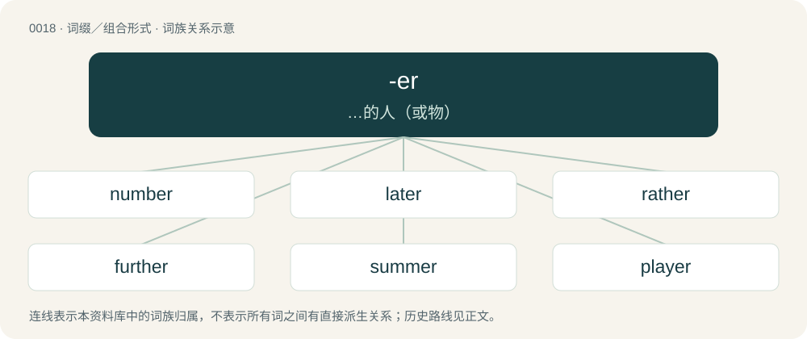

# 0021 · -er — …的人（或物）

[总目录](../00_总目录_按常用程度.md)

**类型**：词缀／组合形式　｜　**来源语言**：见词源记录

## 核心含义与来源

- 核心含义：…的人（或物）
- 英文含义：A person or thing that does an action indicated by the root verb; used to form an agent noun.
- 词形：-er

**多个词源／构词路径**：同一拼写可能有不同来源；以下按词性和含义分别列出。

**来源记录 1**（后缀／后置成分；A person or thing that does an action indicated by the root verb; used to form an agent noun.）

Inherited from Middle English -ere, -er, from Old English -ere, from Proto-West Germanic \*-ārī, from Proto-Germanic \*-ārijaz, usually thought to have been borrowed from Latin -ārius; see Proto-Germanic \*-ārijaz for an alternate theory. Reinforced by Middle English -er, from Old French -ier, also from Latin -ārius; compare the synonymous but unrelated Old French -or, -eor (Anglo-Norman variant -our), from Latin -(ā)tor, from Proto-Indo-European \*-tōr. The "inhabitant" sense is sometimes connected to Middle English -wær(r)e, -ware, from Old English -ware (suffix denoting residency), from Proto-West Germanic \*-wari, from Proto-Germanic \*warjaz (“inhabitant”), from Proto-Indo-European \*wer- (“to protect”). Cognates Cognate with Saterland Frisian -er, West Frisian -er, Dutch -er, German Low German -er, German -er, Danish -er, Swedish -are and Icelandic -ari.

**来源记录 2**（后缀／后置成分；More; used to form the comparative.）

From Middle English -ere, from Old English -ra, from Proto-West Germanic \*iʀō, \*-ōʀō, from Proto-Germanic \*-izô or Proto-Germanic \*-ōzô (a derivative of Etymology 4, below); related to superlative -est.

**来源记录 3**（后缀／后置成分；More; used to form the comparative.）

From Middle English -er, from Old English -or, from Proto-West Germanic \*-ōʀ, Proto-Germanic \*-ōz.

**来源记录 4**（后缀／后置成分；Frequently; used to form frequentative verbs.）

From Middle English -eren, -ren, -rien, from Old English -erian, -rian, from Proto-West Germanic \*-rōn, \*-iʀōn, from Proto-Germanic \*-rōną or \*-izōną. Cognate with West Frisian -erje, Dutch -eren, German -eren, -ern, Danish -re, Swedish -ra.

**来源记录 5**（后缀／后置成分；Instance of (the verbal action); used to form nouns from verbs.）

From Middle English -er, from Anglo-Norman -er, Old French -er, the infinitive verbal ending.

**来源记录 6**（后缀／后置成分；Used to form diminutives.）

From Middle English -er, -ere (diminutive suffix). Compare -el.

**来源记录 7**（后缀／后置成分；Used to form slang or colloquial equivalents of words.）

Attested in the UK since the 19th century. Originally Rugby School slang. Later adopted by Oxford University and then wider British society.

**来源记录 8**（后缀／后置成分；A suffix creating adjectives from verbs, indicating aptitude, proneness, or tendency toward a specified action）

From Middle English -er, from Old English -er, -or, from Proto-Germanic \*-raz. Compare -le.

**来源记录 9**（后缀／后置成分；Junior, child, younger person. (Attached to a name, usually one syllable of the given name.)）

From Mandarin -兒 /-儿 (-ér).

## 词族图

## 单词速览（常用到不常用）

| 单词 | 音标 | 释义 |
|---|---|---|
| [number](#w-1) | 英 /ˈnʌmə/；美 /ˈnʌmɚ/ | 【英文】Something that numbs. |
| [later](#w-2) | 英 /ˈleɪ.tə/；美 /ˈleɪ.tɚ/ | adv. 以后, 随后 |
| [rather](#w-3) | 英 /ˈɹɑː.ðə(ɹ)/；美 /ˈɹæðɚ/ | adv. 宁可, 稍微, 相当 |
| [further](#w-4) | 英 /ˈfɜːðə/；美 /ˈfɝ.ðɚ/ | a. 更远的, 此外的, 更多的；vt. 促进, 增进, 助长；adv. 更进一步地, 更远地, 此外 |
| [summer](#w-5) | 英 /ˈsʌmə/；美 /ˈsʌmɚ/ | 【英文】A person who sums. |
| [player](#w-6) | 英 /ˈpleɪ.ə(ɹ)/；美 /ˈpleɪ.ɚ/ | n. 竞赛者, 上场队员, 游戏者, 演员；\[经\] 交易者 |
| [longer](#w-7) | 英 /ˈlɒŋ.ə/；美 /ˈlɔŋ.ɚ/ | adv. 比较久 |
| [lower](#w-8) | 英 /ˈləʊ.ə/；美 /ˈloʊ.ɚ/ | a. 低的, 下级的, 下层的；vi. 降低, 跌落, 减弱；vt. 放下, 降下, 减弱, 贬低 |
| [river](#w-9) | 英 /ˈɹaɪvə/；美 /ˈɹaɪvɚ/ | 【英文】One who rives or splits. |
| [standard](#w-10) | 英 /ˈstændəd/；美 /ˈstændɚd/ | n. 标准, 规格, 旗, 军旗, 本位；a. 标准的, 合规格的；\[计\] 标准 |
| [computer](#w-11) | 英 /kəmˈpjuː.tə/；美 /kəmˈpju.tɚ/ | n. 电脑, 电子计算机；\[计\] 计算机 |
| [manager](#w-12) | 英 /ˈmæn.ɪ.dʒə/；美 /ˈmæn.ə.dʒəɹ/ | n. 经理, 管理员, 管理器；\[计\] 管理器 |
| [letter](#w-13) | 英 /ˈlɛtə/；美 /ˈlɛtɚ/ | 【英文】One who lets, or lets out. |
| [master](#w-14) | 英 /ˈmɑːstə/；美 /ˈmæstɚ/ | 【英文】A vessel having a specified number of masts. |
| [teacher](#w-15) | 英 /ˈtiː.t͡ʃəː/；美 /ˈti.t͡ʃɚ/ | n. 教师, 老师, 导师 |
| [winner](#w-16) | 英 /ˈwɪnə/；美 /ˈwɪnɚ/ | n. 胜利者, 优胜者；\[法\] 取胜者 |
| [corner](#w-17) | 英 /ˈkɔːnə(ɹ)/；美 /ˈkɔɹnɚ/ | 【英文】One who corns, or preserves food in salt. |
| [driver](#w-18) | 英 /ˈdɹaɪ.və/；美 /ˈdɹaɪvɚ/ | n. 驾驶员, 驱动器, 驱动程序；\[化\] 驱动器 |
| [closer](#w-19) | 英 /ˈkləʊ.zə/；美 /ˈkloʊ.zɚ/ | n. 关闭者, 闭合器, 关闭器 |
| [beer](#w-20) | 英 /ˈbiː.ə/；美 /ˈbi.ɚ/ | 【英文】One who is or exists. |
| [user](#w-21) | 英 /ˈjuːzə/；美 /ˈjuzɚ/ | n. 使用者；\[计\] 用户 |
| [writer](#w-22) | 英 /ˈɹaɪ.tə(ɹ)/；美 /ˈɹaɪ.təɹ/ | n. 作家, 撰稿者, 抄写员；\[化\] 记录器 |
| [faster](#w-23) | 英 /ˈfɑːstə/；美 /ˈfæstɚ/ | \[计\] 加快 |
| [consumer](#w-24) | 英 /kənˈsjuːmə/；美 /kənˈsumɚ/ | n. 消费者；\[经\] 消费者, 用户 |
| [counter](#w-25) | 英 /ˈkaʊn.tə/；美 /ˈkaʊn.tɚ/ | n. 计算器, 计算者, 柜台, 筹码；a. 反方向的, 相反的；adv. 反方向地, 相反地 |
| [latter](#w-26) | 美 /ˈlæt.ɚ/；/ˈlæt.ə(ɹ)/ | a. 后者的, 较后的, 近来的 |
| [manner](#w-27) | 英 /ˈmænə/；美 /ˈmænɚ/ | 【英文】Something involving or requiring the specified number of men or people. |
| [stronger](#w-28) | 英 /stɹɒŋɡə/；美 /stɹɔŋɡɚ/ | \[经\] 强劲的 |
| [singer](#w-29) | 英 /ˈsɪŋ.ə/；美 /ˈsɪŋ.ɚ/ | n. 歌手 |
| [engineer](#w-30) | 英 /ˌɛn(d)ʒɪˈnɪə/；美 /ˌɛnd͡ʒɪˈnɪ(ə)ɹ/ | n. 工程师, 工兵；vt. 设计, 监造, 精明地处理, 策划 |
| [miller](#w-31) | 英 /ˈmɪləː/；美 /ˈmɪlɚ/ | n. 厂主, 蛾；\[机\] 铣床 |
| [shower](#w-32) | 英 /ˈʃəʊ.ə(ɹ)/；美 /ˈʃoʊ.ɚ/ | 【英文】One who shows. |
| [tower](#w-33) | 英 /ˈtəʊ.ə(ɹ)/；美 /ˈtoʊ.əɹ/ | 【英文】One who tows. |
| [speaker](#w-34) | 英 /ˈspiːkə/；美 /ˈspikɚ/ | n. 说话人, 讲演者, 发言人, 喇叭, 扬声器；\[计\] 扬声器 |
| [soccer](#w-35) | 英 /ˈsɒk.ə/；美 /ˈsɑk.ɚ/ | n. 英式足球 |
| [killer](#w-36) | 英 /ˈkɪlə/；美 /ˈkɪlɚ/ | n. (非正式)杀人者, 屠杀者, 猛兽, 致死(疾病), 杀手, 止痛药, 限制器, 瞄准器；\[计\] 删除程序; 断路器 |
| [founder](#w-37) | /ˈfaʊndəɹ/ | n. 创立者, 建立者；vt. 使沉没, 使摔倒, 弄跛, 浸水, 破坏；vi. 沉没, 摔到, 变跛, 倒塌, 失败 |
| [server](#w-38) | 英 /ˈsɜːvə/；美 /ˈsɝvɚ/ | n. 服伺者, 上菜用具, 发球员；n. 服务器；\[计\] 服务器, 服务器启动程序, 服务台程序 |
| [producer](#w-39) | 英 /pɹəˈdjuːsə/；美 /pɹəˈdusɚ/ | n. 生产者, 制作者, 制作人；\[化\] 发生器; (炉煤气)发生炉; 制气炉; 生产者 |
| [worker](#w-40) | 英 /ˈwɜː.kə/；美 /ˈwɝ.kɚ/ | n. 工人, 劳动者；\[经\] 工人, 劳工, 劳动者 |
| [designer](#w-41) | /dɪˈzaɪnɚ/ | n. 设计者, 谋划者, 制图者；\[计\] 设计员 |
| [flower](#w-42) | 英 /ˈfləʊə/；美 /ˈfloʊɚ/ | 【英文】Something that flows, such as a river. |
| [prayer](#w-43) | 英 /ˈpɹeɪə(ɹ)/；美 /ˈpɹeɪəɹ/ | 【英文】One who prays. |
| [walker](#w-44) | 英 /ˈwɔːkə/；美 /ˈwɔkɚ/ | n. 徒步者, 轻便鞋；\[法\] 山林巡视官 |
| [butter](#w-45) | 英 /ˈbʌtə/；美 /ˈbʌtɚ/ | 【英文】Someone or something that butts. |
| [layer](#w-46) | 英 /ˈleɪ.ə/；美 /ˈleɪ̯ɚ/ | n. 层, 产卵鸡, 放置者；vt. 分层堆积, 压植；\[计\] 层 |
| [hunter](#w-47) | 英 /ˈhʌntə/；美 /ˈhʌntɚ/ | n. 猎人, 猎犬, 追求者 |
| [carter](#w-48) | 英 /ˈkɑːtə/；美 /ˈkɑɹtɚ/ | n. 运货马车夫 |
| [reporter](#w-49) | 英 /ɹɪˈpɔː.tə/；美 /ɹɪˈpoɹ.tɚ/ | n. 记者, 报告者；\[化\] 指示器 |
| [reader](#w-50) | 英 /ˈɹiː.də/；美 /ˈɹi.dɚ/ | n. 读者, 读物, 文选, 校对人, 讲师；\[计\] 阅读程序; 阅读器 |
| [fighter](#w-51) | 英 /ˈfaɪ.tə(ɹ)/；美 /ˈfaɪtɚ/ | n. 斗士, 战士, 好战者, 战斗机 |
| [trailer](#w-52) | 英 /ˈtɹeɪlə(ɹ)/；美 /ˈtɹeɪlɚ/ | n. 追踪者, 拖车；\[电\] 拖车 |
| [fewer](#w-53) | 美 /ˈfjuː.ɚ/ | a. 较少的 |
| [photographer](#w-54) | 英 /fəˈtɒɡ.ɹə.fə/；美 /fəˈtɑ.ɡɹə.fɚ/ | n. 摄影师, 摄影者 |
| [copper](#w-55) | 英 /ˈkɒpə/；美 /ˈkɑpəɹ/ | 【英文】A police officer, especially one in uniform. |
| [cooper](#w-56) | 美 /ˈkʊpɚ/；/ˈkuːpə(ɹ)/ | n. 制桶工人；v. 制桶 |
| [lover](#w-57) | 英 /ˈlʌvə/；美 /ˈlʌvɚ/ | n. 爱人, 爱好者 |
| [outer](#w-58) | 英 /ˈaʊtə/；美 /ˈaʊtɚ/ | a. 外部的, 外面的, 在外的, 远离中心的；\[机\] 外部的, 外面的, 外侧的 |
| [baker](#w-59) | 英 /ˈbeɪ.kə/；美 /ˈbeɪ.kɚ/ | n. 面包师；\[医\] 烤箱(骨科用) |
| [maker](#w-60) | 英 /ˈmeɪk.ə/；美 /ˈmeɪk.ɚ/ | n. 制造者, 上帝；\[经\] 制造者, 出票人 |
| [parker](#w-61) | 英 /ˈpɑːkə/；美 /ˈpɑɹkɚ/ | n. 停放车辆的人 |
| [rubber](#w-62) | 英 /ˈɹʌbə/；美 /ˈɹʌbɚ/ | n. 橡皮, 橡胶, 做摩擦动作的人, 按摩师, 决胜盘；vt. 用橡胶制造, 涂橡胶于 |
| [employer](#w-63) | 英 /ɪmˈplɔɪə/；美 /ɪmˈplɔɪ.ɚ/ | n. 雇主, 老板；\[经\] 雇主, 业主 |
| [bitter](#w-64) | 英 /ˈbɪt.ə/；美 /ˈbɪ.tɚ/ | a. 苦的, 痛苦的, 怀恨的；adv. 刺骨；v. (使)变苦 |
| [holder](#w-65) | 英 /ˈhəʊldə/；美 /ˈhoʊɫdɚ/ | n. 持有人, 所有人, 支持物；\[化\] 夹持器; 夹具; 贮罐 |
| [manufacturer](#w-66) | 英 /ˌmænjʊˈfæktʃəɹə/；美 /ˌmænjəˈfækt͡ʃɚɚ/ | n. 制造业者, 厂商；\[经\] 制造人, 制造商, 制造厂 |
| [developer](#w-67) | 英 /dɪˈvɛləpə(ɹ)/；美 /dɪˈvɛləpɚ/ | n. 开发者；\[计\] 显影器 |
| [prisoner](#w-68) | 英 /ˈpɹɪzənə/；美 /ˈpɹɪzənɚ/ | n. 囚犯, 犯人, 战俘；\[法\] 犯人, 囚犯, 扣押犯 |
| [poster](#w-69) | 美 /ˈpoʊstɚ/ | n. 海报, 招贴, 驿马 |
| [turner](#w-70) | 英 /ˈtɜː.nə(ɹ)/；美 /ˈtɝ.nɚ/ | n. 车工, 体育协会会员 |
| [liver](#w-71) | /ˈlɪvə(ɹ)/ | 【英文】Someone who lives (usually in a specified way). |
| [runner](#w-72) | 英 /ˈɹʌnə/；美 /ˈɹʌnɚ/ | n. 跑步者, 赛跑者, 送信人, 走私船, 操作者, 滑槽；\[化\] 碾碎机; 压碎机 |
| [tier](#w-73) | 英 /ˈtaɪ.ə/；美 /ˈtaɪ.ɚ/ | n. 排, 层, 等级 |
| [farmer](#w-74) | 英 /ˈfɑː.mə/；美 /ˈfɑɹ.mɚ/ | n. 农夫, 农场主；\[法\] 农民, 农场主, 承包者 |
| [peer](#w-75) | 英 /piː.ə/；美 /pi.ɚ/ | 【英文】Someone who pees, someone who urinates. |
| [lesser](#w-76) | 英 /ˈlɛsə/；美 /ˈlɛsɚ/ | a. 较少的, 较小的, 次要的 |
| [publisher](#w-77) | 美 /ˈpʌblɪʃɚ/ | n. 出版者, 发行人；\[法\] 发行人, 出版者, 报刊发行者 |
| [banner](#w-78) | 英 /ˈbænə/；美 /ˈbænɚ/ | 【英文】One who bans something. |
| [reminder](#w-79) | 英 /ɹɪˈmaɪndə(ɹ)/；美 /ɹɪˈmaɪndəɹ/ | n. 提醒的人, 暗示；\[经\] 催单 |
| [defender](#w-80) | 英 /dɪˈfɛndə(ɹ)/ | n. 防卫者, 防护者, 辩护者；\[法\] 辩护人, 保护人 |
| [potter](#w-81) | 英 /ˈpɒtə/；美 /ˈpɑtɚ/ | n. 陶工, 制陶工人 |
| [voter](#w-82) | 英 /ˈvəʊtə(ɹ)/；美 /ˈvoʊtɚ/ | n. 选民, 投票人；\[法\] 选民, 选举人, 投票人 |
| [warner](#w-83) | /ˈwɔː(ɹ)nə(ɹ)/ | n. 警告者, 告诫者, 预告者；\[化\] 报警器 |
| [provider](#w-84) | 英 /pɹəˈvaɪ.də(ɹ)/；美 /pɹəˈvaɪ.dɚ/ | n. 供应者, 供养人, 伙食承办人；\[计\] 提供器 |
| [lighter](#w-85) | 英 /ˈlaɪtə/；美 /ˈlaɪtɚ/ | n. 点火者, 点灯工人, 打火机, 驳船；vt. 以驳船搬运 |
| [meter](#w-86) | 英 /ˈmiːtə/；/ˈmitəɹ/ | n. 米, 公尺, 仪表, 计量器；vt. 以仪表计量 |
| [receiver](#w-87) | 英 /ɹɪˈsiː.və/；美 /ɹəˈsi.vɚ/ | n. 接收器；接受者；收信机；收款员, 接待者 |
| [teenager](#w-88) | 英 /ˈtiːnˌeɪ̯d͡ʒə/；美 /ˈtinˌeɪdʒɚ/ | n. 十三岁到十九岁的少年 |
| [tender](#w-89) | 英 /ˈtɛn.dəː/；美 /ˈtɛn.dɚ/ | 【英文】A specialized rail wagon hauled behind a steam engine to carry fuel and water. |
| [butler](#w-90) | 英 /ˈbʌt.lə(ɹ)/；美 /ˈbʌt.lɚ/ | n. 男管家, 司膳总管 |
| [trainer](#w-91) | 英 /ˈtɹeɪnə/；美 /ˈtɹeɪnɚ/ | n. 训练员, 驯马师；\[电\] 列车器 |
| [supporter](#w-92) | 英 /səˈpɔː.tə/；美 /səˈpɔɹ.tɚ/ | n. 支持者, 后盾, 迫随者, 护身织物；\[法\] 支持者, 赡养者, 抚养者 |
| [shooter](#w-93) | 英 /ˈʃuːtəː/；/ˈʃʉːtə/ | n. 射手, 狩猎者, 手枪 |
| [harper](#w-94) | /ˈhɑː(ɹ)pə(ɹ)/ | 【英文】A harpist, especially one who plays a traditional harp without pedals. |
| [buyer](#w-95) | 英 /ˈbaɪ.ə/；美 /ˈbaɪ.əɹ/ | n. 买主, 买方；\[经\] 买主, 买方, 买手 |
| [container](#w-96) | 英 /kənˈteɪ.nə/；美 /kənˈteɪ.nəɹ/ | n. 容器, 集装箱；\[化\] 集装箱; 贮存箱; 容器(任何一种) |
| [differ](#w-97) | 英 /ˈdɪfə/；美 /ˈdɪfɚ/ | 【英文】A program that diffs, a diff. |
| [fisher](#w-98) | 英 /ˈfɪʃə/；美 /ˈfɪʃɚ/ | n. 渔夫, 食鱼动物, 渔船 |
| [keeper](#w-99) | 英 /ˈkiː.pə/；美 /ˈkiː.pɚ/ | n. 监护人, 管理人, 看守人；\[机\] 保管人, 看守人, 保持片 |
| [rider](#w-100) | 英 /ˈɹaɪ̯.dəː/；/ˈɹɑɪ̯.dəː/ | n. 骑手, (文件后的)附件, 扶手；\[化\] 游码 |
| [starter](#w-101) | 英 /ˈstɑː.tə(ɹ)/；美 /ˈstɑɹ.tɚ/ | n. 开端者, 在起跑线上的人, 参加赛跑的人, 调度员, 起动机, 酵母；\[计\] 启动程序, 启动器 |
| [loser](#w-102) | 美 /luzɚ/；/luːzə(ɹ)/ | n. 失败者, 遗失者；\[法\] 失败者, 失物者, 遗失者 |
| [seller](#w-103) | 英 /ˈsɛlə/；美 /ˈsɛlɚ/ | n. 销售者；\[化\] 卖方 |
| [visitor](#w-104) | 英 /ˈvɪzɪtə/；美 /ˈvɪzɪtɚ/ | n. 参观者, 游客, 访客；\[法\] 视察人, 检视人, 检查员 |
| [dancer](#w-105) | 英 /ˈdɑːnsə(ɹ)/；美 /ˈdænsəɹ/ | n. 舞蹈演员, 跳舞者 |
| [roller](#w-106) | 英 /ˈɹəʊlə/；美 /ˈɹoʊlɚ/ | n. 滚筒, 滚轴, 压路机；\[化\] 滚柱; 托辊 |
| [slower](#w-107) | 英 /ˈsləʊə/；美 /ˈsloʊɚ/ | \[计\] 减慢 |
| [merger](#w-108) | 英 /ˈmɜː.d͡ʒə/；美 /ˈmɝ.d͡ʒɚ/ | n. 合并, 归并；\[经\] 购并 |
| [poker](#w-109) | 英 /ˈpəʊkə/；美 /ˈpoʊkɚ/ | n. 戳的人, 拨火棍, 纸牌戏；vt. 烙制 |
| [cooler](#w-110) | 英 /ˈkuː.lə(ɹ)/；美 /ˈku.lɚ/ | n. 冷却器；\[化\] 冷却器 |
| [rapper](#w-111) | /ˈɹæpɚ/ | n. 敲门人, (美)(非正式)控告人, 证人, 检举人；\[机\] 敲杆 |
| [locker](#w-112) | 英 /ˈlɒk.ə(ɹ)/；美 /ˈlɑ.kɚ/ | n. 抽屉, 小柜, 上锁人；\[机\] 锁柜 |
| [messenger](#w-113) | 英 /ˈmɛs.ən.d͡ʒə/；美 /ˈmɛs.ən.d͡ʒɚ/ | n. 报信者, 使者；\[经\] 使者, 送信者, 通信员 |
| [adviser](#w-114) | 英 /ædˈvaɪ.zə(ɹ)/；美 /ædˈvaɪ.zɚ/ | n. 顾问, 劝告者, 指导教师；\[法\] 顾问, 劝告者 |
| [painter](#w-115) | 英 /ˈpeɪntə/；美 /ˈpeɪntɚ/ | n. 画家, 油漆匠；\[机\] 油漆匠, 喷漆匠 |
| [printer](#w-116) | 英 /ˈpɹɪntə(ɹ)/；美 /ˈpɹɪntɚ/ | n. 印刷工, 打印机；\[计\] 打印机 |
| [researcher](#w-117) | 英 /ɹɪˈsɜː.t͡ʃə/；美 /ˈɹiˌsɝ.t͡ʃɚ/ | n. 研究人员 |
| [observer](#w-118) | 英 /əbˈzɜːvə/；美 /əbˈzɝvɚ/ | n. 观察者, 遵守者, 观察员；\[法\] 观察者, 观察员, 监场员 |
| [thriller](#w-119) | 英 /ˈθɹɪ.lə/；美 /ˈθɹɪ.ləɹ/ | n. 使人激动的东西, 使人毛骨悚然的东西, 使人毛骨悚然的小说 |
| [cleaner](#w-120) | 英 /ˈkliː.nə/；美 /ˈkli.nɚ/ | n. 清洁工人, 清洁剂, 干洗商；\[化\] 滤清器; 除垢器; 洗净剂; 清洁剂 |
| [striker](#w-121) | /ˈstɹaɪkɚ/ | n. 打击者, 罢工者；\[经\] 罢工者 |
| [broker](#w-122) | 英 /ˈbɹəʊkə/；美 /ˈbɹoʊkɚ/ | n. 掮客, 经纪人；\[经\] 经纪人, 掮客 |
| [browser](#w-123) | 英 /ˈbɹaʊ.zə/；美 /ˈbɹaʊ.zəɹ/ | n. 吃嫩叶的动物, 浏览书本的人；\[计\] 浏览程序 |
| [homer](#w-124) | 英 /ˈhəʊmə/；美 /ˈhoʊmɚ/ | n. 本垒打, 传信鸽 |
| [bomber](#w-125) | 英 /ˈbɒmə(ɹ)/；美 /ˈbɑmɚ/ | n. 轰炸机, 投弹手 |
| [header](#w-126) | 英 /ˈhɛdə/；美 /ˈhɛdɚ/ | n. 收割台；n. 顶梁, 域名；\[计\] 页眉, 域名, 数据头, 电子邮件头 |
| [opener](#w-127) | 英 /ˈəʊ.pən.ə/；美 /ˈoʊ.pən.ɚ/ | n. 开...的人, 开局人, 开创人, 开具, 开启工具, 首项；\[经\] 申请开证人 |
| [ranger](#w-128) | 英 /ˈɹeɪ̯nd͡ʒə/；美 /ˈɹeɪ̯nd͡ʒɚ/ | n. 王室守林人, 骑警, 漫游者 |
| [marker](#w-129) | /ˈmɑː(ɹ)kə(ɹ)/ | n. 作记号的人, 记分员, 书签, 纪念碑, 里程碑, 标识物, 标记；\[计\] 标记 |
| [midfielder](#w-130) | /ˈmid.fiːldə/ | n. 中场队员 |
| [blogger](#w-131) | 英 /ˈblɒ.ɡə/；美 /ˈblɔ.ɡəɹ/ | n. 写博客的人；博客使用者 |
| [composer](#w-132) | 英 /kəmˈpəʊzə/；美 /kəmˈpoʊzəɹ/ | n. 作曲家, 作家, 调停者 |
| [explorer](#w-133) | /ɛkˈsplɔːɹə(ɹ)/ | n. 探险家, 探测者, 勘探器；\[医\] 探察器 |
| [ruler](#w-134) | 英 /ˈɹuːlə/；美 /ˈɹulɚ/ | n. 统治者, 管理者, 尺, 直尺；n. 划线板；\[计\] 标尺 |
| [supplier](#w-135) | /səˈplaɪə/ | n. 供应者, 供给国, 供应商；\[化\] 承制厂; 供应厂商 |
| [toddler](#w-136) | 英 /ˈtɒdlə/；美 /ˈtɑdlɚ/ | n. 蹒跚行走的人, 学步的小孩, 学步的幼儿, (非正式)信步走的人 |
| [murderer](#w-137) | 英 /ˈmɜːdəɹə/；美 /ˈmɝdɚɚ/ | n. 凶手, 杀人者, 谋害者；\[法\] 谋杀犯, 凶手 |
| [fletcher](#w-138) | 英 /ˈflɛt͡ʃ.ə(ɹ)/ | n. 弗莱彻（姓氏, 男子名）；弗莱彻（John, 1579-1625, 英国剧作家）；弗莱彻（John Gould, 1886-1950, 美国诗人及批评家） |
| [performer](#w-139) | 英 /pəˈfɔːmə/；美 /pɚˈfɔɹmɚ/ | n. 表演者, 执行者, 完成者；\[法\] 执行者, 履行者, 实行者 |
| [fuller](#w-140) | 英 /ˈfʊ.lə/；美 /ˈfʊ.ləɹ/ | n. 漂洗工, 套柄铁锤；\[机\] 半圆型锤 |
| [pitcher](#w-141) | 英 /ˈpɪt͡ʃ.ə/；美 /ˈpɪt͡ʃ.ɚ/ | n. 有把的大罐, 瓶状体, 投手, 摊贩 |
| [tucker](#w-142) | 英 /ˈtʌkə/；美 /ˈtʌkɚ/ | n. 打横褶的人, 打褶装置；vt. 使疲倦, 使筋疲力尽 |
| [banker](#w-143) | 英 /ˈbæŋkəː/；/ˈbæŋkɚ/ | n. 银行家, 庄家；\[经\] 银行业者, 银行家 |
| [buffer](#w-144) | 英 /ˈbʌfə/；美 /ˈbʌfəɹ/ | n. 缓冲器, 缓冲区；vt. 缓冲；\[计\] 缓冲区, 缓冲器 |
| [drawer](#w-145) | 英 /dɹɔː(ɹ)/；美 /dɹɔɹ/ | n. 抽屉, 开票人；\[计\] 抽屉 |
| [render](#w-146) | 英 /ˈɹɛn.də/；美 /ˈɹɛn.dɚ/ | 【英文】One who rends. |
| [sweater](#w-147) | 英 /ˈswɛtə/；美 /ˈswɛtɚ/ | n. 毛衣, 毛线衫, 运动衫, 出汗者；\[化\] 发汗器 |
| [insider](#w-148) | 美 /ɪnˈsaɪdɚ/ | n. 内部的人, 权威人士, 知道内情的人；\[经\] 熟悉内情者 |
| [presenter](#w-149) | /pɹɪˈzɛntə(ɹ)/ | n. 节目主持人, 奉献者, 提出者；\[法\] 告发者, 提出者, 推荐者 |
| [trader](#w-150) | 英 /ˈtɹeɪdə(ɹ)/；美 /ˈtɹeɪdɚ/ | n. 商人, 商船；\[经\] 交易者, 商船 |
| [viewer](#w-151) | 英 /ˈvjuːə/；美 /ˈvju.ɚ/ | n. 观察者, 看电视者, 视察员, 观察器；\[化\] 指示器 |
| [wheeler](#w-152) | /ˈhwiːlə/ | n. 旋转物, 推车人, 车轮制造人, 辕马, 精明的政客 |
| [rover](#w-153) | 英 /ˈɹəʊvə/；美 /ˈɹoʊvɚ/ | n. 漂泊者, 流浪者, 海盗；\[法\] 流浪者, 海盗, 海盗船 |
| [warmer](#w-154) | 英 /ˈwɔːmə/；美 /ˈwɔɹmɚ/ | n. 进行加热的人, 取暖器；\[化\] 热炼机 |
| [liner](#w-155) | /ˈlaɪnɚ/ | n. 班机, 划线者, 定期船, 衬里；\[化\] 衬垫; 垫带; 套管 |
| [retailer](#w-156) | 美 /ˈɹiteɪlɚ/ | n. 零售商人, 传播的人；\[经\] 零售商 |
| [boxer](#w-157) | 英 /ˈbɒksə/；美 /ˈbɑksɚ/ | n. 拳师 |
| [folder](#w-158) | 英 /ˈfəʊldə/；美 /ˈfoʊldɚ/ | n. 文件夹, 折纸机, 折叠式书本, 卷宗；\[计\] 文件夹 |
| [joker](#w-159) | 英 /ˈd͡ʒəʊkə/；美 /ˈd͡ʒoʊkɚ/ | n. 诙谐者, 家伙, 巧计；\[法\] 曲笔 |
| [supper](#w-160) | 英 /ˈsʌpə/；美 /ˈsʌpɚ/ | 【英文】A drinker, especially one who drinks slowly (i.e., one who sups). |
| [clearer](#w-161) | 英 /ˈklɪəɹə/；美 /ˈklɪɹɚ/ | \[医\] 澄清剂, 透明剂; 洗剂(牙)；\[经\] (票据)交换员 |
| [sniper](#w-162) | 美 /ˈsnaɪ.pɚ/ | n. 狙击兵 |
| [lecturer](#w-163) | 英 /ˈlɛkt͡ʃəɹə/；美 /ˈlɛkt͡ʃəɹɚ/ | n. 演讲者, 讲师；\[法\] 讲演人, 讲课人, 讲师 |
| [boiler](#w-164) | 英 /ˈbɔɪlə/；美 /ˈbɔɪlɚ/ | n. 煮器, 汽锅, 锅炉；\[化\] 锅炉 |
| [hooker](#w-165) | 英 /ˈhʊkə/；美 /ˈhʊkɚ/ | n. 用钩子的人, 渔船 |
| [sticker](#w-166) | 英 /ˈstɪkə/；美 /ˈstɪkɚ/ | n. 屠夫, 尖刀, 刺, 芒, 尖物, 携带尖刀者, 张贴物, 滞销品, (非正式)难题；\[经\] 呆滞商品 |
| [cutter](#w-167) | 英 /ˈkʌtə/；美 /ˈkʌtɚ/ | n. 裁剪者, 切割者, 切割器；\[化\] 刀具; 剪切机; 切刀; 切胶机 |
| [jumper](#w-168) | 英 /ˈd͡ʒʌmpə/；美 /ˈd͡ʒʌmpɚ/ | n. 跳跃者, 工作服；\[计\] 跳线连接器, 跳接器 |
| [offender](#w-169) | 英 /əˈfen.də(ɹ)/；美 /əˈfen.dɚ/ | n. 罪犯, 无礼的人, 得罪人的人 |
| [bumper](#w-170) | 英 /ˈbʌmpə/；美 /ˈbʌmpəɹ/ | n. 缓冲器, 满杯；a. 大胜利的 |
| [coaster](#w-171) | 英 /ˈkəʊ̯s.tə/；美 /ˈkoʊ̯s.tɚ/ | n. 沿海航行者/贸易者, 沿海航船, 带轮银盘, 杯托, (酒瓶)垫子；\[经\] 沿海贸易船 |
| [footballer](#w-172) | 英 /ˈfʊtbɔːlə/；/ˈfʊtbɔlɚ/ | n. 足球员, 足球选手 |
| [drummer](#w-173) | 英 /ˈdɹʌmə(ɹ)/；美 /ˈdɹʌmɚ/ | n. 鼓手, 旅行推销员；\[经\] 跑街, 旅行商人, 旅行销货人 |
| [piper](#w-174) | 英 /ˈpaɪ.pə/；美 /ˈpaɪ.pɚ/ | n. 吹笛者, 风笛手, 管乐器吹奏者, 管道安装工, 幼鸽 |
| [preacher](#w-175) | 英 /ˈpɹiːt͡ʃəː/；美 /ˈpɹit͡ʃɚ/ | n. 传道士, 讲道者, 牧师 |
| [timer](#w-176) | 美 /ˈtaɪmɚ/ | n. 计时员, 计时器；\[计\] 计时器 |
| [believer](#w-177) | 英 /bɪˈliːvə/；美 /bɪˈlivɚ/ | n. 信徒 |
| [bunker](#w-178) | 英 /ˈbʌŋ.kə/；美 /ˈbʌŋ.kɚ/ | 【英文】One who bunks off; a truant from school. |
| [fucker](#w-179) | /ˈfʌk.ə(ɹ)/ | n. 笨蛋, 傻瓜 |
| [hacker](#w-180) | 英 /hækə/；美 /hækəɹ/ | \[计\] 计算机窃贼, 计算机新技术挑战者, 黑客 |
| [freezer](#w-181) | 英 /ˈfɹiːzə/；美 /ˈfɹizɚ/ | n. 冰库, 冰箱, 冷冻库 |
| [charger](#w-182) | 英 /ˈtʃɑːdʒə/；美 /ˈt͡ʃɑɹd͡ʒɚ/ | n. 充电器, 冲锋者, 战马；\[化\] 充电器; 装料机; 加料机 |
| [lender](#w-183) | 美 /ˈlɛn.dɚ/ | n. 出借人, 贷方；\[经\] 出借者, 贷方, 贷款人 |
| [lever](#w-184) | 英 /ˈliː.və/；美 /ˈlɛv.ɚ/ | 【英文】Rather. |
| [sewer](#w-185) | 英 /ˈsəʊə/；美 /ˈsoʊɚ/ | 【英文】One who sews. |
| [broadcaster](#w-186) | 英 /ˈbɹɔːdˌkɑːstə/；美 /ˈbɹɔdˌkæstɚ/ | n. 播送者, 广播装置, 播种机 |
| [fowler](#w-187) | /ˈfaʊlə(ɹ)/ | n. 捕鸟者 |
| [practitioner](#w-188) | 英 /pɹækˈtɪʃənə/；美 /pɹækˈtɪʃənəɹ/ | n. 从业者, 开业者；\[医\] 行医者, 医师 |
| [scorer](#w-189) | /ˈskɒːrə/ | n. 记录员, 刻痕者 |
| [tracker](#w-190) | /ˈtɹækə(ɹ)/ | n. 追踪者, 跟踪雷达, 拉纤者；\[法\] 追踪人, 探索者, 追踪空中移动物体的仪器 |
| [gamer](#w-191) | 英 /ˈɡeɪ̯mə/；美 /ˈɡeɪ̯mɚ/ | n. 玩家, 博弈者 |
| [pointer](#w-192) | 英 /ˈpɔɪn.tə/；美 /ˈpɔɪn.təɹ/ | n. 指示物, 教鞭, 暗示, 指针；\[计\] 指针 |
| [caller](#w-193) | 英 /ˈkɔːlə/；/ˈkɔ.lɚ/ | n. 访客, 召集员, 传唤员；a. 新鲜的；\[计\] 呼叫方标识 |
| [slippery](#w-194) | /ˈslɪpəɹi/ | a. 滑的, 光滑的, 靠不住的, 圆滑的, 不稳固的；\[法\] 狡猾的, 不可靠的, 不安定的 |
| [adapter](#w-195) | 英 /əˈdæptə(ɹ)/；美 /əˈdæptəɹ/ | n. 适应者, 改编者, 接合器；\[计\] 衔接器; 适配器, 适配卡 |
| [breaker](#w-196) | 英 /ˈbɹeɪkə/；美 /ˈbɹeɪkɚ/ | n. 断路器；\[化\] 破碎机 |
| [contender](#w-197) | 美 /kənˈtɛn.dɚ/ | n. 参赛者, 争论者, 斗争者, 竞争者 |
| [attacker](#w-198) | 美 /əˈtækɚ/ | n. 攻击者 |
| [barker](#w-199) | /ˈbɑː(ɹ)kɚ/ | n. 招徕顾客的人, 剥树皮者；\[机\] 去皮机, 剥皮机 |
| [sucker](#w-200) | 英 /ˈsʌk.ə/；美 /ˈsʌk.ɚ/ | n. 乳儿, 吸管；\[医\] 吸盘 |
| [transmitter](#w-201) | /trænsˈmitə/ | n. 传送者, 传达人, (疾病的)传播者；\[计\] 发散机; 发送器 |
| [announcer](#w-202) | 英 /əˈnaʊnsə/；美 /əˈnaʊnsɚ/ | n. 节目报告员, 宣告者 |
| [flyer](#w-203) | /ˈflaɪə(ɹ)/ | n. 飞鸟, 飞行物, 飞行员, 快车, 传单, 飞跳；\[经\] 投机买卖, 孤注一掷, (广告)传单 |
| [miner](#w-204) | /ˈmaɪnə(ɹ)/ | n. 矿工, 开矿机, 坑道工兵；\[经\] 矿工 |
| [organizer](#w-205) | 美 /ˈɔɹɡənaɪzɚ/ | n. 组织者, 编制者, 创立者, 组织导体；\[医\] 组织导体, 机化中心(胚) |
| [scooter](#w-206) | 英 /ˈskuːtə(ɹ)/ | n. 小型摩托车, 踏板车；\[机\] 机车 |
| [springer](#w-207) | /ˈspriŋə/ | n. 跳的人 |
| [winger](#w-208) | 英 /ˈwɪŋ.ə(ɹ)/；美 /ˈwɪŋ.ɚ/ | n. 边锋 |
| [batter](#w-209) | 英 /ˈbætə/；美 /ˈbætɚ/ | v. 连续猛打（尤其指妇女），猛击；n. 面糊（食物），击球员，打击手 |
| [booster](#w-210) | 美 /ˈbustɚ/ | n. 向前推的人, 支持者, 后援者, 升压器；\[化\] 爆管; 扩爆药; 传爆药; 升压机; 增压装置; 升压器; 助促进剂 |
| [follower](#w-211) | 英 /ˈfɒləʊə(ɹ)/ | n. 从者, 属下, 追补者；\[电\] 随动机 |
| [mister](#w-212) | 英 /ˈmɪstə/；美 /ˈmɪstəɹ/ | 【英文】A device that makes or sprays mist. |
| [programmer](#w-213) | 英 /ˈpɹəʊɡɹæmə/；美 /ˈpɹoʊɡɹæmɚ/ | n. 程序员；\[计\] 程序设计员; 程序员 |
| [promoter](#w-214) | 美 /pɹəˈmoʊtɚ/ | n. 促进者, 助长者；\[化\] 助催化剂 |
| [scanner](#w-215) | 英 /ˈskænə/；/ˈskænɚ/ | n. 扫描仪, 扫描盘, 审视者；\[计\] 扫描器; 词法分析程序; 扫描程序; 扫视程序 |
| [tanner](#w-216) | 美 /ˈtænɚ/ | n. 制革工人, 硝皮匠, 六便士 |
| [thinner](#w-217) | 英 /ˈθɪnə(ɹ)/；美 /ˈθɪnɚ/ | n. 稀释剂；\[化\] 稀释剂 |
| [booker](#w-218) | /ˈbukə/ | n. （旅馆车票, 戏票等的）登记人；寻选模特儿的人 |
| [cater](#w-219) | 英 /ˈkeɪtə/；美 /ˈkeɪɾɚ/ | v. 提供饮食及服务, 投合, 迎合 |
| [crater](#w-220) | /ˈkreitə/ | 【英文】A worker who packs things in crates. |
| [heater](#w-221) | 英 /ˈhiːtə/；美 /ˈhitɚ/ | n. 加热器, 灯丝, 加热工；\[化\] 加热器 |
| [outsider](#w-222) | /ˌaʊtˈsaɪdəɹ/ | n. 外人, 局外人, 非会员, 外行, 门外汉, 比赛中获胜可能性不大的选手；\[经\] 外船公司 |
| [spoiler](#w-223) | 英 /ˈspɔɪ.lə/；美 /ˈspɔɪ.lɚ/ | n. 掠夺者, 搞坏事情的人, 宠坏别人的人 |
| [brewer](#w-224) | 英 /ˈbɹuː.ə(ɹ)/ | n. (啤酒)制造者, 泡制饮料的器皿；\[机\] 啤酒工人 |
| [burner](#w-225) | 英 /ˈbɜːnə/；美 /ˈbɝnɚ/ | n. 火炉, 烧火的人；\[化\] 灯; 灯头; 烧嘴炉; 燃烧器; 燃烧炉 |
| [catcher](#w-226) | 英 /ˈkæt͡ʃə/；美 /ˈkæt͡ʃəɹ/ | n. 捕手, 捕捉器；\[化\] 受器; 接受器 |
| [dryer](#w-227) | 英 /ˈdɹaɪə/；美 /ˈdɹaɪɚ/ | n. 干衣机, 干燥剂；\[化\] 干燥剂; 催干剂; 干燥器; 干燥设备; 烘箱 |
| [interpreter](#w-228) | 英 /ɪnˈtɜː.pɹɪ.tə/；美 /ɪnˈtɝ.pɹɪ.tɚ/ | n. 直译程序, 解释者, 口译者, 注释器；\[计\] 注释器 |
| [skipper](#w-229) | 英 /ˈskɪp.ə/；美 /ˈskɪp.ɚ/ | n. 船长, 机长, 队长 |
| [insurer](#w-230) | 英 /ɪnˈʃʊ.ɹə/；美 /ɪnˈʃʊɹ.ɚ/ | n. 保险公司；\[法\] 保险人, 承保人, 保险公司 |
| [planner](#w-231) | 美 /ˈplænɚ/ | n. 计划者, 设计者, 安排者；\[机\] 刨床机 |
| [beginner](#w-232) | 英 /bɪˈɡɪnə/；美 /bəˈɡɪnɚ/ | n. 初学者 |
| [cruiser](#w-233) | 美 /ˈkɹu.zɚ/ | n. 巡洋舰, 巡航飞机, 警察巡逻车 |
| [examiner](#w-234) | /əɡˈzæmɪnɚ/ | n. 检查人, 审查人, 主考者；\[化\] 检验人; 验收员 |
| [listener](#w-235) | 英 /ˈlɪsənə/；美 /ˈlɪs(ə)nɚ/ | n. 收听者, 听众 |
| [subscriber](#w-236) | 美 /səbˈskɹaɪbɚ/ | n. 签署者, 捐献者, 订户；\[经\] 定户 |
| [wrestler](#w-237) | /ˈreslə/ | n. 摔跤选手 |
| [interviewer](#w-238) | 英 /ˈɪntəvjuːə/；美 /ˈɪntɚvjuɚ/ | n. 会见者, 面谈者, 进行面试者 |
| [handler](#w-239) | 英 /ˈhænd.lə/；美 /ˈhænd.lɚ/ | n. 处理者, 操作者, 拳击教练；\[经\] 管理者 |
| [hitter](#w-240) | 英 /ˈhɪtə(ɹ)/；美 /ˈhɪtɚ/ | n. 打手, 打击的人 |
| [mixer](#w-241) | /ˈmɪksə(ɹ)/ | n. 混合者, 混合器, 搅拌机, 搅拌器, 混频器, (非正式)交际家, 与人相处的人；\[计\] 混频器, 音装置 |
| [primer](#w-242) | 英 /ˈpɹaɪ.mə(ɹ)/；美 /ˈpɹaɪmɚ/ | 底火 |
| [router](#w-243) | 英 /ˈɹuː.tə(ɹ)/；美 /ˈɹaʊ.tɚ/ | \[计\] 路由器 |
| [skinner](#w-244) | /ˈskinə/ | n. 皮商, 剥皮工人, 骗子；\[电\] 剥波者 |
| [swimmer](#w-245) | 英 /ˈswɪm.ə/；美 /ˈswɪm.ɚ/ | n. 游泳者 |
| [teller](#w-246) | 英 /ˈtɛlə/；美 /ˈtɛləɹ/ | n. 叙述者, 讲故事者, 出纳员；\[经\] 出纳员 |
| [traveller](#w-247) | 英 /ˈtɹævələ/；美 /ˈtɹævəlɚ/ | n. 旅行者；\[经\] 旅行商 |
| [banter](#w-248) | 英 /ˈbæntə/；美 /ˈbæntɚ/ | n. 戏谑, 嘲弄；v. 戏弄, 开玩笑 |
| [bidder](#w-249) | 英 /ˈbɪd.ə/；美 /ˈbɪ.dɚ/ | n. 出价人, 投标人；\[经\] 投标人, 出价人, 投标商 |
| [bowler](#w-250) | 英 /ˈbəʊ.lə/；美 /ˈboʊ.lɚ/ | n. 玩滚球的人, 玩球戏的人, 投球手 |
| [diner](#w-251) | 英 /ˈdaɪ̯nə/；美 /ˈdaɪ̯nɚ/ | n. 用餐者 |
| [foreigner](#w-252) | 英 /ˈfɒɹ.ɪ.nə(ɹ)/；美 /ˈfɔɹ.ɪ.nɚ/ | n. 外国人, 外地人；\[法\] 外国人, 进口货, 外国货 |
| [hopper](#w-253) | 英 /ˈhɒp.ə(ɹ)/；美 /ˈhɑ.pɚ/ | n. 跳跃的东西, 单足跳者, 跳虫；\[化\] 漏斗; 贮斗; 料斗; 集尘箱; 集尘斗 |
| [shutter](#w-254) | 英 /ˈʃʌtəː/；/ˈʃʌtɚ/ | n. 百叶窗, 关闭物, 照相机快门, 关闭者；vt. 为...装百叶窗, 以百叶窗遮闭 |
| [buster](#w-255) | /ˈbʌstə/ | n. 庞然大物, 非凡的人, 闹饮, 驯马人, 小家伙, 小鬼, 炸弹, 巨型炸弹 |
| [mater](#w-256) | 英 /ˈmeɪtə/；美 /ˈmeɪtɚ/ | 【英文】Someone or something that mates. |
| [reviewer](#w-257) | /riˈvjuːə(r)/ | n. 评论者, 书评作者, 评论家, 剧评家, 报刊评论家 |
| [teaser](#w-258) | 美 /ˈtiːzɚ/ | n. 戏弄者, 起绒机 |
| [thatcher](#w-259) | 英 /ˈθæt͡ʃ.ə(ɹ)/；美 /ˈθæt͡ʃ.ɚ/ | n. 盖屋顶者 |
| [voucher](#w-260) | /ˈvaʊt͡ʃə(ɹ)/ | n. 证人, 保证人, 证明者, 凭证, 凭单；vt. 证实...的可靠性 |
| [changer](#w-261) | 英 /ˈt͡ʃeɪnd͡ʒə/；美 /ˈt͡ʃeɪnd͡ʒɚ/ | \[计\] 变换器, 转换器, 转接开关；\[经\] 兑换店 |
| [disclaimer](#w-262) | 英 /dɪsˈkleɪm.ə/；美 /dɪsˈkleɪm.ɚ/ | n. 放弃, 拒负责任, 不承诺；\[经\] 弃权或不申诉条款 |
| [feeder](#w-263) | 美 /ˈfidɚ/ | n. 饲养者, 供给者, 奶瓶；\[化\] 给料器 |
| [slater](#w-264) | 英 /ˈsleɪtə/；美 /ˈsleɪtɚ/ | n. 石板瓦工, 铺石板者 |
| [sleeper](#w-265) | /ˈsliːpə(ɹ)/ | n. 睡眠者, 枕木, 卧铺；\[法\] 睡眠者, 懒人, 死人 |
| [amplifier](#w-266) | 英 /ˈæm.plə.faɪ.ə/；美 /ˈæm.plə.faɪ.ɚ/ | n. 扩大的人(物), 放大器, 扩音器；\[计\] 放大器 |
| [cracker](#w-267) | /ˈkɹækə(ɹ)/ | n. 饼干, 爆竹；\[计\] 破袭者 |
| [entertainer](#w-268) | 英 /ˌɛntəˈteɪnə/；美 /ˌɛntɚˈteɪnɚ/ | n. 表演娱乐节目的人, 演艺人员 |
| [hamburger](#w-269) | 英 /ˈhæmˌbɜː.ɡə/；美 /ˈhæmˌbɜɹ.ɡɚ/ | n. 汉堡(德国港口), 肉饼, 汉堡包, 纯精牛肉, 汉堡牛排 |
| [racer](#w-270) | 英 /ˈɹeɪ.sə/；美 /ˈɹeɪ.səɹ/ | n. 比赛者, 游蛇属黑蛇 |
| [slayer](#w-271) | 英 /ˈsleɪə/ | n. 杀人者, 凶手, 屠宰者；\[法\] 杀人者, 凶手 |
| [stalker](#w-272) | /ˈstɔːkə(ɹ)/ | n. 潜随猎物者 |
| [stripper](#w-273) | /stɹɪpɚ/ | n. 剥...的人, 刮毛器, 折卸器, 剥皮器, 露天矿矿工, 低产井, 枯竭井；\[化\] 汽提塔; 去漆药水 |
| [commuter](#w-274) | /kəˈmjuːtɚ/ | n. 乘公共车辆上下班者, 月季票乘客；\[经\] 非(当地)居民 |
| [tanker](#w-275) | 英 /ˈtæŋkə/；美 /ˈtæŋkɚ/ | n. 坦克手, 油船, 空中加油飞机, 运油飞机, 油槽/水槽汽车；\[化\] 槽车; 油槽船 |
| [bearer](#w-276) | 英 /ˈbɛəɹə/；美 /ˈbeɹɚ/ | n. 带信人, 票据持有人, 搬运者；\[经\] 持票人, 持有人, 不(无)记名 |
| [blender](#w-277) | 英 /ˈblɛn.də/；美 /ˈblɛn.dɚ/ | n. 混合者, 混合器, 搅拌器；\[化\] 掺合机; 捏和机; 混合机; 搅拌机; 搅切器; 捣碎器 |
| [decker](#w-278) | /ˈdɛkə(ɹ)/ | n. 装饰者, (用以构成复合词的)有...层甲板的船只, 有...层面的车辆 |
| [eater](#w-279) | 英 /ˈiː.tə/；美 /ˈiː.tɚ/ | n. 吃...的人, 生吃的水果, 美味的水果 |
| [fertilizer](#w-280) | 英 /ˈfɜːtəlaɪzə/；美 /ˈfɜːɹtəlaɪzəɹ/ | n. 肥料, 促进发展者, 受精媒介物；\[化\] 肥料 |
| [filler](#w-281) | 英 /ˈfɪləː/；美 /ˈfɪlɚ/ | n. 装填者, 补白, 装填物；\[计\] 填充符 |
| [trooper](#w-282) | /ˈtɹuːpə(ɹ)/ | n. 骑兵, 骑警, 伞兵 |
| [converter](#w-283) | 英 /kənˈvɜːtə/；美 /kənˈvɜɹtɜɹ/ | n. 使改变信仰的人, 炼钢炉, 吹风转炉, 换流器, 变压器, 变换器, 变频器, 密码机；\[计\] 转换器 |
| [diver](#w-284) | /ˈdaɪ̯və(ɹ)/ | n. 潜水者 |
| [helper](#w-285) | 美 /ˈhɛlpɚ/ | n. 帮忙者, 有益的东西；\[机\] 助手 |
| [kicker](#w-286) | 英 /ˈkɪkə/；美 /ˈkɪkɚ/ | n. 踢者, 善踢的人, 爱踢的马；\[化\] 抖动器 |
| [qualifier](#w-287) | 英 /ˈkwɒl.ɪ.faɪ.ə/；美 /ˈkwɑ.lɪ.faɪ.ɚ/ | n. 取得资格的人, 限定语；\[计\] 限定词 |
| [revolver](#w-288) | 美 /ɹɪˈvɒl.vɚ/ | n. 左轮手枪；\[化\] 旋转炉 |
| [seeker](#w-289) | 英 /ˈsiːkə/；美 /ˈsikəɹ/ | n. 搜索者, 探求者；\[法\] 搜索人, 搜查人 |
| [bender](#w-290) | 英 /ˈbɛndə/；美 /ˈbɛndɚ/ | n. 扭弄物体的人, 六便士银币, 饮酒作乐 |
| [buzzer](#w-291) | 英 /ˈbʌzə/；美 /ˈbʌzɚ/ | n. 嗡嗡作声的东西, 蜂音器；\[化\] 蜂鸣器; 磨轮; 砂轮 |
| [fender](#w-292) | 英 /ˈfɛnd.ə(ɹ)/ | n. 防卫物, 挡泥板 |
| [conditioner](#w-293) | 英 /kənˈdɪʃənə/；美 /kənˈdɪʃənɚ/ | n. 调节器, 土壤团粒结构促进剂；\[计\] 调节器, 整形器 |
| [robber](#w-294) | 英 /ˈɹɒb.ə(ɹ)/；美 /ˈɹɑ.bɚ/ | n. 强盗, 盗贼 |
| [sinner](#w-295) | 英 /ˈsɪnəː/；美 /ˈsɪnɚ/ | n. 罪人, 不知礼仪的人, 无赖；\[法\] 罪人, 无赖 |
| [thinker](#w-296) | 英 /ˈθɪŋ.kə/；美 /ˈθɪŋ.kɚ/ | n. 思想者, 思想家 |
| [advertiser](#w-297) | /ˈædvɚˌtaɪzɚ/ | n. 做广告者, 广告客户；\[经\] 广告商, 广告者 |
| [chatter](#w-298) | 英 /ˈtʃætə/；美 /ˈt͡ʃætɚ/ | 【英文】One who chats. |
| [gutter](#w-299) | 英 /ˈɡʌt.ə/；美 /ˈɡʌt.ɚ/ | 【英文】One who or that which guts. |
| [biker](#w-300) | 英 /ˈbaɪ̯kə/；美 /ˈbaɪ̯kɚ/ | n. 骑自行车/摩托车的人 |
| [compiler](#w-301) | 英 /kəmˈpaɪlə/；美 /kəmˈpaɪlɚ/ | n. 编辑者；\[计\] 编译程序 |
| [intruder](#w-302) | 英 /ɪnˈtɹuː.də(ɹ)/ | n. 侵入者, 干扰者, 妨碍者；\[计\] 入侵者 |
| [launcher](#w-303) | 英 /ˈlɔːntʃ.ə/；美 /ˈlɑnt͡ʃ.ɚ/ | n. 发射者, 发射台 |
| [smoker](#w-304) | 美 /ˈsmoʊkɚ/ | n. 吸烟者, 吸烟的人, 吸烟车厢, (美)(非正式)蒸汽火车头 |
| [transformer](#w-305) | 英 /tɹænsˈfɔːmə/；美 /tɹænsˈfoɹməɹ/ | n. 变压器, 促使变化的人；\[化\] 变压器 |
| [dresser](#w-306) | 英 /ˈdɹɛsə/ | 【英文】One who dresses in a particular way. |
| [purchaser](#w-307) | /ˈpəːtʃəsə/ | n. 买方, 购买者；\[经\] 买主, 购买人 |
| [spinner](#w-308) | 美 /ˈspɪnɚ/ | n. 纺纱工人, 旋床工人, 纺纱机, 机头罩, 旋转动作, (美)(非正式)卡车司机；\[计\] 微调控制项 |
| [steamer](#w-309) | 英 /ˈstiːmə/；美 /ˈstimɚ/ | n. 汽船, 蒸汽机；\[化\] 蒸汽发生器; 蒸汽机 |
| [breeder](#w-310) | /ˈbɹiːdɚ/ | n. 饲养员, 养育员, 起因, 起源者 |
| [dyer](#w-311) | 英 /ˈdaɪə/；美 /ˈdaɪɚ/ | n. 染色工 |
| [golfer](#w-312) | /ˈɡɒlfə(ɹ)/ | n. 打高尔夫球的人 |
| [learner](#w-313) | 英 /ˈlɜɹnəɹ/ | n. 学习者, 初学者 |
| [webber](#w-314) |  | 【英文】An animal that creates webs, such as a spider. |
| [cooker](#w-315) | 英 /ˈkʊkə/；美 /ˈkʊkɚ/ | n. 炊事用具, 炉灶, 锅, 炊具, 烹饪用水果, 窜改者, 伪造者；\[化\] 蒸锅 |
| [quieter](#w-316) | 英 /ˈkwaɪ.ɪ.tə/；美 /ˈkwaɪ.ɪ.tɚ/ | n. 消音装置；消声器 |
| [rocker](#w-317) | 英 /ˈɹɒk.ə(ɹ)/；美 /ˈɹɑ.kɚ/ | n. 摇的人, 摇杆；\[电\] 摇杆 |
| [washer](#w-318) | 英 /ˈwɒʃə(ɹ)/；美 /ˈwɑʃɚ/ | n. 洗衣人, 垫圈, 洗衣机；\[化\] 洗涤器; 垫圈 |
| [carver](#w-319) | 英 /ˈkɑːvə/；美 /ˈkɑɹvɚ/ | n. 雕刻匠, 雕工, 切肉刀；\[医\] 雕刻器 |
| [glover](#w-320) | 英 /ˈɡlʌvə/；美 /ˈɡlʌvɚ/ | n. 做手套/卖手套的人 |
| [hooper](#w-321) | /huːpəɹ/ | n. 桶匠 |
| [propeller](#w-322) | 英 /pɹəˈpɛl.ə/；美 /pɹəˈpɛl.ɚ/ | n. 螺旋桨, 推进器；\[化\] 搅拌叶片; 螺旋桨 |
| [toaster](#w-323) | 英 /ˈtəʊ̯s.təː/；/ˈtoʊ̯s.tɚ/ | n. 烤面包器, 烤面包炉, 祝酒人 |
| [voyager](#w-324) | British/Southern/Standard /ˈvojɪd͡ʒə/ | n. 航行者, 航海者 |
| [binder](#w-325) | 英 /ˈbaɪndə/；美 /ˈbaɪndɚ/ | n. 捆缚者, 用以绑缚之物, 活页夹；\[化\] 粘结剂 |
| [grinder](#w-326) | 英 /ˈɡɹaɪndə/；美 /ˈɡɹaɪndəɹ/ | n. 推磨的人, 研磨者；\[化\] 磨床; 磨木机; 研磨机 |
| [healer](#w-327) | 英 /ˈhiːlə(ɹ)/；美 /ˈhilɚ/ | n. 医治者, 治疗物；\[医\] 治病者, 医生, 治病术土, 江湖医 |
| [skater](#w-328) | 英 /ˈskeɪ.tə(ɹ)/ | n. 溜冰者 |
| [chopper](#w-329) | 英 /ˈtʃɒp.ə/；美 /ˈt͡ʃɑ.pɚ/ | n. 切物之人, 斧头, 切肉大刀；\[化\] 切碎机; 切...机; 断裂剂(热原子化学); 断路器; 斩波器; 断续器 |
| [gunner](#w-330) | 英 /ˈɡʌn.ə(ɹ)/；美 /ˈɡʌn.ɚ/ | n. 炮手, 炮长, 机关枪手, 带枪猎人 |
| [linger](#w-331) | 英 /ˈlɪŋɡə/；美 /ˈlɪŋɡɚ/ | vi. 逗留, 消磨, 徘徊；vt. 消磨 |
| [raider](#w-332) | 美 /ˈɹeɪdɚ/ | n. 奇袭者, 侵入者；\[法\] 袭击者, 侵入者, 劫掠商船的武装快船 |
| [rooster](#w-333) | 英 /ˈɹuːstə/；美 /ˈɹustɚ/ | n. 公鸡, 栖息的鸟；\[机\] 炉篦 |
| [reaper](#w-334) | /ˈɹiːpɚ/ | n. 收割者, 收割机 |
| [rounder](#w-335) | 英 /ˈɹaʊ̯ndəː/；美 /ˈɹaʊ̯ndɚ/ | n. 巡行者, 看夜人, 巡官, (美)(非正式)浪荡子, 惯犯, 酒鬼 |
| [surfer](#w-336) | /ˈsɜː(ɹ)fə(ɹ)/ | n. 冲浪运动员 |
| [taper](#w-337) | 英 /ˈteɪpə/；美 /ˈteɪpɚ/ | 【英文】One who operates a tape machine. |
| [zipper](#w-338) | 英 /ˈzɪpə(ɹ)/；美 /ˈzɪpɚ/ | n. 拉链 |
| [exporter](#w-339) | /ikˈspɒːtə/ | n. 出口商, 输出者, 出口公司；\[经\] 出口商, 输出者 |
| [muller](#w-340) | 英 /ˈmʌlə/；美 /ˈmʌləɹ/ | n. 磨杵, 粉碎机, 研磨机；\[医\] 平底乳钵(研磨器) |
| [narrower](#w-341) |  | a. 比较狭窄的（narrow的比较级） |
| [boomer](#w-342) | 英 /ˈbuː.mə/；美 /ˈbu.mɚ/ | n. 往来无定的临时工 |
| [dreamer](#w-343) | 英 /ˈdɹiːmə/；美 /ˈdɹimɚ/ | n. 做梦的人, 梦想者 |
| [splinter](#w-344) | 英 /ˈsplɪn.tə/；/ˈsplɪn.tɚ/ | n. 碎片, 尖片, 分裂出来的小派别, 微小的东西；v. 使分裂, (使)破裂 |
| [stoner](#w-345) | 美 /ˈstoʊnɚ/ | 投石者; 铺石块者; 琢石者; 去果核的工具 |
| [waller](#w-346) | /ˈwɔlə/ | n. 石垛工；煤矿井下充填工 |
| [blazer](#w-347) | 英 /ˈbleɪzə/；美 /ˈbleɪzəɹ/ | n. 燃烧体, 颜色鲜明的上装, 宣布者 |
| [blower](#w-348) | 英 /ˈbləʊ.ə/；美 /ˈbloʊ.ɚ/ | n. 吹制工, 鼓风机, 吹风机；\[化\] (鼓;吹;扇;排)风机 |
| [flatter](#w-349) | 英 /ˈflætə/；美 /ˈflætɚ/ | vt. 奉承, 阿谀, 使高兴；\[机\] 平面锤 |
| [grader](#w-350) | 英 /ˈɡɹeɪdə/；美 /ˈɡɹeɪdɚ/ | n. 把东西分类别的人/机器, 平路机, 推土机 |
| [saver](#w-351) | 英 /ˈseɪvə/；美 /ˈseɪvəɹ/ | n. 节省...的器具, 节约装置, 省俭的人；\[化\] 回收器; 收集器 |
| [simmer](#w-352) | 英 /ˈsɪmə/；美 /ˈsɪmɚ/ | 【英文】Someone who plays a sim (a simulation game), particularly The Sims. |
| [camper](#w-353) | 英 /ˈkæmpə/；美 /ˈkæmpɚ/ | n. 露营者 |
| [dodger](#w-354) | 英 /ˈdɒd͡ʒ.ə(ɹ)/；美 /ˈdɑ.d͡ʒɚ/ | n. 躲闪者, 用诡计逃脱者, 蒙骗者, 推托者；\[法\] 推托者, 规避者, 用诡计蒙骗者 |
| [hover](#w-355) | 英 /ˈhɒvə/；美 /ˈhʌvɚ/ | vi. 盘旋, 翱翔, 徘徊；vt. 孵；n. 翱翔 |
| [packer](#w-356) | 英 /ˈpækə/；美 /ˈpækɚ/ | n. 包装工人, 罐头食品工人, 打包机, 搬家工人, 批发商, 罐头食品厂经理；\[化\] 包装机; 打包机 |
| [borrower](#w-357) | 英 /ˈbɔɹəʊə/；美 /ˈbɑɹoʊɚ/ | n. 借用人, 剽窃者；\[经\] 借款人, 借用人 |
| [cricketer](#w-358) | 英 /ˈkɹɪk.ɪtə/；美 /ˈkɹɪk.ɪtɚ/ | n. 板球队员, 玩板球者 |
| [platter](#w-359) | /ˈplætə/ | 【英文】One who plats/plaits or braids. |
| [sharper](#w-360) | 美 /ˈʃɑɹpɚ/ | n. 骗子, 欺诈者, 赌棍；\[法\] 欺骗者, 欺诈犯 |
| [hanger](#w-361) | 英 /ˈhæŋə/；美 /hæŋɚ/ | n. 挂钩, 吊架, 衣架, 挂衣钩；\[经\] (挂在店内的)广告牌 |
| [tester](#w-362) | 英 /ˈtɛstə/；美 /ˈtɛstəɹ/ | 【英文】A person who administers a test. |
| [cheater](#w-363) | /ˈt͡ʃiːtɚ/ | n. 骗子, 诈手；\[法\] 骗子 |
| [ripper](#w-364) | 英 /ˈɹɪpə/；美 /ˈɹɪpɚ/ | n. 撕裂者 |
| [shaker](#w-365) | 美 /ˈʃeɪkɚ/ | n. 摇动者, 摇动器, 混和器；\[计\] 筛选 |
| [stretcher](#w-366) | 英 /ˈstɹɛt͡ʃə/；美 /ˈstɹɛt͡ʃɚ/ | n. 担架, 延伸器；\[医\] 担架 |
| [taker](#w-367) | 美 /ˈteɪkɚ/ | n. 取者, 捕者, 接受者, 收取者；\[法\] 受者, 收票人, 接受打赌的人 |
| [payer](#w-368) | 美 /ˈpeɪ.ɚ/ | n. 支付者, 付款人；\[经\] 付款人 |
| [boner](#w-369) | 英 /ˈbəʊ.nə(ɹ)/；美 /ˈboʊ.nɚ/ | n. 可笑的错误 |
| [clutter](#w-370) | 英 /ˈklʌtə(ɹ)/；美 /ˈklʌtɚ/ | n. 杂乱；vt. 弄乱, 使凌乱 |
| [crusader](#w-371) | 英 /kɹuːˈseɪdə/；美 /kɹuˈseɪdɚ/ | n. 十字军战士, 改革者 |
| [mover](#w-372) | /ˈmuːvə/ | n. 移动的人, 原动力, 鼓动者 |
| [sender](#w-373) | 英 /ˈsɛndəː/；美 /ˈsɛndɚ/ | n. 寄件人, 发报机；\[经\] 送货人, 发送者 |
| [slider](#w-374) | 美 /ˈslaɪdɚ/ | \[电\] 滑动器 |
| [blocker](#w-375) | 英 /ˈblɒkəː/；美 /ˈblɑkɚ/ | \[医\] 阻滞物, 阻滞剂, 阻滞抗体 |
| [bummer](#w-376) | /ˈbʌ.mɚ/ | 【英文】A disappointment, a pity, a shame. |
| [giver](#w-377) | 英 /ˈɡɪvə/；美 /ˈɡɪvɚ/ | n. 给予者, 赠予人 |
| [multiplier](#w-378) | /ˈmʌltɪˌplaɪəɹ/ | n. 增殖者, 倍加器, 乘数；\[计\] 乘数; 乘法器 |
| [skier](#w-379) | /ˈskiːə(ɹ)/ | n. 滑雪的人 |
| [slumber](#w-380) | 英 /ˈslʌm.bə/；美 /ˈslʌm.bɚ/ | n. 睡眠, 麻木状态；vi. 微睡, 静止, 麻木；vt. 睡着度过(时间) |
| [admirer](#w-381) | 英 /ədˈmaɪ.ɹə/；美 /ædˈmaɪ.ɹɚ/ | n. 钦佩者, 仰慕者, 求爱者 |
| [brainer](#w-382) | /bɹeɪ.nə(ɹ)/ | 费脑筋的事情 |
| [fielder](#w-383) | /ˈfiːldə(r)/ | n. 外场员, 守队队员 |
| [shopper](#w-384) | 英 /ˈʃɒp.ə/；美 /ˈʃɑ.pɚ/ | n. 购物者；\[经\] 顾客, 购物的人 |
| [sprinter](#w-385) | 英 /ˈspɹɪn.tə(ɹ)/；美 /ˈspɹɪn.tɚ/ | n. 短跑选手 |
| [tracer](#w-386) | 英 /ˈtɹeɪsə(ɹ)/；美 /ˈtɹeɪsɚ/ | n. 追踪者, 描图者, 描绘工具；\[计\] 跟踪程序 |
| [transporter](#w-387) | 英 /tɹænsˈpɔːt.ə/；美 /tɹænsˈpoɹt.əɹ/ | n. 输送人, 运输机；\[化\] 运输船; 运输机 |
| [adventurer](#w-388) | 美 /ædˈvɛn.t͡ʃɚ.ɚ/ | n. 冒险家, 投机者；\[法\] 冒险者, 投机者 |
| [asher](#w-389) | 英 /ˈæʃə/；美 /ˈæʃɚ/ | n. 亚瑟（犹太民族的祖先之一, 雅各的第八个儿子） |
| [drinker](#w-390) | 英 /ˈdɹɪŋkə(ɹ)/；美 /ˈdɹɪŋkɚ/ | n. 饮者, 酒徒 |
| [sitter](#w-391) | 英 /ˈsɪtə/；美 /ˈsɪtɚ/ | n. 坐着的人, 坐着被画像的人 |
| [undertaker](#w-392) | /ˈʌndə(ɹ)ˌteɪkə(ɹ)/ | n. 承担者, 承办人, 企业家, 承办丧葬者, 殡仪员；\[经\] 承办商 |
| [climber](#w-393) | 英 /ˈklaɪmə/；美 /ˈklaɪmɚ/ | n. 登山者；\[电\] 登杆器 |
| [digger](#w-394) | 英 /ˈdɪɡə/；美 /ˈdɪɡɚ/ | n. 挖掘者 |
| [hairdresser](#w-395) | /ˈhєədresə/ | n. 美发师, 理发师 |
| [passer](#w-396) | 英 /ˈpɑːsə/；美 /ˈpæsəɹ/ | n. 过路人, 旅客, 考试合格者, 检查合格证；\[化\] 成品检查员 |
| [astronomer](#w-397) | 英 /əˈstɹɒn.ə.mə/；美 /əˈstɹɑ.nə.mɚ/ | n. 天文学家 |
| [whistler](#w-398) | /ˈʍɪslə(ɹ)/ | n. 吹口哨的人, 发啸声的东西；\[机\] 通气孔 |
| [wrapper](#w-399) | /ˈɹæpɚ/ | n. 包装者, 包裹者, 包装物, 覆盖物, 外包烟叶, 包纸, 书的封皮, 妇女晨衣；\[医\] 包裹料 |
| [gambler](#w-400) | 美 /ˈɡæmblɚ/ | n. 赌博者, 赌徒；\[法\] 赌徒, 投机商人 |
| [lander](#w-401) | /ˈlændə/ | n. 出铁槽；着陆器；把钩工人 |
| [settler](#w-402) | 英 /ˈsɛt.lə/；美 /ˈsɛt.lɚ/ | n. 移民者, 解决者, 结算员；\[化\] 沉淀池; 沉降器; 澄清槽 |
| [abuser](#w-403) | 英 /əˈbjuː.zə/；美 /əˈbju.zɚ/ | n. 滥用者 |
| [finisher](#w-404) | 英 /ˈfɪnɪʃə/；美 /ˈfɪnɪʃɚ/ | n. 完工者, 精整工, 整理工, 精轧机, 末道清棉机, 决定性的事件；\[医\] 结束器, 修整器; 结束剂 |
| [hater](#w-405) | 英 /ˈheɪtə(ɹ)/；美 /ˈheɪtɚ/ | n. 怀恨者 |
| [shocker](#w-406) | 英 /ˈʃɒkə/；美 /ˈʃɑkɚ/ | n. 令人震惊的东西, 令人震惊的人, 令人愤慨的人, 令人厌恶的人 |
| [blunder](#w-407) | 英 /ˈblʌn.dəː/；美 /ˈblʌn.dɚ/ | n. 大错, 大失策；vi. 失策, 跌跌撞撞地走, 犯错；vt. 做错 |
| [chaser](#w-408) | 英 /ˈt͡ʃeɪsə/；美 /ˈt͡ʃeɪsɚ/ | n. 猎人, 驱逐舰；\[机\] 螺纹钣刀 |
| [choreographer](#w-409) | /.kɒriˈɒgrəfə/ | n. 舞蹈指导 |
| [reformer](#w-410) | /riˈfɒːmə/ | n. 改革家, 改革运动者；\[化\] 转化炉; 转化器; 重整器; 重整炉 |
| [bouncer](#w-411) | 英 /ˈbaʊn.sə/；美 /ˈboʊn.sɚ/ | n. 巨大的东西, 巨人, 跳跃的人, 同类中最大者 |
| [identifier](#w-412) | /aiˈdentifaiə/ | n. 检验人, 标识符；\[计\] 用户标识符, 用户ID |
| [retainer](#w-413) | 英 /ɹɪˈteɪn.ə/；美 /ɹɪˈteɪn.ɚ/ | n. 家臣, 侍从, 保持者；\[化\] 保持器; 定位器; 隔栅; 隔环; 护圈; 止动器; 止动装置 |
| [crusher](#w-414) | 英 /ˈkɹʌʃə/ | n. 碾碎机, 打击；\[化\] 破碎机; 压碎机; 轧碎机 |
| [glimmer](#w-415) | 英 /ˈɡlɪməː/；美 /ˈɡlɪmɚ/ | n. 一丝光线, 微光, 少许；vi. 发微光 |
| [lister](#w-416) | /ˈlistə/ | n. 双耕犁, 制表人 |
| [protester](#w-417) | 美 /pɹəˈtɛstəɹ/ | n. 抗议者, 持异议者, 拒付者；\[经\] 反对者 |
| [rower](#w-418) | 英 /ˈɹəʊ.ə(ɹ)/ | n. 桨手 |
| [topper](#w-419) | 英 /ˈtɒpə/；美 /ˈtɑpɚ/ | n. 第一流的人物, 高档的东西, 胜过以前同类物的东西, 大礼帽, 轻便大衣；\[经\] 高档货 |
| [caster](#w-420) | 英 /ˈkɑːstə(ɹ)/；美 /ˈkæstɚ/ | n. 投手, (家具的)脚轮, 调味瓶；\[机\] 后倾角 |
| [flicker](#w-421) | 英 /ˈflɪkə/；美 /ˈflɪkɚ/ | 【英文】One who flicks. |
| [footer](#w-422) | /ˈfʊtə(ɹ)/ | n. 墩基, 墙基, 足球比赛；\[计\] 页脚 |
| [jagger](#w-423) | /ˈd͡ʒæɡə(ɹ)/ | \[机\] L形吊骨 |
| [loader](#w-424) | 美 /ˈloʊdɚ/ | n. 载入程序, 载入者, 装货的人；\[计\] 装入程序 |
| [mower](#w-425) | 英 /ˈməʊ.ə(ɹ)/；美 /ˈmoʊ.ɚ/ | n. 刈草的人, 刈草机 |
| [planter](#w-426) | /ˈplæntə(ɹ)/ | n. 种植者, 耕作者, 种植机, 花盆 |
| [reliever](#w-427) | /riˈliːvə/ | n. 解除痛苦的人, 接替者, 救济者 |
| [sampler](#w-428) | /ˈsæmplɚ/ | 【英文】Someone whose job is to take samples. |
| [seater](#w-429) | 美 /ˈsitɚ/ | n. 有...座位之交通工具 |
| [staffer](#w-430) | /ˈstɑːfə/ | n. (一名)职员(尤指编辑或记者) |
| [avenger](#w-431) | /əˈvɛndʒə(ɹ)/ | n. 复仇者 |
| [beater](#w-432) | 英 /ˈbiːtə/；美 /ˈbitɚ/ | n. 打的人, 拍打树丛惊起猎物的人, 搅拌器；\[化\] 打浆机 |
| [biographer](#w-433) | /baiˈɒgrəfə/ | n. 传记作者 |
| [executioner](#w-434) | 英 /ˌɛksəˈkjuːʃənə/；美 /ˌɛksəˈkjuʃənɚ/ | n. 刽子手；\[法\] 死刑执行人, 刽子手, 行刑者 |
| [glider](#w-435) | 英 /ˈɡlaɪdə(ɹ)/；美 /ˈɡlaɪdɚ/ | n. 滑翔员, 滑翔机 |
| [stopper](#w-436) | 英 /ˈstɒp.ə/；美 /ˈstɑ.pɚ/ | n. 阻止的人, 木塞, 制止器；vt. 用塞子塞住, 闭嘴 |
| [blaster](#w-437) | 英 /ˈblɑːs.tə/；美 /ˈblæs.təɹ/ | \[计\] 熔固器, 装置 |
| [checker](#w-438) | 英 /ˈtʃɛkə/；美 /ˈt͡ʃɛkɚ/ | n. 制止者, 查对者, 阻止者；\[计\] 检查程序, 检验程序, 检验器, 西洋跳棋 |
| [dispatcher](#w-439) | 英 /ˈdɪs.pætʃ.ə(ɹ)/ | n. 发送者, 配车员, 调度员；\[计\] 调度程序; 调度器 |
| [huddle](#w-440) | /ˈhʌdəl/ | n. 杂乱一团, 混乱, 拥挤；vt. 把...挤在一起, 乱堆, 草率了事, 蜷曲；vi. 挤作一团, 蜷缩 |
| [importer](#w-441) | /ɪmˈpɔː(ɹ)tə(ɹ)/ | n. 输入者, 进口商；\[法\] 进口商, 输入者 |
| [slipper](#w-442) | 英 /ˈslɪpə(ɹ)/；美 /ˈslɪpəɹ/ | n. 拖鞋, 制轮器；vt. 用拖鞋打 |
| [stroller](#w-443) | 英 /ˈstɹəʊlə/；美 /ˈstɹoʊlɚ/ | n. 散步者, 流浪者 |
| [wearer](#w-444) | 英 /ˈwɛəɹə/；美 /ˈweɹɚ/ | n. 穿用者 |
| [issuer](#w-445) | /ˈiʃjuə/ | n. 发行者；\[法\] 发行人, 发布人 |
| [loner](#w-446) | 英 /ˈləʊ.nə/；美 /ˈloʊ.nəɹ/ | n. 喜孤独的人, 不合群的动物 |
| [roper](#w-447) | /ˈɹəʊpə(ɹ)/ | n. 制绳者, &lt;美&gt;用索套捕牲口的牧人,诱人进入赌场者 |
| [toner](#w-448) | 美 /ˈtoʊnɚ/ | n. 调色剂；\[计\] 增色剂; 色粉 |
| [analyzer](#w-449) | 英 /ˈæn.ə.laɪ.zə/；美 /ˈæn.əˌlaɪ.zɚ/ | n. 分析者, 分析器；\[计\] 分析器 |
| [cleanser](#w-450) | /ˈklenzə/ | n. 使清洁的东西, 清洁剂, 清洁工；\[建\] 泸清器, 清洁器, 刮净器 |
| [clipper](#w-451) | 英 /ˈklɪp.ə/；美 /ˈklɪp.ɚ/ | n. 大剪刀；\[电\] 截割器 |
| [downer](#w-452) | 英 /ˈdaʊnə/；美 /ˈdaʊnɚ/ | n. 镇定剂, 令人沮丧的人 |
| [flutter](#w-453) | 英 /ˈflʌtə/；美 /ˈflʌtɚ/ | n. 摆动, 鼓翼, 烦扰；vi. 摆动, 鼓翼, 烦扰；vt. 拍(翅), 使焦急 |
| [islander](#w-454) | 英 /ˈaɪləndə/；美 /ˈaɪləndɚ/ | n. 岛民 |
| [ringer](#w-455) | /ˈɹɪŋə(ɹ)/ | n. 套环, 投环, 按铃者, 敲钟者 |
| [calmer](#w-456) | 英 /ˈkɑːmə/；美 /ˈkɑmɚ/ | n. 无风扇电源；a. 更平静的（calmer的比较级） |
| [freighter](#w-457) | 英 /ˈfɹeɪtə/；美 /ˈfɹeɪtɚ/ | n. 租船人, 承运人, 托运人, 货船, 运输机；\[经\] 装货人, 货主, 承运人 |
| [punter](#w-458) | 英 /ˈpʌn.tə/；/ˈpɐ̞n.tə/ | n. 用篙撑船的人, 船夫, 赌博者 |
| [sprinkler](#w-459) | 美 /ˈspɹiŋklɚ/ | n. 洒水车, 洒水器 |
| [twister](#w-460) | 英 /ˈtwɪstə/；美 /ˈtwɪstəɹ/ | n. 缠绕者, 缠绕机, 不老实的人；\[医\] 扭转器 |
| [cleaver](#w-461) | 美 /ˈklivɚ/ | n. 切肉刀, 切割者, 劈脊；\[医\] 劈刀 |
| [fixer](#w-462) | 美 /ˈfɪksɚ/ | n. 定色剂, 定影剂, 毒贩子；\[化\] 定影剂; 定香剂; 固色剂; 固着剂; 固定剂 |
| [horner](#w-463) | /ˈhɔːnə(r)/ | n. 吹号角者, (非正式)服海洛因的人 |
| [streamer](#w-464) | /ˈstɹiːmɚ/ | n. 横幅, 饰带, 流光, 通栏标题 |
| [stringer](#w-465) | 英 /stɹɪŋə/；美 /stɹɪŋɚ/ | n. 纵梁, 楼梯基, 上弦工人, 出售弓弦的人, 制造弓弦的人 |
| [mariner](#w-466) | 英 /ˈmæɹɪnə/；美 /ˈmæɹɪnɚ/ | n. 水手 |
| [rancher](#w-467) | /ˈræntʃə/ | n. 大农场经营者, 牧场工人 |
| [scavenger](#w-468) | 英 /ˈskæv.ən.d͡ʒə(ɹ)/ | n. (英)清道夫, 清扫工, 拾垃圾的人, 清除剂, 净化剂, 食腐动物, 黄色作家；\[计\] 清除器 |
| [ticker](#w-469) | /ˈtɪkə(ɹ)/ | n. 滴答响的东西, 断续器；\[经\] 股票行情自动收录器 |
| [watcher](#w-470) | 英 /ˈwɒt͡ʃ.ə/；美 /ˈwɑ.t͡ʃɚ/ | n. 看守人, 守望者, 哨兵 |
| [widower](#w-471) | 美 /ˈwɪdoʊɚ/ | n. 鳏夫；\[法\] 鳏夫 |
| [banger](#w-472) | 英 /ˈbæŋ.ə/；/ˈbæŋ.ɚ/ | n. 敲打的人, 砰然作响的东西, 香肠, 鞭炮, 旧汽车 |
| [breather](#w-473) | 英 /ˈbɹiː.ðə(ɹ)/ | n. 呼吸者, 使人喘气的事, 剧烈的运动；\[机\] 通气器 |
| [dieter](#w-474) | /ˈdaiətə/ | n. 节食者 |
| [fresher](#w-475) | 英 /ˈfɹɛʃ.ə/；美 /ˈfɹɛʃ.ɚ/ | n. 大学一年级生 |
| [grower](#w-476) | 美 /ˈɡɹoʊɚ/ | n. 栽培者, 生长物 |
| [shifter](#w-477) | /ˈʃiftə/ | n. 搬移东西者, 回避论点者, 领班, 辅助工, 移动装置, 开关；\[计\] 移头器; 移位器; 移带器 |
| [fitter](#w-478) | 英 /ˈfɪtə/；美 /ˈfɪtəɹ/ | n. 裁剪和试样的服装工人/裁缝, 装配工, 钳工；\[化\] 管工 |
| [outfielder](#w-479) | /ˈajtfiːldə(r)/ | n. 外野手 |
| [redeemer](#w-480) | /riˈdiːmə/ | n. 买回者, 赎当者, 赎身者, 救世主；\[法\] 赎买者, 履行者, 偿还者 |
| [seer](#w-481) | /sɪə(ɹ)/ | n. 预言者, 先知, 幻想家 |
| [shipper](#w-482) | 英 /ˈʃɪp.ə/；美 /ˈʃɪp.ɚ/ | n. 托运人, 发货人；\[经\] 货主, 运货者, 装货人 |
| [sneaker](#w-483) | 美 /ˈsnikɚ/ | n. 鬼鬼祟祟做事的人, 卑鄙者, 帆布胶底运动鞋 |
| [spicer](#w-484) |  | 【英文】That which adds spice or (figurative) excitement. |
| [wanderer](#w-485) | 英 /ˈwɒndəɹə/；美 /ˈwɑndəɹɚ/ | n. 漫游者, 流浪者, 徘徊者 |
| [backer](#w-486) | /ˈbækɚ/ | n. 援助者, 支持者；\[经\] 背书人, 支持人 |
| [bower](#w-487) | /ˈbauə/ | 【英文】A type of ship's anchor, carried at the bow. |
| [bugger](#w-488) | 英 /ˈbʌɡə/；美 /ˈbʌɡəɹ/ | 【英文】One who sets a bug (surveillance device); one who bugs. |
| [campaigner](#w-489) | /kæmˈpeɪnə(ɹ)/ | n. 从军者, 老兵, 竞选者 |
| [freelancer](#w-490) | 英 /ˈfɹiː.lɑːn.sə/；美 /ˈfɹiˌlæn.səɹ/ | n. 自由记者；自由作家 |
| [snapper](#w-491) | 美 /ˈsnæpɚ/ | n. 咬人的狗, 厉声说话的人, 揿钮 |
| [accuser](#w-492) | 英 /əˈkjuː.zə/；美 /əˈkju.zɚ/ | n. 控诉者, 指责者；\[法\] 原告, 指控人, 控告者 |
| [enforcer](#w-493) | /ɪnˈfɔːsə/ | n. 实施者, 强制者；\[计\] 监视程序 |
| [forerunner](#w-494) | 美 /ˈfɔɹˌɹʌnɚ/ | n. 先驱, 前兆 |
| [fryer](#w-495) | /fraiə/ | n. 做油煎食物的人, 可供油炸的食品, 油炸锅 |
| [informer](#w-496) | /ɪnˈfɔːɹ.məɹ/ | n. 密告者, 控告者, 通知者；\[法\] 控告人, 通知者, 告密者 |
| [looser](#w-497) | 英 /ˈluːsə/；美 /ˈlusɚ/ | \[经\] 放宽 |
| [moisturizer](#w-498) | /ˈmɔɪstʃəraɪzə(r)/ | n. 润肤霜; 保湿霜 |
| [picker](#w-499) | /ˈpɪkə(ɹ)/ | n. 啄者, 啄物, 采摘者, 采摘机, 挖掘者, 古董收集者；\[法\] 扒手 |
| [retriever](#w-500) | 美 /ɹiˈtɹivəɹ/ | n. 取回的人 |
| [setter](#w-501) | 英 /ˈsɛt.ə/；美 /ˈsɛt.ɚ/ | n. 从事安装的人, 调节器, (警察)眼线 |
| [docker](#w-502) | 美 /ˈdɑkɚ/ | n. 码头工人 |
| [forester](#w-503) | /ˈfɔristə/ | n. 林务员, 森林动物, 森林居民, 森林管理人 |
| [hustler](#w-504) | 美 /ˈhʌsləɹ/ | n. 催促者, 拉客的人, 骗子；\[法\] 乱推乱挤的人, 非法赚钱的 |
| [invader](#w-505) | /ɪnˈveɪ.də(ɹ)/ | n. 侵略者；\[化\] 侵入物 |
| [shimmer](#w-506) | 英 /ˈʃɪm.ə(ɹ)/；美 /ˈʃɪm.ɚ/ | 【英文】A thin electronic device that is fit inside a card reader, such as on automated teller machines (ATMs), or point-of-sale terminals (POS's), that acts as an intermediate interface between the chip on a chip-and-pin te |
| [equalizer](#w-507) | 英 /ˈiː.kwəˌlaɪ.zə/；美 /ˈi.kwəˌlaɪ.zəɹ/ | n. 使相等的东西, 平衡装置, 均压器；\[化\] 平衡器; 均衡器; 均压管; 均压平衡管 |
| [firmer](#w-508) | /ˈfəːmə/ | a. 圆凿或凿子的；坚固的 |
| [inquirer](#w-509) | 英 /ɪnˈkwaɪ.əɹə(ɹ)/ | n. 询问者, 探究者, 调查者；\[经\] 询价者 |
| [shearer](#w-510) | 英 /ˈʃɪəɹə/；美 /ˈʃɪɹɚ/ | n. 剪切者, 剪羊毛者, 剪刀工人, 剪切机, 剪床；\[化\] 剪切机 |
| [shredder](#w-511) | /ʃɹɛdə(ɹ)/ | n. 切菜器, 碎纸机 |
| [commenter](#w-512) | /ˈkɒmentə/ | n. 评论家 |
| [jester](#w-513) | 英 /ˈd͡ʒɛs.tə/；美 /ˈd͡ʒɛs.tɚ/ | n. 讲笑话的人, 小丑 |
| [smuggler](#w-514) | 英 /ˈsmʌɡ.lə(ɹ)/ | n. 走私者, 走私船；\[经\] 走私者, 走私船 |
| [talker](#w-515) | 英 /ˈtɔːkə/；美 /ˈtɔkɚ/ | n. 说话的人, 饶舌者, 空谈者 |
| [influencer](#w-516) | /ˈɪnflu.ənsə(ɹ)/ | n. 影响者 |
| [marketer](#w-517) | /ˈmɑːkitə/ | n. 赶集者, 市场商人；\[经\] 在市场买卖的人, 市场商人 |
| [popper](#w-518) | 英 /ˈpɒp.ə/；美 /ˈpɑ.pɚ/ | n. 发出砰的响声的人 |
| [scammer](#w-519) | 英 /ˈskæmə/；美 /ˈskæmɚ/ | n. \[美俚\] 骗子, 诈骗犯 |
| [tiller](#w-520) | 英 /ˈtɪlə/；美 /ˈtɪlɚ/ | n. 耕种者, 分蘖；vi. 分蘖 |
| [trapper](#w-521) | 美 /ˈtɹæpɚ/ | n. 设陷阱捕兽者, 设陷阱猎兽者, 看门工 |
| [trucker](#w-522) | 英 /ˈtɹʌkə/；美 /ˈtɹʌkɚ/ | n. 卡车驾驶员, 从事货车运输业者, 以物易物者, 小贩 |
| [wanker](#w-523) | 英 /ˈwæŋkə/ | n. 手淫者, 卑鄙的人 |
| [creeper](#w-524) | 美 /ˈkɹipɚ/ | n. 爬行者 |
| [damper](#w-525) | 美 /ˈdæmpɚ/ | n. 令人扫兴的人, 增湿器, 阻尼器；\[化\] 减震器 |
| [earner](#w-526) | /ˈəːnə/ | n. 赚钱的人 |
| [eraser](#w-527) | 英 /ɪˈɹeɪzə/；美 /ɪˈɹeɪsɚ/ | n. 擦子 |
| [headliner](#w-528) | 美 /ˈhɛdˌlaɪnɚ/ | n. (报纸)写标题的记者 |
| [householder](#w-529) | /ˈhaʊshoʊldə(ɹ)/ | n. 一家之主, 家长, 户长；\[法\] 户主, 家长, 住 |
| [installer](#w-530) |  | n. 安装者 |
| [labourer](#w-531) | 英 /ˈleɪ.bə.ɹə/ | n. 劳动者, 干体力工作的工人, 劳工；\[机\] 劳动者 |
| [mailer](#w-532) | 英 /ˈmeɪlə/；美 /ˈmeɪlɚ/ | n. 邮寄者, 邮船, 包装邮件的东西 |
| [orbiter](#w-533) | /ˈɒːbitə/ | n. 轨道飞行器, 人造卫星 |
| [raiser](#w-534) | /ˈɹeɪzə(ɹ)/ | n. 提高者, 饲养者, 招募者 |
| [sander](#w-535) | 美 /ˈsændɚ/ | \[电\] 散沙 |
| [stabilizer](#w-536) | 美 /ˈsteɪbəlaɪzɚ/ | n. 有安定作用之物, 安定装置, 水平安定面；\[化\] 稳定剂; 稳定器; 稳流板; 稳流器 |
| [sufferer](#w-537) | /ˈsʌfərə/ | n. 受难者, 被害者, 患者；\[法\] 受害者, 受难者 |
| [pusher](#w-538) | 英 /ˈpʊʃə/ | n. 推者, 推销员；\[化\] 推料机 |
| [clapper](#w-539) | 美 /ˈklæpɚ/ | n. 拍手者, 铃锤, 钟锤；\[电\] 铃锤 |
| [concealer](#w-540) |  | \[法\] 包庇者, 隐藏者 |
| [extinguisher](#w-541) | /ɪkˈstɪŋɡwɪʃə(ɹ)/ | n. 熄灭者, 灭火器, 消灭者；\[化\] 灭火器; 灭火剂 |
| [inhaler](#w-542) | 英 /ɪnˈheɪlə/；美 /ɪnˈheɪlɚ/ | n. 吸入者, 吸入器, 空气过滤器；\[医\] 吸入器 |
| [plunger](#w-543) | 英 /ˈplʌnd͡ʒə/；美 /ˈplʌnd͡ʒɚ/ | n. 跳水者, 潜水者, 活塞；\[电\] 活柱 |
| [refresher](#w-544) | 英 /ɹiˈfɹɛʃə/；美 /ɹɪˈfɹɛʃɚ/ | n. 使清新的事物, 使恢复记忆的事物, 饮料, 酒, 复习, 最新动态介绍, 补习材料；\[医\] 复习课程 |
| [slasher](#w-545) | /ˈslæʃə/ | n. 猛砍者, 乱砍者, 好殴斗者, 恃强欺弱的人, 刀, 泥刀, 剃刀片, 剑, 浆纱机 |
| [stinger](#w-546) | 英 /ˈstɪŋ.ə(ɹ)/；美 /ˈstɪŋ.ɚ/ | n. 刺激者, 讽刺者 |
| [trotter](#w-547) | /ˈtrɔtə/ | n. 小跑步的马, 快步走的人, 猪脚, (谑)脚 |
| [wrangler](#w-548) | 英 /ˈɹæŋɡləː/；/ˈɹæŋɡlɚ/ | n. 口角者, 争论者, 牧人 |
| [crowder](#w-549) | /ˈkɹaʊdə(ɹ)/ | n. 沟渠扫污机 |
| [putter](#w-550) | 英 /ˈpʊtə(ɹ)/；美 /ˈpʊtɚ/ | 【英文】One who puts or places. |
| [steeper](#w-551) | /ˈstiːpə/ | n. 浸泡用的桶子；\[化\] 浸渍器 |
| [tuner](#w-552) | 英 /ˈtjuː.nə/；美 /ˈtuː.nɚ/ | n. 调音师, 调音的人, 调节器；\[电\] 调谐器 |
| [wetter](#w-553) | 英 /ˈwɛtə/；美 /ˈwɛtɚ/ | n. 湿润剂 |
| [baller](#w-554) | /ˈbɔːlɚ/ | n. 切边卷取机, 面团揉圆机；搓球机 |
| [emitter](#w-555) | 英 /əmɪtə/ | n. 发射体, 发射极；\[计\] 发射极; 发射器 |
| [highlander](#w-556) | /ˈhaɪləndəɹ/ | n. 高地人, 苏格兰高地人 |
| [pliers](#w-557) | 英 /ˈplaɪ.ə(ɹ)z/ | n. 钳子；\[医\] 镊, 钳 |
| [sweetener](#w-558) | /ˈswiːtnə/ | n. 代糖, 甜料；\[化\] 脱硫设备 |
| [thrower](#w-559) | /ˈθrəuə/ | n. 投掷者, 发射器, 喷射器, 制陶坯的工人；\[化\] 抛油环; 甩水圈 |
| [villager](#w-560) | 英 /ˈvɪlɪd͡ʒə/；美 /ˈvɪlɪd͡ʒɚ/ | n. 村民 |
| [welder](#w-561) | /ˈwɛldə(ɹ)/ | n. 焊接工；\[化\] 焊机 |
| [laborer](#w-562) | 美 /ˈleɪ.bɚ.ɹɚ/ | n. 体力劳动者, 辅助工；\[机\] 劳动者 |
| [modifier](#w-563) | 英 /ˈmɒdɪfaɪə/；美 /ˈmɑdɪfaɪɚ/ | n. 修正的人, 修饰语；\[计\] 修改量 |
| [repeater](#w-564) | /ɹɪˈpiːtə(ɹ)/ | n. 重复做的人, 背诵者, 循环小数；\[计\] 中继器; 增音器 |
| [sweeper](#w-565) | 美 /ˈswipɚ/ | n. 清扫夫；\[机\] 扫刷 |
| [tamper](#w-566) | 英 /ˈtæm.pə(ɹ)/ | vi. 干预, 拨弄, 贿赂, 损害, 篡改；vt. 篡改；n. 捣棒, 打夯机, 填塞者 |
| [bulldozer](#w-567) | 英 /ˈbʊlˌdəʊzə/；美 /ˈbʊlˌdoʊzɚ/ | n. 推土机；\[化\] 推土机 |
| [cinematographer](#w-568) | /.sinəməˈtɒgrəfə/ | n. 电影摄影技师, 放映技师 |
| [duper](#w-569) | 英 /ˈduː.pə(ɹ)/；美 /ˈdu.pɚ/ | n. 欺骗者, 诈骗者 |
| [riser](#w-570) | 英 /ˈɹaɪ.zə(ɹ)/ | n. 起床者, 叛徒, 起义者, 竖板；\[化\] 上升管 |
| [splitter](#w-571) | 英 /ˈsplɪtə(ɹ)/；美 /ˈsplɪtɚ/ | n. 进行劈(切、割)的人, 劈裂机, 分离机, 分解器；\[化\] 分流器; 导流板; 片皮机 |
| [gawker](#w-572) |  | n. 伸长脖子呆看的人 |
| [hander](#w-573) | /ˈhændə(ɹ)/ | n. \[机械\]支持器；夹头 |
| [harvester](#w-574) | /ˈhɑːvistə/ | n. 收获者, 收割机 |
| [punisher](#w-575) | 英 /ˈpʌnɪʃə/；美 /ˈpʌnɪʃɚ/ | n. 处罚者, 惩罚者；\[法\] 处罚者, 惩罚者 |
| [appetizer](#w-576) | 英 /ˈæpɪˌtaɪzə/ | n. 开胃食品, 吊胃口的东西；\[医\] 开胃剂 |
| [carer](#w-577) | 英 /ˈkɛəɹə/；美 /ˈkeɹɚ/ | n. 负责照顾（老人, 病人, 小孩）的人 |
| [comer](#w-578) | 美 /ˈkʌmɚ/ | n. 来的人, 新来者, 有成功希望的人 |
| [condenser](#w-579) | 美 /ˈkʰəndɛnsɚ/ | n. 凝结器, 冷凝器, 缩写者；\[化\] 聚光器; 电容器; 冷凝器; 冷凝塔 |
| [decider](#w-580) | 英 /dɪˈsaɪdə(ɹ)/ | n. 决定者, 决赛, 裁决者；\[计\] 判定器, 求解部件 |
| [outlier](#w-581) | /ˈaʊtˌlaɪə(ɹ)/ | n. 露宿者；\[化\] 异常值 |
| [petitioner](#w-582) | 美 /pəˈtɪʃənɚ/ | n. 请愿人, 诉愿人, (离婚案)原告；\[法\] 诉愿人, 上诉人, 请愿人 |
| [placer](#w-583) | /ˈpleɪsə(ɹ)/ | n. 砂矿, 砂矿开采地, 放置者, 得名次者 |
| [razer](#w-584) |  | n. 雷蛇（商品名称） |
| [wholesaler](#w-585) | /ˈhəulseilə/ | n. 批发商；\[经\] 批发商 |
| [lauder](#w-586) | 英 /ˈlɔː.də/；美 /ˈlɑ.dəɹ/ | n. 瞒汇漏税；洗矿槽（流槽, 出铁槽, 槽洗机） |
| [pounder](#w-587) | 英 /ˈpaʊndə/；美 /ˈpaʊndɚ/ | n. 一磅重的东西, 捣碎者, 杵, 捣具, 重...磅的东西 |
| [smelter](#w-588) | /ˈsmeltə/ | n. 熔铸工, 冶炼者, 熔炉, 冶金厂, 冶炼厂；\[化\] 冶炼厂 |
| [trier](#w-589) | /ˈtɹaɪə(ɹ)/ | n. 试验者, 试验物, 审问者；\[化\] 取样器 |
| [tumbler](#w-590) | 美 /ˈtʌmblɚ/ | n. 平底玻璃杯, 一杯的容量, 杂技演员, 翻斤斗者；\[机\] 滚光机, 滚筒, 齿轮换向器 |
| [angler](#w-591) | 英 /ˈæŋ.ɡlə(ɹ)/；美 /ˈæŋ.ɡlɚ/ | n. 钓鱼, 攫取, 追逐 |
| [chipper](#w-592) | 英 /ˈtʃɪpə/；美 /ˈt͡ʃɪpɚ/ | 【英文】Someone who or something which chips (e.g. wood). |
| [collider](#w-593) | 美 /kəˈlaɪdɚ/ | 碰撞机 |
| [commoner](#w-594) | 英 /ˈkɒm.ə.nə(ɹ)/；美 /ˈkɑ.mə.nɚ/ | n. 平民, 自费学生, 有共用权的人；\[法\] 平民, 下议院议员, 有共有权的人 |
| [decoder](#w-595) | 英 /dɪˈkəʊdə(ɹ)/ | n. 译电员, 译码器；\[计\] 译码器 |
| [donner](#w-596) |  | 【英文】One who dons (something). |
| [exchanger](#w-597) | /iksˈtʃeindʒə/ | n. 交换器；\[计\] 交换程序, 交换器 |
| [laker](#w-598) | /ˈleɪkə(ɹ)/ | 【英文】One engaged in sport; a player; an actor. |
| [stoker](#w-599) | 英 /ˈstəʊkə/；美 /ˈstoʊkɚ/ | n. 司炉, 加煤机, 自动添煤装置；\[化\] 加煤机 |
| [transducer](#w-600) | 英 /trænzˈdjuːsə(ɹ)/；美 /trænzˈdjuːsɚ/ | n. 换能器, 变换器；\[计\] 传感器; 翻译机; 变换器; 换能器 |
| [winkler](#w-601) |  | 【英文】One who finds and sells winkles. |
| [dipper](#w-602) | 英 /ˈdɪpə/；美 /ˈdɪpɚ/ | n. 显影液槽, 浸礼会教友, 浸染工, 北斗七星；\[机\] 杓 |
| [drifter](#w-603) | 英 /ˈdɹɪftə/；美 /ˈdɹɪftɚ/ | n. 漂流者, 漂流物, 漂网渔船 |
| [enhancer](#w-604) | 英 /ɪnˈhɑːnsə/；美 /ɪnˈhænsɚ/ | \[化\] 增强子 |
| [fiddler](#w-605) | /ˈfɪdələ(ɹ)/ | n. 拉提琴的人, 游荡者, 骗子 |
| [highlighter](#w-606) | 英 /ˈhaɪ.laɪt.ə/；美 /ˈhaɪ.laɪt.ɚ/ | n. 萤光笔, 亮光笔；轮廓色 |
| [rainer](#w-607) | /ˈreinə/ | n. 人工降雨装置；喷灌装置 |
| [slugger](#w-608) | 美 /ˈslʌɡɚ/ | n. 打击力强的选手, 重击者 |
| [spacer](#w-609) | 美 /ˈspeɪsɚ/ | n. 空格杆, 逆电流器, 定位格架；\[化\] 间隔区; 垫片; 定距片; 间距短管 |
| [stunner](#w-610) | /ˈstʌnə/ | n. 令人震惊的事物, 绝妙的东西, 出色的人 |
| [cobbler](#w-611) | 英 /ˈkɒblə/；美 /ˈkɑblɚ/ | n. 皮匠, 补鞋匠, 笨工匠 |
| [getter](#w-612) | 英 /ˈɡɛtə/；美 /ˈɡɛtə(ɹ)/ | n. 获取的人, 吸气剂, 毒饵；\[医\] 收气剂, 减压剂(真空管内残气压力) |
| [halter](#w-613) | 英 /ˈhɒltə/；美 /ˈhɔltɚ/ | 【英文】One who halts or limps; a cripple. |
| [rusher](#w-614) | /ˈɹʌʃə(ɹ)/ | \[体\]猛攻运动员 |
| [solver](#w-615) | /ˈsɔlvə/ | \[计\] 解算机, 求解程序 |
| [stagger](#w-616) | 英 /ˈstæɡə/；美 /ˈstæɡɚ/ | 【英文】One who attends a stag night. |
| [beholder](#w-617) | 英 /bɪˈhəʊldə/；美 /bɪˈhoʊldɚ/ | n. 观看者 |
| [cocker](#w-618) | 英 /ˈkɒkə/；美 /ˈkɑkəɹ/ | vt. 娇养, 溺爱, 放纵；n. 一种矮脚长耳猎犬, 斗鸡的人 |
| [crawler](#w-619) | /ˈkrɔːlə/ | n. 爬行者, 蠕动的东西, 虱, (澳)马屁精, 奴颜婢膝的人, 婴儿的罩衣 |
| [divider](#w-620) | 英 /dɪˈvaɪdə(ɹ)/ | n. 划分者, 分隔物, 间壁；\[计\] 除法器 |
| [faker](#w-621) | 美 /ˈfeɪkɚ/ | n. 骗子, (卖滑头货的)摊贩；\[经\] 伪造者, 骗子 |
| [responder](#w-622) | 英 /ɹɪˈspɒndə/；美 /ɹɪˈspɑndɚ/ | n. 回答者, 响应者, 响应器, 应答机；\[计\] 响应站, 应答机 |
| [salter](#w-623) | /ˈsɔːltə/ | n. 制盐人, 卖盐人, 腌制者, (非正式)矿山骗子 |
| [synthesizer](#w-624) | 英 /ˈsɪn.θəˌsaɪ.zə(ɹ)/；美 /ˈsɪn.θəˌsaɪ.zɚ/ | n. 合成器, 综合者；\[计\] 合成器 |
| [whisperer](#w-625) |  | n. 低语者, 窃窃私语的人, 传播谣言的人 |
| [wiper](#w-626) | 美 /ˈwaɪpɚ/ | n. 揩擦的人, 刮水器, 接触电刷；\[电\] 接帚 |
| [appraiser](#w-627) | 美 /əˈpɹeɪz.ɚ/；/əˈpɹeɪz.ə(ɹ)/ | n. 评价人, 鉴定人, 估价人；\[经\] 估价者, 鉴定 |
| [astrologer](#w-628) | 英 /əˈstɹɒl.ə.d͡ʒə(ɹ)/ | n. 占星家 |
| [belcher](#w-629) | /ˈbeltʃə/ | n. 彩色围巾 |
| [flipper](#w-630) | 英 /ˈflɪpə/；美 /ˈflɪpɚ/ | n. 鳍状肢, (潜水用)脚蹼；\[化\] 挡泥板 |
| [nutter](#w-631) | 英 /ˈnʌtə/ | n. 疯子；拾坚果的人 |
| [pretender](#w-632) | /pɹɪˈtɛndəɹ/ | n. 冒牌者, 妄想者, 觊觎王位者；\[法\] 佯装者, 冒充者, 妄求者 |
| [spooner](#w-633) | /ˈspuːnɚ/ | 【英文】A person who engages in kissing and petting. |
| [spotter](#w-634) | 英 /ˈspɒt.ə/；美 /ˈspɑ.tɚ/ | n. 私家侦探, 着弹点观察员；\[法\] 私家侦探, 秘密监视人 |
| [presser](#w-635) | /ˈpresə/ | n. 压制工, 压制机；\[机\] 冲压工, 压机, 榨机 |
| [reseller](#w-636) | /ˈriːselə/ | n. 分销商, 代理销售商 |
| [shaver](#w-637) | 英 /ˈʃeɪvə/；美 /ˈʃeɪvɚ/ | n. 修面的人, 电动剃刀, 刨刀, 杀价买进期票的人, 善于讨价还价的人 |
| [witcher](#w-638) | 美 /ˈwɪt͡ʃɚ/ | \[人名\] 威彻 |
| [diffuser](#w-639) | /dɪˈfjuːzə(ɹ)/ | n. 漫射体, 喷雾器, 扬声器纸盆, 传播者, 散布者；\[计\] 散射体 |
| [duster](#w-640) | 英 /ˈdʌstə/；美 /ˈdʌstɚ/ | n. 掸子, 打扫灰尘的人 |
| [ender](#w-641) | 美 /ˈɛndə(ɹ)/ | n. 安德（游戏中的人物名）；恩德（男子名） |
| [hatter](#w-642) | /ˈhætə(ɹ)/ | n. 帽子制造者, 帽商 |
| [hiker](#w-643) | 英 /ˈhaɪ̯kə/；美 /ˈhaɪ̯kɚ/ | n. 徒步旅行者 |
| [hummer](#w-644) | /ˈhʌmə/ | n. 发哼哼声的人, 发嗡嗡声的东西, 蜂鸣器；\[电\] 蜂音器 |
| [inverter](#w-645) | 美 /ɪnˈvɝt.ɚ/ | n. 倒转者, 换流器, 反相器；\[计\] 反相器 |
| [pamper](#w-646) | 英 /ˈpæm.pə(ɹ)/；美 /ˈpæm.pɚ/ | vt. 放纵, 使吃饱, 使过量 |
| [trimmer](#w-647) | 英 /ˈtɹɪmə/ | n. 整理者, 装饰者, 修剪者；\[医\] 修整器 |
| [dweller](#w-648) | 英 /ˈdwɛlə/；美 /ˈdwɛlɚ/ | n. 居民 |
| [gatherer](#w-649) | /ˈ^æðərə/ | n. 采集者, 收集器 |
| [kidnapper](#w-650) | 美 /ˈkɪdnæpɚ/ | n. 拐子, 绑架者；\[法\] 诱拐者, 拐骗犯, 绑架者 |
| [patter](#w-651) | 英 /ˈpæt.ə/；美 /ˈpæt.ɚ/ | n. 急速拍打声, 轻快脚步声, 行话, 快板, 饶舌；vi. 急速地说, 滴答地响, 祷告, 念经, 念顺口溜；vt. 使发嗒嗒声, 喋喋不休地说 |
| [renter](#w-652) | /ˈrentə/ | n. 承租人, 佃户, 出租人；\[经\] 租赁人, 租户, 出租人 |
| [swinger](#w-653) | 英 /ˈswɪŋə/；美 /ˈswɪŋəɹ/ | n. 赶时髦的人, 摆动的人, 摆动的物, 有力的事物, 轰动的事物, 责打者 |
| [warbler](#w-654) | 英 /ˈwɔːblə/；美 /ˈwɔɹbləɹ/ | n. 女歌手, 刺嘴莺 |
| [hatcher](#w-655) | /ˈhætʃə/ | n. 孵卵器, 出谋策划的人 |
| [leaner](#w-656) |  | n. 清洗液；斜身倾前的射球 |
| [outlander](#w-657) | /ˈautləndə/ | n. 外国人, 外地人 |
| [scraper](#w-658) | 英 /ˈskɹeɪpə/；美 /ˈskɹeɪpɚ/ | n. 刮刀, 刮的人, 守财奴；\[化\] 刮料机; 刮料装置; 滤饼刮刀 |
| [spender](#w-659) | 英 /ˈspɛndə/；美 /ˈspɛndɚ/ | n. 挥霍者, 挥金如土的人；\[法\] 挥金如土者, 挥霍钱财者 |
| [denier](#w-660) | /dɪˈnaɪə(ɹ)/ | 【英文】One who denies or forbids something. |
| [hiller](#w-661) | 英 /ˈhɪlə(ɹ)/；美 /ˈhɪlɚ/ | n. \[农机\] 培土器 |
| [silencer](#w-662) | /ˈsailənsə/ | n. 使沉默的人, 消音器, 消音装置；\[化\] 消声器; 消音器 |
| [slacker](#w-663) | 美 /ˈslækɚ/ | n. 懒惰虫, 逃避兵役者 |
| [waver](#w-664) | 英 /ˈweɪvə/；美 /ˈweɪvəɹ/ | 【英文】One who waves their arms, or causes something to swing or wave. |
| [coker](#w-665) | /ˈkəukə/ | \[建\] 炼焦器 |
| [enabler](#w-666) |  | n. 使能器, 使能者；促成者, 赋能者 |
| [jammer](#w-667) | 美 /ˈd͡ʒæmɚ/ | \[计\] 电气干扰, 人为干扰台 |
| [suspenders](#w-668) | 英 /səˈspɛndəz/；美 /səˈspɛndɚz/ | n. 背带 |
| [tamer](#w-669) | 美 /ˈteɪmɚ/ | n. 驯服手 |
| [boarder](#w-670) | 英 /ˈbɔːdə/；美 /ˈbɔɹdɚ/ | n. 寄膳者, 寄膳宿者 |
| [caterer](#w-671) | 美 /ˈkeɪtəɹɚ/ | n. 备办食物者, 备办宴席者 |
| [feller](#w-672) | /ˈfelə/ | n. 伐木者, 伐木机, 平缝工, 平缝装置, 接缝工, (非正式)伙伴, (非正式)家伙 |
| [canter](#w-673) | 英 /ˈkæn.tə/；美 /ˈkæn.tɚ/ | 【英文】One who cants or whines; a beggar. |
| [dormer](#w-674) | 英 /ˈdɔːmə(ɹ)/；美 /ˈdɔɹmɚ/ | 【英文】A resident of a dormitory. |
| [joiner](#w-675) | 英 /ˈd͡ʒɔɪnə/；美 /ˈd͡ʒɔɪnɚ/ | n. 细工木匠, 接合者, 接合物 |
| [ouster](#w-676) | 英 /ˈaʊstə/；美 /ˈaʊstəɹ/ | 【英文】Someone who ousts. |
| [schooler](#w-677) |  | 斯库勒（男子名） |
| [absorber](#w-678) | 美 /əbˈsɔɹ.bɚ/ | n. 吸收器；\[化\] 吸收剂; 消振器; 缓冲器; 吸收器; 吸收体 |
| [charmer](#w-679) | 美 /ˈt͡ʃɑɹmɚ/ | n. 巫士, 可爱的人 |
| [creamer](#w-680) | 英 /ˈkɹiː.mə(ɹ)/；美 /ˈkɹiː.mɚ/ | n. 分离奶油的器具, 盛奶油的器皿, 撇奶油用的薄盆子, 做奶油的人 |
| [deserter](#w-681) | 英 /dɪˈzɜːtə(ɹ)/；美 /ˈdəzɚtɚ/ | n. 背弃者, 脱党者, 逃亡者；\[法\] 逃犯, 逃亡者, 逃兵 |
| [fiver](#w-682) | 美 /ˈfaɪvɚ/ | n. (英)(非正式)五镑, 票面为五镑的钞票, (美)(非正式)票面为五元的钞票 |
| [girder](#w-683) | 英 /ˈɡɜːdə(ɹ)/；美 /ˈɡɝdɚ/ | n. 大梁, 主梁；\[化\] 撑杆 |
| [herder](#w-684) | 英 /ˈhɜːdə/；美 /ˈhɝːdɚ/ | n. 牧人, (美)(非正式)监狱看守；\[计\] 首部, 首标, 标题, 头标, 报头, 管座, 端板 |
| [lifter](#w-685) | 英 /ˈlɪftə/ | n. 举起的人, 贼, 升降机；\[机\] 提砂钩, 夹钳, 升降杆 |
| [pacer](#w-686) | /ˈpeisə/ | \[电\] 步测器 |
| [taster](#w-687) | /teɪstɚ/ | n. 尝味道者, 审阅人, 试味仪 |
| [tweeter](#w-688) | 英 /ˈtwiːtə/；美 /ˈtwitɚ/ | n. 高频扬声器；\[电\] 高频扬声器 |
| [whimper](#w-689) | /ˈwɪmpə/ | n. 抽泣, 呜咽, 啜泣, 哭诉；vi. 呜咽, 啜泣, 抽噎地哭；vt. 呜咽着说, 啜泣着说 |
| [booger](#w-690) | 英 /ˈbʊɡə/；美 /ˈbʊɡɚ/ | 【英文】A bodyboarder. |
| [bridger](#w-691) |  | 布里杰（男子名） |
| [chronicler](#w-692) | /ˈkrɔniklə(r)/ | n. 年代史编者, 记录者 |
| [discoverer](#w-693) | 美 /dɪˈskʌvəɹəɹ/ | n. 发现者 |
| [engraver](#w-694) | /inˈgreivə/ | n. 雕刻师, 雕工 |
| [harrier](#w-695) | 英 /ˈhæɹi.ə/；/ˈhæɹi.ɚ/ | n. 越野赛马者, 抢劫者, 蹂躏者 |
| [kisser](#w-696) | 英 /ˈkɪsə(ɹ)/；美 /ˈkɪsɚ/ | n. 接吻的人 |
| [lazer](#w-697) |  | n. (Lazer)人名；(法)拉泽 |
| [molester](#w-698) | 英 /məˈlɛstə(ɹ)/；美 /məˈlɛstɚ/ | n. 猥亵者；性骚扰者 |
| [muffler](#w-699) | 美 /ˈmʌflɚ/ | n. 围巾, 头巾, 无指手套, 消声器；\[化\] 消声器; 消音器 |
| [sanitizer](#w-700) | 美 /ˈsænɪtaɪzɚ/ | \[化\] 卫生洗涤剂 |
| [troublemaker](#w-701) | /ˈtɹʌbəlˌmeɪkə(ɹ)/ | n. 惹麻烦的人 |
| [trumpeter](#w-702) | 英 /ˈtɹʌmpɪtə/；美 /ˈtɹʌmpɪtɚ/ | n. 小号吹奏者, 号兵, 吹鼓手 |
| [whopper](#w-703) | 英 /ˈwɒpə/；美 /ˈwɑpɚ/ | n. 特大之物, 弥天大谎 |
| [adder](#w-704) | 美 /ˈædɚ/ | 【英文】Someone who or something which performs arithmetic addition; a machine for adding numbers. |
| [assembler](#w-705) | /əˈsɛmb(ə)lɚ/ | n. 装配工；\[计\] 汇编程序 |
| [coder](#w-706) | /ˈkəudə/ | n. 编码器；\[计\] 编码员 |
| [flanker](#w-707) | 英 /ˈflæŋkə/；美 /ˈflæŋkɚ/ | n. 侧面堡垒, 侧面部队, 侧冲 |
| [keeler](#w-708) | 英 /ˈkiːlə/；美 /ˈkilɚ/ | 【英文】One who works on a barge or keel. |
| [tapper](#w-709) | /ˈtæpə/ | n. 轻敲者, 电报键；\[机\] 攻螺丝机 |
| [thruster](#w-710) | 美 /ˈθɹʌ.stɚ/ | n. 向上钻营的人, 推进器 |
| [adjuster](#w-711) | /əˈdʒʌstə/ | n. 调整员, 调停者, 调节器；\[化\] 调节器; 校正器 |
| [encoder](#w-712) | /inˈkəudə/ | n. 译码器；\[计\] 编码器 |
| [extender](#w-713) | /iksˈtendə/ | \[计\] 扩展器, 延长器, 扩充部件；\[化\] 补充剂; 填料 |
| [pleaser](#w-714) |  | n. please的变形 |
| [stiller](#w-715) |  | n. 蒸馏器；a. 更寂静的 |
| [copier](#w-716) | 英 /ˈkɒpɪə/；美 /ˈkɑpiɚ/ | n. 誊写者, 模仿者, 抄写员；\[计\] 复制机 |
| [dimmer](#w-717) | 英 /ˈdɪməː/；美 /ˈdɪmɚ/ | n. 调光器；\[化\] 衰减器 |
| [jogger](#w-718) | 英 /ˈd͡ʒɒ.ɡə/；美 /ˈd͡ʒɑ.ɡɚ/ | n. 慢跑者；\[印刷\]撞纸机 |
| [poser](#w-719) | 英 /ˈpəʊzə(ɹ)/；美 /ˈpoʊzɚ/ | n. 装腔作势者, 难题 |
| [signer](#w-720) | /ˈsainə/ | n. 签名者, 使用手势语者 |
| [skewer](#w-721) | 英 /ˈskjuː.ə/；美 /ˈskjuː.ɚ/ | 【英文】That which skews something. |
| [trawler](#w-722) | /ˈtrɒːlə/ | n. 拖网渔船；\[法\] 拖网船, 拖网捕鱼的船, 拖网捕鱼的人 |
| [blacker](#w-723) | 美 /ˈblækɚ/ | n. 擦皮鞋人；\[制鞋业\]黑色涂饰工 |
| [bloomer](#w-724) | 英 /ˈbluː.mə(ɹ)/ | 【英文】A large or embarrassing mistake; blunder. |
| [classifier](#w-725) | 英 /ˈklæsɪfaɪə/；美 /ˈklæsɪfaɪɚ/ | n. 分类者, 分粒器, 分级机, 汉语中的量词；\[计\] 分类符, 分类器 |
| [coupler](#w-726) | 英 /ˈkʌp(ə)lə/ | n. 连结者, 连接器, 耦合器, 车钩；\[计\] 耦合器 |
| [hoarder](#w-727) | 英 /ˈhɔːdə/；美 /ˈhɔɹdɚ/ | n. 囤积者, 贮藏者；\[经\] 囤户 |
| [nighter](#w-728) | /naɪt/ | n. 夜, 夜间, 夜晚；日暮, 晚上, 黄昏；a. 夜间的, 夜晚的；夜间发生(或出现、看见)的 |
| [reefer](#w-729) | 英 /ˈɹiːfə/；美 /ˈɹiːfɚ/ | n. 女式紧身双排上衣, (非正式)大麻卷烟, 冰箱, 冷藏室, 冷藏船, 冷藏车 |
| [riddler](#w-730) |  | \[化\] 振动筛 |
| [broiler](#w-731) | 英 /ˈbɹɔɪlə/；美 /ˈbɹɔɪlɚ/ | n. 小鸡, 适合于烤焙的小鸡, 烤肉师傅, 烤焙用具, 大热天 |
| [doer](#w-732) | 英 /ˈduː.ə/；美 /ˈdu.ɚ/ | n. 行为者, 实干家；\[法\] 行为人, 实行家 |
| [scheduler](#w-733) | 英 /ˈʃɛdjələ/ | n. 制表人, 程序机；\[计\] 调度程序 |
| [screamer](#w-734) | 英 /ˈskɹiːmə/；美 /ˈskɹimɚ/ | n. 尖声叫喊的人；令人惊叹的事；惊叹符号；耸人听闻的标题 |
| [thrasher](#w-735) | /ˈθræʃə/ | n. 打谷机, 脱粒机 |
| [backpacker](#w-736) | /ˈbæk.pækə/ | n. 背包旅行者 |
| [bronzer](#w-737) | /ˈbrɔnzə(r)/ | n. 古铜色化妆品 |
| [kemper](#w-738) |  | a. 怀野心的 |
| [pacifier](#w-739) | 英 /ˈpæsɪfaɪə/；美 /ˈpæsɪfaɪɚ/ | n. 慰抚者, 调解人, 橡皮奶头, 镇静剂 |
| [puffer](#w-740) | 英 /ˈpʌfə/；美 /ˈpʌfɚ/ | n. 喷烟的人, 吹嘘的人, 小绞车工；\[法\] 吹捧者, 抬价人, 加价人 |
| [rounders](#w-741) | /ˈɹaʊ̯nd.ə(ɹ)z/ | n. 圆场棒球 |
| [spreader](#w-742) | 美 /ˈspɹɛdɚ/ | n. 散布者, 传播者, 涂黄油用的小刀, 撒布机, 分纱器, 分经筘；\[化\] 刮胶机; 分流梭; 分布器; 涂胶机; 涂布机; 涂铺器; 扩张器; 沥青喷洒车 |
| [strainer](#w-743) | 美 /ˈstɹeɪnɚ/ | n. 用力拉的人, 松紧扣, 过滤器；\[化\] 粗滤器; 滤网 |
| [tuber](#w-744) | 英 /ˈtjuːbə(ɹ)/；美 /ˈtubɚ/ | 【英文】One who tubes. |
| [underwriter](#w-745) | /ˈʌndə.raitə/ | n. 保险业者, 证券包销者；\[法\] 承保人, 保险人, 保险商 |
| [winder](#w-746) | 美 /ˈwaɪndɚ/ | n. 络纱工, 络筒机, 络纱机, 开发条的钥匙；\[计\] 卷线机, 绕线机 |
| [keener](#w-747) | /ˈkiːnə/ | n. 痛哭者 |
| [pager](#w-748) | /peɪd͡ʒə(ɹ)/ | \[计\] 页调度程序 |
| [parser](#w-749) | 英 /ˈpɑː(ɹ).zə/；美 /ˈpɑɹ.sɚ/ | \[计\] 分析程序 |
| [pinter](#w-750) |  | 【英文】The drinking of a certain number of pints of beer |
| [rambler](#w-751) | /ˈræmblə/ | n. 漫步者, 蔓生植物 |
| [shiner](#w-752) | /ˈʃaɪnə(ɹ)/ | n. 出色的人, 发亮物, 发光体, (英)(非正式)钱币, (英)(非正式)金钱 |
| [tasker](#w-753) |  | \[人名\] \[英格兰人姓氏\] 塔斯克职业名称, 计件工, 来源于盎格鲁诺曼底法语, 含义是“任务”(task)+er; \[地名\] \[尼日尔\] 塔斯凯尔 |
| [tipper](#w-754) | 英 /ˈtɪpə(ɹ)/；美 /ˈtɪpɚ/ | \[化\] 翻斗车 |
| [luger](#w-755) | 英 /ˈluːʒ.ə(ɹ)/ | \[德\]鲁格尔(德国造半自动手枪的商标名), \[luger \]鲁格尔手枪 |
| [messer](#w-756) | /ˈmɛsə(ɹ)/ | n. 梅塞尔集团 |
| [puller](#w-757) | 美 /ˈpʊlɚ/ | n. 拉的人, 拔具, 拉出器；\[化\] 拔出器; 拔具; 拆卸器 |
| [arranger](#w-758) |  | \[经\] 经办者, 组织者 |
| [clicker](#w-759) | 英 /ˈklɪkə/；美 /ˈklɪkɚ/ | n. 鞋匠工头, (英)排字工头 |
| [jailer](#w-760) | /ˈd͡ʒeɪlə(ɹ)/ | n. 看守监狱的人, 狱卒；\[法\] 看守, 狱卒, 监狱管理员 |
| [kenner](#w-761) |  | n. 肯纳（姓氏） |
| [necromancer](#w-762) | 英 /ˈnɛkɹə(ʊ)ˌmænsə/；美 /ˈnɛkɹəˌmænsɚ/ | n. 巫师 |
| [sinker](#w-763) | /ˈsɪŋkə(ɹ)/ | n. 使下沉的人, 铅锤, 凿井工 |
| [tenner](#w-764) | 英 /ˈtɛnə(ɹ)/ | n. 十英镑纸币, 十美元纸币, 十英镑, 十美元 |
| [womanizer](#w-765) | 美 /ˈwʊm.əˌnaɪ.zəɹ/ | n. 玩弄女性的人; 风流坯子; 色鬼; 洋葱男 |
| [wrecker](#w-766) | 美 /ˈɹɛkɚ/ | n. 寻觅失事船只者, 拆卸旧建筑物者, 破坏分子, 打捞者, 打捞船, 救险车 |
| [biter](#w-767) | 英 /ˈbaɪtə/；美 /ˈbaɪtɚ/ | n. 咬人的人(或动物), 骗子 |
| [bruiser](#w-768) | 英 /bɹuːzə/；美 /bɹuzɚ/ | n. 职业拳击家, 彪形大汉, 气力大爱打架的人；\[化\] 压碎机 |
| [bulger](#w-769) | /ˈbʌldʒə/ | n. 凸面木杆 |
| [choker](#w-770) | 英 /ˈtʃəʊkə/；美 /ˈt͡ʃoʊkɚ/ | n. 噎住的人, 窒息物, 宽领带 |
| [fancier](#w-771) | /ˈfænsiə/ | n. 空想家, 育种者, 爱好者 |
| [heckler](#w-772) | 英 /ˈhɛklə/；美 /ˈhɛklɚ/ | n. 激烈质问者 |
| [rutter](#w-773) | 英 /ˈɹʌtə/；美 /ˈɹədəɹ/ | 【英文】A tool used in peat cutting or for marking off ground. |
| [sniffer](#w-774) | 美 /ˈsnɪfɚ/ | n. 嗅探器 |
| [bleacher](#w-775) | 英 /ˈbliː.t͡ʃəː/；美 /ˈbli.t͡ʃɚ/ | n. 漂白业者, 漂白剂, 露天看台；\[化\] 漂白机; 纸浆漂白机 |
| [convener](#w-776) | /kənˈviːnə(r)/ | n. 会议召集的人 |
| [corker](#w-777) | /kɔː.kə(ɹ)/ | n. 塞瓶塞的人；\[建\] 压塞机, 木塞压紧机 |
| [fastener](#w-778) | 英 /ˈfɑːsənə/；美 /ˈfæsənɚ/ | n. 结扎工, 使系牢之物；\[化\] 紧固零件 |
| [floater](#w-779) | 英 /ˈfləʊtə/；美 /ˈfloʊtəɹ/ | n. 漂浮者, 漂浮物, (企业等的)筹资开办者；\[法\] 发行人, 发起人, 流动证券 |
| [goer](#w-780) | 美 /ˈɡoʊɚ/ | n. 离去的游人(或客人), 走动的东西 |
| [profiler](#w-781) | /ˈprəufailə/ | 靠模工具机, 仿形铣床, 靠模工, 仿形工, 模制者 |
| [rescuer](#w-782) | /ˈɹɛskjuːə(ɹ)/ | n. 救助者 |
| [shader](#w-783) | 美 /ˈʃeɪdɚ/ | n. 著色器；着色程序 |
| [shaper](#w-784) | /ˈʃeɪpə(ɹ)/ | n. 成形机, 牛头刨床, 造型者, 塑造者；\[计\] 脉冲整形器 |
| [sympathizer](#w-785) | /ˈsimpəθaizə/ | n. 同情者, 怜悯者, 同意者, 支持者；\[医\] 同感眼, 交感眼 |
| [trafficker](#w-786) | /ˈtræfikə/ | n. 商人, 贩子；\[法\] 贩卖者, 买卖者, 商人 |
| [usurper](#w-787) | 英 /juˈzɜː.pə/；美 /juˈsɜɹ.pəɹ/ | n. 篡夺者, 夺取者；\[法\] 篡位者, 篡夺权者 |
| [adopter](#w-788) | 英 /əˈdɒp.tə/；美 /əˈdɑp.tɚ/ | \[法\] 领养人, 收养人, 采用者 |
| [fader](#w-789) | /ˈfeɪdə/ | n. 音量控制器, 增益调节器, 混频电位器；\[电\] 化音器 |
| [kidder](#w-790) |  | \[人名\] 基德尔; \[地名\] \[美国\] 基德 |
| [leaker](#w-791) |  | \[机\] 漏水铸件, 漏箱 |
| [lodger](#w-792) | 英 /ˈlɒd͡ʒə/；美 /ˈlɑd͡ʒɚ/ | n. 寄宿者, 房客；\[法\] 寄宿人 |
| [occupier](#w-793) | /ˈɔkjjpaiə(r)/ | n. 占用者, 居住者, 军事占领者；\[法\] 占用者, 居住者, 军事占领者 |
| [poacher](#w-794) | 英 /ˈpəʊ.tʃə/；美 /ˈpoʊ.t͡ʃɚ/ | n. 偷猎者, 侵入者, 炖蛋锅 |
| [purifier](#w-795) | /ˈpjuərifaiə/ | n. 使洁净的人, 提纯者, 精炼器, 提纯器, 精炼者；\[化\] 净化器; 净化设备; 清洗器; 提纯器 |
| [sequencer](#w-796) | /ˈsiːkwənsə/ | n. 程序装置；\[计\] 音序器 |
| [spanner](#w-797) | 英 /ˈspænə/；/ˈspænə/ | n. 扳手；\[化\] 扳手; 紧固扳手; 紧固器 |
| [buller](#w-798) | 英 /ˈbʊlə(ɹ)/；美 /ˈbʊlɚ/ | 【英文】A steer that allows itself to be mounted by bulls when in the crowded conditions of a feedlot. |
| [dropper](#w-799) | 英 /ˈdɹɒp.ə/；美 /ˈdɹɑ.pɚ/ | n. 滴管, 落下的人(或物)；\[化\] 滴管 |
| [gaffer](#w-800) | 英 /ɡæfə/；美 /ɡæfɚ/ | n. 乡下老头, 老人, 领班, 照明工 |
| [linker](#w-801) | 英 /ˈlɪŋkə/；美 /ˈlɪŋkɚ/ | \[计\] 连接程序, 链接程序 |
| [marauder](#w-802) | 英 /məˈɹɔːdə/；/məˈɹɔdɚ/ | n. 掳掠者, 攫食的动物, 抢劫者；\[法\] 抢劫者, 掳掠者 |
| [recliner](#w-803) | /riˈklainə/ | n. 躺椅 |
| [sealer](#w-804) | 英 /ˈsiːlə/；美 /ˈsiːlɚ/ | \[计\] 密封层, 密封器；\[化\] 表面保护层 |
| [southerner](#w-805) | /ˈsʌðənə/ | n. 南方人 |
| [sprayer](#w-806) | 美 /ˈspɹeɪɚ/ | n. 喷水车, 喷枪, 喷雾器；\[化\] 喷水器; 喷头 |
| [bicker](#w-807) | 英 /ˈbɪkə/；美 /ˈbɪkɚ/ | vi. 斗嘴, 潺潺而流, 闪动；n. 口角, 流水声 |
| [boozer](#w-808) | 英 /ˈbuː.zə(ɹ)/ | n. 痛饮者 |
| [hijacker](#w-809) | /ˈhaɪˌd͡ʒækəɹ/ | n. 强盗, 劫盗, 劫持犯；\[法\] 劫持者, 绑架者, 抢劫者 |
| [infielder](#w-810) | /ˈinfiːldə/ | n. (棒球)内野手 |
| [laver](#w-811) | 英 /ˈleɪvə/；美 /ˈleɪvɚ/ | 【英文】One who laves: a washer. |
| [platformer](#w-812) | /ˈplæt,fɔːmə/ | 铂重整装置 |
| [pooper](#w-813) | /ˈpuːpə/ | 翻过船尾的大浪 |
| [quitter](#w-814) | 英 /ˈkwɪ.tə/ | 【英文】One who gives in. |
| [rafter](#w-815) | 英 /ˈɹɑːftəː/；美 /ˈɹæftɚ/ | 【英文】A raftsman. |
| [scudder](#w-816) |  | n. (Scudder)人名；(英)斯卡德 |
| [westerner](#w-817) | 英 /ˈwɛstənə/；美 /ˈwɛstɚnɚ/ | n. 西方人, 西洋人 |
| [whisker](#w-818) | /ʍɪskə(ɹ)/ | n. 腮须, 胡须, 一丝儿；\[化\] 晶须 |
| [beamer](#w-819) | 英 /ˈbiːmə(ɹ)/；美 /ˈbimɚ/ | n. 投影机, 整经机 |
| [glazer](#w-820) | 英 /ˈɡleɪzə/；美 /ˈɡleɪzɚ/ | n. 上釉工人, 打光工人, 轧光机, 上光机 |
| [juggler](#w-821) | /ˈd͡ʒʌɡl̩ə(ɹ)/ | n. 变戏法者, 行骗者 |
| [limiter](#w-822) | /ˈlimitə/ | n. 限制物, 限幅器；\[计\] 限幅器 |
| [looker](#w-823) | 英 /ˈlʊk.ə/；美 /ˈlʊk.ɚ/ | n. 观看的人, 检查员；\[计\] 查找程序 |
| [shitter](#w-824) | 英 /ˈʃɪt.ə/；美 /ˈʃɪt.ɚ/ | n. 厕所；坐桶；\[美国英语\]马 |
| [squatter](#w-825) | 英 /ˈskwɒ.tə/；美 /ˈskwɑ.təɹ/ | n. 蹲着的人, 擅自占用土地或房屋者；vi. 涉水而过 |
| [stickler](#w-826) | 英 /ˈstɪk.lə/ | n. 坚持要求某种品质的人, 坚持要求一丝不苟者, 难题, 费解的事物 |
| [chiller](#w-827) | 英 /ˈt͡ʃɪləː/；美 /ˈt͡ʃɪlɚ/ | n. 惊险小说, 冰箱内的食物冷冻格, 脱蜡冷冻结晶器, 冷却装置, 冷冻工人；\[化\] 激冷器 |
| [funder](#w-828) | /ˈfʌndɚ/ | n. 投资者 |
| [gainer](#w-829) | 英 /ˈɡeɪnə/；美 /ˈɡeɪnɚ/ | n. 获得者, 得利者, 胜利者；\[经\] 获利者 |
| [grabber](#w-830) | /ˈɡɹæb.ə(ɹ)/ | n. 贪心者, 强夺者, 强取者；\[计\] 爪钩 |
| [grouper](#w-831) | 英 /ˈɡɹuːpə(ɹ)/ | 【英文】One who groups things. |
| [miler](#w-832) | Canada /ˈmaɪləɹ/ | n. 一英里跑运动员 |
| [prowler](#w-833) | 英 /ˈpɹaʊlə/；美 /ˈpɹaʊlɚ/ | n. 徘徊者, 小偷 |
| [reacher](#w-834) |  | \[人名\] 雷彻 |
| [blubber](#w-835) | 英 /ˈblʌbə/；美 /ˈblʌbəɹ/ | 【英文】One who blubs (“cries or weeps freely and noisily”); a blubberer. |
| [borer](#w-836) | 英 /ˈbɔːɹə/；美 /ˈbɔːɹɚ/ | n. 穿孔者, 钻孔器, 钻孔虫；\[医\] 钻孔器, 钻蛀虫 |
| [cropper](#w-837) | /ˈkrɒpə/ | 【英文】A breed of domestic pigeon with large crop. |
| [decanter](#w-838) | 英 /dɪˈkæntə(ɹ)/ | n. 液体容器, 倾注器；\[化\] 滗析器 |
| [explainer](#w-839) | /ɪkˈspleɪnə(ɹ)/ | n. 讲解员；说锰序 |
| [logger](#w-840) | 英 /ˈlɒɡə/；美 /ˈlɑɡɚ/ | n. 樵夫, 圆木装车机；\[计\] 记录器; 注册器; 登记器 |
| [rimmer](#w-841) |  | 【英文】An implement for cutting, trimming, or ornamenting the rim of anything, as the edges of pies, etc. |
| [sharpener](#w-842) | /ˈʃɑː(ɹ)pənə(ɹ)/ | n. 研磨者, 卷笔刀, 研磨工具 |
| [slither](#w-843) | 英 /ˈslɪðə/；美 /ˈslɪðɚ/ | vi. 不稳地滑动；vt. 使滑动 |
| [spiller](#w-844) | /ˈspilə/ | n. 使溢出者, 使溅出者, 堕落网 |
| [stapler](#w-845) | 英 /ˈsteɪplə/；美 /ˈsteɪplɚ/ | n. 主要物产商, 把羊毛分级的人, 订书机；\[经\] 主要商品批发商 |
| [juicer](#w-846) | 美 /ˈd͡ʒusɚ/ | n. 榨汁器, 照明技师 |
| [newscaster](#w-847) | /ˈnjuːz.kɑːstə/ | n. 新闻广播员, 新闻评论广播员 |
| [pecker](#w-848) | /ˈpɛkə(ɹ)/ | n. 会啄的鸟, 啄木鸟, 凿具, 鹤嘴锄, 勇气 |
| [penner](#w-849) | /ˈpɛnə(ɹ)/ | n. 执笔人, 写作人 |
| [slicer](#w-850) | /ˈslaisə/ | n. 切片机；\[电\] 截剪器 |
| [snowboarder](#w-851) | 英 /ˈsnəʊˌbɔːdə/；美 /ˈsnoʊˌbɔɹdɚ/ | 雪山飞魂 |
| [stealer](#w-852) | 英 /ˈstiːlə/；美 /ˈstilɚ/ | n. 偷取者, 偷干者, 僭据者；\[法\] 小偷 |
| [vaporizer](#w-853) | /ˈveipəraizə/ | n. 汽化器, 蒸馏器, 喷雾器；\[化\] 气化室; 蒸发器 |
| [bringer](#w-854) | /ˈbɹɪŋɚ/ | n. 带来...的人；提供者 |
| [curler](#w-855) | /ˈkɜː(ɹ)lə(ɹ)/ | n. 卷发的人, 卷发夹子 |
| [forger](#w-856) | /ˈfɒːdʒə/ | n. 铁匠, 伪造者, 赝造者；\[法\] 伪造者, 伪造犯 |
| [freshener](#w-857) | /ˈfɹɛ.ʃə.nər/ | n. 清凉剂 |
| [hitchhiker](#w-858) | 英 /ˈhɪtʃˌhaɪkə/；美 /ˈhɪtʃˌhaɪkɚ/ | n. 搭便车的旅行者 |
| [howler](#w-859) | 英 /ˈhaʊlə/；美 /ˈhaʊlɚ/ | n. 咆哮者, 号哭的人；\[电\] 啸鸣电路 |
| [rectifier](#w-860) | 英 /ˈɹɛktɪfaɪə/；美 /ˈɹɛktɪfaɪɚ/ | n. 改正者, 矫正者, 整流器；\[化\] 整流器; 精馏器 |
| [softener](#w-861) | 英 /ˈsɒfənər/；美 /ˈsɔfənər/ | n. 软化剂, 硬水软化器；\[化\] 软化剂 |
| [switcher](#w-862) | /ˈswitʃə/ | n. 交换机；转换开关；调车机车 |
| [venter](#w-863) | /ˈvɛn.tə(ɹ)/ | 【英文】One who vents, who is vocal about feelings or problems. |
| [achiever](#w-864) | /əˈt͡ʃiːvɚ/ | n. 获得成功的人 |
| [helmer](#w-865) |  | n. 赫尔默（姓氏） |
| [looper](#w-866) | /ˈluːpə(ɹ)/ | n. 打环的人, 套口机 |
| [phaser](#w-867) | 美 /ˈfeɪzɚ/ | \[电\] 相位器 |
| [questioner](#w-868) | /ˈkwestʃənə/ | n. 质问者, 发问者；\[法\] 质问者, 询问者 |
| [returner](#w-869) | /riˈtəːnə/ | n. 离职生养小孩一段时间后复职的妇女；回击者 |
| [sayer](#w-870) |  | n. 说话的人 |
| [strider](#w-871) |  | 【英文】One who strides. |
| [esper](#w-872) | /ˈɛsˌpɝ/ | n. 埃斯珀（姓氏）；灵异少女 |
| [flapper](#w-873) | 美 /ˈflæpɚ/ | n. 拍击者, 惊鸟器, 苍蝇拍, 拍击物, (英)未入社交界的少女 |
| [hugger](#w-874) | 英 /ˈhʌɡə/；美 /ˈhʌɡɚ/ | 极端派; 割理 |
| [roaster](#w-875) | /ˈrəustə/ | n. 炙烤的人, 烘烤器, 焙烧炉；\[化\] 焙烧炉; 煅烧炉 |
| [romper](#w-876) | 英 /ˈɹɒmpə/；美 /ˈɹɑmpɚ/ | n. 喧闹的嬉戏者, 连衫裤 |
| [experimenter](#w-877) | 英 /ɪkˈspɛɹ.ɪ.mɛn.tə/；美 /ɪkˈspɛɹ.ə.mɛn.tɚ/ | n. 实验者, 试验者 |
| [peeler](#w-878) | 英 /ˈpiːlə/；美 /ˈpiːlɚ/ | 【英文】One who peels. |
| [snicker](#w-879) | 英 /ˈsnɪk.ə(ɹ)/；美 /ˈsnɪkɚ/ | 【英文】A player who snicks the ball. |
| [stenographer](#w-880) | 英 /stəˈnɒɡɹəfə/；美 /stəˈnɑɡɹəfɚ/ | n. 速记员 |
| [swisher](#w-881) | /sˈwɪʃər/ | a. 时髦而昂贵的( swish的比较级 ) |
| [bagger](#w-882) | 英 /ˈbæɡə/；美 /ˈbæɡɚ/ | n. 装袋工, 装袋机；\[化\] 装水胎机; 装囊机; 装袋机 |
| [capper](#w-883) | /ˈkæpə/ | n. 诱骗者, 帽商, 封口机；\[建\] 封口机, 压盖机 |
| [debugger](#w-884) | 英 /diːˈbʌɡə(ɹ)/；美 /diˈbʌɡəɹ/ | \[计\] 调试程序, 排错程序 |
| [distiller](#w-885) | /disˈtilə/ | n. 蒸馏者, 蒸馏器, 制酒者；\[化\] 蒸馏器 |
| [grifter](#w-886) | 英 /ˈɡɹɪftə/；美 /ˈɡɹɪftɚ/ | n. 赌棍, 小偷, 骗子 |
| [growler](#w-887) | 英 /ˈɡɹaʊlə/；美 /ˈɡɹaʊlɚ/ | n. 嗥叫的动物, 轰鸣的东西, 咆哮的人；\[电\] 咆哮器 |
| [hauler](#w-888) | 英 /hɔːlə/；美 /hɔlɚ/ | \[化\] 绞盘 |
| [jitter](#w-889) | /ˈdʒitə/ | 【英文】A program or routine that performs jitting; a just-in-time compiler. |
| [mugger](#w-890) | 英 /ˈmʌɡə/；美 /ˈmʌɡɚ/ | n. 泽鳄；\[法\] 行凶抢劫, 谋财害命的盗匪 |
| [scrubber](#w-891) | 英 /ˈskɹʌbə/；美 /ˈskɹʌbɚ/ | \[化\] 涤气器; 洗涤器; 洗涤塔; 擦洗粉；\[医\] 洗涤器, 洗氧器, 清洁工 |
| [humidifier](#w-892) | /hjuːˈmidifaiə/ | n. 增湿器, 湿润器；\[化\] 增湿器 |
| [lifer](#w-893) | /ˈlaɪfə(ɹ)/ | n. 无期徒刑者, 职业军人；\[法\] 无期徒刑犯 |
| [plotter](#w-894) | /ˈplɒtə/ | n. 密谋者, 策划者, 绘图员, 绘图仪；\[计\] 绘图仪 |
| [pupper](#w-895) | 美 /ˈpʌpɚ/ | 【英文】Synonym of dog or puppy. |
| [restorer](#w-896) | /risˈtɔːrə/ | n. 修补者, 修建者, 修补物, 恢复剂；\[计\] 恢复设备, 复位器 |
| [slicker](#w-897) | 英 /ˈslɪkə/；美 /ˈslɪkɚ/ | n. 防水衣, 雨衣, 骗子；\[机\] 抹镘 |
| [sounder](#w-898) | 美 /ˈsaʊndɚ/ | n. 发声者, 鸣响的东西, 音响发声器, 测深员；\[电\] 音响器 |
| [stocker](#w-899) | 英 /ˈstɒkə/；美 /ˈstɑkɚ/ | n. 碎料工, 装料工, 储料器, 堆料机, 加煤机；\[化\] 堆料机; 堆垛机 |
| [welter](#w-900) | 英 /ˈwɛltə/；美 /ˈwɛltɚ/ | vi. 翻滚, 滚动, 沉溺, 浸湿, 起伏；n. 翻滚, 汹涌, 混乱, 起伏, 重量级骑手 |
| [dier](#w-901) |  | 【英文】One who dies. |
| [duller](#w-902) |  | (刀等)钝的；呆滞的；不活跃的（dull的比较级） |
| [filer](#w-903) | 美 /ˈfaɪlɚ/ | n. 文件编档员, 文件装钉员, 锉磨工人；\[计\] 文件管理程序 |
| [goner](#w-904) | 英 /ˈɡɒnə(ɹ)/；美 /ˈɡɔːnɚ/ | n. 已死者, 无法挽救的人 |
| [limber](#w-905) | /ˈlɪmbə(ɹ)/ | a. 柔软的, 敏捷的, 富于弹性的；vt. 使柔软；vi. 做准备活动 |
| [massager](#w-906) |  | n. 按摩师 |
| [prater](#w-907) |  | n. 唠叨者, 空谈者 |
| [thumper](#w-908) | 英 /ˈθʌmpə/；美 /ˈθʌmpɚ/ | n. 用力打的人, 捶击者, 庞然大物 |
| [wester](#w-909) | /ˈwestə/ | n. 西风 |
| [worshipper](#w-910) | 英 /ˈwɜːʃɪpə/；美 /ˈwɝʃɪpɚ/ | n. 礼拜者, 崇拜者, 爱慕者 |
| [blotter](#w-911) | /ˈblɒtə/ | n. 吸墨纸, 记事簿；\[经\] 草帐, 原始帐, 临时记录 |
| [leaver](#w-912) | /ˈliːvə/ | n. 离开者（常指学校毕业生） |
| [skimmer](#w-913) | /ˈskimə/ | n. 撇去浮沫的器具, 浏览者, 蛤, 蜻, 剪嘴鸥；\[化\] 撇沫板; 撇乳器 |
| [stinker](#w-914) | 英 /ˈstɪŋ.kə(ɹ)/；美 /ˈstɪŋ.kɚ/ | n. 发恶臭之人, 臭鬼 |
| [strangler](#w-915) | /ˈstɹæŋɡ(ə)lə/ | n. 扼杀者, 压制者, (英)阻气门, 阻塞门 |
| [belter](#w-916) | 英 /ˈbɛltə/；美 /ˈbɛltɚ/ | n. 了不起的人或事；嘹亮的歌 |
| [brawler](#w-917) | 英 /ˈbɹɔːlə(ɹ)/；美 /ˈbɹɔlɚ/ | n. 争吵者, 喧闹者；\[法\] 争吵者, 喧闹者 |
| [forecaster](#w-918) | 英 /ˈfɔːkɑːstə/；美 /ˈfɔɹkæstəɹ/ | n. 预报员 |
| [imager](#w-919) | 英 /ˈɪmɪdʒə/；美 /ˈɪmɪd͡ʒɚ/ | n. 成像器, 图象机 |
| [knockers](#w-920) | /ˈnɒkəz/ | n. &lt;俚&gt;（女人的）一对乳房（用此词会冒犯女性）; 门环( knocker的复数形式 ); 吹毛求疵的人 |
| [leaguer](#w-921) | /ˈliːgə/ | 【英文】A person in a league. |
| [minder](#w-922) | /ˈmaində/ | n. 看守者, 照顾者 |
| [munger](#w-923) | 英 /ˈmʌŋə/；美 /ˈmʌŋɚ/ | \[人名\] 芒格; \[地名\] \[美国、印度\] 芒杰 |
| [rager](#w-924) | 美 /ˈɹeɪd͡ʒɚ/ | 【英文】One who rages. |
| [searcher](#w-925) | 英 /ˈsɜː(ɹ)t͡ʃə(ɹ)/；美 /ˈsɝt͡ʃɚ/ | n. 搜索者, 调查官, 检查官；\[法\] 搜查者, 检查者, 搜寻者 |
| [skateboarder](#w-926) | /ˈskeɪtbɔːdə(r)/ | n. \[体\]滑板运动员 |
| [yarder](#w-927) | /ˈjɑːdə/ | 蒸汽集材机, 集材绞盘机 |
| [blooper](#w-928) | 英 /ˈbluː.pə/；美 /ˈblu.pɚ/ | n. 引起杂音的收音机, 大挫折 |
| [ferrier](#w-929) |  | 【英文】a ferryman |
| [grounder](#w-930) | /ˈɡɹaʊndə(ɹ)/ | n. 滚球, 创立者, 创业者 |
| [intelligencer](#w-931) | /inˈtelidʒənsə/ | n. 报信人, 情报员, 侦探；\[法\] 情报员, 报信员, 间谍 |
| [scrambler](#w-932) | /ˈskræmblə/ | n. 扰频器, 爬行者；\[计\] 密码器 |
| [stabler](#w-933) |  | n. 厩主 |
| [blinder](#w-934) | 英 /ˈblaɪndə/；美 /ˈblaɪndɚ/ | n. 眼罩 |
| [clinker](#w-935) | 英 /ˈklɪŋkə(ɹ)/；美 /ˈklɪŋkɚ/ | 【英文】Someone or something that clinks. |
| [cosplayer](#w-936) |  | 【英文】One who takes part in cosplay. |
| [groomer](#w-937) | 英 /ˈɡɹuː.mə/；美 /ˈɡɹu.məɹ/ | 美容师 |
| [lier](#w-938) | 英 /ˈlaɪ.ə/；美 /ˈlaɪ.ɚ/ | n. 玻璃退火窑；躺卧者 |
| [spangler](#w-939) | 美 /ˈspæŋɡ(ə)lɚ/ | n. 斯潘格勒（男子名） |
| [trespasser](#w-940) | /ˈtrespəsə/ | n. 侵害者, 违反者, 侵入者 |
| [wagoner](#w-941) | /ˈwægənə/ | n. 运货马车车夫, 御夫(星)座, 北斗七星 |
| [atomizer](#w-942) | 美 /ˈæt.əˌmaɪz.ɚ/；/ˈæt.əˌmaɪz.ə(ɹ)/ | n. 雾化器；\[化\] 超微粉碎机; 超雾粉碎机; 雾化喷嘴; 雾化器; 喷雾器; 原子化器 |
| [buckler](#w-943) | 英 /ˈbʌk.lə/；美 /ˈbʌk.lɚ/ | n. 小圆盾, 防卫物, 防卫；vt. 以盾防护, 防卫 |
| [debater](#w-944) | 英 /dɪˈbeɪtə(ɹ)/ | n. 辩论家, 讨论者 |
| [fainter](#w-945) | /feintə/ | a. 微弱的( faint的比较级 ); （体力）无力的; 易失去知觉的; （动作等）无力的 |
| [junker](#w-946) | /ˈd͡ʒʌŋkə(ɹ)/ | 【英文】A beat-up automobile. |
| [puncher](#w-947) | 英 /ˈpʌn.t͡ʃə(ɹ)/；美 /ˈpʌn.t͡ʃɚ/ | n. 电报凿孔机, 冲床工, 钻床工, (非正式)报务员, 牧人；\[计\] 穿孔员 |
| [reeder](#w-948) |  | \[人名\] \[英格兰人姓氏\] 里德 Reader的变体; \[地名\] \[美国\] 里德 |
| [slaver](#w-949) | 英 /ˈsleɪvə/；美 /ˈsleɪvɚ/ | 【英文】A person engaged in the slave trade; a person who buys, sells, transports, or owns slaves. |
| [spatter](#w-950) | 美 /ˈspætɚ/ | vt. 溅, 中伤；vi. 飞溅；n. 溅, 少量 |
| [stamper](#w-951) | 英 /ˈstæmpə/；美 /ˈstæmpɚ/ | n. 盖印人, 打印器, 印章；\[医\] 顿足者 |
| [stepper](#w-952) | /ˈstɛ.pə(ɹ)/ | n. 快马, 跳舞者, (美)(非正式)花很多时间参加社交活动的学生；\[计\] 步进 |
| [weekender](#w-953) | /ˈwiːk.endə/ | n. 外出度周末的人 |
| [zinger](#w-954) | /ˈzɪŋə(ɹ)/ | n. 有力的反驳/警句 |
| [basher](#w-955) | 英 /ˈbæʃə/；美 /ˈbæʃɚ/ | 猛击者, \[澳\]抢劫罪犯, 散光灯, 小型照明灯 |
| [breathalyzer](#w-956) | 美 /ˈbɹɛθəlaɪzɚ/ | \[法\] 体内酒量测定器 |
| [energizer](#w-957) | /ˈenədʒaizə/ | 抗抑制剂, 情绪兴奋剂 |
| [fencer](#w-958) | 英 /ˈfɛnsə/；美 /ˈfɛnsəɹ/ | n. 剑术师, 剑术家, 篱笆匠 |
| [purser](#w-959) | 英 /ˈpɜːsə/；美 /ˈpɝsɚ/ | n. 事务长；\[经\] 会计员, 出纳员, 事务长 |
| [scratcher](#w-960) | 英 /ˈskɹæt͡ʃə/；美 /ˈskɹæt͡ʃɚ/ | n. 抓扒者, 抓扒工具 |
| [ager](#w-961) | 英 /ˈeɪ.dʒə/；美 /ˈeɪ.d͡ʒɚ/ | \[化\] 熟化器 |
| [deliverer](#w-962) | /diˈlivərə/ | n. 救助者, 引渡人, 交付者；\[经\] 交付者, 递送人 |
| [dozer](#w-963) | /ˈdəuzə/ | n. 打瞌睡的人, 推土机 |
| [houser](#w-964) | /ˈhaʊsər/ | 筹划或管理造房规化的人; 建房者 |
| [petter](#w-965) | 英 /ˈpɛtə/；美 /ˈpɛtə(ɹ)/ | 培特 |
| [preserver](#w-966) | /pɹəˈzɝvɝ/ | n. 保护者, 保存者, 防腐物, 防护物；\[法\] 保存者, 保管人, 保护人 |
| [uploader](#w-967) |  | 主页更新软件; 支持ftp 方式上传。本软件是为了解决主页更新后的上传任务而开发的; 具有其他主页上传工具的功能; 而且还独创了本地站点镜像功能。可以解决主页更新后的比较与批量上传工作 |
| [cartographer](#w-968) | /kɑːˈtɒgrəfə/ | n. 地图制作者, 制图师 |
| [crooner](#w-969) | 英 /ˈkɹuːn.ə(ɹ)/ | n. 低声哼唱伤感歌曲的歌手 |
| [hurdler](#w-970) | /ˈhəːdlə/ | n. 跳栏比赛选手, 制造竹篱笆者 |
| [jobber](#w-971) | 英 /ˈd͡ʒɒb.ə(ɹ)/；美 /ˈd͡ʒɑ.bɚ/ | n. 批发商, 股票经纪人；\[经\] 做包工的人, 临时工, 股票经纪人 |
| [ambler](#w-972) | 英 /ˈæm.blə/；美 /ˈæm.blɚ/ | n. 缓行的马, 慢慢走的人 |
| [expander](#w-973) | /ikˈspændə/ | n. 扩展器, 扩管器；\[计\] 扩展器; 扩大器 |
| [minter](#w-974) | 英 /ˈmɪntə(ɹ)/；美 /ˈmɪntɚ/ | n. 铸币工 |
| [oiler](#w-975) | 英 /ˈɔɪlə/；美 /ˈɔɪlɚ/ | n. 油商, 加油工, 涂油者, 注油壶；\[化\] 加油器; 加油者 |
| [planer](#w-976) | 英 /ˈpleɪ̯n.ə/；美 /ˈpɫeɪ̯n.ɚ/ | n. 平路机, 刨床, 刨工, 刨机；\[机\] 龙门刨床 |
| [scamper](#w-977) | 英 /ˈskæmpə/；美 /ˈskæmpɚ/ | 【英文】One who skimps or does slipshod work. |
| [sider](#w-978) | /ˈsaidə/ | n. 支持者, 帮派成员 |
| [slinger](#w-979) | 英 /ˈslɪŋ.ə(ɹ)/；美 /ˈslɪŋ.ɚ/ | n. 投石者, 吊运工；\[机\] 摔砂造模机 |
| [soler](#w-980) | /ˈsɒlər/ | 钎焊剂 |
| [whaler](#w-981) | 英 /ˈweɪlə/；美 /ˈweɪlɚ/ | n. 捕鲸者, 捕鲸船 |
| [betrayer](#w-982) | /biˈtreiə/ | n. 叛徒, 叛国贼；\[法\] 背信者, 背叛者, 叛逆者 |
| [blinker](#w-983) | 英 /ˈblɪŋkə/；美 /ˈblɪŋkəɹ/ | n. 眨眼睛的人, 闪光交通灯 |
| [clincher](#w-984) | /ˈklintʃə/ | n. 敲弯钉尖的用具, 紧钳, 铆钉 |
| [downloader](#w-985) |  | n. 下载器（病毒类型） |
| [driller](#w-986) | 美 /ˈdɹɪlɚ/ | n. 操练员, 钻床, 钻机, 钻探工 |
| [knocker](#w-987) | 英 /ˈnɒk.ə/；美 /ˈnɑk.ɚ/ | n. 敲击者(或物), 敲门者, 门环；\[电\] 开锤 |
| [pursuer](#w-988) | /pəˈsjuːə/ | n. 追赶者, 追求者, 研究者；\[法\] 原告, 起诉人, 进行者 |
| [seducer](#w-989) | /siˈdjuːsə/ | n. 诱惑者, 骗子, 玩弄女性的人；\[法\] 勾引者, 诱奸者 |
| [snatcher](#w-990) | /ˈsnætʃə/ | n. 攫夺者, 诱拐者, 绑架者；\[法\] 抢夺者, 绑架者 |
| [stacker](#w-991) | 美 /ˈstækɚ/ | n. 堆垛者, 堆垛工；\[计\] 接卡箱, 接盘箱, 堆积箱 |
| [submariner](#w-992) | 英 /sʌbˈmæɹɪnə/；美 /sʌbˈmæɹɪnɚ/ | n. 潜水艇乘员 |
| [birther](#w-993) | 美 /ˈbɝθɚ/ | 出生地质疑者（奥巴马并非出生在夏威夷，因此没资格做总统的怀疑论者） |
| [crafter](#w-994) |  | n. 工匠；气泡孔；焊弧坑；手工者；针眼纸病 |
| [dasher](#w-995) | 英 /ˈdæʃə(ɹ)/ | n. 猛冲者, 精力充沛的人, 搅拌装置 |
| [endorser](#w-996) | /inˈdɒːsə/ | n. 背书人, 转让人；\[经\] 背书人 |
| [mapper](#w-997) | 美 /ˈmæpɚ/ | n. 制图人；\[化\] 绘图仪; 制图人 |
| [northerner](#w-998) | /ˈnɔːðənə/ | n. 北方人 |
| [scorcher](#w-999) | 英 /ˈskɔː.t͡ʃə(ɹ)/；美 /ˈskɔɹ.t͡ʃɚ/ | n. 大热天 |
| [slammer](#w-1000) | 美 /ˈslæmɚ/ | \[法\] 监狱 |
| [storer](#w-1001) | /sˈtɔːrər/ | 存储器, 贮藏物资者 |
| [tackler](#w-1002) | /ˈtæklə/ | 做抓和揪动作的人 |
| [thresher](#w-1003) | 英 /ˈθɹɛʃə(ɹ)/ | n. 打谷者, 打谷机, 长尾鲨 |
| [warder](#w-1004) | /ˈwɒːdə/ | n. 看守, 守卫, 看门人；\[法\] 监狱看守人, 门警, 管理人 |
| [acquirer](#w-1005) |  | \[法\] 转得人, 取得人, 受让人 |
| [harmer](#w-1006) |  | 【英文】One who harms. |
| [mosher](#w-1007) |  | \[人名\] 莫舍; \[地名\] \[美国\] 莫舍 |
| [rigger](#w-1008) | 英 /ˈɹɪɡə(ɹ)/；美 /ˈɹɪɡɚ/ | n. 装配工 |
| [tranquilizer](#w-1009) | 英 /ˈtɹæ̞ŋkwɪläɪ̯zə/；/ˈtɹæ̝ŋkwɪlaɪ̯zɚ/ | \[医\] 安定药, 镇定药 |
| [waster](#w-1010) | 英 /ˈweɪstə/ | n. 造成浪费的人, 造成损坏的人, 挥霍者, 浪子, 无用的人, 废品, 次品；\[化\] 废物 |
| [adulterer](#w-1011) | 英 /əˈdʌltəɹə/；美 /əˈdʌltəɹɚ/ | n. 奸夫；\[法\] 奸夫 |
| [bolter](#w-1012) | 美 /ˈboʊltɚ/ | n. 退出党派的人, 脱缰的马, 筛面粉的机器；\[机\] 筛 |
| [dinger](#w-1013) | 英 /ˈdɪŋ(ɡ)ə(ɹ)/ | n. 全垒打；n. (Dinger)人名；(英、德)丁格 |
| [kipper](#w-1014) | /ˈkɪpə(ɹ)/ | 【英文】A member or supporter of UKIP (UK Independence Party). |
| [loaner](#w-1015) | 美 /ˈloʊ.nɚ/ | n. 借出者, 债权人；\[法\] 借出者, 债权人 |
| [rattler](#w-1016) | /ˈɹætələ(ɹ)/ | n. (美)响尾蛇, 饶舌的人, (美)(非正式)有轨电车, 磨砖机；\[机\] 打磨滚筒 |
| [rebounder](#w-1017) | /ˈriːbajndə(r),riˈb-/ | n. 善于篮板球之球员 |
| [reducer](#w-1018) | 美 /ɹɪˈdusɚ/ | n. 渐缩管, 缩减者, 还原剂；\[化\] 变径段; 变径管; 异径管; 大小头; 还原剂; 减速器; 减振器; 节流器 |
| [tosser](#w-1019) | /ˈtɒsə(r)/ | 二传队员 |
| [vlogger](#w-1020) |  | 【英文】A contributor to a vlog. |
| [dehumidifier](#w-1021) | 英 /diːˌhjuːˈmɪdɪfaɪ(j)ə(ɹ)/ | \[化\] 减湿器; 除湿器 |
| [flasher](#w-1022) | 美 /ˈflæʃɚ/ | n. 发出闪光之物, 闪光灯, 闪光信号；\[电\] 闪燃器 |
| [niner](#w-1023) | /ˈnaɪnə(ɹ)/ | n. \[俚语\]=nine |
| [parter](#w-1024) |  | n. 合伙人, 合作者；参与者 |
| [torturer](#w-1025) | /ˈtɔː.t͡ʃə.ɹə(ɹ)/ | n. 拷问者, 虐待者；\[法\] 拷问者, 虐待者, 酷吏 |
| [idler](#w-1026) | 英 /ˈaɪ̯dləː/；美 /ˈaɪ̯dlɚ/ | n. 懒惰者, 游手好闲的人, 惰轮；\[化\] 惰轮 |
| [landscaper](#w-1027) | 英 /ˈlænd.skeɪp.ə/；美 /ˈlænd.skeɪp.ɚ/ | n. 庭园设计家 |
| [nipper](#w-1028) | /ˈnɪpə(ɹ)/ | n. 镊子, 手铐；\[医\] 马切牙; 钳, 镊子 |
| [pincher](#w-1029) | 英 /ˈpɪntʃə/；美 /ˈpɪnt͡ʃɚ/ | 【英文】A person or thing that pinches, as in squeezing; e.g. a miser or penny pincher. |
| [prepper](#w-1030) | 英 /ˈpɹɛpə/；美 /ˈpɹɛpɚ/ | 【英文】A student at a prep school. |
| [raper](#w-1031) | /ˈɹeɪpə(ɹ)/ | \[法\] 强奸犯 |
| [rater](#w-1032) | /ˈɹeɪtə(ɹ)/ | n. 定价人 |
| [renderer](#w-1033) |  | n. 渲染器; 描绘器 |
| [screener](#w-1034) | 英 /ˈskɹiːnəː/；美 /ˈskɹinɚ/ | 筛 |
| [sojourner](#w-1035) | 英 /ˈsɒd͡ʒənə/；美 /soʊˈd͡ʒɝnɚ/ | n. 旅居的人, 逗留的人 |
| [telecaster](#w-1036) |  | n. 电视广播员 |
| [widener](#w-1037) |  | 展宽机 |
| [balancer](#w-1038) | /ˈbæ.lən.sɚ/ | n. 起平衡作用的人, 平衡器, 走钢丝者；\[化\] 平衡器; 均衡器 |
| [digitizer](#w-1039) | 英 /ˈdɪdʒɪtaɪzə(ɹ)/ | n. 数字转换器；\[计\] 数字化设备; 数字转换器 |
| [mudder](#w-1040) | /ˈmʌdə/ | n. 善于在泥地上跑的马 |
| [roofer](#w-1041) | 英 /ˈɹuːfə(ɹ)/；美 /ˈɹufɚ/ | n. 盖屋顶的人, (客人致主人的)道谢函 |
| [sorter](#w-1042) | /sɔː.tə/ | n. 从事分类的人, 分拣的人；\[计\] 分类机; 分类人员 |
| [starrer](#w-1043) |  | 【英文】A film featuring a particular movie star. |
| [wringer](#w-1044) | /ˈɹɪŋə(ɹ)/ | n. 绞扭的人, 绞拧机, 勒索者；\[法\] 勒索者, 强夺者, 令人心力交困的事 |
| [extruder](#w-1045) | /ɛkˈstɹuːdə(ɹ)/ | n. 挤压机；\[化\] 挤出机; 压出机 |
| [necker](#w-1046) |  | 【英文】Someone who kisses primarily in the neck; a neck kisser. |
| [preparer](#w-1047) | /priˈpeərə/ | 调制机 |
| [pumper](#w-1048) | 英 /ˈpʌmpə/；美 /ˈpʌmpɚ/ | n. 消防车, 使用唧筒者, 唧筒式抽水机 |
| [refiner](#w-1049) | /riˈfainə/ | n. 炼制业者, 精炼机；\[经\] 精炼业, 精炼机 |
| [schemer](#w-1050) | 美 /ˈskimɚ/ | n. 计划者, 阴谋家；\[法\] 阴谋家, 计划人, 设计人 |
| [signifier](#w-1051) | 英 /ˈsɪɡnɪfaɪə/；美 /ˈsɪɡnɪfaɪɚ/ | 信号物 |
| [skydiver](#w-1052) | 美 /ˈskaɪˌdaɪvɚ/ | n. 做空中造型动作的跳伞运动员 |
| [smasher](#w-1053) | /smæʃɚ/ | n. 打碎者, 善于叩球者, 摔跟头, (非正式)出色的人, 使用假钞票者, 收买脏物者；\[法\] 使用假钞票者, 收买赃物者 |
| [submitter](#w-1054) |  | n. 发送者；传送者；提交人（原形是submit） |
| [summoner](#w-1055) | /ˈsʌmənə/ | n. 召唤者, 法院传票送达员；\[法\] 传唤者, 送法院传票的人 |
| [wielder](#w-1056) |  | n. 行使者 |
| [crisper](#w-1057) | 英 /ˈkɹɪspə/；美 /ˈkɹɪspɚ/ | n. 新鲜蔬菜保存盒 |
| [graver](#w-1058) | /ˈɡɹeɪ.və(ɹ)/ | n. 雕刻师, 雕刻刀；\[医\] 雕刻刀 |
| [licker](#w-1059) | 美 /ˈlɪkɚ/ | n. 舔食者；很讨厌的人 |
| [magnifier](#w-1060) | /ˈmægnifaiə/ | n. 放大镜, 放大器；\[化\] 放大镜 |
| [optimizer](#w-1061) |  | \[计\] 优化程序；\[化\] 最优控制; 最优控制器 |
| [speeder](#w-1062) | /ˈspiːdə/ | n. 调速装置, 超速驾车者；\[化\] 增速装置 |
| [straightener](#w-1063) | 英 /ˈstɹeɪt(ə)nə/；美 /ˈstɹeɪt(ə)nɚ/ | 校直装置, 矫直机, 调直器 |
| [towner](#w-1064) | /ˈtaʊnər/ | 城镇居民 |
| [baler](#w-1065) | /ˈbeilə/ | \[化\] 打包机 |
| [costumer](#w-1066) | 英 /ˈkɒstjuːmə(ɹ)/；美 /ˈkɑstumɚ/ | n. 做服装的人, 服装商 |
| [dissenter](#w-1067) | /diˈsentə/ | n. 持异议者, 不同意者, 不顺从国教者 |
| [diviner](#w-1068) | 英 /dɪˈvaɪnə(ɹ)/；美 /dɪˈvaɪnɚ/ | n. 占卜者, 推测者, 预言者 |
| [glazier](#w-1069) | 英 /ˈɡleɪzjə(ɹ)/；美 /ˈɡleɪʒəɹ/ | n. 装玻璃工, 上釉工 |
| [jabber](#w-1070) | /ˈd͡ʒæbə(ɹ)/ | v. 快而含糊地说, 吱吱喳喳地叫；n. 快而含糊不清的话 |
| [oxidizer](#w-1071) | /ˈɒksidaizə/ | n. 氧化剂；\[化\] 氧化剂 |
| [saddler](#w-1072) | 英 /ˈsadlə/；美 /ˈsædlɚ/ | n. 制造马鞍的人, 马具商, 骑用马 |
| [slapper](#w-1073) | 英 /ˈslæpə/；美 /ˈslæpɚ/ | n. 飞片；粘舌 |
| [spammer](#w-1074) | /ˈspæmə/ | n. 垃圾邮件制作者 |
| [battler](#w-1075) | 英 /ˈbæt.lə(ɹ)/ | n. 战斗者；勇士；n. (Battler)人名；(罗)巴特勒尔 |
| [bugler](#w-1076) | /ˈbjuːglə/ | n. 喇叭手 |
| [drover](#w-1077) | 英 /ˈdɹəʊ.və/；美 /ˈdɹoʊ.vəɹ/ | n. 把家畜赶到市集的人, 家畜贩子 |
| [greeter](#w-1078) | /ˈgriːtə(r)/ | n. 欢迎人员 |
| [husker](#w-1079) | 美 /ˈhʌskɚ/ | n. 玉米去苞叶机 |
| [mourner](#w-1080) | 英 /ˈmɔːnə/；美 /ˈmɔɹnɚ/ | n. 悲伤者, 哀悼者, 送葬者 |
| [requester](#w-1081) |  | \[计\] 请求者, 请求程序 |
| [ridder](#w-1082) |  | 【英文】One who, or that which, rids. |
| [sleeker](#w-1083) | /ˈsliːkə/ | \[机\] 抹镘 |
| [squeaker](#w-1084) | 英 /ˈskwiː.kə/；美 /ˈskwi.kəɹ/ | n. 吱吱叫的东西, 小猪, 雏鸽 |
| [styler](#w-1085) | /ˈstailə/ | n. 式样设计者；装潢设计师；时装设计师；发型设计师 |
| [tedder](#w-1086) | /ˈtedə/ | n. 干草翻晒机 |
| [busker](#w-1087) | 英 /ˈbʌskə/；美 /ˈbʌskɚ/ | n. &lt;英&gt; (尤指伦敦街头)卖艺人(歌手或奏乐者) |
| [conjurer](#w-1088) | /ˈkʌnd͡ʒəɹə(ɹ)/ | n. 恳求者, 施魔术者, 变戏法的人, 魔术师, 念咒的人, 非常聪明的人 |
| [gasser](#w-1089) | /ˈ^æsə/ | n. 气井, 夸夸其谈的人, 出类拔萃的东西；\[化\] 气井; 煤气井 |
| [glasser](#w-1090) | /ɡˈlɑːsər/ | 磨光机 |
| [modeler](#w-1091) | /ˈmɑdlɚ/ | \[计\]模型作者, 造型者, 模型工 |
| [podcaster](#w-1092) |  | 搏客 |
| [speller](#w-1093) | /ˈspɛ.lə(ɹ)/ | n. 拼字者, 缀字课本 |
| [candler](#w-1094) | /ˈkændlə/ | n. 烛台 |
| [forwarder](#w-1095) | /ˈfɔːwədə/ | \[计\] 传送器；\[经\] 转运商, 运输代理 |
| [pinner](#w-1096) | /ˈpɪnə(ɹ)/ | n. 用针操作的工人(或机器), 垂片头饰 |
| [plasterer](#w-1097) | /ˈplæstərə/ | n. 泥水匠, 粉刷工 |
| [polluter](#w-1098) |  | n. 污染者, 污染物质 |
| [servicer](#w-1099) | /ˈsəːvisə/ | \[计\] 服务程序, 服务器 |
| [bluer](#w-1100) | /ˈbluː.ə(ɹ)/ | 染蓝检验工 |
| [freeholder](#w-1101) |  | \[法\] 世袭地产保有人, 自由保有不动产权者 |
| [gripper](#w-1102) | 英 /ˈɡɹɪ.pə(ɹ)/；美 /ˈɡɹɪ.pəɹ/ | n. 握者, 抓爪, 抓器, 夹子；\[计\] 机械爪, 夹子 |
| [sparkler](#w-1103) | /ˈspɑːklə(r)/ | n. 钻石, 花炮, 烟火, 才华焕发的人 |
| [sputter](#w-1104) | 美 /ˈspʌtɚ/ | n. 喷溅声, 劈啪声, 语无伦次；vi. 唾沫飞溅, 结结巴巴地讲, 发劈啪声；vt. 喷出, 飞溅出, 气急败坏地说 |
| [stirrer](#w-1105) | 英 /ˈstɜːɹə/；美 /ˈstɝɚ/ | n. 搅拌者, 搅拌器；\[化\] 搅拌器 |
| [tourer](#w-1106) | 英 /ˈtʊəɹə/；美 /ˈtʊɹɚ/ | n. 游览车 |
| [complainer](#w-1107) | 美 /kəmˈpleɪnɚ/ | n. 老是抱怨的人 |
| [enchanter](#w-1108) | 英 /ɪnˈtʃɑːntə/；美 /ɪnˈt͡ʃæntɚ/ | n. 巫师, 魔法师 |
| [haver](#w-1109) | 英 /ˈhævə/；美 /ˈhævɚ/ | 【英文】One who has something (in various senses). |
| [hipper](#w-1110) | 英 /ˈhɪpə/；美 /ˈhɪpɚ/ | (hip 的比较级) n. 臀部, 蔷薇果, 忧郁；a. 熟悉内情的；vt. 使忧郁, 给(屋顶)造屋脊 |
| [scrapper](#w-1111) | /ˈskræpə/ | n. 好打架的人, 拳击手 |
| [wisher](#w-1112) |  | n. 祝愿者, 希望者 |
| [backbencher](#w-1113) | /ˈbækbentʃə/ | n. 后座议员 |
| [gelder](#w-1114) |  | n. 阉割者 |
| [masher](#w-1115) | /ˈmæʃə(ɹ)/ | n. 捣碎者, 捣碎器, 调情求爱者 |
| [puzzler](#w-1116) | /ˈpʌzlə/ | n. 令人困惑的人, 难题 |
| [repairer](#w-1117) |  | n. 修补者, 修理者 |
| [sizzler](#w-1118) | /ˈsɪzləɹ/ | n. 极烫的东西, 炎热天 |
| [steeler](#w-1119) | /stiːl/ | n. 钢, 钢铁；钢制品；a. 钢的；钢制的；vt. 给…包钢；用钢作…的刀(或尖), 使钢化：；使如钢铁般硬 |
| [teleporter](#w-1120) | /ˈtɛlɪpɔː(ɹ)tə(ɹ)/ | \[网络\] 传送；传送器；空间移动 |
| [tripper](#w-1121) | 英 /ˈtɹɪpə/；美 /ˈtɹɪpɚ/ | n. 绊跌者, 旅行者, 远足者 |
| [waker](#w-1122) |  | 唤醒的人；瓦克（品牌名） |
| [embroider](#w-1123) | 英 /ɪmˈbɹɔɪdə/；美 /ɪmˈbɹɔɪdɚ/ | vt. 刺绣, 镶边, 装饰；vi. 绣花 |
| [gilder](#w-1124) | 英 /ˈɡɪldə/；美 /ˈɡɪldɚ/ | n. 镀金工人 |
| [gleaner](#w-1125) |  | n. 拾落穗的人, 搜集者 |
| [raver](#w-1126) | /ˈreivə(r)/ | n. 说胡话的人, 社交场常客 |
| [shiller](#w-1127) |  | 【英文】One who shills: Synonym of shill. |
| [spader](#w-1128) | 美 /ˈspeɪdɚ/ | n. 铲具, 铲的人 |
| [zapper](#w-1129) | 英 /ˈzæp.ə(ɹ)/ | 微波(或辐射)灭虫器, 微波除草器 |
| [crutcher](#w-1130) |  | \[建\] 搅和机 |
| [dumper](#w-1131) | 英 /ˈdʌmpə/；美 /ˈdʌmpɚ/ | n. 垃圾车, 卸货车, 自动倾卸车, 清洁工人, 倾卸者, 倾销者；\[化\] 卸料器 |
| [igniter](#w-1132) |  | n. 点火器, 引爆装置；\[机\] 点火器 |
| [jerker](#w-1133) |  | n. 小型单缸柱塞泵；海关检查员；肌肉抽搐 |
| [plater](#w-1134) | /ˈpleitə/ | n. 电镀工, 镀匠, 金属板工, 铁甲工；\[化\] 镀层装置 |
| [polisher](#w-1135) | /ˈpɒliʃə/ | n. 磨亮的人, 磨光器；\[化\] 磨光机 |
| [sleepwalker](#w-1136) | /ˈsliːpwɒːkə/ | n. 梦游病者 |
| [soaker](#w-1137) | /ˈsəukə/ | n. 浸洗人, 酒量大的人, 倾盆大雨；\[化\] 裂化反应室; 浸渍剂 |
| [stander](#w-1138) | 英 /ˈstændə/；美 /ˈstændɚ/ | 采伐残留木 |
| [stitcher](#w-1139) | /ˈstitʃə/ | 钉书机 |
| [stormer](#w-1140) |  | n. 猛攻者, 发怒者, 大发雷霆者 |
| [strayer](#w-1141) |  | n. 迷失者；\[法\] 迷失者 |
| [emptier](#w-1142) | /ˈemptaiə/ | n. 卸载器；排空装置 |
| [lamer](#w-1143) | /leimə/ | a. 瘸的( lame的比较级 ); 站不住脚的; 差劲的; 蹩脚的 |
| [lounger](#w-1144) | /ˈlaundʒə/ | n. 闲荡的人 |
| [lurker](#w-1145) | 英 /ˈlɜː.kə/；美 /ˈlɝ.kɚ/ | n. 潜伏者；\[法\] 潜伏者 |
| [pitter](#w-1146) | /ˈpitə/ | n. 去核机；n. (Pitter)人名；(英、德、意、捷)皮特 |
| [rooker](#w-1147) |  | 【英文】A person who rooks (cheats or swindles). |
| [sower](#w-1148) | 美 /ˈsəʊɚ/ | n. 播种者, 播种机, 四下传播的人 |
| [suspender](#w-1149) | 英 /səˈspɛndə/；美 /səˈspɛndɚ/ | n. 悬挂者(物), 袜吊, 吊裤带；\[医\] 悬吊带, 悬吊器 |
| [whiner](#w-1150) |  | n. 哀呜者, 哀诉者, 嘀咕者 |
| [woofer](#w-1151) | 美 /ˈwʊfɚ/ | n. 低音扬声器；\[电\] 低音扬声器 |
| [worrier](#w-1152) | /ˈwʌriə/ | n. 担心的人, 发愁的人 |
| [bottler](#w-1153) | 美 /ˈbɑtəlɚ/ | n. 装瓶机；装瓶工 |
| [briefer](#w-1154) | 英 /ˈbɹiːfə/；美 /ˈbɹifɚ/ | a. 短暂的( brief的比较级 ); （衣着）短的; 简洁的; 简明的 |
| [grappler](#w-1155) | /ˈ^ræplə/ | n. 抓钩器, 格斗者 |
| [gummer](#w-1156) |  | 【英文】A person or machine that applies gum. |
| [prompter](#w-1157) | /ˈprɒmptə/ | n. 提词员, 激励者, 唤起者 |
| [bootlegger](#w-1158) | /ˈbuːtlɛɡə(ɹ)/ | n. 造私酒者, 走私者, 走私犯 |
| [colonizer](#w-1159) | /ˈkɒlənaizə/ | n. 殖民地开拓者, 殖民者, 移入选民 |
| [dialer](#w-1160) | 英 /ˈdaɪələ(ɹ)/；美 /ˈdaɪ(ə)lɚ/ | \[计\] 拨号装置 |
| [drafter](#w-1161) | /ˈdræftə/ | n. 起草者 |
| [impaler](#w-1162) |  | 插入物 |
| [rotter](#w-1163) | /ˈrɒtə/ | n. 无赖 |
| [stuffer](#w-1164) | 英 /ˈstʌfə/；美 /ˈstʌfɚ/ | n. 填塞工人, (非正式)贩卖假货的人；\[计\] 填充器 |
| [tweaker](#w-1165) |  | n. 弹弓 |
| [beeper](#w-1166) | 英 /ˈbiːpə/；美 /ˈbipɚ/ | n. 驾驶飞机的遥控人员；\[计\] 报警器, 声信号装置 |
| [blackmailer](#w-1167) | /ˈblækmeilə/ | n. 勒索者, 敲诈者；\[法\] 敲诈者, 勒索者 |
| [determiner](#w-1168) | 英 /dɪˈtɜː.mɪ.nə(ɹ)/；美 /dɪˈtɝ.mɪ.nɚ/ | n. 限定词；\[医\] 定子, 决定因素 |
| [doner](#w-1169) |  | 【英文】Goner; someone who is done for. |
| [harasser](#w-1170) |  | n. 骚扰者；袭扰者导弹车 |
| [laffer](#w-1171) |  | 【英文】A comedy. |
| [owler](#w-1172) | 英 /ˈaʊlə/；美 /ˈaʊlɚ/ | 【英文】A smuggler of sheep or wool. |
| [photocopier](#w-1173) | /ˈfəutəu.kɒpiə/ | n. 影印机, 摄影复制机 |
| [plumper](#w-1174) | 英 /ˈplʌmpə/；美 /ˈplʌmpɚ/ | n. 鼓腮物, 猛跌, 沉重的坠落；\[医\] 鼓颊器 |
| [tagger](#w-1175) | /ˈtæɡə(ɹ)/ | n. 垂下物, 尾随者, 薄铁片, 附加物 |
| [tickler](#w-1176) | /ˈtɪkələ(ɹ)/ | n. 难题, 难事, 备忘录, 呵痒的人；\[经\] 备忘录, 记事本, 到期票据记录簿 |
| [bricker](#w-1177) | /ˈbɹɪkɚ/ | \[人名\] 布里克 |
| [burgher](#w-1178) | /ˈbɜː(ɹ)ɡə(ɹ)/ | n. 公民, 市民 |
| [dunker](#w-1179) |  | 潜艇 |
| [knitter](#w-1180) | 美 /ˈnɪtɚ/ | n. 编结者, 编织工人, 编织机, 针织机；\[化\] 编织机 |
| [preschooler](#w-1181) |  | n. 学龄前儿童 |
| [smiler](#w-1182) |  | n. 微笑者 |
| [valuer](#w-1183) | /ˈvæljuːə/ | n. 评价者, 定价员；\[经\] 估价者 |
| [vaulter](#w-1184) | 英 /ˈvɒl.tə/；美 /ˈvɔl.tɚ/ | n. 撑竿跳者 |
| [winer](#w-1185) |  | n. 维纳（姓氏） |
| [brander](#w-1186) | /ˈbrændə/ | n. 打烙印的人 |
| [bullshitter](#w-1187) |  | 胡说八道的人 |
| [carper](#w-1188) | 英 /ˈkɑː(ɹ)pə(ɹ)/ | n. 吹毛求疵者, 苛评者 |
| [crapper](#w-1189) | 美 /ˈkɹæ.pɚ/ | n. &lt;鄙&gt;厕所 |
| [crasher](#w-1190) | /ˈkræʃə/ | n. 猛击, 不速之客 |
| [framer](#w-1191) | 美 /ˈfɹeɪmɚ/ | n. 组成者, 构成者, 筹划者；\[电\] 调帧器 |
| [grazer](#w-1192) | /ˈɡɹeɪz.ə(ɹ)/ | n. 食草动物 |
| [greaser](#w-1193) | /ˈ^riːsə/ | n. 加油脂/涂油脂的工人, 加润滑脂的器具, (美)(非正式)贿赂者；\[化\] 润滑器具 |
| [inducer](#w-1194) | /inˈdjuːsə/ | n. 引诱者, 诱导物；\[化\] 导流片; 导流轮 |
| [merchandiser](#w-1195) | /ˈməːtʃəndaizə/ | n. 商人 |
| [moulder](#w-1196) | 英 /ˈməʊldə/；美 /ˈmoʊldəɹ/ | n. 制模工；vi. 腐朽, 衰退；vt. 使腐朽, 使衰退 |
| [outfitter](#w-1197) | /ˈautfitə/ | n. 服饰用品商店 |
| [perfumer](#w-1198) | 英 /pəˈfjuːmə/ | n. 香料制造人, 香水调配者, 香料商, 香水喷雾器 |
| [recycler](#w-1199) |  | \[计\] 再循环器, 反复循环器 |
| [verger](#w-1200) | 英 /ˈvɜːd͡ʒə/；美 /ˈvɝd͡ʒɚ/ | n. 执权标的人, 教堂司事 |
| [whipper](#w-1201) | /ˈhwipə/ | n. 鞭打者；抽打者；似用鞭子抽打者 |
| [comber](#w-1202) | 英 /ˈkəʊmə/；美 /ˈkoʊmɚ/ | n. 梳刷者, 精梳机, 卷浪 |
| [confectioner](#w-1203) | /kənˈfekʃənə/ | n. 糖果制造人, 甜食商；\[建\] 糖果制造工, 糖果店 |
| [emulsifier](#w-1204) | 英 /ˈɪi.mʌl.sɪf.aɪ.ə(ɹ)/ | n. 乳化剂；\[化\] 乳化器; 乳化剂 |
| [feeler](#w-1205) | 英 /ˈfiːlə/；美 /ˈfiːləɹ/ | n. 触角, 试探者, 试探手段 |
| [gusher](#w-1206) | /ˈ^ʌʃə(r)/ | \[经\] 喷油井, 自喷井 |
| [indexer](#w-1207) | /inˈdeksə/ | n. 编索引的人；\[计\] 位标, 变址器, 编索引者 |
| [jigger](#w-1208) | 英 /ˈd͡ʒɪɡə/；美 /ˈd͡ʒɪɡɚ/ | n. 小滑车, 小玩意；\[医\] 恙螨 |
| [mouser](#w-1209) | /ˈmaʊzə(ɹ)/ | n. 捕鼠动物, 爱探听的人 |
| [overachiever](#w-1210) | /ˈəuvərəˈtʃiːvə/ | 成绩超过预料的学生 |
| [seamer](#w-1211) | /ˈsiːmə/ | 缝纫机\[工\] |
| [souther](#w-1212) | /ˈsaʊðə/ | n. 南风, 正南强风 |
| [toller](#w-1213) |  | \[法\] 收费人, 征税官 |
| [yeller](#w-1214) | 英 /ˈjɛlə/；美 /ˈjɛlɚ/ | n. yell的变形 |
| [biller](#w-1215) | /ˈbilə/ | \[经\] 记帐员, 开发票机, 发票登帐机 |
| [calligrapher](#w-1216) | /kəˈlɪɡɹəfɚ/ | n. 书法家 |
| [hider](#w-1217) | 英 /ˈhaɪdə/；美 /ˈhɑɪdɚ/ | \[计\] 封闭多边形 |
| [kayaker](#w-1218) |  | n. （用帆布或塑料做的类似因纽特人独木舟的）小划艇(kayak的变形) |
| [napper](#w-1219) | /ˈnæpə/ | n. 打盹的人, 拉毛工人 |
| [quilter](#w-1220) | 英 /ˈkwɪltə/；美 /ˈkwɪtlɚ/ | n. 缝被子的人 |
| [barger](#w-1221) |  | n. \[姓氏\]巴吉尔; \[人名\] 巴杰 |
| [bleeder](#w-1222) | 英 /ˈbliːdə/；美 /ˈblidɚ/ | n. 易出血的人, 血友病患者；\[化\] 泄放器 |
| [boater](#w-1223) | 英 /ˈbəʊt.ə/；美 /ˈboʊ.tɚ/ | n. 船工, 硬草帽 |
| [bopper](#w-1224) | /ˈbɒpəɹ/ | n. 早期爵士乐音乐家 |
| [croaker](#w-1225) | 美 /ˈkɹoʊkɚ/ | n. 呱呱叫的动物, 黄花鱼, 预报凶事者, 发牢骚者, 鸣冤者, 悲观者 |
| [crosser](#w-1226) |  | 垫木；隔条；衬木 |
| [declarer](#w-1227) | 英 /dɪˈkleəɹə(ɹ)/ | n. 宣言者, 申报者 |
| [fister](#w-1228) | 英 /fɪstə/；美 /fɪstɚ/ | \[地名\] \[挪威\] 菲斯特 |
| [hearer](#w-1229) | 英 /ˈhɪəɹə/；美 /ˈhɪɹɚ/ | n. 听者, 听众 |
| [laugher](#w-1230) | 英 /ˈlɑːfə/；美 /ˈlæfɚ/ | n. 笑者,哄笑者, 好笑的一边倒比赛 |
| [leveller](#w-1231) | /ˈlevələ/ | \[计\] 校平器 |
| [marathoner](#w-1232) | 英 /ˈmæ.ɹæ.θən.ə(ɹ)/ | n. 马拉松运动员 |
| [polarizer](#w-1233) | /ˈpəuləraizə/ | n. 起偏器；\[化\] 起偏器 |
| [shanker](#w-1234) |  | n. (Shanker)人名；(印)尚卡尔 |
| [tinkler](#w-1235) | /ˈtiŋklə/ | n. 补锅匠 |
| [asker](#w-1236) | 英 /ˈɑːsk.ə/；美 /ˈæsk.ɚ/ | n. 发问者, 请求者 |
| [bubbler](#w-1237) | 英 /ˈbʌb.lə/；美 /ˈbʌb.lɚ/ | n. 饮用喷泉；\[化\] 扩散器; 打泡器; 起泡器; 鼓泡器 |
| [handicapper](#w-1238) | /ˈhændi,kæpə(r)/ | n. 主管 handicap 的裁判人员 |
| [hassler](#w-1239) |  | 【英文】One who hassles. |
| [marler](#w-1240) |  | 【英文】A laborer in a marlpit. |
| [multiplexer](#w-1241) | /ˈmʌlti,pleksə/ | \[计\] 多路开关选择器; 多路复用器; 多路转接器 |
| [norther](#w-1242) | /ˈnɔː(ɹ)θə(ɹ)/ | n. 酷寒北风；强烈北风 |
| [rioter](#w-1243) | 英 /ˈɹaɪətə/；美 /ˈɹaɪətɚ/ | n. 暴民, 暴徒, 纵情享乐者；\[法\] 暴徒, 骚乱者, 暴动者 |
| [riveter](#w-1244) | 英 /ˈɹɪvətə/；美 /ˈɹɪvətɚ/ | n. 铆工, 铆钉枪；\[机\] 铆钉器 |
| [stater](#w-1245) | 英 /ˈsteɪtə/；美 /ˈsteɪtɚ/ | n. (古希腊)金币 |
| [stomper](#w-1246) | 英 /ˈstɒmpə/；美 /ˈstɑmpɚ/ | 节奏强的摇滚乐曲；用力踩地的人或动物 |
| [blasphemer](#w-1247) | 美 /ˈblæsfəmɚ/ | n. 亵渎者, 辱骂者 |
| [doubter](#w-1248) | /ˈdautə/ | n. 抱怀疑态度的人；不信宗教的人；怀疑论者 |
| [filmer](#w-1249) |  | 【英文】One who films with a camera. |
| [gobbler](#w-1250) | 英 /ˈɡɒblə/；美 /ˈɡɑblɚ/ | n. 雄火鸡 |
| [hooter](#w-1251) | 英 /ˈhuː.tə(ɹ)/；美 /ˈhu.tɚ/ | n. 呼喊的人, 汽笛, 号笛, 警笛 |
| [improver](#w-1252) | 英 /ɪmˈpɹuːvə/；美 /ɪmˈpɹuːvɚ/ | n. 改良者, 改善者；\[化\] 改进剂; 助发剂; 助白剂 |
| [pickler](#w-1253) | /ˈpiklə/ | 酸洗装置\[设备\] |
| [seafarer](#w-1254) | 美 /ˈsiˌfeɹɚ/；/ˈsiˌfɛɹɚ/ | n. 船员, 航海家；\[法\] 海员, 水手, 海上旅行者 |
| [strummer](#w-1255) |  | n. 乱弹琴的人 |
| [aimer](#w-1256) | 英 /ˈeɪ̯məː/；美 /ˈeɪ̯mɚ/ | n. 瞄准手 |
| [frogger](#w-1257) | /fˈrɒɡə/ | 辙叉工，道叉工 |
| [paver](#w-1258) | 美 /ˈpeɪvɚ/ | n. 铺路工, 铺设人, 铺筑材料, 铺设材料, 铺路机 |
| [sater](#w-1259) |  | n. 萨特（男子名） |
| [sharer](#w-1260) | /ˈʃєərə/ | n. 分配者, 共同收受者, 参与者；\[计\] 共享者 |
| [sustainer](#w-1261) | /səˈsteinə/ | n. 支持者, 维持者；\[法\] 证实者, 认可者, 扶养者 |
| [thickener](#w-1262) | /ˈθikənə/ | n. 增稠器, 增稠剂；\[化\] 浓缩机; 纸浆浓缩机; 增稠剂; 增稠器 |
| [trekker](#w-1263) | 英 /ˈtɹɛk.ə/；美 /ˈtɹɛk.ɚ/ | 背包客 |
| [freeloader](#w-1264) | 英 /ˈfɹiːləʊdə(ɹ)/；美 /ˈfɹiloʊdɚ/ | n. 不速之客, 揩油的人 |
| [quantifier](#w-1265) | 美 /ˈkwɑn.tɪ.faɪ.ɚ/ | n. 数量词, 精于计算的人；\[计\] 量词 |
| [sixer](#w-1266) | /ˈsiksə/ | n. 得六分的击球 |
| [transcriber](#w-1267) | /trænsˈkraibə/ | n. 抄写者, 誊写员, 抄录器, 信息转换器, 读数器；\[计\] 转录器 |
| [truther](#w-1268) | 英 /ˈtɹuːθə/；美 /ˈtɹuθɚ/ | 【英文】Someone who tells the truth. |
| [baster](#w-1269) | 英 /ˈbeɪstə/；美 /ˈbeɪstɚ/ | n. 用脂油润肉者, 烤肉时淋脂油的管子 |
| [chanter](#w-1270) | 英 /ˈtʃɑːntə/；美 /ˈt͡ʃæntɚ/ | n. 吟唱者, 调旋律管, 唱诗班成员 |
| [darter](#w-1271) | /ˈdɑːtə/ | n. 突进者, 突进物 |
| [digester](#w-1272) | /diˈdʒestə, dai-/ | n. 做摘要者, 蒸煮锅, 蒸煮器；\[化\] 浸煮器; 蒸煮器; 蒸煮罐; 蒸煮锅; 消化器; 熟化槽; 老化器 |
| [egger](#w-1273) | 英 /ˈɛɡə/ | 幼虫食叶子的蛾类,搜集鸡蛋的人 |
| [forager](#w-1274) | 英 /ˈfɒɹ.ɪd͡ʒə/；美 /ˈfoɹ.ɪd͡ʒɚ/ | n. 粮秣征收员, 抢劫者 |
| [randomizer](#w-1275) | /ˈrændəmaizə(r)/ | n. 随机性发生器\[程序\] |
| [scalper](#w-1276) | /ˈskælpɚ/ | n. 剥头皮的人, 做投机倒卖的人, 雕刻刀；\[法\] 投机倒把者 |
| [seiner](#w-1277) | /ˈseɪnər/ | 围网渔船, 使用围网捕鱼的人 |
| [bencher](#w-1278) | /ˈbɛnt͡ʃɚ/ | n. 坐凳子的人, 律师协会的主管委员, 划手 |
| [blusher](#w-1279) | /ˈblʌʃɚ/ | 脸红的人,使脸色红润的化妆品 |
| [bunter](#w-1280) | /ˈbʌntɚ/ | 【英文】One who bunts. |
| [conker](#w-1281) | /ˈkɒŋkə/ | n. 七叶树果实 |
| [corder](#w-1282) | /ˈkɔːdə/ | 磁带回线自动记录器 |
| [crackerjack](#w-1283) | 美 /ˈkɹækɚd͡ʒæk/ | n. &lt;俚&gt;能力极强之人, 极佳之物 |
| [devourer](#w-1284) |  | 吞噬者 |
| [doubler](#w-1285) | /ˈdʌblə/ | n. 倍压器, 倍频器；\[计\] 倍加器 |
| [dredger](#w-1286) | 英 /ˈdɹɛdʒ.ə(ɹ)/ | n. 疏浚机, 挖泥船, 采捞船；\[医\] 糁散器, 撒粉器 |
| [faller](#w-1287) | /ˈfɒːlə/ | n. 砍伐树木的人 |
| [looter](#w-1288) | 美 /ˈlutɚ/ | n. 掠夺者, 抢劫者；\[法\] 掠夺, 抢劫者 |
| [nester](#w-1289) | /ˈnestə/ | n. 穴居的兽；筑巢的鸟；放牧地自耕农；试验筛组的单位筛 |
| [preventer](#w-1290) | /priˈventə/ | n. 妨碍者, 妨碍物, 预防者 |
| [rustler](#w-1291) | /ˈrʌslə/ | n. 活跃分子, 偷家畜贼 |
| [skitter](#w-1292) | 英 /ˈskɪtə(ɹ)/；美 /ˈskɪtɚ/ | 【英文】To cause to have diarrhea. |
| [infuser](#w-1293) | /inˈfjuːzə/ | n. 注入者, 鼓吹者, 浸煮器 |
| [pornographer](#w-1294) | /pɔː(ɹ)ˈnɒɡɹəfə(ɹ)/ | n. 色情小说作家, 色情作品作者 |
| [prescriber](#w-1295) | /prɪskˈraɪbə/ | 处方者, 开药者, 建议者 |
| [rammer](#w-1296) | /ˈɹæ.mə(ɹ)/ | n. 撞槌, 推弹器；\[机\] 捣砂锤 |
| [relaxer](#w-1297) |  | n. 松弛机；放松者 |
| [stabber](#w-1298) | /ˈstæbə/ | n. 刺的东西, 锥子, 刺客, 穿索针 |
| [streaker](#w-1299) | 美 /ˈstɹikɚ/ | n. (1970年代出现的)裸跑者 |
| [arber](#w-1300) |  | 【英文】One who engages in arbitrage; an arbitrageur. |
| [caulker](#w-1301) | /ˈkɒːkə/ | n. 捻船缝工人；\[机\] 敛缝工具, 敛缝工人 |
| [guzzler](#w-1302) | /ˈgʌzlə/ | n. 酒鬼, 酒量大的人 |
| [humbucker](#w-1303) |  | 【英文】A pickup, on an electric guitar, that has a pair of coils of reverse polarity connected in series in order to reduce buzzing noise caused by mains frequency. |
| [infringer](#w-1304) | /ɪnˈfɹɪnd͡ʒəɹ/ | \[法\] 侵权人 |
| [nebulizer](#w-1305) | 英 /ˈnɛ.bju.laɪ.zə/；美 /ˈne.bju.laɪ.zɹ̩/ | n. 喷雾器；\[化\] 雾化器; 喷雾器 |
| [philanderer](#w-1306) | 英 /fɪˈlæn.də.ɹə/；美 /fɪˈlæn.də.ɹɚ/ | n. 追求女性者, 爱情不专一的男子 |
| [righter](#w-1307) |  | n. 订正者；改正者 |
| [rooter](#w-1308) | /ˈruːtə/ | n. 拔根者, 用鼻拱土的动物, 挖土机, 啦啦队员 |
| [spitter](#w-1309) | /ˈspitə/ | n. 用灸叉拷肉的人, 吐唾沫的人 |
| [vier](#w-1310) |  | n. 竞争者 |
| [zoomer](#w-1311) | /ˈzuːmər/ | 可变焦距镜头 |
| [bather](#w-1312) | 英 /ˈbeɪðə(ɹ)/ | n. 入浴者, 游泳者 |
| [beemer](#w-1313) | 英 /ˈbiːmə/；美 /ˈbimɚ/ | n. (Beemer)人名；(英)比默 |
| [bobsledder](#w-1314) | /ˈbɒbsledɜː/ | n. 雪橇运动员 |
| [canner](#w-1315) | /ˈkænəɹ/ | n. 罐头装制商 |
| [carder](#w-1316) | 美 /ˈkɑɹ.dɚ/ | n. 梳刷的人, 起毛工人 |
| [combiner](#w-1317) | /kəmˈbainə/ | \[计\] 组合器, 组合部件；\[化\] 层布贴合机 |
| [dazzler](#w-1318) |  | n. 引人注目的人 |
| [gasper](#w-1319) | /ˈgæspə/ | n. 喘气者, 廉价香烟 |
| [humbler](#w-1320) | 美 /ˈhʌmblɚ/ | 自感低卑的 |
| [modder](#w-1321) | 英 /ˈmɒdə/；美 /ˈmɑdəɹ/ | 【英文】Often preceded by a descriptive word: one who modifies a mass-manufactured object, especially computer hardware or software, or a motor vehicle. |
| [prizefighter](#w-1322) | /ˈpraizfaitə/ | n. 职业拳击手 |
| [reaver](#w-1323) | /ˈɹiːvə(ɹ)/ | 掠夺斧 |
| [resolver](#w-1324) | /riˈzɔlvə/ | \[计\] 裁决器; 分解器 |
| [shafter](#w-1325) |  | \[人名\] 沙夫特; \[地名\] \[美国\] 沙夫特 |
| [underachiever](#w-1326) |  | n. 在学习方面未发挥潜力的学生 |

## 逐词详解

### 1. number

**词性**：名词　｜　**音标**：英 /ˈnʌmə/；美 /ˈnʌmɚ/

**英文义项**：Something that numbs.

**构词拆分**：numb (verb) + -er

**词源与演化**：

Equivalent to numb (verb) + -er

### 2. later

**词性**：形容词　｜　**音标**：英 /ˈleɪ.tə/；美 /ˈleɪ.tɚ/

**中文释义**：adv. 以后, 随后

**英文义项**：Coming afterward in time (used with than when comparing with another time). / Coming afterward in distance (following an antecedent distance as embedded within an adverbial phrase)

**构词拆分**：late + -er

**词源与演化**：

\* Adverb: From Middle English later, latere, from Old English lator, equivalent to late + -er. \* Adjective: From Middle English later, latere, from Old English lætra, equivalent to late + -er. Cognate with Saterland Frisian leeter (“later”), West Frisian letter (“later”), Dutch later (“later”), German Low German later (“later”).

**例句**：

> I felt some leg pain during the first mile of my run and I strained my calf two miles later.

该用例对应义项：Coming afterward in distance (following an antecedent distance as embedded within an adverbial phrase)

### 3. rather

**词性**：副词　｜　**音标**：英 /ˈɹɑː.ðə(ɹ)/；美 /ˈɹæðɚ/

**中文释义**：adv. 宁可, 稍微, 相当

**英文义项**：Used to specify a choice or preference; preferably, in preference to. (Now usually followed by than) / Used to introduce a contradiction; on the contrary.

**构词拆分**：By surface analysis, rathe + -er

**词源与演化**：

From Middle English rather, from Old English hraþor, comparative of hraþe (“soon, early, fast”). More at rathe. Cognate with Dutch radder (“faster”), comparative of Dutch rad (“fast; quick”), German Low German radd, ratt (“rashly; quickly; hastily”), German gerade (“even; straight; direct”). By surface analysis, rathe + -er.

**例句**：

> I s'pose we'd better clean the kitchen, but we had much rather not do anything right now.

该用例对应义项：Used to specify a choice or preference; preferably, in preference to. (Now usually followed by than)

### 4. further

**词性**：动词　｜　**音标**：英 /ˈfɜːðə/；美 /ˈfɝ.ðɚ/

**中文释义**：a. 更远的, 此外的, 更多的；vt. 促进, 增进, 助长；adv. 更进一步地, 更远地, 此外

**英文义项**：To help forward; to assist. / To encourage growth; to support progress or growth of something; to promote.

**构词拆分**：forth + -er

**词源与演化**：

From Middle English further, forther, from Old English forþor, furþor (“further”, adverb), from Proto-West Germanic \*furþer, from Proto-Indo-European \*per- (a common preposition), equivalent to fore + -ther (a vestigial comparative ending still present in such words as other, either, whether, and, in altered form, in after); or as sometimes stated, as forth + -er. Cognate with Scots forder, furder (“further”), Saterland Frisian foarder (“further”), West Frisian fierder (“further”), Dutch verder (“further”), German fürder (“further”).

**用法示例／搭配（非完整句）**：

> to further the peace process

该用例对应义项：To encourage growth; to support progress or growth of something; to promote.

### 5. summer

**词性**：名词　｜　**音标**：英 /ˈsʌmə/；美 /ˈsʌmɚ/

**英文义项**：A person who sums. / A machine or algorithm that sums.

**构词拆分**：sum + -er

**词源与演化**：

From sum + -er.

### 6. player

**词性**：名词　｜　**音标**：英 /ˈpleɪ.ə(ɹ)/；美 /ˈpleɪ.ɚ/

**中文释义**：n. 竞赛者, 上场队员, 游戏者, 演员；\[经\] 交易者

**英文义项**：One who plays any game or sport. / An actor in a dramatic play.

**构词拆分**：play + -er

**词源与演化**：

From Middle English pleyer, playere, from Old English pleġere (“player, athlete, wrestler”), from Proto-West Germanic \*plegārī. Equivalent to play + -er.

**例句**：

> He thought he could become a player, at least at the state level.

该用例对应义项：A participant; one involved in something.

### 7. longer

**词性**：名词　｜　**音标**：英 /ˈlɒŋ.ə/；美 /ˈlɔŋ.ɚ/

**中文释义**：adv. 比较久

**英文义项**：One who longs or yearns for something.

**构词拆分**：long + -er

**词源与演化**：

From long (“yearn”) + -er.

**例句**：

> You had better take into consideration that you are no longer young.

### 8. lower

**词性**：形容词　｜　**音标**：英 /ˈləʊ.ə/；美 /ˈloʊ.ɚ/

**中文释义**：a. 低的, 下级的, 下层的；vi. 降低, 跌落, 减弱；vt. 放下, 降下, 减弱, 贬低

**英文义项**：Bottom; more towards the bottom than the middle of an object. / Situated on lower ground, nearer a coast, or more southerly.

**构词拆分**：low + -er (comparative suffix)

**词源与演化**：

From low + -er (comparative suffix).

**用法示例／搭配（非完整句）**：

> Lower Manhattan

该用例对应义项：Situated on lower ground, nearer a coast, or more southerly.

### 9. river

**词性**：名词　｜　**音标**：英 /ˈɹaɪvə/；美 /ˈɹaɪvɚ/

**英文义项**：One who rives or splits.

**构词拆分**：rive + -er

**词源与演化**：

From rive + -er.

### 10. standard

**词性**：形容词　｜　**音标**：英 /ˈstændəd/；美 /ˈstændɚd/

**中文释义**：n. 标准, 规格, 旗, 军旗, 本位；a. 标准的, 合规格的；\[计\] 标准

**英文义项**：Falling within an accepted range of size, amount, power, quality, etc. / Growing alone as a free-standing plant; not trained on a post etc.

**构词拆分**：stand + -ard；stand + -er

**词源与演化**：

From Middle English standard, from Old French estandart (“gathering place, battle flag”), from Frankish \*standahard (literally “stand firm, stand hard”), equivalent to stand + -ard. An alternative etymology derives the second element from Frankish \*oʀd (“point, spot, place”) (compare Old French ordé (“pointed”), Old English ord (“point, source, vanguard”), German Standort (“location, place, site, position, base”, literally “standing-point”)). Merged with Middle English standar, stander, standere (“flag, banner”, literally “stander”), equivalent to stand + -er. More at stand, hard, ord. As a hill-naming term possibly a calque from Cumbric; equivalent to Welsh lluman (“standard”), arising with confusion with the hill-naming element llumon (“chimney”).

**例句**：

> This is the standard model, but we offer a variety of customization options.

该用例对应义项：As normally supplied (not optional or modified by any extra requests).

### 11. computer

**词性**：名词　｜　**音标**：英 /kəmˈpjuː.tə/；美 /kəmˈpju.tɚ/

**中文释义**：n. 电脑, 电子计算机；\[计\] 计算机

**英文义项**：A programmable electronic device that performs mathematical calculations and logical operations, especially one that can process, store and retrieve large amounts of data very quickly; now especially, a small one for personal or home use employed for manipulating text or graphics, accessing the Internet, or playing games or media.

**构词拆分**：compute + -er

**词源与演化**：

From compute + -er. Doublet of cantore, counter, and kontor. The sense referring to people first appears c. 1613 in the works of the poet Richard Brathwait. The sense referring to a machine first appears c. 1897 in the magazine Engineering.

**例句**：

> As well as saving the photos on my computer, I have them backed up on a USB drive.

该用例对应义项：A programmable electronic device that performs mathematical calculations and logical operations, especially one that can process, store and retrieve large amounts of data very quickly; now especially, a small one for personal or home use employed for manipulating text or graphics, accessing the Internet, or playing games or media.

### 12. manager

**词性**：名词　｜　**音标**：英 /ˈmæn.ɪ.dʒə/；美 /ˈmæn.ə.dʒəɹ/

**中文释义**：n. 经理, 管理员, 管理器；\[计\] 管理器

**英文义项**：A person whose job is to manage something, such as a business, a restaurant, or a sports team. / The head coach.

**构词拆分**：manage + -er

**词源与演化**：

From manage + -er.

**用法示例／搭配（非完整句）**：

> a file manager; a task manager; Program Manager

该用例对应义项：A window or application whose purpose is to give the user the control over some aspect of the system.

### 13. letter

**词性**：名词　｜　**音标**：英 /ˈlɛtə/；美 /ˈlɛtɚ/

**英文义项**：One who lets, or lets out.

**构词拆分**：let + -er

**词源与演化**：

From Middle English letere, equivalent to let + -er.

**用法示例／搭配（非完整句）**：

> the letter of a room

该用例对应义项：One who lets, or lets out.

### 14. master

**词性**：名词　｜　**音标**：英 /ˈmɑːstə/；美 /ˈmæstɚ/

**英文义项**：A vessel having a specified number of masts.

**构词拆分**：mast + -er

**词源与演化**：

From mast + -er.

**用法示例／搭配（非完整句）**：

> a two-master

该用例对应义项：A vessel having a specified number of masts.

### 15. teacher

**词性**：名词　｜　**音标**：英 /ˈtiː.t͡ʃəː/；美 /ˈti.t͡ʃɚ/

**中文释义**：n. 教师, 老师, 导师

**英文义项**：A person who teaches, especially one employed in a school; preceptor. / The index finger; the forefinger.

**构词拆分**：teach + -er

**词源与演化**：

From Middle English techere, equivalent to teach + -er. More at teach.

**例句**：

> Experience is a demanding teacher.

该用例对应义项：a personified abstraction that teaches

### 16. winner

**词性**：名词　｜　**音标**：英 /ˈwɪnə/；美 /ˈwɪnɚ/

**中文释义**：n. 胜利者, 优胜者；\[法\] 取胜者

**英文义项**：One who has won or often wins. / A point or goal that wins a competition.

**构词拆分**：win + -er

**词源与演化**：

Inherited from Middle English wynner, wynnere, equivalent to win + -er. Compare Saterland Frisian Winner (“winner”), West Frisian winner (“winner”), Dutch winner and winnaar (“winner”), German Low German Winner, Gewinner (“winner”), German Gewinner (“winner”), Danish vinder (“winner”), Swedish vinnare (“winner”), Norwegian vinner (“winner”).

**例句**：

> The gold cup was given to the winner of the final match.

### 17. corner

**词性**：名词　｜　**音标**：英 /ˈkɔːnə(ɹ)/；美 /ˈkɔɹnɚ/

**英文义项**：One who corns, or preserves food in salt.

**构词拆分**：corn + -er

**词源与演化**：

From corn + -er. Piecewise doublet of grainer.

### 18. driver

**词性**：名词　｜　**音标**：英 /ˈdɹaɪ.və/；美 /ˈdɹaɪvɚ/

**中文释义**：n. 驾驶员, 驱动器, 驱动程序；\[化\] 驱动器

**英文义项**：One who drives something. / A person who drives a motorized vehicle such as a car, truck, bus, train, forklift, etc.

**构词拆分**：drive + -er

**词源与演化**：

From Middle English drivere, dryvere, dryvare, equivalent to drive + -er. Cognate with Saterland Frisian Drieuwer (“driver”), Dutch drijver (“driver”), German Low German Driever (“driver”), German Treiber (“driver”), Swedish drivare (“driver”).

**例句**：

> The driver will make an announcement when the trip is nearing its completion.

该用例对应义项：A person who drives a motorized vehicle such as a car, truck, bus, train, forklift, etc.

### 19. closer

**词性**：名词　｜　**音标**：英 /ˈkləʊ.zə/；美 /ˈkloʊ.zɚ/

**中文释义**：n. 关闭者, 闭合器, 关闭器

**英文义项**：Someone or something that closes. / Someone or something that concludes.

**构词拆分**：close (verb) + -er

**词源与演化**：

From Middle English closere, equivalent to close (verb) + -er.

**例句**：

> The DJ chose a fantastic track as his closer at the end of the night.

该用例对应义项：Someone or something that concludes.

### 20. beer

**词性**：名词　｜　**音标**：英 /ˈbiː.ə/；美 /ˈbi.ɚ/

**英文义项**：One who is or exists.

**构词拆分**：be + -er

**词源与演化**：

From Middle English beere, equivalent to be + -er.

### 21. user

**词性**：名词　｜　**音标**：英 /ˈjuːzə/；美 /ˈjuzɚ/

**中文释义**：n. 使用者；\[计\] 用户

**英文义项**：One who uses or makes use of something, a consumer or client or an express or implied licensee (free user) or a trespasser. / A person who uses drugs, especially illegal drugs.

**构词拆分**：use + -er

**词源与演化**：

From Middle English usere, equivalent to use + -er. Cognate with Scots usar, uiser (“user”).

**例句**：

> My friend is designing a user interface for the new operating system.

### 22. writer

**词性**：名词　｜　**音标**：英 /ˈɹaɪ.tə(ɹ)/；美 /ˈɹaɪ.təɹ/

**中文释义**：n. 作家, 撰稿者, 抄写员；\[化\] 记录器

**英文义项**：A person who writes, or produces literary work; an author can refer to themselves as "the writer". / Anything that writes or produces output.

**构词拆分**：write + -er；writ + -er

**词源与演化**：

From Middle English writer, writere, from Old English wrītere (“draughtsman; painter; writer; scribe; copyist”) and ġewritere (“writer; composer”), equivalent to write + -er and writ + -er. Cognate with Icelandic ritari (“clerk, secretary”), Faroese ritari (“clerk, secretary”).

**例句**：

> Has your girlfriend written you another letter already? She’s quite a writer!

该用例对应义项：A person who writes, or produces literary work; an author can refer to themselves as "the writer".

### 23. faster

**词性**：名词　｜　**音标**：英 /ˈfɑːstə/；美 /ˈfæstɚ/

**中文释义**：\[计\] 加快

**英文义项**：One who fasts, or voluntarily refrains from eating.

**构词拆分**：fast + -er

**词源与演化**：

From fast (“refrain from eating”) + -er.

**例句**：

> Recently the demand for this product has increased faster than the supply.

### 24. consumer

**词性**：名词　｜　**音标**：英 /kənˈsjuːmə/；美 /kənˈsumɚ/

**中文释义**：n. 消费者；\[经\] 消费者, 用户

**英文义项**：One who, or that which, consumes. / Someone who trades money for goods or services as an individual.

**构词拆分**：consume + -er

**词源与演化**：

From consume + -er.

**例句**：

> This new system favours the consumer over the producer.

该用例对应义项：Someone who trades money for goods or services as an individual.

### 25. counter

**词性**：名词　｜　**音标**：英 /ˈkaʊn.tə/；美 /ˈkaʊn.tɚ/

**中文释义**：n. 计算器, 计算者, 柜台, 筹码；a. 反方向的, 相反的；adv. 反方向地, 相反地

**英文义项**：One who counts. / A reckoner; someone who collects data by counting; an enumerator.

**构词拆分**：count + -er

**词源与演化**：

Inherited from Middle English countour, from Old French conteor (French comptoir), from Medieval Latin computātōrium, from Latin computō, equivalent to count + -er. Doublet of cantore, computer, and kontor.

**例句**：

> He's only 16 months, but is already a good counter – he can count to 100.

该用例对应义项：One who counts.

### 26. latter

**词性**：形容词　｜　**音标**：美 /ˈlæt.ɚ/；/ˈlæt.ə(ɹ)/

**中文释义**：a. 后者的, 较后的, 近来的

**英文义项**：Near (or nearer) to the end. / In the past, but close (or closer) to the present time.

**构词拆分**：late + -er

**词源与演化**：

From Middle English latter, lattere, lattre, from Old English lætra, comparative form of læt (“late”). Equivalent to late + -er, thus a doublet of later; also, related to last, whose doublet is latest.

**例句**：

> In his latter years my dad became very absent-minded.

该用例对应义项：In the past, but close (or closer) to the present time.

### 27. manner

**词性**：名词　｜　**音标**：英 /ˈmænə/；美 /ˈmænɚ/

**英文义项**：Something involving or requiring the specified number of men or people.

**构词拆分**：man + -er

**词源与演化**：

From man + -er.

### 28. stronger

**词性**：形容词　｜　**音标**：英 /stɹɒŋɡə/；美 /stɹɔŋɡɚ/

**中文释义**：\[经\] 强劲的

**英文义项**：Said of one proposition with respect to another one: that the former entails the latter, but the latter does not entail the former. / Better.

**构词拆分**：strong + -er

**词源与演化**：

From Middle English strongere, strengere (“stronger”), from Old English strongra, strengra (“stronger”), from Proto-Germanic \*strangizô (“\*stronger”), comparative of Proto-Germanic \*strangaz (“strong”), equivalent to strong + -er. More at strong.

**例句**：

> Compared to the previous semester, my grades now are a lot stronger.

该用例对应义项：Better.

### 29. singer

**词性**：名词　｜　**音标**：英 /ˈsɪŋ.ə/；美 /ˈsɪŋ.ɚ/

**中文释义**：n. 歌手

**英文义项**：A person who sings, often professionally. / dance figure with a fixed structure, sung by a caller, or a piece of music with that structure.

**构词拆分**：sing + -er

**词源与演化**：

Inherited from Middle English synger, syngere, singere, singare, equivalent to sing + -er. Cognate with Scots singar, Saterland Frisian Sjunger, West Frisian sjonger, German Low German Singer. Compare also Old English sangere, Dutch zanger, German Low German Sänger, German Sänger (“singer”), Danish sanger, Swedish sångare, Icelandic söngvari.

**例句**：

> It's the singer, not the song.

该用例对应义项：A person who sings, often professionally.

### 30. engineer

**词性**：名词　｜　**音标**：英 /ˌɛn(d)ʒɪˈnɪə/；美 /ˌɛnd͡ʒɪˈnɪ(ə)ɹ/

**中文释义**：n. 工程师, 工兵；vt. 设计, 监造, 精明地处理, 策划

**英文义项**：A soldier engaged in designing or constructing military works for attack or defence, or other engineering works. / A person professionally engaged in the technical design and construction of large-scale private and public works such as bridges, buildings, harbours, railways, roads, etc.; a civil engineer.

**构词拆分**：engine + -er (occupational suffix)；engine + -eer (suffix forming nouns denoting people associated with, concerned with, or engaged in specified activities)

**词源与演化**：

The noun is derived from: \* Middle English enginour (“one who designs, constructs, or operates military works for attack or defence, etc.; machine designer”) \[and other forms\], from Anglo-Norman enginour, engigneour \[and other forms\], and Middle French and Old French engigneor, engigneour, engignier (“one who designs, constructs, or operates military works for attack or defence; architect; carpenter; craftsman; designer; planner; one who deceives or schemes”) (modern French ingénieur), from engin (“contraption, device; machine; invention; creativity, ingenuity; intelligence; deception, ruse, trickery”) + -eor, -or (suffix forming agent nouns); engin is derived from Latin ingenium (“innate or natural quality, nature; intelligence, natural capacity; ability, skill, talent; (Medieval Latin) engine; machine”), from in- (prefix meaning ‘in, inside, within’) + gignere (the present active infinitive of gignō (“to bear, beget, give birth to; to cause, produce, yield”), ultimately from Proto-Indo-European \*ǵenh₁- (“to beget, give birth to; to produce”)) + -ium (suffix forming abstract nouns); and \* from engine + -er (occupational suffix); and \* from engine + -eer (suffix forming nouns denoting people associated with, concerned with, or engaged in specified activities), possibly modelled after Middle French ingénieur (a variant of Middle French, Old French engigneour; see above), and Italian ingegniere (“engineer”) (obsolete; modern Italian ingegnere). The verb is derived from the noun. Cognates \* Medieval Latin, Late Latin ingeniārius (“engineer”) \* Medieval Latin ingeniator (“one constructing or using an engine”) \* Old Occitan engenhador, enginhador \* Portuguese engenhador (obsolete), engenheiro (“engineer”) \* Spanish engeñero (obsolete), ingeniero (“engineer”)

**用法示例／搭配（非完整句）**：

> a political engineer

该用例对应义项：Preceded by a qualifying word: a person who uses abilities or knowledge to manipulate events or people.

### 31. miller

**词性**：名词　｜　**音标**：英 /ˈmɪləː/；美 /ˈmɪlɚ/

**中文释义**：n. 厂主, 蛾；\[机\] 铣床

**英文义项**：A person who owns or operates a mill, especially a flourmill. / A milling machine.

**构词拆分**：mill + -er

**词源与演化**：

From Middle English myllere, mellere, from earlier mylnere, possibly from an Old English \*mylnere, from Proto-West Germanic \*mulīnārī (“miller”), equivalent to mill + -er; cf. also Late Latin molīnārius (“miller”). Cognate with Saterland Frisian Muller, Dutch mulder, molenaar, German Low German Möller, German Müller, Müllner, Danish møller, Norwegian Bokmål møller, Norwegian Nynorsk mylnar, møllar, Swedish mjölnare, Icelandic mylnari. Compare also Middle English milward, mulward (“miller”), from Old English mylenweard (“miller”, literally “mill-keeper”) (&gt; English Millward (surname)).

**例句**：

> Two policemen arrested a burglar. They caught him sneaking into Mrs. Miller's.

### 32. shower

**词性**：名词　｜　**音标**：英 /ˈʃəʊ.ə(ɹ)/；美 /ˈʃoʊ.ɚ/

**英文义项**：One who shows. / An object or activity that is shown in a contest.

**构词拆分**：show + -er

**词源与演化**：

Inherited from Middle English schewere, schewer, shewere (“one who exhibits something, actor; watchman; sign; mirror; index finger”), from Old English sċēawere (“an observer, one who examines into a matter; a spy; mirror; actor, buffoon”), equivalent to show + -er. Cognate with Dutch schouwer (“observer, visionary, clairvoyant”), German Schauer (“an inspector”).

**例句**：

> That calf is going to be a great shower at the fair this year.

该用例对应义项：An object or activity that is shown in a contest.

### 33. tower

**词性**：名词　｜　**音标**：英 /ˈtəʊ.ə(ɹ)/；美 /ˈtoʊ.əɹ/

**英文义项**：One who tows.

**构词拆分**：tow + -er

**词源与演化**：

From tow + -er.

### 34. speaker

**词性**：名词　｜　**音标**：英 /ˈspiːkə/；美 /ˈspikɚ/

**中文释义**：n. 说话人, 讲演者, 发言人, 喇叭, 扬声器；\[计\] 扬声器

**英文义项**：One who speaks. / Loudspeaker.

**构词拆分**：speak + -er

**词源与演化**：

From Middle English speker, spekere, an alteration (with change of suffix) of Old English speca, spreca (“speaker”), from Proto-Germanic \*sprekô (“speaker”), equivalent to speak + -er. Compare Saterland Frisian Spreeker (“speaker”), West Frisian sprekker (“speaker”), Dutch spreker (“speaker”), German Low German Spreker (“speaker”), German Sprecher (“speaker”).

**例句**：

> She lost her hearing after standing too close to the speaker at the festival.

该用例对应义项：Loudspeaker.

### 35. soccer

**词性**：名词　｜　**音标**：英 /ˈsɒk.ə/；美 /ˈsɑk.ɚ/

**中文释义**：n. 英式足球

**英文义项**：Association football.

**构词拆分**：assoc. + -er (suffix)

**词源与演化**：

Originally British English; as an abbreviation for association football, via abbreviation assoc. + -er (suffix); earlier socker (1885), also socca (1889), with soccer attested 1888. Compare contemporary rugger, from rugby. Similarly constructed coinages from the same period include: brekker (“breakfast”), fresher (“freshman”) and footer (“football”). See Oxford -er.

**例句**：

> I'm really irritable lately. My favorite soccer team is in a slump.

### 36. killer

**词性**：名词　｜　**音标**：英 /ˈkɪlə/；美 /ˈkɪlɚ/

**中文释义**：n. (非正式)杀人者, 屠杀者, 猛兽, 致死(疾病), 杀手, 止痛药, 限制器, 瞄准器；\[计\] 删除程序; 断路器

**英文义项**：One who or that which kills. / That which causes stress or is extremely difficult, especially that which may cause failure at a task.

**构词拆分**：By surface analysis, kill + -er

**词源与演化**：

From Middle English killer, kyller. By surface analysis, kill + -er.

**例句**：

> The final hill in the race course was a killer.

该用例对应义项：That which causes stress or is extremely difficult, especially that which may cause failure at a task.

### 37. founder

**词性**：名词　｜　**音标**：/ˈfaʊndəɹ/

**中文释义**：n. 创立者, 建立者；vt. 使沉没, 使摔倒, 弄跛, 浸水, 破坏；vi. 沉没, 摔到, 变跛, 倒塌, 失败

**英文义项**：One who founds or establishes (a company, project, organisation, state, etc.). / A common ancestor of some population (especially one with a certain genetic mutation).

**构词拆分**：found + -er

**词源与演化**：

From Old French fondeur, from Latin fundātor, equivalent to found + -er.

**例句**：

> The founder of Facebook is Mark Zuckerberg.

该用例对应义项：One who founds or establishes (a company, project, organisation, state, etc.).

### 38. server

**词性**：名词　｜　**音标**：英 /ˈsɜːvə/；美 /ˈsɝvɚ/

**中文释义**：n. 服伺者, 上菜用具, 发球员；n. 服务器；\[计\] 服务器, 服务器启动程序, 服务台程序

**英文义项**：A program that provides services to other programs or devices, either in the same computer or over a computer network. / A computer dedicated to running such programs.

**构词拆分**：serve + -er

**词源与演化**：

From Middle English servere, equivalent to serve + -er.

**例句**：

> The server encountered a temporary error and could not complete your request.

### 39. producer

**词性**：名词　｜　**音标**：英 /pɹəˈdjuːsə/；美 /pɹəˈdusɚ/

**中文释义**：n. 生产者, 制作者, 制作人；\[化\] 发生器; (炉煤气)发生炉; 制气炉; 生产者

**英文义项**：An individual or organization that creates goods and services. / One who produces an artistic production, such as an album, a theater production, a film, a TV program, a video game, and so on.

**构词拆分**：produce + -er

**词源与演化**：

From produce + -er.

**例句**：

> Maine is a leading producer of potatoes.

该用例对应义项：something that produces

### 40. worker

**词性**：名词　｜　**音标**：英 /ˈwɜː.kə/；美 /ˈwɝ.kɚ/

**中文释义**：n. 工人, 劳动者；\[经\] 工人, 劳工, 劳动者

**英文义项**：One who works: a person who performs labor for a living; traditionally, especially, manual labor. / A nonreproductive social insect, such as ant, bee, termite, or wasp.

**构词拆分**：work + -er

**词源与演化**：

Inherited from Middle English worchere, werkere, equivalent to work + -er. Displaced the older term wright, from Old English wyrhta.

**例句**：

> This FTP client spawns a separate worker for each file to be uploaded.

该用例对应义项：A thread performing one instance of a particular task within a program.

### 41. designer

**词性**：名词　｜　**音标**：/dɪˈzaɪnɚ/

**中文释义**：n. 设计者, 谋划者, 制图者；\[计\] 设计员

**英文义项**：A person who designs something, or who designs things as a profession. / A plotter or schemer.

**构词拆分**：design + -er

**词源与演化**：

From design + -er.

**用法示例／搭配（非完整句）**：

> a level designer for a video game

该用例对应义项：A software tool for designing things.

### 42. flower

**词性**：名词　｜　**音标**：英 /ˈfləʊə/；美 /ˈfloʊɚ/

**英文义项**：Something that flows, such as a river.

**构词拆分**：flow + -er

**词源与演化**：

From flow + -er.

### 43. prayer

**词性**：名词　｜　**音标**：英 /ˈpɹeɪə(ɹ)/；美 /ˈpɹeɪəɹ/

**英文义项**：One who prays.

**构词拆分**：pray + -er

**词源与演化**：

pray + -er.

### 44. walker

**词性**：名词　｜　**音标**：英 /ˈwɔːkə/；美 /ˈwɔkɚ/

**中文释义**：n. 徒步者, 轻便鞋；\[法\] 山林巡视官

**英文义项**：The agent noun of to walk: a person who walks or a thing which walks, especially a pedestrian or a participant in a walking race. / One who walks (takes for a walk).

**构词拆分**：walk + -er

**词源与演化**：

From Middle English walkere (“one who walks, traveller”), equivalent to walk + -er.

**例句**：

> The elderly woman used a walker to help her move around more easily.

该用例对应义项：A walking frame or baby walker.

### 45. butter

**词性**：名词　｜　**音标**：英 /ˈbʌtə/；美 /ˈbʌtɚ/

**英文义项**：Someone or something that butts. / Someone or something that butts in; a busybody.

**构词拆分**：butt + -er

**词源与演化**：

From butt + -er.

### 46. layer

**词性**：名词　｜　**音标**：英 /ˈleɪ.ə/；美 /ˈleɪ̯ɚ/

**中文释义**：n. 层, 产卵鸡, 放置者；vt. 分层堆积, 压植；\[计\] 层

**英文义项**：A single thickness of some material covering a surface. / An item of clothing worn under or over another.

**构词拆分**：lay + -er

**词源与演化**：

Appears at first glance to be from Middle English leyer, leyare (“a layer of stones or bricks”), equivalent to lay + -er. In which case, ultimately identical to etymology 2 below. For the pronunciation compare prayer. However, this word layer (referring to a thickness of a material covering a surface) has also been argued to be from a respelling of an obsolete sense of the word lair that was once used by farmers, which had to do with soil. The connecting sense between the usual meaning of lair and the specialised farming meaning was: an area where cows typically rest, the ground being fertilised by their waste. Related to lie, ledger.

**例句**：

> It's cold now but it will warm up this afternoon. Make sure you wear layers.

该用例对应义项：An item of clothing worn under or over another.

### 47. hunter

**词性**：名词　｜　**音标**：英 /ˈhʌntə/；美 /ˈhʌntɚ/

**中文释义**：n. 猎人, 猎犬, 追求者

**英文义项**：One who hunts game for sport or for food; a huntsman or huntswoman. / A dog used in hunting; a hunting dog.

**构词拆分**：hunt + -er

**词源与演化**：

From Middle English huntere, hunter, equivalent to hunt + -er. Compare Old English hunta (“hunter”).

**例句**：

> The hunter becomes the hunted.

该用例对应义项：One who hunts or seeks after anything.

### 48. carter

**词性**：名词　｜　**音标**：英 /ˈkɑːtə/；美 /ˈkɑɹtɚ/

**中文释义**：n. 运货马车夫

**英文义项**：A person who transports a load on a cart that is drawn by a beast of burden. / A fish, the whiff or Marysole.

**构词拆分**：cart + -er

**词源与演化**：

From Middle English carter, cartere, cartare, equivalent to cart + -er. Merged with Middle English careter, caretier (“coachman, charioteer”, a surname), from Anglo-Norman careter (compare French charretier).

**例句**：

> Jimmy Carter is the first U.S. President to live to be 100.

### 49. reporter

**词性**：名词　｜　**音标**：英 /ɹɪˈpɔː.tə/；美 /ɹɪˈpoɹ.tɚ/

**中文释义**：n. 记者, 报告者；\[化\] 指示器

**英文义项**：Someone or something that reports. / A journalist who investigates, edits and reports news stories for newspapers, radio and television.

**构词拆分**：report + -er

**词源与演化**：

From Middle English reportour, from Old French reporteur; equivalent to report + -er.

**例句**：

> The reporters of important security bugs may be paid a bounty by the software developer.

该用例对应义项：Someone or something that reports.

### 50. reader

**词性**：名词　｜　**音标**：英 /ˈɹiː.də/；美 /ˈɹi.dɚ/

**中文释义**：n. 读者, 读物, 文选, 校对人, 讲师；\[计\] 阅读程序; 阅读器

**英文义项**：A person who reads. / A person who reads a publication.

**构词拆分**：read + -er

**词源与演化**：

From Middle English reder, redar, redere, redare, from Old English rēdere, rǣdere (“a reader; scholar; diviner”), from Proto-West Germanic \*rādāri, equivalent to read + -er. Cognate with Saterland Frisian Räider (“advisor”), Dutch rader (“advisor”), German Rater (“advisor”).

**用法示例／搭配（非完整句）**：

> an early reader, a talented reader

该用例对应义项：A person who reads.

### 51. fighter

**词性**：名词　｜　**音标**：英 /ˈfaɪ.tə(ɹ)/；美 /ˈfaɪtɚ/

**中文释义**：n. 斗士, 战士, 好战者, 战斗机

**英文义项**：A person who fights; a combatant. / A warrior; a fighting soldier.

**构词拆分**：fight + -er

**词源与演化**：

From Middle English fightere, feghtere, from Old English feohtere. Equivalent to fight + -er.

**例句**：

> With only a single drop of poison, the well-known fighter was defeated.

### 52. trailer

**词性**：名词　｜　**音标**：英 /ˈtɹeɪlə(ɹ)/；美 /ˈtɹeɪlɚ/

**中文释义**：n. 追踪者, 拖车；\[电\] 拖车

**英文义项**：Someone who or something that trails (follows behind); something that is trailing. / Part of an object which extends some distance beyond the main body of the object.

**构词拆分**：trail + -er

**词源与演化**：

From trail + -er. The film sense derives from the fact that previews were formerly shown after the main feature, rather than before as is usual today, that is trailing after the main feature.

**例句**：

> The encapsulation layer adds an eight-byte header and a two-byte trailer to each packet.

该用例对应义项：The last part of a packet, often containing a check sequence.

### 53. fewer

**词性**：限定词　｜　**音标**：美 /ˈfjuː.ɚ/

**中文释义**：a. 较少的

**英文义项**：Less; a smaller amount of something non-integral commonly expressed as an integer

**构词拆分**：few + -er

**词源与演化**：

From Middle English fewere, equivalent to few + -er.

**例句**：

> If there weren't so many taxis, there would be fewer traffic accidents.

### 54. photographer

**词性**：名词　｜　**音标**：英 /fəˈtɒɡ.ɹə.fə/；美 /fəˈtɑ.ɡɹə.fɚ/

**中文释义**：n. 摄影师, 摄影者

**英文义项**：One who takes photographs, typically as an occupation.

**构词拆分**：photograph + -er

**词源与演化**：

From photograph + -er, from Ancient Greek φωτός (phōtós), genitive singular of φῶς (phôs, “light”) (fōs) and γράφω (gráphō, “I write”). By surface analysis, photograph + er.

**例句**：

> Ziri gave Rima a job that very same week as a photographer.

### 55. copper

**词性**：名词　｜　**音标**：英 /ˈkɒpə/；美 /ˈkɑpəɹ/

**英文义项**：A police officer, especially one in uniform. / A person working as an informer for the police; a nark

**构词拆分**：cop (“(informal, dated) to arrest or capture (someone)”) + -er (suffix forming agent nouns)

**词源与演化**：

The noun is probably derived from cop (“(informal, dated) to arrest or capture (someone)”) + -er (suffix forming agent nouns), although cop is attested slightly later. The verb is derived from the noun.

### 56. cooper

**词性**：名词　｜　**音标**：美 /ˈkʊpɚ/；/ˈkuːpə(ɹ)/

**中文释义**：n. 制桶工人；v. 制桶

**英文义项**：A craftsman who makes and repairs barrels and similar wooden vessels such as casks, buckets and tubs.

**构词拆分**：coop + -er

**词源与演化**：

From coop + -er.

**例句**：

> In this clip, an astonished Anderson Cooper reacts to Trump's outlandish claim.

### 57. lover

**词性**：名词　｜　**音标**：英 /ˈlʌvə/；美 /ˈlʌvɚ/

**中文释义**：n. 爱人, 爱好者

**英文义项**：One who loves and cares for another person in a romantic way; a sweetheart, love, soulmate, boyfriend, girlfriend, or spouse. / A sexual partner, especially one with whom someone is having an affair.

**构词拆分**：love + -er

**词源与演化**：

From Middle English lovere, luffer, lufere, equivalent to love + -er.

**例句**：

> All right, my lover?

该用例对应义项：An informal term of address for any friend.

### 58. outer

**词性**：名词　｜　**音标**：英 /ˈaʊtə/；美 /ˈaʊtɚ/

**中文释义**：a. 外部的, 外面的, 在外的, 远离中心的；\[机\] 外部的, 外面的, 外侧的

**英文义项**：An outer part. / An uncovered section of the seating at a stadium or sportsground.

**构词拆分**：out + -er

**词源与演化**：

From Middle English outre, outer, outter, uttre, from Old English ūtre, ūtera, ūterra (“outer”), equivalent to out + -er. Compare German äußere (“outer”), Danish ydre (“outer”), Swedish yttre (“outer”), Icelandic ytri (“outer”). Piecewise doublet of utter.

**例句**：

> We ordered two cartons with twelve outers in each.

该用例对应义项：The smallest single unit sold by wholesalers to retailers, usually one retail display box.

### 59. baker

**词性**：名词　｜　**音标**：英 /ˈbeɪ.kə/；美 /ˈbeɪ.kɚ/

**中文释义**：n. 面包师；\[医\] 烤箱(骨科用)

**英文义项**：A person who bakes and sells bread, cakes and similar items. / A portable oven for baking.

**构词拆分**：bake + -er

**词源与演化**：

Inherited from Middle English bakere, from Old English bæcere (“baker”), from Proto-Germanic \*bakārijaz (“baker”), equivalent to bake + -er. Cognate with Dutch bakker (“baker”), German Bäcker (“baker”), Norwegian Bokmål baker (“baker”), Swedish bagare (“baker”), Icelandic bakari (“baker”).

**例句**：

> The name’s Sherlock Holmes and the address is 221 B Baker Street.

### 60. maker

**词性**：名词　｜　**音标**：英 /ˈmeɪk.ə/；美 /ˈmeɪk.ɚ/

**中文释义**：n. 制造者, 上帝；\[经\] 制造者, 出票人

**英文义项**：Someone who makes; a person or thing that makes or produces something. / God, the Creator.

**构词拆分**：make + -er

**词源与演化**：

From Middle English maker, makere, equivalent to make + -er. Compare Scots makar, Saterland Frisian Moaker, West Frisian makker, Dutch maker, German Macher, Danish mager, Swedish makare. Doublet of makar.

**例句**：

> Did Yanni deserve to meet his Maker at such an early age?

### 61. parker

**词性**：名词　｜　**音标**：英 /ˈpɑːkə/；美 /ˈpɑɹkɚ/

**中文释义**：n. 停放车辆的人

**英文义项**：A parkkeeper. / Someone who parks a motor vehicle.

**构词拆分**：From park + -er.

**词源与演化**：

From park + -er.

**例句**：

> The parker put the hyena asleep and moved it to a safer area.

### 62. rubber

**词性**：名词　｜　**音标**：英 /ˈɹʌbə/；美 /ˈɹʌbɚ/

**中文释义**：n. 橡皮, 橡胶, 做摩擦动作的人, 按摩师, 决胜盘；vt. 用橡胶制造, 涂橡胶于

**英文义项**：Pliable material derived from the sap of the rubber tree; a hydrocarbon biopolymer of isoprene. / Natural rubber or any of various synthetic materials with similar properties as natural rubber.

**构词拆分**：rub + -er

**词源与演化**：

From rub + -er. The sense of the substance comes from its ability to function as an eraser, displacing earlier caoutchouc. The senses not pertaining to rubbing or erasing are secondarily derived from the name of the substance.

**例句**：

> Jones toes the rubber and then fires to the plate.

该用例对应义项：The rectangular pad on the pitcher's mound from which the pitcher must pitch.

### 63. employer

**词性**：名词　｜　**音标**：英 /ɪmˈplɔɪə/；美 /ɪmˈplɔɪ.ɚ/

**中文释义**：n. 雇主, 老板；\[经\] 雇主, 业主

**英文义项**：A person, firm or other entity which pays for or hires the services of another person.

**构词拆分**：employ + -er

**词源与演化**：

From employ + -er, first attested in the late 16th century. Compare French employeur.

**例句**：

> Do I have to tell the employer that I'm unable to work?

### 64. bitter

**词性**：形容词　｜　**音标**：英 /ˈbɪt.ə/；美 /ˈbɪ.tɚ/

**中文释义**：a. 苦的, 痛苦的, 怀恨的；adv. 刺骨；v. (使)变苦

**英文义项**：Having an acrid taste (usually from a basic substance). / Harsh, piercing, acerbic or stinging.

**构词拆分**：bite + -er (agent noun suffix)

**词源与演化**：

From Middle English bitter, bittre, from Old English bitter, biter (“bitter”), from Proto-West Germanic \*bitr, from Proto-Germanic \*bitraz (“bitter”), equivalent to bite + -er (agent noun suffix) used attributively. Cognate with Saterland Frisian, West Frisian, Low German, Danish, Dutch, German, Norwegian Bokmål, Norwegian Nynorsk, and Swedish bitter, Icelandic bitur (all meaning “bitter”).

**例句**：

> I've been bitter ever since that defeat.

该用例对应义项：Cynical and resentful.

### 65. holder

**词性**：名词　｜　**音标**：英 /ˈhəʊldə/；美 /ˈhoʊɫdɚ/

**中文释义**：n. 持有人, 所有人, 支持物；\[化\] 夹持器; 夹具; 贮罐

**英文义项**：A thing that holds. / A person who temporarily or permanently possesses something.

**构词拆分**：hold + -er

**词源与演化**：

From hold + -er.

**例句**：

> In 2012, there were 28 living holders of the Victoria Cross or the George Cross.

该用例对应义项：A person who temporarily or permanently possesses something.

### 66. manufacturer

**词性**：名词　｜　**音标**：英 /ˌmænjʊˈfæktʃəɹə/；美 /ˌmænjəˈfækt͡ʃɚɚ/

**中文释义**：n. 制造业者, 厂商；\[经\] 制造人, 制造商, 制造厂

**英文义项**：A person or company that manufactures.

**构词拆分**：manufacture + -er

**词源与演化**：

From manufacture + -er.

**例句**：

> The manufacturer produces parts for the car industry.

该用例对应义项：A person or company that manufactures.

### 67. developer

**词性**：名词　｜　**音标**：英 /dɪˈvɛləpə(ɹ)/；美 /dɪˈvɛləpɚ/

**中文释义**：n. 开发者；\[计\] 显影器

**英文义项**：A person or entity engaged in the creation or improvement of certain classes of products. / A real estate developer; a person or company who prepares a parcel of land for sale, or creates structures on that land.

**构词拆分**：develop + -er

**词源与演化**：

From develop + -er.

**例句**：

> The one that makes the most money is Adriana, the web developer.

### 68. prisoner

**词性**：名词　｜　**音标**：英 /ˈpɹɪzənə/；美 /ˈpɹɪzənɚ/

**中文释义**：n. 囚犯, 犯人, 战俘；\[法\] 犯人, 囚犯, 扣押犯

**英文义项**：A person incarcerated in a prison, while on trial or serving a sentence. / Any person held against their will.

**构词拆分**：prison + -er

**词源与演化**：

From Middle English prisoner, from Old French prisonier (compare Medieval Latin prisōnārius), equivalent to prison + -er.

**例句**：

> I am no longer a prisoner to fear, for I am a child of God.

该用例对应义项：A person who is or feels confined or trapped by a situation or a set of circumstances.

### 69. poster

**词性**：名词　｜　**音标**：美 /ˈpoʊstɚ/

**中文释义**：n. 海报, 招贴, 驿马

**英文义项**：A picture of a celebrity, an event etc., intended to be attached to a wall. / An advertisement to be posted on a pole, wall etc. to advertise something.

**构词拆分**：post + -er

**词源与演化**：

From post + -er.

**例句**：

> He has posters of his favorite band, sports teams and holiday resorts up.

该用例对应义项：A picture of a celebrity, an event etc., intended to be attached to a wall.

### 70. turner

**词性**：名词　｜　**音标**：英 /ˈtɜː.nə(ɹ)/；美 /ˈtɝ.nɚ/

**中文释义**：n. 车工, 体育协会会员

**英文义项**：One who or that which turns. / A person who turns and shapes wood etc. on a lathe.

**构词拆分**：turn + -er

**词源与演化**：

From Middle English turner, torner, tornere, turnere, turnare, equivalent to turn + -er. Also from Middle English turnour, tornour, tournour, turnoure, from Old French tornour, tourneour, tourneur, tornëor (“one who fashions something by turning”).

**例句**：

> Turner was able to be fully awake and performing as the tumor was removed.

### 71. liver

**词性**：名词　｜　**音标**：/ˈlɪvə(ɹ)/

**英文义项**：Someone who lives (usually in a specified way). / Someone who is alive: one of the living.

**构词拆分**：live + -er

**词源与演化**：

From Middle English lyvere, livere, equivalent to live + -er.

### 72. runner

**词性**：名词　｜　**音标**：英 /ˈɹʌnə/；美 /ˈɹʌnɚ/

**中文释义**：n. 跑步者, 赛跑者, 送信人, 走私船, 操作者, 滑槽；\[化\] 碾碎机; 压碎机

**英文义项**：A person who moves, on foot, at a fast pace, especially an athlete. / Any entrant, person or animal (especially a horse), for a race or any competition; a candidate for an election.

**构词拆分**：run + -er

**词源与演化**：

From Middle English rennere, rynner, urnare, equivalent to run + -er. Cognate with Old Norse rennari (“runner; messenger”). Displaced earlier Middle English runel (“runner”), from Old English rynel (“runner”; also “messenger, courier”). ((botany) a long stolon sent by a plant): Compare typologically Russian побе́г (pobég) (akin to бежа́ть (bežátʹ)).

**例句**：

> After the cycle completes, the runner travels back quickly to be in place for the next cycle.

该用例对应义项：A part of an apparatus that moves quickly.

### 73. tier

**词性**：名词　｜　**音标**：英 /ˈtaɪ.ə/；美 /ˈtaɪ.ɚ/

**中文释义**：n. 排, 层, 等级

**英文义项**：One who ties (knots, etc.). / Something that ties.

**构词拆分**：tie + -er

**词源与演化**：

From tie + -er.

**例句**：

> Tier upon tier of huge casks.

该用例对应义项：one of two or more layers one atop another

### 74. farmer

**词性**：名词　｜　**音标**：英 /ˈfɑː.mə/；美 /ˈfɑɹ.mɚ/

**中文释义**：n. 农夫, 农场主；\[法\] 农民, 农场主, 承包者

**英文义项**：A person who works the land and/or who keeps livestock; anyone engaged in agriculture on a farm. / More specifically, a farm owner, as distinguished from a farmworker or farmhand as a hired employee thereof.

**构词拆分**：farm + -er

**词源与演化**：

From Middle English fermour (“a steward, bailliff, collector of taxes”), from Old French fermier (“a farmer, a lessee, husbandman, bailliff”), from Medieval Latin firmarius (“one to whom land is rented, a collector of taxes, deputy”), from firma; equivalent to farm + -er. Compare Old English feormere (“a purveyor of a guild, a supplier of food, a grocer, farmer”). More at farm.

**例句**：

> A farmer between two lawyers is like a fish between two cats.

### 75. peer

**词性**：名词　｜　**音标**：英 /piː.ə/；美 /pi.ɚ/

**英文义项**：Someone who pees, someone who urinates.

**构词拆分**：pee + -er

**词源与演化**：

pee + -er

### 76. lesser

**词性**：形容词　｜　**音标**：英 /ˈlɛsə/；美 /ˈlɛsɚ/

**中文释义**：a. 较少的, 较小的, 次要的

**英文义项**：Of two (or, rarely, more than two) things: the smaller in size (littler), in value, in importance etc.

**构词拆分**：From less + -er.

**词源与演化**：

From less + -er.

**例句**：

> The larger Sand Hill Cranes increasingly do not migrate, but almost all lesser ones do.

该用例对应义项：that which is of lesser size, quality, degree, or significance; of lower status, importance, or rank

### 77. publisher

**词性**：名词　｜　**音标**：美 /ˈpʌblɪʃɚ/

**中文释义**：n. 出版者, 发行人；\[法\] 发行人, 出版者, 报刊发行者

**英文义项**：A person or (especially) a company who publishes, especially books. / A system or component that allows other components (subscribers) to receive notifications of something, such as an event.

**构词拆分**：publish + -er

**词源与演化**：

From publish + -er.

**例句**：

> The editor and publisher of this magazine was criticized by some readers.

### 78. banner

**词性**：名词　｜　**音标**：英 /ˈbænə/；美 /ˈbænɚ/

**英文义项**：One who bans something.

**构词拆分**：ban + -er

**词源与演化**：

From ban + -er.

### 79. reminder

**词性**：名词　｜　**音标**：英 /ɹɪˈmaɪndə(ɹ)/；美 /ɹɪˈmaɪndəɹ/

**中文释义**：n. 提醒的人, 暗示；\[经\] 催单

**英文义项**：Someone or something that reminds. / Writing that reminds of open payments.

**构词拆分**：From remind + -er.

**词源与演化**：

From remind + -er.

**例句**：

> She ignored first the reminder of 80 cents. At the end, she was sentenced to pay 200 euros!

该用例对应义项：Writing that reminds of open payments.

### 80. defender

**词性**：名词　｜　**音标**：英 /dɪˈfɛndə(ɹ)/

**中文释义**：n. 防卫者, 防护者, 辩护者；\[法\] 辩护人, 保护人

**英文义项**：Someone who defends people or property. / One of the players whose primary task is to prevent the opposition from scoring.

**构词拆分**：defend + -er

**词源与演化**：

From Middle English defender, deffender, defendere, defendour, defendoure, partly from Anglo-Norman defendour, from Old French defendëor; partly from Middle English defenden + -ere, equivalent to defend + -er.

**例句**：

> He was a stalwart defender of the role of philosophy in education.

### 81. potter

**词性**：名词　｜　**音标**：英 /ˈpɒtə/；美 /ˈpɑtɚ/

**中文释义**：n. 陶工, 制陶工人

**英文义项**：One who makes pots and other ceramic wares. / One who places flowers or other plants inside their pots.

**构词拆分**：pot + -er

**词源与演化**：

From Middle English pottere, from Old English pottere (“potter”, in placenames), from Proto-West Germanic \*pottārī (“pot-maker”), equivalent to pot + -er. Influenced by Anglo-Norman poter, Old French potier (“potter”). Cognate with Dutch potter (“potter”), German Low German Pötter, Pütter (“potter”). Displaced Old English synonyms lāmwyrhta (“a worker in clay, potter”, literally “loam-worker”), tiġelwyrhta (“brickmaker, potter”, literally “tile-worker”), crocwyrhta (“crocker, potter”, literally “crock-worker”).

**例句**：

> Mr Potter keeps himself in good condition by going jogging every day.

### 82. voter

**词性**：名词　｜　**音标**：英 /ˈvəʊtə(ɹ)/；美 /ˈvoʊtɚ/

**中文释义**：n. 选民, 投票人；\[法\] 选民, 选举人, 投票人

**英文义项**：Someone who votes or is entitled to vote.

**构词拆分**：vote + -er

**词源与演化**：

From vote + -er.

**例句**：

> The biggest threat to democracy in the United States is voter suppression.

### 83. warner

**词性**：名词　｜　**音标**：/ˈwɔː(ɹ)nə(ɹ)/

**中文释义**：n. 警告者, 告诫者, 预告者；\[化\] 报警器

**英文义项**：One who warns.

**构词拆分**：From warn + -er.

**词源与演化**：

From warn + -er.

**例句**：

> AT&T will buy Time Warner for $85 billion.

### 84. provider

**词性**：名词　｜　**音标**：英 /pɹəˈvaɪ.də(ɹ)/；美 /pɹəˈvaɪ.dɚ/

**中文释义**：n. 供应者, 供养人, 伙食承办人；\[计\] 提供器

**英文义项**：One who, or that which, provides a service, commodity, or the means for subsistence.

**构词拆分**：provide + -er

**词源与演化**：

From provide + -er. Since 15th century.

**例句**：

> For the time being, I'm happy with my internet service provider.

### 85. lighter

**词性**：名词　｜　**音标**：英 /ˈlaɪtə/；美 /ˈlaɪtɚ/

**中文释义**：n. 点火者, 点灯工人, 打火机, 驳船；vt. 以驳船搬运

**英文义项**：A person who lights things. / A device used to light things, especially a reusable handheld device for creating fire to light cigarettes.

**构词拆分**：light (“to ignite”) + -er

**词源与演化**：

From light (“to ignite”) + -er. Cognate with Middle Dutch lichtere, lichter (“one who spreads light, illuminator”), Dutch lichter, luchter (“candle-holder, chandelier”). Compare also Middle English lightnere, liȝtnere (“one who enlightens or illuminates”).

**例句**：

> Cigarette in mouth, he clutched his pockets in search of a lighter.

该用例对应义项：A device used to light things, especially a reusable handheld device for creating fire to light cigarettes.

### 86. meter

**词性**：名词　｜　**音标**：英 /ˈmiːtə/；/ˈmitəɹ/

**中文释义**：n. 米, 公尺, 仪表, 计量器；vt. 以仪表计量

**英文义项**：A device that measures things. / A parking meter or similar device for collecting payment.

**构词拆分**：mete (“to measure”) + -er

**词源与演化**：

From Middle English metere (“one who measures, measurer”), perhaps (with change in suffix) from Old English metend (“one who measures or metes”), equivalent to mete (“to measure”) + -er. The transference from "person who measures" to "device that measures" was probably assisted by association with -meter, as in barometer, etc. Cognate with Scots mettar, metter (“meter, measurer”), Saterland Frisian Meter, Meeter (“measurer, measuring device, gauge”), West Frisian mjitter (“measurer”), Dutch meter (“measurer, gauge”), German Low German Meter (“measuring device, gauge”), German Messer (“measurer, measuring device, gauge”), Swedish mätare (“measurer”).

**用法示例／搭配（非完整句）**：

> a labouring coal-meter

该用例对应义项：One who metes or measures.

### 87. receiver

**词性**：名词　｜　**音标**：英 /ɹɪˈsiː.və/；美 /ɹəˈsi.vɚ/

**中文释义**：n. 接收器；接受者；收信机；收款员, 接待者

**英文义项**：A person who receives something in a general sense; a recipient. / A person who accepts stolen goods.

**构词拆分**：receive + -er

**词源与演化**：

Inherited from Middle English receyvour, from Anglo-Norman receverre, receivour et al., later also reformed as receive + -er. Compare recevor, rescaivour.

**例句**：

> Tom picked up the telephone receiver and put it to his ear.

### 88. teenager

**词性**：名词　｜　**音标**：英 /ˈtiːnˌeɪ̯d͡ʒə/；美 /ˈtinˌeɪdʒɚ/

**中文释义**：n. 十三岁到十九岁的少年

**英文义项**：A person between thirteen and nineteen years old (inclusive).

**构词拆分**：teenage + -er

**词源与演化**：

From teenage + -er.

**例句**：

> Most teenagers will undergo lots of changes before reaching adulthood.

该用例对应义项：A person between thirteen and nineteen years old (inclusive).

### 89. tender

**词性**：名词　｜　**音标**：英 /ˈtɛn.dəː/；美 /ˈtɛn.dɚ/

**英文义项**：A specialized rail wagon hauled behind a steam engine to carry fuel and water. / A naval ship that functions as a mobile base for other ships.

**构词拆分**：tend + -er

**词源与演化**：

From tend + -er. Compare attender (“one who attends”).

**用法示例／搭配（非完整句）**：

> submarine tender

该用例对应义项：A naval ship that functions as a mobile base for other ships.

### 90. butler

**词性**：名词　｜　**音标**：英 /ˈbʌt.lə(ɹ)/；美 /ˈbʌt.lɚ/

**中文释义**：n. 男管家, 司膳总管

**英文义项**：A manservant having charge of wines and liquors. / The chief male servant of a household who has charge of other employees, receives guests, directs the serving of meals, and performs various personal services.

**构词拆分**：bottle + -er

**词源与演化**：

From Middle English butler, butlere, boteler, botelere, from Old French buttiler, butiller, boteillier (“officer in charge of wine”), from Medieval Latin botellārius, equivalent to bottle + -er. Piecewise doublet of bottler.

**例句**：

> But the chief butler, when things prospered with him, forgot his interpreter.

### 91. trainer

**词性**：名词　｜　**音标**：英 /ˈtɹeɪnə/；美 /ˈtɹeɪnɚ/

**中文释义**：n. 训练员, 驯马师；\[电\] 列车器

**英文义项**：A person who trains another; a coach. / A person responsible for treating injuries sustained by players during matches; a physiotherapist.

**构词拆分**：train + -er

**词源与演化**：

From train + -er.

**用法示例／搭配（非完整句）**：

> a root trainer

该用例对应义项：A device for encouraging the roots of a plant to grow in a certain direction.

### 92. supporter

**词性**：名词　｜　**音标**：英 /səˈpɔː.tə/；美 /səˈpɔɹ.tɚ/

**中文释义**：n. 支持者, 后盾, 迫随者, 护身织物；\[法\] 支持者, 赡养者, 抚养者

**英文义项**：A person who supports, promotes, advocates or champions a cause, movement, or political party; an adherent. / A person who provides moral or physical support to another; an attendant participating in a ceremony or procession.

**构词拆分**：support + -er

**词源与演化**：

From Middle English supporter, supportour, equivalent to support + -er.

**例句**：

> More than 10,000 supporters attended the last match.

该用例对应义项：Someone who is a fan of a certain sports team or sportsperson.

### 93. shooter

**词性**：名词　｜　**音标**：英 /ˈʃuːtəː/；/ˈʃʉːtə/

**中文释义**：n. 射手, 狩猎者, 手枪

**英文义项**：Someone who shoots something; a gunner, archer, etc. / The player throwing the dice.

**构词拆分**：shoot + -er

**词源与演化**：

From Middle English schoter, schuter, schotter, scheter, schetare, scheotere, from Old English sċēotere (“shooter”), equivalent to shoot + -er. Compare Dutch schieter, schutter (“shooter”), German Schießer (“shooter”), Swedish skjutare, West Frisian sjitter (“shooter”).

**例句**：

> We drink tequila as a shooter, but prefer to sip gin slowly to appreciate the flavour.

该用例对应义项：An alcoholic beverage typically served in a shot glass.

### 94. harper

**词性**：名词　｜　**音标**：/ˈhɑː(ɹ)pə(ɹ)/

**英文义项**：A harpist, especially one who plays a traditional harp without pedals.

**构词拆分**：harp + -er

**词源与演化**：

From Middle English harpere, from Old English hearpere (“harpist, harper”), equivalent to harp + -er. Cognate with Middle Low German harpære (“harper”), German Harfer and Harfner (“harper”).

### 95. buyer

**词性**：名词　｜　**音标**：英 /ˈbaɪ.ə/；美 /ˈbaɪ.əɹ/

**中文释义**：n. 买主, 买方；\[经\] 买主, 买方, 买手

**英文义项**：A person who makes one or more purchases. / A person who purchases items for resale in a retail establishment.

**构词拆分**：buy + -er

**词源与演化**：

From buy + -er.

**例句**：

> Every person who steps through the door is a potential buyer, so acknowledge their presence.

该用例对应义项：A person who makes one or more purchases.

### 96. container

**词性**：名词　｜　**音标**：英 /kənˈteɪ.nə/；美 /kənˈteɪ.nəɹ/

**中文释义**：n. 容器, 集装箱；\[化\] 集装箱; 贮存箱; 容器(任何一种)

**英文义项**：An item in which objects, materials or data can be stored or transported. / A very large, typically metal, box used for transporting goods.

**构词拆分**：contain + -er

**词源与演化**：

From Middle English conteiner, equivalent to contain + -er.

**例句**：

> The liquid flow submits the container to what we call tangential stress.

### 97. differ

**词性**：名词　｜　**音标**：英 /ˈdɪfə/；美 /ˈdɪfɚ/

**英文义项**：A program that diffs, a diff.

**构词拆分**：diff + -er

**词源与演化**：

From diff + -er.

### 98. fisher

**词性**：名词　｜　**音标**：英 /ˈfɪʃə/；美 /ˈfɪʃɚ/

**中文释义**：n. 渔夫, 食鱼动物, 渔船

**英文义项**：A person who catches fish, especially for a living or for sport; a person engaging in the pastime of fishing.

**构词拆分**：fish + -er

**词源与演化**：

From Middle English fischer, fischare, from Old English fisċere (“fisher”), from Proto-Germanic \*fiskārijaz (“fisher”), equivalent to fish + -er. Cognate with Saterland Frisian Fisker (“fisher”), West Frisian fisker (“fisher”), Dutch visser (“fisher”), German Low German Fisker, Fisser (“fisher”), German Fischer (“fisher”), Danish fisker (“fisher”), Swedish fiskare (“fisher”).

**例句**：

> This is the boy whose name is Tom Fisher.

### 99. keeper

**词性**：名词　｜　**音标**：英 /ˈkiː.pə/；美 /ˈkiː.pɚ/

**中文释义**：n. 监护人, 管理人, 看守人；\[机\] 保管人, 看守人, 保持片

**英文义项**：One who keeps (retains) something. / One who remains or keeps in a place or position.

**构词拆分**：By surface analysis, keep + -er

**词源与演化**：

From Middle English kepere. By surface analysis, keep + -er.

**例句**：

> Finders keepers; losers weepers.

该用例对应义项：One who keeps (retains) something.

### 100. rider

**词性**：名词　｜　**音标**：英 /ˈɹaɪ̯.dəː/；/ˈɹɑɪ̯.dəː/

**中文释义**：n. 骑手, (文件后的)附件, 扶手；\[化\] 游码

**英文义项**：An old Dutch gold coin with the figure of a man on horseback stamped upon it. / Someone who rides a horse or (later) a bicycle, motorcycle etc.

**构词拆分**：By surface analysis, ride + -er

**词源与演化**：

From Middle English ryder, ridere, from Late Old English rīdere (“rider, knight”). Compare Dutch rijder, German Reiter. By surface analysis, ride + -er.

**例句**：

> Dispatch a royal rider with this sealed letter from the king.

### 101. starter

**词性**：名词　｜　**音标**：英 /ˈstɑː.tə(ɹ)/；美 /ˈstɑɹ.tɚ/

**中文释义**：n. 开端者, 在起跑线上的人, 参加赛跑的人, 调度员, 起动机, 酵母；\[计\] 启动程序, 启动器

**英文义项**：Someone who starts, or who starts something. / The person who starts a race by firing a gun or waving a flag.

**构词拆分**：From start + -er.

**词源与演化**：

From start + -er.

**例句**：

> It's small, but it's a good starter house.

该用例对应义项：Something with which to begin; a first property, etc.

### 102. loser

**词性**：名词　｜　**音标**：美 /luzɚ/；/luːzə(ɹ)/

**中文释义**：n. 失败者, 遗失者；\[法\] 失败者, 失物者, 遗失者

**英文义项**：A person who loses; one who fails to win or thrive. / Something of poor quality.

**构词拆分**：lose + -er

**词源与演化**：

From Middle English loser, losere, equivalent to lose + -er. In the sense of contemptible or worthless individual, perhaps an alteration of losel, which see.

**例句**：

> In a two-horse race there is always one winner and one loser.

该用例对应义项：A person who loses; one who fails to win or thrive.

### 103. seller

**词性**：名词　｜　**音标**：英 /ˈsɛlə/；美 /ˈsɛlɚ/

**中文释义**：n. 销售者；\[化\] 卖方

**英文义项**：Someone who sells; a vendor; a clerk. / Something which sells.

**构词拆分**：sell + -er (agent noun)；sell + -er (patient)

**词源与演化**：

From Middle English seller, sellere, (also siller, sullar, sullere), from Old English \*sellere, \*syllere, equivalent to sell + -er (agent noun) (sense 1) and sell + -er (patient) (sense 2). Cognate with Danish sælger, Swedish säljare, Icelandic seljari (“a seller; dealer”).

**例句**：

> Two of the books Alisha authored had become big sellers.

该用例对应义项：Something which sells.

### 104. visitor

**词性**：名词　｜　**音标**：英 /ˈvɪzɪtə/；美 /ˈvɪzɪtɚ/

**中文释义**：n. 参观者, 游客, 访客；\[法\] 视察人, 检视人, 检查员

**英文义项**：Someone who visits someone else; someone staying as a guest. / Someone who pays a visit to a specific place or event; a sightseer or tourist.

**构词拆分**：visit + -er

**词源与演化**：

Partly from Middle English visiter, visitere, equivalent to visit + -er; and partly from Middle English visitour, from Anglo-Norman visitour, from Old French visetëor. By surface analysis, visit + -or.

**例句**：

> Keep your Japanese etiquette for yourself. I'm just a visitor in Japan.

### 105. dancer

**词性**：名词　｜　**音标**：英 /ˈdɑːnsə(ɹ)/；美 /ˈdænsəɹ/

**中文释义**：n. 舞蹈演员, 跳舞者

**英文义项**：A person who dances, usually as a hobby, an occupation, or a profession. / A stripper.

**构词拆分**：dance + -er

**词源与演化**：

From Middle English dauncer, dawncere, dancere, equivalent to dance + -er.

**例句**：

> I'm a terrible dancer.

该用例对应义项：A person who dances, usually as a hobby, an occupation, or a profession.

### 106. roller

**词性**：名词　｜　**音标**：英 /ˈɹəʊlə/；美 /ˈɹoʊlɚ/

**中文释义**：n. 滚筒, 滚轴, 压路机；\[化\] 滚柱; 托辊

**英文义项**：Any rotating cylindrical device that is part of a machine, especially one used to apply or reduce pressure. / A cylindrical (or approximately cylindrical) item used under a heavy object to facilitate moving it; usually several are needed.

**构词拆分**：roll + -er

**词源与演化**：

\* From Middle English rollere, equivalent to roll + -er. \* (credits in TV or film): These were originally printed on a physical cylinder that was rotated in front of the camera.

**例句**：

> He threw a beautiful roller that cut the corner perfectly and stopped just outside the circle.

该用例对应义项：A throw which involves the player throwing the disc in a way that makes it roll, by that being able to travel further than if thrown in the air. Only used on holes with open areas with short or no grass.

### 107. slower

**词性**：名词　｜　**音标**：英 /ˈsləʊə/；美 /ˈsloʊɚ/

**中文释义**：\[计\] 减慢

**英文义项**：That which slows.

**构词拆分**：slow + -er

**词源与演化**：

From slow + -er.

**例句**：

> I can't keep up with you. Could you dictate a bit slower?

### 108. merger

**词性**：名词　｜　**音标**：英 /ˈmɜː.d͡ʒə/；美 /ˈmɝ.d͡ʒɚ/

**中文释义**：n. 合并, 归并；\[经\] 购并

**英文义项**：One that merges.

**构词拆分**：merge + -er

**词源与演化**：

From merge + -er.

**例句**：

> The tea leaves all point to a merger, if you ask me.

### 109. poker

**词性**：名词　｜　**音标**：英 /ˈpəʊkə/；美 /ˈpoʊkɚ/

**中文释义**：n. 戳的人, 拨火棍, 纸牌戏；vt. 烙制

**英文义项**：A metal rod, generally of wrought iron, for adjusting the burning logs or coals in a fire; a firestick. / One who pokes.

**构词拆分**：poke + -er

**词源与演化**：

From poke + -er.

**例句**：

> Tom wanted to play poker with us, but Mary wouldn't let him.

### 110. cooler

**词性**：名词　｜　**音标**：英 /ˈkuː.lə(ɹ)/；美 /ˈku.lɚ/

**中文释义**：n. 冷却器；\[化\] 冷却器

**英文义项**：Anything which cools. / An insulated bin or box used with ice or freezer packs to keep food or beverages cold while picnicking or camping.

**构词拆分**：cool + -er

**词源与演化**：

From cool + -er.

**例句**：

> They served wine coolers in the afternoon.

该用例对应义项：A type of drink made with alcohol, especially wine, mixed with fruit juice.

### 111. rapper

**词性**：名词　｜　**音标**：/ˈɹæpɚ/

**中文释义**：n. 敲门人, (美)(非正式)控告人, 证人, 检举人；\[机\] 敲杆

**英文义项**：The knocker of a door. / A spiritualistic medium who claims to receive communications from spirits in the form of knocking sounds.

**构词拆分**：rap + -er

**词源与演化**：

From rap + -er.

**例句**：

> He rose from the ghetto to become a successful rapper.

该用例对应义项：A performer of rap music, or someone who raps in any form of music.

### 112. locker

**词性**：名词　｜　**音标**：英 /ˈlɒk.ə(ɹ)/；美 /ˈlɑ.kɚ/

**中文释义**：n. 抽屉, 小柜, 上锁人；\[机\] 锁柜

**英文义项**：A type of storage compartment with a lock, usually used to store personal possessions for public use, such as in schools, railway stations, place of work, gyms, sports centers. / A lockable cubicle.

**构词拆分**：lock + -er (patient suffix)

**词源与演化**：

From lock + -er (patient suffix) or -er (agent noun suffix). Related to German Loch, Dutch luik, and Dutch loket.

**例句**：

> The locker of the trapped chest must be careful, so as not to spring the trap.

该用例对应义项：One who locks something.

### 113. messenger

**词性**：名词　｜　**音标**：英 /ˈmɛs.ən.d͡ʒə/；美 /ˈmɛs.ən.d͡ʒɚ/

**中文释义**：n. 报信者, 使者；\[经\] 使者, 送信者, 通信员

**英文义项**：One who brings messages. / The secretary bird.

**构词拆分**：message + -er

**词源与演化**：

From Middle English messengere, messingere, messangere, from Old French messanger, a variant of Old French messagier (French messager), equivalent to message + -er. Doublet of messager. Displaced native Old English boda (“messenger, envoy”) and ǣrendraca (“messenger, ambassador”). For the replacement of -ager with -enger, -inger, -anger, compare passenger, harbinger, scavenger, porringer. This development may have been merely the addition of n, or it may have resulted due to contamination from other suffixes such as Middle English -ing and the rare Old French -ange, -enc, -inge, -inghe (“-ing”) for Old French -age (“-age”).

**用法示例／搭配（非完整句）**：

> a messenger of doom

该用例对应义项：A forerunner or harbinger.

### 114. adviser

**词性**：名词　｜　**音标**：英 /ædˈvaɪ.zə(ɹ)/；美 /ædˈvaɪ.zɚ/

**中文释义**：n. 顾问, 劝告者, 指导教师；\[法\] 顾问, 劝告者

**英文义项**：One who advises.

**构词拆分**：advise + -er

**词源与演化**：

From advise + -er.

**例句**：

> An adviser helped students select their courses.

该用例对应义项：an expert who gives advice

### 115. painter

**词性**：名词　｜　**音标**：英 /ˈpeɪntə/；美 /ˈpeɪntɚ/

**中文释义**：n. 画家, 油漆匠；\[机\] 油漆匠, 喷漆匠

**英文义项**：An artist who paints pictures. / A laborer or workman who paints surfaces using a paintbrush or other means.

**构词拆分**：paint + -er

**词源与演化**：

Inherited from Middle English peyntour, from Old French peintor, equivalent to paint + -er.

**例句**：

> Not everyone who has a paintbrush in their hand is a painter.

### 116. printer

**词性**：名词　｜　**音标**：英 /ˈpɹɪntə(ɹ)/；美 /ˈpɹɪntɚ/

**中文释义**：n. 印刷工, 打印机；\[计\] 打印机

**英文义项**：One who makes prints. / The operator of a printing press or the owner of a printing business; (metonymic) any printing business.

**构词拆分**：print + -er

**词源与演化**：

From print + -er.

**例句**：

> There's a problem with the printer, I'm gonna try and fix it.

### 117. researcher

**词性**：名词　｜　**音标**：英 /ɹɪˈsɜː.t͡ʃə/；美 /ˈɹiˌsɝ.t͡ʃɚ/

**中文释义**：n. 研究人员

**英文义项**：One who researches.

**构词拆分**：research + -er

**词源与演化**：

From research + -er.

**例句**：

> Carlos's work as a researcher requires him to have strong analytical skills.

### 118. observer

**词性**：名词　｜　**音标**：英 /əbˈzɜːvə/；美 /əbˈzɝvɚ/

**中文释义**：n. 观察者, 遵守者, 观察员；\[法\] 观察者, 观察员, 监场员

**英文义项**：One who makes observations, monitors or takes notice. / One who adheres or follows laws, guidelines, etc.

**构词拆分**：observe + -er

**词源与演化**：

From observe + -er.

**例句**：

> The only crew-member to survive the crash was the Canadian observer.

该用例对应义项：A crew member on an aircraft who makes observations of enemy positions or aircraft.

### 119. thriller

**词性**：名词　｜　**音标**：英 /ˈθɹɪ.lə/；美 /ˈθɹɪ.ləɹ/

**中文释义**：n. 使人激动的东西, 使人毛骨悚然的东西, 使人毛骨悚然的小说

**英文义项**：Something that thrills. / A suspenseful, sensational genre of story, book, play, film.

**构词拆分**：thrill + -er

**词源与演化**：

From thrill + -er.

**例句**：

> She loves to read thriller books.

该用例对应义项：A suspenseful, sensational genre of story, book, play, film.

### 120. cleaner

**词性**：名词　｜　**音标**：英 /ˈkliː.nə/；美 /ˈkli.nɚ/

**中文释义**：n. 清洁工人, 清洁剂, 干洗商；\[化\] 滤清器; 除垢器; 洗净剂; 清洁剂

**英文义项**：A person whose occupation is to clean things, especially rooms, floors, and windows. / A device that cleans, such as the vacuum cleaner.

**构词拆分**：clean + -er (agent noun suffix)

**词源与演化**：

Inherited from Middle English clener, clenere, equivalent to clean + -er (agent noun suffix).

**例句**：

> I'll have to take this shirt to the cleaners.

该用例对应义项：A professional laundry or dry cleaner (business).

### 121. striker

**词性**：名词　｜　**音标**：/ˈstɹaɪkɚ/

**中文释义**：n. 打击者, 罢工者；\[经\] 罢工者

**英文义项**：A person who is on strike, someone who has stopped working as a protest. / A blacksmith's assistant who wields the sledgehammer.

**构词拆分**：strike + -er

**词源与演化**：

From strike + -er.

**例句**：

> A fine striker of the ball.

该用例对应义项：someone who hits

### 122. broker

**词性**：名词　｜　**音标**：英 /ˈbɹəʊkə/；美 /ˈbɹoʊkɚ/

**中文释义**：n. 掮客, 经纪人；\[经\] 经纪人, 掮客

**英文义项**：A mediator between a buyer and seller. / A stockbroker.

**构词拆分**：brook + -er

**词源与演化**：

From Middle English broker, brokour, brocour, from Anglo-Norman brocour (“small trader”) (compare also abroker (“to act as a broker”)), from Old Dutch \*brokere (“one who determines the usages of trade, manager”), from broke, bruyck, breuck (“use, usage, trade”), from Proto-West Germanic \*brūkī (“use, custom”), from Proto-Germanic \*brūkiz (“use, custom”), from Proto-Indo-European \*bʰruHg- (“to use, enjoy”), equivalent to brook + -er. Cognates Cognate with Middle Low German brukere (“a broker”), Danish bruger (“a broker, user, handler”), Swedish bruk (“use, custom, trade, business”), Old English broc (“use, profit, advantage, foredeal”). Compare also French brocanter (“to deal in second-hand goods”) from the same Germanic source. More at brook.

**例句**：

> My insurance broker sells both home and vehicle insurance but not life insurance.

### 123. browser

**词性**：名词　｜　**音标**：英 /ˈbɹaʊ.zə/；美 /ˈbɹaʊ.zəɹ/

**中文释义**：n. 吃嫩叶的动物, 浏览书本的人；\[计\] 浏览程序

**英文义项**：One who or which browses. / A person who examines goods for sale but purchases nothing.

**构词拆分**：browse + -er

**词源与演化**：

From browse + -er.

**例句**：

> A browser ignores any indentations or blank lines in the source text.

### 124. homer

**词性**：名词　｜　**音标**：英 /ˈhəʊmə/；美 /ˈhoʊmɚ/

**中文释义**：n. 本垒打, 传信鸽

**英文义项**：A home run. / Synonym of home run (“sexual intercourse”).

**构词拆分**：home + -er

**词源与演化**：

From home + -er.

**例句**：

> Joe is such a homer that he would never boo the Hometown Hobos, even if they are in last place in the league.

该用例对应义项：A person who is extremely devoted to a favorite team.

### 125. bomber

**词性**：名词　｜　**音标**：英 /ˈbɒmə(ɹ)/；美 /ˈbɑmɚ/

**中文释义**：n. 轰炸机, 投弹手

**英文义项**：A military aircraft designed to carry and drop bombs. / A person who sets bombs, especially as an act of terrorism.

**构词拆分**：bomb + -er

**词源与演化**：

From bomb + -er.

**例句**：

> The suicide bomber fired towards former Prime Minister Benazir Bhutto, but missed.

### 126. header

**词性**：名词　｜　**音标**：英 /ˈhɛdə/；美 /ˈhɛdɚ/

**中文释义**：n. 收割台；n. 顶梁, 域名；\[计\] 页眉, 域名, 数据头, 电子邮件头

**英文义项**：The upper portion of a page (or other) layout. / Text, or other visual information, used to mark off a quantity of text, often titling or summarizing it.

**构词拆分**：head + -er

**词源与演化**：

From head + -er.

**例句**：

> The encapsulation layer adds an eight-byte header and a two-byte trailer to each packet.

该用例对应义项：the first part of a packet or stream, often containing its address and descriptors.

### 127. opener

**词性**：名词　｜　**音标**：英 /ˈəʊ.pən.ə/；美 /ˈoʊ.pən.ɚ/

**中文释义**：n. 开...的人, 开局人, 开创人, 开具, 开启工具, 首项；\[经\] 申请开证人

**英文义项**：A person who opens something. / A device that opens something; specifically a tin-opener/can-opener, or a bottle opener.

**构词拆分**：open + -er (suffix forming agent nouns)

**词源与演化**：

From Middle English oppinnare, opynnare, from Old English openere, equivalent to open + -er (suffix forming agent nouns).

**例句**：

> The late-night openers in the mall include two restaurants and a clothing store.

该用例对应义项：An establishment that opens.

### 128. ranger

**词性**：名词　｜　**音标**：英 /ˈɹeɪ̯nd͡ʒə/；美 /ˈɹeɪ̯nd͡ʒɚ/

**中文释义**：n. 王室守林人, 骑警, 漫游者

**英文义项**：One who ranges; a rover. / A roving robber; one who seeks plunder.

**构词拆分**：range + -er

**词源与演化**：

From range (verb) + -er.

**例句**：

> Ziri volunteered to be a ranger to ear credits while in college.

### 129. marker

**词性**：名词　｜　**音标**：/ˈmɑː(ɹ)kə(ɹ)/

**中文释义**：n. 作记号的人, 记分员, 书签, 纪念碑, 里程碑, 标识物, 标记；\[计\] 标记

**英文义项**：A felt-tipped pen, a marker pen. / A scorekeeper, especially one who tallies billiard scores.

**构词拆分**：mark + -er

**词源与演化**：

From mark + -er.

**例句**：

> We may not be able to do this alone. Maybe it’s time to call in some of our markers.

该用例对应义项：A personal favor owed to someone, whether written or not.

### 130. midfielder

**词性**：名词　｜　**音标**：/ˈmid.fiːldə/

**中文释义**：n. 中场队员

**英文义项**：A player who operates behind the attackers and in front of the defence.

**构词拆分**：midfield + -er

**词源与演化**：

From midfield + -er.

**例句**：

> The club spent 100 million euros on the world's best midfielder.

### 131. blogger

**词性**：名词　｜　**音标**：英 /ˈblɒ.ɡə/；美 /ˈblɔ.ɡəɹ/

**中文释义**：n. 写博客的人；博客使用者

**英文义项**：A contributor to a blog (from weblog) or online journal.

**构词拆分**：blog + -er

**词源与演化**：

From blog + -er.

**例句**：

> For his birthday, Boldi invited his favorite blogger, a journalist named Martha.

### 132. composer

**词性**：名词　｜　**音标**：英 /kəmˈpəʊzə/；美 /kəmˈpoʊzəɹ/

**中文释义**：n. 作曲家, 作家, 调停者

**英文义项**：One who composes; an author. / Especially, one who composes music.

**构词拆分**：compose + -er

**词源与演化**：

From compose + -er.

**例句**：

> My friend here is not only a pianist, but also a composer.

### 133. explorer

**词性**：名词　｜　**音标**：/ɛkˈsplɔːɹə(ɹ)/

**中文释义**：n. 探险家, 探测者, 勘探器；\[医\] 探察器

**英文义项**：One who explores something / A person who by means of travel (notably an expedition) searches out new information.

**构词拆分**：explore + -er

**词源与演化**：

From explore + -er.

**例句**：

> It's troublesome that Internet Explorer's stop icon looks like a shiitake mushroom.

### 134. ruler

**词性**：名词　｜　**音标**：英 /ˈɹuːlə/；美 /ˈɹulɚ/

**中文释义**：n. 统治者, 管理者, 尺, 直尺；n. 划线板；\[计\] 标尺

**英文义项**：A (usually rigid), flat, rectangular measuring or drawing device with graduations in units of measurement; a straightedge with markings. / A person who rules or governs; someone or something that exercises dominion or controlling power over others.

**构词拆分**：rule + -er

**词源与演化**：

From Middle English reuler; equivalent to rule + -er.

**例句**：

> The fate of the country was highly dependent on the new ruler.

### 135. supplier

**词性**：名词　｜　**音标**：/səˈplaɪə/

**中文释义**：n. 供应者, 供给国, 供应商；\[化\] 承制厂; 供应厂商

**英文义项**：One who supplies; a provider. / Someone who assists (sets up) a goal.

**构词拆分**：supply + -er

**词源与演化**：

From supply + -er.

**例句**：

> Needless to say, Norway has become the world's second largest oil supplier.

### 136. toddler

**词性**：名词　｜　**音标**：英 /ˈtɒdlə/；美 /ˈtɑdlɚ/

**中文释义**：n. 蹒跚行走的人, 学步的小孩, 学步的幼儿, (非正式)信步走的人

**英文义项**：A young child (typically between one and three years old) who has started walking but not fully mastered it. / One unsteady on their feet.

**构词拆分**：toddle (“to walk unsteadily”) + -er

**词源与演化**：

From toddle (“to walk unsteadily”) + -er – literally “one who walks unsteadily”, hence a young child.

**例句**：

> He gave up, said the sixes were being too rowdy... Can't believe he's scared of literal toddlers!

该用例对应义项：Any young child (typically before preadolescence) who is capable of walking.

### 137. murderer

**词性**：名词　｜　**音标**：英 /ˈmɜːdəɹə/；美 /ˈmɝdɚɚ/

**中文释义**：n. 凶手, 杀人者, 谋害者；\[法\] 谋杀犯, 凶手

**英文义项**：A person who commits murder.

**构词拆分**：murder + -er

**词源与演化**：

From Middle English murderere; equivalent to murder + -er.

**例句**：

> Even now, we still doubt that he is the real murderer.

### 138. fletcher

**词性**：名词　｜　**音标**：英 /ˈflɛt͡ʃ.ə(ɹ)/

**中文释义**：n. 弗莱彻（姓氏, 男子名）；弗莱彻（John, 1579-1625, 英国剧作家）；弗莱彻（John Gould, 1886-1950, 美国诗人及批评家）

**英文义项**：One who fletches or feathers arrows. / A device to assist in fletching or feathering arrows.

**构词拆分**：fletch + -er

**词源与演化**：

Inherited from Middle English fleccher, from Old French flechier; equivalent to fletch + -er.

**例句**：

> In the past, Fletcher Fuel was approached by Japanese companies.

### 139. performer

**词性**：名词　｜　**音标**：英 /pəˈfɔːmə/；美 /pɚˈfɔɹmɚ/

**中文释义**：n. 表演者, 执行者, 完成者；\[法\] 执行者, 履行者, 实行者

**英文义项**：One who performs for, or entertains, an audience. / One who performs or does anything.

**构词拆分**：perform + -er

**词源与演化**：

From perform + -er.

**用法示例／搭配（非完整句）**：

> the performer of an action

该用例对应义项：One who performs or does anything.

### 140. fuller

**词性**：名词　｜　**音标**：英 /ˈfʊ.lə/；美 /ˈfʊ.ləɹ/

**中文释义**：n. 漂洗工, 套柄铁锤；\[机\] 半圆型锤

**英文义项**：One who fulls cloth.

**构词拆分**：full (“to densen cloth”) + -er

**词源与演化**：

Inherited from Middle English fullere, from Old English fullere, from Latin fullō (“fuller”) + -ere; equivalent to full (“to densen cloth”) + -er.

**例句**：

> With the birth of the twins, our house is getting fuller.

### 141. pitcher

**词性**：名词　｜　**音标**：英 /ˈpɪt͡ʃ.ə/；美 /ˈpɪt͡ʃ.ɚ/

**中文释义**：n. 有把的大罐, 瓶状体, 投手, 摊贩

**英文义项**：One who pitches (in any sense) anything / The player who delivers the ball to the batter.

**构词拆分**：pitch + -er

**词源与演化**：

From pitch + -er.

**例句**：

> The pitcher of the new film stands to earn millions.

该用例对应义项：One who makes a pitch or proposal.

### 142. tucker

**词性**：动词　｜　**音标**：英 /ˈtʌkə/；美 /ˈtʌkɚ/

**中文释义**：n. 打横褶的人, 打褶装置；vt. 使疲倦, 使筋疲力尽

**英文义项**：To tire out or exhaust a person or animal.

**构词拆分**：tuck + -er

**词源与演化**：

From tuck + -er.

**例句**：

> Man, I’m so tuckered from my run today.

该用例对应义项：To tire out or exhaust a person or animal.

### 143. banker

**词性**：名词　｜　**音标**：英 /ˈbæŋkəː/；/ˈbæŋkɚ/

**中文释义**：n. 银行家, 庄家；\[经\] 银行业者, 银行家

**英文义项**：One who conducts the business of banking; one who, individually, or as a member of a company, keeps an establishment for the deposit or loan of money, or for traffic in money, bills of exchange, etc. / The dealer in a casino, or one who keeps the bank in a banking game.

**构词拆分**：bank + -er

**词源与演化**：

From bank + -er, after French banquier.

**例句**：

> The actress said that she was engaged to a banker.

### 144. buffer

**词性**：名词　｜　**音标**：英 /ˈbʌfə/；美 /ˈbʌfəɹ/

**中文释义**：n. 缓冲器, 缓冲区；vt. 缓冲；\[计\] 缓冲区, 缓冲器

**英文义项**：A machine with rotary brushes, passed over a hard floor to clean it. / A machine for polishing shoes and boots.

**构词拆分**：buff + -er

**词源与演化**：

From buff + -er.

**例句**：

> We should not use foreign workers as a buffer against Japan's economic slowdown.

### 145. drawer

**词性**：名词　｜　**音标**：英 /dɹɔː(ɹ)/；美 /dɹɔɹ/

**中文释义**：n. 抽屉, 开票人；\[计\] 抽屉

**英文义项**：An open-topped box that can be slid in and out of the cabinet that contains it, used for storing clothing or other articles. / A side panel containing supplementary content.

**构词拆分**：draw + -er；draw (“to move by pulling”) + -er

**词源与演化**：

From draw (“to move by pulling”) + -er; compare French tiroir. Attested from the 16th century.

**例句**：

> My grandmother's old watch has been lying in the drawer for years.

### 146. render

**词性**：名词　｜　**音标**：英 /ˈɹɛn.də/；美 /ˈɹɛn.dɚ/

**英文义项**：One who rends.

**构词拆分**：From rend + -er.

**词源与演化**：

From rend + -er.

### 147. sweater

**词性**：名词　｜　**音标**：英 /ˈswɛtə/；美 /ˈswɛtɚ/

**中文释义**：n. 毛衣, 毛线衫, 运动衫, 出汗者；\[化\] 发汗器

**英文义项**：A knitted jacket or jersey, usually of thick wool, worn by athletes before or after exercise. / A similar garment worn for warmth.

**构词拆分**：sweat + -er

**词源与演化**：

From Middle English swētere, equivalent to sweat + -er.

**例句**：

> As the day got cooler, I had to put on a sweater.

### 148. insider

**词性**：名词　｜　**音标**：美 /ɪnˈsaɪdɚ/

**中文释义**：n. 内部的人, 权威人士, 知道内情的人；\[经\] 熟悉内情者

**英文义项**：A person who has special knowledge about the inner workings of a group, organization, or institution. / A person who is within an enclosed space.

**构词拆分**：inside + -er

**词源与演化**：

From inside + -er.

**例句**：

> The insider trading scandal put a lot of people out of business.

### 149. presenter

**词性**：名词　｜　**音标**：/pɹɪˈzɛntə(ɹ)/

**中文释义**：n. 节目主持人, 奉献者, 提出者；\[法\] 告发者, 提出者, 推荐者

**英文义项**：Someone who presents a broadcast programme; a compere or master of ceremonies. / Someone who presents a thing or person to someone else.

**构词拆分**：present + -er

**词源与演化**：

From present + -er.

**例句**：

> A BBC presenter called Jeremy Hunt "Jeremy Cunt" live on air.

### 150. trader

**词性**：名词　｜　**音标**：英 /ˈtɹeɪdə(ɹ)/；美 /ˈtɹeɪdɚ/

**中文释义**：n. 商人, 商船；\[经\] 交易者, 商船

**英文义项**：One who earns a living by trading goods or securities.

**构词拆分**：trade + -er

**词源与演化**：

From trade + -er.

**例句**：

> A rich trader felt that the hour of his death was approaching.

### 151. viewer

**词性**：名词　｜　**音标**：英 /ˈvjuːə/；美 /ˈvju.ɚ/

**中文释义**：n. 观察者, 看电视者, 视察员, 观察器；\[化\] 指示器

**英文义项**：Someone who views a spectacle; an onlooker or spectator. / Someone who watches television.

**构词拆分**：view + -er

**词源与演化**：

From Middle English vewer; equivalent to view + -er.

**例句**：

> This image viewer can display pictures in GIF, PNG and JPG format.

该用例对应义项：A program that displays the contents of a file.

### 152. wheeler

**词性**：名词　｜　**音标**：/ˈhwiːlə/

**中文释义**：n. 旋转物, 推车人, 车轮制造人, 辕马, 精明的政客

**英文义项**：Someone who operates a wheel. / A vehicle having the specified number or type of wheels.

**构词拆分**：wheel + -er (agent noun suffix)

**词源与演化**：

From Middle English whelere, equivalent to wheel + -er (agent noun suffix) or + -er (measurement suffix) (sense 4). Piecewise doublet of cycler.

**例句**：

> Sami's 18-wheeler was right in front of us.

### 153. rover

**词性**：名词　｜　**音标**：英 /ˈɹəʊvə/；美 /ˈɹoʊvɚ/

**中文释义**：n. 漂泊者, 流浪者, 海盗；\[法\] 流浪者, 海盗, 海盗船

**英文义项**：One who roves: a person or animal that travels around, especially over a wide area, without a fixed destination; a nomad, a roamer, a wanderer. / A restless, unsteady person who does not settle down; specifically (historical), a flirtatious, unfaithful man; a rake.

**构词拆分**：rove (“to roam, wander; (archery) to shoot an arrow randomly”) + -er (suffix forming agent nouns from verbs)

**词源与演化**：

From rove (“to roam, wander; (archery) to shoot an arrow randomly”) + -er (suffix forming agent nouns from verbs). Rove is derived from Late Middle English \*roven, rove (“to wander”); further etymology uncertain, possibly an English Midlands variant of Northern England raven, rave (“to rove, stray, wander”), possibly from Old Norse ráfa (“to roam, wander”) (although rove and rave are only attested much later), possibly from Proto-Germanic \*wabōną, \*wabjaną (“to cause to weave; to entangle, wrap”), from Proto-Indo-European \*webʰ- (“to braid, weave”).

**例句**：

> She is a rover and dislikes any sort of ties, physical or emotional.

该用例对应义项：A restless, unsteady person who does not settle down; specifically (historical), a flirtatious, unfaithful man; a rake.

### 154. warmer

**词性**：名词　｜　**音标**：英 /ˈwɔːmə/；美 /ˈwɔɹmɚ/

**中文释义**：n. 进行加热的人, 取暖器；\[化\] 热炼机

**英文义项**：Something that warms (something else) by providing some small amount of heat, such as a hot water bottle or a soup. / A piece of clothing for warmth via insulation of body heat.

**构词拆分**：warm + -er

**词源与演化**：

From warm + -er.

**例句**：

> I'll put off my visit to England till the weather is warmer.

### 155. liner

**词性**：名词　｜　**音标**：/ˈlaɪnɚ/

**中文释义**：n. 班机, 划线者, 定期船, 衬里；\[化\] 衬垫; 垫带; 套管

**英文义项**：Someone who fits a lining to something. / A removable cover or lining.

**构词拆分**：line + -er

**词源与演化**：

From line (verb) + -er.

**例句**：

> I threw out the trash can liner.

该用例对应义项：A removable cover or lining.

### 156. retailer

**词性**：名词　｜　**音标**：美 /ˈɹiteɪlɚ/

**中文释义**：n. 零售商人, 传播的人；\[经\] 零售商

**英文义项**：A retail sales company or salesman.

**构词拆分**：retail + -er

**词源与演化**：

From retail + -er.

**例句**：

> Walmart is a dominant retailer in the United States.

### 157. boxer

**词性**：名词　｜　**音标**：英 /ˈbɒksə/；美 /ˈbɑksɚ/

**中文释义**：n. 拳师

**英文义项**：A participant in a boxing match; a fighter who boxes. / A type of internal combustion engine in which cylinders are arranged in two banks on either side of a single crankshaft.

**构词拆分**：box + -er

**词源与演化**：

From box + -er.

**例句**：

> You can tell she's a boxer by looking at her nose.

该用例对应义项：A participant in a boxing match; a fighter who boxes.

### 158. folder

**词性**：名词　｜　**音标**：英 /ˈfəʊldə/；美 /ˈfoʊldɚ/

**中文释义**：n. 文件夹, 折纸机, 折叠式书本, 卷宗；\[计\] 文件夹

**英文义项**：An organizer that papers are kept in, usually with an index tab, to be stored as a single unit in a filing cabinet. / A virtual container in a computer's file system, in which files and other folders may be stored. The files and subfolders in a folder are usually related.

**构词拆分**：fold + -er

**词源与演化**：

From fold + -er.

**例句**：

> My essays are in the folder named "Schoolwork".

该用例对应义项：A virtual container in a computer's file system, in which files and other folders may be stored. The files and subfolders in a folder are usually related.

### 159. joker

**词性**：名词　｜　**音标**：英 /ˈd͡ʒəʊkə/；美 /ˈd͡ʒoʊkɚ/

**中文释义**：n. 诙谐者, 家伙, 巧计；\[法\] 曲笔

**英文义项**：A person who makes jokes. / A funny person.

**构词拆分**：joke + -er

**词源与演化**：

From joke + -er, but in the sense of a playing card possibly by alteration of German Jucker, also the origin of the name of the card game euchre.

**例句**：

> We used our joker as soon as the topic of sports was announced, since we are sport experts.

该用例对应义项：The option, in a pub quiz, of selecting one particular round in which one's team will score double points.

### 160. supper

**词性**：名词　｜　**音标**：英 /ˈsʌpə/；美 /ˈsʌpɚ/

**英文义项**：A drinker, especially one who drinks slowly (i.e., one who sups).

**构词拆分**：From sup + -er.

**词源与演化**：

From sup + -er.

### 161. clearer

**词性**：名词　｜　**音标**：英 /ˈklɪəɹə/；美 /ˈklɪɹɚ/

**中文释义**：\[医\] 澄清剂, 透明剂; 洗剂(牙)；\[经\] (票据)交换员

**英文义项**：Someone who or something which clears. / An unskilled labourer who clears away the rubbish etc.

**构词拆分**：From clear (verb) + -er.

**词源与演化**：

From clear (verb) + -er.

**例句**：

> I hear it fine, but I'll record it again so it's clearer.

### 162. sniper

**词性**：名词　｜　**音标**：美 /ˈsnaɪ.pɚ/

**中文释义**：n. 狙击兵

**英文义项**：A person using long-range small arms for precise attacks from a concealed position. / A sniper rifle.

**构词拆分**：From snipe + -er.

**词源与演化**：

From snipe + -er.

**例句**：

> Alexander Ovechkin is often regarded as the greatest sniper of his generation.

该用例对应义项：A player who specializes in scoring goals.

### 163. lecturer

**词性**：名词　｜　**音标**：英 /ˈlɛkt͡ʃəɹə/；美 /ˈlɛkt͡ʃəɹɚ/

**中文释义**：n. 演讲者, 讲师；\[法\] 讲演人, 讲课人, 讲师

**英文义项**：A person who gives lectures, especially as a profession. / A member of a university or college below the rank of assistant professor or reader; docent; lector.

**构词拆分**：lecture + -er

**词源与演化**：

From lecture + -er.

**例句**：

> Mary's enthusiasm for her course deteriorated when her favourite lecturer transferred interstate.

### 164. boiler

**词性**：名词　｜　**音标**：英 /ˈbɔɪlə/；美 /ˈbɔɪlɚ/

**中文释义**：n. 煮器, 汽锅, 锅炉；\[化\] 锅炉

**英文义项**：A person who boils something. / A steam boiler.

**构词拆分**：boil + -er

**词源与演化**：

From boil + -er.

**例句**：

> I'm afraid I got too carried away throwing passengers into the boiler.

### 165. hooker

**词性**：名词　｜　**音标**：英 /ˈhʊkə/；美 /ˈhʊkɚ/

**中文释义**：n. 用钩子的人, 渔船

**英文义项**：One who, or that which, hooks. / A player who hooks the ball out of the scrum with his foot.

**构词拆分**：hook + -er

**词源与演化**：

From hook (verb) + -er.

**例句**：

> You can't find a job if you're dressed like a hooker.

### 166. sticker

**词性**：名词　｜　**音标**：英 /ˈstɪkə/；美 /ˈstɪkɚ/

**中文释义**：n. 屠夫, 尖刀, 刺, 芒, 尖物, 携带尖刀者, 张贴物, 滞销品, (非正式)难题；\[经\] 呆滞商品

**英文义项**：Something or someone that sticks (pierces, or adheres). / One who sticks to something, or does not give up; a stayer.

**构词拆分**：From stick (“to pierce, to be fastened, to adhere”) + -er (“agent”).

**词源与演化**：

From stick (“to pierce, to be fastened, to adhere”) + -er (“agent”).

**例句**：

> When buying a car, know the sticker and the invoice price.

该用例对应义项：The listed price (also sticker price).

### 167. cutter

**词性**：名词　｜　**音标**：英 /ˈkʌtə/；美 /ˈkʌtɚ/

**中文释义**：n. 裁剪者, 切割者, 切割器；\[化\] 刀具; 剪切机; 切刀; 切胶机

**英文义项**：A person or device that cuts (in various senses). / A single-masted, fore-and-aft rigged, sailing vessel with at least two headsails, and a mast set further aft than that of a sloop.

**构词拆分**：By surface analysis, cut + -er

**词源与演化**：

From Middle English cutter, cuttere, kutter. By surface analysis, cut + -er.

**例句**：

> In some CNC programs, the diameter of the cutter (such as an end mill) is handled by cutter compensation codes.

该用例对应义项：A person or device that cuts (in various senses).

### 168. jumper

**词性**：名词　｜　**音标**：英 /ˈd͡ʒʌmpə/；美 /ˈd͡ʒʌmpɚ/

**中文释义**：n. 跳跃者, 工作服；\[计\] 跳线连接器, 跳接器

**英文义项**：Someone or something that jumps, e.g. a participant in a jumping event in track or skiing. / A person who attempts suicide by jumping from a great height.

**构词拆分**：jump + -er

**词源与演化**：

From jump + -er.

**例句**：

> As the jumper neared the ground he lost control.

该用例对应义项：a person who jumps

### 169. offender

**词性**：名词　｜　**音标**：英 /əˈfen.də(ɹ)/；美 /əˈfen.dɚ/

**中文释义**：n. 罪犯, 无礼的人, 得罪人的人

**英文义项**：One who gives or causes offense, or does something wrong. / A person who commits an offense against the law, a lawbreaker.

**构词拆分**：offend + -er

**词源与演化**：

From Middle English offendour, offender, offendir, equivalent to offend + -er.

**例句**：

> Sami is a sex offender and he should not be around children.

### 170. bumper

**词性**：名词　｜　**音标**：英 /ˈbʌmpə/；美 /ˈbʌmpəɹ/

**中文释义**：n. 缓冲器, 满杯；a. 大胜利的

**英文义项**：Someone or something that bumps. / A drinking vessel filled to the brim.

**构词拆分**：bump + -er

**词源与演化**：

From bump + -er.

**例句**：

> The company sells screw-on rubber bumpers and feet.

该用例对应义项：Any mechanical device used to absorb an impact, soften a collision, or protect against impact.

### 171. coaster

**词性**：名词　｜　**音标**：英 /ˈkəʊ̯s.tə/；美 /ˈkoʊ̯s.tɚ/

**中文释义**：n. 沿海航行者/贸易者, 沿海航船, 带轮银盘, 杯托, (酒瓶)垫子；\[经\] 沿海贸易船

**英文义项**：A person who originates from or inhabits a coastal area. / A sailor (especially the master or pilot of a vessel) who travels only in coastal waters.

**构词拆分**：coast (“edge of the land where it meets an ocean, sea, gulf, bay, or large lake”) + -er (suffix forming agent nouns)

**词源与演化**：

From coast (“edge of the land where it meets an ocean, sea, gulf, bay, or large lake”) + -er (suffix forming agent nouns). Coast is derived from Middle English coste (“rib; side of the body, flank; side of a building; face of a solid figure; coast, shore; bay, gulf; sea; concavity, hollow; boundary, limit; land; country; district, province, region; locality, place; division of the heavens; compass direction; direction; location with reference to direction, side”) \[and other forms\], from Old French coste (“rib; side of an object; coast”) (modern French côte (“rib; coast; hill, slope”)), from Latin costa (“rib; side, wall”).

**例句**：

> There was a really long line to get on the roller coaster.

### 172. footballer

**词性**：名词　｜　**音标**：英 /ˈfʊtbɔːlə/；/ˈfʊtbɔlɚ/

**中文释义**：n. 足球员, 足球选手

**英文义项**：One who plays association football. / One who plays Australian rules football.

**构词拆分**：football + -er

**词源与演化**：

From football + -er. For the kyphosid sense, named for the resemblance of their stripes to football uniforms.

**例句**：

> The footballer was sent off for giving the referee the middle finger.

### 173. drummer

**词性**：名词　｜　**音标**：英 /ˈdɹʌmə(ɹ)/；美 /ˈdɹʌmɚ/

**中文释义**：n. 鼓手, 旅行推销员；\[经\] 跑街, 旅行商人, 旅行销货人

**英文义项**：One who plays the drums. / A drumstick (the lower part of a chicken or turkey leg).

**构词拆分**：drum + -er (occupational suffix)

**词源与演化**：

From drum + -er (occupational suffix) or + -er (relational noun suffix).

**例句**：

> Kate is the lead guitarist, Luna is the drummer, and Izzy is the bass guitarist.

该用例对应义项：One who plays the drums.

### 174. piper

**词性**：名词　｜　**音标**：英 /ˈpaɪ.pə/；美 /ˈpaɪ.pɚ/

**中文释义**：n. 吹笛者, 风笛手, 管乐器吹奏者, 管道安装工, 幼鸽

**英文义项**：A musician who plays a pipe. / A bagpiper.

**构词拆分**：pipe + -er

**词源与演化**：

From Middle English piper, pipere; equivalent to pipe + -er. Piecewise doublet of fifer.

**例句**：

> Piper filed a bill to enjoin Brown from infringing two patents.

### 175. preacher

**词性**：名词　｜　**音标**：英 /ˈpɹiːt͡ʃəː/；美 /ˈpɹit͡ʃɚ/

**中文释义**：n. 传道士, 讲道者, 牧师

**英文义项**：Someone who preaches a worldview, philosophy, or religion, especially someone who preaches the gospel and especially a clergyman or clergywoman. In a religious context, usually used only to refer to Protestant Christian clergy.

**构词拆分**：preach + -er

**词源与演化**：

From Middle English precher, prechere; partly equivalent to preach + -er, and partly continuing Middle English prechour, prechiour, from Old French preecheor (French prêcheur), from Latin praedicator (“public praiser, proclaimer”). See preach. Displaced native Old English bydel.

**例句**：

> Vanity of vanities, saith the Preacher, vanity of vanities; all is vanity.

### 176. timer

**词性**：名词　｜　**音标**：美 /ˈtaɪmɚ/

**中文释义**：n. 计时员, 计时器；\[计\] 计时器

**英文义项**：A device used to measure amounts of time. / Any electronic function that causes a device to be able to do something automatically after a preset amount of time.

**构词拆分**：time + -er

**词源与演化**：

From time (verb) + -er.

**用法示例／搭配（非完整句）**：

> start the timer when you hear the gunshot

该用例对应义项：A device used to measure amounts of time.

### 177. believer

**词性**：名词　｜　**音标**：英 /bɪˈliːvə/；美 /bɪˈlivɚ/

**中文释义**：n. 信徒

**英文义项**：A person who believes; especially regarding religion.

**构词拆分**：believe + -er

**词源与演化**：

From Middle English bilevar, bileever, belever, equivalent to believe + -er.

**例句**：

> She's a believer in life after death.

该用例对应义项：A person who believes; especially regarding religion.

### 178. bunker

**词性**：名词　｜　**音标**：英 /ˈbʌŋ.kə/；美 /ˈbʌŋ.kɚ/

**英文义项**：One who bunks off; a truant from school.

**构词拆分**：bunk (“to fail to attend school or work without permission, to play truant”) + -er (suffix forming agent nouns indicating a person or thing that does an action)

**词源与演化**：

From bunk (“to fail to attend school or work without permission, to play truant”) + -er (suffix forming agent nouns indicating a person or thing that does an action).

### 179. fucker

**词性**：名词　｜　**音标**：/ˈfʌk.ə(ɹ)/

**中文释义**：n. 笨蛋, 傻瓜

**英文义项**：An undesirable person. / A person.

**构词拆分**：fuck + -er

**词源与演化**：

From fuck + -er (agent suffix).

**例句**：

> She was a good fucker, but to tell the truth, I had had enough for the night.

该用例对应义项：One who fucks.

### 180. hacker

**词性**：名词　｜　**音标**：英 /hækə/；美 /hækəɹ/

**中文释义**：\[计\] 计算机窃贼, 计算机新技术挑战者, 黑客

**英文义项**：Someone who hacks. / One who cuts with heavy or rough blows.

**构词拆分**：hack (“to chop or cut down in a rough manner”) + -er (suffix forming agent nouns)

**词源与演化**：

From Late Middle English hackere, hakker, hakkere (“one who cuts wood, woodchopper, woodcutter; (rare) tool for cutting wood”), from hakken, hacke (“to cut (something) with a chopping action, hack; to make a chopping action”) + -er(e) (suffix forming agent nouns). Hakken is derived from Old English \*haccian (“to hack”), from Proto-West Germanic \*hakkōn (“to chop, hack”), from Proto-Germanic \*hakkōną (“to chop, hack”), from Proto-Indo-European \*keg-, \*keng- (“to be sharp; a handle; a hook; a peg”). The English word may be analysed as hack (“to chop or cut down in a rough manner”) + -er (suffix forming agent nouns).

**例句**：

> A hacker hacked into his computer account yesterday.

该用例对应义项：Someone who hacks.

### 181. freezer

**词性**：名词　｜　**音标**：英 /ˈfɹiːzə/；美 /ˈfɹizɚ/

**中文释义**：n. 冰库, 冰箱, 冷冻库

**英文义项**：An appliance or room used to store food or other perishable items at temperatures below 0° Celsius (32° Fahrenheit). / The section of a refrigerator used to store food or other perishable items at a temperature below 0° Celsius (32° Fahrenheit).

**构词拆分**：freeze + -er

**词源与演化**：

From freeze + -er.

**例句**：

> Tom finished eating all the ice cream that was in the freezer.

### 182. charger

**词性**：名词　｜　**音标**：英 /ˈtʃɑːdʒə/；美 /ˈt͡ʃɑɹd͡ʒɚ/

**中文释义**：n. 充电器, 冲锋者, 战马；\[化\] 充电器; 装料机; 加料机

**英文义项**：A device that charges or recharges. / One who charges.

**构词拆分**：charge + -er

**词源与演化**：

From Middle English chargere, equivalent to charge + -er.

**例句**：

> Put the batteries in the charger overnight so we can use them tomorrow.

该用例对应义项：A device that charges or recharges.

### 183. lender

**词性**：名词　｜　**音标**：美 /ˈlɛn.dɚ/

**中文释义**：n. 出借人, 贷方；\[经\] 出借者, 贷方, 贷款人

**英文义项**：One who lends, especially money; specifically, a bank or other entity that specializes in granting loans.

**构词拆分**：lend + -er

**词源与演化**：

From Middle English lendare, leendare, variants of lenner, lenere, equivalent to lend + -er.

**例句**：

> Neither a borrower nor a lender be.

### 184. lever

**词性**：副词　｜　**音标**：英 /ˈliː.və/；美 /ˈlɛv.ɚ/

**英文义项**：Rather.

**构词拆分**：lief + -er

**词源与演化**：

From Middle English lever, comparative of leve, leef (“dear, beloved, lief”), equivalent to lief + -er. Related to German lieber (“rather”).

### 185. sewer

**词性**：名词　｜　**音标**：英 /ˈsəʊə/；美 /ˈsoʊɚ/

**英文义项**：One who sews. / A small tortricid moth, the larva of which sews together the edges of a leaf using silk.

**构词拆分**：sew + -er

**词源与演化**：

sew + -er

**用法示例／搭配（非完整句）**：

> the apple-leaf sewer, Ancylis nubeculana

该用例对应义项：A small tortricid moth, the larva of which sews together the edges of a leaf using silk.

### 186. broadcaster

**词性**：名词　｜　**音标**：英 /ˈbɹɔːdˌkɑːstə/；美 /ˈbɹɔdˌkæstɚ/

**中文释义**：n. 播送者, 广播装置, 播种机

**英文义项**：A machine used to broadcast or spread seeds, fertilizer, etc. / A piece of equipment used to transmit audio and/or video content, or messages, to be received by radios or televisions, over the internet, etc.

**构词拆分**：broadcast (“to transmit a message or signal through radio waves or electronic means”) + -er (suffix forming agent nouns)

**词源与演化**：

From broadcast (“to transmit a message or signal through radio waves or electronic means”) + -er (suffix forming agent nouns).

**例句**：

> I saw it in a documentary produced by NHK, Japan's public broadcaster.

### 187. fowler

**词性**：名词　｜　**音标**：/ˈfaʊlə(ɹ)/

**中文释义**：n. 捕鸟者

**英文义项**：A hunter of wildfowl.

**构词拆分**：fowl + -er

**词源与演化**：

From Middle English foulere, fouler, from Old English fuglere (“fowler”), from Proto-West Germanic \*fuglārī, equivalent to fowl + -er. Doublet of veuglaire.

**例句**：

> Fowler has visited 48 states, with Hawaii and Alaska to go.

### 188. practitioner

**词性**：名词　｜　**音标**：英 /pɹækˈtɪʃənə/；美 /pɹækˈtɪʃənəɹ/

**中文释义**：n. 从业者, 开业者；\[医\] 行医者, 医师

**英文义项**：A person who practices a profession or art, especially law or medicine. / One who does anything customarily or habitually.

**构词拆分**：practician + -er

**例句**：

> As a practitioner of craniosacral therapy, Tom is often denounced as a charlatan.

### 189. scorer

**词性**：名词　｜　**音标**：/ˈskɒːrə/

**中文释义**：n. 记录员, 刻痕者

**英文义项**：One who scores. / One who keeps track of scores in a game; a scorekeeper.

**构词拆分**：score + -er

**词源与演化**：

From score + -er.

**例句**：

> The team was making goals so fast the scorer could barely keep up.

该用例对应义项：One who keeps track of scores in a game; a scorekeeper.

### 190. tracker

**词性**：名词　｜　**音标**：/ˈtɹækə(ɹ)/

**中文释义**：n. 追踪者, 跟踪雷达, 拉纤者；\[法\] 追踪人, 探索者, 追踪空中移动物体的仪器

**英文义项**：A person employed to follow and monitor a political rival. / An Indigenous Australian employed by the law to track down fugitives and missing persons.

**构词拆分**：track + -er

**词源与演化**：

From track + -er.

**例句**：

> Sami is a fugitive tracker from the Toronto police department.

### 191. gamer

**词性**：名词　｜　**音标**：英 /ˈɡeɪ̯mə/；美 /ˈɡeɪ̯mɚ/

**中文释义**：n. 玩家, 博弈者

**英文义项**：A person who plays any kind of game. / A person whose hobby is video games.

**构词拆分**：game (noun) + -er (occupational suffix)

**词源与演化**：

From Middle English gamer, attested since before 1450 as a common noun and possibly since 1248 in the name of one Johannes le Gamer. Equivalent to game (noun) + -er (occupational suffix).

**例句**：

> At home, Tom juggles two roles: dad by day, gamer by night.

### 192. pointer

**词性**：名词　｜　**音标**：英 /ˈpɔɪn.tə/；美 /ˈpɔɪn.təɹ/

**中文释义**：n. 指示物, 教鞭, 暗示, 指针；\[计\] 指针

**英文义项**：One who points. / A teacher's pointer, pointing stick, a rod with an arrow.

**构词拆分**：point + -er (agent noun suffix)

**词源与演化**：

From point + -er (agent noun suffix) or + -er (measurement suffix) (sense 4).

**例句**：

> The instructor gave me some pointers on writing a good paper.

该用例对应义项：A tip, a bit of advice.

### 193. caller

**词性**：名词　｜　**音标**：英 /ˈkɔːlə/；/ˈkɔ.lɚ/

**中文释义**：n. 访客, 召集员, 传唤员；a. 新鲜的；\[计\] 呼叫方标识

**英文义项**：The person who makes a telephone call. / A visitor.

**构词拆分**：call + -er

**词源与演化**：

From Middle English callar, equivalent to call + -er.

**例句**：

> If the called function throws an exception, the caller should be prepared to handle the error.

该用例对应义项：A function that calls another (the callee).

### 194. slippery

**词性**：形容词　｜　**音标**：/ˈslɪpəɹi/

**中文释义**：a. 滑的, 光滑的, 靠不住的, 圆滑的, 不稳固的；\[法\] 狡猾的, 不可靠的, 不安定的

**英文义项**：Of a surface, having low friction, often due to being covered in a non-viscous liquid, and therefore hard to grip, hard to stand on without falling, etc. / Evasive; difficult to pin down.

**构词拆分**：slip + -er

**词源与演化**：

From Middle English slipperie, an extended form ( + -y) of Middle English slipper, sliper (“slippery”), from Old English slipor (“slippery”), from Proto-Germanic \*slipraz (“smooth, slippery”), equivalent to slip + -er. Compare also Middle English slibbri, slubbri (“slippery”) borrowed from Middle Dutch or Middle Low German slibberich (“slippery”). Cognate with German schlüpfrig (“slippery”), Danish slibrig (“slippery”), Swedish slipprig (“slippery”).

**例句**：

> Oily substances render things slippery.

该用例对应义项：Of a surface, having low friction, often due to being covered in a non-viscous liquid, and therefore hard to grip, hard to stand on without falling, etc.

### 195. adapter

**词性**：名词　｜　**音标**：英 /əˈdæptə(ɹ)/；美 /əˈdæptəɹ/

**中文释义**：n. 适应者, 改编者, 接合器；\[计\] 衔接器; 适配器, 适配卡

**英文义项**：One who is capable of adapting to differing situations. / One who adapts a thing, e.g. a play.

**构词拆分**：adapt + -er

**词源与演化**：

From adapt + -er.

**例句**：

> He had an adapter that let him plug his phone into the car's cigarette lighter for power.

该用例对应义项：A device or application used to achieve operative compatibility between devices that otherwise are incompatible.

### 196. breaker

**词性**：名词　｜　**音标**：英 /ˈbɹeɪkə/；美 /ˈbɹeɪkɚ/

**中文释义**：n. 断路器；\[化\] 破碎机

**英文义项**：Something that breaks (something else). / A machine for breaking rocks, or for breaking coal at the mines.

**构词拆分**：break + -er

**词源与演化**：

From Middle English breker, brekere, equivalent to break + -er. Cognate with Dutch breker, German Low German Breker, German Brecher.

**例句**：

> A: Is John at the tipple? B: No, he's at the breaker today.

该用例对应义项：The building in which such a machine is placed.

### 197. contender

**词性**：名词　｜　**音标**：美 /kənˈtɛn.dɚ/

**中文释义**：n. 参赛者, 争论者, 斗争者, 竞争者

**英文义项**：Someone who competes with one or more other people. / Someone who has a viable chance of winning a competition.

**构词拆分**：contend + -er

**词源与演化**：

From contend + -er.

**例句**：

> The Capricorn zodiac sign is a great contender for holding the world's best zodiac sign title.

### 198. attacker

**词性**：名词　｜　**音标**：美 /əˈtækɚ/

**中文释义**：n. 攻击者

**英文义项**：Someone who attacks. / One of the players on a team in football (soccer) in the row nearest to the opposing team's goal, who are therefore principally responsible for scoring goals.

**构词拆分**：attack + -er

**词源与演化**：

From attack + -er.

**例句**：

> We have information that suggests that Tom may have known his attacker.

### 199. barker

**词性**：名词　｜　**音标**：/ˈbɑː(ɹ)kɚ/

**中文释义**：n. 招徕顾客的人, 剥树皮者；\[机\] 去皮机, 剥皮机

**英文义项**：Someone or something who barks. / A person employed to solicit customers by calling out to passersby, e.g. at a carnival.

**构词拆分**：bark (“dog noise”) + -er

**词源与演化**：

From Middle English berkere; equivalent to bark (“dog noise”) + -er.

**例句**：

> The barker looks action-packed, but actually playing the game is rather dull.

该用例对应义项：A video game mode where the action is demonstrated to entice someone to play the game.

### 200. sucker

**词性**：名词　｜　**音标**：英 /ˈsʌk.ə/；美 /ˈsʌk.ɚ/

**中文释义**：n. 乳儿, 吸管；\[医\] 吸盘

**英文义项**：A person or animal that sucks, especially a breast or udder; especially a suckling animal, young mammal before it is weaned. / An undesired stem growing out of the roots or lower trunk of a shrub or tree, especially from the rootstock of a grafted plant or tree.

**构词拆分**：suck (verb) + -er

**词源与演化**：

From Middle English souker, sokere, sukkere, soukere, equivalent to suck (verb) + -er. Compare Saterland Frisian Suuger, West Frisian sûker (“sucker”), Dutch zuiger (“sucker”), German Sauger (“dummy; vacuum”).

**例句**：

> He must be a sucker for punishment to try to climb that mountain barefoot.

该用例对应义项：A person irresistibly attracted by something specified.

### 201. transmitter

**词性**：名词　｜　**音标**：/trænsˈmitə/

**中文释义**：n. 传送者, 传达人, (疾病的)传播者；\[计\] 发散机; 发送器

**英文义项**：One who or that which transmits something (in all senses). / An electronic device that generates and amplifies a carrier wave, modulates it with a meaningful signal derived from speech, music, TV or other sources, and broadcasts the resulting signal from an antenna.

**构词拆分**：transmit + -er

**词源与演化**：

From transmit + -er.

**例句**：

> The transmitter on Voyager was not reachable due to solar winds.

### 202. announcer

**词性**：名词　｜　**音标**：英 /əˈnaʊnsə/；美 /əˈnaʊnsɚ/

**中文释义**：n. 节目报告员, 宣告者

**英文义项**：One who makes announcements.

**构词拆分**：announce + -er

**词源与演化**：

From announce + -er.

**用法示例／搭配（非完整句）**：

> radio announcer

该用例对应义项：One who makes announcements.

### 203. flyer

**词性**：名词　｜　**音标**：/ˈflaɪə(ɹ)/

**中文释义**：n. 飞鸟, 飞行物, 飞行员, 快车, 传单, 飞跳；\[经\] 投机买卖, 孤注一掷, (广告)传单

**英文义项**：That which flies, as a bird or insect. / A machine that flies.

**构词拆分**：fly + -er (agent noun suffix)

**词源与演化**：

From fly + -er (agent noun suffix). With regard to the sense "female kangaroo": because of the high speed at which they move.

**例句**：

> A downside to frequent flyer miles is that using them is complicated.

### 204. miner

**词性**：名词　｜　**音标**：/ˈmaɪnə(ɹ)/

**中文释义**：n. 矿工, 开矿机, 坑道工兵；\[经\] 矿工

**英文义项**：A person who works in a mine. / An operator of ordnance mines and similar explosives.

**构词拆分**：mine + -er (agent noun suffix)

**词源与演化**：

From mine + -er (agent noun suffix) or + -er (occupational suffix).

**例句**：

> The group of miners were stuck underground after a shaft caved in.

该用例对应义项：A person who works in a mine.

### 205. organizer

**词性**：名词　｜　**音标**：美 /ˈɔɹɡənaɪzɚ/

**中文释义**：n. 组织者, 编制者, 创立者, 组织导体；\[医\] 组织导体, 机化中心(胚)

**英文义项**：A person who arranges the details of a public event. / A hand-held micro-computer that will perform specific tasks; can be used as an electronic diary, alarm clock, recorder of memos and notes, a portable database etc.

**构词拆分**：organize + -er

**词源与演化**：

From organize + -er.

**例句**：

> I'll add that meeting to my organizer.

该用例对应义项：A hand-held micro-computer that will perform specific tasks; can be used as an electronic diary, alarm clock, recorder of memos and notes, a portable database etc.

### 206. scooter

**词性**：名词　｜　**音标**：英 /ˈskuːtə(ɹ)/

**中文释义**：n. 小型摩托车, 踏板车；\[机\] 机车

**英文义项**：A kick scooter or push scooter; a human-powered land vehicle with a handlebar, deck and wheels that is propelled by a rider pushing off the ground. / An electric version of the kick scooter.

**构词拆分**：scoot + -er

**词源与演化**：

From scoot + -er.

**例句**：

> Leonid was hit by a scooter while trying to cross the road.

### 207. springer

**词性**：名词　｜　**音标**：/ˈspriŋə/

**中文释义**：n. 跳的人

**英文义项**：A person that springs. / Anything that springs.

**构词拆分**：From spring + -er.

**词源与演化**：

From spring + -er.

**例句**：

> Ziri turned the conversation into an episode of Jerry Springer Show.

### 208. winger

**词性**：名词　｜　**音标**：英 /ˈwɪŋ.ə(ɹ)/；美 /ˈwɪŋ.ɚ/

**中文释义**：n. 边锋

**英文义项**：One of the casks stowed in the wings of a vessel's hold, being smaller than such as are stowed more amidships. / An offensive player who plays on either side of the center.

**构词拆分**：From wing + -er.

**词源与演化**：

From wing + -er.

**例句**：

> The center passed to the left winger, who shot and scored.

该用例对应义项：An offensive player who plays on either side of the center.

### 209. batter

**词性**：动词　｜　**音标**：英 /ˈbætə/；美 /ˈbætɚ/

**中文释义**：v. 连续猛打（尤其指妇女），猛击；n. 面糊（食物），击球员，打击手

**英文义项**：To hit or strike violently and repeatedly. / To coat with batter (the food ingredient).

**构词拆分**：bat + -er (frequentative suffix)

**词源与演化**：

From Middle English batteren, batren, bateren, a frequentative of Middle English batten, baten (“to beat”), equivalent to bat + -er (frequentative suffix).

**例句**：

> I prefer it when they batter the cod with breadcrumbs.

该用例对应义项：To coat with batter (the food ingredient).

### 210. booster

**词性**：名词　｜　**音标**：美 /ˈbustɚ/

**中文释义**：n. 向前推的人, 支持者, 后援者, 升压器；\[化\] 爆管; 扩爆药; 传爆药; 升压机; 增压装置; 升压器; 助促进剂

**英文义项**：Something that boosts. / The first stage of a multistage rocket, providing primary or supplemental thrust for liftoff and early flight.

**构词拆分**：boost + -er

**词源与演化**：

From boost + -er.

**例句**：

> The security guard captured two boosters before they could exit the retail store.

该用例对应义项：A thief.

### 211. follower

**词性**：名词　｜　**音标**：英 /ˈfɒləʊə(ɹ)/

**中文释义**：n. 从者, 属下, 追补者；\[电\] 随动机

**英文义项**：One who follows, comes after another. / Something that comes after another thing.

**构词拆分**：follow + -er

**词源与演化**：

From Middle English folwer, folwere, folewer, from Old English folgere (“follower; attendant; disciple”), equivalent to follow + -er. Cognate with Saterland Frisian Foulger, West Frisian folger, Dutch volger, German Folger, Swedish följare.

**例句**：

> I have over 50 followers on Twitter, but all my tweets only get 10 likes.

该用例对应义项：An account holder who subscribes to see content from another account on a social media platform.

### 212. mister

**词性**：名词　｜　**音标**：英 /ˈmɪstə/；美 /ˈmɪstəɹ/

**英文义项**：A device that makes or sprays mist.

**构词拆分**：mist + -er

**词源与演化**：

mist + -er

**例句**：

> Odessa D. uses a mister Sunday to fight the 106-degree heat at a NASCAR race in Fontana, California.

该用例对应义项：A device that makes or sprays mist.

### 213. programmer

**词性**：名词　｜　**音标**：英 /ˈpɹəʊɡɹæmə/；美 /ˈpɹoʊɡɹæmɚ/

**中文释义**：n. 程序员；\[计\] 程序设计员; 程序员

**英文义项**：One who writes computer programs. / One who decides which programs will be shown on a television station, or which songs will be played on a radio station.

**构词拆分**：program + -er；programme + -er

**词源与演化**：

\*program + -er (US) / programme + -er (UK)

**例句**：

> My name is Alexander. I'm from Sofia. I work as a programmer.

### 214. promoter

**词性**：名词　｜　**音标**：美 /pɹəˈmoʊtɚ/

**中文释义**：n. 促进者, 助长者；\[化\] 助催化剂

**英文义项**：One who promotes. / One who promotes entertainment events or goods.

**构词拆分**：promote + -er

**词源与演化**：

From promote + -er.

**用法示例／搭配（非完整句）**：

> a promoter of seditious ideas

该用例对应义项：One who promotes.

### 215. scanner

**词性**：名词　｜　**音标**：英 /ˈskænə/；/ˈskænɚ/

**中文释义**：n. 扫描仪, 扫描盘, 审视者；\[计\] 扫描器; 词法分析程序; 扫描程序; 扫视程序

**英文义项**：One who scans. / A device which scans documents in order to convert them to a digital medium.

**构词拆分**：scan + -er

**词源与演化**：

From scan + -er.

**例句**：

> He put the picture in the scanner, then e-mailed a copy of it to his family.

该用例对应义项：A device which scans documents in order to convert them to a digital medium.

### 216. tanner

**词性**：名词　｜　**音标**：美 /ˈtænɚ/

**中文释义**：n. 制革工人, 硝皮匠, 六便士

**英文义项**：A person whose occupation is to tan hides, or convert them into leather by the use of tan. / A person who applies a tan (especially a spray tan) on someone's skin.

**构词拆分**：tan + -er

**词源与演化**：

From Middle English tannere, from Old English tannere; and Old French tannour, equivalent to tan + -er.

### 217. thinner

**词性**：名词　｜　**音标**：英 /ˈθɪnə(ɹ)/；美 /ˈθɪnɚ/

**中文释义**：n. 稀释剂；\[化\] 稀释剂

**英文义项**：A liquid substance used to thin the consistency of another liquid. / Something that thins or thins out (another thing).

**构词拆分**：From thin + -er.

**词源与演化**：

From thin + -er.

**例句**：

> The new type of mechanical thinner allowed thinning of peach blossoms to be completed earlier.

该用例对应义项：Something that thins or thins out (another thing).

### 218. booker

**词性**：名词　｜　**音标**：/ˈbukə/

**中文释义**：n. （旅馆车票, 戏票等的）登记人；寻选模特儿的人

**英文义项**：One who makes a reservation. / One who records transactions, such as reservations.

**构词拆分**：book + -er

**词源与演化**：

From Middle English bokere, from Old English bōcere (“scribe”), equivalent to book + -er. Modern sense influenced by the verb to book.

**例句**：

> No British authors are on the shortlist for the Booker Prize this year.

### 219. cater

**词性**：动词　｜　**音标**：英 /ˈkeɪtə/；美 /ˈkeɪɾɚ/

**中文释义**：v. 提供饮食及服务, 投合, 迎合

**英文义项**：To provide, particularly / To provide with food, especially for a special occasion as a professional service.

**构词拆分**：cate + -er

**词源与演化**：

From Middle English catour (“acater, provisioner”), aphetic form of acatour (“acater”), from Old French acater (“to buy, to purchase”). Equivalent to cate + -er.

**例句**：

> I always wanted someone to cater to my every whim.

该用例对应义项：To provide anything required or desired, often (derogatory) to pander.

### 220. crater

**词性**：名词　｜　**音标**：/ˈkreitə/

**英文义项**：A worker who packs things in crates.

**构词拆分**：crate + -er

**词源与演化**：

crate + -er

### 221. heater

**词性**：名词　｜　**音标**：英 /ˈhiːtə/；美 /ˈhitɚ/

**中文释义**：n. 加热器, 灯丝, 加热工；\[化\] 加热器

**英文义项**：A device that produces and radiates heat, typically to raise the temperature of a room or building. / A person who heats something, for example in metalworking.

**构词拆分**：heat + -er

**词源与演化**：

From heat + -er.

**例句**：

> Emmy went on a heater in Las Vegas and came back six thousand dollars richer.

该用例对应义项：An extended winning streak.

### 222. outsider

**词性**：名词　｜　**音标**：/ˌaʊtˈsaɪdəɹ/

**中文释义**：n. 外人, 局外人, 非会员, 外行, 门外汉, 比赛中获胜可能性不大的选手；\[经\] 外船公司

**英文义项**：Someone who is not part of a particular community, profession, organization etc.; a person coming from elsewhere, having no special knowledge. / Someone who does not fit into conventional society; a misfit; an iconoclast.

**构词拆分**：outside + -er

**词源与演化**：

From outside + -er.

**例句**：

> While the initiated easily understand the symbols, they are wholly inaccessible to outsiders.

该用例对应义项：Someone who is not part of a particular community, profession, organization etc.; a person coming from elsewhere, having no special knowledge.

### 223. spoiler

**词性**：名词　｜　**音标**：英 /ˈspɔɪ.lə/；美 /ˈspɔɪ.lɚ/

**中文释义**：n. 掠夺者, 搞坏事情的人, 宠坏别人的人

**英文义项**：One who spoils; a plunderer; a pillager; a robber; a despoiler. / One who corrupts, mars, or renders useless.

**构词拆分**：spoil + -er

**词源与演化**：

From spoil + -er.

**例句**：

> Good netiquette dictates that one warn of spoilers before discussing them, so that readers who wish to do so may experience the surprises for themselves.

该用例对应义项：A document, review or comment that discloses the ending or some key surprise or twist in a story, or the internal rules controlling the behaviour of a video game, etc.

### 224. brewer

**词性**：名词　｜　**音标**：英 /ˈbɹuː.ə(ɹ)/

**中文释义**：n. (啤酒)制造者, 泡制饮料的器皿；\[机\] 啤酒工人

**英文义项**：A person who brews (vocationally or avocationally); especially, one whose occupation is to prepare malt liquors, usually as part of an alemaking or beermaking process. / A company that brews beer or ale.

**构词拆分**：brew + -er

**词源与演化**：

From Middle English brewere, equivalent to brew + -er; cognate with Dutch brouwer, Swedish bryggare.

**例句**：

> By that time, Anheuser-Busch was the largest brewer in the region.

该用例对应义项：A company that brews beer or ale.

### 225. burner

**词性**：名词　｜　**音标**：英 /ˈbɜːnə/；美 /ˈbɝnɚ/

**中文释义**：n. 火炉, 烧火的人；\[化\] 灯; 灯头; 烧嘴炉; 燃烧器; 燃烧炉

**英文义项**：An element on a kitchen stove, hob, or cooktop that generates localized heat for cooking. / A device that generates localized heat for experiments; a Bunsen burner.

**构词拆分**：burn + -er

**词源与演化**：

From burn + -er. Merged with and eclipsed related Middle English brennar, brennere (“an incendiary, incinerator”). Compare German Brenner (“burner”), Swedish brännare (“burner”).

**例句**：

> The electric range had one large burner and three smaller one.

该用例对应义项：the heating elements of a stove or range on which pots and pans are placed for cooking

### 226. catcher

**词性**：名词　｜　**音标**：英 /ˈkæt͡ʃə/；美 /ˈkæt͡ʃəɹ/

**中文释义**：n. 捕手, 捕捉器；\[化\] 受器; 接受器

**英文义项**：Someone or something that catches. / The player who squats behind home plate and receives the pitches from the pitcher.

**构词拆分**：catch + -er

**词源与演化**：

From catch + -er.

**例句**：

> A catcher needs a lot of protective equipment.

该用例对应义项：the position on a baseball team of the player who is stationed behind home plate and who catches the balls that the pitcher throws

### 227. dryer

**词性**：名词　｜　**音标**：英 /ˈdɹaɪə/；美 /ˈdɹaɪɚ/

**中文释义**：n. 干衣机, 干燥剂；\[化\] 干燥剂; 催干剂; 干燥器; 干燥设备; 烘箱

**英文义项**：One who, or that which, dries; any device or facility employed to remove water or humidity, e.g. a desiccative / A catalyst used to promote the drying of paints and varnishes by oxidative crosslinking.

**构词拆分**：dry + -er (agent noun suffix)

**词源与演化**：

From Middle English driere, dreyere (“one who dries”), equivalent to dry + -er (agent noun suffix).

**例句**：

> I need to buy more anti-static sheets for the clothes dryer.

### 228. interpreter

**词性**：名词　｜　**音标**：英 /ɪnˈtɜː.pɹɪ.tə/；美 /ɪnˈtɝ.pɹɪ.tɚ/

**中文释义**：n. 直译程序, 解释者, 口译者, 注释器；\[计\] 注释器

**英文义项**：A person or thing that interprets the meaning of something for another, particularly / A person or thing that translates speech or signing, as opposed to texts.

**构词拆分**：interpret + -er

**词源与演化**：

From Middle English interpreter, interpretour, etc., from Old French interpreteur, interpreteeur, etc., from Late Latin interpretātōr, from classical Latin interpretātus (“explained, translated”) + -or (“-er: forming agent nouns”), from interpretārī (“to explain, to translate”), from interpres (“go-between, translator”) + -ārī (“to be ~ed”), q.v. In reference to divine emissaries, a calque of Mercury's Latin epithet interpres divum (“go-between of the gods”). In reference to the rhetorical device, a calque of Latin interpretatio. Equivalent to interpret + -er. Displaced native Old English wealhstod.

**例句**：

> At the historic site, there are a number of interpreters who demonstrate ancient crafts.

该用例对应义项：Synonym of guide, one who explains a thing, person, or group of people.

### 229. skipper

**词性**：名词　｜　**音标**：英 /ˈskɪp.ə/；美 /ˈskɪp.ɚ/

**中文释义**：n. 船长, 机长, 队长

**英文义项**：The master of a ship. / A coach, director, or other leader.

**构词拆分**：ship + -er

**词源与演化**：

From Middle English skippere, skyppere, scippere, borrowed from Middle Dutch scipper, schipper, from Old Dutch \*skipāri, from Proto-Germanic \*skipārijaz. Piecewise doublet of shipper, from ship + -er.

**例句**：

> The skipper is giving the order to board the ship.

### 230. insurer

**词性**：名词　｜　**音标**：英 /ɪnˈʃʊ.ɹə/；美 /ɪnˈʃʊɹ.ɚ/

**中文释义**：n. 保险公司；\[法\] 保险人, 承保人, 保险公司

**英文义项**：One who insures.

**构词拆分**：insure + -er

**词源与演化**：

From insure + -er.

**例句**：

> After the accident I contacted the insurer who paid for the repairs.

该用例对应义项：One who insures.

### 231. planner

**词性**：名词　｜　**音标**：美 /ˈplænɚ/

**中文释义**：n. 计划者, 设计者, 安排者；\[机\] 刨床机

**英文义项**：One who plans. / A notebook or software in which one keeps reminders of items such as appointments, tasks, projects, and contacts.

**构词拆分**：plan + -er

**词源与演化**：

From plan + -er.

**例句**：

> Johnny is a good planner. He starts his work in time to get it finished by the deadline.

该用例对应义项：One who plans.

### 232. beginner

**词性**：名词　｜　**音标**：英 /bɪˈɡɪnə/；美 /bəˈɡɪnɚ/

**中文释义**：n. 初学者

**英文义项**：Someone who is just starting at something, or has only recently started. / Someone who sets something in motion.

**构词拆分**：begin + -er

**词源与演化**：

From Middle English begynner, equivalent to begin + -er. Cognate with West Frisian begjinner (“beginner”), Dutch beginner (“beginner”), Low German begünner (“beginner”), Danish nybegynder (“beginner, novice”, literally “new-beginner”).

**例句**：

> The beginner of the games lit the ceremonial torch.

该用例对应义项：Someone who sets something in motion.

### 233. cruiser

**词性**：名词　｜　**音标**：美 /ˈkɹu.zɚ/

**中文释义**：n. 巡洋舰, 巡航飞机, 警察巡逻车

**英文义项**：A frigate or other vessel, detached from the fleet, to cruise independently in search of the enemy or its merchant ships. / A class of fast warships of medium tonnage, having a long cruising range but less armour and firepower than a battleship.

**构词拆分**：cruise + -er

**词源与演化**：

From cruise + -er.

**例句**：

> Yanni was placed in the back of the police cruiser.

### 234. examiner

**词性**：名词　｜　**音标**：/əɡˈzæmɪnɚ/

**中文释义**：n. 检查人, 审查人, 主考者；\[化\] 检验人; 验收员

**英文义项**：A person who investigates someone or something. / A person who sets an examination.

**构词拆分**：examine + -er

**词源与演化**：

From examine + -er.

**例句**：

> The examiner searched for clues.

该用例对应义项：an investigator who observes carefully

### 235. listener

**词性**：名词　｜　**音标**：英 /ˈlɪsənə/；美 /ˈlɪs(ə)nɚ/

**中文释义**：n. 收听者, 听众

**英文义项**：Someone who listens, especially to a speech or a broadcast. / A function that runs in response to an event; an event handler.

**构词拆分**：listen + -er

**词源与演化**：

From listen + -er.

**例句**：

> Mark was involved by the gossip by simply being a listener.

### 236. subscriber

**词性**：名词　｜　**音标**：美 /səbˈskɹaɪbɚ/

**中文释义**：n. 签署者, 捐献者, 订户；\[经\] 定户

**英文义项**：A person who subscribes to a publication or a service. / A system or component that subscribes to something, such as an event, made available by a publisher.

**构词拆分**：subscribe + -er

**词源与演化**：

From subscribe + -er.

**例句**：

> Our magazine has over ten thousand subscribers.

该用例对应义项：A person who subscribes to a publication or a service.

### 237. wrestler

**词性**：名词　｜　**音标**：/ˈreslə/

**中文释义**：n. 摔跤选手

**英文义项**：A person who wrestles.

**构词拆分**：wrestle + -er

**词源与演化**：

From Middle English wrastlere, equivalent to wrestle + -er.

**例句**：

> Two hundred fifty kilograms is an extraordinary weight even for a sumo wrestler.

### 238. interviewer

**词性**：名词　｜　**音标**：英 /ˈɪntəvjuːə/；美 /ˈɪntɚvjuɚ/

**中文释义**：n. 会见者, 面谈者, 进行面试者

**英文义项**：One who interviews.

**构词拆分**：interview + -er

**词源与演化**：

From interview + -er.

**例句**：

> The interviewer asked William a series of tough questions.

### 239. handler

**词性**：名词　｜　**音标**：英 /ˈhænd.lə/；美 /ˈhænd.lɚ/

**中文释义**：n. 处理者, 操作者, 拳击教练；\[经\] 管理者

**英文义项**：One who handles something (especially manually) or someone. / A controller, trainer, someone who handles a specified thing, animal or person (especially a prizefighter).

**构词拆分**：handle + -er

**词源与演化**：

From Middle English handler, handiller, equivalent to handle + -er.

**例句**：

> The spy's handler told him to approach the subject by posing as a dog handler.

该用例对应义项：A controller, trainer, someone who handles a specified thing, animal or person (especially a prizefighter).

### 240. hitter

**词性**：名词　｜　**音标**：英 /ˈhɪtə(ɹ)/；美 /ˈhɪtɚ/

**中文释义**：n. 打手, 打击的人

**英文义项**：One who or that which hits. / An assassin for hire; a hitman.

**构词拆分**：hit + -er (agent noun suffix)

**词源与演化**：

From hit + -er (agent noun suffix) or -er (measurement suffix).

**例句**：

> The boxer was renowned as a hard hitter.

该用例对应义项：One who or that which hits.

### 241. mixer

**词性**：名词　｜　**音标**：/ˈmɪksə(ɹ)/

**中文释义**：n. 混合者, 混合器, 搅拌机, 搅拌器, 混频器, (非正式)交际家, 与人相处的人；\[计\] 混频器, 音装置

**英文义项**：One who, or a device that, mixes or merges things together. / One who mixes or socializes.

**构词拆分**：mix + -er

**词源与演化**：

From mix + -er.

**例句**：

> Do we have any mixers? I don't want to drink this vodka neat.

该用例对应义项：A nonalcoholic drink (such as lemonade, Coca-Cola or fruit juice) that is added to spirits to make cocktails.

### 242. primer

**词性**：名词　｜　**音标**：英 /ˈpɹaɪ.mə(ɹ)/；美 /ˈpɹaɪmɚ/

**中文释义**：底火

**英文义项**：Any substance or device, such as priming wire or blasting cap, used to ignite gunpowder or other explosive. / A person who primes explosives.

**构词拆分**：prime + -er

**词源与演化**：

From prime + -er.

### 243. router

**词性**：名词　｜　**音标**：英 /ˈɹuː.tə(ɹ)/；美 /ˈɹaʊ.tɚ/

**中文释义**：\[计\] 路由器

**英文义项**：Someone who routes or directs items from one location to another. / Any device that directs packets of information using the equivalent of Open Systems Interconnection layer 3 (network layer) information. Most commonly used in reference to Internet Protocol routers.

**构词拆分**：route + -er

**词源与演化**：

From route + -er.

**例句**：

> The router was configured to forward packets outside of a certain range of IP addresses to its internet uplink port.

该用例对应义项：A device that connects local area networks to form a larger internet by, at minimum, selectively passing those datagrams having a destination IP address to the network which is able to deliver them to their destination; a network gateway.

### 244. skinner

**词性**：名词　｜　**音标**：/ˈskinə/

**中文释义**：n. 皮商, 剥皮工人, 骗子；\[电\] 剥波者

**英文义项**：Someone who skins animals. / A hunting knife used for skinning animal carcasses.

**构词拆分**：skin + -er

**词源与演化**：

From Middle English skynner, skinner, skynnere, schynnere, equivalent to skin + -er. Cognate with Old Norse skinnari (“skinner”), Old Swedish skinnare (“skinner”), Middle Low German schinder, schinner (“skinner”).

### 245. swimmer

**词性**：名词　｜　**音标**：英 /ˈswɪm.ə/；美 /ˈswɪm.ɚ/

**中文释义**：n. 游泳者

**英文义项**：One who swims. / A protuberance on the leg of a horse.

**构词拆分**：swim + -er

**词源与演化**：

From Middle English swimmere, equivalent to swim + -er. The dumplings are so called because they are often served in stew.

**例句**：

> He is not a good swimmer.

该用例对应义项：a person who travels through the water by swimming

### 246. teller

**词性**：名词　｜　**音标**：英 /ˈtɛlə/；美 /ˈtɛləɹ/

**中文释义**：n. 叙述者, 讲故事者, 出纳员；\[经\] 出纳员

**英文义项**：A person who tells stories. / A bank clerk who receives and pays out money.

**构词拆分**：tell (verb) + -er

**词源与演化**：

From Middle English tellere (“one who counts or enumerates; one who recounts or relates; teller”), equivalent to tell (verb) + -er.

**例句**：

> Tom is a terrible joke teller, because he often forgets the punchline.

### 247. traveller

**词性**：名词　｜　**音标**：英 /ˈtɹævələ/；美 /ˈtɹævəlɚ/

**中文释义**：n. 旅行者；\[经\] 旅行商

**英文义项**：One who travels, especially to distant lands. / A salesman who travels from place to place on behalf of a company.

**构词拆分**：travel + -er

**词源与演化**：

From Middle English traveler, travelour, travailere, travailour (“worker", also "traveller”), equivalent to travel + -er. Compare Anglo-Norman travailur, travailour, Old French travailleor, travelleeur, travelier.

**用法示例／搭配（非完整句）**：

> ring traveller

该用例对应义项：Part of the apparatus in various fiber spinning processes (for spinning fiber to thread or yarn); several types exist.

### 248. banter

**词性**：名词　｜　**音标**：英 /ˈbæntə/；美 /ˈbæntɚ/

**中文释义**：n. 戏谑, 嘲弄；v. 戏弄, 开玩笑

**英文义项**：Sharp, good-humoured, playful, typically spontaneous conversation. / Good-humoured bits of monologue and/or conversational prompts used in any of a wide range of occupations that must frequently interact with the public (for example, store clerks, salespersons, nurses).

**词源与演化**：

1670s as verb, 1680s as noun. The origin is unknown, possibly from London street slang; ostensibly as \*bant + -er (frequentative suffix). Possibly an Anglo-Gaelicism from the Irish bean (“woman”), so that "banter" means "talk of women."

**例句**：

> Tom sat at the bar and exchanged some friendly banter with the locals.

### 249. bidder

**词性**：名词　｜　**音标**：英 /ˈbɪd.ə/；美 /ˈbɪ.dɚ/

**中文释义**：n. 出价人, 投标人；\[经\] 投标人, 出价人, 投标商

**英文义项**：Someone who bids (all senses), but most commonly, one offers to pay a specified price at an auction. / One who commands or orders.

**构词拆分**：bid + -er

**词源与演化**：

From Middle English bidder, biddere, equivalent to bid + -er. Cognate with Saterland Frisian Bidder, German Bitter.

**例句**：

> The highest bidder shall get the house.

该用例对应义项：Someone who bids (all senses), but most commonly, one offers to pay a specified price at an auction.

### 250. bowler

**词性**：名词　｜　**音标**：英 /ˈbəʊ.lə/；美 /ˈboʊ.lɚ/

**中文释义**：n. 玩滚球的人, 玩球戏的人, 投球手

**英文义项**：One who engages in the sport of bowling. / The player currently bowling.

**构词拆分**：bowl + -er

**词源与演化**：

From bowl + -er.

**例句**：

> Guess what they got! A bowler hat for him and leather boots for her!

### 251. diner

**词性**：名词　｜　**音标**：英 /ˈdaɪ̯nə/；美 /ˈdaɪ̯nɚ/

**中文释义**：n. 用餐者

**英文义项**：Someone who dines. / Someone who gives a dinner.

**构词拆分**：dine + -er

**词源与演化**：

From dine + -er.

**例句**：

> Tom said that Mary was planning to eat lunch at Chuck's Diner.

### 252. foreigner

**词性**：名词　｜　**音标**：英 /ˈfɒɹ.ɪ.nə(ɹ)/；美 /ˈfɔɹ.ɪ.nɚ/

**中文释义**：n. 外国人, 外地人；\[法\] 外国人, 进口货, 外国货

**英文义项**：A person from a foreign country. / A private job run by an employee at a trade factory rather than going through the business.

**构词拆分**：foreign + -er

**词源与演化**：

From Middle English forner, foreyner, foroner, forenere, augmentation of earlier forein (“foreigner”), from the adjective. Equivalent to foreign + -er. Use of the -er suffix may be due to analogy with Middle English straunger (“stranger”). Displaced native Old English elþēodiġ.

**例句**：

> To look at him, you would take him to be a foreigner.

### 253. hopper

**词性**：名词　｜　**音标**：英 /ˈhɒp.ə(ɹ)/；美 /ˈhɑ.pɚ/

**中文释义**：n. 跳跃的东西, 单足跳者, 跳虫；\[化\] 漏斗; 贮斗; 料斗; 集尘箱; 集尘斗

**英文义项**：One who or that which hops. / A temporary storage bin, filled from the top and emptied from the bottom, often funnel-shaped.

**构词拆分**：hop + -er

**词源与演化**：

From Middle English hoppere, alteration of \*hoppe (found in grashoppe (“grasshopper”)), from Old English \*hoppa (“one who hops, hopper”), equivalent to hop + -er. Cognate with Dutch hopper (“hopper”), Swedish hoppare (“hopper, jumper”), Icelandic hoppari (“hopper”).

**例句**：

> To catch a big fish, use a hopper that jumps across the pond surface.

该用例对应义项：An artificial fishing lure.

### 254. shutter

**词性**：动词　｜　**音标**：英 /ˈʃʌtəː/；/ˈʃʌtɚ/

**中文释义**：n. 百叶窗, 关闭物, 照相机快门, 关闭者；vt. 为...装百叶窗, 以百叶窗遮闭

**英文义项**：To close shutters covering. / To close up (a building) for a prolonged period of inoccupancy.

**构词拆分**：shut + -er

**词源与演化**：

From shut + -er. Compare shuttle.

**例句**：

> The US is seeking to get Iran to shutter its nuclear weapons program.

该用例对应义项：To cancel or terminate.

### 255. buster

**词性**：名词　｜　**音标**：/ˈbʌstə/

**中文释义**：n. 庞然大物, 非凡的人, 闹饮, 驯马人, 小家伙, 小鬼, 炸弹, 巨型炸弹

**英文义项**：Someone who or something that bursts, breaks, or destroys a specified thing. / Forming compounds denoting a team, weapon, or device specialized in the destruction of the first element.

**构词拆分**：bust + -er

**词源与演化**：

Originally a dialectal variant of burster; later influenced by bust + -er. The combining form of the term has appeared from the early 20th century but been especially prolific during three periods: in the 1930s, owing to the success of the radio series Gang Busters; in the 1940s, owing to its appearance as military slang; and in the 1980s, owing to the success of the movie Ghostbusters.

**例句**：

> Buster Keaton was one of Hollywood’s greatest silent comics.

### 256. mater

**词性**：名词　｜　**音标**：英 /ˈmeɪtə/；美 /ˈmeɪtɚ/

**英文义项**：Someone or something that mates.

**构词拆分**：mate + -er

**词源与演化**：

From mate + -er.

### 257. reviewer

**词性**：名词　｜　**音标**：/riˈvjuːə(r)/

**中文释义**：n. 评论者, 书评作者, 评论家, 剧评家, 报刊评论家

**英文义项**：A person who writes reviews for a newspaper or other publication; a critic. / A person who reviews songs, movies, games, or other forms of artistic works.

**构词拆分**：From review + -er.

**词源与演化**：

From review + -er.

**例句**：

> The gentleman with his pipe in his mouth is a famous reviewer.

### 258. teaser

**词性**：名词　｜　**音标**：美 /ˈtiːzɚ/

**中文释义**：n. 戏弄者, 起绒机

**英文义项**：One who teases or pokes fun. / A person or thing that teases.

**构词拆分**：tease + -er

**词源与演化**：

From tease + -er.

**例句**：

> The promo photos are pretty good, but the video teaser looks outdated.

### 259. thatcher

**词性**：名词　｜　**音标**：英 /ˈθæt͡ʃ.ə(ɹ)/；美 /ˈθæt͡ʃ.ɚ/

**中文释义**：n. 盖屋顶者

**英文义项**：A person who installs thatch as a roofing material. / A device which removes dead grass clippings from a lawn. (Technically a dethatcher, often a lawnmower attachment.)

**构词拆分**：From thatch + -er.

**词源与演化**：

From thatch + -er.

**例句**：

> Dr. Thatcher diagnosed her patient with generalized anxiety disorder because his symptoms didn't point to other diagnoses.

### 260. voucher

**词性**：名词　｜　**音标**：/ˈvaʊt͡ʃə(ɹ)/

**中文释义**：n. 证人, 保证人, 证明者, 凭证, 凭单；vt. 证实...的可靠性

**英文义项**：A piece of paper or other token that entitles the holder to a discount, or that can be exchanged for goods and services. / A receipt.

**构词拆分**：vouch + -er

**词源与演化**：

From vouch + -er. The verb is from the noun.

**例句**：

> This voucher entitles the bearer to a 20% discount on frozen goods.

该用例对应义项：A piece of paper or other token that entitles the holder to a discount, or that can be exchanged for goods and services.

### 261. changer

**词性**：名词　｜　**音标**：英 /ˈt͡ʃeɪnd͡ʒə/；美 /ˈt͡ʃeɪnd͡ʒɚ/

**中文释义**：\[计\] 变换器, 转换器, 转接开关；\[经\] 兑换店

**英文义项**：Someone or something who changes things. / Someone or something that changes or transforms itself.

**构词拆分**：change + -er

**词源与演化**：

Inherited from Middle English chaungere, chaungeour (“moneychanger”); equivalent to change + -er.

**例句**：

> She bought a coin changer for her pool bar.

该用例对应义项：Someone or something who changes things.

### 262. disclaimer

**词性**：名词　｜　**音标**：英 /dɪsˈkleɪm.ə/；美 /dɪsˈkleɪm.ɚ/

**中文释义**：n. 放弃, 拒负责任, 不承诺；\[经\] 弃权或不申诉条款

**英文义项**：One who disclaims, disowns, or renounces. / A public disavowal, as of responsibility, pretensions, claims, opinions, etc.

**构词拆分**：disclaim + -er

**词源与演化**：

Partly from Middle English discleymer, from Anglo-Norman desclamer; and partly from disclaim + -er.

**例句**：

> The TV commercial for herbal supplements ended with a quickly spoken disclaimer.

### 263. feeder

**词性**：名词　｜　**音标**：美 /ˈfidɚ/

**中文释义**：n. 饲养者, 供给者, 奶瓶；\[化\] 给料器

**英文义项**：One who feeds, or gives food to another. / The participant in feederism who feeds the other (the feedee).

**构词拆分**：feed + -er

**词源与演化**：

From Middle English feedere, federe, fedare, equivalent to feed + -er.

**用法示例／搭配（非完整句）**：

> bird feeder

该用例对应义项：That which is used to feed.

### 264. slater

**词性**：名词　｜　**音标**：英 /ˈsleɪtə/；美 /ˈsleɪtɚ/

**中文释义**：n. 石板瓦工, 铺石板者

**英文义项**：One who lays slates, or whose occupation is to slate buildings. / Any terrestrial isopod crustacean of the genus Porcellio and allied genera; a woodlouse.

**构词拆分**：slate + -er

**词源与演化**：

From Middle English sclater, equivalent to slate + -er.

**例句**：

> How do you happen to know Mr Slater?

### 265. sleeper

**词性**：名词　｜　**音标**：/ˈsliːpə(ɹ)/

**中文释义**：n. 睡眠者, 枕木, 卧铺；\[法\] 睡眠者, 懒人, 死人

**英文义项**：Someone who sleeps. / That which lies dormant, as a law.

**构词拆分**：sleep + -er

**词源与演化**：

From Middle English sleper, equivalent to sleep + -er.

**例句**：

> We spent a night on an uncomfortable sleeper between Athens and Vienna.

该用例对应义项：A railway sleeping car.

### 266. amplifier

**词性**：名词　｜　**音标**：英 /ˈæm.plə.faɪ.ə/；美 /ˈæm.plə.faɪ.ɚ/

**中文释义**：n. 扩大的人(物), 放大器, 扩音器；\[计\] 放大器

**英文义项**：Anything that amplifies, or makes something larger or more intense. / An adverb that adds intensity, such as "really" or "totally".

**构词拆分**：amplify + -er

**词源与演化**：

From amplify + -er.

**例句**：

> The electronic device that amplifies the electric signal is called amplifier.

### 267. cracker

**词性**：名词　｜　**音标**：/ˈkɹækə(ɹ)/

**中文释义**：n. 饼干, 爆竹；\[计\] 破袭者

**英文义项**：A dry, thin, crispy baked bread (usually salty or savoury, but sometimes sweet, as in the case of graham crackers and animal crackers). / A prawn cracker.

**构词拆分**：crack (“to break, snap, utter, make a sound”) + -er

**词源与演化**：

From Middle English craker (“a boaster”), equivalent to crack (“to break, snap, utter, make a sound”) + -er. From crack (verb), the sound made when one is broken. The hard "bread" and "biscuit" sense is first attested in 1739. The computing senses of cracker, crack, and cracking were promoted in the 1980s as an alternative to hacker, by programmers concerned about negative public associations of hack, hacking (“creative computer coding”). See Citations:cracker. Various theories exist regarding the term's application to poor white Southerners. One theory holds that it originated with disadvantaged corn and wheat farmers (corncrackers), who cracked their crops rather than taking them to the mill. Another theory asserts that it was applied due to Georgia and Florida settlers (Florida crackers) who cracked loud whips to drive herds of cattle, or, alternatively, from the whip cracking of plantation slave drivers. Yet another theory maintains that the term cracker was in use in Elizabethan times to describe braggarts (see crack (“to boast”)); a letter from 1766 supports this theory.

**例句**：

> She's an absolute cracker!

该用例对应义项：A fine, great thing or person (crackerjack).

### 268. entertainer

**词性**：名词　｜　**音标**：英 /ˌɛntəˈteɪnə/；美 /ˌɛntɚˈteɪnɚ/

**中文释义**：n. 表演娱乐节目的人, 演艺人员

**英文义项**：A person who entertains others, esp. as a profession, as a singer, actor, presenter, dancer, musician, magician, comedian, etc. / Someone who puts on a show for the entertainment or enjoyment of others.

**构词拆分**：entertain + -er

**词源与演化**：

From entertain + -er.

**例句**：

> He is not so much a teacher as an entertainer.

### 269. hamburger

**词性**：名词　｜　**音标**：英 /ˈhæmˌbɜː.ɡə/；美 /ˈhæmˌbɜɹ.ɡɚ/

**中文释义**：n. 汉堡(德国港口), 肉饼, 汉堡包, 纯精牛肉, 汉堡牛排

**英文义项**：A hot sandwich consisting of a patty of cooked ground beef or a meat substitute, in a sliced bun, usually also containing salad vegetables, condiments, or both. / The patty used in such a sandwich.

**构词拆分**：Hamburg + -er

**词源与演化**：

Shortening of Hamburger sandwich, Hamburger steak, etc., the first element borrowed from German Hamburger (“native of Hamburg”), equivalent to Hamburg + -er.

**例句**：

> I'm going to make you into hamburger if you do that again.

该用例对应义项：An animal or human, or the flesh thereof, that has been badly injured as a result of an accident or conflict.

### 270. racer

**词性**：名词　｜　**音标**：英 /ˈɹeɪ.sə/；美 /ˈɹeɪ.səɹ/

**中文释义**：n. 比赛者, 游蛇属黑蛇

**英文义项**：A person who participates in races, especially an athlete. / A racehorse.

**构词拆分**：race + -er

**词源与演化**：

From race + -er. First attested in 1648.

**例句**：

> Cycling through slush on a racer isn't wise, but this year there's no alternative.

### 271. slayer

**词性**：名词　｜　**音标**：英 /ˈsleɪə/

**中文释义**：n. 杀人者, 凶手, 屠宰者；\[法\] 杀人者, 凶手

**英文义项**：A killer; a murderer; someone who slays. / A butcher.

**构词拆分**：slay + -er

**词源与演化**：

From Middle English slear, sleere, sleare, slaare, dissimilated from Old English slaga (“slayer”), equivalent to slay + -er.

**例句**：

> Thrice had Achilles round the Trojan wall / dragged Hector; there the slayer sells the slain.

### 272. stalker

**词性**：名词　｜　**音标**：/ˈstɔːkə(ɹ)/

**中文释义**：n. 潜随猎物者

**英文义项**：A person who engages in stalking, i.e., quietly approaching animals to be hunted; a tracker or guide in hunting game. / A person who secretly follows someone, sometimes with unlawful intentions.

**构词拆分**：stalk + -er

**词源与演化**：

From Middle English stalkere, equivalent to stalk + -er.

**例句**：

> Sami has just had a narrow escape from a delusional stalker.

### 273. stripper

**词性**：名词　｜　**音标**：/stɹɪpɚ/

**中文释义**：n. 剥...的人, 刮毛器, 折卸器, 剥皮器, 露天矿矿工, 低产井, 枯竭井；\[化\] 汽提塔; 去漆药水

**英文义项**：Someone who removes their clothing in a sexually provocative manner, especially as a form of paid entertainment. / A chemical or tool used to remove paint, sheathing, etc. from something.

**构词拆分**：From strip + -er.

**词源与演化**：

From strip + -er.

**例句**：

> Yanni started dating a stripper in what was a very toxic relationship.

### 274. commuter

**词性**：名词　｜　**音标**：/kəˈmjuːtɚ/

**中文释义**：n. 乘公共车辆上下班者, 月季票乘客；\[经\] 非(当地)居民

**英文义项**：One who commutes (etymology 1). / To and from work and home.

**构词拆分**：commute + -er

**词源与演化**：

From commute + -er. The sense of "one who travels to work" derives via commutation ticket, an early form of season ticket.

**例句**：

> He takes the commuter to headquarters at least once a week.

该用例对应义项：Normally a short form of commuter rail, commuter train or commuter bus; A transport system or a vehicle in such systems used to transport commuters (#2)

### 275. tanker

**词性**：名词　｜　**音标**：英 /ˈtæŋkə/；美 /ˈtæŋkɚ/

**中文释义**：n. 坦克手, 油船, 空中加油飞机, 运油飞机, 油槽/水槽汽车；\[化\] 槽车; 油槽船

**英文义项**：A tankship, a vessel used to transport large quantities of fluid. / A motor truck (lorry) with a tank to hold bulk liquid (with or without internal baffles): a fuel tanker (lorry), petrol tanker, road tanker.

**构词拆分**：tank + -er

**词源与演化**：

From tank + -er.

**例句**：

> I swung the tanker around just in time to take off with the lip.

该用例对应义项：A longboard.

### 276. bearer

**词性**：名词　｜　**音标**：英 /ˈbɛəɹə/；美 /ˈbeɹɚ/

**中文释义**：n. 带信人, 票据持有人, 搬运者；\[经\] 持票人, 持有人, 不(无)记名

**英文义项**：One who, or that which, bears, sustains, or carries. / Someone who helps carry the coffin or a dead body during a funeral procession.

**构词拆分**：bear + -er

**词源与演化**：

From Middle English berer, berere, from Old English berere (attested in Old English wæterberere (“waterbearer”)), equivalent to bear + -er.

**例句**：

> I promise to pay the bearer on demand.

该用例对应义项：One who possesses a cheque, bond, or other notes promising payment.

### 277. blender

**词性**：名词　｜　**音标**：英 /ˈblɛn.də/；美 /ˈblɛn.dɚ/

**中文释义**：n. 混合者, 混合器, 搅拌器；\[化\] 掺合机; 捏和机; 混合机; 搅拌机; 搅切器; 捣碎器

**英文义项**：A machine with sharp rotating blades in a bowl, for mashing, crushing, or liquefying food ingredients. / A piece of fabric sewn into the front of a theatrical wig to make it blend in with the performer's natural hair.

**构词拆分**：blend + -er

**词源与演化**：

From blend + -er.

**例句**：

> Instead of eating vegetables, he puts them in a blender and drinks them.

### 278. decker

**词性**：名词　｜　**音标**：/ˈdɛkə(ɹ)/

**中文释义**：n. 装饰者, (用以构成复合词的)有...层甲板的船只, 有...层面的车辆

**英文义项**：One who, or that which, decks or adorns; a coverer.

**构词拆分**：deck + -er

**词源与演化**：

From deck (verb) + -er.

**用法示例／搭配（非完整句）**：

> a table decker

该用例对应义项：One who, or that which, decks or adorns; a coverer.

### 279. eater

**词性**：名词　｜　**音标**：英 /ˈiː.tə/；美 /ˈiː.tɚ/

**中文释义**：n. 吃...的人, 生吃的水果, 美味的水果

**英文义项**：A person or animal who eats. / A fruit or other food that is suitable for eating, especially one that is intended to be eaten uncooked.

**构词拆分**：eat + -er (agent noun suffix)

**词源与演化**：

From Middle English eter, etere, etter, from Old English etere; equivalent to eat + -er (agent noun suffix) or + -er (patient suffix) (food suitable for eating).

**用法示例／搭配（非完整句）**：

> a very fussy eater

该用例对应义项：A person or animal who eats.

### 280. fertilizer

**词性**：名词　｜　**音标**：英 /ˈfɜːtəlaɪzə/；美 /ˈfɜːɹtəlaɪzəɹ/

**中文释义**：n. 肥料, 促进发展者, 受精媒介物；\[化\] 肥料

**英文义项**：A natural substance that is used to make the ground more suitable for growing plants. / A chemical compound created to have the same effect.

**构词拆分**：fertilize + -er

**词源与演化**：

From fertilize + -er.

**例句**：

> Meanwhile, Bangladesh Fertilizer Association has welcomed this decision of the government.

### 281. filler

**词性**：名词　｜　**音标**：英 /ˈfɪləː/；美 /ˈfɪlɚ/

**中文释义**：n. 装填者, 补白, 装填物；\[计\] 填充符

**英文义项**：One who fills. / Something added to fill a space or add weight or size.

**构词拆分**：fill + -er

**词源与演化**：

From fill + -er.

**例句**：

> There is a lot of filler, but not much substance, in this essay.

### 282. trooper

**词性**：名词　｜　**音标**：/ˈtɹuːpə(ɹ)/

**中文释义**：n. 骑兵, 骑警, 伞兵

**英文义项**：A soldier of private rank in cavalry or armor. / A cavalry horse; a charger.

**构词拆分**：troop + -er

**词源与演化**：

From troop + -er, from French troupe. The sense of “one who endures adversity” comes from trouper (“member of an acting troupe”) but through assimilation with the sense of “soldier” has come to be usually spelled “trooper”.

**例句**：

> Sami was pulled over by a state trooper.

### 283. converter

**词性**：名词　｜　**音标**：英 /kənˈvɜːtə/；美 /kənˈvɜɹtɜɹ/

**中文释义**：n. 使改变信仰的人, 炼钢炉, 吹风转炉, 换流器, 变压器, 变换器, 变频器, 密码机；\[计\] 转换器

**英文义项**：A person or thing that converts. / A device that changes voltage or frequency, for example one that converts alternating current to direct current.

**构词拆分**：convert + -er

**词源与演化**：

From convert + -er.

**例句**：

> The invention of the catalytic converter drastically improved air quality.

### 284. diver

**词性**：名词　｜　**音标**：/ˈdaɪ̯və(ɹ)/

**中文释义**：n. 潜水者

**英文义项**：Someone who dives, especially as a sport. / Someone who works underwater; a frogman.

**构词拆分**：dive + -er

**词源与演化**：

From dive + -er.

**例句**：

> Chinese diver Chen Aisen earned a perfect score on his last dive.

### 285. helper

**词性**：名词　｜　**音标**：美 /ˈhɛlpɚ/

**中文释义**：n. 帮忙者, 有益的东西；\[机\] 助手

**英文义项**：One who helps; an aide; assistant; auxiliary. / That which helps; anything serving to assist.

**构词拆分**：help + -er

**词源与演化**：

From Middle English helpere, from Old English \*helpere, from Proto-West Germanic \*helpārī (“helper”), equivalent to help + -er. Cognate with Saterland Frisian Hälper (“helper”), West Frisian helper (“helper”), Dutch helper (“helper”), German Low German Helper (“helper”), German Helfer (“helper”), Danish hjælper (“helper”), Swedish hjälpare (“helper”), Icelandic hjálpar (“helper”).

**例句**：

> When they go away to work, they take a helper with them.

### 286. kicker

**词性**：名词　｜　**音标**：英 /ˈkɪkə/；美 /ˈkɪkɚ/

**中文释义**：n. 踢者, 善踢的人, 爱踢的马；\[化\] 抖动器

**英文义项**：One who kicks. / One who takes kicks.

**构词拆分**：kick + -er

**词源与演化**：

From kick + -er.

**例句**：

> Tuition is free; the kicker is that mandatory room and board costs twice as much as at other colleges.

该用例对应义项：An unexpected situation, detail or circumstance, often unpleasant, serving as a punchline or clincher.

### 287. qualifier

**词性**：名词　｜　**音标**：英 /ˈkwɒl.ɪ.faɪ.ə/；美 /ˈkwɑ.lɪ.faɪ.ɚ/

**中文释义**：n. 取得资格的人, 限定语；\[计\] 限定词

**英文义项**：One who qualifies for something, especially a contestant who qualifies for a stage in a competition. / A preliminary stage of a competition.

**构词拆分**：qualify + -er

**词源与演化**：

From qualify + -er.

**例句**：

> The tournament was won by a late qualifier.

该用例对应义项：a contestant who meets certain requirements and so qualifies to take part in the next stage of competition

### 288. revolver

**词性**：名词　｜　**音标**：美 /ɹɪˈvɒl.vɚ/

**中文释义**：n. 左轮手枪；\[化\] 旋转炉

**英文义项**：A handgun with a revolving chamber enabling several shots to be fired without reloading. / Any (personal) firearm with such a mechanism.

**构词拆分**：revolve + -er

**词源与演化**：

From revolve + -er, coined by American inventor Samuel Colt in 1835.

**例句**：

> Tom fired his revolver at the man who had just killed Mary.

### 289. seeker

**词性**：名词　｜　**音标**：英 /ˈsiːkə/；美 /ˈsikəɹ/

**中文释义**：n. 搜索者, 探求者；\[法\] 搜索人, 搜查人

**英文义项**：One who seeks. / Especially, a religious seeker: a pilgrim, or one who aspires to enlightenment or salvation.

**构词拆分**：seek + -er

**词源与演化**：

From Middle English sekar, sekere (also sechar, sechere), from Old English \*sēċare, from Proto-West Germanic \*sōkārī, from Proto-Germanic \*sōkārijaz. Equivalent to seek + -er. Cognate with Dutch zoeker, German Sucher, German Low German Söker, Gothic 𐍃𐍉𐌺𐌰𐍂𐌴𐌹𐍃 (sōkareis), Norwegian søker, Saterland Frisian Säiker, West Frisian syker, and Yiddish זוכער (zukher).

**例句**：

> The asylum seeker was finally able to speak to a lawyer.

### 290. bender

**词性**：名词　｜　**音标**：英 /ˈbɛndə/；美 /ˈbɛndɚ/

**中文释义**：n. 扭弄物体的人, 六便士银币, 饮酒作乐

**英文义项**：One who, or that which, bends. / A device to aid bending of pipes to a specific angle.

**构词拆分**：bend + -er

**词源与演化**：

Hypotheses: \* bend + -er. In sense of “heavy drinking”, originally generally “spree”, from 1846, of uncertain origin – vague contemporary sense of “something extraordinary”, connection to bend (e.g., bending elbow to drink (bend one's elbow)) or perhaps from Scottish sense of “strong drinker”. \* In Britain, for about four centuries, a sixpence was known as a bender because its silver content made it easy to bend in the hands. This was commonly done to create ‘love tokens’, many of which survive in collections to this day. The value of a sixpence was also enough to get thoroughly inebriated as taverns would often allow you to drink all day for two pence. This gave rise to the expression ‘going on a bender’. \* (interjection): From over the bender, referring to a person's arm (and sometimes accompanied by a gesture of the thumb backward over the shoulder); compare over the left shoulder.

**例句**：

> He's been out on a bender with his mates.

该用例对应义项：A bout of heavy drinking or drug use.

### 291. buzzer

**词性**：名词　｜　**音标**：英 /ˈbʌzə/；美 /ˈbʌzɚ/

**中文释义**：n. 嗡嗡作声的东西, 蜂音器；\[化\] 蜂鸣器; 磨轮; 砂轮

**英文义项**：One who, or that which, buzzes; an insect that buzzes. / A device that makes a buzzing sound.

**构词拆分**：buzz + -er

**词源与演化**：

From buzz + -er.

**例句**：

> If you think you know the answer to the question, hit the buzzer as fast as you can.

该用例对应义项：A device that makes a buzzing sound.

### 292. fender

**词性**：名词　｜　**音标**：英 /ˈfɛnd.ə(ɹ)/

**中文释义**：n. 防卫物, 挡泥板

**英文义项**：panel of a car which encloses the wheel area, especially the front wheels. / a shield, usually of plastic or metal, on a bicycle that protects the rider from mud or water

**构词拆分**：fend + -er

**词源与演化**：

From fend + -er.

**例句**：

> In Britain they call a fender a wing.

该用例对应义项：a barrier that surrounds the wheels of a vehicle to block splashing water or mud

### 293. conditioner

**词性**：名词　｜　**音标**：英 /kənˈdɪʃənə/；美 /kənˈdɪʃənɚ/

**中文释义**：n. 调节器, 土壤团粒结构促进剂；\[计\] 调节器, 整形器

**英文义项**：Anything that improves the condition of something. / Hair conditioner.

**构词拆分**：condition + -er

**词源与演化**：

From condition + -er.

**例句**：

> Tom said he's been trying to fix the air conditioner all day.

### 294. robber

**词性**：名词　｜　**音标**：英 /ˈɹɒb.ə(ɹ)/；美 /ˈɹɑ.bɚ/

**中文释义**：n. 强盗, 盗贼

**英文义项**：A person who robs. / An animal who robs.

**构词拆分**：rob + -er

**词源与演化**：

Inherited from Middle English robbour, robbere, either directly taken from or from a calque of Old French robeor. Equivalent to rob + -er. Compare reaver (“robber, plunderer”), a native English word derived from Proto-Germanic \*raubārijaz that is ultimately of more or less the same composition as robber. And compare rover (“a pirate”), another word of the same composition.

**例句**：

> Sami was trying real hard to find ways to catch the robber.

### 295. sinner

**词性**：名词　｜　**音标**：英 /ˈsɪnəː/；美 /ˈsɪnɚ/

**中文释义**：n. 罪人, 不知礼仪的人, 无赖；\[法\] 罪人, 无赖

**英文义项**：A person who, by one particular action, has sinned. / An unregenerate person.

**构词拆分**：sin + -er

**词源与演化**：

From Middle English synnere, equivalent to sin + -er. Compare Saterland Frisian Säänder (“sinner”), West Frisian sûnder (“sinner”), Dutch zondaar (“sinner”), German Low German Sünder, Sünner (“sinner”), German Sünder (“sinner”), Danish synder (“sinner”), Swedish syndare (“sinner”), Icelandic syndari (“sinner”).

**例句**：

> Lord Jesus Christ, Son of God, have mercy on me, a sinner.

### 296. thinker

**词性**：名词　｜　**音标**：英 /ˈθɪŋ.kə/；美 /ˈθɪŋ.kɚ/

**中文释义**：n. 思想者, 思想家

**英文义项**：One who spends time thinking, contemplating or meditating. / An intellectual, such as a philosopher or theologian.

**构词拆分**：think + -er

**词源与演化**：

From Middle English thinkere, equivalent to think + -er. Compare West Frisian tinker (“thinker”), Dutch denker (“thinker”), German Denker (“thinker”), Danish tænker (“thinker”), Swedish tänkare (“thinker”).

**例句**：

> My colleague Carlos is a strategic thinker who considers the big picture.

### 297. advertiser

**词性**：名词　｜　**音标**：/ˈædvɚˌtaɪzɚ/

**中文释义**：n. 做广告者, 广告客户；\[经\] 广告商, 广告者

**英文义项**：One who advertises. / A periodical in which advertisements can be published by individuals.

**构词拆分**：From advertise + -er.

**词源与演化**：

From advertise + -er.

**例句**：

> She works as an advertiser at a New Jersey firm.

### 298. chatter

**词性**：名词　｜　**音标**：英 /ˈtʃætə/；美 /ˈt͡ʃætɚ/

**英文义项**：One who chats. / A user of livestream chat.

**构词拆分**：chat + -er

**词源与演化**：

From chat + -er.

### 299. gutter

**词性**：名词　｜　**音标**：英 /ˈɡʌt.ə/；美 /ˈɡʌt.ɚ/

**英文义项**：One who or that which guts.

**构词拆分**：gut + -er

**词源与演化**：

From gut + -er.

### 300. biker

**词性**：名词　｜　**音标**：英 /ˈbaɪ̯kə/；美 /ˈbaɪ̯kɚ/

**中文释义**：n. 骑自行车/摩托车的人

**英文义项**：A person whose lifestyle is centered on motorcycles, sometimes a member of a motorcycle club. / A cyclist.

**构词拆分**：bike + -er

**词源与演化**：

From bike + -er.

**例句**：

> An innocent biker was shot by an arrogant soldier on that street.

### 301. compiler

**词性**：名词　｜　**音标**：英 /kəmˈpaɪlə/；美 /kəmˈpaɪlɚ/

**中文释义**：n. 编辑者；\[计\] 编译程序

**英文义项**：One who compiles. / A computer program that transforms source code into object code.

**构词拆分**：compile + -er

**词源与演化**：

From Middle English compilour, from Anglo-Norman compilour, from Old French compileur, from Latin compīlātōrem, equivalent to compile + -er.

**用法示例／搭配（非完整句）**：

> a compiler of poetry anthologies

该用例对应义项：One who compiles.

### 302. intruder

**词性**：名词　｜　**音标**：英 /ɪnˈtɹuː.də(ɹ)/

**中文释义**：n. 侵入者, 干扰者, 妨碍者；\[计\] 入侵者

**英文义项**：Someone who intrudes.

**构词拆分**：intrude + -er

**词源与演化**：

From intrude + -er.

**例句**：

> All intruders will be shot!

该用例对应义项：Someone who intrudes.

### 303. launcher

**词性**：名词　｜　**音标**：英 /ˈlɔːntʃ.ə/；美 /ˈlɑnt͡ʃ.ɚ/

**中文释义**：n. 发射者, 发射台

**英文义项**：One who or that which launches. A device that throws something or the person who initiates a launch. / An application that launches another or others, often holding icons or menus for frequently used programs.

**构词拆分**：From launch + -er.

**词源与演化**：

From launch + -er.

**例句**：

> The catapult made a good launcher for the small projectile.

该用例对应义项：One who or that which launches. A device that throws something or the person who initiates a launch.

### 304. smoker

**词性**：名词　｜　**音标**：美 /ˈsmoʊkɚ/

**中文释义**：n. 吸烟者, 吸烟的人, 吸烟车厢, (美)(非正式)蒸汽火车头

**英文义项**：A person who smokes tobacco habitually. / Someone who smokes (something).

**构词拆分**：smoke + -er

**词源与演化**：

From smoke + -er.

**用法示例／搭配（非完整句）**：

> a smoker of cannabis

该用例对应义项：Someone who smokes (something).

### 305. transformer

**词性**：名词　｜　**音标**：英 /tɹænsˈfɔːmə/；美 /tɹænsˈfoɹməɹ/

**中文释义**：n. 变压器, 促使变化的人；\[化\] 变压器

**英文义项**：Something that transforms, changing its own or another thing's shape. / A static device that transfers electric energy from one circuit to another by magnetic coupling; primarily used to transfer energy between different voltage levels, which allows the most appropriate voltages for power generation, transmission and distribution to be chosen separately.

**构词拆分**：transform + -er

**词源与演化**：

From transform + -er.

**例句**：

> A transformer converts alternating current to direct current for use in electronics.

### 306. dresser

**词性**：名词　｜　**音标**：英 /ˈdɹɛsə/

**英文义项**：One who dresses in a particular way. / A wardrobe assistant (who helps actors put on their costume).

**构词拆分**：dress + -er

**词源与演化**：

From Middle English dresser, equivalent to dress + -er.

**例句**：

> He's a very snappy dresser.

该用例对应义项：One who dresses in a particular way.

### 307. purchaser

**词性**：名词　｜　**音标**：/ˈpəːtʃəsə/

**中文释义**：n. 买方, 购买者；\[经\] 买主, 购买人

**英文义项**：One who purchases.

**构词拆分**：From purchase + -er.

**词源与演化**：

From purchase + -er.

**例句**：

> The locomotive was offered for sale but it was later scrapped, as no purchaser was found.

### 308. spinner

**词性**：名词　｜　**音标**：美 /ˈspɪnɚ/

**中文释义**：n. 纺纱工人, 旋床工人, 纺纱机, 机头罩, 旋转动作, (美)(非正式)卡车司机；\[计\] 微调控制项

**英文义项**：Someone who or something that spins. / Someone who spins yarn from loose fiber.

**构词拆分**：spin + -er

**词源与演化**：

From Middle English spynnere; equivalent to spin + -er.

**例句**：

> I got a four on the spinner and moved my counter forward four spaces on the board.

该用例对应义项：A device that is spun in games to choose a number or symbol.

### 309. steamer

**词性**：名词　｜　**音标**：英 /ˈstiːmə/；美 /ˈstimɚ/

**中文释义**：n. 汽船, 蒸汽机；\[化\] 蒸汽发生器; 蒸汽机

**英文义项**：A vessel in which articles are subjected to the action of steam, as in washing and in various processes of manufacture. / A cooking appliance that cooks by steaming.

**构词拆分**：steam + -er

**词源与演化**：

From steam + -er. The steamer duck or steamer (sense 6.2) is apparently named for its resemblance to a paddle steamer when swimming rapidly. The feces sense comically evokes the idea of steaming hot food and probably reflects that fresh feces sometimes give off visible water vapor in cold outdoor conditions such as those encountered by hunters, campers, and soldiers.

**例句**：

> As luck would have it, a steamer passed by and they were saved.

### 310. breeder

**词性**：名词　｜　**音标**：/ˈbɹiːdɚ/

**中文释义**：n. 饲养员, 养育员, 起因, 起源者

**英文义项**：A person who breeds plants or animals (professionally). / A pattern that exhibits quadratic growth by generating multiple copies of a secondary pattern, each of which then generates multiple copies of a tertiary pattern.

**构词拆分**：breed + -er

**词源与演化**：

From breed + -er. Cognate with West Frisian brieder (“one who breeds, breeder”), Dutch broeier (“brooder, vagrant”).

**例句**：

> Since the breeders started coming here, you can never tell who likes cock.

该用例对应义项：A heterosexual person; one whose sexual intercourse can lead to breeding; straggot.

### 311. dyer

**词性**：名词　｜　**音标**：英 /ˈdaɪə/；美 /ˈdaɪɚ/

**中文释义**：n. 染色工

**英文义项**：One who dyes, especially one who dyes cloth etc. as an occupation.

**构词拆分**：From dye + -er.

**词源与演化**：

From dye + -er.

**例句**：

> There is no wool so white that a dyer can't make it black.

### 312. golfer

**词性**：名词　｜　**音标**：/ˈɡɒlfə(ɹ)/

**中文释义**：n. 打高尔夫球的人

**英文义项**：Someone who plays golf. / One who takes part in code golf or regex golf.

**构词拆分**：golf + -er

**词源与演化**：

From golf + -er.

**例句**：

> Can you tell me, how come that blind golfer is so successful?

### 313. learner

**词性**：名词　｜　**音标**：英 /ˈlɜɹnəɹ/

**中文释义**：n. 学习者, 初学者

**英文义项**：One who is learning; one receiving instruction.

**构词拆分**：learn + -er

**词源与演化**：

From learn + -er.

**例句**：

> Cambridge University Press has released a new series aimed at young learners with epilepsy.

该用例对应义项：One who is learning; one receiving instruction.

### 314. webber

**词性**：名词

**英文义项**：An animal that creates webs, such as a spider. / A person who weaves webs, especially one who manufactures webbing.

**构词拆分**：web + -er

**词源与演化**：

From Middle English webbere, webber; equivalent to web + -er.

### 315. cooker

**词性**：名词　｜　**音标**：英 /ˈkʊkə/；美 /ˈkʊkɚ/

**中文释义**：n. 炊事用具, 炉灶, 锅, 炊具, 烹饪用水果, 窜改者, 伪造者；\[化\] 蒸锅

**英文义项**：A cookstove. / An appliance or utensil for cooking food.

**构词拆分**：cook + -er (agent noun suffix)

**词源与演化**：

From cook + -er (agent noun suffix) or + -er (patient suffix) (apple; one who is cooked).

**例句**：

> Tom always uses the rice cooker that he brought back from Japan.

### 316. quieter

**词性**：名词　｜　**音标**：英 /ˈkwaɪ.ɪ.tə/；美 /ˈkwaɪ.ɪ.tɚ/

**中文释义**：n. 消音装置；消声器

**英文义项**：One who quiets.

**构词拆分**：quiet + -er

**词源与演化**：

From quiet + -er.

**例句**：

> The quieter you become, the more you are able to hear.

### 317. rocker

**词性**：名词　｜　**音标**：英 /ˈɹɒk.ə(ɹ)/；美 /ˈɹɑ.kɚ/

**中文释义**：n. 摇的人, 摇杆；\[电\] 摇杆

**英文义项**：A curved piece of wood attached to the bottom of a rocking chair or cradle that enables it to rock back and forth. / A rocking chair.

**构词拆分**：rock + -er

**词源与演化**：

From Middle English rokker, rockere, rokkere, equivalent to rock + -er.

**例句**：

> You don't look like a punk rocker.

### 318. washer

**词性**：名词　｜　**音标**：英 /ˈwɒʃə(ɹ)/；美 /ˈwɑʃɚ/

**中文释义**：n. 洗衣人, 垫圈, 洗衣机；\[化\] 洗涤器; 垫圈

**英文义项**：Something that washes; especially an appliance such as a washing machine or dishwasher. / A person who washes (especially clothes) for a living; a washerman or washerwoman.

**构词拆分**：wash + -er

**词源与演化**：

From Middle English wasshere, wassher, equivalent to wash + -er. Cognate with Dutch wasser, German Wäscher.

**例句**：

> The window washer lost his grip and fell to his death.

### 319. carver

**词性**：名词　｜　**音标**：英 /ˈkɑːvə/；美 /ˈkɑɹvɚ/

**中文释义**：n. 雕刻匠, 雕工, 切肉刀；\[医\] 雕刻器

**英文义项**：Someone who carves; an artist who produces carvings. / A carving knife.

**构词拆分**：carve + -er

**词源与演化**：

From Middle English carver, karvere, kerver, kervere, equivalent to carve + -er. Cognate with Scots kerver, carver, carvour (“carver”).

**例句**：

> The stone carver meticulously carved intricate patterns on the monument.

### 320. glover

**词性**：名词　｜　**音标**：英 /ˈɡlʌvə/；美 /ˈɡlʌvɚ/

**中文释义**：n. 做手套/卖手套的人

**英文义项**：A person who makes or sells gloves. / A person who performs gloving or dances with LED lights on their fingertips.

**构词拆分**：glove + -er

**词源与演化**：

From Middle English glovere; equivalent to glove + -er.

### 321. hooper

**词性**：名词　｜　**音标**：/huːpəɹ/

**中文释义**：n. 桶匠

**英文义项**：The European whistling, or wild, swan (Cygnus cygnus).

**构词拆分**：hoop + -er

**词源与演化**：

From hoop (“to whoop, cry out”) + -er.

### 322. propeller

**词性**：名词　｜　**音标**：英 /pɹəˈpɛl.ə/；美 /pɹəˈpɛl.ɚ/

**中文释义**：n. 螺旋桨, 推进器；\[化\] 搅拌叶片; 螺旋桨

**英文义项**：One who, or that which, propels. / A mechanical device with evenly-shaped blades that turn on a shaft to push against air or water, especially one used to propel an aircraft or boat.

**构词拆分**：propel + -er

**词源与演化**：

From propel + -er.

**例句**：

> The plane’s propeller spun rapidly before takeoff.

该用例对应义项：A mechanical device with evenly-shaped blades that turn on a shaft to push against air or water, especially one used to propel an aircraft or boat.

### 323. toaster

**词性**：名词　｜　**音标**：英 /ˈtəʊ̯s.təː/；/ˈtoʊ̯s.tɚ/

**中文释义**：n. 烤面包器, 烤面包炉, 祝酒人

**英文义项**：An electrical device for toasting food, typically sliced bread. / A toasting fork.

**构词拆分**：toast + -er (agent noun suffix)

**词源与演化**：

From toast + -er (agent noun suffix) or -er (patient suffix).

**例句**：

> Clean out the toaster's crumb tray regularly to prevent a fire hazard.

### 324. voyager

**词性**：名词　｜　**音标**：British/Southern/Standard /ˈvojɪd͡ʒə/

**中文释义**：n. 航行者, 航海者

**英文义项**：A person who voyages, traveller, a person who explores new lands and worlds.

**构词拆分**：voyage + -er

**词源与演化**：

From voyage + -er.

**例句**：

> Voyager 2, a space probe, passed within 4900 kilometers of Neptune in 1989.

### 325. binder

**词性**：名词　｜　**音标**：英 /ˈbaɪndə/；美 /ˈbaɪndɚ/

**中文释义**：n. 捆缚者, 用以绑缚之物, 活页夹；\[化\] 粘结剂

**英文义项**：Someone who binds. / Someone who binds books; a bookbinder.

**构词拆分**：bind + -er

**词源与演化**：

From Middle English byndere; equivalent to bind + -er.

**例句**：

> I use a three-ring binder for all my subjects instead of a notebook for each one.

### 326. grinder

**词性**：名词　｜　**音标**：英 /ˈɡɹaɪndə/；美 /ˈɡɹaɪndəɹ/

**中文释义**：n. 推磨的人, 研磨者；\[化\] 磨床; 磨木机; 研磨机

**英文义项**：One who grinds something, such as the teeth. / A molar.

**构词拆分**：grind + -er

**词源与演化**：

From Middle English grinder, grindere, from Old English grindere (“one or that which grinds; grinder”), equivalent to grind + -er.

**例句**：

> I am going to the deli to get a grinder for lunch.

该用例对应义项：A sandwich made on a long, cylindrical roll.

### 327. healer

**词性**：名词　｜　**音标**：英 /ˈhiːlə(ɹ)/；美 /ˈhilɚ/

**中文释义**：n. 医治者, 治疗物；\[医\] 治病者, 医生, 治病术土, 江湖医

**英文义项**：One who heals, especially through faith. / Anything that heals; a medicine that heals some wound, injury, ailment, or disease.

**构词拆分**：heal + -er

**词源与演化**：

From Middle English helere, the agent noun of heal; analysed as heal + -er. Cognate with Dutch heler (“healer”), German Heiler (“healer”), Icelandic heilari (“healer”).

**例句**：

> The villagers sought help from a traditional healer.

该用例对应义项：One who heals, especially through faith.

### 328. skater

**词性**：名词　｜　**音标**：英 /ˈskeɪ.tə(ɹ)/

**中文释义**：n. 溜冰者

**英文义项**：A person who skates. / A skateboarder.

**构词拆分**：From skate + -er.

**词源与演化**：

From skate + -er.

**例句**：

> Tom is studying figure skating with a world famous figure skater.

### 329. chopper

**词性**：名词　｜　**音标**：英 /ˈtʃɒp.ə/；美 /ˈt͡ʃɑ.pɚ/

**中文释义**：n. 切物之人, 斧头, 切肉大刀；\[化\] 切碎机; 切...机; 断裂剂(热原子化学); 断路器; 斩波器; 断续器

**英文义项**：A tool for chopping wood; an axe/ax. / A knife for chopping food, especially one with a large oblong blade.

**构词拆分**：chop + -er

**词源与演化**：

From chop + -er.

**例句**：

> Some sicko chopper fucked up a lot of his friends.

### 330. gunner

**词性**：名词　｜　**音标**：英 /ˈɡʌn.ə(ɹ)/；美 /ˈɡʌn.ɚ/

**中文释义**：n. 炮手, 炮长, 机关枪手, 带枪猎人

**英文义项**：An artillery soldier, especially one who holds private rank. / A person who operates a gun.

**构词拆分**：gun + -er

**词源与演化**：

From Middle English gonner; equivalent to gun + -er.

**例句**：

> Tim's uncle was a machine gunner on a helicopter in Vietnam.

### 331. linger

**词性**：动词　｜　**音标**：英 /ˈlɪŋɡə/；美 /ˈlɪŋɡɚ/

**中文释义**：vi. 逗留, 消磨, 徘徊；vt. 消磨

**英文义项**：To stay or remain in a place or situation, especially as if unwilling to depart or not easily able to do so. / To remain alive or existent although still proceeding toward death or extinction; to die gradually.

**构词拆分**：long + -er (frequentative verb suffix)

**词源与演化**：

From Middle English lengeren, frequentative of lengen (“to stay, dwell, tarry”), from Old English lenġan (“to lengthen, delay, extend”), from Proto-West Germanic \*langijan, from Proto-Germanic \*langijaną (compare West Frisian lingje (“to linger”), Dutch lengen, German längen, Icelandic lengja (“to lengthen”)), related to the root of English long. Equivalent to linge or long + -er (frequentative verb suffix).

**例句**：

> The effects of harsh words can linger longer than injuries from weapons.

### 332. raider

**词性**：名词　｜　**音标**：美 /ˈɹeɪdɚ/

**中文释义**：n. 奇袭者, 侵入者；\[法\] 袭击者, 侵入者, 劫掠商船的武装快船

**英文义项**：One who engages in a raid; a plunderer. / A person who takes or attempts to take control of a firm against the will of current management by purchasing a controlling interest of stock and acquiring proxies.

**构词拆分**：From raid + -er.

**词源与演化**：

From raid + -er.

**例句**：

> The corporate raider had a history of running companies into the ground.

### 333. rooster

**词性**：名词　｜　**音标**：英 /ˈɹuːstə/；美 /ˈɹustɚ/

**中文释义**：n. 公鸡, 栖息的鸟；\[机\] 炉篦

**英文义项**：A male domestic chicken (Gallus gallus domesticus) or other gallinaceous bird. / A bird or bat which roosts or is roosting.

**构词拆分**：roost + -er

**词源与演化**：

From roost + -er. In the regions where it is used, displaced cock through taboo avoidance. Compare typologically Russian насе́дка (nasédka) (akin to наси́живать (nasíživatʹ), also akin to насе́ст (nasést)).

**例句**：

> There are about seventy hens in the henhouse, but only one rooster.

### 334. reaper

**词性**：名词　｜　**音标**：/ˈɹiːpɚ/

**中文释义**：n. 收割者, 收割机

**英文义项**：One who reaps; a person employed to harvest crops from the fields by reaping. / A machine used to harvest crops.

**构词拆分**：reap + -er

**词源与演化**：

From Middle English reper, repare, repere, \*riper (the last, attested only in surnames Ryper, Riper, etc.), from Old English rīpere (“reaper”), equivalent to reap + -er.

**例句**：

> The Grim Reaper slowly extended his right arm towards Yanni.

### 335. rounder

**词性**：名词　｜　**音标**：英 /ˈɹaʊ̯ndəː/；美 /ˈɹaʊ̯ndɚ/

**中文释义**：n. 巡行者, 看夜人, 巡官, (美)(非正式)浪荡子, 惯犯, 酒鬼

**英文义项**：A Methodist preacher traveling a circuit, also referred to as a circuit rider. / A railroad man who worked at a roundhouse, operating the turntable.

**构词拆分**：From round + -er (agent suffix).

**词源与演化**：

From round + -er (agent suffix).

### 336. surfer

**词性**：名词　｜　**音标**：/ˈsɜː(ɹ)fə(ɹ)/

**中文释义**：n. 冲浪运动员

**英文义项**：A person who rides a surfboard. / A person who surfs the Internet.

**构词拆分**：surf + -er

**词源与演化**：

From surf + -er.

**例句**：

> The surfer tried to ride the crest of the wave.

### 337. taper

**词性**：名词　｜　**音标**：英 /ˈteɪpə/；美 /ˈteɪpɚ/

**英文义项**：One who operates a tape machine. / Someone who works with tape or tapes.

**构词拆分**：tape + -er

**词源与演化**：

From tape + -er.

### 338. zipper

**词性**：名词　｜　**音标**：英 /ˈzɪpə(ɹ)/；美 /ˈzɪpɚ/

**中文释义**：n. 拉链

**英文义项**：A zip fastener. / A pressure-sensitive plastic closure, as on a Ziploc bag.

**构词拆分**：zip + -er

**词源与演化**：

1925, zip + -er. The trade name was registered in 1925 by B.F. Goodrich for “boots made of rubber and fabric,” claiming use of the name since June 1923. No longer a registered trademark.

**例句**：

> He got his T-shirt stuck in the zipper of his jacket.

该用例对应义项：A zip fastener.

### 339. exporter

**词性**：名词　｜　**音标**：/ikˈspɒːtə/

**中文释义**：n. 出口商, 输出者, 出口公司；\[经\] 出口商, 输出者

**英文义项**：One who, or that which, exports: especially a person who or organization that exports or sells goods made in one country for delivery in another country.

**构词拆分**：export + -er

**词源与演化**：

From export + -er.

**例句**：

> India is the leading exporter of guar gum, making up nearly 85 per cent of the global production.

该用例对应义项：One who, or that which, exports: especially a person who or organization that exports or sells goods made in one country for delivery in another country.

### 340. muller

**词性**：名词　｜　**音标**：英 /ˈmʌlə/；美 /ˈmʌləɹ/

**中文释义**：n. 磨杵, 粉碎机, 研磨机；\[医\] 平底乳钵(研磨器)

**英文义项**：A person who mulls wine or other alcoholic beverages. / A vessel in which wine, etc., is mulled over a fire.

**构词拆分**：mull (“to heat and spice, etc.”, verb) + -er (suffix forming agent nouns)

**词源与演化**：

From mull (“to heat and spice, etc.”, verb) + -er (suffix forming agent nouns).

### 341. narrower

**词性**：名词

**中文释义**：a. 比较狭窄的（narrow的比较级）

**英文义项**：One who, or that which, narrows.

**构词拆分**：From narrow + -er.

**词源与演化**：

From narrow + -er.

**例句**：

> This sidewalk is a lot narrower than the one across the road.

### 342. boomer

**词性**：名词　｜　**音标**：英 /ˈbuː.mə/；美 /ˈbu.mɚ/

**中文释义**：n. 往来无定的临时工

**英文义项**：Something that makes a booming sound. / A device used to bind or tighten chain.

**构词拆分**：boom + -er

**词源与演化**：

From boom + -er.

**例句**：

> I don't have cable because I'm not a boomer.

### 343. dreamer

**词性**：名词　｜　**音标**：英 /ˈdɹiːmə/；美 /ˈdɹimɚ/

**中文释义**：n. 做梦的人, 梦想者

**英文义项**：One who dreams. / Someone whose beliefs are far from realistic.

**构词拆分**：dream + -er

**词源与演化**：

From Middle English dremer, dremere, dremare, equivalent to dream + -er. Cognate with West Frisian dreamer (“dreamer”), Saterland Frisian Dröömer (“dreamer”), Dutch dromer (“dreamer”), German Träumer (“dreamer”), Danish drømmer (“dreamer”), Swedish drömmare (“dreamer”).

**例句**：

> The real dreamer is he who dreams of the impossible.

### 344. splinter

**词性**：名词　｜　**音标**：英 /ˈsplɪn.tə/；/ˈsplɪn.tɚ/

**中文释义**：n. 碎片, 尖片, 分裂出来的小派别, 微小的东西；v. 使分裂, (使)破裂

**英文义项**：A long, sharp fragment of material, often wood. / A small such fragment that gets embedded in the flesh.

**构词拆分**：splint + -er

**词源与演化**：

From Middle English splenter, splinter, from Middle Dutch splinter, equivalent to splint + -er.

**例句**：

> He got a splinter in his finger.

该用例对应义项：a small thin sharp bit or wood or glass or metal

### 345. stoner

**词性**：名词　｜　**音标**：美 /ˈstoʊnɚ/

**中文释义**：投石者; 铺石块者; 琢石者; 去果核的工具

**英文义项**：One who stones. / A machine to remove the stones (pits) from fruit.

**构词拆分**：stone + -er (agent noun suffix)

**词源与演化**：

From Middle English stoner, stonere, stonare, staner, equivalent to stone + -er (agent noun suffix) or -er (measurement suffix).

**例句**：

> I got you some Stoner Patch Kids at the weed store.

### 346. waller

**词性**：名词　｜　**音标**：/ˈwɔlə/

**中文释义**：n. 石垛工；煤矿井下充填工

**英文义项**：One who builds walls.

**构词拆分**：wall + -er

**词源与演化**：

From wall + -er.

**例句**：

> Jim Waller is a strong candidate for the post of sales manager.

### 347. blazer

**词性**：名词　｜　**音标**：英 /ˈbleɪzə/；美 /ˈbleɪzəɹ/

**中文释义**：n. 燃烧体, 颜色鲜明的上装, 宣布者

**英文义项**：A very bright or hot day. / A dish used to cook directly over the coals of a brazier, or the flame of a chafing dish lamp.

**构词拆分**：blaze + -er

**词源与演化**：

From blaze (“to reflect or send forth a bright light; (figurative) to be conspicuous; etc.”, verb) + -er (suffix forming agent nouns). Blaze is derived from blaze (“fire”, noun), from Middle English blase (“a flame, blaze; a firebrand, torch; a bright light”), from Old English blæse, blase (“a flame, blaze; a firebrand, torch”) (whence Old English blæsere, blasere (“one who burns, burner, incendiary”, literally “blazer”)), from Proto-West Germanic \*blasā (“a flame, blaze; a firebrand, torch”), from Proto-Germanic \*blasǭ (“a torch”), from Proto-Indo-European \*bʰel- (“to blaze, burn; to be bright, shine; bright flame, fire; shiny; white”).

**用法示例／搭配（非完整句）**：

> a blazer of pathways

该用例对应义项：A person or thing that blazes a trail; a pioneer, a trailblazer.

### 348. blower

**词性**：名词　｜　**音标**：英 /ˈbləʊ.ə/；美 /ˈbloʊ.ɚ/

**中文释义**：n. 吹制工, 鼓风机, 吹风机；\[化\] (鼓;吹;扇;排)风机

**英文义项**：A person who blows. / A fissure from which firedamp issues, often in quantity for many years.

**构词拆分**：blow + -er

**词源与演化**：

From Middle English blowere, blower, from Old English blāwere; equivalent to blow + -er.

**例句**：

> Get on the blower and call headquarters right away!

该用例对应义项：Telephone.

### 349. flatter

**词性**：动词　｜　**音标**：英 /ˈflætə/；美 /ˈflætɚ/

**中文释义**：vt. 奉承, 阿谀, 使高兴；\[机\] 平面锤

**英文义项**：To compliment someone, often (but not necessarily) insincerely and sometimes to win favour. / To enhance or gratify someone's vanity by praising them.

**构词拆分**：float + -er

**词源与演化**：

\*From Middle English flatteren, flateren (“to flutter, float, fawn over”), probably a conflation of Old English floterian, flotorian (“to flutter, float, be disquieted”), from Proto-West Germanic \*flotrōn, from Proto-Germanic \*flutrōną (“to be floating”), from Proto-Indo-European \*plewd- (“to flow, swim”), equivalent to float + -er; and Old Norse flaðra (“to fawn on someone, flatter”), from Proto-Germanic \*flaþrōną (“to fawn over, flutter”), from Proto-Indo-European \*peled- (“moisture, wetness”), \*pel- (“to gush, pour out, fill, flow, swim, fly”). Cognate with Scots flatter, flotter (“to float; splash; cover with liquid”), Middle Dutch flatteren (“to embellish, flatter, caress”), German flattern (“to flutter”). \*The word was also falsely associated with Middle French flatter (“to flatter, to caress with the flat of the hand”), from Old French flater (“to deceive by concealing the truth, to stroke with the palm of the hand”), from Frankish \*flat (“palm, flat of the hand”), from Proto-Germanic \*flatą, \*flatō (“palm, sole”), from \*flataz (“flat”), probably from Proto-Indo-European \*pleth₂-, \*pleh₂- (“flat, broad, plain”); related to Old High German flazza (“palm, flat of the hand”), Old High German flaȥ (“level, flat”), Old Saxon flat (“flat”), Old Norse flatr (“flat”) (whence English flat), Old Frisian flet, flette (“dwelling, house”), Old English flet, flett (“ground floor, dwelling”). More at flat.

**例句**：

> Before the results came out, I flattered myself that I had done well on the test. It turned out I was the worst in the class!

该用例对应义项：To cheer or please (with the idea that); congratulate oneself, especially when the perception is false.

### 350. grader

**词性**：名词　｜　**音标**：英 /ˈɡɹeɪdə/；美 /ˈɡɹeɪdɚ/

**中文释义**：n. 把东西分类别的人/机器, 平路机, 推土机

**英文义项**：A machine used in road maintenance, construction, and mining for leveling large surfaces. / A machine used to sort food by size or quality.

**构词拆分**：grade + -er (agent noun suffix)

**词源与演化**：

From grade + -er (agent noun suffix) or + -er (measurement suffix) (sense 4).

**用法示例／搭配（非完整句）**：

> the graders of a school examination

该用例对应义项：One who grades, or that by means of which grading is done or facilitated.

### 351. saver

**词性**：名词　｜　**音标**：英 /ˈseɪvə/；美 /ˈseɪvəɹ/

**中文释义**：n. 节省...的器具, 节约装置, 省俭的人；\[化\] 回收器; 收集器

**英文义项**：One who saves. / One who keeps savings more than usual.

**构词拆分**：save + -er

**词源与演化**：

From save + -er.

**例句**：

> He’s a saver and she’s a spender; you’d think the marriage would be doomed, but he keeps them from going into bankruptcy and she makes sure they have a lot of fun.

该用例对应义项：One who keeps savings more than usual.

### 352. simmer

**词性**：名词　｜　**音标**：英 /ˈsɪmə/；美 /ˈsɪmɚ/

**英文义项**：Someone who plays a sim (a simulation game), particularly The Sims.

**构词拆分**：From sim (“simulation”, noun) + -er.

**词源与演化**：

From sim (“simulation”, noun) + -er.

### 353. camper

**词性**：名词　｜　**音标**：英 /ˈkæmpə/；美 /ˈkæmpɚ/

**中文释义**：n. 露营者

**英文义项**：A person who camps, especially in a tent etc. / A motor vehicle with a rear compartment for living and sleeping in.

**构词拆分**：camp + -er

**词源与演化**：

From camp (verb) + -er.

**例句**：

> There were thousands of campers at the music festival.

该用例对应义项：A person who camps, especially in a tent etc.

### 354. dodger

**词性**：名词　｜　**音标**：英 /ˈdɒd͡ʒ.ə(ɹ)/；美 /ˈdɑ.d͡ʒɚ/

**中文释义**：n. 躲闪者, 用诡计逃脱者, 蒙骗者, 推托者；\[法\] 推托者, 规避者, 用诡计蒙骗者

**英文义项**：Someone who dodges (avoids something by quickly moving). / A person full of tricks or street smarts.

**构词拆分**：dodge + -er

**词源与演化**：

From dodge + -er.

**例句**：

> I know that Tom was a draft dodger.

### 355. hover

**词性**：动词　｜　**音标**：英 /ˈhɒvə/；美 /ˈhʌvɚ/

**中文释义**：vi. 盘旋, 翱翔, 徘徊；vt. 孵；n. 翱翔

**英文义项**：To keep (something, such as an aircraft) in a stationary state in the air. / Of a bird: to shelter (chicks) under its body and wings; (by extension) of a thing: to cover or surround (something).

**构词拆分**：hove (“(obsolete) to remain suspended, float, hover; to linger, wait”) + -er (frequentative suffix)

**词源与演化**：

The verb is derived from Middle English hoveren (“to float in the air, hover; to stay”), probably from hoven (“hover; of a bird: to fly high in the air, soar”) (which it displaced) + -er- (frequentative suffix). Hoven is probably derived from Old English \*hōfian, from hōfon, the plural past indicative form of hebban (“to lift, raise”), from Proto-West Germanic \*habbjan, from Proto-Germanic \*habjaną (“to lift; to heave”), ultimately from Proto-Indo-European \*keh₂p- (“to hold, seize”). The English word is analysable as hove (“(obsolete) to remain suspended, float, hover; to linger, wait”) + -er (frequentative suffix). The noun is derived from the verb.

**例句**：

> Filling in the voting form, I hovered between Labour and Liberal Democrat.

该用例对应义项：To be indecisive or uncertain; to vacillate, to waver.

### 356. packer

**词性**：名词　｜　**音标**：英 /ˈpækə/；美 /ˈpækɚ/

**中文释义**：n. 包装工人, 罐头食品工人, 打包机, 搬家工人, 批发商, 罐头食品厂经理；\[化\] 包装机; 打包机

**英文义项**：A person whose business is to pack things; especially, one who packs food for preservation / A software program that compresses code or data.

**构词拆分**：pack + -er

**词源与演化**：

From Middle English pakker, pakkere, packare, equivalent to pack + -er.

**例句**：

> When his back problems kept him from lifting furniture, his skill as a packer kept him employed.

该用例对应义项：A person whose business is to pack things; especially, one who packs food for preservation

### 357. borrower

**词性**：名词　｜　**音标**：英 /ˈbɔɹəʊə/；美 /ˈbɑɹoʊɚ/

**中文释义**：n. 借用人, 剽窃者；\[经\] 借款人, 借用人

**英文义项**：One who borrows.

**构词拆分**：borrow + -er (agent suffix)

**词源与演化**：

From Middle English borower, borewer, borwere, equivalent to borrow + -er (agent suffix).

**用法示例／搭配（非完整句）**：

> a library borrower’s card

该用例对应义项：One who borrows.

### 358. cricketer

**词性**：名词　｜　**音标**：英 /ˈkɹɪk.ɪtə/；美 /ˈkɹɪk.ɪtɚ/

**中文释义**：n. 板球队员, 玩板球者

**英文义项**：A person who plays cricket.

**构词拆分**：cricket + -er

**词源与演化**：

From cricket + -er.

**例句**：

> Bangladesh national cricket team cricketer Taskin Ahmed was not present at the event that day.

### 359. platter

**词性**：名词　｜　**音标**：/ˈplætə/

**英文义项**：One who plats/plaits or braids.

**构词拆分**：From plat + -er.

**词源与演化**：

From plat + -er.

### 360. sharper

**词性**：名词　｜　**音标**：美 /ˈʃɑɹpɚ/

**中文释义**：n. 骗子, 欺诈者, 赌棍；\[法\] 欺骗者, 欺诈犯

**英文义项**：A swindler; a cheat; a professional gambler who makes his living by cheating.

**构词拆分**：From sharp + -er.

**词源与演化**：

From sharp + -er.

**例句**：

> A sharp tongue is the only thing that grows sharper with constant use.

### 361. hanger

**词性**：名词　｜　**音标**：英 /ˈhæŋə/；美 /hæŋɚ/

**中文释义**：n. 挂钩, 吊架, 衣架, 挂衣钩；\[经\] (挂在店内的)广告牌

**英文义项**：One who hangs, or causes to be hanged; a hangman, paper hanger, etc. / A person who attempts suicide by hanging.

**构词拆分**：hang + -er

**词源与演化**：

Inherited from Middle English hanger, haunger, hangere, equivalent to hang + -er. Cognate with West Frisian hinger (“hanger”), Dutch hanger (“hanger”), German Hänger (“hanger”), Henker (“hangman”), Danish hænger (“hanger”), Norwegian henger (“hanger”), Swedish hängare (“hanger”).

**例句**：

> He hung his blazer on a hanger because it was really hot.

### 362. tester

**词性**：名词　｜　**音标**：英 /ˈtɛstə/；美 /ˈtɛstəɹ/

**英文义项**：A person who administers a test. / A device used for testing.

**构词拆分**：test + -er

**词源与演化**：

From Middle English tester, equivalent to test + -er.

### 363. cheater

**词性**：名词　｜　**音标**：/ˈt͡ʃiːtɚ/

**中文释义**：n. 骗子, 诈手；\[法\] 骗子

**英文义项**：Someone who cheats; something that cheats. / Synonym of adulterer.

**构词拆分**：cheat + -er

**词源与演化**：

From cheat + -er. The sense referring to welding hood lenses was inspired by cheaters (plural) as a pair of reading glasses.

**例句**：

> I admit that the average Chilean is quite a cheater.

### 364. ripper

**词性**：名词　｜　**音标**：英 /ˈɹɪpə/；美 /ˈɹɪpɚ/

**中文释义**：n. 撕裂者

**英文义项**：Something that rips something else. / Someone who rips something.

**构词拆分**：rip + -er

**词源与演化**：

From rip + -er; originated 1605–15.

**用法示例／搭配（非完整句）**：

> Jack the Ripper

该用例对应义项：A murderer who kills and often mutilates victims with a blade or similar sharp weapon.

### 365. shaker

**词性**：名词　｜　**音标**：美 /ˈʃeɪkɚ/

**中文释义**：n. 摇动者, 摇动器, 混和器；\[计\] 筛选

**英文义项**：A person or thing that shakes, or by means of which something is shaken. / A container from which granular condiments are shaken so as to be sprinkled onto food.

**构词拆分**：shake + -er

**词源与演化**：

From shake + -er.

**例句**：

> Jocelyn played the shakers while her boyfriend played the acoustic guitar.

该用例对应义项：A musical percussion instrument filled with granular solids which produce a rhythmic sound when shaken.

### 366. stretcher

**词性**：名词　｜　**音标**：英 /ˈstɹɛt͡ʃə/；美 /ˈstɹɛt͡ʃɚ/

**中文释义**：n. 担架, 延伸器；\[医\] 担架

**英文义项**：Someone or something that stretches. / A simple litter designed to carry a sick, injured, or dead person.

**构词拆分**：From stretch + -er.

**词源与演化**：

From stretch + -er.

**例句**：

> The last time I saw Tom, he was on a stretcher.

### 367. taker

**词性**：名词　｜　**音标**：美 /ˈteɪkɚ/

**中文释义**：n. 取者, 捕者, 接受者, 收取者；\[法\] 受者, 收票人, 接受打赌的人

**英文义项**：One who takes something. / A person or thing that takes or receives, often more than he or she gives.

**构词拆分**：take + -er

**词源与演化**：

From Middle English takere, equivalent to take + -er.

**例句**：

> I don't want to be a relationship with you anymore - you are too much of a taker.

该用例对应义项：A person or thing that takes or receives, often more than he or she gives.

### 368. payer

**词性**：名词　｜　**音标**：美 /ˈpeɪ.ɚ/

**中文释义**：n. 支付者, 付款人；\[经\] 付款人

**英文义项**：One who pays; specifically, the person by whom a bill or note has been, or should be, paid. / A swaption which gives its holder the option to enter into a swap in which they pay the fixed leg and receive the floating leg.

**构词拆分**：pay + -er

**词源与演化**：

From pay + -er (“subject of action”).

**例句**：

> Health insurance depends on both the payer and the provider.

该用例对应义项：One who pays; specifically, the person by whom a bill or note has been, or should be, paid.

### 369. boner

**词性**：名词　｜　**音标**：英 /ˈbəʊ.nə(ɹ)/；美 /ˈboʊ.nɚ/

**中文释义**：n. 可笑的错误

**英文义项**：An erect penis. / An often perverse sense of enjoyment from or predilection towards something.

**构词拆分**：bone + -er

**词源与演化**：

From bone + -er.

**例句**：

> Why do politicians have such a boner for meaningless memorials?

该用例对应义项：An often perverse sense of enjoyment from or predilection towards something.

### 370. clutter

**词性**：名词　｜　**音标**：英 /ˈklʌtə(ɹ)/；美 /ˈklʌtɚ/

**中文释义**：n. 杂乱；vt. 弄乱, 使凌乱

**英文义项**：A confused disordered jumble of things. / Background echoes, from clouds etc., on a radar or sonar screen.

**构词拆分**：clot + -er (frequentative suffix)

**词源与演化**：

From Middle English cloteren (“to form clots; coagulate; heap on”), from clot (“clot”), equivalent to clot + -er (frequentative suffix). Compare Welsh cludair (“heap, pile”), cludeirio (“to heap”).

**例句**：

> You clutter up your room entirely too much with out-of-doors stuff, Anne.

### 371. crusader

**词性**：名词　｜　**音标**：英 /kɹuːˈseɪdə/；美 /kɹuˈseɪdɚ/

**中文释义**：n. 十字军战士, 改革者

**英文义项**：A person engaged in a crusade. / An American, especially a soldier or leader who wages war against Islamist militants.

**构词拆分**：crusade + -er

**词源与演化**：

From crusade + -er.

**例句**：

> The Caped Crusader is friends with Robin, the boy Wonder.

### 372. mover

**词性**：名词　｜　**音标**：/ˈmuːvə/

**中文释义**：n. 移动的人, 原动力, 鼓动者

**英文义项**：Someone who or something that moves. / A dancer.

**构词拆分**：move + -er

**词源与演化**：

From move + -er.

**例句**：

> I'm getting too old to expect my friends to schlep all my stuff for beer and pizza. I'm hiring movers this time.

该用例对应义项：A person employed to help people move their possessions from one residence to another.

### 373. sender

**词性**：名词　｜　**音标**：英 /ˈsɛndəː/；美 /ˈsɛndɚ/

**中文释义**：n. 寄件人, 发报机；\[经\] 送货人, 发送者

**英文义项**：Someone who sends. / A device or component that transmits, as in telegraphy or computer networks.

**构词拆分**：send + -er

**词源与演化**：

From send + -er.

**例句**：

> The package was addressed to someone we didn't know, so we returned it to the sender.

该用例对应义项：Someone who sends.

### 374. slider

**词性**：名词　｜　**音标**：美 /ˈslaɪdɚ/

**中文释义**：\[电\] 滑动器

**英文义项**：A potentiometer with a linearly sliding control. / A widget allowing the user to select a value or position on a sliding scale.

**构词拆分**：slide + -er

**词源与演化**：

From slide + -er. The meaning "small hamburger" was originally used to describe onion-steamed small burgers at White Castle restaurants, formerly spelt "Slyder". Regarding the senses about control devices or widgets: physical sliders (potentiometers serving as rheostats) predate virtual ones (elements in graphical user interfaces), and the virtual ones are so named because their concept is the abstraction of the physical ones; if more explanation on that topic is needed, it is available in the Wikipedia articles on skeuomorphs, icons, and the desktop metaphor.

**例句**：

> The closer had a wicked slider that was almost unhittable.

该用例对应义项：A pitch thrown with added pressure by middle and ring fingers yielding a combination of backspin and sidespin, resulting in a motion to the left when thrown by a right handed pitcher.

### 375. blocker

**词性**：名词　｜　**音标**：英 /ˈblɒkəː/；美 /ˈblɑkɚ/

**中文释义**：\[医\] 阻滞物, 阻滞剂, 阻滞抗体

**英文义项**：One who blocks or impedes the movement of an opponent. / A defensive or low-scoring batter.

**构词拆分**：block + -er

**词源与演化**：

From Middle English blocker, blokker, bloker, blokkere, equivalent to block + -er.

**用法示例／搭配（非完整句）**：

> a content blocker

该用例对应义项：An application or feature that stops or impedes something.

### 376. bummer

**词性**：名词　｜　**音标**：/ˈbʌ.mɚ/

**英文义项**：A disappointment, a pity, a shame. / A psychedelic crisis; hallucinogenic drug use producing undesirable dysphoric psychological effects, most often fear, paranoia, and especially horrifying hallucinations; a bad trip.

**构词拆分**：bum + -er

**词源与演化**：

From bum (“make unhappy”) + -er (agent noun suffix), originally US drug slang.

**例句**：

> That's a total bummer.

该用例对应义项：A disappointment, a pity, a shame.

### 377. giver

**词性**：名词　｜　**音标**：英 /ˈɡɪvə/；美 /ˈɡɪvɚ/

**中文释义**：n. 给予者, 赠予人

**英文义项**：One who gives; a donor or contributor.

**构词拆分**：give + -er

**词源与演化**：

From Middle English gevar, gyffare, variants (due to English given (“to give”)) of Middle English yevere, ȝevere, ȝyvere, equivalent to give + -er. Cognate with German Geber (“donor”).

**例句**：

> In our country we seldom open gifts in the presence of the giver.

### 378. multiplier

**词性**：名词　｜　**音标**：/ˈmʌltɪˌplaɪəɹ/

**中文释义**：n. 增殖者, 倍加器, 乘数；\[计\] 乘数; 乘法器

**英文义项**：One who multiplies or causes something to increase. / A number by which another (the multiplicand) is to be multiplied.

**构词拆分**：multiply + -er

**词源与演化**：

From multiply + -er.

**例句**：

> The score multiplier increases each time you complete a level of the video game.

该用例对应义项：A number by which another (the multiplicand) is to be multiplied.

### 379. skier

**词性**：名词　｜　**音标**：/ˈskiːə(ɹ)/

**中文释义**：n. 滑雪的人

**英文义项**：One who skis.

**构词拆分**：ski + -er

**词源与演化**：

From ski + -er.

**用法示例／搭配（非完整句）**：

> a professional skier

该用例对应义项：One who skis.

### 380. slumber

**词性**：名词　｜　**音标**：英 /ˈslʌm.bə/；美 /ˈslʌm.bɚ/

**中文释义**：n. 睡眠, 麻木状态；vi. 微睡, 静止, 麻木；vt. 睡着度过(时间)

**英文义项**：A very light state of sleep, almost awake. / A very heavy state of sleep.

**构词拆分**：By surface analysis, sloom + -er

**词源与演化**：

From Middle English slombren, slomren, frequentative of Middle English slummen, slumen (“to doze”), probably from Middle English slume (“slumber”), from Old English slūma, from Proto-Germanic \*slūm- (“slack, loose, limp, flabby”), from Proto-Indo-European \*(s)lew- (“loose, limp, flabby”). Cognate with West Frisian slommerje, slûmerje (“to slumber”), Dutch sluimeren (“to slumber”), German schlummern (“to slumber, doze”), Swedish slummer (“to slumber”). By surface analysis, sloom + -er.

**例句**：

> Calm as a child in dreamless slumber.

该用例对应义项：a natural and periodic state of rest during which consciousness of the world is suspended

### 381. admirer

**词性**：名词　｜　**音标**：英 /ədˈmaɪ.ɹə/；美 /ædˈmaɪ.ɹɚ/

**中文释义**：n. 钦佩者, 仰慕者, 求爱者

**英文义项**：One who admires. / One who is romantically attracted to someone.

**构词拆分**：admire + -er

**词源与演化**：

From admire + -er.

**例句**：

> Although he has a number of admirers, he prefers to remain single.

该用例对应义项：One who is romantically attracted to someone.

### 382. brainer

**词性**：名词　｜　**音标**：/bɹeɪ.nə(ɹ)/

**中文释义**：费脑筋的事情

**英文义项**：someone with a certain type of brain

**构词拆分**：brain + -er

**词源与演化**：

From brain + -er.

### 383. fielder

**词性**：名词　｜　**音标**：/ˈfiːldə(r)/

**中文释义**：n. 外场员, 守队队员

**英文义项**：A dog trained in pursuit of game in the field. / A defensive player in the field.

**构词拆分**：field + -er

**词源与演化**：

From Middle English feldere (“one who works in the field; rustic”), from Old English feldeware (“field-dweller”), equivalent to field + -er. The baseball sense is from 1832.

**例句**：

> The left fielder ran hard and caught the long fly.

### 384. shopper

**词性**：名词　｜　**音标**：英 /ˈʃɒp.ə/；美 /ˈʃɑ.pɚ/

**中文释义**：n. 购物者；\[经\] 顾客, 购物的人

**英文义项**：A person who shops. / A free local newspaper containing advertisements for local shops etc; sometimes includes discount coupons.

**构词拆分**：shop + -er

**词源与演化**：

From shop + -er.

**例句**：

> I'm not wealthy enough to afford a personal shopper.

### 385. sprinter

**词性**：名词　｜　**音标**：英 /ˈspɹɪn.tə(ɹ)/；美 /ˈspɹɪn.tɚ/

**中文释义**：n. 短跑选手

**英文义项**：A person who runs. / A competitive cyclist who can finish a race by accelerating rapidly.

**构词拆分**：sprint + -er

**词源与演化**：

From sprint + -er.

**例句**：

> The sprinter was slow off the mark and never caught up with the rest.

### 386. tracer

**词性**：名词　｜　**音标**：英 /ˈtɹeɪsə(ɹ)/；美 /ˈtɹeɪsɚ/

**中文释义**：n. 追踪者, 描图者, 描绘工具；\[计\] 跟踪程序

**英文义项**：A compound, element, or isotope used to track the progress or history of a natural process. / A round of ammunition for a firearm that contains magnesium or another flammable substance arranged such that it will burn and produce a visible trail when fired in the dark.

**构词拆分**：From trace + -er.

**词源与演化**：

From trace + -er.

**例句**：

> Positron Emission Tomography uses a radioactive tracer to visualize metabolic activity within the human body.

### 387. transporter

**词性**：名词　｜　**音标**：英 /tɹænsˈpɔːt.ə/；美 /tɹænsˈpoɹt.əɹ/

**中文释义**：n. 输送人, 运输机；\[化\] 运输船; 运输机

**英文义项**：A long truck or lorry for carrying vehicles. / A type of crane for loading or unloading a ship.

**构词拆分**：transport + -er

**词源与演化**：

From transport + -er. First attested in 1535.

### 388. adventurer

**词性**：名词　｜　**音标**：美 /ædˈvɛn.t͡ʃɚ.ɚ/

**中文释义**：n. 冒险家, 投机者；\[法\] 冒险者, 投机者

**英文义项**：One who enjoys adventures. / A person who seeks a fortune in new and possibly dangerous enterprises.

**构词拆分**：adventure + -er

**词源与演化**：

From adventure + -er.

**例句**：

> What sort of adventurer doesn't have a talking backpack like Dora?

### 389. asher

**词性**：名词　｜　**音标**：英 /ˈæʃə/；美 /ˈæʃɚ/

**中文释义**：n. 亚瑟（犹太民族的祖先之一, 雅各的第八个儿子）

**英文义项**：A member of the alt.suicide.holiday newsgroup, which deals with the topics of suicide and depression.

**词源与演化**：

Initialism of alt.suicide.holiday + -er.

### 390. drinker

**词性**：名词　｜　**音标**：英 /ˈdɹɪŋkə(ɹ)/；美 /ˈdɹɪŋkɚ/

**中文释义**：n. 饮者, 酒徒

**英文义项**：Someone who drinks alcoholic beverages on a regular basis. / A device from which animals can drink.

**构词拆分**：drink + -er

**词源与演化**：

From Middle English drinkere, drynkere, from Old English drincere (“drinker”), from Proto-Germanic \*drinkārijaz (“drinker”), equivalent to drink + -er. Cognate with Saterland Frisian Drinker (“drinker”), West Frisian drinker (“drinker”), Dutch drinker (“drinker”), German Low German Drinker (“drinker”), German Trinker (“drinker”), Danish drikker (“drinker”), Swedish drickare, drinkare (“drinker”).

**用法示例／搭配（非完整句）**：

> a nipple drinker

该用例对应义项：A device from which animals can drink.

### 391. sitter

**词性**：名词　｜　**音标**：英 /ˈsɪtə/；美 /ˈsɪtɚ/

**中文释义**：n. 坐着的人, 坐着被画像的人

**英文义项**：Someone who sits, e.g. for a portrait. / One employed to watch or tend something; a babysitter, housesitter, petsitter, etc.

**构词拆分**：sit + -er

**词源与演化**：

From Middle English sitter, sittere, syttare, equivalent to sit + -er.

**例句**：

> It's always such a pain to get a sitter on short notice.

该用例对应义项：One employed to watch or tend something; a babysitter, housesitter, petsitter, etc.

### 392. undertaker

**词性**：名词　｜　**音标**：/ˈʌndə(ɹ)ˌteɪkə(ɹ)/

**中文释义**：n. 承担者, 承办人, 企业家, 承办丧葬者, 殡仪员；\[经\] 承办商

**英文义项**：A funeral director; someone whose business is to manage funerals, burials and cremations. / One who undertakes or commits to doing something.

**构词拆分**：From undertake (verb) + -er.

**词源与演化**：

From undertake (verb) + -er.

**例句**：

> I would hate to work as an undertaker and be around dead bodies all day.

### 393. climber

**词性**：名词　｜　**音标**：英 /ˈklaɪmə/；美 /ˈklaɪmɚ/

**中文释义**：n. 登山者；\[电\] 登杆器

**英文义项**：Someone or something that climbs (such as a mountain climber). / A plant such as a vine that climbs upwards as it grows by attaching itself to some support.

**构词拆分**：climb (verb) + -er (suffix forming agent nouns)

**词源与演化**：

From Middle English clymbere, clymber (“one who climbs, climber”), from climben (“to climb; to ascend, fly upward, rise; to slope upwards; to approach God in prayer; to advance; to overcome, triumph; to aspire; to be presumptuous”) + -er, -ere (suffix forming agent nouns). The English word is analysable as climb (verb) + -er (suffix forming agent nouns).

**例句**：

> The lead climber looked strong still but his partner often slumped in his ropes.

该用例对应义项：someone who climbs as a sport; especially someone who climbs mountains

### 394. digger

**词性**：名词　｜　**音标**：英 /ˈdɪɡə/；美 /ˈdɪɡɚ/

**中文释义**：n. 挖掘者

**英文义项**：A large piece of machinery that digs holes or trenches. / A tool for digging.

**构词拆分**：dig + -er

**词源与演化**：

From Middle English dyggar, equivalent to dig + -er. In the sense of "Australian soldier", attributed to the considerable time that soldiers spent digging trenches during World War I.

**例句**：

> My parents don't like my girlfriend. They say that she's a gold digger.

### 395. hairdresser

**词性**：名词　｜　**音标**：/ˈhєədresə/

**中文释义**：n. 美发师, 理发师

**英文义项**：A person who cuts or styles hair as an occupation or profession.

**构词拆分**：hair + dress + -er

**词源与演化**：

From hair + dress + -er.

**例句**：

> I used to want to be a hairdresser, or a fashion designer.

### 396. passer

**词性**：名词　｜　**音标**：英 /ˈpɑːsə/；美 /ˈpæsəɹ/

**中文释义**：n. 过路人, 旅客, 考试合格者, 检查合格证；\[化\] 成品检查员

**英文义项**：One who succeeds in passing a test, etc. / One who passes something along; a distributor.

**构词拆分**：pass + -er

**词源与演化**：

From pass + -er.

**用法示例／搭配（非完整句）**：

> a passer of counterfeit banknotes

该用例对应义项：One who passes something along; a distributor.

### 397. astronomer

**词性**：名词　｜　**音标**：英 /əˈstɹɒn.ə.mə/；美 /əˈstɹɑ.nə.mɚ/

**中文释义**：n. 天文学家

**英文义项**：One who studies astronomy, the stars or the physical universe; a scientist whose area of research is astronomy or astrophysics.

**构词拆分**：astronomy + -er

**词源与演化**：

From Middle English astronomer, equivalent to astronomy + -er. Displaced native Old English tungolcræftiga.

**例句**：

> A study detailing the astronomer’s findings was recently published in The Astronomical Journal.

### 398. whistler

**词性**：名词　｜　**音标**：/ˈʍɪslə(ɹ)/

**中文释义**：n. 吹口哨的人, 发啸声的东西；\[机\] 通气孔

**英文义项**：Someone or something that whistles, or who plays a whistle as a musical instrument. / Any of several passerine birds of the genera Pachycephala and Coracornis, of Australasia and the western Pacific.

**构词拆分**：whistle + -er

**词源与演化**：

From Middle English whisteler, whistlar, whystelare, from Old English hwistlere (“a player on a flute; a piper”), equivalent to whistle + -er.

**例句**：

> Tom is a very good whistler.

### 399. wrapper

**词性**：名词　｜　**音标**：/ˈɹæpɚ/

**中文释义**：n. 包装者, 包裹者, 包装物, 覆盖物, 外包烟叶, 包纸, 书的封皮, 妇女晨衣；\[医\] 包裹料

**英文义项**：Something that is wrapped around something else as a cover or protection: a wrapping. / An outer garment; a loose robe or dressing gown.

**构词拆分**：wrap + -er

**词源与演化**：

From Middle English wrappere, equivalent to wrap + -er.

**例句**：

> He proved to be a remarkably efficient wrapper of parcels.

该用例对应义项：One who, or that which, wraps.

### 400. gambler

**词性**：名词　｜　**音标**：美 /ˈɡæmblɚ/

**中文释义**：n. 赌博者, 赌徒；\[法\] 赌徒, 投机商人

**英文义项**：One who plays at a game of chance, who gambles. / One who takes significant risks.

**构词拆分**：gamble + -er

**词源与演化**：

From gamble + -er.

**例句**：

> My husband is a compulsive gambler. What can I do?

### 401. lander

**词性**：名词　｜　**音标**：/ˈlændə/

**中文释义**：n. 出铁槽；着陆器；把钩工人

**英文义项**：One who lands, or who lands something. / A spacecraft, particularly a probe, designed to set down on the surface of another celestial body.

**构词拆分**：land + -er

**词源与演化**：

From land (verb) + -er.

**例句**：

> It is worth noting that Lander made the necessary modifications.

### 402. settler

**词性**：名词　｜　**音标**：英 /ˈsɛt.lə/；美 /ˈsɛt.lɚ/

**中文释义**：n. 移民者, 解决者, 结算员；\[化\] 沉淀池; 沉降器; 澄清槽

**英文义项**：Someone who settles in a new location; especially one who takes up residence in a previously uninhabited place. / Someone who decides or settles something, such as a dispute.

**构词拆分**：settle + -er

**词源与演化**：

From settle + -er.

**用法示例／搭配（非完整句）**：

> the first settlers of New England

该用例对应义项：Someone who settles in a new location; especially one who takes up residence in a previously uninhabited place.

### 403. abuser

**词性**：名词　｜　**音标**：英 /əˈbjuː.zə/；美 /əˈbju.zɚ/

**中文释义**：n. 滥用者

**英文义项**：One who abuses someone or something.

**构词拆分**：abuse + -er

**词源与演化**：

From abuse + -er.

**用法示例／搭配（非完整句）**：

> abuser of my generosity

该用例对应义项：One who abuses someone or something.

### 404. finisher

**词性**：名词　｜　**音标**：英 /ˈfɪnɪʃə/；美 /ˈfɪnɪʃɚ/

**中文释义**：n. 完工者, 精整工, 整理工, 精轧机, 末道清棉机, 决定性的事件；\[医\] 结束器, 修整器; 结束剂

**英文义项**：A person who finishes or completes something. / A person who applies a finish to something, such as furniture.

**构词拆分**：finish + -er

**词源与演化**：

From finish + -er.

**例句**：

> The early finishers waited for the other runners to reach the finish line.

该用例对应义项：A person who finishes or completes something.

### 405. hater

**词性**：名词　｜　**音标**：英 /ˈheɪtə(ɹ)/；美 /ˈheɪtɚ/

**中文释义**：n. 怀恨者

**英文义项**：One who hates. / One who expresses unfounded or inappropriate hatred or dislike, particularly if motivated by envy.

**构词拆分**：hate + -er

**词源与演化**：

From Middle English hatere, equivalent to hate + -er. Compare Old English hetend, hettend (“enemy”, literally “hater”). Cognate with Dutch hater (“hater”), German Hasser, Hässer (“hater”), Danish hader (“hater”), Swedish hatare (“hater”), Icelandic hatari (“hater”).

**例句**：

> Tom is what you might call a woman hater.

### 406. shocker

**词性**：名词　｜　**音标**：英 /ˈʃɒkə/；美 /ˈʃɑkɚ/

**中文释义**：n. 令人震惊的东西, 令人震惊的人, 令人愤慨的人, 令人厌恶的人

**英文义项**：One who or that which shocks or startles. / A device for giving electric shocks.

**构词拆分**：shock + -er

**词源与演化**：

From shock + -er.

**例句**：

> My performance today was an absolute shocker, I just wasn't feeling it.

该用例对应义项：Something done very badly.

### 407. blunder

**词性**：动词　｜　**音标**：英 /ˈblʌn.dəː/；美 /ˈblʌn.dɚ/

**中文释义**：n. 大错, 大失策；vi. 失策, 跌跌撞撞地走, 犯错；vt. 做错

**英文义项**：To make a big mistake, especially when it is careless or stupid. / To make a bad move, especially caused by tactical oversight.

**构词拆分**：blend + -er

**词源与演化**：

Inherited from Middle English blundren, blondren (verb) and blunder, blonder (“disturbance, strife”), from the verb; partly from Middle English blondren, a frequentative form of Middle English blonden, blanden ("to mix; mix up"; corresponding to blend + -er); and partly from Middle English blundren, a frequentative form of Middle English blunden (“to stagger; stumble”), from Old Norse blunda (“to shut the eyes; doze”). Cognates include Norwegian blunda (“to shut the eyes; doze”), dialectal Swedish blundra (“to act blindly or rashly”), Danish blunde (“to blink”) or blunde (“to take a nap”), Icelandic blunda (“to nap; doze”). Related to English blind.

**用法示例／搭配（非完整句）**：

> to blunder in preparing a medical prescription

该用例对应义项：To make a big mistake, especially when it is careless or stupid.

### 408. chaser

**词性**：名词　｜　**音标**：英 /ˈt͡ʃeɪsə/；美 /ˈt͡ʃeɪsɚ/

**中文释义**：n. 猎人, 驱逐舰；\[机\] 螺纹钣刀

**英文义项**：Something or someone who chases. / A horse trained for steeplechasing; a steeplechaser.

**构词拆分**：chase (“pursue”) + -er

**词源与演化**：

Inherited from Middle English chaser, chacer, chasour, borrowed from Old French chaceür, chaceor, from chacier (“to chase, hunt”); later senses from or influenced by chase (“pursue”) + -er. Doublet of chasseur.

**用法示例／搭配（非完整句）**：

> straight, no chaser

该用例对应义项：A drink consumed after another of a different kind.

### 409. choreographer

**词性**：名词　｜　**音标**：/.kɒriˈɒgrəfə/

**中文释义**：n. 舞蹈指导

**英文义项**：One who choreographs.

**构词拆分**：choreograph + -er

**词源与演化**：

From choreograph + -er.

**例句**：

> The choreographer instructed Tom on the proper motions for Tom's performance.

### 410. reformer

**词性**：名词　｜　**音标**：/riˈfɒːmə/

**中文释义**：n. 改革家, 改革运动者；\[化\] 转化炉; 转化器; 重整器; 重整炉

**英文义项**：One who reforms, or who works for reform. / A device which converts hydrocarbons into a hydrogen-rich mixture of gases.

**构词拆分**：reform + -er

**词源与演化**：

From reform + -er.

**例句**：

> Many now remember Giscard as a reformer and a champion of European unity.

### 411. bouncer

**词性**：名词　｜　**音标**：英 /ˈbaʊn.sə/；美 /ˈboʊn.sɚ/

**中文释义**：n. 巨大的东西, 巨人, 跳跃的人, 同类中最大者

**英文义项**：A person or thing that bounces something, such as a ball. / A member of security personnel employed by bars, nightclubs, etc. to decide who can enter, maintain order, and deal with patrons who cause trouble.

**构词拆分**：bounce + -er

**词源与演化**：

From bounce + -er.

**例句**：

> I know that Tom used to be a bouncer at a nightclub.

### 412. identifier

**词性**：名词　｜　**音标**：/aiˈdentifaiə/

**中文释义**：n. 检验人, 标识符；\[计\] 用户标识符, 用户ID

**英文义项**：Someone who identifies; a person who establishes the identity of someone or something. / Something that identifies or uniquely points to something or someone else.

**构词拆分**：identify + -er

**词源与演化**：

From identify + -er.

**例句**：

> Arab is rather used as a cultural rather than an ethnic or racial identifier.

### 413. retainer

**词性**：名词　｜　**音标**：英 /ɹɪˈteɪn.ə/；美 /ɹɪˈteɪn.ɚ/

**中文释义**：n. 家臣, 侍从, 保持者；\[化\] 保持器; 定位器; 隔栅; 隔环; 护圈; 止动器; 止动装置

**英文义项**：Any thing or person that retains. / A dependent or follower of someone of rank.

**构词拆分**：retain + -er

**词源与演化**：

From retain + -er.

**例句**：

> This lawyer charges a retainer for his work.

该用例对应义项：A fee one pays to reserve the other's time for services.

### 414. crusher

**词性**：名词　｜　**音标**：英 /ˈkɹʌʃə/

**中文释义**：n. 碾碎机, 打击；\[化\] 破碎机; 压碎机; 轧碎机

**英文义项**：Someone or something that crushes. / A machine designed to crush rocks.

**构词拆分**：crush + -er (agent noun suffix)

**词源与演化**：

From crush + -er (agent noun suffix), or, for one who elicits a crush, + -er (patient suffix).

**例句**：

> Fyodor's dad is a fun crusher.

### 415. glimmer

**词性**：名词　｜　**音标**：英 /ˈɡlɪməː/；美 /ˈɡlɪmɚ/

**中文释义**：n. 一丝光线, 微光, 少许；vi. 发微光

**英文义项**：A faint light; a dim glow. / A flash of light.

**构词拆分**：glim (“to shine”) + -er (frequentative suffix)

**词源与演化**：

From Middle English glimeren, glemeren (“to glimmer”), equivalent to glim (“to shine”) + -er (frequentative suffix). Cognate with German Low German glimmern (“to glimmer”), German glimmern (“to glimmer”), Danish glimre (“to glimmer”), Swedish glimra (“to glimmer”). Doublet of glimpse. Sense 5 was coined in the 2020s in analogy to trigger.

**例句**：

> The glimmer of the fireflies was pleasant to watch.

该用例对应义项：A faint light; a dim glow.

### 416. lister

**词性**：名词　｜　**音标**：/ˈlistə/

**中文释义**：n. 双耕犁, 制表人

**英文义项**：One who, or that which, lists or produces a listing. / A person or organisation that creates or maintains lists.

**构词拆分**：list + -er

**词源与演化**：

From list + -er.

### 417. protester

**词性**：名词　｜　**音标**：美 /pɹəˈtɛstəɹ/

**中文释义**：n. 抗议者, 持异议者, 拒付者；\[经\] 反对者

**英文义项**：One who protests, either alone or in a public display of group feeling. / One who protests a bill of exchange, or note.

**构词拆分**：protest + -er

**词源与演化**：

From protest + -er.

**例句**：

> The protesters thronged Trafalgar Square and sang anti-war songs.

该用例对应义项：One who protests, either alone or in a public display of group feeling.

### 418. rower

**词性**：名词　｜　**音标**：英 /ˈɹəʊ.ə(ɹ)/

**中文释义**：n. 桨手

**英文义项**：One who rows. / A rowing machine.

**构词拆分**：row + -er

**词源与演化**：

From Middle English rower, rowere, roware, equivalent to row + -er. Cognate with Dutch roeier (“rower”), Danish roer (“rower”), Norwegian roer (“rower”). Compare also Old English rōwend (“rower”).

**例句**：

> Tom has the perfect physique for a world-class rower.

### 419. topper

**词性**：名词　｜　**音标**：英 /ˈtɒpə/；美 /ˈtɑpɚ/

**中文释义**：n. 第一流的人物, 高档的东西, 胜过以前同类物的东西, 大礼帽, 轻便大衣；\[经\] 高档货

**英文义项**：Something that is on top. / A top hat.

**构词拆分**：top + -er

**词源与演化**：

From Middle English toppor, equivalent to top + -er.

**例句**：

> In his latest standup set, his topper is a callback to the dog bowl story.

该用例对应义项：Something that exceeds those previous in a series, as a joke or prank.

### 420. caster

**词性**：名词　｜　**音标**：英 /ˈkɑːstə(ɹ)/；美 /ˈkæstɚ/

**中文释义**：n. 投手, (家具的)脚轮, 调味瓶；\[机\] 后倾角

**英文义项**：Someone or something that casts. / A wheeled assembly attached to a larger object at its base to facilitate rolling. A caster usually consists of a wheel (which may be plastic, a hard elastomer, or metal), an axle, a mounting provision (usually a stem, flange, or plate), and sometimes a swivel (which allows the caster to rotate for steering).

**构词拆分**：cast + -er

**词源与演化**：

From cast + -er; the wheel sense comes from obsolete cast (“to turn”).

**例句**：

> Many office chairs roll on a set of casters.

该用例对应义项：A wheeled assembly attached to a larger object at its base to facilitate rolling. A caster usually consists of a wheel (which may be plastic, a hard elastomer, or metal), an axle, a mounting provision (usually a stem, flange, or plate), and sometimes a swivel (which allows the caster to rotate for steering).

### 421. flicker

**词性**：名词　｜　**音标**：英 /ˈflɪkə/；美 /ˈflɪkɚ/

**英文义项**：One who flicks.

**构词拆分**：flick + -er

**词源与演化**：

From flick + -er.

### 422. footer

**词性**：名词　｜　**音标**：/ˈfʊtə(ɹ)/

**中文释义**：n. 墩基, 墙基, 足球比赛；\[计\] 页脚

**英文义项**：A line of information printed at the bottom of a page to identify the contents or number pages. (Compare foot in printing.) / Something that measures a stated number of feet in some dimension.

**构词拆分**：foot + -er

**词源与演化**：

From Middle English footer, equivalent to foot + -er.

**例句**：

> Both of my sons are six-footers.

该用例对应义项：Something that measures a stated number of feet in some dimension.

### 423. jagger

**词性**：名词　｜　**音标**：/ˈd͡ʒæɡə(ɹ)/

**中文释义**：\[机\] L形吊骨

**英文义项**：carrier, carter / peddler, hawker

**构词拆分**：From jag + -er.

**词源与演化**：

From jag + -er.

### 424. loader

**词性**：名词　｜　**音标**：美 /ˈloʊdɚ/

**中文释义**：n. 载入程序, 载入者, 装货的人；\[计\] 装入程序

**英文义项**：A program that prepares other programs for execution. / A tractor with a scoop, for example: front-end loader, front loader, endloader, payloader, bucket loader, tracked loader, wheel loader, etc.

**构词拆分**：From load + -er.

**词源与演化**：

From load + -er.

**例句**：

> Have you ever driven a front loader?

### 425. mower

**词性**：名词　｜　**音标**：英 /ˈməʊ.ə(ɹ)/；美 /ˈmoʊ.ɚ/

**中文释义**：n. 刈草的人, 刈草机

**英文义项**：A lawnmower, a machine used to cut grass on lawns. / A farm machine used in hay production (sickle mower, finger-bar mower).

**构词拆分**：mow + -er

**词源与演化**：

From Middle English mowere, equivalent to mow + -er.

**用法示例／搭配（非完整句）**：

> moppers and mowers

该用例对应义项：One who mows (makes grimaces).

### 426. planter

**词性**：名词　｜　**音标**：/ˈplæntə(ɹ)/

**中文释义**：n. 种植者, 耕作者, 种植机, 花盆

**英文义项**：One who plants something. / Any member of a similar landed class of (often wealthy) farm owners elsewhere, such as plantation owners whose lands are worked by farm workers, wage slaves, or slaves.

**构词拆分**：plant + -er

**词源与演化**：

From plant + -er.

**例句**：

> Sami was sitting on a planter, waiting for Layla to come pick him up.

### 427. reliever

**词性**：名词　｜　**音标**：/riˈliːvə/

**中文释义**：n. 解除痛苦的人, 接替者, 救济者

**英文义项**：Something which relieves (pain, etc.). / A relief pitcher.

**构词拆分**：From relieve + -er.

**词源与演化**：

From relieve + -er.

**例句**：

> I'll be the reliever today so that you can each take a break.

该用例对应义项：Someone who fills in for another.

### 428. sampler

**词性**：名词　｜　**音标**：/ˈsæmplɚ/

**英文义项**：Someone whose job is to take samples. / A device that takes samples.

**构词拆分**：sample + -er

**词源与演化**：

From sample + -er.

### 429. seater

**词性**：名词　｜　**音标**：美 /ˈsitɚ/

**中文释义**：n. 有...座位之交通工具

**英文义项**：A vehicle or item of furniture that has a specified seating capacity.

**构词拆分**：seat + -er (measurement suffix)

**词源与演化**：

From seat + -er (measurement suffix) or -er (agent noun suffix).

**例句**：

> Our new sofa is a three-seater.

该用例对应义项：A vehicle or item of furniture that has a specified seating capacity.

### 430. staffer

**词性**：名词　｜　**音标**：/ˈstɑːfə/

**中文释义**：n. (一名)职员(尤指编辑或记者)

**英文义项**：A member of a staff; an employee.

**构词拆分**：From staff + -er.

**词源与演化**：

From staff + -er.

**例句**：

> The politician had a staffer send out the prepared statement.

该用例对应义项：A member of a staff; an employee.

### 431. avenger

**词性**：名词　｜　**音标**：/əˈvɛndʒə(ɹ)/

**中文释义**：n. 复仇者

**英文义项**：One who avenges or vindicates. / One who takes vengeance.

**构词拆分**：avenge + -er

**词源与演化**：

From Middle English avengere; equivalent to avenge + -er.

**用法示例／搭配（非完整句）**：

> an avenger of blood

该用例对应义项：One who avenges or vindicates.

### 432. beater

**词性**：名词　｜　**音标**：英 /ˈbiːtə/；美 /ˈbitɚ/

**中文释义**：n. 打的人, 拍打树丛惊起猎物的人, 搅拌器；\[化\] 打浆机

**英文义项**：Someone or something that beats. / A kitchen implement for mixing.

**构词拆分**：beat + -er

**词源与演化**：

From Middle English beter, betere, bettere, from Old English bēatere (“a beater; boxer, fighter; champion”), equivalent to beat + -er. Related to beetle (“a type of mallet”).

**例句**：

> Ziri asked Rima if he could borrow her beater.

### 433. biographer

**词性**：名词　｜　**音标**：/baiˈɒgrəfə/

**中文释义**：n. 传记作者

**英文义项**：The writer of a biography; a professional writer of biographies.

**构词拆分**：biography + -er

**词源与演化**：

From biography + -er.

**例句**：

> His biographer called him a wonderful man.

### 434. executioner

**词性**：名词　｜　**音标**：英 /ˌɛksəˈkjuːʃənə/；美 /ˌɛksəˈkjuʃənɚ/

**中文释义**：n. 刽子手；\[法\] 死刑执行人, 刽子手, 行刑者

**英文义项**：An official person who carries out the capital punishment of a criminal. / A hit man, especially being in some organization.

**构词拆分**：execution + -er

**词源与演化**：

From execution + -er.

**例句**：

> Moved, he sees Priam extending his helpless hands to his son's executioner.

### 435. glider

**词性**：名词　｜　**音标**：英 /ˈɡlaɪdə(ɹ)/；美 /ˈɡlaɪdɚ/

**中文释义**：n. 滑翔员, 滑翔机

**英文义项**：One who glides. / Any heavier-than-air aircraft optimised for unpowered flight; a sailplane.

**构词拆分**：glide + -er

**词源与演化**：

From Middle English glider, glydare, equivalent to glide + -er.

**例句**：

> During reentry and landing, the Space Shuttle is a glider.

### 436. stopper

**词性**：名词　｜　**音标**：英 /ˈstɒp.ə/；美 /ˈstɑ.pɚ/

**中文释义**：n. 阻止的人, 木塞, 制止器；vt. 用塞子塞住, 闭嘴

**英文义项**：Someone or something that stops something. / A type of knot at the end of a rope, to prevent it from unravelling.

**构词拆分**：stop + -er

**词源与演化**：

From stop + -er.

**例句**：

> Cattle futures: spillover momentum plus evidence of a strong stopper (i.e., 96 loads demanded) should kick the opening higher.

该用例对应义项：In the commodity futures market, someone who is long (owns) a futures contract and is demanding delivery because they want to take possession of the deliverable commodity.

### 437. blaster

**词性**：名词　｜　**音标**：英 /ˈblɑːs.tə/；美 /ˈblæs.təɹ/

**中文释义**：\[计\] 熔固器, 装置

**英文义项**：Anything that, or anyone who blasts. / A device to detonate an explosive, often consisting of a box with a handle to be pressed down.

**构词拆分**：blast + -er

**词源与演化**：

From blast + -er.

**用法示例／搭配（非完整句）**：

> infrared blaster

该用例对应义项：Anything that, or anyone who blasts.

### 438. checker

**词性**：名词　｜　**音标**：英 /ˈtʃɛkə/；美 /ˈt͡ʃɛkɚ/

**中文释义**：n. 制止者, 查对者, 阻止者；\[计\] 检查程序, 检验程序, 检验器, 西洋跳棋

**英文义项**：One who or that which checks or verifies something. / One who makes a check mark.

**构词拆分**：check + -er

**词源与演化**：

From check + -er.

**例句**：

> There was a long line at the grocery store because the checker was so slow.

该用例对应义项：The clerk who tallies cost of purchases and accepts payment.

### 439. dispatcher

**词性**：名词　｜　**音标**：英 /ˈdɪs.pætʃ.ə(ɹ)/

**中文释义**：n. 发送者, 配车员, 调度员；\[计\] 调度程序; 调度器

**英文义项**：In a transportation organization, a person who controls the movements of vehicles. / A piece of software responsible for assigning priorities and resources to tasks waiting to be scheduled.

**构词拆分**：dispatch + -er

**词源与演化**：

From dispatch + -er.

**例句**：

> Alberto stared at the house as he talked to the 911 dispatcher.

### 440. huddle

**词性**：动词　｜　**音标**：/ˈhʌdəl/

**中文释义**：n. 杂乱一团, 混乱, 拥挤；vt. 把...挤在一起, 乱堆, 草率了事, 蜷曲；vi. 挤作一团, 蜷缩

**英文义项**：To crowd together. / To curl one's legs up to the chest and keep one's arms close to the torso; to crouch; to assume a position similar to that of an embryo in the womb.

**构词拆分**：hide + -le；hide + -er

**词源与演化**：

From Middle English \*hudelen, alteration (due to hudels, hidels (“hiding place”), see hiddle) of \*huderen, hoderen (“to cover; press together; huddle”), a frequentative form of Middle English huden, hiden (“to hide”), equivalent to hide + -le and/or hide + -er. Compare Low German huderken (“to brood; coddle; nurse; lull children to sleep”).

**例句**：

> Let's huddle together--it's cold!

该用例对应义项：crowd or draw together

### 441. importer

**词性**：名词　｜　**音标**：/ɪmˈpɔː(ɹ)tə(ɹ)/

**中文释义**：n. 输入者, 进口商；\[法\] 进口商, 输入者

**英文义项**：One who, or that which, imports: especially a person or company importing goods into a country.

**构词拆分**：import + -er

**词源与演化**：

From import + -er.

**例句**：

> The data importer has crashed. Did we receive a corrupted file?

该用例对应义项：One who, or that which, imports: especially a person or company importing goods into a country.

### 442. slipper

**词性**：名词　｜　**音标**：英 /ˈslɪpə(ɹ)/；美 /ˈslɪpəɹ/

**中文释义**：n. 拖鞋, 制轮器；vt. 用拖鞋打

**英文义项**：A low soft shoe that can be slipped on and off easily. / A low soft shoe intended for indoor use; a bedroom slipper or house slipper.

**构词拆分**：slip + -er

**词源与演化**：

From Middle English slypper, equivalent to slip + -er.

**例句**：

> Get out of bed, put on your slippers, and come downstairs.

该用例对应义项：A low soft shoe intended for indoor use; a bedroom slipper or house slipper.

### 443. stroller

**词性**：名词　｜　**音标**：英 /ˈstɹəʊlə/；美 /ˈstɹoʊlɚ/

**中文释义**：n. 散步者, 流浪者

**英文义项**：A seat or chair on wheels, pushed by somebody walking behind it, typically used for transporting babies and young children. / One who strolls.

**构词拆分**：From stroll + -er.

**词源与演化**：

From stroll + -er.

**例句**：

> It's hard to push a stroller on a bumpy or gravelly sidewalk.

### 444. wearer

**词性**：名词　｜　**音标**：英 /ˈwɛəɹə/；美 /ˈweɹɚ/

**中文释义**：n. 穿用者

**英文义项**：One who wears.

**构词拆分**：wear + -er

**词源与演化**：

From Middle English werer, werere, equivalent to wear + -er.

**例句**：

> On Saint Patrick's day I put on my green shirt and join the wearers of the green.

该用例对应义项：One who wears.

### 445. issuer

**词性**：名词　｜　**音标**：/ˈiʃjuə/

**中文释义**：n. 发行者；\[法\] 发行人, 发布人

**英文义项**：One who issues, emits, or publishes.

**构词拆分**：issue + -er

**词源与演化**：

From issue + -er.

### 446. loner

**词性**：名词　｜　**音标**：英 /ˈləʊ.nə/；美 /ˈloʊ.nəɹ/

**中文释义**：n. 喜孤独的人, 不合群的动物

**英文义项**：One who is alone, lacking or avoiding the company of others.

**构词拆分**：lone + -er

**词源与演化**：

From lone + -er.

**例句**：

> I actually enjoy being a loner.

该用例对应义项：One who is alone, lacking or avoiding the company of others.

### 447. roper

**词性**：名词　｜　**音标**：/ˈɹəʊpə(ɹ)/

**中文释义**：n. 制绳者, &lt;美&gt;用索套捕牲口的牧人,诱人进入赌场者

**英文义项**：A ropemaker (a maker of ropes). / One who ropes goods; a packer.

**构词拆分**：rope + -er

**词源与演化**：

From Middle English roper, ropere; equivalent to rope + -er.

### 448. toner

**词性**：名词　｜　**音标**：美 /ˈtoʊnɚ/

**中文释义**：n. 调色剂；\[计\] 增色剂; 色粉

**英文义项**：Powder used in laser printers and photocopiers to form the text and images on the printed paper. / Cosmetic lotion designed to cleanse the skin and shrink pores, usually used on the face.

**构词拆分**：tone + -er

**词源与演化**：

From tone + -er.

**例句**：

> She applied a facial toner after washing her skin.

该用例对应义项：Cosmetic lotion designed to cleanse the skin and shrink pores, usually used on the face.

### 449. analyzer

**词性**：名词　｜　**音标**：英 /ˈæn.ə.laɪ.zə/；美 /ˈæn.əˌlaɪ.zɚ/

**中文释义**：n. 分析者, 分析器；\[计\] 分析器

**英文义项**：an instrument for the analysis of something / a person who analyzes

**构词拆分**：analyze + -er

**词源与演化**：

From analyze + -er.

**例句**：

> British researchers say they have developed a portable breath analyzer that can detect even a very small amount of acetone in the patient’s breath.

### 450. cleanser

**词性**：名词　｜　**音标**：/ˈklenzə/

**中文释义**：n. 使清洁的东西, 清洁剂, 清洁工；\[建\] 泸清器, 清洁器, 刮净器

**英文义项**：Someone or something that cleanses, such as a detergent.

**构词拆分**：cleanse + -er

**词源与演化**：

From Middle English clansere, clenser, clensere; equivalent to cleanse + -er.

**例句**：

> The abrasive cleanser damaged the surface of the bathtub.

### 451. clipper

**词性**：名词　｜　**音标**：英 /ˈklɪp.ə/；美 /ˈklɪp.ɚ/

**中文释义**：n. 大剪刀；\[电\] 截割器

**英文义项**：Anything or anyone that clips. / A tool used for clipping something, such as hair, coins, or fingernails.

**构词拆分**：clip (“cut, shorten”) + -er (suffix forming agent nouns)

**词源与演化**：

From Middle English clipper, equivalent to clip (“cut, shorten”) + -er (suffix forming agent nouns). The type of sailing ship is probably also from clip, in the sense of “move or run rapidly”. Perhaps influenced by Middle Dutch klepper (“swift horse”), from kleppen (“to clap”), which is onomatopoeic.

**例句**：

> Do you have a nail clipper I could use?

### 452. downer

**词性**：名词　｜　**音标**：英 /ˈdaʊnə/；美 /ˈdaʊnɚ/

**中文释义**：n. 镇定剂, 令人沮丧的人

**英文义项**：A negative drug trip. / Any drug that has depressant qualities.

**构词拆分**：down + -er

**词源与演化**：

From down + -er.

**例句**：

> Normally those pills give me a boost, but last night they gave me a downer.

该用例对应义项：A negative drug trip.

### 453. flutter

**词性**：动词　｜　**音标**：英 /ˈflʌtə/；美 /ˈflʌtɚ/

**中文释义**：n. 摆动, 鼓翼, 烦扰；vi. 摆动, 鼓翼, 烦扰；vt. 拍(翅), 使焦急

**英文义项**：To flap or wave quickly but irregularly. / Of a winged animal: to flap the wings without flying; to fly with a light flapping of the wings.

**构词拆分**：float + -er (frequentative suffix)

**词源与演化**：

From Middle English floteren, from Old English floterian, flotorian (“to float about, flutter”), from Proto-Germanic \*flutrōną, frequentative of Proto-Germanic \*flutōną (“to float”), equivalent to float + -er (frequentative suffix). Cognate with West Frisian flodderje (“to flutter, beat”), Dutch flodderen (“to flutter, wave”), Low German fluttern, fluddern (“to flutter”), German flittern (“to sparkle, glitter”). More at float.

**例句**：

> A bird flutters its wings.

该用例对应义项：To cause something to flap.

### 454. islander

**词性**：名词　｜　**音标**：英 /ˈaɪləndə/；美 /ˈaɪləndɚ/

**中文释义**：n. 岛民

**英文义项**：A person who lives on an island.

**构词拆分**：island + -er

**词源与演化**：

From island + -er. Displaced Middle English insulane (“islander”), from Latin īnsulānus (“islander”).

**例句**：

> It is usually the islander who sees the mainland most clearly.

### 455. ringer

**词性**：名词　｜　**音标**：/ˈɹɪŋə(ɹ)/

**中文释义**：n. 套环, 投环, 按铃者, 敲钟者

**英文义项**：Someone who rings, especially a bell ringer. / A crowbar.

**构词拆分**：ring (“to sound a bell”) + -er

**词源与演化**：

From Middle English ringere, rynger, ryngar, equivalent to ring (“to sound a bell”) + -er.

**例句**：

> Many companies and entrepreneurs have been put through the ringer this year.

### 456. calmer

**词性**：名词　｜　**音标**：英 /ˈkɑːmə/；美 /ˈkɑmɚ/

**中文释义**：n. 无风扇电源；a. 更平静的（calmer的比较级）

**英文义项**：A person or thing that calms.

**构词拆分**：From calm (verb) + -er.

**词源与演化**：

From calm (verb) + -er.

**例句**：

> Christ was the calmer of a storm on the Sea of Galilee.

该用例对应义项：A person or thing that calms.

### 457. freighter

**词性**：名词　｜　**音标**：英 /ˈfɹeɪtə/；美 /ˈfɹeɪtɚ/

**中文释义**：n. 租船人, 承运人, 托运人, 货船, 运输机；\[经\] 装货人, 货主, 承运人

**英文义项**：One who loads a ship. / One who charters and loads a ship.

**构词拆分**：freight + -er

**词源与演化**：

From freight + -er.

**例句**：

> The cargo was shipped across the ocean on a large freighter.

该用例对应义项：A ship used mainly to carry freight.

### 458. punter

**词性**：名词　｜　**音标**：英 /ˈpʌn.tə/；/ˈpɐ̞n.tə/

**中文释义**：n. 用篙撑船的人, 船夫, 赌博者

**英文义项**：One who rows or poles a punt or pontoon.

**构词拆分**：punt + -er

**词源与演化**：

From punt (“a kind of boat”) + -er.

**例句**：

> I'm a punter. I like to bet on the horse races.

### 459. sprinkler

**词性**：名词　｜　**音标**：美 /ˈspɹiŋklɚ/

**中文释义**：n. 洒水车, 洒水器

**英文义项**：Anything that sprinkles. / An irrigation device that sprays water into the air whilst moving back and forth.

**构词拆分**：sprinkle + -er

**词源与演化**：

From sprinkle + -er.

**例句**：

> The sprinkler broke and the gardener had to use the hose again.

### 460. twister

**词性**：名词　｜　**音标**：英 /ˈtwɪstə/；美 /ˈtwɪstəɹ/

**中文释义**：n. 缠绕者, 缠绕机, 不老实的人；\[医\] 扭转器

**英文义项**：One who twists. / One whose occupation is to twist or join the threads of one warp to those of another, in weaving.

**构词拆分**：twist + -er

**词源与演化**：

From Middle English twyster, equivalent to twist + -er.

**例句**：

> Ah! Hide yourself at home! This vile tongue twister is hardly useful.

### 461. cleaver

**词性**：名词　｜　**音标**：美 /ˈklivɚ/

**中文释义**：n. 切肉刀, 切割者, 劈脊；\[医\] 劈刀

**英文义项**：A squarish, heavy knife used by butchers for hacking through bones, etc. / A Paleolithic biface.

**构词拆分**：cleave + -er

**词源与演化**：

From Middle English clevere, equivalent to cleave + -er.

**例句**：

> I'm going to chop her head off with a cleaver.

### 462. fixer

**词性**：名词　｜　**音标**：美 /ˈfɪksɚ/

**中文释义**：n. 定色剂, 定影剂, 毒贩子；\[化\] 定影剂; 定香剂; 固色剂; 固着剂; 固定剂

**英文义项**：A chemical (sodium thiosulfate) used in photographic development that fixes the image in place, preventing further chemical reactions. / A person who serves as an agent to arrange for a desired result, perhaps by improper and/or unlawful means.

**构词拆分**：fix + -er

**词源与演化**：

From fix + -er.

### 463. horner

**词性**：名词　｜　**音标**：/ˈhɔːnə(r)/

**中文释义**：n. 吹号角者, (非正式)服海洛因的人

**英文义项**：Someone who works or deals in (animal) horn or horns. / The British sand lance or sand eel, Hyperoplus lanceolatus.

**构词拆分**：horn + -er

**词源与演化**：

From Middle English horner, hornere, equivalent to horn + -er.

### 464. streamer

**词性**：名词　｜　**音标**：/ˈstɹiːmɚ/

**中文释义**：n. 横幅, 饰带, 流光, 通栏标题

**英文义项**：A long, narrow flag, or piece of material used or seen as a decoration. / Strips of paper or other material used as confetti.

**构词拆分**：stream + -er

**词源与演化**：

From Middle English stremer, stremere, equivalent to stream + -er.

**用法示例／搭配（非完整句）**：

> Most streamers are on Twitch

该用例对应义项：A person who streams activities on their computer (especially video gaming) to a live online audience.

### 465. stringer

**词性**：名词　｜　**音标**：英 /stɹɪŋə/；美 /stɹɪŋɚ/

**中文释义**：n. 纵梁, 楼梯基, 上弦工人, 出售弓弦的人, 制造弓弦的人

**英文义项**：Someone who threads something; one who makes or provides strings, especially for bows. / Someone who strings someone along.

**构词拆分**：From string + -er.

**词源与演化**：

From string + -er.

**例句**：

> A stringer of beads.

该用例对应义项：a worker who strings

### 466. mariner

**词性**：名词　｜　**音标**：英 /ˈmæɹɪnə/；美 /ˈmæɹɪnɚ/

**中文释义**：n. 水手

**英文义项**：Synonym of sailor, particularly one on a maritime vessel.

**构词拆分**：marine + -er

**词源与演化**：

From Middle English mariner, maryner, from Anglo-Norman mariner, marinier, from Old French marinier, maronnier, from marin and Medieval Latin marinellus and marinarius (“sailor”), from marīnus (“marine”), from mare (“sea”) + -īnus (“-ine: forming adjectives”). Eclipsed Middle English marinel, marynell (“mariner, sailor”) from Old French marinel from the same sources. Equivalent to marine + -er.

**例句**：

> The first spacecraft from Earth to visit Mars was Mariner 4 in 1965.

### 467. rancher

**词性**：名词　｜　**音标**：/ˈræntʃə/

**中文释义**：n. 大农场经营者, 牧场工人

**英文义项**：A person who operates a ranch. / A ranch-style house.

**构词拆分**：ranch + -er

**词源与演化**：

From ranch + -er.

**例句**：

> I know that Tom used to be a cattle rancher.

### 468. scavenger

**词性**：名词　｜　**音标**：英 /ˈskæv.ən.d͡ʒə(ɹ)/

**中文释义**：n. (英)清道夫, 清扫工, 拾垃圾的人, 清除剂, 净化剂, 食腐动物, 黄色作家；\[计\] 清除器

**英文义项**：Someone who scavenges, especially one who searches through rubbish for food or useful things. / An animal that feeds on decaying matter such as carrion.

**词源与演化**：

Originally from Middle English scavager, from Anglo-Norman scawageour (“one who had to do with scavage, inspector, tax collector”), from Old Northern French \*scawage, escauwage (“scavage”), Old French \*scavage, escavage, alteration of escauvinghe (compare Medieval Latin scewinga, sceawinga), from Old Dutch scauwōn (“to inspect, to examinate, to look at”). Usually reinterpreted/re-analysed today as scavenge (which was originally a backformation from this word) + -er. Compare Old English sċēawung (“a showing, spectacle, examination, inspection, toll on exposure of goods”) and Dutch schouwing (“inspection”). More at show. See also messenger and passenger.

**例句**：

> A scavenger picked through the rubbish heap.

该用例对应义项：Someone who scavenges, especially one who searches through rubbish for food or useful things.

### 469. ticker

**词性**：名词　｜　**音标**：/ˈtɪkə(ɹ)/

**中文释义**：n. 滴答响的东西, 断续器；\[经\] 股票行情自动收录器

**英文义项**：One who makes a tick mark. / A measuring or reporting device, particularly one which makes a ticking sound as the measured events occur.

**构词拆分**：From tick + -er.

**词源与演化**：

From tick + -er.

**例句**：

> I checked the prices on the ticker one last time before placing the trade.

该用例对应义项：A ticker tape, either the traditional paper kind or a scrolling message on a screen.

### 470. watcher

**词性**：名词　｜　**音标**：英 /ˈwɒt͡ʃ.ə/；美 /ˈwɑ.t͡ʃɚ/

**中文释义**：n. 看守人, 守望者, 哨兵

**英文义项**：Someone who observes something closely for professional reasons, such as an analyst or pundit. / A political representative aligned with a candidate sent to observe elections to report on irregularities. A scrutineer.

**构词拆分**：watch + -er

**词源与演化**：

From Middle English wacchere, wachere, wacher, equivalent to watch + -er.

**例句**：

> I know that Tom is a bird watcher.

### 471. widower

**词性**：名词　｜　**音标**：美 /ˈwɪdoʊɚ/

**中文释义**：n. 鳏夫；\[法\] 鳏夫

**英文义项**：A man whose spouse has died (and who has not remarried); a man in relation to his late spouse; masculine of widow.

**构词拆分**：widow + -er

**词源与演化**：

From Middle English widwere, equivalent to widow + -er.

**例句**：

> He's a widower with three small children to take care of.

### 472. banger

**词性**：名词　｜　**音标**：英 /ˈbæŋ.ə/；/ˈbæŋ.ɚ/

**中文释义**：n. 敲打的人, 砰然作响的东西, 香肠, 鞭炮, 旧汽车

**英文义项**：A firework that makes a bang. / A person who has sex.

**构词拆分**：bang + -er

**词源与演化**：

From bang + -er. The sausages were so called because of their excess water content and impervious skin, leading to the risk of explosion if not punctured before cooking.

**例句**：

> He drives a little four-banger to work.

该用例对应义项：A car or an engine; referring to the cylinders of an engine in a car. From the explosive bangs on every cylinder firing.

### 473. breather

**词性**：名词　｜　**音标**：英 /ˈbɹiː.ðə(ɹ)/

**中文释义**：n. 呼吸者, 使人喘气的事, 剧烈的运动；\[机\] 通气器

**英文义项**：Something or someone that breathes. / A heavy breather.

**构词拆分**：breathe + -er (agent noun suffix)

**词源与演化**：

From breathe + -er (agent noun suffix) or + -er (relational noun suffix).

**例句**：

> After a short breather she was ready to continue up the hill.

该用例对应义项：A short break; a rest or respite.

### 474. dieter

**词性**：名词　｜　**音标**：/ˈdaiətə/

**中文释义**：n. 节食者

**英文义项**：A person who diets, usually in an effort to lose weight.

**构词拆分**：diet + -er

**词源与演化**：

From diet + -er.

**例句**：

> Heike was pleasantly surprised when Dieter responded favorably to her advances.

### 475. fresher

**词性**：名词　｜　**音标**：英 /ˈfɹɛʃ.ə/；美 /ˈfɹɛʃ.ɚ/

**中文释义**：n. 大学一年级生

**英文义项**：A first-year student at a university. / A fresh graduate looking for his/her first job.

**词源与演化**：

From a clipping of freshman + -er (Oxford -er).

**例句**：

> The eggs in this case are fresher than those in the other case.

### 476. grower

**词性**：名词　｜　**音标**：美 /ˈɡɹoʊɚ/

**中文释义**：n. 栽培者, 生长物

**英文义项**：A farmer; one who grows things. / Something that grows.

**构词拆分**：grow + -er

**词源与演化**：

From grow + -er.

**例句**：

> I didn't like the song at first, but it is a real grower.

该用例对应义项：Someone or something, especially music, that becomes more likeable over time.

### 477. shifter

**词性**：名词　｜　**音标**：/ˈʃiftə/

**中文释义**：n. 搬移东西者, 回避论点者, 领班, 辅助工, 移动装置, 开关；\[计\] 移头器; 移位器; 移带器

**英文义项**：One who, or that which, shifts or changes. / A word whose meaning changes depending on the situation, as by deixis.

**构词拆分**：From shift + -er.

**词源与演化**：

From shift + -er.

### 478. fitter

**词性**：名词　｜　**音标**：英 /ˈfɪtə/；美 /ˈfɪtəɹ/

**中文释义**：n. 裁剪和试样的服装工人/裁缝, 装配工, 钳工；\[化\] 管工

**英文义项**：A person who fits or assembles something. / An epileptic.

**构词拆分**：fit + -er

**词源与演化**：

From fit (verb) + -er.

**用法示例／搭配（非完整句）**：

> a fitter of clothing, or of machinery

该用例对应义项：A person who fits or assembles something.

### 479. outfielder

**词性**：名词　｜　**音标**：/ˈajtfiːldə(r)/

**中文释义**：n. 外野手

**英文义项**：A player that plays in the outfield, which is the outer portion of the field. / An outfield player; any of the players on a team other than the goalkeeper.

**构词拆分**：From outfield + -er.

**词源与演化**：

From outfield + -er.

**例句**：

> The outfielder tracked down the long fly.

该用例对应义项：A player that plays in the outfield, which is the outer portion of the field.

### 480. redeemer

**词性**：名词　｜　**音标**：/riˈdiːmə/

**中文释义**：n. 买回者, 赎当者, 赎身者, 救世主；\[法\] 赎买者, 履行者, 偿还者

**英文义项**：One who redeems; one who provides redemption.

**构词拆分**：redeem + -er

**词源与演化**：

From Middle English redemer, redemar, equivalent to redeem + -er.

**例句**：

> God be my rock and my redeemer.

### 481. seer

**词性**：名词　｜　**音标**：/sɪə(ɹ)/

**中文释义**：n. 预言者, 先知, 幻想家

**英文义项**：One who foretells the future; a clairvoyant, prophet, soothsayer or diviner. / One who sees something; an eyewitness.

**构词拆分**：see + -er (“agent suffix”)

**词源与演化**：

From Middle English seere, equivalent to see + -er (“agent suffix”).

**例句**：

> An incurable seer of movies.

该用例对应义项：an observer who perceives visually

### 482. shipper

**词性**：名词　｜　**音标**：英 /ˈʃɪp.ə/；美 /ˈʃɪp.ɚ/

**中文释义**：n. 托运人, 发货人；\[经\] 货主, 运货者, 装货人

**英文义项**：The person or organization that ships (sends) something. / A box for shipping something fragile, such as bottled beer or wine.

**构词拆分**：ship + -er

**词源与演化**：

Either formed anew from ship + -er or borrowed from Middle Low German schipper; compare skipper and Old English sċipere (“sailor”). Piecewise doublet of skipper (“captain, sailor”).

**例句**：

> The shipper should have paid for insurance on the package, because it was damaged when it arrived.

该用例对应义项：The person or organization that ships (sends) something.

### 483. sneaker

**词性**：名词　｜　**音标**：美 /ˈsnikɚ/

**中文释义**：n. 鬼鬼祟祟做事的人, 卑鄙者, 帆布胶底运动鞋

**英文义项**：One who sneaks. / An athletic shoe with a soft, rubber sole. A trainer.

**构词拆分**：sneak + -er

**词源与演化**：

From sneak + -er. The shoes sense is a reference to the quietness of the shoes.

**例句**：

> My uncommonly well-made sneaker lasted 5 years. Its mate did not.

### 484. spicer

**词性**：名词

**英文义项**：That which adds spice or (figurative) excitement.

**构词拆分**：spice + -er

**词源与演化**：

From Middle English spicer, spycer, spycere, from Old French espicier (&gt; French épicier), from Latin speciarius (“dealer in spices”), equivalent to spice + -er.

### 485. wanderer

**词性**：名词　｜　**音标**：英 /ˈwɒndəɹə/；美 /ˈwɑndəɹɚ/

**中文释义**：n. 漫游者, 流浪者, 徘徊者

**英文义项**：One who wanders, who travels aimlessly. / Any of various far-migrating nymphalid butterflies of the genus Danaus.

**构词拆分**：wander + -er

**词源与演化**：

From Middle English wanderere, wandrere, wanderare, equivalent to wander + -er. Cognate with Scots wanderer, wandirer (“wanderer”), Dutch wandelaar (“walker, hiker”), German Wanderer (“wanderer”), Danish vandrer (“wanderer”), Swedish vandrare (“wanderer”), Norwegian vandrer (“wanderer”).

**例句**：

> "The Wanderer" is a book written by Fritz Leiber in 1963.

### 486. backer

**词性**：名词　｜　**音标**：/ˈbækɚ/

**中文释义**：n. 援助者, 支持者；\[经\] 背书人, 支持人

**英文义项**：One who, or that which, backs; especially one who backs an entrant in a contest, or who supports an enterprise by funding it.

**构词拆分**：back + -er

**词源与演化**：

From back + -er.

**例句**：

> The backer is waiting to see how the deal pans out.

### 487. bower

**词性**：名词　｜　**音标**：/ˈbauə/

**英文义项**：A type of ship's anchor, carried at the bow.

**词源与演化**：

From the bow of a ship + -er.

### 488. bugger

**词性**：名词　｜　**音标**：英 /ˈbʌɡə/；美 /ˈbʌɡəɹ/

**英文义项**：One who sets a bug (surveillance device); one who bugs.

**构词拆分**：bug + -er

**词源与演化**：

From bug (noun) + -er.

### 489. campaigner

**词性**：名词　｜　**音标**：/kæmˈpeɪnə(ɹ)/

**中文释义**：n. 从军者, 老兵, 竞选者

**英文义项**：A person who has served in a military campaign. / A military veteran.

**构词拆分**：campaign (verb) + -er (agent noun suffix)；campaign (noun) + -er (occupational suffix)

**词源与演化**：

From campaign (verb) + -er (agent noun suffix) or from campaign (noun) + -er (occupational suffix).

**例句**：

> Amnesty International campaigner was banned by the Israeli authorities from traveling around the West Bank.

### 490. freelancer

**词性**：名词　｜　**音标**：英 /ˈfɹiː.lɑːn.sə/；美 /ˈfɹiˌlæn.səɹ/

**中文释义**：n. 自由记者；自由作家

**英文义项**：Someone who freelances. / One who performs duties outside of the chain of command and SOPs.

**构词拆分**：freelance + -er

**词源与演化**：

From freelance + -er.

**例句**：

> Tom works as a freelancer so he won't have a boss.

### 491. snapper

**词性**：名词　｜　**音标**：美 /ˈsnæpɚ/

**中文释义**：n. 咬人的狗, 厉声说话的人, 揿钮

**英文义项**：One who, or that which, snaps. / The fish Chrysophrys auratus, especially an adult of the species.

**构词拆分**：snap + -er

**词源与演化**：

From snap + -er.

**用法示例／搭配（非完整句）**：

> a snapper-up of bargains

该用例对应义项：One who, or that which, snaps.

### 492. accuser

**词性**：名词　｜　**音标**：英 /əˈkjuː.zə/；美 /əˈkju.zɚ/

**中文释义**：n. 控诉者, 指责者；\[法\] 原告, 指控人, 控告者

**英文义项**：One who accuses; one who brings a charge of crime or fault.

**构词拆分**：accuse + -er

**词源与演化**：

Inherited from Middle English acuser, accusour, borrowed from Old French accusour, from Latin accūsātor, from accūsāre. Equivalent to accuse + -er. Doublet of accusator.

**例句**：

> A guilty conscience needs no accuser.

### 493. enforcer

**词性**：名词　｜　**音标**：/ɪnˈfɔːsə/

**中文释义**：n. 实施者, 强制者；\[计\] 监视程序

**英文义项**：One who enforces. / A hired strongman, especially working for the underworld.

**构词拆分**：enforce + -er

**词源与演化**：

From enforce + -er.

**例句**：

> The mob enforcer kept a pair of brass knuckles in his coat pocket.

### 494. forerunner

**词性**：名词　｜　**音标**：美 /ˈfɔɹˌɹʌnɚ/

**中文释义**：n. 先驱, 前兆

**英文义项**：A runner at the front or ahead. / By extension, a non-competitor who leads out the competitors on to the circuit, or who runs/rides the course prior to competitor trials, usually testing or checking the way.

**构词拆分**：fore- + runner；forerun + -er

**词源与演化**：

From Middle English forrenner, foreriner. Calque of Latin praecursor (“one who runs before, a forerunner”). Equivalent to fore- + runner and/or forerun + -er.

**例句**：

> Bakelite is a forerunner of today's plastics.

该用例对应义项：A forebear, an ancestor, a predecessor.

### 495. fryer

**词性**：名词　｜　**音标**：/fraiə/

**中文释义**：n. 做油煎食物的人, 可供油炸的食品, 油炸锅

**英文义项**：A machine or container for frying food. / A fish suitable for frying.

**构词拆分**：fry + -er (agent noun suffix)

**词源与演化**：

From fry + -er (agent noun suffix) or + -er (patient suffix).

**例句**：

> He learned to work the fryer as part of becoming a competent cook for a commercial kitchen.

该用例对应义项：A machine or container for frying food.

### 496. informer

**词性**：名词　｜　**音标**：/ɪnˈfɔːɹ.məɹ/

**中文释义**：n. 密告者, 控告者, 通知者；\[法\] 控告人, 通知者, 告密者

**英文义项**：One who informs someone else about something. / A person who tells authorities about improper or illegal activity.

**构词拆分**：inform + -er

**词源与演化**：

Inherited from Middle English enformour, from Anglo-Norman enfourmour; equivalent to inform + -er.

**例句**：

> The police relied on an informer to catch the gang.

该用例对应义项：A person who tells authorities about improper or illegal activity.

### 497. looser

**词性**：名词　｜　**音标**：英 /ˈluːsə/；美 /ˈlusɚ/

**中文释义**：\[经\] 放宽

**英文义项**：One who looses, who sets loose or frees.

**构词拆分**：loose + -er

**词源与演化**：

From loose + -er.

**例句**：

> Biden supports Democratic Party policies such as stricter gun control, looser immigration laws and higher minimum wages.

### 498. moisturizer

**词性**：名词　｜　**音标**：/ˈmɔɪstʃəraɪzə(r)/

**中文释义**：n. 润肤霜; 保湿霜

**英文义项**：Something that causes moisture or a condition of wetness; something that makes things moist. / Moisturising cream, emollient.

**构词拆分**：From moisturize + -er.

**词源与演化**：

From moisturize + -er.

**例句**：

> The oil acts as a moisturizer to the wood.

该用例对应义项：Something that causes moisture or a condition of wetness; something that makes things moist.

### 499. picker

**词性**：名词　｜　**音标**：/ˈpɪkə(ɹ)/

**中文释义**：n. 啄者, 啄物, 采摘者, 采摘机, 挖掘者, 古董收集者；\[法\] 扒手

**英文义项**：A worker responsible for picking or retrieving ordered items, etc. / Any user interface control that selects something.

**构词拆分**：pick + -er

**词源与演化**：

From Middle English pikere, pykare, equivalent to pick + -er.

**用法示例／搭配（非完整句）**：

> date picker

该用例对应义项：Any user interface control that selects something.

### 500. retriever

**词性**：名词　｜　**音标**：美 /ɹiˈtɹivəɹ/

**中文释义**：n. 取回的人

**英文义项**：One who retrieves something. / Any of several breeds of gun dog that retrieve game for a hunter; an individual of such a breed.

**构词拆分**：From retrieve + -er.

**词源与演化**：

From retrieve + -er.

**例句**：

> Tom has a personality like a golden retriever.

### 501. setter

**词性**：名词　｜　**音标**：英 /ˈsɛt.ə/；美 /ˈsɛt.ɚ/

**中文释义**：n. 从事安装的人, 调节器, (警察)眼线

**英文义项**：A typesetter. / One who sets something, such as a challenge or an examination.

**构词拆分**：set + -er

**词源与演化**：

From Middle English settere, equivalent to set + -er. Compare West Frisian setter, Dutch zetter, German Low German Setter, German Setzer. The hunting dogs are so named because when they scent the game, they set (that is, strike a certain stance).

**例句**：

> The setter of this crossword has been known to throw us all for a loop occasionally.

该用例对应义项：One who sets something, such as a challenge or an examination.

### 502. docker

**词性**：名词　｜　**音标**：美 /ˈdɑkɚ/

**中文释义**：n. 码头工人

**英文义项**：One who performs docking, as of tails. / One who engages in the sexual practice of docking (where the tip of one participant's penis is inserted into the foreskin of the other participant).

**构词拆分**：dock + -er

**词源与演化**：

From dock (verb) + -er.

### 503. forester

**词性**：名词　｜　**音标**：/ˈfɔristə/

**中文释义**：n. 林务员, 森林动物, 森林居民, 森林管理人

**英文义项**：A person who practices forestry. / Any of various species of kangaroo that inhabit bushland, especially the eastern grey kangaroo.

**构词拆分**：forest + -er

**词源与演化**：

Inherited from Middle English forester, a borrowing from Old French forestier, from forest + -ier; equivalent to forest + -er. Displaced native Old English wuduweard.

**例句**：

> I want to be a forester.

### 504. hustler

**词性**：名词　｜　**音标**：美 /ˈhʌsləɹ/

**中文释义**：n. 催促者, 拉客的人, 骗子；\[法\] 乱推乱挤的人, 非法赚钱的

**英文义项**：One who rushes or hurries; an energetic person. / Somebody who pretends to be an amateur at a game in order to win bets.

**构词拆分**：hustle + -er

**词源与演化**：

From hustle + -er.

**例句**：

> You are the loser who pays for Hustler's university.

### 505. invader

**词性**：名词　｜　**音标**：/ɪnˈveɪ.də(ɹ)/

**中文释义**：n. 侵略者；\[化\] 侵入物

**英文义项**：One who invades a region. / An intruder (especially on someone's privacy).

**构词拆分**：invade + -er

**词源与演化**：

From invade + -er.

**例句**：

> Well, Josh may be a home wrecker, but he's not a home invader.

### 506. shimmer

**词性**：名词　｜　**音标**：英 /ˈʃɪm.ə(ɹ)/；美 /ˈʃɪm.ɚ/

**英文义项**：A thin electronic device that is fit inside a card reader, such as on automated teller machines (ATMs), or point-of-sale terminals (POS's), that acts as an intermediate interface between the chip on a chip-and-pin technology card and the chip reader of the machine, to allow one to clone the chip.

**构词拆分**：From shim + -er.

**词源与演化**：

From shim + -er.

### 507. equalizer

**词性**：名词　｜　**音标**：英 /ˈiː.kwəˌlaɪ.zə/；美 /ˈi.kwəˌlaɪ.zəɹ/

**中文释义**：n. 使相等的东西, 平衡装置, 均压器；\[化\] 平衡器; 均衡器; 均压管; 均压平衡管

**英文义项**：One who makes equal; a balancer. / A device that balances various quantities.

**构词拆分**：equalize + -er

**词源与演化**：

From equalize + -er (nominal suffix: agent noun).

**例句**：

> Death is the great equalizer.

该用例对应义项：One who makes equal; a balancer.

### 508. firmer

**词性**：名词　｜　**音标**：/ˈfəːmə/

**中文释义**：a. 圆凿或凿子的；坚固的

**英文义项**：A physical exercise or cosmetic product intended to firm part of the body. / A thin chisel with a tang to enter the handle instead of a socket for receiving it.

**构词拆分**：From firm + -er.

**词源与演化**：

From firm + -er.

### 509. inquirer

**词性**：名词　｜　**音标**：英 /ɪnˈkwaɪ.əɹə(ɹ)/

**中文释义**：n. 询问者, 探究者, 调查者；\[经\] 询价者

**英文义项**：One who inquires.

**构词拆分**：inquire + -er

**词源与演化**：

From inquire + -er.

### 510. shearer

**词性**：名词　｜　**音标**：英 /ˈʃɪəɹə/；美 /ˈʃɪɹɚ/

**中文释义**：n. 剪切者, 剪羊毛者, 剪刀工人, 剪切机, 剪床；\[化\] 剪切机

**英文义项**：A person employed to remove the wool from animals, such as sheep. using shears. / A person employed in a roller mill to shear off the uneven side of the hot metal plate.

**构词拆分**：shear + -er

**词源与演化**：

From shear + -er.

**例句**：

> A top-class shearer can shear up to 150 sheep in one day.

### 511. shredder

**词性**：名词　｜　**音标**：/ʃɹɛdə(ɹ)/

**中文释义**：n. 切菜器, 碎纸机

**英文义项**：One who shreds or tears something. / A machine that tears up objects into smaller pieces, especially a paper shredder, garbage shredder or gardening or farming shredder.

**构词拆分**：shred + -er

**词源与演化**：

From shred + -er.

**例句**：

> Tom said that he didn't remember how to use the shredder.

### 512. commenter

**词性**：名词　｜　**音标**：/ˈkɒmentə/

**中文释义**：n. 评论家

**英文义项**：One who comments.

**构词拆分**：comment + -er

**词源与演化**：

From comment + -er.

### 513. jester

**词性**：名词　｜　**音标**：英 /ˈd͡ʒɛs.tə/；美 /ˈd͡ʒɛs.tɚ/

**中文释义**：n. 讲笑话的人, 小丑

**英文义项**：One who jests, jokes or teases. / A person in colourful garb and fool's cap who amused a medieval and early modern royal or noble court.

**构词拆分**：jest + -er

**词源与演化**：

From Middle English gestour; equivalent to jest + -er.

**例句**：

> My first deed as Senator is designating you as the official jester.

### 514. smuggler

**词性**：名词　｜　**音标**：英 /ˈsmʌɡ.lə(ɹ)/

**中文释义**：n. 走私者, 走私船；\[经\] 走私者, 走私船

**英文义项**：One who smuggles things. / A vessel employed in smuggling.

**构词拆分**：smuggle + -er

**词源与演化**：

From smuggle + -er.

**例句**：

> The drug smuggler was arrested at the airport.

### 515. talker

**词性**：名词　｜　**音标**：英 /ˈtɔːkə/；美 /ˈtɔkɚ/

**中文释义**：n. 说话的人, 饶舌者, 空谈者

**英文义项**：A person who talks, especially one who gives a speech, or is loquacious or garrulous. / Any creature or machine that talks.

**构词拆分**：talk + -er

**词源与演化**：

From Middle English talkere, equivalent to talk + -er.

**例句**：

> The royal engagement is likely to be a top talker right through the wedding.

该用例对应义项：A popular topic of conversation.

### 516. influencer

**词性**：名词　｜　**音标**：/ˈɪnflu.ənsə(ɹ)/

**中文释义**：n. 影响者

**英文义项**：A person who or a thing which influences. / A person who is able to influence consumption, lifestyle, or political preferences of their online audience by creating or engaging with social media content, often as a part of a marketing campaign.

**构词拆分**：influence + -er

**词源与演化**：

From influence + -er.

**例句**：

> Tom Jackson is an influencer and provocateur paying by the government.

### 517. marketer

**词性**：名词　｜　**音标**：/ˈmɑːkitə/

**中文释义**：n. 赶集者, 市场商人；\[经\] 在市场买卖的人, 市场商人

**英文义项**：One who designs and executes marketing campaigns. / One who sells products or services, for example goods at a market; called a marketeer in UK English.

**构词拆分**：market + -er (occupational suffix)

**词源与演化**：

From market + -er (occupational suffix) or + -er (agent noun suffix).

**例句**：

> He made his fortune as a Cohiba marketer.

### 518. popper

**词性**：名词　｜　**音标**：英 /ˈpɒp.ə/；美 /ˈpɑ.pɚ/

**中文释义**：n. 发出砰的响声的人

**英文义项**：One who or that which pops. / A short piece of twisted string tied to the end of a whip that creates the distinctive sound when the whip is thrown or cracked.

**构词拆分**：pop + -er (suffix forming agent noun)

**词源与演化**：

From Middle English poppere, equivalent to pop + -er (suffix forming agent noun). Etymology 1 sense 8 ("capsule of amyl nitrite") is derived from the popping sound when the capsule is broken open; from which etymology 1 sense 9 also derives.

**例句**：

> My wizard friend's name is Larry Popper.

### 519. scammer

**词性**：名词　｜　**音标**：英 /ˈskæmə/；美 /ˈskæmɚ/

**中文释义**：n. \[美俚\] 骗子, 诈骗犯

**英文义项**：A person who commits fraud by making dishonest scams and business deals: swindler, cheat, grifter.

**构词拆分**：scam + -er

**词源与演化**：

From scam + -er.

**例句**：

> To catch a scammer, you have to think like a scammer.

### 520. tiller

**词性**：名词　｜　**音标**：英 /ˈtɪlə/；美 /ˈtɪlɚ/

**中文释义**：n. 耕种者, 分蘖；vi. 分蘖

**英文义项**：A person who tills; a farmer. / A machine that mechanically tills the soil.

**构词拆分**：till + -er

**词源与演化**：

From Middle English tilier; equivalent to till + -er.

**例句**：

> Many early cars used a tiller instead of a steering wheel.

### 521. trapper

**词性**：名词　｜　**音标**：美 /ˈtɹæpɚ/

**中文释义**：n. 设陷阱捕兽者, 设陷阱猎兽者, 看门工

**英文义项**：One who traps animals; one who makes a business of trapping animals, for their pelts, meat, etc. / An ornamental covering for a horse. See trapping and caparison.

**构词拆分**：trap + -er

**词源与演化**：

From trap + -er, compare french trappeur.

**例句**：

> The Sacramento Chronicle writes frequently about that old trapper.

### 522. trucker

**词性**：名词　｜　**音标**：英 /ˈtɹʌkə/；美 /ˈtɹʌkɚ/

**中文释义**：n. 卡车驾驶员, 从事货车运输业者, 以物易物者, 小贩

**英文义项**：One who has done something offensive; a deceitful, dishonest, or disreputable person; a deceiver; a cheat. / A rogue; rascal; miscreant; a ne'er-do-well.

**构词拆分**：truck (“to fail”) + -er (agent noun suffix)

**词源与演化**：

From Middle English \*trukere (“one who disappoints, a deceiver”), from Middle English trukien (“to fail, run out, disappoint”), equivalent to truck (“to fail”) + -er (agent noun suffix). Compare trooker.

**例句**：

> Layla's car was spotted by a trucker who called law enforcement.

### 523. wanker

**词性**：名词　｜　**音标**：英 /ˈwæŋkə/

**中文释义**：n. 手淫者, 卑鄙的人

**英文义项**：Someone who wanks; masturbates. / An idiot, a stupid person.

**构词拆分**：wank + -er

**词源与演化**：

From wank + -er.

**例句**：

> I told Tom that he was a wanker and he hit me.

### 524. creeper

**词性**：名词　｜　**音标**：美 /ˈkɹipɚ/

**中文释义**：n. 爬行者

**英文义项**：A person or a thing that crawls or creeps. / Any creeping animal (such as a serpent), reptile.

**构词拆分**：creep + -er

**词源与演化**：

From Middle English crepere, from Old English crēopere, equivalent to creep + -er. Slang usage derived from phrase give the creeps or creep out (distinct from merely one who creeps).

**例句**：

> Don't go to a nightclub to find a boyfriend. They're all creepers there.

该用例对应义项：A person who creeps people out; a creepy person.

### 525. damper

**词性**：名词　｜　**音标**：美 /ˈdæmpɚ/

**中文释义**：n. 令人扫兴的人, 增湿器, 阻尼器；\[化\] 减震器

**英文义项**：A valve or movable plate in the flue or other part of a stove, furnace, etc., used to check or regulate the draught of air. / A contrivance (sordine), as in a pianoforte, to deaden vibrations; or, as in other pieces of mechanism, to check some action at a particular time.

**构词拆分**：damp (verb) + -er

**词源与演化**：

From damp (verb) + -er. The name of the type of bread is first attested in 1825, and originally likely refers to damping the appetite.

**例句**：

> Tom always puts a damper on things.

### 526. earner

**词性**：名词　｜　**音标**：/ˈəːnə/

**中文释义**：n. 赚钱的人

**英文义项**：One who earns money. / A profitable product or scheme; something that brings in good money.

**构词拆分**：earn + -er

**词源与演化**：

From earn + -er.

**例句**：

> Those Japanese radios were a nice little earner: we sold all of them by lunchtime.

该用例对应义项：A profitable product or scheme; something that brings in good money.

### 527. eraser

**词性**：名词　｜　**音标**：英 /ɪˈɹeɪzə/；美 /ɪˈɹeɪsɚ/

**中文释义**：n. 擦子

**英文义项**：One who erases. / An object used to erase or remove something written or drawn by a pen or a pencil.

**构词拆分**：erase + -er

**词源与演化**：

From erase + -er.

**例句**：

> I have worn out the eraser on this pencil.

该用例对应义项：An object used to erase or remove something written or drawn by a pen or a pencil.

### 528. headliner

**词性**：名词　｜　**音标**：美 /ˈhɛdˌlaɪnɚ/

**中文释义**：n. (报纸)写标题的记者

**英文义项**：The headlining band or performer at a concert or similar event; the best-known and first billed musician, comedian, etc., often performing as the final act of the evening.

**构词拆分**：headline + -er

**词源与演化**：

From headline (verb) + -er.

**例句**：

> I'm here to see the support band. I'm not fussed about the headliner.

### 529. householder

**词性**：名词　｜　**音标**：/ˈhaʊshoʊldə(ɹ)/

**中文释义**：n. 一家之主, 家长, 户长；\[法\] 户主, 家长, 住

**英文义项**：The owner of a house. / The head of a household.

**构词拆分**：household + -er

**词源与演化**：

From Middle English housholdere, equivalent to household + -er. The Buddhist sense is a semantic loan from Pali gahapati (literally “house-master”).

### 530. installer

**词性**：名词

**中文释义**：n. 安装者

**英文义项**：One who installs. / A program that installs software in a computer and prepares it for use.

**构词拆分**：install + -er

**词源与演化**：

From install + -er.

**例句**：

> Tom ran the game installer and waited for the game to finish installing.

### 531. labourer

**词性**：名词　｜　**音标**：英 /ˈleɪ.bə.ɹə/

**中文释义**：n. 劳动者, 干体力工作的工人, 劳工；\[机\] 劳动者

**英文义项**：UK standard spelling of laborer.

**构词拆分**：labour + -er

**词源与演化**：

From labour + -er.

**例句**：

> The new labourer was buggered by smoko.

### 532. mailer

**词性**：名词　｜　**音标**：英 /ˈmeɪlə/；美 /ˈmeɪlɚ/

**中文释义**：n. 邮寄者, 邮船, 包装邮件的东西

**英文义项**：One who sends mail. / A computer program that sends electronic mail.

**构词拆分**：mail + -er

**词源与演化**：

From mail + -er.

**例句**：

> The cassette came in a brown paper mailer.

该用例对应义项：A packet or container designed for postal use.

### 533. orbiter

**词性**：名词　｜　**音标**：/ˈɒːbitə/

**中文释义**：n. 轨道飞行器, 人造卫星

**英文义项**：An object that orbits another, especially a spacecraft that orbits a planet etc. without landing on it. / A person who constantly hangs around with someone they are attracted to, but too shy to talk to.

**构词拆分**：orbit + -er

**词源与演化**：

From orbit + -er.

**例句**：

> After sling-shotting around Venus, the Solar Orbiter is expected to make its first close solar pass in early 2022.

### 534. raiser

**词性**：名词　｜　**音标**：/ˈɹeɪzə(ɹ)/

**中文释义**：n. 提高者, 饲养者, 招募者

**英文义项**：A person or thing that raises. / A kind of armchair with a standing-up system.

**构词拆分**：raise + -er

**词源与演化**：

From raise + -er.

**例句**：

> She is a raiser of gerbils.

该用例对应义项：A person or thing that raises.

### 535. sander

**词性**：名词　｜　**音标**：美 /ˈsændɚ/

**中文释义**：\[电\] 散沙

**英文义项**：A person employed to sand wood. / A machine to mechanize the process of sanding.

**构词拆分**：sand + -er

**词源与演化**：

From sand + -er.

**例句**：

> Ziri asked Yazid if he could borrow his power sander.

### 536. stabilizer

**词性**：名词　｜　**音标**：美 /ˈsteɪbəlaɪzɚ/

**中文释义**：n. 有安定作用之物, 安定装置, 水平安定面；\[化\] 稳定剂; 稳定器; 稳流板; 稳流器

**英文义项**：Any substance added to something in order to stabilize it, as for example a fuel additive that prolongs the shelf life of petrol. / An additional wheel on a bicycle to keep it upright to assist a learner.

**构词拆分**：stabilize + -er

**词源与演化**：

From stabilize + -er.

**例句**：

> Lithium is used as a mood stabilizer.

### 537. sufferer

**词性**：名词　｜　**音标**：/ˈsʌfərə/

**中文释义**：n. 受难者, 被害者, 患者；\[法\] 受害者, 受难者

**英文义项**：One who suffers; one who is afflicted.

**构词拆分**：suffer + -er

**词源与演化**：

From suffer + -er.

**例句**：

> Calvin had become a chronic sufferer from ague and catarrh.

### 538. pusher

**词性**：名词　｜　**音标**：英 /ˈpʊʃə/

**中文释义**：n. 推者, 推销员；\[化\] 推料机

**英文义项**：Someone or something that pushes. / A person employed to push passengers onto trains at busy times, so they can depart on schedule.

**构词拆分**：push + -er

**词源与演化**：

From push + -er.

**例句**：

> Knives are too dangerous for children, let them use a pusher instead.

### 539. clapper

**词性**：名词　｜　**音标**：美 /ˈklæpɚ/

**中文释义**：n. 拍手者, 铃锤, 钟锤；\[电\] 铃锤

**英文义项**：One who claps; a person who applauds by clapping the hands. / An object so suspended inside a bell that it may hit the bell and cause it to ring; a clanger or tongue.

**构词拆分**：clap + -er

**词源与演化**：

From clap + -er.

### 540. concealer

**词性**：名词

**中文释义**：\[法\] 包庇者, 隐藏者

**英文义项**：Something that, or someone who, conceals. / A cosmetic designed to cover blemishes.

**构词拆分**：conceal + -er

**词源与演化**：

From Middle English concelare, equivalent to conceal + -er.

### 541. extinguisher

**词性**：名词　｜　**音标**：/ɪkˈstɪŋɡwɪʃə(ɹ)/

**中文释义**：n. 熄灭者, 灭火器, 消灭者；\[化\] 灭火器; 灭火剂

**英文义项**：A fire extinguisher.

**构词拆分**：From extinguish + -er.

**词源与演化**：

From extinguish + -er.

**例句**：

> Tom used a fire extinguisher to try and put the fire out.

### 542. inhaler

**词性**：名词　｜　**音标**：英 /ɪnˈheɪlə/；美 /ɪnˈheɪlɚ/

**中文释义**：n. 吸入者, 吸入器, 空气过滤器；\[医\] 吸入器

**英文义项**：One who inhales. / A device with a canister holding medicine (either in powder or gas form) which is sprayed and inhaled by the patient, often for treating asthma and other respiratory diseases.

**构词拆分**：From inhale + -er.

**词源与演化**：

From inhale + -er.

**例句**：

> Stuck without an inhaler, the only thing he could do was wheeze.

### 543. plunger

**词性**：名词　｜　**音标**：英 /ˈplʌnd͡ʒə/；美 /ˈplʌnd͡ʒɚ/

**中文释义**：n. 跳水者, 潜水者, 活塞；\[电\] 活柱

**英文义项**：A device that is used to remove blockages from the drain of a basin or tub, by suction. / The internal piece of a syringe that pushes out or pulls in any contents.

**构词拆分**：plunge + -er

**词源与演化**：

From plunge + -er.

**例句**：

> Yanni used a plunger to push resin into the windshield bullseye.

### 544. refresher

**词性**：名词　｜　**音标**：英 /ɹiˈfɹɛʃə/；美 /ɹɪˈfɹɛʃɚ/

**中文释义**：n. 使清新的事物, 使恢复记忆的事物, 饮料, 酒, 复习, 最新动态介绍, 补习材料；\[医\] 复习课程

**英文义项**：Something that refreshes. / A review to refresh or renew knowledge.

**构词拆分**：From refresh + -er.

**词源与演化**：

From refresh + -er.

**例句**：

> They recommend a refresher class every few years.

该用例对应义项：A review to refresh or renew knowledge.

### 545. slasher

**词性**：名词　｜　**音标**：/ˈslæʃə/

**中文释义**：n. 猛砍者, 乱砍者, 好殴斗者, 恃强欺弱的人, 刀, 泥刀, 剃刀片, 剑, 浆纱机

**英文义项**：One who slashes. / A machine for applying size to warp yarns.

**构词拆分**：slash + -er

**词源与演化**：

From slash + -er.

**例句**：

> A mother and her two children were stabbed to death in a slasher incident.

### 546. stinger

**词性**：名词　｜　**音标**：英 /ˈstɪŋ.ə(ɹ)/；美 /ˈstɪŋ.ɚ/

**中文释义**：n. 刺激者, 讽刺者

**英文义项**：A pointed portion of an insect or arachnid used for attack. / Anything that is used to sting, as a means of attack.

**构词拆分**：sting + -er

**词源与演化**：

From sting + -er. Both figurative and literal senses appeared in the 16th century.

**例句**：

> A scorpion has a stinger at the end of its tail.

### 547. trotter

**词性**：名词　｜　**音标**：/ˈtrɔtə/

**中文释义**：n. 小跑步的马, 快步走的人, 猪脚, (谑)脚

**英文义项**：One who trots. / In harness racing, a horse with a gait in which the front and back legs on opposite sides take a step together alternating with the other set of opposite legs; as opposed to a pacer.

**构词拆分**：trot + -er

**词源与演化**：

From Middle English trottere, equivalent to trot + -er.

**用法示例／搭配（非完整句）**：

> grange cookbook recipes for trotters

该用例对应义项：The foot of a pig, sheep, or other quadruped, especially when prepared as meat.

### 548. wrangler

**词性**：名词　｜　**音标**：英 /ˈɹæŋɡləː/；/ˈɹæŋɡlɚ/

**中文释义**：n. 口角者, 争论者, 牧人

**英文义项**：Someone who wrangles or corrals. / A brawler or disputant.

**构词拆分**：wrangle + -er

**词源与演化**：

From wrangle + -er.

**例句**：

> Matthew had a 2014 Jeep Wrangler.

### 549. crowder

**词性**：名词　｜　**音标**：/ˈkɹaʊdə(ɹ)/

**中文释义**：n. 沟渠扫污机

**英文义项**：One who crowds or pushes.

**构词拆分**：crowd + -er

**词源与演化**：

From crowd + -er.

**例句**：

> After being divorced for being an abusive narcissist, Steven Crowder blamed divorce laws.

### 550. putter

**词性**：名词　｜　**音标**：英 /ˈpʊtə(ɹ)/；美 /ˈpʊtɚ/

**英文义项**：One who puts or places. / A shot-putter.

**构词拆分**：From put + -er.

**词源与演化**：

From put + -er.

### 551. steeper

**词性**：名词　｜　**音标**：/ˈstiːpə/

**中文释义**：n. 浸泡用的桶子；\[化\] 浸渍器

**英文义项**：A vessel, vat, or cistern in which things are steeped. / The stem of a shrub or small tree in a hedgerow, often laid by being partially cut through at the base in the process of laying a hedge.

**构词拆分**：steep + -er

**词源与演化**：

From steep + -er.

**例句**：

> The path became steeper, and we had to slow our pace.

### 552. tuner

**词性**：名词　｜　**音标**：英 /ˈtjuː.nə/；美 /ˈtuː.nɚ/

**中文释义**：n. 调音师, 调音的人, 调节器；\[电\] 调谐器

**英文义项**：A person who tunes a piano or organ. / A device, electronic or mechanical, that helps a person tune a musical instrument by showing the deviation of the played pitch from the desired pitch.

**构词拆分**：tune + -er

**词源与演化**：

From tune (verb) + -er.

**例句**：

> The piano tuner discovered a hoard of gold coins hidden under the piano's keyboard.

### 553. wetter

**词性**：名词　｜　**音标**：英 /ˈwɛtə/；美 /ˈwɛtɚ/

**中文释义**：n. 湿润剂

**英文义项**：A wetting agent or surfactant. / A bedwetter.

**构词拆分**：wet + -er

**词源与演化**：

From wet + -er.

**例句**：

> Wet and stormy areas will get wetter and stormier.

### 554. baller

**词性**：名词　｜　**音标**：/ˈbɔːlɚ/

**中文释义**：n. 切边卷取机, 面团揉圆机；搓球机

**英文义项**：A kitchenware utensil for cutting ball-shaped pieces of foods. / A person employed to divide molten metal into separate balls before it is hammered out.

**构词拆分**：ball + -er

**词源与演化**：

From ball + -er. The sense referring to extravagance comes from NBA b-ballers being wealthy.

**例句**：

> Did you see that car? He’s such a baller.

该用例对应义项：One who has swag and lives an extravagant lifestyle.

### 555. emitter

**词性**：名词　｜　**音标**：英 /əmɪtə/

**中文释义**：n. 发射体, 发射极；\[计\] 发射极; 发射器

**英文义项**：That which emits something. / One terminal of a bipolar transistor (BJT).

**构词拆分**：emit + -er

**词源与演化**：

From emit + -er.

### 556. highlander

**词性**：名词　｜　**音标**：/ˈhaɪləndəɹ/

**中文释义**：n. 高地人, 苏格兰高地人

**英文义项**：A person who inhabits the Scottish Highlands. / Any person who lives in mountainous or hilly terrain.

**构词拆分**：highland + -er

**词源与演化**：

From highland + -er.

### 557. pliers

**词性**：名词　｜　**音标**：英 /ˈplaɪ.ə(ɹ)z/

**中文释义**：n. 钳子；\[医\] 镊, 钳

**英文义项**：A pincer-like gripping tool that multiplies the strength of the user's hand, often used for bending things.

**构词拆分**：ply + -er + -s

**词源与演化**：

From ply (“to bend”) + -er + -s.

**例句**：

> I need a pair of pliers to get a good grip on that broken screw.

该用例对应义项：A pincer-like gripping tool that multiplies the strength of the user's hand, often used for bending things.

### 558. sweetener

**词性**：名词　｜　**音标**：/ˈswiːtnə/

**中文释义**：n. 代糖, 甜料；\[化\] 脱硫设备

**英文义项**：Something added to food to sweeten its taste, especially an artificial substitute for sugar. / Something given or added to a deal to sweeten another's attitude, especially a bribe or kickback.

**构词拆分**：sweeten + -er

**词源与演化**：

From sweeten + -er (agent suffix).

**例句**：

> The only sweetener Yanni uses to prepare fig jam is honey.

### 559. thrower

**词性**：名词　｜　**音标**：/ˈθrəuə/

**中文释义**：n. 投掷者, 发射器, 喷射器, 制陶坯的工人；\[化\] 抛油环; 甩水圈

**英文义项**：Someone who throws. / Something that throws.

**构词拆分**：throw + -er

**词源与演化**：

From Middle English thrower, equivalent to throw + -er.

**例句**：

> The javelin thrower's record was 12 metres.

### 560. villager

**词性**：名词　｜　**音标**：英 /ˈvɪlɪd͡ʒə/；美 /ˈvɪlɪd͡ʒɚ/

**中文释义**：n. 村民

**英文义项**：A person who lives in, or comes from, a village. / A worker unit.

**构词拆分**：village + -er

**词源与演化**：

From village + -er.

**例句**：

> A villager does not rely on anyone, he is ready to face any challenge.

### 561. welder

**词性**：名词　｜　**音标**：/ˈwɛldə(ɹ)/

**中文释义**：n. 焊接工；\[化\] 焊机

**英文义项**：One who welds, that is, unites pieces of steel, aluminum, or other metals by welding. / A machine that a human operator uses for welding.

**构词拆分**：From weld + -er.

**词源与演化**：

From weld + -er.

**例句**：

> If you are a welder, we have just the job for you.

### 562. laborer

**词性**：名词　｜　**音标**：美 /ˈleɪ.bɚ.ɹɚ/

**中文释义**：n. 体力劳动者, 辅助工；\[机\] 劳动者

**英文义项**：One who labors. / One who uses bodily strength rather than intellect to earn a wage, usually hourly.

**构词拆分**：labor + -er

**词源与演化**：

From labor + -er.

**例句**：

> The word "laborer" is a noun derived from the word "labor".

### 563. modifier

**词性**：名词　｜　**音标**：英 /ˈmɒdɪfaɪə/；美 /ˈmɑdɪfaɪɚ/

**中文释义**：n. 修正的人, 修饰语；\[计\] 修改量

**英文义项**：One who, or that which, modifies. / A word, phrase, or clause that limits or qualifies the sense of another word or phrase. (It may be any of the following: an adjective phrase, an adverb phrase, a prepositional phrase, a noun phrase, or a subordinate clause.)

**构词拆分**：modify + -er

**词源与演化**：

From modify + -er.

**例句**：

> The protected modifier makes a class member visible to subclasses, but not to external code.

该用例对应义项：A keyword that qualifies the meaning of other code.

### 564. repeater

**词性**：名词　｜　**音标**：/ɹɪˈpiːtə(ɹ)/

**中文释义**：n. 重复做的人, 背诵者, 循环小数；\[计\] 中继器; 增音器

**英文义项**：One who or that which repeats. / A student repeating a course, class, or grade.

**构词拆分**：repeat + -er

**词源与演化**：

From repeat + -er.

**例句**：

> Our router is connected to a repeater in the living room.

### 565. sweeper

**词性**：名词　｜　**音标**：美 /ˈswipɚ/

**中文释义**：n. 清扫夫；\[机\] 扫刷

**英文义项**：One who sweeps; one whose occupation is sweeping. / One who sweeps floors or chimneys.

**构词拆分**：sweep + -er

**词源与演化**：

From Middle English swepere, swepare, equivalent to sweep + -er. Cognate with Middle Low German swēpære, swēper (“broom for sweeping up debris”, literally “sweeper”).

**例句**：

> Tom, you're the duster this week. Mary, you're the sweeper. I'm the dishwasher.

### 566. tamper

**词性**：名词　｜　**音标**：英 /ˈtæm.pə(ɹ)/

**中文释义**：vi. 干预, 拨弄, 贿赂, 损害, 篡改；vt. 篡改；n. 捣棒, 打夯机, 填塞者

**英文义项**：A tool used to tamp something down, such as tobacco in a pipe. / A railway vehicle used to tamp down ballast.

**构词拆分**：tamp + -er

**词源与演化**：

From tamp + -er.

**例句**：

> Be careful not to tamper with it.

### 567. bulldozer

**词性**：动词　｜　**音标**：英 /ˈbʊlˌdəʊzə/；美 /ˈbʊlˌdoʊzɚ/

**中文释义**：n. 推土机；\[化\] 推土机

**英文义项**：To bulldoze (demolish with a bulldozer). / To bulldoze (push through forcefully).

**构词拆分**：bulldoze + -er

**词源与演化**：

Originally bull-dozer (1875, Louisiana, US), in the bullier and terrorizer sense; bulldoze + -er. The name for the earthmoving machine came later, figuratively, from that sense.

**例句**：

> They bulldozered through the crowd.

该用例对应义项：To bulldoze (push through forcefully).

### 568. cinematographer

**词性**：名词　｜　**音标**：/.sinəməˈtɒgrəfə/

**中文释义**：n. 电影摄影技师, 放映技师

**英文义项**：A photographer who oversees the operations of the cameras and lighting when making a film. The cinematographer may also double as the camera operator of the movie camera, though this is usually done by a cameraman. The film director may also double as the cinematographer, though this is usually a different person. / One who exhibits motion pictures; a projectionist.

**构词拆分**：cinematograph + -er

**词源与演化**：

From cinematograph + -er.

### 569. duper

**词性**：名词　｜　**音标**：英 /ˈduː.pə(ɹ)/；美 /ˈdu.pɚ/

**中文释义**：n. 欺骗者, 诈骗者

**英文义项**：a person who dupes another

**构词拆分**：dupe + -er

**词源与演化**：

From dupe + -er.

**例句**：

> I call it the super duper missile.

### 570. riser

**词性**：名词　｜　**音标**：英 /ˈɹaɪ.zə(ɹ)/

**中文释义**：n. 起床者, 叛徒, 起义者, 竖板；\[化\] 上升管

**英文义项**：Someone or something which rises. / A platform or stand used to lift or elevate something.

**构词拆分**：rise + -er

**词源与演化**：

From Middle English ryser, risere, equivalent to rise + -er.

**例句**：

> The choir stood on risers for the performance.

该用例对应义项：A platform or stand used to lift or elevate something.

### 571. splitter

**词性**：名词　｜　**音标**：英 /ˈsplɪtə(ɹ)/；美 /ˈsplɪtɚ/

**中文释义**：n. 进行劈(切、割)的人, 劈裂机, 分离机, 分解器；\[化\] 分流器; 导流板; 片皮机

**英文义项**：A person or a thing that splits. / A wedge used to cut logs down the middle.

**构词拆分**：split + -er

**词源与演化**：

From split + -er.

**例句**：

> A splitter is used for thick wood; a pin chisel is used for concrete.

### 572. gawker

**词性**：名词

**中文释义**：n. 伸长脖子呆看的人

**英文义项**：Someone who gawks; someone who stares stupidly.

**构词拆分**：gawk + -er

**词源与演化**：

From gawk + -er.

**例句**：

> The Toronto Star newspaper and a gossip-oriented U.S. website called Gawker first reported the existence of the tape in May.

### 573. hander

**词性**：名词　｜　**音标**：/ˈhændə(ɹ)/

**中文释义**：n. \[机械\]支持器；夹头

**英文义项**：One who hands over or transmits; a conveyor in succession

**构词拆分**：hand + -er

**词源与演化**：

From hand (verb) + -er.

### 574. harvester

**词性**：名词　｜　**音标**：/ˈhɑːvistə/

**中文释义**：n. 收获者, 收割机

**英文义项**：A person who gathers the harvest (harvests the crop). / A machine that gathers the harvest (harvests the crop).

**构词拆分**：From harvest + -er.

**词源与演化**：

From harvest + -er.

**例句**：

> "It's war," said the Grim Reaper and put his scythe aside to get onto the combine harvester.

### 575. punisher

**词性**：名词　｜　**音标**：英 /ˈpʌnɪʃə/；美 /ˈpʌnɪʃɚ/

**中文释义**：n. 处罚者, 惩罚者；\[法\] 处罚者, 惩罚者

**英文义项**：One who punishes.

**构词拆分**：From punish + -er.

**词源与演化**：

From punish + -er.

### 576. appetizer

**词性**：名词　｜　**音标**：英 /ˈæpɪˌtaɪzə/

**中文释义**：n. 开胃食品, 吊胃口的东西；\[医\] 开胃剂

**英文义项**：A small, light, and usually savory first course in a meal. / Something that creates or increases excitement for what is to follow.

**构词拆分**：appetize + -er

**词源与演化**：

From appetize + -er.

**例句**：

> Puff pastry pizza is a quick and elegant appetizer for any gathering.

### 577. carer

**词性**：名词　｜　**音标**：英 /ˈkɛəɹə/；美 /ˈkeɹɚ/

**中文释义**：n. 负责照顾（老人, 病人, 小孩）的人

**英文义项**：Someone who regularly looks after another person, either as a job or often through family responsibilities.

**构词拆分**：care + -er

**词源与演化**：

From care + -er.

**例句**：

> They retired early to be a full-time carer for their partner.

该用例对应义项：Someone who regularly looks after another person, either as a job or often through family responsibilities.

### 578. comer

**词性**：名词　｜　**音标**：美 /ˈkʌmɚ/

**中文释义**：n. 来的人, 新来者, 有成功希望的人

**英文义项**：One in a race who is catching up to others and shows promise of winning. / An ambitious person; one who is catching up in some contest and has a likelihood of victory;

**构词拆分**：come + -er

**词源与演化**：

From Middle English comere, equivalent to come + -er.

**例句**：

> The champ will face all comers.

该用例对应义项：One who arrives.

### 579. condenser

**词性**：名词　｜　**音标**：美 /ˈkʰəndɛnsɚ/

**中文释义**：n. 凝结器, 冷凝器, 缩写者；\[化\] 聚光器; 电容器; 冷凝器; 冷凝塔

**英文义项**：A device designed to condense a gas into a liquid, either as part of a still, steam engine, refrigerator or similar machine. / A lens (or combination of lenses) designed to gather light and focus it onto a specimen or part of a mechanism.

**构词拆分**：condense + -er

**词源与演化**：

From condense + -er.

**例句**：

> I think I forgot to rinse the condenser with acetone.

### 580. decider

**词性**：名词　｜　**音标**：英 /dɪˈsaɪdə(ɹ)/

**中文释义**：n. 决定者, 决赛, 裁决者；\[计\] 判定器, 求解部件

**英文义项**：A person, divinity, or authoritative text which decides. / An event or action which decides the outcome of a contested matter.

**构词拆分**：decide + -er

**词源与演化**：

From decide + -er.

### 581. outlier

**词性**：名词　｜　**音标**：/ˈaʊtˌlaɪə(ɹ)/

**中文释义**：n. 露宿者；\[化\] 异常值

**英文义项**：A person or thing situated away from the main body or outside its proper place. / An exception.

**构词拆分**：outlie + -er

**词源与演化**：

From outlie + -er.

**例句**：

> I don't like most people named Tom, except for Tom Jackson. He's the outlier.

### 582. petitioner

**词性**：名词　｜　**音标**：美 /pəˈtɪʃənɚ/

**中文释义**：n. 请愿人, 诉愿人, (离婚案)原告；\[法\] 诉愿人, 上诉人, 请愿人

**英文义项**：Someone who presents a petition to a court. / Someone who presents a petition to some person in authority.

**构词拆分**：petition + -er

**词源与演化**：

From petition + -er. Doublet of petitionary.

### 583. placer

**词性**：名词　｜　**音标**：/ˈpleɪsə(ɹ)/

**中文释义**：n. 砂矿, 砂矿开采地, 放置者, 得名次者

**英文义项**：One who places or arranges something. / One who deals in stolen goods; a fence.

**构词拆分**：place + -er

**词源与演化**：

From place + -er (agent noun suffix).

### 584. razer

**词性**：名词

**中文释义**：n. 雷蛇（商品名称）

**英文义项**：Someone who razes.

**构词拆分**：From raze + -er.

**词源与演化**：

From raze + -er.

### 585. wholesaler

**词性**：名词　｜　**音标**：/ˈhəulseilə/

**中文释义**：n. 批发商；\[经\] 批发商

**英文义项**：A person or company that buys merchandise from manufacturers, importers, or distributors and resells the merchandise to retail businesses and to business and institutional end users.

**构词拆分**：From wholesale + -er.

**词源与演化**：

From wholesale + -er.

**例句**：

> It's almost always less expensive to buy things from a wholesaler.

### 586. lauder

**词性**：名词　｜　**音标**：英 /ˈlɔː.də/；美 /ˈlɑ.dəɹ/

**中文释义**：n. 瞒汇漏税；洗矿槽（流槽, 出铁槽, 槽洗机）

**英文义项**：One who lauds (communicates high praises) / A follower of Archbishop William Laud

**构词拆分**：laud + -er

**词源与演化**：

From laud + -er.

### 587. pounder

**词性**：名词　｜　**音标**：英 /ˈpaʊndə/；美 /ˈpaʊndɚ/

**中文释义**：n. 一磅重的东西, 捣碎者, 杵, 捣具, 重...磅的东西

**英文义项**：A vessel in which something is pounded, or an implement used in pounding. / One who pounds.

**构词拆分**：pound + -er

**词源与演化**：

From pound (“verb”) + -er (“agent suffix”).

**例句**：

> The fisherman caught a 10-pounder.

该用例对应义项：(used only in combination) something weighing a given number of pounds

### 588. smelter

**词性**：名词　｜　**音标**：/ˈsmeltə/

**中文释义**：n. 熔铸工, 冶炼者, 熔炉, 冶金厂, 冶炼厂；\[化\] 冶炼厂

**英文义项**：A person employed to do smelting. / A machine used to smelt metal.

**构词拆分**：smelt + -er

**词源与演化**：

From smelt + -er.

**例句**：

> Throw the scrap in the smelter so we can melt it down and reuse it.

该用例对应义项：A machine used to smelt metal.

### 589. trier

**词性**：名词　｜　**音标**：/ˈtɹaɪə(ɹ)/

**中文释义**：n. 试验者, 试验物, 审问者；\[化\] 取样器

**英文义项**：One who tries; one who makes experiments or examines anything by a test or standard. / An instrument used for sampling something.

**构词拆分**：try + -er

**词源与演化**：

From Middle English triour, from Anglo-Norman triour and Middle English trien (equivalent to try + -er).

**例句**：

> Trier is a city in western Germany that's located in the Rhineland-Palatinate federal state.

### 590. tumbler

**词性**：名词　｜　**音标**：美 /ˈtʌmblɚ/

**中文释义**：n. 平底玻璃杯, 一杯的容量, 杂技演员, 翻斤斗者；\[机\] 滚光机, 滚筒, 齿轮换向器

**英文义项**：A movable obstruction in a lock, consisting of a lever, latch, wheel, slide, or the like, which must be adjusted to a particular position by a key or other means before the bolt can be thrown in locking or unlocking. / A device for smoothing and polishing rough objects that are placed inside its rotating chamber.

**构词拆分**：tumble + -er

**词源与演化**：

From tumble + -er.

**用法示例／搭配（非完整句）**：

> rock tumbler

该用例对应义项：A device for smoothing and polishing rough objects that are placed inside its rotating chamber.

### 591. angler

**词性**：名词　｜　**音标**：英 /ˈæŋ.ɡlə(ɹ)/；美 /ˈæŋ.ɡlɚ/

**中文释义**：n. 钓鱼, 攫取, 追逐

**英文义项**：A person who fishes with a hook and line. / An anglerfish, Lophius piscatorius.

**构词拆分**：angle + -er

**词源与演化**：

From Middle English angler, angleer, angeler, equivalent to angle + -er.

**例句**：

> A throng of anglers lined the trout stream on opening day of trout season.

该用例对应义项：A person who fishes with a hook and line.

### 592. chipper

**词性**：名词　｜　**音标**：英 /ˈtʃɪpə/；美 /ˈt͡ʃɪpɚ/

**英文义项**：Someone who or something which chips (e.g. wood). / A machine that reduces organic matter to compost; depending on size, whole tree trunks are reduced to sawdust; a woodchipper.

**构词拆分**：chip + -er

**词源与演化**：

From chip + -er.

### 593. collider

**词性**：名词　｜　**音标**：美 /kəˈlaɪdɚ/

**中文释义**：碰撞机

**英文义项**：Any of several forms of particle accelerator in which two opposing beams of particles collide. / A node in a causal graph that has at least two incoming edges.

**构词拆分**：collide + -er

**词源与演化**：

From collide + -er.

**例句**：

> The Large Hadron Collider is the world's largest particle accelerator.

### 594. commoner

**词性**：名词　｜　**音标**：英 /ˈkɒm.ə.nə(ɹ)/；美 /ˈkɑ.mə.nɚ/

**中文释义**：n. 平民, 自费学生, 有共用权的人；\[法\] 平民, 下议院议员, 有共有权的人

**英文义项**：A member of the common people who holds no title or rank. / Someone who is not of noble rank.

**构词拆分**：common + -er

**词源与演化**：

From Middle English comoner, comyner, cumuner, equivalent to common + -er.

**例句**：

> One of England's kings abdicated the throne in order to marry a commoner.

### 595. decoder

**词性**：名词　｜　**音标**：英 /dɪˈkəʊdə(ɹ)/

**中文释义**：n. 译电员, 译码器；\[计\] 译码器

**英文义项**：A person who decodes secret messages / A device that decodes a scrambled electronic signal e.g. of a satellite television signal

**构词拆分**：decode + -er

**词源与演化**：

From decode + -er.

**例句**：

> Mark needed a decoder to decipher what Jessica was trying to say.

### 596. donner

**词性**：名词

**英文义项**：One who dons (something).

**构词拆分**：don + -er

**词源与演化**：

From don + -er.

### 597. exchanger

**词性**：名词　｜　**音标**：/iksˈtʃeindʒə/

**中文释义**：n. 交换器；\[计\] 交换程序, 交换器

**英文义项**：A person or thing that exchanges one thing for another. / An antiporter.

**构词拆分**：From exchange + -er.

**词源与演化**：

From exchange + -er.

**例句**：

> You can download the instruction manual for the heat exchanger here.

### 598. laker

**词性**：名词　｜　**音标**：/ˈleɪkə(ɹ)/

**英文义项**：One engaged in sport; a player; an actor.

**构词拆分**：lake (“play, sport”) + -er

**词源与演化**：

From Middle English \*lakere, \*leikere, from Middle English laken, leiken (“to play, sport”), equivalent to lake (“play, sport”) + -er. More at lake.

### 599. stoker

**词性**：名词　｜　**音标**：英 /ˈstəʊkə/；美 /ˈstoʊkɚ/

**中文释义**：n. 司炉, 加煤机, 自动添煤装置；\[化\] 加煤机

**英文义项**：A person who stokes, especially one on a steamship or steam train, who stokes coal in the boilers. / A device for stoking a fire; a poker.

**构词拆分**：stoke + -er

**词源与演化**：

From Middle Dutch stoker (“stoker”), from Middle Dutch stoken (“to stoke, incite”, literally “to poke, jab, thrust”), ultimately equivalent to stoke + -er. More at stoke. Compare typologically Russian кочега́р (kočegár) (akin to кочерга́ (kočergá, “poker”)).

### 600. transducer

**词性**：名词　｜　**音标**：英 /trænzˈdjuːsə(ɹ)/；美 /trænzˈdjuːsɚ/

**中文释义**：n. 换能器, 变换器；\[计\] 传感器; 翻译机; 变换器; 换能器

**英文义项**：A device that converts energy from one form into another. / A state machine that generates output based on a given input.

**词源与演化**：

1924, Latin trānsdūcō + -er. By surface analysis, transduce + -er.

**例句**：

> A microphone acts as a transducer, converting sound energy into electrical energy.

### 601. winkler

**词性**：名词

**英文义项**：One who finds and sells winkles.

**构词拆分**：winkle + -er

**词源与演化**：

From winkle + -er.

### 602. dipper

**词性**：名词　｜　**音标**：英 /ˈdɪpə/；美 /ˈdɪpɚ/

**中文释义**：n. 显影液槽, 浸礼会教友, 浸染工, 北斗七星；\[机\] 杓

**英文义项**：One who, or that which, dips (immerses something, or itself, into a liquid). / Any of various small passerine birds of the genus Cinclus that live near fast-flowing streams and feed along the bottom.

**构词拆分**：dip + -er

**词源与演化**：

From Middle English dippere; equivalent to dip + -er.

**例句**：

> One constellation that most people know is the Big Dipper.

### 603. drifter

**词性**：名词　｜　**音标**：英 /ˈdɹɪftə/；美 /ˈdɹɪftɚ/

**中文释义**：n. 漂流者, 漂流物, 漂网渔船

**英文义项**：A person who moves from place to place or job to job. / A type of lightweight sail used in light winds like a spinnaker.

**构词拆分**：drift + -er

**词源与演化**：

From drift (verb) + -er.

**例句**：

> Sami wanted to walk away from his problems and become a drifter.

### 604. enhancer

**词性**：名词　｜　**音标**：英 /ɪnˈhɑːnsə/；美 /ɪnˈhænsɚ/

**中文释义**：\[化\] 增强子

**英文义项**：Something that enhances. / A short region of DNA that can increase transcription of genes.

**构词拆分**：enhance + -er

**词源与演化**：

From enhance + -er.

### 605. fiddler

**词性**：名词　｜　**音标**：/ˈfɪdələ(ɹ)/

**中文释义**：n. 拉提琴的人, 游荡者, 骗子

**英文义项**：One who plays the fiddle. / One who fiddles; a cheat.

**构词拆分**：By surface analysis, fiddl(e) + -er

**词源与演化**：

From Middle English fithelere, from Old English fiþelere, from \*fiþele. By surface analysis, fiddl(e) + -er. \* (capstan-house): So called because the fiddle would sometimes be played to cheer the sailors working there.

**例句**：

> The fiddler added a gentle trill to spice up the melody.

### 606. highlighter

**词性**：名词　｜　**音标**：英 /ˈhaɪ.laɪt.ə/；美 /ˈhaɪ.laɪt.ɚ/

**中文释义**：n. 萤光笔, 亮光笔；轮廓色

**英文义项**：A marker pen used to highlight text. / A cosmetic product that reflects light, used to emphasize the contours of the face etc.

**构词拆分**：From highlight + -er.

**词源与演化**：

From highlight + -er.

**例句**：

> I am going to use the highlighter to highlight the main points.

### 607. rainer

**词性**：名词　｜　**音标**：/ˈreinə/

**中文释义**：n. 人工降雨装置；喷灌装置

**英文义项**：That which rains, or dispenses something in a shower.

**构词拆分**：rain + -er

**词源与演化**：

From rain + -er.

**例句**：

> Rainer inherited a small stack of gold bullion from his grandfather instead of cash.

### 608. slugger

**词性**：名词　｜　**音标**：美 /ˈslʌɡɚ/

**中文释义**：n. 打击力强的选手, 重击者

**英文义项**：A boxer who tends to deliver hard punches. / A batter who has a high percentage of extra base hits.

**构词拆分**：From slug + -er.

**词源与演化**：

From slug + -er.

**例句**：

> That will bring up the slugger, Jones.

该用例对应义项：A batter who has a high percentage of extra base hits.

### 609. spacer

**词性**：名词　｜　**音标**：美 /ˈspeɪsɚ/

**中文释义**：n. 空格杆, 逆电流器, 定位格架；\[化\] 间隔区; 垫片; 定距片; 间距短管

**英文义项**：An object inserted to hold a space open in a row of items, e.g. beads or printed type. / A person who works or lives in space.

**构词拆分**：space + -er

**词源与演化**：

From space + -er.

### 610. stunner

**词性**：名词　｜　**音标**：/ˈstʌnə/

**中文释义**：n. 令人震惊的事物, 绝妙的东西, 出色的人

**英文义项**：Anything that is stunning. / A woman or man of stunning beauty or handsomeness (often hyperbolic), a knockout.

**构词拆分**：stun + -er

**词源与演化**：

From stun + -er.

**例句**：

> Mary is more than just "cute". She's a stunner.

### 611. cobbler

**词性**：名词　｜　**音标**：英 /ˈkɒblə/；美 /ˈkɑblɚ/

**中文释义**：n. 皮匠, 补鞋匠, 笨工匠

**英文义项**：A person who repairs, and sometimes makes, shoes. / A sheep left to the end to be sheared (for example, because its wool is filthy, or because it is difficult to catch).

**构词拆分**：cobble (“to mend roughly, patch; (specifically) to mend shoes, especially roughly”) + -er (suffix forming agent nouns)；cobble + -er

**词源与演化**：

Inherited from Middle English cobeler, cobelere (“mender of shoes, cobbler”) \[and other forms\]; further origin unknown. The word appears to be derived from an early form of cobble (“to mend roughly, patch; (specifically) to mend shoes, especially roughly”) + -er (suffix forming agent nouns), but is attested much earlier than the verb which suggests that the verb may be a back-formation from cobbler. Sense 2 (“sheep left to the end to be sheared”) is a pun on cobbler’s last (“tool for shaping or preserving the shape of shoes”); while sense 3 (“clumsy workman”) is derived from cobble + -er: see above.

**例句**：

> I'm going to go give my shoes to the cobbler.

### 612. getter

**词性**：名词　｜　**音标**：英 /ˈɡɛtə/；美 /ˈɡɛtə(ɹ)/

**中文释义**：n. 获取的人, 吸气剂, 毒饵；\[医\] 收气剂, 减压剂(真空管内残气压力)

**英文义项**：One who, or that which, gets. / A function used to retrieve the value of some property of an object, contrasted with the setter.

**构词拆分**：get + -er

**词源与演化**：

From get + -er.

**例句**：

> After a great getter, comes a great spender.

### 613. halter

**词性**：名词　｜　**音标**：英 /ˈhɒltə/；美 /ˈhɔltɚ/

**英文义项**：One who halts or limps; a cripple.

**构词拆分**：halt + -er

**词源与演化**：

From halt + -er.

### 614. rusher

**词性**：名词　｜　**音标**：/ˈɹʌʃə(ɹ)/

**中文释义**：\[体\]猛攻运动员

**英文义项**：A person who rushes. / The fast defensive position whose objective is to sack the offensive team's quarterback.

**构词拆分**：From rush + -er.

**词源与演化**：

From rush + -er.

### 615. solver

**词性**：名词　｜　**音标**：/ˈsɔlvə/

**中文释义**：\[计\] 解算机, 求解程序

**英文义项**：One who or that which solves.

**构词拆分**：solve + -er

**词源与演化**：

From solve + -er.

**例句**：

> The first successful solver of the puzzle will win a prize.

该用例对应义项：One who or that which solves.

### 616. stagger

**词性**：名词　｜　**音标**：英 /ˈstæɡə/；美 /ˈstæɡɚ/

**英文义项**：One who attends a stag night.

**构词拆分**：From stag + -er.

**词源与演化**：

From stag + -er.

### 617. beholder

**词性**：名词　｜　**音标**：英 /bɪˈhəʊldə/；美 /bɪˈhoʊldɚ/

**中文释义**：n. 观看者

**英文义项**：Someone who observes or beholds; an observer or spectator. / A fictional monster in roleplaying games, a floating orb of flesh with a large mouth and many eyes on stalks.

**构词拆分**：behold + -er

**词源与演化**：

From Middle English behalder, be holdar, beholder, beholdere, biholdar, biholdere, byholdere; equivalent to behold + -er.

**例句**：

> Beauty is in the eye of the beholder.

### 618. cocker

**词性**：名词　｜　**音标**：英 /ˈkɒkə/；美 /ˈkɑkəɹ/

**中文释义**：vt. 娇养, 溺爱, 放纵；n. 一种矮脚长耳猎犬, 斗鸡的人

**英文义项**：One who breeds gamecocks or engages in the sport of cockfighting. / One who hunts woodcocks.

**词源与演化**：

From cock (“a male bird, especially a rooster”) and its derivative cocking (“the hunting of gamecocks”), + -er (occupational suffix) or + -er (agent noun suffix).

**例句**：

> This dog is a mix between a cocker spaniel and a poodle.

### 619. crawler

**词性**：名词　｜　**音标**：/ˈkrɔːlə/

**中文释义**：n. 爬行者, 蠕动的东西, 虱, (澳)马屁精, 奴颜婢膝的人, 婴儿的罩衣

**英文义项**：A child who is able to creep using its hands and knees but is not able to walk. / A crawl swimmer.

**构词拆分**：crawl (“to move slowly, by dragging the body along the ground”) + -er

**词源与演化**：

From crawl (“to move slowly, by dragging the body along the ground”) + -er.

### 620. divider

**词性**：名词　｜　**音标**：英 /dɪˈvaɪdə(ɹ)/

**中文释义**：n. 划分者, 分隔物, 间壁；\[计\] 除法器

**英文义项**：One who or that which divides or separates. / A physical object for dividing up a space.

**构词拆分**：divide + -er

**词源与演化**：

From divide + -er.

**例句**：

> Yanni almost slid into the divider.

### 621. faker

**词性**：名词　｜　**音标**：美 /ˈfeɪkɚ/

**中文释义**：n. 骗子, (卖滑头货的)摊贩；\[经\] 伪造者, 骗子

**英文义项**：One who fakes something. / An impostor or impersonator.

**构词拆分**：fake + -er

**词源与演化**：

From fake + -er.

**例句**：

> That expression is faker than a coin with my face on it.

### 622. responder

**词性**：名词　｜　**音标**：英 /ɹɪˈspɒndə/；美 /ɹɪˈspɑndɚ/

**中文释义**：n. 回答者, 响应者, 响应器, 应答机；\[计\] 响应站, 应答机

**英文义项**：One who responds. / A person who responds to an emergency situation or other summons.

**构词拆分**：respond + -er

**词源与演化**：

From respond + -er.

**例句**：

> 911 responders arrived at the scene within five minutes after the call.

该用例对应义项：A person who responds to an emergency situation or other summons.

### 623. salter

**词性**：名词　｜　**音标**：/ˈsɔːltə/

**中文释义**：n. 制盐人, 卖盐人, 腌制者, (非正式)矿山骗子

**英文义项**：One who makes, sells, or applies salt. / A trout leaving salt water to ascend a stream.

**构词拆分**：salt + -er

**词源与演化**：

From salt + -er.

### 624. synthesizer

**词性**：名词　｜　**音标**：英 /ˈsɪn.θəˌsaɪ.zə(ɹ)/；美 /ˈsɪn.θəˌsaɪ.zɚ/

**中文释义**：n. 合成器, 综合者；\[计\] 合成器

**英文义项**：An electronic musical instrument that creates its sounds with electronics and generally is played via a keyboard. / An electronic instrument consisting of a module, or a set of modules, that creates its sounds with electronics and does not have any keyboard.

**构词拆分**：synthesize + -er

**词源与演化**：

From synthesize + -er.

**例句**：

> The mod wheel is broken on this synthesizer, but the pitch bend still works.

### 625. whisperer

**词性**：名词

**中文释义**：n. 低语者, 窃窃私语的人, 传播谣言的人

**英文义项**：Someone who whispers. / Someone who tells secrets; a gossip.

**构词拆分**：whisper + -er

**词源与演化**：

From whisper + -er. The extended senses were popularized by the film The Horse Whisperer (1998).

**用法示例／搭配（非完整句）**：

> hormone whisperer

该用例对应义项：Someone who has an uncanny ability to control or manipulate a certain thing or person; an expert or guru in a particular field or subject

### 626. wiper

**词性**：名词　｜　**音标**：美 /ˈwaɪpɚ/

**中文释义**：n. 揩擦的人, 刮水器, 接触电刷；\[电\] 接帚

**英文义项**：Someone who wipes. / Something, such as a towel, that is used for wiping.

**构词拆分**：wipe + -er

**词源与演化**：

From wipe + -er.

**例句**：

> I used my windshield wiper to clean the snow on my window.

### 627. appraiser

**词性**：名词　｜　**音标**：美 /əˈpɹeɪz.ɚ/；/əˈpɹeɪz.ə(ɹ)/

**中文释义**：n. 评价人, 鉴定人, 估价人；\[经\] 估价者, 鉴定

**英文义项**：One who performs appraisals.

**构词拆分**：appraise + -er

**词源与演化**：

From appraise + -er.

**例句**：

> Tom took the precious stone to an appraiser to have it examined.

### 628. astrologer

**词性**：名词　｜　**音标**：英 /əˈstɹɒl.ə.d͡ʒə(ɹ)/

**中文释义**：n. 占星家

**英文义项**：One who studies or practices astrology.

**构词拆分**：astrology + -er

**词源与演化**：

From Middle English astrologer, astrologier, astrologere, formed from Middle English astrologie or Latin astrologus + Middle English -ere, equivalent to astrology + -er. Ousted imported Middle English astrologien (“astrologer”), borrowed from Old French astrologien. Displaced Old English tungolwītga (literally “star prophet”).

**例句**：

> Nicolaus Copernicus and Johannes Kepler both made a living as astrologers.

该用例对应义项：One who studies or practices astrology.

### 629. belcher

**词性**：名词　｜　**音标**：/ˈbeltʃə/

**中文释义**：n. 彩色围巾

**英文义项**：Someone who belches.

**构词拆分**：From belch + -er.

**词源与演化**：

From belch + -er.

### 630. flipper

**词性**：名词　｜　**音标**：英 /ˈflɪpə/；美 /ˈflɪpɚ/

**中文释义**：n. 鳍状肢, (潜水用)脚蹼；\[化\] 挡泥板

**英文义项**：In marine mammals such as whales (or other secondarily aquatic animals such as sea turtles), a wide, flat limb adapted for swimming. / A wide, flat, paddle-like rubber covering for the foot, used in swimming.

**构词拆分**：flip + -er

**词源与演化**：

From flip + -er. Compare Saterland Frisian Flappert (“flipper, wing”).

**例句**：

> Those fish keep charging me and snapping at my flipper.

### 631. nutter

**词性**：名词　｜　**音标**：英 /ˈnʌtə/

**中文释义**：n. 疯子；拾坚果的人

**英文义项**：A person who gathers nuts. / An eccentric, insane, crazy or reckless person.

**构词拆分**：nut + -er

**词源与演化**：

From Middle English nutter, notere, equivalent to nut + -er.

**例句**：

> Warning, the guy in front of you is a certified nutter!

### 632. pretender

**词性**：名词　｜　**音标**：/pɹɪˈtɛndəɹ/

**中文释义**：n. 冒牌者, 妄想者, 觊觎王位者；\[法\] 佯装者, 冒充者, 妄求者

**英文义项**：One who puts forth a claim, or who aspires to or aims at something; a claimant, candidate, or aspirant; now, one who makes baseless pretensions. / A claimant to a throne or the office of a ruler; originally in a neutral sense, but now always applied to a claimant who is held to have no just title.

**构词拆分**：pretend + -er

**词源与演化**：

From pretend + -er.

**例句**：

> They knew how to unmask the prince pretender.

### 633. spooner

**词性**：名词　｜　**音标**：/ˈspuːnɚ/

**英文义项**：A person who engages in kissing and petting. / A person who lies nestled against their partner in bed, back-to-front on their sides

**构词拆分**：spoon + -er

**词源与演化**：

From spoon + -er.

### 634. spotter

**词性**：名词　｜　**音标**：英 /ˈspɒt.ə/；美 /ˈspɑ.tɚ/

**中文释义**：n. 私家侦探, 着弹点观察员；\[法\] 私家侦探, 秘密监视人

**英文义项**：A person who observes something. / A member of a sniper team who in addition to this function is responsible for providing additional information about targets from a different point of view.

**构词拆分**：spot + -er

**词源与演化**：

From spot + -er.

**例句**：

> Use a spotter for heavy lifting exercises.

### 635. presser

**词性**：名词　｜　**音标**：/ˈpresə/

**中文释义**：n. 压制工, 压制机；\[机\] 冲压工, 压机, 榨机

**英文义项**：A person, device, or agent that presses or squeezes, as / A member of a press-gang, who forces (presses) others into service.

**构词拆分**：press + -er

**词源与演化**：

From press (verb) + -er (“agent -er”).

**例句**：

> Visiting a traditional vineyard, we watched the grape pressers treading the grapes underfoot.

该用例对应义项：A person, device, or agent that presses or squeezes, as

### 636. reseller

**词性**：名词　｜　**音标**：/ˈriːselə/

**中文释义**：n. 分销商, 代理销售商

**英文义项**：A company or individual that purchases goods or services with the intention of reselling them rather than consuming or using them.

**构词拆分**：From resell + -er.

**词源与演化**：

From resell + -er.

### 637. shaver

**词性**：名词　｜　**音标**：英 /ˈʃeɪvə/；美 /ˈʃeɪvɚ/

**中文释义**：n. 修面的人, 电动剃刀, 刨刀, 杀价买进期票的人, 善于讨价还价的人

**英文义项**：One who shaves. / A barber, one whose occupation is to shave.

**构词拆分**：shave + -er

**词源与演化**：

From Middle English schaver; equivalent to shave + -er. In its meaning of a boy, lad, recorded since 1592, the word shaver has also been postulated to derive from Romani chavo (“young man”), which also gives us the modern slang chav, ultimately derived from Sanskrit छा (chā, “young animal”).

**例句**：

> It certainly feels smooth when you run the shaver over your skin.

### 638. witcher

**词性**：名词　｜　**音标**：美 /ˈwɪt͡ʃɚ/

**中文释义**：\[人名\] 威彻

**英文义项**：A dowser.

**构词拆分**：witch + -er

**词源与演化**：

From witch + -er, from the popular belief that dowsing was a supernatural act.

### 639. diffuser

**词性**：名词　｜　**音标**：/dɪˈfjuːzə(ɹ)/

**中文释义**：n. 漫射体, 喷雾器, 扬声器纸盆, 传播者, 散布者；\[计\] 散射体

**英文义项**：Any person or thing that diffuses. / A device designed to diffuse a scent efficiently.

**构词拆分**：diffuse + -er

**词源与演化**：

From diffuse (verb) + -er.

### 640. duster

**词性**：名词　｜　**音标**：英 /ˈdʌstə/；美 /ˈdʌstɚ/

**中文释义**：n. 掸子, 打扫灰尘的人

**英文义项**：An object, such as a cloth or a purpose-made soft and puffy pad or mitt, used for dusting surfaces etc. / Someone who dusts.

**构词拆分**：dust + -er

**词源与演化**：

From dust + -er.

**例句**：

> Tom, you're the duster this week. Mary, you're the sweeper. I'm the dishwasher.

### 641. ender

**词性**：名词　｜　**音标**：美 /ˈɛndə(ɹ)/

**中文释义**：n. 安德（游戏中的人物名）；恩德（男子名）

**英文义项**：Something which ends another thing.

**构词拆分**：end (verb) + -er (agent noun suffix)

**词源与演化**：

From Middle English endere, ender; equivalent to end (verb) + -er (agent noun suffix).

**例句**：

> Tom hasn't defeated the Ender Dragon before.

### 642. hatter

**词性**：名词　｜　**音标**：/ˈhætə(ɹ)/

**中文释义**：n. 帽子制造者, 帽商

**英文义项**：A person who makes, sells, or repairs hats. / A person who lives alone in the bush.

**构词拆分**：hat + -er

**词源与演化**：

From Middle English hatter; equivalent to hat + -er.

**例句**：

> What if I'm my brother's hatter? Yes, I am, but is he my brother?

### 643. hiker

**词性**：名词　｜　**音标**：英 /ˈhaɪ̯kə/；美 /ˈhaɪ̯kɚ/

**中文释义**：n. 徒步旅行者

**英文义项**：One who hikes, especially frequently.

**构词拆分**：hike + -er

**词源与演化**：

From hike + -er.

**例句**：

> Ziri and his rescue team were searching for a lost hiker.

### 644. hummer

**词性**：名词　｜　**音标**：/ˈhʌmə/

**中文释义**：n. 发哼哼声的人, 发嗡嗡声的东西, 蜂鸣器；\[电\] 蜂音器

**英文义项**：One who hums. / A Humvee.

**构词拆分**：hum + -er

**词源与演化**：

From hum + -er.

**例句**：

> The newlyweds took a hummer limo back to their casino resort.

该用例对应义项：A type of vehicle resembling a jeep but bulkier.

### 645. inverter

**词性**：名词　｜　**音标**：美 /ɪnˈvɝt.ɚ/

**中文释义**：n. 倒转者, 换流器, 反相器；\[计\] 反相器

**英文义项**：Something that inverts, or causes inversion. / A power inverter.

**构词拆分**：From invert + -er.

**词源与演化**：

From invert + -er.

### 646. pamper

**词性**：动词　｜　**音标**：英 /ˈpæm.pə(ɹ)/；美 /ˈpæm.pɚ/

**中文释义**：vt. 放纵, 使吃饱, 使过量

**英文义项**：To treat with excessive care, attention or indulgence. / To feed luxuriously.

**构词拆分**：pamp + -er

**词源与演化**：

From Middle English pamperen (“to cram with food”), from Middle Dutch \*pamperen (“to cram with food”), frequentative of \*pampen (“to stuff”), from Proto-Germanic \*pamp- (“to swell”), from Proto-Indo-European \*bamb- (“round object”), equivalent to pamp + -er. Cognate with West Flemish pamperen (“to cram with food, overindulge”), Middle Low German pampen (“to stuff oneself”), dialectal German pampfen (“to cram”), dialectal Danish pampe (“to boast, brag”).

**例句**：

> Grandparents often pamper the children.

该用例对应义项：treat with excessive indulgence

### 647. trimmer

**词性**：名词　｜　**音标**：英 /ˈtɹɪmə/

**中文释义**：n. 整理者, 装饰者, 修剪者；\[医\] 修整器

**英文义项**：One who trims, arranges, fits, or ornaments. / A device used to trim.

**构词拆分**：trim + -er

**词源与演化**：

From trim + -er. Figurative sense of “person who changes views with prevailing opinions” from 1680s, from nautical sense of “adjust sails with the wind”.

**例句**：

> My new electric shaver has a beard trimmer attachment.

该用例对应义项：A device used to trim.

### 648. dweller

**词性**：名词　｜　**音标**：英 /ˈdwɛlə/；美 /ˈdwɛlɚ/

**中文释义**：n. 居民

**英文义项**：An inhabitant of a specific place; an inhabitant or denizen.

**构词拆分**：dwell + -er

**词源与演化**：

From Middle English dweller, equivalent to dwell + -er.

**例句**：

> The new couple are apartment dwellers.

该用例对应义项：An inhabitant of a specific place; an inhabitant or denizen.

### 649. gatherer

**词性**：名词　｜　**音标**：/ˈ^æðərə/

**中文释义**：n. 采集者, 收集器

**英文义项**：A person who gathers things. / A person who primarily gathers in a hunter-gatherer social system.

**构词拆分**：gather + -er

**词源与演化**：

From Middle English gaderere, gaderare, equivalent to gather + -er.

### 650. kidnapper

**词性**：名词　｜　**音标**：美 /ˈkɪdnæpɚ/

**中文释义**：n. 拐子, 绑架者；\[法\] 诱拐者, 拐骗犯, 绑架者

**英文义项**：A person who kidnaps someone.

**构词拆分**：kidnap + -er

**词源与演化**：

From kidnap + -er.

**例句**：

> Santiago bluffed, telling the kidnapper that the cops were on their way.

### 651. patter

**词性**：名词　｜　**音标**：英 /ˈpæt.ə/；美 /ˈpæt.ɚ/

**中文释义**：n. 急速拍打声, 轻快脚步声, 行话, 快板, 饶舌；vi. 急速地说, 滴答地响, 祷告, 念经, 念顺口溜；vt. 使发嗒嗒声, 喋喋不休地说

**英文义项**：A soft repeated sound, as of rain falling, or feet walking on a hard surface.

**构词拆分**：pat + -er (“frequentative (indicating repeated action)”)

**词源与演化**：

1610s, pat + -er (“frequentative (indicating repeated action)”), of (onomatopoeia) origin.

**例句**：

> I could hear the patter of mice running about in the dark.

该用例对应义项：A soft repeated sound, as of rain falling, or feet walking on a hard surface.

### 652. renter

**词性**：名词　｜　**音标**：/ˈrentə/

**中文释义**：n. 承租人, 佃户, 出租人；\[经\] 租赁人, 租户, 出租人

**英文义项**：One who rents property or other goods from another. / One who owns or controls property and rents that property to another.

**构词拆分**：rent + -er

**词源与演化**：

From rent + -er.

**例句**：

> It'll be easy to find a renter for this house.

### 653. swinger

**词性**：名词　｜　**音标**：英 /ˈswɪŋə/；美 /ˈswɪŋəɹ/

**中文释义**：n. 赶时髦的人, 摆动的人, 摆动的物, 有力的事物, 轰动的事物, 责打者

**英文义项**：One who swings. / A person who practices swinging (sex with different partners).

**构词拆分**：swing + -er

**词源与演化**：

From swing + -er.

### 654. warbler

**词性**：名词　｜　**音标**：英 /ˈwɔːblə/；美 /ˈwɔɹbləɹ/

**中文释义**：n. 女歌手, 刺嘴莺

**英文义项**：Any of various small passerine songbirds, especially of the family Sylviidae (Old World warblers) and Parulidae (New World warblers). / One who warbles.

**构词拆分**：From warble + -er.

**词源与演化**：

From warble + -er.

**例句**：

> A warbler is not an insect, but a bird.

### 655. hatcher

**词性**：名词　｜　**音标**：/ˈhætʃə/

**中文释义**：n. 孵卵器, 出谋策划的人

**英文义项**：One who hatches, such as a chicken farmer. / Something that hatches, such as a bird or the egg from which it hatches.

**构词拆分**：From hatch + -er.

**词源与演化**：

From hatch + -er.

**例句**：

> Incubators must be carefully monitored so that hatchers and nonhatchers may both be further handled promptly.

该用例对应义项：Something that hatches, such as a bird or the egg from which it hatches.

### 656. leaner

**词性**：名词

**中文释义**：n. 清洗液；斜身倾前的射球

**英文义项**：One who leans, or inclines toward something. / A vertical sign, usually leaned on a porch and made from repurposed wood.

**构词拆分**：From lean + -er.

**词源与演化**：

From lean + -er.

**例句**：

> Please take off your thick adjective glasses and start writing leaner prose.

### 657. outlander

**词性**：名词　｜　**音标**：/ˈautləndə/

**中文释义**：n. 外国人, 外地人

**英文义项**：A foreigner or alien. / A stranger or outsider.

**构词拆分**：outland + -er

**词源与演化**：

From outland + -er. In certain uses, influenced by or a calque of the Dutch uitlander or Afrikaans uitlander. Also cognate with German Ausländer, Swedish utlänning and Danish udlænding. Doublet of uitlander.

### 658. scraper

**词性**：名词　｜　**音标**：英 /ˈskɹeɪpə/；美 /ˈskɹeɪpɚ/

**中文释义**：n. 刮刀, 刮的人, 守财奴；\[化\] 刮料机; 刮料装置; 滤饼刮刀

**英文义项**：An instrument by which the soles of shoes are cleaned from mud by drawing them across it. / An instrument drawn by oxen, horses or a tractor, similar to a plow, that is used for scraping up earth in making or repairing roads, digging cellars, building canals, etc.

**构词拆分**：From scrape + -er.

**词源与演化**：

From scrape + -er.

**例句**：

> Ziri used a scraper to remove the bird droppings from the windshield.

### 659. spender

**词性**：名词　｜　**音标**：英 /ˈspɛndə/；美 /ˈspɛndɚ/

**中文释义**：n. 挥霍者, 挥金如土的人；\[法\] 挥金如土者, 挥霍钱财者

**英文义项**：A person who spends money.

**构词拆分**：spend + -er

**词源与演化**：

Inherited from Middle English spendere, equivalent to spend + -er.

**例句**：

> Germany is gearing up to become the world's third largest military spender.

### 660. denier

**词性**：名词　｜　**音标**：/dɪˈnaɪə(ɹ)/

**英文义项**：One who denies or forbids something. / One who denies the existence of something.

**构词拆分**：deny + -er

**词源与演化**：

From deny + -er.

### 661. hiller

**词性**：名词　｜　**音标**：英 /ˈhɪlə(ɹ)/；美 /ˈhɪlɚ/

**中文释义**：n. \[农机\] 培土器

**英文义项**：A poor rural person.

**构词拆分**：hill + -er

**词源与演化**：

From hill + -er.

### 662. silencer

**词性**：名词　｜　**音标**：/ˈsailənsə/

**中文释义**：n. 使沉默的人, 消音器, 消音装置；\[化\] 消声器; 消音器

**英文义项**：An attachment to a gun that reduces the sound it emits. / The muffler of an internal combustion engine.

**构词拆分**：silence + -er

**词源与演化**：

From silence + -er.

**例句**：

> The man who shot Tom had a gun with a silencer on it.

### 663. slacker

**词性**：名词　｜　**音标**：美 /ˈslækɚ/

**中文释义**：n. 懒惰虫, 逃避兵役者

**英文义项**：One who procrastinates or is lazy; one who does not do their fair share or pull their own weight. / A person lacking a sense of direction in life; an underachiever.

**构词拆分**：slack + -er

**词源与演化**：

From slack + -er; compare especially slack off.

**例句**：

> Slacktivism is a portmanteau formed out of the words slacker and activism.

### 664. waver

**词性**：名词　｜　**音标**：英 /ˈweɪvə/；美 /ˈweɪvəɹ/

**英文义项**：One who waves their arms, or causes something to swing or wave. / A person who specializes in treating hair to make it wavy.

**构词拆分**：wave (verb) + -er (suffix forming agent nouns)

**词源与演化**：

From wave (verb) + -er (suffix forming agent nouns).

**例句**：

> Johnny is such a little waver; everyone who passes by receives his preferred greeting.

该用例对应义项：One who waves their arms, or causes something to swing or wave.

### 665. coker

**词性**：名词　｜　**音标**：/ˈkəukə/

**中文释义**：\[建\] 炼焦器

**英文义项**：The industrial plant in which coke is manufactured / A cocaine addict, a cokehead

**构词拆分**：coke + -er (relational noun suffix)

**词源与演化**：

From coke + -er (relational noun suffix) or + -er (occupational suffix).

### 666. enabler

**词性**：名词

**中文释义**：n. 使能器, 使能者；促成者, 赋能者

**英文义项**：One who or that which helps something to happen. / One who encourages a bad habit in another (typically drug addiction) by their behavior.

**构词拆分**：From enable + -er.

**词源与演化**：

From enable + -er.

### 667. jammer

**词性**：名词　｜　**音标**：美 /ˈd͡ʒæmɚ/

**中文释义**：\[计\] 电气干扰, 人为干扰台

**英文义项**：Any device used to jam radio reception. / A musician who jams.

**构词拆分**：jam + -er

**词源与演化**：

From jam + -er.

**例句**：

> What can I say? I'm a bad mammer jammer.

### 668. suspenders

**词性**：名词　｜　**音标**：英 /səˈspɛndəz/；美 /səˈspɛndɚz/

**中文释义**：n. 背带

**英文义项**：A pair of straps crossing one's shoulders and extending down to one's trousers, where a clip or button arrangement allows them to affix to the trousers, ensuring that they will not fall off. / Small straps, attached to a suspender belt, that hold up a woman's stockings.

**构词拆分**：suspend + -er

**词源与演化**：

From suspend + -er. Compare hanger.

**例句**：

> Due to his expanding girth, he shifted from belts to suspenders.

### 669. tamer

**词性**：名词　｜　**音标**：美 /ˈteɪmɚ/

**中文释义**：n. 驯服手

**英文义项**：One who tames or subdues.

**构词拆分**：tame (verb) + -er (suffix forming agent nouns)

**词源与演化**：

From tame (verb) + -er (suffix forming agent nouns).

**例句**：

> The rapper Tamer Nafar wrote a beautiful lament for him.

### 670. boarder

**词性**：名词　｜　**音标**：英 /ˈbɔːdə/；美 /ˈbɔɹdɚ/

**中文释义**：n. 寄膳者, 寄膳宿者

**英文义项**：A pupil who lives at school during term time. / Someone who pays for meals and lodging in a house rather than a hotel.

**构词拆分**：board + -er

**词源与演化**：

From board + -er.

**例句**：

> When I left for college, my parents took on a boarder in my old room to help defray expenses.

该用例对应义项：Someone who pays for meals and lodging in a house rather than a hotel.

### 671. caterer

**词性**：名词　｜　**音标**：美 /ˈkeɪtəɹɚ/

**中文释义**：n. 备办食物者, 备办宴席者

**英文义项**：A person employed to obtain and maintain the storage of provisions, especially food. / A person or company hired to provide and serve food, usually for a large group and at a location separate from where the food is prepared.

**构词拆分**：cater + -er

**词源与演化**：

From cater + -er.

**例句**：

> Markku made his pile as a caterer for the well-to-do.

### 672. feller

**词性**：名词　｜　**音标**：/ˈfelə/

**中文释义**：n. 伐木者, 伐木机, 平缝工, 平缝装置, 接缝工, (非正式)伙伴, (非正式)家伙

**英文义项**：A person who fells trees; a lumberjack / A machine for felling trees.

**构词拆分**：fell + -er

**词源与演化**：

From Middle English fellere, feller; equivalent to fell + -er.

**例句**：

> They say he's a nice feller.

### 673. canter

**词性**：名词　｜　**音标**：英 /ˈkæn.tə/；美 /ˈkæn.tɚ/

**英文义项**：One who cants or whines; a beggar. / One who makes hypocritical pretensions to goodness; one who uses canting language.

**构词拆分**：cant + -er

**词源与演化**：

From cant + -er.

### 674. dormer

**词性**：名词　｜　**音标**：英 /ˈdɔːmə(ɹ)/；美 /ˈdɔɹmɚ/

**英文义项**：A resident of a dormitory.

**构词拆分**：dorm + -er

**词源与演化**：

From dorm + -er.

### 675. joiner

**词性**：名词　｜　**音标**：英 /ˈd͡ʒɔɪnə/；美 /ˈd͡ʒɔɪnɚ/

**中文释义**：n. 细工木匠, 接合者, 接合物

**英文义项**：A maker of wooden furniture or fittings. / A woodworking machine used to prepare edges of wooden elements to join to other wood pieces.

**构词拆分**：join + -er

**词源与演化**：

From Middle English joynour (“maker of furniture, small boxes, etc.”), from Old French joigneor (“joiner, carpenter”), agent noun from joindre (“to join”), equivalent to join + -er.

**例句**：

> As Mary entered the joiner's workshop, the goblin became invisible.

### 676. ouster

**词性**：名词　｜　**音标**：英 /ˈaʊstə/；美 /ˈaʊstəɹ/

**英文义项**：Someone who ousts.

**构词拆分**：oust + -er

**词源与演化**：

From oust + -er.

### 677. schooler

**词性**：名词

**中文释义**：斯库勒（男子名）

**英文义项**：A student, or in some cases member, of a particular type of school or schooling. (ordinarily used in combinations such as "high schooler") / One who provides schooling; a teacher.

**构词拆分**：school + -er

**词源与演化**：

From school + -er. Compare the similarly formed doublet scholar and the name Schuyler.

**例句**：

> Those kids are all junior high schoolers.

该用例对应义项：A student, or in some cases member, of a particular type of school or schooling. (ordinarily used in combinations such as "high schooler")

### 678. absorber

**词性**：名词　｜　**音标**：美 /əbˈsɔɹ.bɚ/

**中文释义**：n. 吸收器；\[化\] 吸收剂; 消振器; 缓冲器; 吸收器; 吸收体

**英文义项**：Something that absorbs. / A device which causes gas or vapor to be absorbed by a liquid.

**构词拆分**：absorb + -er

**词源与演化**：

From absorb + -er.

**例句**：

> A growing demand by the middle class and increasing trade between African countries act like a shock absorber for the global economic slowdown.

### 679. charmer

**词性**：名词　｜　**音标**：美 /ˈt͡ʃɑɹmɚ/

**中文释义**：n. 巫士, 可爱的人

**英文义项**：A charming person; one who charms or seduces; a smoothie. / An enchanter or magician.

**构词拆分**：charm + -er

**词源与演化**：

From Middle English charmer, charmere, equivalent to charm + -er.

**例句**：

> It's cute when someone says a baby is "a real charmer".

### 680. creamer

**词性**：名词　｜　**音标**：英 /ˈkɹiː.mə(ɹ)/；美 /ˈkɹiː.mɚ/

**中文释义**：n. 分离奶油的器具, 盛奶油的器皿, 撇奶油用的薄盆子, 做奶油的人

**英文义项**：A jug for holding cream. / A separator for removing cream from milk to leave skimmed milk.

**构词拆分**：cream + -er

**词源与演化**：

From cream + -er.

**用法示例／搭配（非完整句）**：

> nondairy creamer

该用例对应义项：A nondairy product that adds a creamy texture to coffee.

### 681. deserter

**词性**：名词　｜　**音标**：英 /dɪˈzɜːtə(ɹ)/；美 /ˈdəzɚtɚ/

**中文释义**：n. 背弃者, 脱党者, 逃亡者；\[法\] 逃犯, 逃亡者, 逃兵

**英文义项**：A person who has physically removed him- or herself from the control or direction of a military or naval unit with the intention of permanently leaving / Under the United States Code of Military Justice, a person who has been placed on AWOL status for more than 30 days

**构词拆分**：desert + -er

**词源与演化**：

Borrowed from Latin desertor (“deserter”), from desero (“to forsake, to abandon”); or from desert + -er.

**例句**：

> Your father is a deserter and a traitor.

### 682. fiver

**词性**：名词　｜　**音标**：美 /ˈfaɪvɚ/

**中文释义**：n. (英)(非正式)五镑, 票面为五镑的钞票, (美)(非正式)票面为五元的钞票

**英文义项**：A banknote with a value of five units of currency. / The value in money that this represents.

**构词拆分**：five + -er (measurement suffix)

**词源与演化**：

From five + -er (measurement suffix) or + -er (“supporter”).

**例句**：

> Do you have a fiver I could borrow? I can pay you back tomorrow.

该用例对应义项：A banknote with a value of five units of currency.

### 683. girder

**词性**：名词　｜　**音标**：英 /ˈɡɜːdə(ɹ)/；美 /ˈɡɝdɚ/

**中文释义**：n. 大梁, 主梁；\[化\] 撑杆

**英文义项**：A beam of steel, wood, or reinforced concrete, used as a main horizontal support in a building or structure. / One who girds; a satirist.

**构词拆分**：gird + -er

**词源与演化**：

From gird + -er.

**例句**：

> The girder could not support such a heavy weight.

### 684. herder

**词性**：名词　｜　**音标**：英 /ˈhɜːdə/；美 /ˈhɝːdɚ/

**中文释义**：n. 牧人, (美)(非正式)监狱看守；\[计\] 首部, 首标, 标题, 头标, 报头, 管座, 端板

**英文义项**：One who herds.

**构词拆分**：herd + -er

**词源与演化**：

From Middle English herder, herdere, hurder (attested as a surname), an alteration of Middle English herde (“herder, herdsman”), from Old English hyrde, hierde (“herder”), from Proto-West Germanic \*hirdī, from Proto-Germanic \*hirdijaz, equivalent to herd + -er. Doublet of herd ("herder"), as in cowherd, goatherd, shepherd, etc.

**例句**：

> Benedito is a skilled herder who knows how to manage his goats.

### 685. lifter

**词性**：名词　｜　**音标**：英 /ˈlɪftə/

**中文释义**：n. 举起的人, 贼, 升降机；\[机\] 提砂钩, 夹钳, 升降杆

**英文义项**：A weightlifter. / A tappet.

**构词拆分**：lift + -er

**词源与演化**：

From lift + -er.

**用法示例／搭配（非完整句）**：

> an inveterate lifter

该用例对应义项：A thief.

### 686. pacer

**词性**：名词　｜　**音标**：/ˈpeisə/

**中文释义**：\[电\] 步测器

**英文义项**：One who paces. / In harness racing, a horse with a gait in which the front and back legs on one side take a step together alternating with the legs on the other side; as opposed to a trotter.

**构词拆分**：From pace + -er.

**词源与演化**：

From pace + -er.

### 687. taster

**词性**：名词　｜　**音标**：/teɪstɚ/

**中文释义**：n. 尝味道者, 审阅人, 试味仪

**英文义项**：An object in which, or by which, food or drink is tasted, such as a small cup or spoon. / Someone who tastes something; especially, either (1) to check its quality (in food science, winemaking, etc.) or (2) as a security measure to prevent assassination of a protectee.

**构词拆分**：taste + -er

**词源与演化**：

From Middle English taster; equivalent to taste + -er.

**例句**：

> A flight of tasters was served to the people who would vote on the next soda flavor to be released.

该用例对应义项：An object in which, or by which, food or drink is tasted, such as a small cup or spoon.

### 688. tweeter

**词性**：名词　｜　**音标**：英 /ˈtwiːtə/；美 /ˈtwitɚ/

**中文释义**：n. 高频扬声器；\[电\] 高频扬声器

**英文义项**：An electronic speaker designed to produce high-frequency sound. / One who or that which makes a tweeting noise.

**构词拆分**：tweet + -er

**词源与演化**：

From to tweet + -er.

### 689. whimper

**词性**：动词　｜　**音标**：/ˈwɪmpə/

**中文释义**：n. 抽泣, 呜咽, 啜泣, 哭诉；vi. 呜咽, 啜泣, 抽噎地哭；vt. 呜咽着说, 啜泣着说

**英文义项**：To cry or sob softly and intermittently. / To cry with a low, whining, broken voice; to whine; to complain.

**构词拆分**：whimp (“to whine”) + -er (frequentative suffix)

**词源与演化**：

From dialectal whimp (“to whine”) + -er (frequentative suffix). Compare German wimmern (“to whimper, whine”).

**例句**：

> The lonely puppy began to whimper as soon as we left the room.

该用例对应义项：To cry or sob softly and intermittently.

### 690. booger

**词性**：名词　｜　**音标**：英 /ˈbʊɡə/；美 /ˈbʊɡɚ/

**英文义项**：A bodyboarder.

**词源与演化**：

From boogie board + -er.

**例句**：

> Watch the local boogers charge it!

该用例对应义项：A bodyboarder.

### 691. bridger

**词性**：名词

**中文释义**：布里杰（男子名）

**英文义项**：One who builds bridges / One who bridges, or connects two previously separate things.

**构词拆分**：bridge + -er (occupational suffix)

**词源与演化**：

From Middle English briggere, equivalent to bridge + -er (occupational suffix) or + -er (agent noun suffix).

### 692. chronicler

**词性**：名词　｜　**音标**：/ˈkrɔniklə(r)/

**中文释义**：n. 年代史编者, 记录者

**英文义项**：A person who writes a chronicle or chronicles.

**构词拆分**：From chronicle + -er.

**词源与演化**：

From chronicle + -er.

**例句**：

> The novelist is the chronicler of his time.

### 693. discoverer

**词性**：名词　｜　**音标**：美 /dɪˈskʌvəɹəɹ/

**中文释义**：n. 发现者

**英文义项**：One who discovers: a person who has discovered something.

**构词拆分**：discover + -er

**词源与演化**：

From Middle English discoverour, dyscowerer, partly from Middle French descouvreur and partly equivalent to discover + -er.

**例句**：

> Monday is Columbus Day in the U.S., a federal holiday that celebrates the so-called discoverer of the Americas—the Italian explorer Christopher Columbus.

### 694. engraver

**词性**：名词　｜　**音标**：/inˈgreivə/

**中文释义**：n. 雕刻师, 雕工

**英文义项**：a person who engraves / a tool used in this process

**构词拆分**：engrave + -er

**词源与演化**：

From engrave + -er.

**例句**：

> He's not just a calligrapher – he's also an engraver.

### 695. harrier

**词性**：名词　｜　**音标**：英 /ˈhæɹi.ə/；/ˈhæɹi.ɚ/

**中文释义**：n. 越野赛马者, 抢劫者, 蹂躏者

**英文义项**：One who harries. / Any of several birds of prey in the genus Circus of the subfamily Circinae which fly low over meadows and marshes and hunt small mammals or birds.

**构词拆分**：harry + -er

**词源与演化**：

From harry + -er.

**例句**：

> On some aircraft, such as the Harrier, the thrust direction can be varied to help the airplane take off in a very short distance.

### 696. kisser

**词性**：名词　｜　**音标**：英 /ˈkɪsə(ɹ)/；美 /ˈkɪsɚ/

**中文释义**：n. 接吻的人

**英文义项**：One who kisses. / The mouth.

**构词拆分**：kiss + -er

**词源与演化**：

Agent noun of kiss: from kiss + -er.

**例句**：

> She's a great kisser!

该用例对应义项：One who kisses.

### 697. lazer

**词性**：名词

**中文释义**：n. (Lazer)人名；(法)拉泽

**英文义项**：One who lazes.

**构词拆分**：laze + -er

**词源与演化**：

From laze + -er.

### 698. molester

**词性**：名词　｜　**音标**：英 /məˈlɛstə(ɹ)/；美 /məˈlɛstɚ/

**中文释义**：n. 猥亵者；性骚扰者

**英文义项**：One who molests.

**构词拆分**：From molest + -er.

**词源与演化**：

From molest + -er.

**例句**：

> Mennad stabbed his cellmate because he was told he was a child molester.

### 699. muffler

**词性**：名词　｜　**音标**：美 /ˈmʌflɚ/

**中文释义**：n. 围巾, 头巾, 无指手套, 消声器；\[化\] 消声器; 消音器

**英文义项**：A part of the exhaust pipe of a car that dampens the noise the engine produces. / An accessory for a firearm that lessens the noise at the muzzle.

**构词拆分**：muffle + -er

**词源与演化**：

From muffle + -er.

**例句**：

> I've never heard of someone stealing a muffler from a car before.

### 700. sanitizer

**词性**：名词　｜　**音标**：美 /ˈsænɪtaɪzɚ/

**中文释义**：\[化\] 卫生洗涤剂

**英文义项**：A program to detect errors in code, usually integrated into a compiler.

**构词拆分**：From sanitize + -er.

**词源与演化**：

From sanitize + -er.

**用法示例／搭配（非完整句）**：

> memory sanitizer

该用例对应义项：A program to detect errors in code, usually integrated into a compiler.

### 701. troublemaker

**词性**：名词　｜　**音标**：/ˈtɹʌbəlˌmeɪkə(ɹ)/

**中文释义**：n. 惹麻烦的人

**英文义项**：One who causes trouble, especially one who does so deliberately. / A complainer.

**构词拆分**：From trouble + make + -er.

**词源与演化**：

From trouble + make + -er.

**例句**：

> The teacher separated the known troublemakers from the rest of the class.

该用例对应义项：One who causes trouble, especially one who does so deliberately.

### 702. trumpeter

**词性**：名词　｜　**音标**：英 /ˈtɹʌmpɪtə/；美 /ˈtɹʌmpɪtɚ/

**中文释义**：n. 小号吹奏者, 号兵, 吹鼓手

**英文义项**：Someone who plays a trumpet. / Any of three species of bird in the genus Psophia from South America named for the trumpeting threat call of the males.

**构词拆分**：trumpet + -er (occupational suffix)

**词源与演化**：

From trumpet + -er (occupational suffix) or + -er (agent noun suffix).

**例句**：

> I didn't know Tom was a trumpeter.

### 703. whopper

**词性**：名词　｜　**音标**：英 /ˈwɒpə/；美 /ˈwɑpɚ/

**中文释义**：n. 特大之物, 弥天大谎

**英文义项**：Something remarkably large. / An outrageous or blatant lie.

**构词拆分**：whop + -er

**词源与演化**：

From whop + -er.

**例句**：

> I've heard him exaggerate before, but that story is a whopper even for him.

### 704. adder

**词性**：名词　｜　**音标**：美 /ˈædɚ/

**英文义项**：Someone who or something which performs arithmetic addition; a machine for adding numbers. / An electronic device that adds voltages, currents or frequencies.

**构词拆分**：add + -er

**词源与演化**：

From add + -er.

**例句**：

> They sought out cost adders with an eye toward eliminating them.

该用例对应义项：Something which adds or increases.

### 705. assembler

**词性**：名词　｜　**音标**：/əˈsɛmb(ə)lɚ/

**中文释义**：n. 装配工；\[计\] 汇编程序

**英文义项**：A program that reads source code written in assembly language and produces executable machine code, possibly together with information needed by linkers, debuggers and other tools. / Assembly language.

**构词拆分**：assemble + -er

**词源与演化**：

From assemble + -er.

**例句**：

> I wrote that program in assembler.

该用例对应义项：Assembly language.

### 706. coder

**词性**：名词　｜　**音标**：/ˈkəudə/

**中文释义**：n. 编码器；\[计\] 编码员

**英文义项**：A device that generates a code, often as a series of pulses. / A person who assigns codes or classifications.

**构词拆分**：code + -er

**词源与演化**：

From code + -er.

### 707. flanker

**词性**：名词　｜　**音标**：英 /ˈflæŋkə/；美 /ˈflæŋkɚ/

**中文释义**：n. 侧面堡垒, 侧面部队, 侧冲

**英文义项**：A player who plays in the back row of the scrum. / A wide receiver who lines up behind the line of scrimmage.

**构词拆分**：flank + -er

**词源与演化**：

From flank + -er. The verb is from the noun (sense 3).

### 708. keeler

**词性**：名词　｜　**音标**：英 /ˈkiːlə/；美 /ˈkilɚ/

**英文义项**：One who works on a barge or keel.

**构词拆分**：keel (noun) + -er

**词源与演化**：

From Middle English keler, equivalent to keel (noun) + -er.

### 709. tapper

**词性**：名词　｜　**音标**：/ˈtæpə/

**中文释义**：n. 轻敲者, 电报键；\[机\] 攻螺丝机

**英文义项**：One who makes a tapping noise. / A tap-dancer.

**构词拆分**：From tap + -er.

**词源与演化**：

From tap + -er.

### 710. thruster

**词性**：名词　｜　**音标**：美 /ˈθɹʌ.stɚ/

**中文释义**：n. 向上钻营的人, 推进器

**英文义项**：One who thrusts, who pushes or stabs. / A device for propelling an object, especially a spacecraft or a ship (marine vessel).

**构词拆分**：thrust + -er

**词源与演化**：

From thrust + -er. The surfboard sense was coined (but never trademarked) by Simon Anderson, who created the design in 1980. The name was almost immediately applied generically to any surfboard with that fin design.

### 711. adjuster

**词性**：名词　｜　**音标**：/əˈdʒʌstə/

**中文释义**：n. 调整员, 调停者, 调节器；\[化\] 调节器; 校正器

**英文义项**：One who adjusts something, especially the amount of compensation due in an insurance claim. / A component used to adjust something.

**构词拆分**：adjust + -er

**词源与演化**：

From adjust + -er.

**用法示例／搭配（非完整句）**：

> a bar adjuster in kiteboarding

该用例对应义项：A component used to adjust something.

### 712. encoder

**词性**：名词　｜　**音标**：/inˈkəudə/

**中文释义**：n. 译码器；\[计\] 编码器

**英文义项**：A device or algorithm used to encode something. / A sensor which converts a position into an electronic signal.

**构词拆分**：encode + -er

**词源与演化**：

From encode + -er.

**例句**：

> Is it true that the iTunes' MP3 encoder has poor sound quality?

### 713. extender

**词性**：名词　｜　**音标**：/iksˈtendə/

**中文释义**：\[计\] 扩展器, 延长器, 扩充部件；\[化\] 补充剂; 填料

**英文义项**：One who extends. / Any of various substances designed to extend any of several properties of a material.

**构词拆分**：extend + -er

**词源与演化**：

From extend + -er.

**例句**：

> Soy protein is used as a meat extender.

该用例对应义项：Any substance added to food to bulk it out, with a higher protein content than a filler.

### 714. pleaser

**词性**：名词

**中文释义**：n. please的变形

**英文义项**：Someone or something which pleases.

**构词拆分**：please + -er

**词源与演化**：

From Middle English plesere, equivalent to please + -er.

**例句**：

> I'm not blind to the fact that Ziri is a people pleaser.

### 715. stiller

**词性**：名词

**中文释义**：n. 蒸馏器；a. 更寂静的

**英文义项**：One who stills, or quiets.

**构词拆分**：still + -er

**词源与演化**：

From still + -er.

### 716. copier

**词性**：名词　｜　**音标**：英 /ˈkɒpɪə/；美 /ˈkɑpiɚ/

**中文释义**：n. 誊写者, 模仿者, 抄写员；\[计\] 复制机

**英文义项**：A machine that copies graphical material; a duplicator. / A person who copies documents.

**构词拆分**：copy + -er

**词源与演化**：

From copy + -er.

**用法示例／搭配（非完整句）**：

> a file copier; a disk copier

该用例对应义项：A program or process that copies.

### 717. dimmer

**词性**：名词　｜　**音标**：英 /ˈdɪməː/；美 /ˈdɪmɚ/

**中文释义**：n. 调光器；\[化\] 衰减器

**英文义项**：A rheostat that is used to vary the intensity of a domestic electric light / A switch used to select between the low and high headlamp beam on a road vehicle. (usually as "dimmer switch", primarily in North America; elsewhere "dipswitch" or "dipper switch")

**构词拆分**：dim + -er

**词源与演化**：

From dim (verb) + -er.

**例句**：

> The stars in Canis Minor are dimmer than the stars in Canis Major.

### 718. jogger

**词性**：名词　｜　**音标**：英 /ˈd͡ʒɒ.ɡə/；美 /ˈd͡ʒɑ.ɡɚ/

**中文释义**：n. 慢跑者；\[印刷\]撞纸机

**英文义项**：A person who jogs (as exercise). / A shoe designed for jogging; a running shoe.

**构词拆分**：jog + -er

**词源与演化**：

From jog + -er.

**例句**：

> A jogger spotted something in the ravine. It was Yanni's body.

### 719. poser

**词性**：名词　｜　**音标**：英 /ˈpəʊzə(ɹ)/；美 /ˈpoʊzɚ/

**中文释义**：n. 装腔作势者, 难题

**英文义项**：A particularly difficult question or puzzle. / Someone who asks a question or sets a problem.

**构词拆分**：pose + -er

**词源与演化**：

From pose + -er.

**例句**：

> Even as a child, she was a habitual poser of difficult questions.

该用例对应义项：Someone who asks a question or sets a problem.

### 720. signer

**词性**：名词　｜　**音标**：/ˈsainə/

**中文释义**：n. 签名者, 使用手势语者

**英文义项**：One who signs their name (applies their signature to something). / One who uses sign language.

**构词拆分**：From sign + -er.

**词源与演化**：

From sign + -er.

**例句**：

> The most prolific signers were to be amply rewarded by the sales-bonus structure.

该用例对应义项：One who signs up another.

### 721. skewer

**词性**：名词　｜　**音标**：英 /ˈskjuː.ə/；美 /ˈskjuː.ɚ/

**英文义项**：That which skews something.

**构词拆分**：From skew + -er.

**词源与演化**：

From skew + -er.

### 722. trawler

**词性**：名词　｜　**音标**：/ˈtrɒːlə/

**中文释义**：n. 拖网渔船；\[法\] 拖网船, 拖网捕鱼的船, 拖网捕鱼的人

**英文义项**：A fishing boat that uses a trawl net or dragnet to catch fish. / A fisherman who uses a trawl net.

**构词拆分**：From trawl + -er.

**词源与演化**：

From trawl + -er.

**例句**：

> Trawler nets are one possible cause for the demise of the marine mammals.

### 723. blacker

**词性**：名词　｜　**音标**：美 /ˈblækɚ/

**中文释义**：n. 擦皮鞋人；\[制鞋业\]黑色涂饰工

**英文义项**：One who blacks (in various senses). / Someone who creates black MIDI music.

**构词拆分**：black + -er

**词源与演化**：

From black + -er.

**例句**：

> Blacker than a moonless night, hotter and more bitter than hell itself... That is coffee.

### 724. bloomer

**词性**：名词　｜　**音标**：英 /ˈbluː.mə(ɹ)/

**英文义项**：A large or embarrassing mistake; blunder. / A circular loaf of white bread.

**构词拆分**：bloom + -er

**词源与演化**：

From bloom + -er.

**例句**：

> She was a late bloomer.

该用例对应义项：One who blooms, matures, or develops.

### 725. classifier

**词性**：名词　｜　**音标**：英 /ˈklæsɪfaɪə/；美 /ˈklæsɪfaɪɚ/

**中文释义**：n. 分类者, 分粒器, 分级机, 汉语中的量词；\[计\] 分类符, 分类器

**英文义项**：Someone who classifies. / A word or morpheme used in some languages (such as CJKV languages and sign languages), in certain contexts (such as counting), to indicate the semantic class to which something belongs.

**构词拆分**：classify + -er

**词源与演化**：

From classify + -er.

### 726. coupler

**词性**：名词　｜　**音标**：英 /ˈkʌp(ə)lə/

**中文释义**：n. 连结者, 连接器, 耦合器, 车钩；\[计\] 耦合器

**英文义项**：Anything that serves to couple things together; but especially a device that couples railway carriages. / A device that connects two keyboards of an organ together so that they play together.

**构词拆分**：couple + -er

**词源与演化**：

From couple + -er.

### 727. hoarder

**词性**：名词　｜　**音标**：英 /ˈhɔːdə/；美 /ˈhɔɹdɚ/

**中文释义**：n. 囤积者, 贮藏者；\[经\] 囤户

**英文义项**：One who hoards; one who accumulates, collects, and stores, especially one who does so to excess.

**构词拆分**：hoard + -er

**词源与演化**：

From Middle English horder, hordere (“a keeper of a store of goods”), from Old English hordere (“a treasurer, steward, chamberlain”), equivalent to hoard + -er.

**例句**：

> Just looking through the windows, you could tell the house belonged to a hoarder.

### 728. nighter

**词性**：名词　｜　**音标**：/naɪt/

**中文释义**：n. 夜, 夜间, 夜晚；日暮, 晚上, 黄昏；a. 夜间的, 夜晚的；夜间发生(或出现、看见)的

**英文义项**：Someone or something who does something for a certain number of nights

**构词拆分**：night + -er

**词源与演化**：

From night + -er.

### 729. reefer

**词性**：名词　｜　**音标**：英 /ˈɹiːfə/；美 /ˈɹiːfɚ/

**中文释义**：n. 女式紧身双排上衣, (非正式)大麻卷烟, 冰箱, 冷藏室, 冷藏船, 冷藏车

**英文义项**：Someone who reefs sails, especially a midshipman. / A reefer jacket; a close-fitting jacket or short coat of thick cloth.

**构词拆分**：From reef + -er.

**词源与演化**：

From reef + -er.

### 730. riddler

**词性**：名词

**中文释义**：\[化\] 振动筛

**英文义项**：One who asks riddles; a puzzler.

**构词拆分**：From riddle (“to puzzle verbally”) + -er.

**词源与演化**：

From riddle (“to puzzle verbally”) + -er.

### 731. broiler

**词性**：名词　｜　**音标**：英 /ˈbɹɔɪlə/；美 /ˈbɹɔɪlɚ/

**中文释义**：n. 小鸡, 适合于烤焙的小鸡, 烤肉师傅, 烤焙用具, 大热天

**英文义项**：A person who broils, someone who cooks by broiling. / A device used to broil food; part of an oven or a small stove; known as a grill in British English.

**构词拆分**：broil + -er (agent noun suffix)

**词源与演化**：

From broil + -er (agent noun suffix) or, for the chickens, + -er (patient suffix).

**例句**：

> We bought a countertop broiler because our main oven is still broken.

### 732. doer

**词性**：名词　｜　**音标**：英 /ˈduː.ə/；美 /ˈdu.ɚ/

**中文释义**：n. 行为者, 实干家；\[法\] 行为人, 实行家

**英文义项**：Someone who does, performs, or executes; an active person, an agent.

**构词拆分**：do + -er

**词源与演化**：

From Middle English doer, doar, doere, from Old English dōere (“a doer; worker”), equivalent to do + -er.

**用法示例／搭配（非完整句）**：

> a doer of good

该用例对应义项：Someone who does, performs, or executes; an active person, an agent.

### 733. scheduler

**词性**：名词　｜　**音标**：英 /ˈʃɛdjələ/

**中文释义**：n. 制表人, 程序机；\[计\] 调度程序

**英文义项**：A person or device that determines a schedule, that determines the order that tasks are to be done. / An operating system component responsible for allocating several resources, most commonly the use of processors by different concurrent processes or threads.

**构词拆分**：From schedule + -er.

**词源与演化**：

From schedule + -er.

**例句**：

> I use Outlook's scheduler at work and I think I'd like to buy a PDA and synchronize them.

### 734. screamer

**词性**：名词　｜　**音标**：英 /ˈskɹiːmə/；美 /ˈskɹimɚ/

**中文释义**：n. 尖声叫喊的人；令人惊叹的事；惊叹符号；耸人听闻的标题

**英文义项**：One who screams; one who shouts; one who sings harshly. / Any bird in the taxonomic family Anhimidae, endemic to South America, being large, bulky birds with a small downy head, long legs and large feet.

**构词拆分**：scream + -er

**词源与演化**：

From scream + -er.

**例句**：

> Tom is a two-pot screamer and it's embarrassing going to the pub with him.

### 735. thrasher

**词性**：名词　｜　**音标**：/ˈθræʃə/

**中文释义**：n. 打谷机, 脱粒机

**英文义项**：One who thrashes. / Any of several New World passerine songbirds, of the genera Toxostoma, Allenia, Margarops, Oreoscoptes and Ramphocinclus in the family Mimidae, that have a long, downward-curved beak.

**构词拆分**：thrash + -er

**词源与演化**：

Originally a variant of thresher; equivalent to thrash + -er.

### 736. backpacker

**词性**：名词　｜　**音标**：/ˈbæk.pækə/

**中文释义**：n. 背包旅行者

**英文义项**：A traveler whose luggage consists of a backpack; especially, such a traveler who uses hostels, public transport, and other inexpensive services. / A hostel offering accommodation for such people.

**构词拆分**：backpack + -er

**词源与演化**：

From backpack + -er.

### 737. bronzer

**词性**：名词　｜　**音标**：/ˈbrɔnzə(r)/

**中文释义**：n. 古铜色化妆品

**英文义项**：A cosmetic product intended to give the skin a temporary bronzed colour resembling a suntan.

**构词拆分**：bronze + -er

**词源与演化**：

From bronze (“to tan skin”) + -er (agent noun suffix).

### 738. kemper

**词性**：名词

**中文释义**：a. 怀野心的

**英文义项**：One who kemps, or strives, for superiority; a champion or knight-errant.

**构词拆分**：kemp (“to contend, struggle, compete”) + -er

**词源与演化**：

From kemp (“to contend, struggle, compete”) + -er. Compare Middle Low German kemper, Dutch kamper, German Kämpfer, Danish kæmper. Compare also English kemp (“knight, warrior”), from Middle English kempe (“kemper, warrior”), from Old English cempa (“warrior, soldier”).

### 739. pacifier

**词性**：名词　｜　**音标**：英 /ˈpæsɪfaɪə/；美 /ˈpæsɪfaɪɚ/

**中文释义**：n. 慰抚者, 调解人, 橡皮奶头, 镇静剂

**英文义项**：Someone or something that pacifies. / A rubber or plastic device imitating a nipple that goes into a baby’s mouth, used to calm and quiet the baby.

**构词拆分**：pacify + -er

**词源与演化**：

From pacify + -er.

**例句**：

> I had to sterilize the pacifier before giving it to the little child.

### 740. puffer

**词性**：名词　｜　**音标**：英 /ˈpʌfə/；美 /ˈpʌfɚ/

**中文释义**：n. 喷烟的人, 吹嘘的人, 小绞车工；\[法\] 吹捧者, 抬价人, 加价人

**英文义项**：Someone or something that puffs. / Any of several poisonous fish, of the family Tetraodontidae, which have the ability to inflate their bodies when in danger.

**构词拆分**：puff + -er

**词源与演化**：

From puff + -er. The cellular automata definition is a clipping of puffer train.

### 741. rounders

**词性**：名词　｜　**音标**：/ˈɹaʊ̯nd.ə(ɹ)z/

**中文释义**：n. 圆场棒球

**英文义项**：A team sport played with bat and ball with one fielding side and one batting side. It is similar to softball and baseball.

**构词拆分**：round + -er + -s

**词源与演化**：

From round + -er + -s, presumably for the circuit that batters make around the field.

### 742. spreader

**词性**：名词　｜　**音标**：美 /ˈspɹɛdɚ/

**中文释义**：n. 散布者, 传播者, 涂黄油用的小刀, 撒布机, 分纱器, 分经筘；\[化\] 刮胶机; 分流梭; 分布器; 涂胶机; 涂布机; 涂铺器; 扩张器; 沥青喷洒车

**英文义项**：An object or person who spreads. / A spacer or device for keeping two objects apart.

**构词拆分**：From spread + -er.

**词源与演化**：

From spread + -er.

**例句**：

> Ellen put grass seed on the lawn with a seed spreader.

该用例对应义项：A device used to spread bulk material.

### 743. strainer

**词性**：名词　｜　**音标**：美 /ˈstɹeɪnɚ/

**中文释义**：n. 用力拉的人, 松紧扣, 过滤器；\[化\] 粗滤器; 滤网

**英文义项**：A device through which a liquid is passed for purification, filtering or separation from solid matter; anything (including a screen or a cloth) used to strain a liquid. / A perforated screen or openwork (usually at the end of a suction pipe of a pump), used to prevent solid bodies from mixing in a liquid stream or flowline.

**构词拆分**：strain + -er

**词源与演化**：

From Middle English strener, streynour, strenyour, equivalent to strain + -er.

**例句**：

> I don't want my bathtub to clog, so I need to buy a strainer.

### 744. tuber

**词性**：名词　｜　**音标**：英 /ˈtjuːbə(ɹ)/；美 /ˈtubɚ/

**英文义项**：One who tubes.

**构词拆分**：tube + -er

**词源与演化**：

From tube + -er.

### 745. underwriter

**词性**：名词　｜　**音标**：/ˈʌndə.raitə/

**中文释义**：n. 保险业者, 证券包销者；\[法\] 承保人, 保险人, 保险商

**英文义项**：An entity assuming a financial risk. / A person working for an insurance company who arranges and authorizes an insurance policy with a broker or insured.

**构词拆分**：From underwrite + -er.

**词源与演化**：

From underwrite + -er.

**例句**：

> They were the underwriters of the company's shares, but only on a "best efforts" basis.

该用例对应义项：An entity undertaking to market newly issued securities.

### 746. winder

**词性**：名词　｜　**音标**：美 /ˈwaɪndɚ/

**中文释义**：n. 络纱工, 络筒机, 络纱机, 开发条的钥匙；\[计\] 卷线机, 绕线机

**英文义项**：A winding plant. / An engine that raises and lowers the cages in a mine.

**构词拆分**：wind + -er

**词源与演化**：

From Middle English wynder; equivalent to wind + -er.

### 747. keener

**词性**：名词　｜　**音标**：/ˈkiːnə/

**中文释义**：n. 痛哭者

**英文义项**：Someone who is excessively keen or eager, possibly making others look bad; a brown-noser.

**构词拆分**：keen + -er

**词源与演化**：

From keen (“enthusiastic”) + -er (“one who is”).

**例句**：

> A dog's sense of smell is much keener than a human's.

### 748. pager

**词性**：名词　｜　**音标**：/peɪd͡ʒə(ɹ)/

**中文释义**：\[计\] 页调度程序

**英文义项**：A wireless telecommunications device that receives text or voice messages. / A computer program running in a text terminal, used to view (but not modify) the contents of a text file moving down the file one line or one screen at a time.

**构词拆分**：page + -er (agent noun suffix)

**词源与演化**：

From page + -er (agent noun suffix) or + -er (measurement suffix) (sense 3).

### 749. parser

**词性**：名词　｜　**音标**：英 /ˈpɑː(ɹ).zə/；美 /ˈpɑɹ.sɚ/

**中文释义**：\[计\] 分析程序

**英文义项**：A computer program that parses. / One who parses.

**构词拆分**：From parse + -er.

**词源与演化**：

From parse + -er.

### 750. pinter

**词性**：名词

**英文义项**：The drinking of a certain number of pints of beer / A container that holds a certain number of pints.

**构词拆分**：pint + -er

**词源与演化**：

From pint + -er.

**例句**：

> She's so ugly, an eight-pinter, I'd say.

该用例对应义项：Something that takes a certain number of pints of beer to appreciate.

### 751. rambler

**词性**：名词　｜　**音标**：/ˈræmblə/

**中文释义**：n. 漫步者, 蔓生植物

**英文义项**：A recreational walker, a hiker. / A drifter, a vagabond

**构词拆分**：From ramble + -er.

**词源与演化**：

From ramble + -er.

**例句**：

> Both rutting boars and sows with their young can be dangerous to the careless woodland rambler.

### 752. shiner

**词性**：名词　｜　**音标**：/ˈʃaɪnə(ɹ)/

**中文释义**：n. 出色的人, 发亮物, 发光体, (英)(非正式)钱币, (英)(非正式)金钱

**英文义项**：One who shines; a luminary. / One who causes things to shine; a polisher.

**构词拆分**：shine + -er

**词源与演化**：

From Middle English schyner, equivalent to shine + -er. Compare Old English sċīnere (“one who produces deceptive appearances, magician”).

### 753. tasker

**词性**：名词

**中文释义**：\[人名\] \[英格兰人姓氏\] 塔斯克职业名称, 计件工, 来源于盎格鲁诺曼底法语, 含义是“任务”(task)+er; \[地名\] \[尼日尔\] 塔斯凯尔

**英文义项**：One who imposes a task. / One who performs a task, such as a day-labourer.

**构词拆分**：task + -er

**词源与演化**：

From task + -er.

### 754. tipper

**词性**：名词　｜　**音标**：英 /ˈtɪpə(ɹ)/；美 /ˈtɪpɚ/

**中文释义**：\[化\] 翻斗车

**英文义项**：Someone who tips; someone who gives a gratuity. / A small moustache.

**构词拆分**：tip + -er

**词源与演化**：

From tip + -er.

**例句**：

> The Americans are among the most generous tippers in the world.

该用例对应义项：Someone who tips; someone who gives a gratuity.

### 755. luger

**词性**：名词　｜　**音标**：英 /ˈluːʒ.ə(ɹ)/

**中文释义**：\[德\]鲁格尔(德国造半自动手枪的商标名), \[luger \]鲁格尔手枪

**英文义项**：Someone who competes in the luge.

**构词拆分**：luge + -er

**词源与演化**：

From luge + -er.

### 756. messer

**词性**：名词　｜　**音标**：/ˈmɛsə(ɹ)/

**中文释义**：n. 梅塞尔集团

**英文义项**：Someone or something who messes.

**构词拆分**：mess + -er

**词源与演化**：

From mess + -er.

### 757. puller

**词性**：名词　｜　**音标**：美 /ˈpʊlɚ/

**中文释义**：n. 拉的人, 拔具, 拉出器；\[化\] 拔出器; 拔具; 拆卸器

**英文义项**：Anything that pulls, but especially a hoist in which a cable is attached to a lever and a ratchet mechanism. / A tool for pulling, such as a bearing puller.

**构词拆分**：pull + -er

**词源与演化**：

From Middle English puller, pullere, equivalent to pull + -er.

**例句**：

> But the job of a rickshaw puller is not easy.

### 758. arranger

**词性**：名词

**中文释义**：\[经\] 经办者, 组织者

**英文义项**：One who arranges. / Digital keyboard to play music with accompaniment styles.

**构词拆分**：arrange + -er

**词源与演化**：

From arrange + -er.

**例句**：

> Throughout his remarkable career that began in the 1940s, the pianist, composer and arranger always had one goal in mind.

### 759. clicker

**词性**：名词　｜　**音标**：英 /ˈklɪkə/；美 /ˈklɪkɚ/

**中文释义**：n. 鞋匠工头, (英)排字工头

**英文义项**：The remote-control device used to change settings on a television set, VCR, or other electronic equipment. / An electronic device used by individual students in the classroom to respond to multiple-choice questions, etc.

**构词拆分**：click + -er

**词源与演化**：

From click + -er.

**例句**：

> We have a clicker for the TV, one for the VCR, one for the DVD player and another one that does it all.

该用例对应义项：The remote-control device used to change settings on a television set, VCR, or other electronic equipment.

### 760. jailer

**词性**：名词　｜　**音标**：/ˈd͡ʒeɪlə(ɹ)/

**中文释义**：n. 看守监狱的人, 狱卒；\[法\] 看守, 狱卒, 监狱管理员

**英文义项**：One who enforces confinement in a jail or prison.

**构词拆分**：By surface analysis, jail + -er

**词源与演化**：

Inherited from Middle English gayoler, gayler, jayler, from Old French jaiolier, gaiolier, from jaiole. By surface analysis, jail + -er.

**例句**：

> Conformity is the jailer of freedom and the enemy of growth.

### 761. kenner

**词性**：名词

**中文释义**：n. 肯纳（姓氏）

**英文义项**：One who kens or knows.

**构词拆分**：ken + -er

**词源与演化**：

From ken + -er.

**例句**：

> Calling them “silver tongued pundits,” Kenner says their job is to simplify and manipulate arcane scientific data for public consumption.

### 762. necromancer

**词性**：名词　｜　**音标**：英 /ˈnɛkɹə(ʊ)ˌmænsə/；美 /ˈnɛkɹəˌmænsɚ/

**中文释义**：n. 巫师

**英文义项**：A person who practices or performs necromancy.

**构词拆分**：necromancy + -er

**词源与演化**：

An alteration of nigromancer after necromancy, equivalent to necromancy + -er.

**例句**：

> The necromancer had four corpse servants.

### 763. sinker

**词性**：名词　｜　**音标**：/ˈsɪŋkə(ɹ)/

**中文释义**：n. 使下沉的人, 铅锤, 凿井工

**英文义项**：That which sinks or descends. / One who sinks something.

**构词拆分**：sink + -er

**词源与演化**：

From sink + -er.

**例句**：

> His sinkers drew one ground ball after another.

该用例对应义项：Any of several high speed pitches that have a downward motion near the plate; a two-seam fastball, a split-finger fastball, or a forkball.

### 764. tenner

**词性**：名词　｜　**音标**：英 /ˈtɛnə(ɹ)/

**中文释义**：n. 十英镑纸币, 十美元纸币, 十英镑, 十美元

**英文义项**：A monetary note (bill) whose face value is ten basic units of currency. Originally, a ten-shilling (half pound) note. / A kind of 10-kilowatt lamp.

**构词拆分**：ten + -er

**词源与演化**：

From ten + -er.

**例句**：

> Tom asked Mary if he could borrow a tenner.

### 765. womanizer

**词性**：名词　｜　**音标**：美 /ˈwʊm.əˌnaɪ.zəɹ/

**中文释义**：n. 玩弄女性的人; 风流坯子; 色鬼; 洋葱男

**英文义项**：A man who habitually flirts with and seduces, or attempts to seduce, women.

**构词拆分**：womanize + -er

**词源与演化**：

From womanize + -er (agent noun).

**例句**：

> I think he wants more than an audition. This guy is a womanizer.

### 766. wrecker

**词性**：名词　｜　**音标**：美 /ˈɹɛkɚ/

**中文释义**：n. 寻觅失事船只者, 拆卸旧建筑物者, 破坏分子, 打捞者, 打捞船, 救险车

**英文义项**：A person or company that dismantles old or wrecked vehicles or other items, to reclaim useful parts. / One who breaks up situations or events.

**构词拆分**：wreck + -er

**词源与演化**：

From wreck + -er.

**用法示例／搭配（非完整句）**：

> home wrecker / marriage wrecker / party wrecker

该用例对应义项：One who breaks up situations or events.

### 767. biter

**词性**：名词　｜　**音标**：英 /ˈbaɪtə/；美 /ˈbaɪtɚ/

**中文释义**：n. 咬人的人(或动物), 骗子

**英文义项**：A fish that tends to take bait. / A person who takes up an offer or request.

**构词拆分**：bite + -er

**词源与演化**：

From Middle English biter, bitere, equivalent to bite + -er. Cognate with West Frisian biter (“biter”), Dutch bijter (“biter”), German Low German Bieter (“biter”), German Beißer (“biter”).

**用法示例／搭配（非完整句）**：

> I put up some fliers for the org but didn't get any biters

该用例对应义项：A person who takes up an offer or request.

### 768. bruiser

**词性**：名词　｜　**音标**：英 /bɹuːzə/；美 /bɹuzɚ/

**中文释义**：n. 职业拳击家, 彪形大汉, 气力大爱打架的人；\[化\] 压碎机

**英文义项**：In contact sports, an athlete whose size, strength, and/or aggressiveness make it likely that they will cause athletes on the opposing team to suffer physical punishment. / A tall, strong, heavily built person, usually a man, especially one prone to physical violence; a strong and tough person.

**构词拆分**：bruise + -er

**词源与演化**：

From bruise + -er.

**例句**：

> His "assistant" was a big bruiser named Pete, who, with his enormous shoulders and menacing scowl, was clearly present for the intimidation factor.

该用例对应义项：A tall, strong, heavily built person, usually a man, especially one prone to physical violence; a strong and tough person.

### 769. bulger

**词性**：名词　｜　**音标**：/ˈbʌldʒə/

**中文释义**：n. 凸面木杆

**英文义项**：A driver or a brassy with a convex face. / A capacitor with a bulging top.

**构词拆分**：From bulge + -er.

**词源与演化**：

From bulge + -er.

### 770. choker

**词性**：名词　｜　**音标**：英 /ˈtʃəʊkə/；美 /ˈt͡ʃoʊkɚ/

**中文释义**：n. 噎住的人, 窒息物, 宽领带

**英文义项**：A piece of jewelry or ornamental fabric, worn as a necklace or neckerchief, tight to the throat. / One who, or that which, chokes or strangles.

**构词拆分**：choke + -er

**词源与演化**：

From choke + -er.

**例句**：

> I lost £100 on the horses today — what a choker!

该用例对应义项：Any disappointing or upsetting circumstance.

### 771. fancier

**词性**：名词　｜　**音标**：/ˈfænsiə/

**中文释义**：n. 空想家, 育种者, 爱好者

**英文义项**：One who fancies; a person with a special interest, attraction or liking for something. / A person who breeds or grows a particular animal or plant for points of excellence.

**构词拆分**：From fancy (verb) + -er.

**词源与演化**：

From fancy (verb) + -er.

**例句**：

> She's definitely a cat fancier: she has nine of them in her home and the walls are covered with pictures of more.

该用例对应义项：One who fancies; a person with a special interest, attraction or liking for something.

### 772. heckler

**词性**：名词　｜　**音标**：英 /ˈhɛklə/；美 /ˈhɛklɚ/

**中文释义**：n. 激烈质问者

**英文义项**：One who heckles; somebody who insults, makes fun of, or teases. / An aircraft flying attack missions at night.

**构词拆分**：heckle + -er

**词源与演化**：

From heckle + -er.

**例句**：

> The juggler always seemed to have a heckler or two in the crowd on Saturdays.

该用例对应义项：One who heckles; somebody who insults, makes fun of, or teases.

### 773. rutter

**词性**：名词　｜　**音标**：英 /ˈɹʌtə/；美 /ˈɹədəɹ/

**英文义项**：A tool used in peat cutting or for marking off ground. / The penis.

**构词拆分**：From rut + -er.

**词源与演化**：

From rut + -er.

**例句**：

> Wentz, who probably felt naturally his pride of football fame, became quite angry at Rutter's remark that he was being outplayed.

### 774. sniffer

**词性**：名词　｜　**音标**：美 /ˈsnɪfɚ/

**中文释义**：n. 嗅探器

**英文义项**：One who sniffs. / The nose.

**构词拆分**：sniff + -er

**词源与演化**：

From sniff + -er.

**例句**：

> Sniffer dogs can detect and identify people infected with the coronavirus with surprising accuracy.

### 775. bleacher

**词性**：名词　｜　**音标**：英 /ˈbliː.t͡ʃəː/；美 /ˈbli.t͡ʃɚ/

**中文释义**：n. 漂白业者, 漂白剂, 露天看台；\[化\] 漂白机; 纸浆漂白机

**英文义项**：One who, or that which, bleaches. / A stand of tiered planks used as seating for spectators, often outdoors.

**构词拆分**：bleach + -er

**词源与演化**：

From Middle English blechere, equivalent to bleach + -er. Compare Dutch bleker, Swedish blekare. The seating was so named because the boards were bleached by the sun.

**例句**：

> There could be a rough crowd out in the bleachers.

该用例对应义项：A stand of tiered planks used as seating for spectators, often outdoors.

### 776. convener

**词性**：名词　｜　**音标**：/kənˈviːnə(r)/

**中文释义**：n. 会议召集的人

**英文义项**：One who convenes or calls a meeting

**构词拆分**：convene + -er

**词源与演化**：

From convene + -er.

### 777. corker

**词性**：名词　｜　**音标**：/kɔː.kə(ɹ)/

**中文释义**：n. 塞瓶塞的人；\[建\] 压塞机, 木塞压紧机

**英文义项**：One who puts corks into bottles. / A person or thing that is exceptional or remarkable.

**构词拆分**：From cork + -er.

**词源与演化**：

From cork + -er.

**例句**：

> That story was a corker.

该用例对应义项：(dated slang) a remarkable or excellent thing or person

### 778. fastener

**词性**：名词　｜　**音标**：英 /ˈfɑːsənə/；美 /ˈfæsənɚ/

**中文释义**：n. 结扎工, 使系牢之物；\[化\] 紧固零件

**英文义项**：Something or someone that fastens. / Mechanically, any device that fastens; especially, a collective term for items such as screws, nuts, washers, clasps, bolts and the like.

**构词拆分**：fasten + -er

**词源与演化**：

From fasten + -er.

**例句**：

> This type of fastener is resistant to corrosion.

该用例对应义项：Something or someone that fastens.

### 779. floater

**词性**：名词　｜　**音标**：英 /ˈfləʊtə/；美 /ˈfloʊtəɹ/

**中文释义**：n. 漂浮者, 漂浮物, (企业等的)筹资开办者；\[法\] 发行人, 发起人, 流动证券

**英文义项**：A person who physically floats in a gas or liquid. / A corpse floating in a body of water.

**构词拆分**：float + -er (suffix forming agent nouns)

**词源与演化**：

From float + -er (suffix forming agent nouns). Compare Old English flota (“boat, ship", also "sailor, pirate”, literally “floater”), whence Middle English flote (“a fleet of ships", also, "a float, flotation device”).

**例句**：

> He left a floater in the toilet.

该用例对应义项：A piece of faeces which floats.

### 780. goer

**词性**：名词　｜　**音标**：美 /ˈɡoʊɚ/

**中文释义**：n. 离去的游人(或客人), 走动的东西

**英文义项**：One who, or that which, goes. / Anything, especially a machine such as a motor car, that performs well, or operates successfully.

**构词拆分**：go + -er

**词源与演化**：

From Middle English goere, equivalent to go + -er. Compare German Geher (“goer, walker”).

**例句**：

> I bought her secondhand, but she's a good little goer.

该用例对应义项：Anything, especially a machine such as a motor car, that performs well, or operates successfully.

### 781. profiler

**词性**：名词　｜　**音标**：/ˈprəufailə/

**中文释义**：靠模工具机, 仿形铣床, 靠模工, 仿形工, 模制者

**英文义项**：A mechanical device that cuts complex, irregular shapes by tracing a pattern. / A person who creates a profile for something or someone, especially a psychological profile for an unknown criminal.

**构词拆分**：From profile + -er.

**词源与演化**：

From profile + -er.

**用法示例／搭配（非完整句）**：

> a sediment profiler

该用例对应义项：A device that analyzes something and builds up a profile.

### 782. rescuer

**词性**：名词　｜　**音标**：/ˈɹɛskjuːə(ɹ)/

**中文释义**：n. 救助者

**英文义项**：A person who rescues someone or something.

**构词拆分**：rescue + -er

**词源与演化**：

From rescue + -er.

**例句**：

> Rodrigo needs to perform his duty as a rescuer.

### 783. shader

**词性**：名词　｜　**音标**：美 /ˈʃeɪdɚ/

**中文释义**：n. 著色器；着色程序

**英文义项**：One who, or that which, shades. / A set of software instructions used to calculate rendering effects on graphics hardware.

**构词拆分**：From shade + -er.

**词源与演化**：

From shade + -er.

### 784. shaper

**词性**：名词　｜　**音标**：/ˈʃeɪpə(ɹ)/

**中文释义**：n. 成形机, 牛头刨床, 造型者, 塑造者；\[计\] 脉冲整形器

**英文义项**：Any agent that shapes (something), whether literally or figuratively. / A person who designs and builds surfboards.

**构词拆分**：shape + -er

**词源与演化**：

From Middle English schapere, alteration (perhaps due to Old Norse skaperi, skapari) of Old English sċyppend, sċieppend (“shaper; maker; creator”), equivalent to shape + -er. Cognate with Dutch schepper, German Schöpfer, Danish skaber, Swedish skapare, Icelandic skapari.

**用法示例／搭配（非完整句）**：

> one's birth is a shaper of one's fortunes

该用例对应义项：Any agent that shapes (something), whether literally or figuratively.

### 785. sympathizer

**词性**：名词　｜　**音标**：/ˈsimpəθaizə/

**中文释义**：n. 同情者, 怜悯者, 同意者, 支持者；\[医\] 同感眼, 交感眼

**英文义项**：A person who sympathizes (with a political cause, a side in a conflict, etc.); a supporter.

**构词拆分**：sympathize + -er

**词源与演化**：

From sympathize + -er.

**例句**：

> His reputation was ruined when it was revealed that he had been a Nazi sympathizer before the war.

该用例对应义项：A person who sympathizes (with a political cause, a side in a conflict, etc.); a supporter.

### 786. trafficker

**词性**：名词　｜　**音标**：/ˈtræfikə/

**中文释义**：n. 商人, 贩子；\[法\] 贩卖者, 买卖者, 商人

**英文义项**：Someone who traffics; a trader or merchant of illegal products, or of legal products in an illegal setting.

**构词拆分**：From traffic + -er.

**词源与演化**：

From traffic + -er.

**用法示例／搭配（非完整句）**：

> human trafficker

该用例对应义项：Someone who traffics; a trader or merchant of illegal products, or of legal products in an illegal setting.

### 787. usurper

**词性**：名词　｜　**音标**：英 /juˈzɜː.pə/；美 /juˈsɜɹ.pəɹ/

**中文释义**：n. 篡夺者, 夺取者；\[法\] 篡位者, 篡夺权者

**英文义项**：One who usurps.

**构词拆分**：usurp + -er

**词源与演化**：

From Middle English usurper, usurpour, usurpur, from Middle French usurpeur; equivalent to usurp + -er.

### 788. adopter

**词性**：名词　｜　**音标**：英 /əˈdɒp.tə/；美 /əˈdɑp.tɚ/

**中文释义**：\[法\] 领养人, 收养人, 采用者

**英文义项**：one who adopts

**构词拆分**：adopt + -er

**词源与演化**：

From adopt + -er.

### 789. fader

**词性**：名词　｜　**音标**：/ˈfeɪdə/

**中文释义**：n. 音量控制器, 增益调节器, 混频电位器；\[电\] 化音器

**英文义项**：A device used to raise and lower sound volume. / A program or algorithm for fading out colors.

**构词拆分**：fade + -er

**词源与演化**：

From fade (verb) + -er.

### 790. kidder

**词性**：名词

**中文释义**：\[人名\] 基德尔; \[地名\] \[美国\] 基德

**英文义项**：One who kids, or teases light-heartedly. / A term of endearment/address for a child or young adult, usually male.

**构词拆分**：From kid + -er.

**词源与演化**：

From kid + -er.

### 791. leaker

**词性**：名词

**中文释义**：\[机\] 漏水铸件, 漏箱

**英文义项**：Somebody who leaks information. / Anything that leaks.

**构词拆分**：leak + -er

**词源与演化**：

From leak + -er.

### 792. lodger

**词性**：名词　｜　**音标**：英 /ˈlɒd͡ʒə/；美 /ˈlɑd͡ʒɚ/

**中文释义**：n. 寄宿者, 房客；\[法\] 寄宿人

**英文义项**：A person who lodges in another's house (compare tenant).

**构词拆分**：lodge + -er

**词源与演化**：

From lodge + -er.

**例句**：

> The police questioned the lodger after the incident.

该用例对应义项：A person who lodges in another's house (compare tenant).

### 793. occupier

**词性**：名词　｜　**音标**：/ˈɔkjjpaiə(r)/

**中文释义**：n. 占用者, 居住者, 军事占领者；\[法\] 占用者, 居住者, 军事占领者

**英文义项**：One who occupies, particularly with respect to a foreign government controlling the territory of another.

**构词拆分**：occupy + -er

**词源与演化**：

From Middle English occupier, occupiour, from occupien + -er (equivalent to occupy + -er) or Middle French occupier, occupiour.

### 794. poacher

**词性**：名词　｜　**音标**：英 /ˈpəʊ.tʃə/；美 /ˈpoʊ.t͡ʃɚ/

**中文释义**：n. 偷猎者, 侵入者, 炖蛋锅

**英文义项**：A person who trespasses in order to take game illegally, one who poaches; a person who illegally takes animals or plants from the wild. / A vessel with shallow cuplike compartments in which eggs are cooked over boiling water.

**构词拆分**：poach + -er

**词源与演化**：

From poach + -er.

**例句**：

> A poacher is someone who catches and kills animals illegally.

### 795. purifier

**词性**：名词　｜　**音标**：/ˈpjuərifaiə/

**中文释义**：n. 使洁净的人, 提纯者, 精炼器, 提纯器, 精炼者；\[化\] 净化器; 净化设备; 清洗器; 提纯器

**英文义项**：A person or device that purifies (by removing impurities).

**构词拆分**：From purify + -er.

**词源与演化**：

From purify + -er.

**例句**：

> In some religions, fire, like water, is a kind of purifier.

### 796. sequencer

**词性**：名词　｜　**音标**：/ˈsiːkwənsə/

**中文释义**：n. 程序装置；\[计\] 音序器

**英文义项**：Any device that activates or deactivates the components of a machine or system according to a preplanned sequence (as in a washing machine, or central heating system). / A device or system that orders and/or modifies digitally stored music and sound for playback.

**构词拆分**：From sequence + -er.

**词源与演化**：

From sequence + -er.

**用法示例／搭配（非完整句）**：

> a MIDI sequencer

该用例对应义项：A device or system that orders and/or modifies digitally stored music and sound for playback.

### 797. spanner

**词性**：名词　｜　**音标**：英 /ˈspænə/；/ˈspænə/

**中文释义**：n. 扳手；\[化\] 扳手; 紧固扳手; 紧固器

**英文义项**：A hand tool for adjusting nuts and bolts. / Any of certain types of such a tool that have a pin or hook to engage the driven object.

**构词拆分**：span + -er

**词源与演化**：

From span + -er.

**例句**：

> The groove in this toolholder is what the spanner grabs onto when you are changing the tool.

该用例对应义项：Any of certain types of such a tool that have a pin or hook to engage the driven object.

### 798. buller

**词性**：名词　｜　**音标**：英 /ˈbʊlə(ɹ)/；美 /ˈbʊlɚ/

**英文义项**：A steer that allows itself to be mounted by bulls when in the crowded conditions of a feedlot. / A homosexual man.

**构词拆分**：bull + -er

**词源与演化**：

From bull + -er.

### 799. dropper

**词性**：名词　｜　**音标**：英 /ˈdɹɒp.ə/；美 /ˈdɹɑ.pɚ/

**中文释义**：n. 滴管, 落下的人(或物)；\[化\] 滴管

**英文义项**：A utensil for dispensing a single drop of liquid at a time. / One who drops something, especially one who drops a specific item to cause mischief.

**构词拆分**：drop + -er

**词源与演化**：

From drop + -er.

**例句**：

> The dropper left the suitcase with the bomb next to the garbage can.

该用例对应义项：One who drops something, especially one who drops a specific item to cause mischief.

### 800. gaffer

**词性**：名词　｜　**音标**：英 /ɡæfə/；美 /ɡæfɚ/

**中文释义**：n. 乡下老头, 老人, 领班, 照明工

**英文义项**：A chief lighting technician for a motion-picture or television production. / A glassblower.

**构词拆分**：gaff (“hook”) + -er

**词源与演化**：

From gaff (“hook”) + -er. \* (cinema): The natural lighting on early film sets was adjusted by opening and closing flaps in the tent cloths, called gaff cloths or gaff flaps. \* (glass)

### 801. linker

**词性**：名词　｜　**音标**：英 /ˈlɪŋkə/；美 /ˈlɪŋkɚ/

**中文释义**：\[计\] 连接程序, 链接程序

**英文义项**：That which links. / A computer program that takes one or more objects generated by compilers and assembles them into a single executable program.

**构词拆分**：link + -er

**词源与演化**：

From link + -er

### 802. marauder

**词性**：名词　｜　**音标**：英 /məˈɹɔːdə/；/məˈɹɔdɚ/

**中文释义**：n. 掳掠者, 攫食的动物, 抢劫者；\[法\] 抢劫者, 掳掠者

**英文义项**：Someone who moves about in roving fashion looking for plunder. / Any person who or thing which marauds.

**构词拆分**：From maraud + -er.

**词源与演化**：

From maraud + -er.

**用法示例／搭配（非完整句）**：

> a band of marauders

该用例对应义项：Someone who moves about in roving fashion looking for plunder.

### 803. recliner

**词性**：名词　｜　**音标**：/riˈklainə/

**中文释义**：n. 躺椅

**英文义项**：One who, or that which, reclines. / A chair hinged so that the back can be reclined for comfort.

**构词拆分**：From recline + -er.

**词源与演化**：

From recline + -er.

**例句**：

> Yuri was asleep in the recliner next to me.

### 804. sealer

**词性**：名词　｜　**音标**：英 /ˈsiːlə/；美 /ˈsiːlɚ/

**中文释义**：\[计\] 密封层, 密封器；\[化\] 表面保护层

**英文义项**：A tool used to seal something. / A person who is employed to seal things.

**构词拆分**：seal + -er

**词源与演化**：

From seal + -er.

### 805. southerner

**词性**：名词　｜　**音标**：/ˈsʌðənə/

**中文释义**：n. 南方人

**英文义项**：A native or inhabitant of the south of a region (or of the world as a whole), such as the United Kingdom.

**构词拆分**：From southern + -er.

**词源与演化**：

From southern + -er.

**例句**：

> Beijingers speak Mandarin with a roll in the tongue that no Southerner could ever utter.

### 806. sprayer

**词性**：名词　｜　**音标**：美 /ˈspɹeɪɚ/

**中文释义**：n. 喷水车, 喷枪, 喷雾器；\[化\] 喷水器; 喷头

**英文义项**：Synonym of spray bottle. / A device, machine or vehicle used for large-area spraying, as for irrigation, weed killers, fertilizers, insecticides, or in manufacturing and production line processes.

**构词拆分**：From spray + -er.

**词源与演化**：

From spray + -er.

**例句**：

> Graffiti often includes the sprayer’s name.

该用例对应义项：One who sprays.

### 807. bicker

**词性**：动词　｜　**音标**：英 /ˈbɪkə/；美 /ˈbɪkɚ/

**中文释义**：vi. 斗嘴, 潺潺而流, 闪动；n. 口角, 流水声

**英文义项**：To quarrel in a tiresome, insulting manner. / To brawl or move tremulously, quiver, shimmer (of a water stream, light, flame, etc.)

**词源与演化**：

From Middle English bikeren (“to attack”), from Middle Dutch bicken (“to stab, thrust, attack”) + -er (frequentative suffix), from Old Dutch \*bikken, from Proto-West Germanic \*bikkjan, from Proto-Germanic \*bikjaną, from Proto-Indo-European \*bʰeg- (“to smash, break”). See also Old English becca (“pickax”), Dutch bikken (“to hack”), German picken (“to peck, pick at”), Old Norse bikkja (“to plunge into water”); compare also German Low German bickern (“to nibble, gnaw”).

**例句**：

> They bickered about dinner every evening.

该用例对应义项：To quarrel in a tiresome, insulting manner.

### 808. boozer

**词性**：名词　｜　**音标**：英 /ˈbuː.zə(ɹ)/

**中文释义**：n. 痛饮者

**英文义项**：One who drinks alcohol habitually; a drunkard. / A public house, pub.

**构词拆分**：booze + -er (agent noun suffix)

**词源与演化**：

From booze + -er (agent noun suffix) or (pub) + -er (relational noun suffix).

**例句**：

> It's better to be a well-known boozer than an anonymous alcoholic.

### 809. hijacker

**词性**：名词　｜　**音标**：/ˈhaɪˌd͡ʒækəɹ/

**中文释义**：n. 强盗, 劫盗, 劫持犯；\[法\] 劫持者, 绑架者, 抢劫者

**英文义项**：Someone who hijacks. / Hijackware.

**构词拆分**：hijack + -er

**词源与演化**：

From hijack + -er.

**用法示例／搭配（非完整句）**：

> the hijacker of an aeroplane

该用例对应义项：Someone who hijacks.

### 810. infielder

**词性**：名词　｜　**音标**：/ˈinfiːldə/

**中文释义**：n. (棒球)内野手

**英文义项**：A player who plays in the infield, which is the inner portion of the field.

**构词拆分**：infield + -er

**词源与演化**：

From infield + -er.

**例句**：

> The infielder run in to field the bunt.

该用例对应义项：A player who plays in the infield, which is the inner portion of the field.

### 811. laver

**词性**：名词　｜　**音标**：英 /ˈleɪvə/；美 /ˈleɪvɚ/

**英文义项**：One who laves: a washer.

**构词拆分**：lave + -er

**词源与演化**：

From lave + -er.

### 812. platformer

**词性**：名词　｜　**音标**：/ˈplæt,fɔːmə/

**中文释义**：铂重整装置

**英文义项**：A platform game.

**构词拆分**：platform + -er

**词源与演化**：

From platform + -er.

### 813. pooper

**词性**：名词　｜　**音标**：/ˈpuːpə/

**中文释义**：翻过船尾的大浪

**英文义项**：The anus; often in reference to anal intercourse. / One who poops out on an activity; one who dampens the mood by lack of participation or negative attitude. Mostly used in the phrase party pooper.

**构词拆分**：poop + -er

**词源与演化**：

From poop + -er.

**例句**：

> Jimmy's toilet training is finally over; he's becoming a good little pooper.

该用例对应义项：One who poops; or, poops well.

### 814. quitter

**词性**：名词　｜　**音标**：英 /ˈkwɪ.tə/

**英文义项**：One who gives in. / One who succeeds in desisting from a vice, especially smoking, drinking, or drugging.

**构词拆分**：quit + -er

**词源与演化**：

From quit + -er.

**例句**：

> Quitters are winners! If you can't quit on the first try, hang in there and try to quit again!

该用例对应义项：One who succeeds in desisting from a vice, especially smoking, drinking, or drugging.

### 815. rafter

**词性**：名词　｜　**音标**：英 /ˈɹɑːftəː/；美 /ˈɹæftɚ/

**英文义项**：A raftsman.

**构词拆分**：From raft + -er.

**词源与演化**：

From raft + -er.

### 816. scudder

**词性**：名词

**中文释义**：n. (Scudder)人名；(英)斯卡德

**英文义项**：One who, or that which, scuds.

**构词拆分**：scud + -er

**词源与演化**：

From scud + -er.

### 817. westerner

**词性**：名词　｜　**音标**：英 /ˈwɛstənə/；美 /ˈwɛstɚnɚ/

**中文释义**：n. 西方人, 西洋人

**英文义项**：A native or inhabitant of the West, of the Western world—The United States, Canada, Western Europe, Australia, and New Zealand. (Also written capitalized as Westerner.) / A native or inhabitant of the Wild West. (Also written capitalized as Westerner.)

**构词拆分**：western + -er

**词源与演化**：

From western + -er.

**例句**：

> If you practiced meditation, you wouldn't feel so impatient. You're a typical Westerner.

### 818. whisker

**词性**：名词　｜　**音标**：/ʍɪskə(ɹ)/

**中文释义**：n. 腮须, 胡须, 一丝儿；\[化\] 晶须

**英文义项**：That part of the beard which grows upon the sides of the face, usually of the male, or upon the chin, or upon both. / A hair of the beard.

**构词拆分**：whisk (verb) + -er

**词源与演化**：

Inherited from Middle English wisker, whisk (verb) + -er.

**例句**：

> It missed falling on your foot by a whisker.

该用例对应义项：The (very small) distance between two things.

### 819. beamer

**词性**：名词　｜　**音标**：英 /ˈbiːmə(ɹ)/；美 /ˈbimɚ/

**中文释义**：n. 投影机, 整经机

**英文义项**：A gymnast proficient with or specializing in the balance beam.

**构词拆分**：beam + -er

**词源与演化**：

From beam (“balance beam”) + -er.

**例句**：

> Sami saw a black Beamer in his driveway.

### 820. glazer

**词性**：名词　｜　**音标**：英 /ˈɡleɪzə/；美 /ˈɡleɪzɚ/

**中文释义**：n. 上釉工人, 打光工人, 轧光机, 上光机

**英文义项**：One who applies glaze, as in pottery, etc.; one who gives a glasslike or glossy surface to anything; a calenderer or smoother of cloth, paper, etc. / A person who is prone to endless monologuing; derived from the practice of speaking until the listener's eyes "glaze over".

**构词拆分**：glaze + -er

**词源与演化**：

From Middle English glaser, variant of glasier; equivalent to glaze + -er; compare glazier.

### 821. juggler

**词性**：名词　｜　**音标**：/ˈd͡ʒʌɡl̩ə(ɹ)/

**中文释义**：n. 变戏法者, 行骗者

**英文义项**：A person who practices juggling (trick of throwing and catching balls or similar). / A magician or wizard.

**构词拆分**：juggle + -er

**词源与演化**：

From Middle English jogeler, jogelour, iogular, partly continuing Old English ġeogolere (“juggler; magician; wizard”) and partly from Anglo-Norman jogelour, jugelur, Old French jongleur (“juggler”), equivalent to juggle + -er. Doublet of jongleur.

**例句**：

> The juggler wowed the crowd by keeping ten oranges up in the air.

### 822. limiter

**词性**：名词　｜　**音标**：/ˈlimitə/

**中文释义**：n. 限制物, 限幅器；\[计\] 限幅器

**英文义项**：That which limits or confines. / A circuit that allows signals below a specified input threshold to pass unaffected while attenuating the peaks of stronger signals.

**构词拆分**：limit + -er

**词源与演化**：

From limit + -er.

**例句**：

> The limiter automatically put on the brakes to keep the machine from going too fast.

该用例对应义项：That which limits or confines.

### 823. looker

**词性**：名词　｜　**音标**：英 /ˈlʊk.ə/；美 /ˈlʊk.ɚ/

**中文释义**：n. 观看的人, 检查员；\[计\] 查找程序

**英文义项**：One that looks or is actively looking; a watcher; an observer. / One having a specific look or appearance.

**构词拆分**：look + -er

**词源与演化**：

From look + -er.

**例句**：

> Wow, your new man is much more of a looker than your last one!

该用例对应义项：Someone or something who is remarkably good-looking.

### 824. shitter

**词性**：名词　｜　**音标**：英 /ˈʃɪt.ə/；美 /ˈʃɪt.ɚ/

**中文释义**：n. 厕所；坐桶；\[美国英语\]马

**英文义项**：One who defecates. / A toilet or lavatory; an outhouse.

**构词拆分**：shit + -er；shit + -er (patient suffix)

**词源与演化**：

Agent noun formed from shit + -er. The sense referring to a toilet formed from shit + -er (patient suffix).

**例句**：

> Hold on, I gotta use the shitter.

该用例对应义项：A toilet or lavatory; an outhouse.

### 825. squatter

**词性**：名词　｜　**音标**：英 /ˈskwɒ.tə/；美 /ˈskwɑ.təɹ/

**中文释义**：n. 蹲着的人, 擅自占用土地或房屋者；vi. 涉水而过

**英文义项**：One who squats; one who sits down idly. / A poor vagrant; a hobo or beggar; one suffering from extreme poverty.

**构词拆分**：From squat + -er.

**词源与演化**：

From squat + -er.

**例句**：

> For a time, he was a squatter in the abandoned building down the street.

### 826. stickler

**词性**：名词　｜　**音标**：英 /ˈstɪk.lə/

**中文释义**：n. 坚持要求某种品质的人, 坚持要求一丝不苟者, 难题, 费解的事物

**英文义项**：A referee or adjudicator at a fight, wrestling match, duel, etc. who ensures fair play. / Someone who insistently advocates for something, especially for strict observance of a formal rule.

**构词拆分**：stickle + -er

**词源与演化**：

From Middle English stighteler, stytelere, equivalent to stickle + -er. The judges at Cornish wrestling matches do indeed carry sticks which serve for signalling and as a badge of their office. This practice has evolved from holding swords and then swordsticks.

**例句**：

> Lexicographers are sticklers for correct language.

该用例对应义项：Someone who insistently advocates for something, especially for strict observance of a formal rule.

### 827. chiller

**词性**：名词　｜　**音标**：英 /ˈt͡ʃɪləː/；美 /ˈt͡ʃɪlɚ/

**中文释义**：n. 惊险小说, 冰箱内的食物冷冻格, 脱蜡冷冻结晶器, 冷却装置, 冷冻工人；\[化\] 激冷器

**英文义项**：a machine that produces cold air, either for air conditioning, to prepare chilled foods etc. / a heat exchanger between a coolant and a refrigerant, to transfer heat from the coolant loop into the refrigeration system

**构词拆分**：chill + -er

**词源与演化**：

From chill + -er.

### 828. funder

**词性**：名词　｜　**音标**：/ˈfʌndɚ/

**中文释义**：n. 投资者

**英文义项**：One who funds.

**构词拆分**：fund + -er

**词源与演化**：

From fund + -er.

### 829. gainer

**词性**：名词　｜　**音标**：英 /ˈɡeɪnə/；美 /ˈɡeɪnɚ/

**中文释义**：n. 获得者, 得利者, 胜利者；\[经\] 获利者

**英文义项**：One who gains a profit or advantage. / One who puts on weight.

**构词拆分**：gain + -er

**词源与演化**：

From gain + -er. Compare German Gegner (“opponent, adversary”).

**例句**：

> She was clearly the gainer in that exchange.

该用例对应义项：a person who gains (gains an advantage or gains profits)

### 830. grabber

**词性**：名词　｜　**音标**：/ˈɡɹæb.ə(ɹ)/

**中文释义**：n. 贪心者, 强夺者, 强取者；\[计\] 爪钩

**英文义项**：One who, or that which, grabs or seizes. / Something that captures one's attention.

**构词拆分**：grab + -er

**词源与演化**：

From grab + -er.

### 831. grouper

**词性**：名词　｜　**音标**：英 /ˈɡɹuːpə(ɹ)/

**英文义项**：One who groups things. / A groupie.

**构词拆分**：group + -er

**词源与演化**：

From group + -er.

### 832. miler

**词性**：名词　｜　**音标**：Canada /ˈmaɪləɹ/

**中文释义**：n. 一英里跑运动员

**英文义项**：An athlete or a horse who specializes in running races of one mile, or a specified number of miles. / A race whose length is the specified number of miles.

**构词拆分**：From mile + -er.

**词源与演化**：

From mile + -er.

**例句**：

> I ran an eight-miler on Sunday and I'm still feeling sore.

该用例对应义项：A race whose length is the specified number of miles.

### 833. prowler

**词性**：名词　｜　**音标**：英 /ˈpɹaʊlə/；美 /ˈpɹaʊlɚ/

**中文释义**：n. 徘徊者, 小偷

**英文义项**：One who roves about for prey; one who prowls. / A person who moves stealthily around a place with intention to commit a crime, especially burglary or theft.

**构词拆分**：From prowl + -er.

**词源与演化**：

From prowl + -er.

**例句**：

> I set a trap for the prowler.

### 834. reacher

**词性**：名词

**中文释义**：\[人名\] 雷彻

**英文义项**：A person who reaches. / A device used to reach something.

**构词拆分**：reach + -er

**词源与演化**：

From reach + -er.

### 835. blubber

**词性**：名词　｜　**音标**：英 /ˈblʌbə/；美 /ˈblʌbəɹ/

**英文义项**：One who blubs (“cries or weeps freely and noisily”); a blubberer.

**构词拆分**：blub + -er (suffix forming agent nouns)

**词源与演化**：

From blub + -er (suffix forming agent nouns).

### 836. borer

**词性**：名词　｜　**音标**：英 /ˈbɔːɹə/；美 /ˈbɔːɹɚ/

**中文释义**：n. 穿孔者, 钻孔器, 钻孔虫；\[医\] 钻孔器, 钻蛀虫

**英文义项**：A tool used for drilling. / A knife fit for a stabbing.

**构词拆分**：bore + -er

**词源与演化**：

From bore + -er.

**例句**：

> The emerald ash borer has killed more than a hundred million ash trees across North America.

### 837. cropper

**词性**：名词　｜　**音标**：/ˈkrɒpə/

**英文义项**：A breed of domestic pigeon with large crop.

**构词拆分**：crop + -er

**词源与演化**：

From crop + -er, in reference to a bird's crop.

### 838. decanter

**词性**：名词　｜　**音标**：英 /dɪˈkæntə(ɹ)/

**中文释义**：n. 液体容器, 倾注器；\[化\] 滗析器

**英文义项**：A vessel for decanting liquor. / A receptacle for decanted liquor, especially a crystal bottle with a stopper.

**构词拆分**：decant + -er

**词源与演化**：

From decant + -er.

**例句**：

> Tom uncorked the bottle and poured the wine into a decanter.

### 839. explainer

**词性**：名词　｜　**音标**：/ɪkˈspleɪnə(ɹ)/

**中文释义**：n. 讲解员；说锰序

**英文义项**：A guide that explains a topic.

**构词拆分**：explain + -er

**词源与演化**：

From explain + -er.

**例句**：

> Confused by the Olympics? Here's a video explainer.

该用例对应义项：A guide that explains a topic.

### 840. logger

**词性**：名词　｜　**音标**：英 /ˈlɒɡə/；美 /ˈlɑɡɚ/

**中文释义**：n. 樵夫, 圆木装车机；\[计\] 记录器; 注册器; 登记器

**英文义项**：A worker whose occupation is to harvest trees. / That which logs, such as a computer program to keep track of events.

**构词拆分**：From log + -er.

**词源与演化**：

From log + -er.

**例句**：

> The thousand-year-old tree was cut down by the logger.

### 841. rimmer

**词性**：名词

**英文义项**：An implement for cutting, trimming, or ornamenting the rim of anything, as the edges of pies, etc. / A mixture of confections, spices, and/or salt applied to the rim of a beverage glass or mug.

**构词拆分**：rim + -er

**词源与演化**：

From rim + -er.

### 842. sharpener

**词性**：名词　｜　**音标**：/ˈʃɑː(ɹ)pənə(ɹ)/

**中文释义**：n. 研磨者, 卷笔刀, 研磨工具

**英文义项**：A device for making things sharp. / That which makes something sharp.

**构词拆分**：sharpen + -er

**词源与演化**：

From sharpen + -er.

**例句**：

> There was a pencil sharpener at the front of the classroom.

该用例对应义项：A device for making things sharp.

### 843. slither

**词性**：动词　｜　**音标**：英 /ˈslɪðə/；美 /ˈslɪðɚ/

**中文释义**：vi. 不稳地滑动；vt. 使滑动

**英文义项**：To move about smoothly and from side to side. / To slide.

**构词拆分**：slide + -er (frequentative suffix)

**词源与演化**：

From Middle English slitheren, alteration of slideren (“to slither, creep”), from Old English slidrian (“to slip, slide, slither”), from Proto-West Germanic \*slidrōn (“to slide, slither”), from Proto-Indo-European \*h₃sleydʰ- (“to slip”), equivalent to slide + -er (frequentative suffix). Cognate with Dutch slidderen (“to slip, wriggle, slither”), German schlittern (“to slither, skid”). More at slide.

**例句**：

> Tom saw a snake slither across the path.

### 844. spiller

**词性**：名词　｜　**音标**：/ˈspilə/

**中文释义**：n. 使溢出者, 使溅出者, 堕落网

**英文义项**：One who spills. / A party who is liable for spillage, particularly of oil or waste, in a body of water.

**构词拆分**：spill + -er

**词源与演化**：

From Middle English spiller, from spill + -er.

**例句**：

> A great hunter and spiller of blood.

该用例对应义项：an attacker who sheds or spills blood

### 845. stapler

**词性**：名词　｜　**音标**：英 /ˈsteɪplə/；美 /ˈsteɪplɚ/

**中文释义**：n. 主要物产商, 把羊毛分级的人, 订书机；\[经\] 主要商品批发商

**英文义项**：A device which binds together sheets of paper by driving a thin metal staple through the sheets and simultaneously folding over the ends of the staple against the back surface of the paper. / Any device for stapling with (small or large) staples, including any office stapler, staple gun, or hammer tacker.

**构词拆分**：staple + -er；staple (verb) + -er

**词源与演化**：

From staple (verb) + -er.

**例句**：

> I need to buy a stapler and some other office supplies.

### 846. juicer

**词性**：名词　｜　**音标**：美 /ˈd͡ʒusɚ/

**中文释义**：n. 榨汁器, 照明技师

**英文义项**：A manual or electrical device used for rendering the juice of fruits or vegetables. / A person who extracts juice for consumption.

**构词拆分**：juice + -er

**词源与演化**：

From juice + -er.

**例句**：

> A keen juicer, she has tried all kinds of fruits and vegetables.

该用例对应义项：A person who extracts juice for consumption.

### 847. newscaster

**词性**：名词　｜　**音标**：/ˈnjuːz.kɑːstə/

**中文释义**：n. 新闻广播员, 新闻评论广播员

**英文义项**：One who delivers the news for broadcast on television, radio, etc; a newsreader.

**构词拆分**：From newscast + -er.

**词源与演化**：

From newscast + -er.

**例句**：

> The newscaster speaks four foreign languages: English, French, Italian and Spanish.

### 848. pecker

**词性**：名词　｜　**音标**：/ˈpɛkə(ɹ)/

**中文释义**：n. 会啄的鸟, 啄木鸟, 凿具, 鹤嘴锄, 勇气

**英文义项**：Someone who or something that pecks, striking or piercing in the manner of a bird's beak or bill, particularly / Any tool used in a pecking fashion, particularly kinds of hoes or pickaxes.

**构词拆分**：peck (“to pick at something in the manner of a bird”) + -er (“forming agent nouns”)

**词源与演化**：

From Middle English pekker, equivalent to peck (“to pick at something in the manner of a bird”) + -er (“forming agent nouns”).

### 849. penner

**词性**：名词　｜　**音标**：/ˈpɛnə(ɹ)/

**中文释义**：n. 执笔人, 写作人

**英文义项**：One who pens; a writer.

**构词拆分**：From pen + -er.

**词源与演化**：

From pen + -er.

### 850. slicer

**词性**：名词　｜　**音标**：/ˈslaisə/

**中文释义**：n. 切片机；\[电\] 截剪器

**英文义项**：Someone or something that slices. / A broad, flat knife.

**构词拆分**：slice + -er

**词源与演化**：

From slice + -er.

**例句**：

> Ziri asked Rima if he could borrow her pizza slicer.

### 851. snowboarder

**词性**：名词　｜　**音标**：英 /ˈsnəʊˌbɔːdə/；美 /ˈsnoʊˌbɔɹdɚ/

**中文释义**：雪山飞魂

**英文义项**：Someone who snowboards.

**构词拆分**：snowboard + -er

**词源与演化**：

From snowboard + -er.

**例句**：

> I know that Tom isn't a very good snowboarder.

### 852. stealer

**词性**：名词　｜　**音标**：英 /ˈstiːlə/；美 /ˈstilɚ/

**中文释义**：n. 偷取者, 偷干者, 僭据者；\[法\] 小偷

**英文义项**：One who steals; a thief. / The endmost plank of a strake which stops short of the stem or stern.

**构词拆分**：steal + -er

**词源与演化**：

From Middle English stelere, equivalent to steal + -er. Cognate with Saterland Frisian Steler (“thief”), West Frisian steller, stelder (“stealer”), Dutch steler (“stealer, thief”), Danish stjæler (“stealer”).

**用法示例／搭配（非完整句）**：

> a chicken-stealer

该用例对应义项：One who steals; a thief.

### 853. vaporizer

**词性**：名词　｜　**音标**：/ˈveipəraizə/

**中文释义**：n. 汽化器, 蒸馏器, 喷雾器；\[化\] 气化室; 蒸发器

**英文义项**：Such a device to facilitate vaping. / A medical device for administering medicine via inhalation. The produced vapor condensates into fine aerosols, forming a mist inside the device, to be inhaled by the patient for delivery of the medicine into the lungs.

**构词拆分**：vaporize + -er

**词源与演化**：

From vaporiz(e) + -er.

**例句**：

> Vaporizers are used in electronic cigarettes to simulate smoke.

该用例对应义项：Such a device to facilitate vaping.

### 854. bringer

**词性**：名词　｜　**音标**：/ˈbɹɪŋɚ/

**中文释义**：n. 带来...的人；提供者

**英文义项**：A person or a thing which brings something.

**构词拆分**：bring + -er

**词源与演化**：

From bring + -er.

**例句**：

> Young Americans today know the U.S. military isn't a bringer of peace, justice, and democracy.

### 855. curler

**词性**：名词　｜　**音标**：/ˈkɜː(ɹ)lə(ɹ)/

**中文释义**：n. 卷发的人, 卷发夹子

**英文义项**：One of a set of small cylindrical tubes used to curl hair. / A sportsman who plays curling.

**构词拆分**：curl + -er

**词源与演化**：

From curl + -er.

**例句**：

> The captain sent a curler into the top corner of the net.

该用例对应义项：A pass or a shot of the ball which swerves.

### 856. forger

**词性**：名词　｜　**音标**：/ˈfɒːdʒə/

**中文释义**：n. 铁匠, 伪造者, 赝造者；\[法\] 伪造者, 伪造犯

**英文义项**：A person who creates forgeries, falsifies documents with intent to defraud, e.g. to create a false will or illicit copies of currency; counterfeiter. / A person who forges metals.

**构词拆分**：forge + -er

**词源与演化**：

From Middle English forger, forgere, from Old French forgiere; equivalent to forge + -er.

**例句**：

> The sudden outflow of counterfeit notes from the bank alerted investigators to an expert forger on the inside.

### 857. freshener

**词性**：名词　｜　**音标**：/ˈfɹɛ.ʃə.nər/

**中文释义**：n. 清凉剂

**英文义项**：Something that freshens / air freshener

**构词拆分**：From freshen + -er.

**词源与演化**：

From freshen + -er.

**例句**：

> I sprayed freshener around the bathroom.

该用例对应义项：air freshener

### 858. hitchhiker

**词性**：名词　｜　**音标**：英 /ˈhɪtʃˌhaɪkə/；美 /ˈhɪtʃˌhaɪkɚ/

**中文释义**：n. 搭便车的旅行者

**英文义项**：A person or thing that hitchhikes. / An item attached to a travel bug and hidden in a geocache to be found and transported to other caches or around the world.

**构词拆分**：hitchhike + -er

**词源与演化**：

From hitchhike + -er.

**例句**：

> Yanni picked up hitchhiker and took them wherever they wanted to go.

### 859. howler

**词性**：名词　｜　**音标**：英 /ˈhaʊlə/；美 /ˈhaʊlɚ/

**中文释义**：n. 咆哮者, 号哭的人；\[电\] 啸鸣电路

**英文义项**：That which howls, especially an animal such as a wolf or a howler monkey. / A painfully obvious mistake.

**构词拆分**：howl + -er

**词源与演化**：

From howl + -er. Some senses are derivatives of the intensifier "howling", as in "howling wilderness", (Deuteronomy 32:10)

**例句**：

> Our hansom came a howler.

该用例对应义项：A serious accident (especially to come a howler or go a howler; compare come a cropper).

### 860. rectifier

**词性**：名词　｜　**音标**：英 /ˈɹɛktɪfaɪə/；美 /ˈɹɛktɪfaɪɚ/

**中文释义**：n. 改正者, 矫正者, 整流器；\[化\] 整流器; 精馏器

**英文义项**：Something that rectifies. / A device that converts alternating current into direct current; often a diode.

**构词拆分**：rectify + -er

**词源与演化**：

From rectify + -er.

### 861. softener

**词性**：名词　｜　**音标**：英 /ˈsɒfənər/；美 /ˈsɔfənər/

**中文释义**：n. 软化剂, 硬水软化器；\[化\] 软化剂

**英文义项**：A water softener. / Fabric softener.

**构词拆分**：soften + -er

**词源与演化**：

From Middle English softener, equivalent to soften + -er.

**例句**：

> Did Tom remember to add fabric softener to the rinse cycle?

### 862. switcher

**词性**：名词　｜　**音标**：/ˈswitʃə/

**中文释义**：n. 交换机；转换开关；调车机车

**英文义项**：One who or that which operates a switch. / One who or that which switches, that is, changes in some way.

**构词拆分**：From switch + -er.

**词源与演化**：

From switch + -er.

**例句**：

> Switch to Acme brand razors for a closer shave! For a limited time, we'll pay you to be a switcher!

该用例对应义项：One who or that which switches, that is, changes in some way.

### 863. venter

**词性**：名词　｜　**音标**：/ˈvɛn.tə(ɹ)/

**英文义项**：One who vents, who is vocal about feelings or problems.

**构词拆分**：vent + -er

**词源与演化**：

From vent + -er.

### 864. achiever

**词性**：名词　｜　**音标**：/əˈt͡ʃiːvɚ/

**中文释义**：n. 获得成功的人

**英文义项**：One who achieves something. / One who tends to succeed; a winner.

**构词拆分**：achieve + -er

**词源与演化**：

From achieve + -er.

### 865. helmer

**词性**：名词

**中文释义**：n. 赫尔默（姓氏）

**英文义项**：Synonym of showrunner.

**构词拆分**：From helm + -er.

**词源与演化**：

From helm + -er.

### 866. looper

**词性**：名词　｜　**音标**：/ˈluːpə(ɹ)/

**中文释义**：n. 打环的人, 套口机

**英文义项**：An instrument or tool, such as a bodkin, for forming a loop in yarn or cord, etc. / A moth having a caterpillar which arches its body into a loop in order to bring the back part of the body forward as it walks due to having fewer prolegs, including inchworms or measuring worms in the family Geometridae and some species in the family Noctuidae.

**构词拆分**：From loop + -er.

**词源与演化**：

From loop + -er.

### 867. phaser

**词性**：名词　｜　**音标**：美 /ˈfeɪzɚ/

**中文释义**：\[电\] 相位器

**英文义项**：An electronic device that produces special effects on the sound produced by an electric guitar etc. / Fictional energy weapon, with multiple settings for degree of intensity, from the television series Star Trek (1966–69).

**构词拆分**：phase + -er

**词源与演化**：

\* (science fiction): For the fictional weapon coined for Star Trek: originally a "ph(oton ma)ser," later changed canonically to a "phas(ed)-e(nergy) r(ectifier)" (of "nadions", not photons). \* (phase modulation): phase + -er

### 868. questioner

**词性**：名词　｜　**音标**：/ˈkwestʃənə/

**中文释义**：n. 质问者, 发问者；\[法\] 质问者, 询问者

**英文义项**：A person who asks questions, or who conducts an official enquiry.

**构词拆分**：question + -er

**词源与演化**：

From Middle English questioner; equivalent to question + -er.

### 869. returner

**词性**：名词　｜　**音标**：/riˈtəːnə/

**中文释义**：n. 离职生养小孩一段时间后复职的妇女；回击者

**英文义项**：One who returns from another place. / One who returns something, such as defective goods.

**构词拆分**：From return + -er.

**词源与演化**：

From return + -er.

### 870. sayer

**词性**：名词

**中文释义**：n. 说话的人

**英文义项**：One who says; one who makes announcements; a crier.

**构词拆分**：say + -er

**词源与演化**：

From say + -er.

### 871. strider

**词性**：名词

**英文义项**：One who strides. / A water strider.

**构词拆分**：stride + -er

**词源与演化**：

From stride + -er. Compare Dutch strijder (“fighter”).

**例句**：

> He was such a strider that she couldn't keep up without running.

该用例对应义项：a person who walks rapidly with long steps

### 872. esper

**词性**：名词　｜　**音标**：/ˈɛsˌpɝ/

**中文释义**：n. 埃斯珀（姓氏）；灵异少女

**英文义项**：A person who practices the development of psychic ability. / A person who has extrasensory perception.

**构词拆分**：ESP + -er

**词源与演化**：

From ESP + -er from ESP (“extrasensory perception”).

### 873. flapper

**词性**：名词　｜　**音标**：美 /ˈflæpɚ/

**中文释义**：n. 拍击者, 惊鸟器, 苍蝇拍, 拍击物, (英)未入社交界的少女

**英文义项**：One who or that which flaps. / A young game bird just able to fly, particularly a wild duck.

**构词拆分**：flap + -er

**词源与演化**：

From flap (verb) + -er.

### 874. hugger

**词性**：名词　｜　**音标**：英 /ˈhʌɡə/；美 /ˈhʌɡɚ/

**中文释义**：极端派; 割理

**英文义项**：One who hugs or embraces. / A ceiling fan whose blades are close to the ceiling.

**构词拆分**：hug + -er

**词源与演化**：

From hug + -er.

**例句**：

> She never uses paper towels. She is such a tree hugger, you know.

### 875. roaster

**词性**：名词　｜　**音标**：/ˈrəustə/

**中文释义**：n. 炙烤的人, 烘烤器, 焙烧炉；\[化\] 焙烧炉; 煅烧炉

**英文义项**：Someone who roasts coffee beans; a company or place of business that does so. / A machine for roasting things; especially, one that roasts coffee beans.

**构词拆分**：roast + -er (agent noun suffix)

**词源与演化**：

From Middle English roster, roostare, equivalent to roast + -er (agent noun suffix) or + -er (patient suffix). Same formation as roster, although the words have very different meanings.

**例句**：

> Having been dumped out of the mine cars, the ore then moves along a conveyor to the roaster.

该用例对应义项：A type of industrial furnace; especially, one that roasts ore.

### 876. romper

**词性**：名词　｜　**音标**：英 /ˈɹɒmpə/；美 /ˈɹɑmpɚ/

**中文释义**：n. 喧闹的嬉戏者, 连衫裤

**英文义项**：Someone who romps or frolics. / A ship that has moved far ahead of a convoy.

**构词拆分**：From romp + -er.

**词源与演化**：

From romp + -er.

### 877. experimenter

**词性**：名词　｜　**音标**：英 /ɪkˈspɛɹ.ɪ.mɛn.tə/；美 /ɪkˈspɛɹ.ə.mɛn.tɚ/

**中文释义**：n. 实验者, 试验者

**英文义项**：A person who experiments.

**构词拆分**：experiment + -er

**词源与演化**：

From experiment + -er.

**例句**：

> She was an experimenter in new forms of poetry.

该用例对应义项：a person who enjoys testing innovative ideas

### 878. peeler

**词性**：名词　｜　**音标**：英 /ˈpiːlə/；美 /ˈpiːlɚ/

**英文义项**：One who peels. / A person whose job it is to peel fruit or vegetable produce.

**构词拆分**：peel + -er

**词源与演化**：

From Middle English peler, piller, pyllare, pilour, pelure, pelour, equivalent to peel + -er.

**用法示例／搭配（非完整句）**：

> potato peeler

该用例对应义项：A household utensil for peeling fruit or vegetables.

### 879. snicker

**词性**：名词　｜　**音标**：英 /ˈsnɪk.ə(ɹ)/；美 /ˈsnɪkɚ/

**英文义项**：A player who snicks the ball.

**构词拆分**：From snick + -er.

**词源与演化**：

From snick + -er.

### 880. stenographer

**词性**：名词　｜　**音标**：英 /stəˈnɒɡɹəfə/；美 /stəˈnɑɡɹəfɚ/

**中文释义**：n. 速记员

**英文义项**：Someone skilled in the writing of shorthand or the use of a stenotype machine, especially for the purpose of rapid transcription of speech. One employed in such a role: a professional transcriptionist who employs shorthand. / One who invents or studies systems of shorthand.

**构词拆分**：From stenography + -er.

**词源与演化**：

From stenography + -er.

**例句**：

> My sister studied to be a stenographer. She still uses shorthand sometimes when she takes notes.

### 881. swisher

**词性**：名词　｜　**音标**：/sˈwɪʃər/

**中文释义**：a. 时髦而昂贵的( swish的比较级 )

**英文义项**：One who swishes something.

**构词拆分**：From swish + -er.

**词源与演化**：

From swish + -er.

### 882. bagger

**词性**：名词　｜　**音标**：英 /ˈbæɡə/；美 /ˈbæɡɚ/

**中文释义**：n. 装袋工, 装袋机；\[化\] 装水胎机; 装囊机; 装袋机

**英文义项**：One who bags. / A retail employee who bags customers' purchases and carries them to the customers' vehicles.

**构词拆分**：bag + -er (agent noun suffix)

**词源与演化**：

Inherited from Middle English bagger, baggere, baggare, equivalent to bag + -er (agent noun suffix).

### 883. capper

**词性**：名词　｜　**音标**：/ˈkæpə/

**中文释义**：n. 诱骗者, 帽商, 封口机；\[建\] 封口机, 压盖机

**英文义项**：A device or person that applies caps, as to bullets or bottles. / A person that makes or sells caps.

**构词拆分**：cap + -er

**词源与演化**：

From Middle English capper; equivalent to cap + -er.

### 884. debugger

**词性**：名词　｜　**音标**：英 /diːˈbʌɡə(ɹ)/；美 /diˈbʌɡəɹ/

**中文释义**：\[计\] 调试程序, 排错程序

**英文义项**：A computer program that helps the user to test and debug other programs, by enabling their step-by-step execution controlled by the user, setting of breakpoints, and monitoring values of variables.

**构词拆分**：debug + -er

**词源与演化**：

From debug + -er.

**例句**：

> A debugger is a program which allows you to find errors in source code.

### 885. distiller

**词性**：名词　｜　**音标**：/disˈtilə/

**中文释义**：n. 蒸馏者, 蒸馏器, 制酒者；\[化\] 蒸馏器

**英文义项**：A person who distills, especially alcoholic spirits or hard liquor by a process of distillation; a person who owns, works in or operates a distillery. / A device or apparatus that distills, a condenser; a still.

**构词拆分**：distill + -er

**词源与演化**：

From distill + -er.

### 886. grifter

**词性**：名词　｜　**音标**：英 /ˈɡɹɪftə/；美 /ˈɡɹɪftɚ/

**中文释义**：n. 赌棍, 小偷, 骗子

**英文义项**：A con artist; someone who pulls confidence games; a swindler, scammer, huckster, hustler, and/or charlatan. / A manipulator or otherwise generally corrupt person who "games" a system, group of people, or other entity for selfish gains; especially of a political "sell-out" perceived as lacking integrity.

**构词拆分**：grift + -er

**词源与演化**：

From grift + -er; or probably an alteration of grafter (“a corrupt person, one who accepts bribes”), which is essentially a doublet of the same word. Originally circus slang (carny; compare shill of similar semantics), gradually widened in sense. First attested in 1906; popularized online circa late 2010s.

**例句**：

> Chloe Cole is a soulless, mindless grifter who says whatever she's paid to say.

### 887. growler

**词性**：名词　｜　**音标**：英 /ˈɡɹaʊlə/；美 /ˈɡɹaʊlɚ/

**中文释义**：n. 嗥叫的动物, 轰鸣的东西, 咆哮的人；\[电\] 咆哮器

**英文义项**：A person, creature or thing that growls. / A small iceberg or ice floe which is barely visible over the surface of the water.

**构词拆分**：growl + -er

**词源与演化**：

From growl + -er. Sense "jug" is 19th century American slang, of uncertain origin.

### 888. hauler

**词性**：名词　｜　**音标**：英 /hɔːlə/；美 /hɔlɚ/

**中文释义**：\[化\] 绞盘

**英文义项**：A person or thing that hauls another person or thing. / A person or company engaged in the haulage of goods.

**构词拆分**：haul + -er

**词源与演化**：

From Middle English halere, equivalent to haul + -er. Doublet of haulier.

### 889. jitter

**词性**：名词　｜　**音标**：/ˈdʒitə/

**英文义项**：A program or routine that performs jitting; a just-in-time compiler.

**构词拆分**：jit + -er

**词源与演化**：

From jit + -er.

### 890. mugger

**词性**：名词　｜　**音标**：英 /ˈmʌɡə/；美 /ˈmʌɡɚ/

**中文释义**：n. 泽鳄；\[法\] 行凶抢劫, 谋财害命的盗匪

**英文义项**：A person who assaults and robs others, especially in a public place. / A person who makes exaggerated faces, as a performance; a gurner.

**构词拆分**：mug + -er

**词源与演化**：

From mug + -er.

**例句**：

> A mugger robbed him of all of his money.

### 891. scrubber

**词性**：名词　｜　**音标**：英 /ˈskɹʌbə/；美 /ˈskɹʌbɚ/

**中文释义**：\[化\] 涤气器; 洗涤器; 洗涤塔; 擦洗粉；\[医\] 洗涤器, 洗氧器, 清洁工

**英文义项**：A person or appliance that cleans floors or similar by scrubbing. / A soft and flexible handheld polymer-fiber implement for scrubbing tasks.

**构词拆分**：From scrub + -er.

**词源与演化**：

From scrub + -er.

**例句**：

> Use a gentle scrubber or sponge to clean utensils, avoiding abrasive materials.

### 892. humidifier

**词性**：名词　｜　**音标**：/hjuːˈmidifaiə/

**中文释义**：n. 增湿器, 湿润器；\[化\] 增湿器

**英文义项**：A device that is used to increase the humidity of the air.

**构词拆分**：humidify + -er

**词源与演化**：

From humidify + -er.

**例句**：

> Ziri doesn't need a humidifier to provide his ivy with any extra humidity.

### 893. lifer

**词性**：名词　｜　**音标**：/ˈlaɪfə(ɹ)/

**中文释义**：n. 无期徒刑者, 职业军人；\[法\] 无期徒刑犯

**英文义项**：A prisoner sentenced to life in prison. / A prisoner sentenced to transportation for life.

**构词拆分**：life + -er

**词源与演化**：

From life + -er.

### 894. plotter

**词性**：名词　｜　**音标**：/ˈplɒtə/

**中文释义**：n. 密谋者, 策划者, 绘图员, 绘图仪；\[计\] 绘图仪

**英文义项**：A person who plots. / An output device that draws graphs and other pictorial images on paper, sometimes using attached pens.

**构词拆分**：plot + -er

**词源与演化**：

From plot + -er.

**例句**：

> This plotter draws much faster than the old one did.

### 895. pupper

**词性**：名词　｜　**音标**：美 /ˈpʌpɚ/

**英文义项**：Synonym of dog or puppy.

**构词拆分**：pup + -er

**词源与演化**：

From pup + -er.

**例句**：

> That's a heckin' good pupper you got there.

### 896. restorer

**词性**：名词　｜　**音标**：/risˈtɔːrə/

**中文释义**：n. 修补者, 修建者, 修补物, 恢复剂；\[计\] 恢复设备, 复位器

**英文义项**：Something or someone that restores.

**构词拆分**：From restore + -er.

**词源与演化**：

From restore + -er.

### 897. slicker

**词性**：名词　｜　**音标**：英 /ˈslɪkə/；美 /ˈslɪkɚ/

**中文释义**：n. 防水衣, 雨衣, 骗子；\[机\] 抹镘

**英文义项**：One who or that which slicks. / A waterproof coat or jacket.

**构词拆分**：From slick (“to smooth or make slick”) + -er.

**词源与演化**：

From slick (“to smooth or make slick”) + -er.

### 898. sounder

**词性**：名词　｜　**音标**：美 /ˈsaʊndɚ/

**中文释义**：n. 发声者, 鸣响的东西, 音响发声器, 测深员；\[电\] 音响器

**英文义项**：Something or someone who makes a sound. / An instrument used in telegraphy in place of a register, the communications being read by sound.

**构词拆分**：sound + -er

**词源与演化**：

From Middle English soundar, sownere, equivalent to sound + -er.

**用法示例／搭配（非完整句）**：

> a telephone with an electronic sounder

该用例对应义项：Something or someone who makes a sound.

### 899. stocker

**词性**：名词　｜　**音标**：英 /ˈstɒkə/；美 /ˈstɑkɚ/

**中文释义**：n. 碎料工, 装料工, 储料器, 堆料机, 加煤机；\[化\] 堆料机; 堆垛机

**英文义项**：Livestock that is wintered and then sold in the spring; often contrasted with a feeder when the focus is on intended disposition. / A racecar in certain classes of auto racing whose origins are nominally or notionally related to factory-stock autos, such as stock car racing or super-stock drag racing.

**构词拆分**：stock + -er

**词源与演化**：

From stock + -er.

**例句**：

> Will you keep those calves as feeders or only as stockers?

该用例对应义项：Livestock that is wintered and then sold in the spring; often contrasted with a feeder when the focus is on intended disposition.

### 900. welter

**词性**：名词　｜　**音标**：英 /ˈwɛltə/；美 /ˈwɛltɚ/

**中文释义**：vi. 翻滚, 滚动, 沉溺, 浸湿, 起伏；n. 翻滚, 汹涌, 混乱, 起伏, 重量级骑手

**英文义项**：A general confusion or muddle, especially of a large number of items. / A tossing or rolling about.

**构词拆分**：welt + -er (frequentative suffix)

**词源与演化**：

From Middle English welteren, equivalent to welt + -er (frequentative suffix). Cognates include German Low German weltern (“to wallow; roll”), Old Norse velta (Danish vælte), German wälzen, Gothic 𐍅𐌰𐌻𐍄𐌾𐌰𐌽 (waltjan). Akin to wallow and Latin volvō.

**例句**：

> Without a word, he had disappeared into the welter of the noonday crowd.

### 901. dier

**词性**：名词

**英文义项**：One who dies.

**构词拆分**：die + -er

**词源与演化**：

From die + -er.

### 902. duller

**词性**：名词

**中文释义**：(刀等)钝的；呆滞的；不活跃的（dull的比较级）

**英文义项**：One who, or that which, dulls.

**构词拆分**：From dull (verb) + -er.

**词源与演化**：

From dull (verb) + -er.

**例句**：

> What could be duller than a semantics class with Ben Stein?

### 903. filer

**词性**：名词　｜　**音标**：美 /ˈfaɪlɚ/

**中文释义**：n. 文件编档员, 文件装钉员, 锉磨工人；\[计\] 文件管理程序

**英文义项**：One who files something. / A software program for managing files.

**构词拆分**：file + -er

**词源与演化**：

From file + -er.

### 904. goner

**词性**：名词　｜　**音标**：英 /ˈɡɒnə(ɹ)/；美 /ˈɡɔːnɚ/

**中文释义**：n. 已死者, 无法挽救的人

**英文义项**：Someone (or something) doomed; a hopeless case, especially someone who is bound to die soon. / A ball hit out of the playing area for a home run.

**构词拆分**：gone + -er

**词源与演化**：

From gone + -er. First attestations around 1850.

**例句**：

> You'll be a goner if I hit you with this gun.

该用例对应义项：Someone (or something) doomed; a hopeless case, especially someone who is bound to die soon.

### 905. limber

**词性**：形容词　｜　**音标**：/ˈlɪmbə(ɹ)/

**中文释义**：a. 柔软的, 敏捷的, 富于弹性的；vt. 使柔软；vi. 做准备活动

**英文义项**：Flexible, pliant, bendable.

**词源与演化**：

Unknown; possibly related to limb or limp + -er, as seen in clever, slipper (“slippery”), waker (“alert”), etc.

**例句**：

> He's so limber that he can kiss his knee without bending it.

该用例对应义项：Flexible, pliant, bendable.

### 906. massager

**词性**：名词

**中文释义**：n. 按摩师

**英文义项**：An instrument or device designed to massage the body. / A masseur or masseuse.

**构词拆分**：From massage + -er.

**词源与演化**：

From massage + -er.

### 907. prater

**词性**：名词

**中文释义**：n. 唠叨者, 空谈者

**英文义项**：A person who prates; a chatterer.

**构词拆分**：From prate + -er.

**词源与演化**：

From prate + -er.

### 908. thumper

**词性**：名词　｜　**音标**：英 /ˈθʌmpə/；美 /ˈθʌmpɚ/

**中文释义**：n. 用力打的人, 捶击者, 庞然大物

**英文义项**：One who thumps. / A single-cylinder engine, especially four-stroke engines or those with large engine displacements.

**构词拆分**：thump + -er

**词源与演化**：

From thump + -er.

**例句**：

> He named his guinea pigs Blondie, Thumper, and Candy.

### 909. wester

**词性**：名词　｜　**音标**：/ˈwestə/

**中文释义**：n. 西风

**英文义项**：A strong westerly wind, a wind blowing from the west.

**构词拆分**：From west + -er.

**词源与演化**：

From west + -er.

**例句**：

> “This is the climate crisis you haven’t heard of,” said Philippus Wester.

### 910. worshipper

**词性**：名词　｜　**音标**：英 /ˈwɜːʃɪpə/；美 /ˈwɝʃɪpɚ/

**中文释义**：n. 礼拜者, 崇拜者, 爱慕者

**英文义项**：A person who worships, especially at a place of assembly for religious services.

**构词拆分**：worship + -er

**词源与演化**：

Inherited from Middle English wirshiper, worchyppar, worscheper, worschepour, worschiper, worschippar, worshipore; equivalent to worship + -er.

**例句**：

> The temple was filled with worshippers.

该用例对应义项：A person who worships, especially at a place of assembly for religious services.

### 911. blotter

**词性**：名词　｜　**音标**：/ˈblɒtə/

**中文释义**：n. 吸墨纸, 记事簿；\[经\] 草帐, 原始帐, 临时记录

**英文义项**：A piece of blotting paper in a pad as a piece of desk furniture. / A strip of such paper saturated with perfume.

**构词拆分**：blot + -er

**词源与演化**：

From blot + -er.

**例句**：

> All transactions were entered in the cash blotter and agent's subsidiary ledger.

该用例对应义项：A register of the related events made in the form of the list of times and brief descriptions.

### 912. leaver

**词性**：名词　｜　**音标**：/ˈliːvə/

**中文释义**：n. 离开者（常指学校毕业生）

**英文义项**：One who leaves. / Synonym of schoolie (“a senior student”).

**构词拆分**：From leave + -er.

**词源与演化**：

From leave + -er.

**例句**：

> He's a leaver, not a stayer: he'll never be happy tied down in one place.

该用例对应义项：One who leaves.

### 913. skimmer

**词性**：名词　｜　**音标**：/ˈskimə/

**中文释义**：n. 撇去浮沫的器具, 浏览者, 蛤, 蜻, 剪嘴鸥；\[化\] 撇沫板; 撇乳器

**英文义项**：A sieve-like, slotted spoon. / A device for removing organic matter from an aquarium.

**构词拆分**：skim + -er

**词源与演化**：

From skim + -er.

**例句**：

> Ziri asked Rima if he could borrow her mesh skimmer.

### 914. stinker

**词性**：名词　｜　**音标**：英 /ˈstɪŋ.kə(ɹ)/；美 /ˈstɪŋ.kɚ/

**中文释义**：n. 发恶臭之人, 臭鬼

**英文义项**：One who stinks. / A contemptible person or thing.

**构词拆分**：From stink + -er.

**词源与演化**：

From stink + -er.

**例句**：

> Skunks are the worst stinkers in the animal kingdom.

该用例对应义项：One who stinks.

### 915. strangler

**词性**：名词　｜　**音标**：/ˈstɹæŋɡ(ə)lə/

**中文释义**：n. 扼杀者, 压制者, (英)阻气门, 阻塞门

**英文义项**：Someone who strangles, especially who murders by strangling. / An epiphyte whose aerial roots eventually strangle the tree on which it grows.

**构词拆分**：From strangle + -er.

**词源与演化**：

From strangle + -er.

### 916. belter

**词性**：名词　｜　**音标**：英 /ˈbɛltə/；美 /ˈbɛltɚ/

**中文释义**：n. 了不起的人或事；嘹亮的歌

**英文义项**：Anything that is particularly good of its class. / A very good-looking person.

**构词拆分**：belt + -er

**词源与演化**：

From belt (“hit”) + -er (agent noun suffix).

**例句**：

> I just first took notice about the Belter Creole from the television series The Expanse, on the 11th of May of 2024.

### 917. brawler

**词性**：名词　｜　**音标**：英 /ˈbɹɔːlə(ɹ)/；美 /ˈbɹɔlɚ/

**中文释义**：n. 争吵者, 喧闹者；\[法\] 争吵者, 喧闹者

**英文义项**：One who brawls, engages in noisy, unseemly fights. / A beat 'em up game.

**构词拆分**：brawl + -er

**词源与演化**：

From Middle English brawler, brawlere, equivalent to brawl + -er.

### 918. forecaster

**词性**：名词　｜　**音标**：英 /ˈfɔːkɑːstə/；美 /ˈfɔɹkæstəɹ/

**中文释义**：n. 预报员

**英文义项**：A person who forecasts. / A software program or algorithm that forecasts.

**构词拆分**：forecast + -er

**词源与演化**：

From forecast + -er.

**例句**：

> The weather forecaster predicts sunny weather tomorrow.

### 919. imager

**词性**：名词　｜　**音标**：英 /ˈɪmɪdʒə/；美 /ˈɪmɪd͡ʒɚ/

**中文释义**：n. 成像器, 图象机

**英文义项**：One who images or forms likenesses; a sculptor. / A system that creates a digital copy such as a disk image.

**构词拆分**：image + -er

**词源与演化**：

From Middle English ymageour, from Old French imageor; equivalent to image + -er.

### 920. knockers

**词性**：名词　｜　**音标**：/ˈnɒkəz/

**中文释义**：n. &lt;俚&gt;（女人的）一对乳房（用此词会冒犯女性）; 门环( knocker的复数形式 ); 吹毛求疵的人

**英文义项**：A woman's breasts.

**构词拆分**：knock + -er

**词源与演化**：

From the verb knock + -er, an agentive suffix. The slang term for breasts is attested since the 1940s. For fuller etymology see knock.

### 921. leaguer

**词性**：名词　｜　**音标**：/ˈliːgə/

**英文义项**：A person in a league.

**构词拆分**：league + -er

**词源与演化**：

From league + -er.

**例句**：

> I'm not a major-leaguer; I just play baseball.

该用例对应义项：A person in a league.

### 922. minder

**词性**：名词　｜　**音标**：/ˈmaində/

**中文释义**：n. 看守者, 照顾者

**英文义项**：One who minds, tends, or watches something such as a child, a machine, or cattle; a keeper. / A personal bodyguard.

**构词拆分**：mind + -er

**词源与演化**：

From Middle English mynder, mendowre (“one who has a good memory; bears in mind; watches over; a keeper”); equivalent to mind + -er.

**例句**：

> I turned around and there, a few hundred feet away, was our government minder, Li Wong Su, huffing and puffing toward us.

该用例对应义项：someone (usually in totalitarian countries) who is assigned to watch over foreign visitors

### 923. munger

**词性**：名词　｜　**音标**：英 /ˈmʌŋə/；美 /ˈmʌŋɚ/

**中文释义**：\[人名\] 芒格; \[地名\] \[美国、印度\] 芒杰

**英文义项**：One who mungs.

**构词拆分**：mung + -er

**词源与演化**：

From mung + -er.

### 924. rager

**词性**：名词　｜　**音标**：美 /ˈɹeɪd͡ʒɚ/

**英文义项**：One who rages. / A boisterous and out of control party.

**构词拆分**：rage + -er

**词源与演化**：

From Middle English rager, raiger, ragere, equivalent to rage + -er.

### 925. searcher

**词性**：名词　｜　**音标**：英 /ˈsɜː(ɹ)t͡ʃə(ɹ)/；美 /ˈsɝt͡ʃɚ/

**中文释义**：n. 搜索者, 调查官, 检查官；\[法\] 搜查者, 检查者, 搜寻者

**英文义项**：One who searches. / A customs officer responsible for searching ships, merchandise, luggage, etc.

**构词拆分**：search + -er

**词源与演化**：

From Middle English serchour, sercher, from Old French cercheor; equivalent to search + -er.

**例句**：

> Sami is a professional people searcher.

### 926. skateboarder

**词性**：名词　｜　**音标**：/ˈskeɪtbɔːdə(r)/

**中文释义**：n. \[体\]滑板运动员

**英文义项**：A person who rides a skateboard.

**构词拆分**：skateboard + -er

**词源与演化**：

From skateboard + -er.

### 927. yarder

**词性**：名词　｜　**音标**：/ˈjɑːdə/

**中文释义**：蒸汽集材机, 集材绞盘机

**英文义项**：A motor-driven logging machine which transports logs by means of a system of cables and winches.

**构词拆分**：yard (verb) + -er

**词源与演化**：

From yard (verb) + -er.

### 928. blooper

**词性**：名词　｜　**音标**：英 /ˈbluː.pə/；美 /ˈblu.pɚ/

**中文释义**：n. 引起杂音的收音机, 大挫折

**英文义项**：A blunder, an error. / A fly ball that is weakly hit just over the infielders.

**构词拆分**：bloop + -er

**词源与演化**：

From bloop + -er, of US origin.

### 929. ferrier

**词性**：名词

**英文义项**：a ferryman

**构词拆分**：From ferry + -er.

**词源与演化**：

From ferry + -er.

### 930. grounder

**词性**：名词　｜　**音标**：/ˈɡɹaʊndə(ɹ)/

**中文释义**：n. 滚球, 创立者, 创业者

**英文义项**：A ground ball. / A fruit that has fallen to the ground rather than being picked; a windfall.

**构词拆分**：ground + -er

**词源与演化**：

From Middle English grounder, grownder, equivalent to ground + -er.

### 931. intelligencer

**词性**：名词　｜　**音标**：/inˈtelidʒənsə/

**中文释义**：n. 报信人, 情报员, 侦探；\[法\] 情报员, 报信员, 间谍

**英文义项**：A bringer of intelligence (news, information); a spy or informant.

**构词拆分**：intelligence + -er

**词源与演化**：

From intelligence + -er.

### 932. scrambler

**词性**：名词　｜　**音标**：/ˈskræmblə/

**中文释义**：n. 扰频器, 爬行者；\[计\] 密码器

**英文义项**：Someone or something that scrambles (in various senses). / A vine that does not attach itself to its supports.

**构词拆分**：From scramble + -er.

**词源与演化**：

From scramble + -er.

**例句**：

> In the movies spies are always talking over cell phones with built-in scramblers.

该用例对应义项：A device that makes messages intentionally, but reversibly, unintelligible for reasons of privacy or security.

### 933. stabler

**词性**：名词

**中文释义**：n. 厩主

**英文义项**：A stablekeeper.

**构词拆分**：stable + -er

**词源与演化**：

From stable + -er.

### 934. blinder

**词性**：名词　｜　**音标**：英 /ˈblaɪndə/；美 /ˈblaɪndɚ/

**中文释义**：n. 眼罩

**英文义项**：A bag or cloth put over the head of a difficult horse while it is being handled or mounted. / A screen attached to a horse's bridle preventing it from being able to see things to its side.

**构词拆分**：From blind + -er.

**词源与演化**：

From blind + -er.

**例句**：

> He played a blinder this afternoon on the cricket ground.

该用例对应义项：An exceptional performance.

### 935. clinker

**词性**：名词　｜　**音标**：英 /ˈklɪŋkə(ɹ)/；美 /ˈklɪŋkɚ/

**英文义项**：Someone or something that clinks. / Fetters.

**构词拆分**：clink + -er

**词源与演化**：

From clink + -er.

### 936. cosplayer

**词性**：名词

**英文义项**：One who takes part in cosplay.

**构词拆分**：cos- + player；cosplay + -er

**词源与演化**：

From Japanese コスプレイヤー (kosupureiyā). Equivalent to cos- + player or cosplay + -er.

**例句**：

> I'm still a cosplayer at heart.

### 937. groomer

**词性**：名词　｜　**音标**：英 /ˈɡɹuː.mə/；美 /ˈɡɹu.məɹ/

**中文释义**：美容师

**英文义项**：A person who or an animal (the groomee) which cares for an animal by brushing and cleaning. / A person who takes care for another person's appearance and clothing.

**构词拆分**：groom + -er

**词源与演化**：

From groom + -er.

**例句**：

> Once you've done the training and assisted with 10 trimmings, you'll be a fully fledged dog groomer.

### 938. lier

**词性**：名词　｜　**音标**：英 /ˈlaɪ.ə/；美 /ˈlaɪ.ɚ/

**中文释义**：n. 玻璃退火窑；躺卧者

**英文义项**：A person or thing that lies, in the sense of being horizontal. / A lie-abed; one who stays in bed late.

**构词拆分**：lie + -er

**词源与演化**：

From Middle English lier, equivalent to lie + -er. Compare ligger, lidger, ledger.

### 939. spangler

**词性**：名词　｜　**音标**：美 /ˈspæŋɡ(ə)lɚ/

**中文释义**：n. 斯潘格勒（男子名）

**英文义项**：Someone or something that spangles.

**构词拆分**：spangle + -er

**词源与演化**：

From spangle + -er.

### 940. trespasser

**词性**：名词　｜　**音标**：/ˈtrespəsə/

**中文释义**：n. 侵害者, 违反者, 侵入者

**英文义项**：One who trespasses; an interloper.

**构词拆分**：From trespass + -er.

**词源与演化**：

From trespass + -er.

### 941. wagoner

**词性**：名词　｜　**音标**：/ˈwægənə/

**中文释义**：n. 运货马车车夫, 御夫(星)座, 北斗七星

**英文义项**：Someone who drives a wagon. / One who transports the mined material away from the face in wagons.

**构词拆分**：From wagon + -er.

**词源与演化**：

From wagon + -er.

### 942. atomizer

**词性**：名词　｜　**音标**：美 /ˈæt.əˌmaɪz.ɚ/；/ˈæt.əˌmaɪz.ə(ɹ)/

**中文释义**：n. 雾化器；\[化\] 超微粉碎机; 超雾粉碎机; 雾化喷嘴; 雾化器; 喷雾器; 原子化器

**英文义项**：An instrument for reducing a liquid to spray or vapor for disinfecting, cooling, medical use or perfume spraying.

**构词拆分**：atomize + -er

**词源与演化**：

From atomize + -er.

**例句**：

> Diluting the mixture, he screwed on the atomizer and sprayed it on his wrist.

### 943. buckler

**词性**：名词　｜　**音标**：英 /ˈbʌk.lə/；美 /ˈbʌk.lɚ/

**中文释义**：n. 小圆盾, 防卫物, 防卫；vt. 以盾防护, 防卫

**英文义项**：One who buckles something. / A kind of shield, of various shapes and sizes, held in the hand or worn on the arm (usually the left), for protecting the front of the body. In the sword and buckler play of the Middle Ages in England, the buckler was a small shield, used not to cover the body but to stop or parry blows.

**构词拆分**：buckle + -er

**词源与演化**：

From Middle English bukler, bokler, bokeler, bokeleer, from Old French bocler, boucler, bucler, (French bouclier) from Vulgar Latin \*bucculārius (“bossed”), from Latin buccula (“boss”). Merged with buckle + -er.

**例句**：

> With this parchment that should be his buckler against any future need, Sir Oliver rode home, uplifted.

### 944. debater

**词性**：名词　｜　**音标**：英 /dɪˈbeɪtə(ɹ)/

**中文释义**：n. 辩论家, 讨论者

**英文义项**：One who debates or participates in a debate; one who argues.

**构词拆分**：From debate + -er.

**词源与演化**：

From debate + -er.

**例句**：

> William is a great debater.

该用例对应义项：One who debates or participates in a debate; one who argues.

### 945. fainter

**词性**：名词　｜　**音标**：/feintə/

**中文释义**：a. 微弱的( faint的比较级 ); （体力）无力的; 易失去知觉的; （动作等）无力的

**英文义项**：One who faints.

**构词拆分**：From faint (verb) + -er.

**词源与演化**：

From faint (verb) + -er.

**例句**：

> The sound became fainter and fainter, until at last it disappeared.

### 946. junker

**词性**：名词　｜　**音标**：/ˈd͡ʒʌŋkə(ɹ)/

**英文义项**：A beat-up automobile. / A person with an interest in disused or discarded objects.

**构词拆分**：junk + -er (relational noun suffix)

**词源与演化**：

From junk + -er (relational noun suffix) or + -er (occupational suffix).

### 947. puncher

**词性**：名词　｜　**音标**：英 /ˈpʌn.t͡ʃə(ɹ)/；美 /ˈpʌn.t͡ʃɚ/

**中文释义**：n. 电报凿孔机, 冲床工, 钻床工, (非正式)报务员, 牧人；\[计\] 穿孔员

**英文义项**：A person who punches (in a specified manner). / A person who keys data into a computer system.

**构词拆分**：From punch + -er.

**词源与演化**：

From punch + -er.

**例句**：

> The only interaction he had was when people needed to borrow a hole puncher from him in class.

### 948. reeder

**词性**：名词

**中文释义**：\[人名\] \[英格兰人姓氏\] 里德 Reader的变体; \[地名\] \[美国\] 里德

**英文义项**：One who thatches with reeds. / A thatched frame covering blocks or tiles of dried china clay, to protect them from the rain while permitting free ventilation.

**构词拆分**：reed + -er

**词源与演化**：

From Middle English redere, equivalent to reed + -er.

### 949. slaver

**词性**：名词　｜　**音标**：英 /ˈsleɪvə/；美 /ˈsleɪvɚ/

**英文义项**：A person engaged in the slave trade; a person who buys, sells, transports, or owns slaves. / A white slaver; a person who sells prostitutes into sexual slavery.

**构词拆分**：slave + -er

**词源与演化**：

From slave (“enslave, traffic in slaves”) + -er.

### 950. spatter

**词性**：动词　｜　**音标**：美 /ˈspætɚ/

**中文释义**：vt. 溅, 中伤；vi. 飞溅；n. 溅, 少量

**英文义项**：To splash (someone or something) with small droplets. / To cover, or lie upon (something) by having been scattered, as if by splashing.

**词源与演化**：

Probably from Middle Low German or Dutch spatten (“to spout, burst”) + -er (frequentative suffix). Related to spit (“saliva”).

**例句**：

> Make sure the pieces of fish are dry before you put them into the hot oil so that it doesn’t spatter.

该用例对应义项：To send out small droplets; to splash in small droplets (on or against something).

### 951. stamper

**词性**：名词　｜　**音标**：英 /ˈstæmpə/；美 /ˈstæmpɚ/

**中文释义**：n. 盖印人, 打印器, 印章；\[医\] 顿足者

**英文义项**：One who stamps. / An instrument for pounding or stamping.

**构词拆分**：stamp + -er

**词源与演化**：

From stamp + -er.

### 952. stepper

**词性**：名词　｜　**音标**：/ˈstɛ.pə(ɹ)/

**中文释义**：n. 快马, 跳舞者, (美)(非正式)花很多时间参加社交活动的学生；\[计\] 步进

**英文义项**：A person or animal that steps, especially energetically or high. / A dancer.

**构词拆分**：step + -er

**词源与演化**：

From step + -er.

### 953. weekender

**词性**：名词　｜　**音标**：/ˈwiːk.endə/

**中文释义**：n. 外出度周末的人

**英文义项**：Someone who visits a place for a weekend break. / Someone who takes part in a sport or similar event at weekends.

**构词拆分**：From weekend + -er.

**词源与演化**：

From weekend + -er.

**例句**：

> We have a nice little weekender up in the mountains.

该用例对应义项：A place used primarily for weekends away.

### 954. zinger

**词性**：名词　｜　**音标**：/ˈzɪŋə(ɹ)/

**中文释义**：n. 有力的反驳/警句

**英文义项**：A very rapidly moving object, especially one that is thrown. / A surprising or unusually pointed, humorous and impressive insult or insulting quip.

**构词拆分**：From zing + -er.

**词源与演化**：

From zing + -er.

**例句**：

> I was still reeling from the zinger of seeing my ex on a date with my best friend.

该用例对应义项：An event that when experienced leaves the witness dazed, either physically or metaphorically.

### 955. basher

**词性**：名词　｜　**音标**：英 /ˈbæʃə/；美 /ˈbæʃɚ/

**中文释义**：猛击者, \[澳\]抢劫罪犯, 散光灯, 小型照明灯

**英文义项**：One who bashes something, figuratively or literally. / Before the days of pneumatic rivet guns, the member of a riveting team who hammered the rivet to upset the bucktail to form the field head (see rivet).

**构词拆分**：bash + -er

**词源与演化**：

From bash + -er.

**例句**：

> He was beaten up by a queer-basher.

该用例对应义项：One who engages in gratuitous physical or verbal attacks on a group or type of people.

### 956. breathalyzer

**词性**：名词　｜　**音标**：美 /ˈbɹɛθəlaɪzɚ/

**中文释义**：\[法\] 体内酒量测定器

**英文义项**：A device that measures alcohol in expired air so as to estimate the concentration of alcohol in a person's blood; used by traffic police in cases of suspected driving while under the influence of alcohol.

**构词拆分**：breathalyze + -er

**词源与演化**：

Blend of breath + analyzer. Originally a trademark of Smith & Wesson. Equivalent to breathalyze + -er.

**例句**：

> The police officer made him blow into the breathalyzer.

### 957. energizer

**词性**：名词　｜　**音标**：/ˈenədʒaizə/

**中文释义**：抗抑制剂, 情绪兴奋剂

**英文义项**：A person who, or a thing which, energizes.

**构词拆分**：energize + -er

**词源与演化**：

From energize + -er.

### 958. fencer

**词性**：名词　｜　**音标**：英 /ˈfɛnsə/；美 /ˈfɛnsəɹ/

**中文释义**：n. 剑术师, 剑术家, 篱笆匠

**英文义项**：A participant in the sport of fencing. / A person who makes, installs, repairs, or maintains fences.

**构词拆分**：From fence + -er.

**词源与演化**：

From fence + -er.

### 959. purser

**词性**：名词　｜　**音标**：英 /ˈpɜːsə/；美 /ˈpɝsɚ/

**中文释义**：n. 事务长；\[经\] 会计员, 出纳员, 事务长

**英文义项**：The person responsible for handling the accounts on a ship, or for dealing with the passengers on a ship or aircraft.

**构词拆分**：From purse + -er.

**词源与演化**：

From purse + -er.

**例句**：

> The purser acts as the crew's private merchant aboard the ship.

### 960. scratcher

**词性**：名词　｜　**音标**：英 /ˈskɹæt͡ʃə/；美 /ˈskɹæt͡ʃɚ/

**中文释义**：n. 抓扒者, 抓扒工具

**英文义项**：Someone who scratches. / A piece of equipment used to scratch part of the body to relieve an itch.

**构词拆分**：From scratch + -er.

**词源与演化**：

From scratch + -er.

### 961. ager

**词性**：名词　｜　**音标**：英 /ˈeɪ.dʒə/；美 /ˈeɪ.d͡ʒɚ/

**中文释义**：\[化\] 熟化器

**英文义项**：One who or that which ages something. / One who is aging; an elderly person.

**构词拆分**：age + -er

**词源与演化**：

From age + -er.

### 962. deliverer

**词性**：名词　｜　**音标**：/diˈlivərə/

**中文释义**：n. 救助者, 引渡人, 交付者；\[经\] 交付者, 递送人

**英文义项**：One who delivers. / One who brings deliverance.

**构词拆分**：From deliver + -er.

**词源与演化**：

From deliver + -er.

### 963. dozer

**词性**：名词　｜　**音标**：/ˈdəuzə/

**中文释义**：n. 打瞌睡的人, 推土机

**英文义项**：One who dozes.

**构词拆分**：From doze + -er.

**词源与演化**：

From doze + -er.

**例句**：

> Come on, old dozer, rouse yourself from your dreams!

### 964. houser

**词性**：名词　｜　**音标**：/ˈhaʊsər/

**中文释义**：筹划或管理造房规化的人; 建房者

**英文义项**：One who, or that which, houses. / A house music track.

**构词拆分**：house + -er

**词源与演化**：

From Middle English housere, equivalent to house + -er.

### 965. petter

**词性**：名词　｜　**音标**：英 /ˈpɛtə/；美 /ˈpɛtə(ɹ)/

**中文释义**：培特

**英文义项**：One who pets.

**构词拆分**：pet + -er

**词源与演化**：

From pet + -er.

### 966. preserver

**词性**：名词　｜　**音标**：/pɹəˈzɝvɝ/

**中文释义**：n. 保护者, 保存者, 防腐物, 防护物；\[法\] 保存者, 保管人, 保护人

**英文义项**：One who preserves. / A life preserver.

**构词拆分**：preserve + -er

**词源与演化**：

From preserve + -er.

**例句**：

> The life preserver must be made of high quality materials.

### 967. uploader

**词性**：名词

**中文释义**：主页更新软件; 支持ftp 方式上传。本软件是为了解决主页更新后的上传任务而开发的; 具有其他主页上传工具的功能; 而且还独创了本地站点镜像功能。可以解决主页更新后的比较与批量上传工作

**英文义项**：Someone who uploads files. / A computer program that assists with the uploading of files.

**构词拆分**：upload + -er

**词源与演化**：

From upload + -er.

### 968. cartographer

**词性**：名词　｜　**音标**：/kɑːˈtɒgrəfə/

**中文释义**：n. 地图制作者, 制图师

**英文义项**：One who makes maps or charts.

**构词拆分**：cartography + -er

**词源与演化**：

From cartography + -er.

**例句**：

> This cartographer is famous for the precision in his maps.

### 969. crooner

**词性**：名词　｜　**音标**：英 /ˈkɹuːn.ə(ɹ)/

**中文释义**：n. 低声哼唱伤感歌曲的歌手

**英文义项**：One who croons; a singer, usually male, especially of popular music.

**构词拆分**：croon + -er

**词源与演化**：

From croon + -er.

**例句**：

> My mom likes to listen to old crooners like Frank Sinatra and Tommy Dorsey.

该用例对应义项：One who croons; a singer, usually male, especially of popular music.

### 970. hurdler

**词性**：名词　｜　**音标**：/ˈhəːdlə/

**中文释义**：n. 跳栏比赛选手, 制造竹篱笆者

**英文义项**：An athlete who competes in the hurdling event.

**构词拆分**：From hurdle + -er.

**词源与演化**：

From hurdle + -er.

**例句**：

> The hurdler didn't clear the final hurdle.

### 971. jobber

**词性**：名词　｜　**音标**：英 /ˈd͡ʒɒb.ə(ɹ)/；美 /ˈd͡ʒɑ.bɚ/

**中文释义**：n. 批发商, 股票经纪人；\[经\] 做包工的人, 临时工, 股票经纪人

**英文义项**：An actor temporarily employed for a specific role, often in a touring company. / An intermediary who buys and sells merchandise.

**构词拆分**：From job + -er.

**词源与演化**：

From job + -er.

### 972. ambler

**词性**：名词　｜　**音标**：英 /ˈæm.blə/；美 /ˈæm.blɚ/

**中文释义**：n. 缓行的马, 慢慢走的人

**英文义项**：A slow-moving, comfortable horse or mule. / Someone who walks at a leisurely pace; one who ambles.

**构词拆分**：amble + -er

**词源与演化**：

From Middle English amblere; equivalent to amble + -er.

### 973. expander

**词性**：名词　｜　**音标**：/ikˈspændə/

**中文释义**：n. 扩展器, 扩管器；\[计\] 扩展器; 扩大器

**英文义项**：One who or that which expands. / A device used to widen the upper jaw so that the bottom and upper teeth will fit together better; a palatal expander.

**构词拆分**：expand + -er

**词源与演化**：

From expand + -er.

### 974. minter

**词性**：名词　｜　**音标**：英 /ˈmɪntə(ɹ)/；美 /ˈmɪntɚ/

**中文释义**：n. 铸币工

**英文义项**：One who mints, particularly a moneyer producing coinage. / An item in mint condition (especially a motor car)

**构词拆分**：mint + -er

**词源与演化**：

From Middle English mynter, from Old English mynetere, from Proto-West Germanic \*munitārī, from Latin monētārius; equivalent to mint + -er. Doublet of monetary.

### 975. oiler

**词性**：名词　｜　**音标**：英 /ˈɔɪlə/；美 /ˈɔɪlɚ/

**中文释义**：n. 油商, 加油工, 涂油者, 注油壶；\[化\] 加油器; 加油者

**英文义项**：An assistant in the engine room of a ship, senior only to a wiper, mainly responsible for keeping machinery lubricated. / Any of various automatic devices for oiling pneumatic tools or other tools.

**构词拆分**：oil + -er

**词源与演化**：

From Middle English oyler, equivalent to oil + -er.

### 976. planer

**词性**：名词　｜　**音标**：英 /ˈpleɪ̯n.ə/；美 /ˈpɫeɪ̯n.ɚ/

**中文释义**：n. 平路机, 刨床, 刨工, 刨机；\[机\] 龙门刨床

**英文义项**：A tool which smooths a surface or makes one surface of a workpiece parallel to the tool's bed. / A person employed to use this kind of woodworking tool.

**构词拆分**：plane + -er

**词源与演化**：

From Middle English planer, planere, equivalent to plane + -er.

### 977. scamper

**词性**：名词　｜　**音标**：英 /ˈskæmpə/；美 /ˈskæmpɚ/

**英文义项**：One who skimps or does slipshod work.

**构词拆分**：From scamp + -er.

**词源与演化**：

From scamp + -er.

### 978. sider

**词性**：名词　｜　**音标**：/ˈsaidə/

**中文释义**：n. 支持者, 帮派成员

**英文义项**：One who takes a side.

**构词拆分**：side + -er

**词源与演化**：

From side + -er (agent noun suffix).

**例句**：

> They didn't go up to At Sider.

### 979. slinger

**词性**：名词　｜　**音标**：英 /ˈslɪŋ.ə(ɹ)/；美 /ˈslɪŋ.ɚ/

**中文释义**：n. 投石者, 吊运工；\[机\] 摔砂造模机

**英文义项**：Someone who, or something that, slings or uses a sling. / A rope, belt, or bag (often with MOLLE design) that allows someone to sling tools, equipment, or supplies.

**构词拆分**：sling + -er

**词源与演化**：

From Middle English slynger; equivalent to sling + -er.

**用法示例／搭配（非完整句）**：

> gear slinger \[such as a crossbody bag or a MOLLE sheath\]

该用例对应义项：A rope, belt, or bag (often with MOLLE design) that allows someone to sling tools, equipment, or supplies.

### 980. soler

**词性**：名词　｜　**音标**：/ˈsɒlər/

**中文释义**：钎焊剂

**英文义项**：One who fits the soles to shoes.

**构词拆分**：From sole + -er.

**词源与演化**：

From sole + -er.

### 981. whaler

**词性**：名词　｜　**音标**：英 /ˈweɪlə/；美 /ˈweɪlɚ/

**中文释义**：n. 捕鲸者, 捕鲸船

**英文义项**：One who hunts whales; any person employed in the whaling industry. / A seagoing vessel used for hunting whales.

**构词拆分**：whale + -er

**词源与演化**：

From whale + -er. In sense 1, displaced Old English hwælhunta (literally “whale hunter”).

### 982. betrayer

**词性**：名词　｜　**音标**：/biˈtreiə/

**中文释义**：n. 叛徒, 叛国贼；\[法\] 背信者, 背叛者, 叛逆者

**英文义项**：Someone who betrays, or reveals confidential information; a squealer or informer.

**构词拆分**：From betray + -er.

**词源与演化**：

From betray + -er.

### 983. blinker

**词性**：名词　｜　**音标**：英 /ˈblɪŋkə/；美 /ˈblɪŋkəɹ/

**中文释义**：n. 眨眼睛的人, 闪光交通灯

**英文义项**：Anything that blinks. / The turn signal of an automobile.

**构词拆分**：blink + -er

**词源与演化**：

From blink + -er.

**例句**：

> She was a frequent blinker, always on the verge of tears.

该用例对应义项：Anything that blinks.

### 984. clincher

**词性**：名词　｜　**音标**：/ˈklintʃə/

**中文释义**：n. 敲弯钉尖的用具, 紧钳, 铆钉

**英文义项**：That which clinches; that which makes something final or firm; a decisive factor. / A tyre with a bead around the edge to attach to the rim of the wheel when inflated.

**构词拆分**：clinch + -er

**词源与演化**：

From clinch + -er.

**例句**：

> The clincher was that we couldn't wait any longer to leave, or it would get dark.

该用例对应义项：That which clinches; that which makes something final or firm; a decisive factor.

### 985. downloader

**词性**：名词

**中文释义**：n. 下载器（病毒类型）

**英文义项**：Someone who downloads files from the Internet. / A computer program that assists with the downloading of files.

**构词拆分**：download + -er

**词源与演化**：

From download + -er.

**例句**：

> The comic downloader that I wrote will be released this Sunday.

### 986. driller

**词性**：名词　｜　**音标**：美 /ˈdɹɪlɚ/

**中文释义**：n. 操练员, 钻床, 钻机, 钻探工

**英文义项**：One who drills. / A person in charge of a drilling rig.

**构词拆分**：drill + -er

**词源与演化**：

From drill (verb) + -er.

### 987. knocker

**词性**：名词　｜　**音标**：英 /ˈnɒk.ə/；美 /ˈnɑk.ɚ/

**中文释义**：n. 敲击者(或物), 敲门者, 门环；\[电\] 开锤

**英文义项**：A device, usually hinged with a striking plate, used for knocking on a door. / A person who knocks.

**构词拆分**：knock + -er

**词源与演化**：

From knock + -er.

**例句**：

> Open the door and see who the knocker is.

该用例对应义项：a person who knocks (as seeking to gain admittance)

### 988. pursuer

**词性**：名词　｜　**音标**：/pəˈsjuːə/

**中文释义**：n. 追赶者, 追求者, 研究者；\[法\] 原告, 起诉人, 进行者

**英文义项**：One who pursues. / The party who initiates a lawsuit; a plaintiff.

**构词拆分**：From pursue + -er.

**词源与演化**：

From pursue + -er.

**例句**：

> A pursuer of truth.

该用例对应义项：a person who pursues some plan or goal

### 989. seducer

**词性**：名词　｜　**音标**：/siˈdjuːsə/

**中文释义**：n. 诱惑者, 骗子, 玩弄女性的人；\[法\] 勾引者, 诱奸者

**英文义项**：Someone who seduces, especially a man who seduces a woman.

**构词拆分**：From seduce + -er.

**词源与演化**：

From seduce + -er.

### 990. snatcher

**词性**：名词　｜　**音标**：/ˈsnætʃə/

**中文释义**：n. 攫夺者, 诱拐者, 绑架者；\[法\] 抢夺者, 绑架者

**英文义项**：One who snatches, or steals by snatching.

**构词拆分**：snatch + -er

**词源与演化**：

From snatch + -er.

**例句**：

> The young snatcher wasn't spotted by the police again.

### 991. stacker

**词性**：名词　｜　**音标**：美 /ˈstækɚ/

**中文释义**：n. 堆垛者, 堆垛工；\[计\] 接卡箱, 接盘箱, 堆积箱

**英文义项**：Any person or thing that stacks. / A worker who stacks the shelves in a supermarket.

**构词拆分**：stack + -er

**词源与演化**：

From stack + -er.

**用法示例／搭配（非完整句）**：

> a spring-loaded plate stacker in a cafeteria

该用例对应义项：Any device allowing items to be stacked.

### 992. submariner

**词性**：名词　｜　**音标**：英 /sʌbˈmæɹɪnə/；美 /sʌbˈmæɹɪnɚ/

**中文释义**：n. 潜水艇乘员

**英文义项**：A member of the crew of a submarine. / A pitcher that throws with an underhand motion.

**构词拆分**：From submarine + -er.

**词源与演化**：

From submarine + -er.

**例句**：

> Jones was a submariner and could often confuse a batter with his unorthodox delivery.

该用例对应义项：A pitcher that throws with an underhand motion.

### 993. birther

**词性**：名词　｜　**音标**：美 /ˈbɝθɚ/

**中文释义**：出生地质疑者（奥巴马并非出生在夏威夷，因此没资格做总统的怀疑论者）

**英文义项**：One who gives birth. / A believer in the conspiracy theory that Barack Obama, 44th president of the United States (2009–2017), is not a natural-born US citizen, and was therefore ineligible for the presidency under the United States Constitution (Article II, Section 1).

**构词拆分**：birth + -er (agent noun suffix)

**词源与演化**：

From birth + -er (agent noun suffix) or + -er (“supporter”).

### 994. crafter

**词性**：名词

**中文释义**：n. 工匠；气泡孔；焊弧坑；手工者；针眼纸病

**英文义项**：Someone who participates in a particular handicraft, either as a hobby or as a small business / Someone or something that crafts.

**构词拆分**：craft + -er

**词源与演化**：

From craft + -er.

**例句**：

> There are a number of crafters around here who make quilts.

该用例对应义项：Someone who participates in a particular handicraft, either as a hobby or as a small business

### 995. dasher

**词性**：名词　｜　**音标**：英 /ˈdæʃə(ɹ)/

**中文释义**：n. 猛冲者, 精力充沛的人, 搅拌装置

**英文义项**：A person who dashes; a fast runner. / That which dashes or agitates.

**构词拆分**：dash + -er

**词源与演化**：

From dash + -er.

**用法示例／搭配（非完整句）**：

> the dasher of a churn

该用例对应义项：That which dashes or agitates.

### 996. endorser

**词性**：名词　｜　**音标**：/inˈdɒːsə/

**中文释义**：n. 背书人, 转让人；\[经\] 背书人

**英文义项**：A person who endorses.

**构词拆分**：endorse + -er

**词源与演化**：

From endorse + -er.

### 997. mapper

**词性**：名词　｜　**音标**：美 /ˈmæpɚ/

**中文释义**：n. 制图人；\[化\] 绘图仪; 制图人

**英文义项**：One who produces a map. / A designer of levels for video games.

**构词拆分**：map + -er

**词源与演化**：

From map + -er.

### 998. northerner

**词性**：名词　｜　**音标**：/ˈnɔːðənə/

**中文释义**：n. 北方人

**英文义项**：A native or inhabitant of the north of a region (or of the world as a whole), such as one of the northern United States, the north of Norway, etc.

**构词拆分**：northern + -er

**词源与演化**：

From Middle English northerner, equivalent to northern + -er.

**例句**：

> Mary is a northerner. She comes from the Kiel region.

### 999. scorcher

**词性**：名词　｜　**音标**：英 /ˈskɔː.t͡ʃə(ɹ)/；美 /ˈskɔɹ.t͡ʃɚ/

**中文释义**：n. 大热天

**英文义项**：One who, or that which, scorches. / A very hot day.

**构词拆分**：scorch + -er (agent noun suffix)

**词源与演化**：

From scorch + -er (agent noun suffix) or -er (descriptive suffix).

**例句**：

> Tomorrow will be a scorcher, so carry water and use sunscreen if you're going out.

该用例对应义项：A very hot day.

### 1000. slammer

**词性**：名词　｜　**音标**：美 /ˈslæmɚ/

**中文释义**：\[法\] 监狱

**英文义项**：One who, or that which, slams. / Jail, prison.

**构词拆分**：From slam + -er.

**词源与演化**：

From slam + -er.

**例句**：

> She's a dramatic slammer of doors.

该用例对应义项：a person who closes things violently

### 1001. storer

**词性**：名词　｜　**音标**：/sˈtɔːrər/

**中文释义**：存储器, 贮藏物资者

**英文义项**：One who lays up or forms a store.

**构词拆分**：From store + -er.

**词源与演化**：

From store + -er.

### 1002. tackler

**词性**：名词　｜　**音标**：/ˈtæklə/

**中文释义**：做抓和揪动作的人

**英文义项**：A player who tackles another. / A person who repairs weaving looms.

**构词拆分**：From tackle + -er.

**词源与演化**：

From tackle + -er.

### 1003. thresher

**词性**：名词　｜　**音标**：英 /ˈθɹɛʃə(ɹ)/

**中文释义**：n. 打谷者, 打谷机, 长尾鲨

**英文义项**：Anything or anyone that threshes. / A modern farm machine for threshing grain, now a part of combine harvesters rather than a separate implement.

**构词拆分**：thresh + -er

**词源与演化**：

From Middle English thresshere; equivalent to thresh + -er. The shark's tail is thought to resemble the implement.

### 1004. warder

**词性**：名词　｜　**音标**：/ˈwɒːdə/

**中文释义**：n. 看守, 守卫, 看门人；\[法\] 监狱看守人, 门警, 管理人

**英文义项**：A guard, especially in a prison. / One who or that which wards or repels.

**构词拆分**：ward + -er

**词源与演化**：

From Middle English warder, wardere, perhaps in part continuing Old English weardere (“one who holds a country; inhabitant”), from Proto-West Germanic \*wardārī (“guard, follower, watchman, lookout”), equivalent to ward + -er. Cognate with Dutch waarder (“inspector”), German Low German Wärder (“guard, watchman”), German Wärter (“guard, keeper, attendant”).

### 1005. acquirer

**词性**：名词

**中文释义**：\[法\] 转得人, 取得人, 受让人

**英文义项**：One who acquires. / A bank or financial institution that processes credit card or debit card payments on behalf of a merchant.

**构词拆分**：acquire + -er

**词源与演化**：

From acquire + -er.

### 1006. harmer

**词性**：名词

**英文义项**：One who harms.

**构词拆分**：harm + -er

**词源与演化**：

From harm + -er.

### 1007. mosher

**词性**：名词

**中文释义**：\[人名\] 莫舍; \[地名\] \[美国\] 莫舍

**英文义项**：One who moshes. / A member of an alternative subculture; a grebo or goth.

**构词拆分**：From mosh + -er.

**词源与演化**：

From mosh + -er.

### 1008. rigger

**词性**：名词　｜　**音标**：英 /ˈɹɪɡə(ɹ)/；美 /ˈɹɪɡɚ/

**中文释义**：n. 装配工

**英文义项**：One whose occupation is to fit the rigging of a ship or of a counterweight system. / One whose occupation is to lift and move large and heavy objects (such as industrial machinery) with the help of cables, hoists, and other equipment.

**构词拆分**：rig + -er

**词源与演化**：

From rig + -er.

### 1009. tranquilizer

**词性**：名词　｜　**音标**：英 /ˈtɹæ̞ŋkwɪläɪ̯zə/；/ˈtɹæ̝ŋkwɪlaɪ̯zɚ/

**中文释义**：\[医\] 安定药, 镇定药

**英文义项**：That which tranquillizes or soothes. / A drug used to reduce anxiety or tension.

**构词拆分**：From tranquilize + -er.

**词源与演化**：

From tranquilize + -er.

**例句**：

> Pharmacies now track tranquilizer prescriptions in the US to help prevent misuse.

### 1010. waster

**词性**：名词　｜　**音标**：英 /ˈweɪstə/

**中文释义**：n. 造成浪费的人, 造成损坏的人, 挥霍者, 浪子, 无用的人, 废品, 次品；\[化\] 废物

**英文义项**：Someone or something that wastes; someone who squanders or spends extravagantly. / An imperfection in the wick of a candle, causing it to waste.

**构词拆分**：waste + -er

**词源与演化**：

From Middle English wastere, waister, wastar, wastour, equivalent to waste + -er. Compare Anglo-Norman wastur, Old French gastëor.

**例句**：

> It's easy to give out money when it's not yours. That's why the state is the biggest money waster.

### 1011. adulterer

**词性**：名词　｜　**音标**：英 /əˈdʌltəɹə/；美 /əˈdʌltəɹɚ/

**中文释义**：n. 奸夫；\[法\] 奸夫

**英文义项**：A spouse who has sex with a non-spouse. / Someone who cheats on their spouse or monogamous significant other.

**构词拆分**：adulter (“to commit adultery”) + -er

**词源与演化**：

From adulter (“to commit adultery”) + -er.

**例句**：

> Sami was a thief, an adulterer and a murderer.

### 1012. bolter

**词性**：名词　｜　**音标**：美 /ˈboʊltɚ/

**中文释义**：n. 退出党派的人, 脱缰的马, 筛面粉的机器；\[机\] 筛

**英文义项**：A person or thing that bolts, or runs suddenly. / A plant that grows larger and more rapidly than usual.

**构词拆分**：From bolt + -er.

**词源与演化**：

From bolt + -er.

### 1013. dinger

**词性**：名词　｜　**音标**：英 /ˈdɪŋ(ɡ)ə(ɹ)/

**中文释义**：n. 全垒打；n. (Dinger)人名；(英、德)丁格

**英文义项**：A bell or chime. / The suspended clapper of a bell.

**构词拆分**：From ding + -er.

**词源与演化**：

From ding + -er.

**例句**：

> Let′s leave them to sit on their dingers for a while.

该用例对应义项：The buttocks, the anus.

### 1014. kipper

**词性**：名词　｜　**音标**：/ˈkɪpə(ɹ)/

**英文义项**：A member or supporter of UKIP (UK Independence Party).

**词源与演化**：

Short form of UKIP + -er, influenced by kipper, the type of fish.

### 1015. loaner

**词性**：名词　｜　**音标**：美 /ˈloʊ.nɚ/

**中文释义**：n. 借出者, 债权人；\[法\] 借出者, 债权人

**英文义项**：One who loans; a lender. / Something that is given as a loan.

**构词拆分**：From loan + -er.

**词源与演化**：

From loan + -er.

**例句**：

> I am driving a loaner while my car is in the shop.

该用例对应义项：Something that is given as a loan.

### 1016. rattler

**词性**：名词　｜　**音标**：/ˈɹætələ(ɹ)/

**中文释义**：n. (美)响尾蛇, 饶舌的人, (美)(非正式)有轨电车, 磨砖机；\[机\] 打磨滚筒

**英文义项**：Anything that rattles. / A rattlesnake.

**构词拆分**：rattle + -er

**词源与演化**：

From rattle + -er.

### 1017. rebounder

**词性**：名词　｜　**音标**：/ˈriːbajndə(r),riˈb-/

**中文释义**：n. 善于篮板球之球员

**英文义项**：One who rebounds. / A player who rebounds.

**构词拆分**：From rebound + -er.

**词源与演化**：

From rebound + -er.

### 1018. reducer

**词性**：名词　｜　**音标**：美 /ɹɪˈdusɚ/

**中文释义**：n. 渐缩管, 缩减者, 还原剂；\[化\] 变径段; 变径管; 异径管; 大小头; 还原剂; 减速器; 减振器; 节流器

**英文义项**：Something or someone that reduces. / A reducing agent.

**构词拆分**：reduce + -er

**词源与演化**：

From reduce + -er.

### 1019. tosser

**词性**：名词　｜　**音标**：/ˈtɒsə(r)/

**中文释义**：二传队员

**英文义项**：One who tosses or throws something. / A person who masturbates.

**构词拆分**：toss + -er

**词源与演化**：

From toss + -er. In the British slang senses, toss refers specifically to the masturbate meaning.

**例句**：

> That bloke who ripped me off was a right tosser.

该用例对应义项：An objectionable person, often somewhat obnoxious in demeanour.

### 1020. vlogger

**词性**：名词

**英文义项**：A contributor to a vlog. / A content creator, regardless of whether or not they make vlogs.

**构词拆分**：vlog + -er

**词源与演化**：

From vlog + -er.

**例句**：

> That Russian vlogger makes videos about the Philippines.

### 1021. dehumidifier

**词性**：名词　｜　**音标**：英 /diːˌhjuːˈmɪdɪfaɪ(j)ə(ɹ)/

**中文释义**：\[化\] 减湿器; 除湿器

**英文义项**：A device for removing the moisture content from air

**构词拆分**：From dehumidify + -er.

**词源与演化**：

From dehumidify + -er.

**例句**：

> Using a dryer or dehumidifier makes the process of drying clothes indoors more efficient.

### 1022. flasher

**词性**：名词　｜　**音标**：美 /ˈflæʃɚ/

**中文释义**：n. 发出闪光之物, 闪光灯, 闪光信号；\[电\] 闪燃器

**英文义项**：Anything that flashes, especially a device that switches a light on and off. / An indicator or turn signal.

**构词拆分**：flash + -er

**词源与演化**：

From flash + -er.

**例句**：

> The flasher was arrested for indecent exposure and sexual harassment.

### 1023. niner

**词性**：名词　｜　**音标**：/ˈnaɪnə(ɹ)/

**中文释义**：n. \[俚语\]=nine

**英文义项**：Something nine inches long, or holding nine gallons, etc. / The digit 9 in the NATO phonetic alphabet.

**构词拆分**：nine + -er

**词源与演化**：

(1): From nine + -er.

### 1024. parter

**词性**：名词

**中文释义**：n. 合伙人, 合作者；参与者

**英文义项**：A work in a specified number of parts.

**构词拆分**：part + -er

**词源与演化**：

From part (“noun”) + -er.

**例句**：

> The show was a two-parter, but we stopped watching halfway through.

该用例对应义项：A work in a specified number of parts.

### 1025. torturer

**词性**：名词　｜　**音标**：/ˈtɔː.t͡ʃə.ɹə(ɹ)/

**中文释义**：n. 拷问者, 虐待者；\[法\] 拷问者, 虐待者, 酷吏

**英文义项**：Someone who tortures.

**构词拆分**：torture + -er

**词源与演化**：

From torture + -er.

**例句**：

> A person worse than the torturer exists: it's his assistant.

### 1026. idler

**词性**：名词　｜　**音标**：英 /ˈaɪ̯dləː/；美 /ˈaɪ̯dlɚ/

**中文释义**：n. 懒惰者, 游手好闲的人, 惰轮；\[化\] 惰轮

**英文义项**：One who idles; one who spends their time in inaction. / One who idles; a lazy person; a sluggard.

**构词拆分**：From idle + -er.

**词源与演化**：

From idle + -er.

### 1027. landscaper

**词性**：名词　｜　**音标**：英 /ˈlænd.skeɪp.ə/；美 /ˈlænd.skeɪp.ɚ/

**中文释义**：n. 庭园设计家

**英文义项**：One who does landscaping.

**构词拆分**：From landscape + -er.

**词源与演化**：

From landscape + -er.

### 1028. nipper

**词性**：名词　｜　**音标**：/ˈnɪpə(ɹ)/

**中文释义**：n. 镊子, 手铐；\[医\] 马切牙; 钳, 镊子

**英文义项**：One who, or that which, nips. / Any of various devices (as pincers) for nipping.

**构词拆分**：nip + -er

**词源与演化**：

From nip + -er.

### 1029. pincher

**词性**：名词　｜　**音标**：英 /ˈpɪntʃə/；美 /ˈpɪnt͡ʃɚ/

**英文义项**：A person or thing that pinches, as in squeezing; e.g. a miser or penny pincher. / A person or thing that pinches, as in stealing; e.g. a thief or kleptomaniac.

**构词拆分**：From pinch + -er.

**词源与演化**：

From pinch + -er.

### 1030. prepper

**词性**：名词　｜　**音标**：英 /ˈpɹɛpə/；美 /ˈpɹɛpɚ/

**英文义项**：A student at a prep school. / A prep school.

**构词拆分**：prep (“prep school”) + -er

**词源与演化**：

From prep (“prep school”) + -er.

**例句**：

> What's the difference between a prepper and a survivalist?

### 1031. raper

**词性**：名词　｜　**音标**：/ˈɹeɪpə(ɹ)/

**中文释义**：\[法\] 强奸犯

**英文义项**：One who commits rape; a rapist.

**构词拆分**：rape + -er

**词源与演化**：

From rape + -er.

### 1032. rater

**词性**：名词　｜　**音标**：/ˈɹeɪtə(ɹ)/

**中文释义**：n. 定价人

**英文义项**：One who provides a rating or assessment.

**构词拆分**：rate (“to appraise”) + -er

**词源与演化**：

From rate (“to appraise”) + -er.

**例句**：

> The three raters agreed on the score.

该用例对应义项：One who provides a rating or assessment.

### 1033. renderer

**词性**：名词

**中文释义**：n. 渲染器; 描绘器

**英文义项**：One who, or that which, renders. / A vessel in which lard, tallow, etc., is rendered.

**构词拆分**：render + -er

**词源与演化**：

From Middle English renderar, equivalent to render + -er.

### 1034. screener

**词性**：名词　｜　**音标**：英 /ˈskɹiːnəː/；美 /ˈskɹinɚ/

**中文释义**：筛

**英文义项**：A question or survey used to filter potential participants based on some characteristic. / An advance screening of a film sent to critics, awards voters, etc.

**构词拆分**：From screen + -er.

**词源与演化**：

From screen + -er.

### 1035. sojourner

**词性**：名词　｜　**音标**：英 /ˈsɒd͡ʒənə/；美 /soʊˈd͡ʒɝnɚ/

**中文释义**：n. 旅居的人, 逗留的人

**英文义项**：A person who resides temporarily in a place.

**构词拆分**：sojourn + -er

**词源与演化**：

From Middle English sogorner, sojorner, sugyner, equivalent to sojourn + -er.

**例句**：

> And he was a sojourner in the land of the Palestines many days.

### 1036. telecaster

**词性**：名词

**中文释义**：n. 电视广播员

**英文义项**：A television broadcaster

**构词拆分**：telecast + -er

**词源与演化**：

From telecast + -er.

### 1037. widener

**词性**：名词

**中文释义**：展宽机

**英文义项**：Any device used to widen something; especially a drill designed to produce a hole greater than its own diameter.

**构词拆分**：From widen + -er.

**词源与演化**：

From widen + -er.

### 1038. balancer

**词性**：名词　｜　**音标**：/ˈbæ.lən.sɚ/

**中文释义**：n. 起平衡作用的人, 平衡器, 走钢丝者；\[化\] 平衡器; 均衡器

**英文义项**：One who, or that which, balances. / An acrobat.

**构词拆分**：balance + -er

**词源与演化**：

From balance + -er.

### 1039. digitizer

**词性**：名词　｜　**音标**：英 /ˈdɪdʒɪtaɪzə(ɹ)/

**中文释义**：n. 数字转换器；\[计\] 数字化设备; 数字转换器

**英文义项**：A device that digitizes.

**构词拆分**：From digitize + -er.

**词源与演化**：

From digitize + -er.

### 1040. mudder

**词性**：名词　｜　**音标**：/ˈmʌdə/

**中文释义**：n. 善于在泥地上跑的马

**英文义项**：A racehorse that performs well on muddy or wet tracks. / A person who handles, works with, digs or is otherwise involved in mud.

**构词拆分**：mud + -er

**词源与演化**：

From mud + -er.

### 1041. roofer

**词性**：名词　｜　**音标**：英 /ˈɹuːfə(ɹ)/；美 /ˈɹufɚ/

**中文释义**：n. 盖屋顶的人, (客人致主人的)道谢函

**英文义项**：A craftsman who lays, or repairs roofs. / A daredevil who performs stunts on tops of skyscrapers.

**构词拆分**：From roof + -er.

**词源与演化**：

From roof + -er.

**例句**：

> A roofer had to come to repair the storm damage to the roof.

### 1042. sorter

**词性**：名词　｜　**音标**：/sɔː.tə/

**中文释义**：n. 从事分类的人, 分拣的人；\[计\] 分类机; 分类人员

**英文义项**：A person employed to sort. / A machine or algorithm that performs sorting.

**构词拆分**：From sort + -er.

**词源与演化**：

From sort + -er.

### 1043. starrer

**词性**：名词

**英文义项**：A film featuring a particular movie star. / Something meriting a rating of the specified number of stars.

**构词拆分**：star + -er

**词源与演化**：

From star + -er.

### 1044. wringer

**词性**：名词　｜　**音标**：/ˈɹɪŋə(ɹ)/

**中文释义**：n. 绞扭的人, 绞拧机, 勒索者；\[法\] 勒索者, 强夺者, 令人心力交困的事

**英文义项**：One who wrings. / One who uses a wringer (machine).

**构词拆分**：wring + -er

**词源与演化**：

From Middle English wringere, equivalent to wring + -er.

**例句**：

> They always put us through the wringer, don't they?

### 1045. extruder

**词性**：名词　｜　**音标**：/ɛkˈstɹuːdə(ɹ)/

**中文释义**：n. 挤压机；\[化\] 挤出机; 压出机

**英文义项**：A machine that extrudes material through shaped dies

**构词拆分**：extrude + -er

**词源与演化**：

From extrude + -er.

### 1046. necker

**词性**：名词

**英文义项**：Someone who kisses primarily in the neck; a neck kisser.

**构词拆分**：neck + -er

**词源与演化**：

From neck + -er, from the verb.

### 1047. preparer

**词性**：名词　｜　**音标**：/priˈpeərə/

**中文释义**：调制机

**英文义项**：One who, or that which, prepares, fits, or makes ready.

**构词拆分**：prepare + -er

**词源与演化**：

From prepare + -er.

### 1048. pumper

**词性**：名词　｜　**音标**：英 /ˈpʌmpə/；美 /ˈpʌmpɚ/

**中文释义**：n. 消防车, 使用唧筒者, 唧筒式抽水机

**英文义项**：One who pumps something. / A fire engine with a water tank and pump.

**构词拆分**：From pump + -er.

**词源与演化**：

From pump + -er.

### 1049. refiner

**词性**：名词　｜　**音标**：/riˈfainə/

**中文释义**：n. 炼制业者, 精炼机；\[经\] 精炼业, 精炼机

**英文义项**：One who, or that which, refines.

**构词拆分**：From refine + -er.

**词源与演化**：

From refine + -er.

**例句**：

> He was a sugar refiner.

该用例对应义项：one whose work is to refine a specific thing

### 1050. schemer

**词性**：名词　｜　**音标**：美 /ˈskimɚ/

**中文释义**：n. 计划者, 阴谋家；\[法\] 阴谋家, 计划人, 设计人

**英文义项**：One who plots or schemes, who formulates devious plans.

**构词拆分**：scheme + -er

**词源与演化**：

From scheme + -er.

**例句**：

> Within the settlement, Tom was known as a professional schemer.

### 1051. signifier

**词性**：名词　｜　**音标**：英 /ˈsɪɡnɪfaɪə/；美 /ˈsɪɡnɪfaɪɚ/

**中文释义**：信号物

**英文义项**：Something or someone that signifies, makes something more significant or important. / A card representing a querent, question, or situation.

**构词拆分**：From signify + -er.

**词源与演化**：

From signify + -er.

**例句**：

> The signifier is not identical to the signified.

### 1052. skydiver

**词性**：名词　｜　**音标**：美 /ˈskaɪˌdaɪvɚ/

**中文释义**：n. 做空中造型动作的跳伞运动员

**英文义项**：Someone who skydives.

**构词拆分**：skydive + -er；sky + diver

**词源与演化**：

From skydive + -er or sky + diver.

**例句**：

> An American skydiver has survived a 7,600-meter jump from an airplane, although he did not use a parachute.

### 1053. smasher

**词性**：名词　｜　**音标**：/smæʃɚ/

**中文释义**：n. 打碎者, 善于叩球者, 摔跟头, (非正式)出色的人, 使用假钞票者, 收买脏物者；\[法\] 使用假钞票者, 收买赃物者

**英文义项**：Something that, or someone who, smashes. / An attractive person (see also smashing).

**构词拆分**：From smash + -er.

**词源与演化**：

From smash + -er.

**例句**：

> A volleyball player must be a good smasher.

### 1054. submitter

**词性**：名词

**中文释义**：n. 发送者；传送者；提交人（原形是submit）

**英文义项**：A person who submits (e.g. a paper for publication). / A person who submits to the authority of another.

**构词拆分**：submit + -er

**词源与演化**：

From submit + -er.

**例句**：

> He was a prolific submitter of proposals.

该用例对应义项：someone who submits something (as an application for a job or a manuscript for publication etc.) for the judgment of others

### 1055. summoner

**词性**：名词　｜　**音标**：/ˈsʌmənə/

**中文释义**：n. 召唤者, 法院传票送达员；\[法\] 传唤者, 送法院传票的人

**英文义项**：One who summons or evokes, particularly in legal contexts. / A small bell for summoning an employee to provide service.

**构词拆分**：From summon + -er.

**词源与演化**：

From summon + -er.

### 1056. wielder

**词性**：名词

**中文释义**：n. 行使者

**英文义项**：A person who wields something, especially power

**构词拆分**：From wield + -er.

**词源与演化**：

From wield + -er.

**例句**：

> This sorcerer is a wielder of great power.

### 1057. crisper

**词性**：名词　｜　**音标**：英 /ˈkɹɪspə/；美 /ˈkɹɪspɚ/

**中文释义**：n. 新鲜蔬菜保存盒

**英文义项**：A cooled food storage container, used to cool items that do not require complete refrigeration. / The section of a refrigerator used to store fruit and vegetables at a slightly higher temperature than the rest of the refrigerator.

**构词拆分**：crisp + -er

**词源与演化**：

From crisp + -er.

**例句**：

> Remove the fridge's crisper drawers and clean them out regularly.

### 1058. graver

**词性**：名词　｜　**音标**：/ˈɡɹeɪ.və(ɹ)/

**中文释义**：n. 雕刻师, 雕刻刀；\[医\] 雕刻刀

**英文义项**：a burin

**构词拆分**：grave (“to engrave”) + -er

**词源与演化**：

From Middle English gravere, graver, gravoure, from Old English græfere, grafere (“graver; engraver; sculptor”), equivalent to grave (“to engrave”) + -er. Cognate with Dutch graveur, German Graveur, Danish gravør, Swedish gravör, Icelandic grafari.

**例句**：

> There is no graver loss than the loss of time.

### 1059. licker

**词性**：名词　｜　**音标**：美 /ˈlɪkɚ/

**中文释义**：n. 舔食者；很讨厌的人

**英文义项**：Someone or something that licks.

**构词拆分**：lick + -er

**词源与演化**：

From Middle English likkere, lykkare, equivalent to lick + -er. Cognate with Saterland Frisian Läkker, Dutch likker, German Low German Licker, German Lecker.

**例句**：

> The first is a dish licker, the second a lice-killing cudgel. They pinch, when they are together. What could it be, by chance?

### 1060. magnifier

**词性**：名词　｜　**音标**：/ˈmægnifaiə/

**中文释义**：n. 放大镜, 放大器；\[化\] 放大镜

**英文义项**：One who extols. / A magnifying glass.

**构词拆分**：magnify + -er

**词源与演化**：

From magnify + -er.

**例句**：

> The detective used a magnifier to find some clues.

### 1061. optimizer

**词性**：名词

**中文释义**：\[计\] 优化程序；\[化\] 最优控制; 最优控制器

**英文义项**：A person in a large business whose task is to maximize profits and make the business more efficient. / A program that uses linear programming to optimize a process.

**构词拆分**：optimize + -er

**词源与演化**：

From optimize + -er.

### 1062. speeder

**词性**：名词　｜　**音标**：/ˈspiːdə/

**中文释义**：n. 调速装置, 超速驾车者；\[化\] 增速装置

**英文义项**：One who speeds: one who exceeds the maximum legal speed limit. / A machine for drawing and twisting slivers to form rovings, in spinning.

**构词拆分**：speed + -er

**词源与演化**：

From speed + -er.

**例句**：

> The speeder was stopped and given a ticket.

### 1063. straightener

**词性**：名词　｜　**音标**：英 /ˈstɹeɪt(ə)nə/；美 /ˈstɹeɪt(ə)nɚ/

**中文释义**：校直装置, 矫直机, 调直器

**英文义项**：A pair of metal tongs with heated ceramic plates used for straightening hair. / Anyone or anything which straightens.

**构词拆分**：From straighten + -er.

**词源与演化**：

From straighten + -er.

**例句**：

> In a Purdue University lab, team members designed a hair straightener tool — a flat iron with ceramic plates and temperature control.

### 1064. towner

**词性**：名词　｜　**音标**：/ˈtaʊnər/

**中文释义**：城镇居民

**英文义项**：A person from a certain town, or part of town

**构词拆分**：town + -er

**词源与演化**：

From town + -er.

### 1065. baler

**词性**：名词　｜　**音标**：/ˈbeilə/

**中文释义**：\[化\] 打包机

**英文义项**：A machine for creating bales, e.g., of hay or cotton. / A person who creates bales, either by operating or feeding such a machine, or by creating the bales by hand.

**构词拆分**：bale + -er

**词源与演化**：

From bale (verb) + -er.

**例句**：

> Farmer Jones is in straits because his baler is broken down and he's got three fields of hay ready to bale.

该用例对应义项：A machine for creating bales, e.g., of hay or cotton.

### 1066. costumer

**词性**：名词　｜　**音标**：英 /ˈkɒstjuːmə(ɹ)/；美 /ˈkɑstumɚ/

**中文释义**：n. 做服装的人, 服装商

**英文义项**：A person who designs, makes or supplies theatrical costumes. / A person who wears a costume.

**构词拆分**：costume + -er (occupational suffix)

**词源与演化**：

From costume + -er (occupational suffix) or + -er (Variety “-er”).

**例句**：

> When the last costumer has left, we close the doors.

### 1067. dissenter

**词性**：名词　｜　**音标**：/diˈsentə/

**中文释义**：n. 持异议者, 不同意者, 不顺从国教者

**英文义项**：Someone who dissents (disagrees), especially from an established church.

**构词拆分**：dissent + -er

**词源与演化**：

From dissent + -er.

**例句**：

> Freedom is always the freedom of the dissenter.

### 1068. diviner

**词性**：名词　｜　**音标**：英 /dɪˈvaɪnə(ɹ)/；美 /dɪˈvaɪnɚ/

**中文释义**：n. 占卜者, 推测者, 预言者

**英文义项**：One who foretells the future. / One who divines or conjectures.

**构词拆分**：divine + -er

**词源与演化**：

From Middle English divinour, from Latin dīvīnātor (“diviner; fortune-teller; soothsayer”), from dīvīnāre (“to foresee, to foretell”). Doublet of divinator. Equivalent to divine + -er.

**例句**：

> The Ying Yang diviner may not predict his own fate.

### 1069. glazier

**词性**：名词　｜　**音标**：英 /ˈɡleɪzjə(ɹ)/；美 /ˈɡleɪʒəɹ/

**中文释义**：n. 装玻璃工, 上釉工

**英文义项**：One who glazes: a craftsman who works with glass, fitting windows, etc.

**构词拆分**：glass + -er

**词源与演化**：

From Middle English glazier, glasier, glasyer, glasiere, variants (due to influence from words in -yer) of Middle English glaser, equivalent to glass + -er.

**例句**：

> Getting cut is one of the occupational hazards of being a glazier.

### 1070. jabber

**词性**：动词　｜　**音标**：/ˈd͡ʒæbə(ɹ)/

**中文释义**：v. 快而含糊地说, 吱吱喳喳地叫；n. 快而含糊不清的话

**英文义项**：To talk rapidly, indistinctly, or unintelligibly; to utter gibberish or nonsense. / To utter rapidly or indistinctly; to gabble.

**构词拆分**：jowl + -er (iterative suffix)

**词源与演化**：

From Middle English jaberen, javeren, chaveren (“to chatter, babble”), dissimilated forms of jablen, chavelen (“to jabber”), from Middle English chavel ("jaw"; &gt; modern English jowl). Equivalent to jowl + -er (iterative suffix).

**例句**：

> He spends all his time chatting online on Jabber.

### 1071. oxidizer

**词性**：名词　｜　**音标**：/ˈɒksidaizə/

**中文释义**：n. 氧化剂；\[化\] 氧化剂

**英文义项**：An oxidizing agent, especially one used to oxidize the fuel of a rocket or a fuel cell.

**构词拆分**：oxidize + -er

**词源与演化**：

From oxidize + -er.

**例句**：

> Chemical propulsion uses a fuel and an oxidizer, converting energy stored in the chemical bonds of the propellants, to produce a short, powerful thrust.

### 1072. saddler

**词性**：名词　｜　**音标**：英 /ˈsadlə/；美 /ˈsædlɚ/

**中文释义**：n. 制造马鞍的人, 马具商, 骑用马

**英文义项**：Someone who makes, repairs and sells saddles, harnesses etc. / The harp seal.

**构词拆分**：saddle + -er

**词源与演化**：

From Middle English sadeler, sadelere, equivalent to saddle + -er. Cognate with Old Norse sǫðlari (“saddler”).

### 1073. slapper

**词性**：名词　｜　**音标**：英 /ˈslæpə/；美 /ˈslæpɚ/

**中文释义**：n. 飞片；粘舌

**英文义项**：One who, or that which, slaps. / A prostitute.

**构词拆分**：slap + -er

**词源与演化**：

From slap + -er. For senses 2 and 3, the OED tentatively quotes the Bloomsbury Dictionary of Contemporary Slang: "This working class term from East London and Essex is probably a corruption of shlepper or schlepper, a word of Yiddish origin, one of whose meanings is a slovenly or immoral woman."

**例句**：

> Someone slapped me on the back and I turned to see who the slapper was.

该用例对应义项：a hitter who slaps (usually another person) with an open hand

### 1074. spammer

**词性**：名词　｜　**音标**：/ˈspæmə/

**中文释义**：n. 垃圾邮件制作者

**英文义项**：Someone who sends spam.

**构词拆分**：From spam + -er.

**词源与演化**：

From spam + -er.

### 1075. battler

**词性**：名词　｜　**音标**：英 /ˈbæt.lə(ɹ)/

**中文释义**：n. 战斗者；勇士；n. (Battler)人名；(罗)巴特勒尔

**英文义项**：One who wages battle against an enemy; a soldier; a general. / An itinerant worker or unemployed person.

**构词拆分**：battle + -er

**词源与演化**：

From Middle English batailloure, from Old French batailleor; equivalent to battle + -er.

**例句**：

> Four years later it was stormed by the Aragonese, King Alfonso the Battler being the third to enter the fortress.

### 1076. bugler

**词性**：名词　｜　**音标**：/ˈbjuːglə/

**中文释义**：n. 喇叭手

**英文义项**：Someone who plays a bugle.

**构词拆分**：bugle + -er

**词源与演化**：

From bugle + -er.

**例句**：

> The bugler played taps as the tricolour was lowered at sunset.

### 1077. drover

**词性**：名词　｜　**音标**：英 /ˈdɹəʊ.və/；美 /ˈdɹoʊ.vəɹ/

**中文释义**：n. 把家畜赶到市集的人, 家畜贩子

**英文义项**：A person who drives animals (which are on foot or on the hoof, walking to some destination), especially cattle or sheep, and especially over long distances.

**构词拆分**：drove + -er

**词源与演化**：

From drove + -er.

**例句**：

> In the present day, we take it for granted that livestock are transported by truck or rail, but in past centuries, they were driven by drovers, and a herd might be met on any street, road, or highway.

该用例对应义项：A person who drives animals (which are on foot or on the hoof, walking to some destination), especially cattle or sheep, and especially over long distances.

### 1078. greeter

**词性**：名词　｜　**音标**：/ˈgriːtə(r)/

**中文释义**：n. 欢迎人员

**英文义项**：A person who greets people on their arrival. / A volunteer who shows tourists around their home city or region for free.

**构词拆分**：greet + -er

**词源与演化**：

From Middle English greter, gretter, equivalent to greet + -er.

**用法示例／搭配（非完整句）**：

> Walmart greeter

该用例对应义项：A person who greets people on their arrival.

### 1079. husker

**词性**：名词　｜　**音标**：美 /ˈhʌskɚ/

**中文释义**：n. 玉米去苞叶机

**英文义项**：One who husks (as one who removes the husks, leaves, from ears of corn). / A fan or supporter of the Nebraska Cornhuskers, the sports teams of the University of Nebraska-Lincoln.

**构词拆分**：From husk + -er.

**词源与演化**：

From husk + -er.

### 1080. mourner

**词性**：名词　｜　**音标**：英 /ˈmɔːnə/；美 /ˈmɔɹnɚ/

**中文释义**：n. 悲伤者, 哀悼者, 送葬者

**英文义项**：Someone filled with or expressing grief or sadness, especially over a death; someone who mourns. / A person attending a funeral or otherwise participating in rituals related to bereavement.

**构词拆分**：mourn + -er

**词源与演化**：

From Middle English mourner, mornere, equivalent to mourn + -er.

### 1081. requester

**词性**：名词

**中文释义**：\[计\] 请求者, 请求程序

**英文义项**：One who, or that which, makes a request. / A dialog box that prompts the user to choose from a list.

**构词拆分**：request + -er

**词源与演化**：

From request + -er; compare requestor, requestress.

### 1082. ridder

**词性**：名词

**英文义项**：One who, or that which, rids.

**构词拆分**：From rid + -er.

**词源与演化**：

From rid + -er.

### 1083. sleeker

**词性**：名词　｜　**音标**：/ˈsliːkə/

**中文释义**：\[机\] 抹镘

**英文义项**：An instrument for sleeking or making smooth.

**构词拆分**：From sleek + -er.

**词源与演化**：

From sleek + -er.

**例句**：

> I've gotten much fitter, sleeker, and sexier thanks to all this running from the cops.

### 1084. squeaker

**词性**：名词　｜　**音标**：英 /ˈskwiː.kə/；美 /ˈskwi.kəɹ/

**中文释义**：n. 吱吱叫的东西, 小猪, 雏鸽

**英文义项**：A young user on a voice chat system who has a high-pitched voice. / A party toy that uncoils with a squeaking sound when blown; a party puffer.

**构词拆分**：squeak + -er

**词源与演化**：

From squeak + -er.

**例句**：

> Which hinge is the squeaker?

该用例对应义项：any artifact that makes a squeaking sound when used

### 1085. styler

**词性**：名词　｜　**音标**：/ˈstailə/

**中文释义**：n. 式样设计者；装潢设计师；时装设计师；发型设计师

**英文义项**：Someone who styles (especially hair), a stylist.

**构词拆分**：style + -er

**词源与演化**：

From style + -er.

### 1086. tedder

**词性**：名词　｜　**音标**：/ˈtedə/

**中文释义**：n. 干草翻晒机

**英文义项**：A machine for stirring and spreading hay, to speed up its drying.

**构词拆分**：ted + -er

**词源与演化**：

From Middle English teddere; equivalent to ted + -er.

### 1087. busker

**词性**：名词　｜　**音标**：英 /ˈbʌskə/；美 /ˈbʌskɚ/

**中文释义**：n. &lt;英&gt; (尤指伦敦街头)卖艺人(歌手或奏乐者)

**英文义项**：A person who solicits donations while entertaining the public, often by playing a musical instrument, on a street or in another public area such as a park or marketplace.

**构词拆分**：busk + -er

**词源与演化**：

From busk + -er.

**例句**：

> A busker plays to lunchtime shoppers outside a Thai restaurant.

### 1088. conjurer

**词性**：名词　｜　**音标**：/ˈkʌnd͡ʒəɹə(ɹ)/

**中文释义**：n. 恳求者, 施魔术者, 变戏法的人, 魔术师, 念咒的人, 非常聪明的人

**英文义项**：One who conjures, a magician. / One who performs parlor tricks, sleight of hand.

**构词拆分**：conjure + -er

**词源与演化**：

From Middle English conjurer, from Anglo-Norman conjurour (“conjurer, conspirator”). Equivalent to conjure + -er.

**例句**：

> You had the same experience as Mr Bean when the conjurer summoned him.

### 1089. gasser

**词性**：名词　｜　**音标**：/ˈ^æsə/

**中文释义**：n. 气井, 夸夸其谈的人, 出类拔萃的东西；\[化\] 气井; 煤气井

**英文义项**：One who gasses, or poisons with gas. / Something highly entertaining or remarkable.

**构词拆分**：gas + -er

**词源与演化**：

From gas + -er.

### 1090. glasser

**词性**：名词　｜　**音标**：/ɡˈlɑːsər/

**中文释义**：磨光机

**英文义项**：A person who applies fibreglass and resin to a surfboard during its manufacture. / A glass marble.

**构词拆分**：From glass + -er.

**词源与演化**：

From glass + -er.

### 1091. modeler

**词性**：名词　｜　**音标**：/ˈmɑdlɚ/

**中文释义**：\[计\]模型作者, 造型者, 模型工

**英文义项**：a person who makes models, especially from a plastic medium such as clay / a person who models the behaviour of a physical system, especially by using a computer model

**构词拆分**：From model + -er.

**词源与演化**：

From model + -er.

### 1092. podcaster

**词性**：名词

**中文释义**：搏客

**英文义项**：One who podcasts.

**构词拆分**：podcast + -er

**词源与演化**：

From podcast + -er.

**例句**：

> Do you know Majid Oukacha, the French podcaster who dared to criticize Islam and who is threatened now?

### 1093. speller

**词性**：名词　｜　**音标**：/ˈspɛ.lə(ɹ)/

**中文释义**：n. 拼字者, 缀字课本

**英文义项**：A person who spells. / A participant in a spelling bee.

**构词拆分**：From spell + -er.

**词源与演化**：

From spell + -er.

**例句**：

> I'm a slow reader but a good speller.

该用例对应义项：A person who spells.

### 1094. candler

**词性**：名词　｜　**音标**：/ˈkændlə/

**中文释义**：n. 烛台

**英文义项**：A person who makes candles; a chandler.

**构词拆分**：candle (noun) + -er

**词源与演化**：

From Middle English candelere, equivalent to candle (noun) + -er.

### 1095. forwarder

**词性**：名词　｜　**音标**：/ˈfɔːwədə/

**中文释义**：\[计\] 传送器；\[经\] 转运商, 运输代理

**英文义项**：One who, or that which, forwards something to another destination.

**构词拆分**：From forward (verb) + -er.

**词源与演化**：

From forward (verb) + -er.

### 1096. pinner

**词性**：名词　｜　**音标**：/ˈpɪnə(ɹ)/

**中文释义**：n. 用针操作的工人(或机器), 垂片头饰

**英文义项**：A headdress like a cap, with long lappets. / A cloth band for a gown.

**构词拆分**：pin + -er

**词源与演化**：

From Middle English pynner, pynnere, pinnere, equivalent to pin + -er.

**例句**：

> This sickened her of America, and she came back to live with a maiden aunt at Pinner, in Middlesex.

### 1097. plasterer

**词性**：名词　｜　**音标**：/ˈplæstərə/

**中文释义**：n. 泥水匠, 粉刷工

**英文义项**：A person whose occupation is to plaster walls. / One who makes plaster casts.

**构词拆分**：From plaster + -er.

**词源与演化**：

From plaster + -er.

**例句**：

> A plasterer is a craftsman who applies plaster on walls.

### 1098. polluter

**词性**：名词

**中文释义**：n. 污染者, 污染物质

**英文义项**：A subject that pollutes, be it a person, company, country, factory or another subject.

**构词拆分**：pollute + -er

**词源与演化**：

From pollute + -er.

**例句**：

> The biggest climate polluter is the global power sector.

### 1099. servicer

**词性**：名词　｜　**音标**：/ˈsəːvisə/

**中文释义**：\[计\] 服务程序, 服务器

**英文义项**：One who services a loan or other obligation, by collecting receivables and carrying out related actions such as enforcement

**构词拆分**：From service + -er.

**词源与演化**：

From service + -er.

### 1100. bluer

**词性**：名词　｜　**音标**：/ˈbluː.ə(ɹ)/

**中文释义**：染蓝检验工

**英文义项**：A blue blazer, part of the school uniform at Harrow School.

**构词拆分**：blue + -er (“Oxford -er”)

**词源与演化**：

From blue + -er (“Oxford -er”). Used at Harrow School in London, United Kingdom.

**例句**：

> COVID-19 lockdowns brought bluer skies to some of the world's smoggy cities.

### 1101. freeholder

**词性**：名词

**中文释义**：\[法\] 世袭地产保有人, 自由保有不动产权者

**英文义项**：A person who holds tenure by freehold

**构词拆分**：freehold + -er

**词源与演化**：

From Middle English free holder, freholdere, equivalent to freehold + -er. Compare Old Northern French fraunc tenaunt.

### 1102. gripper

**词性**：名词　｜　**音标**：英 /ˈɡɹɪ.pə(ɹ)/；美 /ˈɡɹɪ.pəɹ/

**中文释义**：n. 握者, 抓爪, 抓器, 夹子；\[计\] 机械爪, 夹子

**英文义项**：A person who or thing which grips something. / A cover on a handle that makes it easier to grip.

**构词拆分**：grip + -er

**词源与演化**：

From grip + -er.

**例句**：

> Put those grippers away!

该用例对应义项：A foot.

### 1103. sparkler

**词性**：名词　｜　**音标**：/ˈspɑːklə(r)/

**中文释义**：n. 钻石, 花炮, 烟火, 才华焕发的人

**英文义项**：Anything that sparkles. / A hand-held firework that emits sparks.

**构词拆分**：sparkle + -er

**词源与演化**：

From sparkle + -er.

### 1104. sputter

**词性**：名词　｜　**音标**：美 /ˈspʌtɚ/

**中文释义**：n. 喷溅声, 劈啪声, 语无伦次；vi. 唾沫飞溅, 结结巴巴地讲, 发劈啪声；vt. 喷出, 飞溅出, 气急败坏地说

**英文义项**：Moist matter thrown out in small detached particles. / Confused and hasty speech.

**构词拆分**：spout + -er

**词源与演化**：

Probably representing Middle English \*sputren, \*sputrien, a frequentative form of Middle English sputen (“to spout, vomit”), equivalent to spout + -er. Cognate with Saterland Frisian spüttern (“to inject, spray, splash”), West Frisian sputterje (“to sputter”), Dutch sputteren (“to sputter”), Low German sputtern, spruttern (“to sprinkle”), German sprudeln (“to spout, squirt”). Compare splutter.

**例句**：

> They can't help but sputter excuses for their sorry behavior.

### 1105. stirrer

**词性**：名词　｜　**音标**：英 /ˈstɜːɹə/；美 /ˈstɝɚ/

**中文释义**：n. 搅拌者, 搅拌器；\[化\] 搅拌器

**英文义项**：A device used to stir. (Cardinal types include wood or plastic strips (for beverages) and magnetic objects that react to a spinning magnet nearby (for chemistry beakers). / A person who stirs something.

**构词拆分**：stir + -er

**词源与演化**：

From stir + -er.

**例句**：

> I heard some early stirrers in the kitchen at dawn, but I saw no reason to get up yet.

该用例对应义项：One who stirs or moves about, as after sleep.

### 1106. tourer

**词性**：名词　｜　**音标**：英 /ˈtʊəɹə/；美 /ˈtʊɹɚ/

**中文释义**：n. 游览车

**英文义项**：An open-top or soft-top motor car suitable for touring. / A touring bicycle.

**构词拆分**：tour + -er

**词源与演化**：

From tour + -er.

### 1107. complainer

**词性**：名词　｜　**音标**：美 /kəmˈpleɪnɚ/

**中文释义**：n. 老是抱怨的人

**英文义项**：One who complains, or is known for their complaints. / A complainant (an alleged victim in a criminal trial).

**构词拆分**：complain + -er

**词源与演化**：

From complain + -er.

**例句**：

> I don't think that I'm that much of a complainer.

### 1108. enchanter

**词性**：名词　｜　**音标**：英 /ɪnˈtʃɑːntə/；美 /ɪnˈt͡ʃæntɚ/

**中文释义**：n. 巫师, 魔法师

**英文义项**：One who enchants or delights. / A spellcaster, conjurer, wizard, sorcerer or soothsayer who specializes in enchantments.

**构词拆分**：enchant + -er

**词源与演化**：

From Middle English enchantour, from Old French enchanteor (Modern French enchanteur), from Latin incantātor (“enchanter; spellcaster; conjurer”), from incantāre (“to sing, to consecrate with spells”). Doublet of incantator. Equivalent to enchant + -er.

**例句**：

> Tom's brother Tim is an enchanter who's scared of rabbits.

### 1109. haver

**词性**：名词　｜　**音标**：英 /ˈhævə/；美 /ˈhævɚ/

**英文义项**：One who has something (in various senses). / The person who has custody of a document.

**构词拆分**：have + -er

**词源与演化**：

From Middle English haver, havere, equivalent to have + -er.

### 1110. hipper

**词性**：名词　｜　**音标**：英 /ˈhɪpə/；美 /ˈhɪpɚ/

**中文释义**：(hip 的比较级) n. 臀部, 蔷薇果, 忧郁；a. 熟悉内情的；vt. 使忧郁, 给(屋顶)造屋脊

**英文义项**：A hip boot.

**构词拆分**：From hip + -er.

**词源与演化**：

From hip + -er.

### 1111. scrapper

**词性**：名词　｜　**音标**：/ˈskræpə/

**中文释义**：n. 好打架的人, 拳击手

**英文义项**：A person who disposes of scraps, such as one who collects scrap metal to sell to a scrap dealer. / A person who fights doggedly, who exhibits indomitable will.

**构词拆分**：From scrap + -er.

**词源与演化**：

From scrap + -er.

**例句**：

> After the uncle died they sold off most of his rustbuckets to a scrapper and kept one to fix up.

该用例对应义项：A person who disposes of scraps, such as one who collects scrap metal to sell to a scrap dealer.

### 1112. wisher

**词性**：名词

**中文释义**：n. 祝愿者, 希望者

**英文义项**：Someone who makes a wish

**构词拆分**：wish + -er

**词源与演化**：

From Middle English wyssher, wisscher, wyshere, equivalent to wish + -er.

### 1113. backbencher

**词性**：名词　｜　**音标**：/ˈbækbentʃə/

**中文释义**：n. 后座议员

**英文义项**：A Member of Parliament who does not have cabinet rank, and who therefore sits on one of the backbenches or in one of the back rows of the legislature. / A student who does not perform well, especially one who sits at the back of the classroom.

**构词拆分**：From backbench + -er.

**词源与演化**：

From backbench + -er.

### 1114. gelder

**词性**：名词

**中文释义**：n. 阉割者

**英文义项**：One who gelds or castrates.

**构词拆分**：geld + -er

**词源与演化**：

From Middle English geldere, equivalent to geld + -er.

### 1115. masher

**词性**：名词　｜　**音标**：/ˈmæʃə(ɹ)/

**中文释义**：n. 捣碎者, 捣碎器, 调情求爱者

**英文义项**：One who, or that which, mashes. / A machine for making mash.

**构词拆分**：From mash + -er.

**词源与演化**：

From mash + -er.

**例句**：

> To make fig jam, Yanni mashed the figs with a potato masher.

### 1116. puzzler

**词性**：名词　｜　**音标**：/ˈpʌzlə/

**中文释义**：n. 令人困惑的人, 难题

**英文义项**：A puzzling situation or problem. / One who is mysterious.

**构词拆分**：From puzzle + -er.

**词源与演化**：

From puzzle + -er.

**例句**：

> That's a real puzzler.

该用例对应义项：a particularly baffling problem that is said to have a correct solution

### 1117. repairer

**词性**：名词

**中文释义**：n. 修补者, 修理者

**英文义项**：A person who repairs things.

**构词拆分**：From repair + -er.

**词源与演化**：

From repair + -er.

**例句**：

> Is there a shoe repairer in town?

### 1118. sizzler

**词性**：名词　｜　**音标**：/ˈsɪzləɹ/

**中文释义**：n. 极烫的东西, 炎热天

**英文义项**：One who, or that which, sizzles. / A person who is very sexually attractive.

**构词拆分**：From sizzle + -er.

**词源与演化**：

From sizzle + -er.

**例句**：

> Today's a real sizzler, so it would be wise to put on sunscreen.

该用例对应义项：A very hot day.

### 1119. steeler

**词性**：名词　｜　**音标**：/stiːl/

**中文释义**：n. 钢, 钢铁；钢制品；a. 钢的；钢制的；vt. 给…包钢；用钢作…的刀(或尖), 使钢化：；使如钢铁般硬

**英文义项**：One who points, edges, plates or covers with steel. / A steelworker.

**构词拆分**：steel + -er

**词源与演化**：

From steel + -er.

**例句**：

> The heeler is as bad as the steeler.

### 1120. teleporter

**词性**：名词　｜　**音标**：/ˈtɛlɪpɔː(ɹ)tə(ɹ)/

**中文释义**：\[网络\] 传送；传送器；空间移动

**英文义项**：A person who teleports. / A device used for teleporting.

**构词拆分**：teleport + -er

**词源与演化**：

From teleport + -er.

### 1121. tripper

**词性**：名词　｜　**音标**：英 /ˈtɹɪpə/；美 /ˈtɹɪpɚ/

**中文释义**：n. 绊跌者, 旅行者, 远足者

**英文义项**：One who trips or stumbles. / A person experiencing a hallucinogenic trip.

**构词拆分**：From trip + -er.

**词源与演化**：

From trip + -er.

### 1122. waker

**词性**：形容词

**中文释义**：唤醒的人；瓦克（品牌名）

**英文义项**：Watchful; vigilant; alert.

**构词拆分**：wake + -er

**词源与演化**：

From Middle English wakyr, from Old English wacor, waccor (“watchful, vigilant”), from Proto-West Germanic \*wakr, from Proto-Germanic \*wakraz (“awake, watchful”), equivalent to wake + -er. Cognate with Scots wakir (“watchful”), Dutch wakker (“awake”), German wacker (“awake, alert, capable, brave”), Swedish vacker (“wakeful, watchful, fair, comely”). Also precisely cognate with Sanskrit वज्र (vájra, “adamantine”), both ultimately from Proto-Indo-European \*wóǵ-ros (“strong, lively”), and therefore a doublet of vajra. Further related through the same Indo-European root to vigil, vigor, and vegetable.

### 1123. embroider

**词性**：动词　｜　**音标**：英 /ɪmˈbɹɔɪdə/；美 /ɪmˈbɹɔɪdɚ/

**中文释义**：vt. 刺绣, 镶边, 装饰；vi. 绣花

**英文义项**：To stitch a decorative design on fabric with needle and thread of various colours. / To add imaginary detail to a narrative to make it more interesting or acceptable.

**构词拆分**：embroid + -er

**词源与演化**：

From Middle English embrouderen, frequentative of embrouden (“to decorate, embroider”), equivalent to embroid + -er. Middle English embrouden itself comes from Anglo-Norman embrouder, from Old French embrosder (“to embroider”), ultimately of Germanic origin, though the exact pathway is uncertain. Possibly an intensive of Old French brosder, brouder (compare Norman broudaïr), from Gothic \*𐌱𐍂𐌿𐌶𐌳𐍉𐌽 (\*bruzdōn), related to English bristle and brad. Alternatively, perhaps from Frankish \*anbroʀdōn (“to embroider, stitch”), related to Old High German anabrortōn (“to embroider”), Old English onbryrdan (“to prick, incite”).

**例句**：

> I don't know how to sew or embroider.

### 1124. gilder

**词性**：名词　｜　**音标**：英 /ˈɡɪldə/；美 /ˈɡɪldɚ/

**中文释义**：n. 镀金工人

**英文义项**：One who gilds; especially one whose occupation is to overlay things with gold.

**构词拆分**：gild + -er

**词源与演化**：

From Middle English gilder (“gilder; goldsmith”) \[and other forms\], from gilden (“to cover with gilding, gild; to decorate with gold”) (ultimately from Proto-Indo-European \*ǵʰelh₃- (“green, yellow”)) + -er, -ere (suffix forming agent nouns, especially the names of persons engaged in professions or trades); analysable as gild + -er.

### 1125. gleaner

**词性**：名词

**中文释义**：n. 拾落穗的人, 搜集者

**英文义项**：One who gleans. / A person who focuses on self-improvement while in prison.

**构词拆分**：glean + -er

**词源与演化**：

From Middle English glenar, glenere, equivalent to glean + -er.

### 1126. raver

**词性**：名词　｜　**音标**：/ˈreivə(r)/

**中文释义**：n. 说胡话的人, 社交场常客

**英文义项**：A person who attends rave parties, or who belongs to that subculture. / A person who raves or rants.

**构词拆分**：rave + -er

**词源与演化**：

From Middle English ravere, ravare, rafar, equivalent to rave + -er.

### 1127. shiller

**词性**：名词

**英文义项**：One who shills: Synonym of shill.

**构词拆分**：shill + -er

**词源与演化**：

From shill + -er.

### 1128. spader

**词性**：名词　｜　**音标**：美 /ˈspeɪdɚ/

**中文释义**：n. 铲具, 铲的人

**英文义项**：One who, or that which, spades; specifically, a digging machine.

**构词拆分**：From spade + -er.

**词源与演化**：

From spade + -er.

### 1129. zapper

**词性**：名词　｜　**音标**：英 /ˈzæp.ə(ɹ)/

**中文释义**：微波(或辐射)灭虫器, 微波除草器

**英文义项**：A remote control for a television. / A device that electrifies or electrocutes.

**构词拆分**：From zap + -er.

**词源与演化**：

From zap + -er.

**例句**：

> The news is starting on the other channel; hand me the zapper.

该用例对应义项：A remote control for a television.

### 1130. crutcher

**词性**：名词

**中文释义**：\[建\] 搅和机

**英文义项**：A vessel in which the ingredients of soap are stirred with a crutch (form of prop). / One who shears the hindquarters of a sheep.

**构词拆分**：crutch + -er (relational noun suffix)

**词源与演化**：

From crutch + -er (relational noun suffix) or + -er (occupational suffix).

### 1131. dumper

**词性**：名词　｜　**音标**：英 /ˈdʌmpə/；美 /ˈdʌmpɚ/

**中文释义**：n. 垃圾车, 卸货车, 自动倾卸车, 清洁工人, 倾卸者, 倾销者；\[化\] 卸料器

**英文义项**：A small vehicle often used to carry loads and material around, often on building sites; a dumpcart. / A dropper of refuse, particularly not in landfill or recycling sites.

**构词拆分**：dump + -er

**词源与演化**：

From dump + -er.

### 1132. igniter

**词性**：名词

**中文释义**：n. 点火器, 引爆装置；\[机\] 点火器

**英文义项**：Any device that is used to ignite something, especially a fuel mixture, or a charge of explosive

**构词拆分**：From ignite + -er.

**词源与演化**：

From ignite + -er.

**例句**：

> The gas stove's igniter became damaged.

### 1133. jerker

**词性**：名词

**中文释义**：n. 小型单缸柱塞泵；海关检查员；肌肉抽搐

**英文义项**：A North American river chub, a hornyhead chub (Nocomis biguttatus). / Someone or something that jerks.

**构词拆分**：jerk + -er

**词源与演化**：

From jerk + -er.

### 1134. plater

**词性**：名词　｜　**音标**：/ˈpleitə/

**中文释义**：n. 电镀工, 镀匠, 金属板工, 铁甲工；\[化\] 镀层装置

**英文义项**：Someone who plates metal. / Someone who installs sheet metal and armour plating, particularly on trains, ships, tanks, and similar items.

**构词拆分**：plate + -er

**词源与演化**：

From plate + -er.

### 1135. polisher

**词性**：名词　｜　**音标**：/ˈpɒliʃə/

**中文释义**：n. 磨亮的人, 磨光器；\[化\] 磨光机

**英文义项**：A person who makes something smooth or shiny. / A tool that makes something smooth or shiny.

**构词拆分**：From polish + -er.

**词源与演化**：

From polish + -er.

**例句**：

> Where do you keep the floor-polisher?

该用例对应义项：A machine that makes something smooth or shiny.

### 1136. sleepwalker

**词性**：名词　｜　**音标**：/ˈsliːpwɒːkə/

**中文释义**：n. 梦游病者

**英文义项**：A somnambulist; one who walks, or is active, while asleep. / A person from whom a voodoo practitioner (a bocor) has taken over control of their mind, making them a zombie who must do the bocor's bidding.

**构词拆分**：sleep + walker；sleepwalk + -er

**词源与演化**：

From sleep + walker or sleepwalk + -er.

**例句**：

> When you walk like that you look like a sleepwalker.

### 1137. soaker

**词性**：名词　｜　**音标**：/ˈsəukə/

**中文释义**：n. 浸洗人, 酒量大的人, 倾盆大雨；\[化\] 裂化反应室; 浸渍剂

**英文义项**：One who, or that which, soaks. / A person suffering from alcoholism.

**构词拆分**：From soak + -er.

**词源与演化**：

From soak + -er.

### 1138. stander

**词性**：名词　｜　**音标**：英 /ˈstændə/；美 /ˈstændɚ/

**中文释义**：采伐残留木

**英文义项**：One who stands.

**构词拆分**：stand + -er

**词源与演化**：

From stand + -er.

### 1139. stitcher

**词性**：名词　｜　**音标**：/ˈstitʃə/

**中文释义**：钉书机

**英文义项**：One who stitches.

**构词拆分**：stitch + -er

**词源与演化**：

From stitch + -er.

### 1140. stormer

**词性**：名词

**中文释义**：n. 猛攻者, 发怒者, 大发雷霆者

**英文义项**：Someone who storms. / Something very loud and powerful, such as a song or a car.

**构词拆分**：storm + -er

**词源与演化**：

From storm + -er.

### 1141. strayer

**词性**：名词

**中文释义**：n. 迷失者；\[法\] 迷失者

**英文义项**：One who strays.

**构词拆分**：stray + -er

**词源与演化**：

From stray + -er.

### 1142. emptier

**词性**：名词　｜　**音标**：/ˈemptaiə/

**中文释义**：n. 卸载器；排空装置

**英文义项**：A person who, or device which empties.

**构词拆分**：empty + -er

**词源与演化**：

From empty (verb) + -er.

**例句**：

> Shopping trolleys used to be small, making them appear more full; today they are massive, making them appear emptier.

### 1143. lamer

**词性**：名词　｜　**音标**：/leimə/

**中文释义**：a. 瘸的( lame的比较级 ); 站不住脚的; 差劲的; 蹩脚的

**英文义项**：A person lacking in maturity, social skills, technical competence or intelligence.

**构词拆分**：From lame + -er.

**词源与演化**：

From lame + -er.

### 1144. lounger

**词性**：名词　｜　**音标**：/ˈlaundʒə/

**中文释义**：n. 闲荡的人

**英文义项**：One who lounges; an idler. / A long chair with a reclinable support, made for lounging.

**构词拆分**：lounge + -er

**词源与演化**：

From lounge + -er.

### 1145. lurker

**词性**：名词　｜　**音标**：英 /ˈlɜː.kə/；美 /ˈlɝ.kɚ/

**中文释义**：n. 潜伏者；\[法\] 潜伏者

**英文义项**：One who lurks. / A user who observes a community rather than participating; someone who reads or takes advantage of content on a website, newsgroup, etc. but does not contribute.

**构词拆分**：lurk + -er

**词源与演化**：

From lurk + -er, agent suffix.

### 1146. pitter

**词性**：名词　｜　**音标**：/ˈpitə/

**中文释义**：n. 去核机；n. (Pitter)人名；(英、德、意、捷)皮特

**英文义项**：A device that removes pits from fruit such as olives or cherries.

**构词拆分**：pit + -er

**词源与演化**：

From pit + -er.

**例句**：

> The pitter patter of the rain on the roof kept me from falling asleep.

### 1147. rooker

**词性**：名词

**英文义项**：A person who rooks (cheats or swindles).

**构词拆分**：rook + -er

**词源与演化**：

From rook + -er.

### 1148. sower

**词性**：名词　｜　**音标**：美 /ˈsəʊɚ/

**中文释义**：n. 播种者, 播种机, 四下传播的人

**英文义项**：One who or that which sows.

**构词拆分**：sow + -er

**词源与演化**：

From Middle English sowere, from Old English sāwere; equivalent to sow + -er.

### 1149. suspender

**词性**：名词　｜　**音标**：英 /səˈspɛndə/；美 /səˈspɛndɚ/

**中文释义**：n. 悬挂者(物), 袜吊, 吊裤带；\[医\] 悬吊带, 悬吊器

**英文义项**：Something or someone who suspends. / An item of apparel consisting of a strap worn over the shoulder and used to hold up trousers.

**构词拆分**：From suspend + -er.

**词源与演化**：

From suspend + -er.

### 1150. whiner

**词性**：名词

**中文释义**：n. 哀呜者, 哀诉者, 嘀咕者

**英文义项**：One who whines about perceived problems; a complainer.

**构词拆分**：From whine + -er.

**词源与演化**：

From whine + -er.

**例句**：

> I never realized that he was such a whiner, but he complained steadily about various minor discomforts for the entire road trip.

该用例对应义项：One who whines about perceived problems; a complainer.

### 1151. woofer

**词性**：名词　｜　**音标**：美 /ˈwʊfɚ/

**中文释义**：n. 低音扬声器；\[电\] 低音扬声器

**英文义项**：A loudspeaker that produces low-frequency sound. / A dog.

**构词拆分**：From woof + -er.

**词源与演化**：

From woof + -er.

### 1152. worrier

**词性**：名词　｜　**音标**：/ˈwʌriə/

**中文释义**：n. 担心的人, 发愁的人

**英文义项**：A person who worries a great deal, especially unnecessarily. / A person who causes worry in others.

**构词拆分**：From worry + -er.

**词源与演化**：

From worry + -er.

**例句**：

> Tom is not a warrior. He is a worrier.

### 1153. bottler

**词性**：名词　｜　**音标**：美 /ˈbɑtəlɚ/

**中文释义**：n. 装瓶机；装瓶工

**英文义项**：A person, company, or thing who bottles, especially in bulk. / A truck used for transporting bottled goods in crates.

**构词拆分**：bottle + -er

**词源与演化**：

From Middle English boteller, botullere, equivalent to bottle + -er. Piecewise doublet of butler.

### 1154. briefer

**词性**：名词　｜　**音标**：英 /ˈbɹiːfə/；美 /ˈbɹifɚ/

**中文释义**：a. 短暂的( brief的比较级 ); （衣着）短的; 简洁的; 简明的

**英文义项**：One who provides a briefing.

**构词拆分**：From brief (verb) + -er (agent noun suffix).

**词源与演化**：

From brief (verb) + -er (agent noun suffix).

**例句**：

> A note is briefer than a letter.

### 1155. grappler

**词性**：名词　｜　**音标**：/ˈ^ræplə/

**中文释义**：n. 抓钩器, 格斗者

**英文义项**：One who grapples. / A wrestler; one who fights by wrestling.

**构词拆分**：From grapple + -er.

**词源与演化**：

From grapple + -er.

### 1156. gummer

**词性**：名词

**英文义项**：A person or machine that applies gum. / A punch-cutting tool, or machine for deepening and enlarging the spaces between the teeth of a worn saw.

**构词拆分**：From gum + -er.

**词源与演化**：

From gum + -er.

### 1157. prompter

**词性**：名词　｜　**音标**：/ˈprɒmptə/

**中文释义**：n. 提词员, 激励者, 唤起者

**英文义项**：The person who does the prompting. / Synonym of teleprompter.

**构词拆分**：From prompt + -er.

**词源与演化**：

From prompt + -er.

**例句**：

> You could still hear the prompter in the tenth row.

### 1158. bootlegger

**词性**：名词　｜　**音标**：/ˈbuːtlɛɡə(ɹ)/

**中文释义**：n. 造私酒者, 走私者, 走私犯

**英文义项**：One who is illegally a producer and/or trader of goods, especially of alcohol. / One who breaks intellectual property laws by reproducing protected works without permission.

**构词拆分**：bootleg + -er

**词源与演化**：

From bootleg + -er. Originally a nickname given to smugglers in King George III's reign, derived from the smugglers' custom of hiding packages of valuables in the legs of their large sea-boots when dodging the king's coastguardsmen.

### 1159. colonizer

**词性**：名词　｜　**音标**：/ˈkɒlənaizə/

**中文释义**：n. 殖民地开拓者, 殖民者, 移入选民

**英文义项**：One who makes a group or place into a colony; one who establishes a colonial relationship. / One who establishes a colony; one who joins a colony or is born and raised there.

**构词拆分**：From colonize + -er.

**词源与演化**：

From colonize + -er.

**例句**：

> Maskwa managed to coax the little girl out of the colonizer's hands.

### 1160. dialer

**词性**：名词　｜　**音标**：英 /ˈdaɪələ(ɹ)/；美 /ˈdaɪ(ə)lɚ/

**中文释义**：\[计\] 拨号装置

**英文义项**：A person or device that dials, as using a telephone. / A mining surveyor.

**构词拆分**：dial + -er

**词源与演化**：

From dial + -er.

**例句**：

> He treated his assistant as a voice-operated dialer.

该用例对应义项：A person or device that dials, as using a telephone.

### 1161. drafter

**词性**：名词　｜　**音标**：/ˈdræftə/

**中文释义**：n. 起草者

**英文义项**：A person who prepares technical drawings and plans. / A person who prepares drafts.

**构词拆分**：From draft + -er.

**词源与演化**：

From draft + -er.

### 1162. impaler

**词性**：名词

**中文释义**：插入物

**英文义项**：One who impales.

**构词拆分**：impale + -er

**词源与演化**：

From impale + -er.

**例句**：

> How did Vlad the Impaler get his epithet?

### 1163. rotter

**词性**：名词　｜　**音标**：/ˈrɒtə/

**中文释义**：n. 无赖

**英文义项**：A despicable, worthless person; a scoundrel.

**构词拆分**：From rot + -er.

**词源与演化**：

From rot + -er.

**例句**：

> Only a rotter would do that.

该用例对应义项：a person who is deemed to be despicable or contemptible

### 1164. stuffer

**词性**：名词　｜　**音标**：英 /ˈstʌfə/；美 /ˈstʌfɚ/

**中文释义**：n. 填塞工人, (非正式)贩卖假货的人；\[计\] 填充器

**英文义项**：One who, or that which, stuffs. / A taxidermist.

**构词拆分**：From stuff + -er.

**词源与演化**：

From stuff + -er.

### 1165. tweaker

**词性**：名词

**中文释义**：n. 弹弓

**英文义项**：A person who tweaks something. / A tool, especially a screwdriver, for making small adjustments.

**构词拆分**：tweak + -er

**词源与演化**：

From tweak + -er; the drug addict sense derives from the slang term tweak for methamphetamines, in reference to the punding behavior of addicts.

### 1166. beeper

**词性**：名词　｜　**音标**：英 /ˈbiːpə/；美 /ˈbipɚ/

**中文释义**：n. 驾驶飞机的遥控人员；\[计\] 报警器, 声信号装置

**英文义项**：A simple computer speaker. / A pager (wireless telecommunication device).

**构词拆分**：From beep + -er.

**词源与演化**：

From beep + -er.

### 1167. blackmailer

**词性**：名词　｜　**音标**：/ˈblækmeilə/

**中文释义**：n. 勒索者, 敲诈者；\[法\] 敲诈者, 勒索者

**英文义项**：Someone who blackmails.

**构词拆分**：From blackmail + -er.

**词源与演化**：

From blackmail + -er.

**例句**：

> The blackmailer used to send anonymous letters to his fellow citizens to threaten them.

### 1168. determiner

**词性**：名词　｜　**音标**：英 /dɪˈtɜː.mɪ.nə(ɹ)/；美 /dɪˈtɝ.mɪ.nɚ/

**中文释义**：n. 限定词；\[医\] 定子, 决定因素

**英文义项**：A factor that defines something, or one among several that define it. / Someone or something (especially a sentient agent) that determines; a decider of a disposition.

**构词拆分**：determine + -er

**词源与演化**：

From determine + -er.

**例句**：

> In quality management, the determiners of quality sometimes differ across use cases.

该用例对应义项：A factor that defines something, or one among several that define it.

### 1169. doner

**词性**：名词

**英文义项**：Goner; someone who is done for.

**构词拆分**：done + -er

**词源与演化**：

From done + -er. Compare goner.

### 1170. harasser

**词性**：名词

**中文释义**：n. 骚扰者；袭扰者导弹车

**英文义项**：One who harasses.

**构词拆分**：harass + -er

**词源与演化**：

From harass + -er.

**例句**：

> Miroslav sought legal protection and reported the online harasser to the authorities without hesitation.

### 1171. laffer

**词性**：名词

**英文义项**：A comedy.

**构词拆分**：laff + -er (“Variety -er”)

**词源与演化**：

From laff + -er (“Variety -er”).

### 1172. owler

**词性**：名词　｜　**音标**：英 /ˈaʊlə/；美 /ˈaʊlɚ/

**英文义项**：A smuggler of sheep or wool.

**构词拆分**：owl + -er

**词源与演化**：

From owl + -er.

### 1173. photocopier

**词性**：名词　｜　**音标**：/ˈfəutəu.kɒpiə/

**中文释义**：n. 影印机, 摄影复制机

**英文义项**：A machine which reproduces documents by photographing the original over a glass plate and printing duplicates.

**构词拆分**：photocopy + -er

**词源与演化**：

From photocopy + -er.

**例句**：

> The photocopier's hard drive contains copies of everything we printed in the past 12 months.

### 1174. plumper

**词性**：名词　｜　**音标**：英 /ˈplʌmpə/；美 /ˈplʌmpɚ/

**中文释义**：n. 鼓腮物, 猛跌, 沉重的坠落；\[医\] 鼓颊器

**英文义项**：One who plumps or swells out something else. / That which plumps or swells out something else.

**构词拆分**：From plump + -er.

**词源与演化**：

From plump + -er.

**例句**：

> Poor people, don't eat each other. Eat the rich, they're plumper.

### 1175. tagger

**词性**：名词　｜　**音标**：/ˈtæɡə(ɹ)/

**中文释义**：n. 垂下物, 尾随者, 薄铁片, 附加物

**英文义项**：The player who tries to catch others in the game of tag. / A person who writes graffiti using a specific mark

**构词拆分**：From tag + -er.

**词源与演化**：

From tag + -er.

**例句**：

> A theory that was simply added on by some anonymous tagger.

该用例对应义项：someone who appends or joins one thing to another

### 1176. tickler

**词性**：名词　｜　**音标**：/ˈtɪkələ(ɹ)/

**中文释义**：n. 难题, 难事, 备忘录, 呵痒的人；\[经\] 备忘录, 记事本, 到期票据记录簿

**英文义项**：One who tickles. / A person who or thing which amuses or excites.

**构词拆分**：From tickle + -er.

**词源与演化**：

From tickle + -er.

**例句**：

> Put it in the tickler file for next week.

该用例对应义项：A reminder.

### 1177. bricker

**词性**：名词　｜　**音标**：/ˈbɹɪkɚ/

**中文释义**：\[人名\] 布里克

**英文义项**：A brickmaker. / A bricklayer.

**构词拆分**：From brick + -er.

**词源与演化**：

From brick + -er.

### 1178. burgher

**词性**：名词　｜　**音标**：/ˈbɜː(ɹ)ɡə(ɹ)/

**中文释义**：n. 公民, 市民

**英文义项**：A citizen of a borough or town, especially one belonging to the middle class. / A member of the medieval mercantile class.

**构词拆分**：burgh + -er (“inhabitant of”)

**词源与演化**：

From Middle English burger, burgher, burghere, equivalent to burgh + -er (“inhabitant of”). Likely merged with and reinforced by Middle Dutch burgher (Modern Dutch: burger); from Middle High German burger (Modern German: Bürger); from Old High German burgāri (“inhabitant of a fortress”); derivative of burg (“fortress, citadel”), from Proto-West Germanic \*burg, from Proto-Germanic \*burgz, from Proto-Indo-European \*bʰerǵʰ- (“fortified elevation”). Compare also Old English burgwaras (“inhabitants of a burg, burghers, citizens”) and Serbo-Croatian purger. More at borough.

### 1179. dunker

**词性**：名词

**中文释义**：潜艇

**英文义项**：Someone who dunks. / A person tasked with performing or training others in slam dunks.

**构词拆分**：dunk + -er (agent noun suffix)

**词源与演化**：

From dunk + -er (agent noun suffix) or + -er (patient suffix).

**例句**：

> He was a dunker--he couldn't eat a doughnut without a cup of coffee to dunk it in.

该用例对应义项：an eater who dips food into a liquid before eating it

### 1180. knitter

**词性**：名词　｜　**音标**：美 /ˈnɪtɚ/

**中文释义**：n. 编结者, 编织工人, 编织机, 针织机；\[化\] 编织机

**英文义项**：A person or a machine that knits.

**构词拆分**：knit + -er

**词源与演化**：

From Middle English knytter, knettere, equivalent to knit + -er.

### 1181. preschooler

**词性**：名词

**中文释义**：n. 学龄前儿童

**英文义项**：A child who has not yet attended school. / A child who is educated at preschool.

**构词拆分**：From preschool + -er.

**词源与演化**：

From preschool + -er.

**例句**：

> A preschooler learns many skills to prepare them for kindergarten.

### 1182. smiler

**词性**：名词

**中文释义**：n. 微笑者

**英文义项**：Someone who smiles. / The mouth.

**构词拆分**：smile + -er

**词源与演化**：

From Middle English smyler, smylere; equivalent to smile + -er.

**例句**：

> You're asking for a punch in the smiler!

该用例对应义项：The mouth.

### 1183. valuer

**词性**：名词　｜　**音标**：/ˈvæljuːə/

**中文释义**：n. 评价者, 定价员；\[经\] 估价者

**英文义项**：A person who valuates; an assessor or appraiser. / A person who appreciates something and sets a value on it.

**构词拆分**：value + -er

**词源与演化**：

From value + -er.

### 1184. vaulter

**词性**：名词　｜　**音标**：英 /ˈvɒl.tə/；美 /ˈvɔl.tɚ/

**中文释义**：n. 撑竿跳者

**英文义项**：A person who vaults or leaps.

**构词拆分**：vault + -er

**词源与演化**：

From vault + -er.

**例句**：

> The pole vaulter jumped more than seven feet.

### 1185. winer

**词性**：名词

**中文释义**：n. 维纳（姓氏）

**英文义项**：A person who habitually drinks wine.

**构词拆分**：wine + -er

**词源与演化**：

From wine + -er.

### 1186. brander

**词性**：名词　｜　**音标**：/ˈbrændə/

**中文释义**：n. 打烙印的人

**英文义项**：A person who brands. / An implement used to brand something; a branding iron.

**构词拆分**：From brand + -er.

**词源与演化**：

From brand + -er.

### 1187. bullshitter

**词性**：名词

**中文释义**：胡说八道的人

**英文义项**：Someone who lies or exaggerates a lot, especially in order to preserve or enhance their reputation.

**构词拆分**：bullshit + -er

**词源与演化**：

From bullshit + -er.

**例句**：

> There's no bigger bullshitter than Donald Trump.

### 1188. carper

**词性**：名词　｜　**音标**：英 /ˈkɑː(ɹ)pə(ɹ)/

**中文释义**：n. 吹毛求疵者, 苛评者

**英文义项**：A person who habitually carps, who talks too much and regularly finds fault.

**构词拆分**：From carp + -er.

**词源与演化**：

From carp + -er.

### 1189. crapper

**词性**：名词　｜　**音标**：美 /ˈkɹæ.pɚ/

**中文释义**：n. &lt;鄙&gt;厕所

**英文义项**：A chamber pot or toilet, particularly (dated) a flush toilet by Thomas Crapper. / A lavatory or outhouse.

**构词拆分**：crap + -er

**词源与演化**：

From crap + -er, although possibly repopularized by barracks employing Thomas Crapper's plumbing fixtures used during the First World War. The occupational surname Crapper derives from a dialectal variant of cropper (“harvester of crops, farmer”).

### 1190. crasher

**词性**：名词　｜　**音标**：/ˈkræʃə/

**中文释义**：n. 猛击, 不速之客

**英文义项**：One who crashes. / One who attends an event without an invitation.

**构词拆分**：crash + -er

**词源与演化**：

From crash + -er.

### 1191. framer

**词性**：名词　｜　**音标**：美 /ˈfɹeɪmɚ/

**中文释义**：n. 组成者, 构成者, 筹划者；\[电\] 调帧器

**英文义项**：A person who makes frames for paintings. / A person who assembles the frame of a ship.

**构词拆分**：From frame + -er.

**词源与演化**：

From frame + -er.

### 1192. grazer

**词性**：名词　｜　**音标**：/ˈɡɹeɪz.ə(ɹ)/

**中文释义**：n. 食草动物

**英文义项**：One who or that which grazes, in any sense. / An animal that grazes.

**构词拆分**：graze + -er

**词源与演化**：

From graze + -er.

**例句**：

> A few grazers were visiting the refreshments table, but most people were waiting for the presentation to start.

该用例对应义项：One who or that which grazes, in any sense.

### 1193. greaser

**词性**：名词　｜　**音标**：/ˈ^riːsə/

**中文释义**：n. 加油脂/涂油脂的工人, 加润滑脂的器具, (美)(非正式)贿赂者；\[化\] 润滑器具

**英文义项**：Someone or something that greases (applies grease). / A mechanic.

**构词拆分**：grease + -er

**词源与演化**：

From grease + -er. Applied to mechanics because they frequently become greasy during the course of their work. Applied to toughs because they frequently greased their hair, and, like greaseball, to Italians for the same reason. Applied to Mexicans because, at the time the phrase originated, they commonly worked greasing the axles of carts.

### 1194. inducer

**词性**：名词　｜　**音标**：/inˈdjuːsə/

**中文释义**：n. 引诱者, 诱导物；\[化\] 导流片; 导流轮

**英文义项**：One who, or that which, induces. / A molecule that starts gene expression.

**构词拆分**：induce + -er

**词源与演化**：

From induce + -er.

### 1195. merchandiser

**词性**：名词　｜　**音标**：/ˈməːtʃəndaizə/

**中文释义**：n. 商人

**英文义项**：A trader, seller or merchant, especially in the retail trade. / An arcade machine which dispenses prizes to winners.

**构词拆分**：merchandise + -er

**词源与演化**：

From merchandise + -er.

**例句**：

> I used to work as a merchandiser.

### 1196. moulder

**词性**：动词　｜　**音标**：英 /ˈməʊldə/；美 /ˈmoʊldəɹ/

**中文释义**：n. 制模工；vi. 腐朽, 衰退；vt. 使腐朽, 使衰退

**英文义项**：Often followed by away or down: to cause (something) to decay or rot, or to crumble to pieces. / Often followed by away: to decay or rot, or to crumble to pieces.

**构词拆分**：mould (“loose friable soil; rotting earth regarded as the substance of the human body”) + -er (suffix forming frequentative verbs)

**词源与演化**：

From mould (“loose friable soil; rotting earth regarded as the substance of the human body”) + -er (suffix forming frequentative verbs), probably influenced by mould (“furry growth of fungi”). Mould is derived from Middle English mold, molde (“loose friable soil, dirt, earth; earth as the substance out of which God made man, and to which the human body decays into after death”), from Old English molde (“earth, soil”), from Proto-Germanic \*muldō (“dirt, soil; furry growth of fungi, mould”), from Proto-Indo-European \*melh₂- (“to crush, grind”).

### 1197. outfitter

**词性**：名词　｜　**音标**：/ˈautfitə/

**中文释义**：n. 服饰用品商店

**英文义项**：A person or shop that sells specialized clothes and equipment. / A business that provides services for outdoor activities including accommodations.

**构词拆分**：From outfit + -er.

**词源与演化**：

From outfit + -er.

**例句**：

> Before his first walking holiday, he went to a specialist outfitter to buy some boots.

该用例对应义项：A person or shop that sells specialized clothes and equipment.

### 1198. perfumer

**词性**：名词　｜　**音标**：英 /pəˈfjuːmə/

**中文释义**：n. 香料制造人, 香水调配者, 香料商, 香水喷雾器

**英文义项**：A person who makes or sells perfume. / One who perfumes something.

**构词拆分**：perfume (noun and verb) + -er

**词源与演化**：

From perfume (noun and verb) + -er, perhaps modelled on Middle French parfumeur.

**例句**：

> The perfumer stroked his wiry, red-tinged beard.

### 1199. recycler

**词性**：名词

**中文释义**：\[计\] 再循环器, 反复循环器

**英文义项**：A person who recycles, or a machine used to recycle.

**构词拆分**：recycle + -er

**词源与演化**：

From recycle + -er.

**例句**：

> This plastic is sold to an Algerian industrial recycler.

### 1200. verger

**词性**：名词　｜　**音标**：英 /ˈvɜːd͡ʒə/；美 /ˈvɝd͡ʒɚ/

**中文释义**：n. 执权标的人, 教堂司事

**英文义项**：One who carries a verge, or emblem of office. / A lay person who takes care of the interior of a church and acts as an attendant during services, where he or she carries the verge (or virge). In the United States, the office is generally combined with that of sexton.

**构词拆分**：verge + -er

**词源与演化**：

From verge (“rod”) + -er.

**例句**：

> The Cathedral verger conducted tourists round the building.

### 1201. whipper

**词性**：名词　｜　**音标**：/ˈhwipə/

**中文释义**：n. 鞭打者；抽打者；似用鞭子抽打者

**英文义项**：A person or thing that whips. / A device that whips a substance, such as cream.

**构词拆分**：From whip + -er.

**词源与演化**：

From whip + -er.

### 1202. comber

**词性**：名词　｜　**音标**：英 /ˈkəʊmə/；美 /ˈkoʊmɚ/

**中文释义**：n. 梳刷者, 精梳机, 卷浪

**英文义项**：A person who combs wool, etc. / A machine that combs wool, etc.

**构词拆分**：comb + -er

**词源与演化**：

From Middle English comber, camber, equivalent to comb + -er.

### 1203. confectioner

**词性**：名词　｜　**音标**：/kənˈfekʃənə/

**中文释义**：n. 糖果制造人, 甜食商；\[建\] 糖果制造工, 糖果店

**英文义项**：A manufacturer of or dealer in confections (sweets, candies, sweet pastries, and other sweet food items).

**构词拆分**：confection (verb) + -er

**词源与演化**：

From confection (verb) + -er.

**例句**：

> When I grow up I'd like to be a confectioner.

### 1204. emulsifier

**词性**：名词　｜　**音标**：英 /ˈɪi.mʌl.sɪf.aɪ.ə(ɹ)/

**中文释义**：n. 乳化剂；\[化\] 乳化器; 乳化剂

**英文义项**：A substance that helps an emulsion form, or helps keep an emulsion from separating.

**构词拆分**：emulsify + -er

**词源与演化**：

From emulsify + -er.

**例句**：

> The lecithin in egg yolks is often used as an emulsifier.

该用例对应义项：A substance that helps an emulsion form, or helps keep an emulsion from separating.

### 1205. feeler

**词性**：名词　｜　**音标**：英 /ˈfiːlə/；美 /ˈfiːləɹ/

**中文释义**：n. 触角, 试探者, 试探手段

**英文义项**：Someone or something that feels. / An antenna or appendage used for feeling, especially on an insect.

**构词拆分**：feel + -er

**词源与演化**：

From Middle English feler, feeler, felar, equivalent to feel + -er. Animal organ definition from 1660s. Transferred sense of "proposal put forth to observe the reaction it gets" is from 1830.

**例句**：

> This survey is designed to get a feeler about how the citizens feel about the proposed new highway.

该用例对应义项：Something ventured to test another's feelings, opinion, or position.

### 1206. gusher

**词性**：名词　｜　**音标**：/ˈ^ʌʃə(r)/

**中文释义**：\[经\] 喷油井, 自喷井

**英文义项**：One who gushes (makes an excessive display of enthusiasm, praise, or sentiment). / An oil well that has a natural flow and so requires no pumping.

**构词拆分**：gush + -er

**词源与演化**：

From gush + -er. Doublet of geyser.

**例句**：

> The freedom movement started as a trickle and turned into a gusher.

### 1207. indexer

**词性**：名词　｜　**音标**：/inˈdeksə/

**中文释义**：n. 编索引的人；\[计\] 位标, 变址器, 编索引者

**英文义项**：A person or program which creates indexes. / A special property of a class allowing objects of the class to be accessed by index as though they were arrays or hash tables.

**构词拆分**：index + -er

**词源与演化**：

From index + -er.

### 1208. jigger

**词性**：动词　｜　**音标**：英 /ˈd͡ʒɪɡə/；美 /ˈd͡ʒɪɡɚ/

**中文释义**：n. 小滑车, 小玩意；\[医\] 恙螨

**英文义项**：To alter or adjust, particularly in ways not originally intended. / To use a jigger.

**构词拆分**：jig + -er (agent suffix)

**词源与演化**：

From jig + -er (agent suffix). Merriam-Webster's Collegiate Dictionary suggests a possible link to Old High German gīga (“fiddle”), for which see modern German Geige.

**例句**：

> You'll have to jigger it from the original specifications to get it to work.

该用例对应义项：To alter or adjust, particularly in ways not originally intended.

### 1209. mouser

**词性**：名词　｜　**音标**：/ˈmaʊzə(ɹ)/

**中文释义**：n. 捕鼠动物, 爱探听的人

**英文义项**：A cat that catches mice, kept specifically for the purpose. / A moustache.

**构词拆分**：mouse + -er (agent noun suffix)

**词源与演化**：

From Middle English mousere (“a hunter of mice”), equivalent to mouse + -er (agent noun suffix) or + -er (occupational suffix). The “moustache” sense is apparently an extended usage (i.e., a cat’s whiskers, jocularly transferred to human beings), possibly with influence from moustache.

### 1210. overachiever

**词性**：名词　｜　**音标**：/ˈəuvərəˈtʃiːvə/

**中文释义**：成绩超过预料的学生

**英文义项**：One who overachieves; one who has too much success.

**构词拆分**：overachieve + -er；over- + achiever

**词源与演化**：

From overachieve + -er or over- + achiever.

**例句**：

> Ziri has always tried to be an overachiever.

### 1211. seamer

**词性**：名词　｜　**音标**：/ˈsiːmə/

**中文释义**：缝纫机\[工\]

**英文义项**：A person who sews seams. / Part of a sewing machine that creates seams.

**构词拆分**：seam + -er

**词源与演化**：

From Middle English semer, semere, from Old English sēamere (“tailor; seamer”), equivalent to seam + -er.

### 1212. souther

**词性**：名词　｜　**音标**：/ˈsaʊðə/

**中文释义**：n. 南风, 正南强风

**英文义项**：A strong wind blowing from the south.

**构词拆分**：south + -er

**词源与演化**：

From south + -er.

### 1213. toller

**词性**：名词

**中文释义**：\[法\] 收费人, 征税官

**英文义项**：A person who tolls a bell; a bell ringer.

**构词拆分**：toll + -er

**词源与演化**：

From toll + -er, from the verb.

### 1214. yeller

**词性**：名词　｜　**音标**：英 /ˈjɛlə/；美 /ˈjɛlɚ/

**中文释义**：n. yell的变形

**英文义项**：Someone who yells.

**构词拆分**：From yell + -er.

**词源与演化**：

From yell + -er.

### 1215. biller

**词性**：名词　｜　**音标**：/ˈbilə/

**中文释义**：\[经\] 记帐员, 开发票机, 发票登帐机

**英文义项**：An issuer of a bill. / One who bills (caresses in fondness), in the context of billing and cooing.

**构词拆分**：bill + -er

**词源与演化**：

From bill + -er.

### 1216. calligrapher

**词性**：名词　｜　**音标**：/kəˈlɪɡɹəfɚ/

**中文释义**：n. 书法家

**英文义项**：one who practices calligraphy

**构词拆分**：From calligraphy + -er.

**词源与演化**：

From calligraphy + -er.

**例句**：

> He's not just a calligrapher – he's also an engraver.

### 1217. hider

**词性**：名词　｜　**音标**：英 /ˈhaɪdə/；美 /ˈhɑɪdɚ/

**中文释义**：\[计\] 封闭多边形

**英文义项**：One who hides oneself or a thing.

**构词拆分**：From hide + -er.

**词源与演化**：

From hide + -er.

**例句**：

> Claudio was the seeker and Isabella was the hider.

### 1218. kayaker

**词性**：名词

**中文释义**：n. （用帆布或塑料做的类似因纽特人独木舟的）小划艇(kayak的变形)

**英文义项**：One who kayaks.

**构词拆分**：kayak + -er

**词源与演化**：

From kayak + -er.

**例句**：

> The skilled kayaker executed a perfect roll in the rough water.

### 1219. napper

**词性**：名词　｜　**音标**：/ˈnæpə/

**中文释义**：n. 打盹的人, 拉毛工人

**英文义项**：A person who takes a nap. / The head.

**构词拆分**：nap + -er

**词源与演化**：

From nap + -er.

### 1220. quilter

**词性**：名词　｜　**音标**：英 /ˈkwɪltə/；美 /ˈkwɪtlɚ/

**中文释义**：n. 缝被子的人

**英文义项**：A person whose hobby or profession is making quilts. / Mary's house showcases fabrics galore because she is a quilter.

**构词拆分**：From quilt + -er.

**词源与演化**：

From quilt + -er.

### 1221. barger

**词性**：名词

**中文释义**：n. \[姓氏\]巴吉尔; \[人名\] 巴杰

**英文义项**：One who barges or shoves. / The manager or driver of a barge.

**构词拆分**：barge + -er

**词源与演化**：

From barge + -er.

### 1222. bleeder

**词性**：名词　｜　**音标**：英 /ˈbliːdə/；美 /ˈblidɚ/

**中文释义**：n. 易出血的人, 血友病患者；\[化\] 泄放器

**英文义项**：A person who is easily made to bleed, or who bleeds in unusually large amounts, particularly a hemophiliac. / A blood vessel that requires cauterization etc. to stop it from bleeding during surgery.

**构词拆分**：bleed + -er

**词源与演化**：

From bleed + -er.

### 1223. boater

**词性**：名词　｜　**音标**：英 /ˈbəʊt.ə/；美 /ˈboʊ.tɚ/

**中文释义**：n. 船工, 硬草帽

**英文义项**：Someone who travels by boat. / Synonym of boatman, particularly its captain.

**构词拆分**：boat + -er

**词源与演化**：

From Middle English botere; equivalent to boat + -er. The use of the term for a straw hat stems from the fact that straw hats were the preferred head covering during sunny boat trips on canals and rivers.

### 1224. bopper

**词性**：名词　｜　**音标**：/ˈbɒpəɹ/

**中文释义**：n. 早期爵士乐音乐家

**英文义项**：A person who dances the bop. / A musician who plays the bop genre.

**构词拆分**：From bop + -er.

**词源与演化**：

From bop + -er.

### 1225. croaker

**词性**：名词　｜　**音标**：美 /ˈkɹoʊkɚ/

**中文释义**：n. 呱呱叫的动物, 黄花鱼, 预报凶事者, 发牢骚者, 鸣冤者, 悲观者

**英文义项**：Someone who or something that makes a croaking sound. / Any of certain fish in the family Sciaenidae, known for the throbbing sounds they make.

**构词拆分**：croak + -er

**词源与演化**：

From croak + -er.

### 1226. crosser

**词性**：名词

**中文释义**：垫木；隔条；衬木

**英文义项**：Someone who crosses; agent noun of cross

**构词拆分**：cross + -er

**词源与演化**：

From cross (verb) + -er.

### 1227. declarer

**词性**：名词　｜　**音标**：英 /dɪˈkleəɹə(ɹ)/

**中文释义**：n. 宣言者, 申报者

**英文义项**：The person who wins the bidding and so declares what suit will be trump. / One who declares.

**构词拆分**：declare + -er

**词源与演化**：

From Middle English declarer, equivalent to declare + -er.

**例句**：

> A declarer of his intentions.

该用例对应义项：someone who claims to speak the truth

### 1228. fister

**词性**：名词　｜　**音标**：英 /fɪstə/；美 /fɪstɚ/

**中文释义**：\[地名\] \[挪威\] 菲斯特

**英文义项**：Someone who takes part in the sexual practice of fisting.

**构词拆分**：fist + -er

**词源与演化**：

From fist + -er.

### 1229. hearer

**词性**：名词　｜　**音标**：英 /ˈhɪəɹə/；美 /ˈhɪɹɚ/

**中文释义**：n. 听者, 听众

**英文义项**：One who hears. / A person who regularly attends sermons; a devout listener.

**构词拆分**：hear + -er

**词源与演化**：

From Middle English heerar, herere, hyerere, equivalent to hear + -er.

### 1230. laugher

**词性**：名词　｜　**音标**：英 /ˈlɑːfə/；美 /ˈlæfɚ/

**中文释义**：n. 笑者,哄笑者, 好笑的一边倒比赛

**英文义项**：One who laughs. / A game in which an opponent is defeated by a sizable margin; a blowout.

**构词拆分**：laugh + -er

**词源与演化**：

From Middle English lawȝar, lawher(e); equivalent to laugh + -er.

### 1231. leveller

**词性**：名词　｜　**音标**：/ˈlevələ/

**中文释义**：\[计\] 校平器

**英文义项**：A person or thing that levels. / A device used to stabilize wobbly tables, chair legs, or other furniture.

**构词拆分**：level + -er

**词源与演化**：

From level + -er.

**例句**：

> I adjusted the leveller built into each leg of the table, but it still wobbled.

该用例对应义项：A device used to stabilize wobbly tables, chair legs, or other furniture.

### 1232. marathoner

**词性**：名词　｜　**音标**：英 /ˈmæ.ɹæ.θən.ə(ɹ)/

**中文释义**：n. 马拉松运动员

**英文义项**：Someone who participates in a marathon or other long-distance races.

**构词拆分**：marathon + -er

**词源与演化**：

From marathon + -er.

### 1233. polarizer

**词性**：名词　｜　**音标**：/ˈpəuləraizə/

**中文释义**：n. 起偏器；\[化\] 起偏器

**英文义项**：One who polarizes; one who divides a group or community into two extremes. / Any device that produces polarized light.

**构词拆分**：polarize + -er

**词源与演化**：

From polarize + -er.

**用法示例／搭配（非完整句）**：

> a polarizer of opinions

该用例对应义项：One who polarizes; one who divides a group or community into two extremes.

### 1234. shanker

**词性**：名词

**中文释义**：n. (Shanker)人名；(印)尚卡尔

**英文义项**：One who shanks a golf ball. / One who glues the shank into a shoe.

**构词拆分**：shank + -er

**词源与演化**：

From shank + -er.

### 1235. tinkler

**词性**：名词　｜　**音标**：/ˈtiŋklə/

**中文释义**：n. 补锅匠

**英文义项**：A small bell. / The penis.

**构词拆分**：tinkle + -er

**词源与演化**：

From tinkle + -er.

### 1236. asker

**词性**：名词　｜　**音标**：英 /ˈɑːsk.ə/；美 /ˈæsk.ɚ/

**中文释义**：n. 发问者, 请求者

**英文义项**：Someone who asks a question.

**构词拆分**：ask + -er

**词源与演化**：

From Middle English asker, axer, equivalent to ask + -er.

### 1237. bubbler

**词性**：名词　｜　**音标**：英 /ˈbʌb.lə/；美 /ˈbʌb.lɚ/

**中文释义**：n. 饮用喷泉；\[化\] 扩散器; 打泡器; 起泡器; 鼓泡器

**英文义项**：Something that emits bubbles. / An airstone for an aquarium.

**构词拆分**：bubble + -er

**词源与演化**：

From bubble + -er.

### 1238. handicapper

**词性**：名词　｜　**音标**：/ˈhændi,kæpə(r)/

**中文释义**：n. 主管 handicap 的裁判人员

**英文义项**：One who determines the conditions of a handicap. / A disabled person.

**构词拆分**：From handicap + -er.

**词源与演化**：

From handicap + -er.

### 1239. hassler

**词性**：名词

**英文义项**：One who hassles.

**构词拆分**：hassle + -er

**词源与演化**：

From hassle + -er.

### 1240. marler

**词性**：名词

**英文义项**：A laborer in a marlpit.

**构词拆分**：marl + -er

**词源与演化**：

From marl + -er.

### 1241. multiplexer

**词性**：名词　｜　**音标**：/ˈmʌlti,pleksə/

**中文释义**：\[计\] 多路开关选择器; 多路复用器; 多路转接器

**英文义项**：A device that interleaves several activities; a switching device. / A device that combines several input signals into a single output signal.

**构词拆分**：multiplex + -er

**词源与演化**：

From multiplex + -er.

### 1242. norther

**词性**：名词　｜　**音标**：/ˈnɔː(ɹ)θə(ɹ)/

**中文释义**：n. 酷寒北风；强烈北风

**英文义项**：A strong north wind, a wind blowing from the north.

**构词拆分**：north + -er

**词源与演化**：

From north + -er.

### 1243. rioter

**词性**：名词　｜　**音标**：英 /ˈɹaɪətə/；美 /ˈɹaɪətɚ/

**中文释义**：n. 暴民, 暴徒, 纵情享乐者；\[法\] 暴徒, 骚乱者, 暴动者

**英文义项**：One who riots; part of the unruly violent crowd causing a riot.

**构词拆分**：riot + -er

**词源与演化**：

Inherited from Middle English riotour, from Old French rioteor; equivalent to riot + -er.

**例句**：

> The rioters had erected a makeshift barricade and were pelting the police with rocks from behind it.

该用例对应义项：One who riots; part of the unruly violent crowd causing a riot.

### 1244. riveter

**词性**：名词　｜　**音标**：英 /ˈɹɪvətə/；美 /ˈɹɪvətɚ/

**中文释义**：n. 铆工, 铆钉枪；\[机\] 铆钉器

**英文义项**：A person whose job is to rivet. / A gunner; the member of a riveting team who uses a rivet gun, fitted with a rivet set which matches the shape of the factory head of a solid rivet, to impact that rivet (which is heated if necessary to soften it), while the bucker (or holder-up) holds a heavy bucking bar against the bucktail of the rivet, upsetting it to form the field head. If the rivets have to be heated, the team will also include a cook and a catcher; see rivet for more details.

**构词拆分**：From rivet + -er.

**词源与演化**：

From rivet + -er.

**例句**：

> Rosie the Riveter is an iconic piece of American WWII propaganda.

该用例对应义项：A gunner; the member of a riveting team who uses a rivet gun, fitted with a rivet set which matches the shape of the factory head of a solid rivet, to impact that rivet (which is heated if necessary to soften it), while the bucker (or holder-up) holds a heavy bucking bar against the bucktail of the rivet, upsetting it to form the field head. If the rivets have to be heated, the team will also include a cook and a catcher; see rivet for more details.

### 1245. stater

**词性**：名词　｜　**音标**：英 /ˈsteɪtə/；美 /ˈsteɪtɚ/

**中文释义**：n. (古希腊)金币

**英文义项**：One who states.

**构词拆分**：state + -er (agent noun suffix)

**词源与演化**：

From state + -er (agent noun suffix).

**用法示例／搭配（非完整句）**：

> a stater of truths or opinions

该用例对应义项：One who states.

### 1246. stomper

**词性**：名词　｜　**音标**：英 /ˈstɒmpə/；美 /ˈstɑmpɚ/

**中文释义**：节奏强的摇滚乐曲；用力踩地的人或动物

**英文义项**：One who stomps. / A thumpingly percussive music track.

**构词拆分**：From stomp + -er.

**词源与演化**：

From stomp + -er.

### 1247. blasphemer

**词性**：名词　｜　**音标**：美 /ˈblæsfəmɚ/

**中文释义**：n. 亵渎者, 辱骂者

**英文义项**：One who commits blasphemy; a person who mocks or derides a deity or religion, or claims to be God.

**构词拆分**：blaspheme + -er

**词源与演化**：

From Middle English blasfemour, from Old French blasfemeor; equivalent to blaspheme + -er.

### 1248. doubter

**词性**：名词　｜　**音标**：/ˈdautə/

**中文释义**：n. 抱怀疑态度的人；不信宗教的人；怀疑论者

**英文义项**：One who doubts.

**构词拆分**：doubt + -er

**词源与演化**：

From doubt + -er.

**例句**：

> When the United States elected a climate doubter as president, some observers thought that Beijing would back away from action on climate change.

### 1249. filmer

**词性**：名词

**英文义项**：One who films with a camera. / One who copies media to microfilm.

**构词拆分**：film + -er

**词源与演化**：

From film + -er.

### 1250. gobbler

**词性**：名词　｜　**音标**：英 /ˈɡɒblə/；美 /ˈɡɑblɚ/

**中文释义**：n. 雄火鸡

**英文义项**：A turkey. / Especially, a male turkey.

**构词拆分**：gobble + -er

**词源与演化**：

From gobble + -er.

**例句**：

> My dog is such a gobbler: she can empty her food dish in less than a minute.

该用例对应义项：One who eats food very quickly, without decorum.

### 1251. hooter

**词性**：名词　｜　**音标**：英 /ˈhuː.tə(ɹ)/；美 /ˈhu.tɚ/

**中文释义**：n. 呼喊的人, 汽笛, 号笛, 警笛

**英文义项**：A person who hoots. / The horn in a motor vehicle.

**构词拆分**：hoot + -er

**词源与演化**：

From hoot + -er.

### 1252. improver

**词性**：名词　｜　**音标**：英 /ɪmˈpɹuːvə/；美 /ɪmˈpɹuːvɚ/

**中文释义**：n. 改良者, 改善者；\[化\] 改进剂; 助发剂; 助白剂

**英文义项**：Something that, or someone who, improves something. / One who improves his or her performance, one who shows improvement (of individuals or groups).

**构词拆分**：improve + -er

**词源与演化**：

From improve + -er.

### 1253. pickler

**词性**：名词　｜　**音标**：/ˈpiklə/

**中文释义**：酸洗装置\[设备\]

**英文义项**：One who pickles food products. / A cucumber grown for pickling.

**构词拆分**：From pickle + -er.

**词源与演化**：

From pickle + -er.

### 1254. seafarer

**词性**：名词　｜　**音标**：美 /ˈsiˌfeɹɚ/；/ˈsiˌfɛɹɚ/

**中文释义**：n. 船员, 航海家；\[法\] 海员, 水手, 海上旅行者

**英文义项**：Someone whose occupation is operating a ship or boat at sea, for either civilian or military purposes. / Anyone who travels by sea.

**构词拆分**：sea + farer (“traveler”)；seafare + -er

**词源与演化**：

From Middle English \*se-farere (suggested by se-farende, sa farinde (“sea-faring”)) equivalent to sea + farer (“traveler”) and to seafare + -er. Cognate with Middle Dutch seevarer, whence Modern Dutch zeevaarder (“seafarer”), West Frisian seefarder (“seafarer”), German Seefahrer (“seafarer”), Swedish sjöfarare (“seafarer”).

**例句**：

> An intergovernmental panel will draw up plans to relieve seafarers who have been stuck at sea during a crisis.

该用例对应义项：Someone whose occupation is operating a ship or boat at sea, for either civilian or military purposes.

### 1255. strummer

**词性**：名词

**中文释义**：n. 乱弹琴的人

**英文义项**：One who strums a stringed musical instrument.

**构词拆分**：From strum + -er.

**词源与演化**：

From strum + -er.

### 1256. aimer

**词性**：名词　｜　**音标**：英 /ˈeɪ̯məː/；美 /ˈeɪ̯mɚ/

**中文释义**：n. 瞄准手

**英文义项**：One who aims; one who is responsible for aiming.

**构词拆分**：From aim + -er.

**词源与演化**：

From aim + -er.

### 1257. frogger

**词性**：名词　｜　**音标**：/fˈrɒɡə/

**中文释义**：辙叉工，道叉工

**英文义项**：The pronged plater used in frogging (transferring cells to another plate). / A person interested in frogs; a herpetologist who specialises in frogs; a frog enthusiast.

**构词拆分**：frog + -er

**词源与演化**：

From frog + -er.

### 1258. paver

**词性**：名词　｜　**音标**：美 /ˈpeɪvɚ/

**中文释义**：n. 铺路工, 铺设人, 铺筑材料, 铺设材料, 铺路机

**英文义项**：A flat stone used to pave a pathway, such as a walkway to one's home. / One who paves; one who lays pavement.

**构词拆分**：pave + -er

**词源与演化**：

From pave + -er.

**用法示例／搭配（非完整句）**：

> red brick pavers

该用例对应义项：A flat stone used to pave a pathway, such as a walkway to one's home.

### 1259. sater

**词性**：名词

**中文释义**：n. 萨特（男子名）

**英文义项**：That which sates.

**构词拆分**：sate + -er

**词源与演化**：

From sate + -er.

### 1260. sharer

**词性**：名词　｜　**音标**：/ˈʃєərə/

**中文释义**：n. 分配者, 共同收受者, 参与者；\[计\] 共享者

**英文义项**：One who shares. / A dish at a restaurant, etc. intended to be shared between several people.

**构词拆分**：share + -er

**词源与演化**：

From share + -er.

**例句**：

> Can we order the seafood platter as a sharer?

该用例对应义项：A dish at a restaurant, etc. intended to be shared between several people.

### 1261. sustainer

**词性**：名词　｜　**音标**：/səˈsteinə/

**中文释义**：n. 支持者, 维持者；\[法\] 证实者, 认可者, 扶养者

**英文义项**：A person or thing that sustains. / A rocket engine that remains with a spacecraft during its ascent after the separation of the booster engines.

**构词拆分**：From sustain + -er.

**词源与演化**：

From sustain + -er.

**例句**：

> Brahma is the creator, Vishnu the sustainer, and Shiva the destroyer.

### 1262. thickener

**词性**：名词　｜　**音标**：/ˈθikənə/

**中文释义**：n. 增稠器, 增稠剂；\[化\] 浓缩机; 纸浆浓缩机; 增稠剂; 增稠器

**英文义项**：That which thickens. / Any substance added to something in order to thicken it; a thickening agent; a binder.

**构词拆分**：From thicken + -er.

**词源与演化**：

From thicken + -er.

### 1263. trekker

**词性**：名词　｜　**音标**：英 /ˈtɹɛk.ə/；美 /ˈtɹɛk.ɚ/

**中文释义**：背包客

**英文义项**：One who treks; a hiker.

**构词拆分**：From trek + -er.

**词源与演化**：

From trek + -er.

### 1264. freeloader

**词性**：名词　｜　**音标**：英 /ˈfɹiːləʊdə(ɹ)/；美 /ˈfɹiloʊdɚ/

**中文释义**：n. 不速之客, 揩油的人

**英文义项**：One who does not contribute or pay appropriately; one who gets a free ride, etc. without paying a fair share. / A person who takes expired unsold merchandise from the back of supermarket premises.

**构词拆分**：free + load + -er

**词源与演化**：

From free + load + -er, originally US 1930s.

**例句**：

> You're such a freeloader! You're always taking candy from me but you never give me any.

### 1265. quantifier

**词性**：名词　｜　**音标**：美 /ˈkwɑn.tɪ.faɪ.ɚ/

**中文释义**：n. 数量词, 精于计算的人；\[计\] 量词

**英文义项**：A word, such as all or many, that expresses the quantity of a related noun. / An operator, such as the universal quantifier (written as ∀) or the existential quantifier (∃), used in predicate calculus to indicate the degree that predicate is true for a specified set.

**构词拆分**：quantify + -er

**词源与演化**：

From quantify + -er.

### 1266. sixer

**词性**：名词　｜　**音标**：/ˈsiksə/

**中文释义**：n. 得六分的击球

**英文义项**：A shot in which the ball passes over the boundary without touching the ground, for which the batting team is awarded six runs. / A Cub Scout or Brownie who leads a group of six.

**构词拆分**：six + -er

**词源与演化**：

From six + -er.

### 1267. transcriber

**词性**：名词　｜　**音标**：/trænsˈkraibə/

**中文释义**：n. 抄写者, 誊写员, 抄录器, 信息转换器, 读数器；\[计\] 转录器

**英文义项**：A person who transcribes; a transcriptionist. / A device or program that transcribes data.

**构词拆分**：From transcribe + -er.

**词源与演化**：

From transcribe + -er.

### 1268. truther

**词性**：名词　｜　**音标**：英 /ˈtɹuːθə/；美 /ˈtɹuθɚ/

**英文义项**：Someone who tells the truth. / Someone who believes that the US government was responsible for the 9/11 attacks.

**构词拆分**：truth + -er (occupational suffix)

**词源与演化**：

From truth + -er (occupational suffix) or + -er (“supporter”). For sense 2, directly from name of the 9/11 Truth movement.

### 1269. baster

**词性**：名词　｜　**音标**：英 /ˈbeɪstə/；美 /ˈbeɪstɚ/

**中文释义**：n. 用脂油润肉者, 烤肉时淋脂油的管子

**英文义项**：One who bastes. / A tool for basting meat with fat or gravy.

**构词拆分**：baste + -er

**词源与演化**：

From baste + -er.

**例句**：

> Tom isn't allowed to use the turkey baster anymore.

### 1270. chanter

**词性**：名词　｜　**音标**：英 /ˈtʃɑːntə/；美 /ˈt͡ʃæntɚ/

**中文释义**：n. 吟唱者, 调旋律管, 唱诗班成员

**英文义项**：One who chants or sings. / A priest who sings in a chantry.

**构词拆分**：chant + -er

**词源与演化**：

From Middle English chauntour, from Old French chanteor, from Latin cantor; equivalent to chant + -er. Compare French chanteur. Doublet of cantor.

**例句**：

> The idea of having the chanter in stereo seems very interesting to me.

### 1271. darter

**词性**：名词　｜　**音标**：/ˈdɑːtə/

**中文释义**：n. 突进者, 突进物

**英文义项**：One who darts, or who throws darts; that which darts. / Any member of the family Anhingidae, waterbirds with long necks.

**构词拆分**：dart + -er

**词源与演化**：

From dart + -er.

**例句**：

> With a scoring target of 501, a nine-darter is a perfect game.

该用例对应义项：A game of darts that is won with the specified number of darts thrown.

### 1272. digester

**词性**：名词　｜　**音标**：/diˈdʒestə, dai-/

**中文释义**：n. 做摘要者, 蒸煮锅, 蒸煮器；\[化\] 浸煮器; 蒸煮器; 蒸煮罐; 蒸煮锅; 消化器; 熟化槽; 老化器

**英文义项**：One who, or that which, digests. / A vessel for converting materials, especially plant and animal matter, into materials more suitable for subsequent use or further processing, using solvents, especially water; relatively low heat; enyzymes; bacteria, etc..

**构词拆分**：digest + -er

**词源与演化**：

From digest + -er.

### 1273. egger

**词性**：名词　｜　**音标**：英 /ˈɛɡə/

**中文释义**：幼虫食叶子的蛾类,搜集鸡蛋的人

**英文义项**：One who gathers eggs.

**构词拆分**：egg + -er

**词源与演化**：

From egg + -er.

**例句**：

> The caterpillar of the egger moth spins a silk thread, from which it makes a cocoon.

### 1274. forager

**词性**：名词　｜　**音标**：英 /ˈfɒɹ.ɪd͡ʒə/；美 /ˈfoɹ.ɪd͡ʒɚ/

**中文释义**：n. 粮秣征收员, 抢劫者

**英文义项**：An animal or person who forages.

**构词拆分**：forage + -er

**词源与演化**：

From forage + -er.

**例句**：

> In Japan a fungus forager can earn a good living.

该用例对应义项：someone who hunts for food and provisions

### 1275. randomizer

**词性**：名词　｜　**音标**：/ˈrændəmaizə(r)/

**中文释义**：n. 随机性发生器\[程序\]

**英文义项**：One who, or that which, randomizes (often practically extended to pseudorandomization as well). / A video game mod that randomizes or shuffles gameplay elements, such as enemy spawning or loot, in order to make the game unpredictable or chaotic.

**构词拆分**：randomize + -er

**词源与演化**：

From randomize + -er.

**例句**：

> A perfect randomizer can show the results that don't seem random at first sight.

### 1276. scalper

**词性**：名词　｜　**音标**：/ˈskælpɚ/

**中文释义**：n. 剥头皮的人, 做投机倒卖的人, 雕刻刀；\[法\] 投机倒把者

**英文义项**：One who scalps, or removes the scalp of another. / One who scalps tickets to popular entertainment events: buying them in advance and then selling them (e.g. online or just outside the venue of the event), often at inflated prices.

**构词拆分**：From scalp + -er.

**词源与演化**：

From scalp + -er.

**例句**：

> We could see three different scalpers moving through the crowd outside the arena, each muttering the characteristic refrain: “Need any tickets?”

该用例对应义项：One who scalps tickets to popular entertainment events: buying them in advance and then selling them (e.g. online or just outside the venue of the event), often at inflated prices.

### 1277. seiner

**词性**：名词　｜　**音标**：/ˈseɪnər/

**中文释义**：围网渔船, 使用围网捕鱼的人

**英文义项**：A fisherman who uses a seine to catch fish. / A fishing vessel used for seining.

**构词拆分**：From seine + -er.

**词源与演化**：

From seine + -er.

### 1278. bencher

**词性**：名词　｜　**音标**：/ˈbɛnt͡ʃɚ/

**中文释义**：n. 坐凳子的人, 律师协会的主管委员, 划手

**英文义项**：A senior member of a law society in a Canadian province (except New Brunswick). / One of the senior governing members of an Inn of Court.

**构词拆分**：bench + -er

**词源与演化**：

From bench + -er.

### 1279. blusher

**词性**：名词　｜　**音标**：/ˈblʌʃɚ/

**中文释义**：脸红的人,使脸色红润的化妆品

**英文义项**：One who blushes. / Face makeup that makes the cheeks rosier.

**构词拆分**：From blush + -er.

**词源与演化**：

From blush + -er.

### 1280. bunter

**词性**：名词　｜　**音标**：/ˈbʌntɚ/

**英文义项**：One who bunts.

**构词拆分**：bunt + -er

**词源与演化**：

From bunt + -er.

**例句**：

> Glavine was a renowned bunter of the ball.

该用例对应义项：One who bunts.

### 1281. conker

**词性**：名词　｜　**音标**：/ˈkɒŋkə/

**中文释义**：n. 七叶树果实

**英文义项**：A horse chestnut, used in the game of conkers.

**构词拆分**：conch + -er

**词源与演化**：

As a term for horse chestnut, derived from the name of the game conkers, which came first. Theories for the original meaning include 19th-century dialect conker (“snail-shell”) (the game of conkers was originally played using snail-shells), from conch + -er, or a variant of conquer.

### 1282. corder

**词性**：名词　｜　**音标**：/ˈkɔːdə/

**中文释义**：磁带回线自动记录器

**英文义项**：One who prepares wood as cordwood.

**构词拆分**：cord + -er

**词源与演化**：

From cord + -er.

### 1283. crackerjack

**词性**：形容词　｜　**音标**：美 /ˈkɹækɚd͡ʒæk/

**中文释义**：n. &lt;俚&gt;能力极强之人, 极佳之物

**英文义项**：Exceptionally fine or excellent; top-notch; high quality. / Expert, top-rated or high-performing.

**构词拆分**：From crack (“highly skilled, excellent”) + -er + jack (“man”).

**词源与演化**：

From crack (“highly skilled, excellent”) + -er + jack (“man”).

**例句**：

> It's going to take crackerjack timing, but if we can work the play, we'll win the game.

### 1284. devourer

**词性**：名词

**中文释义**：吞噬者

**英文义项**：One who devours.

**构词拆分**：devour + -er

**词源与演化**：

Inherited from Middle English devourere; equivalent to devour + -er.

**例句**：

> Time is the devourer of things.

### 1285. doubler

**词性**：名词　｜　**音标**：/ˈdʌblə/

**中文释义**：n. 倍压器, 倍频器；\[计\] 倍加器

**英文义项**：One who doubles. / An instrument for augmenting a very small quantity of electricity, so as to render it manifest by sparks or the electroscope.

**构词拆分**：double + -er

**词源与演化**：

From double (verb) + -er.

**例句**：

> The mechanics fastened a doubler over the hole where the cracked section of the plane's skin had been cut out.

该用例对应义项：A metal plate riveted or welded over a preexisting metal structural component to reinforce it and relieve the stress on the preexisting component, or to serve as a patch where part of the original structure has failed or been removed.

### 1286. dredger

**词性**：名词　｜　**音标**：英 /ˈdɹɛdʒ.ə(ɹ)/

**中文释义**：n. 疏浚机, 挖泥船, 采捞船；\[医\] 糁散器, 撒粉器

**英文义项**：A vessel equipped for the removal of sand or sediment from the seabed. / One who fishes with a dredge.

**构词拆分**：dredge + -er

**词源与演化**：

From dredge + -er.

### 1287. faller

**词性**：名词　｜　**音标**：/ˈfɒːlə/

**中文释义**：n. 砍伐树木的人

**英文义项**：One who falls. / A fruit that falls from the tree, rather than being picked.

**构词拆分**：fall + -er

**词源与演化**：

From fall + -er.

**例句**：

> One of them was safe but they were unable to save the faller.

该用例对应义项：a person who falls

### 1288. looter

**词性**：名词　｜　**音标**：美 /ˈlutɚ/

**中文释义**：n. 掠夺者, 抢劫者；\[法\] 掠夺, 抢劫者

**英文义项**：One who loots, who steals during a general disturbance such as a riot or natural disaster.

**构词拆分**：loot + -er

**词源与演化**：

From loot + -er.

**例句**：

> After the hurricane, before law was restored, looters stole everything that wasn't nailed down.

该用例对应义项：One who loots, who steals during a general disturbance such as a riot or natural disaster.

### 1289. nester

**词性**：名词　｜　**音标**：/ˈnestə/

**中文释义**：n. 穴居的兽；筑巢的鸟；放牧地自耕农；试验筛组的单位筛

**英文义项**：One who nests. / One who forms a strong attachment to their home.

**构词拆分**：From nest + -er.

**词源与演化**：

From nest + -er.

### 1290. preventer

**词性**：名词　｜　**音标**：/priˈventə/

**中文释义**：n. 妨碍者, 妨碍物, 预防者

**英文义项**：One who, or that which, prevents. / An arrangement, made with ropes and blocks, that prevents the boom of a sailing boat from performing a jibe.

**构词拆分**：From prevent + -er.

**词源与演化**：

From prevent + -er.

### 1291. rustler

**词性**：名词　｜　**音标**：/ˈrʌslə/

**中文释义**：n. 活跃分子, 偷家畜贼

**英文义项**：One who rustles; a cattle (or other livestock) thief. / A bovine animal that can care for itself in any circumstances.

**构词拆分**：From rustle + -er.

**词源与演化**：

From rustle + -er.

### 1292. skitter

**词性**：动词　｜　**音标**：英 /ˈskɪtə(ɹ)/；美 /ˈskɪtɚ/

**英文义项**：To cause to have diarrhea. / To suffer from a bout of diarrhea; to produce thin excrement.

**构词拆分**：skite (“to defecate”) + -er (frequentative suffix)

**词源与演化**：

From skite (“to defecate”) + -er (frequentative suffix). The noun is derived from the verb.

### 1293. infuser

**词性**：名词　｜　**音标**：/inˈfjuːzə/

**中文释义**：n. 注入者, 鼓吹者, 浸煮器

**英文义项**：A device used for preparing infusions

**构词拆分**：From infuse + -er.

**词源与演化**：

From infuse + -er.

### 1294. pornographer

**词性**：名词　｜　**音标**：/pɔː(ɹ)ˈnɒɡɹəfə(ɹ)/

**中文释义**：n. 色情小说作家, 色情作品作者

**英文义项**：One who is involved in the creation or dissemination of pornography.

**构词拆分**：pornography + -er；porno- + -grapher

**词源与演化**：

From pornography + -er or porno- + -grapher.

### 1295. prescriber

**词性**：名词　｜　**音标**：/prɪskˈraɪbə/

**中文释义**：处方者, 开药者, 建议者

**英文义项**：A person who prescribes medication (usually a physician, physician assistant, or nurse practitioner). / One who directs or orders, as for example one who makes prescriptive demands on others' use of language.

**构词拆分**：prescribe + -er

**词源与演化**：

From prescribe + -er.

### 1296. rammer

**词性**：名词　｜　**音标**：/ˈɹæ.mə(ɹ)/

**中文释义**：n. 撞槌, 推弹器；\[机\] 捣砂锤

**英文义项**：A device used to ram; a ramrod. / One who, or that, rams.

**构词拆分**：From ram + -er.

**词源与演化**：

From ram + -er.

**例句**：

> Now use your rammer to pack it tightly into the barrel.

该用例对应义项：A device used to ram; a ramrod.

### 1297. relaxer

**词性**：名词

**中文释义**：n. 松弛机；放松者

**英文义项**：Any agent that produces relaxation. / A cream or lotion that loosens curls in the hair to aid straightening.

**构词拆分**：relax + -er

**词源与演化**：

From relax + -er.

**例句**：

> Music is a good relaxer.

该用例对应义项：Any agent that produces relaxation.

### 1298. stabber

**词性**：名词　｜　**音标**：/ˈstæbə/

**中文释义**：n. 刺的东西, 锥子, 刺客, 穿索针

**英文义项**：One who, or that which, stabs. / A small marlinespike.

**构词拆分**：From stab + -er.

**词源与演化**：

From stab + -er.

### 1299. streaker

**词性**：名词　｜　**音标**：美 /ˈstɹikɚ/

**中文释义**：n. (1970年代出现的)裸跑者

**英文义项**：One who runs naked through a public place as a prank. / A dolphin of species Stenella coeruleoalba.

**构词拆分**：From streak + -er.

**词源与演化**：

From streak + -er.

### 1300. arber

**词性**：名词

**英文义项**：One who engages in arbitrage; an arbitrageur.

**构词拆分**：arb + -er

**词源与演化**：

From arb + -er.

### 1301. caulker

**词性**：名词　｜　**音标**：/ˈkɒːkə/

**中文释义**：n. 捻船缝工人；\[机\] 敛缝工具, 敛缝工人

**英文义项**：A person who caulks various structures (as ships) and certain types of piping. / A tool used for caulking ships; a caulking iron.

**构词拆分**：caulk + -er

**词源与演化**：

From caulk + -er.

### 1302. guzzler

**词性**：名词　｜　**音标**：/ˈgʌzlə/

**中文释义**：n. 酒鬼, 酒量大的人

**英文义项**：Somebody or something which guzzles. / A device placed in arid regions to catch water for wildlife to drink from.

**构词拆分**：guzzle + -er

**词源与演化**：

From guzzle + -er.

**例句**：

> This car of yours is a real gas guzzler.

### 1303. humbucker

**词性**：名词

**英文义项**：A pickup, on an electric guitar, that has a pair of coils of reverse polarity connected in series in order to reduce buzzing noise caused by mains frequency.

**构词拆分**：From hum (“noise”) + buck (“resist, overcome”) + -er.

**词源与演化**：

From hum (“noise”) + buck (“resist, overcome”) + -er.

### 1304. infringer

**词性**：名词　｜　**音标**：/ɪnˈfɹɪnd͡ʒəɹ/

**中文释义**：\[法\] 侵权人

**英文义项**：One who infringes.

**构词拆分**：From infringe + -er.

**词源与演化**：

From infringe + -er.

### 1305. nebulizer

**词性**：名词　｜　**音标**：英 /ˈnɛ.bju.laɪ.zə/；美 /ˈne.bju.laɪ.zɹ̩/

**中文释义**：n. 喷雾器；\[化\] 雾化器; 喷雾器

**英文义项**：A device used to convert liquid into a fine spray of aerosols, by means of oxygen, compressed air, or ultrasonic vibration. / A device used to administer a medicine into the lungs, by converting the medicine from liquid state into a fine spray of aerosols, to be inhaled through the nose or mouth.

**构词拆分**：nebulize + -er

**词源与演化**：

From nebulize + -er.

### 1306. philanderer

**词性**：名词　｜　**音标**：英 /fɪˈlæn.də.ɹə/；美 /fɪˈlæn.də.ɹɚ/

**中文释义**：n. 追求女性者, 爱情不专一的男子

**英文义项**：One who plays at courtship; a fickle lover; a flirt (usually applies only to men). / Someone who engages in casual sex, usually frequently.

**构词拆分**：philander (“lover”) + -er

**词源与演化**：

From philander (“lover”) + -er, from Ancient Greek φίλανδρος (phílandros), from φίλος (phílos, “love”) + ἀνήρ (anḗr, “man”).

### 1307. righter

**词性**：名词

**中文释义**：n. 订正者；改正者

**英文义项**：Someone who puts right; someone who does justice or redresses wrong.

**构词拆分**：right + -er (agent suffix)

**词源与演化**：

From Middle English \*rightere, from Old English rihtere (“a ruler; director”), from Proto-Germanic \*rehtārijaz, equivalent to right + -er (agent suffix). Cognate with Saterland Frisian Gjuchter (“one who makes right; judge”), West Frisian rjochter (“one who makes right; judge”), Dutch rechter (“one who makes right; judge”), German Low German Richter (“one who makes right; judge”), German Richter (“one who makes right; judge”), Icelandic réttari (“a justiciary”).

### 1308. rooter

**词性**：名词　｜　**音标**：/ˈruːtə/

**中文释义**：n. 拔根者, 用鼻拱土的动物, 挖土机, 啦啦队员

**英文义项**：One who, or that which, roots; one that tears up by the roots. / A type of heavy machinery similar to a plow for breaking up soil, concrete, asphalt, etc.

**构词拆分**：root + -er

**词源与演化**：

From root + -er.

### 1309. spitter

**词性**：名词　｜　**音标**：/ˈspitə/

**中文释义**：n. 用灸叉拷肉的人, 吐唾沫的人

**英文义项**：One who puts meat on a spit. / A young deer whose antlers are beginning to shoot or become sharp.

**构词拆分**：From spit (“rod; skewer”) + -er.

**词源与演化**：

From spit (“rod; skewer”) + -er.

### 1310. vier

**词性**：名词

**中文释义**：n. 竞争者

**英文义项**：One who vies for something.

**构词拆分**：vie + -er

**词源与演化**：

From vie + -er.

### 1311. zoomer

**词性**：名词　｜　**音标**：/ˈzuːmər/

**中文释义**：可变焦距镜头

**英文义项**：That which zooms. / A kind of small swim fin.

**构词拆分**：zoom + -er

**词源与演化**：

From zoom + -er. The sense of "active baby boomer" is influenced by the word boomer, and is attributed to Moses Znaimer.

### 1312. bather

**词性**：名词　｜　**音标**：英 /ˈbeɪðə(ɹ)/

**中文释义**：n. 入浴者, 游泳者

**英文义项**：One who bathes (cleans oneself with water, for example in a bathtub). / One who immerses oneself in water for pleasure or refreshment: one who swims (for example at a lake or beach).

**构词拆分**：From bathe + -er.

**词源与演化**：

From bathe + -er.

### 1313. beemer

**词性**：名词　｜　**音标**：英 /ˈbiːmə/；美 /ˈbimɚ/

**中文释义**：n. (Beemer)人名；(英)比默

**英文义项**：A BMW motorcycle or automobile.

**词源与演化**：

Clipping of BMW + -er (used to form slang equivalents).

**例句**：

> Ziri had a Beemer and was the envy of all his friends.

### 1314. bobsledder

**词性**：名词　｜　**音标**：/ˈbɒbsledɜː/

**中文释义**：n. 雪橇运动员

**英文义项**：Someone who participates in bobsled.

**构词拆分**：From bobsled + -er.

**词源与演化**：

From bobsled + -er.

### 1315. canner

**词性**：名词　｜　**音标**：/ˈkænəɹ/

**中文释义**：n. 罐头装制商

**英文义项**：Someone or something which cans. / A large pot used for processing jars when preserving food, either in a boiling water bath or by capturing steam to elevate the pressure and temperature.

**构词拆分**：can + -er (occupational suffix)

**词源与演化**：

From Middle English canner (“maker of cans”), originally from the noun canne and equivalent to can + -er (occupational suffix). The modern senses reflect other meanings of the suffix -er.

### 1316. carder

**词性**：名词　｜　**音标**：美 /ˈkɑɹ.dɚ/

**中文释义**：n. 梳刷的人, 起毛工人

**英文义项**：A person employed to card wool. / A carding machine.

**构词拆分**：card + -er

**词源与演化**：

From card + -er.

### 1317. combiner

**词性**：名词　｜　**音标**：/kəmˈbainə/

**中文释义**：\[计\] 组合器, 组合部件；\[化\] 层布贴合机

**英文义项**：A person who or a thing that combines.

**构词拆分**：combine + -er

**词源与演化**：

From combine + -er.

### 1318. dazzler

**词性**：名词

**中文释义**：n. 引人注目的人

**英文义项**：One who or that which dazzles; something spectacular.

**构词拆分**：dazzle + -er

**词源与演化**：

From dazzle + -er.

### 1319. gasper

**词性**：名词　｜　**音标**：/ˈgæspə/

**中文释义**：n. 喘气者, 廉价香烟

**英文义项**：A person or animal that gasps. / Something that causes one to gasp in shock, suspense, or awe.

**构词拆分**：From gasp + -er.

**词源与演化**：

From gasp + -er.

### 1320. humbler

**词性**：名词　｜　**音标**：美 /ˈhʌmblɚ/

**中文释义**：自感低卑的

**英文义项**：One who humbles. / A physical restraint that clamps around the base of the scrotum and prevents straightening of the legs.

**构词拆分**：humble + -er

**词源与演化**：

From humble + -er (agent noun suffix).

**例句**：

> His position was humbler and his field more obscure than those of the quacks with capital and an organized system of advertising.

### 1321. modder

**词性**：名词　｜　**音标**：英 /ˈmɒdə/；美 /ˈmɑdəɹ/

**英文义项**：Often preceded by a descriptive word: one who modifies a mass-manufactured object, especially computer hardware or software, or a motor vehicle.

**构词拆分**：mod (“to modify (an object) from its original condition”) + -er (suffix forming agent nouns)

**词源与演化**：

From mod (“to modify (an object) from its original condition”) + -er (suffix forming agent nouns).

### 1322. prizefighter

**词性**：名词　｜　**音标**：/ˈpraizfaitə/

**中文释义**：n. 职业拳击手

**英文义项**：A professional boxer.

**构词拆分**：prize + fighter；prizefight + -er (“person, agent”)

**词源与演化**：

From prize + fighter or prizefight + -er (“person, agent”). See prizefight for sense development.

### 1323. reaver

**词性**：名词　｜　**音标**：/ˈɹiːvə(ɹ)/

**中文释义**：掠夺斧

**英文义项**：One who reaves; a plunderer, marauder, or pillager.

**构词拆分**：reave + -er

**词源与演化**：

From Middle English revere (also revour, reiver, refar, reavere), from Old English rēafere (“reaver; robber; spoiler”), equivalent to reave + -er. Cognate with Saterland Frisian Roower, Dutch rover, German Räuber, Swedish rövare, Icelandic raufari. Compare robber, rover.

### 1324. resolver

**词性**：名词　｜　**音标**：/riˈzɔlvə/

**中文释义**：\[计\] 裁决器; 分解器

**英文义项**：One who or that which resolves. / A device whose electrical output is proportional to the angular position of an object such as a rotor.

**构词拆分**：resolve + -er

**词源与演化**：

From resolve + -er.

**例句**：

> On the Internet, a DNS resolver maps domain names to IP addresses.

该用例对应义项：One who or that which resolves.

### 1325. shafter

**词性**：名词

**中文释义**：\[人名\] 沙夫特; \[地名\] \[美国\] 沙夫特

**英文义项**：One who or that which shafts.

**构词拆分**：shaft + -er

**词源与演化**：

From shaft + -er.

### 1326. underachiever

**词性**：名词

**中文释义**：n. 在学习方面未发挥潜力的学生

**英文义项**：One who underachieves, i.e. performs less well than expected.

**构词拆分**：underachieve + -er；under- + achiever

**词源与演化**：

From underachieve + -er or under- + achiever.

**例句**：

> Tom has been an underachiever all his life.
