# 0023 · -ly — 常见方式、程度、角度副词；另有性质形容词和同形词

[逐词精讲目录](../00_逐词精讲目录.md) · [总目录](../00_总目录_按常用程度.md)

## 核心词根与来源

别把每个 -ly 都当副词，也别把副词都译成某某地。slightly 说程度，financially 限定角度，reportedly 交代消息来源，formerly 把时间拉回过去。

**-LY：怎样、到什么程度；也可能是在说什么样的**

careful → carefully；slight → slightly；friendly、lovely 则仍常是形容词，early 两种都可。

- **时间、显现与判断来源**：early · apparent · apparently · former · formerly · seem · seemingly · report · reportedly · supposed · supposedly · arguably
- **程度、趋势与部分**：slight · slightly · perfect · perfectly · increasingly · partly · considerably
- **方式、追加与相应调整**：careful · carefully · additional · additionally · accordingly · appropriately · unexpected · unexpectedly
- **观察角度与常见变形**：financial · financially · statistical · statistically · happy · happily · simple · simply
- **-ly 不只副词，固定语义也会变化**：friendly · lovely · costly · daily · weekly · hardly · lately
- **-ly 形容词：天空、天堂及极美好的感觉**：heaven · heavenly
- **巨大程度与程度副词**：huge · hugely
- **常用程度、评价与话语副词**：second · secondly · indefinite · indefinitely · adequate · adequately · amazing · amazingly · moderate · moderately · wonderful · wonderfully · admit · admittedly · overwhelming · overwhelmingly · fine · finely
- **程度、态度与方式的常用词族**：horrible · horribly · endless · endlessly · reluctant · reluctantly · mild · mildly · unbelievable · unbelievably · unnecessary · unnecessarily · vigorous · vigorously · plain · plainly · decide · decided · decidedly · exceed · exceeding · exceedingly · excessive · excessively · improper · improperly
- **自发、稀少、谨慎与方式强弱**：spontaneous · spontaneously · scarce · scarcely · cautious · cautiously · exponent · exponential · exponentially · hasty · hastily · unsuccessful · unsuccessfully · forceful · forcefully · rightful · rightfully · blatant · blatantly
- **蹩脚、不自信地解释：lame 到 lamely**：lame · lamely
- **旧 -lic 在谷物名中的遗迹：barley**：barley
- **全力、无条件、猛烈与确定结论：常用副词扩展**：wholehearted · wholeheartedly · unconditional · unconditionally · furious · furiously · mathematical · mathematically · definite · definitely · definitive · definitively · defy · defiant · defiantly
- **形容词先抓准，再读 -ly 的方式或程度**：apt · aptly · affectionate · affectionately · striking · strikingly · shocking · shockingly
- **early：带有旧 -ly 材料的形容词、副词及其比较**：early · earlier · earliest
- **blank → blankly：表面空白与茫然表情**：blank · blankly
- **seem → seems：看起来、似乎**：seem · seems
- **seem → seems／seemed：看起来如此**：seem · seemed
- **plain → plains：平原名词的复数**：plain · plains
- **ly 形容词也能比较：friendly 一组**：friendly · friendlier · friendliest
- **-ful + -ly 的完整词尾与不同语气**：fearful · fearfully · dreadful · dreadfully · sorrowful · sorrowfully
- **嗓音、态度形容词加 -ly**：hoarse · hoarsely · gruff · gruffly · shrill · shrilly
- **hauntingly：印象反复回来、久久不散**：haunt · haunting · hauntingly
- **glaringly：像强光一样显眼、扎眼**：glare · glaring · glaringly
- **生闷气、低落、易烦躁的方式副词**：sulky · sulkier · sulkiest · sulkily · glum · glumly · grumpy · grumpily
- **delight 的喜悦、令人愉快与高兴地**：delight · delights · delighted · delighting · delightful · delightfully · delightedly
- **hurry → hurriedly：赶时间；unhurriedly：从容地**：hurry · hurries · hurried · hurrying · hurriedly · unhurried · unhurriedly
- **staggeringly：程度大到令人站不稳似的**：stagger · staggering · staggeringly
- **gushingly：话、赞美像水一样涌出来**：gush · gushing · gushingly
- **gusher：涌出的来源与自喷油井**：gush · gushing · gusher · gushers
- **sluggishly：慢吞吞、反应迟钝地**：sluggish · sluggishly · sluggishness
- **lackadaisical：漫不经心、提不起劲**：lackadaisical · lackadaisically
- **limply：软塌塌、没力地**：limp · limply
- **eerie → eerily；glib → glibly；grisly 的旧形容词尾〔分组〕**：eerie · eerily · grisly · glib · glibly
- **smug 自鸣得意 + -ly → smugly**：smug · smugly

## 词形与演化规律

形容词尾接古英语 -lic，副词尾接 -lice，都与形态、相似的旧材料相关；现代拼写合为 -ly。happy → happily，simple → simply，careful → carefully，considerable → considerably。friendly、lovely、costly 等形容词表达方式时，日常常改用 in a friendly way 等自然说法，不机械地再加尾。

heaven + -ly → heavenly；这里 -ly 主要形成形容词，不能只按副词尾理解。

huge + -ly → hugely；huge 的较早法语来源可识别，更远来源未定。

这些 -ly 词分别从 second、indefinite、adequate、amazing、moderate、wonderful、admitted、overwhelming、fine 等相应词形发展；位置、评价强弱和搭配见逐词说明。

horrible → horribly；mild → mildly；unbelievable → unbelievably。exceedingly 表极其，excessively 表过度；decidedly 接 decided 明确、明显的形容词义。

scarce → scarcely 有几乎不的语义发展；hasty → hastily 拼写 y 变 i。exponentially 在数学中有具体指数含义，口语还可宽泛强调变化迅速。

lame + -ly → lamely，常形容说话、辩解显得无力、尴尬；词源取古英语 lama 的那一支。

barley 承接古英语 bere 大麦与 -lic 的旧组合；它是谷物名，词尾历史与 -ly 相关，但现代不是方式副词。

wholeheartedly、unconditionally 等取相应形容词加 -ly。definitely 是肯定、一定，definitively 是决定性地、足以定论地；defiantly 接 defiant，表示公然不服，三者读音和意思都须区分。

aptly 恰当地；affectionately 亲昵地；strikingly 显著地、格外地；shockingly 令人震惊地。先理解形容词的画面，副词再说明动作方式或程度。

early 本身有较早英语早、早早地的历史，现代表比较时 y 换 i 接 -er／-est；不能把所有 -ly 形式都当只能作副词。

blank 经法语 blanc 白，发展为留白、无内容；blankly 常说表情没有反应、茫然地。

seems 是 seem 的第三人称单数，继承看起来、似乎的意思；后面常接形容词或 to 加动词。

seemed 的 -ed 读 /d/；was 的判断与 seemed 的印象不同，后者保留外观、推断角度。

形容词 plain 不因修饰复数名词而变形。

现代友好、易相处性质，比较形式不同于普通方式副词的比较。

fearfully 可指带恐惧，dreadfully 常作糟糕地、非常；sorrowfully 指悲伤地，不能只靠同一后缀推成同一种感受。

hoarse、gruff、shrill 分别解释基础来源；-ly 使沙哑、粗声或尖声的特点修饰说话等动作。shrilly 的普通副词义来自 shrill + -ly。

haunt 经法语常去、反复来访材料，远源未定；hauntingly 接 -ly，较早还用过经常地的意思，现代难忘义不是唯一原始义。

glare 的亮光、怒视与 glaring 的明显扎眼分场景解释；glaringly 为形容词 glaring 加 -ly，常修饰 obvious、wrong、absent 等。

sulkily、grumpily 改 y 为 i 加 -ly；glumly 是 glum 加 -ly。sulky 的记录早于动词 sulk，不画成先有短动词再加 y 的确定历史。

delight 接法语、拉丁 delectare 使愉快，gh 不发音；delightfully 接 delightful，delightedly 接 delighted，分别强调令人愉快的方式与当事人的喜悦。

hurry 远源未定，有快速运动、嗡鸣材料或 harry 变体等分析；现代规则词尾和否定 un- 可以清楚拆解，不能因读音近就把全部假说定为事实。

stagger 的旧不稳、推撞材料扩到使人震惊，staggering 再接 -ly；惊人的程度可好可坏，不只夸赞。

gush 来源有英语拟声、低地德语、北欧等分析；gushingly 写过分热情倾诉的方式，不把所有真诚赞扬都贬作虚假。

gush 加人物、事物尾 -er。gusher 写热情话多的人这一记录早于自喷油井；此处放在 gush 比较组，不把 -er 当作 -ly。

sluggish 的 slug 材料早有人懒散义，动物蛞蝓名称后来才发展；不能把形容词的全部历史都说成先看见蛞蝓。

由旧叹词 lackadaisy、lack-a-day，接 alack the day 的感叹材料发展，后义或受 lax 影响。不是 lack 加 daisy 雏菊的字面组合。

limply 用形容词 limp 松软、无力的义加 -ly；跛行的 limp 动词另看基础词。二者更远联系有分析，不能把每句 limply 都译成跛着脚。

eerily 对应 eerie 去末尾 e 加完整 -ly；glibly 为 glib+-ly。grisly 接古英语 grislic 的形容词材料，词尾外形虽为 -ly，整词仍是形容词，与现代副词功能分开。

smug 的较早整洁、光鲜义常联系低地德语相关词，后转向显出自满神气。smugly 直接加完整 -ly，不双写 g。

## 单词速览（按词族由简到繁）

同一基础词的相关扩展放在一起，先读基础形式，再读扩展；各组之间优先读常用的。具体词源关系见各词讲解。

| 单词 | 音标 | 核心意思 |
|---|---|---|
| [really](#w-2) | /ˈrɪəli/ | 真的；实际上；很、非常 |
| [second](#w-1457) | /ˈsekənd/；借调义动词英 /sɪˈkɒnd/ | 第二；秒；附议；另有借调义 |
| [secondly](#w-1448) | /ˈsekəndli/ | 第二、其次〔列举论点、理由〕 |
| [actually](#w-3) | /ˈæktʃuəli/ | 实际上；其实；居然〔强调与预期不同〕 |
| [early](#w-4) | 英 /ˈɜːli/；美 /ˈɜːrli/ | 早的；早期的；提早、在早时 |
| [earlier](#w-1536) | 英 /ˈɜːliə/；美 /ˈɝːliər/ | 更早的；更早地；先前、早些时候 |
| [earliest](#w-1537) | 英 /ˈɜːliɪst/；美 /ˈɝːliɪst/ | 最早的；最早地；最早限度 |
| [probably](#w-5) | 英 /ˈprɒbəbli/；美 /ˈprɑːbəbli/ | 很可能；大概；多半 |
| [happy](#w-1428) | /ˈhæpi/ | 高兴的；满意的；乐意的；幸运、合宜的 |
| [happily](#w-132) | /ˈhæpɪli/，也读 /ˈhæpəli/ | 高兴地；乐意地；幸好、幸运地 |
| [report](#w-1429) | 英 /rɪˈpɔːt/；美 /rɪˈpɔːrt/ | 报告；报道；汇报；报告书 |
| [former](#w-1430) | 英 /ˈfɔːmə/；美 /ˈfɔːrmər/ | 以前的；前任的；前者 |
| [formerly](#w-106) | 英 /ˈfɔːməli/；美 /ˈfɔːrmərli/ | 从前；以前 |
| [seem](#w-1433) | /siːm/ | 似乎；看来 |
| [seems](#w-1540) | /siːmz/ | 似乎、看起来；seem 的第三人称单数 |
| [seemed](#w-1541) | /siːmd/ | 似乎、看起来当时是；seem 的过去式和过去分词 |
| [fine](#w-1458) | /faɪn/ | 好的；精细的；罚款 |
| [finely](#w-1456) | /ˈfaɪnli/ | 细碎地；精细、精致地；出色地 |
| [especially](#w-6) | /ɪˈspeʃəli/ | 尤其；特别是 |
| [likely](#w-7) | /ˈlaɪkli/ | 很可能的；可能会；合适或有希望的 |
| [perfect](#w-1431) | 形容词 /ˈpɜːfɪkt/；动词 /pəˈfekt/ | 完美的；使完善 |
| [perfectly](#w-52) | 英 /ˈpɜːfɪktli/；美 /ˈpɜːrfɪktli/ | 完美地；完全、十分 |
| [finally](#w-8) | /ˈfaɪnəli/ | 终于；最后 |
| [exactly](#w-9) | /ɪɡˈzæktli/ | 恰好；准确地；正是；完全地 |
| [usually](#w-10) | /ˈjuːʒuəli/ | 通常；大多数时候 |
| [amazing](#w-1459) | /əˈmeɪzɪŋ/ | 惊人的；很棒的；amaze 的 -ing 形式 |
| [amazingly](#w-1451) | /əˈmeɪzɪŋli/ | 令人惊讶地；惊人地 |
| [decide](#w-1467) | /dɪˈsaɪd/ | 决定；判定；使……成为定局 |
| [decided](#w-1466) | /dɪˈsaɪdɪd/ | 决定了；明确的、明显的 |
| [decidedly](#w-1488) | /dɪˈsaɪdɪdli/ | 明显地、明确地；无疑地 |
| [currently](#w-11) | 英 /ˈkʌrəntli/；美 /ˈkɜːrəntli/ | 目前；现在 |
| [financial](#w-1432) | /faɪˈnænʃəl/；也读 /fɪˈnænʃəl/ | 财务的；金融的 |
| [financially](#w-174) | /faɪˈnænʃəli/ | 在财务、经济上 |
| [simple](#w-1434) | /ˈsɪmpəl/ | 简单的；朴素的；单纯的 |
| [simply](#w-12) | /ˈsɪmpli/ | 简单地；仅仅；简直；朴素地 |
| [daily](#w-13) | /ˈdeɪli/ | 每日的；每天；日报 |
| [huge](#w-1446) | /hjuːdʒ/ | 巨大的；极大的 |
| [hugely](#w-1447) | /ˈhjuːdʒli/ | 极其、非常；在很大程度上 |
| [recently](#w-14) | /ˈriːsəntli/ | 最近；不久前 |
| [certainly](#w-15) | 英 /ˈsɜːtənli/；美 /ˈsɜːrtənli/ | 肯定；无疑；当然可以 |
| [completely](#w-16) | 英、美 /kəmˈpliːtli/ | 完全地；彻底地 |
| [nearly](#w-17) | 英 /ˈnɪəli/；美 /ˈnɪrli/ | 几乎；差不多；将近 |
| [absolutely](#w-18) | 英、美 /ˈæbsəluːtli/ | 完全、绝对；当然、完全同意 |
| [additional](#w-1435) | /əˈdɪʃənəl/ | 额外的；另外增加的 |
| [additionally](#w-118) | /əˈdɪʃənəli/ | 另外；此外 |
| [immediately](#w-19) | /ɪˈmiːdiətli/ | 立即；紧接着；紧邻 |
| [particularly](#w-21) | 英 /pəˈtɪkjələli/；美 /pərˈtɪkjələrli/ | 尤其；特别；格外 |
| [definite](#w-1517) | /ˈdefɪnɪt/ | 明确的；确定的；有清楚界限的 |
| [definitely](#w-20) | /ˈdefɪnɪtli/ | 肯定地；明确地；当然 |
| [definitive](#w-1516) | /dɪˈfɪnɪtɪv/ | 足以定论的、决定性的；权威完备的 |
| [definitively](#w-1523) | /dɪˈfɪnɪtɪvli/ | 决定性地、足以定论地；最终明确地 |
| [indefinite](#w-1465) | /ɪnˈdefɪnɪt/ | 不确定的；未限定的；期限未定的 |
| [indefinitely](#w-1449) | /ɪnˈdefɪnətli/ | 无限期地；未定结束时间地 |
| [generally](#w-22) | /ˈdʒenərəli/ | 通常；一般来说；普遍地 |
| [seriously](#w-23) | 英 /ˈsɪəriəsli/；美 /ˈsɪriəsli/ | 认真地；严重地；说真的；口语还可加强程度 |
| [easily](#w-24) | /ˈiːzɪli/ | 轻易地；容易地；毫无疑问地 |
| [supposed](#w-1436) | “所谓的”常读英 /səˈpəʊzɪd/、美 /səˈpoʊzɪd/；be supposed to 常读 /səˈpəʊzd/ 等 | 所谓、据称的；应当、预期的〔be supposed to〕 |
| [supposedly](#w-182) | 英 /səˈpəʊzɪdli/；美 /səˈpoʊzɪdli/ | 据说；按通常说法；被认为 |
| [directly](#w-25) | 英、美 /dəˈrektli/，也读 /daɪˈrektli/ | 直接地；正好；立即 |
| [fully](#w-26) | /ˈfʊli/ | 完全地；充分地 |
| [highly](#w-27) | /ˈhaɪli/ | 高度地；非常；很高评价地 |
| [eventually](#w-28) | /ɪˈventʃuəli/ | 最后；终于；最终 |
| [truly](#w-29) | /ˈtruːli/ | 真正地；确实；忠实地 |
| [wonderful](#w-1460) | 英 /ˈwʌndəfəl/；美 /ˈwʌndərfəl/ | 非常好的；令人赞叹的 |
| [wonderfully](#w-1453) | 英 /ˈwʌndəfəli/；美 /ˈwʌndərfəli/ | 极好地、美妙地；非常、格外 |
| [mostly](#w-30) | /ˈməʊstli/〔英〕；/ˈmoʊstli/〔美〕 | 主要地；大部分；多半 |
| [previously](#w-31) | 英、美 /ˈpriːviəsli/ | 以前；此前；先前 |
| [totally](#w-32) | 英 /ˈtəʊtəli/；美 /ˈtoʊtəli/ | 完全；彻底；当然、完全同意〔口语〕 |
| [obviously](#w-35) | 英 /ˈɒbviəsli/；美 /ˈɑːbviəsli/ | 显然；明显地 |
| [apparent](#w-1439) | /əˈpærənt/ | 明显的；表面上的、看似的 |
| [apparently](#w-34) | /əˈpærəntli/ | 看来；据说、据所知 |
| [extremely](#w-36) | /ɪkˈstriːmli/ | 极其；非常 |
| [possibly](#w-37) | 英 /ˈpɒsəbli/；美 /ˈpɑːsəbli/ | 也许；可能；究竟、到底；尽可能 |
| [slight](#w-1442) | /slaɪt/ | 轻微的、少量的；纤细的；轻视、怠慢 |
| [slightly](#w-38) | /ˈslaɪtli/ | 稍微；一点点 |
| [lovely](#w-39) | /ˈlʌvli/ | 可爱的；美好的；令人愉快的 |
| [entirely](#w-40) | 英 /ɪnˈtaɪəli/；美 /ɪnˈtaɪərli/ | 完全地；全然；仅由某事决定或构成 |
| [honestly](#w-41) | 英 /ˈɒnɪstli/；美 /ˈɑnɪstli/ | 诚实地；说实话；确实 |
| [originally](#w-42) | 英 /əˈrɪdʒɪnəli/；美 /əˈrɪdʒənəli/ | 原来；最初；本来 |
| [suddenly](#w-43) | /ˈsʌdənli/ | 突然、忽然 |
| [appropriate](#w-1437) | 形容词：英 /əˈprəʊpriət/，美 /əˈproʊpriət/；动词词尾读 /eɪt/ | 合适、得体的；拨给；挪用、占为己有 |
| [appropriately](#w-232) | 英 /əˈprəʊpriətli/；美 /əˈproʊpriətli/ | 恰当地；合适地 |
| [relatively](#w-44) | /ˈrelətɪvli/ | 相对地；相比之下、还算 |
| [approximately](#w-45) | 英 /əˈprɒksɪmətli/；美 /əˈprɑksɪmətli/ | 大约；近似地 |
| [friendly](#w-46) | /ˈfrendli/ | 友好的；适合、方便……的；友谊赛 |
| [friendlier](#w-1543) | 英 /ˈfrendliə/；美 /ˈfrendliər/ | 更友好、更亲切、更易接近的〔比较级〕 |
| [friendliest](#w-1544) | 英 /ˈfrendliɪst/；美 /ˈfrendliɪst/ | 最友好、最亲切的〔最高级〕 |
| [properly](#w-47) | 英 /ˈprɒpəli/；美 /ˈprɑːpərli/ | 正确地；妥当地；像样地；完全地 |
| [slowly](#w-48) | 英 /ˈsləʊli/；美 /ˈsloʊli/ | 缓慢地 |
| [typically](#w-49) | /ˈtɪpɪkli/，亦 /ˈtɪpɪkəli/ | 通常；典型地；一贯如此地 |
| [fortunately](#w-176) | 英 /ˈfɔːtʃənətli/；美 /ˈfɔːrtʃənətli/ | 幸运的是、幸好 |
| [unfortunately](#w-50) | 英 /ʌnˈfɔːtʃənətli/；美 /ʌnˈfɔːrtʃənətli/ | 遗憾的是、不幸的是 |
| [largely](#w-51) | 英 /ˈlɑːdʒli/；美 /ˈlɑːrdʒli/ | 主要地；在很大程度上 |
| [mainly](#w-53) | /ˈmeɪnli/ | 主要地；大部分 |
| [careful](#w-1438) | 英 /ˈkeəfəl/；美 /ˈkerfəl/ | 小心的；仔细周到的 |
| [carefully](#w-79) | 英 /ˈkeəfəli/；美 /ˈkerfəli/ | 仔细地；小心地 |
| [admit](#w-1461) | /ədˈmɪt/ | 承认；准许进入；接纳 |
| [admittedly](#w-1454) | /ədˈmɪtɪdli/ | 诚然、不可否认；说实话承认一点 |
| [heaven](#w-1444) | /ˈhevən/ | 天堂、天国；天空〔文学等用法〕；极乐之地、极美好体验 |
| [heavenly](#w-1445) | /ˈhevənli/ | 天堂的、天上的；美妙至极的 |
| [normally](#w-54) | 英 /ˈnɔːməli/；美 /ˈnɔːrməli/ | 通常；正常地 |
| [personally](#w-55) | 英 /ˈpɜːsənəli/；美 /ˈpɜːrsənəli/ | 亲自；就我个人而言；针对个人地 |
| [ultimately](#w-56) | /ˈʌltɪmətli/ | 最终；归根到底 |
| [weekly](#w-57) | /ˈwiːkli/ | 每周的；每周一次地；周刊 |
| [frequently](#w-58) | /ˈfriːkwəntli/ | 频繁地、经常 |
| [hopefully](#w-59) | 英 /ˈhəʊpfəli/；美 /ˈhoʊpfəli/ | 抱着希望地；希望如此、但愿 |
| [surely](#w-60) | 英 /ˈʃɔːli/；美 /ˈʃʊrli/ | 想必；肯定；稳妥地 |
| [heavily](#w-61) | /ˈhevɪli/ | 大量地；严重地；重重地；很大程度上 |
| [significantly](#w-62) | /sɪɡˈnɪfɪkəntli/ | 明显地；在重要程度上；意味深长地；值得注意的是 |
| [widely](#w-63) | /ˈwaɪdli/ | 广泛地；相差很大地 |
| [closely](#w-64) | 英 /ˈkləʊsli/；美 /ˈkloʊsli/ | 紧密地；仔细地；密切地；相近地 |
| [constantly](#w-65) | 英 /ˈkɒnstəntli/；美 /ˈkɑːnstəntli/ | 不断地；经常反复地 |
| [hardly](#w-66) | 英 /ˈhɑːdli/；美 /ˈhɑːrdli/ | 几乎不；几乎没有；才刚 |
| [officially](#w-67) | /əˈfɪʃ.(ə.)li/ | 正式地；官方地 |
| [regularly](#w-68) | 英 /ˈreɡjələli/；美 /ˈreɡjələrli/ | 定期地；经常地；有规律地 |
| [fairly](#w-69) | 英 /ˈfeəli/；美 /ˈferli/ | 公平地；相当、还算 |
| [monthly](#w-70) | /ˈmʌnθli/ | 每月的；按月；月刊 |
| [barely](#w-71) | 英 /ˈbeəli/；美 /ˈberli/ | 勉强、仅仅；几乎不 |
| [effectively](#w-72) | /ɪˈfɛktɪvli/ | 有效地；实际上 |
| [initially](#w-73) | /ɪˈnɪʃəli/ | 起初；最开始时 |
| [naturally](#w-74) | /ˈnætʃərəli/ | 自然地；天生地；当然 |
| [necessarily](#w-75) | 英 /ˌnesəˈserəli/；美 /ˌnesəˈserəli/ | 必然地；一定 |
| [primarily](#w-76) | 英 /ˈpraɪmərəli/，亦 /praɪˈmerəli/；美 /praɪˈmerəli/ | 主要地；首先；首要地 |
| [shortly](#w-77) | 英 /ˈʃɔːtli/；美 /ˈʃɔːrtli/ | 不久；在……之后不久；简慢地 |
| [strongly](#w-78) | 英 /ˈstrɒŋli/；美 /ˈstrɔːŋli/ | 强烈地；坚决地；有力地 |
| [respectively](#w-80) | /rɪˈspektɪvli/ | 分别；依照前述顺序对应地 |
| [successfully](#w-81) | /səkˈsesfəli/ | 成功地；顺利地 |
| [badly](#w-82) | /ˈbædli/ | 不好地；严重地；非常、迫切地 |
| [deeply](#w-83) | /ˈdiːpli/ | 深深地；强烈地；深入地 |
| [horrible](#w-1468) | 英 /ˈhɒrɪbəl/；美 /ˈhɔːrəbəl/ | 可怕的；糟糕、令人难受的 |
| [horribly](#w-1479) | 英 /ˈhɒrɪbli/；美 /ˈhɔːrəbli/ | 可怕地、糟糕地；非常、厉害地〔常修饰负面性质〕 |
| [plain](#w-1469) | 英、美 /pleɪn/ | 简单朴素的；清楚的；明显的；平原 |
| [plains](#w-1542) | /pleɪnz/ | 平原、大片平坦土地〔复数〕 |
| [plainly](#w-1487) | /ˈpleɪnli/ | 清楚、直白地；显然；朴素地 |
| [essentially](#w-84) | /ɪˈsenʃəli/ | 本质上；基本上、就主要方面而言 |
| [newly](#w-85) | 英 /ˈnjuːli/；美 /ˈnuːli/ | 新近；最近才 |
| [rarely](#w-86) | 英 /ˈreəli/；美 /ˈrerli/ | 很少；不常 |
| [lately](#w-88) | /ˈleɪtli/ | 最近；近来 |
| [equally](#w-89) | /ˈiːkwəli/ | 同样地；平均地；也同样 |
| [occasionally](#w-90) | /əˈkeɪʒənəli/ | 偶尔；有时 |
| [potentially](#w-91) | /pəˈtenʃəli/ | 有可能地；潜在地 |
| [commonly](#w-92) | 英 /ˈkɒmənli/；美 /ˈkɑːmənli/ | 通常；普遍地；常见地 |
| [increasingly](#w-93) | /ɪnˈkriːsɪŋli/ | 越来越；日益 |
| [incredibly](#w-94) | /ɪnˈkredəbli/ | 极其；难以置信地 |
| [merely](#w-95) | 英 /ˈmɪəli/；美 /ˈmɪrli/ | 仅仅、只是、不过 |
| [roughly](#w-96) | /ˈrʌfli/ | 粗暴地、粗糙地；大约、粗略地 |
| [rapidly](#w-97) | /ˈræpɪdli/ | 迅速地；快速地 |
| [partly](#w-98) | 英 /ˈpɑːtli/；美 /ˈpɑːrtli/ | 部分地；在一定程度上 |
| [physically](#w-99) | /ˈfɪzɪkli/ | 身体上；实际到场地；从物理条件上 |
| [similarly](#w-100) | 英 /ˈsɪmələli/；美 /ˈsɪmələrli/ | 相似地；同样地 |
| [publicly](#w-101) | /ˈpʌblɪkli/ | 公开地；由公共资金或政府支持地 |
| [moderate](#w-1462) | 形容词、名词：英 /ˈmɒdərət/，美 /ˈmɑːdərət/；动词：英 /ˈmɒdəreɪt/，美 /ˈmɑːdəreɪt/ | 适度的；温和的；使缓和；主持、管理讨论 |
| [moderately](#w-1452) | 英 /ˈmɒdərətli/；美 /ˈmɑːdərətli/ | 适度地；中等程度地 |
| [virtually](#w-102) | 英 /ˈvɜːtʃuəli/；美 /ˈvɜːrtʃuəli/ | 几乎；实际上；以虚拟或线上方式 |
| [considerable](#w-1440) | 英 /kənˈsɪdərəbl/；美 /kənˈsɪdərəbl/ | 相当大的；可观的；值得重视的 |
| [considerably](#w-168) | /kənˈsɪdərəbli/ | 相当大程度地；明显地 |
| [lonely](#w-103) | 英 /ˈləʊnli/；美 /ˈloʊnli/ | 感到孤独的；偏僻、少人的 |
| [consistently](#w-104) | /kənˈsɪstəntli/ | 一贯地；持续稳定地；前后一致地 |
| [exclusively](#w-105) | /ɪkˈskluːsɪvli/ | 仅仅；专门；独家地 |
| [actively](#w-107) | /ˈæktɪvli/ | 积极地；主动地；正在活跃地 |
| [differently](#w-108) | /ˈdɪfərəntli/ | 不同地；用另一种方式 |
| [instantly](#w-109) | /ˈɪnstəntli/ | 立即；立刻 |
| [subsequently](#w-110) | /ˈsʌbsɪkwəntli/ | 随后；后来 |
| [unexpected](#w-1441) | /ˌʌnɪkˈspektɪd/ | 意外的；未预料到的 |
| [unexpectedly](#w-244) | /ˌʌnɪkˈspektɪdli/ | 出乎意料地；突然意外地 |
| [accidentally](#w-111) | /ˌæksɪˈdentəli/ | 意外地；不小心地 |
| [briefly](#w-112) | /ˈbriːfli/ | 简短地；短暂地 |
| [safely](#w-113) | /ˈseɪfli/ | 安全地；平安地；稳妥地 |
| [correctly](#w-114) | 英、美 /kəˈrektli/ | 正确地；无误地 |
| [gradually](#w-115) | 英、美 /ˈɡrædʒuəli/ | 逐渐地；一步步地 |
| [legally](#w-116) | /ˈliːɡəli/ | 依法；从法律上说；合法地 |
| [illegally](#w-200) | /ɪˈliːɡəli/ | 非法地；违反法律或规则地 |
| [repeatedly](#w-117) | /rɪˈpiːtɪdli/ | 反复地；一再地 |
| [mentally](#w-119) | 英、美 /ˈmentəli/ | 在心理上；在脑中；智力上 |
| [precisely](#w-120) | /prɪˈsaɪsli/ | 精确地；恰好；正是如此 |
| [solely](#w-121) | 英 /ˈsəʊlli/；美 /ˈsoʊlli/ | 仅仅；完全由；只为 |
| [striking](#w-1528) | /ˈstraɪkɪŋ/ | 引人注目的、显著的；击打、罢工等；strike 的 -ing 形式 |
| [strikingly](#w-1533) | /ˈstraɪkɪŋli/ | 显著地、格外地、惹人注目地 |
| [partially](#w-122) | 英 /ˈpɑːʃəli/；美 /ˈpɑːrʃəli/ | 部分地；不完全地 |
| [practically](#w-123) | /ˈpræktɪkli/ | 几乎；从实际角度；在实践中 |
| [endless](#w-1470) | /ˈendləs/ | 无尽的；没完没了的 |
| [endlessly](#w-1480) | /ˈendləsli/ | 无尽地；没完没了地；不断地 |
| [sadly](#w-124) | /ˈsædli/ | 悲伤地；可惜、遗憾的是；严重地〔某些搭配〕 |
| [unnecessary](#w-1471) | 英 /ʌnˈnesəsəri/；美 /ʌnˈnesəseri/ | 不必要的；多余的 |
| [unnecessarily](#w-1485) | 英 /ʌnˈnesəsərəli/；美 /ʌnˌnesəˈserəli/ | 没有必要地；多此一举地；本可避免地 |
| [simultaneously](#w-125) | 英 /ˌsɪmlˈteɪniəsli/；美 /ˌsaɪmlˈteɪniəsli/ | 同时地 |
| [annually](#w-126) | /ˈænjuəli/ | 每年；按年计算或发生 |
| [strictly](#w-127) | /ˈstrɪktli/ | 严格地；完全地；仅仅 |
| [elderly](#w-128) | 英 /ˈeldəli/；美 /ˈeldərli/ | 年纪大的、上了年纪的；the elderly 老年人群体 |
| [quietly](#w-129) | /ˈkwaɪətli/ | 轻声地；安静地；不声张地 |
| [blank](#w-1538) | /blæŋk/ | 空白的、未填写的；茫然的；空白处；一时想不起来〔动词〕 |
| [blankly](#w-1539) | /ˈblæŋkli/ | 茫然地、毫无表情地 |
| [hurry](#w-1578) | 英 /ˈhʌri/；美 /ˈhɜːri/ | 赶快；催促；匆忙 |
| [hurried](#w-1579) | 英 /ˈhʌrid/；美 /ˈhɜːrid/ | 赶紧、催促了；匆忙的 |
| [hurriedly](#w-1580) | 英 /ˈhʌrɪdli/；美 /ˈhɜːrɪdli/ | 匆忙地；急急忙忙地 |
| [hurrying](#w-1581) | 英 /ˈhʌriɪŋ/；美 /ˈhɜːriɪŋ/ | 正在赶快、匆忙行动；催促 |
| [hurries](#w-1582) | 英 /ˈhʌriz/；美 /ˈhɜːriz/ | 赶快、催促〔第三人称单数〕 |
| [unhurried](#w-1583) | 英 /ʌnˈhʌrid/；美 /ʌnˈhɜːrid/ | 从容、不匆忙的 |
| [unhurriedly](#w-1584) | 英 /ʌnˈhʌrɪdli/；美 /ʌnˈhɜːrɪdli/ | 从容地；不慌不忙地 |
| [statistical](#w-1443) | /stəˈtɪstɪkəl/ | 统计的；与统计分析有关的 |
| [statistically](#w-253) | /stəˈtɪstɪkli/〔亦有 /stəˈtɪstɪkəli/〕 | 从统计上；以统计方式 |
| [reportedly](#w-130) | 英 /rɪˈpɔːtɪdli/；美 /rɪˈpɔːrtɪdli/ | 据报道；据传 |
| [excessive](#w-1472) | /ɪkˈsesɪv/ | 过量的；过度的 |
| [excessively](#w-1490) | /ɪkˈsesɪvli/ | 过度地、过分地 |
| [mild](#w-1473) | /maɪld/ | 温和的；不强烈、较轻的 |
| [mildly](#w-1483) | /ˈmaɪldli/ | 温和地；稍微、有点 |
| [openly](#w-134) | 英 /ˈəʊpənli/；美 /ˈoʊpənli/ | 公开地；坦率地 |
| [genuinely](#w-135) | /ˈdʒenjuɪnli/ | 真诚地；确实地；真正地 |
| [poorly](#w-136) | 英 /ˈpɔːli/；美 /ˈpʊrli/、/ˈpɔrli/ | 差地；不足地；英式也作身体不舒服的 |
| [purely](#w-137) | 英 /ˈpjʊəli/；美 /ˈpjʊrli/ | 纯粹地；仅仅；完全 |
| [seemingly](#w-138) | /ˈsiːmɪŋli/ | 看似；表面上 |
| [severely](#w-139) | 英 /sɪˈvɪəli/；美 /sɪˈvɪrli/ | 严重地；严厉地 |
| [shocking](#w-1529) | 英 /ˈʃɒkɪŋ/；美 /ˈʃɑːkɪŋ/ | 令人震惊的；糟透的、骇人的 |
| [shockingly](#w-1535) | 英 /ˈʃɒkɪŋli/；美 /ˈʃɑːkɪŋli/ | 令人震惊地；糟糕到令人吃惊地；出人意料地〔加强语气〕 |
| [technically](#w-140) | 英、美 /ˈteknɪkli/，亦 /ˈteknɪkəli/ | 从技术上说；严格按定义或规则说；在技巧上 |
| [importantly](#w-141) | 英 /ɪmˈpɔːtəntli/；美 /ɪmˈpɔːrtəntli/ | 重要的是；更重要地；自命不凡地 |
| [surprisingly](#w-142) | /səˈpraɪzɪŋli/ | 出人意料地、竟然 |
| [thoroughly](#w-143) | 英 /ˈθʌrəli/；美 /ˈθɝːəli/ | 彻底地、全面地；非常 |
| [delight](#w-1572) | /dɪˈlaɪt/ | 喜悦；令人高兴的事物；使高兴 |
| [delighted](#w-1571) | /dɪˈlaɪtɪd/ | 很高兴的、欣喜的；delight 的过去式、过去分词 |
| [delightedly](#w-1577) | /dɪˈlaɪtɪdli/ | 高兴地；满心喜悦地 |
| [delightful](#w-1573) | /dɪˈlaɪtfəl/ | 令人愉快的；讨人喜欢的 |
| [delightfully](#w-1575) | /dɪˈlaɪtfəli/ | 令人愉快地；惬意地；可爱、讨喜地 |
| [delights](#w-1574) | /dɪˈlaɪts/ | 乐趣、令人高兴的事物〔复数〕；使高兴、喜爱〔第三人称单数〕 |
| [delighting](#w-1576) | /dɪˈlaɪtɪŋ/ | 正在使人高兴；从中取乐、喜爱 |
| [gently](#w-144) | /ˈdʒentli/ | 轻轻地；温柔地；平缓地 |
| [historically](#w-145) | 英 /hɪˈstɒrɪkli/；美 /hɪˈstɔːrɪkli/ | 历史上；从历史角度看 |
| [overwhelming](#w-1463) | 英 /ˌəʊvəˈwelmɪŋ/；美 /ˌoʊvərˈwelmɪŋ/ | 压倒性的；强烈到难以承受的 |
| [overwhelmingly](#w-1455) | 英 /ˌəʊvəˈwelmɪŋli/；美 /ˌoʊvərˈwelmɪŋli/ | 压倒性地；极其强烈地；绝大多数地 |
| [permanently](#w-146) | 英 /ˈpɜːmənəntli/；美 /ˈpɜːrmənəntli/ | 永久地；长期固定地 |
| [separately](#w-147) | /ˈsepərətli/ | 分别地；单独地 |
| [unbelievable](#w-1474) | /ˌʌnbɪˈliːvəbəl/ | 难以置信的；不可信的；惊人极了的 |
| [unbelievably](#w-1484) | /ˌʌnbɪˈliːvəbli/ | 令人难以置信地；极其、异常地 |
| [freely](#w-148) | /ˈfriːli/ | 自由地；畅通地；慷慨地、毫无顾忌地 |
| [nicely](#w-149) | /ˈnaɪsli/ | 友好地；漂亮地、妥当地；进展顺利地 |
| [allegedly](#w-150) | 英、美 /əˈledʒɪdli/ | 据称；被指；据指控 |
| [independently](#w-151) | 英、美 /ˌɪndɪˈpendəntli/ | 独立地；自行地；分别地、彼此不依赖地 |
| [politically](#w-152) | 英 /pəˈlɪtɪkli/；美 /pəˈlɪtɪkli/、/pəˈlɪtəkli/ | 在政治上；从政治角度；出于政治考虑 |
| [presumably](#w-153) | 英 /prɪˈzjuːməbli/；美 /prɪˈzuːməbli/ | 想必、大概、据推测 |
| [temporarily](#w-154) | 英 /ˈtempərərɪli/；美 /ˌtempəˈrerəli/ | 暂时；临时地 |
| [traditionally](#w-155) | /trəˈdɪʃənəli/ | 按传统；过去通常；历来 |
| [adequate](#w-1464) | 英、美 /ˈæd.ə.kwət/，也记作 /ˈæd.ɪ.kwət/；重音在首音节 | 足够的；能满足需要的；尚可的 |
| [adequately](#w-1450) | 英 /ˈædɪkwətli/；美 /ˈædɪkwətli/ | 足够地；达到需要地；妥当地 |
| [frankly](#w-156) | /ˈfræŋkli/ | 坦率地；说实话、坦白说 |
| [emotionally](#w-157) | 英 /ɪˈməʊʃənəli/；美 /ɪˈmoʊʃənəli/ | 在情感上；动情地 |
| [mathematical](#w-1514) | /ˌmæθəˈmætɪkəl/ | 数学的；与数学方法、关系有关的 |
| [mathematically](#w-1522) | /ˌmæθəˈmætɪkli/ | 在数学上、按数学方法、从数字计算来看 |
| [reasonably](#w-158) | /ˈriːzənəbli/ | 合理地、公道地；相当地、还算 |
| [accordingly](#w-159) | 英 /əˈkɔːdɪŋli/；美 /əˈkɔːrdɪŋli/ | 相应地；因此 |
| [deliberately](#w-160) | /dɪˈlɪbərətli/ | 故意地；从容、谨慎地 |
| [namely](#w-161) | /ˈneɪmli/ | 也就是；具体说来 |
| [utterly](#w-162) | 英 /ˈʌtəli/；美 /ˈʌtərli/ | 完全、彻底地 |
| [formally](#w-163) | 英 /ˈfɔːməli/；美 /ˈfɔːrməli/ | 正式地；按规定形式地 |
| [notably](#w-164) | 英 /ˈnəʊtəbli/；美 /ˈnoʊtəbli/ | 尤其；特别是；显著地 |
| [privately](#w-165) | 英、美 /ˈpraɪvətli/ | 私下地；非公开地；由私人 |
| [secretly](#w-166) | /ˈsiːkrətli/ | 秘密地；瞒着别人地；心里暗自 |
| [specially](#w-167) | /ˈspeʃəli/ | 专门地；特地 |
| [firmly](#w-169) | 英 /ˈfɜːmli/；美 /ˈfɝːmli/ | 牢牢地；坚定地；明确地 |
| [kindly](#w-170) | /ˈkaɪndli/ | 友善、体贴地；慈祥的；请〔较正式请求〕 |
| [accurately](#w-171) | /ˈækjərətli/ | 准确地；如实地 |
| [quarterly](#w-172) | 英 /ˈkwɔːtəli/；美 /ˈkwɔːrtərli/ | 每季度的、每季度一次；季刊 |
| [desperately](#w-173) | 英 /ˈdespərətli/；美 /ˈdespərətli/ | 拼命地、迫切地；极其 |
| [furious](#w-1515) | 英 /ˈfjʊəriəs/；美 /ˈfjʊriəs/ | 狂怒的；猛烈的、激烈的 |
| [furiously](#w-1521) | 英 /ˈfjʊəriəsli/；美 /ˈfjʊriəsli/ | 愤怒地；猛烈地、飞快而拼命地 |
| [continuously](#w-175) | /kənˈtɪnjuəsli/ | 连续不断地 |
| [randomly](#w-177) | /ˈrændəmli/ | 随机地；随意地、无固定规律地 |
| [explicitly](#w-178) | 英、美 /ɪkˈsplɪsɪtli/ | 明确地；直白地 |
| [lightly](#w-179) | /ˈlaɪtli/ | 轻轻地；轻微地；随便、不认真地 |
| [socially](#w-180) | 英 /ˈsəʊʃəli/；美 /ˈsoʊʃəli/ | 在社交方面；从社会角度 |
| [substantially](#w-181) | /səbˈstænʃəli/ | 大幅地；在很大程度上；基本上 |
| [lame](#w-1511) | /leɪm/ | 跛的、行动不便的；蹩脚的、站不住脚的 |
| [lamely](#w-1512) | /ˈleɪmli/ | 无力地、蹩脚地；一瘸一拐地 |
| [consequently](#w-184) | 英 /ˈkɒnsɪkwəntli/；美 /ˈkɑːnsəkwəntli/ | 因此；所以 |
| [costly](#w-185) | 英 /ˈkɒstli/；美 /ˈkɔːstli/，亦 /ˈkɑːstli/ | 昂贵的；代价高的 |
| [readily](#w-186) | /ˈredɪli/ | 乐意地；毫不迟疑地；轻易地 |
| [beautifully](#w-187) | /ˈbjuːtɪfəli/，也常 /ˈbjuːtɪfli/ | 优美地；漂亮地；出色地 |
| [exceed](#w-1475) | /ɪkˈsiːd/ | 超过、超出 |
| [exceeding](#w-1477) | /ɪkˈsiːdɪŋ/ | 超过、超出；exceed 的 -ing 形式 |
| [exceedingly](#w-1489) | /ɪkˈsiːdɪŋli/ | 极其、非常〔较正式、略显传统〕 |
| [luckily](#w-188) | /ˈlʌkɪli/ | 幸运地；幸亏、好在 |
| [continually](#w-189) | /kənˈtɪnjuəli/ | 不断地；频繁反复地 |
| [arguably](#w-190) | 英 /ˈɑːɡjuəbli/；美 /ˈɑːrɡjuəbli/ | 可以说；有理由认为 |
| [individually](#w-191) | /ˌɪndɪˈvɪdʒuəli/ | 分别地；单独地；逐个地 |
| [inevitably](#w-192) | /ɪˈnevɪtəbli/ | 不可避免地；不出所料地 |
| [positively](#w-193) | 英 /ˈpɒzɪtɪvli/；美 /ˈpɑːzətɪvli/ | 积极地；明确地；简直 |
| [sharply](#w-194) | 英 /ˈʃɑːpli/；美 /ˈʃɑːrpli/ | 急剧地；尖锐、严厉地；清晰地 |
| [sincerely](#w-195) | 英 /sɪnˈsɪəli/；美 /sɪnˈsɪrli/ | 真诚地、由衷地；〔信末〕谨上等礼貌结语 |
| [critically](#w-196) | 英、美 /ˈkrɪtɪkli/，亦 /ˈkrɪtɪkəli/ | 批判性地；极其重要地；严重地 |
| [undoubtedly](#w-197) | /ʌnˈdaʊtɪdli/ | 无疑；毫无疑问地 |
| [yearly](#w-198) | 英 /ˈjɪəli/，也读 /ˈjɜːli/；美 /ˈjɪrli/ | 每年的；按年计算的；每年一次地 |
| [extensively](#w-199) | /ɪkˈstensɪvli/ | 广泛地；大范围地 |
| [lively](#w-201) | /ˈlaɪvli/ | 活泼的；热闹的；生动的 |
| [timely](#w-203) | /ˈtaɪmli/ | 及时的；恰逢其时的 |
| [promptly](#w-205) | 英 /ˈprɒmptli/；美 /ˈprɑːmptli/ | 及时、迅速地；准时地 |
| [reluctant](#w-1476) | /rɪˈlʌktənt/ | 不情愿的；勉强的 |
| [reluctantly](#w-1482) | /rɪˈlʌktəntli/ | 不情愿地、勉强地 |
| [cautious](#w-1492) | 英 /ˈkɔːʃəs/；美 /ˈkɔːʃəs/ | 谨慎的；小心的 |
| [cautiously](#w-1501) | /ˈkɔːʃəsli/ | 谨慎地、小心翼翼地；有所保留地 |
| [unsuccessful](#w-1493) | /ˌʌnsəkˈsesfəl/ | 未成功的；没有达到目的的 |
| [unsuccessfully](#w-1505) | /ˌʌnsəkˈsesfəli/ | 未能成功地；没有达到目的地 |
| [spontaneous](#w-1494) | 英 /spɒnˈteɪniəs/；美 /spɑːnˈteɪniəs/ | 自发的；自然流露的；未经事先安排的 |
| [spontaneously](#w-1498) | 英 /spɒnˈteɪniəsli/；美 /spɑːnˈteɪniəsli/ | 自发地；未经预先安排地；自然涌现地 |
| [apt](#w-1530) | /æpt/ | 恰当贴切的；聪敏、学得快的；容易、往往会的 |
| [aptly](#w-1532) | /ˈæptli/ | 恰当地、贴切地 |
| [dreadful](#w-1545) | /ˈdredfəl/ | 可怕的；糟糕透顶的 |
| [dreadfully](#w-1547) | /ˈdredfəli/，也 /ˈdredfʊli/ | 糟糕地；非常、极其 |
| [scarce](#w-1495) | 英 /skeəs/；美 /skers/ | 稀缺的、不足的；不容易得到的 |
| [scarcely](#w-1500) | 英 /ˈskeəsli/；美 /ˈskersli/ | 几乎不、几乎没有；勉强、刚刚 |
| [fearful](#w-1546) | 英 /ˈfɪəfl/；美 /ˈfɪrfl/ | 害怕、担忧的；可怕的；很厉害的〔部分搭配〕 |
| [fearfully](#w-1549) | 英 /ˈfɪəfəli/；美 /ˈfɪrfəli/ | 害怕地、恐惧地 |
| [improper](#w-1478) | 英 /ɪmˈprɒpə/；美 /ɪmˈprɑːpər/ | 不恰当的；不合规的；不正当的 |
| [improperly](#w-1491) | 英 /ɪmˈprɒpəli/；美 /ɪmˈprɑːpərli/ | 不恰当地、不正确地；不合规矩地 |
| [haunt](#w-1557) | /hɔːnt/；美式部分口音 /hɑːnt/ | 萦绕、使难忘；在某处出没；常去的地方〔名词〕 |
| [haunting](#w-1558) | /ˈhɔːntɪŋ/；美式部分口音 /ˈhɑːntɪŋ/ | 萦绕心头、难忘的；出没、不断影响〔现在分词、形容词〕 |
| [hauntingly](#w-1559) | 英 /ˈhɔːntɪŋli/；美 /ˈhɔːntɪŋli/ | 令人难以忘怀地；萦绕心头地 |
| [stagger](#w-1586) | 英 /ˈstæɡə/；美 /ˈstæɡər/ | 踉跄、摇晃着走；使震惊；把时间、位置错开；踉跄动作 |
| [staggering](#w-1585) | 英 /ˈstæɡərɪŋ/；美 /ˈstæɡərɪŋ/ | 正在踉跄、错开安排；惊人的、令人震惊的 |
| [staggeringly](#w-1587) | 英 /ˈstæɡərɪŋli/；美 /ˈstæɡərɪŋli/ | 惊人地；大得、高得令人震惊地 |
| [barley](#w-1513) | 英 /ˈbɑːli/；美 /ˈbɑːrli/ | 大麦 |
| [unconditional](#w-1518) | /ˌʌnkənˈdɪʃənəl/ | 无条件的 |
| [unconditionally](#w-1524) | /ˌʌnkənˈdɪʃənəli/ | 无条件地、不附带条件地 |
| [grumpy](#w-1563) | /ˈɡrʌmpi/ | 脾气不好的；烦躁、爱抱怨的 |
| [grumpily](#w-1567) | /ˈɡrʌmpɪli/ | 没好气地；烦躁地；不耐烦地 |
| [vigorous](#w-1481) | /ˈvɪɡərəs/ | 有力的；精力旺盛的；强烈积极的 |
| [vigorously](#w-1486) | 英 /ˈvɪɡərəsli/；美 /ˈvɪɡərəsli/ | 有力地、充满干劲地；坚决地 |
| [blatant](#w-1496) | /ˈbleɪtənt/ | 明目张胆的；十分明显而令人反感的 |
| [blatantly](#w-1509) | /ˈbleɪtəntli/ | 明目张胆地；明显得令人反感地 |
| [limp](#w-1598) | /lɪmp/ | 一瘸一拐地走；勉强继续；软塌无力的；跛行 |
| [limply](#w-1599) | /ˈlɪmpli/ | 软塌塌、松垂地；无力地 |
| [defy](#w-1519) | /dɪˈfaɪ/ | 违抗、蔑视；使难以做到、无法…… |
| [defiant](#w-1520) | /dɪˈfaɪənt/ | 公然不服的、挑衅的；坚决反抗的 |
| [defiantly](#w-1526) | /dɪˈfaɪəntli/ | 公然违抗地、不服气地、挑衅地 |
| [rightful](#w-1497) | /ˈraɪtfəl/ | 正当拥有的；合法应得的 |
| [rightfully](#w-1508) | /ˈraɪtfəli/ | 正当地；按应有权利地；理所应当地 |
| [glare](#w-1560) | 英 /ɡleə/；美 /ɡler/ | 刺眼强光；怒视、瞪视；发强光 |
| [glaring](#w-1561) | 英 /ˈɡleərɪŋ/；美 /ˈɡlerɪŋ/ | 刺眼的；明显得无法忽视的；正在怒视 |
| [glaringly](#w-1562) | 英 /ˈɡleərɪŋli/；美 /ˈɡlerɪŋli/ | 极其明显地；扎眼地；显而易见地 |
| [affectionate](#w-1531) | /əˈfekʃənət/ | 亲昵的；充满爱意的 |
| [affectionately](#w-1534) | /əˈfekʃənətli/ | 亲昵地、满怀爱意地 |
| [eerie](#w-1600) | 英 /ˈɪəri/；美 /ˈɪri/ | 诡异的；怪得让人不安的 |
| [eerily](#w-1601) | 英 /ˈɪərɪli/；美 /ˈɪrɪli/ | 诡异地；怪得令人不安地 |
| [exponent](#w-1510) | 英 /ɪkˈspəʊnənt/；美 /ɪkˈspoʊnənt/ | 指数；阐述者；杰出代表 |
| [exponential](#w-1499) | 英、美 /ˌekspəˈnenʃəl/ | 指数的；按比例成倍增长的 |
| [exponentially](#w-1502) | 英 /ˌekspəʊˈnenʃəli/；美 /ˌekspoʊˈnenʃəli/ | 以指数方式；迅速增长地〔口语中有较宽泛用法〕 |
| [smug](#w-1605) | 英、美 /smʌɡ/ | 自鸣得意、自满得让人不舒服的 |
| [smugly](#w-1606) | 英、美 /ˈsmʌɡli/ | 自鸣得意地；沾沾自喜地 |
| [hasty](#w-1504) | /ˈheɪsti/ | 匆忙的；草率、欠考虑的 |
| [hastily](#w-1503) | /ˈheɪstɪli/ | 匆忙地；草率地 |
| [forceful](#w-1507) | 英 /ˈfɔːsfəl/；美 /ˈfɔːrsfəl/ | 有力的；坚定有说服力的 |
| [forcefully](#w-1506) | 英 /ˈfɔːsfəli/；美 /ˈfɔːrsfəli/ | 有力地、强烈地；强有力地 |
| [sluggish](#w-1593) | /ˈslʌɡɪʃ/ | 迟缓的；反应慢、缺少活力的 |
| [sluggishness](#w-1594) | /ˈslʌɡɪʃnəs/ | 迟缓、反应慢；不活跃 |
| [sluggishly](#w-1595) | /ˈslʌɡɪʃli/ | 缓慢无力地；反应迟钝地 |
| [wholehearted](#w-1527) | 英 /ˌhəʊlˈhɑːtɪd/；美 /ˌhoʊlˈhɑːrtɪd/ | 全心全意的；毫无保留的 |
| [wholeheartedly](#w-1525) | 英 /ˌhəʊlˈhɑːtɪdli/；美 /ˌhoʊlˈhɑːrtɪdli/ | 全心全意地；完全赞同地 |
| [gush](#w-1589) | /ɡʌʃ/ | 涌出、奔涌；滔滔不绝地热情说；一股涌流、热情话语 |
| [gushing](#w-1588) | /ˈɡʌʃɪŋ/ | 正在涌出的；热情洋溢、赞美过头的；奔涌 |
| [gushingly](#w-1590) | /ˈɡʌʃɪŋli/ | 热情洋溢、滔滔不绝地；过分热情地 |
| [gusher](#w-1591) | 英 /ˈɡʌʃə/；美 /ˈɡʌʃɚ/ | 自喷油井；大量涌出的来源；热情说个不停的人 |
| [gushers](#w-1592) | 英 /ˈɡʌʃəz/；美 /ˈɡʌʃɚz/ | 自喷油井、涌出来源、热情话多的人〔复数〕 |
| [shrill](#w-1551) | /ʃrɪl/ | 尖高刺耳的、尖厉的；尖锐激烈的 |
| [shrilly](#w-1555) | /ˈʃrɪli/ | 尖声地、尖厉刺耳地 |
| [gruff](#w-1552) | /ɡrʌf/ | 嗓音粗低的；态度生硬的、不亲切的 |
| [gruffly](#w-1556) | /ˈɡrʌfli/ | 粗声地、生硬地 |
| [grisly](#w-1602) | 英、美 /ˈɡrɪzli/ | 可怖、惨烈的；令人毛骨悚然的 |
| [sorrowful](#w-1548) | 英 /ˈsɒrəʊfəl/；美 /ˈsɑːroʊfəl/ | 悲伤的、忧伤的；令人伤心的 |
| [sorrowfully](#w-1550) | 英 /ˈsɒrəʊfəli/；美 /ˈsɑːroʊfəli/ | 悲伤地、哀伤地 |
| [hoarse](#w-1553) | 英 /hɔːs/；美 /hɔːrs/ | 嗓音沙哑的、嘶哑的 |
| [hoarsely](#w-1554) | 英 /ˈhɔːsli/；美 /ˈhɔːrsli/ | 沙哑地、嘶哑地 |
| [glib](#w-1603) | 英、美 /ɡlɪb/ | 说得轻巧却不认真、欠考虑的；油滑的 |
| [glibly](#w-1604) | 英、美 /ˈɡlɪbli/ | 轻率地、油滑地；说得轻巧却欠考虑地 |
| [glum](#w-1564) | /ɡlʌm/ | 沮丧的；闷闷不乐的；神情阴沉的 |
| [glumly](#w-1566) | /ˈɡlʌmli/ | 沮丧地；闷闷不乐地 |
| [sulky](#w-1565) | /ˈsʌlki/ | 生闷气的；闷闷不乐、不肯理人的 |
| [sulkily](#w-1568) | /ˈsʌlkɪli/ | 闷闷不乐地；赌气、带怨气地 |
| [sulkier](#w-1569) | 英 /ˈsʌlkiə/；美 /ˈsʌlkiər/ | 更闷闷不乐的；更爱生闷气的 |
| [sulkiest](#w-1570) | /ˈsʌlkiɪst/ | 最爱生闷气的；最闷闷不乐的 |
| [lackadaisical](#w-1596) | /ˌlækəˈdeɪzɪkəl/ | 漫不经心、懒懒散散、提不起热情的 |
| [lackadaisically](#w-1597) | /ˌlækəˈdeɪzɪkli/ | 漫不经心、懒懒散散地 |

## 逐词讲解

### 1. really — 真的；实际上；很、非常

**音标**：/ˈrɪəli/

**先抓住这个画面**

先确认“这是真的”，再把这个肯定的劲头用来加强语气。

**怎么拆**

real + -ly，-ly 形成副词；中古英语已有对应形式。这里后缀表示副词用法，不表示“小”或“可爱”。

**怎么变成今天的意思**

**拉丁 rēs → 晚期拉丁 reālis**  
事物 → 实际的

↓

**古法语 reel → 英语 real**  
真实的、实际存在的

↓

**英语 real + -ly → really**  
真实地 → 确实、很

Did it really happen? 询问是否真发生；really useful 是很有用。Really? 单独问可表示惊讶或怀疑，语调决定态度。not really 通常是委婉的“不太是”。

**常见搭配与例句**

really want；really useful；not really；Really?。

> Do you really want to leave now?

你真的想现在离开吗？

> The map was really helpful.

这张地图很有帮助。

**别混淆**

really 修饰形容词时常近似 very，但 really 可以修饰动词：I really like it；不能照搬成 I very like it。

### 2. second — 第二；秒；附议；另有借调义

**音标**：/ˈsekənd/；借调义动词英 /sɪˈkɒnd/

**先抓住这个画面**

第一个走在前面，紧跟着的就是 second。“秒”也保留第二的概念，只是指把时间再次六十分割后的那一份。

**怎么拆**

拉丁语 secundus“跟在后面的”经法语进入英语。时间单位来自中世纪拉丁语 secunda pars minuta“第二次细分的一份”。

**怎么变成今天的意思**

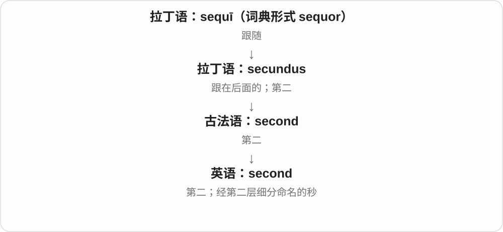

一小时先分成六十份得到分钟，再把一分钟分成六十份得到秒。动词 second a motion 是跟进支持一项提议；借调义读音另有变化。

**常见搭配与例句**

the second floor；a second chance；wait a second；second a motion。

> She finished second in the race.

她在比赛中获得第二名。

> Wait a second while I find the key.

等一下，我找找钥匙。

**别混淆**

second 的第二义与 two 的数量义不同。second a motion 是附议，不是把提议重复第二遍。

### 3. secondly — 第二、其次〔列举论点、理由〕

**音标**：/ˈsekəndli/

**先抓住这个画面**

把话分成几个层次，讲完第一点，再立起第二块路牌。secondly 用来引出第二个理由、步骤或观点。

**怎么拆**

second 第二 + -ly，形成列举次序的副词。second 的词族更早经法语接拉丁 secundus 第二、接下来的。

**怎么变成今天的意思**

**second 第二 + -ly**  
次序形容词转为相应副词

↓

**secondly 的篇章用法**  
列出第二点、其次

Firstly, ... Secondly, ... 常用于有条理的陈述。也可以用 First, ... Second, ...；不需要把两种形式硬混成不同事实顺序。

**常见搭配与例句**

firstly and secondly；secondly, we need to consider...。

> Firstly, the room is small. Secondly, it has no windows.

第一，房间很小。第二，它没有窗户。

> Secondly, we need to agree on a date.

其次，我们需要商定一个日期。

**别混淆**

secondly 通常不是每秒一次的单位副词。说 secondly 时在组织论述；说 per second 才是在说明每秒的数量。

### 4. actually — 实际上；其实；居然〔强调与预期不同〕

**音标**：/ˈæktʃuəli/

**先抓住这个画面**

听起来像这样，可把真实情况摊开看，原来是另一回事。

**怎么拆**

actual + -ly；常见口语弱化读音 /ˈæktʃəli/。这里 -ly 接整个 actual，不要误认成 act + ually。

**怎么变成今天的意思**

**拉丁 agere → actus → 晚期拉丁 actuālis**  
做、行动 → 行为、实施 → 实践中的

↓

**法语 actuel → 中古英语 actual**  
实际、真实的相应用法

↓

**actual + -ly → actually**  
按实际情况来说

Actually, I live nearby 可以温和纠正对方；Did he actually say that? 强调难以相信他真说了。语气用太重也可能显得居高临下，日常按上下文用。

**常见搭配与例句**

actually happen；actually mean；actually work；Actually, ...。

> I thought the shop was closed, but it was actually open.

我以为商店关门了，其实还开着。

> Actually, I have already read the report.

其实，这份报告我已经看过了。

**别混淆**

actually 说实情，不是 currently“目前”。I actually work here 是“我其实就在这里工作”，不是专门交代现在这个时段。

### 5. early — 早的；早期的；提早、在早时

**音标**：英 /ˈɜːli/；美 /ˈɜːrli/

**先抓住这个画面**

比预期时间靠前，或处在一天、一个过程的开始部分，都是 early。既能说 early train，也能直接说 arrive early。

**怎么拆**

接古英语 ærlic 形容词、ærlice 副词，前半是早、先于的旧材料，后半对应 -ly；不是 ear 耳朵 + -ly。

**怎么变成今天的意思**

**古英语 ær 早、先于 + -lic／-lice**  
早的性质；在早时的方式

↓

**中古英语 erly 等 → early**  
形容词、副词同形；比较级 earlier

an early start 很早开始；early in the morning 清晨；arrive early 提早到；the early stages 早期阶段。

**常见搭配与例句**

arrive early；an early start；the early stages。

> We took an early train to the coast.

我们坐早班火车去了海边。

> Please arrive early enough to find your seat.

请早点到，留出找座位的时间。

**别混淆**

early 本身就可作副词，不需造 earlyly；earlier 是更早，early 不是只有副词才可出现的 -ly 词。

### 6. earlier — 更早的；更早地；先前、早些时候

**音标**：英 /ˈɜːliə/；美 /ˈɝːliər/

**先抓住这个画面**

时间线上的位置往前移，是 earlier；与眼下这个时刻比，刚才或此前某时也可以只说 earlier。

**怎么拆**

early 词末 y 换 i 加 -er。early 本身继承较早英语早、早早地的词形，现代既作形容词也作副词，所以 earlier 也有两种功能。

**怎么变成今天的意思**

**early**  
早的；早地

↓

**early → earlier**  
相对更早；从眼下回看先前

an earlier train 更早一班火车；earlier than expected 比预期早；earlier today 今天早些时候；as mentioned earlier 如前所述。

**常见搭配与例句**

a little earlier；an earlier version。

> Could we take an earlier train?

我们能不能坐更早一班火车？

> I spoke to her earlier today.

我今天早些时候和她说过话。

**别混淆**

earlier today 不一定是昨天，而是今天此前某时。earlier 修饰名词是形容词：an earlier meeting；修饰 arrived 则是副词：arrived earlier。

### 7. earliest — 最早的；最早地；最早限度

**音标**：英 /ˈɜːliɪst/；美 /ˈɝːliɪst/

**先抓住这个画面**

几个可能时间摆开，落在最前面的那个是 earliest。at the earliest 则把边界说清：再早也早不过它。

**怎么拆**

early 词末 y 换 i 加 -est，形成形容词、副词的最高程度。at the earliest 是固定时间边界表达，承接最早的性质。

**怎么变成今天的意思**

**early → earlier**  
早 → 更早

↓

**early → earliest**  
最早；at the earliest 最早限度

the earliest train 最早一班火车；my earliest memories 最早的记忆；Monday at the earliest 最早也要星期一；at your earliest convenience 在你方便时尽早，较正式。

**常见搭配与例句**

the earliest possible date；the earliest known record。

> The repairs will be finished on Friday at the earliest.

维修最早也要星期五才能完成。

> We booked the earliest train of the day.

我们订了当天最早的一班火车。

**别混淆**

at the earliest 给出最早边界，事情可能更晚；at the latest 给最晚边界，事情应在那之前。两者方向相反。

### 8. probably — 很可能；大概；多半

**音标**：英 /ˈprɒbəbli/；美 /ˈprɑːbəbli/

**先抓住这个画面**

说话时留一点余地：目前看来大概是这样，但还没有把话说死。

**怎么拆**

probable + -ly，词尾 -le 在副词中成为 -ly。

**怎么变成今天的意思**

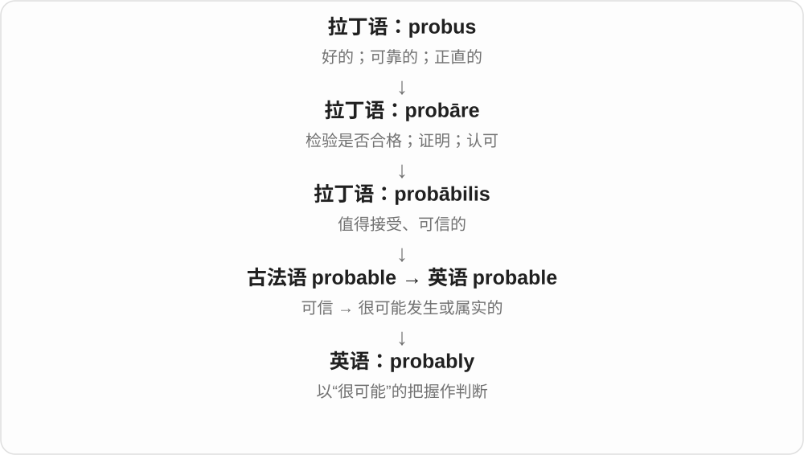

通常放在主要动词之前、be 之后，或放在句首。口语快速读时可能省弱音，但学习音标先保留清楚读法。

**常见搭配与例句**

will probably…；is probably…；probably not。

> I will probably take the earlier train.

我大概会坐前一班火车。

> She is probably already at the library.

她多半已经在图书馆了。

**别混淆**

probably 表较强可能，certainly 表确定；perhaps 或 maybe 往往保留更多不确定性。

### 9. happy — 高兴的；满意的；乐意的；幸运、合宜的

**音标**：/ˈhæpi/

**先抓住这个画面**

事情顺心，心里舒服；从运气好到心情好，是理解这个词的一条直观路。

**怎么拆**

中古英语 happy 早有幸运义，与 hap“运气”及相关北欧形式有关。现代可对照 hap + -y，历史具体形成有不同分析，不等同今天新拼出一个词。

**怎么变成今天的意思**

**中古英语 happy / happyn 等幸运相关形式；与 hap 好运等词相关**  
幸运、处境顺遂

↓

**英语 happy**  
高兴、满意、乐意；合宜、幸运等义

feel happy 高兴，happy with the result 对结果满意，happy to help 乐意帮忙，a happy accident 幸运巧合。比较级 happier、最高级 happiest。

**常见搭配与例句**

happy with；happy to；happy about；a happy accident。

> I am happy with the result.

我对结果很满意。

> I would be happy to explain it again.

我很乐意再解释一遍。

**别混淆**

happy to help 常是乐意帮，不一定说正在欢笑；lucky 幸运与 happy 高兴相关但现代不总能替换。

### 10. happily — 高兴地；乐意地；幸好、幸运地

**音标**：/ˈhæpɪli/，也读 /ˈhæpəli/

**先抓住这个画面**

可以是开心地做，也可以像回头感叹“还好事情这样发展”。

**怎么拆**

happy + -ly，y 变 i；中古英语有 happyly 等相应副词。幸运义与 happy 的好运旧背景相连。

**怎么变成今天的意思**

**中古英语 happy / happyn 等幸运相关形式；与 hap 好运等词相关**  
幸运、处境顺遂

↓

**英语 happy**  
高兴、满意、乐意；合宜、幸运等义

↓

**happy + -ly → happily**  
高兴、乐意地；幸运地

smile happily 开心微笑，happily agree 乐意同意，Happily, no one was hurt 幸好无人受伤。happily married 说婚姻幸福。

**常见搭配与例句**

smile happily；happily agree；happily married；Happily, ...。

> The children played happily in the garden.

孩子们在花园开心玩耍。

> I would happily help you move the boxes.

我很乐意帮你搬箱子。

**别混淆**

happily 可以表达乐意，不只笑着；hopefully 但愿面向愿望，happily 的幸好常评论已知好结果。

### 11. report — 报告；报道；汇报；报告书

**音标**：英 /rɪˈpɔːt/；美 /rɪˈpɔːrt/

**先抓住这个画面**

report 像从现场回来，把看到、听到、查到的情况带给别人。现代可以是口头汇报、新闻报道或一份书面报告。

**怎么拆**

拉丁语 re-（往回）+ portāre（携带），经法语 reporter 进入英语。

**怎么变成今天的意思**

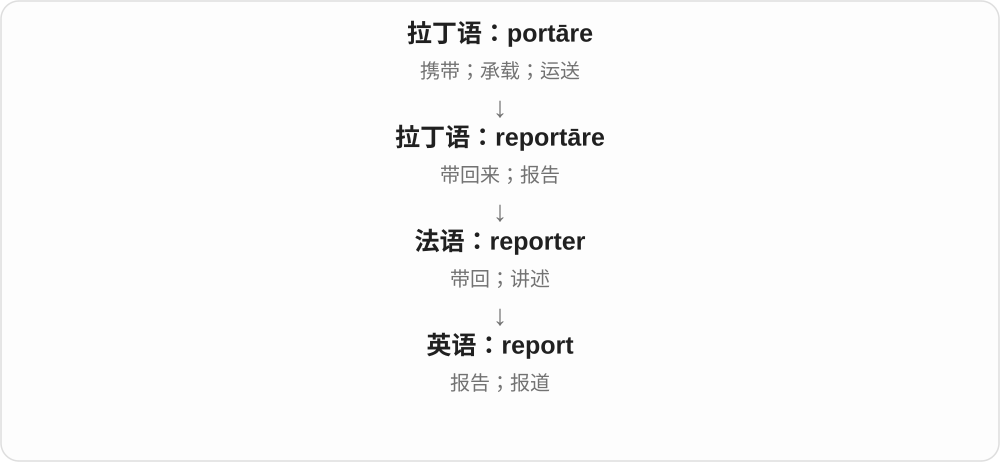

被带回来的东西从实物变成信息。report a problem 是把问题告知相关的人；report to a manager 也可表示在组织上向某位经理负责。

**常见搭配与例句**

write a report（写报告）；report a problem（报告问题）；report on an event（报道事件）；report to someone（向某人汇报或负责）。

> Please report any problems to the front desk.

遇到问题请告知前台。

> The report summarizes the team’s findings.

报告概述了团队的调查结果。

**别混淆**

report 重在传达情况，不保证说法已经核实。It is reported that… 是“据报道”，不是直接等于“已经证实”。

### 12. former — 以前的；前任的；前者

**音标**：英 /ˈfɔːmə/；美 /ˈfɔːrmər/

**先抓住这个画面**

以前担任这个职位、现在已不是，是 a former manager；先说茶再说咖啡，the former 就指先说的茶。

**怎么拆**

先前义接古英语 forma、中古英语 former 等，与 first、fore 的旧材料相关。另有 form + -er 成型者、成型器同形词，不能用它解释前任。

**怎么变成今天的意思**

**古英语 forma 先、第一等 → 中古英语 former**  
前面的、先前的历史比较形式

↓

**英语 former**  
以前的、前任的；两者中的前者

a former teacher 前教师；a former colleague 以前的同事；the former and the latter 前者与后者。

**常见搭配与例句**

a former colleague；the former；former students。

> I met a former colleague at the station.

我在车站遇到一位以前的同事。

> Tea and coffee were available; she chose the former.

现场有茶和咖啡，她选了前者。

**别混淆**

former 是先前的，formal 是正式的；former teacher 与 formal teacher 不是同一种修饰。

### 13. formerly — 从前；以前

**音标**：英 /ˈfɔːməli/；美 /ˈfɔːrmərli/

**先抓住这个画面**

这个地方、这个人以前处于那种身份，现在已经变了，用 formerly 把目光拉回过去。

**怎么拆**

former + -ly → formerly；保留 former 的 r 字母，和 formally 的 -al 不是同一基础。

**怎么变成今天的意思**

**古英语 forma 先、第一等 → 中古英语 former**  
前面的、先前的历史比较形式

↓

**英语 former**  
以前的、前任的；两者中的前者

↓

**former + -ly → formerly**  
在以前、先前状态中

formerly known as 以前名叫；formerly a school 以前是一所学校；formerly employed 曾受雇于。

**常见搭配与例句**

formerly known as；formerly used for。

> The building was formerly a school.

这栋楼以前是一所学校。

> The organisation was formerly known by a different name.

这个机构以前用另一个名称。

**别混淆**

formerly 以前，formally 正式地；即使某些口音读音接近，拼法和意思仍不同。

### 14. seem — 似乎；看来

**音标**：/siːm/

**先抓住这个画面**

根据眼前感受、迹象，事情有这个样子，但说话者不把自己放在完全确定的位置。

**怎么拆**

借古诺斯语 sœma 适合、相称等，经中古英语进入现代 seem。与 seam 接缝同音，不是同一构词。

**怎么变成今天的意思**

**古诺斯语 soema 适合、相称 → 中古英语 semen**  
合乎某种样子，显得适当

↓

**英语 seem**  
看起来、似乎

seem tired 看起来累；seem to know 似乎知道；It seems that ... 看来……；seem like 看着像。

**常见搭配与例句**

seem to do；seem + adjective；it seems that。

> You seem tired today.

你今天看起来很累。

> It seems that we have missed the last bus.

看来我们错过末班车了。

**别混淆**

seem 不只视觉外表，还能来自判断、听闻；seem to know 不表示看见了某个叫知识的东西。

### 15. seems — 似乎、看起来；seem 的第三人称单数

**音标**：/siːmz/

**先抓住这个画面**

根据眼前表现作判断，但话里留着余地：She seems tired，她似乎累了。seems 说的是给人的印象。

**怎么拆**

seem + -s，/m/ 后读 /z/。seem 借古诺尔斯语相称、合适等词，经中古英语发展到看起来、似乎的用法。

**怎么变成今天的意思**

**古诺尔斯语相称、合适词 → seem**  
较早相称义 → 看起来呈某状态

↓

**seem + -s → seems**  
单数主语给人的印象、推测

seems tired 似乎累了；seems to know 似乎知道；It seems that ... 看来……；seems like a good idea 似乎是个好主意。

**常见搭配与例句**

seems reasonable；There seems to be ...。

> The plan seems reasonable to me.

我觉得这个计划似乎合理。

> There seems to be a mistake in the address.

地址里似乎有一处错误。

**别混淆**

seems 后可直接接形容词，不用再加 is：seems tired。seems to be tired 也可以。It seems that 后则接完整从句。

### 16. seemed — 似乎、看起来当时是；seem 的过去式和过去分词

**音标**：/siːmd/

**先抓住这个画面**

根据当时的外表、表现或线索，你觉得事情像是某种样子，就用 seemed。它保留你是在作判断的感觉。

**怎么拆**

seem + -ed，/m/ 后读 /d/。seem 借古诺尔斯语 sœma 适合、相称一系，经中古英语发展为显得、似乎。

**怎么变成今天的意思**

**古诺尔斯语 sœma 等 → 中古英语 → seem**  
适合、相称 → 显得如此

↓

**seem + -ed → seemed**  
过去看起来、似乎

seemed tired 当时显得累；seemed to know 似乎知道；it seemed that ... 当时似乎……；seemed like a good idea 当时像个好主意。

**常见搭配与例句**

seemed reasonable；seemed to be working。

> The room seemed larger in the photograph.

照片里这个房间显得更大。

> He seemed to know exactly where to go.

他似乎很清楚该往哪里走。

**别混淆**

She was calm 直接说她平静；She seemed calm 是她看起来平静，留有内心可能不同的余地。seemed 是过去的印象，不自动评价现在怎样。

### 17. fine — 好的；精细的；罚款

**音标**：/faɪn/

**先抓住这个画面**

fine 要分两条线记。形容词像一件已经打磨好的作品：精细、优质，也能随口表示“还好”。罚款义则像付一笔钱，让处罚这件事得到结算。

**怎么拆**

不要拆成 f + ine。罚款义经法语 fin 来自 fīnis“结束、结清”。“精细、优质”义来自古法语 fin，通常也与 fīnis 或 fīnīre 联系，但更早的具体路线并不完全确定。

**怎么变成今天的意思**

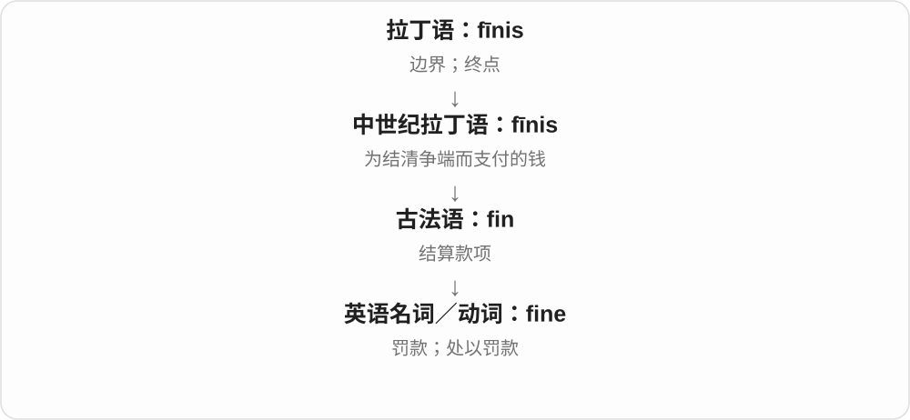

图里画的是较清楚的“罚款”路线。形容词可以用“加工到位 → 精良、精细”帮助理解，但不要把这个画面当成所有细节都已证实的历史。fine hair 是细发，fine wine 是佳酿，I’m fine 常只是说“我还好”。

**常见搭配与例句**

fine details（细节）；fine weather（好天气）；pay a fine（交罚款）；fine someone for…（因……罚某人款）。

> The camera can capture very fine details.

这台相机能拍出非常细微的细节。

> He paid a fine for parking in the wrong place.

他因停车位置不当交了罚款。

**别混淆**

I’m fine 不一定等于“我特别开心”，语气可能只是“没事”。a fine 是罚款，a fine meal 中的 fine 才是形容词。

### 18. finely — 细碎地；精细、精致地；出色地

**音标**：/ˈfaɪnli/

**先抓住这个画面**

切得很细、雕得很精、细节处理得好，都能把 fine 的细与精转成 finely。

**怎么拆**

fine 细的、精致的、优质的 + -ly；中古英语已有相应形式。副词保留不同形容词义，要按所修饰动作选。

**怎么变成今天的意思**

**fine 的细、精、好的多个性质**  
材料细碎；工艺精细；质量好

↓

**fine + -ly → finely**  
把相应性质转成动作方式、程度

finely chopped 切得很碎；finely carved 雕刻精细；finely balanced 精细平衡的。不同搭配中，细可以是尺寸，也可以是细节。

**常见搭配与例句**

finely ground；finely detailed。

> Add the finely chopped herbs to the bowl.

把切碎的香草加进碗里。

> The box was finely carved by hand.

这个盒子由手工精细雕刻而成。

**别混淆**

finely 与 finally 最后读音、拼写相近，但来源和意思不同。finely chopped 是切碎，不是终于切了。

### 19. especially — 尤其；特别是

**音标**：/ɪˈspeʃəli/

**先抓住这个画面**

especially 像在已有的一组东西里，用荧光笔圈出最值得强调的一项。

**怎么拆**

especial + -ly；especial 和 special 都来自法语 especial。

**怎么变成今天的意思**

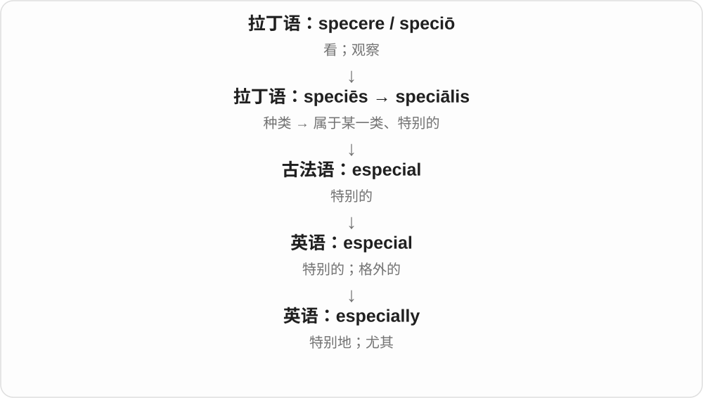

它常从总体转向重点：喜欢水果，尤其喜欢桃子。也可加强程度，如 especially difficult。

**常见搭配与例句**

especially when…；especially important；especially for children。

> I enjoy walking, especially in the early morning.

我喜欢散步，尤其喜欢清晨散步。

> The last question was especially difficult.

最后一道题特别难。

**别混淆**

especially 常突出“尤其”；specially 更常强调“特地为了某目的”。两者有重叠。

### 20. likely — 很可能的；可能会；合适或有希望的

**音标**：/ˈlaɪkli/

**先抓住这个画面**

看着乌云，你觉得雨很可能要来了。likely 表示事情符合眼前线索，看起来像会发生，但还没有成为确定事实。

**怎么拆**

中古英语已有 likely／likly，历史与古诺尔斯 líkligr“可能的”和古英语相关 ġelīclic 形式相连；借入与本族形式的作用有不同分析。可按 like“相似、看来如此”加形容词性 -ly 理解，不能当作“喜欢地”。

**怎么变成今天的意思**

**古英语 ġelīclic；古诺尔斯 líkligr 等同源形式**  
相称、合适；看起来可能

↓

**中古英语 likely／likly**  
看起来可信、可能

↓

**英语 likely**  
很可能；也说合适、有希望的候选者或地点

be likely to do 是很可能做某事；It is likely that… 后面接完整句子。likely 也可作副词，如 will likely arrive。a likely candidate 则常是看起来合适或有希望的人选。

**常见搭配与例句**

be likely to；it is likely that；most likely；a likely explanation。

> The roads are likely to be busy this evening.

今晚道路很可能会很拥堵。

> A loose cable is the most likely explanation for the problem.

电缆松动是这个问题最可能的原因。

**别混淆**

likely 不说明一个固定百分比。possible 只说存在可能，likely 通常判断发生的希望更大；likable 才是讨人喜欢。

### 21. perfect — 完美的；使完善

**音标**：形容词 /ˈpɜːfɪkt/；动词 /pəˈfekt/

**先抓住这个画面**

一幅拼图最后一块也放好了，这就是 perfect 的原始画面。现代可指毫无缺点，也可说某物恰好合适。

**怎么拆**

per- 表“彻底”，facere 在复合词中为 -ficere；perfectus 是 perficere 的分词。形容词与动词重音不同。

**怎么变成今天的意思**

做到底、完成 → 完整无缺 → 完美。动词 perfect 则是继续打磨，把已有的东西改得更好。

**常见搭配与例句**

perfect for…；a perfect example；perfect a technique。

> This quiet corner is perfect for reading.

这个安静角落很适合读书。

> She spent years perfecting her technique.

她花了多年完善自己的技法。

**别混淆**

perfect 常是强烈评价；complete 只保证完整，未必好到没有缺点。

### 22. perfectly — 完美地；完全、十分

**音标**：英 /ˈpɜːfɪktli/；美 /ˈpɜːrfɪktli/

**先抓住这个画面**

拼图正好扣上是 fits perfectly；I am perfectly happy 还可只是强调我完全满意，不是宣布自己的人生毫无缺点。

**怎么拆**

perfect + -ly → perfectly；perfect 的形容词读 /ˈpɜːfɪkt/ 等，副词承接这一读法，不套动词 perfect 的后重音。

**怎么变成今天的意思**

**拉丁 perfectus 完成、完善 → perfect**  
完整、完美的性质

↓

**perfect + -ly → perfectly**  
做到毫无偏差；也作完全的强调

fit perfectly 正好合适；perfectly clear 完全清楚；perfectly normal 十分正常。

**常见搭配与例句**

fit perfectly；perfectly clear；perfectly normal。

> The lid fits perfectly.

盖子盖得严丝合缝。

> It is perfectly normal to ask questions.

提出问题完全正常。

**别混淆**

perfectly normal 是完全正常，不等于完美得超过正常；副词有强调程度的固定用法。

### 23. finally — 终于；最后

**音标**：/ˈfaɪnəli/

**先抓住这个画面**

finally 像在一串过程后画上句号。等了很久后事情发生，是“终于”；按顺序说到最后一步，是“最后”。

**怎么拆**

final + -ly，把“最后的”变成描述动作或安排顺序的副词。

**怎么变成今天的意思**

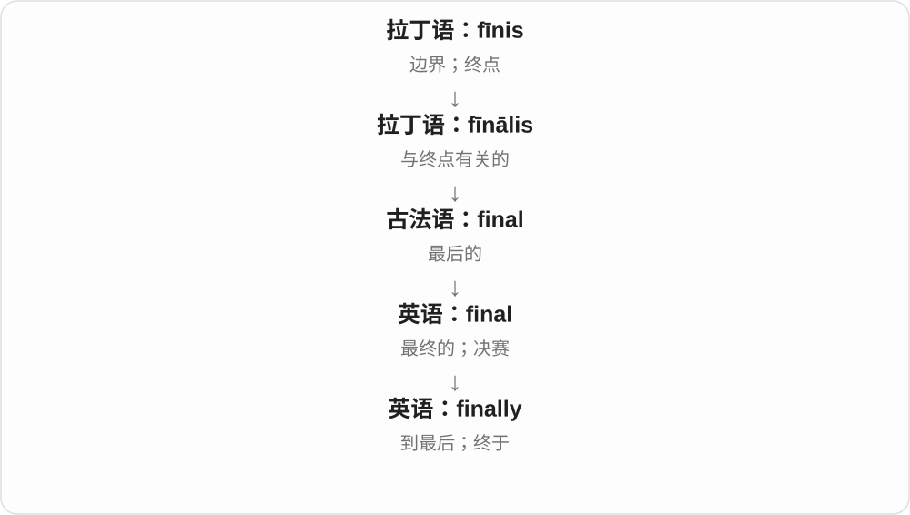

词根仍是终点，但终点有两种看法：回头看漫长等待，强调“总算到了”；往前安排步骤，表示“最后做这一件”。

**常见搭配与例句**

finally arrive（终于到达）；finally understand（终于明白）；first… then… finally…（先……再……最后……）。

> After three attempts, she finally opened the door.

试了三次后，她终于打开了门。

> Finally, add the salt and stir the soup.

最后，加盐并搅拌汤。

**别混淆**

finally 可以在列举时表示最后一点；eventually 更常说经过一段时间后出现的结果，不通常用来引出列表最后一项。

### 24. exactly — 恰好；准确地；正是；完全地

**音标**：/ɪɡˈzæktli/

**先抓住这个画面**

把位置、数量、说法对得刚刚好；单独回应时，就是你说得正对。

**怎么拆**

exact 精确的 + -ly 成副词。not exactly 在委婉语气里又常说不太算、并不怎么，不止数学上的没有完全相等。

**怎么变成今天的意思**

**拉丁 exigere → 分词 exactus → 英语 exact**  
驱出、索取；检查、按标准测定等历史用法

↓

**现代 exact 的分支**  
精确无差的；动词要求、索取；exacting 要求高

↓

**exact + -ly → exactly**  
精确、正好 → 准确地、正是

exactly ten minutes 恰好十分钟，exactly what I mean 正是我的意思；Exactly! 完全正确；not exactly cheap 不算便宜，常暗示挺贵。

**常见搭配与例句**

exactly the same；exactly right；exactly what；not exactly。

> That is exactly what I meant.

那正是我的意思。

> The journey took exactly thirty minutes.

旅程恰好花了三十分钟。

**别混淆**

exact 形容词，exactly 副词：the exact number，exactly ten。I don’t know exactly 不完全清楚，I know exactly 明明白白。

### 25. usually — 通常；大多数时候

**音标**：/ˈjuːʒuəli/

**先抓住这个画面**

usually 像在回看一排日子：多数格子里发生的都是同一件事，但允许有例外。

**怎么拆**

usual + -ly。-ly 把“惯常的”变成“通常怎样发生”的副词。

**怎么变成今天的意思**

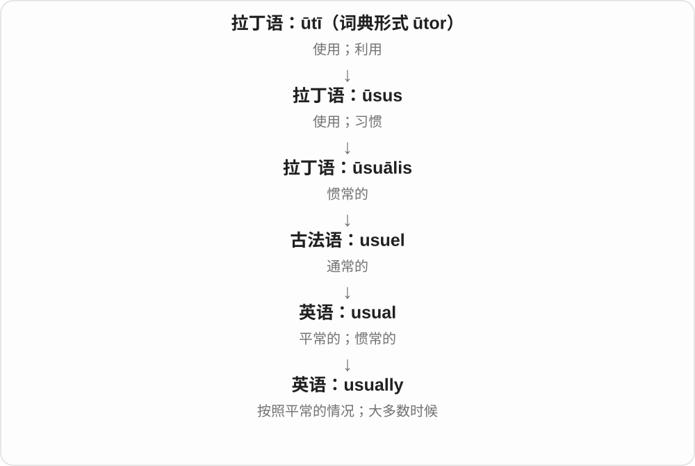

反复使用形成习惯，习惯又成为通常的做法。usually 不承诺次次如此；它告诉对方，按平时经验可以这样预期。

**常见搭配与例句**

usually 放实义动词前：usually walk；放 be 后：is usually quiet。

> I usually walk to work, but today I took the bus.

我通常步行上班，但今天坐了公交。

> The library is usually quiet in the morning.

图书馆早上通常很安静。

**别混淆**

always 是总是；usually 是大多数时候；sometimes 是有时。I usually walk 不表示今天一定步行。

### 26. amazing — 惊人的；很棒的；amaze 的 -ing 形式

**音标**：/əˈmeɪzɪŋ/

**先抓住这个画面**

让别人产生惊叹的那一端是 amazing。口语里也常直接说很棒，不要求真的每次都惊得说不出话。

**怎么拆**

amaze 去末尾 e 加 -ing → amazing；/z/ 仍发音。形容词的令人惊叹义由分词性质发展。

**怎么变成今天的意思**

**古英语 amasian 等 → 中古英语相应形式**  
使困惑、惊呆；a- 与迷乱材料相合

↓

**英语 amaze**  
使惊奇、惊叹

↓

**amaze + -ing → amazing**  
引起惊叹；口语扩大为很棒

an amazing view 惊艳景色；an amazing result 惊人的结果；That is amazing! 太棒了！

**常见搭配与例句**

an amazing view；an amazing result。

> The view from the hill was amazing.

山上的景色很惊艳。

> She did an amazing job with a small budget.

她用不多的预算做得非常出色。

**别混淆**

amazing 常描述原因、事物，amazed 描述被惊到的人；I am amazing 通常在夸自己很出色。

### 27. amazingly — 令人惊讶地；惊人地

**音标**：/əˈmeɪzɪŋli/

**先抓住这个画面**

事情超出了你的预料，心里冒出一句居然。amazingly 可以加强一个性质，也能把整件事标成令人意外。

**怎么拆**

amazing 令人惊讶的 + -ly，较深处接 amaze 的使惊异词族。形容性质转为程度、整句评价。

**怎么变成今天的意思**

**amaze → amazing**  
使惊异 → 令人惊讶的

↓

**amazing + -ly → amazingly**  
以令人惊讶的程度；令人意外的是

amazingly fast 快得惊人；Amazingly, nobody noticed. 令人意外的是，没人注意到。评价可以是好事，也可以只是出乎预料。

**常见搭配与例句**

amazingly well；amazingly, ...。

> The little boat moved amazingly fast.

那条小船快得惊人。

> Amazingly, the old clock still worked.

令人惊讶的是，那座旧钟还能走。

**别混淆**

amazingly 重在惊讶，wonderfully 常重在非常好；惊人的结果未必一定令人满意。

### 28. decide — 决定；判定；使……成为定局

**音标**：/dɪˈsaɪd/

**先抓住这个画面**

把纠缠的选项理到最后，定下“就这样办”；关键因素也能替结果一锤定音。

**怎么拆**

de- 离开 + caedere 切，拉丁 decidere 原有切断义，发展为解决争执；经古法语 decider 借入英语。

**怎么变成今天的意思**

**拉丁 caedere，分词 caesus；复合词常见 -cidere / -cisus**  
切、砍、击杀

↓

**拉丁 de- + caedere → decidere；分词 decisus**  
切断 → 了结争执、作出判断

↓

**古法语 decider → 中古英语 deciden → decide**  
决定、解决

decide to do 是决定行动；decide on 是选定；decide whether 是判断是否。The weather decided it 可说天气成了决定因素。

**常见搭配与例句**

decide to do；decide on；decide whether。

> They decided to postpone the outdoor concert.

他们决定推迟户外音乐会。

> One final question decided the winner.

最后一道题决定了胜者。

**别混淆**

consider 只是考虑，decide 则跨到了确定结果或行动的阶段。

### 29. decided — 决定了；明确的、明显的

**音标**：/dɪˈsaɪdɪd/

**先抓住这个画面**

一层是决定已经作出；形容词 a decided advantage 则说优势清清楚楚，不能轻易忽略。

**怎么拆**

decide + -ed，形成过去式、过去分词，再有确定、明显等形容词用法。decide 的词族更早接拉丁作出裁断的材料。

**怎么变成今天的意思**

**decide + -ed**  
已经决定、裁定

↓

**分词形容词 decided**  
确定的；区别、优势等清楚明显的

decided to leave 决定了离开；a decided improvement 明显改善；a decided advantage 明显优势。动词和形容词要按位置分。

**常见搭配与例句**

a decided change；a decided preference。

> We decided to take the earlier train.

我们决定乘坐更早一班火车。

> The new design offers a decided advantage.

新设计带来了明显优势。

**别混淆**

decided 作形容词不只表示有人决定过；a decided improvement 强调改善明显，不是一次作决定的改进。

### 30. decidedly — 明显地、明确地；无疑地

**音标**：/dɪˈsaɪdɪdli/

**先抓住这个画面**

说话者把判断说得很清楚：明显偏冷、明显更好，或答案明确是否定。不是描述一个人如何作决定。

**怎么拆**

decided 明确、明显的 + -ly。它从形容词的确定性发展为方式、程度和判断副词。

**怎么变成今天的意思**

**decided 的明确、明显性质**  
差别或判断确定

↓

**decided + -ly → decidedly**  
明显地；明确地；无疑地

decidedly different 明显不同；decidedly chilly 明显有些冷；decidedly not 明确不是。常带较坚定的判断语气。

**常见搭配与例句**

decidedly better；decidedly unusual。

> The weather turned decidedly chilly.

天气明显转冷了。

> The second version is decidedly better.

第二版明显更好。

**别混淆**

decidedly 常是明显、无疑；decisively 常说决定性地、果断地。两者都接 decide 词族，但现代用法侧重点不同。

### 31. currently — 目前；现在

**音标**：英 /ˈkʌrəntli/；美 /ˈkɜːrəntli/

**先抓住这个画面**

沿时间线把指针停在“现在”，currently 只告诉你此刻的状态，之后可能改变。

**怎么拆**

current + -ly。

**怎么变成今天的意思**

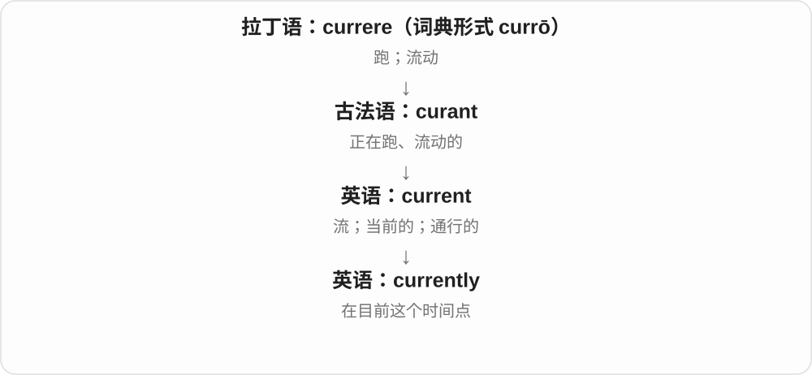

常用于报告现状，如正在维修、目前开放。它不表示过去一直如此，也不保证未来继续如此。

**常见搭配与例句**

currently available；currently working；currently under review。

> The library is currently closed for repairs.

图书馆目前因维修而关闭。

> She is currently working on her second novel.

她目前正在写第二部小说。

**别混淆**

currently 是目前；actually 是实际上。中文“现在”和“实际”不能混用到这两个副词里。

### 32. financial — 财务的；金融的

**音标**：/faɪˈnænʃəl/；也读 /fɪˈnænʃəl/

**先抓住这个画面**

financial 就是“与钱怎样进来、出去、筹到和管理有关”。financial trouble 不是钱包难用，而是钱周转出了问题。

**怎么拆**

finance + -ial，去掉词末 e，再形成形容词。末尾这部分读 /ʃəl/，不是把 finance 原样读完再加一个音节。

**怎么变成今天的意思**

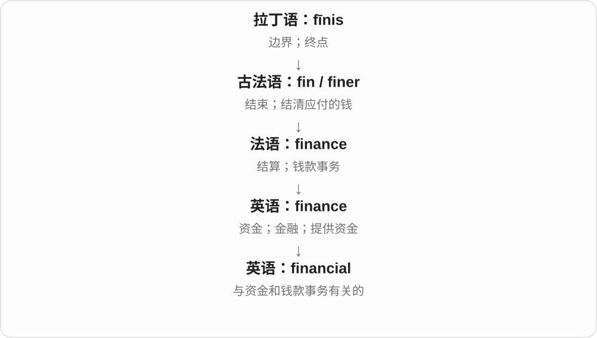

finance 已从“结清钱款”发展到资金管理；financial 再把它变成描述某种状况、机构或活动的词。

**常见搭配与例句**

financial support（资金支持）；financial problems（财务问题）；a financial report（财务报告）。

> The project needs financial support from several organizations.

这个项目需要几个组织提供资金支持。

> She reads the financial report before each meeting.

每次开会前，她都会阅读财务报告。

**别混淆**

financial 常聚焦资金、账目和融资；economic 更常谈经济活动、生产消费和整体经济状况。

### 33. financially — 在财务、经济上

**音标**：/faɪˈnænʃəli/

**先抓住这个画面**

一件事可能情绪上开心、经济上吃力，financially 就把讨论角度收在钱、收支与财务状况上。

**怎么拆**

financial + -ly → financially；已有 l 再接 -ly 写两个 l。financial 接 finance 的财务材料，不从 fine 好直接推出财务。

**怎么变成今天的意思**

**finance → financial**  
钱款、财务 → 财务相关

↓

**financial + -ly → financially**  
就财务状况、资金而言

financially independent 经济独立；financially viable 财务上可行；financially support 经济上支持。

**常见搭配与例句**

financially independent；financially viable；financially support。

> The project must be financially viable.

项目必须在财务上可行。

> Her family supported her financially during her studies.

她求学期间，家里在经济上支持她。

**别混淆**

financially independent 说经济不依赖，不等于 emotionally independent 情感独立；副词限定的是观察维度。

### 34. simple — 简单的；朴素的；单纯的

**音标**：/ˈsɪmpəl/

**先抓住这个画面**

从只有一层、没有很多层交织，去想结构不复杂、容易明白或不加装饰。

**怎么拆**

经法语来自拉丁语 simplex 一重的，对照 duplex 两重的。历史构词含一与折叠、重数的部分；不是现代英语 sim + ple 两个独立词。

**怎么变成今天的意思**

**拉丁语 simplex → 古法语 simple → 中古英语 symple**  
一重、一层；不复杂

↓

**英语 simple**  
简单、朴素、不加修饰；某些语境也可贬称头脑简单

a simple explanation 易懂解释，a simple meal 朴素的一餐，a simple design 简洁设计。说 a simple person 可能是在贬人头脑简单，要看语境。

**常见搭配与例句**

a simple solution；keep it simple；a simple meal；plain and simple。

> The instructions are simple and easy to follow.

说明简单明了，容易照着做。

> We had a simple meal of bread, soup and fruit.

我们简单吃了面包、汤和水果。

**别混淆**

simple 常肯定简洁，simplistic 却常批评把复杂问题想得过于简单。结构简单的任务也未必实际做起来 easy。

### 35. simply — 简单地；仅仅；简直；朴素地

**音标**：/ˈsɪmpli/

**先抓住这个画面**

可以说表达没绕圈，也可以把多余解释拿走：事情就只是这样，或者实在就是这样。

**怎么拆**

simple + -ly，历史上较长的 -lely 形式简化成 -ly，现代拼 simply。副词不只有动作简单这一义，还发展出仅仅、强调等用法。

**怎么变成今天的意思**

**拉丁语 simplex → 古法语 simple → 中古英语 symple**  
一重、一层；不复杂

↓

**英语 simple**  
简单、朴素、不加修饰；某些语境也可贬称头脑简单

↓

**simple → simply**  
简单的 → 简单地、仅仅、强调程度

explain simply 简单讲明白；simply because 仅仅因为；simply wonderful 简直太棒。put simply 相当于简单说来。

**常见搭配与例句**

put simply；live simply；simply because；simply not possible。

> Could you explain the idea more simply?

能把这个想法讲得更简单些吗？

> I stayed home simply because I was tired.

我待在家里，只是因为累了。

> The final result was simply wonderful.

最后的结果简直太棒了。

**别混淆**

simply 可以加强语气，不总能译简单地。The view is simply beautiful 是景色实在太美，不是景色美得简单。

### 36. daily — 每日的；每天；日报

**音标**：/ˈdeɪli/

**先抓住这个画面**

一天一次，或者每一天都会出现。

**怎么拆**

中古英语由 day 与 -ly 构成；古英语也有表示逐日的相关构词，但现代 daily 不能简单当作某个古英语长词直接删字母。后来名词用法可指日报。

**怎么变成今天的意思**

**英语 day；-ly**  
日；形容词或副词成分

↓

**中古英语 daily**  
每日的；每天

↓

**名词 daily**  
每天发行的报纸

a daily walk 是每日散步；check daily 是每天检查；a national daily 是全国性日报。同一个形式能修饰名词，也能修饰动作，要看它在句子里的位置。

**常见搭配与例句**

a daily routine；daily exercise；updated daily；a daily newspaper。

> Reading is part of her daily routine.

阅读是她每日习惯的一部分。

> The website is updated daily.

这个网站每天更新。

> He works for a national daily.

他在一家全国性日报工作。

**别混淆**

daily 强调每天发生；everyday 作形容词常表示日常、普通。an everyday problem 不保证它每天恰好发生一次。

### 37. huge — 巨大的；极大的

**音标**：/hjuːdʒ/

**先抓住这个画面**

体积大到很显眼，或影响、差距、变化大得惊人，都能用 huge。把普通 large 的程度再推高一截。

**怎么拆**

经中古英语 huge 接古法语 ahuge 高大、巨大的等形式；更远来源未定。有不同推测，不把某一种山丘来源说成定论。

**怎么变成今天的意思**

**古法语 ahuge → 中古英语 huge**  
高大、巨大的

↓

**现代具体与抽象范围**  
巨大物体；极大影响、差距、成功等

a huge building 巨大的建筑；a huge difference 极大差别；a huge success 巨大成功。具体、抽象名词都常接。

**常见搭配与例句**

a huge amount；a huge impact。

> A huge tree stood beside the house.

房子旁边立着一棵巨大的树。

> The new bridge made a huge difference to the village.

新桥给村庄带来了极大的改变。

**别混淆**

large 可中性陈述尺寸、数量大；huge 通常把程度说得更强。它是形容词，不能直接按 very 的方式修饰另一个形容词。

### 38. hugely — 极其、非常；在很大程度上

**音标**：/ˈhjuːdʒli/

**先抓住这个画面**

把 huge 的巨大程度用来加强一个评价：hugely successful 就是非常成功，不是在说成功有物理体积。

**怎么拆**

huge + -ly，形成程度副词；中古英语已有 hugely、hugeliche 等同族形式。

**怎么变成今天的意思**

**huge 巨大的 + -ly**  
把很大的程度转成副词

↓

**hugely 的常见搭配**  
极其；在很大程度上

hugely popular 极受欢迎；hugely successful 极其成功；benefit hugely 获益很大。修饰形容词、动词时都表达程度。

**常见搭配与例句**

hugely important；hugely enjoyable。

> The exhibition was hugely popular.

展览极受欢迎。

> The students benefited hugely from the extra practice.

额外练习让学生受益很大。

**别混淆**

huge 修饰名词，如 a huge success；hugely 修饰形容词，如 hugely successful。记住对应，句子就容易搭对。

### 39. recently — 最近；不久前

**音标**：/ˈriːsəntli/

**先抓住这个画面**

把动作放在离现在不太远的过去，不一定就是此刻正在做。

**怎么拆**

recent + -ly，形容词变时间副词；与完成时、过去时等都可搭配，按所表达时间结构选择。

**怎么变成今天的意思**

**拉丁语 recēns，词干 recent-**  
新鲜的、新近的

↓

**英语 recent**  
最近的、近来发生的；距离现在不久

↓

**recent → recently**  
最近的 → 最近发生、做过

I recently moved 不久前我搬家了；I haven’t seen her recently 最近没见到她。不是看到 recently 就只能强制使用一种时态。

**常见搭配与例句**

until recently；more recently；have recently；recently moved。

> We recently moved to a smaller flat.

我们不久前搬进一套较小公寓。

> I haven’t spoken to him recently.

我最近没有和他说过话。

**别混淆**

recently 最近、不久前，currently 目前；recently changed 是近来改过，未必正在改变中。

### 40. certainly — 肯定；无疑；当然可以

**音标**：英 /ˈsɜːtənli/；美 /ˈsɜːrtənli/

**先抓住这个画面**

certainly 像说话时把一个勾打得很明确：“这一点我认定。”回应请求时，则是爽快地说“当然可以”。

**怎么拆**

certain + -ly，中古英语已有 certeynly，后来延续为现代拼写。

**怎么变成今天的意思**

It certainly helps 是肯定有帮助；Certainly! 是礼貌同意；certainly not 可以坚定否认。

**常见搭配与例句**

certainly true；will certainly；certainly not；Certainly, please come in。

> The extra practice certainly helped.

额外练习确实起了作用。

> “May I use this chair?” “Certainly.”

“我能用这把椅子吗？”“当然可以。”

**别混淆**

probably 是大概；certainly 表示说话者把握很强。它表达态度强度，并不会让错误判断自动变真。

### 41. completely — 完全地；彻底地

**音标**：英、美 /kəmˈpliːtli/

**先抓住这个画面**

把程度推到头：没有剩下一点，没有留着半截。

**怎么拆**

complete + -ly，在英语中把形容词变成副词。

**怎么变成今天的意思**

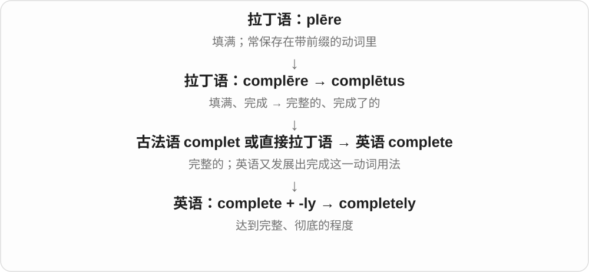

completely empty 是彻底空了；completely agree 是完全赞同。它常修饰一个可理解为有终点的状态，也常在口语中加强语气。

**常见搭配与例句**

completely different；completely forget；completely agree。

> I completely forgot about the meeting.

我把开会的事忘得一干二净。

> The two keys look similar but work completely differently.

两把钥匙看起来相似，作用却完全不同。

**别混淆**

almost completely 仍留一点；completely 本身不表示大部分。

### 42. nearly — 几乎；差不多；将近

**音标**：英 /ˈnɪəli/；美 /ˈnɪrli/

**先抓住这个画面**

离完成、达到那个点只差一点，但还没有完全跨过去。

**怎么拆**

near + -ly，副词从距离接近扩到数量、程度接近。不是普通的在附近。

**怎么变成今天的意思**

**古英语 nēar〔nēah 的比较级〕→ 中古英语 ner / nere**  
较近

↓

**英语 near**  
近；临近；逐渐靠近

↓

**near + -ly → nearly**  
在程度、数量等上接近

nearly finished 几乎完成，nearly fifty 将近五十；not nearly enough 是远远不够，否定后差距感会变大。

**常见搭配与例句**

nearly all；nearly finished；nearly twice；not nearly enough。

> We have nearly finished the work.

工作快做完了。

> That is not nearly enough time.

那点时间远远不够。

**别混淆**

nearly 与 almost 常相近；nearly 多说接近某量、状态，不能把 nearly everywhere 误解成附近到处。

### 43. absolutely — 完全、绝对；当然、完全同意

**音标**：英、美 /ˈæbsəluːtli/

**先抓住这个画面**

把程度推到没有保留的位置：完全正确、绝对不行，或干脆说“当然”。

**怎么拆**

英语 absolute + -ly；中古英语已有相应副词。absolute 的远源是“被解除限制”，不是 absolutely 表示解除某个实际绳结。

**怎么变成今天的意思**

**拉丁语 solvere；分词 solutus**  
松开、解开；清偿、解释

↓

**拉丁语 ab- + solvere → absolvere；absolutus**  
解除、放开；不受束缚、完成的

↓

**中古英语 absolute + -ly → absolutely**  
无条件地、完全地 → 强烈肯定或否定

absolutely right 是完全正确；Absolutely! 可单独答应别人；Absolutely not! 是强烈拒绝。它也常搭配 exhausted、essential 这类程度已经很高的形容词。

**常见搭配与例句**

absolutely certain；absolutely essential；absolutely no evidence。

> You are absolutely right about the date.

关于日期，你说得完全正确。

> “Can I join you?” “Absolutely!”

“我可以加入你们吗？”“当然可以！”

**别混淆**

very 常修饰可分级的程度；absolutely 常强调完全或毫无保留，但日常搭配也有弹性。

### 44. additional — 额外的；另外增加的

**音标**：/əˈdɪʃənəl/

**先抓住这个画面**

原来那份之外，再添一份时间、资料、人数，就是 additional。说的是多出来这一部分，不保证免费。

**怎么拆**

学术借入拉丁 additionalis；现代能对应 addition + -al。并非只由现代英语先造 addition 再第一次加尾。

**怎么变成今天的意思**

**拉丁 addere 增添 → additio、additionalis**  
增添；增添的性质

↓

**英语 additional**  
原有之外增加的、额外的

additional information 补充信息；additional time 额外时间；an additional charge 额外收费。

**常见搭配与例句**

additional information；additional time；an additional charge。

> We need additional information before deciding.

作决定前，我们需要补充信息。

> The task took an additional hour.

任务额外花了一小时。

**别混淆**

additional 是额外的，optional 是可选择的；额外步骤也可能是必须完成的。

### 45. additionally — 另外；此外

**音标**：/əˈdɪʃənəli/

**先抓住这个画面**

已经说完一条，再往清单上添一条，用 additionally 把两条加起来，不是在改口推翻前一句。

**怎么拆**

additional + -ly → additionally，已有 l 再接 -ly 写两个 l；常作句间、句内的补充副词。

**怎么变成今天的意思**

**拉丁 addere 增添 → additio、additionalis**  
增添；增添的性质

↓

**英语 additional**  
原有之外增加的、额外的

↓

**additional + -ly → additionally**  
以增添信息、条件的方式；此外

Additionally, ... 此外……；additionally required 额外要求的；additionally funded 另外获得资助的。

**常见搭配与例句**

Additionally, ...；additionally required。

> The room is spacious. Additionally, it has a small balcony.

房间宽敞，另外还有一个小阳台。

> Applicants are additionally required to provide a writing sample.

申请者还需另外提供一份写作样本。

**别混淆**

additionally 侧重补充，however 常引出转折；两者都能放句首，逻辑关系不同。

### 46. immediately — 立即；紧接着；紧邻

**音标**：/ɪˈmiːdiətli/

**先抓住这个画面**

两个动作之间不给空档，或者两个位置之间不再隔别的东西。

**怎么拆**

immediate + -ly，描述时间或位置关系。

**怎么变成今天的意思**

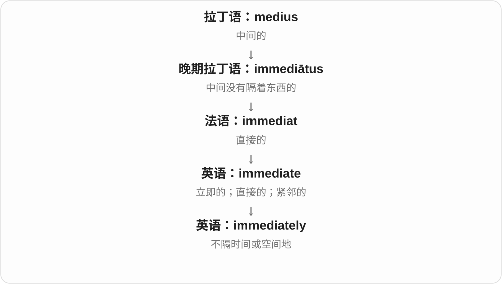

immediately after 是紧接在之后；immediately above 是就在正上方。中文并非所有地方都要翻成“马上”。

**常见搭配与例句**

leave immediately；immediately after；immediately above；immediately available。

> Please call me immediately if the plan changes.

如果计划有变，请立即给我打电话。

> Her office is immediately above mine.

她的办公室就在我的办公室正上方。

**别混淆**

soon 是不久后，仍可留一点时间；immediately 强调马上或紧挨着。

### 47. particularly — 尤其；特别；格外

**音标**：英 /pəˈtɪkjələli/；美 /pərˈtɪkjələrli/

**先抓住这个画面**

把聚光灯从一大群对象移到其中一个：尤其值得提的，就是 particularly 后面那一项。

**怎么拆**

particular + -ly，形容词变副词。

**怎么变成今天的意思**

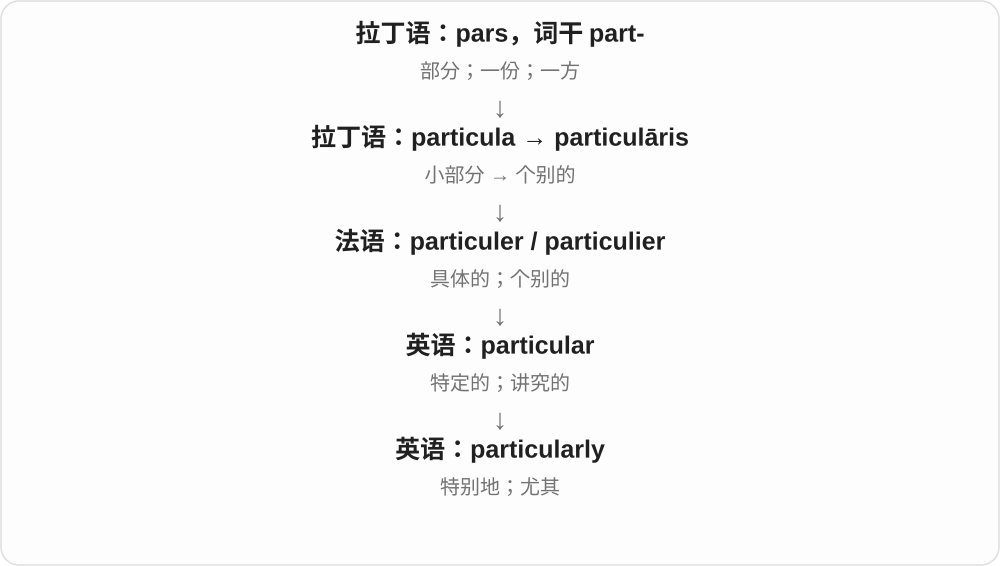

它可以挑出特别相关的对象，也可以加强程度。not particularly interested 通常是“不怎么感兴趣”，语气比直接说讨厌温和。

**常见搭配与例句**

particularly useful；particularly when；not particularly。

> The map is particularly useful when you travel alone.

独自旅行时，这张地图尤其有用。

> I am not particularly fond of sweet drinks.

我不怎么喜欢甜饮料。

**别混淆**

particularly 多用于突出程度或某一项；in particular 是短语，可放在名词后单独强调它。

### 48. definite — 明确的；确定的；有清楚界限的

**音标**：/ˈdefɪnɪt/

**先抓住这个画面**

原来模模糊糊，现在边界或答案定下来了：哪个时间、哪个计划，能说清。

**怎么拆**

借拉丁 dēfīnītus，dēfīnīre 的分词，与 define 同族。根意像把边界画清，不把 -ite 套成所有矿物名后缀。

**怎么变成今天的意思**

**拉丁 dēfīnīre → dēfīnītus**  
划定界线 → 已界定、确定

↓

**英语 definite**  
明确、确定 → 副词 definitely；否定 indefinite

a definite answer 明确答复，a definite date 确定日期，a definite improvement 明显改善；the definite article 语法定冠词。

**常见搭配与例句**

a definite answer；a definite date；a definite improvement。

> We need a definite date for the move.

我们需要确定搬迁日期。

> There has been a definite improvement in the writing.

写作有了明显进步。

**别混淆**

definite 确定、明确，definitive 常最终权威、定论性的；拼写相近但语气和搭配不同。

### 49. definitely — 肯定地；明确地；当然

**音标**：/ˈdefɪnɪtli/

**先抓住这个画面**

不是也许，而是说话者明确表态“确定，就是这样”。

**怎么拆**

definite + -ly，保持 definite 的拼写。日常加强肯定语气，也可单独回答 Definitely!。

**怎么变成今天的意思**

**拉丁 dēfīnīre → dēfīnītus**  
划定界线 → 已界定、确定

↓

**英语 definite**  
明确、确定 → 副词 definitely；否定 indefinite

↓

**definite + -ly → definitely**  
明确、毫无疑问地

definitely agree 完全肯定同意，definitely not 肯定不，I will definitely come 我一定来。

**常见搭配与例句**

definitely agree；definitely not；Definitely!。

> I will definitely call you tomorrow.

我明天一定打给你。

> That is definitely not the file I sent.

那肯定不是我发的文件。

**别混淆**

definitely 肯定与 defiantly 反抗地不是同词；避免拼成 definately。说话肯定不自动使内容成为事实。

### 50. definitive — 足以定论的、决定性的；权威完备的

**音标**：/dɪˈfɪnɪtɪv/

**先抓住这个画面**

争了很久，需要一个能把问题定下来的答案，这个答案就可能是 definitive。说一本书 definitive，常是在赞它权威、全面，足以当重要依据。

**怎么拆**

经法语 definitif 接拉丁语 definitivus，与 definire 划界、确定相连。明确边界的材料，发展出把事情作出最后确定的意味。

**怎么变成今天的意思**

**拉丁语 definire、definitivus → 法语 definitif**  
划定、确定、作出结论

↓

**现代 definitive**  
足以定论；权威而完备的

a definitive answer 决定性的答案；definitive evidence 足以定论的证据；the definitive guide 权威指南。

**常见搭配与例句**

a definitive account；a definitive statement。

> We still don’t have a definitive answer.

我们仍没有一个足以定论的答案。

> The book is regarded as a definitive guide to the subject.

这本书被视为该领域的权威指南。

**别混淆**

definite 是明确、确定；definitive 更强调最终解决问题、具有定论或权威性。a definite date 是明确日期，不必用 definitive。

### 51. definitively — 决定性地、足以定论地；最终明确地

**音标**：/dɪˈfɪnɪtɪvli/

**先抓住这个画面**

问题本来还悬着，证据、测试或决定把它定下来了。definitively 的重心是把疑问关上、给出可定论的结果。

**怎么拆**

definitive + -ly，把足以定论、最终明确的性质转成方式或判断程度的副词。

**怎么变成今天的意思**

**definitive 足以定论的 + -ly**  
以能够最终确定的方式

↓

**definitively 的研究、判断用法**  
决定性地证实、解决或排除

definitively prove 决定性地证明；definitively establish 明确而最终地确立；not definitively known 尚无定论。

**常见搭配与例句**

settle the question definitively；rule something out definitively。

> The experiment did not definitively resolve the question.

这次实验没有最终解决这个问题。

> The new evidence definitively established the date of the letter.

新证据最终确定了那封信的日期。

**别混淆**

definitely 是一定、肯定；definitively 是足以定论地。I’ll definitely come 是我一定来，不是把 come 改配 definitively。

### 52. indefinite — 不确定的；未限定的；期限未定的

**音标**：/ɪnˈdefɪnɪt/

**先抓住这个画面**

边界、时间或具体对象还没划清，有时就是不知道要持续到什么时候。

**怎么拆**

接晚期拉丁 indēfīnītus，现代可分析 in- 不 + definite。它否定确定界限，不等于每次都是无限、永远。

**怎么变成今天的意思**

**拉丁 dēfīnīre → dēfīnītus**  
划定界线 → 已界定、确定

↓

**晚期拉丁 in- + dēfīnītus → indefinite**  
没有被明确界定、确定的

an indefinite period 一段期限未定的时间，indefinite leave 期限未定的离开，an indefinite article 语法不定冠词。

**常见搭配与例句**

an indefinite period；for an indefinite time；the indefinite article。

> The event was postponed for an indefinite period.

活动延期，期限未定。

> They have only an indefinite idea of the cost.

他们对费用只有个模糊概念。

**别混淆**

indefinite 未规定终点，不保证 infinite 无限；计划尚未定可稍后确定。语法 indefinite article 是 a/an 的类别称呼。

### 53. indefinitely — 无限期地；未定结束时间地

**音标**：/ɪnˈdefɪnətli/

**先抓住这个画面**

日历上没有写哪天结束、何时恢复。indefinitely 抓住的是没有明确界限，并不保证真的永远不结束。

**怎么拆**

indefinite 不确定界限的 + -ly；indefinite 的 in- 是否定，definite 接明确限定、界限的拉丁词族。

**怎么变成今天的意思**

**in- 否定 + definite 的相应形式**  
没有明确界限

↓

**indefinite + -ly → indefinitely**  
以不确定界限、未定结束时间的方式

postponed indefinitely 无限期推迟；remain closed indefinitely 关闭至未定的时间。也可在抽象推演中说无限继续。

**常见搭配与例句**

continue indefinitely；be suspended indefinitely。

> The concert has been postponed indefinitely.

音乐会被无限期推迟了。

> We cannot keep the equipment here indefinitely.

我们不能一直把设备放在这里而不定结束时间。

**别混淆**

indefinitely 重在没有定终点；forever 明确说永远。活动无限期延期后仍可能在将来重新定日子。

### 54. generally — 通常；一般来说；普遍地

**音标**：/ˈdʒenərəli/

**先抓住这个画面**

把多数情况放在一起看，常见的样子是这样，但不保证每次都一样。

**怎么拆**

general + -ly；中古英语已有相应副词形式。-ly 将形容词对应成副词，不表示程度一定很强。

**怎么变成今天的意思**

**拉丁 genus → generālis**  
种类 → 涉及整体、同类共有的

↓

**法语 general → 中古英语 general**  
普遍的、总体的

↓

**general + -ly → generally**  
从整体、通常情况来说

generally speaking 引出概括，generally accepted 表示普遍接受。generally arrive early 是通常早到，不是从来没有迟过。

**常见搭配与例句**

generally speaking；generally accepted；generally available。

> She generally walks to work.

她通常走路上班。

> The proposal was generally welcomed by residents.

居民普遍欢迎这项提议。

**别混淆**

generally 通常，always 总是。The shop is generally quiet 可以有忙的时候；always quiet 把范围说得更绝对。

### 55. seriously — 认真地；严重地；说真的；口语还可加强程度

**音标**：英 /ˈsɪəriəsli/；美 /ˈsɪriəsli/

**先抓住这个画面**

可以说做事态度认真，也可以强调影响很重；放在整句前，有时就是提醒我没开玩笑。

**怎么拆**

serious + -ly，继承认真与严重两方面的意思，后有句子评论和程度强化用法。

**怎么变成今天的意思**

**拉丁语 sērius → 中世纪拉丁语 sēriōsus、法语 sérieux**  
严肃、认真的

↓

**中古英语 seryows → 英语 serious**  
认真、当真的；严重、重要的

↓

**serious → seriously**  
认真、严重 → 认真地、严重地；说真的

take something seriously 当回事；seriously damaged 严重受损；Seriously, ... 说真的。seriously good 口语可以是好得很，并不矛盾。

**常见搭配与例句**

take seriously；seriously consider；seriously damaged；seriously good。

> Please take the complaint seriously.

请认真对待这项投诉。

> We are seriously considering a smaller office.

我们正认真考虑换一间较小办公室。

> Seriously, you did a great job.

说真的，你做得很棒。

**别混淆**

seriously 修饰动词、分词或整句；serious 是形容词。take me seriously 是认真对待我，不是把我变严肃。

### 56. easily — 轻易地；容易地；毫无疑问地

**音标**：/ˈiːzɪli/

**先抓住这个画面**

动作完成时没遇到多少阻力；有时也表示比较结果很明显，根本不费劲就能看出。

**怎么拆**

easy + -ly，y 改 i；英语中的副词构词，不需要另找一个拉丁副词。

**怎么变成今天的意思**

**古法语 aise → aisier → aisié；盎格鲁法语 eisé**  
舒适 → 使舒服 → 舒服的

↓

**中古英语 esy〔也按 ese + -y 形成〕→ easy**  
自在的 → 不费力、容易的

↓

**中古英语 esy + -ly → easily**  
容易的 → 不费力地

常修饰能不能做到：can easily reach；也可加强最高级，easily the best 表示明显是最好的。否定时 not easily 是不容易，并不等于绝不可能。

**常见搭配与例句**

can easily；easily damaged；easily the best。

> The lid comes off easily if you turn it slowly.

慢慢转动的话，盖子很容易取下。

> This was easily the clearest explanation in the book.

这显然是书里最清楚的一段解释。

**别混淆**

easy 是形容词；easily 通常修饰动作。This is easy，但 She did it easily。

### 57. supposed — 所谓、据称的；应当、预期的〔be supposed to〕

**音标**：“所谓的”常读英 /səˈpəʊzɪd/、美 /səˈpoʊzɪd/；be supposed to 常读 /səˈpəʊzd/ 等

**先抓住这个画面**

a supposed expert 是被称为专家的人，语气可能存疑；You are supposed to arrive early 则说按安排、要求应该早到。

**怎么拆**

suppose + -ed，拼写时先去 e，再加完整 -ed。形容词所谓义保留 /ɪd/ 读法；be supposed to 的常用读音、结构另一起记。

**怎么变成今天的意思**

**suppose 假定、认为 → supposed**  
被认为如此；也进入应当、预期的固定结构

↓

**supposed + -ly → supposedly**  
按普遍说法、假定而言，尚未完全确认

a supposed expert 所谓专家；be supposed to do 应当、按安排做；be supposed to be 据说、预期是。

**常见搭配与例句**

a supposed expert；be supposed to do。

> The supposed expert could not answer a basic question.

那位所谓专家答不出一个基本问题。

> We are supposed to arrive before nine.

按安排我们应在九点前到。

**别混淆**

be supposed to 不等于已经做成；按规定该到，也可能实际上没到。读音不能只用一条机械规则覆盖所有结构。

### 58. supposedly — 据说；按通常说法；被认为

**音标**：英 /səˈpəʊzɪdli/；美 /səˈpoʊzɪdli/

**先抓住这个画面**

别人或一般说法是这样，自己还没完全确认，用 supposedly。它也可能暗含“号称如此，实际我有疑问”。

**怎么拆**

supposed + -ly → supposedly，常读出 /ɪd/，不是 supposed to 两词的拼写缩短。

**怎么变成今天的意思**

**suppose 假定、认为 → supposed**  
被认为如此；也进入应当、预期的固定结构

↓

**supposed + -ly → supposedly**  
按普遍说法、假定而言，尚未完全确认

supposedly true 据称属实；supposedly simple 号称简单；a supposedly reliable source 一个据称可靠的来源。

**常见搭配与例句**

supposedly true；supposedly simple；supposedly reliable。

> The box supposedly contains the original letters.

据说盒子里装着原信。

> The supposedly simple repair took all day.

号称简单的维修花了一整天。

**别混淆**

supposedly 作副词，不替代 be supposed to：He is supposedly here 和 He is supposed to be here 分别偏据说在这里、按安排应在这里。

### 59. directly — 直接地；正好；立即

**音标**：英、美 /dəˈrektli/，也读 /daɪˈrektli/

**先抓住这个画面**

中间不再隔一道：直接告诉本人，正对着入口，或者立刻接着做下一件事。

**怎么拆**

direct + -ly。

**怎么变成今天的意思**

**拉丁语：regere**  
引导、使直；治理

↓

**拉丁语：dirigere → directus**  
引向一定方向、摆直 → 直的

↓

**拉丁语及法语 → 英语 direct**  
引导、指向；直接的

↓

**英语：direct + -ly → directly**  
直接、不绕中间环节；随即

speak directly to someone 是直接对本人说；directly opposite 是正对面。I will come directly 在英式用法中可表示马上来，具体看上下文。

**常见搭配与例句**

directly opposite；directly responsible；speak directly to…。

> Please send any questions directly to me.

有问题请直接发给我。

> The pharmacy is directly opposite the station.

药店就在车站正对面。

**别混淆**

direct 有时也作副词，如 fly direct；直接修饰 responsible、opposite 等通常用 directly。

### 60. fully — 完全地；充分地

**音标**：/ˈfʊli/

**先抓住这个画面**

该覆盖的范围都覆盖到，没有只做到一半。

**怎么拆**

full + -ly，对照古英语 fullīce、中古英语 fully 等副词形式；现代不是把三个 l 全堆在一起，拼写为 fully。

**怎么变成今天的意思**

**古英语 full → 中古英语 ful**  
装满、完整

↓

**古英语 fullīce → 中古英语 fully → fully**  
以完整、充分的程度

fully understand 是充分理解，fully booked 是全部订满，fully aware 是完全意识到；通常修饰动作或状态。

**常见搭配与例句**

fully understand；fully aware；fully booked；fully developed。

> I fully understand your concern.

我充分理解你的顾虑。

> The hotel is fully booked this weekend.

酒店本周末已全部订满。

**别混淆**

full 是形容词常修饰名词，fully 是副词：a full explanation，一份完整解释；fully explained，已经充分解释。

### 61. highly — 高度地；非常；很高评价地

**音标**：/ˈhaɪli/

**先抓住这个画面**

把评价、能力或某种程度抬到较高位置，不一定有身体向上运动。

**怎么拆**

high + -ly，接古英语 hēalīce 等相应副词形式。现代 highly 多用于程度和评价，位置副词通常仍用 high。

**怎么变成今天的意思**

**古英语 hēah → 中古英语 high／heigh**  
高、重要、显著

↓

**古英语 hēalīce → 英语 highly**  
高度、很高程度地

highly skilled 是技能很高，highly unlikely 是非常不可能，think highly of someone 是高度评价某人。搭配相对固定，不把它当 very 的万能替代。

**常见搭配与例句**

highly recommended；highly effective；think highly of；highly unlikely。

> The course is highly recommended by former students.

往届学生高度推荐这门课。

> It is highly unlikely that the shop will reopen today.

这家店今天极不可能重新营业。

**别混淆**

The bird flew high 说飞得高，不能常规改成 flew highly；She is highly regarded 则说评价高。

### 62. eventually — 最后；终于；最终

**音标**：/ɪˈventʃuəli/

**先抓住这个画面**

尝试、等待或变化了一阵，事情终于到了那个结果，用 eventually。

**怎么拆**

eventual + -ly。

**怎么变成今天的意思**

它常带出时间和过程，但不必意味着很遥远。说 eventually agreed，暗示前面有过等待、讨论或不同意见。

**常见搭配与例句**

eventually arrive；eventually realize；will eventually…。

> We took several wrong turns but eventually found the hotel.

我们拐错了几次路，但最后找到了酒店。

> She eventually agreed to join the team.

她最后同意加入团队。

**别混淆**

finally 也可表示终于，还能标记清单的最后一点；eventually 通常说事情经历过程后的结果，不用来列举“最后一点”。

### 63. truly — 真正地；确实；忠实地

**音标**：/ˈtruːli/

**先抓住这个画面**

不是表面应付，而是确确实实如此，或从心里这样觉得。

**怎么拆**

现代 true + -ly，去掉 e，写 truly；历史有古英语 trēowlīċe、中古英语 trewely 等，不是唯一只能由现代拼写推出来。

**怎么变成今天的意思**

**古英语 trēowe / trīewe → 中古英语 trewe / true**  
忠实、可靠、真实

↓

**英语 true**  
符合事实；真正、忠实的

↓

**古英语 trēowlīċe → 英语 truly；对应 true + -ly**  
忠实、真实地；确实

truly grateful 真心感激，truly remarkable 确实非凡。Yours truly 是书信署名格式，也可幽默指本人。

**常见搭配与例句**

truly grateful；truly remarkable；truly believe；Yours truly。

> I am truly grateful for your help.

我真心感谢你的帮助。

> It was a truly unforgettable evening.

那是一个确实难忘的夜晚。

**别混淆**

truly 拼写没有 e；truly 强调真切、确实，不完全等于只把程度加高的 very。

### 64. wonderful — 非常好的；令人赞叹的

**音标**：英 /ˈwʌndəfəl/；美 /ˈwʌndərfəl/

**先抓住这个画面**

最初是让人惊叹，如今日常经常只是很棒、非常令人愉快。

**怎么拆**

wonder + -ful，相应组合古英语已有。由充满惊奇、令人惊叹，扩展成常用赞美形容词。

**怎么变成今天的意思**

**古英语 wundor、wundrian → 中古英语 wonder、wondren**  
令人惊奇的事；感到惊奇

↓

**现代 wonder**  
惊叹 → 好奇、心里想知道

↓

**wonder + -ful → wonderful**  
令人惊叹的 → 很棒的

a wonderful idea 很棒的主意，have a wonderful time 玩得很开心；不要求事情超自然或史无前例。

**常见搭配与例句**

a wonderful idea；wonderful news；have a wonderful time。

> Thank you for a wonderful evening.

谢谢你让我度过一个美好的夜晚。

> That is a wonderful idea for the school project.

那是一个很棒的学校项目点子。

**别混淆**

wonderful 常正面赞美；wonder 本身可以只是好奇，不能把 I wonder 译成我觉得很棒。

### 65. wonderfully — 极好地、美妙地；非常、格外

**音标**：英 /ˈwʌndəfəli/；美 /ˈwʌndərfəli/

**先抓住这个画面**

事情做得让人觉得真好，或者某种好性质特别突出。wonderfully 通常带欣赏、愉快的评价。

**怎么拆**

wonderful 极好的、令人赞叹的 + -ly；较早中古英语已有同族副词。wonder + -ful 的词形再转成方式、程度表达。

**怎么变成今天的意思**

**wonder + -ful → wonderful**  
令人赞叹、极好的

↓

**wonderful + -ly → wonderfully**  
做得极好；把好性质的程度加强

work wonderfully 效果极好；wonderfully simple 简单得很妙；wonderfully fresh 格外新鲜。既可修饰动作，也可加强形容词。

**常见搭配与例句**

wonderfully clear；wonderfully well。

> The new system works wonderfully.

新系统运转效果极好。

> Her explanation was wonderfully clear.

她解释得格外清楚。

**别混淆**

wonderful 是形容词，wonderfully 是副词。a wonderful meal 是一顿美餐，cook wonderfully 是做饭做得极好。

### 66. mostly — 主要地；大部分；多半

**音标**：/ˈməʊstli/〔英〕；/ˈmoʊstli/〔美〕

**先抓住这个画面**

把一堆情况分开看，其中占大头的那一部分是这样。

**怎么拆**

most + -ly，-ly 构成副词，常说明组成、情况或时间上的主要部分。

**怎么变成今天的意思**

**古英语 mǣst → 中古英语 most**  
数量、程度最高的

↓

**英语 most**  
最多；大多数；最

↓

**most + -ly → mostly**  
大部分如此；主要地

mostly students 是多数是学生；mostly dry 是大部分干燥、总体少雨。通常不表示每一处、每一次都一样。

**常见搭配与例句**

mostly made of；mostly because；mostly dry；mostly harmless。

> The audience was mostly made up of students.

观众大多数是学生。

> I work from home mostly, but I visit the office once a week.

我主要居家办公，不过每周去办公室一次。

**别混淆**

mostly 说占大部分，almost 说接近某个界线。mostly empty 表大部分是空的，almost empty 表几乎全空，侧重点不同。

### 67. previously — 以前；此前；先前

**音标**：英、美 /ˈpriːviəsli/

**先抓住这个画面**

把镜头从当前这件事，往之前发生过的事情拉回去。

**怎么拆**

previous + -ly，形容词“先前的”变为副词“先前曾经”。

**怎么变成今天的意思**

**拉丁语 prae + via → praevius**  
在前 + 道路 → 走在前面的

↓

**英语 previous**  
时间、次序上在前的

↓

**英语 previous + -ly → previously**  
在此前的时间里

previously unknown 是此前不知道的；as previously mentioned 是如前面已经提到的。它不要求事情发生在很久以前。

**常见搭配与例句**

previously worked；previously unknown；as previously mentioned。

> She had previously worked as a translator.

她此前做过翻译。

> The survey revealed a previously unknown footpath.

这次调查发现了一条此前不为人知的小路。

**别混淆**

formerly 常强调过去是、现在已不是；previously 只把时间定位在此前。

### 68. totally — 完全；彻底；当然、完全同意〔口语〕

**音标**：英 /ˈtəʊtəli/；美 /ˈtoʊtəli/

**先抓住这个画面**

把程度推到整块、整个范围都成立：没有留下“还有一部分不是”。

**怎么拆**

total + -ly；形容词完全的，变成副词完全地。口语后来也可单独表示强烈赞同。

**怎么变成今天的意思**

**拉丁语 totus → 中世纪拉丁语 totalis**  
全部、整个 → 完全的

↓

**古法语 total → 中古英语 total → total**  
整体的；后来也作总数、合计的名称

↓

**英语 total + -ly → totally**  
完全的 → 完全地；口语赞同

totally different 是完全不同；Totally! 可以回答别人的观点，表示“完全同意”。但正式论证不宜把所有小差异都夸成完全相反。

**常见搭配与例句**

totally agree；totally different；totally unexpected。

> The new design is totally different from the old one.

新设计与旧设计完全不同。

> I totally agree with your final point.

我完全同意你的最后一点。

**别混淆**

very 是程度很高；totally 通常强调完整程度，不能随意替换成 totally tall 这类不自然搭配。

### 69. obviously — 显然；明显地

**音标**：英 /ˈɒbviəsli/；美 /ˈɑːbviəsli/

**先抓住这个画面**

把一句话放在“根据眼前线索，这很容易判断”的位置上。

**怎么拆**

obvious + -ly；道路的画面经过 obvious，变成判断的清楚程度。

**怎么变成今天的意思**

**拉丁 via**  
道路、路径

↓

**拉丁 ob + viam → obviam → obvius**  
在路前面、迎面可遇见的

↓

**英语 obvious**  
从容易遇到、摆在眼前，发展为明显的

↓

**英语 obvious + -ly → obviously**  
以明显的方式；显然如此

She was obviously tired 是说疲倦很容易从表现看出来。句首 Obviously 也常表示说话者把某点当成双方已知，所以语气有时会显得理所当然。

**常见搭配与例句**

obviously tired；obviously wrong；Obviously, …。

> He was obviously relieved when the keys turned up.

钥匙找到时，他显然松了一口气。

> Obviously, we cannot fit twelve people into this tiny room.

显然，这间小屋容不下十二个人。

**别混淆**

apparently 常保留“看起来如此、据说如此”的距离；obviously 表示说话者觉得证据很清楚。

### 70. apparent — 明显的；表面上的、看似的

**音标**：/əˈpærənt/

**先抓住这个画面**

一条意思是已经显出来、很好看明白；另一条是只从显出来的样子看似如此。是否真正成立，后者还留余地。

**怎么拆**

经法语接拉丁 apparens，来自 apparere 显现；相关 ad- 与 parere 显现材料，不拆成 a + parent 家长。

**怎么变成今天的意思**

**拉丁 apparere 显现 → apparens → 古法语 aparent 等**  
呈现出来、看得见的

↓

**英语 apparent**  
明显的；表面看来如此的

become apparent 变得明显；for no apparent reason 看不出明显原因；apparent calm 表面镇静，未必内心平静。

**常见搭配与例句**

become apparent；for no apparent reason；apparent calm。

> The reason soon became apparent.

原因很快变得清楚。

> Her apparent calm hid considerable worry.

她表面的镇静掩盖了相当大的担忧。

**别混淆**

apparent 的明显义与表面义须看语境；an apparent error 是看似错误，不保证后来核查也认定错误。

### 71. apparently — 看来；据说、据所知

**音标**：/əˈpærəntli/

**先抓住这个画面**

根据眼前迹象或听来的信息，事情似乎如此。apparently 常给判断留一层余地，不是永远都能翻成铁证如山的显然。

**怎么拆**

apparent + -ly → apparently，保留 t。现代副词常重根据表现、消息看起来如此的用法。

**怎么变成今天的意思**

**拉丁 apparere 显现 → apparens → 古法语 aparent 等**  
呈现出来、看得见的

↓

**英语 apparent**  
明显的；表面看来如此的

↓

**apparent + -ly → apparently**  
根据表面、所闻所见作判断

apparently unaware 看来没有意识到；apparently empty 看似空着；Apparently, ... 据说、看来……。

**常见搭配与例句**

apparently unaware；apparently empty；apparently not。

> Apparently, the meeting has been moved to Friday.

据说会议改到星期五了。

> The house was apparently empty.

房子看起来空着。

**别混淆**

apparently 不一定怀疑对方撒谎，只交代信息与判断方式；obviously 通常更直接强调显而易见。

### 72. extremely — 极其；非常

**音标**：/ɪkˈstriːmli/

**先抓住这个画面**

把程度标尺推向很高的一端：不是稍微冷，而是冷得厉害。

**怎么拆**

extreme + -ly；最外、最高程度的意思成为程度副词。

**怎么变成今天的意思**

**拉丁 exter“在外的”→ 最高级 extrēmus**  
最外面的；最远的；最高程度

↓

**古法语 extreme → 英语 extreme**  
极端的；尽头

↓

**英语 extreme + -ly → extremely**  
极端的 → 程度极高地

常修饰形容词或副词，如 extremely useful、extremely slowly；不是形容某人政治立场时才会用。

**常见搭配与例句**

extremely difficult；extremely helpful；extremely well。

> The instructions were extremely clear.

说明极其清楚。

> The road becomes extremely slippery after rain.

雨后这条路会变得非常滑。

**别混淆**

extremely 比 very 通常更强；absolutely 常与完整、绝对性质的词搭配，不能处处互换。

### 73. possibly — 也许；可能；究竟、到底；尽可能

**音标**：英 /ˈpɒsəbli/；美 /ˈpɑːsəbli/

**先抓住这个画面**

possibly 像在判断旁边放一个小问号：“有这个可能，但我还不确定。”

**怎么拆**

possible + -ly；词尾 -ble 变成 -bly。

**怎么变成今天的意思**

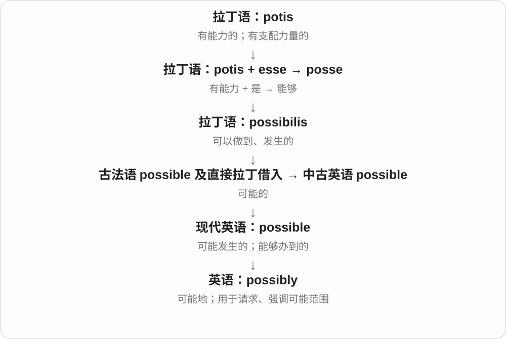

It could possibly work 留有不确定性。Could you possibly...? 让请求更委婉；I can’t possibly... 则往往强烈表示实在做不到。

**常见搭配与例句**

possibly because；could possibly；could you possibly；can’t possibly。

> We may possibly finish before lunch.

我们也许能在午饭前完成。

> Could you possibly move your bag from this seat?

能麻烦你把包从这个座位上挪开吗？

**别混淆**

possibly 往往比 probably 更不确定；can’t possibly 中的它不是把否定减弱，而是在强调不可能。

### 74. slight — 轻微的、少量的；纤细的；轻视、怠慢

**音标**：/slaɪt/

**先抓住这个画面**

温度只动了一点、笑容只浮出一点，就是 slight。把别人当不重要而怠慢，也接轻视的那一支。

**怎么拆**

接古英语 sliht、中古英语 slight 等平、细弱、轻微材料，和 slick 等属相关日耳曼词族；不是 s + light 光的现代组合。

**怎么变成今天的意思**

**古英语 sliht 等 → 中古英语 slight**  
平、薄弱、细小等旧性质材料

↓

**现代 slight**  
程度少；轻视、怠慢的相关评价

a slight change 微小变化；a slight smile 微笑；a slight build 纤细体格；feel slighted 觉得被怠慢。

**常见搭配与例句**

a slight change；a slight smile；feel slighted。

> There is a slight difference between the two versions.

两个版本有一点差异。

> She felt slighted when nobody asked for her opinion.

没人征求她的意见，她觉得受到怠慢。

**别混淆**

slight 说程度少，不保证一点影响没有；a slight error 仍然是一处错误。

### 75. slightly — 稍微；一点点

**音标**：/ˈslaɪtli/

**先抓住这个画面**

不是完全不变，也不是大变，只偏开一点点，就是 slightly。很适合给比较级划出小幅度。

**怎么拆**

slight + -ly → slightly，保留 t；/t/ 与 /l/ 相接，不必读成额外一个 /tɪ/ 音节。

**怎么变成今天的意思**

**古英语 sliht 等 → 中古英语 slight**  
平、薄弱、细小等旧性质材料

↓

**现代 slight**  
程度少；轻视、怠慢的相关评价

↓

**slight + -ly → slightly**  
以很小程度、幅度

slightly different 稍有不同；slightly larger 稍大；slightly open 微微开着。

**常见搭配与例句**

slightly different；slightly larger；slightly open。

> The second room is slightly larger.

第二个房间稍大一点。

> Leave the window slightly open.

把窗户留一条小缝。

**别混淆**

slightly 可以修饰比较级 larger；a little、a bit 也常能表小幅度，very 通常不能直接写 very larger。

### 76. lovely — 可爱的；美好的；令人愉快的

**音标**：/ˈlʌvli/

**先抓住这个画面**

天气、笑容或一顿饭，让你看见就觉得舒服、喜欢。

**怎么拆**

接古英语 luflīċ，经中古英语延续；现代对应 love + -ly。这里 -ly 是形容词构词材料，不把 lovely 当成修饰动作的普通副词。

**怎么变成今天的意思**

**古英语 lufu；lufian**  
爱；爱、喜爱这一动作

↓

**古英语 luflīċ → 英语 lovely**  
惹人喜爱的 → 美好、令人愉快的

a lovely day 可说天气或一天过得好；That’s lovely 常是温暖的赞许。英式口语尤其常见，也可夸人的态度亲切。

**常见搭配与例句**

a lovely smile；a lovely day；lovely to meet you。

> We had a lovely evening by the river.

我们在河边度过了一个愉快的夜晚。

> It was lovely to see you again.

再次见到你真高兴。

**别混淆**

lovely 是形容词：She has a lovely voice；不能用 She sings lovely 代替标准的 She sings beautifully。

### 77. entirely — 完全地；全然；仅由某事决定或构成

**音标**：英 /ɪnˈtaɪəli/；美 /ɪnˈtaɪərli/

**先抓住这个画面**

把程度推到整个范围，没有留下另一部分。

**怎么拆**

entire + -ly；英语中早已有这个副词，保留整个、完全的意思。

**怎么变成今天的意思**

**拉丁 integer**  
完整、未受损；历史上与否定 in- 和 tangere 触碰的词根有关

↓

**拉丁 integrum → 古法语 entier → 英语 entire**  
完整的 → 整个的、全部的

↓

**英语 entire + -ly → entirely**  
整个的 → 完全地

entirely different 是完全不同；depend entirely on 是完全依靠。not entirely sure 则是并不完全确定，语气通常比直接说 I do not know 更保留。

**常见搭配与例句**

entirely different；entirely dependent on；not entirely sure。

> The two proposals are entirely different.

这两个提案完全不同。

> I am not entirely convinced by that explanation.

我对那个解释还没有完全信服。

**别混淆**

entire 修饰名词，entirely 常修饰形容词或动词。not entirely correct 是并非全对，不等于完全错了。

### 78. honestly — 诚实地；说实话；确实

**音标**：英 /ˈɒnɪstli/；美 /ˈɑnɪstli/

**先抓住这个画面**

既可以说“我的回答没掺假”，也可以在整句话前提醒“我现在说真心话”。

**怎么拆**

honest + -ly；从人的诚实品质转为行事方式，也发展出说话态度用法。

**怎么变成今天的意思**

**拉丁 honos／honor**  
荣誉；尊敬

↓

**拉丁 honestus**  
值得尊敬的；正直的

↓

**古法语 honeste → 英语 honest**  
诚实的

↓

**honest → honestly**  
诚实地；坦率地说

answer honestly 是诚实回答；Honestly, I disagree 是坦白说不同意。I honestly thought… 常强调“我当时真的这样想”，有时用于解释误会，不一定是声称自己拥有准确事实。

**常见搭配与例句**

answer honestly；honestly believe；Honestly, …。

> Please answer the question honestly.

请诚实回答这个问题。

> I honestly thought the meeting was tomorrow.

我当时真以为会议是明天。

**别混淆**

honestly 修饰说话态度时类似 to be honest；actually 往往用于纠正事实，两者不总能替换。

### 79. originally — 原来；最初；本来

**音标**：英 /əˈrɪdʒɪnəli/；美 /əˈrɪdʒənəli/

**先抓住这个画面**

先把镜头拉回事情刚开始的时候。

**怎么拆**

original + -ly；中古英语已有 originali 等形式。

**怎么变成今天的意思**

**拉丁 orīrī；分词 ortus**  
升起、出现、出生

↓

**拉丁 orīgō / orīgin-**  
出现之处 → 开始、来源

↓

**晚期拉丁 orīginālis → 古法语 original → 中古英语 original / originali**  
最初的 → 起初

↓

**英语 originally**  
最初、本来

originally planned 通常暗示后来有变化。Where are you originally from? 问最初来自哪里，不一定是现在住在哪里。

**常见搭配与例句**

originally from；originally intended；originally planned。

> The building was originally a school.

这栋楼原来是一所学校。

> We originally planned to leave on Friday.

我们本来计划星期五离开。

**别混淆**

originally 多说时间起点；originally 在少数语境也可说独创地，日常表达“有创意地”更常用 creatively。

### 80. suddenly — 突然、忽然

**音标**：/ˈsʌdənli/

**先抓住这个画面**

镜头像被猛地切了一下：前一刻还正常，下一刻事情就变了。

**怎么拆**

sudden + -ly，形成副词，中古英语已有 sodenly 等形式。它修饰发生、出现、变化的方式。

**怎么变成今天的意思**

**拉丁语 subīre → subitus、subitāneus**  
来到、临近等；突然发生的

↓

**通俗拉丁语重建形 \*subitānus → 法语 sodain、subdain → 中古英语 sodeyn → sudden**  
突然、出乎预料的

↓

**sudden + -ly → suddenly**  
以突发方式；忽然

suddenly stop 突然停下，suddenly realize 突然意识到，suddenly disappear 突然不见；可放句首，也可放动词前。

**常见搭配与例句**

suddenly realize；suddenly stop；suddenly disappear。

> The lights suddenly went out.

灯突然全灭了。

> She suddenly realized that she had left her keys inside.

她突然意识到自己把钥匙落在里面了。

**别混淆**

sudden 形容词，suddenly 副词：a sudden stop 与 stop suddenly。suddenly 不等于 finally 终于，后者说等待后的结果。

### 81. appropriate — 合适、得体的；拨给；挪用、占为己有

**音标**：形容词：英 /əˈprəʊpriət/，美 /əˈproʊpriət/；动词词尾读 /eɪt/

**先抓住这个画面**

形容词说“它正适合这个用途”；动词则把东西划到某个人或用途名下，所以既能是正式拨款，也能是擅自占用。

**怎么拆**

后期拉丁 ad- + propriare“使归自己”形成 appropriare，分词 appropriatus。中古英语 appropriat 作形容词，appropriaten 作动词；两个词性共同接这条分词历史。

**怎么变成今天的意思**

**拉丁 proprius**  
某人或某物自己的、特有的；适合的

↓

**后期拉丁 ad- + propriare → appropriare / appropriatus**  
划归自己；指定给某用途

↓

**中古英语 appropriat / appropriaten → appropriate**  
形容词：特定用途的、合适的；动词：划拨、占用

appropriate for an occasion 说适合场合；appropriate funds for a project 是拨给项目资金。动词若说擅自拿别人东西，常带批评；不能因为形容词褒义就把动词也一律理解成好事。

**常见搭配与例句**

appropriate for / to；appropriate funds；appropriate someone else’s ideas。

> Please choose clothing appropriate for the weather.

请根据天气选择合适的衣服。

> The council appropriated funds for repairs to the bridge.

议会拨出了用于修桥的资金。

> He appropriated her idea without giving her credit.

他把她的想法据为己有，却没有说明是她提出的。

**别混淆**

suitable 与形容词 appropriate 接近；动词 appropriate 则不能译成“使合适”来覆盖常见的拨款和占用义。

### 82. appropriately — 恰当地；合适地

**音标**：英 /əˈprəʊpriətli/；美 /əˈproʊpriətli/

**先抓住这个画面**

衣服合场合、反应合情况，就是 appropriately。重点是匹配具体需要，不是越正式、越复杂就越合适。

**怎么拆**

appropriate 形容词 + -ly，保留 e → appropriately；形容词词尾读 /ət/ 等，区别于动词 appropriate 挪用、拨用的 /eɪt/。

**怎么变成今天的意思**

**拉丁 appropriare 等归为己有、适配材料 → appropriate**  
合适的；另有挪用、拨用动词义

↓

**形容词 appropriate + -ly → appropriately**  
按场合、需要恰当地

dress appropriately 穿着得体；respond appropriately 恰当回应；appropriately named 名字起得很贴切。

**常见搭配与例句**

dress appropriately；respond appropriately；appropriately named。

> The staff responded appropriately to the change.

员工对变化作出了恰当回应。

> The garden is appropriately named the Quiet Corner.

这座花园名为静角，十分贴切。

**别混淆**

appropriately 来自合适的形容词义，不解释成以挪用别人财物的方式做事。

### 83. relatively — 相对地；相比之下、还算

**音标**：/ˈrelətɪvli/

**先抓住这个画面**

说它便宜，不是世上最便宜，而是和眼前其他选项一比还算便宜。

**怎么拆**

relative + -ly。常把比较参照留在上下文里，不一定每句都明说 compared with what。

**怎么变成今天的意思**

**拉丁 referre → relātus → 晚期拉丁 relātīvus**  
带回、联系、涉及 → 相联系的

↓

**法语 relatif → 英语 relative**  
相对、相关的；与自己有亲属关系的人

↓

**relative + -ly → relatively**  
相对于参照物；相比之下

relatively small 相对较小，relatively easy 还算容易，relatively speaking 相对而言。

**常见搭配与例句**

relatively small；relatively easy；relatively speaking。

> The hotel is relatively inexpensive for this area.

在这个地区，这家酒店还算便宜。

> The instructions are relatively easy to follow.

这些说明还算容易照着做。

**别混淆**

relatively 依比较参照，absolutely 可完全、绝对；a relatively easy test 不保证所有人都觉得简单。

### 84. approximately — 大约；近似地

**音标**：英 /əˈprɒksɪmətli/；美 /əˈprɑksɪmətli/

**先抓住这个画面**

先给一个接近真实值的数字，同时告诉读者别把最后一位看得太精确。

**怎么拆**

形容词 approximate + -ly；原来的靠近，转成数值或准确程度上的接近。

**怎么变成今天的意思**

**拉丁 prope → proximus**  
近 → 最近的、紧邻的

↓

**晚期拉丁 ad- + proximare → approximare**  
向……靠近

↓

**英语 approximate**  
近似的；使接近、近似估计

↓

**approximate → approximately**  
近似的 → 大约、近似地

approximately twenty minutes 是大约二十分钟；approximately equal 是近似相等。它表示近似范围，既可能略多，也可能略少，不一定像 nearly 那样强调还没达到。

**常见搭配与例句**

approximately ten people；approximately equal；approximately once a week。

> The walk takes approximately twenty minutes.

这段路走过去大约需要二十分钟。

> The two containers hold approximately the same amount.

这两个容器的容量大致相同。

**别混淆**

approximately 和 about 都可表示大约；approximately 更正式。exactly 则强调准确无误。

### 85. friendly — 友好的；适合、方便……的；友谊赛

**音标**：/ˈfrendli/

**先抓住这个画面**

像朋友那样容易接近、不带敌意；工具对用户也能显得好相处。

**怎么拆**

friend + -ly，接古英语 frēondlīċ、中古英语 frendly 等；这里 -ly 构成形容词。名词 a friendly 又可指友谊赛、热身赛。

**怎么变成今天的意思**

**古英语 frēond / frīond → 中古英语 frend 等**  
朋友；更早形式与爱、亲爱的人有关

↓

**古英语 frēondlīċ → 中古英语 frendly → friendly**  
像朋友般友好；适宜相处、使用

a friendly smile 是友好微笑，a friendly atmosphere 是友善气氛；user-friendly 常说用户容易使用，作词族搭配理解即可。

**常见搭配与例句**

be friendly to；a friendly smile；a friendly atmosphere；a football friendly。

> The staff were friendly and helpful.

工作人员友好又乐于帮忙。

> The two teams played a friendly before the season began.

两队在赛季开始前踢了场友谊赛。

**别混淆**

friendly 是形容词，不因 -ly 就拿来替代所有副词：She spoke in a friendly way 很自然，不通常说 She spoke friendly 来表达标准书面语。

### 86. friendlier — 更友好、更亲切、更易接近的〔比较级〕

**音标**：英 /ˈfrendliə/；美 /ˈfrendliər/

**先抓住这个画面**

语气、表情或做法更像在欢迎你、愿意与你相处，是 friendlier。也能形容一种安排让人更容易接近、使用。

**怎么拆**

friendly 继承古英语 freondlic、中古英语 frendly 等，现代对应 friend + 形容词 -ly。比较时末尾 y 改 i，加完整 -er，不因为 ly 就当普通方式副词。

**怎么变成今天的意思**

**古英语朋友 + 性质材料 → friendly**  
像朋友般 → 友好、易相处

↓

**friendly 的 y 改 i + -er → friendlier**  
友好、亲切程度更高

a friendlier tone 更友好的语气；a friendlier welcome 更亲切的欢迎；friendlier than before 比以前友好。

**常见搭配与例句**

a friendlier message 更亲切的信息；a friendlier atmosphere 更友好的氛围。

> The second message sounds friendlier.

第二条信息听起来更亲切。

> The new neighbour seemed friendlier after our conversation.

聊过之后，新邻居显得更友好了。

**别混淆**

friendlier 在比较形容词 friendly。不是每个 ly 结尾词都用同一套副词规则，先看它在句子里说性质还是做事方式。

### 87. friendliest — 最友好、最亲切的〔最高级〕

**音标**：英 /ˈfrendliɪst/；美 /ˈfrendliɪst/

**先抓住这个画面**

在那一群人或那些互动里，最让人觉得受到欢迎、能轻松相处的，是 friendliest。

**怎么拆**

friendly 接古英语 freondlic 的形容词材料，现代可对应 friend + -ly。末尾 y 改 i，加完整最高级 -est，成为 friendliest。

**怎么变成今天的意思**

**古英语友好形容词 → friendly**  
像朋友般友善、适宜相处

↓

**friendly 的 y 改 i + -est → friendliest**  
比较范围中最友好、亲切

the friendliest person 最友好的人；the friendliest welcome 最亲切的欢迎；one of the friendliest… 最友好的……之一。

**常见搭配与例句**

the friendliest reply 最亲切的回复；the friendliest team 最友好的团队。

> She was the friendliest person in the room.

她是屋里最友好的人。

> We received the friendliest welcome of the whole trip.

我们受到了整趟旅行中最亲切的欢迎。

**别混淆**

friendliest 常是相处感受的最高评价，不表示这个人已经与所有人都成了朋友。关系身份 friend 和友善性质 friendly 要分开。

### 88. properly — 正确地；妥当地；像样地；完全地

**音标**：英 /ˈprɒpəli/；美 /ˈprɑːpərli/

**先抓住这个画面**

把事情做到它应有的样子：方法用对、步骤做足，或者终于认真处理了一遍。

**怎么拆**

proper + -ly，英语副词；不同用法分别承接 proper 的合适、正确和充分等义。

**怎么变成今天的意思**

**拉丁 proprius**  
某人或某物自己的、特有的；适合的

↓

**古法语 propre、盎格鲁法语 proper → 中古英语 propre**  
自己的、特有的；合适的

↓

**英语 proper**  
合适、正当；严格所指的本身

↓

**英语 proper + -ly → properly**  
合适、正确 → 妥当或正确地

work properly 是正常运作；eat properly 是像样地吃饭，不只是吃的姿势正确。properly speaking 则收紧表达范围，表示严格说来。

**常见搭配与例句**

function properly；be properly prepared；properly speaking。

> The door will not close properly unless you lift the handle.

不抬起把手，这扇门就关不严。

> We have not had time to discuss the proposal properly.

我们还没有时间认真充分地讨论这份提案。

**别混淆**

well 泛指好；properly 常强调符合该有的方法、要求或充分程度。

### 89. slowly — 缓慢地

**音标**：英 /ˈsləʊli/；美 /ˈsloʊli/

**先抓住这个画面**

把慢这一性质加到动作上：慢慢说、慢慢打开、慢慢恢复。

**怎么拆**

slow + -ly，规则副词。保留 slow 完整拼写，不写成 slowly 之外的变形。

**怎么变成今天的意思**

**古英语 slāw → 中古英语 slaw、slow → slow**  
慢、迟缓；旧有懒惰等相关义

↓

**现代 slow 词族**  
速度低 → 放慢；slow + -th 的历史分支 sloth

↓

**slow + -ly → slowly**  
慢 → 以慢的方式

speak slowly 慢慢说，recover slowly 缓慢恢复，slowly but surely 慢而稳地。

**常见搭配与例句**

speak slowly；move slowly；slowly but surely。

> Please speak slowly so I can take notes.

请慢一点说，方便我做笔记。

> The door opened slowly.

门缓缓打开了。

**别混淆**

a slow recovery 用形容词修饰名词，recover slowly 用副词修饰动词；slow 也有部分既定副词搭配。

### 90. typically — 通常；典型地；一贯如此地

**音标**：/ˈtɪpɪkli/，亦 /ˈtɪpɪkəli/

**先抓住这个画面**

先有一个熟悉的样子，再说事情通常按这个样子发生，或某次表现很符合一个人的一贯作风。

**怎么拆**

英语 typical + -ly；形容词变副词，常把中间弱读元音省去。

**怎么变成今天的意思**

**古希腊 typtein / typtō → typos**  
敲击 → 打出的印记；形状、样式

↓

**希腊 typikos → 后期拉丁 typicus → 中世纪 typicalis**  
与类型、象征有关的

↓

**英语 typical**  
典型的、有代表性的；通常的

↓

**英语 typical + -ly → typically**  
典型的 → 通常；有典型特点地

The trip typically takes an hour 是通常耗时一小时；typically generous 是一贯慷慨。放句首还可评论某人的作风，有时带欣赏，有时带抱怨。

**常见搭配与例句**

typically takes；typically found in；typically generous。

> The museum is typically quiet on weekday mornings.

这家博物馆在工作日上午通常很安静。

> In a typically generous gesture, she paid for everyone’s lunch.

她一如既往地慷慨，付了大家的午餐费。

**别混淆**

always 表每次都如此；typically 保留例外。normally 更侧重平常状态，typically 也能强调辨识度很高的特点。

### 91. fortunately — 幸运的是、幸好

**音标**：英 /ˈfɔːtʃənətli/；美 /ˈfɔːrtʃənətli/

**先抓住这个画面**

先告诉听者，接下来这个事实让人松一口气：坏事可能发生，幸好结果没那么糟。

**怎么拆**

fortunate + -ly，常作整句评价副词。不是说幸运的人做得很幸运，而是说整个结果值得庆幸。

**怎么变成今天的意思**

**拉丁 fortūna → 法语 fortune → 英语 fortune**  
机遇、命运、运气；后来有财产财富义

↓

**拉丁 fortūnātus → fortunate**  
受好运眷顾、幸运的

↓

**fortunate + -ly → fortunately**  
以好运而言；幸好某件事如此

Fortunately, ... 幸好……，fortunately for us 对我们来说幸运的是，fortunately enough 碰巧幸运地。

**常见搭配与例句**

Fortunately, …；fortunately for us。

> Fortunately, no one was hurt.

幸好没人受伤。

> Fortunately for us, the last bus was late.

对我们来说幸运的是，末班车晚点了。

**别混淆**

fortunately 幸好，luckily 也常用；fortunate 是形容词，不能直接照副词位置写 Fortunate, we arrived。

### 92. unfortunately — 遗憾的是、不幸的是

**音标**：英 /ʌnˈfɔːtʃənətli/；美 /ʌnˈfɔːrtʃənətli/

**先抓住这个画面**

给接下来的坏消息先标一个遗憾态度；常用于礼貌拒绝、说明不利结果，并不总是重大灾难。

**怎么拆**

unfortunate + -ly，把不利、令人遗憾的性质转为整句评价。也可对照 unfortunately 与 fortunately 的否定关系。

**怎么变成今天的意思**

**拉丁 fortūna → 法语 fortune → 英语 fortune**  
机遇、命运、运气；后来有财产财富义

↓

**拉丁 fortūnātus → fortunate**  
受好运眷顾、幸运的

↓

**unfortunate + -ly → unfortunately**  
遗憾地说，事情不利或不能如愿

Unfortunately, ... 遗憾的是……，unfortunately for him 对他不幸的是；委婉说明没有名额、无法出席等也常用。

**常见搭配与例句**

Unfortunately, …；unfortunately for someone。

> Unfortunately, the tickets are sold out.

遗憾的是，票已经卖完了。

> I would love to help, but unfortunately I am away that week.

我很想帮忙，可惜那周我不在。

**别混淆**

unfortunately 表遗憾，不是 unfortunately 必须用过去时；Unfortunately, I can’t come 是现在无法来的消息。

### 93. largely — 主要地；在很大程度上

**音标**：英 /ˈlɑːdʒli/；美 /ˈlɑːrdʒli/

**先抓住这个画面**

原因或组成中，有很大一块都落在这一边。

**怎么拆**

large + -ly；从“大范围、大份量”发展出“主要、很大程度上”。

**怎么变成今天的意思**

**拉丁 largus**  
丰富、充足；慷慨的，较早来源未定

↓

**古法语 large → 中古英语 large → 英语 large**  
宽广、慷慨 → 尺寸大、数量多

↓

**英语 large + -ly → largely**  
大范围地 → 主要地、很大程度上

largely successful 是大体成功，仍可能有问题；largely due to 说主要归因于，不必是唯一原因。

**常见搭配与例句**

largely because；largely due to；remain largely unchanged。

> The delay was largely due to bad weather.

延误主要是天气恶劣造成的。

> The village remains largely unchanged.

村庄基本保持原样。

**别混淆**

widely 侧重分布广；largely 更常说占主要部分或程度很高。

### 94. mainly — 主要地；大部分

**音标**：/ˈmeɪnli/

**先抓住这个画面**

说的是占主要份量的那一部分，同时允许还有别的因素。

**怎么拆**

main + -ly，中古英语已有相关副词形式。现代常说主要原因、主要组成或大部分情况。

**怎么变成今天的意思**

**古英语 mæġen 等相关形式 → 中古英语 main / mayn**  
力量、强大；强有力、主要的

↓

**英语 main**  
主要的；总管、干线；mains 可指公用供应系统

↓

**main → mainly**  
主要的 → 主要地、大部分

mainly because 主要因为，mainly made of 主要由……制成。mainly adults 以成年人为主，不等于完全没有孩子。

**常见搭配与例句**

mainly because；mainly for；consist mainly of；mainly used for。

> The visitors were mainly local residents.

访客主要是当地居民。

> We chose the flat mainly because it was close to work.

我们选这套公寓，主要因为它离工作地点近。

**别混淆**

mainly 大部分、主要，only 只有；mainly English books 不排除另有其他语言的书。

### 95. careful — 小心的；仔细周到的

**音标**：英 /ˈkeəfəl/；美 /ˈkerfəl/

**先抓住这个画面**

手里拿着容易碎的东西，会放慢些、留意些；做判断也能这样谨慎。

**怎么拆**

care + -ful，接古英语 carful、中古英语 careful 等；旧时也有忧虑等意义，现代常用义偏留心、谨慎。-ful 只有一个 l。

**怎么变成今天的意思**

**古英语 caru / ċearu；carian → 中古英语 care / caren**  
忧虑、挂心；关照、在意

↓

**古英语 carful → 中古英语 careful → careful**  
怀有挂虑、留心 → 谨慎仔细

be careful with glass 是拿玻璃小心，be careful about details 是留意细节，a careful analysis 是细致分析。be careful not to do 提醒避免某事。

**常见搭配与例句**

be careful with；be careful not to；a careful review。

> Be careful with that bowl; it is very old.

小心拿那个碗，它很有年头了。

> The decision followed a careful review of the evidence.

决定是在细致审查证据后作出的。

**别混淆**

careful 重谨慎、细致，caring 重对人的关怀；一个 caring 的人也可能收拾东西不够 careful。

### 96. carefully — 仔细地；小心地

**音标**：英 /ˈkeəfəli/；美 /ˈkerfəli/

**先抓住这个画面**

眼睛、注意力照顾到细节，手上的动作也留心，就是 carefully。它不要求做得非常慢，但要求有注意。

**怎么拆**

careful + -ly → carefully；-ful 的末尾一个 l 加 -ly 写成两个 l，相关古英语副词已存在，不是现代才第一次造出。

**怎么变成今天的意思**

**care、careful 相关古英语形式**  
挂念、留心；谨慎的性质

↓

**古英语 carfullice 等 → carefully**  
小心、仔细地；现代对应 careful + -ly

read carefully 仔细读；handle carefully 小心拿放；choose carefully 慎重选择。

**常见搭配与例句**

read carefully；handle carefully；choose carefully。

> Please read the instructions carefully.

请仔细阅读说明。

> She placed the glass carefully on the shelf.

她小心地把杯子放到架子上。

**别混淆**

carefully 说明留心程度，slowly 说明速度；可以慢而粗心，也可以熟练迅速且仔细。

### 97. admit — 承认；准许进入；接纳

**音标**：/ədˈmɪt/

**先抓住这个画面**

admit 像打开一道门：可以让人进入场所，也可以把一个原先不想面对的事实“放进自己的承认范围”。

**怎么拆**

拉丁语 ad-（到）+ mittere（让去、送出）形成 admittere“准许进入”，经法语、中古英语发展。

**怎么变成今天的意思**

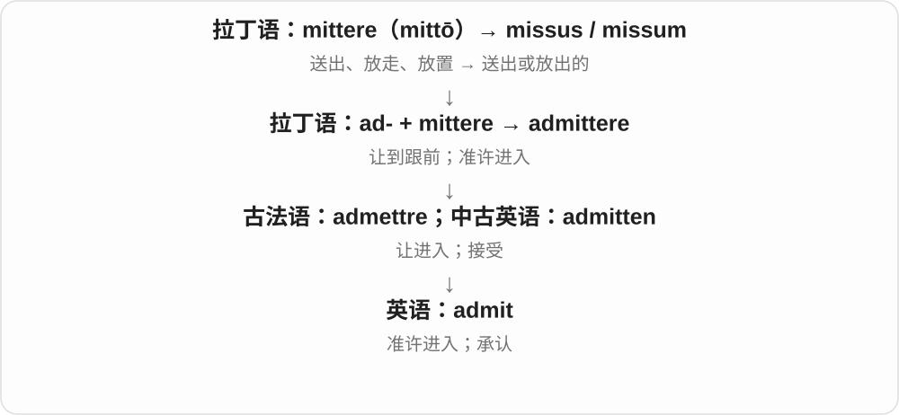

让人进门是具体接纳；承认事实是把它接纳为真。这个联系是帮助理解的画面，实际历史中两义逐步扩展。

**常见搭配与例句**

admit a mistake；admit that…；admit doing…；be admitted to… 。

> He admitted that he had misunderstood the instructions.

他承认自己误解了说明。

> The ticket admits one adult and one child.

这张票允许一位成人和一位儿童入场。

**别混淆**

admit doing 是承认做过；allow someone to do 是允许去做。不要把承认错误说成 admit to do。

### 98. admittedly — 诚然、不可否认；说实话承认一点

**音标**：/ədˈmɪtɪdli/

**先抓住这个画面**

先把对自己不利、或需要承认的一点摆出来：确实如此。后面常再补充其他考虑，但这个词本身是在承认事实。

**怎么拆**

admitted 被承认的 + -ly，接 admit 承认、允许进入的词族。由被承认这一性质发展为对整句话的立场标记。

**怎么变成今天的意思**

**admit → admitted**  
承认 → 被承认的

↓

**admitted + -ly → admittedly**  
承认这点地 → 诚然、不可否认

Admittedly, the task is difficult. 诚然，任务很难。也可放句中：The result is admittedly disappointing. 结果确实令人失望。

**常见搭配与例句**

admittedly difficult；admittedly imperfect。

> Admittedly, the first version needs more work.

诚然，第一版还需要继续打磨。

> The room is small, admittedly, but it gets plenty of light.

房间诚然小，但采光很好。

**别混淆**

admittedly 通常不是被迫认罪的意思；它可以只是坦承一个不足、事实。与 apparently 看来相比，它更明确表示说话者承认这一点。

### 99. heaven — 天堂、天国；天空〔文学等用法〕；极乐之地、极美好体验

**音标**：/ˈhevən/

**先抓住这个画面**

宗教里的天堂、天国；日常则能把特别幸福、享受的处境叫 heaven，像终于进入理想中的地方。

**怎么拆**

经中古英语 heven、hevene 等接古英语 heofon 天空、天堂，属于日耳曼词族。更远来源仍有不同分析，不强定唯一原始画面。

**怎么变成今天的意思**

**古英语 heofon → 中古英语 heven 等**  
天空、天国

↓

**现代 heaven 的宗教、比喻用法**  
天堂；无比美好的处境

go to heaven 去天堂；be in heaven 感觉幸福极了；the heavens 可用文学口吻指天空。不同信仰、故事里的 heaven 观念并不完全相同。

**常见搭配与例句**

a little piece of heaven；the heavens above。

> The old painting shows angels in heaven.

那幅旧画描绘了天堂里的天使。

> With a good book and a quiet room, she was in heaven.

有好书和安静的房间，她感觉幸福极了。

**别混淆**

sky 是日常看到的天空；heaven 常联系宗教或极美好体验。haven 则是避风港、庇护处，虽相像却是另一个词。

### 100. heavenly — 天堂的、天上的；美妙至极的

**音标**：/ˈhevənli/

**先抓住这个画面**

先是属于 heaven 的，后来也能用天堂般的美好来夸味道、声音或享受。

**怎么拆**

与古英语 heofonlic 天上的、天堂的形容词相连，经中古英语延续；现代对应 heaven + -ly。这里的 -ly 主要是形容词材料。

**怎么变成今天的意思**

**古英语 heaven 相关词 + -lic**  
天上的、天堂的

↓

**中古英语 hevenly → heavenly**  
天堂的；引申为美妙至极的

heavenly bodies 天体；a heavenly voice 天籁般的声音；a heavenly smell 美妙的香味。日常称赞往往带夸张。

**常见搭配与例句**

heavenly music；taste heavenly。

> The garden smelled heavenly after the rain.

雨后的花园香气美妙极了。

> The choir sang with heavenly voices.

合唱团唱出了天籁般的声音。

**别混淆**

heavenly 主要是形容词，因此 The cake tastes heavenly 是说蛋糕味道美妙；不能看到 -ly 就一律判为副词。

### 101. normally — 通常；正常地

**音标**：英 /ˈnɔːməli/；美 /ˈnɔːrməli/

**先抓住这个画面**

一面问“平常是怎样”，一面问“有没有按应有方式运转”：normally 可以回答这两种问题。

**怎么拆**

英语 normal + -ly，把“通常、正常”的形容词变成描述情况或方式的副词。

**怎么变成今天的意思**

**拉丁 norma**  
木工直角尺；由此指规则、标准

↓

**拉丁 normalis → 英语 normal**  
按直角尺的；合乎规则、常态的；几何中为垂直的

↓

**英语 normal + -ly → normally**  
通常如此；按正常方式运作

I normally walk 指我通常步行；the machine is working normally 指机器运作正常。前者说习惯，后者说状态；不要只记一个“通常”就套进所有句子。

**常见搭配与例句**

normally do something；function normally；normally open〔工程中常开〕。

> I normally take the bus, but today I walked.

我通常坐公交，不过今天步行了。

> The printer is working normally after the restart.

重启后，打印机运作正常了。

**别混淆**

usually 主要表示经常如此；normally 还可以表示运行正常，所以 working normally 不必译为“通常工作”。

### 102. personally — 亲自；就我个人而言；针对个人地

**音标**：英 /ˈpɜːsənəli/；美 /ˈpɜːrsənəli/

**先抓住这个画面**

把范围落到某个具体的人：我自己去做、我自己的看法，或者觉得别人是在冲我来。

**怎么拆**

personal + -ly 成副词；中古英语已有对应形式。personal 经法语接拉丁语 persōnālis 与个人有关的。

**怎么变成今天的意思**

**拉丁语 persōna → persōnālis → 法语 personal**  
人、角色 → 与个人有关的

↓

**中古英语 personal → 现代英语 personal**  
个人的、私人的；针对个人的

↓

**personal + -ly → personally**  
个人的 → 亲自、就个人而言

Personally, I disagree 是就我个人而言不同意；thank someone personally 亲自道谢；take criticism personally 把批评当成针对自己这个人。

**常见搭配与例句**

personally speaking；know someone personally；take it personally；personally responsible。

> I will personally check every address.

我会亲自核对每个地址。

> Please don’t take the comment personally.

请别把这句话当成针对你个人。

**别混淆**

personally 亲自或就个人而言；in person 强调本人到场。I personally checked it 不保证是在现场而非远程核查。

### 103. ultimately — 最终；归根到底

**音标**：/ˈʌltɪmətli/

**先抓住这个画面**

前面绕了不少环节，最后结果或最根本的决定因素落在这里。

**怎么拆**

ultimate + -ly；由尽头、根本层面的形容词变为副词。

**怎么变成今天的意思**

**拉丁语 ultimus**  
最远、最后

↓

**晚期拉丁语 ultimare → ultimatus**  
走到终点 → 最终的

↓

**英语 ultimate**  
最终的、根本的；最高程度的

↓

**英语 ultimate → ultimately**  
最终、根本的 → 最后、归根到底

最终结果可说 ultimately failed；讨论根本责任可说 ultimately it is your decision。它不表示某件事马上发生，也不只是“最后一句话”。

**常见搭配与例句**

ultimately lead to；ultimately depend on；ultimately responsible。

> The small design flaw ultimately caused the system to fail.

这个小设计缺陷最终导致系统失效。

> Ultimately, the choice is yours.

归根到底，选择在你。

**别混淆**

eventually 多说经过时间终于发生；ultimately 还可说归根到底，不一定强调等待很久。

### 104. weekly — 每周的；每周一次地；周刊

**音标**：/ˈwiːkli/

**先抓住这个画面**

日历每翻过一周，事情就再来一次；也可用来表示一周总量。

**怎么拆**

week + -ly，接中古英语 wykely 等。-ly 在此能构成形容词、副词；a weekly 又可名词化表示周刊。

**怎么变成今天的意思**

**古英语 wice / wucu → 中古英语 weke**  
一周；更早与周期、次序的词族有关

↓

**英语 week**  
连续七天；日历中的一周

↓

**week + -ly → weekly**  
按周的；每周；周刊

a weekly meeting 是周会，paid weekly 是每周领薪，weekly income 是周收入，a local weekly 是当地周刊。别把形容词副词只认其中一种。

**常见搭配与例句**

a weekly meeting；paid weekly；weekly income；a local weekly。

> We hold a weekly planning meeting.

我们每周开一次计划会。

> The column appears in a local weekly.

这个专栏刊登在当地一家周刊上。

**别混淆**

weekly 每周，weeklong 持续一周；一场 weekly meeting 可以只开半小时，并不是持续开七天。

### 105. frequently — 频繁地、经常

**音标**：/ˈfriːkwəntli/

**先抓住这个画面**

做这件事不是偶尔一次，而是隔些时候就会再发生；把 frequent 次数密的特点放到动作上。

**怎么拆**

形容词 frequent + -ly，副词重音保持在前；不是从后重音动词再表示常去的某个人。

**怎么变成今天的意思**

**拉丁 frequēns → 法语 frequent → frequent〔形容词〕**  
拥挤、密集 → 经常、频繁

↓

**frequent + -ly → frequently**  
以很高频率发生地

frequently asked questions 常见问题，travel frequently 经常出行，check frequently 经常检查。缩写 FAQ 的 F 来自 frequently。

**常见搭配与例句**

frequently asked questions；travel frequently；check frequently。

> She travels frequently for work.

她因工作经常出差。

> The answer appears in the frequently asked questions.

答案就在常见问题里。

**别混淆**

frequently 与 often 常近义，前者稍正式；frequently 是副词，不能在 a frequent visitor 中直接替形容词。

### 106. hopefully — 抱着希望地；希望如此、但愿

**音标**：英 /ˈhəʊpfəli/；美 /ˈhoʊpfəli/

**先抓住这个画面**

可以描写一个人期待的眼神，也可以给整句话加上“但愿会这样”。

**怎么拆**

hopeful + -ly，既有方式副词义，也发展为句子副词。不是任何情况下都必须补回一个正在充满希望的人。

**怎么变成今天的意思**

**古英语 hopian → 中古英语 hopen**  
希望、期待

↓

**英语 hope〔相应名词也有古英语前身〕**  
希望；抱有实现可能的愿望

↓

**hope → hopeful → hopefully**  
希望 → 抱希望的 → 抱希望地、但愿

look hopefully at someone 期待地看某人；Hopefully, it will stop raining 表示但愿雨停。后一用法在现代日常英语很普遍。

**常见搭配与例句**

look hopefully；wait hopefully；Hopefully, ...。

> Hopefully, the weather will improve tomorrow.

但愿明天天气会好些。

> The dog looked hopefully at the sandwich.

狗眼巴巴地望着三明治。

**别混淆**

hopefully 表愿望，不等于 certainly 一定；说 Hopefully, we’ll finish today 仍承认有不确定性。

### 107. surely — 想必；肯定；稳妥地

**音标**：英 /ˈʃɔːli/；美 /ˈʃʊrli/

**先抓住这个画面**

说 Surely you remember 时，像在说“你应该记得吧”：带有自己的把握，也往往期待对方认同。

**怎么拆**

sure + -ly。

**怎么变成今天的意思**

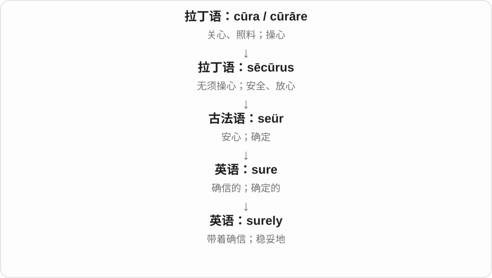

句首的 surely 常是有把握的推断或反问，不等于已经拿到绝对证据。slowly but surely 则说进度慢却稳。

**常见搭配与例句**

Surely you…；will surely…；slowly but surely。

> Surely there is a simpler way to do this.

想必有更简单的办法吧。

> Slowly but surely, the garden began to recover.

虽然慢，但花园确实在逐渐恢复。

**别混淆**

Sure. 可直接答应请求；Surely. 通常不能直接替代这种口语回应。

### 108. heavily — 大量地；严重地；重重地；很大程度上

**音标**：/ˈhevɪli/

**先抓住这个画面**

修饰动作、程度：雨下得大，受损严重，或很依赖某件事。

**怎么拆**

heavy + -ly，y 改 i，成为 heavily；不是直接照抄 heavyly。不同搭配接 heavy 的强度、重量等义。

**怎么变成今天的意思**

**古英语 hefig → 中古英语 hevy → heavy**  
重；严肃、负担大等义也很早

↓

**现代 heavy**  
物重 → 量大、强烈、难负担；深沉等语境义

↓

**heavy + -ly → heavily**  
程度大、重量大 → 大量地、严重地

rain heavily 下大雨，rely heavily on 高度依赖，heavily damaged 严重受损。

**常见搭配与例句**

rain heavily；rely heavily on；heavily damaged。

> It rained heavily throughout the night.

整夜都在下大雨。

> The village relies heavily on tourism.

村庄高度依赖旅游业。

**别混淆**

heavy rain 名词前用形容词，rain heavily 动词后用副词；heavily 也不只说 physically 重。

### 109. significantly — 明显地；在重要程度上；意味深长地；值得注意的是

**音标**：/sɪɡˈnɪfɪkəntli/

**先抓住这个画面**

significantly 可以把变化幅度圈出来，也可以提醒读者：“这一点特别值得留意。”

**怎么拆**

significant + -ly，英语内部派生；含义随形容词分支变化。

**怎么变成今天的意思**

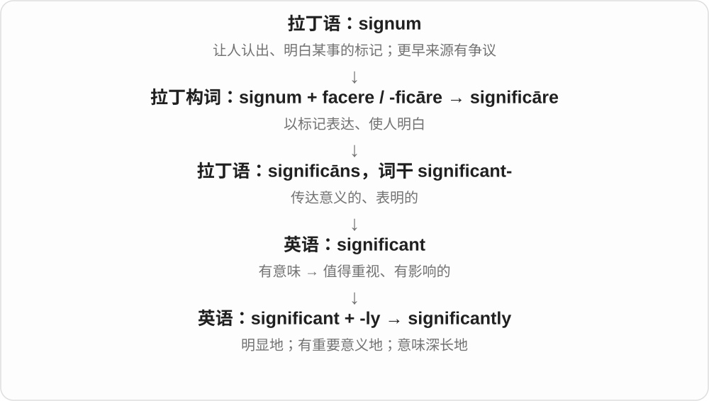

significantly lower 是明显更低；句首 Significantly, 常是值得注意的是。研究报告中也可能专指统计显著，须看作者的方法说明。

**常见搭配与例句**

significantly improve；significantly different；look significantly at。

> The new route reduced the journey time significantly.

新路线明显缩短了路程所需时间。

> Significantly, nobody challenged the figures.

值得注意的是，没有人质疑这些数字。

**别混淆**

considerably 强调程度很大；significantly 在统计语境里不能直接换成 considerably。

### 110. widely — 广泛地；相差很大地

**音标**：/ˈwaɪdli/

**先抓住这个画面**

分布、认可、使用铺得很广；也能说不同情况之间拉开很大距离。

**怎么拆**

wide + -ly，保留 wide 的 e，形成副词。现代常修饰 used、known、available，也可用于 vary widely 差异很大。

**怎么变成今天的意思**

**古英语 wīd → 中古英语 wid、wyd → wide**  
宽阔；范围远、大

↓

**现代 wide**  
空间宽 → 范围广；也可描述偏离目标

↓

**wide + -ly → widely**  
宽广 → 范围广泛地

widely used 广泛使用，widely available 随处可得，opinions vary widely 意见差异很大。

**常见搭配与例句**

widely used；widely known；widely available；vary widely。

> This method is widely used in schools.

这种方法在学校里被广泛使用。

> Prices vary widely between regions.

不同地区的价格相差很大。

**别混淆**

wide open 开得很大，widely used 使用范围广；副词 wide 和 widely 有固定搭配区别。

### 111. closely — 紧密地；仔细地；密切地；相近地

**音标**：英 /ˈkləʊsli/；美 /ˈkloʊsli/

**先抓住这个画面**

把距离缩小，也把注意力拉近，细节就更难漏掉。

**怎么拆**

close 形容词或副词 + -ly；尾部接 /sli/，不是动词 close 的 /z/。

**怎么变成今天的意思**

**拉丁 claudere；分词 clausus**  
关上、围住、使结束；复合词常变为 -cludere / -clusus

↓

**拉丁 clausus → 古法语 clos → 中古英语 clos / closen**  
关闭的、封闭处；关上

↓

**中古英语 close + -ly → closely**  
紧挨、密切、仔细地

↓

**现代英语 closely**  
关系紧密；仔细观察；相似程度高

watch closely 是仔细观察；closely related 是关系密切。物理位置直接说 stand close to me 更自然，不能凡是“近”就机械加 -ly。

**常见搭配与例句**

look closely at；closely related；work closely with；closely resemble。

> Look closely at the pattern around the edge.

仔细看看边缘周围的图案。

> The designers worked closely with the engineers.

设计师与工程师密切合作。

**别混淆**

close 常说距离近，如 come close；closely 常强调细致、密切或紧密的方式。

### 112. constantly — 不断地；经常反复地

**音标**：英 /ˈkɒnstəntli/；美 /ˈkɑːnstəntli/

**先抓住这个画面**

事情一轮接一轮，几乎没停过；说话者把这种持续或频繁的感觉说成 constantly。

**怎么拆**

constant + -ly，把持续、不变的性质转为副词。

**怎么变成今天的意思**

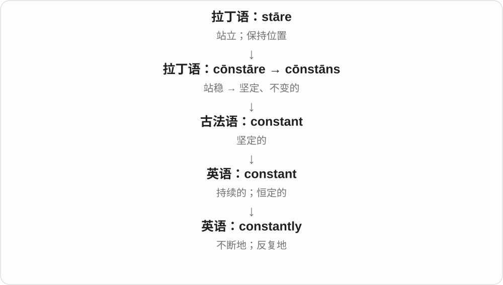

日常使用常带强调，未必按字面说每一秒都发生。He constantly complains 强调抱怨太频繁。

**常见搭配与例句**

constantly changing；constantly check；constantly complain。

> The weather was constantly changing during the trip.

旅途中天气不断变化。

> He constantly checks his phone during dinner.

他吃晚饭时总在看手机。

**别混淆**

always 可以表示规律性地每次如此；constantly 更突出持续或令人感觉反复不停。

### 113. hardly — 几乎不；几乎没有；才刚

**音标**：英 /ˈhɑːdli/；美 /ˈhɑːrdli/

**先抓住这个画面**

不是再多使一点劲，而是事情只达到很小一点，甚至几乎没达到。

**怎么拆**

hard + -ly，接古英语 heardlīce、中古英语 hardely 等副词，历史有费力、不容易等义；现代常用义发展为几乎不，不能靠词尾把它当 hard 的普通替换。

**怎么变成今天的意思**

**古英语 heard → 中古英语 hard**  
坚硬、强固；难以克服

↓

**古英语 heardlīce → 中古英语 hardely → hardly**  
费力、不容易等旧义 → 几乎不

hardly know 是几乎不认识，hardly any 是几乎没有，hardly ever 是几乎从不；had hardly arrived when ... 是刚到就……。

**常见搭配与例句**

hardly any；hardly ever；can hardly；hardly ... when。

> I can hardly hear you over the music.

音乐太响，我几乎听不见你说话。

> She hardly ever watches television.

她几乎不看电视。

**别混淆**

hardly 已带否定意味，I can hardly hear you 是几乎听不见；不为加强意思再随手加 not 改成同一句。

### 114. officially — 正式地；官方地

**音标**：/əˈfɪʃ.(ə.)li/

**先抓住这个画面**

口头传闻已经有了，现在主管机构公开确认：这时事情 officially 成立。

**怎么拆**

official + -ly，把官方认可这一性质变成描述动作或状态的方式。

**怎么变成今天的意思**

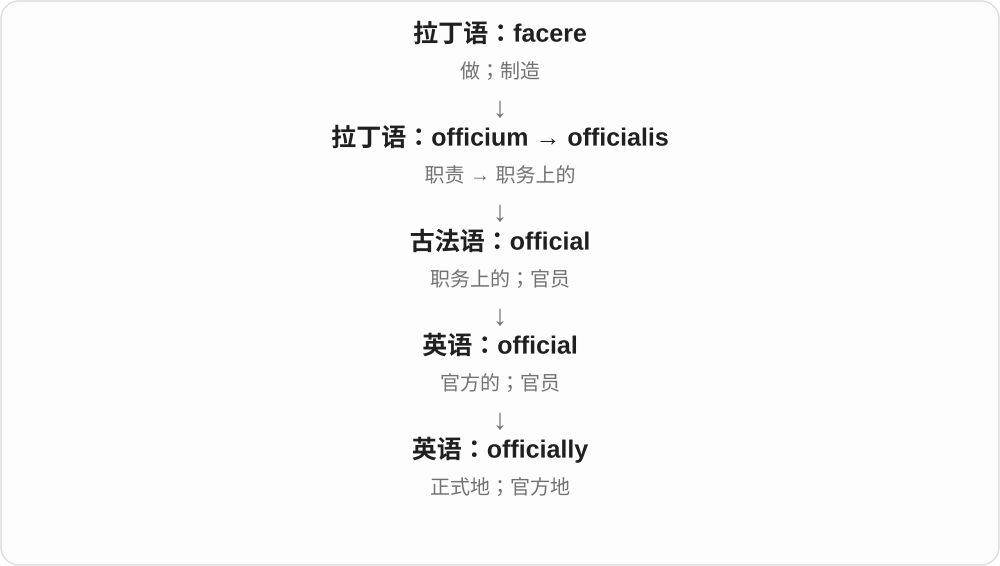

official 关心谁有权宣布，officially 说明事情在正式认可的层面是什么状态；不一定等于现实中已经完全到位。

**常见搭配与例句**

officially open；officially announced；officially recognized。

> The library officially opened on Monday.

图书馆星期一正式开放。

> The result has not been officially confirmed.

结果尚未得到官方确认。

**别混淆**

publicly 只是公开地；officially 还含正式授权或确认。

### 115. regularly — 定期地；经常地；有规律地

**音标**：英 /ˈreɡjələli/；美 /ˈreɡjələrli/

**先抓住这个画面**

不是只做一次，而是隔一阵又做，长期保持这个习惯。

**怎么拆**

regular + -ly。

**怎么变成今天的意思**

**拉丁语：regere**  
引导、使直；治理

↓

**拉丁语：regula**  
直尺、直条；准则

↓

**拉丁语 regularis；古法语 reguler**  
按准则的

↓

**英语：regular**  
有规律的；通常的；经常来的

↓

**英语：regular + -ly → regularly**  
按规律或经常发生

visit regularly 不一定精确到每次都同一天，但会让人理解成持续、反复来访。spaced regularly 则强调排列间距均匀。

**常见搭配与例句**

exercise regularly；meet regularly；regularly spaced。

> We meet regularly to compare our progress.

我们定期见面，对照各自的进展。

> The lights are regularly spaced along the path.

小路两侧的灯按均匀间距排列。

**别混淆**

occasionally 是偶尔；regularly 表示稳定的重复，不一定每一天。

### 116. fairly — 公平地；相当、还算

**音标**：英 /ˈfeəli/；美 /ˈferli/

**先抓住这个画面**

一条路是按公平标准办事；另一条是给程度留余地：还算好、比较容易，没夸到极致。

**怎么拆**

fair + -ly，古英语、中古英语已有相应方式副词。现代有公平地和程度加强的常用分支。

**怎么变成今天的意思**

**古英语 fæġer → 中古英语 fayr → fair**  
美、悦目、合宜

↓

**现代形容词 fair**  
公正、合理；尚可；浅色；晴朗等分支

↓

**fair + -ly → fairly**  
以公正、合宜方式 → 公平地；程度上还算

treat someone fairly 公平对待某人；fairly easy 相当容易，fairly sure 比较确定。

**常见搭配与例句**

treat fairly；fairly easy；fairly common；fairly sure。

> The referee treated both teams fairly.

裁判公平对待了两支队伍。

> The instructions are fairly easy to follow.

这些说明还算容易理解、照做。

**别混淆**

fairly good 通常低于非常出色，不是公平地好；fairly treated 才是待遇公平。语调、语境可改变具体程度。

### 117. monthly — 每月的；按月；月刊

**音标**：/ˈmʌnθli/

**先抓住这个画面**

每跨过一个月就来一回，或者把费用、收入等按一个月来算。

**怎么拆**

month + -ly；形容词、相应副词有中古英语乃至更早的对应形式。这里 -ly 不只构成副词，也能形容每月发生的事。

**怎么变成今天的意思**

**古英语 mōnaþ → 中古英语 moneth**  
月，与 moon 月亮属历史相关词族

↓

**英语 month**  
日历上的一个月；一段按月计算的时间

↓

**month + -ly → monthly**  
月 → 每月的、按月；月刊

a monthly payment 每月付款额，meet monthly 每月见面；a monthly 是月刊。twice monthly 一个月两次，every two months 两个月一次，说清楚比含糊缩写好。

**常见搭配与例句**

a monthly meeting；monthly rent；pay monthly；a literary monthly。

> We hold a monthly meeting to review progress.

我们每月开一次会，回顾进展。

> The fee can be paid monthly.

费用可以按月支付。

**别混淆**

a monthly report 通常是按月出的报告，a month’s work 是一个月的工作；monthly 本身不限定在每月哪一天。

### 118. barely — 勉强、仅仅；几乎不

**音标**：英 /ˈbeəli/；美 /ˈberli/

**先抓住这个画面**

像擦着一条最低线过去：barely enough 勉强够，barely hear 几乎听不见；余量少得不能再少。

**怎么拆**

接古英语 bærlīce，经中古英语保留，可对应 bare + -ly。旧有公开、无遮掩等义，后来发展仅仅、勉强，不要把现代义硬译成赤裸裸地。

**怎么变成今天的意思**

**古英语 bær → 中古英语 bare → bare〔形容词〕**  
无遮盖、裸露

↓

**古英语 bærlīce → 中古英语 barely 等**  
无遮掩、仅仅等旧义

↓

**现代 barely**  
刚够、勉强；接近没有

barely enough 勉强够，barely visible 几乎看不见，barely managed 勉强做成，barely know 几乎不认识。

**常见搭配与例句**

barely enough；barely visible；barely managed；barely know。

> We had barely enough money for the tickets.

我们的钱勉强够买票。

> I could barely hear her over the noise.

噪声太大，我几乎听不见她说话。

**别混淆**

barely 带接近否定、刚过线的意思，通常不再加 not；I barely know him 是几乎不认识，不是完全不认识。

### 119. effectively — 有效地；实际上

**音标**：/ɪˈfɛktɪvli/

**先抓住这个画面**

一个办法真正起了作用，是 effectively；某事名义上没结束，实际已经结束，也能说 effectively over。

**怎么拆**

effective + -ly。副词一支评价效果，另一支说实际效果等同于某种情况。

**怎么变成今天的意思**

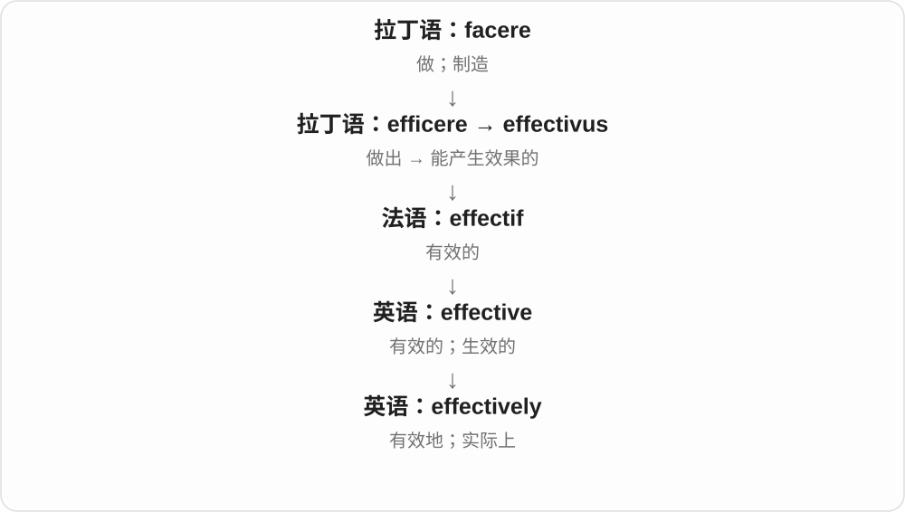

第二个意思可理解为“从造成的结果看”。它不必表示有人公开宣布，而是结果已经如此。

**常见搭配与例句**

communicate effectively；effectively impossible；effectively closed。

> The team communicated effectively under pressure.

团队在压力下仍然沟通得很有效。

> The road was effectively closed by the fallen tree.

倒下的树实际上把道路封死了。

**别混淆**

efficiently 强调少浪费；effectively 强调奏效或实际结果，别把两个副词都只译成高效。

### 120. initially — 起初；最开始时

**音标**：/ɪˈnɪʃəli/

**先抓住这个画面**

先把镜头放到事情开头，常给后面情况发生改变留出位置。

**怎么拆**

initial + -ly，形容词转副词。不是一直、从头到尾，只说明起点那段时间。

**怎么变成今天的意思**

**拉丁 inīre → initium → initiālis**  
进去、开始 → 开端 → 开始的

↓

**经法语或拉丁借入 → initial**  
最初的；名字开头字母；后作签首字母动词

↓

**initial + -ly → initially**  
在最初阶段、起初

Initially, ... 起初……，initially planned 最初计划的，initially reluctant 起初不愿意。

**常见搭配与例句**

initially planned；initially reluctant；initially successful。

> Initially, I thought the task would be easy.

起初，我以为任务会很简单。

> The event was initially planned for June.

活动最初计划在六月举行。

**别混淆**

initially 最初，eventually 最后、终于；originally 有时最初，也可强调原本的来源、安排。

### 121. naturally — 自然地；天生地；当然

**音标**：/ˈnætʃərəli/

**先抓住这个画面**

naturally 可以说事情自己发生，也可以说能力像本来就会一样表现出来；句首还常表示“这很正常”。

**怎么拆**

natural + -ly。

**怎么变成今天的意思**

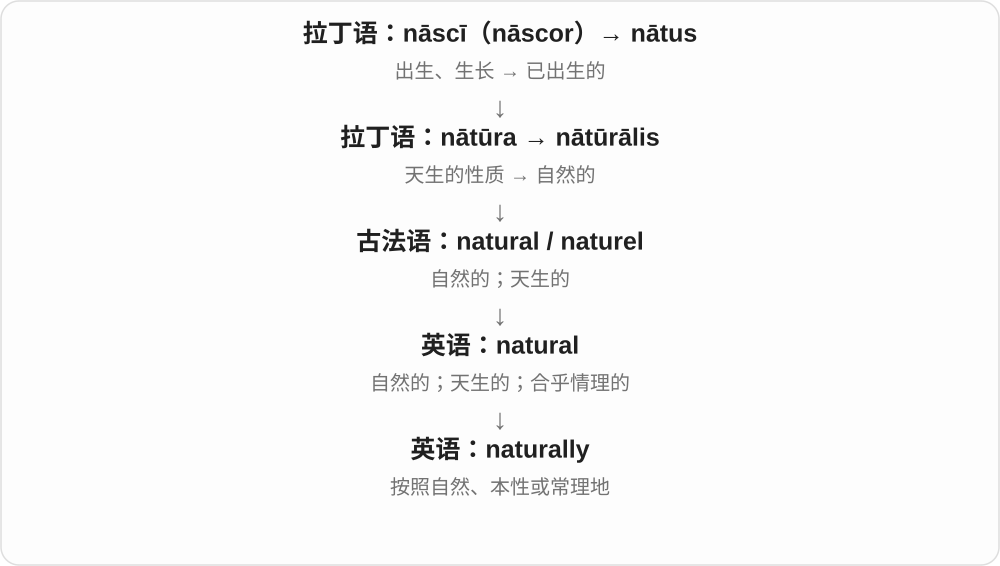

come naturally to someone 是做起来顺手、不费力；Naturally, … 是把后面的反应看作理所当然。

**常见搭配与例句**

occur naturally；come naturally to…；naturally curious；naturally, … 。

> These colours occur naturally in the stone.

这些颜色是石头天然形成的。

> Speaking in public does not come naturally to me.

当众讲话对我来说并不是自然而然就能做好的事。

**别混淆**

naturally 不总表示未经人工；Naturally, I was worried 的意思是我当然担心。

### 122. necessarily — 必然地；一定

**音标**：英 /ˌnesəˈserəli/；美 /ˌnesəˈserəli/

**先抓住这个画面**

最值得先学 not necessarily：有这种情况，不一定就能推出那个结论。

**怎么拆**

necessary + -ly，y 改 i，成为 necessarily。副词常从必要关系表达必然结果，而不是永远翻成很有必要地。

**怎么变成今天的意思**

**拉丁 necesse、necessarius → 法语 necessaire → 英语 necessary**  
不可避免、所需；更深组合解释不完全确定

↓

**现代 necessary**  
少不了的条件 → 必要的、必需的

↓

**necessary + -ly → necessarily**  
必要关系 → 必然、一定

not necessarily 不一定，not necessarily mean 不一定意味着；重音与 necessary 不完全相同。

**常见搭配与例句**

not necessarily；necessarily mean；necessarily involve。

> A higher price does not necessarily mean better quality.

价格更高不一定意味着质量更好。

> Working longer does not necessarily make you more productive.

工作更久不一定使效率更高。

**别混淆**

not necessarily good 是不一定好，未必直接说坏；necessarily not good 才是必定不好，否定位置改变逻辑。

### 123. primarily — 主要地；首先；首要地

**音标**：英 /ˈpraɪmərəli/，亦 /praɪˈmerəli/；美 /praɪˈmerəli/

**先抓住这个画面**

可能有不止一个原因或用途，但这一个占主要位置。

**怎么拆**

primary + -ly；拼写中 y 变 i，形成 primarily。

**怎么变成今天的意思**

**拉丁语 primus**  
第一、最先；地位最高、最重要

↓

**拉丁语 primarius → 英语 primary**  
第一等级、主要的 → 首要、基础、初级的

↓

**英语 primary + -ly → primarily**  
主要的 → 主要地、首要地

primarily for beginners 表示主要面向初学者，不一定禁止其他人参加。primarily because 指主要原因，通常还容许有别的因素。

**常见搭配与例句**

primarily because；primarily for；be primarily concerned with。

> The course is designed primarily for beginners.

这门课主要为初学者设计。

> We chose the site primarily because it was close to public transport.

我们选择这个地点，主要因为它靠近公共交通。

**别混淆**

primarily 不等于 exclusively“仅仅、专门”；它通常允许次要用途或原因存在。

### 124. shortly — 不久；在……之后不久；简慢地

**音标**：英 /ˈʃɔːtli/；美 /ˈʃɔːrtli/

**先抓住这个画面**

与现在或某个时间点只隔一小段，也可形容一句话说得短而生硬。

**怎么拆**

short + -ly；古英语已有相应副词形式，现代延续了时间短与言语简短两类用法。

**怎么变成今天的意思**

**古英语 sċeort → 中古英语 schort / short**  
短的

↓

**英语 short**  
距离、时间短；数量不足；某些糕点酥脆

↓

**旧英语 sċortlīċe → shortly**  
不久；简短地

arrive shortly 很快就到；shortly after lunch 午饭后不久。She replied shortly 有时不是回答得快，而是回答生硬、不耐烦。

**常见搭配与例句**

shortly after；shortly before；will begin shortly；reply shortly。

> The doors will open shortly.

门很快就会打开。

> He left shortly after the meeting ended.

会议结束后不久，他就离开了。

> “No,” she replied shortly.

“不行。”她冷冷地简短答道。

**别混淆**

shortly 常等于 soon；briefly 常说时间很短或简要地。I’ll explain briefly 是简要解释，不是过会儿再解释。

### 125. strongly — 强烈地；坚决地；有力地

**音标**：英 /ˈstrɒŋli/；美 /ˈstrɔːŋli/

**先抓住这个画面**

观点、感受不只是轻轻带过，而是明确、力度很大。

**怎么拆**

strong + -ly，古英语 stranglīċe、中古英语 strongliche 等已有对应副词；常见读音不沿 stronger 另添 /ɡ/。

**怎么变成今天的意思**

**古英语 strang → 中古英语 strong / strang**  
强、有力；更早有紧、严等相关义

↓

**英语 strong**  
力量大；坚固；强烈、浓的

↓

**strong + -ly；旧副词形式延续**  
以强烈、有力方式

strongly recommend 强烈推荐，strongly oppose 坚决反对，feel strongly about 对某事有强烈看法。不是修饰所有动词都等于用肌肉。

**常见搭配与例句**

strongly recommend；strongly oppose；strongly support；feel strongly about。

> I strongly support the proposal.

我坚决支持这项提议。

> She feels strongly about protecting the old library.

她对保护老图书馆这件事态度很强烈。

**别混淆**

strongly 支持、反对可用，heavily support 常不是同样自然的万能替换；动词搭配比中文程度词更可靠。

### 126. respectively — 分别；依照前述顺序对应地

**音标**：/rɪˈspektɪvli/

**先抓住这个画面**

respectively 像把两排名字连线：第一个对第一个，第二个对第二个，不交叉。

**怎么拆**

respective + -ly；来自“分别关联各自对象”的意义。

**怎么变成今天的意思**

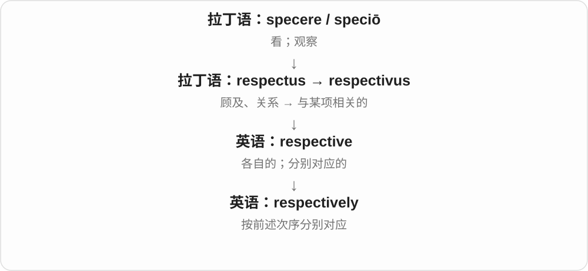

A and B are 10 and 12, respectively 表示 A 是10、B 是12。它是在说明配对规则，不是在说彼此尊重。

**常见搭配与例句**

first and second, respectively；aged eight and ten, respectively。

> Mia and Leo are eight and ten, respectively.

米娅和利奥分别是八岁和十岁。

> The red and blue lines show cost and revenue, respectively.

红线和蓝线分别表示成本和收入。

**别混淆**

respectfully 是恭敬地；respectively 是分别对应；respectably 是体面地或相当好地。

### 127. successfully — 成功地；顺利地

**音标**：/səkˈsesfəli/

**先抓住这个画面**

动作做完，而且达到了预期效果。

**怎么拆**

successful + -ly。

**怎么变成今天的意思**

**拉丁 cēdere；分词词干 cess-**  
走、离开；让步、让出

↓

**拉丁 sub- + cēdere → succēdere**  
接着来、接替；事情进展顺利

↓

**拉丁 successus → 英语 success**  
结果、进展 → 好结果、成功

↓

**英语 success → successful → successfully**  
成功 → 成功的 → 成功地

successfully installed 表示安装完成并达到要求。它评价结果，不必说过程轻松：可以经历很多失败后才 successfully complete。

**常见搭配与例句**

successfully complete；successfully install；successfully apply。

> The update was successfully installed.

更新已成功安装。

> They successfully crossed the river before sunset.

他们在日落前成功渡过了河。

**别混淆**

easily 是不费力；successfully 是办成了，艰难完成也可以成功。

### 128. badly — 不好地；严重地；非常、迫切地

**音标**：/ˈbædli/

**先抓住这个画面**

事情做得差，是 badly；伤得厉害、急需得不得了，也把“不妙”的程度推高了。

**怎么拆**

bad + -ly，形成副词。后来也有强度很高的用法，所以 badly need 不是“需要得很差”。

**怎么变成今天的意思**

**中古英语 bad / badde**  
坏、不好的

↓

**英语 bad**  
质量差、令人不快、道德不好等；更早来源不确定

↓

**bad + -ly → badly**  
做得不好；到严重、强烈的程度

play badly 打得差，badly damaged 严重受损，badly need a rest 非常需要休息。比较常用 worse、worst，不能机械套 more 到每个场景。

**常见搭配与例句**

behave badly；badly damaged；badly hurt；badly need。

> The roof was badly damaged in the storm.

屋顶在暴风雨中严重受损。

> We badly need more time.

我们非常需要更多时间。

**别混淆**

badly 可以修饰动作，也可以加强 need、want；badly want to win 是极想赢，不是赢得不光彩。

### 129. deeply — 深深地；强烈地；深入地

**音标**：/ˈdiːpli/

**先抓住这个画面**

感受、关心或思考不是浅浅碰一下，而是进入很深、影响很大。

**怎么拆**

deep + -ly 成副词，与旧有相应副词形式有历史联系。现代常修饰情绪、程度及思考等。

**怎么变成今天的意思**

**古英语 dēop → 中古英语 deep、depe → deep**  
深，也已有严肃、强烈等抽象用法

↓

**现代 deep 词族**  
从表面往内部的距离；感情、理解等程度深

↓

**deep + -ly → deeply**  
深、强烈的 → 深深地、强烈地

deeply worried 深感担忧，deeply moved 深受感动，think deeply 深入思考；deeply 是程度和方式，不必物理往下。

**常见搭配与例句**

deeply worried；deeply grateful；deeply moved；think deeply。

> I am deeply grateful for your help.

我深深感激你的帮助。

> The film made us think deeply about friendship.

电影让我们深入思考友谊。

**别混淆**

dig deep 常说往深处挖，deeply moved 常说深受感动；两种副词形式的搭配不能机械按中文互换。

### 130. horrible — 可怕的；糟糕、令人难受的

**音标**：英 /ˈhɒrɪbəl/；美 /ˈhɔːrəbəl/

**先抓住这个画面**

从让人吓得发抖，到生活中让人感觉真糟，都能用 horrible。天气、味道、经历不一定真的像恐怖片，仍可叫 horrible。

**怎么拆**

经法语 horrible 接拉丁 horribilis，来自 horrere 颤抖、毛发竖立、害怕等材料，加相应形容词尾。英语也发展出一般强烈负面评价。

**怎么变成今天的意思**

**拉丁 horrere → horribilis**  
使人害怕、颤抖的

↓

**法语 → 英语 horrible**  
可怕的；再扩展为糟糕、难受的

a horrible experience 糟糕的经历；horrible weather 坏透的天气；a horrible smell 难闻的气味。评价强度通常高于普通 bad。

**常见搭配与例句**

a horrible noise；feel horrible。

> We had horrible weather throughout the trip.

整个旅途中天气都糟透了。

> There was a horrible smell in the room.

房间里有股很难闻的气味。

**别混淆**

horrible 可以是糟糕而非恐怖；horrified 则常说人已经惊恐。描述事物性质与描述人的反应要分开。

### 131. horribly — 可怕地、糟糕地；非常、厉害地〔常修饰负面性质〕

**音标**：英 /ˈhɒrɪbli/；美 /ˈhɔːrəbli/

**先抓住这个画面**

动作做得很糟，或一个坏性质强到让人难受。horribly wrong 是错得很厉害，horribly cold 是冷得受不了。

**怎么拆**

horrible + -ly，拼写由 -ble 转为 -bly；中古英语已有对应形式。副词保留可怕、糟糕评价，也能加强程度。

**怎么变成今天的意思**

**horrible 的负面性质**  
可怕、难受、糟糕

↓

**horrible + -ly → horribly**  
糟糕地；在负面评价中加强程度

go horribly wrong 出严重差错；feel horribly lonely 感到孤独极了；be horribly rude 极其无礼。语气通常比普通 very 更带情绪。

**常见搭配与例句**

horribly cold；horribly disappointed。

> The plan went horribly wrong.

计划出了严重差错。

> I felt horribly embarrassed when I forgot her name.

忘记她名字时，我尴尬极了。

**别混淆**

horrible 修饰名词或作表语；horribly 修饰动作、形容词等。a horrible mistake 与 horribly wrong 是两种搭配结构。

### 132. plain — 简单朴素的；清楚的；明显的；平原

**音标**：英、美 /pleɪn/

**先抓住这个画面**

没有复杂装饰，也没有遮挡：一眼能看明白，或者就是原原本本的样子。

**怎么拆**

经古法语 plain 来自拉丁语 planus“平坦、平整”；由平坦发展出无遮掩、简单、清楚等义。平原名词来自同族 planum。

**怎么变成今天的意思**

**拉丁语：planus；planum**  
平坦的；平面、平地

↓

**古法语 plain → 英语 plain**  
平坦；简单、清楚；平原

plain clothes 是便装；plain yogurt 是原味酸奶；plain English 是好懂、不绕弯的英语。古旧 plain“抱怨”和“满的”有其他来源，不套这条链。

**常见搭配与例句**

plain language；plain to see；a coastal plain。

> Please write the instructions in plain English.

请用清楚易懂的英语写操作说明。

> She chose a plain blue shirt.

她选了一件没有花饰的蓝衬衫。

> The river flows across a broad plain.

河流穿过一片宽广的平原。

**别混淆**

simple 可强调容易；plain 也可强调没有花样。说人外貌 plain 通常是不出众，语气要看场合。

### 133. plains — 平原、大片平坦土地〔复数〕

**音标**：/pleɪnz/

**先抓住这个画面**

视野向外铺开，地势起伏很小的一大片土地，是 plains。抓住平坦、铺展的地形，和简单朴素的形容词义分开看词性。

**怎么拆**

平原名词 plain 经法语接拉丁 planum 平地，与 planus 平坦同族。现代名词加 -s，/n/ 后读 /z/；不是给形容词 plain 加复数。

**怎么变成今天的意思**

**拉丁 planum、planus → 法语、英语 plain**  
平地、平坦 → 平原名词

↓

**plain + -s → plains**  
多处或连片的平原

open plains 开阔平原；grassy plains 草原、覆草平原；across the plains 横穿平原。

**常见搭配与例句**

wide plains 广阔平原；plains near the river 河流附近的平原。

> The train crossed wide grassy plains.

火车穿过广阔的覆草平原。

> The map shows hills to the north and plains to the south.

地图显示北部是丘陵，南部是平原。

**别混淆**

plains 说地形，不保证全无树木、全部种草或完全无人。平坦是核心，具体覆盖物要另看修饰语。

### 134. plainly — 清楚、直白地；显然；朴素地

**音标**：/ˈpleɪnli/

**先抓住这个画面**

没有遮挡、没有绕弯：话直接说清，事实明显摆着，或穿着没有繁复装饰。plain 的不同性质在这里都能接上。

**怎么拆**

plain 清楚的、朴素的 + -ly；中古英语已有对应形式。plain 更早经法语接拉丁平坦、明白等词族。

**怎么变成今天的意思**

**plain 的平明、清楚、朴素性质**  
没有复杂遮挡或装饰

↓

**plain + -ly → plainly**  
直白地；显然；朴素地

speak plainly 直说；plainly visible 清楚可见；plainly dressed 衣着朴素。依据动词、形容词判断具体哪一支。

**常见搭配与例句**

put it plainly；plainly wrong。

> Please tell me plainly what the problem is.

请直截了当地告诉我问题是什么。

> She was plainly disappointed by the news.

她显然对消息感到失望。

**别混淆**

plainly 与 clearly 有时接近，但 plainly dressed 主要是朴素，不是把衣服看得清楚。

### 135. essentially — 本质上；基本上、就主要方面而言

**音标**：/ɪˈsenʃəli/

**先抓住这个画面**

先把次要差别放旁边，看核心到底是什么。两个方案细节不同，主要部分相同，可说 essentially the same。

**怎么拆**

essential + -ly，形成本质、主要方面的副词；保留两个 l。不是只要 essential 表必需，就把 essentially 一律译成必须地。

**怎么变成今天的意思**

**拉丁语 essentia → 晚期拉丁语 essentiālis → essential**  
存在、本质 → 属于本质的

↓

**英语 essential**  
构成根本性质 → 不可缺少；必需品

↓

**essential + -ly → essentially**  
在本质、核心方面；大体上

essentially the same 基本相同，essentially a question of 本质上是……的问题，remain essentially unchanged 基本不变。

**常见搭配与例句**

essentially the same；essentially unchanged；essentially a matter of。

> The two designs are essentially the same.

这两个设计基本相同。

> Essentially, we need more time and fewer distractions.

说到底，我们需要更多时间，少些干扰。

**别混淆**

essentially 大体、核心方面，exactly 精确、完全；essentially the same 允许一些细节不同。

### 136. newly — 新近；最近才

**音标**：英 /ˈnjuːli/；美 /ˈnuːli/

**先抓住这个画面**

某种变化刚完成，时间还很近。

**怎么拆**

古英语 niwlice 已表示新近，来自表示新的词与副词成分；现代仍能看出 new + -ly。

**怎么变成今天的意思**

**古英语 niwe；-lice**  
新的；副词成分

↓

**古英语 niwlice → newly**  
新近、最近才

newly opened 是刚开业的；newly elected 是刚当选的。newly 常放在过去分词前，帮你补一句“这件变化是不久前发生的”。它不是把所有 new 都机械改成副词。

**常见搭配与例句**

newly built；newly discovered；newly appointed。

> We ate at a newly opened restaurant.

我们在一家新开业的餐馆吃了饭。

> The newly appointed manager met the whole team.

新上任的经理见了整个团队。

**别混淆**

a new school 可能只是新学校；a newly built school 明确说刚建成。newly 通常不能随便替换句末 recently，例如 I saw her recently 更自然。

### 137. rarely — 很少；不常

**音标**：英 /ˈreəli/；美 /ˈrerli/

**先抓住这个画面**

一件事不是完全不发生，只是发生的次数少得很。

**怎么拆**

英语 rare 少见 + -ly，形成表示频率的副词。这里对应稀少义，不对应牛排熟度义。

**怎么变成今天的意思**

**拉丁 rarus**  
稀疏的；松散的；相隔较远的

↓

**古法语 rare、rere → 英语 rare**  
稀薄、稀疏 → 少见、难得

↓

**英语 rare + -ly → rarely**  
以很低的频率发生

I rarely drive to work 是我很少开车上班，仍留着偶尔开车的可能。通常放在实义动词前、be 动词后：rarely drive，is rarely late。放到句首强调时，正式英语常用倒装：Rarely do we see…。

**常见搭配与例句**

rarely happen；rarely use；is rarely seen；Rarely do we…。

> I rarely check my phone during dinner.

我吃晚饭时很少看手机。

> Rarely do we get a whole afternoon to ourselves.

我们很少能有整整一个下午属于自己。

**别混淆**

rarely 比 never 留有余地。它本身已经带否定意味，普通陈述不用再加 not 来表达很少。别与 really 真正地、很混淆。

### 138. lately — 最近；近来

**音标**：/ˈleɪtli/

**先抓住这个画面**

回看离现在不远的一小段日子，看看这阵子发生了什么。

**怎么拆**

late + -ly，接中古英语 lately 等形式；现代常用义已经固定为最近，不按 late 的迟到义机械翻成迟迟地。

**怎么变成今天的意思**

**古英语 læt → 中古英语 late**  
慢、迟、晚

↓

**英语 late**  
迟到；接近某时段末尾

↓

**late + -ly → lately**  
较近时间内 → 最近

常与现在完成时谈近期情况：I haven’t seen her lately。也可用于其他合适时态，不必记成只允许某一种语法。

**常见搭配与例句**

not lately；a lot lately；feel tired lately。

> I haven’t heard from him lately.

我最近没收到他的消息。

> She has been travelling a lot lately.

她近来经常出行。

**别混淆**

late 是迟、晚；lately 是最近。stay up late 是熬夜，不能把副词再加 -ly 改成 stay up lately 来表达同一件事。

### 139. equally — 同样地；平均地；也同样

**音标**：/ˈiːkwəli/

**先抓住这个画面**

每份一样多，或两件事在某个程度上不分高下。

**怎么拆**

equal + -ly；对应相同的份额、程度，也可用来连接同样成立的另一点。

**怎么变成今天的意思**

**拉丁 aequus**  
平、等量、公平、平稳

↓

**拉丁 aequalis → 中古英语 equal**  
相等的、均匀的

↓

**英语 equal**  
相等；匹敌；地位相等的人

↓

**英语 equal + -ly → equally**  
以相等的方式；在相同程度上

divide equally 是等份分；equally important 是同样重要。句首 Equally, ... 可补充另一面同样值得注意的事实，不必都译成平均地。

**常见搭配与例句**

share equally；equally important；equally likely；equally well。

> They divided the remaining food equally among the four hikers.

他们把剩下的食物平均分给四名徒步者。

> The second proposal is equally practical.

第二个方案同样可行。

**别混淆**

evenly 常强调分布均匀；equally 还可比较两个抽象性质的程度，比如两件事同样重要。

### 140. occasionally — 偶尔；有时

**音标**：/əˈkeɪʒənəli/

**先抓住这个画面**

不是从来不做，也不是经常做，只是隔一阵子会有那么一次，用 occasionally。

**怎么拆**

occasional + -ly；把偶尔发生的性质变成频率说明。

**怎么变成今天的意思**

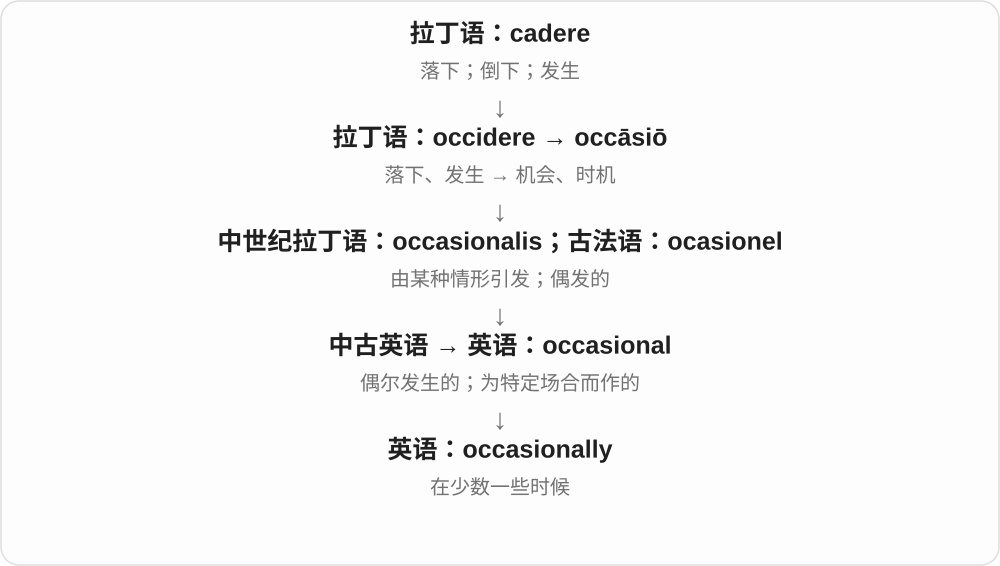

它不规定精确比例，只表明频率不高。可以放在句首，也常放在实义动词前；be 动词之后也很自然。

**常见搭配与例句**

occasionally visit；only occasionally；occasionally, …。

> We occasionally have lunch together.

我们偶尔一起吃午饭。

> The road is occasionally closed after heavy snow.

大雪之后，这条路有时会封闭。

**别混淆**

occasionally 比 often 频率低；accidentally 是不小心，不能用来表达“偶尔去吃饭”。

### 141. potentially — 有可能地；潜在地

**音标**：/pəˈtenʃəli/

**先抓住这个画面**

potentially 给一句话留出“条件具备就可能发生”的空间，并没有宣布结果已经发生。

**怎么拆**

potential + -ly，由潜在的性质变成修饰判断的副词。

**怎么变成今天的意思**

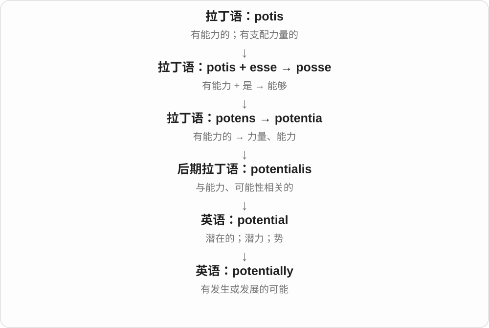

potentially dangerous 指可能造成危险，不等于现在已经伤人。potentially useful 表示有用的可能性，效果还取决于实际情况。

**常见搭配与例句**

potentially harmful；potentially useful；potentially valuable。

> The old wiring is potentially dangerous.

这些老旧电线有潜在危险。

> The archive contains potentially valuable information.

档案中包含可能很有价值的信息。

**别混淆**

probably 说更可能真的发生；potentially 常强调存在这种可能或能力，不给概率作同样强的判断。

### 142. commonly — 通常；普遍地；常见地

**音标**：英 /ˈkɒmənli/；美 /ˈkɑːmənli/

**先抓住这个画面**

不是只见过一次，而是在不少人、地方或情况里都会这样。

**怎么拆**

common + -ly 成副词，现代多取常见、普遍这一分支；不等于每次都说大家共同拥有。

**怎么变成今天的意思**

**拉丁语 commūnis → 古法语 comun → 中古英语 comun**  
共有的、公共的、普遍的

↓

**英语 common**  
共同的；常见的；普通的等固定用法

↓

**common + -ly → commonly**  
常见、普遍 → 通常、普遍地

commonly used 常用的，commonly known as 通常被称为，commonly mistaken for 经常被误当作。

**常见搭配与例句**

commonly used；commonly known as；commonly found；commonly mistaken for。

> This expression is commonly used in conversation.

这个表达在交谈中很常用。

> The plant is commonly found near rivers.

这种植物常见于河边。

**别混淆**

commonly 一般、普遍，并非 always 总是；commonly believed 许多人相信，也不保证这个看法为真。

### 143. increasingly — 越来越；日益

**音标**：/ɪnˈkriːsɪŋli/

**先抓住这个画面**

不是只说现在很高，而是一路朝更高程度走：increasingly difficult 是越来越难。

**怎么拆**

increase → increasing → increasingly；先去 increase 的末尾 e 接 -ing，再接 -ly。直接基础是 increasing，不跳过中间形式硬写 increase + ly。

**怎么变成今天的意思**

**increase 增加 → increasing**  
正在增加、程度上升的性质

↓

**increasing + -ly → increasingly**  
随着过程越来越如此

increasingly important 日益重要；increasingly difficult 越来越难；increasingly common 越来越普遍。

**常见搭配与例句**

increasingly important；increasingly difficult；increasingly common。

> The task became increasingly difficult.

任务变得越来越难。

> Online booking is increasingly common.

线上预订越来越普遍。

**别混淆**

increasingly 描述变化趋势，very 只强调某时程度；现在 very common，不证明过去到现在越来越多。

### 144. incredibly — 极其；难以置信地

**音标**：/ɪnˈkredəbli/

**先抓住这个画面**

incredibly 常像给形容词加一档很强的程度：“特别、特别……”。

**怎么拆**

incredible + -ly，变成修饰程度或整个陈述的副词。

**怎么变成今天的意思**

从“难以相信的方式”扩展成日常程度词。incredibly helpful 通常就是帮了大忙，不是说这份帮助不可信。

**常见搭配与例句**

incredibly difficult；incredibly useful；incredibly fast；Incredibly, … 。

> The instructions were incredibly easy to follow.

这些说明特别容易照着操作。

> Incredibly, no one noticed the missing page.

令人难以置信的是，竟然没人发现少了一页。

**别混淆**

incredibly 修饰事物或程度；incredulously 描写一个人不敢相信的反应。两者不能因为都含“不信”就互换。

### 145. merely — 仅仅、只是、不过

**音标**：英 /ˈmɪəli/；美 /ˈmɪrli/

**先抓住这个画面**

把额外的解释拿掉：我只是问问，并没有暗示别的；也可强调某事没达到你期待的更高程度。

**怎么拆**

mere 仅仅的 + -ly，中古英语已有 mereli 等形式；接形容词的纯粹、仅仅分支，不接湖名词。

**怎么变成今天的意思**

**拉丁 merus → 法语 mier、meer → mere〔形容词〕**  
纯、不掺杂 → 仅仅、不外乎；旧纯粹强调义也有保留

↓

**mere + -ly → merely**  
仅仅地、不外乎

merely a suggestion 只是个建议，not merely 不仅仅，merely because 仅因为，merely asking 只是问问。

**常见搭配与例句**

merely a suggestion；not merely；merely because；merely asking。

> I was merely asking a question.

我只是问个问题。

> The change is not merely cosmetic.

变化不只是表面修饰。

**别混淆**

merely 较书面对应 only、just 的某些用法；mere 修饰名词，merely 可修饰更宽的表达，不是把 merely 当动词使用。

### 146. roughly — 粗暴地、粗糙地；大约、粗略地

**音标**：/ˈrʌfli/

**先抓住这个画面**

处理人或物时不轻柔，可以是 roughly；估计只划个大致范围，也叫 roughly，两个义项别都翻成大约。

**怎么拆**

rough + -ly，随着基础形容词分出动作粗暴与估计不精确的副词。

**怎么变成今天的意思**

**古英语 rūh、rūg → 中古英语 rough 等 → rough**  
粗糙、多毛、不平整等

↓

**现代形象扩展**  
摸着不平 → 动作粗暴、经历艰难；未经精修 → 大概、粗略

↓

**rough + -ly → roughly**  
粗暴地；以大致而非精确方式

roughly ten people 大约十人，roughly speaking 大体说来，handle roughly 粗暴处理，roughly equal 大致相等。

**常见搭配与例句**

roughly ten；roughly speaking；handle roughly；roughly equal。

> The walk takes roughly an hour.

这段路走完大约需要一小时。

> The parcel had been handled roughly.

包裹曾被粗暴搬运。

**别混淆**

roughly 用作大约时接近 approximately；handle roughly 却说处理方式粗暴，不能套成大约处理。

### 147. rapidly — 迅速地；快速地

**音标**：/ˈræpɪdli/

**先抓住这个画面**

把快速放进一个变化过程里：事情正在很快地向前发展。

**怎么拆**

rapid + -ly，变成说明动作或变化速度的副词。

**怎么变成今天的意思**

**拉丁 rapere；第一人称 rapio；分词 raptus**  
猛地抓住、夺取、带走

↓

**拉丁 rapidus → 法语 rapide／英语 rapid**  
有冲劲、迅疾 → 快速的

↓

**英语 rapid → rapidly**  
迅速的 → 迅速地

rapidly increasing costs 是迅速上涨的成本；change rapidly 是变化很快。它强调变化速度，不自动表示变化是好是坏，也不一定表示突然发生在一瞬间。

**常见搭配与例句**

grow rapidly；change rapidly；rapidly increasing。

> The water level rose rapidly after the storm.

暴风雨后，水位迅速上升。

> Her confidence grew rapidly with regular practice.

随着持续练习，她的信心很快增强了。

**别混淆**

suddenly 强调突然、出乎意料地开始；rapidly 强调整个变化过程很快。

### 148. partly — 部分地；在一定程度上

**音标**：英 /ˈpɑːtli/；美 /ˈpɑːrtli/

**先抓住这个画面**

整件事里只占一部分，没有包下全部。partly because 交代的是部分原因，不排除别的原因。

**怎么拆**

part + -ly → partly；并非所有 -ly 前都必须先有一个典型形容词，part 的名词材料也能进入固定副词。

**怎么变成今天的意思**

**法语、拉丁部分材料 → part**  
整体中的一部分

↓

**part + -ly → partly**  
就其中一部分、某种程度而言

partly because 部分因为；partly true 部分属实；partly finished 完成了一部分。

**常见搭配与例句**

partly because；partly true；partly finished。

> The delay was partly caused by bad weather.

延误部分由坏天气造成。

> Her answer was only partly correct.

她的回答只有部分正确。

**别混淆**

partly 不是 mostly 大部分；也不固定表示一半，可能是任何未覆盖全部的部分。

### 149. physically — 身体上；实际到场地；从物理条件上

**音标**：/ˈfɪzɪkli/

**先抓住这个画面**

强调身体的状态，或事情在现实空间和物质条件中能否发生。

**怎么拆**

physical + -ly，拼写为 -ically，常用读音中间不必逐个字母读出全部弱元音。

**怎么变成今天的意思**

**希腊 phyein → physis → physikos**  
生长、产生 → 自然、本性 → 自然的

↓

**希腊 physikē／physika → 拉丁 physica**  
关于自然的知识、自然事物

↓

**英语 physical → physically**  
身体、物质的 → 身体上、实体条件上

physically tired 是身体疲劳，physically present 是本人到场，physically impossible 是在物理条件或现实条件上办不到。它不是所有场合都意味着体力强弱，例如 physically present 与一个人是否健壮无关。

**常见搭配与例句**

physically fit；physically demanding；physically present；physically impossible。

> Moving the equipment was physically demanding.

搬运这些设备很耗体力。

> You do not need to be physically present to join the meeting.

参加会议不需要本人到场。

**别混淆**

physically 描写身体或现实物理层面，mentally 描写心理、思维层面；emotionally 则突出情绪。

### 150. similarly — 相似地；同样地

**音标**：英 /ˈsɪmələli/；美 /ˈsɪmələrli/

**先抓住这个画面**

前面那种方式或道理，在这里也有相近的表现。

**怎么拆**

similar + -ly。

**怎么变成今天的意思**

**拉丁 similis**  
相像、同类；与 simul“一起、同时”同族

↓

**中世纪拉丁 similāris → 法语 similaire → 英语 similar**  
具有相同或相近特点的

↓

**英语 similar + -ly → similarly**  
以相似方式；用来连接相近情况

similarly dressed 是穿着相似；句首 Similarly,... 把后一情况与前面联系起来。它不是说两件事完全一致，而是指出可类比的一点。

**常见搭配与例句**

similarly sized；similarly affected；similarly, ...。

> The two rooms are similarly decorated.

两个房间的装饰风格相似。

> Young trees need protection from strong wind; similarly, seedlings need shelter.

幼树需要防强风；同样，幼苗也需要遮护。

**别混淆**

likewise 可表示同样，也常用于简短回应；similarly 更明确指出方式或特点相似。

### 151. publicly — 公开地；由公共资金或政府支持地

**音标**：/ˈpʌblɪkli/

**先抓住这个画面**

让大家看见、听见；也可以说明钱和所有权来自公共部门。

**怎么拆**

public + -ly；标准常用拼写是 publicly，不是在 public 后再补一个 -al-。

**怎么变成今天的意思**

**拉丁 populus → 早期 poplicus → publicus**  
民众 → 属于民众、公共的；词形变化可能受 pubes 影响

↓

**法语 public；拉丁 publicus → 英语 public**  
公共的、公众的、公开的

↓

**英语 public + -ly → publicly**  
公共的、公开的 → 对公众公开地；以公共资源支持地

apologize publicly 是公开道歉；publicly funded research 是由公共资金支持的研究。后者不能只译成大家都知道的研究。

**常见搭配与例句**

publicly available；publicly funded；publicly acknowledge；publicly owned。

> The data are publicly available on the institute’s website.

这些数据可在研究所网站公开获取。

> The project is publicly funded but managed by an independent team.

项目由公共资金资助，但由独立团队管理。

**别混淆**

openly 强调不掩饰；publicly 强调向公众、在公众面前，或公共部门参与，要看搭配。

### 152. moderate — 适度的；温和的；使缓和；主持、管理讨论

**音标**：形容词、名词：英 /ˈmɒdərət/，美 /ˈmɑːdərət/；动词：英 /ˈmɒdəreɪt/，美 /ˈmɑːdəreɪt/

**先抓住这个画面**

把强度拉回合适范围，既不过头，也不是完全没有。

**怎么拆**

来自拉丁语 moderatus，moderari“调节”的分词。形容词、动词均与拉丁形式相关，名词“温和派”由英语形容词转用。

**怎么变成今天的意思**

**拉丁语：moderari**  
调节、使合度；与 modus 属于尺度这一词族

↓

**拉丁语：moderatus**  
有分寸的、受调节的

↓

**英语：moderate〔形容词／动词〕**  
适度的；使缓和、调节

↓

**英语：a moderate**  
持较温和立场的人

moderate heat 是中等热度；moderate a debate 是主持讨论、控制节奏。形容词结尾轻读 /rət/，动词结尾读 /reɪt/。

**常见搭配与例句**

a moderate increase；moderate a discussion。

> The forecast predicts moderate winds.

天气预报预计会有中等强度的风。

> She moderated the discussion and invited quieter members to speak.

她主持讨论，并邀请较少发言的成员开口。

**别混淆**

mild 偏不强烈；moderate 常隐含程度、立场或行为在可接受范围内。

### 153. moderately — 适度地；中等程度地

**音标**：英 /ˈmɒdərətli/；美 /ˈmɑːdərətli/

**先抓住这个画面**

把程度放在刻度中间附近：有一些、有一定程度，但不推到极端。也能说做事有节制。

**怎么拆**

moderate 适度、中等的 + -ly；较早中古英语已有相应形式，词族更早接拉丁尺度、调节材料。

**怎么变成今天的意思**

**moderate 的尺度、适度词族**  
保持一定尺度；中等的

↓

**moderate + -ly → moderately**  
适度、中等程度地

moderately successful 有一定成功；moderately difficult 中等难度；exercise moderately 适度运动。具体尺度随评价对象变化。

**常见搭配与例句**

moderately priced；moderately warm。

> The test was moderately difficult.

考试难度中等。

> They stayed in a moderately priced hotel.

他们住在一家价格适中的酒店。

**别混淆**

moderately 不等于 barely 几乎不、勉强；它通常给中等、适度程度，不能把所有中等评价都读成失败。

### 154. virtually — 几乎；实际上；以虚拟或线上方式

**音标**：英 /ˈvɜːtʃuəli/；美 /ˈvɜːrtʃuəli/

**先抓住这个画面**

差得太少，以至于实际可以当成那样；在另一类句子里，则表示借助数字方式参与或体验。

**怎么拆**

virtual + -ly，英语副词；较早的“在效果上”义发展出几乎、实际上，数字媒介义是后来继承 virtual 的新用法。

**怎么变成今天的意思**

**拉丁 vir**  
成年男子；男人

↓

**拉丁 virtus，词干 virtut-**  
勇气、力量、卓越；品德、效能

↓

**中世纪拉丁 virtualis → 古法语 vertual／直接拉丁借入**  
有力量、有产生效果的能力

↓

**中古英语 virtual → 英语 virtual**  
效果上相当于、实质上的 → 计算机中的虚拟

↓

**英语 virtual + -ly → virtually**  
效果上、几乎；后来也用于数字或线上方式

virtually impossible 是几乎不可能；virtually everyone 是几乎每个人；attend virtually 在会议语境中常是线上参加。必须看它修饰什么，不能总翻成“虚拟地”。

**常见搭配与例句**

virtually impossible；virtually all；virtually identical；meet virtually；attend virtually。

> The two versions are virtually identical.

这两个版本几乎完全相同。

> Several colleagues joined the workshop virtually.

几位同事在线上参加了工作坊。

**别混淆**

almost 常可替换几乎这一义；actually 并不总能替换，因为 virtually 可能保留一点差距。参加方式的 virtually 也不是“差点参加”。

### 155. considerable — 相当大的；可观的；值得重视的

**音标**：英 /kənˈsɪdərəbl/；美 /kənˈsɪdərəbl/

**先抓住这个画面**

量、程度大到不能当小事忽略，常是可观的一笔钱、明显的努力或差距。

**怎么拆**

consider + -able，早有值得考虑、重视义，现代最常见固定为数量、程度相当大。不要机械只翻成能被考虑。

**怎么变成今天的意思**

**拉丁 considerare → 法语 considerer → 英语 consider**  
仔细察看、思量；更深的星辰词解释不作确定事实

↓

**现代 consider**  
考虑、斟酌 → 认为、看作；顾及

↓

**consider + -able → considerable**  
值得重视 → 数量、程度可观

considerable effort 相当大的努力，considerable damage 严重损失，a considerable amount 可观数量。

**常见搭配与例句**

considerable effort；considerable damage；a considerable amount。

> The repairs required considerable effort.

维修需要相当大的努力。

> There is a considerable difference between the two estimates.

两项估算差距很大。

**别混淆**

considerable 可观，considerate 体贴是另一个常见词；拼写近不等于都在说替人着想。

### 156. considerably — 相当大程度地；明显地

**音标**：/kənˈsɪdərəbli/

**先抓住这个画面**

不是只差一丁点，而是差得足以认真考虑，就是 considerably。具体多大，仍要结合数据和场景。

**怎么拆**

considerable 的 -able 改为 -ably → considerably；-able 末尾 e 去掉接 -ly，不写 considerablely。

**怎么变成今天的意思**

**consider → considerable**  
值得考虑，继而有相当分量、程度的

↓

**considerable + -ly → considerably**  
程度大到值得注意

considerably larger 大得多；considerably improved 明显改善；vary considerably 差异很大。

**常见搭配与例句**

considerably larger；considerably improved；vary considerably。

> The new room is considerably larger.

新房间大得多。

> The estimates vary considerably.

这些估计相差很大。

**别混淆**

considerably 说明程度不小，considerately 则是体贴地；基础 considerable、considerate 不同。

### 157. lonely — 感到孤独的；偏僻、少人的

**音标**：英 /ˈləʊnli/；美 /ˈloʊnli/

**先抓住这个画面**

你想有人理解、陪伴，却感觉联系不上，这才是最常见的 lonely；即使在人群里，也可能这样。

**怎么拆**

可联系 lone + -ly，也有从旧 alonely 截短的解释；这里 -ly 形成形容词。描述地方时把无人陪伴的画面扩展为偏僻、荒凉。

**怎么变成今天的意思**

**古英语 eall ān → 中古英语 all one/allone → alone**  
完全、独自一人，原来的 all 与 one 缩合

↓

**alone → lone；lone/alonely → lonely**  
截短形式；孤独、孤单的性质

↓

**lone + -some/-er**  
感到孤单；习惯独处的人

↓

**lonely 的常见用法**  
人的孤独感；地方少有人来

feel lonely 感到孤独，a lonely child 孤独的孩子，a lonely road 偏僻道路，lonely in a crowd 人群中仍孤独。

**常见搭配与例句**

feel lonely；a lonely child；a lonely road。

> She felt lonely even in the crowded room.

即使屋里挤满了人，她仍感到孤独。

> We followed a lonely road through the hills.

我们沿着一条偏僻山路前行。

**别混淆**

alone 独自不一定 lonely；lonely 也不要求身边没人。a lonely place 可以说地方荒凉，不是在说地方有人的情绪。

### 158. consistently — 一贯地；持续稳定地；前后一致地

**音标**：/kənˈsɪstəntli/

**先抓住这个画面**

每次回头看，标准和表现都基本对得上。

**怎么拆**

consistent + -ly；把“一致、稳定”变成动作或表现的方式。

**怎么变成今天的意思**

**拉丁 sistere〔与 stāre“站”相关〕**  
使站住、放置；站定、停住

↓

**拉丁 con- + sistere → consistere**  
站在一起、站稳 → 组成、相符合

↓

**拉丁 consistens / consistentem → 英语 consistent**  
站得住的 → 相互一致、前后一致的

↓

**英语 consistent + -ly → consistently**  
以稳定、前后一致的方式

consistently good 不要求每次得分完全相同，而是一直维持较好水平。apply a rule consistently 则要求同类情况按同样规则处理。

**常见搭配与例句**

consistently good results；consistently higher；apply rules consistently。

> The bakery consistently produces excellent bread.

这家面包店的面包一贯做得很好。

> The rule must be applied consistently across all departments.

这条规则必须在所有部门一致执行。

**别混淆**

constantly 常强调不断发生；consistently 更强调各次之间的稳定性。

### 159. exclusively — 仅仅；专门；独家地

**音标**：/ɪkˈskluːsɪvli/

**先抓住这个画面**

范围就到这里，其他对象或渠道不算在内。

**怎么拆**

中古英语已有对应形式；结构上是 exclusive + -ly。

**怎么变成今天的意思**

**拉丁 claudere；分词 clausus**  
关上、围住、使结束；复合词常变为 -cludere / -clusus

↓

**拉丁 exclūsīvus → 中古英语 exclusive / exclusyvely**  
排他的 → 仅限某对象地

↓

**现代英语 exclusively**  
只、专门、独家地

sold exclusively online 是只在线上销售；work exclusively on one project 是全部精力只用于一个项目。重点在限制范围，不是笼统地强调做得很专业。

**常见搭配与例句**

exclusively for；exclusively on；available exclusively through。

> The course is designed exclusively for beginners.

这门课程专为初学者设计。

> The album was released exclusively through the artist’s website.

这张专辑只通过艺术家的网站发行。

**别混淆**

especially 是尤其，可以还有其他对象；exclusively 是只限指定范围。

### 160. actively — 积极地；主动地；正在活跃地

**音标**：/ˈæktɪvli/

**先抓住这个画面**

不是只挂着名字，而是实际投入、主动做。

**怎么拆**

active + -ly，修饰参与、寻找、鼓励等动作；具体是积极主动还是持续进行，由动词决定。

**怎么变成今天的意思**

**拉丁语 agere → āctus、āctīvus → 法语 actif**  
做、行动 → 行动、积极活动的

↓

**英语 active 及其后续构词**  
活跃、起作用；使启动；相应方式、人物与活动

↓

**active → actively**  
活跃的 → 积极、主动地

actively participate 积极参与，actively seek a job 主动找工作；actively discourage 明确、主动地劝阻，动作本身未必是支持。

**常见搭配与例句**

actively involved；actively seek；actively encourage；actively discourage。

> She actively participated in the workshop.

她积极参加了工作坊。

> The museum is actively seeking old photographs of the town.

博物馆正积极寻找这座城的旧照片。

**别混淆**

actively 强调投入或主动，不保证结果一定成功；active 也不是所有地方都只译道德上的积极。

### 161. differently — 不同地；用另一种方式

**音标**：/ˈdɪfərəntli/

**先抓住这个画面**

同一件事，换一种做法或看法。桌子还是那张桌子，只是你把它摆在了另一边。

**怎么拆**

different + -ly，修饰动作或看法。

**怎么变成今天的意思**

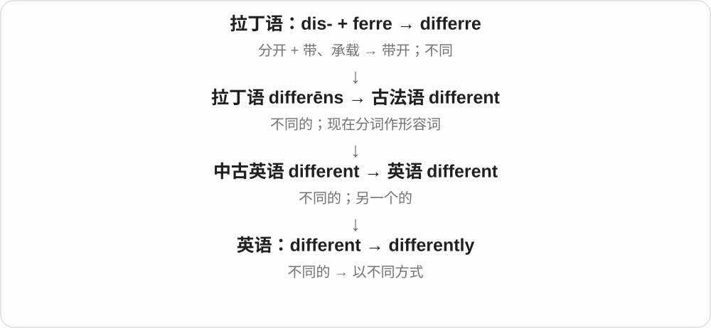

see things differently 是看法不同；treat someone differently 是区别对待，是否不公平要看上下文。

**常见搭配与例句**

think differently；behave differently；do things differently。

> I would arrange the room differently.

我会用另一种方式布置房间。

> The two children reacted differently to the news.

两个孩子听到消息后反应不同。

**别混淆**

different 修饰人或物；differently 修饰怎么做。a different answer / answer differently。

### 162. instantly — 立即；立刻

**音标**：/ˈɪnstəntli/

**先抓住这个画面**

按钮一按，结果就出来，动作之间几乎没有可察觉的等待，这就是 instantly。

**怎么拆**

instant + -ly。

**怎么变成今天的意思**

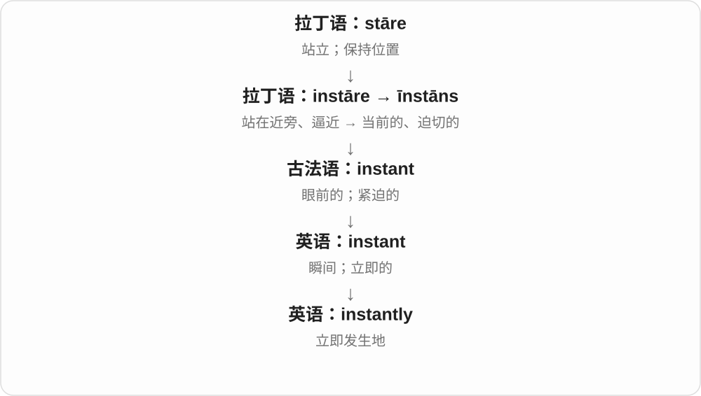

它描述反应或变化发生得非常快。日常表达中可带夸张，不需要按物理学理解为零时间。

**常见搭配与例句**

instantly recognize；instantly understand；respond instantly。

> I recognized her voice instantly.

我立刻认出了她的声音。

> The screen lit up instantly.

屏幕立刻亮了起来。

**别混淆**

instant 是形容词或名词，instantly 是副词：an instant change，change instantly。

### 163. subsequently — 随后；后来

**音标**：/ˈsʌbsɪkwəntli/

**先抓住这个画面**

叙述先往前走了一步，subsequently 再把你带到更晚的时候。

**怎么拆**

subsequent + -ly。

**怎么变成今天的意思**

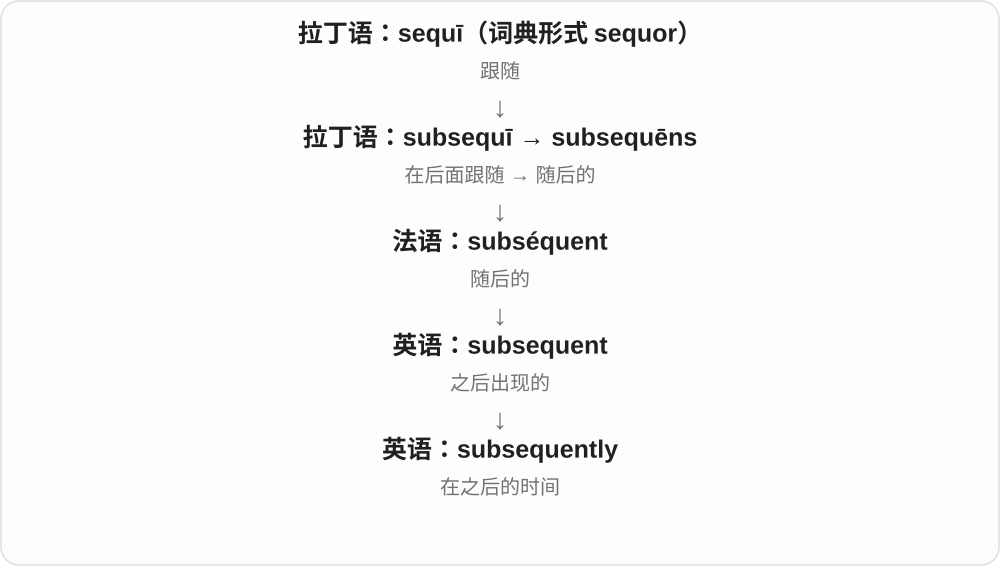

常用于较正式的事件叙述。说后来改了名、后来发现问题，只交代时间推进，不自动说明为什么。

**常见搭配与例句**

subsequently discovered；subsequently became；was subsequently changed。

> The building was subsequently converted into a library.

这栋建筑后来被改成了图书馆。

> She applied for the post and was subsequently invited for an interview.

她申请了这个职位，随后获邀参加面试。

**别混淆**

subsequently 是后来；consequently 是因此。这个差别在解释事件时很关键。

### 164. unexpected — 意外的；未预料到的

**音标**：/ˌʌnɪkˈspektɪd/

**先抓住这个画面**

脑中的安排里没有它，事情却来了，就是 unexpected。可以是礼物，也可以是延误，词本身不决定喜还是忧。

**怎么拆**

un- 不 + expected 预料的；expected 为 expect + -ed。/t/ 后 -ed 读 /ɪd/，整个词按否定性质理解。

**怎么变成今天的意思**

**expect 预期 → expected**  
被预料、预期的

↓

**un- + expected → unexpected**  
未预料到的

↓

**unexpected + -ly → unexpectedly**  
以出乎预料的方式、时机

an unexpected visitor 意外来客；an unexpected result 未料到的结果；unexpected help 意外帮助。

**常见搭配与例句**

an unexpected visitor；an unexpected result；unexpected help。

> An unexpected visitor arrived before lunch.

午饭前来了一位意外访客。

> The experiment produced an unexpected result.

实验得到了一个出乎预料的结果。

**别混淆**

unexpected 未预料，unwanted 不想要；惊喜也可能 unexpected，却很受欢迎。

### 165. unexpectedly — 出乎意料地；突然意外地

**音标**：/ˌʌnɪkˈspektɪdli/

**先抓住这个画面**

事情来得没想到，或程度超出预期，用 unexpectedly：unexpectedly quiet 是没想到这么安静。

**怎么拆**

unexpected + -ly → unexpectedly；-ed 的 /ɪd/ 保留。也能看成 un- 加 expectedly 的对应，但学习时按形容词→副词更清楚。

**怎么变成今天的意思**

**expect 预期 → expected**  
被预料、预期的

↓

**un- + expected → unexpected**  
未预料到的

↓

**unexpected + -ly → unexpectedly**  
以出乎预料的方式、时机

arrive unexpectedly 意外到来；unexpectedly difficult 出乎意料地困难；unexpectedly quiet 意外安静。

**常见搭配与例句**

arrive unexpectedly；unexpectedly difficult；unexpectedly quiet。

> The guests arrived unexpectedly.

客人们意外到来。

> The task was unexpectedly easy.

任务出乎意料地容易。

**别混淆**

unexpectedly 不等于 accidentally 非故意；某人精心安排的惊喜，对接收者仍可能 unexpectedly 到来。

### 166. accidentally — 意外地；不小心地

**音标**：/ˌæksɪˈdentəli/

**先抓住这个画面**

你想做的是甲，手一滑、没留神却做成乙，就能用 accidentally。

**怎么拆**

accidental + -ly，把“非故意的”变成动作发生的方式。

**怎么变成今天的意思**

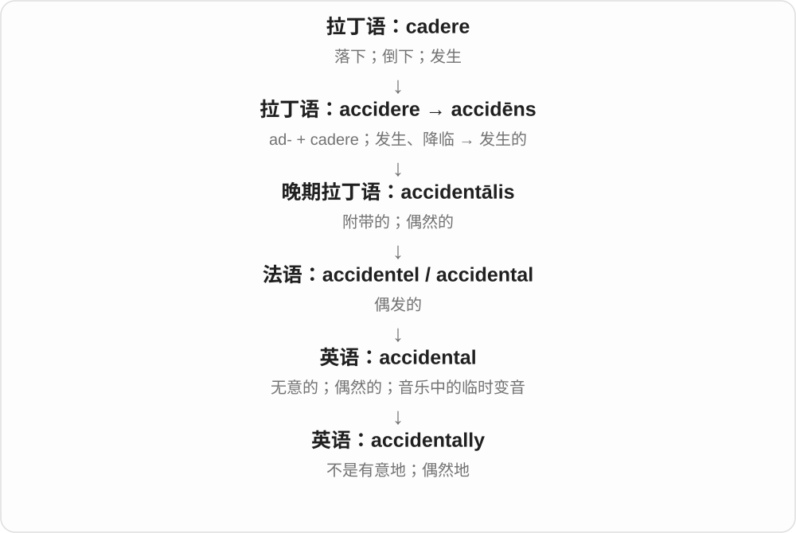

这个副词常放在动词前，说明动作没有出于本意。它只能说明意图，不能自动表示后果不严重或完全没有责任。

**常见搭配与例句**

accidentally delete；accidentally spill；accidentally discover。

> I accidentally sent the message to the wrong group.

我不小心把消息发错了群。

> She accidentally discovered a shortcut through the park.

她偶然发现了一条穿过公园的近路。

**别混淆**

mistakenly 常有判断、认知错误；accidentally 更宽，可以只是碰倒杯子。on purpose 则是故意。

### 167. briefly — 简短地；短暂地

**音标**：/ˈbriːfli/

**先抓住这个画面**

给一个动作设定很小的时间或篇幅，不展开太久。

**怎么拆**

brief + -ly；对应“短暂”和“简短”两个常用方向。

**怎么变成今天的意思**

**拉丁语 brevis**  
短的

↓

**法语 bref／brief → 英语 brief**  
短暂、简短；也有简要文书义

↓

**brief + -ly → briefly**  
时间短；表达简短

speak briefly 是简短发言，stop briefly 是短暂停留。Briefly, ... 放在句首也可表示“简而言之”。判断时看它修饰的是持续时间还是信息表达，不必每次都译成“简要地”。

**常见搭配与例句**

briefly explain；pause briefly；briefly mention。

> Could you briefly explain what happened?

你能简短说明发生了什么吗？

> The lights went out briefly during the storm.

暴风雨期间，灯短暂熄灭了一会儿。

**别混淆**

briefly 是短时间或简短地；quickly 是速度快或很快发生。说得快不代表说得短。

### 168. safely — 安全地；平安地；稳妥地

**音标**：/ˈseɪfli/

**先抓住这个画面**

关注一件事是怎么完成的，或最后有没有平安完成。

**怎么拆**

safe + -ly；对应中古英语 savely。

**怎么变成今天的意思**

**拉丁 salvus → 古法语 sauf**  
安然无恙、得到保护

↓

**中古英语 sauf → safe**  
安全的、没有受损的

↓

**safe + -ly → safely**  
以安全方式；平安地

arrive safely 是平安抵达；store something safely 是妥善存放。We can safely assume 表示根据现有情况可以稳妥地推断，并非在谈身体危险。

**常见搭配与例句**

arrive safely；land safely；store safely；safely assume。

> The plane landed safely despite the strong wind.

尽管风很大，飞机仍然安全着陆。

> Keep the original files safely stored.

把原始文件妥善保存好。

**别混淆**

She is safe 说她的状态；She arrived safely 说到达的结果。词尾 -ly 把描述接到动作或判断上。

### 169. correctly — 正确地；无误地

**音标**：英、美 /kəˈrektli/

**先抓住这个画面**

动作做到了点上：字读对了，机器装对了，情况也理解对了。

**怎么拆**

correct + -ly，修饰动作或判断。

**怎么变成今天的意思**

**拉丁语：regere**  
引导、使直；治理

↓

**拉丁语：corrigere**  
纠正、使正

↓

**拉丁语：correctus**  
已经纠正的；corrigere 的分词形式

↓

**拉丁语及法语 → 英语 correct**  
动词：纠正；形容词：正确的，借入路线有别

↓

**英语：correct + -ly → correctly**  
以正确方式

常见 if I remember correctly“如果我没记错”。这不是强调记得很牢，而是给记忆的准确性留一点余地。

**常见搭配与例句**

answer correctly；spell correctly；if I understand correctly。

> If I remember correctly, the shop closes at six.

如果我没记错，这家店六点关门。

> The device works only when the battery is inserted correctly.

电池装对以后，设备才能工作。

**别混淆**

accurately 常强调精确；correctly 可以只表示做法或答案没有错。

### 170. gradually — 逐渐地；一步步地

**音标**：英、美 /ˈɡrædʒuəli/

**先抓住这个画面**

变化每次只往前挪一点，过一阵子才看出差别。

**怎么拆**

gradual + -ly，英语副词。

**怎么变成今天的意思**

**拉丁 gradus；gradī / gradior**  
一步、台阶、等级；走、迈步

↓

**中古拉丁 graduālis → 英语 gradual**  
与台阶有关；一步一步的 → 逐渐的

↓

**英语 gradual + -ly → gradually**  
以逐步变化的方式

强调变化分散在时间里；不一定慢到无法察觉，也不说明最终一定完成。

**常见搭配与例句**

gradually increase；gradually become；gradually disappear。

> The room gradually filled with people.

房间里的人逐渐多了起来。

> I gradually became more confident.

我渐渐变得更有信心。

**别混淆**

eventually 关心最后的结果；gradually 关心中间一步步变化。

### 171. legally — 依法；从法律上说；合法地

**音标**：/ˈliːɡəli/

**先抓住这个画面**

把同一件事放到法律这一层看：规则怎样规定，它有没有法律效力。

**怎么拆**

legal + -ly，英语副词构词；和 loyal→loyally 同根，却不是同一个现代意思。

**怎么变成今天的意思**

**拉丁语 lex，属格 legis**  
法律、规则

↓

**拉丁语 legalis**  
属于法律的；依法的

↓

**拉丁语直接借入，或经古法语 légal → 英语 legal**  
法律的；合法的

↓

**英语 legal + -ly → legally**  
从法律角度；依法

legally binding 是在法律上具有约束力；legally responsible 是依法负有责任，不等于心理上觉得自己有责任。

**常见搭配与例句**

legally binding；legally responsible；legally required。

> The guide explains when an agreement becomes legally binding.

指南解释协议在什么时候产生法律约束力。

> The museum acquired the objects legally.

博物馆合法取得了这些物品。

**别混淆**

morally 从道德上评价；legally 从法律上评价，结论可以不同。

### 172. illegally — 非法地；违反法律或规则地

**音标**：/ɪˈliːɡəli/

**先抓住这个画面**

动作发生了，但做法越过了法律或规则允许的范围。

**怎么拆**

illegal + -ly；也可按意义理解为否定依法行事，历史词基仍是 illegal。

**怎么变成今天的意思**

**拉丁语 lex，属格 legis**  
法律、规则

↓

**拉丁语 legalis**  
属于法律的；依法的

↓

**中世纪拉丁语 in- + legalis → illegalis；法语 illégal**  
不合法的〔n 在 l 前同化〕

↓

**英语 illegal**  
违法的；违反规则的

↓

**英语 illegal + -ly → illegally**  
以违法的方式

修饰采矿、获取、停放等行为时，重点是方式不合法。报道中的指控与最终认定要由句子其他部分表达，副词本身不会替你证明事实。

**常见搭配与例句**

illegally obtained；illegally parked。

> The investigation found that the waste had been dumped illegally.

调查发现，这些废物是被非法倾倒的。

> A notice warned that illegally parked cars would be removed.

告示提醒，违停车辆将被移走。

**别混淆**

secretly 是秘密地；illegally 是非法地，秘密行为不一定违法，违法行为也可能公开。

### 173. repeatedly — 反复地；一再地

**音标**：/rɪˈpiːtɪdli/

**先抓住这个画面**

给动作加上一个“又一次、又一次”的节拍：问过之后再问，提醒之后又提醒。

**怎么拆**

英语 repeated + -ly，形成表示多次发生的副词。

**怎么变成今天的意思**

**拉丁 petere**  
朝向、寻求、争取；也可指扑向、攻击或请求

↓

**拉丁 re- 再 + petere → repetere**  
再次寻求、再次去做 → 重说、重做

↓

**古法语 repeter／直接拉丁借入 → 中古英语 repeten → repeat**  
重复说或做；后来名词可指重播或重复部分

↓

**英语 repeated**  
反复的

↓

**英语 repeated + -ly → repeatedly**  
一遍又一遍地

它强调发生多次，但不保证中间完全没有间断。You called repeatedly 可以是隔一段时间又打一次电话，不是电话连续不断响着。

**常见搭配与例句**

ask repeatedly；warn repeatedly；repeatedly fail to do something。

> I have repeatedly asked for a clearer explanation.

我一再要求更清楚的解释。

> The machine stopped repeatedly during the test.

机器在测试中多次停了下来。

**别混淆**

continuously 强调不中断；repeatedly 强调次数多，中间可以有间隔。

### 174. mentally — 在心理上；在脑中；智力上

**音标**：英、美 /ˈmentəli/

**先抓住这个画面**

动作没有做给别人看，而是在脑子里进行；或者说人的心理状态怎样。

**怎么拆**

mental + -ly；继承 mental 的心智、心理意义。

**怎么变成今天的意思**

**印欧语重建词根 \*men-**  
想、思考；星号表示语言学重建形式

↓

**拉丁语 mens / ment-**  
心智、思考、精神

↓

**后期拉丁语 mentalis → 法语、英语 mental**  
与心智有关的

↓

**英语 mental + -ly → mentally**  
从心理、智力或脑中活动这一层来说

mentally rehearse 是在脑中预演；mentally prepared 是心理上做好准备。不要把它一律译成“精神病方面”。

**常见搭配与例句**

mentally prepared；mentally exhausted；mentally rehearse。

> She mentally rehearsed the opening of her presentation.

她在脑中预演了演讲的开场。

> He felt physically tired but mentally alert.

他身体疲惫，头脑却很清醒。

**别混淆**

physically 是身体层面；mentally 是心智层面，两种疲惫可以同时出现。

### 175. precisely — 精确地；恰好；正是如此

**音标**：/prɪˈsaɪsli/

**先抓住这个画面**

边界卡得清清楚楚：不是大约那里，而是就在那里；不是差不多那个意思，而是正是那个意思。

**怎么拆**

precise + -ly，英语副词；保持 precise 的 /saɪs/，不跟 precision 的 /sɪʒ/ 一起变化。

**怎么变成今天的意思**

**拉丁 caedere，分词 caesus；复合词常见 -cidere / -cisus**  
切、砍、击杀

↓

**拉丁 prae- + caedere → praecidere；分词 praecisus**  
切去、截短；界定清楚

↓

**法语 précis → 英语 precise**  
明确、精确的

↓

**英语 precise + -ly → precisely**  
精确的 → 精确地、恰好

可修饰时间、位置、表达，也能单独回应 Precisely! 表示“正是这样”。precisely because 则强调“恰恰因为”。

**常见搭配与例句**

precisely at；precisely because；Precisely!。

> The train left at precisely nine o’clock.

列车恰好在九点发车。

> That is precisely why we need a second opinion.

这恰恰是我们需要再听一个意见的原因。

**别混淆**

roughly、approximately 是大约；precisely 是把范围收紧到确切点。

### 176. solely — 仅仅；完全由；只为

**音标**：英 /ˈsəʊlli/；美 /ˈsoʊlli/

**先抓住这个画面**

把其他原因、参与者或目的排除，只留下正在说的这一项。

**怎么拆**

sole“唯一的” + -ly；两个 l 相邻，拼写保留，不要写成 soly。

**怎么变成今天的意思**

**拉丁语 solus**  
独自、唯一；更早来源未定

↓

**古法语 sol / soul → 中古英语 sole**  
独自、唯一

↓

**英语 sole〔形容词〕**  
唯一的；独自承担的

↓

**英语 sole + -ly → solely**  
唯一的 → 只由、只因、只为

solely responsible 是独自负责；solely because of cost 是仅仅因为成本。它比 mainly 更绝对，不能用来表示只是“主要”。

**常见搭配与例句**

solely responsible；solely for；solely because of。

> The decision was based solely on the available evidence.

这个决定完全依据现有证据作出。

> She is not solely responsible for the delay.

延误并不全是她一个人的责任。

**别混淆**

mainly 是大部分；solely 排除其他因素，表示只有这一项。

### 177. striking — 引人注目的、显著的；击打、罢工等；strike 的 -ing 形式

**音标**：/ˈstraɪkɪŋ/

**先抓住这个画面**

有个特点一下撞进视线，让人难以忽略，就是 striking。a striking contrast 是差别非常醒目。

**怎么拆**

strike 去词末 e 加 -ing；动作分词后来在留下鲜明印象这一动词分支上形成常用形容词。strike 的击打、罢工等其他分支也保留相应 -ing 用法。

**怎么变成今天的意思**

**strike + -ing**  
击打等动作分词；也接罢工分支

↓

**留下鲜明印象的分支 → 形容词 striking**  
突出的、引人注目的

a striking difference 显著差别；a striking resemblance 惊人相似；a striking image 令人印象深的画面；striking workers 罢工工人。

**常见搭配与例句**

a striking contrast；striking features。

> There is a striking contrast between the two rooms.

两个房间形成了鲜明对比。

> The report includes interviews with striking workers.

报告收录了对罢工工人的采访。

**别混淆**

striking 的形容词常表示吸引注意，struck 是过去式、过去分词，不能只按中文都含打击就换用。a striking difference 的 difference 不在作击打动作。

### 178. strikingly — 显著地、格外地、惹人注目地

**音标**：/ˈstraɪkɪŋli/

**先抓住这个画面**

相似不只是有一点，而是像到让人一下注意；不同也可以明显得一眼看出来。strikingly 把程度推到醒目这一层。

**怎么拆**

striking 引人注目的 + -ly，形成方式、程度副词；承接 strike 留下鲜明印象这一分支，经形容词再派生。

**怎么变成今天的意思**

**strike → striking**  
留下印象 → 引人注目的

↓

**striking + -ly → strikingly**  
达到让人注意的明显程度

strikingly similar 惊人地相似；strikingly different 明显不同；strikingly beautiful 美得引人注目；strikingly clear 格外清楚。

**常见搭配与例句**

look strikingly alike；a strikingly modern design。

> The two buildings are strikingly similar.

两栋建筑惊人地相似。

> Her approach was strikingly different from ours.

她的方法与我们的明显不同。

**别混淆**

strikingly 可同时修饰相似和不同，不等于某个固定方向的变化。它强调程度醒目，读完后面的形容词才知道具体特点。

### 179. partially — 部分地；不完全地

**音标**：英 /ˈpɑːʃəli/；美 /ˈpɑːrʃəli/

**先抓住这个画面**

进度条走了一段，还没有走满：partially 说明完成或适用的范围只有一部分。

**怎么拆**

partial + -ly，变成描述动作或状态的副词。

**怎么变成今天的意思**

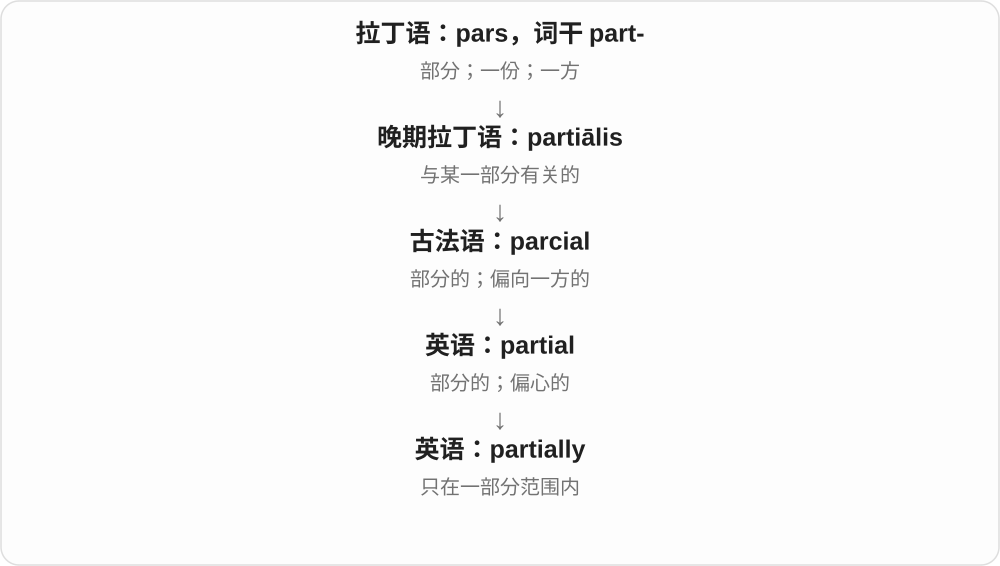

partially open 可以是门只开了一点；partially true 是说法有一部分是真的。它本身不告诉你具体百分比。

**常见搭配与例句**

partially completed；partially responsible；partially open。

> The entrance was partially blocked by fallen branches.

入口有一部分被掉落的树枝挡住了。

> Your answer is partially correct.

你的答案有一部分是对的。

**别混淆**

partly 与 partially 常能互换；谈门、盖子等只开一部分时 partially 很自然。不要把它默认理解成“偏心地”。

### 180. practically — 几乎；从实际角度；在实践中

**音标**：/ˈpræktɪkli/

**先抓住这个画面**

常用义是“实际效果已经差不多等于”，所以能表示几乎。

**怎么拆**

practical + -ly；由实际方面的副词用法，延伸出“实际上近乎如此”的程度义。

**怎么变成今天的意思**

**希腊 prássein／práttein**  
做、实行、完成

↓

**希腊 praktós → praktikós → 后期拉丁 practicus**  
做成的、可做的 → 与行动和实际事务有关的

↓

**中世纪拉丁 practicālis；法语及英语 practic + -al 等路线**  
行动、实际应用方面的

↓

**英语 practical**  
实际的；实用的；动手的

↓

**英语 practical + -ly → practically**  
从实际方面 → 实际效果近乎、几乎

practically empty 是几乎空了，不是“实用地空”；practically speaking 是从实际角度说。判断它修饰的是程度，还是处理事情的方式。

**常见搭配与例句**

practically everyone；practically impossible；practically empty；practically speaking。

> By midnight, the streets were practically empty.

到午夜时，街上几乎空无一人。

> Practically speaking, we need a room closer to the entrance.

从实际使用来看，我们需要一间离入口更近的房间。

**别混淆**

practically 在程度义上接近 almost；pragmatically 强调务实地处理问题，不能拿来替换 practically everyone。

### 181. endless — 无尽的；没完没了的

**音标**：/ˈendləs/

**先抓住这个画面**

找不到尽头，或等得太久，主观上像永远不会结束。

**怎么拆**

end + -less，接古英语 endelēas 等形式，-less 表没有终点。

**怎么变成今天的意思**

**古英语 ende → 中古英语 ende**  
边端、尽头、结束

↓

**古英语 endelēas → 英语 endless**  
没有尽头、终点的

an endless road 可是视觉上望不到头；endless questions 常是夸张说问题很多，并不在做数学无穷判断。

**常见搭配与例句**

endless possibilities；an endless wait；endless questions。

> The children asked endless questions.

孩子们问个没完。

> The new tool offers endless possibilities for creative work.

新工具为创作带来了无穷可能。

**别混淆**

endless 在日常常夸张；eternal 偏永恒的概念，continuous 偏持续不中断，不完全等同。

### 182. endlessly — 无尽地；没完没了地；不断地

**音标**：/ˈendləsli/

**先抓住这个画面**

看不到尽头，或感觉同一件事一直在重复。常是说话者感到没完，并不真在测量无限时间。

**怎么拆**

endless 无尽的 + -ly，较早古英语、中古英语已有相应形式；end + -less 去掉终点的画面，再转为副词。

**怎么变成今天的意思**

**end + -less → endless**  
没有尽头的

↓

**endless + -ly → endlessly**  
无尽地；反复、持续得让人觉得没完

talk endlessly 没完没了地说；endlessly fascinating 总让人着迷；wait endlessly 等得似乎没有尽头。可抱怨，也可夸持续吸引。

**常见搭配与例句**

argue endlessly；an endlessly varied landscape。

> They argued endlessly about minor details.

他们为小细节争论个没完。

> She finds the natural world endlessly fascinating.

她觉得自然界总有让人着迷的新东西。

**别混淆**

endlessly 常带持续、反复感；forever 还可直接指永远。endlessly interesting 是一直让人觉得有趣，不一定是客观时间无限。

### 183. sadly — 悲伤地；可惜、遗憾的是；严重地〔某些搭配〕

**音标**：/ˈsædli/

**先抓住这个画面**

既能描写人难过的神情，也能放在句首说可惜事情是这样。

**怎么拆**

sad + -ly，中古英语已有对应形式。sadly lacking、sadly mistaken 等固定搭配还可加强程度，不一定在说情绪。

**怎么变成今天的意思**

**古英语 sæd**  
饱足、满足，也有厌倦等联系

↓

**中古英语 sad**  
沉实、严肃等义；悲伤义逐步突出，具体转义路径有不同解释

↓

**现代 sad**  
伤心、令人难过；另有可悲、差劲等评价

↓

**sad + -ly → sadly**  
悲伤地；说话人表示遗憾；某些搭配加强程度

smile sadly 伤感地笑，Sadly, ... 遗憾的是……；sadly lacking 严重缺乏。

**常见搭配与例句**

smile sadly；Sadly, ...；sadly lacking；sadly mistaken。

> He smiled sadly and closed the letter.

他伤感地笑了笑，合上信。

> Sadly, the museum is no longer open.

遗憾的是，博物馆已经不再开放。

**别混淆**

sadly 可评论整句话，sad 形容词通常修饰人、事情；Sadly, we lost 不是说 lost 这个动作做得很悲伤。

### 184. unnecessary — 不必要的；多余的

**音标**：英 /ʌnˈnesəsəri/；美 /ʌnˈnesəseri/

**先抓住这个画面**

拿掉这一步、这笔支出也能达到目的，所以没必要多做。

**怎么拆**

un- 不 + necessary，否定必要性，不自动否定它是否存在或是否有任何作用。

**怎么变成今天的意思**

**拉丁 necesse、necessarius → 法语 necessaire → 英语 necessary**  
不可避免、所需；更深组合解释不完全确定

↓

**现代 necessary**  
少不了的条件 → 必要的、必需的

↓

**un- + necessary → unnecessary**  
必要的反面 → 不必要

unnecessary expense 不必要开支，unnecessary detail 多余细节，avoid unnecessary delays 避免无谓延误。

**常见搭配与例句**

unnecessary expense；unnecessary detail；unnecessary delays。

> The new process removes several unnecessary steps.

新流程删去了几个不必要的步骤。

> Please avoid unnecessary detail in the introduction.

引言里请避免多余细节。

**别混淆**

unnecessary 不必做，impossible 做不到；不必要的问题也可能完全能解决，只是不值得花工夫。

### 185. unnecessarily — 没有必要地；多此一举地；本可避免地

**音标**：英 /ʌnˈnesəsərəli/；美 /ʌnˌnesəˈserəli/

**先抓住这个画面**

事情本来不需要这么麻烦、这么贵或这么难，却被弄成那样。unnecessarily 常带一句其实可以不必的评价。

**怎么拆**

unnecessary 不必要的 + -ly，词末 y 变 i；也可按 un- 否定 + necessarily 的相邻形式认识。

**怎么变成今天的意思**

**un- + necessary → unnecessary**  
没有必要的

↓

**unnecessary + -ly → unnecessarily**  
做了不需要做的事；增加了可避免的程度

unnecessarily complicated 不必要地复杂；wait unnecessarily 白白等待；unnecessarily expensive 本可不这么贵。重点是必要性。

**常见搭配与例句**

unnecessarily difficult；cause unnecessary worry → worry unnecessarily。

> The instructions were unnecessarily complicated.

说明被写得过于复杂，其实没有必要。

> We waited unnecessarily because the meeting had already been cancelled.

会议早已取消，我们却白白等了一场。

**别混淆**

unnecessarily 重在本无必要；excessively 重在超过适当程度。两者有时同时适用，但评价角度不同。

### 186. simultaneously — 同时地

**音标**：英 /ˌsɪmlˈteɪniəsli/；美 /ˌsaɪmlˈteɪniəsli/

**先抓住这个画面**

两条时间线在这一刻叠到一起，没有先后等待。

**怎么拆**

simultaneous + -ly；这里 simul- 的重点是同一时间，而不是外观相像。

**怎么变成今天的意思**

**拉丁 simul**  
一起、同时；与 similis“相像”同族

↓

**中世纪拉丁 simultāneus → 英语 simultaneous**  
同时的；后半词形形成方式有不同分析

↓

**英语 simultaneous + -ly → simultaneously**  
同时发生或进行地

同时按两个按钮、同时听见两种声音，都可用它。不要求两个动作的内容相同，只要求时间重合。

**常见搭配与例句**

occur simultaneously；operate simultaneously；simultaneously with。

> Both alarms sounded simultaneously.

两个警报同时响起。

> The software displays the original text and the translation simultaneously.

软件同时显示原文和译文。

**别混淆**

successively 是接连发生；simultaneously 是同时发生。separately 说分开，分开的动作也可能同时进行。

### 187. annually — 每年；按年计算或发生

**音标**：/ˈænjuəli/

**先抓住这个画面**

它给动作加上一圈日历：更新、收费、发布等事情，以一年作为重复或计算单位。

**怎么拆**

annual + -ly，是英语副词派生；annual 自己经法语或拉丁借入。

**怎么变成今天的意思**

**拉丁 annus**  
一年

↓

**拉丁 annalis；晚期／中世纪拉丁 annualis → 古法语 annuel**  
按年的、每年的

↓

**英语 annual〔经法语或直接拉丁来源〕**  
年度的、每年一次的；一年生植物、年刊

↓

**英语 annual + -ly → annually**  
每年进行；以年为单位

publish annually 通常是一年出一次；earn an amount annually 是一年合计挣多少，不是只在年末拿一次工资。

**常见搭配与例句**

review annually；publish annually；pay annually；earn annually。

> The membership fee is reviewed annually.

会费每年审核一次。

> The project saves the school about five thousand dollars annually.

这个项目每年为学校节省约五千美元。

**别混淆**

once a year 明确一次；annually 在收入等语境中可表达年度总量。monthly 则以月为单位。

### 188. strictly — 严格地；完全地；仅仅

**音标**：/ˈstrɪktli/

**先抓住这个画面**

把范围收得很窄：按规定一点不松，或只允许某一种用途。

**怎么拆**

strict + -ly。

**怎么变成今天的意思**

**拉丁语 stringere**  
拉紧、捆紧、压在一起

↓

**拉丁语 strictus → 英语 strict**  
拉紧的 → 严格、不松口

↓

**英语 strict + -ly → strictly**  
严格的 → 严格地；限定在某范围内

strictly prohibited 是严禁；strictly for staff 是仅供员工。strictly speaking 用来补一句更精确的说法，不是准备严厉地讲话。

**常见搭配与例句**

strictly speaking；strictly confidential；strictly for personal use。

> This entrance is strictly for staff.

这个入口仅供员工使用。

> Strictly speaking, the report describes a trend rather than proving its cause.

严格说来，这份报告描述了趋势，并没有证明其成因。

**别混淆**

strictly 可以表示 only；strictly for research 强调用途边界，不是在评价研究有多严厉。

### 189. elderly — 年纪大的、上了年纪的；the elderly 老年人群体

**音标**：英 /ˈeldəli/；美 /ˈeldərli/

**先抓住这个画面**

不是在两个人里挑较年长的一个，而是描述一个人已进入年纪较大的阶段。这里 -ly 把 elder 变成形容词。

**怎么拆**

elder 年长的 + 形容词后缀 -ly。-ly 不只造副词，elderly、friendly 等本身就是形容词。

**怎么变成今天的意思**

**年长路线：古英语 eald 的比较级 eldra → elder**  
old 的旧比较级；元音经历历史变化

↓

**年长者与身份名词**  
较年长的人；社群或宗教组织的长老

↓

**elder + -ly → elderly**  
年纪较大的；the elderly 指老年人群体

an elderly neighbour 上了年纪的邻居，elderly residents 年长居民，services for the elderly 面向老年人的服务。older people 也是常见而平实的说法。

**常见搭配与例句**

an elderly neighbour；elderly residents；the elderly。

> An elderly neighbour helped us identify the old photograph.

一位年长的邻居帮我们辨认了老照片。

> The elderly are among the groups consulted about the new bus route.

老年人是新公交线路征询意见的群体之一。

**别混淆**

通常说 an elderly person，不把 an elderly 当日常单个称呼。the elderly 作群体时一般接复数谓语；elderly 也不自动等于虚弱、需要照顾。

### 190. quietly — 轻声地；安静地；不声张地

**音标**：/ˈkwaɪətli/

**先抓住这个画面**

动作不制造大动静，声音低，或事情进行得不引人注意，都可以用 quietly。

**怎么拆**

quiet + -ly；中古英语已有 quietely 等形式。

**怎么变成今天的意思**

**拉丁 quiēs、quiēscere、quiētus**  
休息；安静下来；安宁、免于负担的

↓

**古法语 quiet / quiete → 中古英语 → quiet**  
安宁、休息 → 安静；安宁

↓

**英语 quiet + -ly → quietly**  
安静的 → 安静地、不声张地

speak quietly 说音量；quietly resign 则可以说低调辞职，未必全程没有讲话。也可说 quietly confident，表示有信心但不张扬。

**常见搭配与例句**

speak quietly；leave quietly；quietly confident。

> She closed the door quietly so as not to wake the baby.

她轻轻关上门，以免吵醒婴儿。

> The team was quietly confident about the result.

团队对结果有信心，但并不张扬。

**别混淆**

silently 强调没有声音；quietly 可以有轻声交谈，也可强调不公开张扬。

### 191. blank — 空白的、未填写的；茫然的；空白处；一时想不起来〔动词〕

**音标**：/blæŋk/

**先抓住这个画面**

纸上本该有内容的地方还空着，是 blank；别人问你问题，脑子里一时什么也抓不到，也可说 your mind went blank。

**怎么拆**

经古法语 blanc 白、发亮，较早接日耳曼语白亮词。英语先有白、无色义，后来突出未写内容的空白，再用于无表情、想不起来的状态。

**怎么变成今天的意思**

**日耳曼语白亮词 → 法语 blanc → blank**  
白、浅色、无色

↓

**未写内容的白面 → 空白及比喻**  
未填、未记录；表情或头脑一时无内容

a blank page 空白页；leave it blank 留空；a blank expression 茫然表情；fill in the blanks 填空；draw a blank 一无所获、想不起来。

**常见搭配与例句**

go blank；a blank screen。

> Please leave this section blank.

这一栏请留空。

> My mind went blank when I stood up to speak.

我站起来发言时，脑子突然一片空白。

**别混淆**

blank 强调预期内容缺失，empty 更广地说里面没有东西。a blank page 可以有纸张颜色，关键是还没有相应内容。

### 192. blankly — 茫然地、毫无表情地

**音标**：/ˈblæŋkli/

**先抓住这个画面**

你说了一句话，对方脸上没有理解后的反应，只是直直看着你。这种空着似的神情，可以用 blankly。

**怎么拆**

blank + 副词词尾 -ly。blank 的无内容、无表情义转成动作方式，常与 stare、look 等描述目光的动词连用。

**怎么变成今天的意思**

**blank 的空白、无表情义**  
没有显出理解、反应

↓

**blank + -ly → blankly**  
以茫然、无表情的方式看、回答

stare blankly 茫然盯着；look blankly at someone 茫然看着某人；gaze blankly 茫然凝视。

**常见搭配与例句**

stare blankly at the screen；look back blankly。

> He stared blankly at the question on the screen.

他茫然地盯着屏幕上的问题。

> She looked at me blankly, as if she had never heard the name.

她茫然地看着我，好像从没听过这个名字。

**别混淆**

blankly 不等于所有情况下都表示发呆；可能是不理解、惊讶后失去反应，也可能刻意面无表情，具体原因要看上下文。

### 193. hurry — 赶快；催促；匆忙

**音标**：英 /ˈhʌri/；美 /ˈhɜːri/

**先抓住这个画面**

离开车只剩两分钟，动作得加快，是 hurry；别人慢，你催他，也用 hurry。名词 a hurry 就是时间压着人走的匆忙。

**怎么拆**

基础来源未定，有快速运动、嗡鸣材料或 harry 变体等分析；现代动词发展出匆忙名词，不硬指定一条尚未证实的古代路线。

**怎么变成今天的意思**

**早期英语 hurry：赶快、催赶**  
远源未定，有快速运动、嗡鸣材料或 harry 变体等不同分析

↓

**hurry 动词 → 名词匆忙；英语规则变化**  
hurried 写匆忙，unhurried 否定匆忙，副词分别接 -ly

hurry up 快点；in a hurry 匆忙；hurry someone 催某人；hurry to the station 赶去车站。

**常见搭配与例句**

there is no hurry 不着急；don’t hurry me 别催我。

> We must hurry or we will miss the train.

我们得赶快，不然就赶不上火车了。

> There is no hurry; take your time.

不着急，慢慢来。

**别混淆**

hurry 强调时间紧、需要快，walk fast 只说走得快；人可以走得快而不着急，也可以着急但根本走不动。

### 194. hurried — 赶紧、催促了；匆忙的

**音标**：英 /ˈhʌrid/；美 /ˈhɜːrid/

**先抓住这个画面**

没时间慢慢来，一边穿外套一边告别，是 a hurried goodbye；过去匆匆走掉，也是 hurried。

**怎么拆**

hurry 的 y 变 i 加完整 -ed，读 /d/；过去分词作形容词，表示时间压迫下做得匆忙。

**怎么变成今天的意思**

**早期英语 hurry：赶快、催赶**  
远源未定，有快速运动、嗡鸣材料或 harry 变体等不同分析

↓

**hurry 动词 → 名词匆忙；英语规则变化**  
hurried 写匆忙，unhurried 否定匆忙，副词分别接 -ly

↓

**hurry → hurried**  
过去赶快行动；或形容匆忙完成

a hurried meal 匆匆吃的一餐；a hurried explanation 匆忙的解释；hurried home 匆匆回家。

**常见搭配与例句**

hurried footsteps 急促脚步；a hurried glance 匆匆一瞥。

> We ate a hurried breakfast before leaving.

出发前，我们匆匆吃了早餐。

> She hurried home when the rain began.

开始下雨时，她匆匆赶回了家。

**别混淆**

hurried 不一定准确、充分，quick 也不一定草率；a quick but careful check 可以又快又仔细，a hurried check 常更带时间不够的感觉。

### 195. hurriedly — 匆忙地；急急忙忙地

**音标**：英 /ˈhʌrɪdli/；美 /ˈhɜːrɪdli/

**先抓住这个画面**

话还没说完就拿上包往外走，东西都来不及检查，做事的样子是 hurriedly。副词把时间紧、来不及从容的方式写出来。

**怎么拆**

hurried + -ly；内层 hurry 变 y 为 i 加完整 -ed，外层 -ly 写方式。-ed 在这里读 /d/，前面的元音来自 hurry 本身的词尾。

**怎么变成今天的意思**

**早期英语 hurry：赶快、催赶**  
远源未定，有快速运动、嗡鸣材料或 harry 变体等不同分析

↓

**hurry 动词 → 名词匆忙；英语规则变化**  
hurried 写匆忙，unhurried 否定匆忙，副词分别接 -ly

↓

**hurry → hurried → hurriedly**  
匆忙的性质，转成做事时的方式

hurriedly packed 匆忙收拾；hurriedly left 匆匆离开；hurriedly explained 急忙解释。

**常见搭配与例句**

hurriedly written note 匆忙写下的便条；hurriedly gathered her things。

> She hurriedly packed a bag and left.

她匆忙收拾了一个包就走了。

> He hurriedly explained why he was late.

他急急忙忙地解释自己为何迟到。

**别混淆**

hurriedly 常突出赶时间造成的匆忙，efficiently 强调做事有效率；快并不自动等于高效。

### 196. hurrying — 正在赶快、匆忙行动；催促

**音标**：英 /ˈhʌriɪŋ/；美 /ˈhɜːriɪŋ/

**先抓住这个画面**

低头看表、脚步加快，正赶着去某处，是 hurrying；也能写催着别人抓紧。

**怎么拆**

hurry + -ing，保留 y → hurrying；与 hurries、hurried 的变 y 为 i 分开记。

**怎么变成今天的意思**

**早期英语 hurry：赶快、催赶**  
远源未定，有快速运动、嗡鸣材料或 harry 变体等不同分析

↓

**hurry 动词 → 名词匆忙；英语规则变化**  
hurried 写匆忙，unhurried 否定匆忙，副词分别接 -ly

↓

**hurry + -ing → hurrying**  
赶时间、催促的过程正在发生

hurrying home 正匆匆回家；hurrying to catch a bus 正赶着乘公交。

**常见搭配与例句**

no point hurrying 赶也没意义；hurrying the children along。

> She was hurrying home before the storm.

暴风雨来前，她正匆匆往家赶。

> There is no point hurrying; the train has already left.

赶也没用了，火车已经开走。

**别混淆**

hurrying 说明正赶时间，running 才说明跑；人也可能骑车、坐车，心急地加快进程。

### 197. hurries — 赶快、催促〔第三人称单数〕

**音标**：英 /ˈhʌriz/；美 /ˈhɜːriz/

**先抓住这个画面**

他每天赶着去车站，是 he hurries to the station；把别人催得也加快，后面则接人作宾语。

**怎么拆**

hurry 的 y 变 i 加 -es → hurries，读 /z/ 结尾；常用为动词三单。

**怎么变成今天的意思**

**早期英语 hurry：赶快、催赶**  
远源未定，有快速运动、嗡鸣材料或 harry 变体等不同分析

↓

**hurry 动词 → 名词匆忙；英语规则变化**  
hurried 写匆忙，unhurried 否定匆忙，副词分别接 -ly

↓

**hurry → hurries**  
他赶快行动，或催别人行动

hurries to work 匆忙去上班；hurries the children along 催孩子往前走。

**常见搭配与例句**

hurries out of the room；hurries to finish。

> He hurries to the station every morning.

他每天早上都匆匆赶去车站。

> She hurries the children along when they stop to look at toys.

孩子们停下看玩具时，她就催他们往前走。

**别混淆**

hurries to finish 强调赶着完成，finishes early 只说明完成时间早；赶得急不保证真能更早完成。

### 198. unhurried — 从容、不匆忙的

**音标**：英 /ʌnˈhʌrid/；美 /ʌnˈhɜːrid/

**先抓住这个画面**

有时间慢慢吃、慢慢看，不被时钟推着走，是 unhurried；常让人感觉节奏稳、留有余地。

**怎么拆**

否定 un- + hurried；内层 hurry 变 y 为 i 加 -ed，外层否定匆忙状态。

**怎么变成今天的意思**

**早期英语 hurry：赶快、催赶**  
远源未定，有快速运动、嗡鸣材料或 harry 变体等不同分析

↓

**hurry 动词 → 名词匆忙；英语规则变化**  
hurried 写匆忙，unhurried 否定匆忙，副词分别接 -ly

↓

**hurry → hurried → unhurried**  
从赶时间的性质，到不匆忙、从容

an unhurried pace 从容的步调；an unhurried lunch 不慌不忙的一顿午餐。

**常见搭配与例句**

calm and unhurried；an unhurried conversation。

> We enjoyed an unhurried lunch by the river.

我们在河边从从容容地吃了顿午餐。

> She spoke in a calm, unhurried voice.

她说话平静而从容。

**别混淆**

unhurried 常带从容感，slow 只说速度慢；效率低、拖沓未必能用带欣赏意味的 unhurried 概括。

### 199. unhurriedly — 从容地；不慌不忙地

**音标**：英 /ʌnˈhʌrɪdli/；美 /ʌnˈhɜːrɪdli/

**先抓住这个画面**

人一项项检查，做完再做下一项，不被催得乱套，叫 unhurriedly。它常写做事留有节奏。

**怎么拆**

unhurried + -ly；内层 un- 否定 hurried，外层修饰动作方式。这里的 -ed 读 /d/，-ly 读 /li/。

**怎么变成今天的意思**

**早期英语 hurry：赶快、催赶**  
远源未定，有快速运动、嗡鸣材料或 harry 变体等不同分析

↓

**hurry 动词 → 名词匆忙；英语规则变化**  
hurried 写匆忙，unhurried 否定匆忙，副词分别接 -ly

↓

**unhurried + -ly → unhurriedly**  
以从容、不匆忙的方式做事

walked unhurriedly 从容地走；unhurriedly checked 不慌不忙地检查。

**常见搭配与例句**

answered unhurriedly；unhurriedly finished his tea。

> He unhurriedly checked each item on the list.

他不慌不忙地核对清单上的每一项。

> She walked unhurriedly through the empty station.

她从容地走过空荡荡的车站。

**别混淆**

unhurriedly 不慌忙，reluctantly 不情愿；动作慢可以因为从容，也可以因为不愿意，副词说明不同原因、态度。

### 200. statistical — 统计的；与统计分析有关的

**音标**：/stəˈtɪstɪkəl/

**先抓住这个画面**

用数据的分布、数量和比较来研究问题，相关的方法或结果就是 statistical。

**怎么拆**

与 statistics 对应，加 -al 构成形容词；现代可见 statistic + -al 的形式关系，但不据此倒置历史顺序。

**怎么变成今天的意思**

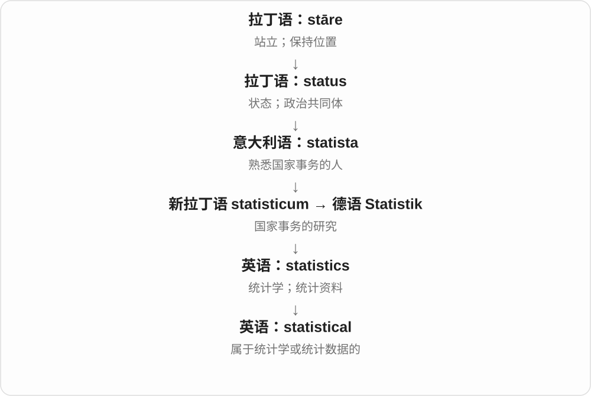

它可以修饰分析、证据、模型等。statistical significance 是一种特定统计判断，不自动等于现实影响很大。

**常见搭配与例句**

statistical analysis；statistical evidence；a statistical model。

> The report includes a statistical analysis of travel patterns.

报告包含对出行模式的统计分析。

> We need more than a statistical difference to explain the cause.

要解释原因，仅有统计差异还不够。

**别混淆**

statistical 不是 static“静态的”。statistical evidence 来自数据分析，仍可能需要解释背景。

### 201. statistically — 从统计上；以统计方式

**音标**：/stəˈtɪstɪkli/〔亦有 /stəˈtɪstɪkəli/〕

**先抓住这个画面**

暂时不凭一个人的感觉，而按成组数据、统计方法来谈，就是 statistically。它限定判断角度，并不让结果自动没有误差。

**怎么拆**

statistical + -ly → statistically；-ical + -ly 写成 -ically，常用读音会压缩中间非重读音节。

**怎么变成今天的意思**

**statistic、statistics → statistical**  
统计数值、方法 → 统计相关的

↓

**statistical + -ly → statistically**  
按统计方法、从统计角度

statistically significant 统计上显著；statistically similar 统计上相近；statistically analysed 以统计方式分析。统计显著不自动代表实际差异很大。

**常见搭配与例句**

statistically significant；statistically similar。

> The two groups were statistically similar in age.

两组的年龄在统计上相近。

> The report explains how the results were analysed statistically.

报告解释了结果如何进行统计分析。

**别混淆**

statistically 是统计上，statically 是静态地；字母相近却是不同基础词。

### 202. reportedly — 据报道；据传

**音标**：英 /rɪˈpɔːtɪdli/；美 /rɪˈpɔːrtɪdli/

**先抓住这个画面**

信息从报道、别人传述而来，reportedly 把这层来源交代出来。它不自动说内容是假，也没有把它升级成亲眼核实。

**怎么拆**

report → reported → reportedly；直接用 reported + -ly。/t/ 后的 -ed 保留 /ɪd/，所以不要只按 report + ly 拼读。

**怎么变成今天的意思**

**report 报道、传述 → reported**  
被报道、传述的

↓

**reported + -ly → reportedly**  
根据报道、传述的信息而言

reportedly planning 据报道正计划；reportedly found 据称已发现；reportedly agreed 据报道已同意。

**常见搭配与例句**

reportedly planning；reportedly agreed。

> The museum is reportedly planning a new exhibition.

据报道，博物馆正计划一个新展览。

> The missing notebook has reportedly been found.

据说，丢失的笔记本已经找到了。

**别混淆**

reportedly 标来源方式，不等于 reportedly 后面的内容必真或必假；confirmed 则明确说已确认。

### 203. excessive — 过量的；过度的

**音标**：/ɪkˈsesɪv/

**先抓住这个画面**

不是单纯很多，而是超过合适、必要或允许的程度，多得成了问题，这才叫 excessive。

**怎么拆**

经法语 excessif 接中世纪拉丁 excessivus，现代对应 excess 过量 + -ive；历史与超出、越过界限的材料相联。

**怎么变成今天的意思**

**excess；法语 excessif、拉丁 excessivus 等**  
超出界限、过量的相关材料

↓

**英语 excessive**  
超过合适程度的

excessive noise 过大噪声；excessive costs 过高成本；excessive use 过度使用。

**常见搭配与例句**

excessive pressure；excessive spending。

> The machine stopped because of excessive heat.

机器因过热停了下来。

> The report criticized excessive spending on decoration.

报告批评在装修上花费过度。

**别混淆**

large 是量大，excessive 还判断多得不合适；大项目的费用很高，也不一定就 excessive。

### 204. excessively — 过度地、过分地

**音标**：/ɪkˈsesɪvli/

**先抓住这个画面**

程度不只是高，而是越过合适的范围。excessively noisy 说吵得过分，带有不该这么吵的评价。

**怎么拆**

excessive 过度的 + -ly；excess、excessive 与 exceed 所接的拉丁超过词族相连，英语中已有各自形式和语气。

**怎么变成今天的意思**

**excess 超量、过分 → excessive**  
程度超过适当范围

↓

**excessive + -ly → excessively**  
过度地、过分地

excessively high prices 过高价格；excessively complicated 过分复杂；talk excessively 说得过多。合适的尺度来自上下文。

**常见搭配与例句**

excessively noisy；excessively expensive。

> The room was excessively hot.

房间热得过分。

> The form is excessively complicated for a simple request.

只是一个简单申请，表格却复杂得过头了。

**别混淆**

exceedingly 通常只是极其；excessively 还评价过头。两者音形接近，却不能在所有赞美句中互换。

### 205. mild — 温和的；不强烈、较轻的

**音标**：/maɪld/

**先抓住这个画面**

没有很强的刺激、冲击：天气不严寒，味道不浓辣，说话不过分激烈，都能叫 mild。核心是力道比较轻。

**怎么拆**

经中古英语 milde 接古英语 milde 温和、仁慈等，属于日耳曼本族词。现代在性情、天气、味道、程度等对象上分别使用。

**怎么变成今天的意思**

**古英语 milde → 中古英语 milde**  
温和、仁慈

↓

**现代 mild 的范围扩展**  
天气温和；味道不强；反应、程度较轻

mild weather 温和天气；a mild flavour 清淡温和的味道；mild criticism 温和批评；a mild reaction 较轻反应。具体对照尺度由名词给出。

**常见搭配与例句**

a mild winter；mild surprise。

> We had a mild winter this year.

今年冬天天气温和。

> The cheese has a mild, creamy flavour.

这种奶酪味道温和，带奶油香。

**别混淆**

mild 不等于完全没有影响；它说相对不强。a mild flavour 有味道，通常只是不会太浓烈、刺激。

### 206. mildly — 温和地；稍微、有点

**音标**：/ˈmaɪldli/

**先抓住这个画面**

把反应的音量调低一点：mildly surprised 是有点惊讶，mildly annoyed 是有点恼火，没有说成大惊或暴怒。

**怎么拆**

mild + -ly，形成方式、程度副词。性情温和的材料可描述说话方式，程度不强的材料又可弱化形容词。

**怎么变成今天的意思**

**mild 温和、不强 + -ly**  
转成动作方式、性质程度

↓

**mildly 的常用用法**  
温和地；有点、稍微

say mildly 温和地说；mildly amusing 有点好笑；mildly surprised 略感惊讶。常用来压低评价强度。

**常见搭配与例句**

mildly annoyed；mildly interested。

> I was mildly surprised by the result.

结果让我略感惊讶。

> “That may be difficult,” she said mildly.

“那可能有点难。”她温和地说。

**别混淆**

mild 是形容词，mildly 是副词。mild surprise 是轻微的惊讶，mildly surprised 则说人略感惊讶。

### 207. openly — 公开地；坦率地

**音标**：英 /ˈəʊpənli/；美 /ˈoʊpənli/

**先抓住这个画面**

没有把态度藏在背后，而是让别人能看见、听到。

**怎么拆**

open + -ly，接古英语 openlīce、中古英语 openli 等。不是“把门开着做一切”，而是从开放延伸为公开、坦诚。

**怎么变成今天的意思**

**古英语 open → 中古英语 open**  
敞开、未封闭

↓

**古英语 openlīce → 中古英语 openli → openly**  
公开、明白地；坦率地

speak openly 是坦率说，openly oppose 是公开反对；openly available 可强调可公开取得。是否真实准确仍是另一问题。

**常见搭配与例句**

speak openly；openly admit；openly oppose。

> She spoke openly about the difficulties.

她坦率地谈了遇到的困难。

> Several members openly opposed the proposal.

几位成员公开反对提议。

**别混淆**

openly 重不隐瞒、公开，loudly 重声音响；很大声也可能只是含糊其词，不等于坦率。

### 208. genuinely — 真诚地；确实地；真正地

**音标**：/ˈdʒenjuɪnli/

**先抓住这个画面**

把表面样子和真实情况区分开：这件事确实如此。

**怎么拆**

genuine + -ly。

**怎么变成今天的意思**

**拉丁 gignere、genitus；同族 genus、gener-**  
生出、产生；种类、出身

↓

**拉丁 genuīnus → 英语 genuine**  
天生、本来的 → 真实、不伪造的

↓

**英语 genuine + -ly → genuinely**  
真实、真诚的 → 确实、真诚地

genuinely surprised 是真的吃惊，并非配合演戏；genuinely useful 是确实有用。它通常不是泛泛把程度加大，而是在强调真实性。

**常见搭配与例句**

genuinely interested；genuinely sorry；genuinely useful。

> I was genuinely surprised by the result.

我确实对结果感到惊讶。

> The guide offers genuinely useful advice.

这份指南给出了确实有用的建议。

**别混淆**

very 只提高程度；genuinely 说明感受或性质是真的。

### 209. poorly — 差地；不足地；英式也作身体不舒服的

**音标**：英 /ˈpɔːli/；美 /ˈpʊrli/、/ˈpɔrli/

**先抓住这个画面**

工作做得不好用副词 poorly；英国日常 She is poorly 还可能只是她不舒服。

**怎么拆**

poor + -ly，历史有相应副词，现代也有不舒服的形容词用法。-ly 不保证每次都是副词。

**怎么变成今天的意思**

**拉丁 pauper → 法语 povre、poure → 中古英语 poor**  
贫乏、贫困

↓

**现代 poor**  
缺钱、缺资源 → 品质差；也表示同情

↓

**poor + -ly → poorly**  
以差、不足的方式；另有身体不适义

poorly written 写得差，poorly paid 报酬低；feel poorly 感觉不舒服。

**常见搭配与例句**

poorly written；poorly understood；poorly paid；feel poorly。

> The instructions were poorly written.

说明写得很差。

> He stayed home because he was feeling poorly.

他因为身体不舒服留在家里。

**别混淆**

a poor result 形容词修饰名词，performed poorly 副词修饰动词；She is poorly 则是特定形容词用法。

### 210. purely — 纯粹地；仅仅；完全

**音标**：英 /ˈpjʊəli/；美 /ˈpjʊrli/

**先抓住这个画面**

把其他原因或目的都暂时划掉：这件事只出于这一点。

**怎么拆**

pure + -ly；中古英语已有 purely，不要按字面把每处都译成“纯净地”。

**怎么变成今天的意思**

**拉丁语 purus**  
干净、没有混入别的东西

↓

**古法语 pur → 中古英语 pure → 英语 pure**  
纯净的 → 纯粹的、完全的

↓

**中古英语 purely → 英语 purely**  
纯粹地 → 仅仅、完全出于某一原因

purely personal 是完全私人的；purely by chance 是纯属偶然；purely hypothetical 说明只是在假设层面讨论。它常用来限定一句话的范围。

**常见搭配与例句**

purely for pleasure；purely personal；purely hypothetical。

> I asked purely out of curiosity.

我只是出于好奇才问的。

> This is a purely hypothetical example.

这只是一个假设的例子。

**别混淆**

mainly 是主要如此，允许其他因素；purely 往往明确排除其他因素。

### 211. seemingly — 看似；表面上

**音标**：/ˈsiːmɪŋli/

**先抓住这个画面**

把事情呈现出来的样子先说清：seemingly simple 看似简单，后面可能揭示实际并不简单，也可能只是暂时保留判断。

**怎么拆**

seem → seeming → seemingly；直接基础 seeming + -ly。中古英语已有相应形式，不写成 seemly 的同义词。

**怎么变成今天的意思**

**古诺斯语 soema 适合、相称 → 中古英语 semen**  
合乎某种样子，显得适当

↓

**英语 seem**  
看起来、似乎

↓

**seeming + -ly → seemingly**  
根据呈现的样子而言

seemingly simple 看似简单；seemingly endless 仿佛无穷；a seemingly minor detail 一个看似微小的细节。

**常见搭配与例句**

seemingly simple；seemingly endless；seemingly minor。

> The seemingly simple task took three days.

看似简单的任务花了三天。

> They waited through a seemingly endless afternoon.

他们等了一个仿佛无穷无尽的下午。

**别混淆**

seemingly 不总保证后面要反转成假的；seemly 则是得体、端庄的较少用形容词。

### 212. severely — 严重地；严厉地

**音标**：英 /sɪˈvɪəli/；美 /sɪˈvɪrli/

**先抓住这个画面**

把“程度很重”放到损坏、限制、批评等动作或状态上。

**怎么拆**

severe + -ly，说明程度或方式。

**怎么变成今天的意思**

**拉丁 severus**  
严肃、严格、严厉

↓

**法语 sévère／拉丁语 → 英语 severe**  
严厉；后来也说程度严重

↓

**severe + -ly → severely**  
严重地、严厉地

severely damaged 表示损坏很严重，severely limited 表示受到很大限制。criticize someone severely 则是严厉批评。它常与负面影响搭配，不宜把“非常喜欢”随意说成 severely like。

**常见搭配与例句**

severely damaged；severely restricted；severely criticized。

> Several bridges were severely damaged by the flood.

洪水严重损坏了几座桥。

> The small budget severely limited our options.

预算有限，极大地限制了我们的选择。

**别混淆**

severe 修饰名词，如 severe damage；severely 常修饰分词或动作，如 severely damaged。

### 213. shocking — 令人震惊的；糟透的、骇人的

**音标**：英 /ˈʃɒkɪŋ/；美 /ˈʃɑːkɪŋ/

**先抓住这个画面**

消息、行为让人震惊，也可强烈嫌某事糟糕。它描述造成冲击的东西，不是自己已经惊呆的人。

**怎么拆**

shock + -ing，分词作性质形容词；与 shocked 受惊状态方向不同。

**怎么变成今天的意思**

**法语 choc、choquer，及荷兰语相关碰撞词 → shock**  
猛烈相撞、冲击

↓

**身体感觉与情绪扩展**  
电击、震惊；医学休克另有专门含义

↓

**shock + -ing → shocking**  
造成震惊；强烈负面评价

shocking news 惊人消息，shocking behaviour 骇人行为，a shocking performance 糟透的表现。

**常见搭配与例句**

shocking news；shocking behaviour；a shocking performance。

> The report revealed shocking conditions.

报告揭示了骇人的状况。

> The team gave a shocking performance.

球队表现糟透了。

**别混淆**

shocking 令人震惊，shocked 感到震惊；I am shocking 常会变成我令人震惊，不是我震惊了。

### 214. shockingly — 令人震惊地；糟糕到令人吃惊地；出人意料地〔加强语气〕

**音标**：英 /ˈʃɒkɪŋli/；美 /ˈʃɑːkɪŋli/

**先抓住这个画面**

一看价格，心里猛地一震：怎么会这么贵。shockingly 把程度说到令人吃惊，有时也夸张地强调出乎意料。

**怎么拆**

shocking + -ly；shocking 接 shock 使震惊的分词形容词，较早有令人反感、惊骇等义。现代副词常修饰很高、很低、很坏或夸张的好。

**怎么变成今天的意思**

**shock → shocking**  
冲击、震惊 → 令人震惊、反感的

↓

**shocking + -ly → shockingly**  
以令人震惊的方式；达到惊人程度

shockingly expensive 贵得惊人；shockingly low 低得惊人；behave shockingly 行为糟糕；shockingly good 好得出乎意料，口语夸张。

**常见搭配与例句**

shockingly bad；a shockingly small amount。

> The repairs were shockingly expensive.

维修费高得惊人。

> For such a tiny speaker, the sound was shockingly good.

音箱这么小，音质却好得出乎意料。

**别混淆**

shocking 多形容造成震惊的事物，shocked 多说感到震惊的人。shockingly 修饰程度，不等于 shockedly 那样直接描写某人受惊的样子。

### 215. technically — 从技术上说；严格按定义或规则说；在技巧上

**音标**：英、美 /ˈteknɪkli/，亦 /ˈteknɪkəli/

**先抓住这个画面**

把日常印象放一边，按专业标准或字面规则认真算一遍。

**怎么拆**

technical + -ly；形容词词尾 -al 与副词 -ly 组合，形成 -ally。

**怎么变成今天的意思**

**希腊语 tekhnē**  
技艺、手艺、掌握方法的实践能力

↓

**希腊语 tekhnikos → 拉丁语 technicus → 英语 technic**  
与技艺有关的；有技巧的

↓

**英语 technic + -al → technical；亦受拉丁化希腊词形影响**  
技术、专业领域或专门规则的

↓

**英语 technical + -ly → technically**  
在技术、技巧或严格规则层面

Technically, it is possible 说技术上做得到，未必经济实用。Technically, she is still employed 说按正式身份仍在职，实际工作情况可能不同。

**常见搭配与例句**

technically possible；technically correct；technically demanding。

> The plan is technically possible but too expensive.

这个计划技术上可行，但成本太高。

> Technically, the deadline is midnight, not the end of the working day.

严格按规定，截止时间是午夜，而不是下班时。

**别混淆**

technologically 常说借助何种技术或技术发展程度；technically 也常表示严格说来。

### 216. importantly — 重要的是；更重要地；自命不凡地

**音标**：英 /ɪmˈpɔːtəntli/；美 /ɪmˈpɔːrtəntli/

**先抓住这个画面**

importantly 常像在下一句话前画一道重点：“请注意，接下来这一点很要紧。”most importantly 则把最关键的一点抬出来。

**怎么拆**

important + -ly，构成副词。

**怎么变成今天的意思**

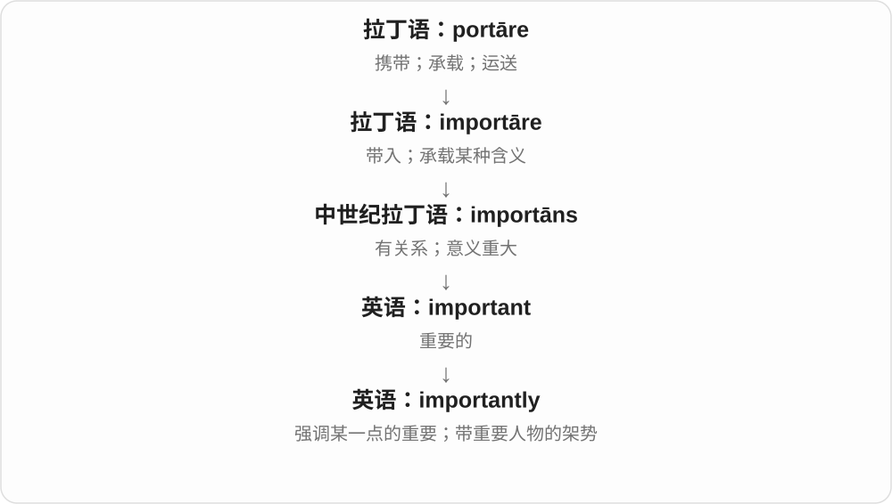

常见用法是修饰整句话，说明后面信息的重要性。另一种较少见的方式副词用法形容人摆出一副自以为了不起的样子。

**常见搭配与例句**

more importantly（更重要的是）；most importantly（最重要的是）；speak importantly（故作重要地说，较少见）。

> The plan is affordable and, more importantly, practical.

这个方案成本可承担，更重要的是切实可行。

> Most importantly, everyone understood the next step.

最重要的是，每个人都明白下一步该做什么。

**别混淆**

important 修饰名词或作表语；importantly 常评说整句话。不是在所有 important 后面随便加 ly 都能得到自然表达。

### 217. surprisingly — 出人意料地、竟然

**音标**：/səˈpraɪzɪŋli/

**先抓住这个画面**

本来以为会很难，结果 surprisingly easy：容易得让人意外。副词把实际结果和原先预期拉开。

**怎么拆**

surprising + -ly，直接在形容词后接副词尾；surprising 自己是 surprise 去 e + -ing 的形式。

**怎么变成今天的意思**

**法语 surprise/surprendre → 英语 surprise**  
突然抓住、出其不意

↓

**英语 surprise → surprising**  
使人意外 → 令人意外的

↓

**surprising + -ly → surprisingly**  
以令人意外的程度、方式

surprisingly easy 意外地容易，surprisingly few 意外地少，Surprisingly, ... 出人意料的是。

**常见搭配与例句**

surprisingly easy；surprisingly few；Surprisingly, …。

> The instructions were surprisingly clear.

说明书清楚得出人意料。

> Surprisingly few people knew the answer.

知道答案的人出乎意料地少。

**别混淆**

surprisingly 侧重出乎预料，不一定令人开心；happily 才可直接偏愉快、庆幸的评价。

### 218. thoroughly — 彻底地、全面地；非常

**音标**：英 /ˈθʌrəli/；美 /ˈθɝːəli/

**先抓住这个画面**

把 thorough 放到动作上，检查得彻底、清洗得全面；放到 enjoy 等词旁，也能加强成非常、充分地。

**怎么拆**

thorough + -ly，形成副词。来自从头到尾做透的感觉，再有完全、充分的加强用法。

**怎么变成今天的意思**

**古英语 þurh／þuruh 等形式**  
从一头到另一头、穿过

↓

**中古英语 thoro／thorow → thorough**  
从头到尾做到 → 完全、周密的

↓

**thorough + -ly → thoroughly**  
彻底、全面地；充分、非常

check thoroughly 彻底检查，clean thoroughly 彻底清洁，thoroughly enjoy 非常享受，thoroughly confused 完全糊涂。

**常见搭配与例句**

check thoroughly；clean thoroughly；thoroughly enjoy。

> Read the instructions thoroughly before starting.

开始前把说明仔细读透。

> We thoroughly enjoyed the concert.

我们很享受这场音乐会。

**别混淆**

thoroughly enjoy 常译非常喜欢、十分尽兴，不必硬翻彻底地享受。thoroughly 的 gh 也不读 /f/。

### 219. delight — 喜悦；令人高兴的事物；使高兴

**音标**：/dɪˈlaɪt/

**先抓住这个画面**

收到惊喜时眼睛一亮，是 delight 的感觉。作名词可指这份喜悦，也可指带来喜悦的人或事；作动词就是让人高兴。

**怎么拆**

经古法语接拉丁 delectare。早期英语有 delite；后来的 gh 不代表来自 light 光，也不单独发音。

**怎么变成今天的意思**

**拉丁 delectare → 古法语 deliter**  
使愉快、使喜爱

↓

**中古英语 delite → delight**  
喜悦；gh 是后来受 light 等拼写影响而出现的字母

to my delight 令我高兴的是；take delight in doing 乐于做；delight someone 使某人高兴。

**常见搭配与例句**

to someone’s delight；take delight in。

> To her delight, the old tree had flowered again.

令她高兴的是，老树又开花了。

> The unexpected visit delighted the children.

这次意外的来访让孩子们很开心。

**别混淆**

delight 通常比普通 pleasure 更鲜明，常有开心、惊喜的感觉；delighted 说人很高兴，delightful 常说人或事令人愉快。

### 220. delighted — 很高兴的、欣喜的；delight 的过去式、过去分词

**音标**：/dɪˈlaɪtɪd/

**先抓住这个画面**

等了很久的好消息终于来了，你忍不住高兴起来。delighted 通常比普通 pleased 更显欣喜。

**怎么拆**

delight + -ed，/t/ 后结尾读 /ɪd/。delight 经法语 delit、delitier 接拉丁 delectare 使愉快、吸引；现代 gh 是受 light 等拼写影响后加入，来源不是光线词。

**怎么变成今天的意思**

**拉丁 delectare → 法语 delit 等 → delight**  
使愉快、满足；英语拼写后来受类推影响

↓

**delight + -ed → delighted**  
受到愉快影响；很高兴、欣喜

delighted to hear 很高兴听到；delighted with the result 对结果很满意；delighted that ... 因某事很高兴；absolutely delighted 欣喜极了。

**常见搭配与例句**

be delighted to help；a delighted smile。

> We were delighted to hear the good news.

听到好消息，我们非常高兴。

> She was delighted with the finished drawing.

她对完成的画很满意。

**别混淆**

delighted 说感到欣喜，delightful 说让人愉快。I was delighted；The evening was delightful，分别描述感受与带来感受的性质。

### 221. delightedly — 高兴地；满心喜悦地

**音标**：/dɪˈlaɪtɪdli/

**先抓住这个画面**

人真的觉得惊喜，笑着、拍手、答应，动作里满是开心，用 delightedly 就把当事人的喜悦写出来。

**怎么拆**

delight + -ed → delighted，再加 -ly；基础 /t/ 使 -ed 读 /ɪd/，这个音节在副词里保留。

**怎么变成今天的意思**

**拉丁 delectare 使愉快 → 古法语 delit、delitier 等 → delight**  
英语早期写 delit、delite；gh 后来受 light 等拼写影响出现，不发音

↓

**delight 名词喜悦、乐趣；动词使喜悦、从中取乐**  
现代 delightful 令人愉快，delighted 感到高兴，再分别形成副词

↓

**delighted + -ly → delightedly**  
以感到喜悦的心情行动

laughed delightedly 高兴地笑；clapped delightedly 高兴地鼓掌；agreed delightedly 欣然答应。

**常见搭配与例句**

smiled delightedly；exclaimed delightedly 高兴地叫道。

> The child clapped delightedly when the puppet appeared.

木偶一出现，孩子就高兴地拍起手。

> She laughed delightedly at the surprise.

面对这份惊喜，她开心地笑了。

**别混淆**

smiled delightedly 写本人高兴地笑；delightfully funny 则说事物令人愉快，不混成一个万能的愉快副词。

### 222. delightful — 令人愉快的；讨人喜欢的

**音标**：/dɪˈlaɪtfəl/

**先抓住这个画面**

一个小花园、一顿午餐、一个有趣的人，让你接触后心情变好了，就可以说 delightful。

**怎么拆**

中古英语已有相应形式；现代对应 delight + -ful。这里突出带来喜悦，不是说花园自己在高兴。

**怎么变成今天的意思**

**拉丁 delectare → 古法语 deliter**  
使愉快、使喜爱

↓

**中古英语 delite → delight**  
喜悦；gh 是后来受 light 等拼写影响而出现的字母

↓

**delight + -ful → delightful**  
令人愉快、讨人喜欢

评价经历、地方、人、细节都能用，语气常较温暖、赞赏。

**常见搭配与例句**

a delightful afternoon 愉快的下午；a delightful surprise 令人欣喜的意外。

> We spent a delightful afternoon by the lake.

我们在湖边度过了一个愉快的下午。

> The book is full of delightful little details.

这本书里有许多讨人喜欢的小细节。

**别混淆**

delightful 说对象给人的感受；delighted 通常说感到高兴的人：a delightful gift，a delighted child。

### 223. delightfully — 令人愉快地；惬意地；可爱、讨喜地

**音标**：/dɪˈlaɪtfəli/

**先抓住这个画面**

屋里凉得正好、点心酥得可口、表演妙得让人开心，描述这种让人喜欢的样子，可以用 delightfully。

**怎么拆**

delight + -ful → delightful，再加副词 -ly；ful 保留一个 l，与 ly 相接成为 fully。

**怎么变成今天的意思**

**拉丁 delectare 使愉快 → 古法语 delit、delitier 等 → delight**  
英语早期写 delit、delite；gh 后来受 light 等拼写影响出现，不发音

↓

**delight 名词喜悦、乐趣；动词使喜悦、从中取乐**  
现代 delightful 令人愉快，delighted 感到高兴，再分别形成副词

↓

**delightful + -ly → delightfully**  
以令人愉快、讨喜的方式，或修饰这种性质的程度

delightfully cool 凉爽得很惬意；delightfully simple 简单得讨喜；delightfully funny 有趣得让人开心。

**常见搭配与例句**

delightfully fresh；a delightfully quiet place。

> The room was delightfully cool after the heat outside.

从外面的炎热进来，房间里凉爽得很惬意。

> The story is delightfully funny without being cruel.

这个故事有趣得让人开心，又不刻薄。

**别混淆**

delightfully 常评价事物给人的愉快感；delightedly 则常写人带着喜悦行动。

### 224. delights — 乐趣、令人高兴的事物〔复数〕；使高兴、喜爱〔第三人称单数〕

**音标**：/dɪˈlaɪts/

**先抓住这个画面**

旅途中那些小吃、美景、小惊喜，合起来是 delights；某件事总让她高兴，动词也写 delights。

**怎么拆**

delight + -s，/t/ 后词尾读 /s/；名词复数和动词三单同形，gh 不发音。

**怎么变成今天的意思**

**拉丁 delectare 使愉快 → 古法语 delit、delitier 等 → delight**  
英语早期写 delit、delite；gh 后来受 light 等拼写影响出现，不发音

↓

**delight 名词喜悦、乐趣；动词使喜悦、从中取乐**  
现代 delightful 令人愉快，delighted 感到高兴，再分别形成副词

↓

**delight + -s → delights**  
多种乐趣；它使人欢喜，或某人喜爱某事

the delights of travel 旅行的种种乐趣；delights the children 使孩子们高兴；delights in storytelling 喜欢讲故事。

**常见搭配与例句**

simple delights 朴素的小乐趣；delights everyone。

> The little dog delights everyone it meets.

这只小狗让遇见它的人都高兴。

> We enjoyed the simple delights of walking and good food.

我们享受散步和美食带来的朴素乐趣。

**别混淆**

delights someone 是使某人高兴，delights in something 是某人从中取乐；宾语结构改变观察方向。

### 225. delighting — 正在使人高兴；从中取乐、喜爱

**音标**：/dɪˈlaɪtɪŋ/

**先抓住这个画面**

歌手一唱，孩子们就笑起来，是 delighting the children；自己沉浸在小乐趣里，是 delighting in it。

**怎么拆**

delight + -ing，基础 gh 不发音，/t/ 保留；这里是整个动词的动作形式。

**怎么变成今天的意思**

**拉丁 delectare 使愉快 → 古法语 delit、delitier 等 → delight**  
英语早期写 delit、delite；gh 后来受 light 等拼写影响出现，不发音

↓

**delight 名词喜悦、乐趣；动词使喜悦、从中取乐**  
现代 delightful 令人愉快，delighted 感到高兴，再分别形成副词

↓

**delight + -ing → delighting**  
使别人愉快或自己从中取乐的过程

delighting the audience 让观众欢喜；delighting in small things 从小事中取乐。

**常见搭配与例句**

a performer delighting children；delighting in the attention 因受关注而高兴。

> The magician was delighting the children with simple tricks.

魔术师用简单的戏法逗得孩子们很开心。

> She walked slowly, delighting in every new flower she saw.

她慢慢走着，每看到一朵新开的花都很欢喜。

**别混淆**

delighting 是动作形式，delightful 是令人愉快的性质；an act is delighting the crowd 与 a delightful act 句法不同。

### 226. gently — 轻轻地；温柔地；平缓地

**音标**：/ˈdʒentli/

**先抓住这个画面**

减少冲力或刺激，让动作、声音或变化柔和一点。

**怎么拆**

中古英语 gentilliche、gentilly 等形式延续下来；现代对应 gentle + -ly，重复的弱音节在历史中简化。

**怎么变成今天的意思**

**拉丁 gignere、genitus；同族 genus、gener-**  
生出、产生；种类、出身

↓

**拉丁 gēns → gentīlis → 古法语 gentil**  
氏族 → 同族的；出身高贵的

↓

**中古英语 gentilliche / gentilly → gently**  
温和、有礼地 → 轻柔、平缓地

gently stir 是轻轻搅；gently remind 是温和提醒；地形也能 slope gently“缓缓倾斜”。不是单纯把速度减慢。

**常见搭配与例句**

speak gently；gently stir；gently remind；slope gently。

> She gently placed the glass on the table.

她轻轻把玻璃杯放在桌上。

> The ground slopes gently towards the river.

地面朝河边缓缓倾斜。

**别混淆**

slowly 说速度慢；gently 说力度或方式柔和，慢动作仍可能很粗暴。

### 227. historically — 历史上；从历史角度看

**音标**：英 /hɪˈstɒrɪkli/；美 /hɪˈstɔːrɪkli/

**先抓住这个画面**

暂时把镜头拉到过去，看长久以来或在某个历史时期是什么情况。

**怎么拆**

historical + -ly，形成副词；-ically 的常见读音不必把每个字母各读成一拍。

**怎么变成今天的意思**

**古希腊语 historía**  
探究所得的知识；记述

↓

**拉丁语 historia → 古法语 estoire / estorie → 中古英语 historie**  
叙述、纪事

↓

**英语 history**  
过去发生的事；关于过去的记录与研究

↓

**historical → historically**  
与历史有关的 → 从历史来看、在过去

historically important 历史上重要的；historically accurate 符合史实的。句首 Historically, ... 常是在交代过去背景，不等于宣告一件新事物载入史册。

**常见搭配与例句**

historically speaking；historically accurate；historically important。

> Historically, the town depended on river trade.

历史上，这座城依靠河运贸易。

> The costumes are beautiful but not historically accurate.

这些服装很好看，却不符合史实。

**别混淆**

historically 通常说明历史角度、过去情况；不等于 historic 所带的重大意义，也不是 hysterically 情绪失控地。

### 228. overwhelming — 压倒性的；强烈到难以承受的

**音标**：英 /ˌəʊvəˈwelmɪŋ/；美 /ˌoʊvərˈwelmɪŋ/

**先抓住这个画面**

任务多得像浪，力量大到另一边难以对抗，就是 overwhelming。an overwhelming majority 则说支持比例大得有压倒优势。

**怎么拆**

overwhelm + -ing；与 overwhelmed 对照，前者常说明造成压倒感的来源或强度，后者说明承受者状态。

**怎么变成今天的意思**

**over- + whelm 等旧覆盖、翻覆材料 → overwhelm**  
淹没；以力量、情绪压倒

↓

**overwhelm + -ing → overwhelming**  
力量、数量、感受极强、压倒性的

an overwhelming majority 压倒性多数；overwhelming evidence 极有力的大量证据；an overwhelming feeling 强烈感受。

**常见搭配与例句**

an overwhelming majority；overwhelming evidence；an overwhelming feeling。

> The proposal received overwhelming support.

提案获得了压倒性支持。

> The number of choices felt overwhelming.

选择数量多得让人难以招架。

**别混淆**

overwhelming 不总负面，也不把 majority 自动等同全体；压倒性多数仍可能不是百分之百。

### 229. overwhelmingly — 压倒性地；极其强烈地；绝大多数地

**音标**：英 /ˌəʊvəˈwelmɪŋli/；美 /ˌoʊvərˈwelmɪŋli/

**先抓住这个画面**

把几边的力量或数量放在一起，一边明显盖过其他。评价好得压倒一切，或投票中大多数站在同一边，都能用它。

**怎么拆**

overwhelming 压倒性的 + -ly；overwhelm 更早有翻覆、淹没等词族材料，再比喻力量、感受把人压住。

**怎么变成今天的意思**

**overwhelm → overwhelming**  
压倒、淹没 → 压倒性的

↓

**overwhelming + -ly → overwhelmingly**  
程度或数量明显占优势

overwhelmingly positive 绝大多数是正面评价；vote overwhelmingly for 大幅多数投票支持；feel overwhelmingly grateful 感激之情极强烈。

**常见搭配与例句**

overwhelmingly in favour；overwhelmingly successful。

> The feedback was overwhelmingly positive.

反馈绝大多数是正面的。

> The committee voted overwhelmingly in favour of the proposal.

委员会以压倒性多数投票支持该提案。

**别混淆**

overwhelmingly 不等于 exactly all 全部：可以是绝大多数，也可以是感受的强烈程度。具体看它修饰的词。

### 230. permanently — 永久地；长期固定地

**音标**：英 /ˈpɜːmənəntli/；美 /ˈpɜːrmənəntli/

**先抓住这个画面**

这次改变以后，状态会一直维持，而不是过两天又恢复。

**怎么拆**

permanent + -ly；英语把持久的性质转为改变或存在的方式。

**怎么变成今天的意思**

**拉丁语 manēre**  
停留、留下；不是英语 man“男人”或拉丁语 manus“手”

↓

**拉丁语 per- + manere → permanere → permanens**  
一直留下 → 持续存在的

↓

**法语 permanent；英语 permanent**  
长久持续的、永久的

↓

**英语 permanent + -ly → permanently**  
永久的 → 长期保持某种状态

close permanently 是永久停业；move permanently 是正式迁居而非短住。它常说明变化会持续，和 immediately“立刻”并不相同。

**常见搭配与例句**

permanently closed；permanently damaged；move permanently。

> The old cinema closed permanently last winter.

老电影院去年冬天永久停业了。

> They decided to move permanently to the coast.

他们决定搬到海边长期定居。

**别混淆**

permanently 说持续多久；constantly 说发生得频繁或连续，不一定永远。

### 231. separately — 分别地；单独地

**音标**：/ˈsepərətli/

**先抓住这个画面**

separately 像结账时各付各的，或把两项资料分开处理：事情没有混到同一次行动里。

**怎么拆**

separate 的形容词形式 + -ly；末尾保留弱读 /ət/，不是动词 separate 的 /eɪt/。

**怎么变成今天的意思**

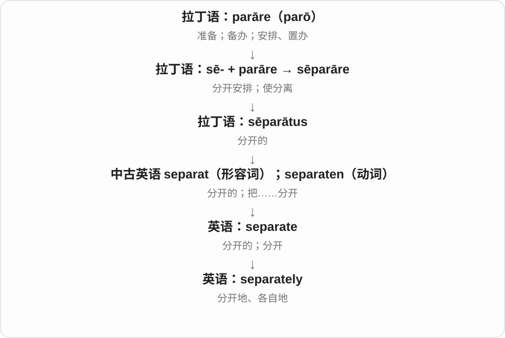

可以分开时间、空间、账目或处理步骤。sold separately 说明某个配件不包含在当前那件商品之中。

**常见搭配与例句**

pay separately；discuss separately；sold separately。

> We arrived separately but left together.

我们分头到达，但一起离开。

> The batteries are sold separately.

电池需要另行购买。

**别混淆**

individually 强调一个一个；separately 强调彼此分开。两组一起行动，但和第三组分开，也可以说 separately。

### 232. unbelievable — 难以置信的；不可信的；惊人极了的

**音标**：/ˌʌnbɪˈliːvəbəl/

**先抓住这个画面**

一层是真让人怀疑能不能信；另一层是口语夸张：太厉害、太离谱，简直不敢相信。

**怎么拆**

un- 否定 + believable 可信的；believable 对应 believe 去词末 e 加 -able。整个结构把能相信改成难以相信。

**怎么变成今天的意思**

**believe + -able → believable**  
能让人相信、可信的

↓

**un- + believable → unbelievable**  
不可信；再作惊人的夸张评价

an unbelievable excuse 不可信的借口；an unbelievable performance 惊人的表现；unbelievable luck 难以置信的运气。夸赞、质疑要看对象与语调。

**常见搭配与例句**

an unbelievable story；That’s unbelievable!。

> Her performance was unbelievable.

她的表现简直太惊人了。

> He offered an unbelievable excuse for missing the meeting.

他为缺席会议找了一个令人难以相信的借口。

**别混淆**

unbelievable 不总表示事情是假的。对精彩表演说 unbelievable 可能是在赞叹，称 excuse unbelievable 则更可能是怀疑。

### 233. unbelievably — 令人难以置信地；极其、异常地

**音标**：/ˌʌnbɪˈliːvəbli/

**先抓住这个画面**

程度高到超出预期：速度快得难信，或者一个人粗鲁得离谱。它可以加强好性质，也可以加强坏性质。

**怎么拆**

unbelievable + -ly，末尾 -ble 改成 -bly。由难以相信的性质转成对动作、程度的强评价。

**怎么变成今天的意思**

**unbelievable 的难以置信性质**  
强烈惊讶、赞叹或不满

↓

**unbelievable + -ly → unbelievably**  
程度超出预料；极其

unbelievably fast 快得惊人；unbelievably rude 粗鲁得离谱；unbelievably expensive 贵得难以置信。常比普通 very 更有感情色彩。

**常见搭配与例句**

unbelievably lucky；unbelievably good。

> The train was unbelievably fast.

那列火车快得惊人。

> He was unbelievably rude to the waiter.

他对服务员粗鲁得离谱。

**别混淆**

unbelievable 修饰名词或作表语；unbelievably 用来加强 fast、good 等性质。其惊讶语气不保证评价一定正面。

### 234. freely — 自由地；畅通地；慷慨地、毫无顾忌地

**音标**：/ˈfriːli/

**先抓住这个画面**

话能放心说，水能顺畅流动，给予时也不抠着不放。

**怎么拆**

free + -ly；接古英语 frēolīce、中古英语 frely 等副词形式。-ly 将相关性质用于动作方式。

**怎么变成今天的意思**

**古英语 frēo / frēoh → 中古英语 fre**  
自由的；不受奴役的

↓

**古英语 frēolīce → 中古英语 frely → freely**  
自由、不受阻碍地

speak freely 是畅所欲言，move freely 是活动不受限，give freely 可说慷慨给予。并不一律等于“免费地”。

**常见搭配与例句**

speak freely；flow freely；move freely；give freely。

> Please speak freely; we want your honest opinion.

请畅所欲言，我们想听你的真实看法。

> Air can flow freely through the open windows.

空气可以通过敞开的窗户畅通流动。

**别混淆**

The app is free 是应用免费，share your views freely 是放心表达观点。freely available 常说容易、不受限地取得，是否收费仍需看具体说明。

### 235. nicely — 友好地；漂亮地、妥当地；进展顺利地

**音标**：/ˈnaɪsli/

**先抓住这个画面**

做出来让人满意，或者对人说得好听、友善。

**怎么拆**

nice + -ly。现代 e 保留为 nicely；副词继承 pleasant、satisfactory 等现代常用义，也可用于精细、恰当的程度。

**怎么变成今天的意思**

**拉丁语 nescius → 古法语 nice → 中古英语 nice / nyce**  
不知情、无知；愚笨等旧义

↓

**英语 nice 的多阶段词义变化**  
曾含挑剔、精细等义；后来发展出令人愉快、友善等常用义

↓

**nice → nicely**  
令人满意、友善的 → 妥当、友善地

ask nicely 好好地请求；fit nicely 很合适，come along nicely 进展顺利。不是只用来形容人漂亮。

**常见搭配与例句**

ask nicely；work nicely；fit nicely；come along nicely；nicely done。

> If you ask nicely, she may lend you the book.

如果你好好开口，她也许会把书借给你。

> The new shelf fits nicely into the corner.

新架子放在角落里很合适。

**别混淆**

nice 形容人或事物，nicely 说明动作怎样进行；speak nicely 是友善地说，look nice 是看起来不错。

### 236. allegedly — 据称；被指；据指控

**音标**：英、美 /əˈledʒɪdli/

**先抓住这个画面**

告诉读者：我是在转述某方的说法，还没有把它直接认定为事实。

**怎么拆**

alleged + -ly；从表示被指称的形容词构成副词。

**怎么变成今天的意思**

**拉丁语 lēgāre**  
委派、交付；也可指通过遗嘱留下

↓

**拉丁语 ad- + lēgāre → allēgāre**  
派来、提出、举作证据

↓

**法语 alléguer；另线 ex + litigare → 古法语 eslegier／盎格鲁法语 aleger**  
提出证据、主张；另线原指为人洗清诉讼指控

↓

**两线在中古英语中交汇 → 英语 allege**  
声称、提出尚待证实的指控

↓

**英语 alleged + -ly → allegedly**  
被指称的 → 按指称或指控所说

可修饰行为或整个句子。The file was allegedly altered 说文件据称被改过，不是说调查已经确认。口语里有时带怀疑或调侃，正式语境则要看信息来源。

**常见搭配与例句**

allegedly involved；allegedly stolen；allegedly responsible。

> The documents were allegedly removed before the inspection.

据称，这些文件在检查前被移走了。

> He allegedly promised a refund, but no written record was found.

据称他承诺过退款，但没有找到书面记录。

**别混淆**

reportedly 强调据报道；allegedly 常强调说法仍属指称，尤其涉及不当行为时。

### 237. independently — 独立地；自行地；分别地、彼此不依赖地

**音标**：英、美 /ˌɪndɪˈpendəntli/

**先抓住这个画面**

不用别人一步步带着做，或几个团队各走各的路线，分别得出结果。

**怎么拆**

英语 independent + -ly。副词既可说自主完成，也可说多个过程没有彼此依赖。

**怎么变成今天的意思**

**拉丁 pendēre；相关动词 pendere**  
悬垂；使悬挂、称量

↓

**拉丁 dependere 的分词 dependens；法语 dependant**  
依附、依赖的

↓

**英语 dependent／名词也拼 dependant**  
需要依靠的；受供养的人

↓

**英语 in-“不”+ dependent → independent**  
不依赖、能自主；法语也有相应形式

↓

**英语 independent + -ly → independently**  
以自主或互不依赖的方式

work independently 可以是自行工作；independently confirmed 表示有独立途径复核。它不一定等于独处：你可以在人很多的办公室里独立完成任务。

**常见搭配与例句**

work independently；live independently；independently of；independently verify。

> Students are expected to complete the final task independently.

学生应独立完成最后一项任务。

> Two laboratories independently reached the same conclusion.

两家实验室各自独立得出了相同结论。

**别混淆**

separately 强调分开；independently 强调没有依赖或控制关系。两个人分开办公，仍可能彼此依赖。

### 238. politically — 在政治上；从政治角度；出于政治考虑

**音标**：英 /pəˈlɪtɪkli/；美 /pəˈlɪtɪkli/、/pəˈlɪtəkli/

**先抓住这个画面**

给一句话加上观察角度：论的是政治立场、权力影响或支持者反应。

**怎么拆**

political + -ly；-ically 通常压缩读成 /ɪkli/ 或 /əkli/，不必一字母一音地读。

**怎么变成今天的意思**

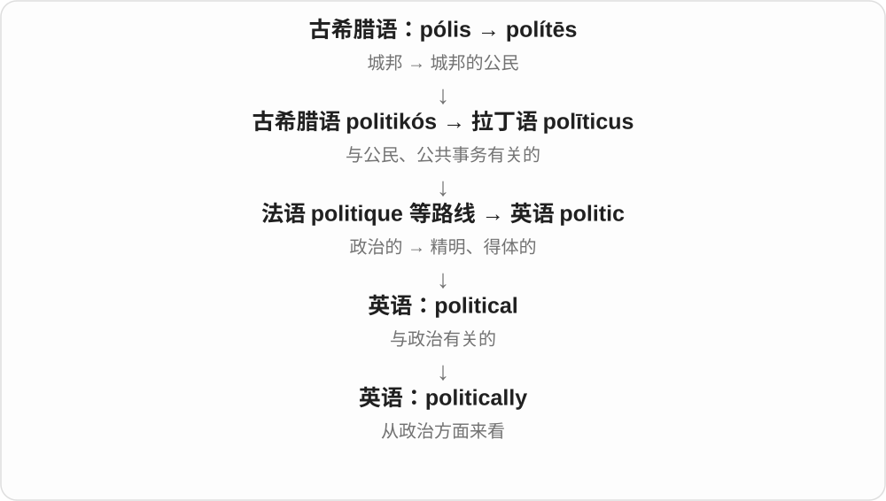

politically active 是积极参与政治；politically sensitive 是牵动政治利益、容易引发争议。它不等于“用政客腔说话”。

**常见搭配与例句**

politically active；politically sensitive；politically motivated。

> The students became politically active during the campaign.

学生们在这次运动中开始积极参与政治活动。

> The two friends disagree politically but still respect each other.

这两个朋友政治立场不同，但仍相互尊重。

**别混淆**

politically 限定政治方面；personally 限定个人方面。一个人可私下友好，政治立场却相反。

### 239. presumably — 想必、大概、据推测

**音标**：英 /prɪˈzjuːməbli/；美 /prɪˈzuːməbli/

**先抓住这个画面**

门口鞋子不在，人也没应声：你推想他大概出去了。presumably 给出的就是这种有根据、但尚未直接确认的判断。

**怎么拆**

presumable + -ly；-able 接 -ly 时变为 -ably。底层 presume 表先作推定，presumable 是可合理推想的。

**怎么变成今天的意思**

**presume → presumable**  
认为大概如此 → 可以合理推测的

↓

**presumable + -ly → presumably**  
大概、想必；按目前情况推想

Presumably, ... 可以放句首，也能放句中。语气通常是根据情况想必如此，事实仍可能另有解释。

**常见搭配与例句**

Presumably, ...；will presumably ...。

> The lights are off, so presumably everyone has gone home.

灯都关了，想必大家已经回家了。

> She will presumably contact us when she arrives.

她到了之后大概会联系我们。

**别混淆**

presumably 与 probably 意思接近，前者更容易突出这是说话者按情况作的推想；两者都不是百分之百保证。

### 240. temporarily — 暂时；临时地

**音标**：英 /ˈtempərərɪli/；美 /ˌtempəˈrerəli/

**先抓住这个画面**

状态先停在这里一会儿，之后还有可能恢复或改变。

**怎么拆**

temporary 去掉词尾 y，改为 -ily；英语副词派生。

**怎么变成今天的意思**

**拉丁语 tempus，词干 tempor-**  
时间；时段

↓

**拉丁 temporārius → 英语 temporary**  
只持续一段时间的 → 暂时的

↓

**temporary → temporarily**  
暂时的 → 暂时地

temporarily closed 是暂时关闭，不是永远停业；具体多久要看告示。这个词不会给出确定的重开日期。

**常见搭配与例句**

temporarily unavailable；temporarily closed；temporarily suspend。

> The library is temporarily closed for repairs.

图书馆因维修暂时关闭。

> She is temporarily staying with her sister.

她暂时住在姐姐家。

**别混淆**

temporarily 说持续时间有限；occasionally 说偶尔发生，回答的不是同一个问题。

### 241. traditionally — 按传统；过去通常；历来

**音标**：/trəˈdɪʃənəli/

**先抓住这个画面**

先把时间往回拉：过去这件事通常怎样做，再看现在是否还照旧。

**怎么拆**

英语 traditional + -ly，给动作或整句话加上“依传统、过去通常如此”的角度。

**怎么变成今天的意思**

**拉丁 trans／trans-**  
越过、穿过；在另一边

↓

**拉丁 trans- + dare → tradere；名词 traditio**  
交到别人手上；传递

↓

**古法语 tradicion／拉丁 → 中古英语 tradicioun → tradition**  
代代相传的做法、观念与故事

↓

**英语 tradition → traditional → traditionally**  
传统 → 传统的 → 按传统、历来

Traditionally, the festival lasts three days 是说传统安排；traditionally made cheese 强调制作方法。句首 traditionally 常为后面谈变化铺垫，并不保证今天仍然如此。

**常见搭配与例句**

traditionally made；traditionally associated with；Traditionally, …。

> Traditionally, the whole family gathers here on New Year’s Eve.

按传统，全家会在除夕聚到这里。

> The trade was traditionally taught through apprenticeships.

这门手艺过去通常通过学徒制传授。

**别混淆**

usually 描述通常情况，不特别追溯过去；traditionally 把通常情况放在传承或历史背景中。

### 242. adequate — 足够的；能满足需要的；尚可的

**音标**：英、美 /ˈæd.ə.kwət/，也记作 /ˈæd.ɪ.kwət/；重音在首音节

**先抓住这个画面**

想象一条“需要达到的线”：现有的水、时间或能力达到了这条线，就可以说 adequate。判断的是能否满足具体需要，不是越多越好，也不是夸它特别出色。

**怎么拆**

词源上连接拉丁 ad-（向、到）+ aequus（相等）；aequāre 是“使相等”，adaequāre 是“使相等、使相称”，其过去分词 adaequātus 进入英语成为 adequate。可借 ad- + equ- + -ate 记忆，但它有完整的拉丁借词历史，不是现代英语给 equate 随意加 ad。这里的 equ- 与 equal、equation 同源；词尾 -ate 在这个形容词中弱读 /ət/，不是动词 equate 的 /eɪt/。

**怎么变成今天的意思**

**拉丁 aequus → aequāre**  
相等 → 使相等

↓

**拉丁 ad- + aequāre → adaequāre → adaequātus**  
使相等、使相称 → 已达到相当水平

↓

**英语 adequate**  
与所需标准相当 → 足够、合用、能胜任

读到 adequate rainfall 时，把降雨量与农业或作物的需要比较：它指“足够的降雨”，不要求降雨很丰富。lack adequate rainfall 是“缺少足够的降雨”。adequate 同时可评价数量与质量：adequate food 是食物够用，an adequate explanation 是解释足以说明问题。评价表现为 merely adequate，往往是“只是尚可”，并不等于优秀。

**常见搭配与例句**

adequate rainfall 足够的降雨；adequate resources 足够的资源；adequate for our needs 足以满足我们的需要；adequate to meet demand 足以满足需求；barely adequate 勉强够用。

> The crops need adequate rainfall during the growing season.

作物在生长季需要足够的降雨。

> The room is small, but it is adequate for our needs.

房间虽小，但足以满足我们的需要。

> The report provides adequate evidence to support the conclusion.

这份报告提供了足以支持该结论的证据。

**别混淆**

adequate 和 sufficient 都可表示足够，前者常强调对某个用途是否合格、合用；appropriate 强调是否合适，不保证数量足够；ample 强调充裕。inadequate = in-（否定）+ adequate，意为不足或不合格；adequately 是副词，adequacy 是“充足程度、适用性”。adequate 本身没有 -ly 或 -acy，那些后缀属于它的派生形式。

### 243. adequately — 足够地；达到需要地；妥当地

**音标**：英 /ˈædɪkwətli/；美 /ˈædɪkwətli/

**先抓住这个画面**

把事情放到需求这条线上看：准备、说明、保护是否够用、达标。adequately 主要回答够不够，而不是多惊艳。

**怎么拆**

adequate 足够、适当的 + -ly；adequate 的历史接拉丁使相等、达到相应标准的词族。

**怎么变成今天的意思**

**adequate 的达到需要、适当性质**  
与要求相称

↓

**adequate + -ly → adequately**  
做得足够、能够满足要求

adequately prepared 准备充分到足以应对；adequately explained 解释得够清楚；adequately funded 经费够用。具体要求由上下文给出。

**常见搭配与例句**

adequately protected；respond adequately。

> The instructions did not adequately explain the final step.

说明没有把最后一步解释清楚。

> The team was adequately prepared for the exercise.

团队已为这次演练作了足够准备。

**别混淆**

adequately 不自动等于勉强凑合；它说满足需要。若要突出格外出色，可用 exceptionally well 等更强评价。

### 244. frankly — 坦率地；说实话、坦白说

**音标**：/ˈfræŋkli/

**先抓住这个画面**

既能描写说话方式，也能放在句首，告诉别人下面就是自己的直白评价。

**怎么拆**

frank + -ly，形成方式、评述副词。Frankly 不保证内容客观正确，只标记说话态度。

**怎么变成今天的意思**

**中世纪拉丁语 francus、法语 franc → 中古英语 frank**  
自由、不受约束；与法兰克人称谓的历史联系

↓

**英语 frank**  
开诚布公、直率；更远民族称谓命名有争议

↓

**frank + -ly → frankly**  
以坦率方式；坦白说

speak frankly 坦率说话，Frankly, ... 说实话……，quite frankly 坦白地说。句首可带不耐烦、批评语气。

**常见搭配与例句**

speak frankly；quite frankly；Frankly, I think。

> She spoke frankly about the difficulties.

她坦率谈到了困难。

> Frankly, I do not think we have enough time.

说实话，我觉得我们时间不够。

**别混淆**

frankly 坦率，honestly 诚实地、说真的常有重叠；Frankly I disagree 是明确表达意见，不会让该意见自动成为事实。

### 245. emotionally — 在情感上；动情地

**音标**：英 /ɪˈməʊʃənəli/；美 /ɪˈmoʊʃənəli/

**先抓住这个画面**

emotionally 可以把讨论限定在内心感受这一层，也可以描写说话时情绪涌出来。

**怎么拆**

emotional + -ly。

**怎么变成今天的意思**

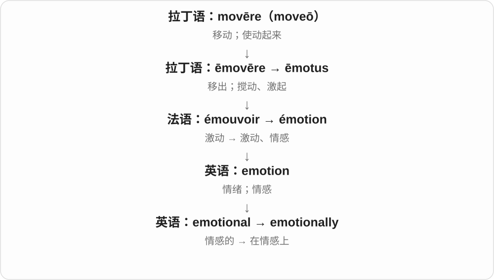

emotionally difficult 不一定体力累，而是心理感受上难承受；speak emotionally 则是动情地说。

**常见搭配与例句**

emotionally attached；emotionally difficult；respond emotionally。

> The decision was emotionally difficult for her.

这个决定在情感上让她很难接受。

> He became emotionally attached to the old house.

他对那座老房子产生了深厚感情。

**别混淆**

physically 是身体层面；emotionally 是情感层面，一件事可能只在其中一方面吃力。

### 246. mathematical — 数学的；与数学方法、关系有关的

**音标**：/ˌmæθəˈmætɪkəl/

**先抓住这个画面**

mathematics 是领域名称；mathematical model 是把问题放进数量、结构和关系中表示的模型。

**怎么拆**

中古英语已有相应形式，借中世纪拉丁 mathematicalis 一类形容词，接相同希腊、拉丁数学材料。现代可对照 mathematic- + -al，但形容词并不一定晚于现代 -ics 名称才现造。

**怎么变成今天的意思**

**中世纪拉丁相应 mathematicalis → 英语形容词**  
与数学知识、方法有关

↓

**现代 mathematical**  
数学的、运用数学表达的

mathematical ability 数学能力；a mathematical model 数学模型；a mathematical proof 数学证明。用数字写出来不保证已经证明正确，模型还要符合其假设。

**常见搭配与例句**

a mathematical model；mathematical reasoning。

> The team built a mathematical model of traffic flow.

团队建立了一个交通流量的数学模型。

> Her argument relies on a simple mathematical proof.

她的论证依靠一个简单的数学证明。

**别混淆**

mathematical 说数学关系、方法；numerical 更聚焦数值、数字。表上有数字可以是 numerical data，不必把任何数字表都叫数学模型。

### 247. mathematically — 在数学上、按数学方法、从数字计算来看

**音标**：/ˌmæθəˈmætɪkli/

**先抓住这个画面**

先不谈感觉，按数字、公式和规则来算，这个角度就是 mathematically。

**怎么拆**

mathematical 数学的 + -ly，-ical + -ly 常形成书写 -ically，读音里的相关弱音节常合并。更早 mathematics 与学习、数学知识的希腊语词族相连。

**怎么变成今天的意思**

**mathematics、mathematical 的数学词族**  
数学；数学的

↓

**mathematical + -ly → mathematically**  
从数学角度、按数学方法

mathematically possible 数学上可能；mathematically prove 用数学方法证明；mathematically equivalent 数学上等价。

**常见搭配与例句**

mathematically impossible；mathematically precise。

> The two expressions are mathematically equivalent.

这两个表达式在数学上等价。

> She showed mathematically why the method works.

她用数学方法说明了这个方法为何有效。

**别混淆**

mathematically possible 只说明按相关数学模型、规则可以，实际做得到还受其他条件影响；不要把可能性和现实可行性混成一件事。

### 248. reasonably — 合理地、公道地；相当地、还算

**音标**：/ˈriːzənəbli/

**先抓住这个画面**

reasonably priced 是价格公道；reasonably good 则往往是还不错、有一定程度，语气未必像 extremely 那么满。

**怎么拆**

reasonable + -ly，对应 -ble → -bly；中古英语已有 resonably。不能拼成 reasonablely。

**怎么变成今天的意思**

**拉丁 ratiōnābilis → 古法语 resnable → 中古英语 resonable → reasonable**  
合乎理性、道理；可理解、合情理

↓

**reasonable + -ly → reasonably**  
合乎道理地；程度相当地

reasonably priced 定价公道，reasonably good 还不错，reasonably sure 相当确信，reasonably expect 合理地预期。

**常见搭配与例句**

reasonably priced；reasonably good；reasonably sure；reasonably expect。

> The restaurant is reasonably priced.

这家餐馆的价格还算公道。

> I am reasonably sure that this is the right address.

我相当确定这是正确地址。

**别混淆**

reasonably 作程度副词常有所保留，reasonably good 不一定是 excellent；修饰 priced 时也可强调公道，而不只是数字小。

### 249. accordingly — 相应地；因此

**音标**：英 /əˈkɔːdɪŋli/；美 /əˈkɔːrdɪŋli/

**先抓住这个画面**

条件变了，做法跟着变，是相应地；从前述情况顺着推出下一步，也可以说因此。

**怎么拆**

accord → according → accordingly；直接由 according + -ly 构成，源于相合、一致的 accord 词族。不是 according to 后面省一个名词就都叫 accordingly。

**怎么变成今天的意思**

**法语、拉丁相合材料 → accord、according**  
一致、符合

↓

**according + -ly → accordingly**  
按此相应处理；顺势成为结果

adjust accordingly 相应调整；act accordingly 据此行动；Accordingly, ... 因此……。

**常见搭配与例句**

adjust accordingly；act accordingly。

> Tell us your needs, and we will adjust the schedule accordingly.

告诉我们你的需求，我们会相应调整安排。

> The room was full; accordingly, the next group waited outside.

房间满了，因此下一组在外面等候。

**别混淆**

accordingly 可表方式、结果，according to 则通常后接消息来源、规则；句子位置和结构不同。

### 250. deliberately — 故意地；从容、谨慎地

**音标**：/dɪˈlɪbərətli/

**先抓住这个画面**

知道自己在做什么、是有意而为，可以 deliberately；一步一步慎重、不急着做，也可以 deliberately。

**怎么拆**

deliberate 形容词 + -ly。承接故意、慎重两条形容词用法，词尾不读成动词的 /eɪtli/。

**怎么变成今天的意思**

**拉丁 libra 天平、lībrāre 称量相关词**  
称量、使平衡

↓

**dēlīberāre → dēlīberātus → deliberate**  
充分权衡 → 深思熟虑、故意；仔细考虑

↓

**deliberate 形容词 + -ly → deliberately**  
有意地；慢慢慎重地

deliberately ignore 故意忽略，speak slowly and deliberately 缓慢而审慎地说，deliberately choose 有意识地选择。

**常见搭配与例句**

deliberately ignore；slowly and deliberately。

> She deliberately left her phone at home.

她故意把手机留在家里。

> He spoke slowly and deliberately.

他说得缓慢而审慎。

**别混淆**

deliberately does not always mean slowly：故意忽略可以做得很快。只有从容、审慎这一支才把速度、方式放到前面。

### 251. namely — 也就是；具体说来

**音标**：/ˈneɪmli/

**先抓住这个画面**

刚说了一个范围，接着把里面到底是哪几项点名说清。

**怎么拆**

name + -ly，接中古英语 nameliche、namely 等副词形式。现代常见具体指明义，不是“以名字的方式”逐字翻译。

**怎么变成今天的意思**

**古英语 nama / noma → 中古英语 name**  
姓名、名称

↓

**英语 name**  
名称；名声；命名、指名

↓

**中古英语 nameliche / namely → namely**  
点名、具体指出 → 也就是

There is one problem, namely ... 是有一个问题，具体就是……。namely 后通常补充前面所指的具体内容，不只是随便举一个例子。

**常见搭配与例句**

namely ...；two things, namely ...；one issue, namely ...。

> We need one thing, namely more time.

我们需要一件东西，也就是更多时间。

> Two people were absent, namely Leo and Maya.

两人缺席，也就是利奥和玛雅。

**别混淆**

namely 指明前面到底是什么，for example 只是举例；We need two things, namely A and B 通常列明那两件，不是在很多项中随手举两例。

### 252. utterly — 完全、彻底地

**音标**：英 /ˈʌtəli/；美 /ˈʌtərli/

**先抓住这个画面**

把一个状态推到完全如此：utterly exhausted 累极了，utterly different 完全不同。它不是表示开口说话的方式。

**怎么拆**

utter 形容词完全的 + -ly。派生选的是程度形容词支线，而非 utter 说出这个动词。

**怎么变成今天的意思**

**古英语外部、在外的相关形式 → utter 形容词**  
最外、极端 → 完全、十足

↓

**utter 形容词 + -ly → utterly**  
完全、十足的 → 完全、彻底地

utterly exhausted 筋疲力尽，utterly impossible 完全不可能，utterly different 完全不同，utterly ridiculous 荒谬透顶。

**常见搭配与例句**

utterly exhausted；utterly different；utterly ridiculous。

> The two versions are utterly different.

这两个版本完全不同。

> After the long walk, we were utterly exhausted.

长途步行后，我们筋疲力尽。

**别混淆**

utterly 是强程度副词，不像 very 那样在所有搭配都能替换。utterly exhausted 自然，utterly tall 则不是普通常用说法。

### 253. formally — 正式地；按规定形式地

**音标**：英 /ˈfɔːməli/；美 /ˈfɔːrməli/

**先抓住这个画面**

把一件事从口头风声推进到正式程序，或用符合正式场合的方式去做。

**怎么拆**

formal + -ly。

**怎么变成今天的意思**

formally announce 是正式宣布；formally dressed 是穿着正式。它经常标出程序已经完成的那一步。

**常见搭配与例句**

formally announce；formally approve；dress formally。

> The project was formally approved on Monday.

项目在星期一获得正式批准。

> Guests were asked to dress formally.

来宾被要求穿正式服装。

**别混淆**

formerly 是以前，只有一个字母不同；formally 是正式地。

### 254. notably — 尤其；特别是；显著地

**音标**：英 /ˈnəʊtəbli/；美 /ˈnoʊtəbli/

**先抓住这个画面**

在一堆信息里圈出“这一点尤其值得看”。

**怎么拆**

来自中古英语 notably 等形式，等于 notable + -ly。不要把现代英语 notable 节点放到中古英语派生形式之前。

**怎么变成今天的意思**

**拉丁 nota → notare**  
标记、符号；做记号、记下

↓

**拉丁 notabilis → 古法语 notable**  
值得标记、注意的

↓

**中古英语 notable → notably**  
以值得注意的方式

↓

**现代英语 notably**  
尤其；特别值得提及；显著地

引出例子时，notably 相当于“其中尤其是”；修饰比较级时，如 notably quieter，则说变化明显。它不是“我记下来了”的过去式。

**常见搭配与例句**

most notably；notably different；notably absent。

> Several countries, notably Canada and Japan, joined the project.

几个国家加入了项目，尤其值得一提的是加拿大和日本。

> The new engine is notably quieter than the old one.

新发动机明显比旧的安静。

**别混淆**

especially 更普遍地强调特别；notably 多带“值得指出”的叙述口气。

### 255. privately — 私下地；非公开地；由私人

**音标**：英、美 /ˈpraɪvətli/

**先抓住这个画面**

事情在公开场合之外发生，或资源来自私人这一边。

**怎么拆**

private + -ly；保持 private 的私人、非公开两条常用意义。

**怎么变成今天的意思**

**拉丁语 privus → privare / privatus**  
单独的、个人的 → 分开、剥去；与公共部分分开的

↓

**拉丁语 privatus → 英语 private**  
属于个人的、非公共的；私下的

↓

**英语 private + -ly → privately**  
私下进行；由私人持有或提供

privately admit 是私下承认；privately owned 是私人所有，后者不一定是秘密所有。

**常见搭配与例句**

speak privately；privately owned；privately funded。

> She privately admitted that the plan needed more work.

她私下承认，这个方案还需要完善。

> The museum is privately funded.

这家博物馆由私人提供资金。

**别混淆**

secretly 通常突出刻意瞒着别人；privately 可以只是不用公开说。

### 256. secretly — 秘密地；瞒着别人地；心里暗自

**音标**：/ˈsiːkrətli/

**先抓住这个画面**

secretly 像把一件事放到别人视线之外进行；也可说某种想法只在心里，没有表现出来。

**怎么拆**

secret + -ly，表示不让别人知道的方式。

**怎么变成今天的意思**

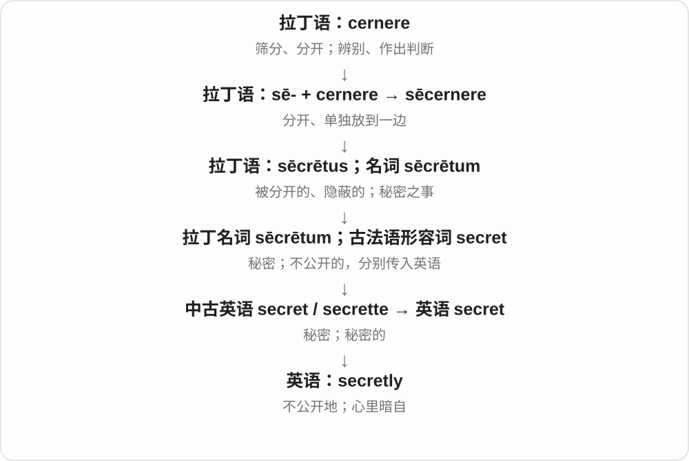

secretly plan a party 是背着别人策划；secretly pleased 是心里暗自高兴，表面不露出来。

**常见搭配与例句**

meet secretly；secretly hope；secretly admire。

> They secretly planned a celebration for their teacher.

他们瞒着老师筹备了一场庆祝活动。

> She was secretly pleased that the meeting had been cancelled.

会议取消了，她心里暗自高兴。

**别混淆**

quietly 是声音轻或不张扬；secretly 是不让别人知道，二者关注点不同。

### 257. specially — 专门地；特地

**音标**：/ˈspeʃəli/

**先抓住这个画面**

specially 像在礼物上贴一张纸条：“这是特地为你准备的。”重点在专门安排。

**怎么拆**

special + -ly，副词形成方式在中古英语已出现。

**怎么变成今天的意思**

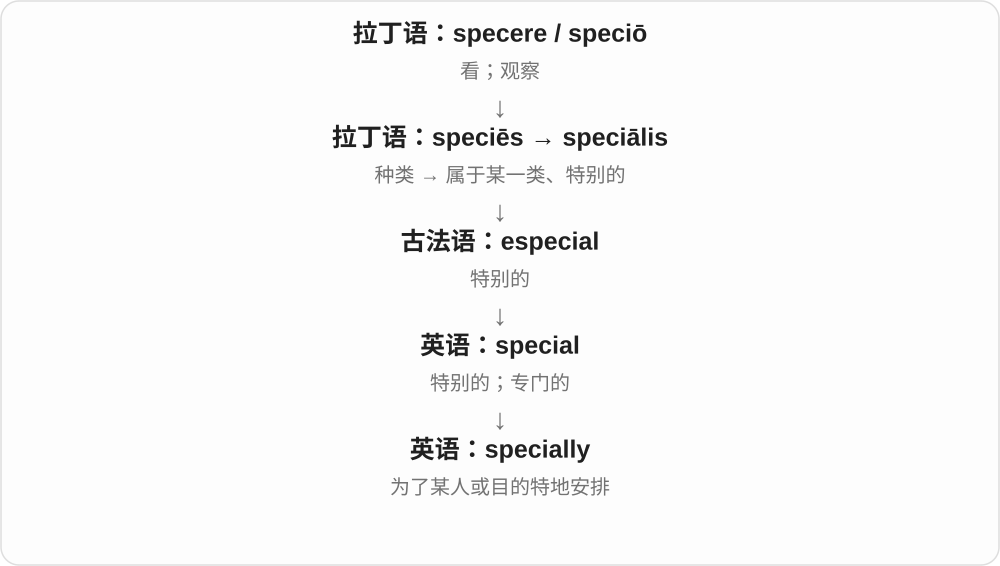

常与 designed、made、trained 等搭配，说明不是随手拿来，而是针对某用途。

**常见搭配与例句**

specially designed；specially trained；made specially for。

> The shoes were specially made for the performance.

这双鞋是专为演出制作的。

> She came specially to see you.

她是特地来看你的。

**别混淆**

强调“尤其”通常用 especially；强调“特地做”通常用 specially。

### 258. firmly — 牢牢地；坚定地；明确地

**音标**：英 /ˈfɜːmli/；美 /ˈfɝːmli/

**先抓住这个画面**

手握得稳，决定拿得定，话说得不含糊，都是把 firm 的稳固放到动作上。

**怎么拆**

firm + -ly；中古英语已有相应副词形式 fermely。

**怎么变成今天的意思**

**拉丁 firmus → 古法语 ferm / ferme**  
稳固的

↓

**中古英语 ferm、fermely → 英语 firmly**  
稳固的 → 牢固、坚定地

hold firmly 说握得牢；firmly believe 说信念坚定；say firmly 说语气明确。坚定不一定大声，也不一定粗鲁。

**常见搭配与例句**

hold firmly；firmly believe；firmly established。

> Hold the handle firmly with both hands.

用双手牢牢握住把手。

> She politely but firmly declined the offer.

她礼貌而坚定地谢绝了邀请。

**别混淆**

tightly 偏夹得紧；firmly 偏牢固不松。firmly 拒绝也可以很有礼貌。

### 259. kindly — 友善、体贴地；慈祥的；请〔较正式请求〕

**音标**：/ˈkaɪndli/

**先抓住这个画面**

说话、做事带着善意；放进正式请求时，又成了语气上的请。

**怎么拆**

kind + -ly，有古英语 cyndelīċ 形容词、相关副词及中古英语对应形式。ly 不强制它只能作副词。

**怎么变成今天的意思**

**古英语 cynd〔本性、种类〕及相关 cynde〔天生、自然的〕**  
同一旧本性、出生词族的名词与形容词

↓

**中古英语 kinde → 英语 kind**  
种类；自然合宜等旧义发展到友善、体贴

↓

**kind + -ly；形容词、副词各有旧形式**  
友善地；慈祥的；请求用语

speak kindly 温和说话，a kindly face 慈祥面容。Kindly send the form 在正式书面请求常见，但语境不合时可能显命令式、冷硬。

**常见搭配与例句**

speak kindly；a kindly face；kindly send；take kindly to。

> She spoke kindly to the frightened child.

她温和地对受惊的孩子说话。

> A kindly neighbor helped us carry the boxes.

一位和善邻居帮我们搬箱子。

**别混淆**

kindly 形式上像请，不保证说话一定亲切；He did not take kindly to it 表示他不喜欢、不接受那件事。

### 260. accurately — 准确地；如实地

**音标**：/ˈækjərətli/

**先抓住这个画面**

把原来的内容传过去时不走样，或者把目标判断得很准，便是在做事时 accurately。

**怎么拆**

accurate + -ly。

**怎么变成今天的意思**

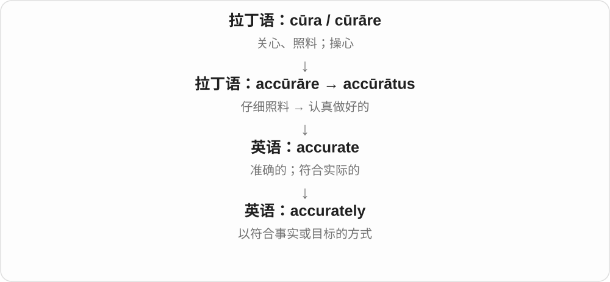

常描述记录、测量、预测、翻译等动作。它强调结果匹配，不只是态度认真。

**常见搭配与例句**

measure accurately；report accurately；predict accurately。

> Please record the temperature accurately.

请准确记录温度。

> The subtitle accurately conveys the speaker’s meaning.

字幕准确传达了说话者的意思。

**别混淆**

carefully 是认真小心地做；accurately 是做出来准确。认真能帮助准确，却不能保证准确。

### 261. quarterly — 每季度的、每季度一次；季刊

**音标**：英 /ˈkwɔːtəli/；美 /ˈkwɔːrtərli/

**先抓住这个画面**

一年切四段，每段来一次。

**怎么拆**

quarter“季度”+ -ly；可作形容词、副词，也可作表示季刊的名词。

**怎么变成今天的意思**

**拉丁 quattuor → quartus**  
四 → 第四、四分之一

↓

**拉丁 quartarius → 古法语 quartier**  
第四部分 → 四分之一；一块区域

↓

**英语 quarter**  
四分之一；季度；地区等

↓

**英语 quarter + -ly → quarterly**  
按季度发生的；季刊

a quarterly report 是季度报告，meet quarterly 是每季度开一次会。这个 -ly 不一定是副词：quarterly figures 里的 quarterly 就在修饰名词。一本 a quarterly 通常是一年出版四期的刊物。

**常见搭配与例句**

a quarterly report；quarterly results；meet quarterly；a literary quarterly。

> The committee meets quarterly to review progress.

委员会每季度开会检查进展。

> She edits a quarterly magazine about local history.

她编辑一本关于地方历史的季刊。

**别混淆**

monthly 是每月，quarterly 是每季度，annually 是每年。quarterly 不是每四个月一次，而是通常每三个月一次。

### 262. desperately — 拼命地、迫切地；极其

**音标**：英 /ˈdespərətli/；美 /ˈdespərətli/

**先抓住这个画面**

事情急到不能从容应对，或者某种需要强烈得很。

**怎么拆**

desperate + -ly，构成副词；继承 desperate 的绝望、急切和程度加强几种用法。

**怎么变成今天的意思**

**拉丁 spes → sperare**  
希望 → 抱有希望

↓

**拉丁 de- + sperare → desperare**  
失去希望

↓

**英语 desperate → desperately**  
急切的 → 拼命地、迫切地；极其

desperately search for keys 是急得拼命找钥匙；desperately need rest 是迫切需要休息；desperately lonely 是极度孤独。最后一种主要加强程度，不是说这个人“用绝望的方式孤独”。

**常见搭配与例句**

desperately need；desperately try；desperately search；desperately lonely。

> He searched desperately for the file before the meeting.

开会前，他拼命寻找那份文件。

> The small library desperately needs more space.

这家小图书馆迫切需要更大的空间。

**别混淆**

urgently 强调紧急，desperately 常多一层急切、强烈需要或近乎无计可施的感受。

### 263. furious — 狂怒的；猛烈的、激烈的

**音标**：英 /ˈfjʊəriəs/；美 /ˈfjʊriəs/

**先抓住这个画面**

气到压不住火，是 furious；风暴、工作节奏非常猛烈，也可以借用这股强烈劲头。

**怎么拆**

经法语 furieus 接拉丁 furiosus，与 furia 狂怒的材料相联；不是 furry 毛茸茸的换个尾。

**怎么变成今天的意思**

**拉丁 furia、furiosus → 法语 furieus**  
狂怒及其形容词材料

↓

**英语 furious**  
极度愤怒；猛烈、激烈

furious with someone 对某人勃然大怒；furious at/about something 因某事大怒；a furious pace 极快、激烈的节奏。

**常见搭配与例句**

furious with；at a furious pace。

> She was furious with him for missing the deadline.

他错过截止时间，让她非常生气。

> They worked at a furious pace to finish the repairs.

他们争分夺秒、紧锣密鼓地完成修理。

**别混淆**

furious 比普通 angry 强烈；fury 是狂怒名词，furry 则是毛茸茸的。

### 264. furiously — 愤怒地；猛烈地、飞快而拼命地

**音标**：英 /ˈfjʊəriəsli/；美 /ˈfjʊriəsli/

**先抓住这个画面**

既可能是气得厉害，也可能只是动作像一股猛劲冲出来。typing furiously 常说飞快敲键盘，未必正在生气。

**怎么拆**

furious + -ly；furious 经法语接拉丁语 furiosus 狂怒的，与 furia 狂怒相连。狂烈的情绪进一步扩展为动作强烈、快速。

**怎么变成今天的意思**

**furious 狂怒、猛烈的 + -ly**  
以相应强烈方式

↓

**furiously 的情绪与动作分支**  
怒气冲冲；猛烈、飞快地

shout furiously 愤怒地喊；work furiously 拼命干活；pedal furiously 拼命蹬车；type furiously 飞快敲键盘。

**常见搭配与例句**

blush furiously；wave furiously。

> He shouted furiously at the locked door.

他对着锁住的门愤怒地喊叫。

> She was typing furiously to finish before lunch.

她飞快地敲着键盘，想在午饭前完成。

**别混淆**

angrily 直接说愤怒；furiously 有时只强调动作强度、速度。看动作和上下文，别把每个 furiously 都译成生气地。

### 265. continuously — 连续不断地

**音标**：/kənˈtɪnjuəsli/

**先抓住这个画面**

continuously 像把计时器打开后，这件事从头到尾一直进行，没有中途停下来。

**怎么拆**

continuous + -ly。

**怎么变成今天的意思**

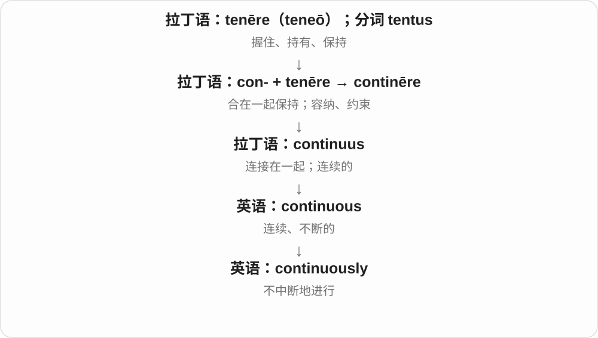

常用于运行、记录、变化等过程。即使数值在变化，只要过程没有停，也能 continuously。

**常见搭配与例句**

run continuously；record continuously；change continuously。

> The camera recorded continuously for six hours.

摄像机连续录了六个小时。

> Water flowed continuously through the pipe.

水不断地流过管道。

**别混淆**

continually 可以是一再发生；continuously 通常是持续无间断。每天响几次的铃不是全天 continuously ringing。

### 266. randomly — 随机地；随意地、无固定规律地

**音标**：/ˈrændəmli/

**先抓住这个画面**

把 random 放到动作上：随机分配、随机打乱，重点是动作没有按固定名单或特定目标来选。

**怎么拆**

random + -ly，副词；技术语境要看采用什么随机过程，日常则可宽泛说随意。

**怎么变成今天的意思**

**古法语 randon、randir → 中古英语 randoun、randon**  
疾冲、奔跑、冲劲

↓

**at random 等说法 → random 形容词**  
不朝特定方向 → 无固定目的、随机

↓

**random + -ly → randomly**  
以随机、随意方式做事

randomly selected 随机选取的，randomly assigned 随机分配的，arranged randomly 无固定次序排列。

**常见搭配与例句**

randomly selected；randomly assigned；arranged randomly。

> The cards were arranged randomly on the table.

卡片在桌上随意摆放。

> Participants were randomly assigned to two groups.

参加者被随机分配到两组。

**别混淆**

randomly 是方式，randomness 是性质名词；randomly assigned 不代表已经消除所有组间差异。

### 267. explicitly — 明确地；直白地

**音标**：英、美 /ɪkˈsplɪsɪtli/

**先抓住这个画面**

话已经摊在桌面上，不需要让别人靠猜测补出意思。

**怎么拆**

explicit + -ly；explicit 经法语连到拉丁语 explicitus“展开的”。

**怎么变成今天的意思**

**拉丁语 plicare**  
折叠、使相接；与编织、弯曲一组词有更早联系

↓

**拉丁语 ex- + plicare → explicare**  
展开、解开；解释

↓

**拉丁语 explicitus〔explicatus 的变体〕→ 法语 explicite → 英语 explicit**  
展开的 → 意思直接、明确的

↓

**英语 explicit + -ly → explicitly**  
直接明说地

explicitly state 是清楚写明或说出；explicitly forbid 是明确禁止。一个观点说得明确，并不保证它正确。

**常见搭配与例句**

explicitly state；explicitly mention；explicitly prohibit。

> The contract explicitly states the delivery date.

合同明确写出了交付日期。

> She explicitly asked us not to share the draft.

她明确要求我们不要分享草稿。

**别混淆**

implicitly 是通过背景或行为传达；explicitly 是直接表达。

### 268. lightly — 轻轻地；轻微地；随便、不认真地

**音标**：/ˈlaɪtli/

**先抓住这个画面**

手上不使重劲，事情也可能没被放到心里认真看。

**怎么拆**

light（轻）+ -ly，古英语、中古英语已有相应副词；不是把光束变成副词后就都表示发亮。

**怎么变成今天的意思**

**古英语 lēoht〔轻义〕→ 中古英语 light**  
重量小、负担轻；更早来源与光义不同

↓

**英语 light〔轻义〕**  
轻；轻微；轻松、不严肃

↓

**light + -ly → lightly**  
动作、程度轻；态度不郑重

tap lightly 轻敲，lightly cooked 略微烹煮，take something lightly 把事看得轻、不认真对待。travel light 通常直接用 light 作副词。

**常见搭配与例句**

tap lightly；touch lightly；take lightly；lightly cooked。

> She tapped lightly on the door.

她轻轻敲门。

> This is not a decision to take lightly.

这个决定不能草率对待。

**别混淆**

lightly 轻轻、轻率，slightly 略微；touch lightly 是手劲轻，slightly different 是差别小，两者不处处可换。

### 269. socially — 在社交方面；从社会角度

**音标**：英 /ˈsəʊʃəli/；美 /ˈsoʊʃəli/

**先抓住这个画面**

给一句话加一个观察角度：这说的是人与人的交往，或者社会关系这一面。

**怎么拆**

social + -ly。

**怎么变成今天的意思**

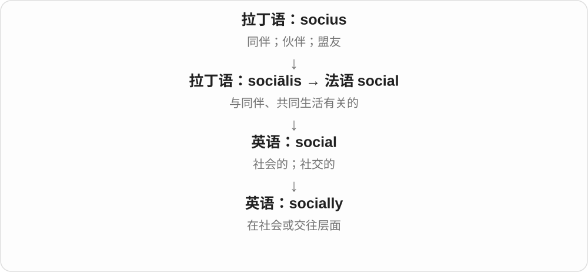

meet socially 是出于私人社交而见面；socially acceptable 是社会上被接受的，不等于已经证明正确。

**常见搭配与例句**

socially active；socially isolated；socially acceptable；meet socially。

> We know each other professionally but rarely meet socially.

我们工作上认识，但很少私下聚会。

> What is socially acceptable can change over time.

社会上能接受什么，可能随时间而变。

**别混淆**

socially 可以讨论社会背景，不能每次都译成“合群地”。

### 270. substantially — 大幅地；在很大程度上；基本上

**音标**：/səbˈstænʃəli/

**先抓住这个画面**

变化不是一点点，而是有明显分量，可以说 substantially；它也能说“主要部分基本如此”。

**怎么拆**

substantial + -ly。

**怎么变成今天的意思**

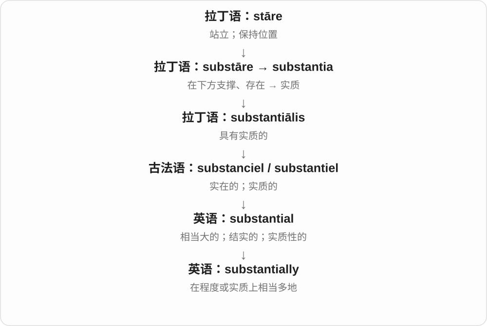

substantially cheaper 是便宜很多；substantially complete 是主要部分已完成。两个用法都围绕“大部分或大幅度”，并非绝对。

**常见搭配与例句**

substantially lower；substantially improve；substantially complete。

> The new design uses substantially less water.

新设计的用水量大幅减少。

> The renovation is substantially complete.

翻新工程已基本完成。

**别混淆**

substantially 不总等于 completely。说工作 substantially complete，通常仍可能有收尾工作。

### 271. lame — 跛的、行动不便的；蹩脚的、站不住脚的

**音标**：/leɪm/

**先抓住这个画面**

动物走路不利索，是具体的 lame；借口缺少支撑、说服不了人，也被说成 a lame excuse。

**怎么拆**

普通形容词接古英语 lama，经中古英语延续。由肢体行动受限扩展到论证、解释等不够有力；与法语金属薄片、金丝织物的同形词分源。

**怎么变成今天的意思**

**古英语 lama → 中古英语 lame**  
肢体不健全、行动不便

↓

**形容质量、论证的比喻**  
无力、蹩脚、不能令人信服

a lame horse 跛脚的马；a lame excuse 蹩脚借口；a lame attempt 无力的尝试。描述人的残障时，lame 带旧式、可能冒犯的语感。

**常见搭配与例句**

a lame explanation；go lame。

> The horse went lame during the journey.

那匹马在旅途中跛了。

> He offered a lame excuse for being late.

他为迟到找了一个蹩脚的借口。

**别混淆**

lamé /læˈmeɪ/ 常指金银线织物，另接法语、拉丁语薄片材料；lame /leɪm/ 的跛、蹩脚义不从 lamina 来。

### 272. lamely — 无力地、蹩脚地；一瘸一拐地

**音标**：/ˈleɪmli/

**先抓住这个画面**

话说出来却连自己都觉得不太站得住，常可用 lamely 描写。它也保留步态不利索的具体义。

**怎么拆**

lame + -ly，形成方式副词。既能接行动不便的具体义，也能接解释、尝试缺少力量的比喻。

**怎么变成今天的意思**

**lame 的跛、无力词义 + -ly**  
以相应方式行动、表达

↓

**lamely 的常见叙述用法**  
无力、尴尬地说；步履不利索地

explain lamely 无力地解释；say lamely 底气不足地说；walk lamely 一瘸一拐地走。小说对话后常见 lamely。

**常见搭配与例句**

protest lamely；smile lamely。

> “I forgot,” he said lamely.

“我忘了。”他底气不足地说。

> She tried lamely to explain the broken vase.

她试着解释花瓶为何打碎了，却说得很牵强。

**别混淆**

quietly 是声音轻，lamely 侧重话语或举止欠有力、不自然。一个人可以说得很响却依然解释得 lamely。

### 273. consequently — 因此；所以

**音标**：英 /ˈkɒnsɪkwəntli/；美 /ˈkɑːnsəkwəntli/

**先抓住这个画面**

前一句是推动骨牌的原因，后一句说跟着倒下的结果，consequently 就放在这两步之间。

**怎么拆**

consequent + -ly。

**怎么变成今天的意思**

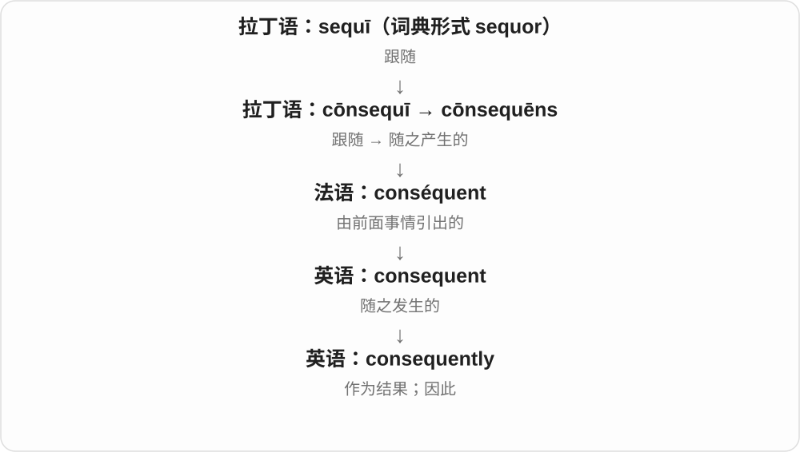

用于明确因果关系，语气较正式。它并非只是“后来”，作者是在说前面的事造成后面的事。

**常见搭配与例句**

and consequently…；consequently, …；consequently unable to…。

> The road was flooded; consequently, the bus took another route.

道路被水淹了，因此公交车改走了另一条路。

> She missed the deadline and consequently lost her place.

她错过了截止日期，因此失去了名额。

**别混淆**

consequently 是因此；subsequently 是随后。下雨后停电，只说先后时用 subsequently；已知因暴雨停电才适合 consequently。

### 274. costly — 昂贵的；代价高的

**音标**：英 /ˈkɒstli/；美 /ˈkɔːstli/，亦 /ˈkɑːstli/

**先抓住这个画面**

不只价签高，还可能是一个错误让人损失很大，代价高得难承受。

**怎么拆**

cost + -ly，形容词后缀，中古英语已有形式。这里是形容词，不是修饰 cost 动作的普通副词。

**怎么变成今天的意思**

**拉丁 cōnstāre → 法语 coster、couster → 中古英语 costen**  
较早有站在一起、确定等义，经历史发展形成花费义

↓

**现代 cost**  
所需费用、代价；使人付出某种损失

↓

**cost + -ly → costly**  
花费、代价 → 所费很多、损失大的

a costly mistake 代价惨重的错误，costly repairs 昂贵修缮；a costly delay 代价高的延误，可能损失时间、机会等。

**常见搭配与例句**

a costly mistake；costly repairs；a costly delay。

> Ignoring the warning proved to be a costly mistake.

忽视警告，最终成了一个代价很高的错误。

> The building needs costly repairs.

这座楼需要花很多钱修缮。

**别混淆**

costly 可说后果代价，expensive 更常看价格、所费；an expensive mistake 也能比喻，但 costly mistake 是很常见搭配。

### 275. readily — 乐意地；毫不迟疑地；轻易地

**音标**：/ˈredɪli/

**先抓住这个画面**

想做时不推辞，需要取得时没障碍：两边都没有卡住。

**怎么拆**

ready 的 y 变 i 后接 -ly；接中古英语 redily、rediliche 等形式。现代常见愿意、容易两路，不能只说“准备好地”。

**怎么变成今天的意思**

**古英语 rǣde / ġerǣde → 中古英语 redy**  
准备好、可立即行动

↓

**英语 ready**  
准备好的；愿意、便于行动的

↓

**ready → readi- + -ly → readily**  
毫不犹豫地；容易地

readily agree 是爽快同意，readily available 是容易获得，readily understood 是容易理解。不同宾语决定是在说意愿还是难度。

**常见搭配与例句**

readily available；readily agree；readily accessible；readily understand。

> She readily agreed to help.

她爽快地答应帮忙。

> The information is readily available online.

这些信息在网上很容易查到。

**别混淆**

already 是已经，readily 是容易或乐意。The information is readily available 不是信息已经可用这一时间重点。

### 276. beautifully — 优美地；漂亮地；出色地

**音标**：/ˈbjuːtɪfəli/，也常 /ˈbjuːtɪfli/

**先抓住这个画面**

做这件事的方式、最终呈现的状态很美，或配合得恰到好处。

**怎么拆**

beautiful + -ly，形容词变副词；实际口语中中间弱音节常简化。

**怎么变成今天的意思**

**拉丁语 bellus → 通俗拉丁语 \*bellitās、古法语 beauté 等形式**  
好看、悦目 → 美这一性质

↓

**中古英语 bewte / beaute → 英语 beauty**  
美；美的事物、人；还有优点的比喻用法

↓

**beautiful → beautifully**  
优美、出色 → 优美地、出色地

sing beautifully 唱得优美，beautifully designed 设计精美；work beautifully 运作得极好，也可能没有视觉美。

**常见搭配与例句**

beautifully written；beautifully designed；sing beautifully；work beautifully。

> The old table has been beautifully restored.

旧桌子修复得很漂亮。

> The two parts fit together beautifully.

这两个部件配合得非常好。

**别混淆**

looks beautiful 看起来美，works beautifully 运作出色；修饰动词方式用副词，不必都按外观解释。

### 277. exceed — 超过、超出

**音标**：/ɪkˈsiːd/

**先抓住这个画面**

把限额、预期、人数等想成一条线：实际结果走到了线外，就是 exceed。它很适合数量、标准、界限。

**怎么拆**

经中古英语、古法语 exceder 接拉丁 excedere 走出、越过，由 ex- 向外 + cedere 走构成。现代拼写保留 -ceed 这一词族形式。

**怎么变成今天的意思**

**拉丁 ex- + cedere → excedere**  
向外走 → 越过

↓

**法语、中古英语相应形式 → exceed**  
超过数量、标准、预期等界限

exceed the limit 超过限额；exceed expectations 超出预期；exceed the available space 超过可用空间。通常直接接被超出的对象。

**常见搭配与例句**

exceed a target；exceed the maximum。

> The cost exceeded our original estimate.

费用超过了我们最初的估算。

> The result exceeded everyone’s expectations.

结果超出了所有人的预期。

**别混淆**

exceed 本身已是超过，不通常再加 than；比较级 bigger than 的结构不能直接套成 exceed than。

### 278. exceeding — 超过、超出；exceed 的 -ing 形式

**音标**：/ɪkˈsiːdɪŋ/

**先抓住这个画面**

看到 a bag exceeding the limit，把后面理解成“超过限额的”：它给前面的东西补上一个超线的动作、状态。

**怎么拆**

exceed + -ing，保留超过界限这一词义。作为分词可进入进行结构，也可跟在名词后面作说明。

**怎么变成今天的意思**

**exceed 超过 + -ing**  
形成相应分词

↓

**句子中的 exceeding**  
正在超出；对超限对象作补充说明

vehicles exceeding the limit 超过限值的车辆；avoid exceeding the budget 避免超预算。并不是只有正在发生的动作才能用分词形式。

**常见搭配与例句**

costs exceeding the estimate；without exceeding the limit。

> We finished the project without exceeding the budget.

我们完成了项目，没有超出预算。

> The form flags entries exceeding the character limit.

表单会标出超过字符数限制的输入。

**别混淆**

exceeded 是过去式、过去分词；exceeding 是 -ing 形式。选择哪一个取决于句子结构，不取决于中文都能译成超过。

### 279. exceedingly — 极其、非常〔较正式、略显传统〕

**音标**：/ɪkˈsiːdɪŋli/

**先抓住这个画面**

把程度推得很高：极其困难、非常感激。它强调强度，不自动表示这种程度已经不合适。

**怎么拆**

exceeding 的较旧极大、非同寻常等程度用法 + -ly；更深接 exceed 越过、超出的词族。现代常作为正式程度副词使用。

**怎么变成今天的意思**

**exceed 的越界词族 → exceeding 的旧程度用法**  
超乎普通程度、极大的

↓

**exceeding + -ly → exceedingly**  
极其、非常

exceedingly difficult 极其困难；exceedingly grateful 非常感激；exceedingly rare 极其少见。日常也可用 very、extremely，语体更普通。

**常见搭配与例句**

exceedingly complex；exceedingly polite。

> The puzzle was exceedingly difficult.

这道谜题极其困难。

> We are exceedingly grateful for your help.

我们非常感激你的帮助。

**别混淆**

exceedingly 是程度很高；excessively 是过度、不合适地多。exceedingly polite 不必有过分客套的批评。

### 280. luckily — 幸运地；幸亏、好在

**音标**：/ˈlʌkɪli/

**先抓住这个画面**

事情可能往坏处走，结果碰巧有好条件或避开坏结果，于是说幸亏。句首 Luckily 常是在评价整件事。

**怎么拆**

lucky + -ly，y 改为 i，形成副词。不是 lucky 原词再原样加 ly。

**怎么变成今天的意思**

**luck + -y → lucky**  
有好运、幸运的

↓

**lucky + -ly；un- + lucky**  
幸运地、幸亏；不走运的

Luckily, ... 幸亏……，luckily for us 对我们幸运的是，escape luckily 幸运逃脱。

**常见搭配与例句**

luckily for us；luckily enough；Luckily, we had。

> Luckily, we had brought an umbrella.

幸亏我们带了伞。

> The train was delayed, luckily for the people still on their way.

火车晚点了，对那些还在赶来的人倒是好事。

**别混淆**

luckily 评价运气带来的好情况，happily 可说快乐地；幸运的人不一定当时正在快乐地笑。

### 281. continually — 不断地；频繁反复地

**音标**：/kənˈtɪnjuəli/

**先抓住这个画面**

continually 像手机一会儿响一下、一会儿又响一下，事情不断回来发生，未必每秒都在进行。

**怎么拆**

continual + -ly。

**怎么变成今天的意思**

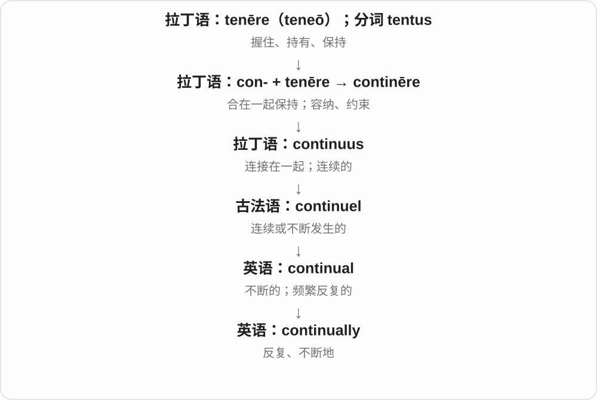

常与烦扰、更新、提问等反复行为搭配。也有不停的用法，因此遇到真实文本要结合上下文。

**常见搭配与例句**

continually ask；continually change；continually interrupt。

> He continually checked his phone during dinner.

吃晚饭时他一再查看手机。

> The website is continually updated with new examples.

网站不断补充新的例子。

**别混淆**

continuously 更突出没有停顿；continually 常突出一再发生。两词不是在所有句子里都绝对互斥。

### 282. arguably — 可以说；有理由认为

**音标**：英 /ˈɑːɡjuəbli/；美 /ˈɑːrɡjuəbli/

**先抓住这个画面**

不是拍桌子说毫无疑问，而是说“有一套讲得通的理由支持这个看法”。arguably the best 给很高评价，同时留下可讨论空间。

**怎么拆**

arguable + -ly，-able 改 -ably → arguably；前面接 argue 提出理由的词族，不是争吵动作的简单方式副词。

**怎么变成今天的意思**

**argue → arguable**  
能够提出理由、值得论说的

↓

**arguable + -ly → arguably**  
有理由这么主张，但不封死其他判断

arguably the best 可以说是最好的；arguably more useful 有理由认为更有用；arguably a mistake 可以认为是错误。

**常见搭配与例句**

arguably the best；arguably more important。

> This is arguably her most influential book.

可以说，这是她影响最大的一本书。

> The simpler design is arguably more useful.

有理由认为，较简单的设计更实用。

**别混淆**

arguably 不等于 indisputably 无可争议；也不是必须先发生一场争吵才能用。

### 283. individually — 分别地；单独地；逐个地

**音标**：/ˌɪndɪˈvɪdʒuəli/

**先抓住这个画面**

把镜头从全班拉到一个人，再移到下一个人。事情是逐个处理，而不是整组一起处理。

**怎么拆**

individual + -ly。

**怎么变成今天的意思**

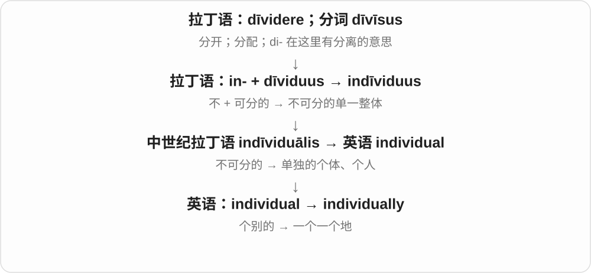

individually wrapped 是每个都单独包装；assess individually 是逐个评估。它不一定强调一个人孤单。

**常见搭配与例句**

packed individually；interview individually；individually designed。

> The chocolates are individually wrapped.

这些巧克力每颗都单独包装。

> We spoke to the students individually.

我们分别与学生们谈了话。

**别混淆**

alone 强调没有别人相伴；individually 强调分别处理每一个。

### 284. inevitably — 不可避免地；不出所料地

**音标**：/ɪˈnevɪtəbli/

**先抓住这个画面**

inevitable 说结果的性质，inevitably 把避不开、早料到的感觉放进事件如何发生。

**怎么拆**

inevitable + -ly，末尾 -ble 变成 -bly。不是在原拼写后直接堆出 inevitablely。

**怎么变成今天的意思**

**拉丁 ēvītāre 避开 → ēvītābilis**  
能够避开的

↓

**in- 否定 + ēvītābilis → inēvītābilis → 英语 inevitable**  
无法避开的、不可避免的

↓

**inevitable → inevitably**  
以无法避免、可预料的方式发生

inevitably lead to 势必导致，almost inevitably 几乎难免，inevitably, he asked... 不出所料，他问……。

**常见搭配与例句**

inevitably lead to；almost inevitably；inevitably followed。

> The road closure inevitably caused delays.

道路关闭难免造成延误。

> Inevitably, the children asked for another story.

不出所料，孩子们又要求讲一个故事。

**别混淆**

inevitably 有时是叙述者说不出所料，不必每次都在宣布普遍自然定律。其力度与上下文条件一起理解。

### 285. positively — 积极地；明确地；简直

**音标**：英 /ˈpɒzɪtɪvli/；美 /ˈpɑːzətɪvli/

**先抓住这个画面**

可以是往积极方向回应，也可以把一句话说得非常肯定。

**怎么拆**

positive + -ly，英语副词。含义跟随 positive 的不同分支。

**怎么变成今天的意思**

**拉丁语 pōnere；过去分词 positus**  
放、安置；已经放好的

↓

**拉丁 positīvus → 古法语 positif → 英语 positive**  
被确定、被规定的 → 肯定的、明确的

↓

**英语的不同专业义与日常义**  
正数、阳性；积极的、乐观的

↓

**英语 positive + -ly → positively**  
以积极、肯定或加强语气的方式

respond positively 是积极回应；positively identified 是明确辨认；positively freezing 则是加强语气，意为冷得厉害。

**常见搭配与例句**

respond positively；positively identify；positively delighted。

> The team responded positively to the new schedule.

团队积极回应了新日程。

> Two witnesses positively identified the same vehicle.

两名证人明确辨认出了同一辆车。

**别混淆**

optimistically 只强调乐观；positively 有时与好心情毫无关系。

### 286. sharply — 急剧地；尖锐、严厉地；清晰地

**音标**：英 /ˈʃɑːpli/；美 /ˈʃɑːrpli/

**先抓住这个画面**

价格猛升、车突然转、回应语气很冲，都可以 sharply；动作里是哪一种“尖、急”，要跟着动词看。

**怎么拆**

古英语 scearplīce 等经中古英语传下，现代对应 sharp + -ly，不是最近才造出的统一价格副词。

**怎么变成今天的意思**

**古英语 scearp → 中古英语 scharp → sharp**  
尖、利；更远联系切割词族

↓

**scearplīce 经中古英语 → sharply；对应 sharp + -ly**  
以尖、急、清晰等方式

rise sharply 急升，turn sharply 急转，reply sharply 严厉回应，sharply defined 界线清晰。

**常见搭配与例句**

rise sharply；turn sharply；reply sharply；sharply defined。

> The road turned sharply to the left.

道路向左急转。

> She replied sharply to the interruption.

被打断后，她严厉地回应。

**别混淆**

sharply 不等于 slowly 的反义词就能覆盖全部，reply sharply 重点可语气严厉，未必说得很快。

### 287. sincerely — 真诚地、由衷地；〔信末〕谨上等礼貌结语

**音标**：英 /sɪnˈsɪəli/；美 /sɪnˈsɪrli/

**先抓住这个画面**

sincere 把态度形容出来，sincerely 把真心放进感谢、道歉、相信等动作里。写在信末，它也成了惯常的礼貌收尾。

**怎么拆**

sincere + -ly，保留 sincere 的词尾 e。由真诚的性质变成真诚地做某事。

**怎么变成今天的意思**

**拉丁 sincērus**  
完整、干净、纯粹、真实；更早来源有争论

↓

**法语 sincere → 英语 sincere**  
无伪装、发自内心的

↓

**后缀扩展**  
sincerely 真诚地；sincerity 真诚这种品质

sincerely appreciate 由衷感激，sincerely hope 真心希望，Sincerely 或 Yours sincerely 常用于信末，具体写法随书信习惯而异。

**常见搭配与例句**

sincerely hope；sincerely appreciate；Yours sincerely。

> I sincerely appreciate your patience.

我由衷感谢你的耐心。

> We sincerely hope that you can join us.

我们真心希望你能加入。

**别混淆**

信末 Sincerely 是固定礼貌格式，不能仅凭这一行判断双方关系亲密。句中 sincerely 则直接说明真心态度。

### 288. critically — 批判性地；极其重要地；严重地

**音标**：英、美 /ˈkrɪtɪkli/，亦 /ˈkrɪtɪkəli/

**先抓住这个画面**

它跟着 critical 的不同意思走：认真评判，或者强调某件事到了关键程度。

**怎么拆**

critical + -ly；-al 与 -ly 组合为 -ally，常读得较紧凑。

**怎么变成今天的意思**

**希腊语 krinein**  
分开、辨别、判断

↓

**希腊语 kritikos → 拉丁语 criticus → 法语 critique → 英语 critic**  
善于判断的 → 评论者、批评者

↓

**英语 critic + -al → critical；亦有拉丁 criticus 的直接影响**  
判断、评论的；医学中与危急转折相联，扩展为关键的

↓

**英语 critical + -ly → critically**  
以分析评价的方式；处于严重或关键程度

examine critically 是审慎分析；critically important 是极其重要；critically ill 是病危；critically acclaimed 表示受到评论界好评。不能见 critically 就译“批评地”。

**常见搭配与例句**

think critically；critically ill；critically acclaimed。

> Read the report critically and check where the numbers came from.

带着判断力读这份报告，并核查数字的出处。

> The film was critically acclaimed but attracted a small audience.

这部电影获得评论界好评，但观众不多。

**别混淆**

critically acclaimed 是评论界评价高，并不直接等于商业销售好。

### 289. undoubtedly — 无疑；毫无疑问地

**音标**：/ʌnˈdaʊtɪdli/

**先抓住这个画面**

先把立场说清楚：我认为这一判断相当确定。

**怎么拆**

undoubted + -ly；b 不发音，-ed 的 /ɪd/ 保留。

**怎么变成今天的意思**

**拉丁 duo“二”相关的 dubius**  
心在两边摇摆 → 拿不准、怀疑

↓

**拉丁 dubitare → 古法语 doter／douter**  
怀疑、犹豫；也发展出畏惧义

↓

**中古英语 douten → doubt**  
怀疑；后来参照拉丁词源补入不发音的 b

↓

**英语 undoubted → undoubtedly**  
无疑的 → 毫无疑问地

常用来加强整句判断：This will undoubtedly help。它表达说话人的确定程度，后面仍需要真实理由支撑；不要把它误读成 /ʌnˈdaʊtbli/。

**常见搭配与例句**

undoubtedly true；will undoubtedly；undoubtedly one of。

> The extra time undoubtedly improved the final design.

多出来的时间无疑改善了最终设计。

> She is undoubtedly one of the strongest candidates.

她无疑是最有竞争力的候选人之一。

**别混淆**

undoubtedly 比 probably 更确定；与 certainly 接近，但通常较适合书面或郑重表达。

### 290. yearly — 每年的；按年计算的；每年一次地

**音标**：英 /ˈjɪəli/，也读 /ˈjɜːli/；美 /ˈjɪrli/

**先抓住这个画面**

把一年当成一格：每到下一格就发生一次，或把费用、总量按这一格统计。

**怎么拆**

形容词接古英语 gearlic，副词接 gearlice 或中古英语的重新构词；现代都写 yearly，相当于 year + -ly。这里 -ly 并不保证只有副词。

**怎么变成今天的意思**

**古英语 gear 年；形容词 -lic 与副词 -lice 形式**  
形成年度相关、每年的两类用法

↓

**古英语 gearlic／gearlice → 中古英语 yerli → yearly**  
现代同形兼作形容词与副词

a yearly fee 是年费，a yearly meeting 是年度会议；renew yearly 是每年续一次。它可以说一年总量，也可以说每年发生的频率。

**常见搭配与例句**

a yearly report；yearly income；pay yearly；meet yearly。

> Members pay a yearly fee to use the workshop.

会员按年缴费使用工作室。

> The committee reviews the rules yearly.

委员会每年审查一次这些规则。

**别混淆**

yearlong 说一次持续整年，yearly 说每年一次或按年算；yearly meeting 不表示开会开足一年。

### 291. extensively — 广泛地；大范围地

**音标**：/ɪkˈstensɪvli/

**先抓住这个画面**

extensively 说事情铺得很开：游历很多地方，采访许多人，修改很多部分。

**怎么拆**

extensive + -ly。

**怎么变成今天的意思**

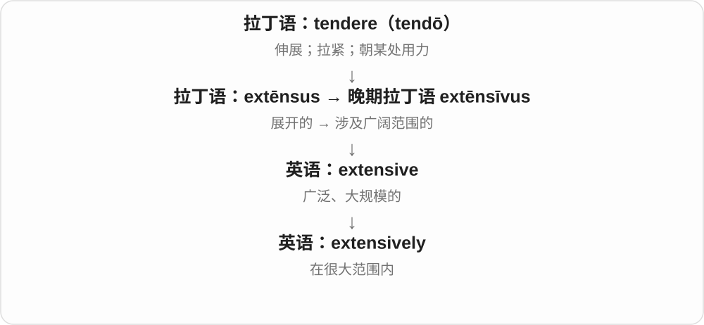

travel extensively 不一定每处住很久，但去的地方通常多。

**常见搭配与例句**

travel extensively；write extensively about；extensively revised。

> She has travelled extensively in Asia.

她游历过亚洲许多地方。

> The report was extensively revised before publication.

报告在发表前作了大幅修改。

**别混淆**

extensively 看范围；intensively 看密度或投入强度。

### 292. lively — 活泼的；热闹的；生动的

**音标**：/ˈlaɪvli/

**先抓住这个画面**

人不断提问，话题来回碰撞，房间一下有了生气。

**怎么拆**

接古英语 līflīċ、后来的 lively 等形式；现代对应 life + -ly，但 -ly 在这里造形容词，不是普通副词。

**怎么变成今天的意思**

**古英语 līf → 中古英语 lyf**  
生命；活着的状态

↓

**古英语 līflīċ → 英语 lively**  
有生命、活跃 → 活泼、生动

a lively child 是活泼孩子，a lively debate 是热烈讨论，a lively description 是生动描写。并不表示所有场面都和睦无争。

**常见搭配与例句**

a lively discussion；a lively atmosphere；a lively imagination。

> The lecture ended with a lively discussion.

讲座以热烈讨论结束。

> She gave a lively account of her travels.

她生动地讲述了自己的旅行。

**别混淆**

alive 是活着，lively 是有活力。一个人可以 alive 却很安静；lively 不只是医学上是否有生命。

### 293. timely — 及时的；恰逢其时的

**音标**：/ˈtaɪmli/

**先抓住这个画面**

雨快下了，有人正好提醒你带伞。这不是单纯“很快”，而是在需要的时刻送到提醒，就是 timely。

**怎么拆**

time 与 -ly 的历史组合；古英语有相应副词形式，中古英语已有 timely 一类形式及“时机合适”的形容词义。现代虽以 -ly 结尾，却常作形容词。

**怎么变成今天的意思**

**古英语 tīma；相关 tīmlīce 形式**  
时间；及时、很快等副词用法

↓

**中古英语 timeli／timely**  
发展并保留合时、及时的描述

↓

**英语 timely**  
主要形容事情在合适、需要的时间发生

a timely warning 是赶在还来得及应对时的警告；timely advice 是正好用得上的建议。它评价时间与需要相配，不只是评价速度。

**常见搭配与例句**

a timely reminder；timely information；in a timely manner。

> The email was a timely reminder to renew my passport.

这封邮件及时提醒了我续办护照。

> Timely information helped us change the plan.

及时得到的信息帮助我们调整了计划。

**别混淆**

quick 是快，punctual 是守时，timely 是时机合适。并非所有 -ly 结尾词都只能当副词。

### 294. promptly — 及时、迅速地；准时地

**音标**：英 /ˈprɒmptli/；美 /ˈprɑːmptli/

**先抓住这个画面**

该处理就马上处理，是 promptly；说某个钟点时，也可能强调准点、没有拖后。

**怎么拆**

prompt + -ly，形成副词；由准备好、回应及时的性质，转成行动的方式。

**怎么变成今天的意思**

**拉丁 prō- 向前 + emere 拿 → prōmere**  
拿出、带到眼前

↓

**过去分词 prōmptus**  
已拿到手边 → 现成、准备好的

↓

**法语、拉丁形式 → 英语 prompt**  
及时的；促使、提示；提示信息

↓

**prompt + -ly → promptly**  
以及时、无拖延的方式

reply promptly 及时回复，act promptly 迅速行动，arrive promptly at nine 九点准时到。

**常见搭配与例句**

reply promptly；act promptly；promptly at nine。

> Please report any damage promptly.

发现任何损坏，请及时报告。

> The meeting began promptly at ten.

会议十点准时开始。

**别混淆**

promptly 常突出不耽搁；quickly 也可以只说动作本身速度快。接钟点时注意准时这一层。

### 295. reluctant — 不情愿的；勉强的

**音标**：/rɪˈlʌktənt/

**先抓住这个画面**

嘴上可能答应，心里却还往后缩，不太想做，这种态度就是 reluctant。不是做不到，而是意愿上不积极。

**怎么拆**

借拉丁 reluctans，与 re- 向后及 luctari 挣扎、抗争相联；历史的抵抗画面走成心里的不愿意。

**怎么变成今天的意思**

**拉丁 re- + luctari → reluctari、reluctans**  
向后对抗、挣扎抵抗

↓

**英语 reluctant、reluctance**  
不情愿的；不情愿、迟疑的状态

be reluctant to do 不愿做；a reluctant agreement 勉强的同意；a reluctant hero 不情愿承担角色的英雄。

**常见搭配与例句**

reluctant to admit；reluctant to leave。

> She was reluctant to admit that she needed help.

她不太情愿承认自己需要帮助。

> He gave a reluctant nod.

他勉强点了点头。

**别混淆**

reluctant 是不情愿，unable 是不能；有能力但不愿做，与想做却做不到不同。

### 296. reluctantly — 不情愿地、勉强地

**音标**：/rɪˈlʌktəntli/

**先抓住这个画面**

心里不想，但最后还是做了。动作发生了，内心却像向后拽着，这是 reluctantly 的感觉。

**怎么拆**

reluctant 不情愿的 + -ly；reluctant 的历史接拉丁 reluctari 抵抗、挣扎的词族。

**怎么变成今天的意思**

**reluctant 的抵抗、不愿词族**  
内心不愿配合

↓

**reluctant + -ly → reluctantly**  
带着不情愿去做

reluctantly agree 不情愿地同意；reluctantly accept 勉强接受；leave reluctantly 恋恋不舍地离开。具体不愿可能是担忧、留恋或反对。

**常见搭配与例句**

admit reluctantly；reluctantly give up。

> He reluctantly agreed to change the date.

他不情愿地同意更改日期。

> She reluctantly left the party early.

她恋恋不舍地提前离开了聚会。

**别混淆**

reluctantly 不等于 refuse 拒绝：拒绝可能没做，reluctantly 常表示最后确实做了，只是不愿意。

### 297. cautious — 谨慎的；小心的

**音标**：英 /ˈkɔːʃəs/；美 /ˈkɔːʃəs/

**先抓住这个画面**

脚下先试一试，再往前走；结论先留点余地，不一下说死。这种留心风险的态度是 cautious。

**怎么拆**

与 caution 的材料加 -ous 对应，词形不保留完整 -ion；也与拉丁 cautus 小心的相应，不是 cautioned 的另一种拼写。

**怎么变成今天的意思**

**拉丁 cavere → cautio → 法语 caution**  
防备、小心；担保等相关用法

↓

**英语 caution → cautious**  
小心、警告；谨慎的

be cautious about 对……谨慎；a cautious approach 谨慎做法；cautious optimism 审慎乐观。

**常见搭配与例句**

cautious about；a cautious estimate。

> She was cautious about sharing unverified information.

她对分享未经核实的信息很谨慎。

> The team expressed cautious optimism about the results.

团队对结果表达了审慎的乐观。

**别混淆**

cautious 是谨慎，cowardly 是胆怯、懦弱；认真评估风险不等于没有勇气。

### 298. cautiously — 谨慎地、小心翼翼地；有所保留地

**音标**：/ˈkɔːʃəsli/

**先抓住这个画面**

知道可能有风险、信息还不齐，所以动作慢一点、判断留一点余地。既能说走路，也能说态度。

**怎么拆**

cautious 谨慎的 + -ly；更早接拉丁 cautio 防备、谨慎及 cavere 留心、防范的词族。

**怎么变成今天的意思**

**caution 相关词族 → cautious**  
留心可能的风险

↓

**cautious + -ly → cautiously**  
小心行动；保留判断空间

move cautiously 小心移动；respond cautiously 谨慎回应；cautiously optimistic 谨慎乐观：有希望，同时不把结论说满。

**常见搭配与例句**

proceed cautiously；cautiously approach。

> She stepped cautiously onto the icy path.

她小心翼翼地踏上结冰的小路。

> The team remained cautiously optimistic about the result.

团队对结果仍持谨慎乐观态度。

**别混淆**

cautiously 不必等于害怕；它可以是有意识地控制风险、等更多信息。carelessly 则是疏忽、不小心。

### 299. unsuccessful — 未成功的；没有达到目的的

**音标**：/ˌʌnsəkˈsesfəl/

**先抓住这个画面**

试过了，但没有抵达想要的结果。

**怎么拆**

un-“不” + successful。

**怎么变成今天的意思**

**拉丁 cēdere；分词词干 cess-**  
走、离开；让步、让出

↓

**拉丁 sub- + cēdere → succēdere**  
接着来、接替；事情进展顺利

↓

**拉丁 successus → 英语 success**  
结果、进展 → 好结果、成功

↓

**英语 successful → unsuccessful**  
成功的 → 未成功的

an unsuccessful attempt 是一次没有成功的尝试，不代表人永远无能。正式邮件里 an unsuccessful application 常是申请未获批准。

**常见搭配与例句**

an unsuccessful attempt；unsuccessful in doing…。

> Our first attempt was unsuccessful.

我们第一次尝试没有成功。

> The applicant was unsuccessful but asked for feedback.

申请人未能获选，但请求了反馈意见。

**别混淆**

failed 常更直接；unsuccessful 较中性地说明结果没达成。

### 300. unsuccessfully — 未能成功地；没有达到目的地

**音标**：/ˌʌnsəkˈsesfəli/

**先抓住这个画面**

努力、申请或尝试发生了，但结果没有达到想要的目标。重点在这一次没成功。

**怎么拆**

unsuccessful 不成功的 + -ly；也可按 un- 否定 + successfully 认识，success 词族更早接继起、结果的发展。

**怎么变成今天的意思**

**successful 成功的 → unsuccessful**  
否定达到目标的结果

↓

**unsuccessful + -ly → unsuccessfully**  
做过尝试，但未获得所求结果

try unsuccessfully 尝试但未成功；apply unsuccessfully 申请未成功；search unsuccessfully 寻找却没找到。修饰尝试、行动的结果。

**常见搭配与例句**

attempt unsuccessfully；unsuccessfully seek help。

> She tried unsuccessfully to open the old window.

她试着打开旧窗户，但没能打开。

> We searched unsuccessfully for the missing key.

我们找了那把丢失的钥匙，却没有找到。

**别混淆**

unsuccessfully 评价某次行动的结果，不直接给一个人贴永久失败的标签。failed to do 与 tried unsuccessfully 有时可表达相近意思。

### 301. spontaneous — 自发的；自然流露的；未经事先安排的

**音标**：英 /spɒnˈteɪniəs/；美 /spɑːnˈteɪniəs/

**先抓住这个画面**

没有提前排练、没有人催，听见好消息就自然鼓掌，这种从当下意愿冒出来的反应是 spontaneous。

**怎么拆**

接晚期拉丁 spontaneus，自身来自 sua sponte 等出于自愿、自行的表达；不是 modern spin 旋转换出来的，也不找一个常用英文 spontan。

**怎么变成今天的意思**

**拉丁 sua sponte、spontaneus**  
自愿、自行、出于自身意愿

↓

**英语 spontaneous**  
自发、自然流露、未预先安排

spontaneous applause 自发掌声；a spontaneous decision 临时起意的决定；a spontaneous smile 自然流露的笑。

**常见搭配与例句**

a spontaneous reaction；a spontaneous gesture。

> The announcement drew spontaneous applause.

消息一宣布，大家自发鼓起掌来。

> We made a spontaneous decision to stay another night.

我们临时决定再住一晚。

**别混淆**

spontaneous 强调自发、未预先安排；sudden 强调突然。预先安排的惊喜也可能突然，却不一定 spontaneous。

### 302. spontaneously — 自发地；未经预先安排地；自然涌现地

**音标**：英 /spɒnˈteɪniəsli/；美 /spɑːnˈteɪniəsli/

**先抓住这个画面**

没有事先喊口令、排计划，事情自己从当时的情境里发生。听众自发鼓掌，念头自然冒出来，都可以这样说。

**怎么拆**

spontaneous 自发的 + -ly；更早接拉丁 spontaneus 自愿、自发词族，联系自身意愿、推动的材料。

**怎么变成今天的意思**

**spontaneous 的自愿、自发性质**  
非外部预先安排的反应、发生

↓

**spontaneous + -ly → spontaneously**  
自发地；自然发生、涌现地

applaud spontaneously 自发鼓掌；arise spontaneously 自然出现；laugh spontaneously 自然地笑出来。科学术语中的自发还要按该领域定义理解。

**常见搭配与例句**

respond spontaneously；an idea came spontaneously。

> The audience spontaneously began to clap.

观众自发地鼓起掌来。

> The idea came to her spontaneously during the walk.

散步时，她自然地冒出了这个念头。

**别混淆**

spontaneously 重在没有预先安排或外在指令；suddenly 重在时间上突然。一个动作可以两者都有，也可以只是其中一个。

### 303. apt — 恰当贴切的；聪敏、学得快的；容易、往往会的

**音标**：/æpt/

**先抓住这个画面**

一句比喻恰好贴住眼前情况，是 apt。be apt to 又说某事容易照这个方向发生，像总有这种倾向。

**怎么拆**

经法语 ate、apte 或直接借自拉丁 aptus 合适、适配的；更早接连接、贴合的旧动词材料。英语适合与倾向两支都较早存在。

**怎么变成今天的意思**

**拉丁 aptus → 法语／英语 apt**  
贴合、适合、具备所需性质

↓

**现代常用搭配**  
贴切的；学得快的；倾向于、容易

an apt description 贴切描述；an apt pupil 聪明好学的学生；be apt to forget 容易忘；an apt comparison 恰当比喻。

**常见搭配与例句**

an apt choice of words；apt to change。

> That is an apt description of the problem.

那是对这个问题的贴切描述。

> The weather here is apt to change suddenly.

这里的天气容易突然变化。

**别混淆**

apt to do 是容易、往往会，不一定是有能力。an apt description 说描述贴切，an able person 则说人有能力，不能只按一个中文词换。

### 304. aptly — 恰当地、贴切地

**音标**：/ˈæptli/

**先抓住这个画面**

名字正好点中特点，评论正好说到要害，都可以加 aptly：说得贴、选得准。

**怎么拆**

apt + -ly，-ly 形成方式副词；接 apt 的合适、贴合分支。早期也有其他用法，现代重点是方式恰当。

**怎么变成今天的意思**

**apt；接拉丁 aptus 合适、贴合**  
恰当、适合

↓

**apt + -ly → aptly**  
以贴切、合适的方式

aptly named 名副其实地命名；aptly described 贴切地描述；aptly put 说得恰到好处；aptly illustrates 恰好说明。

**常见搭配与例句**

an aptly chosen word；aptly sums up。

> The café was aptly named The Meeting Place.

那家咖啡馆取名“相聚之地”，很是贴切。

> Her remark aptly summed up the mood in the room.

她的话贴切地概括了屋内的气氛。

**别混淆**

aptly 强调恰当，accurately 强调准确。一个描述可以事实准确却没抓住重点；aptly 往往还赞它贴合场景。

### 305. dreadful — 可怕的；糟糕透顶的

**音标**：/ˈdredfəl/

**先抓住这个画面**

原本是让人 dread 的、可怕的；日常又常夸张说天气、服务、味道糟透了。a dreadful meal 往往是难吃，不是吃饭遇到怪物。

**怎么拆**

dread + -ful，承中古英语 dredful 等形式；由令人畏惧发展到极差、不愉快的评价。

**怎么变成今天的意思**

**古英语 ondraedan、draedan 等 → 中古英语 dreden → dread**  
强烈害怕、畏惧；也有敬畏

↓

**dread + -ful → dreadful**  
令人畏惧的 → 很糟糕的

dreadful weather 糟糕天气，a dreadful mistake 严重错误，a dreadful experience 可怕或很糟的经历。

**常见搭配与例句**

dreadful weather；a dreadful mistake。

> The weather was dreadful all weekend.

整个周末天气都糟透了。

> They realised they had made a dreadful mistake.

他们意识到犯了一个严重错误。

**别混淆**

dreadful 的糟糕义很常见；-ful 在这里形成形容性质，不必每次逐字翻成装满恐惧。

### 306. dreadfully — 糟糕地；非常、极其

**音标**：/ˈdredfəli/，也 /ˈdredfʊli/

**先抓住这个画面**

事情做得很差，可以说 dreadfully；dreadfully sorry 则常是把抱歉程度加重，表示非常抱歉。

**怎么拆**

现代对应 dreadful + 完整 -ly；副词承中古英语相关形式。dreadful 的可怕、糟糕义，还发展出加强程度的用法。

**怎么变成今天的意思**

**古英语害怕材料 → dread → dreadful**  
畏惧 → 可怕、糟糕的

↓

**中古英语 dredfully 等 → dreadfully；现代对应 dreadful + -ly**  
糟糕地；加强为非常、极其

performed dreadfully 是表现糟糕；dreadfully sorry 是十分抱歉，后者不要求现场真的有人恐惧。

**常见搭配与例句**

dreadfully tired 累极了；dreadfully dull 无聊透顶。

> I am dreadfully sorry for the delay.

耽误了，我十分抱歉。

> The team played dreadfully in the first half.

球队上半场踢得糟糕透了。

**别混淆**

dreadfully 在现代常作程度加强，fearfully 的常用感受义则是害怕地；不能把两个含害怕历史材料的副词一律译成恐惧地。

### 307. scarce — 稀缺的、不足的；不容易得到的

**音标**：英 /skeəs/；美 /skers/

**先抓住这个画面**

需要的人多，可供拿到的东西少。scarce 不只数有多少，也常暗示不够用、难找到。

**怎么拆**

经中古英语接古法语 escars 等吝啬、少量材料，更远来源未定，联系拉丁摘出、挑选材料只是其中一种分析。现代固定为供应少、不足。

**怎么变成今天的意思**

**法语少量、吝啬等旧材料 → 英语 scarce**  
不充分、给得少

↓

**现代 scarce**  
可得数量少；相对需求不足

scarce resources 稀缺资源；water is scarce 水很缺；jobs are scarce 工作机会少。与需要、可得性常有联系。

**常见搭配与例句**

make oneself scarce；scarce supplies。

> Water becomes scarce during the dry season.

旱季水会变得短缺。

> Affordable rooms are scarce in this area.

这一带价格负担得起的房间很难找。

**别混淆**

rare 常说少见，scarce 常说不够、难得到。一种 rare bird 是少见的鸟；scarce water 强调水不够用。

### 308. scarcely — 几乎不、几乎没有；勉强、刚刚

**音标**：英 /ˈskeəsli/；美 /ˈskersli/

**先抓住这个画面**

数量或程度少到只剩一点边缘。scarcely hear 是几乎听不见，scarcely enough 则像刚刚挨到够用的线。

**怎么拆**

scarce 稀少、不足 + -ly；由数量不足的材料发展为几乎不、勉强达到的副词。现代不能每次硬译成稀少地。

**怎么变成今天的意思**

**scarce 的不充足性质 + -ly**  
数量、程度接近没有或不足

↓

**scarcely 的固定副词用法**  
几乎不；只勉强达到

scarcely any time 几乎没有时间；could scarcely hear 几乎听不清；scarcely enough 勉强够。句子一般已含否定意味，不必再机械加 not。

**常见搭配与例句**

scarcely visible；scarcely enough room。

> I could scarcely hear her over the noise.

噪声太大，我几乎听不见她说话。

> There was scarcely enough room for the two boxes.

地方勉强够放下那两个箱子。

**别混淆**

scarcely、hardly 在几乎不的用法接近；scarcely 不是 simply rarely 很少发生。前者程度接近零，后者常说频率低。

### 309. fearful — 害怕、担忧的；可怕的；很厉害的〔部分搭配〕

**音标**：英 /ˈfɪəfl/；美 /ˈfɪrfl/

**先抓住这个画面**

人心里装满害怕，是 fearful；另一些搭配却说事情吓人、程度很大，需要看它修饰谁。

**怎么拆**

fear + -ful，中古英语已有造成恐惧和满怀恐惧等义。-ful 不能保证所有词都只有装满这种感受一条解释。

**怎么变成今天的意思**

**古英语 fær；相关动词 færan**  
突然的危险、灾祸；使恐惧

↓

**中古及现代 fear**  
对危险的恐惧；害怕、担忧

↓

**fear + -ful → fearful**  
满怀恐惧；令人恐惧；加强程度

fearful of failure 害怕失败，fearful that 担心，a fearful noise 可说非常吓人或很大的噪声。

**常见搭配与例句**

fearful of；fearful that；a fearful expression；a fearful noise。

> The children were fearful of entering the dark room.

孩子们害怕进入黑屋。

> There was a fearful crash as the tree fell.

树倒下时发出一声吓人的巨响。

**别混淆**

fearful 常描述害怕者，但保留可怕义；fearsome 更稳定地说引起畏惧。用补语 of/that 时方向通常更清楚。

### 310. fearfully — 害怕地、恐惧地

**音标**：英 /ˈfɪəfəli/；美 /ˈfɪrfəli/

**先抓住这个画面**

声音发轻、动作迟疑，眼神里都是怕，这种做事方式可以说 fearfully。

**怎么拆**

fearful + 完整 -ly；fearful 对应 fear + -ful。两个完整后缀分开，-ful 接 -ly 后形成 -fully 的拼写。

**怎么变成今天的意思**

**古英语危险、害怕材料 → fear → fearful**  
害怕；充满恐惧的

↓

**fearful + -ly → fearfully**  
带着害怕的方式

looked fearfully 是害怕地看，asked fearfully 是怯怯地问；关注动作中流露的恐惧。

**常见搭配与例句**

glanced fearfully 害怕地瞥看；spoke fearfully 恐惧地说。

> She glanced fearfully at the dark doorway.

她害怕地朝漆黑的门口瞥了一眼。

> He asked fearfully whether anyone was inside.

他怯怯地问里面是否有人。

**别混淆**

fearfully 强调害怕，carefully 强调小心；小心不一定出于恐惧，害怕也不一定就做得周全。

### 311. improper — 不恰当的；不合规的；不正当的

**音标**：英 /ɪmˈprɒpə/；美 /ɪmˈprɑːpər/

**先抓住这个画面**

本该有一条合适的做法或边界，这件事却偏离了它：工具用错、程序不对、行为越界，都可能 improper。

**怎么拆**

拉丁否定 in- 在 p 前同化为 im-，与 proprius 组成 improprius；经法语 impropre 或直接借入英语。现代可认作 im- + proper，但不是最初只在英语里加前缀。

**怎么变成今天的意思**

**拉丁 proprius**  
某人或某物自己的、特有的；适合的

↓

**拉丁 in- + proprius → improprius**  
不合适的

↓

**法语 impropre／直接拉丁借入 → 英语 improper**  
不适当、不正当的

improper use 指使用方式不当；improper conduct 常指行为不符合规范。数学术语 improper fraction 是假分数，不能按道德意思理解成“不正当的分数”。

**常见搭配与例句**

improper use of equipment；improper conduct；improper storage。

> Improper storage damaged the photographs.

保存方法不当损坏了这些照片。

> The committee questioned whether the contact had been improper.

委员会质疑这次接触是否不合规。

**别混淆**

illegal 明确违法；improper 可以仅是不合礼仪、程序或使用要求，不必已经违法。

### 312. improperly — 不恰当地、不正确地；不合规矩地

**音标**：英 /ɪmˈprɒpəli/；美 /ɪmˈprɑːpərli/

**先抓住这个画面**

事情做了，但方式、位置或用法不对：装错、用错、处理不得体。improperly 评价的是做法。

**怎么拆**

improper 不恰当的 + -ly，也可按 im- 否定 + properly 认识。proper 的合适、恰当义在否定后转为做法不对。

**怎么变成今天的意思**

**im- + proper → improper**  
不恰当、不合适的

↓

**improper + -ly → improperly**  
以不正确、不适当的方式

improperly installed 安装不当；improperly used 使用不当；improperly dressed 衣着不合场合。具体标准由设备、场合等给出。

**常见搭配与例句**

handled improperly；improperly labelled。

> The shelf had been improperly installed.

架子安装不当。

> Several boxes were improperly labelled.

几个箱子的标签贴错了。

**别混淆**

improperly 可说操作不对，也可说行为失当；不一律等于技术错误。看它修饰的是安装、使用还是社会行为。

### 313. haunt — 萦绕、使难忘；在某处出没；常去的地方〔名词〕

**音标**：/hɔːnt/；美式部分口音 /hɑːnt/

**先抓住这个画面**

不是只出现一下，而是总回来、总甩不掉，是 haunt 的核心感觉。人常去一个地方，鬼魂反复出现，一段记忆一直缠着心，都可从回来理解。

**怎么拆**

经古法语 hanter 常去、经常来往。更远来源不定，可能联系古诺尔斯 heimta 带回家，与 home 的日耳曼材料相关；这是候选解释。英语后来发展鬼魂出没、记忆萦绕，名词表示常去之处。

**怎么变成今天的意思**

**古法语 hanter → 英语 haunt**  
惯常来往、常去某处

↓

**现代常用分支**  
反复出没 → 鬼魂出没；感受、记忆不断回来；常去的地方

haunt someone’s thoughts 萦绕心头；an old haunt 过去常去的地方；haunt a house 在屋里出没〔鬼魂〕。

**常见搭配与例句**

a favourite haunt 常去、喜欢去的地方；memories that haunt someone 挥之不去的记忆。

> The unanswered question continued to haunt him.

那个没得到答案的问题一直萦绕在他心头。

> The café was a favourite haunt of local writers.

这家咖啡馆是当地作家常去的地方。

**别混淆**

haunt 不只等于闹鬼。an old haunt 往往只是以前常去的咖啡馆之类；记忆 haunt someone 则说它不断回来影响人。

### 314. haunting — 萦绕心头、难忘的；出没、不断影响〔现在分词、形容词〕

**音标**：/ˈhɔːntɪŋ/；美式部分口音 /ˈhɑːntɪŋ/

**先抓住这个画面**

声音或画面已经过去，脑子里却还一遍遍回来，就是 haunting。常带一点忧伤、神秘或不安，但不必真的可怕。

**怎么拆**

haunt 的法语常去材料扩展成反复出没、萦绕；现代直接加完整 -ing，动词过程形式又作形容词，表示留下挥之不去的印象。

**怎么变成今天的意思**

**haunt 常去、反复出现 → 萦绕心思**  
一次次回来 → 难以忘怀

↓

**haunt + -ing → haunting**  
正在缠绕；造成难忘印象的

a haunting melody 萦绕心头的旋律；a haunting image 难以忘怀的画面；haunting his thoughts 萦绕在他心头。

**常见搭配与例句**

a haunting voice 令人难忘的声音；a haunting memory 挥之不去的记忆。

> The film ends with a haunting melody.

影片以一段萦绕心头的旋律结束。

> That unfinished conversation kept haunting his thoughts.

那场没说完的谈话不断萦绕在他心头。

**别混淆**

haunting melody 可以很美、很动人；它不是简单等于 scary。haunted 常偏被缠住的状态，haunting 常偏让人忘不掉的事物。

### 315. hauntingly — 令人难以忘怀地；萦绕心头地

**音标**：英 /ˈhɔːntɪŋli/；美 /ˈhɔːntɪŋli/

**先抓住这个画面**

一段旋律已经停了，却还像在心里回响；一张脸看过之后久久忘不掉，修饰这种美、熟悉或忧伤，可以用 hauntingly。

**怎么拆**

现代按 haunt + -ing → haunting，再加副词 -ly；较早相关副词还说经常地，现代难忘义是后来发展的。

**怎么变成今天的意思**

**古法语 hanter：常去、反复来访等 → haunt**  
较远来源未定，与北欧回家材料的联系是一种分析

↓

**反复回来 → 出没、萦绕心思 → haunting、hauntingly**  
旧 hauntingly 还曾表示经常地；现代常写令人难忘、久久不散的印象

hauntingly beautiful 美得令人难忘；hauntingly familiar 熟悉得挥之不去；不要求场景里有鬼。

**常见搭配与例句**

a hauntingly sad melody；hauntingly clear memories。

> She sang a hauntingly beautiful melody.

她唱了一段美得令人难忘的旋律。

> His voice sounded hauntingly familiar.

他的声音有一种挥之不去的熟悉感。

**别混淆**

beautifully 可仅说优美，hauntingly beautiful 还说这份美会留在心里，常有幽远、忧伤的气氛，但不必是恐怖。

### 316. stagger — 踉跄、摇晃着走；使震惊；把时间、位置错开；踉跄动作

**音标**：英 /ˈstæɡə/；美 /ˈstæɡər/

**先抓住这个画面**

东西太重，人一步东一步西地勉强走稳，是 stagger。消息让人惊得像站不稳，也能 stagger someone；上班时间分批错开则是另一条安排用法。

**怎么拆**

经中古英语 stakeren 等接北欧的不稳、推撞材料；后来扩到使人震惊，以及交错排列、错时安排。现代不能拆成 stag 鹿 + -er。

**怎么变成今天的意思**

**北欧 stakra 等不稳、推撞材料 → 中古英语 stakeren → stagger**  
较早说走不稳、踉跄；现代 er 不是临时加上的人物后缀

↓

**失去平衡 → 使人震惊；位置、时间交错安排**  
震惊像被冲得站不稳；错开则像脚步、排列不在同一条线上

stagger under a load 是负重踉跄，stagger the start times 是把开始时间错开；the cost can stagger you 是费用高得让人震惊。

**常见搭配与例句**

stagger across the room 踉跄穿过房间；stagger the shifts 错开各班次。

> He began to stagger under the weight of the boxes.

箱子太重，他开始踉跄。

> We can stagger the lunch breaks to keep the desk staffed.

我们可以错开午休时间，让服务台一直有人。

**别混淆**

stagger 的动作义重在保持不了平衡，limp 重在一瘸一拐；stagger the hours 则是主动安排，不带走路意思。

### 317. staggering — 正在踉跄、错开安排；惊人的、令人震惊的

**音标**：英 /ˈstæɡərɪŋ/；美 /ˈstæɡərɪŋ/

**先抓住这个画面**

人正晃着身子找平衡，是 staggering；一个数大到让人像被冲得站不稳，也就成了 a staggering number。

**怎么拆**

stagger + 完整 -ing；分词形容词的“惊人”用法较早已见，不能把它只当今天临时拼成的现在进行。

**怎么变成今天的意思**

**北欧 stakra 等不稳、推撞材料 → 中古英语 stakeren → stagger**  
较早说走不稳、踉跄；现代 er 不是临时加上的人物后缀

↓

**失去平衡 → 使人震惊；位置、时间交错安排**  
震惊像被冲得站不稳；错开则像脚步、排列不在同一条线上

↓

**stagger + -ing → staggering**  
踉跄过程；让人震惊的效果

staggering across the floor 是正踉跄走过地板，a staggering cost 是惊人的费用；staggering the arrivals 是把到达时间错开。

**常见搭配与例句**

a staggering amount 惊人的数量；staggering backwards 踉跄退后。

> He was staggering under the weight of his backpack.

背包太重，他正踉跄着走。

> The library holds a staggering number of old maps.

图书馆收藏的旧地图数量惊人。

**别混淆**

a staggering figure 是那个数字令人吃惊，a staggered reader 是读者被惊住；两词形容的对象、受力方向不同。

### 318. staggeringly — 惊人地；大得、高得令人震惊地

**音标**：英 /ˈstæɡərɪŋli/；美 /ˈstæɡərɪŋli/

**先抓住这个画面**

价格高到让你听完一愣，叫 staggeringly expensive；像消息把人冲得站不稳，现代副词用来强调超出预期的程度。

**怎么拆**

staggering + -ly；内层 stagger + -ing，从使人震惊的性质发展，外层多修饰大、高、低等程度。

**怎么变成今天的意思**

**北欧不稳、推撞材料 → stakeren 等 → stagger**  
走不稳、踉跄；更早细节不能只靠现代字形猜

↓

**使人震惊 → staggering → staggeringly**  
像震惊得站不稳；现代副词多写程度大得惊人

↓

**stagger → staggering → staggeringly**  
震惊得站不稳似的性质，转成惊人的程度

staggeringly expensive 贵得惊人；staggeringly large 大得令人震惊。

**常见搭配与例句**

staggeringly simple 简单得惊人；staggeringly low 低得惊人。

> The repair turned out to be staggeringly expensive.

维修费原来贵得惊人。

> Only a staggeringly small proportion of the money reached the project.

只有少得惊人的一小部分资金真正到了项目上。

**别混淆**

staggeringly 不只表示多、好，也能修饰 low、wasteful；核心是程度令人震惊，褒贬看后面的性质。

### 319. barley — 大麦

**音标**：英 /ˈbɑːli/；美 /ˈbɑːrli/

**先抓住这个画面**

一种结谷粒的农作物，可入汤、作麦芽等。词尾虽然像 -ly，现代整个词是植物和谷物名称。

**怎么拆**

古英语 bærlic 通常分析为 bere 大麦 + -lic，与后来的 -ly 历史材料相连；原来像形容词的形式后来成为谷物名。

**怎么变成今天的意思**

**古英语 bere 大麦 + -lic**  
与大麦有关、像大麦的旧形式

↓

**bærlic → 中古英语 barli → barley**  
固定为大麦这一谷物名称

barley soup 大麦汤；a field of barley 一片大麦田；pearl barley 珍珠大麦、经磨制的大麦粒。名词通常不可数。

**常见搭配与例句**

grow barley；barley grains。

> The farmer grows barley in this field.

农民在这块田里种大麦。

> She added barley to the soup.

她往汤里加了大麦。

**别混淆**

wheat 是小麦，barley 是大麦；barley 的末尾有旧构词史，但不能把现代 barley 当成方式副词。

### 320. unconditional — 无条件的

**音标**：/ˌʌnkənˈdɪʃənəl/

**先抓住这个画面**

“不需要你先做到什么，我也会这样。”unconditional 去掉了附带的前提。

**怎么拆**

un-（没有）+ conditional（有条件的）。

**怎么变成今天的意思**

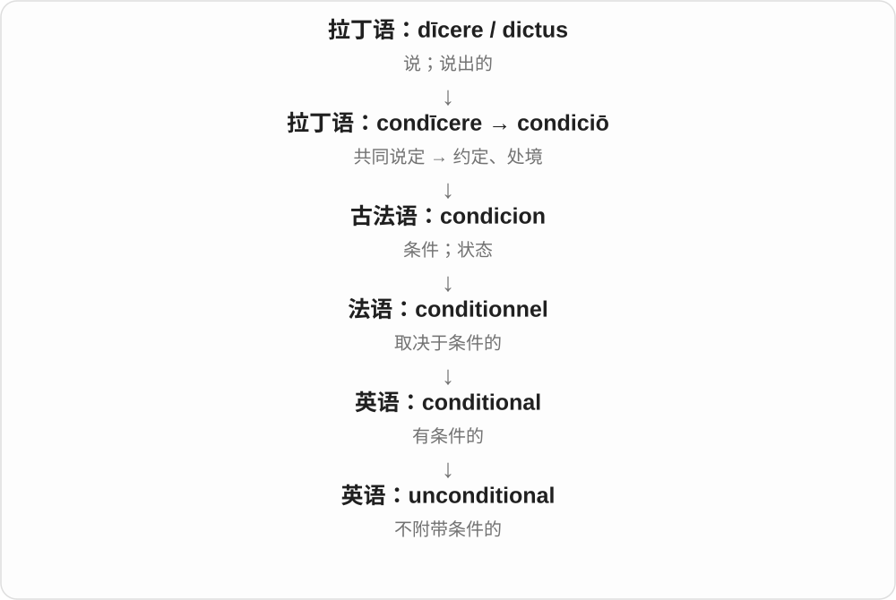

它可以形容支持、承诺，也可说 unconditional surrender“无条件投降”。具体范围仍由所谈的事情决定，不表示生活中从此没有任何界限。

**常见搭配与例句**

unconditional support；unconditional love；unconditional surrender。

> She offered him unconditional support.

她向他提供了无条件的支持。

> The agreement called for an unconditional surrender.

协议要求无条件投降。

**别混淆**

unconditional 说没有附带条件；unlimited 说没有数量或范围上限。这两件事不同。

### 321. unconditionally — 无条件地、不附带条件地

**音标**：/ˌʌnkənˈdɪʃənəli/

**先抓住这个画面**

不是先谈好“你得先做到某事，我才给你”，而是不附加这样的前提。常说无条件支持、接受或投降。

**怎么拆**

unconditional 无条件的 + -ly；un- 否定 conditional 有条件的，conditional 又与 condition 条件同族。

**怎么变成今天的意思**

**un- + conditional → unconditional**  
没有附加条件的

↓

**unconditional + -ly**  
以不附带条件的方式

love someone unconditionally 无条件地爱某人；accept unconditionally 无条件接受；surrender unconditionally 无条件投降。

**常见搭配与例句**

support unconditionally；agree unconditionally。

> Her parents supported her unconditionally.

她父母无条件地支持她。

> The army agreed to surrender unconditionally.

那支军队同意无条件投降。

**别混淆**

unconditionally 说没有所要求的条件；wholeheartedly 说全心投入、真诚赞同。全力支持仍可能针对特定前提，两词侧重点不同。

### 322. grumpy — 脾气不好的；烦躁、爱抱怨的

**音标**：/ˈɡrʌmpi/

**先抓住这个画面**

一点小事就嫌烦，别人来搭话也没好气，是 grumpy。它不只是安静地难过，更容易表现为不耐烦。

**怎么拆**

grump + -y → grumpy；日常性质形容词，不需要一个真的正在抱怨的动作才可用。

**怎么变成今天的意思**

**grump 的较早不快、抱怨材料**  
更早来源未定，可能联系 grum 或受 grumble、grunt 等影响

↓

**grump + -y → grumpy**  
不高兴、容易烦躁的性质

↓

**现代 grump 也指爱抱怨的人**  
该人物义的记录晚于 grumpy，不把所有名词义都排在形容词之前

feel grumpy 感到烦躁；a grumpy reply 没好气的回答；grumpy in the morning 早上脾气不好。

**常见搭配与例句**

feel grumpy；a grumpy reply。

> Lack of sleep makes him grumpy.

睡眠不足会让他脾气不好。

> She gave a grumpy reply and went back to her book.

她没好气地应了一句，又继续看书。

**别混淆**

grumpy 常说当下情绪或习性，gloomy 常偏低落、悲观；quiet 安静本身不含烦躁。

### 323. grumpily — 没好气地；烦躁地；不耐烦地

**音标**：/ˈɡrʌmpɪli/

**先抓住这个画面**

别人问一句，自己带着嫌烦的口气回一句，这种做事、说话的方式叫 grumpily。

**怎么拆**

grumpy 改 y 为 i，加副词 -ly → grumpily；不快的性质被用来描述动作方式。

**怎么变成今天的意思**

**grump：不快、抱怨材料 → grumpy**  
grump 更早来源未定，可能联系 grum，或受 grumble、grunt 等影响

↓

**grump + -y → grumpy，再加程度、方式、性质词尾**  
早期不快状态名词先有，现代爱抱怨的人义是较晚发展，不倒排全部记录

↓

**grumpy → grumpily**  
以没好气、不耐烦的方式做事

replied grumpily 没好气地回答；muttered grumpily 烦躁地嘟囔；walked off grumpily 不高兴地走开。

**常见搭配与例句**

said grumpily；grumpily agreed。

> “Not now,” he replied grumpily.

“现在不行。”他没好气地答道。

> She grumpily agreed to move her bag.

她不高兴地答应把包挪开。

**别混淆**

grumpily agreed 是答应了，但态度不高兴；态度副词不能把 agreed 的同意改成拒绝。

### 324. vigorous — 有力的；精力旺盛的；强烈积极的

**音标**：/ˈvɪɡərəs/

**先抓住这个画面**

动作不是轻轻意思一下，而是投入很多劲儿；讨论、行动也能充满力量，这就叫 vigorous。

**怎么拆**

经法语 vigoros 等接中世纪拉丁 vigorosus，来自 vigor 活力；现代可认 vigor 与 -ous 的对应。

**怎么变成今天的意思**

**拉丁 vigor、vigorosus → 法语相应形式**  
活力；有活力的

↓

**英语 vigorous**  
有力、积极、精力旺盛

vigorous exercise 较剧烈的运动；a vigorous debate 激烈讨论；vigorous opposition 强烈反对。

**常见搭配与例句**

a vigorous campaign；vigorous growth。

> The proposal met with vigorous opposition.

这个提案遭到强烈反对。

> The plants showed vigorous growth in spring.

这些植物在春天长势旺盛。

**别混淆**

vigorous 是力量、活跃程度强；rigorous 是严格、严密。只差开头字母，评价角度很不同。

### 325. vigorously — 有力地、充满干劲地；坚决地

**音标**：英 /ˈvɪɡərəsli/；美 /ˈvɪɡərəsli/

**先抓住这个画面**

不是软绵绵地做，而是投入明显的力量、精力。可以是身体用力，也可以是在争论中强烈反对。

**怎么拆**

vigorous 有活力、有力的 + -ly；vigorous 的较早词族经法语接拉丁 vigor 活力、力量。

**怎么变成今天的意思**

**vigor 活力 → vigorous 有力的相关词族**  
充足力量、精力

↓

**vigorous + -ly → vigorously**  
用力、积极投入；强烈地表态

shake vigorously 用力摇动；work vigorously 干劲十足地工作；vigorously oppose 强烈反对。动作和立场都能带力度。

**常见搭配与例句**

stir vigorously；argue vigorously。

> She shook the bottle vigorously.

她用力摇了摇瓶子。

> The committee vigorously opposed the change.

委员会强烈反对这项变动。

**别混淆**

vigorously 强调投入的力道；quickly 强调速度。动作有力可以很慢，不必把两个副词当同义词。

### 326. blatant — 明目张胆的；十分明显而令人反感的

**音标**：/ˈbleɪtənt/

**先抓住这个画面**

坏事、错误或不尊重就摆在眼前，明显到很难装作没看见。blatant 通常把明显和负面评价绑在一起。

**怎么拆**

Edmund Spenser 在十六世纪文学中用 blatant 描写吵闹的怪兽；来源有拟叫声、相关旧词或拉丁 blatire 等分析，不能强定唯一词根。后来从喧闹刺耳发展为刺眼地明显。

**怎么变成今天的意思**

**文学造词 blatant beast 的喧闹形象**  
令人反感、难忽略的声音

↓

**一般词汇的语义发展**  
喧闹、刺眼 → 明显而不加掩饰的坏现象

a blatant lie 明摆着的谎言；blatant disregard 公然无视；a blatant error 显而易见的错误。通常不拿它中性称赞一种美。

**常见搭配与例句**

blatant disrespect；a blatant contradiction。

> The claim was a blatant lie.

那个说法明摆着是谎言。

> The report contained a blatant error.

报告里有一个十分明显的错误。

**别混淆**

obvious 可以中性说明明显；blatant 常带不满、批评。它不必证明行为一定故意，重点是问题十分显眼。

### 327. blatantly — 明目张胆地；明显得令人反感地

**音标**：/ˈbleɪtəntli/

**先抓住这个画面**

问题不是藏得很深，而是直接摆出来，旁人很容易看到。常带一句这也太明显了的批评。

**怎么拆**

blatant 明显而令人反感的 + -ly。副词把负面评价用于行为、性质或一句话的真假。

**怎么变成今天的意思**

**blatant 的公然、显眼性质**  
问题难以掩饰

↓

**blatant + -ly → blatantly**  
公开地表现问题；明显地不对、失当

blatantly false 明显虚假的；blatantly unfair 明显不公的；blatantly ignore 公然无视。与明显负面的词搭配很常见。

**常见搭配与例句**

blatantly obvious；blatantly disregard。

> The statement was blatantly false.

那份声明明显不实。

> The player blatantly ignored the rules.

那名运动员公然无视规则。

**别混淆**

plainly、obviously 更容易中性使用；blatantly 通常顺便表达批评。blatantly unfair 不只是在汇报看得清。

### 328. limp — 一瘸一拐地走；勉强继续；软塌无力的；跛行

**音标**：/lɪmp/

**先抓住这个画面**

一条腿使不上劲，走路一高一低，是 limp；一片叶子、胳膊软软垂着，limp 作形容词。项目勉强撑着往前，也能 limp along。

**怎么拆**

现代动词和形容词的更早来源都未定，可能联系古英语 lemphealt 等材料；名词跛行由动词发展。不能把 limb 肢体随手变成 limp 当历史。

**怎么变成今天的意思**

**limp 的动词、形容词来源都不完全清楚**  
可能联系古英语 lemphealt 等较早材料；不能当作 limb 删字母的规则

↓

**动词一瘸一拐 → 名词跛行；形容词软塌无力**  
现代两幅画面相近，却不能据此编出确定的先后派生链

walk with a limp 是走路有些跛，a limp handshake 是软绵绵的握手，limp along 是吃力地继续运转。

**常见搭配与例句**

go limp 身体软下来；limp home 一瘸一拐回家或勉强返航。

> He began to limp after the long walk.

走了很久之后，他开始一瘸一拐。

> The lettuce had gone limp in the heat.

生菜在热天里已经蔫软了。

**别混淆**

limp 作形容词强调失去挺劲，limping 作分词突出跛着走；a limp arm 是无力垂下的胳膊，不是胳膊在走路。

### 329. limply — 软塌塌、松垂地；无力地

**音标**：/ˈlɪmpli/

**先抓住这个画面**

旗子没风就软软垂着，手臂没使劲地搭在一边，都能说 limply。它说失去挺度、支撑的样子，不只是运动慢。

**怎么拆**

limp 形容词松软、无力 + -ly；limp 更远来源不完全确定，另有跛行的动词，不把这种副词每次都当作跛着脚。

**怎么变成今天的意思**

**limp 形容词：松软、下垂、缺乏挺度**  
来源未定，有古英语及日耳曼松垂材料等分析

↓

**limp + -ly → limply**  
以没支撑、软软垂着或无力的方式

hang limply 软软地垂着；shake hands limply 无力地握手。

**常见搭配与例句**

arms hanging limply；a flag hanging limply。

> The flag hung limply in the still air.

空气静止，旗子软软地垂着。

> He shook my hand limply.

他有气无力地和我握了握手。

**别混淆**

limply 描写松软、没力，limping 描写跛着走；一面软垂的旗子不会是在跛行。

### 330. defy — 违抗、蔑视；使难以做到、无法……

**音标**：/dɪˈfaɪ/

**先抓住这个画面**

面对要求偏不照做，是 defy an order；某种现象怎么都解释不通，是 defy explanation，像它不肯服从现有解释。

**怎么拆**

中古英语经古法语 defier、desfier 借入，与放弃忠诚、挑战的历史材料相连；更早接拉丁语 dis- 与信任、忠诚词族。

**怎么变成今天的意思**

**古法语 defier、desfier → 中古英语 defien**  
放弃效忠；挑战、违抗

↓

**现代 defy 的行为与抽象用法**  
公然不服从；难以解释、描写等

defy an order 违抗命令；defy convention 挑战惯例；defy description 难以形容；defy expectations 出乎预料。

**常见搭配与例句**

defy gravity；defy belief。

> She defied the order to remain silent.

她违抗了保持沉默的命令。

> The beauty of the landscape defies description.

这片风景美得难以形容。

**别混淆**

deny 是否认，defy 是违抗、挑战；defy explanation 是难以解释，不是拒绝解释。过去式、过去分词 defied。

### 331. defiant — 公然不服的、挑衅的；坚决反抗的

**音标**：/dɪˈfaɪənt/

**先抓住这个画面**

别人让他低头，他偏抬着头不服从。defiant 描写把反抗摆在态度、表情或行动上的样子。

**怎么拆**

借自法语 défiant，与 défier 挑战、违抗的动词分词相连。现代英语中可与 defy 的词干变化和 -ant 对应着认识。

**怎么变成今天的意思**

**法语 défier → défiant → 英语 defiant**  
挑战、违抗 → 带反抗态度的

↓

**defiant 的现代态度描写**  
公然不服、坚决抵抗、带挑衅意味

a defiant look 不服气的神情；a defiant response 强硬不服的回应；remain defiant 仍不肯屈服。

**常见搭配与例句**

a defiant gesture；a defiant tone。

> He gave her a defiant look.

他向她投去不服气的目光。

> The team remained defiant after the defeat.

失利后，这支队伍仍不肯服输。

**别混淆**

defiant 强调对压力、要求的反抗；confident 是有信心，可以完全不涉及违抗。具体勇敢还是无礼，要看情境。

### 332. defiantly — 公然违抗地、不服气地、挑衅地

**音标**：/dɪˈfaɪəntli/

**先抓住这个画面**

态度直接摆出来：我不听、我不退。这种表达反抗的做法可以用 defiantly。

**怎么拆**

defiant + -ly，把不服从、敢于反抗的形容词转成方式副词。

**怎么变成今天的意思**

**defy、defiant 的挑战词族**  
违抗；带反抗态度的

↓

**defiant + -ly → defiantly**  
公然不服从地、带挑衅态度地

stare defiantly 不服气地盯着；reply defiantly 强硬地回答；stand defiantly 坚决不退地站着。

**常见搭配与例句**

look defiantly at someone；refuse defiantly。

> She folded her arms and stared defiantly at him.

她抱起双臂，不服气地盯着他。

> “I’m staying,” he replied defiantly.

“我要留下。”他不肯退让地回答。

**别混淆**

defiantly /dɪˈfaɪəntli/ 是不服气地；definitely /ˈdefɪnətli/ 是肯定、一定。相近拼写常被混淆，读音和意思差别很大。

### 333. rightful — 正当拥有的；合法应得的

**音标**：/ˈraɪtfəl/

**先抓住这个画面**

一件东西属于谁，不只看眼下在谁手里，还看谁本该有它。

**怎么拆**

right（权利、正当）+ -ful，接中古英语及更早对应形式；表示符合正当权利，不是“右边装满了”。

**怎么变成今天的意思**

**古英语 riht → 中古英语 right**  
直、正；适当、正确

↓

**英语 right**  
正确；右；权利；纠正等用法

↓

**right + -ful → rightful**  
按照权利应得或有资格的

the rightful owner 是正当所有者，take one’s rightful place 是取得理应有的位置。究竟谁有权，需要事实、制度或语境支持，词本身不作裁决。

**常见搭配与例句**

the rightful owner；a rightful claim；one’s rightful place。

> The painting was returned to its rightful owner.

画作归还给了正当所有者。

> She finally took her rightful place among the leading researchers.

她终于跻身顶尖研究者之列，这是她应有的位置。

**别混淆**

rightful 重点是应得、归属正当；right 可说答案正确。the rightful answer 一般不能代替 the right answer。

### 334. rightfully — 正当地；按应有权利地；理所应当地

**音标**：/ˈraɪtfəli/

**先抓住这个画面**

某物本该属于谁，某种认可本来就值得谁得到，rightfully 把这份正当、应得说出来。

**怎么拆**

rightful 合法、正当、应得的 + -ly；较早中古英语已有相关形式。right 的正当、权利材料在此词族中发展。

**怎么变成今天的意思**

**right + -ful → rightful**  
有正当资格、归属的

↓

**rightful + -ly → rightfully**  
按应有资格；合乎正当地

rightfully belong to 正当地属于；rightfully proud 有充分理由自豪；rightfully claim 合理主张。具体理由仍由上下文给出。

**常见搭配与例句**

rightfully hers；rightfully recognized。

> The painting rightfully belongs to the museum.

这幅画本该属于博物馆。

> She was rightfully proud of her achievement.

她有充分理由为自己的成就感到自豪。

**别混淆**

rightly 常说判断、做法正确；rightfully 更突出资格、应得或正当理由。有时二者接近，但侧重点不同。

### 335. glare — 刺眼强光；怒视、瞪视；发强光

**音标**：英 /ɡleə/；美 /ɡler/

**先抓住这个画面**

强光直逼眼睛，是 glare；一个人生气地盯过来，也像目光直逼你，可以说 glare at you。

**怎么拆**

接中古英语 glaren，与低地德语、荷兰语发亮词相连，早期路线有不同分析。先有发亮义，英语后来也用来表示凶狠盯视。

**怎么变成今天的意思**

**中古英语 glaren 与荷兰语、低地德语相关发亮词**  
早期继承、借入路径有不同分析；较远接发光词族

↓

**glare 的亮光与眼神用途**  
强烈发亮、刺眼 → 凶狠直视；名词也有强光、怒视用途

the glare of the sun 是太阳刺眼的光，give someone a glare 是瞪某人一眼，glare at someone 是怒目盯着。

**常见搭配与例句**

reduce glare 减少眩光；glare angrily 愤怒地瞪视。

> The glare from the windows made the screen hard to see.

窗户反来的强光让屏幕难以看清。

> She began to glare at him across the table.

她开始隔着桌子怒目盯着他。

**别混淆**

stare 泛说盯着看，glare 通常带生气、不满；bright light 不一定刺眼，glare 更强调强烈逼眼。

### 336. glaring — 刺眼的；明显得无法忽视的；正在怒视

**音标**：英 /ˈɡleərɪŋ/；美 /ˈɡlerɪŋ/

**先抓住这个画面**

光强到躲不开，是 glaring light；错误大到一眼就看见，是 a glaring error。两者都很显眼，后者常带批评。

**怎么拆**

glare 去末尾 e，加完整 -ing。分词形容词从强烈、直逼注意的画面发展出显眼、明显的用法。

**怎么变成今天的意思**

**中古英语 glaren 与荷兰语、低地德语相关发亮词**  
早期继承、借入路径有不同分析；较远接发光词族

↓

**glare 的亮光与眼神用途**  
强烈发亮、刺眼 → 凶狠直视；名词也有强光、怒视用途

↓

**glare + -ing → glaring〔去 e〕**  
强光、怒目状态；后来形容极明显的错误等

glaring sunlight 是刺眼阳光，a glaring omission 是明显遗漏；be glaring at someone 是正在怒视。

**常见搭配与例句**

a glaring error 明显错误；a glaring difference 明显差别。

> The report contains a glaring error.

报告里有一个明显错误。

> He was glaring at me from across the room.

他正从房间另一头怒视着我。

**别混淆**

obvious 可中性说明显，glaring 在 error、omission 等搭配里常强调严重得很难忽略。

### 337. glaringly — 极其明显地；扎眼地；显而易见地

**音标**：英 /ˈɡleərɪŋli/；美 /ˈɡlerɪŋli/

**先抓住这个画面**

一个错误摆在最显眼的地方，像强光照在眼前，想忽略都难，就可以说 glaringly obvious。常带“这么明显竟然还……”的评价。

**怎么拆**

glaring + 副词 -ly；更前面 glare + -ing 的形容词从强光、显眼画面发展，不是今天每次都真有刺眼亮光。

**怎么变成今天的意思**

**glare 的强光、怒视 → glaring**  
形容词后来也说颜色耀眼、问题显眼得无法忽略

↓

**glaring + -ly → glaringly**  
把扎眼、明摆着的程度用作副词，现代常有批评语气

glaringly obvious 极其明显；glaringly wrong 错得明显；glaringly absent 明显缺席、缺失。

**常见搭配与例句**

glaringly inconsistent 明显不一致；glaringly unfair 明显不公平。

> The mistake was glaringly obvious once we checked the total.

一核对总数，那个错误就明显得不能再明显了。

> Her name was glaringly absent from the list.

名单上明显缺了她的名字。

**别混淆**

clearly 较中性，glaringly 常把明显程度和批评感一起加强；描述普通清楚事实时不必随便加这份扎眼感。

### 338. affectionate — 亲昵的；充满爱意的

**音标**：/əˈfekʃənət/

**先抓住这个画面**

拥抱、目光、说话方式让你感到对方温柔地喜欢你，是 affectionate。它能用于家人、朋友或宠物，不只恋爱关系。

**怎么拆**

affection 爱意 + -ate 形成性质词，表示带有这种感情；常用形容词末尾弱读 /ət/，不按少用动词形式读 /eɪt/。

**怎么变成今天的意思**

**affection 温暖的感情 + -ate**  
带有、表现出爱意的性质

↓

**现代 affectionate**  
亲昵、温柔地表达喜爱

an affectionate hug 亲昵拥抱；an affectionate smile 带爱意的微笑；be affectionate towards 对……亲昵。

**常见搭配与例句**

an affectionate hug；an affectionate smile。

> The dog is friendly and affectionate.

这只狗友好又亲人。

> She gave him an affectionate hug.

她亲昵地抱了抱他。

**别混淆**

affectionate 是温柔亲近，affected 可是做作的；相近的词族、拼写不保证现在评价相同。

### 339. affectionately — 亲昵地、满怀爱意地

**音标**：/əˈfekʃənətli/

**先抓住这个画面**

叫名字时语气软下来，拍肩、拥抱时带着亲近喜欢。affectionately 把这种有感情的方式添到动作上。

**怎么拆**

affectionate + -ly；affectionate 由 affection 加 -ate 等材料形成，承接法语、拉丁情感、倾向的词族。现代取喜爱、亲近这一分支。

**怎么变成今天的意思**

**拉丁／法语情感词族 → affection → affectionate**  
情感、喜爱 → 充满爱意的

↓

**affectionate + -ly → affectionately**  
以亲昵、带喜爱感的方式

smile affectionately 亲昵地微笑；speak affectionately of someone 满怀感情地谈某人；affectionately known as 被大家亲切地叫作。

**常见搭配与例句**

pat someone affectionately；remember someone affectionately。

> She smiled affectionately at her grandson.

她满怀爱意地朝孙子微笑。

> The old bus was affectionately known as Big Red.

大家亲切地把那辆旧公交车叫作“大红”。

**别混淆**

affectionately 可以用于家人、朋友、宠物，不限于爱情。romantically 更明确朝恋爱、浪漫关系的方向。

### 340. eerie — 诡异的；怪得让人不安的

**音标**：英 /ˈɪəri/；美 /ˈɪri/

**先抓住这个画面**

街上空无一人，屋里却传来熟悉的脚步声，这种怪得让人发毛的感觉，是 eerie。重点在陌生、反常引起的不安。

**怎么拆**

接北英格兰、苏格兰 eri、eery 等形式，通常联系古英语 earg 胆怯、惧怕的材料。词义从自身感到恐惧，转为事物令人因古怪而害怕。

**怎么变成今天的意思**

**较早 eri、eery，联系旧胆怯、恐惧材料**  
更远日耳曼背景仍有讨论

↓

**容易害怕、带恐惧 → eerie 使人因怪异而不安**  
感受者的特点转到引起感受的事物上

an eerie silence 是令人发毛的寂静；an eerie glow 是诡异微光；an eerie similarity 是怪得让人不安的相似。

**常见搭配与例句**

an eerie silence；an eerie glow；an eerie similarity。

> An eerie silence filled the empty station.

空荡荡的车站里弥漫着令人发毛的寂静。

> The two recordings had an eerie similarity.

这两段录音相似得让人有些不安。

**别混淆**

strange 只说奇怪，eerie 多了不安、毛骨悚然的气氛。它不一定说明有真实危险，也不必涉及鬼怪。

### 341. eerily — 诡异地；怪得令人不安地

**音标**：英 /ˈɪərɪli/；美 /ˈɪrɪli/

**先抓住这个画面**

房间安静得不合常理，就可以说 eerily quiet。这里不是普通的安静，而是安静中透出一股怪异感。

**怎么拆**

eerie 去末尾 e，加完整 -ly → eerily。保留词基里的 i，不能把它一律当作形容词末尾 y 变 i 的规则。

**怎么变成今天的意思**

**较早恐惧相关形容词 → eerie 诡异**  
现代先抓引起怪异、不安的感觉

↓

**eerie 去末尾 e + -ly → eerily**  
副词修饰安静、相似等具体性质或发生方式

eerily quiet 是安静得诡异；eerily familiar 是熟悉得让人不安；eerily similar 是相似得有些诡异。

**常见搭配与例句**

eerily quiet；eerily familiar；eerily similar。

> The streets were eerily quiet after midnight.

午夜过后，街道安静得有些诡异。

> His voice sounded eerily familiar.

他的声音听起来熟悉得让人不安。

**别混淆**

eerie 直接修饰名词，如 an eerie silence；eerily 修饰形容词等，如 eerily silent。

### 342. exponent — 指数；阐述者；杰出代表

**音标**：英 /ɪkˈspəʊnənt/；美 /ɪkˈspoʊnənt/

**先抓住这个画面**

一条线是把思想展示出来的人；另一条线是写在底数右上角的指数。

**怎么拆**

借拉丁 expōnēns，来自 ex-“外” + pōnere“放”；数学义后来固定下来。

**怎么变成今天的意思**

**拉丁语 pōnere；过去分词 positus**  
放、安置；已经放好的

↓

**拉丁 ex- + pōnere → expōnere → expōnēns**  
摆出来、解释 → 展示或解释者

↓

**英语 exponent**  
阐述者、代表人物；数学中的指数

2³ 中的 3 是 exponent，表示在这个例子中把三个 2 相乘。an exponent of an art 则是某种艺术的优秀实践者或代表。

**常见搭配与例句**

the exponent of a power；a leading exponent of…。

> In 2³, the exponent is three.

在 2³ 中，指数是三。

> She became a leading exponent of the dance style.

她成为了这种舞蹈风格的杰出代表。

**别混淆**

proponent 常是主张的支持者；exponent 还强调阐述或出色实践。数学 coefficient 是乘在前面的系数。

### 343. exponential — 指数的；按比例成倍增长的

**音标**：英、美 /ˌekspəˈnenʃəl/

**先抓住这个画面**

每一步都乘上相同的倍数，越往后增加的量越大。

**怎么拆**

exponent + -ial，数学中的 exponent 是指数；派生后重音移到 -nen-。

**怎么变成今天的意思**

**拉丁语 pōnere；过去分词 positus**  
放、安置；已经放好的

↓

**拉丁 ex- + pōnere → expōnere → expōnēns**  
摆出来、解释 → 展示或解释者

↓

**英语 exponent**  
阐述者、代表人物；数学中的指数

↓

**英语 exponent + -ial → exponential**  
与指数有关的；按指数规律变化的

每小时翻倍是指数增长；每小时增加十个是线性增长。exponential function 也可表示衰减，不能把这个词一律译成“暴涨”。

**常见搭配与例句**

exponential growth；exponential decay；an exponential function。

> A population that doubles each year follows exponential growth.

一个每年翻倍的种群遵循指数增长规律。

> The model uses an exponential decay curve.

这个模型使用指数衰减曲线。

**别混淆**

rapid 只说快；exponential 在严格语境中要求特定的倍增或衰减规律。

### 344. exponentially — 以指数方式；迅速增长地〔口语中有较宽泛用法〕

**音标**：英 /ˌekspəʊˈnenʃəli/；美 /ˌekspoʊˈnenʃəli/

**先抓住这个画面**

最容易想的例子是每隔同样时间翻一倍：先一份、再两份、四份、八份。指数变化看的是乘法比例。

**怎么拆**

exponential 指数的 + -ly；exponential 又接 exponent 指数词族。数学意义保留指数函数关系，口语常借来强调变化越来越快。

**怎么变成今天的意思**

**exponent → exponential**  
指数 → 指数形式的

↓

**exponential + -ly → exponentially**  
按指数关系变化；口语再作快速增长的强调

grow exponentially 按指数增长；decay exponentially 指数衰减。正倍率大于一可增长，在零与一之间可衰减，所以并不只指越变越大。

**常见搭配与例句**

increase exponentially；an exponentially decaying signal。

> The number doubled every hour, growing exponentially.

数量每小时翻一倍，呈指数增长。

> The signal decayed exponentially over time.

信号随时间呈指数衰减。

**别混淆**

线性变化可每步加同样数量，指数变化可每步乘同样比例。口语的快速不一定满足精确数学定义，读技术文本时要分清。

### 345. smug — 自鸣得意、自满得让人不舒服的

**音标**：英、美 /smʌɡ/

**先抓住这个画面**

答对一个问题，就露出一副我早就知道、你们都不如我的神气，是 smug。它不是单纯高兴，而是得意里透着令人反感的自满。

**怎么拆**

较早表示整洁、光鲜，可能接低地德语 smuk 等相关词；后来从外表光滑、满意自己的模样，走向显出自满的态度。

**怎么变成今天的意思**

**可能的低地德语整洁、装点词 → 英语 smug**  
较早正面或中性的光鲜、整齐义

↓

**光鲜、满意自己的模样 → 自鸣得意**  
现代常带批评，而非一般夸人自信

a smug smile 让人看出自得；look smug 是显得自满；feel smug about something 是因为某事沾沾自喜。

**常见搭配与例句**

a smug smile；look smug；smug about。

> He wore a smug smile after winning the argument.

争论赢了之后，他脸上挂着自鸣得意的笑。

> She looked far too smug about her easy victory.

她对这场轻松的胜利显得过分沾沾自喜。

**别混淆**

confident 可以是踏实自信，smug 通常嫌一个人过分满意自己。得意本身也未必 smug，要看有没有那股自满神气。

### 346. smugly — 自鸣得意地；沾沾自喜地

**音标**：英、美 /ˈsmʌɡli/

**先抓住这个画面**

一句“我不是早就说过了吗”，说的时候还带着看吧我比你们懂的神气，可以用 smugly 描写说话方式。

**怎么拆**

smug + 完整 -ly → smugly，原词保留，不双写 g。-ly 让自满的性质成为行动、表情的方式。

**怎么变成今天的意思**

**较早光鲜、整洁义 → smug 自鸣得意**  
词义从外表转到态度评价

↓

**smug + -ly → smugly**  
副词描述人如何笑、说、表示意见

smile smugly 是得意地笑；say smugly 是自鸣得意地说。常由叙述者借副词评价对方的神气。

**常见搭配与例句**

smile smugly；say smugly；smugly satisfied。

> “I told you so,” he said smugly.

他自鸣得意地说：我早就告诉过你了。

> She smiled smugly when the answer proved correct.

答案证实正确时，她沾沾自喜地笑了。

**别混淆**

proudly 可以只是自豪地，smugly 常带过于自满的负面评价。smug 修饰名词，smugly 修饰动作、性质等。

### 347. hasty — 匆忙的；草率、欠考虑的

**音标**：/ˈheɪsti/

**先抓住这个画面**

时间赶得太紧，动作做得快，考虑可能没跟上。hasty 常比普通 quick 多一点仓促、没想周全的感觉。

**怎么拆**

现代对应 haste 匆忙 + -y；中古英语形式也可能受较早法语 hastif、hasti 等影响。不同分析都与匆忙、急促的词族有关。

**怎么变成今天的意思**

**haste 及法语相邻形式的匆忙材料**  
急迫、行动很快

↓

**英语 hasty**  
匆忙的；再说考虑不足、草率的

a hasty decision 草率决定；a hasty departure 匆忙离开；a hasty reply 仓促回复。是否带明显批评，要看搭配。

**常见搭配与例句**

a hasty conclusion；a hasty breakfast。

> They made a hasty decision without checking the facts.

他们没有核实事实就草率作了决定。

> After a hasty breakfast, she left for the station.

匆匆吃过早餐后，她便动身去车站。

**别混淆**

quick 可以只是高效、迅速；hasty 经常暗示急于完成、可能忽略细节。二者不能在所有表扬句里互换。

### 348. hastily — 匆忙地；草率地

**音标**：/ˈheɪstɪli/

**先抓住这个画面**

动作像被时间推着走。可能只是来不及，也可能因为太赶而没有检查、考虑充分。

**怎么拆**

hasty + -ly，词末 y 变 i；较早英语已有相关副词。匆忙的性质转为做事方式。

**怎么变成今天的意思**

**hasty 匆忙、草率的 + -ly**  
拼写 y 变 i

↓

**hastily**  
赶着做；缺少充分考虑地做

leave hastily 匆忙离开；hastily written 匆匆写成的；hastily agree 草率同意。动作、决定都可以被评价。

**常见搭配与例句**

hastily prepared；reply hastily。

> He hastily packed his bag and ran out.

他匆忙收好包，跑了出去。

> The proposal had been hastily prepared.

提案是仓促准备出来的。

**别混淆**

hastily 不只是速度快，还可能暗示缺少准备。quickly 作速度说明时更中性。

### 349. forceful — 有力的；坚定有说服力的

**音标**：英 /ˈfɔːsfəl/；美 /ˈfɔːrsfəl/

**先抓住这个画面**

表现出足够力量，让人感到它的分量。

**怎么拆**

英语 force + -ful，表示充满力量或力度。

**怎么变成今天的意思**

**拉丁 fortis**  
强壮、坚固、勇敢；更早来源有不同分析

↓

**后期／通俗拉丁 fortia → 古法语 force**  
由 fortis 的中性复数名词化，表示力量

↓

**中古英语 force → 英语 force〔名词〕**  
力量、强制力；队伍、作用力

↓

**英语 force + -ful → forceful**  
有力的；表达坚定、鲜明的

a forceful argument 是论证有力，不是把别人按住才算。forceful personality 则说人坚定、能推动局面；语气可褒可贬，要看是否压过别人。

**常见搭配与例句**

a forceful argument；a forceful response；a forceful speaker。

> She gave a forceful explanation of why the plan would fail.

她有力地解释了这个计划为什么行不通。

> A forceful push opened the jammed door.

用力一推，卡住的门开了。

**别混淆**

forcible 常指靠武力或强制完成；forceful 更多评价表达或动作的力度。

### 350. forcefully — 有力地、强烈地；强有力地

**音标**：英 /ˈfɔːsfəli/；美 /ˈfɔːrsfəli/

**先抓住这个画面**

用足力量把动作做出来，或把观点说得坚定、很有冲击力。力道可以在手上，也可以在表达里。

**怎么拆**

forceful 有力的 + -ly；force + -ful 形成充满力量这一性质，再转成方式副词。

**怎么变成今天的意思**

**force + -ful → forceful**  
有力量、力度的

↓

**forceful + -ly → forcefully**  
有力行动；强烈表达

speak forcefully 说得强有力；argue forcefully 有力论证；push forcefully 用力推。语境决定身体力量还是论述力度。

**常见搭配与例句**

respond forcefully；state a point forcefully。

> She forcefully explained why the plan needed to change.

她有力地说明了为什么计划需要调整。

> He pushed the heavy gate forcefully.

他用力推那扇沉重的大门。

**别混淆**

forcefully 强调有力；forcibly 常强调使用强力、强迫。把观点说得有力，不等于强迫别人接受。

### 351. sluggish — 迟缓的；反应慢、缺少活力的

**音标**：/ˈslʌɡɪʃ/

**先抓住这个画面**

点了按钮半天才反应，早晨脑子转不快，市场迟迟没活跃起来，都能 sluggish。它是该动却慢、没精神的感觉。

**怎么拆**

接中古英语 slugge 懒散者等 + -ish 性质尾；不是必须从今天蛞蝓动物名反推动词先后，旧词族本就有慢、懒散材料。

**怎么变成今天的意思**

**中古英语 slugge 懒散的人等 + -ish → sluggish**  
早期描述人、头脑迟钝懒散

↓

**现代 sluggish → sluggishness**  
反应慢、缺少活力；相应迟缓状态

a sluggish response 迟缓反应；a sluggish economy 低迷经济；feel sluggish 感到没精神。

**常见搭配与例句**

a sluggish response；feel sluggish。

> The computer became sluggish after the update.

更新后，电脑反应变慢了。

> I felt sluggish all morning.

整个上午我都觉得没精神。

**别混淆**

sluggish 重缺少应有反应、活力，slow 只是速度慢；故意放慢做细工，不一定是 sluggish。

### 352. sluggishness — 迟缓、反应慢；不活跃

**音标**：/ˈslʌɡɪʃnəs/

**先抓住这个画面**

sluggish 是系统、人或经济表现得慢，sluggishness 是把这种迟迟动不起来的状态拿来讨论。

**怎么拆**

现代构词对应 sluggish + -ness → sluggishness。-ness 把前面的性质作为状态、程度等来谈。

**怎么变成今天的意思**

**中古英语 slugge 懒散的人等 + -ish → sluggish**  
早期描述人、头脑迟钝懒散

↓

**现代 sluggish → sluggishness**  
反应慢、缺少活力；相应迟缓状态

↓

**sluggish + -ness → sluggishness**  
迟缓、不活跃的状态

既可以说身体、头脑的迟钝感，也可以评价系统反应与市场活跃度。

**常见搭配与例句**

system sluggishness 系统迟缓；economic sluggishness 经济不活跃。

> Users complained about the system’s sluggishness.

用户抱怨系统反应迟缓。

> The report notes continued sluggishness in demand.

报告指出需求持续不活跃。

**别混淆**

sluggishness 不是稳定 steady；稳定说变化平稳，迟缓说反应、进展达不到所需速度。

### 353. sluggishly — 缓慢无力地；反应迟钝地

**音标**：/ˈslʌɡɪʃli/

**先抓住这个画面**

点了按钮半天才响应，水流得有气无力，人也提不起速度，都能说 sluggishly。重点不只是慢，还像缺乏活力或阻力很大。

**怎么拆**

sluggish + -ly；sluggish 接中古英语 slugge 懒散的人与 -ish。动物蛞蝓的 slug 名称较晚，不能把整个词族说成由动物先造出。

**怎么变成今天的意思**

**中古英语 slugge 懒散者 + -ish → sluggish**  
先形容人、精神，后来也说事物缺乏运动、反应慢

↓

**sluggish + -ly → sluggishly**  
把缓慢、迟钝这种性质变成动作方式

respond sluggishly 响应迟缓；flow sluggishly 缓慢地流。

**常见搭配与例句**

move sluggishly；an economy growing sluggishly。

> The old computer responded sluggishly.

那台旧电脑响应很迟缓。

> The river moved sluggishly through the flat countryside.

河水缓缓流过平坦的乡野，几乎看不出动势。

**别混淆**

slowly 可以是有意放慢，sluggishly 往往像本想快却提不起速度；读书认真读得慢不一定迟钝。

### 354. wholehearted — 全心全意的；毫无保留的

**音标**：英 /ˌhəʊlˈhɑːtɪd/；美 /ˌhoʊlˈhɑːrtɪd/

**先抓住这个画面**

支持一件事时，心没有分一半在反对或敷衍上。

**怎么拆**

whole + hearted；hearted 是 heart + -ed，表示有某种心态、心肠。整颗心投入是比喻，不是解剖结构说明。

**怎么变成今天的意思**

**英语 whole；hearted〔heart + -ed〕**  
并列组合的两部分

↓

**whole + hearted〔heart + -ed〕 → wholehearted**  
把整颗心投入 → 全心全意的

wholehearted support 是毫无保留的支持，wholehearted agreement 是完全赞同。常用于表明态度，不只是说花了很多时间。

**常见搭配与例句**

wholehearted support；wholehearted approval；a wholehearted effort。

> The plan has my wholehearted support.

我全心全意支持这个计划。

> She made a wholehearted effort to welcome the new students.

她全心投入地欢迎新同学。

**别混淆**

wholehearted 强调投入和真诚，halfhearted 是兴致不足、敷衍。即使支持者人数不多，少数人也可以 wholehearted。

### 355. wholeheartedly — 全心全意地；完全赞同地

**音标**：英 /ˌhəʊlˈhɑːtɪdli/；美 /ˌhoʊlˈhɑːrtɪdli/

**先抓住这个画面**

把整颗心都投进去，没有一半赞成、一半保留的感觉。支持、同意、投入都可以用。

**怎么拆**

wholehearted 全心投入的 + -ly；whole + hearted 把完整的心作为投入程度的比喻。

**怎么变成今天的意思**

**whole + hearted → wholehearted**  
全心投入、毫无保留的

↓

**wholehearted + -ly**  
全心全意地；完全、由衷地赞同

wholeheartedly agree 完全赞同；wholeheartedly support 全心支持；embrace something wholeheartedly 全心接受某事。

**常见搭配与例句**

wholeheartedly recommend；throw yourself wholeheartedly into something。

> I wholeheartedly agree with your suggestion.

我完全赞同你的建议。

> She threw herself wholeheartedly into the project.

她全心投入了这个项目。

**别混淆**

wholehearted 是形容词，wholeheartedly 是副词：wholehearted support 是全心的支持，wholeheartedly support someone 是全心支持某人。

### 356. gush — 涌出、奔涌；滔滔不绝地热情说；一股涌流、热情话语

**音标**：/ɡʌʃ/

**先抓住这个画面**

水像闸门打开一样一股涌出，叫 gush；夸赞、感情一股脑往外倒，也能用这个画面。

**怎么拆**

接中古英语 gushen，具体或拟声、或有低地德语、北欧来源参与；与更远倒、流材料的联系依具体来源分析，不当确定唯一链。

**怎么变成今天的意思**

**中古英语 gushen → gush**  
可能英语拟声、低地德语或北欧 gusa 一系影响，具体路径有不同分析

↓

**液体猛涌 → 话语、赞美感情倾泻**  
形容过分热情时可能略带评价，不能总当作中性称赞

water gushes out 是水涌出来，gush about a film 是热情不住地夸电影；a gush of praise 是一大串热烈赞美。

**常见搭配与例句**

a gush of water 一股涌水；gush over someone 热情过度地夸某人。

> We heard a gush of water as the gate opened.

闸门打开时，我们听见一股水涌出来。

> She began to gush about her new camera.

她开始滔滔不绝地夸新相机。

**别混淆**

gush 写话语时常有热情太满、滔滔不绝的感觉；praise 较中性地说赞扬，不一定带这种评价。

### 357. gushing — 正在涌出的；热情洋溢、赞美过头的；奔涌

**音标**：/ˈɡʌʃɪŋ/

**先抓住这个画面**

水正猛烈流出，是 gushing；形容推荐、赞美时，像感情倒得满满的，可能让人觉得太热情。

**怎么拆**

gush + 完整 -ing，直接加；分词可写流动，形容词可评价话语、举止的热情程度。

**怎么变成今天的意思**

**中古英语 gushen → gush**  
可能英语拟声、低地德语或北欧 gusa 一系影响，具体路径有不同分析

↓

**液体猛涌 → 话语、赞美感情倾泻**  
形容过分热情时可能略带评价，不能总当作中性称赞

↓

**gush + -ing → gushing**  
涌流过程；情感过满、赞美热烈的状态

gushing water 是涌水，a gushing review 是热烈得甚至有点过头的好评；两者抓的都是一股脑倾泻。

**常见搭配与例句**

a gushing stream 奔涌的小溪；gushing praise 热情过满的赞美。

> Water was gushing into the empty channel.

水正奔涌着流进空水渠。

> The film received a gushing review in the magazine.

杂志给了这部电影一篇热情洋溢、甚至有点过头的好评。

**别混淆**

gushing praise 不必译成虚假赞美；它先说热情的程度，真不真诚仍需别的证据。

### 358. gushingly — 热情洋溢、滔滔不绝地；过分热情地

**音标**：/ˈɡʌʃɪŋli/

**先抓住这个画面**

赞美像水一样一股脑往外涌，停不下来，叫 gushingly。听者有时会觉得热情过头，但不自动表示赞美是假的。

**怎么拆**

gushing + -ly；内层 gush + -ing，从液体猛涌到情感、话语倾泻，外层再修饰说、赞等方式。

**怎么变成今天的意思**

**中古英语 gushen → gush**  
可能拟声、借邻近语言或受其影响，远源路线未定

↓

**液体猛涌 → 话、赞美倾泻；gushing + -ly**  
热情说个不停，有时带说话人认为过度的评价

↓

**gush → gushing → gushingly**  
热情、赞美倾泻的性质，转成说话方式

spoke gushingly 热情地滔滔不绝；gushingly praised 热情满溢地称赞。

**常见搭配与例句**

gushingly enthusiastic 热情得有点过头；gushingly described。

> She spoke gushingly about her new job.

她热情洋溢地说个不停，谈自己的新工作。

> He gushingly praised every detail of the performance.

他满怀热情，把表演的每个细节都夸了一遍。

**别混淆**

gushingly 常带情感流露很多、可能过头的评价，sincerely 才直接说真诚；热情程度与真假是两回事。

### 359. gusher — 自喷油井；大量涌出的来源；热情说个不停的人

**音标**：英 /ˈɡʌʃə/；美 /ˈɡʌʃɚ/

**先抓住这个画面**

油不靠泵抽就能从井里涌出来，这种井叫 gusher；形容人时，则像赞美、热情的话一开口就往外冒。

**怎么拆**

gush 涌出 + -er。热情话多的人这一义记录早于自喷油井义，所以不能把人物义全部说成由油井比喻而来。

**怎么变成今天的意思**

**gush + -er → gusher**  
做出涌出、热情倾诉动作的人或事物

↓

**热情话多人已有较早记录，后有自喷油井义**  
不同对象都联系大量涌出的画面

strike a gusher 打出自喷油井；a gusher of praise 赞美大量涌出的来源。

**常见搭配与例句**

an oil gusher 自喷油井；a real gusher 热情话特别多的人。

> The drilling crew struck a gusher.

钻井队打出了一口自喷油井。

> He is a real gusher when he talks about his grandchildren.

一说起孙辈，他就热情洋溢地讲个不停。

**别混淆**

gusher 是涌出的源头或做动作的人，gush 可以说一次涌出；不能把 an oil gusher 只译成一股油。

### 360. gushers — 自喷油井、涌出来源、热情话多的人〔复数〕

**音标**：英 /ˈɡʌʃəz/；美 /ˈɡʌʃɚz/

**先抓住这个画面**

纪录片里几口油井自己喷涌，便是 gushers；把人这样称呼时，重在情感、赞美像泉水一样涌出来。

**怎么拆**

gusher + -s，读 /z/；内层 gush + -er 指人或物，复数并不改变这些不同具体用法。

**怎么变成今天的意思**

**gush + -er → gusher**  
涌出的源头、热情倾诉者

↓

**gusher + -s → gushers**  
多个自喷油井等来源，或多位热情话多者

oil gushers 自喷油井；early gushers 早期自喷井。

**常见搭配与例句**

famous gushers；wells that became gushers。

> The documentary shows early oil gushers in Texas.

纪录片展示了得克萨斯早期的自喷油井。

> The history book describes several famous gushers.

那本历史书描述了几口著名的自喷油井。

**别混淆**

gushers 不是所有油井的通称；oil wells 范围更广，是否能自行喷流要另外看。

### 361. shrill — 尖高刺耳的、尖厉的；尖锐激烈的

**音标**：/ʃrɪl/

**先抓住这个画面**

声音高得像细针扎进耳朵，叫 shrill。它不只是“响”，而是又高又尖、容易让人觉得刺耳。

**怎么拆**

接中古英语 schrylle，可能与古英语 scralletan 等叫喊材料相关，大概拟声；不是 thrill 兴奋去掉 t 的形式。

**怎么变成今天的意思**

**中古英语 schrylle 及相应旧叫喊材料 → shrill**  
尖高、穿耳；大概拟声，可能联系古英语 scralletan

↓

**现代声音形容词及比喻**  
尖厉；话语、批评有尖锐、激烈或刺耳的感觉

a shrill whistle 是尖厉哨声，shrill criticism 是尖锐、激烈的批评；后者把听感借给说话态度。

**常见搭配与例句**

a shrill voice 尖厉嗓音；a shrill alarm 刺耳的警报。

> A shrill whistle cut through the noise.

一声尖厉的哨响穿过喧闹声。

> The debate became increasingly shrill.

辩论的语气越来越尖锐刺耳。

**别混淆**

high 描述音调高，可以中性；shrill 常多了刺耳的评价。loud 讲音量，低沉的声响也能很 loud。

### 362. shrilly — 尖声地、尖厉刺耳地

**音标**：/ˈʃrɪli/

**先抓住这个画面**

某句话、笑声或叫声是高高尖尖地发出来，用 shrilly。它在句子里主要修饰“怎么说、怎么叫”。

**怎么拆**

普通副词由 shrill + 完整 -ly 构成，三枚 l 在常用拼写中简化为两枚 → shrilly。另有较少见形容词 shrill + -y，近源构词要分清。

**怎么变成今天的意思**

**中古英语 schrylle 及相应旧叫喊材料 → shrill**  
尖高、穿耳；大概拟声，可能联系古英语 scralletan

↓

**现代声音形容词及比喻**  
尖厉；话语、批评有尖锐、激烈或刺耳的感觉

↓

**shrill + -ly → shrilly〔常用副词拼写〕**  
以尖厉的声音说、笑、叫

laughed shrilly 是尖声笑，called shrilly 是尖声喊；多数普通场景解释这个副词义即可。

**常见搭配与例句**

cried shrilly 尖声叫；rang shrilly 刺耳地响。

> She laughed shrilly at the sudden surprise.

突如其来的意外让她尖声笑了。

> The alarm rang shrilly in the empty corridor.

警报在空走廊里尖厉地响。

**别混淆**

shrilly 描述声音的尖厉，cheerfully 描述心情轻快；尖声笑未必开心，也可能紧张，需看上下文。

### 363. gruff — 嗓音粗低的；态度生硬的、不亲切的

**音标**：/ɡrʌf/

**先抓住这个画面**

声音低低粗粗，回答又短又硬，像“嗯，进来”，可以叫 gruff。它既能说嗓音，也能说待人的生硬劲。

**怎么拆**

来自中古荷兰语或低地德语 grof 一系“粗糙”材料，后来扩到声音、举止；不是 growl 的简写。

**怎么变成今天的意思**

**中古荷兰语或中古低地德语 grof → gruff**  
早期说东西粗糙、颗粒粗；更远来源有争议

↓

**物的粗糙 → 嗓音粗低、态度生硬**  
说话不柔和、短而硬；不必每次都代表恶意

a gruff voice 是粗低嗓音，a gruff reply 是生硬答复；gruff but kind 可以形容嘴上硬、心里好的样子。

**常见搭配与例句**

a gruff manner 生硬的态度；a gruff greeting 不大亲切的招呼。

> He answered in a gruff voice.

他用粗低的声音回答。

> Despite his gruff manner, he was always willing to help.

尽管他态度生硬，却一直愿意帮忙。

**别混淆**

hoarse 常让人想到嗓音哑，gruff 还容易带粗低、生硬的态度。gruff 不必表示嗓子出了问题。

### 364. gruffly — 粗声地、生硬地

**音标**：/ˈɡrʌfli/

**先抓住这个画面**

话说得短、粗、不柔和，用 gruffly。听起来有点硬，但人物心里是否友好，要看接下来的行动。

**怎么拆**

gruff + 副词后缀 -ly，已有 ff 保留 → gruffly；不再额外双写 f。

**怎么变成今天的意思**

**中古荷兰语或中古低地德语 grof → gruff**  
早期说东西粗糙、颗粒粗；更远来源有争议

↓

**物的粗糙 → 嗓音粗低、态度生硬**  
说话不柔和、短而硬；不必每次都代表恶意

↓

**gruff + -ly → gruffly**  
用粗低、生硬的方式说话、招呼

said gruffly 是粗声说，greeted us gruffly 是生硬地跟我们打招呼；常修饰回答、咕哝等动作。

**常见搭配与例句**

replied gruffly 生硬回答；muttered gruffly 粗声嘟囔。

> “Come in,” he said gruffly.

“进来。”他粗声说。

> She replied gruffly but held the door open for us.

她回答得生硬，却替我们扶着门。

**别混淆**

gruffly 不等于 loudly。一个人声音不大，也可以说得粗硬；loudly 则只把音量提出来。

### 365. grisly — 可怖、惨烈的；令人毛骨悚然的

**音标**：英、美 /ˈɡrɪzli/

**先抓住这个画面**

某些凶案、灾难叙述的细节，让人听着就一阵发冷，可以叫 grisly。它通常比普通的奇怪、阴森更强烈。

**怎么拆**

承古英语 grislic 可怖的，接 grisan 发抖、害怕的词族与旧形容词材料。现代虽然以 -ly 结尾，整个词仍是形容词。

**怎么变成今天的意思**

**古英语 grisan 恐惧、战栗相关材料 → grislic**  
旧 -lic 构成具有相应性质的形容词

↓

**grislic → grisly**  
现代主要评价内容、事件可怖，远源仍有不同分析

grisly details 是可怖细节；a grisly discovery 是骇人的发现；a grisly tale 是惨烈可怖的故事。

**常见搭配与例句**

grisly details；a grisly discovery；a grisly tale。

> The report omitted the grisly details.

报告省略了那些可怖细节。

> The history book describes a grisly episode.

这本历史书叙述了一段惨烈的事件。

**别混淆**

grisly 可怖与 grizzly 灰熊常同音，但近源不同。eerie 更常说诡异气氛，grisly 常指令人不忍的可怖内容；-ly 在这里不是副词标记。

### 366. sorrowful — 悲伤的、忧伤的；令人伤心的

**音标**：英 /ˈsɒrəʊfəl/；美 /ˈsɑːroʊfəl/

**先抓住这个画面**

sorrow 是心里的哀伤，sorrowful 把它放到脸、声音、故事上：看起来、听起来都带着悲意。

**怎么拆**

古英语 sorhful、sorgful 等形容词延续，现代对应 sorrow + -ful。-ful 只有一个 l，读轻 /fəl/。

**怎么变成今天的意思**

**古英语 sorg、sorh 忧虑、悲伤 → 中古英语 sorwe → sorrow**  
忧伤、哀痛；不同于 sorry 的另一来源

↓

**旧 sorhful 等 → sorrowful**  
现代可对应 sorrow + -ful，充满悲伤

a sorrowful expression 悲伤表情；a sorrowful voice 忧伤声音；a sorrowful tale 伤心故事。

**常见搭配与例句**

a sorrowful expression；a sorrowful voice。

> He gave her a sorrowful look.

他忧伤地看了她一眼。

> The song tells a sorrowful tale of separation.

歌曲讲述了一个悲伤的离别故事。

**别混淆**

sorrowful 主要写悲伤，不是 apologetic 道歉的通用替代词；不要因为 sorry 相近就把它都翻成抱歉。

### 367. sorrowfully — 悲伤地、哀伤地

**音标**：英 /ˈsɒrəʊfəli/；美 /ˈsɑːroʊfəli/

**先抓住这个画面**

说话、摇头、回望时，里面带着明显的伤感，就是 sorrowfully。它说明动作带着怎样的心情。

**怎么拆**

现代可辨 sorrowful + 完整 -ly；sorrowful 又对应 sorrow + -ful。实际副词承中古英语 sorwefully，不是现代才第一次拼出来。

**怎么变成今天的意思**

**古英语 sorg、sorh → 中古英语 sorwe → sorrow**  
忧虑、悲伤、哀痛；与 sorry 的近源不同

↓

**英语 sorrow 的名词、同源动词；旧 sorgful 等 → sorrowful**  
悲伤；充满、流露悲伤的

↓

**中古英语 sorwefully → sorrowfully；现代对应 sorrowful + -ly**  
带着悲伤的方式

looked sorrowfully at... 是哀伤地看着；shook her head sorrowfully 是伤感地摇头。

**常见搭配与例句**

sighed sorrowfully 悲伤地叹气；spoke sorrowfully 哀伤地说。

> She shook her head sorrowfully.

她伤感地摇了摇头。

> He looked sorrowfully at the empty room.

他哀伤地看着空房间。

**别混淆**

sorrowful 是悲伤的，修饰人、神情等；sorrowfully 是悲伤地，常修饰看、说、摇头等动作。

### 368. hoarse — 嗓音沙哑的、嘶哑的

**音标**：英 /hɔːs/；美 /hɔːrs/

**先抓住这个画面**

声音失去平滑清亮的感觉，像嗓子粗了、哑了，叫 hoarse。它描述听起来怎样，不指定是感冒、喊多了还是别的原因。

**怎么拆**

承古英语 has，经中古英语 hos、hors 等到现代 hoarse；r 的历史出现不好完全解释，不能把它拆成 horse 马。

**怎么变成今天的意思**

**古英语 has → 中古英语 hos、hors → hoarse**  
沙哑；后来 r 的出现有不同解释，不能编成已确定的一次规则变化

↓

**hoarse 的现代扩展**  
人嗓音粗哑；-ly 写说话方式，-ness 写沙哑状态

a hoarse voice 是沙哑嗓音，go hoarse 是声音变哑，shout yourself hoarse 是喊到嗓子哑。

**常见搭配与例句**

sound hoarse 听起来嗓子哑；a hoarse whisper 沙哑的低语。

> Her voice was hoarse after the long rehearsal.

长时间排练后，她的声音哑了。

> We shouted ourselves hoarse at the match.

比赛时，我们喊得嗓子都哑了。

**别混淆**

hoarse 讲音色粗哑，quiet 讲音量小。人可以压低声音但仍沙哑；hoarse 和 horse 在许多口音中同音，意义分开。

### 369. hoarsely — 沙哑地、嘶哑地

**音标**：英 /ˈhɔːsli/；美 /ˈhɔːrsli/

**先抓住这个画面**

话是哑着嗓子说出来的，用 hoarsely。它不改变说了什么，只让你听到那种粗哑音色。

**怎么拆**

hoarse + 副词后缀 -ly，保留 e → hoarsely；不是 hoarse 去 e 再造另一个词根。

**怎么变成今天的意思**

**古英语 has → 中古英语 hos、hors → hoarse**  
沙哑；后来 r 的出现有不同解释，不能编成已确定的一次规则变化

↓

**hoarse 的现代扩展**  
人嗓音粗哑；-ly 写说话方式，-ness 写沙哑状态

↓

**hoarse + -ly → hoarsely**  
以沙哑的声音说、喊、低语

said hoarsely 是哑声说，whispered hoarsely 是用沙哑的声音低语；音量小仍可以音色粗哑。

**常见搭配与例句**

called hoarsely 嘶哑地喊；laughed hoarsely 沙哑地笑。

> “I need some water,” he said hoarsely.

“我需要点水。”他沙哑地说。

> She called hoarsely from the back of the room.

她从房间后面嘶哑地喊。

**别混淆**

hoarsely 侧重嗓音质感，angrily 侧重情绪。一个人可以沙哑地温柔说话，也可以沙哑地发怒。

### 370. glib — 说得轻巧却不认真、欠考虑的；油滑的

**音标**：英、美 /ɡlɪb/

**先抓住这个画面**

复杂问题刚问出口，对方就顺溜地给出漂亮答案，像根本没考虑困难，这样的话可以叫 glib。听感很顺，分量却不足。

**怎么拆**

通常解释为较早 glibbery 滑的缩短，或接低地德语相关滑溜词。英语从表面滑顺，扩展到说话流利得让人觉得轻率、不可信。

**怎么变成今天的意思**

**较早日耳曼滑溜词、英语 glibbery 等 → glib**  
具体短形、借入路线有可能性分析

↓

**光滑、滑溜 → 言语说得太顺、轻率敷衍**  
顺口不等于经过认真思考

a glib answer 是轻巧敷衍的回答；a glib promise 是说得好听却欠分量的承诺；a glib explanation 是把复杂事轻率说简单。

**常见搭配与例句**

a glib answer；a glib promise；a glib explanation。

> She rejected his glib explanation of the failure.

她不接受他对失败那番轻巧敷衍的解释。

> There are no glib answers to such a complicated problem.

如此复杂的问题，没有轻轻巧巧就能给出的答案。

**别混淆**

fluent 是流利，可以是褒义；glib 常是批评，嫌话太顺而没有深思。它不单凭语速判断，也不自动等于已经证实说谎。

### 371. glibly — 轻率地、油滑地；说得轻巧却欠考虑地

**音标**：英、美 /ˈɡlɪbli/

**先抓住这个画面**

别人认真提困难，对方笑着一句“很容易”就带过，可以说他回答得 glibly。副词把那种过分顺溜、欠思考的方式标出来。

**怎么拆**

glib + 完整 -ly → glibly，词基保留。glib 的较早滑溜画面用于言语评价，再由 -ly 表达说话、回应的方式。

**怎么变成今天的意思**

**较早滑溜词 → glib 轻率、油滑的**  
现代评价话语流畅却分量不够

↓

**glib + -ly → glibly**  
副词说明一个人怎样解释、承诺、回答

reply glibly 是轻率敷衍地回应；promise glibly 是轻易许诺；talk glibly about difficulties 是把困难说得太轻巧。

**常见搭配与例句**

reply glibly；promise glibly；talk glibly about。

> He glibly promised that everything would be finished by Friday.

他轻巧地承诺，所有事情周五前都能完成。

> She did not want to speak glibly about someone else’s difficulties.

她不想把别人的困难说得轻描淡写。

**别混淆**

a glib answer 用形容词，answer glibly 用副词。confidently 只是自信地，glibly 常多一层说话者不认可的轻率。

### 372. glum — 沮丧的；闷闷不乐的；神情阴沉的

**音标**：/ɡlʌm/

**先抓住这个画面**

好消息没等来，脸上的光像暗下去，人不太说话、提不起劲，这种样子叫 glum。常从脸和气氛看出来。

**怎么拆**

接中古英语 gloumen 等材料，或受低地德语相关形式影响；较远来源未定，glum 与 gloom 的现代形式差异不能代替历史依据。

**怎么变成今天的意思**

**中古英语 gloumen 等暗下、阴沉地看材料 → glum**  
也有低地德语 glum 等影响分析；与 gloom 的旧材料相关，较远来源未定

↓

**不快、阴沉的表情 → 现代沮丧、闷闷不乐**  
不接成已证实的古英语 glom 暮色路线，也不必把现代 gloom 名词排在所有形式之前

look glum 显得沮丧；a glum face 闷闷不乐的脸；glum silence 低落沉闷的安静。

**常见搭配与例句**

feel glum；a glum expression。

> He looked glum after hearing the result.

听见结果后，他显得很沮丧。

> Do not be so glum; we can try again tomorrow.

别这么闷闷不乐，明天我们还能再试。

**别混淆**

glum 常写低落、不快的神态，sulky 更常带怨气、不愿理人的行为；人可以 glum 却仍愿意好好说话。

### 373. glumly — 沮丧地；闷闷不乐地

**音标**：/ˈɡlʌmli/

**先抓住这个画面**

话说得没精神，脸也没亮起来；坐着、看着、点头都带低落气氛，就可以用 glumly。

**怎么拆**

glum + 副词 -ly，直接相接；不是比较级 glummer 再接词尾。

**怎么变成今天的意思**

**中古英语 gloumen 等暗下、阴沉地看材料 → glum**  
也有低地德语 glum 等影响分析；与 gloom 的旧材料相关，较远来源未定

↓

**不快、阴沉的表情 → 现代沮丧、闷闷不乐**  
不接成已证实的古英语 glom 暮色路线，也不必把现代 gloom 名词排在所有形式之前

↓

**glum + -ly → glumly**  
以低落、闷闷不乐的方式做事

said glumly 沮丧地说；sat glumly 闷闷不乐地坐着；looked glumly at something 沮丧地看某物。

**常见搭配与例句**

nodded glumly；waited glumly。

> “We missed the last bus,” she said glumly.

“我们错过末班车了。”她沮丧地说。

> He sat glumly by the window while the rain continued.

雨一直下，他闷闷不乐地坐在窗边。

**别混淆**

glum 是形容词，looked glum 是看起来沮丧；glumly 修饰看、说等动作，写做事时的低落气氛。

### 374. sulky — 生闷气的；闷闷不乐、不肯理人的

**音标**：/ˈsʌlki/

**先抓住这个画面**

事情不如意，脸一沉、话不说，别人好声好气也不想理，这种态度叫 sulky。

**怎么拆**

更早来源不明，有联系旧英语迟缓、倦怠材料等分析；sulk 常从 sulky 逆构。现代可看 sulk 与 -y 的对应，但别把它当历史顺序。

**怎么变成今天的意思**

**英语 sulky 的较早记录**  
闷闷不乐、带怨气；更早来源不确定

↓

**从 sulky 逆构 sulk；名词随动词发展**  
不说话地生闷气；现代可辨 sulk 与 -y，但历史不是短词必在先

a sulky child 是生闷气的孩子，a sulky silence 是带怨气、不肯说话的沉默。

**常见搭配与例句**

a sulky look 闷闷不乐的神情；in a sulky mood 正闹别扭。

> He gave a sulky shrug and turned away.

他闷闷不乐地耸了耸肩，转过身去。

> She sat through dinner in a sulky silence.

她整顿晚饭都生着闷气，不肯说话。

**别混淆**

sad 只说悲伤，sulky 常多出对不如意的怨气、不愿回应；单纯伤心的人不一定在闹别扭。

### 375. sulkily — 闷闷不乐地；赌气、带怨气地

**音标**：/ˈsʌlkɪli/

**先抓住这个画面**

嘴上只回一个字，脸转到一边，不高兴却不明说，这种做事、回答的方式叫 sulkily。

**怎么拆**

sulky 改 y 为 i，加副词 -ly → sulkily；修饰 replied、walked 等动作，说明带着无声怨气。

**怎么变成今天的意思**

**英语 sulky 的较早记录：沉默、带怨气**  
具体更早来源未定，有迟缓、倦怠材料等分析

↓

**sulky → 后来逆构 sulk；现代比较、方式扩展**  
学习时可从短词到长词排，历史上却不是短的动词一定先出现

↓

**sulky → sulkily**  
把沉默生闷气的性质变成行动方式

replied sulkily 赌气地回答；walked away sulkily 闷闷不乐地走开；sat sulkily 赌气地坐着。

**常见搭配与例句**

muttered sulkily；turned away sulkily。

> “Fine,” he replied sulkily.

“行吧。”他赌气地答道。

> She sat sulkily in the corner while the others played.

别人玩耍时，她赌气地坐在角落里。

**别混淆**

quietly 只说安静，sulkily 还写不高兴、怨气；不说话可以很平静，不一定是在赌气。

### 376. sulkier — 更闷闷不乐的；更爱生闷气的

**音标**：英 /ˈsʌlkiə/；美 /ˈsʌlkiər/

**先抓住这个画面**

本来还会回话，后来脸一沉、嘴一闭，更不愿理人，这种生闷气的样子变重了，就是 sulkier。

**怎么拆**

sulky 改 y 为 i，加完整比较级 -er；基础 sulky 来源未定，记录早于从中逆构的 sulk。

**怎么变成今天的意思**

**英语 sulky 的较早记录：沉默、带怨气**  
具体更早来源未定，有迟缓、倦怠材料等分析

↓

**sulky → 后来逆构 sulk；现代比较、方式扩展**  
学习时可从短词到长词排，历史上却不是短的动词一定先出现

↓

**sulky → sulkier**  
比较沉默带怨气、生闷气的程度

get sulkier 变得更爱生闷气；a sulkier expression 更闷闷不乐的表情。

**常见搭配与例句**

sulkier than before；even sulkier 更加闷闷不乐。

> He grew sulkier when nobody agreed with him.

没人赞同时，他越发沉着脸生闷气。

> She looked even sulkier after we changed the plan.

我们改了计划后，她看起来更闷闷不乐了。

**别混淆**

sulkier 比 sadder 更突出带怨气、以沉默拒人；伤心不一定会不理别人。

### 377. sulkiest — 最爱生闷气的；最闷闷不乐的

**音标**：/ˈsʌlkiɪst/

**先抓住这个画面**

几种表情里，这一张最沉、最不想搭理别人，可以叫 the sulkiest；它把无声怨气的程度推到最高。

**怎么拆**

sulky 改 y 为 i，加完整最高级 -est；不是仅加 -st。

**怎么变成今天的意思**

**英语 sulky 的较早记录：沉默、带怨气**  
具体更早来源未定，有迟缓、倦怠材料等分析

↓

**sulky → 后来逆构 sulk；现代比较、方式扩展**  
学习时可从短词到长词排，历史上却不是短的动词一定先出现

↓

**sulky → sulkiest**  
在范围内沉默怨气最明显

the sulkiest expression 最闷闷不乐的表情；one of the sulkiest characters 最爱生闷气的角色之一。

**常见搭配与例句**

the sulkiest face；the sulkiest person in the room。

> He put on his sulkiest face when told to tidy the room.

一听要收拾房间，他就摆出最不高兴的脸。

> She was the sulkiest character in the story.

她是故事里最爱生闷气的角色。

**别混淆**

sulkiest 比较的是这种神态、脾气，不等于人生最痛苦；情绪种类与程度要分开。

### 378. lackadaisical — 漫不经心、懒懒散散、提不起热情的

**音标**：/ˌlækəˈdeɪzɪkəl/

**先抓住这个画面**

别人认真忙着，他随便应付，像怎么都无所谓，是 lackadaisical。常批评态度散漫、没有应有的投入。

**怎么拆**

接旧叹词 lackadaisy，后者由 lack-a-day、alack the day 的遗憾感叹材料变化而来；现代意义或受 lax 松散影响。不是 lack 加 daisy 雏菊。

**怎么变成今天的意思**

**旧感叹 alack the day → lack-a-day → lackadaisy**  
原有遗憾、哀叹的感情色彩

↓

**lackadaisical → 漫不经心、缺乏热情**  
意义或受 lax 松散影响，不是缺少雏菊

a lackadaisical attitude 漫不经心的态度；a lackadaisical approach。

**常见搭配与例句**

lackadaisical about preparation；lackadaisical effort。

> His lackadaisical attitude frustrated the rest of the team.

他漫不经心的态度让其他队员很恼火。

> The report criticised the department’s lackadaisical approach to preparation.

报告批评了该部门准备工作敷衍、散漫。

**别混淆**

relaxed 可以是放松但仍认真，lackadaisical 通常嫌人不够上心；轻松和敷衍不同。

### 379. lackadaisically — 漫不经心、懒懒散散地

**音标**：/ˌlækəˈdeɪzɪkli/

**先抓住这个画面**

话听了像没听，任务随便碰两下就算了，是 lackadaisically。重点是态度没投入、没热情，不只是身体动作慢。

**怎么拆**

lackadaisical + -ly；拼写在 -cal 后加 -ly，常读 /ɪkli/，不用把末尾每个字母都硬读成一个音节。

**怎么变成今天的意思**

**旧感叹 alack the day → lack-a-day → lackadaisy**  
原有遗憾、哀叹的感情色彩

↓

**lackadaisical → 漫不经心、缺乏热情**  
意义或受 lax 松散影响，不是缺少雏菊

↓

**lackadaisical + -ly → lackadaisically**  
以不上心、没热情的方式行动

work lackadaisically 做事散漫；respond lackadaisically 漫不经心地回应。

**常见搭配与例句**

prepare lackadaisically；wave lackadaisically。

> He waved lackadaisically without looking up.

他头也没抬，漫不经心地挥了挥手。

> They prepared lackadaisically and were surprised by the difficult questions.

他们准备得敷敷衍衍，遇到难题才吃了一惊。

**别混淆**

slowly 只说速度，lackadaisically 评价投入；仔细核对所以慢，和懒得核对所以散漫不同。

## 这一组要分清什么

hard 与 hardly、late 与 lately 不能只按加尾同义；apparently、reportedly、supposedly 各有信息来源、保留判断的侧重。formerly 以前，不是 formally 正式地；barley 大麦、supply 供应不能凭最后 ly 就硬拆。

## 串起来练习

Apparently, the formerly quiet street is increasingly busy; plan accordingly.

看来，以前安静的街道越来越忙碌了，要据此安排。
