# 0024 · -ed — 规则动词过去式、过去分词及状态形容词；另有拥有性质的词尾

[逐词精讲目录](../00_逐词精讲目录.md) · [总目录](../00_总目录_按常用程度.md)

## 核心词根与来源

先看动作有没有发生，再看主体是在承受还是拥有某种性质。The door is closed 可以说现在关着，a talented musician 则说有才能，不把所有 -ed 一律译成过去、被动。

**-ED：可能做过、被处理后，也可能本来就有某种特征**

watch → watched；amuse → amused；talent → talented，三种关系分开看。

- **普通动作与结果状态**：watch · watched · mix · mixed · collect · collected · base · based · defeat · defeated
- **经验、才能与情感状态**：experience · experienced · talent · talented · beloved · amuse · amused · stun · stunned
- **埋藏、嵌入与滞留**：bury · buried · embed · embedded · strand · stranded
- **支持、偏向、习惯与负荷**：back · backed · bias · biased · accustom · accustomed · overwhelm · overwhelmed
- **其他常用状态与读音对照**：grill · grilled · wanted · needed · learned · skilled · haired
- **分词形容词的正式称人用法**：deceased
- **骚扰、忙乱与被忽视的分词用法**：harass · harassed · overlooked
- **被误导、受损与被压住的状态**：guide · misguided · batter · battered · repress · repressed
- **悲惨、镀金与点缀：-ed 的三种具体理解**：wretch · wretched · gild · gilded · stud · studded
- **已经磨散与杂物堆满的状态**：fray · frayed · clutter · cluttered
- **被欺负、被胁迫的状态**：bully · bullied
- **伪造、装出与完成的动作**：fake · faked
- **受纠缠、被琐事缠住的状态**：hassle · hassled
- **中途终止与加水、浇水的完成形式**：abort · aborted · water · watered
- **名为、有头衔与自认应得**：title · titled · entitle · entitled
- **wound 与 wounded：伤口、使受伤**：wound · wounded
- **disgruntled 与 shrewd：旧材料留下的形容词**：grunt · disgruntled · shrewd
- **targeted 的现代 -ed 与 afraid 的旧分词材料**：target · targeted · afraid
- **dated：有日期、显出年代与交往过**：date · dated
- **ruin 到 ruined：坍塌、毁坏与受损结果**：ruin · ruined
- **受到影响的状态与造成感受的性质**：embarrass · embarrassed · embarrassing · frustrate · frustrated · frustrating · fascinate · fascinated · fascinating · delight · delighted · bless · blessed
- **常见完成、受到影响状态的 -ed**：attach · attached · dress · dressed · wrap · wrapped · motivate · motivated · convince · convinced
- **hinted／slotted／plugged：过去动作和完成状态**：hint · hinted · slot · slotted · plug · plugged
- **pluck → plucked：摘取、拔下与拨弦**：pluck · plucked
- **harass 词族补读 harassment**：harass · harassment
- **title → titles：标识文字到标题、头衔**：title · titles
- **target → targets：小盾到瞄准对象**：target · targets
- **talent → talents；talented：才能与具有才能**：talent · talents · talented
- **prune → pruned：去 e 加完整 ed**：prune · pruned
- **plug、unplug 的相邻形式：解除插接与 ed 状态**：plug · plugs · unplug · unplugged · unplugging
- **plug 的接入组合 plugin 及复数**：plug · plugin · plugins
- **soothed、frightened：安抚与受惊的过去、状态形式**：soothe · soothes · soothed · soothing · frighten · frightens · frightened · frightening
- **sighed、sobbed、grieved 的过去式与基础动词成组**：sigh · sighs · sighed · sighing · sob · sobs · sobbed · sobbing · grieve · grieves · grieved · grieving
- **常见声音、表情动词的 -ed：原形、过去与 -ing 连着学**：hiss · hisses · hissed · hissing · growl · growls · growled · growling · scowl · scowls · scowled · scowling · grimace · grimaces · grimaced · grimacing · snub · snubs · snubbed · snubbing · sulky · sulk · sulks · sulked · sulking · mope · mopes · moped · moping · pout · pouts · pouted · pouting
- **笑容、笑声、鼻息动词的常用过去式**：smirk · smirks · smirked · smirking · grin · grins · grinned · grinning · snicker · snickers · snickered · snickering · snigger · sniggers · sniggered · sniggering · chortle · chortles · chortled · chortling · snort · snorts · snorted · snorting · cackle · cackles · cackled · cackling
- **常见鼻息、咳嗽、喘气动词的过去与进行形式**：sneeze · sneezes · sneezed · sneezing · sniff · sniffs · sniffed · sniffing · sniffle · sniffles · sniffled · sniffling · cough · coughs · coughed · coughing · snore · snores · snored · snoring · wheeze · wheezes · wheezed · wheezing · gasp · gasps · gasped · gasping · pant · pants · panted · panting
- **低声表达、哼声、哭声动词的常用变化**：huff · huffs · huffed · huffing · groan · groans · groaned · groaning · grunt · grunts · grunted · grunting · mumble · mumbles · mumbled · mumbling · mutter · mutters · muttered · muttering · whimper · whimpers · whimpered · whimpering · whine · whines · whined · whining · whisper · whispers · whispered · whispering
- **说话停顿、喋喋不停与吼叫动词的现代变化**：stammer · stammers · stammered · stammering · stutter · stutters · stuttered · stuttering · babble · babbles · babbled · babbling · chatter · chatters · chattered · chattering · shout · shouts · shouted · shouting · roar · roars · roared · roaring · bellow · bellows · bellowed · bellowing
- **吠叫、尖叫及缠结动词的现代变化**：barks · barked · yelp · yelps · yelped · yelping · squeak · squeaks · squeaked · squeaking · squeal · squeals · squealed · squealing · shriek · shrieks · shrieked · shrieking · screech · screeches · screeched · screeching · bawl · bawls · bawled · bawling · snarl · snarls · snarled · snarling · scream · screams · screamed · screaming
- **嚎叫、嘶哑声、鸟鸣与抱怨动词的变化**：howl · howls · howled · howling · croak · croaks · croaked · croaking · holler · hollers · hollered · hollering · whine · whinge · whinges · whinged · whinging · yap · yaps · yapped · yapping · hoot · hoots · hooted · hooting · chirp · chirps · chirped · chirping · tweet · tweets · tweeted · tweeting
- **刮擦、碰撞拟声动词的现代词尾**：rasp · rasps · rasped · rasping · rattle · rattles · rattled · rattling · clatter · clatters · clattered · clattering · clang · clangs · clanged · clanging · clank · clanks · clanked · clanking
- **嘎吱、沙沙、隆隆及叮当动词的变化**：creak · creaks · creaked · creaking · crackle · crackles · crackled · crackling · rustle · rustles · rustled · rustling · rumble · rumbles · rumbled · rumbling · clink · clinks · clinked · clinking · jingle · jingles · jingled · jingling · jangle · jangles · jangled · jangling · tinkle · tinkles · tinkled · tinkling
- **低鸣、嘀声、安静、掠过与闷响动词的变化**：hum · hums · hummed · humming · buzz · buzzes · buzzed · buzzing · beep · beeps · beeped · beeping · hush · hushes · hushed · hushing · swish · swishes · swished · swishing · whoosh · whooshes · whooshed · whooshing · thud · thuds · thudded · thudding · thump · thumps · thumped · thumping
- **敲击、相撞、冲突和捕住动词的变化**：bang · bangs · banged · banging · whack · whacks · whacked · whacking · slap · slaps · slapped · slapping · clap · claps · clapped · clapping · crash · crashes · crashed · crashing · clash · clashes · clashed · clashing · bump · bumps · bumped · bumping · slam · slams · slammed · slamming · smack · smacks · smacked · smacking · snare · snares · snared · snaring
- **重击、溅点、噗噗声与细流喷射的变化**：bash · bashes · bashed · bashing · punch · punches · punched · smash · smashes · splash · splashes · splashed · splashing · splatter · splatters · splattered · splattering · spatter · spatters · spattered · spattering · sputter · sputters · sputtered · sputtering · splutter · splutters · spluttered · spluttering · squirt · squirts · squirted · squirting
- **挤压、喷滴、涌出与缓流动词的变化**：squeeze · squeezes · squeezed · squeezing · squash · squashes · squashing · spray · sprays · sprayed · spurt · spurts · spurted · spurting · gush · gushes · gushed · gushing · dribble · dribbles · dribbled · dribbling · drip · drips · dripped · dripping · drool · drools · drooled · drooling · ooze · oozes · oozed · oozing
- **细流、降雨、渗漏与沸腾动词及分词**：trickle · trickles · trickled · trickling · pour · pours · poured · pouring · sprinkle · sprinkles · sprinkled · sprinkling · drizzle · drizzles · drizzled · drizzling · seep · seeps · seeped · seeping · leak · leaking · spout · spouts · spouted · spouting · drain · draining · dampen · dampens · dampened · dampening · seethe · seethes · seethed · seething · sodden
- **浸湿、拧挤、擦洗与使湿动词的变化**：soak · soaks · soaked · soaking · drench · drenches · drenched · drenching · saturate · saturates · saturating · wring · wrings · scour · scours · scoured · scouring · swab · swabs · swabbed · swabbing · wet · wets · wetted · wetting
- **干枯、萎蔫、褶皱和渐弱动词的现代变化**：parch · parched · wilt · wilts · wilted · wilting · wither · withers · withered · withering · shrivel · shrivels · shrivelled · shrivelling · shriveled · shriveling · crinkle · crinkles · crinkled · crinkling · rumple · rumples · rumpled · rumpling · crease · creases · creased · creasing · fade · fades · faded · fading · droop · droops · drooped · drooping
- **松垮、弯身、蹲低与一缩动作的现代变化**：sag · sags · sagged · sagging · slump · slumps · slumped · slumping · slouch · slouches · slouched · slouching · hunch · hunches · hunched · hunching · stoop · stoops · stooped · stooping · crouch · crouches · crouched · crouching · flinch · flinches · flinched · flinching · wince · winces · winced · wincing
- **缩身、跪蹲、掖好与卷曲的变化**：cower · cowers · cowered · cowering · flop · flops · flopped · flopping · limp · limps · limped · limping · kneel · kneels · kneeled · knelt · squat · squats · squatted · squatting · huddle · huddles · huddled · huddling · tuck · tucks · tucked · tucking · curl · curls · curled · curling
- **扭动、拖步、踉跄与摇摆的现代变化**：wriggle · wriggles · wriggled · wriggling · squirm · squirms · squirmed · squirming · hobble · hobbles · hobbled · hobbling · shuffle · shuffles · shuffled · shuffling · stagger · staggers · staggered · staggering · lurch · lurches · lurched · lurching · sway · sways · swayed · swaying · teeter · teeters · teetered · teetering
- **摇摆、扭转、偏转与倾倒的词形**：totter · totters · tottered · tottering · wobble · wobbles · wobbled · wobbling · wiggle · wiggles · wiggled · wiggling · writhe · writhes · writhed · writhing · swerve · swerves · swerved · swerving · veer · veers · veered · veering · tilt · tilts · tilted · tilting · topple · topples · toppled · toppling
- **扑跳、急跑、滑行的现代变化**：pounce · pounces · pounced · pouncing · bounce · bounces · bounced · bouncing · leap · leaps · leaping · hop · hops · hopped · hopping · skip · skips · skipped · skipping · scamper · scampers · scampered · scampering · scurry · scurries · scurried · scurrying · dash · dashes · dashed · sprint · sprints · sprinted · glide · glides · glided
- **挤碰、轻推、戳催、拉拽与费力抬动**：jostle · jostles · jostled · jostling · jolt · jolts · jolted · jolting · nudge · nudges · nudged · nudging · prod · prods · prodded · prodding · tug · tugs · tugged · tugging · yank · yanks · yanked · yanking · jerk · jerks · jerked · jerking · haul · hauls · hauled · hauling · heave · heaves · heaved · heaving
- **吊起、推转、撬取和掂量的现代词形**：hoist · hoists · hoisted · hoisting · shove · shoves · shoved · shunt · shunts · shunted · shunting · pluck · plucks · plucking · wrest · wrests · wrested · wresting · pry · pries · pried · prying · prize · prized · prizing · lever · levers · levered · levering · heft · hefts · hefted · hefting
- **抓、攥、捏、剪、咬和微调的词形**：grasp · grasps · grasped · grasping · clutch · clutches · clutched · clutching · clench · clenches · clenched · clenching · pinch · pinches · pinched · pinching · snip · snips · snipped · snipping · clip · clipped · nip · nips · nipped · nipping · tweak · tweaks · tweaked · tweaking
- **贴紧、锁定、抽动、弹扫和手上小动作**：cling · clings · clung · clinging · clench · clinch · clinches · clinched · clinching · tweak · twitch · twitches · twitched · twitching · twang · twangs · twanged · twanging · strum · strums · strummed · strumming · fidget · fidgets · fidgeted · fidgeting · fiddle · fiddles · fiddled · fiddling · jiggle · jiggles · jiggled · jiggling
- **涂画、潦草写字、勾草图、抹痕和点涂的变化**：doodle · doodles · doodled · doodling · scribble · scribbles · scribbled · scribbling · scrawl · scrawls · scrawled · scrawling · sketch · sketches · sketched · sketching · squiggle · squiggles · squiggled · squiggling · smudge · smudges · smudged · smudging · smear · smears · smeared · smearing · dab · dabs · dabbed · dabbing
- **抹、吸干、浅涉、磨蹭、染色和摊开的变化**：daub · daubs · daubed · daubing · blot · blots · blotted · blotting · dabble · dabbles · dabbled · dabbling · rub · rubs · rubbed · scuff · scuffs · scuffed · scuffing · stain · stains · stained · staining · sprawl · sprawls · sprawled · sprawling
- **走动、闲逛、偏路、攀爬与争抢的词形**：wander · wanders · wandered · stray · strays · strayed · straying · amble · ambles · ambled · ambling · ramble · rambles · rambled · rambling · stroll · strolls · strolled · strolling · loiter · loiters · loitered · loitering · lounge · lounges · lounged · lounging · clamber · clambers · clambered · clambering · scramble · scrambles · scrambled · scrambling
- **闲步、绕行和悄行的规则过去式**：saunter · saunters · sauntered · sauntering · meander · meanders · meandered · meandering · roam · roams · roamed · roaming · prowl · prowls · prowled · prowling · sneaked · snuck · slithered
- **skulk、lurk 的躲藏、潜伏词形**：skulk · skulks · skulked · skulking · lurk · lurks · lurked · lurking
- **sift、sieve 的筛选动作与现代过去词尾**：sift · sifts · sifted · sifting · sieve · sieves · sieved · sieving
- **peer、gaze 的不同凝视画面与词形**：peer · peered · peering · gaze · gazes · gazed · gazing
- **blush 的脸红与现代 -ed 词尾**：blush · blushes · blushed · blushing
- **amuse、bemuse、muse 的动作与过去状态**：amuse · amuses · amused · amusing · amusingly · amusements · bemuse · bemused · bemusing · bemusedly · bemusement · muse · muses · mused · musing · musings · daze · dazes · dazed · dazedly
- **baffle、befuddle 的难住、迷糊与规则词尾**：baffle · baffles · baffled · baffling · bafflingly · bafflement · befuddle · befuddles · befuddled · befuddling · befuddlement · bemuse · bemuses
- **taunt、jeer：挖苦、起哄及各自词尾**：taunt · taunts · taunted · taunting · tauntingly · jeer · jeers · jeered · jeering · jeeringly
- **bully 的不同历史与 unbothered 的否定状态**：bully · bullies · bullied · bullying · bother · bothered · unbothered
- **fluster：突如其来的事使人手忙脚乱**：fluster · flusters · flustered · flustering · unflustered
- **shudder：猛打一个寒战；机械也可震动**：shudder · shudders · shuddered · shuddering · shudderingly
- **waft：由气流等轻轻带来、送走**：waft · wafts · wafted · wafting
- **billow：大浪般鼓起、翻涌**：billow · billows · billowed · billowing
- **swell：胀大与两种分词形式**：swell · swells · swelled · swelling · swellings · swollen
- **swoosh：把嗖、呼的声音变成词**：swoosh · swooshes · swooshed · swooshing
- **squelch：湿软踩压声与压下去的画面**：squelch · squelches · squelched · squelching
- **blotch：一块块不规则色斑**：blot · blotch · blotches · blotched · blotching · blotchy
- **barter：不直接付钱，以物或服务换取**：barter · barters · bartered · bartering
- **hock 与 pawn 的典当线：同义不等于同源**：hock · hocks · hocked · hocking · pawn · pawns · pawned · pawning
- **raffle：卖抽奖券、抽签分配奖品**：raffle · raffles · raffled · raffling
- **rake、glean：耙拢与一点点搜集**：rake · rakes · raked · raking · glean · gleans · gleaned · gleaning
- **squander 与 splurge：浪费掉，或大花一笔**：squander · squanders · squandered · squandering · splurge · splurges · splurged · splurging
- **fritter away 与 dally：耗掉、耽搁**：fritter · fritters · frittered · frittering · dally · dallies · dallied · dallying
- **flounder：动作费劲，难以前进**：flounder · flounders · floundered · floundering
- **falter：不稳、迟疑，到坚定不移**：falter · falters · faltered · faltering · falteringly · unfaltering · unfalteringly
- **boo：另源的喊声、嘘声与喝倒彩**：boo · boos · booed · booing
- **slot、slotted、slots：基本词与变形对照**：slots
- **ruin、ruined 与 ruining 的同族对照**：ruining
- **turf → turfed；jade → jaded〔两组分开〕**：turf · turfed · jade · jaded
- **silhouette 剪影 → silhouetted 显出剪影**：silhouette · silhouetted
- **knacker 使耗坏、使疲惫 + -ed → knackered**：knackered
- **斑点词的 -ed；另认 cliché → clichéd〔分组〕**：fleck · flecked · speck · speckle · speckled · freckle · freckled · cliché · clichéd
- **grizzled 灰白斑驳；shroud → shrouded〔两组分开〕**：grizzly · grizzled · shroud · shrouded
- **mottle → mottled；chagrin → chagrined〔两组分开〕**：mottled · chagrin · chagrined
- **scar → scarred；boycott → boycotted〔两组分开〕**：scar · scarred · boycott · boycotted

## 词形与演化规律

规则动词的 -ed 接古英语 -ed、-ad、-od 等历史形式；现代按前一音素常读 /t/、/d/、/ɪd/：watched、amused、wanted。talented、haired 等还有名词加拥有性质尾的构词。beloved、learned 的部分形容词义保留额外音节；不规则 had、said、felt 等不靠现代硬加 -ed 解释。

decease + -ed → deceased，形成已故的、死者等正式表达。

harass + -ed → harassed；overlook + -ed → overlooked。作形容词时看语境判断被骚扰、忙乱或被忽视。

misguided 接 misguide + -ed；repressed 接 repress + -ed。battered 的受损义接击打动词，裹面糊义则接面糊名词的相应构词。

wretched 继承较早形容词形式并加形容词材料，不能凭结尾编出普通现代动词；gilded 是 gild 的分词，studded 则接装饰凸钉、布满这一支 stud。

frayed 接磨损散线的 fray，不接争斗名词的另一词源；cluttered 接 clutter 堆得杂乱。

bully + -ed → bullied，辅音字母加 y 结尾时把 y 改为 i；bully into 与 bully out of 的方向分别见例句。

fake 的更远来源不确定；faked 清楚对应 fake + -ed。不能因为 fake 与 make 意义近似就断言它必出自拉丁 FAC。

hassle + -ed → hassled；-ed 在 /l/ 后读 /d/。

aborted 指被中止、提前终止；watered 接 water 的相应动词用法，watered down 又有稀释、削弱的比喻。

titled 接 title + -ed；entitled 接 entitle + -ed。entitled to 常说有资格、权利，单独评价人 entitled 则常贬称自认理应受优待。

使受伤的 wound /wuːnd/ 加 -ed 得 wounded /ˈwuːndɪd/；它不接缠绕的过去形式 wound /waʊnd/。

disgruntled 接 dis-〔这里可能加强〕+ 旧 gruntle 嘟囔 + 分词 -ed；shrewd 接旧 shrewe 恶人及形容词材料，现代义向精明转变，不能当普通规则过去式理解。

targeted 是 target + -ed，末尾 /ɪd/；afraid 承接已不常用的旧 afray 动词分词，现代整体作害怕的形容词。

date 加 -d，末尾读 /ɪd/；dated 形容风格过时，来自显出某个旧时代特征的语义发展。

ruin 来自拉丁 ruina 倒塌，经法语等材料发展，ruined 是规则 -ed 形式；情绪化夸张与真实建筑损毁按对象分清。

embarrassed、frustrated、fascinated 等分词常说受到影响的一方，对应 -ing 形式常说造成影响的性质；这个作用方向不能硬简化成人用 ed、物用 ing。blessed 另有一、二音节读法。

wrapped、dressed、attached 尾音 t，motivated 有额外的 id 音节；拼写 -ed 不意味着读音相同。

hint 直接加 ed；slot、plug 双写末尾辅音再加 ed。hinted、slotted 读 id 结尾，plugged 读 d。

pluck 末尾 ck 后直接加 ed，读 t；不把与拉丁拔毛词的有争议联系写成确定借入路线。

harassment 与已有 harassed、harassing 放在同一词族理解；其名词后缀是 -ment。

拉丁 titulus 经法语等路线，现代权利、比赛冠军等另看语境。

法语 targe 与指小材料，后有靶子、目标和瞄准动词。

talent 的重量、货币史到才能义，名词复数和 ed 性质词回到同一基础词旁。

这里用修剪动词，ed 在 n 后读 d；水果名 prune 的词源另讲。

此组以 unplugged 的完整 ed 变化为中心，保留基础词和 ing 过程以便连读。

此处以 plugged 等形式的基础家族连读；plugin 本身不含 ed，来自 plug in 的接入画面。

先看基础动词，soothe 接古英语确认真实材料，frighten 是 fright 加 -en；两者再加完整 -ed，不能把 -ed 当成基础词的古代来源。

sigh 的历史形式有不同分析，sob 的更早来源通常按拟声解释；现代 -ed 的读法随前音变化，sobbed 还需双写 b。

基础动词各有自己的来源，-ed 不会把它们变成同一个古代词族；hissed、sulked、moped 读 /t/，growled、scowled、snubbed 读 /d/，pouted 读 /ɪd/。moped 还有独立的车辆名词来源。

基础词各有来源，现代 -ed 读法随前音变化；grinned 需双写 n，chortled、cackled 去末尾 e，snorted 的词尾另添 /ɪd/。

这些基础词来源分别讲；过去词尾随前音变化，coughed、sniffed、gasped 读 /t/，sneezed、wheezed 读 /d/，panted 读 /ɪd/，不能把所有 -ed 都添一个音节。

huffed 末尾 /t/，groaned、mumbled、muttered 等末尾 /d/，grunted 的 /t/ 后另添 /ɪd/；这些现代词尾不把不同基础词变成同一个古代词族。

shouted 的 /t/ 后另添 /ɪd/，stammered、stuttered、babbled、roared、bellowed 等末尾读 /d/；bellows 的风箱名词另接袋、鼓胀的来源，不等同吼叫动词三单的构词。

这些基础词供理解 -ed、-ing 等现代变化，并非同一个古代词根；snarl 的露齿低吼与缠结分两条近源，squeaked、shrieked、screeched 的词尾读 /t/。

这些基础词不是一条共同古代词根；howled、croaked、hooted 等按现代规则变化。whinge 与 whine 的旧北方形式相连，holler 则联系 hollo 一类呼喊形式。

这些基础词各自解释来源，不因声音相似就归为同一古根。rattled、clattered、clanged 的 -ed 读 /d/，rasped、clanked 的 -ed 读 /t/。

rustle 的声音、忙着弄来和偷牲口等义有不同历史分析，jingle 与 jangle 也不能仅按现代音近排成母子词。-ed 的发音取决于基础词最后的音。

这些拟声或由拟声发展的基础词分别解释，不是一条共同古根；thudded 因 /d/ 后接 -ed 多出 /ɪd/，hushed、swished、whooshed 末尾 -ed 则读 /t/。

-ed、-ing 都接整个基础词。smack 的拍击、咂嘴与“有某种味道”分开近源；snare 的套索、鼓底响弦也分别说明借入发展。

punch 的戳、打孔、拳击与饮料分近源；sputter、splutter 可比较但不能直接从现代 spit 硬变。squirted 因 /t/ 后接 -ed 读 /ɪd/。

液体动作、挤压动作不因意义相近就合成一个古根。ooze 的软泥名词和汁液、渗流动词分别说近源，spurt 的液体喷出与短期活动名词历史关系保留不确定性。

seethed 是现代规则 -ed 形式，sodden 则保留旧强变化分词的历史并发展成湿透形容词，不能分析为现代 sod 加使动 -en。

scour 的擦洗与四处搜寻分近源；swab 的工具名、动作有缩短、逆构等分析，不把现代 swab + -er 当所有历史形式的唯一起点。

shrivelled、shrivelling 多见英式双 l，shriveled、shriveling 多见美式单 l，含义相同；rumple 的名词记录早于现存动词记录，不能硬画成现代动词先造全部名词。

slouched、hunched、crouched、flinched 的 -ed 读 /t/，winced 也读 /t/；同形名词或其他来源另分，不能只看一个 -s 就认成三单。

flopped、limped、tucked 的 -ed 读 /t/；cowered、huddled、curled 读 /d/；squatted 读 /ɪd/。knelt 是另一种不规则变化，不能当作 -ed 拼写。

本组 -ed 多读 /d/；lurched 的 /tʃ/ 后读 /t/。staggered 可说踉跄、震惊或错开安排，须结合宾语辨义。

writhed 的 -ed 读 /d/，结尾为 /ðd/；tilted 读 /ɪd/。writhe、swerve 等去不发音 e 后再接完整 -ed、-ing。

pounced、bounced、hopped、skipped、dashed 的 -ed 读 /t/；scampered、scurried 读 /d/；sprinted、glided 读 /ɪd/。

nudged、yanked、jerked、heaved 去不发音 e 或直接加完整 -ed；nudged 读 /dʒd/，yanked、jerked 结尾读 /t/。prodded 词尾读 /ɪd/，双 d。

hoisted、shunted、wrested、hefted 的 -ed 读 /ɪd/；shoved、pried、prized、levered 读 /d/。pry 的 pried 改 y 为 i，prying 则保留 y。

grasped、clutched、clenched、pinched、snipped、clipped、nipped、tweaked 的 -ed 都读 /t/，但基础词末尾辅音组合各异；不要统一再添 /ɪd/。

clung 是 cling 的不规则过去式、分词，不带 -ed；clinched、twitched 的词尾读 /t/，twanged、strummed、fiddled 读 /d/，fidgeted 读 /ɪd/。

sketched 的 -ed 读 /t/，smudged 为 /dʒd/，其余本组过去词尾多读 /d/。dabbed 双写 b，其他形式按各自基础词变化。

blotted 的 -ed 读 /ɪd/；scuffed 读 /t/；daubed、dabbled、rubbed、stained、sprawled 读 /d/。blot、rub 的相应形式双写末辅音。

本组规则过去词尾均读 /d/；strayed 保留 y，lounged 的结尾 /dʒd/ 不增 /ɪd/；ramble、scramble 去 e 加完整词尾。

saunter、meander、roam、prowl 的现代过去形式用 -ed；这些基础词各有不同来源。sneak 同时有 sneaked、后起的 snuck，不把不规则形式硬拆成 -ed。

skulk 可能借北欧躲藏、逃避责任的词；lurk 也有北欧来源线索，不能据近义就当彼此派生。现代过去式分别加完整 -ed，均读 /t/。

sift 承古英语 siftan，sieve 名词承 sife，二者有旧词族联系；现代 sieve 动词由器具名转用。sifted 读 /ɪd/，sieved 读 /d/。

动词 peer 的费力看材料与名词 peer 同辈、贵族的拉丁 par 来源分开。gaze 可能接北欧凝看材料，具体远源未定；这里并列比较，不强接为一个词根。

blush 可能承古英语 blyscan，较远联系发亮、燃烧材料，现代脸红义单独解释。blushed 的 -ed 在 /ʃ/ 后读 /t/，名词看一眼的旧义保存在 at first blush。

amuse 经法语 a- 加 muser 借入，早期分散注意、迷惑义后来转为逗乐；bemuse 是 be- 加沉思动词 muse。名词 Muse 的希腊来源另路，不能把逗乐当没有缪斯。

baffle 来源未定，早期羞辱义后有挫败、使困惑；befuddle 为 be- 加 fuddle，早期有醉后迷糊材料。现代各自去 e 加完整 -ed、-ing，不造一个确定的 baff 词根。

taunt 与 jeer 的更早来源都未完全确定；不能把 taunt 硬接 taut，也不能把 jeer 肯定写成 cheer 的变形。词尾 -ed、-ing、-ly 则可以按现代构词清楚分析。

bully 早期有亲昵称呼，后来贬化为欺凌者并转动词；unbothered 则是 un- 加 bothered，表示没受困扰，不能把相似结尾都当成同一词源。

可能接斯堪的纳维亚忙乱、激动材料；早期也与饮酒后的兴奋有关，现代慌乱不要求酒。unflustered 由 un- 否定 flustered 状态。

可能借荷兰语、低地德语相关摇动材料；不能把 shudder 的 -er 直接当成实施者人物后缀。现代过去式、-ing 和 -ly 再按英语分析。

通常联系荷兰语、低地德语守护、护航材料，并可能受摆动词影响；连接细节不是定论。现代先抓被空气、水轻带的动作，不把画面当全部词史。

billow 名词借北欧大浪材料，动词由名词发展；billowed、billowing 写烟、布、水等鼓起翻卷，不与 bellow 叫吼混为一词。

swell 接古英语 swellan 变大，远源未定；规则 swelled 与保留强变化的 swollen 并存。通常过去式 swelled，过去分词常用 swollen；不能把 swollen 拆成现代 swell 加普通 -en 就解释其全部历史。

swoosh 大体为拟声词，先有快速掠过的声音名词，再有动词。此处与其他规则过去式比较，不能因都以 sw- 开头就断为 sway、sweep 的同一派生链。

squelch 的来源可能带拟声性质，早有重压、踩软物材料，后来写彻底压制。与 squeeze、squash 便于并读，但不能因此断成同一个词根。

blotch 可能在 blot 斑点基础上受 botch、patch 影响形成，未能确定。-ed、-ing、-y 的现代词尾可以清楚看，不把 -ch 当作现成斑点后缀。

barter 借古法语 barater 等材料，远源未定。现代 -er 已是借入词的一部分，不能误拆为英语 bar 加做事的人。

hock 债务、典当线接荷兰 hok 围栏、监禁等材料；动物后腿关节、葡萄酒同形名各另源。典当 pawn 接法语押物词，不能拿棋兵的拉丁 ped- 脚解释。

raffle 接法语骰子游戏材料，更远来源未定；现代抽奖名词发展出以抽奖方式送出奖品的动词。不是 -le 反复动作尾在现代英语里现拼。

耙子 rake 接古英语名词，动词近源有名词转用、较早动词或北欧材料等分析；浪荡者 rake 另由 rakehell 缩短。glean 经法语、晚期拉丁收集材料，远源未定；英语早有抽象用法，不能说英语先拾麦再学会搜信息。

squander 来源未定，较早已有挥霍与散布材料，不能硬造现代前后缀。splurge 先有炫耀排场名词，动词后来有大花钱义；或受 splash、surge 启发，但未证实为确定混成。

fritter 浪费的近源或接碎片材料，远源有不同分析；油炸小饼名词另接法语油炸材料。dally 经中古英语 dalien，可能接法语游戏、消遣材料，远源未定；不凭字形造确定词根。

动词来源未定，可能受 founder 沉、倒下与荷兰语等笨拙动作材料影响；鱼名 flounder 另经法语、古诺尔斯语接平展材料，不把动词定成因鱼扑腾而得名。

falter 远源未定，或接北欧迟疑材料，或有中古英语折叠材料等分析；不能直接当成 fault 错误加 -er。unfaltering 的 un- 是否定，表示不失稳、不动摇。

和 shout 比较发声，不由 shout 派生。boo、boh 是能发出突然而响亮声音的呼声，后来作不赞同的声音名、喝倒彩动词；这里先学惊吓、嘘声两类常见用法。

slots 是 slot 的复数、第三人称，不是 -ed 派生词；这里把基本词与已有 slotted 等相邻学习。狭槽、时段义远源与中间演化仍有不确定处。

ruining 是 ruin + -ing，不是 -ed 派生。ruin 接法语或拉丁 ruina 倒塌、ruere 崩落词族，现代可说损坏实物、破坏气氛、毁掉机会等。

turf 承古英语草皮词，turfed 加完整 -ed，/f/ 后读 /t/，铺草皮与 turf out 赶出分场景。jade 玉石与旧疲马词分源，jaded 接后者的疲倦动词，去 e 加完整 -ed，不从玉石造出厌倦义。

silhouette 接法语与人名有关的剪影名称，名称出现的具体动机有不同说法；silhouetted 去末尾不发音 e 加完整 -ed，/t/ 后读 /ɪd/。

knackered 加完整 -ed，/r/ 后读 /d/；英式随意口语常说累坏、坏掉。knacker 的更早来源和行业名历史有不确定性，不硬拆出一个现代 knack。

flecked=fleck+-ed，/k/ 后读 /t/。speckled、freckled 去词末 e 加完整 -ed，/l/ 后读 /d/；speckle 与 speck 有关联，直接形成、借入的分析不同，不确定画单线历史。clichéd 是 cliché 接完整 -ed 的形容词，常见拼写保留 é、只添 d，é 仍发 /eɪ/；这与普通不发音 e 的拼写背景不同。

grizzled 的早期形容词已有 grizzle 名词加旧 -ed、或法语 grisel 等分析，早于更晚的使变灰动词；与 grizzly 的灰色材料相关，但 grisly 可怖是另一词。shrouded=shroud+完整 -ed，/d/ 后读 /ɪd/；承旧衣物、遮盖词族。

mottled 为 mottle 去 e 加完整 -ed，/l/ 后读 /d/；底色有不规则斑块。chagrined 在 chagrin 后加完整 -ed，常见拼写不双写 n；英美读音有重音、元音差别。chagrin 远源有不同分析，不把粗糙皮革比喻定为唯一历史。

scarred 双写 r 加完整 -ed；boycott 原来已有 tt，boycotted 直接加 -ed，/t/ 后读 /ɪd/。两组各有不同来源，不按共同词尾宣布同源。

## 单词速览（按词族由简到繁）

同一基础词的相关扩展放在一起，先读基础形式，再读扩展；各组之间优先读常用的。具体词源关系见各词讲解。

| 单词 | 音标 | 核心意思 |
|---|---|---|
| [back](#w-416) | /bæk/ | 背；后面；返回；支持 |
| [backed](#w-56) | /bækt/ | 受到支持的；有某种背部、背衬的；back 的过去式、分词 |
| [used](#w-3) | /juːzd/〔使用过〕；/juːst/〔used to 构式常见读法〕 | 用过的、二手的；过去常常；习惯于〔看结构〕 |
| [water](#w-459) | 英 /ˈwɔːtə/；美 /ˈwɔːtər/、/ˈwɑːtər/ | 水；浇水；流泪、流口水等 |
| [watered](#w-460) | 英 /ˈwɔːtəd/；美 /ˈwɔːtərd/〔也见 /ˈwɑːtərd/〕 | 浇了水、加了水；water 的过去式、过去分词 |
| [base](#w-419) | 英、美 /beɪs/ | 基础；底座；基地；以……为依据；卑劣的〔另源〕 |
| [based](#w-4) | /beɪst/ | 基于的；以……为基地的；base 的过去式、分词 |
| [wanted](#w-6) | 英 /ˈwɒntɪd/；美 /ˈwɑːntɪd/ | 曾想要；被需要的；正在被寻找或通缉的 |
| [watch](#w-417) | 英 /wɒtʃ/；美 /wɑːtʃ/、/wɔːtʃ/ | 观看；留意；守望；值班；手表 |
| [watched](#w-21) | 英 /wɒtʃt/；美 /wɑːtʃt/ | 被观看、监视的；watch 的过去式、分词 |
| [experience](#w-418) | 英 /ɪkˈspɪəriəns/；美 /ɪkˈspɪriəns/ | 经验；经历、体验；亲身经历 |
| [experienced](#w-27) | 英 /ɪkˈspɪəriənst/；美 /ɪkˈspɪriənst/ | 有经验的；experience 的过去式、分词 |
| [date](#w-475) | /deɪt/ | 椰枣；另源：日期、约会；注明日期、确定年代、交往 |
| [dated](#w-476) | /ˈdeɪtɪd/ | 注明日期的；显得过时的；date 的过去式、过去分词 |
| [outdated](#w-118) | /ˌaʊtˈdeɪtɪd/ | 过时的；已不符合当前情况的 |
| [needed](#w-7) | /ˈniːdɪd/ | 需要的；need 的过去式、过去分词 |
| [title](#w-463) | /ˈtaɪtəl/ | 标题、书名；头衔、称号；冠军；所有权等 |
| [titles](#w-511) | /ˈtaɪtəlz/ | 标题、书名、片名；头衔、冠军称号〔复数〕；命名〔第三人称单数〕 |
| [titled](#w-465) | /ˈtaɪtəld/ | 名为……的；有头衔、封号的 |
| [entitle](#w-466) | /ɪnˈtaɪtəl/ | 使有权享有；给……题名 |
| [entitled](#w-464) | /ɪnˈtaɪtəld/ | 有资格、有权得到的；名为……的；自认应受优待的 |
| [married](#w-13) | /ˈmærid/ | 已婚的；结了婚的；紧密绑定的 |
| [loved](#w-14) | /lʌvd/ | 被爱的；love 的过去式、过去分词 |
| [announced](#w-15) | 英、美 /əˈnaʊnst/ | 宣布了；已公布的 |
| [developed](#w-16) | /dɪˈveləpt/ | 已开发的；发展成熟的；发达的 |
| [learned](#w-17) | 有学问的：英 /ˈlɜːnɪd/、美 /ˈlɜːrnɪd/；学过、习得的：英 /lɜːnd/、美 /lɜːrnd/ | 有学问的；博学的；学到、习得的 |
| [stopped](#w-18) | 英 /stɒpt/；美 /stɑːpt/ | 停止了；停着的；被堵住的 |
| [target](#w-472) | 英 /ˈtɑːɡɪt/；美 /ˈtɑːrɡɪt/ | 目标、指标；靶子；针对、把某人某物定为目标 |
| [targets](#w-512) | 英 /ˈtɑːɡɪts/；美 /ˈtɑːrɡɪts/ | 目标、指标；靶子、针对对象〔复数〕；瞄准、面向〔第三人称单数〕 |
| [targeted](#w-474) | 英 /ˈtɑːɡɪtɪd/；美 /ˈtɑːrɡɪtɪd/ | 有针对性的；被选为目标的；target 的过去式、过去分词 |
| [dress](#w-492) | 英、美 /dres/ | 穿衣；装扮；整理、处理；连衣裙；衣着 |
| [dressed](#w-494) | /drest/ | 穿好衣服的、穿着……的；dress 的过去式、过去分词 |
| [guide](#w-437) | /ɡaɪd/ | 向导；指南；带领、指引、指导 |
| [misguided](#w-439) | /ˌmɪsˈɡaɪdɪd/ | 判断错误的、受误导的；出于错误想法的 |
| [excited](#w-19) | /ɪkˈsaɪtɪd/ | 兴奋的；激动的；处于激发态的 |
| [prepared](#w-20) | 英 /prɪˈpeəd/；美 /prɪˈperd/ | 准备好的；愿意并打算做的 |
| [advanced](#w-22) | 英 /ədˈvɑːnst/；美 /ədˈvænst/ | 先进的；高阶的；进展到较后期的 |
| [mix](#w-420) | /mɪks/ | 混合；相处；混合物 |
| [mixed](#w-25) | /mɪkst/ | 混合的；有好有坏的；mix 的过去式、分词 |
| [afraid](#w-473) | /əˈfreɪd/ | 害怕的；担心的；I’m afraid：恐怕、很遗憾地说 |
| [connected](#w-23) | /kəˈnektɪd/ | 相连的；相关的；有人脉的 |
| [accepted](#w-24) | 英、美 /əkˈseptɪd/ | 被接受的；公认的 |
| [fake](#w-455) | /feɪk/ | 假的、伪造的；假货、假冒者；伪造、装出 |
| [faked](#w-456) | /feɪkt/ | 伪造、装出了；伪造的、装出来的 |
| [talent](#w-421) | /ˈtælənt/ | 天赋、才能；人才 |
| [talented](#w-50) | /ˈtæləntɪd/ | 有天赋、有才能的 |
| [talents](#w-513) | /ˈtælənts/ | 才能、才艺、天赋〔复数〕 |
| [fired](#w-28) | 英 /ˈfaɪəd/；美 /ˈfaɪərd/ | 被解雇的；烧制过的；fire 的过去式、分词 |
| [collect](#w-423) | 动词 /kəˈlekt/；祷文名词英 /ˈkɒlekt/、美 /ˈkɑːlekt/ | 收集；领取；使镇定；短祷文 |
| [collected](#w-26) | /kəˈlektɪd/ | 收集起来的；镇定的；collect 的过去式、分词 |
| [scar](#w-1646) | 英 /skɑː/；美 /skɑːr/ | 疤痕；伤痕；留下伤痕 |
| [scared](#w-29) | 英 /skeəd/；美 /skerd/ | 害怕的、受惊的 |
| [scarred](#w-1647) | 英 /skɑːd/；美 /skɑːrd/ | 有疤痕的；留下创伤、破坏痕迹的 |
| [armed](#w-30) | 英 /ɑːmd/；美 /ɑːrmd/ | 携有武器的；武装的；具备应对资源的 |
| [prize](#w-1249) | 英、美 /praɪz/ | 奖品；珍视；战利品；撬开 |
| [prized](#w-1253) | /praɪzd/ | 珍视、看重了；珍贵的、深受珍视的；撬开了 |
| [prizing](#w-1276) | /ˈpraɪzɪŋ/ | 正在珍视、看重；正在撬开、撬取 |
| [trained](#w-32) | /treɪnd/ | 训练过、受过培训的 |
| [crash](#w-844) | 英 /kræʃ/；美 /kræʃ/ | 撞击、撞毁；巨响；系统崩溃、暴跌；〔口语〕留宿、倒头睡 |
| [crashed](#w-846) | /kræʃt/ | 撞毁了、巨响着落下了；崩溃了、暴跌了；〔口语〕留宿、倒头睡了 |
| [crashes](#w-851) | /ˈkræʃɪz/ | 撞毁、崩溃、猛跌〔第三人称单数〕；碰撞、巨响、崩溃〔复数〕 |
| [crashing](#w-852) | /ˈkræʃɪŋ/ | 正在撞击、坠落、崩溃；轰然的；〔口语〕极其、十足的 |
| [headed](#w-33) | /ˈhedɪd/ | 朝向……的；有某种头部、抬头的 |
| [wet](#w-988) | /wet/ | 湿的、潮湿的；弄湿；雨水、雨天 |
| [wetting](#w-995) | /ˈwetɪŋ/ | 正在弄湿、变湿；润湿过程；尿湿 |
| [wets](#w-1004) | /wets/ | 弄湿、使湿；尿湿〔第三人称单数〕 |
| [wetted](#w-1007) | /ˈwetɪd/ | 弄湿了、使湿了；尿湿了 |
| [attach](#w-500) | /əˈtætʃ/ | 系上、装上、连接；附上；赋予〔重要性等〕 |
| [attached](#w-493) | /əˈtætʃt/ | 附着、连接着的；随附的；依恋、有感情的；attach 的过去式、过去分词 |
| [defeat](#w-422) | /dɪˈfiːt/ | 击败；失败 |
| [defeated](#w-69) | /dɪˈfiːtɪd/ | 被击败的；垂头丧气的；defeat 的过去式、分词 |
| [marked](#w-34) | 英 /mɑːkt/；美 /mɑːrkt/ | 有标记的；明显的；被标出的 |
| [faced](#w-35) | /feɪst/ | 面对了；面临……的 |
| [pant](#w-611) | /pænt/ | 急促喘气、气喘吁吁；一口急喘 |
| [pants](#w-603) | /pænts/ | 长裤〔尤其美式〕；内裤〔尤其英式〕；喘气〔另源动词形式〕 |
| [panting](#w-615) | /ˈpæntɪŋ/ | 正在急喘；气喘吁吁的；急促喘气声 |
| [panted](#w-632) | /ˈpæntɪd/ | 急喘了；喘着说了 |
| [confused](#w-36) | /kənˈfjuːzd/ | 困惑的；混乱的；不清楚的 |
| [divided](#w-37) | /dɪˈvaɪdɪd/ | 被分开的；意见分裂的 |
| [accused](#w-38) | /əˈkjuːzd/ | 被指控的；被告；accuse 的过去式和过去分词 |
| [informed](#w-39) | 英 /ɪnˈfɔːmd/；美 /ɪnˈfɔːrmd/ | 知情的；有充分信息依据的 |
| [featured](#w-40) | /ˈfiːt͡ʃə(ɹ)d/ | 被重点展示的；作为特色的 |
| [pleased](#w-41) | 英 /pliːzd/；美 /pliːzd/ | 高兴的；满意的 |
| [retired](#w-42) | 英 /rɪˈtaɪəd/；美 /rɪˈtaɪərd/ | 退休、退役的；已停止使用的；隐居的〔较旧或文体用法〕 |
| [abandoned](#w-44) | /əˈbændənd/ | 被抛弃的、荒废的；放纵的〔较旧或文学〕 |
| [hop](#w-1177) | 英 /hɒp/；美 /hɑːp/ | 短跳、单脚跳；快速去、短程移动；啤酒花〔另源〕 |
| [hopping](#w-1187) | 英 /ˈhɒpɪŋ/；美 /ˈhɑːpɪŋ/ | 正在跳、轻快辗转；跳跃；〔hopping mad〕气得跳脚 |
| [hops](#w-1188) | 英 /hɒps/；美 /hɑːps/ | 跳、轻快短途移动〔第三人称单数〕；短跳、短途行程〔复数〕；啤酒花 |
| [hopped](#w-1191) | 英 /hɒpt/；美 /hɑːpt/ | 跳了、轻快上去或短途去了；〔酿造〕加了啤酒花的 |
| [convince](#w-496) | 英、美 /kənˈvɪns/ | 使相信；说服 |
| [convinced](#w-495) | /kənˈvɪnst/ | 确信的、深信的；被说服的；convince 的过去式、过去分词 |
| [bury](#w-425) | /ˈberi/ | 埋、埋葬；掩藏；使埋头于 |
| [buried](#w-45) | /ˈberid/ | 埋着的；被掩藏的；bury 的过去式、分词 |
| [bother](#w-1523) | 英 /ˈbɒðə/；美 /ˈbɑːðər/ | 打扰；使烦恼；费心、特意做；麻烦 |
| [bothered](#w-1525) | 英 /ˈbɒðəd/；美 /ˈbɑːðərd/ | 打扰、使烦恼了；在意、感到困扰的〔过去式、过去分词〕 |
| [unbothered](#w-1527) | 英 /ʌnˈbɒðəd/；美 /ʌnˈbɑðərd/ | 不烦恼、不受影响的；不在意的 |
| [shaped](#w-47) | /ʃeɪpt/ | 有某种形状的；被塑造的；shape 的过去式、分词 |
| [ranked](#w-48) | /ræŋkt/ | 列入排名的、有评级的；被排在某位的 |
| [scream](#w-695) | /skriːm/ | 尖叫、惊叫；尖声说；一声尖叫；强烈显出 |
| [screaming](#w-694) | /ˈskriːmɪŋ/ | 正在尖叫、尖鸣；尖厉的；极明显的 |
| [screams](#w-696) | /skriːmz/ | 尖叫、尖鸣〔第三人称单数〕；一声声尖叫；强烈显出 |
| [screamed](#w-697) | /skriːmd/ | 尖叫了、尖声喊了；尖鸣了；强烈显出了 |
| [bang](#w-845) | /bæŋ/ | 砰的一声；猛敲、猛撞；恰好；刘海〔bangs，美式〕 |
| [banging](#w-853) | /ˈbæŋɪŋ/ | 正在重敲、砰响；砰砰声；〔口语〕很棒的、带劲的 |
| [bangs](#w-862) | /bæŋz/ | 砰响、重敲〔第三人称单数〕；砰声〔复数〕；〔美〕刘海 |
| [banged](#w-864) | /bæŋd/ | 砰地响了、重重敲了；撞痛了、重放了 |
| [punch](#w-884) | 英、美 /pʌntʃ/ | 拳打、一拳；打孔、打孔器；冲击力；宾治饮料 |
| [punched](#w-887) | /pʌntʃt/ | 用拳打了；打孔了；按键输入了 |
| [punches](#w-889) | /ˈpʌntʃɪz/ | 拳击、打孔、输入〔第三人称单数〕；拳击、冲孔工具〔复数〕 |
| [wound](#w-468) | 伤口、使受伤 /wuːnd/；缠绕的过去形式 /waʊnd/ | 伤口；使受伤、伤害感情；另源 wind〔缠绕〕的过去式、过去分词 |
| [wounded](#w-467) | /ˈwuːndɪd/ | 受伤的；感情受到伤害的；wound〔使受伤〕的过去式、过去分词 |
| [burned](#w-49) | 英 /bɜːnd/；美 /bɜːrnd/ | 烧了、烧伤了；被烧过、烧焦的 |
| [ruin](#w-477) | /ˈruːɪn/ | 毁坏、毁灭；使糟掉；衰败；废墟、残垣 |
| [ruined](#w-478) | /ˈruːɪnd/ | 毁坏的、破败的；搞砸了；ruin 的过去式、过去分词 |
| [ruining](#w-1621) | 英、美 /ˈruːɪnɪŋ/ | 毁坏；糟蹋；破坏〔分词、动名词〕 |
| [derived](#w-51) | /dɪˈraɪvd/ | 由……得来、派生的；推导出的；演化而来的〔相对祖先性状〕 |
| [disabled](#w-52) | /dɪsˈeɪbəld/ | 残障的；被禁用的；无法运作的 |
| [educated](#w-53) | 常见 /ˈedʒəkeɪtɪd/；英式也 /ˈedjuːkeɪtɪd/ | 受过教育的；有知识根据的 |
| [satisfied](#w-54) | /ˈsætɪsfaɪd/ | 满意的；确信的；得到满足的 |
| [classified](#w-57) | 英 /ˈklæsɪfaɪd/；美 /ˈklæsəfaɪd/ | 已分类的；保密的；分类广告 |
| [clip](#w-1281) | /klɪp/ | 夹子、夹住；剪、修剪；音视频片段；擦碰 |
| [clipped](#w-1286) | /klɪpt/ | 剪短、修剪了；夹住、扣上了；擦碰了；短促生硬的 |
| [mounted](#w-58) | /ˈmaʊntɪd/ | 骑在马上的；已安装、裱好的 |
| [loaded](#w-59) | 英 /ˈləʊdɪd/；美 /ˈloʊdɪd/ | 装满、装有的；带偏向的；口语有钱的 |
| [modified](#w-61) | /ˈmɒdɪfaɪd/ | 修改过的；改良的 |
| [sacred](#w-62) | 英、美 /ˈseɪkrɪd/ | 神圣的；与宗教有关的；极受珍视、不可侵犯的 |
| [bless](#w-480) | /bles/ | 祝福；为……祈福；赐福 |
| [blessed](#w-479) | 过去、分词常 /blest/；部分形容词用法常 /ˈblesɪd/ | 受祝福的；幸运拥有的；令人宽慰的〔加强语〕；bless 的过去式、过去分词 |
| [skip](#w-1178) | /skɪp/ | 蹦跳；跳过、略过；不参加；废料斗〔英式〕 |
| [skipped](#w-1183) | /skɪpt/ | 轻跳、跳过、略过、不参加了 |
| [skipping](#w-1185) | /ˈskɪpɪŋ/ | 正在轻跳、跳过、略过；跳绳；轻跳动作 |
| [skips](#w-1195) | /skɪps/ | 轻跳、跳过、略过、不参加〔第三人称单数〕；轻跳、跳过处；废料斗〔复数〕 |
| [bored](#w-63) | 英 /bɔːd/；美 /bɔːrd/ | 感到无聊、厌烦的；已钻孔的〔另一义〕 |
| [distinguished](#w-64) | /dɪˈstɪŋɡwɪʃt/ | 杰出的、受尊敬的；气度不凡的；已区分的 |
| [wrap](#w-497) | /ræp/ | 包、裹；包装材料、披肩、食物卷；收尾；文本换行 |
| [wrapped](#w-498) | /ræpt/ | 包裹好的；全神贯注、沉浸其中的〔常与 up 连用〕；wrap 的过去式、过去分词 |
| [bias](#w-424) | /ˈbaɪəs/ | 偏向、偏见；使产生偏向；斜裁〔纺织〕 |
| [biased](#w-106) | /ˈbaɪəst/ | 有偏向的；有偏见的；有系统偏差的 |
| [devoted](#w-67) | 英 /dɪˈvəʊtɪd/；美 /dɪˈvoʊtɪd/ | 忠实热爱的；专心投入的；专用于的 |
| [spray](#w-917) | /spreɪ/ | 喷、喷洒；飞沫、喷雾、喷剂；带花小枝〔另源〕 |
| [sprayed](#w-922) | /spreɪd/ | 喷洒了、喷雾了；被喷上细滴的 |
| [sprays](#w-925) | /spreɪz/ | 喷洒、喷雾〔第三人称单数〕；喷雾、喷剂、喷流〔复数〕；花枝〔复数〕 |
| [beloved](#w-68) | 形容人、物常读 /bɪˈlʌvɪd/；beloved by/of 亦常读 /bɪˈlʌvd/ | 深爱的；深受喜爱的；心爱的人 |
| [tweet](#w-728) | /twiːt/ | 啁啾、鸟的短鸣；推文、发推 |
| [tweeted](#w-729) | /ˈtwiːtɪd/ | 啾叫了；发推文了、在 Twitter 上发帖了 |
| [tweets](#w-730) | /twiːts/ | 鸟的短促鸣叫；推文〔复数〕；鸣叫、发推文〔第三人称单数〕 |
| [tweeting](#w-731) | /ˈtwiːtɪŋ/ | 正在啾叫；正在发推文；鸟鸣、发推文活动 |
| [accomplished](#w-70) | 英 /əˈkʌmplɪʃt/；美 /əˈkɑːmplɪʃt/ | 技艺精湛的；有造诣的；完成了的 |
| [embarrass](#w-489) | 英 /ɪmˈbærəs/；美 /ɪmˈbærəs/ | 使尴尬、使难堪 |
| [embarrassing](#w-481) | /ɪmˈbærəsɪŋ/ | 令人尴尬、难堪的；embarrass 的 -ing 形式 |
| [embarrassed](#w-485) | /ɪmˈbærəst/ | 尴尬的、难堪的；被弄得不自在；embarrass 的过去式、过去分词 |
| [peer](#w-1472) | 英 /pɪə/；美 /pɪr/ | 同辈、同等者；贵族；另有“仔细看”的动词 |
| [peering](#w-1475) | 英 /ˈpɪərɪŋ/；美 /ˈpɪrɪŋ/ | 正在费力、仔细地看；网络对等互联 |
| [peered](#w-1477) | 英 /pɪəd/；美 /pɪrd/ | 仔细、费力地看了；探头看了 |
| [plug](#w-502) | /plʌɡ/ | 塞子；插头；堵住、填补；为……宣传；接通〔plug in〕 |
| [plugs](#w-516) | /plʌɡz/ | 插头、塞子〔复数〕；插、塞住；宣传〔第三人称单数〕 |
| [plugged](#w-505) | /plʌɡd/ | 堵住的、填补好的；插接好的〔常与 in 连用〕；plug 的过去式、过去分词 |
| [plugin](#w-520) | /ˈplʌɡɪn/ | 插件；可接入的扩展部件 |
| [plugins](#w-521) | /ˈplʌɡɪnz/ | 插件、可接入的扩展部件〔复数〕 |
| [unplug](#w-518) | /ʌnˈplʌɡ/ | 拔下插头、断开插接；暂时离开工作、网络等 |
| [unplugged](#w-517) | /ʌnˈplʌɡd/ | 拔下插头了、未接电的；不插电演奏的 |
| [unplugging](#w-519) | /ʌnˈplʌɡɪŋ/ | 正在拔下插头、断开；暂离持续联系的过程 |
| [motivate](#w-501) | 英 /ˈməʊtɪveɪt/；美 /ˈmoʊtɪveɪt/ | 激励；使有动力；成为……的动机 |
| [motivated](#w-499) | 英 /ˈməʊtɪveɪtɪd/；美 /ˈmoʊtɪveɪtɪd/ | 有动力的、积极想做的；受……驱动的；motivate 的过去式、过去分词 |
| [skilled](#w-72) | /skɪld/ | 熟练的、有技能的；需要技能的 |
| [fascinate](#w-491) | /ˈfæsɪneɪt/ | 使着迷；强烈吸引 |
| [fascinating](#w-482) | /ˈfæsɪneɪtɪŋ/ | 引人入迷的、极有趣的；fascinate 的 -ing 形式 |
| [fascinated](#w-488) | /ˈfæsɪneɪtɪd/ | 入迷的、被深深吸引的；fascinate 的过去式、过去分词 |
| [lifted](#w-73) | /ˈlɪftɪd/ | 被抬起的、升高的；被解除的；偷用、抄来的〔语境义〕 |
| [pour](#w-951) | 英 /pɔː/；美 /pɔːr/ | 倒、倾倒；涌入、倾泻；下大雨 |
| [pouring](#w-954) | 英 /ˈpɔːrɪŋ/；美 /ˈpɔːrɪŋ/ | 正在倾倒、涌来、倾诉；大雨倾盆的 |
| [poured](#w-955) | 英 /pɔːd/；美 /pɔːrd/ | 倒出了、涌入了、倾诉了；下了大雨 |
| [pours](#w-961) | 英 /pɔːz/；美 /pɔːrz/ | 倒出、涌出、倾诉〔第三人称单数〕；下大雨 |
| [leak](#w-952) | /liːk/ | 漏、泄漏；透露秘密；漏洞、泄漏事件 |
| [leaking](#w-956) | /ˈliːkɪŋ/ | 正在漏入、漏出；正在泄露消息；漏的 |
| [slot](#w-503) | 英 /slɒt/；美 /slɑːt/ | 狭槽、投入口；时间段、位置名额；放入、安排进 |
| [slots](#w-1620) | 英 /slɒts/；美 /slɑːts/ | 狭槽、插口；时段、位置〔复数〕；安排进、插入〔第三人称〕 |
| [slotted](#w-507) | 英 /ˈslɒtɪd/；美 /ˈslɑːtɪd/ | 有槽的；放进、嵌入、安排好了；slot 的过去式、过去分词 |
| [smash](#w-885) | /smæʃ/ | 猛击、打碎；彻底击败；破纪录；巨大成功；扣杀 |
| [smashed](#w-96) | /smæʃt/ | 被砸碎、撞坏的；醉得厉害的〔俚语〕 |
| [smashes](#w-894) | /ˈsmæʃɪz/ | 砸碎、猛击、打破纪录〔第三人称单数〕；扣杀、巨大成功作品〔复数〕 |
| [delight](#w-486) | /dɪˈlaɪt/ | 喜悦；令人高兴的事物；使高兴 |
| [delighted](#w-483) | /dɪˈlaɪtɪd/ | 很高兴的、欣喜的；delight 的过去式、过去分词 |
| [enhanced](#w-74) | 英 /ɪnˈhɑːnst/；美 /ɪnˈhænst/ | 增强的、改进的、提高后的 |
| [exhausted](#w-75) | /ɪɡˈzɔːstɪd/ | 筋疲力尽的；耗尽的 |
| [frustrate](#w-490) | /frʌˈstreɪt/〔亦有 /ˈfrʌstreɪt/〕 | 使受挫、懊恼；阻挠、挫败 |
| [frustrated](#w-484) | /frʌˈstreɪtɪd/；亦 /ˈfrʌstreɪtɪd/ | 受挫的、沮丧烦躁的；受到阻挠的；frustrate 的过去式、过去分词 |
| [frustrating](#w-487) | /frʌˈstreɪtɪŋ/〔亦有 /ˈfrʌstreɪtɪŋ/〕 | 令人受挫、懊恼的 |
| [drain](#w-953) | /dreɪn/ | 排水、流走；耗尽；排水口、排水管；消耗资源的事物 |
| [drained](#w-115) | /dreɪnd/ | 排干的、耗尽的；精疲力竭的 |
| [draining](#w-957) | /ˈdreɪnɪŋ/ | 正在排液、流走；耗尽资源的、令人精疲力尽的 |
| [hint](#w-504) | /hɪnt/ | 提示、暗示；一点点迹象、少许；间接透露 |
| [hinted](#w-506) | /ˈhɪntɪd/ | 暗示了、间接透露了；hint 的过去式、过去分词 |
| [shout](#w-666) | /ʃaʊt/ | 大声喊、呼喊；一声喊叫 |
| [shouting](#w-667) | /ˈʃaʊtɪŋ/ | 正在大声喊；喊叫声、呼喊活动 |
| [shouted](#w-668) | /ˈʃaʊtɪd/ | 大声喊了、呼喊了 |
| [shouts](#w-670) | /ʃaʊts/ | 大声喊〔第三人称单数〕；几声喊叫、欢呼〔复数〕 |
| [buzz](#w-812) | /bʌz/ | 嗡嗡声、嗡嗡响；热议、兴奋感；用蜂鸣器叫人 |
| [buzzing](#w-813) | /ˈbʌzɪŋ/ | 嗡嗡声；嗡响、忙碌热闹的；兴奋的〔口语〕 |
| [buzzed](#w-819) | /bʌzd/ | 嗡嗡响了；用电话、对讲联系了；〔口语〕微醺的 |
| [buzzes](#w-828) | /ˈbʌzɪz/ | 嗡嗡响、震动鸣响〔第三人称单数〕；嗡声、兴奋感〔复数〕 |
| [sketch](#w-1343) | /sketʃ/ | 素描、草图；简述；短喜剧；画草图 |
| [sketches](#w-1344) | /ˈsketʃɪz/ | 草图、速写、短文、短喜剧〔复数〕；勾草图、简述〔第三人称单数〕 |
| [sketching](#w-1349) | /ˈsketʃɪŋ/ | 正在画草图、速写、简述；速写活动 |
| [sketched](#w-1350) | /sketʃt/ | 勾画了草图、轮廓；简述了 |
| [suited](#w-76) | /ˈsuːtɪd/；英式也 /ˈsjuːtɪd/ | 适合的；配备某种套服或牌花色的 |
| [bounce](#w-1179) | /baʊns/ | 弹起、反弹；使弹跳；退回；恢复 |
| [bouncing](#w-1184) | /ˈbaʊnsɪŋ/ | 正在弹跳、反弹；活泼健壮的；弹跳动作 |
| [bounced](#w-1186) | /baʊnst/ | 弹起、反弹了；被退回了；跳动、恢复了 |
| [bounces](#w-1194) | /ˈbaʊnsɪz/ | 弹起、反弹、跳动、退回〔第三人称单数〕；反弹次数〔复数〕 |
| [slam](#w-847) | /slæm/ | 砰地关上、猛撞、重放；抨击；砰响；大满贯相关用词 |
| [slams](#w-856) | /slæmz/ | 猛关、猛放、抨击〔第三人称单数〕；重击、猛关声〔复数〕；〔Grand Slams〕大满贯 |
| [slammed](#w-857) | /slæmd/ | 猛关、猛放、猛撞了；严厉批评了 |
| [slamming](#w-867) | /ˈslæmɪŋ/ | 正在猛关、猛击、重放；猛关声；正在抨击 |
| [relaxed](#w-77) | 英、美 /rɪˈlækst/ | 放松的；自在的；宽松的 |
| [harass](#w-436) | /həˈræs/，也读 /ˈhærəs/ | 不断烦扰、纠缠、骚扰 |
| [harassment](#w-510) | 英 /ˈhærəsmənt/；美常见 /həˈræsmənt/，也有 /ˈhærəsmənt/ | 骚扰；反复烦扰、施压的行为 |
| [harassed](#w-435) | /həˈræst/，也读 /ˈhærəst/ | 受到骚扰、烦扰的；忙乱疲惫的；harass 的过去式、过去分词 |
| [dash](#w-1180) | /dæʃ/ | 急冲、赶去；打碎；一小份；破折号、短横线 |
| [dashed](#w-1192) | /dæʃt/ | 冲去了、猛撞、摔碎了；希望等破灭的；虚线的 |
| [dashes](#w-1198) | /ˈdæʃɪz/ | 急冲、猛撞、打碎〔第三人称单数〕；冲跑、破折号、少量添入〔复数〕 |
| [defended](#w-78) | 英、美 /dɪˈfendɪd/ | 保卫了；为……辩护了；受到防守的 |
| [jerk](#w-1213) | 英 /dʒɜːk/；美 /dʒɝːk/ | 猛拉、突然一动；急促动作；讨厌鬼、混蛋 |
| [jerks](#w-1218) | 英 /dʒɜːks/；美 /dʒɜːrks/ | 突然猛拉、猛动〔第三人称单数〕；突动、猛拉；讨厌的人〔复数〕 |
| [jerking](#w-1221) | 英 /ˈdʒɜːkɪŋ/；美 /ˈdʒɜːrkɪŋ/ | 正在猛拉、突动、抽动；一顿一顿的动作 |
| [jerked](#w-1226) | 英 /dʒɜːkt/；美 /dʒɜːrkt/ | 突然猛拉、猛动了；一顿、抽动了 |
| [bump](#w-848) | /bʌmp/ | 碰撞、颠一下；凸起；偶遇；提高等 |
| [bumps](#w-858) | /bʌmps/ | 碰撞、颠簸、推高〔第三人称单数〕；凸包、颠簸、碰撞〔复数〕 |
| [bumped](#w-861) | /bʌmpt/ | 碰到了、颠簸了；偶遇了；被挤掉位置、推迟或提高了 |
| [bumping](#w-868) | /ˈbʌmpɪŋ/ | 正在碰撞、颠簸；偶遇；正在推高、挪动 |
| [clash](#w-849) | /klæʃ/ | 冲突、不合、撞期；不搭；碰撞响；冲突、碰撞声 |
| [clashes](#w-860) | /ˈklæʃɪz/ | 相冲、不搭、撞期〔第三人称单数〕；冲突、对抗〔复数〕 |
| [clashed](#w-872) | /klæʃt/ | 起冲突了、意见不合了；撞期了、不搭了；碰撞响了 |
| [clashing](#w-876) | /ˈklæʃɪŋ/ | 正在冲突、相撞；不合的、撞期的；不协调的 |
| [grasp](#w-1282) | 英 /ɡrɑːsp/；美 /ɡræsp/ | 抓紧、握住；理解；掌握、理解程度 |
| [grasping](#w-1288) | 英 /ˈɡrɑːspɪŋ/；美 /ˈɡræspɪŋ/ | 正在抓住、领会；贪婪的、贪得无厌的 |
| [grasped](#w-1296) | 英 /ɡrɑːspt/；美 /ɡræspt/ | 抓牢、抓住了；领会、理解了 |
| [grasps](#w-1306) | 英 /ɡrɑːsps/；美 /ɡræsps/ | 抓牢、抓住；理解〔第三人称单数〕；抓握〔复数〕 |
| [rub](#w-1375) | /rʌb/ | 擦、揉、摩擦；擦动；难处、障碍〔名词〕 |
| [rubbed](#w-1378) | /rʌbd/ | 擦、搓、摩擦了；擦掉、抹入了 |
| [rubs](#w-1380) | /rʌbz/ | 擦、搓、摩擦〔第三人称单数〕；摩擦、揉擦〔复数〕 |
| [slap](#w-850) | /slæp/ | 拍、掌掴；啪的一击；随手放、强加；〔口语〕音乐很带劲 |
| [slapped](#w-854) | /slæpt/ | 拍打了、扇了；啪地放下、随手贴上〔过去式、过去分词〕 |
| [slapping](#w-866) | /ˈslæpɪŋ/ | 正在拍打、随手放、强加；拍击声、动作 |
| [slaps](#w-871) | /slæps/ | 拍、打、随手放上、强加〔第三人称单数〕；拍击〔复数〕 |
| [bully](#w-453) | /ˈbʊli/ | 欺凌者；欺负、威逼 |
| [bullying](#w-1524) | /ˈbʊliɪŋ/ | 欺凌、霸凌；威吓的、欺凌的 |
| [bullied](#w-454) | /ˈbʊlid/ | 被欺负、被胁迫；bully 的过去式、过去分词 |
| [bullies](#w-1526) | /ˈbʊliz/ | 欺凌者〔复数〕；欺负、胁迫〔第三人称单数〕 |
| [deceased](#w-433) | /dɪˈsiːst/ | 已故的；死者〔正式〕 |
| [eyed](#w-81) | /aɪd/ | 有眼的、具有某种眼睛的；eye 的过去式、过去分词 |
| [processed](#w-82) | 英 /ˈprəʊsest/；美 /ˈprɑːsest/ | 处理过的；加工过的 |
| [sprint](#w-1181) | /sprɪnt/ | 短跑、冲刺；短时间集中完成的一轮工作 |
| [sprints](#w-1196) | /sprɪnts/ | 短距离全速跑、冲刺〔第三人称单数〕；冲刺、短跑、短时集中工作〔复数〕 |
| [sprinted](#w-1199) | /ˈsprɪntɪd/ | 全速短跑、冲刺了 |
| [stuffed](#w-83) | /stʌft/ | 塞满的；填馅的；吃撑的；填充的 |
| [cough](#w-604) | 英 /kɒf/；美 /kɔːf/，部分美音 /kɑːf/ | 咳嗽；一声咳嗽；咳嗽的症状 |
| [coughing](#w-605) | 英 /ˈkɒfɪŋ/；美 /ˈkɔːfɪŋ/，部分美音 /ˈkɑːfɪŋ/ | 正在咳嗽；咳嗽的活动、声音 |
| [coughs](#w-613) | 英 /kɒfs/；美 /kɔːfs/，部分美音 /kɑːfs/ | 咳嗽〔第三人称单数〕；几声、几次咳嗽〔复数〕 |
| [coughed](#w-616) | 英 /kɒft/；美 /kɔːft/，部分美音 /kɑːft/ | 咳嗽了；咳出了 |
| [sigh](#w-530) | /saɪ/ | 叹气；一声长叹、松气 |
| [sighs](#w-533) | /saɪz/ | 叹气〔第三人称单数〕；几声叹息〔复数〕 |
| [sighed](#w-537) | /saɪd/ | 叹了口气；叹息着说 |
| [sighing](#w-538) | /ˈsaɪɪŋ/ | 正在叹气；叹息的活动、声音 |
| [leap](#w-1182) | /liːp/ | 跳跃；跃进；跳跃式推断 |
| [leaps](#w-1189) | /liːps/ | 跳跃、猛增〔第三人称单数〕；跳跃、大幅进步或变化〔复数〕 |
| [leaping](#w-1193) | /ˈliːpɪŋ/ | 正在跳跃、跃过；跃起的；快速增长、跳步推断 |
| [squeeze](#w-918) | /skwiːz/ | 挤压；挤入；榨出；勉强腾出 |
| [squeezed](#w-921) | /skwiːzd/ | 挤压、榨出、挤入了；被挤紧、受压的 |
| [squeezing](#w-924) | /ˈskwiːzɪŋ/ | 正在挤压、榨出、挤入；挤出资源、时间 |
| [squeezes](#w-936) | /ˈskwiːzɪz/ | 挤压、榨出、挤入〔第三人称单数〕；一挤、拥挤局面〔复数〕 |
| [themed](#w-86) | /θiːmd/ | 有特定主题的 |
| [absorbed](#w-87) | 英 /əbˈzɔːbd/；美 /əbˈzɔːrbd/；也读 /s/ 音版本 | 被吸收的；全神贯注的、入迷的 |
| [boo](#w-1616) | 英、美 /buː/ | 呜、哇〔突然吓人的喊声〕；嘘声；喝倒彩 |
| [booing](#w-1617) | 英、美 /ˈbuːɪŋ/ | 正在喝倒彩；嘘声、喝倒彩的行为 |
| [booed](#w-1618) | 英、美 /buːd/ | 喝了倒彩；受到嘘声〔过去式、过去分词〕 |
| [boos](#w-1619) | 英、美 /buːz/ | 嘘声〔复数〕；喝倒彩〔第三人称单数〕 |
| [hooked](#w-88) | /hʊkt/ | 弯钩形的；被钩住的；着迷的、上瘾的 |
| [lounge](#w-1402) | /laʊndʒ/ | 懒洋洋休息；休息室、客厅；长沙发 |
| [lounging](#w-1414) | /ˈlaʊndʒɪŋ/ | 正在闲坐、闲躺；适于放松休息的 |
| [lounges](#w-1415) | /ˈlaʊndʒɪz/ | 休息室、会客厅、沙发〔复数〕；懒洋洋休息〔第三人称单数〕 |
| [lounged](#w-1432) | /laʊndʒd/ | 懒洋洋地坐着、躺着休息了 |
| [smoked](#w-89) | 英 /sməʊkt/；美 /smoʊkt/ | 烟熏的；熏黑、烟色的；smoke 的过去式、分词 |
| [automated](#w-90) | 英 /ˈɔːtəmeɪtɪd/；美 /ˈɔːtəmeɪtɪd/，也读 /ˈɑːtəmeɪtɪd/ | 自动化的；由自动系统执行的 |
| [embed](#w-431) | /ɪmˈbed/ | 嵌入；牢牢置于；内嵌 |
| [embedded](#w-91) | /ɪmˈbedɪd/ | 嵌入的；根深蒂固的；embed 的过去式、分词 |
| [haul](#w-1214) | 英 /hɔːl/；美 /hɔːl/ | 用力拖、搬运；运输；一批收获；一段路程 |
| [hauled](#w-1216) | 英 /hɔːld/；美 /hɔːld/ | 费力拉、拖、搬运了；把自己撑起、拽上了 |
| [hauling](#w-1217) | 英 /ˈhɔːlɪŋ/；美 /ˈhɔːlɪŋ/ | 正在费力拉、拖、搬运；运输、拖运工作 |
| [hauls](#w-1230) | 英 /hɔːlz/；美 /hɔːlz/ | 费力拉、搬运〔第三人称单数〕；所得、捕获、运输路程〔复数〕 |
| [cling](#w-1312) | /klɪŋ/ | 紧抓、抱紧；黏附、贴紧；依恋、坚持不放 |
| [clutch](#w-1283) | /klʌtʃ/ | 紧抓、抱紧；抓握、控制；离合器；小手包；一窝蛋；关键时刻 |
| [clutching](#w-1289) | /ˈklʌtʃɪŋ/ | 正在紧抓、抱牢；紧攥着的 |
| [clutches](#w-1290) | /ˈklʌtʃɪz/ | 紧抓、抱紧〔第三人称单数〕；掌控、抓握；离合器、小手包、窝蛋〔复数〕 |
| [clutched](#w-1300) | /klʌtʃt/ | 紧抓、攥住、抱紧了 |
| [clinging](#w-1314) | /ˈklɪŋɪŋ/ | 正在紧抓、贴紧、依恋；贴身的、黏着的 |
| [clung](#w-1318) | /klʌŋ/ | 紧抓、黏附、抱紧了；坚持、依恋着〔过去式、过去分词〕 |
| [clings](#w-1320) | /klɪŋz/ | 紧抓、黏附、依恋、坚持不放〔第三人称单数〕 |
| [clench](#w-1301) | /klentʃ/ | 攥紧、咬紧、使紧闭；紧握、合紧 |
| [clinch](#w-1315) | /klɪntʃ/ | 敲定、锁定、赢得；近身缠抱；紧固 |
| [clinched](#w-1316) | /klɪntʃt/ | 敲定、锁定、赢得了；缠抱、紧固了 |
| [clinching](#w-1321) | /ˈklɪntʃɪŋ/ | 正在敲定、锁定、紧固、缠抱；起决定作用的 |
| [clinches](#w-1333) | /ˈklɪntʃɪz/ | 敲定、锁定、紧固〔第三人称单数〕；缠抱、紧固处〔复数〕 |
| [clenched](#w-1297) | /klentʃt/ | 攥紧、咬紧了；紧闭、合紧的 |
| [clenching](#w-1303) | /ˈklentʃɪŋ/ | 正在攥紧、咬紧、合紧；攥握、咬紧动作 |
| [clenches](#w-1310) | /ˈklentʃɪz/ | 攥紧、咬紧、合紧〔第三人称单数〕；紧握动作〔复数〕 |
| [overwhelm](#w-429) | 英 /ˌəʊvəˈwelm/；美 /ˌoʊvərˈwelm/ | 压倒；使不知所措；淹没 |
| [overwhelmed](#w-93) | 英 /ˌəʊvəˈwelmd/；美 /ˌoʊvərˈwelmd/ | 不堪重负的；被情绪压倒的 |
| [inclined](#w-94) | /ɪnˈklaɪnd/ | 倾向于的；愿意的；有某方面才能的；倾斜的 |
| [fade](#w-1013) | /feɪd/ | 褪色、减弱；逐渐消失；淡入淡出、渐变 |
| [faded](#w-1014) | /ˈfeɪdɪd/ | 褪色、渐弱了；颜色浅旧的；记忆、希望变淡了 |
| [fading](#w-1015) | /ˈfeɪdɪŋ/ | 正在褪色、渐弱、变淡；逐渐消退的 |
| [fades](#w-1016) | /feɪdz/ | 褪色、渐弱、渐渐消失〔第三人称单数〕；渐变效果〔复数〕 |
| [splash](#w-886) | /splæʃ/ | 溅、泼；水花；少量液体；引人注目的效果 |
| [splashing](#w-893) | /ˈsplæʃɪŋ/ | 正在泼溅、溅水；水花声、泼水活动；醒目刊登 |
| [splashed](#w-895) | /splæʃt/ | 泼溅了、溅湿了；醒目刊登了；〔splashed out〕痛快花钱了 |
| [splashes](#w-896) | /ˈsplæʃɪz/ | 溅水、泼溅、醒目刊登〔第三人称单数〕；水花、溅点、色块〔复数〕 |
| [grill](#w-426) | /ɡrɪl/ | 烤架；烤制；严厉盘问 |
| [grilled](#w-111) | /ɡrɪld/ | 烤制的；受到盘问的；grill 的过去式、分词 |
| [grounded](#w-95) | /ˈɡraʊndɪd/ | 有根据的；脚踏实地的；被禁足的、停飞的；接地的 |
| [reinforced](#w-97) | 英 /ˌriːɪnˈfɔːst/；美 /ˌriːɪnˈfɔːrst/ | 经过加固、加强的；reinforce 的过去式、过去分词 |
| [overlooked](#w-434) | 英 /ˌəʊvəˈlʊkt/；美 /ˌoʊvərˈlʊkt/ | 被忽视、漏看的；overlook 的过去式、过去分词 |
| [structured](#w-98) | 英 /ˈstrʌktʃəd/；美 /ˈstrʌktʃərd/ | 有条理的；有明确安排的；结构化的 |
| [unprecedented](#w-99) | /ʌnˈpresɪdentɪd/ | 前所未有的；史无前例的 |
| [bash](#w-888) | /bæʃ/ | 猛击、撞击；严厉抨击；〔口语〕派对；尝试 |
| [bashing](#w-890) | /ˈbæʃɪŋ/ | 正在猛击、猛批；一顿重打、猛烈抨击 |
| [bashed](#w-892) | /bæʃt/ | 猛击、撞击了；猛批了；〔bashed out〕草草写出、弹出 |
| [bashes](#w-902) | /ˈbæʃɪz/ | 猛击、猛批〔第三人称单数〕；重击、尝试、聚会〔复数〕 |
| [boycott](#w-1645) | 英 /ˈbɔɪkɒt/；美 /ˈbɔɪkɑːt/ | 抵制；拒买、拒绝参与以表达反对 |
| [boycotted](#w-1648) | 英 /ˈbɔɪkɒtɪd/；美 /ˈbɔɪkɑːtɪd/ | 抵制了；被抵制的 |
| [wired](#w-100) | 英 /waɪəd/；美 /waɪərd/ | 有线连接的、已接线的；兴奋得绷着的〔口语〕 |
| [stain](#w-1377) | /steɪn/ | 污渍；染色剂；弄脏、染色；玷污 |
| [stained](#w-1376) | /steɪnd/ | 染色、沾污了；带污渍的；有色彩的 |
| [stains](#w-1379) | /steɪnz/ | 污渍、染色剂、名誉污点〔复数〕；染色、留下污渍〔第三人称单数〕 |
| [staining](#w-1381) | /ˈsteɪnɪŋ/ | 正在染色、留下污渍；染色处理、污渍形成 |
| [chopped](#w-101) | 英 /tʃɒpt/；美 /tʃɑːpt/ | 切碎、剁过的；chop 的过去式、过去分词 |
| [compromised](#w-102) | 英 /ˈkɒmprəmaɪzd/；美 /ˈkɑːmprəmaɪzd/ | 受损的；遭泄露或入侵的；因让步而改变的 |
| [jade](#w-1622) | 英、美 /dʒeɪd/ | 玉；玉石；玉色〔另有不同来源的旧词〕 |
| [jaded](#w-1624) | 英、美 /ˈdʒeɪdɪd/ | 厌倦的；见得太多而失去兴致的；疲惫的 |
| [cursed](#w-104) | 英 /kɜːst/ 或 /ˈkɜːsɪd/；美 /kɜːrst/ 或 /ˈkɜːrsɪd/ | 被诅咒的；可恶的；怪异、令人不安的〔网络等语境〕 |
| [pinch](#w-1284) | /pɪntʃ/ | 捏、夹、夹痛；节省、偷拿〔口语〕；一捏、一撮；急用关头 |
| [pinched](#w-1292) | /pɪntʃt/ | 捏、夹、偷拿了；被夹压的；瘦削憔悴的、拮据的 |
| [pinching](#w-1295) | /ˈpɪntʃɪŋ/ | 正在捏夹、夹痛、节省、偷拿；捏夹动作 |
| [pinches](#w-1305) | /ˈpɪntʃɪz/ | 捏、夹痛、节省、偷拿〔第三人称单数〕；几捏、几撮〔复数〕 |
| [turf](#w-1623) | 英 /tɜːf/；美 /tɝːf/ | 草皮；草地；地盘、专属范围；铺草皮 |
| [turfed](#w-1625) | 英 /tɜːft/；美 /tɝːft/ | 铺了草皮；赶了出去〔常见于 turf out 等搭配〕 |
| [twitch](#w-1311) | /twɪtʃ/ | 抽动、颤动、急促拉动；抽动一下 |
| [twitching](#w-1317) | /ˈtwɪtʃɪŋ/ | 正在抽动、颤动、急促微动；抽动行为 |
| [twitches](#w-1327) | /ˈtwɪtʃɪz/ | 抽动、颤动、急拉〔第三人称单数〕；短促抽动〔复数〕 |
| [twitched](#w-1331) | /twɪtʃt/ | 抽动、快动、急拉了一下 |
| [amuse](#w-430) | /əˈmjuːz/ | 逗乐；使愉快消遣 |
| [amusing](#w-1483) | /əˈmjuːzɪŋ/ | 有趣、逗人发笑的；正在逗乐、使消遣 |
| [amusingly](#w-1494) | /əˈmjuːzɪŋli/ | 有趣、好笑地；令人发笑地 |
| [amused](#w-137) | /əˈmjuːzd/ | 觉得好笑、被逗乐的 |
| [amusements](#w-1491) | /əˈmjuːzmənts/ | 娱乐活动、消遣；游乐设施〔复数〕 |
| [amuses](#w-1492) | /əˈmjuːzɪz/ | 逗乐、使觉得有趣；让自己消遣〔第三人称单数〕 |
| [stray](#w-1403) | /streɪ/ | 偏离、走失；走失的、散落的、零星的；流浪动物 |
| [strayed](#w-1413) | /streɪd/ | 走偏了；偏离了；走失了 |
| [strays](#w-1418) | /streɪz/ | 走失动物〔复数〕；偏离、走失〔第三人称单数〕 |
| [straying](#w-1420) | /ˈstreɪɪŋ/ | 正在走偏、走失、偏离 |
| [stud](#w-443) | /stʌd/ | 饰钉、凸钉；耳钉；种公畜、种马等〔另一支〕 |
| [studded](#w-446) | /ˈstʌdɪd/ | 镶有、布满、点缀着；装有饰钉的 |
| [whisper](#w-635) | 英 /ˈwɪspə/；美 /ˈwɪspər/ | 耳语、轻声说；一句耳语；一丝轻声、风声 |
| [whispers](#w-636) | 英 /ˈwɪspəz/；美 /ˈwɪspərz/ | 轻声说、耳语〔第三人称单数〕；耳语、私下风声〔复数〕 |
| [whispered](#w-638) | 英 /ˈwɪspəd/；美 /ˈwɪspərd/ | 轻声说、耳语了；低声说出的 |
| [whispering](#w-639) | 英 /ˈwɪspərɪŋ/；美 /ˈwɪspərɪŋ/ | 正在耳语；低语声；轻轻的沙沙声 |
| [frighten](#w-526) | /ˈfraɪtən/ | 使害怕；吓到 |
| [frightened](#w-522) | /ˈfraɪtənd/ | 害怕的、受到惊吓的；吓到了 |
| [frightening](#w-523) | /ˈfraɪtənɪŋ/ | 令人害怕的；frighten 的 -ing 形式 |
| [frightens](#w-527) | /ˈfraɪtənz/ | 使害怕、吓到〔第三人称单数〕 |
| [flawed](#w-110) | 英 /flɔːd/；美 /flɔːd/ | 有缺陷、不完善的 |
| [starred](#w-112) | 英 /stɑːd/；美 /stɑːrd/ | 标了星的；布满星星的；主演过的 |
| [gaze](#w-1473) | /ɡeɪz/ | 凝视；注视；目光 |
| [gazing](#w-1474) | /ˈɡeɪzɪŋ/ | 正在凝视、凝望；出神地看 |
| [gazed](#w-1476) | /ɡeɪzd/ | 凝视、凝望了；出神地看了 |
| [gazes](#w-1478) | /ˈɡeɪzɪz/ | 凝视、出神地看〔第三人称单数〕；目光、注视〔复数〕 |
| [haired](#w-113) | 英 /heəd/；美 /herd/ | 有某种头发的 |
| [roar](#w-669) | 英 /rɔː/；美 /rɔːr/ | 吼叫、轰鸣；大声欢呼、大笑；吼声、轰鸣声 |
| [roaring](#w-671) | 英 /ˈrɔːrɪŋ/；美 /ˈrɔːrɪŋ/ | 正在吼叫、轰鸣；响亮强盛的；极大的 |
| [roared](#w-675) | 英 /rɔːd/；美 /rɔːrd/ | 吼叫、轰鸣了；放声大笑、欢呼了 |
| [roars](#w-677) | 英 /rɔːz/；美 /rɔːrz/ | 吼叫、轰鸣、欢呼〔第三人称单数〕；几声吼叫、轰鸣〔复数〕 |
| [strand](#w-427) | /strænd/ | 一股、一缕；方面、线索；使搁浅、滞留；海岸〔较文学〕 |
| [stranded](#w-114) | /ˈstrændɪd/ | 滞留、困住的；搁浅的；成股的〔特定材料用法〕 |
| [swell](#w-1547) | /swel/ | 胀大、肿起；增强、增多；涌浪 |
| [swelling](#w-1546) | /ˈswelɪŋ/ | 正在胀大、增强；肿胀、肿起处 |
| [swellings](#w-1551) | /ˈswelɪŋz/ | 多处肿胀、肿起部位 |
| [swollen](#w-1548) | 英 /ˈswəʊlən/；美 /ˈswoʊlən/ | 肿起的、胀大的；swell 的过去分词 |
| [swells](#w-1549) | /swelz/ | 胀大、增强〔第三人称单数〕；涌浪〔复数〕 |
| [swelled](#w-1550) | /sweld/ | 胀大、增强了；使增多了 |
| [stun](#w-428) | /stʌn/ | 使惊呆、震惊；使眩晕 |
| [stunned](#w-116) | /stʌnd/ | 惊呆的；震惊的；眩晕的 |
| [capped](#w-117) | /kæpt/ | 有盖的、覆盖着的；设有上限的 |
| [wander](#w-1404) | 英 /ˈwɒndə/；美 /ˈwɑːndər/ | 漫步、闲逛；走偏；走神 |
| [wandered](#w-1406) | 英 /ˈwɒndəd/；美 /ˈwɑːndərd/ | 漫游、闲逛了；走偏、走神、跑题了 |
| [wanders](#w-1412) | 英 /ˈwɒndəz/；美 /ˈwɑːndərz/ | 漫游、闲走、走神、目光游移〔第三人称单数〕；闲逛〔复数〕 |
| [pinned](#w-119) | /pɪnd/ | 钉住、别住、固定了；已置顶的；有销、针的 |
| [shaved](#w-120) | /ʃeɪvd/ | 剃刮过的；shave 的过去式、过去分词 |
| [shove](#w-1250) | /ʃʌv/ | 猛推、推挤；胡乱塞入；一推 |
| [shoved](#w-1252) | /ʃʌvd/ | 用力推、搡、塞了；挤过去了 |
| [shoves](#w-1263) | /ʃʌvz/ | 用力推、搡、塞〔第三人称单数〕；推搡动作〔复数〕 |
| [tilt](#w-1145) | /tɪlt/ | 倾斜；使倾斜；倾向、偏向 |
| [tilted](#w-1146) | /ˈtɪltɪd/ | 倾斜、使倾斜了；斜着的；偏向的 |
| [tilting](#w-1148) | /ˈtɪltɪŋ/ | 正在倾斜、使倾斜、偏向；倾斜动作 |
| [tilts](#w-1154) | /tɪlts/ | 倾斜、使倾斜；使偏向〔第三人称单数〕；倾角、倾斜动作〔复数〕 |
| [soak](#w-990) | /səʊk/〔英〕；/soʊk/〔美〕 | 浸泡、浸透；吸收；一次浸泡 |
| [soaked](#w-989) | 英 /səʊkt/；美 /soʊkt/ | 浸泡了、浸透了；湿透的；吸收了 |
| [soaking](#w-991) | 英 /ˈsəʊkɪŋ/；美 /ˈsoʊkɪŋ/ | 正在浸泡、吸收；浸泡；〔soaking wet〕湿透的 |
| [soaks](#w-1000) | 英 /səʊks/；美 /soʊks/ | 浸泡、浸透、吸收〔第三人称单数〕；浸泡〔复数〕 |
| [crowned](#w-121) | /kraʊnd/ | 戴冠的；已加冕的；获封冠军的；顶部饰以……的 |
| [masked](#w-122) | 英 /mɑːskt/；美 /mæskt/ | 戴面具、口罩的；被掩盖、隐藏的 |
| [sway](#w-1113) | /sweɪ/ | 摇摆、使摇摆；影响、说动；摇摆动作；支配、影响力 |
| [swayed](#w-1117) | /sweɪd/ | 摇摆了；影响、说动了；被左右的 |
| [swaying](#w-1118) | /ˈsweɪɪŋ/ | 正在摇摆；正在影响、说动；摇摆的 |
| [sways](#w-1132) | /sweɪz/ | 摇摆、影响、说动〔第三人称单数〕；摇摆动作〔复数〕 |
| [cooled](#w-124) | /kuːld/ | 已冷却的；cool 的过去式、过去分词 |
| [lever](#w-1251) | 英 /ˈliːvə/；美 /ˈlevər/ | 杠杆；操纵杆；撬动；促成变化的手段 |
| [levers](#w-1255) | 英 /ˈliːvəz/；美 /ˈlevərz/ | 杠杆、操纵杆〔复数〕；用杠杆撬动〔第三人称单数〕 |
| [levered](#w-1273) | 英 /ˈliːvəd/；美 /ˈlevərd/ | 用杠杆撬起、撬动了；借力挤出、抬起了 |
| [levering](#w-1274) | 英 /ˈliːvərɪŋ/；美 /ˈlevərɪŋ/ | 正在用杠杆撬动、撑起；撬动行为 |
| [smack](#w-855) | /smæk/ | 啪地打、拍击；咂嘴；啪声、响吻；〔smack of〕有某种意味 |
| [smacked](#w-870) | /smækt/ | 啪地打了、拍了；咂嘴了、响吻了；带有某种意味 |
| [smacks](#w-874) | /smæks/ | 拍打、咂嘴〔第三人称单数〕；拍击、响吻〔复数〕；〔smacks of〕带某种意味 |
| [smacking](#w-875) | /ˈsmækɪŋ/ | 正在拍打、咂嘴；拍击声、吧嗒声；〔smacking of〕带某种意味 |
| [accustom](#w-432) | /əˈkʌstəm/ | 使习惯；使熟悉 |
| [accustomed](#w-123) | /əˈkʌstəmd/ | 习惯于的；惯常的 |
| [squash](#w-919) | 英 /skwɒʃ/；美 /skwɑːʃ/ | 挤扁；压碎；挤入；壁球；果汁浓缩饮料；南瓜类〔另源〕 |
| [squashing](#w-943) | 英 /ˈskwɒʃɪŋ/；美 /ˈskwɑːʃɪŋ/ | 正在挤扁、压碎、压制；挤压动作 |
| [squashes](#w-946) | 英 /ˈskwɒʃɪz/；美 /ˈskwɑːʃɪz/ | 挤扁、压碎、压制〔第三人称单数〕；瓜类果实、品种〔复数〕 |
| [stacked](#w-126) | /stækt/ | 叠放好的；经倾向性安排的；阵容强大的 |
| [armored](#w-127) | 英 /ˈɑːməd/；美 /ˈɑːrmərd/ | 有装甲保护的；装甲部队的〔美式拼写〕 |
| [paved](#w-128) | /peɪvd/ | 已铺设硬面的；铺好的 |
| [tuck](#w-1083) | /tʌk/ | 塞入、掖好；折起；褶；〔英口语〕食物 |
| [tucked](#w-1081) | /tʌkt/ | 掖好、塞妥、收起了；藏在里面的 |
| [tucking](#w-1098) | /ˈtʌkɪŋ/ | 正在掖好、塞入、收起；收体动作 |
| [tucks](#w-1102) | /tʌks/ | 掖好、塞妥、收起〔第三人称单数〕；衣褶、收体姿势〔复数〕 |
| [empowered](#w-131) | 英 /ɪmˈpaʊəd/；美 /ɪmˈpaʊərd/ | 获授权的；有能力自主行动的 |
| [grin](#w-575) | /ɡrɪn/ | 咧嘴笑、露齿笑；大大的笑容 |
| [grinning](#w-576) | /ˈɡrɪnɪŋ/ | 正在咧嘴笑；咧嘴露齿笑的 |
| [grinned](#w-581) | /ɡrɪnd/ | 咧嘴笑了；露出了大笑容 |
| [grins](#w-583) | /ɡrɪnz/ | 咧嘴笑〔第三人称单数〕；几个大笑容〔复数〕 |
| [hum](#w-814) | /hʌm/ | 哼曲；低声嗡鸣；嗡嗡声；忙碌运转 |
| [humming](#w-817) | /ˈhʌmɪŋ/ | 哼唱、嗡鸣声；嗡响、运转活跃的 |
| [hums](#w-827) | /hʌmz/ | 哼唱、低鸣〔第三人称单数〕；低鸣声、哼曲〔复数〕 |
| [hummed](#w-831) | /hʌmd/ | 哼唱了、低鸣了；忙碌活跃地运转了 |
| [muse](#w-1484) | /mjuːz/ | 沉思；若有所思地说；缪斯；灵感来源 |
| [muses](#w-1486) | /ˈmjuːzɪz/ | 沉思、若有所思地说〔第三人称单数〕；缪斯、灵感来源〔复数〕 |
| [mused](#w-1489) | /mjuːzd/ | 沉思了；若有所思地说了 |
| [musing](#w-1490) | /ˈmjuːzɪŋ/ | 正在沉思；若有所思的；一段思绪 |
| [musings](#w-1487) | /ˈmjuːzɪŋz/ | 随想；沉思、感想〔复数〕 |
| [bemuse](#w-1497) | /bɪˈmjuːz/ | 使困惑、茫然；使有点摸不着头脑 |
| [bemused](#w-1493) | /bɪˈmjuːzd/ | 困惑、茫然的；带点好笑地不解的 |
| [bemusedly](#w-1499) | /bɪˈmjuːzədli/ | 困惑地；茫然、带不解地 |
| [bemusement](#w-1495) | /bɪˈmjuːzmənt/ | 困惑、茫然；带点好笑的不解 |
| [bemusing](#w-1496) | /bɪˈmjuːzɪŋ/ | 令人困惑、摸不着头脑的；正在使人茫然 |
| [bemuses](#w-1512) | /bɪˈmjuːzɪz/ | 使困惑、出神；使带着不解而觉得好笑〔第三人称单数〕 |
| [drip](#w-920) | /drɪp/ | 滴落、滴出；水滴、滴水声；输液装置；时髦穿搭〔俚语〕 |
| [dripping](#w-923) | /ˈdrɪpɪŋ/ | 正在滴落；湿得滴水的；满是某种意味的；烤肉滴出的脂油 |
| [dribble](#w-926) | /ˈdrɪbəl/ | 滴流；流口水；运球、带球 |
| [dribbling](#w-930) | /ˈdrɪblɪŋ/ | 正在少量流、滴、流口水；运球、带球及其技术 |
| [dribbles](#w-939) | /ˈdrɪbəlz/ | 少量流滴、流口水、运球〔第三人称单数〕；细流、运球动作〔复数〕 |
| [dribbled](#w-942) | /ˈdrɪbəld/ | 一点点流、滴了；流口水了；运球、带球了 |
| [drips](#w-932) | /drɪps/ | 一滴滴落、漏滴〔第三人称单数〕；液滴、漏滴声；输液滴注〔复数〕 |
| [dripped](#w-938) | /drɪpt/ | 一滴滴落下了、滴出了；充满某种意味 |
| [hassle](#w-457) | /ˈhæsəl/ | 麻烦、烦人的琐事；纠缠、找麻烦 |
| [hassled](#w-458) | /ˈhæsəld/ | 受纠缠的、被琐事忙得焦头烂额的 |
| [batter](#w-438) | 英 /ˈbætə/；美 /ˈbætər/ | 击球手；反复猛击；面糊〔相关旧词义〕 |
| [battered](#w-440) | 英 /ˈbætəd/；美 /ˈbætərd/ | 受损、破旧的；被殴打的；裹面糊的 |
| [blush](#w-1479) | /blʌʃ/ | 脸红；红晕、淡红色；腮红；初看〔固定搭配〕 |
| [blushing](#w-1480) | /ˈblʌʃɪŋ/ | 正在脸红；泛着红晕的；羞赧的 |
| [blushes](#w-1481) | /ˈblʌʃɪz/ | 脸红〔第三人称单数〕；红晕、害羞脸红〔复数〕 |
| [blushed](#w-1482) | /blʌʃt/ | 脸红了；泛起红晕了 |
| [flop](#w-1082) | 英 /flɒp/；美 /flɑːp/ | 重重坐下、倒下；失败；失败的作品 |
| [flops](#w-1090) | 英 /flɒps/；美 /flɑːps/ | 重重瘫下、扑动、失败〔第三人称单数〕；失败作品或事情〔复数〕 |
| [flopped](#w-1096) | 英 /flɒpt/；美 /flɑːpt/ | 重重瘫下、倒下了；失败了 |
| [flopping](#w-1099) | 英 /ˈflɒpɪŋ/；美 /ˈflɑːpɪŋ/ | 正在软垮扑动、重重倒下；正在失败 |
| [edged](#w-132) | /edʒd/ | 有边、有刃的；edge 的过去式、分词 |
| [whine](#w-640) | /waɪn/ | 哀叫、发出拖长的尖声；哼唧着抱怨；尖细哀声 |
| [whining](#w-637) | /ˈwaɪnɪŋ/ | 正在哀叫、哼唧抱怨；拖长的尖声 |
| [whines](#w-651) | /waɪnz/ | 哀叫、哼唧抱怨〔第三人称单数〕；几阵尖细哀声〔复数〕 |
| [whined](#w-657) | /waɪnd/ | 哀叫了；哼哼唧唧抱怨了；尖鸣了 |
| [whinge](#w-748) | /wɪndʒ/ | 〔英等地口语〕发牢骚、嘟囔抱怨；一通牢骚 |
| [whinging](#w-749) | /ˈwɪndʒɪŋ/ | 〔口语〕正在发牢骚；爱抱怨的；牢骚 |
| [whinges](#w-757) | /ˈwɪndʒɪz/ | 〔口语〕发牢骚〔第三人称单数〕；一通通牢骚 |
| [whinged](#w-758) | /wɪndʒd/ | 〔口语〕发了牢骚、嘟囔抱怨了 |
| [clap](#w-859) | /klæp/ | 拍手、鼓掌；拍击；短促爆响 |
| [clapping](#w-865) | /ˈklæpɪŋ/ | 拍手、鼓掌；clap 的 -ing 形式 |
| [clapped](#w-873) | /klæpt/ | 鼓掌了、拍手了；啪地拍、合上了 |
| [claps](#w-877) | /klæps/ | 鼓掌、拍手、啪地拍〔第三人称单数〕；拍响、鼓掌声〔复数〕 |
| [dipped](#w-134) | /dɪpt/ | 蘸过、浸过的；〔车灯〕调低光束的；dip 的过去式、过去分词 |
| [skinned](#w-135) | /skɪnd/ | 去皮的；擦破皮的；有某种皮肤的〔组合中〕 |
| [striped](#w-136) | /straɪpt/ | 有条纹的；饰有条纹的 |
| [stroll](#w-1405) | 英 /strəʊl/；美 /stroʊl/ | 散步；悠闲地走 |
| [strolling](#w-1411) | 英 /ˈstrəʊlɪŋ/；美 /ˈstroʊlɪŋ/ | 正在散步；悠闲地走着 |
| [strolled](#w-1417) | 英 /strəʊld/；美 /stroʊld/ | 散步了；悠闲走过去了 |
| [strolls](#w-1422) | 英 /strəʊlz/；美 /stroʊlz/ | 散步〔复数〕；悠闲地走〔第三人称单数〕 |
| [pawn](#w-1569) | 英 /pɔːn/；美 /pɔːn/，合流口音也读 /pɑːn/ | 国际象棋中的兵；被人操纵的棋子；典当、抵押物〔另源〕 |
| [pawns](#w-1570) | 英 /pɔːnz/；美 /pɔnz/ | 棋兵、被利用的人〔复数〕；典当〔第三人称单数，另源〕 |
| [pawned](#w-1573) | 英 /pɔːnd/；美 /pɔnd/ | 典当了；被用作押物了 |
| [pawning](#w-1575) | 英 /ˈpɔːnɪŋ/；美 /ˈpɔnɪŋ/ | 正在典当；典当活动 |
| [tempered](#w-138) | 英 /ˈtempəd/；美 /ˈtempərd/ | 经过调节、处理的；缓和了的；具有某种脾气的 |
| [lurk](#w-1457) | 英 /lɜːk/；美 /lɝːk/ | 潜伏、藏着待着；隐约存在；网络中只看不发言 |
| [lurking](#w-1456) | 英 /ˈlɜːkɪŋ/；美 /ˈlɝːkɪŋ/ | 潜伏、暗藏；隐约存在的；lurk 的 -ing 形式 |
| [lurks](#w-1458) | 英 /lɜːks/；美 /lɝːks/ | 潜伏、隐藏〔第三人称单数〕；〔网络〕只看不发言 |
| [lurked](#w-1459) | 英 /lɜːkt/；美 /lɝːkt/ | 躲藏、潜伏了；隐存着；〔网络〕曾只看不发言 |
| [curl](#w-1084) | 英 /kɜːl/；美 /kɜːrl/ | 卷曲；卷发、卷曲形状；蜷起 |
| [curling](#w-1085) | 英 /ˈkɜːlɪŋ/；美 /ˈkɜːrlɪŋ/ | 正在卷曲、蜷起；卷曲的；冰壶运动 |
| [curls](#w-1088) | 英 /kɜːlz/；美 /kɜːrlz/ | 卷曲、蜷起〔第三人称单数〕；卷发、卷曲物、弯举〔复数〕 |
| [curled](#w-1089) | 英 /kɜːld/；美 /kɜːrld/ | 卷曲、蜷起了；卷着的 |
| [mailed](#w-142) | /meɪld/ | 已邮寄的；穿锁子甲的〔另来源〕 |
| [tug](#w-1215) | /tʌɡ/ | 用力拉、拽；猛拉一下；拖船〔名词等义〕 |
| [tugging](#w-1228) | /ˈtʌɡɪŋ/ | 正在用力拽、拉扯；拉扯动作、牵动 |
| [tugs](#w-1229) | /tʌɡz/ | 用力拽、拉扯〔第三人称单数〕；几下拽拉、拖轮〔复数〕 |
| [tugged](#w-1234) | /tʌɡd/ | 用力拽、拉扯了；牵动了 |
| [roam](#w-1438) | 英 /rəʊm/；美 /roʊm/ | 漫游；四处走动；自由游荡 |
| [roaming](#w-1437) | 英 /ˈrəʊmɪŋ/；美 /ˈroʊmɪŋ/ | 正在漫游、游荡；〔手机〕漫游服务 |
| [roamed](#w-1440) | 英 /rəʊmd/；美 /roʊmd/ | 漫游了；四处走动、游荡了 |
| [ramble](#w-1416) | /ˈræmbəl/ | 漫步、漫游；漫无边际地说 |
| [rambling](#w-1410) | /ˈræmbəlɪŋ/ | 漫步；正在漫游；漫无条理的；曲折延伸的 |
| [rambles](#w-1423) | /ˈræmbəlz/ | 漫步〔复数〕；漫游、东拉西扯〔第三人称单数〕 |
| [rambled](#w-1427) | /ˈræmbəld/ | 漫步了；东拉西扯地说了 |
| [roams](#w-1446) | 英 /rəʊmz/；美 /roʊmz/ | 漫游、四处走动〔第三人称单数〕 |
| [stagger](#w-1121) | 英 /ˈstæɡə/；美 /ˈstæɡər/ | 踉跄、摇晃着走；使震惊；把时间、位置错开；踉跄动作 |
| [staggering](#w-1114) | 英 /ˈstæɡərɪŋ/；美 /ˈstæɡərɪŋ/ | 正在踉跄、错开安排；惊人的、令人震惊的 |
| [staggered](#w-1116) | 英 /ˈstæɡəd/；美 /ˈstæɡərd/ | 踉跄了；震惊的；交错、分批错开的 |
| [staggers](#w-1131) | 英 /ˈstæɡəz/；美 /ˈstæɡərz/ | 踉跄、使震惊、错开安排〔第三人称单数〕；踉跄动作〔复数〕 |
| [bottled](#w-143) | 英 /ˈbɒtəld/；美 /ˈbɑːtəld/ | 装瓶的、瓶装的；已装瓶的 |
| [chilled](#w-144) | /tʃɪld/ | 冷却过的、冰镇的；感到寒冷或惊惧的 |
| [shuffle](#w-1115) | /ˈʃʌfəl/ | 拖着脚走；洗牌、打乱顺序；随手翻动；重排、随机播放 |
| [shuffling](#w-1119) | /ˈʃʌfəlɪŋ/ | 正在拖步、洗牌、重排；拖步声、翻动动作 |
| [shuffled](#w-1120) | /ˈʃʌfəld/ | 拖步走了；洗过牌、重排了；被打乱顺序的 |
| [shuffles](#w-1128) | /ˈʃʌfəlz/ | 拖步走、洗牌、重排〔第三人称单数〕；拖步、洗牌动作〔复数〕 |
| [squat](#w-1086) | 英 /skwɒt/；美 /skwɑːt/ | 蹲、蹲下；未经许可占住；矮胖的；深蹲、蹲姿；〔口语〕什么也没有 |
| [squats](#w-1091) | 英 /skwɒts/；美 /skwɑːts/ | 蹲、占住〔第三人称单数〕；深蹲、蹲姿、被占用处〔复数〕 |
| [squatting](#w-1095) | 英 /ˈskwɒtɪŋ/；美 /ˈskwɑːtɪŋ/ | 正在蹲着、做深蹲；未经许可占住；蹲姿、占住行为 |
| [squatted](#w-1106) | 英 /ˈskwɒtɪd/；美 /ˈskwɑːtɪd/ | 蹲下、蹲着了；未经许可占住了 |
| [blurred](#w-147) | 英 /blɜːd/；美 /blɜːrd/ | 模糊的；blur 的过去式、过去分词 |
| [hush](#w-815) | /hʌʃ/ | 嘘、安静些；使安静、静下来；一片寂静；〔hush up〕压下消息 |
| [hushed](#w-821) | /hʌʃt/ | 使安静了、静下来了；压低声音的、静悄悄的；压下消息了 |
| [hushing](#w-840) | /ˈhʌʃɪŋ/ | 正在让人安静、静下来；制止声；正在压下消息 |
| [hushes](#w-843) | /ˈhʌʃɪz/ | 使安静、静下来〔第三人称单数〕 |
| [sob](#w-535) | 英 /sɒb/；美 /sɑːb/ | 抽泣、啜泣；一声抽泣 |
| [sobbing](#w-531) | 英 /ˈsɒbɪŋ/；美 /ˈsɑːbɪŋ/ | 正在抽泣；抽泣的声音、活动 |
| [sobs](#w-536) | 英 /sɒbz/；美 /sɑːbz/ | 抽泣〔第三人称单数〕；一阵阵抽泣、几声抽泣〔复数〕 |
| [sobbed](#w-539) | 英 /sɒbd/；美 /sɑːbd/ | 抽泣了；抽噎着说了 |
| [iced](#w-148) | /aɪst/ | 加冰、冰镇的；裱糖霜的 |
| [smear](#w-1345) | 英 /smɪə/；美 /smɪr/ | 涂抹、抹开、蹭糊；抹黑、污蔑；一道污痕、抹黑言论 |
| [smeared](#w-1348) | 英 /smɪəd/；美 /smɪrd/ | 涂抹、抹开、蹭糊了；被污物抹着的；被抹黑的 |
| [smears](#w-1351) | 英 /smɪəz/；美 /smɪrz/ | 涂抹、蹭糊、抹黑〔第三人称单数〕；污痕、抹黑言论〔复数〕 |
| [smearing](#w-1353) | 英 /ˈsmɪərɪŋ/；美 /ˈsmɪrɪŋ/ | 正在涂抹、抹糊、抹黑；涂抹、污蔑行为 |
| [beep](#w-816) | /biːp/ | 嘀地响；鸣喇叭提醒；一声嘀响；用嘀声遮盖 |
| [beeps](#w-825) | /biːps/ | 嘀地响、按喇叭〔第三人称单数〕；一声声嘀响 |
| [beeping](#w-826) | /ˈbiːpɪŋ/ | 正在嘀响、鸣喇叭；嘀嘀提示声 |
| [beeped](#w-833) | /biːpt/ | 嘀地响了、按喇叭了；用嘀声遮盖了 |
| [gasp](#w-606) | 英 /ɡɑːsp/；美 /ɡæsp/ | 突然猛吸气；急喘；喘着说；一声惊喘 |
| [gasping](#w-612) | 英 /ˈɡɑːspɪŋ/；美 /ˈɡæspɪŋ/ | 正在急喘、猛吸气；喘着的 |
| [gasped](#w-617) | 英 /ɡɑːspt/；美 /ɡæspt/ | 猛吸了一口气、急喘了；喘着说了 |
| [gasps](#w-618) | 英 /ɡɑːsps/；美 /ɡæsps/ | 猛吸气、急喘〔第三人称单数〕；几声惊喘〔复数〕 |
| [scramble](#w-1408) | /ˈskræmbəl/ | 手脚并用地爬；争抢、急忙行动；打乱、搅拌 |
| [scrambled](#w-1407) | /ˈskræmbəld/ | 急忙行动、攀爬、争抢了；被打乱的；炒制搅散的〔鸡蛋〕 |
| [scrambling](#w-1409) | /ˈskræmbəlɪŋ/ | 正在急忙攀爬、争抢、设法应付；打乱、搅散 |
| [scrambles](#w-1421) | /ˈskræmbəlz/ | 急忙攀爬、争抢、设法凑齐、打乱〔第三人称单数〕；争抢、费力攀爬〔复数〕 |
| [grieve](#w-534) | /ɡriːv/ | 悲伤；哀悼；使悲痛 |
| [grieving](#w-532) | /ˈɡriːvɪŋ/ | 悲痛中的；正在哀悼的 |
| [grieved](#w-540) | /ɡriːvd/ | 悲痛、哀悼了；深感悲伤的 |
| [grieves](#w-541) | /ɡriːvz/ | 使悲伤；感到悲痛、哀悼〔第三人称单数〕 |
| [soothe](#w-525) | /suːð/ | 安抚；使平静；舒缓 |
| [soothing](#w-524) | /ˈsuːðɪŋ/ | 让人安定、舒缓的；正在安抚 |
| [soothes](#w-528) | /suːðz/ | 安抚、使平静、舒缓〔第三人称单数〕 |
| [soothed](#w-529) | /suːðd/ | 安抚、舒缓了；得到安抚的 |
| [sniff](#w-607) | /snɪf/ | 吸鼻子；嗅、闻；一嗅 |
| [sniffing](#w-609) | /ˈsnɪfɪŋ/ | 正在嗅闻、吸鼻子；嗅闻的活动 |
| [sniffed](#w-620) | /snɪft/ | 嗅闻、吸鼻子了；不屑地哼鼻子了 |
| [sniffs](#w-624) | /snɪfs/ | 吸鼻子、嗅闻〔第三人称单数〕；几次轻嗅〔复数〕 |
| [sniffle](#w-629) | /ˈsnɪfəl/ | 反复吸鼻子；抽鼻声 |
| [sniffles](#w-626) | /ˈsnɪfəlz/ | 反复轻吸鼻子〔第三人称单数〕；吸鼻声；轻微感冒样表现〔the sniffles〕 |
| [sniffling](#w-628) | /ˈsnɪflɪŋ/ | 正在反复吸鼻、抽鼻；吸鼻声 |
| [sniffled](#w-634) | /ˈsnɪfəld/ | 反复轻吸了鼻子、抽了鼻子 |
| [fiddle](#w-1313) | /ˈfɪdəl/ | 小提琴〔俗称〕；拉小提琴；摆弄、瞎调；做手脚、作弊 |
| [fiddling](#w-1319) | /ˈfɪdəlɪŋ/ | 正在拉琴、摆弄、乱调、做手脚；拉琴演奏；琐碎的 |
| [fiddled](#w-1330) | /ˈfɪdəld/ | 拉琴、摆弄、乱调了；做手脚、造假了 |
| [fiddles](#w-1332) | /ˈfɪdəlz/ | 拉琴、摆弄、做手脚〔第三人称单数〕；小提琴、骗局〔复数〕 |
| [limp](#w-1087) | /lɪmp/ | 一瘸一拐地走；勉强继续；软塌无力的；跛行 |
| [limping](#w-1097) | /ˈlɪmpɪŋ/ | 正在一瘸一拐地走；勉强前进、运转的 |
| [limped](#w-1104) | /lɪmpt/ | 一瘸一拐地走了；勉强前进、运行了 |
| [limps](#w-1108) | /lɪmps/ | 一瘸一拐地走、勉强继续〔第三人称单数〕；跛行步态〔复数〕 |
| [rumble](#w-780) | /ˈrʌmbəl/ | 发出低沉隆隆声；隆隆声 |
| [rumbling](#w-782) | /ˈrʌmblɪŋ/ | 正在隆隆、咕噜响；低沉连续的声响；隆隆响着移动 |
| [rumbled](#w-790) | /ˈrʌmbəld/ | 隆隆、咕噜地响了；隆隆响着移动了；〔英口语〕识破了 |
| [rumbles](#w-792) | /ˈrʌmbəlz/ | 隆隆响、咕噜响〔第三人称单数〕；一阵阵隆隆声 |
| [whack](#w-863) | /wæk/ | 猛击、重重敲一下；尝试〔常见于 have a whack at〕 |
| [whacked](#w-878) | /wækt/ | 猛击了、重敲了；〔英口语〕累坏的 |
| [whacking](#w-880) | /ˈwækɪŋ/ | 正在猛击、重敲；〔口语〕极大的、非常 |
| [whacks](#w-882) | /wæks/ | 猛击、重敲〔第三人称单数〕；一记记重击；尝试〔复数〕 |
| [dotted](#w-152) | 英 /ˈdɒtɪd/；美 /ˈdɑːtɪd/ | 点状的、由点组成的；散布着的 |
| [gutted](#w-153) | /ˈɡʌtɪd/ | 被掏空内部的；〔英口语〕失望透了、难受极了 |
| [panicked](#w-154) | /ˈpænɪkt/ | 惊慌失措的；慌了〔panic 的过去式、分词〕 |
| [sprinkle](#w-958) | /ˈsprɪŋkəl/ | 撒、洒〔少量、分散地〕；零星小雨 |
| [sprinkled](#w-960) | /ˈsprɪŋkəld/ | 撒了、洒了；点缀了、零星分布的 |
| [sprinkling](#w-964) | /ˈsprɪŋklɪŋ/ | 正在撒、洒；少量撒落物；零星、少许 |
| [sprinkles](#w-965) | /ˈsprɪŋkəlz/ | 撒、洒、零星降雨〔第三人称单数〕；彩糖粒、零星洒落物〔复数〕 |
| [chatter](#w-672) | 英 /ˈtʃætə/；美 /ˈtʃætər/ | 喋喋不休、叽喳声；牙齿打战；快速碎响 |
| [chattering](#w-679) | 英 /ˈtʃætərɪŋ/；美 /ˈtʃætərɪŋ/ | 正在叽喳、喋喋说；牙齿打颤；一片快速杂声 |
| [chatters](#w-688) | 英 /ˈtʃætəz/；美 /ˈtʃætərz/ | 喋喋说、叽喳叫；牙齿打颤〔第三人称单数〕 |
| [chattered](#w-693) | 英 /ˈtʃætəd/；美 /ˈtʃætərd/ | 喋喋说、叽喳叫了；牙齿打颤了 |
| [rake](#w-1581) | /reɪk/ | 耙子；用耙耙拢；彻底搜查；〔另线〕浪荡者 |
| [raking](#w-1583) | /ˈreɪkɪŋ/ | 正在耙拢、搜查；〔raking in〕大量赚入 |
| [raked](#w-1584) | /reɪkt/ | 耙拢、耙过、翻查了；〔raked in〕大量赚得了 |
| [rakes](#w-1586) | /reɪks/ | 耙子〔复数〕；耙拢、搜查、大量获得〔第三人称单数〕 |
| [tainted](#w-155) | /ˈteɪntɪd/ | 受污染的；有污点的；受到不良影响的 |
| [wooded](#w-156) | /ˈwʊdɪd/ | 树木覆盖的；林木繁茂的 |
| [wretch](#w-447) | /retʃ/ | 可怜的人；可恶、卑鄙的家伙〔较文学〕 |
| [wretched](#w-444) | 英 /ˈretʃɪd/；美 /ˈretʃəd/ | 悲惨的、难受的；糟糕、可恶的 |
| [slump](#w-1049) | /slʌmp/ | 瘫坐、垮下；猛跌、低迷；低迷期、明显下滑 |
| [slumped](#w-1054) | /slʌmpt/ | 瘫坐、垮下了；猛跌、陷入低迷了 |
| [slumping](#w-1064) | /ˈslʌmpɪŋ/ | 正在垮下、瘫坐、猛跌；低迷的 |
| [slumps](#w-1066) | /slʌmps/ | 瘫坐、垮下、猛跌〔第三人称单数〕；低迷期、下滑〔复数〕 |
| [baffle](#w-1504) | /ˈbæfəl/ | 使困惑、难住；挫败；挡板 |
| [baffled](#w-1501) | /ˈbæfəld/ | 困惑、被难住的；挫败、使困惑了 |
| [baffling](#w-1502) | /ˈbæflɪŋ/ | 令人困惑、难以理解的；正在难住人 |
| [baffles](#w-1503) | /ˈbæfəlz/ | 使困惑、难住、挫败〔第三人称单数〕；挡板〔复数〕 |
| [bafflement](#w-1506) | /ˈbæfəlmənt/ | 困惑；被难住、理不出头绪的状态 |
| [bafflingly](#w-1507) | /ˈbæflɪŋli/ | 令人费解地；难以理解地 |
| [rattle](#w-760) | /ˈrætəl/ | 哗啦响、咯咯响；摇得响；使慌乱；摇铃、连续碰撞声 |
| [rattling](#w-761) | /ˈrætlɪŋ/ | 正在连续碰响、摇响；哗啦声、咯咯声；使人慌乱的 |
| [rattled](#w-762) | /ˈrætəld/ | 连续碰响了、摇响了；慌乱的、心神不定的 |
| [rattles](#w-763) | /ˈrætəlz/ | 连续碰响、摇得响、使慌乱〔第三人称单数〕；摇铃、连续响声〔复数〕 |
| [warped](#w-159) | 英 /wɔːpt/；美 /wɔːrpt/ | 翘曲、变形的；〔比喻〕扭曲的、怪异的 |
| [peeled](#w-161) | /piːld/ | 削过皮、剥去外层的；peel 的过去式、过去分词 |
| [glide](#w-1190) | /ɡlaɪd/ | 平滑移动、滑行；滑翔；轻松通过 |
| [glides](#w-1200) | /ɡlaɪdz/ | 滑行、平顺移动、滑翔〔第三人称单数〕；滑行动作、语音滑音〔复数〕 |
| [glided](#w-1204) | /ˈɡlaɪdɪd/ | 平滑移动、滑行、滑翔了；顺畅通过了 |
| [dab](#w-1346) | /dæb/ | 轻按、轻点、点涂；一小团、一点；〔dab hand〕能手 |
| [dabble](#w-1386) | /ˈdæbəl/ | 涉猎、浅尝；用手脚轻拨水 |
| [dabbled](#w-1385) | /ˈdæbəld/ | 业余试过、浅涉过；拨弄水了 |
| [dabbling](#w-1388) | /ˈdæbəlɪŋ/ | 正在浅涉、业余试做、拨水；浅浅接触 |
| [dabbles](#w-1396) | /ˈdæbəlz/ | 浅涉、业余玩一点；拨水〔第三人称单数〕 |
| [dabs](#w-1358) | /dæbz/ | 轻按、点涂〔第三人称单数〕；几点、一小团团〔复数〕 |
| [dabbing](#w-1359) | /ˈdæbɪŋ/ | 正在轻按、点触、点涂；点按手法 |
| [dabbed](#w-1364) | /dæbd/ | 轻按、点触、点涂了 |
| [mirrored](#w-163) | 英 /ˈmɪrəd/；美 /ˈmɪrərd/ | 装有镜面的；被映出的；相对应的 |
| [nip](#w-1285) | /nɪp/ | 轻咬、夹、掐去；冷得刺人；快去快回；一咬、寒意；一小口酒 |
| [nips](#w-1299) | /nɪps/ | 轻咬、夹、冷得刺人；快去快回〔第三人称单数〕；轻咬、一小口〔复数〕 |
| [nipped](#w-1302) | /nɪpt/ | 轻咬、夹、掐断、冻伤了；快去快回了 |
| [nipping](#w-1304) | /ˈnɪpɪŋ/ | 正在轻咬、夹、掐；正快去快回；刺冷的 |
| [crease](#w-1017) | 英、美 /kriːs/ | 折痕；皱褶；弄皱、出现折痕 |
| [creases](#w-1024) | /ˈkriːsɪz/ | 折痕、皱线〔复数〕；使起折痕、起皱〔第三人称单数〕 |
| [creased](#w-1029) | /kriːst/ | 折出痕、弄皱了；有折痕的；脸上起纹、笑开了 |
| [creasing](#w-1031) | /ˈkriːsɪŋ/ | 正在起折痕、压皱；压出折线的过程 |
| [degraded](#w-164) | 英、美 /dɪˈɡreɪdɪd/ | 性能降低的；退化的；受辱的 |
| [routed](#w-165) | route 的形式：英 /ˈruːtɪd/、美 /ˈruːtɪd/ 或 /ˈraʊtɪd/；rout 的形式：/ˈraʊtɪd/ | 被安排路径的；被击溃的；已铣槽的 |
| [silhouette](#w-1626) | 英 /ˌsɪlʊˈet/；美 /ˌsɪluˈet/ | 剪影；暗色轮廓；衣服的外形线条 |
| [silhouetted](#w-1627) | 英 /ˌsɪlʊˈetɪd/；美 /ˌsɪluˈetɪd/ | 映出剪影的；显出暗色轮廓的 |
| [gild](#w-448) | /ɡɪld/ | 给……镀金、贴金；使表面显得美好 |
| [gilded](#w-445) | /ˈɡɪldɪd/ | 镀金、贴金的；金碧辉煌的、表面光鲜的 |
| [doodle](#w-1347) | /ˈduːdəl/ | 随手涂画；小涂鸦、随手画的图案 |
| [doodles](#w-1352) | /ˈduːdəlz/ | 随手涂画〔第三人称单数〕；小涂鸦、随手图案〔复数〕 |
| [doodling](#w-1363) | /ˈduːdəlɪŋ/ | 正在随手涂画；随手涂画这件事 |
| [doodled](#w-1370) | /ˈduːdəld/ | 随手涂画了；画了些小图案 |
| [fray](#w-449) | /freɪ/ | 磨损散线；使烦躁、关系受损；争斗〔名词，另一源〕 |
| [frayed](#w-452) | /freɪd/ | 边缘磨损散线的；紧张疲惫、烦躁的 |
| [grizzly](#w-1638) | /ˈɡrɪzli/ | 灰熊；灰杂色的〔形容词，较少见〕 |
| [grizzled](#w-1641) | 英、美 /ˈɡrɪzəld/ | 头发、胡须灰白斑驳的；须发花白的 |
| [hooded](#w-169) | /ˈhʊdɪd/ | 戴兜帽的、有罩的；呈帽罩形的 |
| [abort](#w-461) | 英 /əˈbɔːt/；美 /əˈbɔːrt/ | 中止；使夭折；终止妊娠 |
| [aborted](#w-462) | 英 /əˈbɔːtɪd/；美 /əˈbɔːrtɪd/ | 被中止的、提前终止的；abort 的过去式、过去分词 |
| [snuck](#w-1439) | /snʌk/ | 偷偷溜进、溜走、带入了〔也作过去分词〕 |
| [tweak](#w-1287) | /twiːk/ | 微调、小改；捏扯、拧一下；一处小调整 |
| [tweaks](#w-1291) | /twiːks/ | 微调、捏拧〔第三人称单数〕；几处小调整〔复数〕 |
| [tweaking](#w-1293) | /ˈtwiːkɪŋ/ | 正在微调、小改、捏拧；微调工作 |
| [tweaked](#w-1294) | /twiːkt/ | 微调、小改了；捏拧了；〔口语〕扭伤、拉到了一点 |
| [clothed](#w-171) | 英 /kləʊðd/；美 /kloʊðd/ | 穿着衣服的；披着、被赋予的〔比喻〕 |
| [crouch](#w-1050) | /kraʊtʃ/ | 蹲低、蹲伏；使身体压低；蹲伏姿态 |
| [crouching](#w-1057) | /ˈkraʊtʃɪŋ/ | 正在蹲低、蹲伏；低蹲的姿态 |
| [crouched](#w-1059) | /kraʊtʃt/ | 蹲低、蹲伏了；处于蹲伏姿态的 |
| [crouches](#w-1075) | /ˈkraʊtʃɪz/ | 蹲低、蹲伏〔第三人称单数〕；蹲姿〔复数〕 |
| [nuanced](#w-172) | 英 /ˈnjuːɑːnst/；美 /ˈnuːɑːnst/ | 细腻的；有层次的；充分考虑细微区别的 |
| [wiggle](#w-1147) | /ˈwɪɡəl/ | 扭动、摆动、轻轻摇动；小幅扭摆 |
| [wiggles](#w-1158) | /ˈwɪɡəlz/ | 扭摆、晃动〔第三人称单数〕；小幅扭摆动作〔复数〕 |
| [wiggling](#w-1162) | /ˈwɪɡəlɪŋ/ | 正在扭摆、轻晃；小幅来回动的 |
| [wiggled](#w-1167) | /ˈwɪɡəld/ | 扭摆、晃动了；晃着挪动、脱开了 |
| [howl](#w-733) | /haʊl/ | 嚎叫、长号；风呼啸；大声哭喊或大笑；嚎叫声 |
| [howling](#w-732) | /ˈhaʊlɪŋ/ | 嚎叫、呼啸的；极大的〔部分口语搭配〕 |
| [howls](#w-739) | /haʊlz/ | 嗥叫、放声哭笑、呼啸〔第三人称单数〕；一阵阵嚎叫 |
| [howled](#w-741) | /haʊld/ | 嗥叫了、放声哭笑了；呼啸了 |
| [repress](#w-442) | 英 /rɪˈpres/；美 /rɪˈpres/ | 压抑；压制；遏制 |
| [repressed](#w-441) | /rɪˈprest/ | 被压抑、压制的；不易表露情感的 |
| [snore](#w-622) | 英 /snɔː/；美 /snɔːr/ | 打鼾；一声鼾声 |
| [snoring](#w-608) | 英 /ˈsnɔːrɪŋ/；美 /ˈsnɔːrɪŋ/ | 正在打鼾；打鼾的声音、活动 |
| [snores](#w-625) | 英 /snɔːz/；美 /snɔːrz/ | 打鼾〔第三人称单数〕；几声鼾声〔复数〕 |
| [snored](#w-631) | 英 /snɔːd/；美 /snɔːrd/ | 打鼾了、打过呼噜了 |
| [prod](#w-1219) | 英 /prɒd/；美 /prɑːd/ | 戳、捅；催促、促使；戳一下、催促 |
| [prodding](#w-1233) | 英 /ˈprɒdɪŋ/；美 /ˈprɑːdɪŋ/ | 正在戳、捅、催促；催促、刺激 |
| [prodded](#w-1236) | 英 /ˈprɒdɪd/；美 /ˈprɑːdɪd/ | 戳了、捅了；催促、促使了 |
| [prods](#w-1243) | 英 /prɒdz/；美 /prɑːdz/ | 戳、催促〔第三人称单数〕；戳动、催促〔复数〕 |
| [sag](#w-1051) | /sæɡ/ | 下垂、下陷、松垮；走低、泄气；下垂处 |
| [sagging](#w-1055) | /ˈsæɡɪŋ/ | 正在下垂、下陷；松垮的；低迷、走低的 |
| [sags](#w-1073) | /sæɡz/ | 下垂、下陷、走低〔第三人称单数〕；下垂处〔复数〕 |
| [sagged](#w-1074) | /sæɡd/ | 下垂、下陷了；走低、泄气了 |
| [snare](#w-869) | 英 /sneə/；美 /sner/ | 套索、圈套；套住、捕住；鼓底响弦；小军鼓 |
| [snares](#w-879) | 英 /sneəz/；美 /snerz/ | 套住、捕住〔第三人称单数〕；套索、圈套、鼓响弦或小军鼓〔复数〕 |
| [snarl](#w-711) | 英 /snɑːl/；美 /snɑːrl/ | 龇牙低吼、恶声说；缠结、堵塞；低吼声、乱结 |
| [snarling](#w-709) | 英 /ˈsnɑːlɪŋ/；美 /ˈsnɑːrlɪŋ/ | 正在低吼、恶声说；正在缠结、造成堵塞的 |
| [snarled](#w-714) | 英 /snɑːld/；美 /snɑːrld/ | 龇牙低吼了、恶声说了；缠结的、堵塞的 |
| [snarls](#w-718) | 英 /snɑːlz/；美 /snɑːrlz/ | 低吼、恶声说〔第三人称单数〕；缠乱、堵塞；低吼声、乱结〔复数〕 |
| [snared](#w-881) | 英 /sneəd/；美 /snerd/ | 被套住、捕住了；诱进圈套了；费力争取得到了 |
| [snaring](#w-883) | 英 /ˈsneərɪŋ/；美 /ˈsnerɪŋ/ | 正在套住、捕住、诱进圈套；争取得到 |
| [trickle](#w-959) | /ˈtrɪkəl/ | 细细流淌、缓缓到来；细流、少量 |
| [trickling](#w-970) | /ˈtrɪklɪŋ/ | 正在细流、陆续少量到来；细细流动的 |
| [trickled](#w-976) | /ˈtrɪkəld/ | 细细流下了；一点点陆续到来了 |
| [trickles](#w-979) | /ˈtrɪkəlz/ | 细细流、陆续少量到来〔第三人称单数〕；一股股细流 |
| [yelp](#w-698) | /jelp/ | 尖叫、短促地叫；一声尖叫 |
| [yelping](#w-724) | /ˈjelpɪŋ/ | 正在短促尖叫；一阵尖叫声 |
| [yelps](#w-725) | /jelps/ | 尖叫〔第三人称单数〕；一声声尖叫 |
| [yelped](#w-726) | /jelpt/ | 尖叫了一声、短促地叫了 |
| [appalled](#w-175) | /əˈpɔːld/；美音也有 /əˈpɑːld/ | 震惊而反感的；惊骇的 |
| [contrasted](#w-176) | 英 /kənˈtrɑːstɪd/；美 /kənˈtræstɪd/ | 被对照的；相对照的 |
| [kneel](#w-1092) | /niːl/ | 跪、跪下；车辆降低车身方便上下客〔专门用法〕 |
| [knelt](#w-1100) | /nelt/ | 跪了、跪着〔kneel 的过去式、过去分词〕 |
| [kneels](#w-1103) | /niːlz/ | 跪、跪下〔第三人称单数〕 |
| [kneeled](#w-1107) | /niːld/ | 跪了、跪着〔kneel 的规则过去式、过去分词〕 |
| [threaded](#w-177) | /ˈθredɪd/ | 穿好线的；有螺纹的；按讨论串组织的 |
| [drench](#w-1002) | /drentʃ/ | 使湿透、淋透、浇透 |
| [drenched](#w-992) | /drentʃt/ | 淋透、浇透了；湿透的；充满某种光色的 |
| [drenching](#w-1003) | /ˈdrentʃɪŋ/ | 正在淋透、浇透；使人湿透的；一次浇淋 |
| [drenches](#w-1012) | /ˈdrentʃɪz/ | 使湿透、淋透、浇透〔第三人称单数〕 |
| [nudge](#w-1220) | /nʌdʒ/ | 轻推、轻碰；提醒、温和促使；小幅移动；轻推一下、提醒 |
| [nudged](#w-1232) | /nʌdʒd/ | 轻推、轻碰、提醒了；小幅推动、挪动了 |
| [nudging](#w-1235) | /ˈnʌdʒɪŋ/ | 正在轻推、轻碰、提醒、微调；温和促动 |
| [nudges](#w-1240) | /ˈnʌdʒɪz/ | 轻推、轻碰、提醒、微调〔第三人称单数〕；轻推、提醒〔复数〕 |
| [squirt](#w-891) | 英 /skwɜːt/；美 /skwɜːrt/ | 挤、喷出细流；一股短促细流、一挤的量 |
| [squirting](#w-899) | 英 /ˈskwɜːtɪŋ/；美 /ˈskwɜːrtɪŋ/ | 正在挤、喷出细流；短促喷射的过程 |
| [squirts](#w-901) | 英 /skwɜːts/；美 /skwɜːrts/ | 挤、喷出细流〔第三人称单数〕；一次次喷射、一挤的量〔复数〕 |
| [squirted](#w-903) | 英 /ˈskwɜːtɪd/；美 /ˈskwɜːrtɪd/ | 挤、喷出细流了；短促喷射了 |
| [wilt](#w-1018) | /wɪlt/ | 萎蔫、打蔫；使萎蔫；泄气、失去精神 |
| [wilted](#w-1025) | /ˈwɪltɪd/ | 萎蔫、软塌了；蔫的；受挫、没精神的 |
| [wilting](#w-1030) | /ˈwɪltɪŋ/ | 正在萎蔫、软塌；正在泄气、没精神 |
| [wilts](#w-1033) | /wɪlts/ | 萎蔫、使萎蔫；泄气〔第三人称单数〕 |
| [clutter](#w-450) | 英 /ˈklʌtə/；美 /ˈklʌtər/ | 杂物、杂乱堆积；把……堆得杂乱 |
| [cluttered](#w-451) | 英 /ˈklʌtəd/；美 /ˈklʌtərd/ | 堆满杂物的、杂乱拥挤的 |
| [jingle](#w-781) | /ˈdʒɪŋɡəl/ | 叮当响、摇得叮当响；叮当声；广告短歌、好记的短曲 |
| [jingles](#w-788) | /ˈdʒɪŋɡəlz/ | 叮当响、摇得响〔第三人称单数〕；广告短曲、叮当声〔复数〕 |
| [jingling](#w-800) | /ˈdʒɪŋɡlɪŋ/ | 正在叮当响；叮当的；连续清脆响声 |
| [jingled](#w-811) | /ˈdʒɪŋɡəld/ | 叮当响了；摇得叮当响了 |
| [booted](#w-179) | /ˈbuːtɪd/ | 穿靴的；被踢出、赶出的；已启动〔boot 的词形〕 |
| [cliché](#w-1629) | 英 /ˈkliːʃeɪ/；美 /kliˈʃeɪ/ | 陈词滥调；用滥了的套路 |
| [clichéd](#w-1633) | 英 /ˈkliːʃeɪd/；美 /kliˈʃeɪd/ | 老套的；陈腐、落入俗套的 |
| [raffle](#w-1577) | /ˈræfəl/ | 抽奖；以卖券抽签方式分配奖品 |
| [raffles](#w-1578) | /ˈræfəlz/ | 抽奖活动〔复数〕；以抽奖方式分配〔第三人称单数〕 |
| [raffled](#w-1579) | /ˈræfəld/ | 以抽奖方式送出、分配了 |
| [raffling](#w-1580) | /ˈræflɪŋ/ | 正在以抽奖方式分配；卖券抽奖活动 |
| [sneeze](#w-610) | /sniːz/ | 打喷嚏；一声喷嚏 |
| [sneezing](#w-614) | /ˈsniːzɪŋ/ | 正在打喷嚏；打喷嚏的活动 |
| [sneezes](#w-621) | /ˈsniːzɪz/ | 打喷嚏〔第三人称单数〕；几声喷嚏〔复数〕 |
| [sneezed](#w-623) | /sniːzd/ | 打了喷嚏 |
| [sprawl](#w-1384) | 英 /sprɔːl/；美 /sprɔːl/ | 摊开四肢坐卧；向外铺展、蔓延；摊开姿态、城市蔓延 |
| [sprawling](#w-1382) | 英 /ˈsprɔːlɪŋ/；美 /ˈsprɔːlɪŋ/ | 正在摊开、铺展；面积大而松散的、蔓延的 |
| [sprawled](#w-1387) | 英 /sprɔːld/；美 /sprɔːld/ | 摊开四肢坐卧了；散着铺展了；摊着的 |
| [sprawls](#w-1399) | 英 /sprɔːlz/；美 /sprɔːlz/ | 摊开坐卧；向外铺展〔第三人称单数〕；摊开物、蔓延区域〔复数〕 |
| [branched](#w-182) | 英 /brɑːntʃt/；美 /bræntʃt/ | 有分支的、分叉的；已经分岔的 |
| [disillusioned](#w-183) | /ˌdɪsɪˈluːʒənd/ | 幻想破灭的；失去信心的 |
| [pluck](#w-509) | /plʌk/ | 摘下、拔下；拨〔弦〕；鼓起〔勇气〕；胆量、勇气〔名词〕 |
| [plucked](#w-508) | /plʌkt/ | 摘下了、拔下了；拨动了；pluck 的过去式、过去分词 |
| [plucking](#w-1259) | /ˈplʌkɪŋ/ | 正在摘取、拔除、拨弦；拨弦、拔取动作 |
| [plucks](#w-1270) | /plʌks/ | 摘、拔、拨弦〔第三人称单数〕；拔取、拨弦动作〔复数〕 |
| [domesticated](#w-185) | /dəˈmestɪkeɪtɪd/ | 已驯化的；习惯家庭生活的 |
| [shroud](#w-1639) | 英、美 /ʃraʊd/ | 裹尸布；笼罩物；遮住、笼罩 |
| [shrouded](#w-1640) | 英、美 /ˈʃraʊdɪd/ | 被笼罩、遮住的；充满疑团的 |
| [thump](#w-820) | /θʌmp/ | 重重敲击、捶打；咚咚响、怦怦跳；一记重击、闷响 |
| [thumping](#w-818) | /ˈθʌmpɪŋ/ | 正在重敲、咚响、怦怦跳；沉重闷响；〔口语〕极大的 |
| [thumped](#w-829) | /θʌmpt/ | 重重敲打了、捶了；咚咚响了、怦怦跳了 |
| [thumps](#w-830) | /θʌmps/ | 重敲、咚响、怦怦跳〔第三人称单数〕；重击、闷响〔复数〕 |
| [drizzle](#w-962) | /ˈdrɪzəl/ | 毛毛雨、细雨；下细雨；轻细淋洒少量液体 |
| [drizzled](#w-980) | /ˈdrɪzəld/ | 下过细雨了；轻细淋洒了；淋有少量液体的 |
| [drizzling](#w-981) | /ˈdrɪzlɪŋ/ | 正在下毛毛雨、轻细淋洒；细雨 |
| [drizzles](#w-987) | /ˈdrɪzəlz/ | 下毛毛雨；轻细淋洒〔第三人称单数〕；少量淋洒物〔复数〕 |
| [grunt](#w-469) | /ɡrʌnt/ | 发出低沉短促声；哼声；口语：基层苦力或步兵等 |
| [disgruntled](#w-470) | /dɪsˈɡrʌntəld/ | 心怀不满的、闷闷不乐而抱怨的 |
| [grunts](#w-645) | /ɡrʌnts/ | 低哼、咕哝〔第三人称单数〕；几声低哼〔复数〕 |
| [grunting](#w-653) | /ˈɡrʌntɪŋ/ | 正在低哼、咕哝；低哼声 |
| [grunted](#w-662) | /ˈɡrʌntɪd/ | 低哼、咕哝了；哼声作答了 |
| [textured](#w-186) | 英 /ˈtekstʃəd/；美 /ˈtekstʃərd/ | 有纹理的；有明显质感的 |
| [willed](#w-187) | /wɪld/ | 用意志促成了；以遗嘱留给了；有某种意志的 |
| [growl](#w-542) | /ɡraʊl/ | 低吼；低沉地怒说、抱怨；低吼声 |
| [growling](#w-544) | /ˈɡraʊlɪŋ/ | 正在低吼；低沉的咕噜、轰鸣声 |
| [growls](#w-550) | /ɡraʊlz/ | 低吼、低沉怒说〔第三人称单数〕；几声低吼〔复数〕 |
| [growled](#w-552) | /ɡraʊld/ | 低吼了；低沉不满地说了 |
| [stoop](#w-1052) | /stuːp/ | 弯腰、俯身；自降身份做某事；门前台阶、小平台 |
| [stoops](#w-1061) | /stuːps/ | 弯腰、屈尊做某事〔第三人称单数〕；门前台阶平台〔复数〕 |
| [stooped](#w-1063) | /stuːpt/ | 弯腰、俯身了；肩背前倾的；屈尊做了某事 |
| [stooping](#w-1068) | /ˈstuːpɪŋ/ | 正在弯腰、俯身；前倾的；正在自降标准做某事 |
| [daze](#w-1488) | /deɪz/ | 使发懵、使晕眩；茫然状态 |
| [dazed](#w-1485) | /deɪzd/ | 发懵、茫然的；使一时反应不过来了 |
| [dazedly](#w-1498) | /ˈdeɪzədli/ | 茫然地；发懵、反应迟钝地 |
| [dazes](#w-1500) | /ˈdeɪzɪz/ | 使发懵、茫然〔第三人称单数〕；发懵状态〔复数〕 |
| [groan](#w-641) | 英 /ɡrəʊn/；美 /ɡroʊn/ | 呻吟、低声哀叹；抱怨；吱嘎响；一声呻吟 |
| [groans](#w-644) | 英 /ɡrəʊnz/；美 /ɡroʊnz/ | 呻吟、哀叹、吱嘎响〔第三人称单数〕；几声呻吟、抱怨〔复数〕 |
| [groaning](#w-647) | 英 /ˈɡrəʊnɪŋ/；美 /ˈɡroʊnɪŋ/ | 正在呻吟、哀叹、抱怨；承重吱嘎响 |
| [groaned](#w-655) | 英 /ɡrəʊnd/；美 /ɡroʊnd/ | 呻吟、哀叹、抱怨了；吱嘎响了 |
| [hoist](#w-1254) | /hɔɪst/ | 举起、吊起、升起；吊升、起重装置 |
| [hoisted](#w-1257) | /ˈhɔɪstɪd/ | 举起、吊起、升起了 |
| [hoisting](#w-1262) | /ˈhɔɪstɪŋ/ | 正在举起、吊起、升起；吊升工作 |
| [hoists](#w-1269) | /hɔɪsts/ | 举起、吊起、升起〔第三人称单数〕；吊升装置、举升动作〔复数〕 |
| [huff](#w-642) | /hʌf/ | 用力呼气、喘气；恼火地哼；一阵怒气 |
| [huffing](#w-659) | /ˈhʌfɪŋ/ | 正在用力呼气、喘气；气冲冲地哼 |
| [huffed](#w-661) | /hʌft/ | 重重呼气了；恼火地哼、说了 |
| [huffs](#w-664) | /hʌfs/ | 重重呼气、恼火地哼〔第三人称单数〕；几声粗重呼气〔复数〕 |
| [treasured](#w-190) | 英 /ˈtreʒəd/；美 /ˈtreʒərd/ | 珍爱的；倍加珍惜的 |
| [diseased](#w-191) | /dɪˈziːzd/ | 患病、病变的；有病害的 |
| [shrewd](#w-471) | /ʃruːd/ | 精明的、判断敏锐的；精于实际事务的 |
| [shudder](#w-1533) | 英 /ˈʃʌdə/；美 /ˈʃʌdər/ | 猛地颤一下、打寒战；震颤；一阵寒战 |
| [shudders](#w-1534) | 英 /ˈʃʌdəz/；美 /ˈʃʌdərz/ | 打寒战、震颤〔第三人称单数〕；阵阵寒战〔复数〕 |
| [shuddering](#w-1535) | 英 /ˈʃʌdərɪŋ/；美 /ˈʃʌdərɪŋ/ | 正在打寒战、震颤；一阵阵强烈颤动的 |
| [shuddered](#w-1536) | 英 /ˈʃʌdəd/；美 /ˈʃʌdərd/ | 打寒战、猛颤了；震颤了 |
| [shudderingly](#w-1537) | 英 /ˈʃʌdərɪŋli/；美 /ˈʃʌdərɪŋli/ | 打着寒战地；带震颤地 |
| [spout](#w-963) | /spaʊt/ | 喷出、喷涌；壶嘴、出水口；滔滔不绝地说 |
| [spouting](#w-966) | /ˈspaʊtɪŋ/ | 正在喷出、喷涌；滔滔不绝地说；喷流 |
| [spouts](#w-977) | /spaʊts/ | 喷出、滔滔说〔第三人称单数〕；壶嘴、出水口、喷流〔复数〕 |
| [spouted](#w-982) | /ˈspaʊtɪd/ | 喷出了、喷涌了；滔滔不绝说了 |
| [sputter](#w-907) | 英 /ˈspʌtə/；美 /ˈspʌtər/ | 噗噗响、断续喷出；急促含混地说；断断续续运转 |
| [sputtering](#w-897) | 英 /ˈspʌtərɪŋ/；美 /ˈspʌtərɪŋ/ | 正在噗噗断续响、急促说；断断续续、难以持续的 |
| [sputtered](#w-905) | 英 /ˈspʌtəd/；美 /ˈspʌtərd/ | 噗噗断续响了；急促说了；断断续续地运转了 |
| [sputters](#w-912) | 英 /ˈspʌtəz/；美 /ˈspʌtərz/ | 噗噗断续响、急促说〔第三人称单数〕；一阵阵噗响 |
| [splutter](#w-914) | 英 /ˈsplʌtə/；美 /ˈsplʌtər/ | 急促含混地说；噗噗响、断续喷出；一阵噗响、急语 |
| [spluttering](#w-910) | 英 /ˈsplʌtərɪŋ/；美 /ˈsplʌtərɪŋ/ | 正在急促含混地说、断续噗响；噗噗声、急语 |
| [spluttered](#w-913) | 英 /ˈsplʌtəd/；美 /ˈsplʌtərd/ | 急促含混地说了；断续噗响、喷出了 |
| [splutters](#w-916) | 英 /ˈsplʌtəz/；美 /ˈsplʌtərz/ | 急促含混说、噗噗响〔第三人称单数〕；一阵阵噗响、急语 |
| [screech](#w-702) | /skriːtʃ/ | 刺耳地尖叫、尖响；刺耳尖声 |
| [screeching](#w-699) | /ˈskriːtʃɪŋ/ | 正在刺耳尖叫、尖响；刺耳的尖声 |
| [screeches](#w-721) | /ˈskriːtʃɪz/ | 刺耳尖叫、尖响〔第三人称单数〕；一声声刺耳尖声 |
| [screeched](#w-723) | /skriːtʃt/ | 刺耳地尖叫了、尖响了；尖响着停住了 |
| [stutter](#w-676) | 英 /ˈstʌtə/；美 /ˈstʌtər/ | 结巴、说话停顿或重复；断断续续运行；说话不流畅的现象 |
| [stuttering](#w-673) | 英 /ˈstʌtərɪŋ/；美 /ˈstʌtərɪŋ/ | 正在说话停顿、重复；断断续续、卡顿的 |
| [stutters](#w-683) | 英 /ˈstʌtəz/；美 /ˈstʌtərz/ | 说话停顿、重复〔第三人称单数〕；断续运转 |
| [stuttered](#w-685) | 英 /ˈstʌtəd/；美 /ˈstʌtərd/ | 断断续续说了；卡顿、断续运行了 |
| [marred](#w-194) | 英 /mɑːd/；美 /mɑːrd/ | 受损的、被破坏的；mar 的过去式、过去分词 |
| [huddle](#w-1093) | /ˈhʌdəl/ | 挤成一团、依偎；围拢短会；一小群聚集者 |
| [huddled](#w-1094) | /ˈhʌdəld/ | 挤在一起了；蜷缩着的；围拢商议了 |
| [huddling](#w-1110) | /ˈhʌdəlɪŋ/ | 正在挤近、蜷缩、围拢商议 |
| [huddles](#w-1111) | /ˈhʌdəlz/ | 挤在一起、蜷缩、围拢商议〔第三人称单数〕；围拢的小群、简短商议〔复数〕 |
| [ingrained](#w-196) | /ɪnˈɡreɪnd/ | 根深蒂固的；难以改变的 |
| [pry](#w-1256) | /praɪ/ | 打探、窥探；撬开、撬动；逼问出 |
| [prying](#w-1258) | /ˈpraɪɪŋ/ | 正在打探、撬动；爱打探的、窥探的 |
| [pried](#w-1268) | /praɪd/ | 打探、撬开、逼问出了 |
| [pries](#w-1275) | /praɪz/ | 打探、撬开、逼问出〔第三人称单数〕 |
| [hunch](#w-1053) | /hʌntʃ/ | 直觉、预感；弓背、耸肩蜷身 |
| [hunched](#w-1058) | /hʌntʃt/ | 弓背、缩肩了；弓着身子、缩肩的 |
| [hunches](#w-1072) | /ˈhʌntʃɪz/ | 直觉、预感〔复数〕；弓背、缩肩〔第三人称单数〕 |
| [hunching](#w-1080) | /ˈhʌntʃɪŋ/ | 正在弓背、缩肩蜷身 |
| [bellow](#w-680) | 英 /ˈbeləʊ/；美 /ˈbeloʊ/ | 深声大吼；大声吼话；一声深吼 |
| [bellows](#w-674) | 英 /ˈbeləʊz/；美 /ˈbeloʊz/ | 大声吼〔第三人称单数〕；阵阵深吼；风箱〔另源名词〕 |
| [bellowing](#w-682) | 英 /ˈbeləʊɪŋ/；美 /ˈbeloʊɪŋ/ | 正在深声大吼；深沉响亮的吼叫声 |
| [bellowed](#w-687) | 英 /ˈbeləʊd/；美 /ˈbeloʊd/ | 深声吼叫了；大声吼出话了 |
| [antiquated](#w-200) | 英、美 /ˈæntɪkweɪtɪd/ | 陈旧落后的；过时的 |
| [clouded](#w-201) | /ˈklaʊdɪd/ | 被遮蔽、蒙蔽的；模糊的；使模糊了 |
| [barter](#w-1565) | 英 /ˈbɑːtə/；美 /ˈbɑrtɚ/ | 以物易物；用物品、服务交换 |
| [bartering](#w-1566) | 英 /ˈbɑːtərɪŋ/；美 /ˈbɑrtərɪŋ/ | 正在以物易物；物品、服务交换活动 |
| [bartered](#w-1567) | 英 /ˈbɑːtəd/；美 /ˈbɑrtɚd/ | 以物、服务换取了；交换了 |
| [barters](#w-1568) | 英 /ˈbɑːtəz/；美 /ˈbɑrtɚz/ | 以物或服务交换〔第三人称单数〕；交换交易〔复数〕 |
| [hiss](#w-543) | /hɪs/ | 发嘶嘶声；压低声音说；嘘声反对；一声嘶声 |
| [hissing](#w-546) | /ˈhɪsɪŋ/ | 正在发嘶声；嘶嘶声；像气流的噪声 |
| [hissed](#w-557) | /hɪst/ | 发出嘶声了；压低声音说了；发嘘声反对了 |
| [hisses](#w-559) | /ˈhɪsɪz/ | 发嘶声、压低声音说、发嘘声〔第三人称单数〕；几声嘶声〔复数〕 |
| [drool](#w-928) | /druːl/ | 流口水；口水；〔drool over〕眼馋、垂涎、十分喜欢 |
| [drooling](#w-927) | /ˈdruːlɪŋ/ | 正在流口水；对某物眼馋、垂涎 |
| [drools](#w-947) | /druːlz/ | 流口水〔第三人称单数〕；〔drools over〕眼馋、十分喜欢 |
| [drooled](#w-949) | /druːld/ | 流口水了；眼馋、垂涎了 |
| [horned](#w-203) | 英 /hɔːnd/；美 /hɔːrnd/；部分形容词、名称也读 /ˈhɔːnɪd/、/ˈhɔːrnɪd/ | 有角的；有角状突出物的 |
| [mannered](#w-204) | 英 /ˈmænəd/；美 /ˈmænərd/ | 做作的；刻意雕琢的；具有某种举止的 |
| [smirk](#w-577) | 英 /smɜːk/；美 /smɜːrk/ | 得意地笑、坏笑；自满或讥讽的笑 |
| [smirking](#w-585) | 英 /ˈsmɜːkɪŋ/；美 /ˈsmɜːrkɪŋ/ | 正在得意、讥讽地笑；带坏笑的 |
| [smirked](#w-586) | 英 /smɜːkt/；美 /smɜːrkt/ | 得意、讥讽地笑了 |
| [smirks](#w-590) | 英 /smɜːks/；美 /smɜːrks/ | 得意、讥讽地笑〔第三人称单数〕；几次坏笑〔复数〕 |
| [toothed](#w-205) | /tuːθt/，也读 /tuːðd/ | 有牙、带齿的；有某类牙齿的 |
| [blot](#w-1383) | 英 /blɒt/；美 /blɑːt/ | 墨斑、污点；吸干、吸去；涂掉；〔blot out〕遮住、抹掉 |
| [blotting](#w-1389) | 英 /ˈblɒtɪŋ/；美 /ˈblɑːtɪŋ/ | 正在吸干、吸去、遮住、涂掉；吸水动作 |
| [blotted](#w-1392) | 英 /ˈblɒtɪd/；美 /ˈblɑːtɪd/ | 吸干、吸去、涂掉、遮住了；带墨斑的 |
| [blots](#w-1393) | 英 /blɒts/；美 /blɑːts/ | 墨斑、污点〔复数〕；吸干、涂掉、遮住〔第三人称单数〕 |
| [blotch](#w-1561) | 英 /blɒtʃ/；美 /blɑtʃ/ | 一大块不规则色斑、污斑；使斑驳 |
| [blotches](#w-1560) | 英 /ˈblɒtʃɪz/；美 /ˈblɑtʃɪz/ | 不规则色斑、污斑〔复数〕；使斑驳〔第三人称单数〕 |
| [blotchy](#w-1562) | 英 /ˈblɒtʃi/；美 /ˈblɑtʃi/ | 一块块斑驳的；带不均匀色斑的 |
| [blotched](#w-1563) | 英 /blɒtʃt/；美 /blɑtʃt/ | 被弄得斑驳；带不规则色斑的 |
| [blotching](#w-1564) | 英 /ˈblɒtʃɪŋ/；美 /ˈblɑtʃɪŋ/ | 形成不规则斑块；斑驳现象 |
| [forested](#w-206) | 英 /ˈfɒrɪstɪd/；美 /ˈfɔːrɪstɪd/ | 被森林覆盖的、有林的 |
| [frosted](#w-207) | 英 /ˈfrɒstɪd/；美 /ˈfrɔːstɪd/ | 覆霜的；磨砂似半透明的；覆糖霜的 |
| [yank](#w-1224) | /jæŋk/ | 猛拉、猛拽；突然撤下、拿走；猛拽一下 |
| [yanks](#w-1222) | /jæŋks/ | 猛拉、猛拽、突然撤下〔第三人称单数〕；猛拽动作〔复数〕 |
| [yanked](#w-1225) | /jæŋkt/ | 猛拉、猛拽了；突然撤下、抽走了 |
| [yanking](#w-1237) | /ˈjæŋkɪŋ/ | 正在猛拉、猛拽、迅速撤走；猛拽行为 |
| [jolt](#w-1223) | 英 /dʒəʊlt/、/dʒɒlt/；美 /dʒoʊlt/ | 猛颠、猛震；使突然震惊；一次冲击 |
| [jolted](#w-1238) | 英 /ˈdʒəʊltɪd/；美 /ˈdʒoʊltɪd/ | 颠震、猛撞了；猛然惊醒、醒悟的 |
| [jolts](#w-1244) | 英 /dʒəʊlts/；美 /dʒoʊlts/ | 颠、震、使猛然醒悟〔第三人称单数〕；颠震、冲击〔复数〕 |
| [jolting](#w-1247) | 英 /ˈdʒəʊltɪŋ/；美 /ˈdʒoʊltɪŋ/ | 正在颠震；颠簸的；令人猛然震动、惊醒的 |
| [sift](#w-1464) | /sɪft/ | 筛；仔细筛查、翻检 |
| [sieve](#w-1465) | /sɪv/ | 筛子；过滤器；筛、过滤 |
| [sieves](#w-1468) | /sɪvz/ | 筛子、过滤器〔复数〕；筛、过滤〔第三人称单数〕 |
| [sieving](#w-1469) | /ˈsɪvɪŋ/ | 正在过筛、过滤；筛分过程 |
| [sieved](#w-1470) | /sɪvd/ | 筛过、过滤了；已经过筛的 |
| [sifting](#w-1466) | /ˈsɪftɪŋ/ | 正在筛、筛查；筛选过程 |
| [sifted](#w-1467) | /ˈsɪftɪd/ | 筛过了；仔细筛查了；筛过的 |
| [sifts](#w-1471) | /sɪfts/ | 筛、仔细筛查〔第三人称单数〕 |
| [speck](#w-1630) | 英、美 /spek/ | 微小的一点；小颗粒；极少量 |
| [speckle](#w-1637) | 英、美 /ˈspekəl/ | 小斑点；使带斑点 |
| [speckled](#w-1631) | 英、美 /ˈspekəld/ | 斑斑点点的；有散布小斑点的 |
| [veer](#w-1149) | 英 /vɪə/；美 /vɪr/ | 改变方向、偏转；转向另一种话题、态度 |
| [veered](#w-1157) | 英 /vɪəd/；美 /vɪrd/ | 改变方向、偏转了；话题、态度转向了 |
| [veering](#w-1163) | 英 /ˈvɪərɪŋ/；美 /ˈvɪrɪŋ/ | 正在改变方向、偏转；话题或倾向正在转移 |
| [veers](#w-1164) | 英 /vɪəz/；美 /vɪrz/ | 改变方向、偏转、转向〔第三人称单数〕；方向变化〔复数〕 |
| [wither](#w-1019) | 英 /ˈwɪðə/；美 /ˈwɪðər/ | 干枯、枯萎；使衰弱、消退；以冷峻态度使人难堪 |
| [withers](#w-1020) | 英 /ˈwɪðəz/；美 /ˈwɪðərz/ | 干枯、衰弱、使萎缩〔第三人称单数〕 |
| [withered](#w-1021) | 英 /ˈwɪðəd/；美 /ˈwɪðərd/ | 干枯、枯萎了；枯干的；希望、活力衰退了 |
| [withering](#w-1023) | 英 /ˈwɪðərɪŋ/；美 /ˈwɪðərɪŋ/ | 正在干枯、衰弱；冷峻伤人、让人难堪的 |
| [wobble](#w-1150) | 英 /ˈwɒbəl/；美 /ˈwɑːbəl/ | 摇晃、晃动；动摇；摇晃、不稳的一下 |
| [wobbling](#w-1161) | 英 /ˈwɒbəlɪŋ/；美 /ˈwɑːbəlɪŋ/ | 正在摇晃、晃动、动摇；不稳定地晃着的 |
| [wobbles](#w-1165) | 英 /ˈwɒbəlz/；美 /ˈwɑːbəlz/ | 摇晃、动摇〔第三人称单数〕；晃动、不稳时刻〔复数〕 |
| [wobbled](#w-1166) | 英 /ˈwɒbəld/；美 /ˈwɑːbəld/ | 摇晃了；一度不稳、动摇了 |
| [abridged](#w-213) | /əˈbrɪdʒd/ | 删节过的；节略的 |
| [barks](#w-700) | 英 /bɑːks/；美 /bɑːrks/ | 吠叫、喝令〔第三人称单数〕；一声声吠叫 |
| [scrubbed](#w-215) | /skrʌbd/ | 擦洗过的；删除、取消了的；scrub 的过去式、过去分词 |
| [snort](#w-578) | 英 /snɔːt/；美 /snɔːrt/ | 喷鼻息、哼出声；一声鼻息；用鼻子吸入 |
| [snorting](#w-580) | 英 /ˈsnɔːtɪŋ/；美 /ˈsnɔːrtɪŋ/ | 正在喷鼻息、哼声；鼻息的声音 |
| [snorted](#w-582) | 英 /ˈsnɔːtɪd/；美 /ˈsnɔːrtɪd/ | 喷出鼻息了；哼了一声；笑得鼻子出声了 |
| [snorts](#w-587) | 英 /snɔːts/；美 /snɔːrts/ | 喷鼻息、哼声〔第三人称单数〕；几声鼻息、哼声〔复数〕 |
| [taunt](#w-1514) | 英 /tɔːnt/；美 /tɔnt/ | 挖苦、嘲弄、挑衅；挖苦的话 |
| [taunting](#w-1513) | 英 /ˈtɔːntɪŋ/；美 /ˈtɔntɪŋ/ | 挖苦、挑衅的；正在嘲弄 |
| [taunts](#w-1515) | 英 /tɔːnts/；美 /tɔnts/ | 挖苦的话〔复数〕；挖苦、挑衅〔第三人称单数〕 |
| [taunted](#w-1516) | 英 /ˈtɔːntɪd/；美 /ˈtɔntɪd/ | 挖苦、嘲弄、挑衅了；被挖苦的 |
| [tauntingly](#w-1521) | 英 /ˈtɔːntɪŋli/；美 /ˈtɔntɪŋli/ | 挖苦地；带挑衅意味地 |
| [snicker](#w-588) | 英 /ˈsnɪkə/；美 /ˈsnɪkər/ | 窃笑、忍着笑；一声窃笑 |
| [snickers](#w-579) | 英 /ˈsnɪkəz/；美 /ˈsnɪkərz/ | 窃笑〔第三人称单数〕；几声窃笑〔复数〕 |
| [snickering](#w-591) | 英 /ˈsnɪkərɪŋ/；美 /ˈsnɪkərɪŋ/ | 正在窃笑；压着、偷偷的笑声 |
| [sniggering](#w-595) | 英 /ˈsnɪɡərɪŋ/；美 /ˈsnɪɡərɪŋ/ | 正在窃笑；压低、忍着的笑声 |
| [snigger](#w-596) | 英 /ˈsnɪɡə/；美 /ˈsnɪɡər/ | 窃笑、忍着笑；一声带偷偷取笑意味的笑 |
| [snickered](#w-597) | 英 /ˈsnɪkəd/；美 /ˈsnɪkərd/ | 窃笑了；忍着笑出了声 |
| [sniggers](#w-600) | 英 /ˈsnɪɡəz/；美 /ˈsnɪɡərz/ | 窃笑〔第三人称单数〕；几声窃笑〔复数〕 |
| [sniggered](#w-601) | 英 /ˈsnɪɡəd/；美 /ˈsnɪɡərd/ | 窃笑了、偷偷笑出了声 |
| [hoot](#w-734) | /huːt/ | 咕咕叫；鸣喇叭；起哄、放声笑；咕声；〔口语〕好笑的人或事 |
| [hoots](#w-742) | /huːts/ | 咕叫、鸣喇叭、起哄〔第三人称单数〕；咕声、起哄声〔复数〕 |
| [hooting](#w-747) | /ˈhuːtɪŋ/ | 正在咕叫、鸣笛、起哄；咕声、喇叭声、起哄声 |
| [hooted](#w-755) | /ˈhuːtɪd/ | 咕叫了、鸣喇叭了；起哄了、放声笑了 |
| [storied](#w-222) | /ˈstɔːrid/ | 历史丰富、广为传说的；有某些楼层的〔另义〕 |
| [scour](#w-994) | 英 /ˈskaʊə/；美 /ˈskaʊr/ | 用力擦洗；冲刷；四处搜寻 |
| [scouring](#w-993) | 英 /ˈskaʊərɪŋ/；美 /ˈskaʊrɪŋ/ | 正在用力擦洗、冲刷；四处仔细搜寻；擦洗用的 |
| [scoured](#w-996) | 英 /skaʊəd/；美 /skaʊrd/ | 用力擦净了、冲刷了；四处搜寻了 |
| [scours](#w-1006) | 英 /skaʊəz/；美 /skaʊrz/ | 用力擦洗、冲刷；四处仔细搜寻〔第三人称单数〕 |
| [gush](#w-934) | /ɡʌʃ/ | 涌出、奔涌；滔滔不绝地热情说；一股涌流、热情话语 |
| [gushing](#w-929) | /ˈɡʌʃɪŋ/ | 正在涌出的；热情洋溢、赞美过头的；奔涌 |
| [gushed](#w-941) | /ɡʌʃt/ | 涌出了；热情洋溢地说了、夸个不停了 |
| [gushes](#w-944) | /ˈɡʌʃɪz/ | 涌出、热情地滔滔说〔第三人称单数〕；一股股涌流 |
| [dogged](#w-225) | 英 /ˈdɒɡɪd/；美 /ˈdɔːɡɪd/ | 顽强的；坚持不懈的 |
| [pounce](#w-1197) | 英、美 /paʊns/ | 猛扑；迅速抓住机会；突然挑出问题 |
| [pounced](#w-1203) | /paʊnst/ | 猛扑了；迅速抓住机会、错误等了 |
| [pounces](#w-1207) | /ˈpaʊnsɪz/ | 猛扑、迅速抓住〔第三人称单数〕；猛扑动作〔复数〕 |
| [pouncing](#w-1208) | /ˈpaʊnsɪŋ/ | 正在猛扑、迅速抓住；猛扑的 |
| [charted](#w-226) | 英 /ˈtʃɑːtɪd/；美 /ˈtʃɑːrtɪd/ | 已绘入图表、地图的；记录了、规划了 |
| [prune](#w-514) | /pruːn/ | 西梅干；修剪；删减 |
| [pruned](#w-515) | /pruːnd/ | 修剪了、修剪过的；删减了 |
| [salaried](#w-227) | /ˈsælərid/ | 领取固定薪酬的；有薪的 |
| [swerve](#w-1151) | 英 /swɜːv/；美 /swɜːrv/ | 突然转向、偏转；偏离；偏转动作 |
| [swerved](#w-1156) | 英 /swɜːvd/；美 /swɜːrvd/ | 突然转向、偏离了 |
| [swerving](#w-1159) | 英 /ˈswɜːvɪŋ/；美 /ˈswɜːrvɪŋ/ | 正在突然转向、偏转；急转的 |
| [swerves](#w-1169) | 英 /swɜːvz/；美 /swɜːrvz/ | 突然转向、偏离〔第三人称单数〕；偏转动作〔复数〕 |
| [topple](#w-1152) | 英 /ˈtɒpəl/；美 /ˈtɑːpəl/ | 倒下；推倒；推翻 |
| [toppled](#w-1153) | 英 /ˈtɒpəld/；美 /ˈtɑːpəld/ | 倒下、倾覆了；被推倒、被推翻了 |
| [toppling](#w-1160) | 英 /ˈtɒpəlɪŋ/；美 /ˈtɑːpəlɪŋ/ | 正在倒下、倾覆、推倒、推翻；倾覆过程 |
| [topples](#w-1173) | 英 /ˈtɒpəlz/；美 /ˈtɑːpəlz/ | 倒下、倾覆、推倒、推翻〔第三人称单数〕 |
| [mutter](#w-650) | 英 /ˈmʌtə/；美 /ˈmʌtər/ | 低声嘀咕、咕哝；一阵低语 |
| [muttering](#w-643) | 英 /ˈmʌtərɪŋ/；美 /ˈmʌtərɪŋ/ | 正在低声嘀咕；一阵低语、抱怨 |
| [muttered](#w-649) | 英 /ˈmʌtəd/；美 /ˈmʌtərd/ | 低声嘀咕、咕哝了 |
| [mutters](#w-660) | 英 /ˈmʌtəz/；美 /ˈmʌtərz/ | 低声嘀咕〔第三人称单数〕；几句低语〔复数〕 |
| [glean](#w-1585) | /ɡliːn/ | 一点点搜集、获取；拾收割后剩下的谷物 |
| [gleaned](#w-1582) | /ɡliːnd/ | 一点点获取、搜集到了；拾集了 |
| [gleaning](#w-1587) | /ˈɡliːnɪŋ/ | 正在拾集、搜集；拾穗、零星获取的活动 |
| [gleans](#w-1588) | /ɡliːnz/ | 一点点搜集、获取；拾穗〔第三人称单数〕 |
| [splurge](#w-1589) | 英 /splɜːdʒ/；美 /splɝdʒ/ | 大花一笔；尽情享用；一次较奢侈的花费 |
| [splurging](#w-1593) | 英 /ˈsplɜːdʒɪŋ/；美 /ˈsplɝdʒɪŋ/ | 正在大花钱、尽情享用；额外放开消费 |
| [splurged](#w-1594) | 英 /splɜːdʒd/；美 /splɝdʒd/ | 大花一笔、尽情享用了一次 |
| [splurges](#w-1596) | 英 /ˈsplɜːdʒɪz/；美 /ˈsplɝdʒɪz/ | 大花一笔〔第三人称单数〕；偶尔的奢侈消费〔复数〕 |
| [yap](#w-735) | /jæp/ | 尖声吠叫；喋喋不休；短促吠声；〔粗鲁口语〕嘴 |
| [yapping](#w-745) | /ˈjæpɪŋ/ | 正在尖声吠叫；喋喋不休；一阵尖叫或唠叨 |
| [yaps](#w-756) | /jæps/ | 尖声吠叫、喋喋不休〔第三人称单数〕；尖短叫声〔复数〕 |
| [yapped](#w-759) | /jæpt/ | 尖声吠叫了；喋喋不休地说了 |
| [combed](#w-232) | 英 /kəʊmd/；美 /koʊmd/ | 梳理过的；精梳的；comb 的过去式、分词 |
| [sleeved](#w-233) | /sliːvd/ | 有袖的；套有保护套的；sleeve 的过去分词 |
| [fluster](#w-1529) | 英 /ˈflʌstə/；美 /ˈflʌstər/ | 使慌乱、窘迫；一阵手忙脚乱 |
| [flustered](#w-1528) | 英 /ˈflʌstəd/；美 /ˈflʌstərd/ | 慌乱、窘迫、乱了方寸的；使慌乱了 |
| [flustering](#w-1530) | 英 /ˈflʌstərɪŋ/；美 /ˈflʌstərɪŋ/ | 正在使慌乱；令人乱阵脚的 |
| [unflustered](#w-1531) | 英 /ʌnˈflʌstəd/；美 /ʌnˈflʌstərd/ | 镇定、不慌乱的 |
| [flusters](#w-1532) | 英 /ˈflʌstəz/；美 /ˈflʌstərz/ | 使慌乱、窘迫〔第三人称单数〕 |
| [flinch](#w-1056) | /flɪntʃ/ | 突然一缩、畏缩、退缩；一缩的动作 |
| [flinched](#w-1065) | /flɪntʃt/ | 受惊、受痛一缩了；畏缩、退让了 |
| [flinching](#w-1067) | /ˈflɪntʃɪŋ/ | 正在一缩、畏缩；退避的动作 |
| [flinches](#w-1078) | /ˈflɪntʃɪz/ | 突然一缩、畏缩、退缩〔第三人称单数〕 |
| [disinterested](#w-235) | 英 /dɪsˈɪntrəstɪd/；美 /dɪsˈɪntrəstɪd/ | 不偏不倚的；无私利牵涉的；有时表示没兴趣 |
| [intentioned](#w-237) | /ɪnˈtenʃənd/ | 怀有某种意图的〔通常带限定词〕 |
| [mumble](#w-646) | /ˈmʌmbəl/ | 含糊地低声说；咕哝；一段听不清的话 |
| [mumbling](#w-648) | /ˈmʌmblɪŋ/ | 正在含糊地低声说；含糊低语声 |
| [mumbled](#w-652) | /ˈmʌmbəld/ | 含糊地低声说了；咕哝了 |
| [mumbles](#w-656) | /ˈmʌmbəlz/ | 含糊低声说〔第三人称单数〕；几句咕哝〔复数〕 |
| [crackle](#w-786) | /ˈkrækəl/ | 劈啪作响；劈啪声；细裂纹效果 |
| [crackling](#w-783) | /ˈkræklɪŋ/ | 正在噼啪响；噼啪声；烤肉的脆皮〔尤指猪皮〕 |
| [crackles](#w-796) | /ˈkrækəlz/ | 噼啪作响〔第三人称单数〕；一声声噼啪响 |
| [crackled](#w-801) | /ˈkrækəld/ | 噼啪作响了；充满强烈张力、兴奋感 |
| [heave](#w-1227) | /hiːv/ | 用力举起、拖拉、扔出；起伏；发出〔叹气等〕 |
| [heaving](#w-1231) | /ˈhiːvɪŋ/ | 正在费力抬拉、起伏、干呕；〔英口语〕拥挤热闹的 |
| [heft](#w-1261) | /heft/ | 分量、重量感；影响力；举起掂量 |
| [hefted](#w-1277) | /ˈheftɪd/ | 举起掂量了；抬起、提起了 |
| [hefting](#w-1278) | /ˈheftɪŋ/ | 正在举起掂量、抬起；掂量动作 |
| [hefts](#w-1280) | /hefts/ | 举起掂量、抬起〔第三人称单数〕；重量、举起动作〔复数〕 |
| [heaved](#w-1239) | /hiːvd/ | 费力抬、拉、投了；起伏、叹气、干呕了 |
| [heaves](#w-1246) | /hiːvz/ | 费力举、拉、投；起伏、干呕〔第三人称单数〕；用力抬拉、干呕〔复数〕 |
| [snub](#w-545) | /snʌb/ | 冷落、故意不理；一次冷遇；短而翘的 |
| [snubbed](#w-549) | /snʌbd/ | 冷落、怠慢了；受到冷遇的 |
| [snubs](#w-561) | /snʌbz/ | 冷落、不理会〔第三人称单数〕；几次冷遇〔复数〕 |
| [snubbing](#w-565) | /ˈsnʌbɪŋ/ | 正在冷落；故意不予回应的活动 |
| [squeak](#w-701) | /skwiːk/ | 吱吱叫、发出尖细声；勉强通过；一声吱响 |
| [squeaking](#w-712) | /ˈskwiːkɪŋ/ | 正在吱响、尖细叫；一阵吱响 |
| [squeaks](#w-715) | /skwiːks/ | 吱吱响〔第三人称单数〕；一声声吱响 |
| [squeaked](#w-717) | /skwiːkt/ | 吱地响了、尖细地说了；勉强通过了 |
| [thud](#w-822) | /θʌd/ | 咚地闷响；发闷响地撞、落；一声闷响 |
| [thudding](#w-834) | /ˈθʌdɪŋ/ | 正在闷声撞、响；咚咚闷声；怦怦跳 |
| [thuds](#w-836) | /θʌdz/ | 咚地闷响、撞响〔第三人称单数〕；一声声闷响 |
| [thudded](#w-841) | /ˈθʌdɪd/ | 咚地闷响了、撞响了；重重落下了 |
| [meander](#w-1444) | 英 /miˈændə/；美 /miˈændər/ | 蜿蜒；迂回漫步；曲折展开；河曲 |
| [meandering](#w-1441) | 英 /miˈændərɪŋ/；美 /miˈændərɪŋ/ | 蜿蜒的；迂回漫游的；讲话曲折散漫的 |
| [meanders](#w-1447) | 英 /miˈændəz/；美 /miˈændərz/ | 蜿蜒、迂回漫步〔第三人称单数〕；河曲〔复数〕 |
| [meandered](#w-1449) | 英 /miˈændəd/；美 /miˈændərd/ | 蜿蜒延伸了；迂回漫步了；话题绕开了 |
| [swish](#w-823) | /swɪʃ/ | 唰地移动、挥动；唰声；篮球空心入网；〔英口语〕时髦气派的 |
| [swishing](#w-832) | /ˈswɪʃɪŋ/ | 正在唰地挥动、掠过；唰唰声；相应篮球动作 |
| [swished](#w-837) | /swɪʃt/ | 唰地挥动、掠过了；使球空心入网了 |
| [swishes](#w-838) | /ˈswɪʃɪz/ | 唰地移动、挥动〔第三人称单数〕；一次次唰声；篮球空心入网〔复数〕 |
| [ooze](#w-935) | /uːz/ | 慢慢渗出、流出；满满显出某种特点；软泥、淤泥 |
| [oozing](#w-931) | /ˈuːzɪŋ/ | 正在缓缓渗出、流出；满满流露某种特点的 |
| [oozes](#w-937) | /ˈuːzɪz/ | 缓缓渗出、流出〔第三人称单数〕；满满显出某种特点 |
| [oozed](#w-945) | /uːzd/ | 缓缓渗出、流出了；满满流露了某种特点 |
| [squander](#w-1591) | 英 /ˈskwɒndə/；美 /ˈskwɑndɚ/ | 挥霍、浪费掉金钱、机会等 |
| [squandered](#w-1590) | 英 /ˈskwɒndəd/；美 /ˈskwɑndɚd/ | 挥霍、浪费掉了 |
| [squandering](#w-1592) | 英 /ˈskwɒndərɪŋ/；美 /ˈskwɑndərɪŋ/ | 正在挥霍、浪费掉 |
| [squanders](#w-1595) | 英 /ˈskwɒndəz/；美 /ˈskwɑndɚz/ | 挥霍、浪费掉〔第三人称单数〕 |
| [parch](#w-1045) | 英 /pɑːtʃ/；美 /pɑːrtʃ/ | 使干透、烤干、使焦渴 |
| [parched](#w-1022) | 英 /pɑːtʃt/；美 /pɑːrtʃt/ | 干透、干裂的；口干难耐、渴极了的 |
| [chirp](#w-738) | 英 /tʃɜːp/；美 /tʃɜːrp/ | 啾啾叫、唧唧叫；轻快地说；短促鸣响；一声啾鸣 |
| [chirping](#w-736) | 英 /ˈtʃɜːpɪŋ/；美 /ˈtʃɜːrpɪŋ/ | 正在啾叫、唧叫；短鸣声、虫鸣声；轻快地说 |
| [chirps](#w-746) | 英 /tʃɜːps/；美 /tʃɜːrps/ | 啾叫、唧叫、短促鸣响〔第三人称单数〕；短鸣声〔复数〕 |
| [chirped](#w-752) | 英 /tʃɜːpt/；美 /tʃɜːrpt/ | 啾叫了、唧叫了；轻快地说了；短促响了 |
| [wheeze](#w-627) | /wiːz/ | 喘息、呼吸带哨音；一阵这样的喘息声 |
| [wheezing](#w-619) | /ˈwiːzɪŋ/ | 正在呼吸带哨音、喘响；这种呼吸声 |
| [wheezes](#w-630) | /ˈwiːzɪz/ | 呼吸带哨音、喘响〔第三人称单数〕；几阵这样的喘息〔复数〕 |
| [wheezed](#w-633) | /wiːzd/ | 喘响了；呼吸带哨音了；喘着说了 |
| [seethe](#w-983) | /siːð/ | 怒气在心里翻腾；翻涌、沸腾 |
| [seething](#w-967) | /ˈsiːðɪŋ/ | 怒气翻腾的；翻涌的；拥挤翻动的 |
| [sodden](#w-978) | 英 /ˈsɒdən/；美 /ˈsɑːdən/ | 湿透的、浸得发软的 |
| [seethed](#w-985) | /siːðd/ | 怒气翻腾了；翻涌、沸腾了 |
| [seethes](#w-986) | /siːðz/ | 怒气翻腾、翻涌〔第三人称单数〕 |
| [chagrin](#w-1642) | 英 /ˈʃæɡrɪn/；美 /ʃəˈɡrɪn/ | 懊恼；失望夹着难堪、自尊受挫 |
| [chagrined](#w-1644) | 英 /ˈʃæɡrɪnd/；美 /ʃəˈɡrɪnd/ | 懊恼、难堪的；因受挫而不快的 |
| [shriek](#w-707) | /ʃriːk/ | 尖叫、尖声喊；一声尖叫 |
| [shrieking](#w-703) | /ˈʃriːkɪŋ/ | 正在尖叫；尖声的；一阵尖叫 |
| [shrieks](#w-710) | /ʃriːks/ | 尖声叫喊〔第三人称单数〕；一声声尖叫 |
| [shrieked](#w-719) | /ʃriːkt/ | 尖叫了、尖声喊了 |
| [babble](#w-681) | /ˈbæbəl/ | 咿呀说话；喋喋不休、急乱地说；含混连续声 |
| [babbling](#w-678) | /ˈbæblɪŋ/ | 正在咿呀、喋喋不休；一片连续低语；潺潺的 |
| [babbled](#w-691) | /ˈbæbəld/ | 咿呀说了；急乱、喋喋不休地说了 |
| [babbles](#w-692) | /ˈbæbəlz/ | 咿呀说话；喋喋不休、急乱地说〔第三人称单数〕 |
| [rustle](#w-787) | /ˈrʌsəl/ | 沙沙响、使沙沙响；〔rustle up〕赶快张罗；偷牲口 |
| [rustling](#w-784) | /ˈrʌslɪŋ/ | 正在沙沙响；沙沙声；赶快张罗、偷牲口的活动 |
| [rustled](#w-794) | /ˈrʌsəld/ | 沙沙响了、使沙沙响了；赶快张罗了；偷了牲口 |
| [rustles](#w-804) | /ˈrʌsəlz/ | 沙沙响、使沙沙响〔第三人称单数〕；沙沙声〔复数〕；赶快张罗 |
| [hock](#w-1571) | 英 /hɒk/；美 /hɑk/ | 典当〔口语〕；〔in hock〕欠债、处于典当状态；后腿关节〔另源〕 |
| [hocking](#w-1572) | 英 /ˈhɒkɪŋ/；美 /ˈhɑkɪŋ/ | 正在典当；典当物品的活动 |
| [hocks](#w-1574) | 英 /hɒks/；美 /hɑks/ | 典当〔第三人称单数〕；动物后腿关节、猪肘等〔复数〕 |
| [hocked](#w-1576) | 英 /hɒkt/；美 /hɑkt/ | 典当了；被押在典当店了 |
| [holler](#w-737) | 英 /ˈhɒlə/；美 /ˈhɑːlər/ | 〔口语〕大喊、叫喊；喊一声、招呼一声 |
| [hollering](#w-740) | 英 /ˈhɒlərɪŋ/；美 /ˈhɑːlərɪŋ/ | 〔口语〕正在大喊；一阵喊叫 |
| [hollered](#w-743) | 英 /ˈhɒləd/；美 /ˈhɑːlərd/ | 〔口语〕大喊了、叫了一声 |
| [hollers](#w-753) | 英 /ˈhɒləz/；美 /ˈhɑːlərz/ | 〔口语〕大喊、招呼〔第三人称单数〕；喊叫声〔复数〕 |
| [sneaked](#w-1442) | /sniːkt/ | 偷偷移动、带入、获取了〔也作过去分词〕 |
| [snip](#w-1298) | /snɪp/ | 快速剪一下；剪下一小段；一小剪、一小片 |
| [snipped](#w-1307) | /snɪpt/ | 剪了一小下、剪掉、剪断了 |
| [snips](#w-1308) | /snɪps/ | 剪一小下、剪断〔第三人称单数〕；小剪口、剪下小片；小剪钳〔复数〕 |
| [snipping](#w-1309) | /ˈsnɪpɪŋ/ | 正在轻快剪切、剪掉；小剪切动作 |
| [spurt](#w-933) | 英 /spɜːt/；美 /spɜːrt/ | 突然喷出；一股短喷；一阵猛增、发力 |
| [spurts](#w-940) | 英 /spɜːts/；美 /spɜːrts/ | 突然喷出、猛增〔第三人称单数〕；一阵阵短喷、发力、猛增 |
| [spurting](#w-948) | 英 /ˈspɜːtɪŋ/；美 /ˈspɜːrtɪŋ/ | 正在突然喷出、猛冲；短促喷流的 |
| [spurted](#w-950) | 英 /ˈspɜːtɪd/；美 /ˈspɜːrtɪd/ | 突然喷出了；猛冲、猛增了一阵 |
| [introverted](#w-253) | 英 /ˈɪntrəvɜːtɪd/；美 /ˈɪntrəvɜːrtɪd/ | 内向的；较关注内心世界的 |
| [pout](#w-547) | /paʊt/ | 噘嘴；噘嘴表示不高兴；噘起的嘴 |
| [pouting](#w-551) | /ˈpaʊtɪŋ/ | 正在噘嘴；噘起的嘴、噘嘴的表情 |
| [pouted](#w-568) | /ˈpaʊtɪd/ | 噘嘴了；噘嘴表示了不满 |
| [pouts](#w-569) | /paʊts/ | 噘嘴〔第三人称单数〕；几次噘嘴表情〔复数〕 |
| [squeal](#w-704) | /skwiːl/ | 尖声叫、尖厉地响；〔口语〕告密；一声尖叫 |
| [squealing](#w-708) | /ˈskwiːlɪŋ/ | 正在尖叫、尖厉地响；一阵尖叫声；告密 |
| [squealed](#w-713) | /skwiːld/ | 尖叫了、尖厉地响了；〔口语〕告密了 |
| [squeals](#w-716) | /skwiːlz/ | 尖声叫、尖厉响〔第三人称单数〕；一声声尖叫；告密 |
| [swab](#w-997) | 英 /swɒb/；美 /swɑːb/ | 拭子、吸水棉棒；用来擦拭或采样的棉团；擦、拭取样本 |
| [swabs](#w-999) | 英 /swɒbz/；美 /swɑːbz/ | 拭子、棉棒、拭子样本〔复数〕；擦拭、拭取样本〔第三人称单数〕 |
| [swabbed](#w-1008) | 英 /swɒbd/；美 /swɑːbd/ | 擦拭了、擦洗了；用拭子取样了 |
| [swabbing](#w-1010) | 英 /ˈswɒbɪŋ/；美 /ˈswɑːbɪŋ/ | 正在擦拭、擦洗；拭子采样及其过程 |
| [collared](#w-256) | 英 /ˈkɒləd/；美 /ˈkɑːlərd/ | 有领的；戴项圈的；被抓住的 |
| [falter](#w-1609) | 英 /ˈfɔːltə/；美 /ˈfɔltɚ/ | 开始不稳、迟疑；声音发颤；进展减弱 |
| [faltered](#w-1610) | 英 /ˈfɔːltəd/；美 /ˈfɔltɚd/ | 曾迟疑、不稳；声音发颤了；进展减弱了 |
| [faltering](#w-1611) | 英 /ˈfɔːltərɪŋ/；美 /ˈfɔltərɪŋ/ | 不稳、迟疑的；断断续续的；正在减弱的 |
| [falters](#w-1612) | 英 /ˈfɔːltəz/；美 /ˈfɔltɚz/ | 开始不稳、迟疑、减弱〔第三人称单数〕 |
| [unfaltering](#w-1613) | 英 /ʌnˈfɔːltərɪŋ/；美 /ʌnˈfɔltərɪŋ/ | 坚定不移的；稳定而不中断的 |
| [unfalteringly](#w-1615) | 英 /ʌnˈfɔːltərɪŋli/；美 /ʌnˈfɔltərɪŋli/ | 坚定不移、毫不迟疑地；始终稳定地 |
| [falteringly](#w-1614) | 英 /ˈfɔːltərɪŋli/；美 /ˈfɔltərɪŋli/ | 迟疑、不稳、断断续续地 |
| [shunt](#w-1260) | /ʃʌnt/ | 转移、推到一边；给列车转轨、调车；旁路、分流通路 |
| [shunted](#w-1265) | /ˈʃʌntɪd/ | 转移、调车、拨到一边了；被转来转去的 |
| [shunting](#w-1266) | /ˈʃʌntɪŋ/ | 正在转移、拨开、调车；调车、分流 |
| [shunts](#w-1272) | /ʃʌnts/ | 转移、调车、拨开〔第三人称单数〕；旁路、分流装置〔复数〕 |
| [dampen](#w-968) | /ˈdæmpən/ | 使微湿；减弱、抑制 |
| [dampened](#w-973) | /ˈdæmpənd/ | 弄微湿了；减弱了、使扫兴了 |
| [dampening](#w-974) | /ˈdæmpənɪŋ/ | 正在弄微湿、减弱；使人扫兴的 |
| [dampens](#w-984) | /ˈdæmpənz/ | 使微湿；减弱、打击热情〔第三人称单数〕 |
| [smudge](#w-1354) | /smʌdʒ/ | 污痕、蹭痕；蹭脏、抹糊、晕开 |
| [smudged](#w-1360) | /smʌdʒd/ | 蹭脏、抹花、晕开了；带蹭痕、模糊的 |
| [smudges](#w-1365) | /ˈsmʌdʒɪz/ | 污痕、蹭痕〔复数〕；蹭脏、抹糊、晕开〔第三人称单数〕 |
| [smudging](#w-1368) | /ˈsmʌdʒɪŋ/ | 正在蹭脏、抹花、晕开；抹柔、擦开的手法 |
| [belted](#w-260) | /ˈbeltɪd/ | 有腰带、系腰带的；有环带的；用力击打、唱出的〔分词〕 |
| [multifaceted](#w-262) | /ˌmʌl.tiˈfæ.sə.tɪd/ | 多面的；多层次的 |
| [creak](#w-791) | /kriːk/ | 嘎吱响；嘎吱声 |
| [creaking](#w-785) | /ˈkriːkɪŋ/ | 正在嘎吱响；嘎吱声；嘎吱响的 |
| [creaks](#w-802) | /kriːks/ | 嘎吱响〔第三人称单数〕；一声声嘎吱响 |
| [creaked](#w-803) | /kriːkt/ | 嘎吱响了；嘎吱响着移动了 |
| [barked](#w-705) | 英 /bɑːkt/；美 /bɑːrkt/ | 吠叫了；厉声说了、喝令了 |
| [lurch](#w-1122) | 英 /lɜːtʃ/；美 /lɜːrtʃ/ | 突然倾晃、猛地移动；踉跄；猛然一晃；〔习语〕困境 |
| [lurched](#w-1130) | 英 /lɜːtʃt/；美 /lɜːrtʃt/ | 突然倾晃、猛冲了；踉跄移动了 |
| [lurching](#w-1136) | 英 /ˈlɜːtʃɪŋ/；美 /ˈlɜːrtʃɪŋ/ | 正在突然倾晃、颠簸、踉跄；跌跌撞撞的 |
| [lurches](#w-1142) | 英 /ˈlɜːtʃɪz/；美 /ˈlɜːrtʃɪz/ | 突然倾晃、猛冲、踉跄〔第三人称单数〕；猛然晃动〔复数〕 |
| [seep](#w-969) | /siːp/ | 渗入、渗出；慢慢扩散 |
| [seeping](#w-971) | /ˈsiːpɪŋ/ | 正在缓慢渗入、渗出；逐渐浸透 |
| [seeps](#w-972) | /siːps/ | 慢慢渗入、渗出〔第三人称单数〕；渗出液、渗漏处〔复数〕 |
| [seeped](#w-975) | /siːpt/ | 慢慢渗入、渗出了；逐渐浸透、进入了 |
| [dally](#w-1597) | /ˈdæli/ | 耽搁、磨蹭；漫不经心地考虑；调情 |
| [dallying](#w-1600) | /ˈdæliɪŋ/ | 正在耽搁；随意玩味；调情 |
| [dallied](#w-1602) | /ˈdælid/ | 耽搁了；曾漫不经心地考虑；曾调情 |
| [dallies](#w-1604) | /ˈdæliz/ | 耽搁；漫不经心地考虑；调情〔第三人称单数〕 |
| [flounder](#w-1605) | 英 /ˈflaʊndə/；美 /ˈflaʊndɚ/ | 费力、笨拙地挣扎；做事没有头绪；比目鱼类 |
| [floundering](#w-1606) | 英 /ˈflaʊndərɪŋ/；美 /ˈflaʊndərɪŋ/ | 正在笨拙挣扎、难以前进；陷入困境的 |
| [floundered](#w-1607) | 英 /ˈflaʊndəd/；美 /ˈflaʊndɚd/ | 费力挣扎了；曾手足无措、无从推进 |
| [flounders](#w-1608) | 英 /ˈflaʊndəz/；美 /ˈflaʊndɚz/ | 费力挣扎、手足无措〔第三人称单数〕；比目鱼类〔复数之一〕 |
| [squirm](#w-1123) | 英 /skwɜːm/；美 /skwɜːrm/ | 扭动、蠕动；难堪或不舒服得坐立不安 |
| [squirming](#w-1124) | 英 /ˈskwɜːmɪŋ/；美 /ˈskwɜːrmɪŋ/ | 正在扭动、蠕动；难堪不安的 |
| [squirmed](#w-1137) | 英 /skwɜːmd/；美 /skwɜːrmd/ | 扭动了；难堪、不舒服得坐立不安了 |
| [squirms](#w-1139) | 英 /skwɜːmz/；美 /skwɜːrmz/ | 扭动、蠕动、难堪不安〔第三人称单数〕；扭动动作〔复数〕 |
| [mope](#w-563) | 英 /məʊp/；美 /moʊp/ | 闷闷不乐、无精打采地待着 |
| [moped](#w-548) | 动词：英 /məʊpt/、美 /moʊpt/；车辆名词：英 /ˈməʊped/、美 /ˈmoʊped/ | 闷闷不乐了〔mope 过去式〕；轻便摩托车〔独立来源〕 |
| [moping](#w-558) | 英 /ˈməʊpɪŋ/；美 /ˈmoʊpɪŋ/ | 正在闷闷不乐、无精打采地待着 |
| [mopes](#w-574) | 英 /məʊps/；美 /moʊps/ | 闷闷不乐、无精打采地待着〔第三人称单数〕 |
| [writhe](#w-1168) | /raɪð/ | 扭动、翻扭、挣扎；因痛苦或难堪而不自在 |
| [writhing](#w-1155) | /ˈraɪðɪŋ/ | 正在扭曲、翻扭、挣扎；扭动着的 |
| [writhed](#w-1172) | /raɪðd/ | 扭动、翻扭、挣扎了；难堪得不自在了 |
| [writhes](#w-1174) | /raɪðz/ | 翻扭、挣扎；因痛苦或难堪而不自在〔第三人称单数〕 |
| [conjoined](#w-271) | /kənˈdʒɔɪnd/ | 连在一起的；结合的 |
| [dejected](#w-272) | 英、美 /dɪˈdʒektɪd/ | 沮丧的；垂头丧气的 |
| [roofed](#w-273) | /ruːft/，也有 /rʊft/ | 有屋顶的、覆着屋顶的 |
| [splatter](#w-898) | 英 /ˈsplætə/；美 /ˈsplætər/ | 飞溅、泼溅；溅满；一片飞溅物、溅痕 |
| [splattered](#w-900) | 英 /ˈsplætəd/；美 /ˈsplætərd/ | 飞溅了、溅满了；沾满溅点的 |
| [splattering](#w-908) | 英 /ˈsplætərɪŋ/；美 /ˈsplætərɪŋ/ | 正在飞溅、溅满；一阵飞溅、溅点 |
| [splatters](#w-909) | 英 /ˈsplætəz/；美 /ˈsplætərz/ | 飞溅、溅满〔第三人称单数〕；一片片溅点、飞溅物 |
| [indentured](#w-275) | 英 /ɪnˈdentʃəd/；美 /ɪnˈdentʃərd/ | 受契约束缚而服役的；契约劳工的 |
| [mottled](#w-1643) | 英 /ˈmɒtəld/；美 /ˈmɑːtəld/ | 斑驳的；布着不规则深浅色块的 |
| [rimmed](#w-278) | /rɪmd/ | 有边框的；围出、覆上边沿的 |
| [unaffiliated](#w-279) | /ˌʌnəˈfɪlieɪtɪd/ | 无隶属关系的；未加入的；独立的 |
| [scribble](#w-1356) | /ˈskrɪbəl/ | 潦草地写；乱画；潦草的字迹 |
| [scribbled](#w-1355) | /ˈskrɪbəld/ | 潦草写下、匆匆记下、乱画了 |
| [scribbling](#w-1357) | /ˈskrɪbəlɪŋ/ | 正在潦草写、乱画；匆匆书写、乱线 |
| [scribbles](#w-1362) | /ˈskrɪbəlz/ | 潦草地写、乱画〔第三人称单数〕；潦草字迹、乱线〔复数〕 |
| [bawl](#w-722) | /bɔːl/ | 放声大喊；嚎啕哭；〔bawl someone out〕大声训斥 |
| [bawling](#w-706) | /ˈbɔːlɪŋ/ | 正在放声哭喊；一阵嚎啕哭声、大喊声 |
| [bawled](#w-720) | /bɔːld/ | 放声哭喊了、大喊了；大声训斥了 |
| [bawls](#w-727) | /bɔːlz/ | 放声哭喊、大喊〔第三人称单数〕 |
| [bloodied](#w-280) | /ˈblʌdid/ | 沾血、染血的；受挫、受到打击的 |
| [carded](#w-281) | 英 /ˈkɑːdɪd/；美 /ˈkɑːrdɪd/ | 被查证件的；被出示处罚牌的；另有梳理纤维义 |
| [disaffected](#w-282) | /dɪsəˈfɛktɪd/ | 不满而疏离的 |
| [pocketed](#w-283) | 英 /ˈpɒkɪtɪd/；美 /ˈpɑːkɪtɪd/ | 装入口袋了、收下了；有口袋的 |
| [prowl](#w-1443) | /praʊl/ | 潜行、徘徊搜寻；四处游走；觅食 |
| [prowling](#w-1445) | /ˈpraʊlɪŋ/ | 正在潜行搜寻；四处游走觅食的 |
| [prowled](#w-1452) | /praʊld/ | 潜行搜寻了；四处游走了 |
| [prowls](#w-1454) | /praʊlz/ | 潜行、四处搜寻〔第三人称单数〕；游走搜寻〔复数〕 |
| [whoosh](#w-824) | /wʊʃ/；也读 /wuːʃ/ | 呼地、嗖地掠过；一阵呼声；嗖的一声 |
| [whooshing](#w-835) | /ˈwʊʃɪŋ/；也读 /ˈwuːʃɪŋ/ | 正在呼地掠过、冲过；快速流动的呼声 |
| [whooshed](#w-839) | /wʊʃt/；也读 /wuːʃt/ | 呼地、嗖地冲过了、掠过了 |
| [whooshes](#w-842) | /ˈwʊʃɪz/；也读 /ˈwuːʃɪz/ | 呼地、嗖地掠过〔第三人称单数〕；一阵阵呼声 |
| [wring](#w-998) | /rɪŋ/ | 拧、拧挤；费力取得；绞扭双手 |
| [wrings](#w-1011) | /rɪŋz/ | 拧、绞、拧挤出；费力获取〔第三人称单数〕 |
| [zipped](#w-285) | /zɪpt/ | 拉上拉链的；压缩了的；zip 的过去式、过去分词 |
| [unconcerned](#w-286) | 英 /ˌʌnkənˈsɜːnd/；美 /ˌʌnkənˈsɜːrnd/ | 不担心的；不在意的；无关的 |
| [pleated](#w-289) | 英、美 /ˈpliːtɪd/ | 有褶的；打褶的 |
| [loiter](#w-1424) | 英 /ˈlɔɪtə/；美 /ˈlɔɪtər/ | 闲逛、逗留；磨蹭、拖拉 |
| [loitering](#w-1419) | 英 /ˈlɔɪtərɪŋ/；美 /ˈlɔɪtərɪŋ/ | 正在逗留、闲逛；闲待、磨蹭的行为 |
| [loitered](#w-1433) | 英 /ˈlɔɪtəd/；美 /ˈlɔɪtərd/ | 逗留了；闲逛、磨蹭了 |
| [loiters](#w-1436) | 英 /ˈlɔɪtəz/；美 /ˈlɔɪtərz/ | 闲逛、逗留、磨蹭〔第三人称单数〕 |
| [whimper](#w-654) | 英 /ˈwɪmpə/；美 /ˈwɪmpər/ | 低声呜咽、哀叫；一声低弱哭声 |
| [whimpering](#w-658) | 英 /ˈwɪmpərɪŋ/；美 /ˈwɪmpərɪŋ/ | 正在低声呜咽、哀叫；低弱哭声 |
| [whimpers](#w-663) | 英 /ˈwɪmpəz/；美 /ˈwɪmpərz/ | 低声呜咽、哀叫〔第三人称单数〕；几声低弱哭声〔复数〕 |
| [whimpered](#w-665) | 英 /ˈwɪmpəd/；美 /ˈwɪmpərd/ | 低声呜咽、哀叫了；哭着轻声说了 |
| [slouch](#w-1060) | /slaʊtʃ/ | 松垮地坐、站、走；耷肩弓背；懒散者；〔no slouch〕有本领的人 |
| [slouching](#w-1071) | /ˈslaʊtʃɪŋ/ | 正在松垮地坐站走；垮肩弓背的姿势 |
| [slouched](#w-1076) | /slaʊtʃt/ | 松垮地坐、站、走了；弓背垮肩的 |
| [slouches](#w-1079) | /ˈslaʊtʃɪz/ | 松垮地坐站走〔第三人称单数〕；懒散者、垮肩姿态〔复数〕 |
| [jiggle](#w-1322) | /ˈdʒɪɡəl/ | 小幅来回晃动、轻摇 |
| [jiggling](#w-1329) | /ˈdʒɪɡəlɪŋ/ | 正在轻晃、轻摇、颤动；小幅反复晃动 |
| [jiggles](#w-1335) | /ˈdʒɪɡəlz/ | 轻晃、轻摇〔第三人称单数〕；几下小晃动〔复数〕 |
| [jiggled](#w-1338) | /ˈdʒɪɡəld/ | 轻晃、轻摇、颤动了 |
| [cackle](#w-589) | /ˈkækəl/ | 咯咯叫；尖声咯咯笑；一阵咯咯声 |
| [cackling](#w-584) | /ˈkæklɪŋ/ | 正在咯咯叫、尖声笑；阵阵咯咯声 |
| [cackled](#w-592) | /ˈkækəld/ | 咯咯叫了；尖声咯咯笑了 |
| [cackles](#w-593) | /ˈkækəlz/ | 咯咯叫、尖声笑〔第三人称单数〕；阵阵咯咯声〔复数〕 |
| [clank](#w-764) | /klæŋk/ | 哐当响、金属硬碰响；哐当声 |
| [clanking](#w-771) | /ˈklæŋkɪŋ/ | 正在哐当响；沉硬的金属碰撞声 |
| [clanked](#w-777) | /klæŋkt/ | 哐当响了；哐当响着移动了 |
| [clanks](#w-779) | /klæŋks/ | 哐当、金属硬碰响〔第三人称单数〕；一声声哐当响 |
| [clatter](#w-765) | 英 /ˈklætə/；美 /ˈklætər/ | 哗啦、哒哒地响；碰响着移动；一阵硬物碰撞声 |
| [clattering](#w-767) | 英 /ˈklætərɪŋ/；美 /ˈklætərɪŋ/ | 正在哗啦、哒哒响；一阵接连碰撞声 |
| [clattered](#w-772) | 英 /ˈklætəd/；美 /ˈklætərd/ | 哗啦、哒哒地响了；碰响着移动了 |
| [clatters](#w-774) | 英 /ˈklætəz/；美 /ˈklætərz/ | 哗啦、哒哒响〔第三人称单数〕；一阵阵碰响 |
| [indented](#w-298) | 英、美 /ɪnˈdentɪd/ | 缩进的；有凹口或凹痕的 |
| [knackered](#w-1628) | 英 /ˈnækəd/；美 /ˈnækərd/ | 累坏了、累瘫了；用坏、不能用了〔英式随意口语〕 |
| [perfumed](#w-301) | 英 /ˈpɜːfjuːmd/；美 /ˈpɜːrfjuːmd/ | 有香味的；加过香的；perfume 的过去式、分词 |
| [clang](#w-766) | /klæŋ/ | 铿锵响、当啷响；使金属响；一声响亮的金属声 |
| [clanging](#w-769) | /ˈklæŋɪŋ/ | 正在铿锵、当啷响；响亮的金属碰撞声 |
| [clanged](#w-775) | /klæŋd/ | 铿锵、当啷地响了；敲得金属响了 |
| [clangs](#w-776) | /klæŋz/ | 铿锵、当啷响〔第三人称单数〕；一声声金属响 |
| [wrest](#w-1264) | /rest/ | 用力拧夺、抢走；奋力夺取、争得 |
| [wrested](#w-1267) | /ˈrestɪd/ | 用力夺得、艰难争取到了 |
| [wresting](#w-1271) | /ˈrestɪŋ/ | 正在用力夺取、奋力争取 |
| [wrests](#w-1279) | /rests/ | 用力夺取、艰难争得〔第三人称单数〕 |
| [cower](#w-1105) | 英 /ˈkaʊə/；美 /ˈkaʊər/ | 畏缩、蜷缩；因害怕而退缩 |
| [cowering](#w-1101) | 英 /ˈkaʊərɪŋ/；美 /ˈkaʊərɪŋ/ | 正在畏缩、蜷缩；畏缩着的 |
| [cowered](#w-1109) | 英 /ˈkaʊəd/；美 /ˈkaʊərd/ | 畏缩了、蜷缩着躲避了 |
| [cowers](#w-1112) | 英 /ˈkaʊəz/；美 /ˈkaʊərz/ | 畏缩、蜷缩〔第三人称单数〕 |
| [clink](#w-789) | /klɪŋk/ | 叮地碰响；轻轻碰杯；一声清脆碰响 |
| [clinking](#w-799) | /ˈklɪŋkɪŋ/ | 正在叮地碰响、碰杯；清脆碰响声 |
| [clinked](#w-807) | /klɪŋkt/ | 叮地碰响了；轻轻碰杯了 |
| [clinks](#w-809) | /klɪŋks/ | 叮地碰响〔第三人称单数〕；一声声清脆碰响 |
| [entranced](#w-306) | 英 /ɪnˈtrɑːnst/；美 /ɪnˈtrænst/，起首也可读 /en/ | 入迷的、陶醉的；处于恍惚状态的 |
| [grimace](#w-553) | /ˈɡrɪməs/ | 皱脸、扭曲面部表情；痛苦或厌恶的怪相 |
| [grimacing](#w-564) | /ˈɡrɪməsɪŋ/ | 正在皱脸、做痛苦怪相 |
| [grimaced](#w-566) | /ˈɡrɪməst/ | 皱起脸了；做出了痛苦、厌恶等表情 |
| [grimaces](#w-567) | /ˈɡrɪməsɪz/ | 皱脸、做痛苦怪相〔第三人称单数〕；几次怪相〔复数〕 |
| [wince](#w-1062) | /wɪns/ | 因疼痛、难堪而一皱一缩；痛得咧嘴；这样的表情 |
| [wincing](#w-1069) | /ˈwɪnsɪŋ/ | 正在因痛、难堪一皱一缩；皱脸的 |
| [winced](#w-1070) | /wɪnst/ | 痛得、难堪得一皱一缩了 |
| [winces](#w-1077) | /ˈwɪnsɪz/ | 痛得、难堪得脸一皱〔第三人称单数〕；皱脸反应〔复数〕 |
| [strum](#w-1326) | /strʌm/ | 扫弦、弹拨弦乐器；扫弦一下、弹奏声 |
| [strumming](#w-1323) | /ˈstrʌmɪŋ/ | 正在扫弦、弹拨；扫弦手法、动作 |
| [strums](#w-1334) | /strʌmz/ | 扫弦、弹弦乐器〔第三人称单数〕；扫弦动作、声响〔复数〕 |
| [strummed](#w-1336) | /strʌmd/ | 扫弦、弹拨了 |
| [jointed](#w-311) | /ˈdʒɔɪntɪd/ | 有关节、接头的；接合的；〔肉等〕切开成块的 |
| [scurry](#w-1202) | 英 /ˈskʌri/；美 /ˈskɜːri/ | 急促小跑、匆忙奔走；一阵忙乱、急跑 |
| [scurrying](#w-1201) | 英 /ˈskʌriɪŋ/；美 /ˈskɜːriɪŋ/ | 正在急促移动、匆忙奔走；忙乱跑动的 |
| [scurried](#w-1206) | 英 /ˈskʌrid/；美 /ˈskɜːrid/ | 急促小跑、匆忙奔走了 |
| [scurries](#w-1211) | 英 /ˈskʌriz/；美 /ˈskɜːriz/ | 急促小跑、匆忙奔走〔第三人称单数〕；急跑、忙乱〔复数〕 |
| [fidget](#w-1324) | /ˈfɪdʒɪt/ | 坐立不安、手脚动个不停；摆弄；坐不住的人、小动作 |
| [fidgeting](#w-1328) | /ˈfɪdʒɪtɪŋ/ | 正在手脚动个不停、坐立不安、摆弄；不安小动作 |
| [fidgets](#w-1337) | /ˈfɪdʒɪts/ | 手脚动个不停、摆弄〔第三人称单数〕；不安小动作、坐不住的人〔复数〕 |
| [fidgeted](#w-1339) | /ˈfɪdʒɪtɪd/ | 坐立不安、动来动去了；不断摆弄了 |
| [wriggle](#w-1125) | /ˈrɪɡəl/ | 扭动、蠕动；设法摆脱 |
| [wriggling](#w-1129) | /ˈrɪɡəlɪŋ/ | 正在扭动、扭着钻行；扭来扭去的 |
| [wriggled](#w-1138) | /ˈrɪɡəld/ | 扭动了；扭着钻出、挤过了；设法摆脱了 |
| [wriggles](#w-1141) | /ˈrɪɡəlz/ | 扭动、扭着钻行〔第三人称单数〕；扭动动作〔复数〕 |
| [droop](#w-1027) | /druːp/ | 下垂、耷拉；低垂、没精神；下垂姿态 |
| [drooping](#w-1026) | /ˈdruːpɪŋ/ | 正在下垂、耷拉；低垂、软垂的 |
| [drooped](#w-1040) | /druːpt/ | 下垂、耷拉了；精神、姿态低落了 |
| [droops](#w-1044) | /druːps/ | 下垂、耷拉、低落〔第三人称单数〕 |
| [sulk](#w-555) | /sʌlk/ | 生闷气、闹别扭；一阵闷气 |
| [sulking](#w-554) | /ˈsʌlkɪŋ/ | 正在生闷气、闹别扭；生闷气的活动 |
| [sulky](#w-562) | /ˈsʌlki/ | 生闷气的；闷闷不乐、不肯理人的 |
| [sulks](#w-572) | /sʌlks/ | 生闷气、闹别扭〔第三人称单数〕；阵阵闷气〔复数〕 |
| [sulked](#w-571) | /sʌlkt/ | 生了闷气；曾闹别扭 |
| [hobble](#w-1134) | 英 /ˈhɒbəl/；美 /ˈhɑːbəl/ | 蹒跚、跛行；束住牲畜腿；限制、妨碍；束腿绳具 |
| [hobbled](#w-1126) | 英 /ˈhɒbəld/；美 /ˈhɑːbəld/ | 蹒跚、跛行了；束住腿了；受限制、被拖住的 |
| [hobbling](#w-1135) | 英 /ˈhɒbəlɪŋ/；美 /ˈhɑːbəlɪŋ/ | 正在蹒跚、跛行；正在限制、拖累 |
| [hobbles](#w-1144) | 英 /ˈhɒbəlz/；美 /ˈhɑːbəlz/ | 蹒跚、跛行、限制〔第三人称单数〕；牲畜束腿绳具〔复数〕 |
| [fleck](#w-1632) | 英、美 /flek/ | 小斑点；小片、小屑；使布上小斑点 |
| [flecked](#w-1636) | 英、美 /flekt/ | 布有小斑点、小色点的 |
| [saturate](#w-1001) | /ˈsætʃəreɪt/ | 浸透；使充满、使饱和 |
| [saturating](#w-1005) | /ˈsætʃəreɪtɪŋ/ | 正在浸透、使饱和、使充斥 |
| [saturates](#w-1009) | /ˈsætʃəreɪts/ | 浸透、使饱和、使充斥〔第三人称单数〕 |
| [twang](#w-1325) | /twæŋ/ | 弦的嗡响、铮响；带鼻音的腔调、口音特色；拨得嗡响 |
| [twanging](#w-1340) | /ˈtwæŋɪŋ/ | 正在拨响、发出弦响；带弦振感的声音 |
| [twangs](#w-1341) | /twæŋz/ | 拨得嗡响、发出弦响〔第三人称单数〕；弦响、腔调〔复数〕 |
| [twanged](#w-1342) | /twæŋd/ | 嗡地响了；把弦拨响了 |
| [teeter](#w-1133) | 英 /ˈtiːtə/；美 /ˈtiːtər/ | 摇摇欲坠；站、走得不稳；在危险边缘徘徊 |
| [teetering](#w-1127) | 英 /ˈtiːtərɪŋ/；美 /ˈtiːtərɪŋ/ | 正在摇摇欲坠；摇晃不稳的；濒临的 |
| [teeters](#w-1140) | 英 /ˈtiːtəz/；美 /ˈtiːtərz/ | 摇摇欲坠、站走不稳、处于危险边缘〔第三人称单数〕 |
| [teetered](#w-1143) | 英 /ˈtiːtəd/；美 /ˈtiːtərd/ | 摇摇欲坠了；摇晃着勉强站稳、走了；一度濒临 |
| [fritter](#w-1599) | 英 /ˈfrɪtə/；美 /ˈfrɪtɚ/ | 一点点浪费掉〔常接 away〕；油炸小饼、炸块 |
| [fritters](#w-1598) | 英 /ˈfrɪtəz/；美 /ˈfrɪtɚz/ | 一点点浪费掉〔第三人称单数〕；油炸小饼、炸块〔复数〕 |
| [frittered](#w-1601) | 英 /ˈfrɪtəd/；美 /ˈfrɪtɚd/ | 一点点浪费掉了 |
| [frittering](#w-1603) | 英 /ˈfrɪtərɪŋ/；美 /ˈfrɪtərɪŋ/ | 正在一点点浪费、耗散 |
| [billow](#w-1544) | 英 /ˈbɪləʊ/；美 /ˈbɪloʊ/ | 翻涌、鼓起；大浪；大团翻卷的烟、云等 |
| [billowing](#w-1542) | 英 /ˈbɪləʊɪŋ/；美 /ˈbɪloʊɪŋ/ | 正在鼓起、翻涌；像大浪般蓬起的 |
| [billows](#w-1543) | 英 /ˈbɪləʊz/；美 /ˈbɪloʊz/ | 翻涌、鼓起〔第三人称单数〕；大浪、团团翻卷物〔复数〕 |
| [billowed](#w-1545) | 英 /ˈbɪləʊd/；美 /ˈbɪloʊd/ | 翻涌、鼓起了 |
| [scuff](#w-1391) | /skʌf/ | 磨蹭、蹭坏表面；拖脚走；磨痕、蹭痕 |
| [scuffed](#w-1390) | /skʌft/ | 磨蹭、蹭坏了；表面磨花的；拖着脚走了 |
| [scuffs](#w-1395) | /skʌfs/ | 磨蹭、蹭出痕、拖脚走〔第三人称单数〕；蹭痕〔复数〕 |
| [scuffing](#w-1397) | /ˈskʌfɪŋ/ | 正在磨蹭、蹭坏表面、拖脚走；表面磨损 |
| [scrawl](#w-1366) | 英 /skrɔːl/；美 /skrɔːl/ | 潦草地写、乱画；潦草字迹 |
| [scrawled](#w-1361) | 英 /skrɔːld/；美 /skrɔːld/ | 潦草写下、乱画了；潦草写成的 |
| [scrawling](#w-1371) | 英 /ˈskrɔːlɪŋ/；美 /ˈskrɔːlɪŋ/ | 正在潦草写、乱画；潦草书写 |
| [scrawls](#w-1372) | 英 /skrɔːlz/；美 /skrɔːlz/ | 潦草地写、乱画〔第三人称单数〕；潦草字迹、字行〔复数〕 |
| [scowl](#w-556) | /skaʊl/ | 皱眉怒视；不悦的皱眉表情 |
| [scowling](#w-560) | /ˈskaʊlɪŋ/ | 正在皱眉怒视；满脸不悦的 |
| [scowled](#w-570) | /skaʊld/ | 皱眉怒视了；露出了不悦神情 |
| [scowls](#w-573) | /skaʊlz/ | 皱眉怒视〔第三人称单数〕；几次不悦的皱眉〔复数〕 |
| [stammer](#w-684) | 英 /ˈstæmə/；美 /ˈstæmər/ | 结巴、断续地说；说话时停顿、重复的现象 |
| [stammering](#w-686) | 英 /ˈstæmərɪŋ/；美 /ˈstæmərɪŋ/ | 正在结巴、断续说话；说话不流畅的现象 |
| [stammered](#w-689) | 英 /ˈstæməd/；美 /ˈstæmərd/ | 结结巴巴、断断续续地说了 |
| [stammers](#w-690) | 英 /ˈstæməz/；美 /ˈstæmərz/ | 结巴、断续说〔第三人称单数〕 |
| [shrivel](#w-1032) | /ˈʃrɪvəl/ | 皱缩、干瘪；使皱缩；使信心等萎缩 |
| [shriveled](#w-1028) | /ˈʃrɪvəld/ | 皱缩、干瘪了；干瘪的〔常见美式拼法〕 |
| [shrivelled](#w-1038) | /ˈʃrɪvəld/ | 皱缩、干瘪了；干瘪的〔常见英式拼法〕 |
| [shrivels](#w-1042) | /ˈʃrɪvəlz/ | 皱缩、干瘪；使萎缩〔第三人称单数〕 |
| [shriveling](#w-1043) | /ˈʃrɪvəlɪŋ/ | 正在皱缩、干瘪；使萎缩〔常见美式拼法〕 |
| [shrivelling](#w-1046) | /ˈʃrɪvəlɪŋ/ | 正在皱缩、干瘪；使萎缩〔常见英式拼法〕 |
| [swoosh](#w-1552) | /swuːʃ/ | 嗖、呼的掠过声；嗖地快速移动 |
| [swooshes](#w-1553) | /ˈswuːʃɪz/ | 嗖地掠过〔第三人称单数〕；嗖、呼声〔复数〕 |
| [swooshing](#w-1554) | /ˈswuːʃɪŋ/ | 正在嗖地移动；连续的呼、唰声 |
| [swooshed](#w-1555) | /swuːʃt/ | 嗖地、唰地掠过去了 |
| [befuddle](#w-1510) | /bɪˈfʌdəl/ | 使迷糊、糊涂；把头脑搅乱 |
| [befuddled](#w-1505) | /bɪˈfʌdəld/ | 迷糊、糊涂的；使人糊涂了 |
| [befuddling](#w-1508) | /bɪˈfʌdlɪŋ/ | 令人迷糊的；正在把人弄糊涂 |
| [befuddlement](#w-1509) | /bɪˈfʌdəlmənt/ | 迷糊；头脑混乱、理不清的状态 |
| [befuddles](#w-1511) | /bɪˈfʌdəlz/ | 使迷糊、搅乱头脑〔第三人称单数〕 |
| [tinkle](#w-795) | /ˈtɪŋkəl/ | 叮叮轻响；一阵轻细铃响；〔儿童式口语〕撒尿 |
| [tinkling](#w-793) | /ˈtɪŋklɪŋ/ | 正在轻细叮响；轻细铃声、清脆声；〔儿童式口语〕撒尿 |
| [tinkles](#w-806) | /ˈtɪŋkəlz/ | 叮叮轻响〔第三人称单数〕；细小铃响〔复数〕；〔儿童式口语〕撒尿 |
| [tinkled](#w-808) | /ˈtɪŋkəld/ | 叮叮轻响了；〔儿童式口语〕撒尿了 |
| [jostle](#w-1245) | 英 /ˈdʒɒsəl/；美 /ˈdʒɑːsəl/ | 推挤、碰撞；争抢〔位置、优势〕 |
| [jostling](#w-1241) | 英 /ˈdʒɒsəlɪŋ/；美 /ˈdʒɑːsəlɪŋ/ | 正在推挤、挤碰、争位；推挤行为 |
| [jostled](#w-1242) | 英 /ˈdʒɒsəld/；美 /ˈdʒɑːsəld/ | 挤碰、推挤了；争抢位置了 |
| [jostles](#w-1248) | 英 /ˈdʒɒsəlz/；美 /ˈdʒɑːsəlz/ | 挤碰、推挤；争抢位置〔第三人称单数〕；推挤动作〔复数〕 |
| [jeer](#w-1520) | 英 /dʒɪə/；美 /dʒɪr/ | 嘲笑、挖苦、起哄；嘲弄的话声 |
| [jeering](#w-1517) | 英 /ˈdʒɪərɪŋ/；美 /ˈdʒɪrɪŋ/ | 嘲弄、起哄；带嘲弄意味的 |
| [jeers](#w-1518) | 英 /dʒɪəz/；美 /dʒɪrz/ | 嘲弄、起哄声〔复数〕；嘲笑起哄〔第三人称单数〕 |
| [jeered](#w-1519) | 英 /dʒɪəd/；美 /dʒɪrd/ | 嘲笑、起哄、挖苦了 |
| [jeeringly](#w-1522) | 英 /ˈdʒɪərɪŋli/；美 /ˈdʒɪrɪŋli/ | 嘲弄地；带挖苦起哄的口气地 |
| [waft](#w-1539) | 英 /wɒft/、/wɑːft/；美 /wɑft/、/wæft/ | 轻轻飘送、飘来；一阵气味、气流 |
| [wafting](#w-1538) | 英 /ˈwɒftɪŋ/、/ˈwɑːftɪŋ/；美 /ˈwɑftɪŋ/、/ˈwæftɪŋ/ | 正在轻轻飘送、飘来 |
| [wafted](#w-1540) | 英 /ˈwɒftɪd/、/ˈwɑːftɪd/；美 /ˈwɑftɪd/、/ˈwæftɪd/ | 轻轻飘来了、飘送了 |
| [wafts](#w-1541) | 英 /wɒfts/、/wɑːfts/；美 /wɑfts/、/wæfts/ | 轻轻飘送、飘来〔第三人称单数〕；阵阵气味、气流〔复数〕 |
| [croak](#w-744) | 英 /krəʊk/；美 /kroʊk/ | 呱呱叫、哑声叫；沙哑地说；〔口语〕死；一声哑叫 |
| [croaked](#w-750) | 英 /krəʊkt/；美 /kroʊkt/ | 呱叫了、哑声说了；〔口语〕死了 |
| [croaking](#w-751) | 英 /ˈkrəʊkɪŋ/；美 /ˈkroʊkɪŋ/ | 正在呱叫、哑声说；沙哑的；呱叫声 |
| [croaks](#w-754) | 英 /krəʊks/；美 /kroʊks/ | 呱叫、哑声说〔第三人称单数〕；一声声哑叫 |
| [rasp](#w-768) | 英 /rɑːsp/；美 /ræsp/ | 锉、粗刮；发刺耳粗哑声、沙哑地说；粗锉、粗哑声 |
| [rasping](#w-770) | 英 /ˈrɑːspɪŋ/；美 /ˈræspɪŋ/ | 正在粗刮、锉擦；声音粗哑刺耳的；粗涩响声 |
| [rasps](#w-773) | 英 /rɑːsps/；美 /ræsps/ | 粗锉、粗刮、哑声说〔第三人称单数〕；粗锉、粗哑声〔复数〕 |
| [rasped](#w-778) | 英 /rɑːspt/；美 /ræspt/ | 粗锉、粗刮了；粗哑地说了、响了 |
| [spatter](#w-904) | 英 /ˈspætə/；美 /ˈspætər/ | 飞溅、溅上；一片溅点、溅痕 |
| [spattered](#w-906) | 英 /ˈspætəd/；美 /ˈspætərd/ | 飞溅了、溅上了；沾满溅点的 |
| [spattering](#w-911) | 英 /ˈspætərɪŋ/；美 /ˈspætərɪŋ/ | 正在飞溅、溅打；零星的溅点、一阵溅雨 |
| [spatters](#w-915) | 英 /ˈspætəz/；美 /ˈspætərz/ | 飞溅、溅上〔第三人称单数〕；一片片溅点 |
| [freckle](#w-1634) | 英、美 /ˈfrekəl/ | 雀斑；小色斑 |
| [freckled](#w-1635) | 英、美 /ˈfrekəld/ | 有雀斑的；布着小色斑的 |
| [scamper](#w-1205) | 英 /ˈskæmpə/；美 /ˈskæmpər/ | 轻快小跑、急忙跑开；轻快奔跑 |
| [scampered](#w-1209) | 英 /ˈskæmpəd/；美 /ˈskæmpərd/ | 轻快小跑、急忙跑开了 |
| [scampering](#w-1210) | 英 /ˈskæmpərɪŋ/；美 /ˈskæmpərɪŋ/ | 正在轻快奔跑、急忙跑开；轻快跑动的 |
| [scampers](#w-1212) | 英 /ˈskæmpəz/；美 /ˈskæmpərz/ | 轻快小跑、急忙跑开〔第三人称单数〕；轻快小跑〔复数〕 |
| [squelch](#w-1556) | /skweltʃ/ | 踩着湿软物扑哧作响；压下、制止 |
| [squelching](#w-1557) | /ˈskweltʃɪŋ/ | 正在湿软物中扑哧行走；正在压制；扑哧声 |
| [squelched](#w-1558) | /skweltʃt/ | 踩着湿泥扑哧走了；压制、打消了 |
| [squelches](#w-1559) | /ˈskweltʃɪz/ | 扑哧作响、压制〔第三人称单数〕；扑哧声〔复数〕 |
| [clamber](#w-1428) | 英 /ˈklæmbə/；美 /ˈklæmbər/ | 手脚并用地爬；费力攀越 |
| [clambered](#w-1425) | 英 /ˈklæmbəd/；美 /ˈklæmbərd/ | 手脚并用爬过去了；费力攀上、爬出了 |
| [clambering](#w-1429) | 英 /ˈklæmbərɪŋ/；美 /ˈklæmbərɪŋ/ | 正在手脚并用地攀爬、翻越 |
| [clambers](#w-1435) | 英 /ˈklæmbəz/；美 /ˈklæmbərz/ | 手脚并用地攀爬〔第三人称单数〕 |
| [crinkle](#w-1034) | /ˈkrɪŋkəl/ | 起细褶、细皱；使起褶；窸窣响；一条细皱纹 |
| [crinkled](#w-1037) | /ˈkrɪŋkəld/ | 起细褶、弄皱了；有细纹的；窸窣响了 |
| [crinkles](#w-1039) | /ˈkrɪŋkəlz/ | 起细褶、窸窣响〔第三人称单数〕；细褶、细纹〔复数〕 |
| [crinkling](#w-1041) | /ˈkrɪŋklɪŋ/ | 正在起细褶、窸窣响；薄材料的细响声 |
| [slithered](#w-1448) | 英 /ˈslɪðəd/；美 /ˈslɪðərd/ | 扭动着滑过了；顺势滑下、滑出了 |
| [amble](#w-1426) | 英、美 /ˈæmbəl/ | 悠闲地走；缓步；闲逛 |
| [ambling](#w-1430) | /ˈæmbəlɪŋ/ | 正在悠闲步行；慢悠悠走着的 |
| [ambled](#w-1431) | /ˈæmbəld/ | 悠闲地走了；从容步行了 |
| [ambles](#w-1434) | /ˈæmbəlz/ | 从容、悠闲地走〔第三人称单数〕；悠闲散步〔复数〕 |
| [jangle](#w-798) | /ˈdʒæŋɡəl/ | 刺耳、杂乱地叮当响；使心烦意乱；杂乱刺耳声 |
| [jangling](#w-797) | /ˈdʒæŋɡlɪŋ/ | 正在杂乱刺耳地叮当响；使人烦乱的；杂乱响声 |
| [jangled](#w-805) | /ˈdʒæŋɡəld/ | 杂乱刺耳地响了；心神紧绷、不安的 |
| [jangles](#w-810) | /ˈdʒæŋɡəlz/ | 杂乱刺耳地叮当响、使心烦〔第三人称单数〕；杂乱铃响〔复数〕 |
| [rumple](#w-1035) | /ˈrʌmpəl/ | 弄皱、揉乱；起皱；褶皱 |
| [rumpled](#w-1036) | /ˈrʌmpəld/ | 弄皱、揉乱了；皱巴巴、不整齐的 |
| [rumples](#w-1047) | /ˈrʌmpəlz/ | 弄皱、揉乱、起皱〔第三人称单数〕；乱褶〔复数〕 |
| [rumpling](#w-1048) | /ˈrʌmplɪŋ/ | 正在弄皱、揉乱；起乱褶的过程 |
| [saunter](#w-1450) | 英 /ˈsɔːntə/；美 /ˈsɔːntər/ | 悠闲地走；闲步 |
| [sauntered](#w-1451) | 英 /ˈsɔːntəd/；美 /ˈsɔːntərd/ | 悠闲地走了；不紧不慢地走过去了 |
| [sauntering](#w-1453) | 英 /ˈsɔːntərɪŋ/；美 /ˈsɔːntərɪŋ/ | 正在悠闲地走；悠闲步行的 |
| [saunters](#w-1455) | 英 /ˈsɔːntəz/；美 /ˈsɔːntərz/ | 悠闲地走〔第三人称单数〕；闲步〔复数〕 |
| [skulk](#w-1461) | /skʌlk/ | 鬼鬼祟祟地躲着；偷偷摸摸地走动；躲懒 |
| [skulking](#w-1460) | /ˈskʌlkɪŋ/ | 正在躲躲藏藏、鬼鬼祟祟地走动；躲懒 |
| [skulks](#w-1462) | /skʌlks/ | 鬼鬼祟祟地躲着、走动；躲懒〔第三人称单数〕 |
| [skulked](#w-1463) | /skʌlkt/ | 鬼鬼祟祟地躲着、走动了；偷偷溜开了 |
| [totter](#w-1171) | 英 /ˈtɒtə/；美 /ˈtɑːtər/ | 摇摇晃晃地站、走；摇摇欲坠 |
| [tottering](#w-1170) | 英 /ˈtɒtərɪŋ/；美 /ˈtɑːtərɪŋ/ | 正在摇晃着站走；摇摇欲坠的、岌岌可危的 |
| [tottered](#w-1175) | 英 /ˈtɒtəd/；美 /ˈtɑːtərd/ | 摇晃着站走了；摇摇欲坠了 |
| [totters](#w-1176) | 英 /ˈtɒtəz/；美 /ˈtɑːtərz/ | 摇晃着站走、摇摇欲坠〔第三人称单数〕；摇晃动作〔复数〕 |
| [daub](#w-1394) | 英 /dɔːb/；美 /dɔːb/ | 涂抹、抹上；乱涂；一块涂抹物、拙劣画作 |
| [daubed](#w-1398) | 英 /dɔːbd/；美 /dɔːbd/ | 涂抹、乱涂了；抹着厚色、泥等的 |
| [daubing](#w-1400) | 英 /ˈdɔːbɪŋ/；美 /ˈdɔːbɪŋ/ | 正在涂抹、粗略涂色、乱画；涂抹活动 |
| [daubs](#w-1401) | 英 /dɔːbz/；美 /dɔːbz/ | 涂抹、乱涂〔第三人称单数〕；几块涂抹物、拙劣画作〔复数〕 |
| [chortle](#w-594) | 英 /ˈtʃɔːtəl/；美 /ˈtʃɔːrtəl/ | 开心地咯咯笑；一阵满足的笑 |
| [chortling](#w-598) | 英 /ˈtʃɔːtlɪŋ/；美 /ˈtʃɔːrtlɪŋ/ | 正在开心地咯咯笑；开心低笑的声音 |
| [chortled](#w-599) | 英 /ˈtʃɔːtəld/；美 /ˈtʃɔːrtəld/ | 开心地咯咯笑了 |
| [chortles](#w-602) | 英 /ˈtʃɔːtəlz/；美 /ˈtʃɔːrtəlz/ | 开心地咯咯笑〔第三人称单数〕；几声开心的笑〔复数〕 |
| [squiggle](#w-1367) | /ˈskwɪɡəl/ | 弯弯曲曲的线、乱弯；画弯线、扭动 |
| [squiggles](#w-1369) | /ˈskwɪɡəlz/ | 弯曲乱线、卷曲〔复数〕；画弯线、扭动〔第三人称单数〕 |
| [squiggled](#w-1373) | /ˈskwɪɡəld/ | 画了弯弯曲曲的线；扭动了 |
| [squiggling](#w-1374) | /ˈskwɪɡəlɪŋ/ | 正在画曲线、弯线；扭来扭去的 |

## 逐词讲解

### 1. back — 背；后面；返回；支持

**音标**：/bæk/

**先抓住这个画面**

身体有背面，路程能走回原处；站在别人后面托住，也能表示支持。

**怎么拆**

名词接古英语 bæc，经中古英语 bak 延续；副词还与较早 aback 的缩短有关。现代多词性，不把所有 back 都当同一个“返回”前缀。

**怎么变成今天的意思**

**古英语 bæc → 中古英语 bak**  
身体的背部；后方

↓

**英语 back**  
背、后面；回去；支持等用法

my back 是后背，at the back 是在后面，go back 是回去，give it back 是归还。动词 back a plan 是支持计划，back a car 是倒车。

**常见搭配与例句**

come back；give back；at the back；back someone。

> Please give the book back when you finish it.

看完后请把书还回来。

> Several investors agreed to back the project.

几位投资者同意支持这个项目。

> My back hurts after sitting all day.

坐了一整天，我后背疼。

**别混淆**

back 可以是名词、形容词、副词或动词；return 更直接表达返回、归还，但没有身体后背的普通用法。

### 2. backed — 受到支持的；有某种背部、背衬的；back 的过去式、分词

**音标**：/bækt/

**先抓住这个画面**

有人站在你背后支持，是 backed；一把椅子有某种靠背，也能用相关的 backed 形式。

**怎么拆**

支持义可按 back 动词 + -ed；具有某种背部的形容词也可由名词 back 接拥有性质的 -ed。/k/ 后 -ed 读 /t/。

**怎么变成今天的意思**

**back 背部、后方 → 支持及背衬材料**  
不同义项共享背后的位置画面

↓

**back + -ed → backed**  
受到支持；有某种背部、背衬

be backed by evidence 有证据支持；be backed by investors 获投资者支持；backed the proposal 支持过提案。

**常见搭配与例句**

be backed by evidence；be backed by a team。

> The proposal is backed by several community groups.

提案得到几个社区团体支持。

> Her conclusion was backed by the records.

记录支持了她的结论。

**别混淆**

backed by evidence 不自动等于最终证明无误；支持证据的强弱仍看具体情况。

### 3. used — 用过的、二手的；过去常常；习惯于〔看结构〕

**音标**：/juːzd/〔使用过〕；/juːst/〔used to 构式常见读法〕

**先抓住这个画面**

先分三件事：车被人用过，事情以前常做，人已经习惯某种环境。拼写相同，结构决定意思。

**怎么拆**

use + -ed，过去式、分词又参与固定构式。used car 通常读 /juːzd/；used to do 与 be used to 中 used 常读 /juːst/。

**怎么变成今天的意思**

**法语 user → 英语 use**  
使用；经法语接拉丁使用词族

↓

**use + -ed → used**  
使用过的；习惯；旧时经常发生的构式

a used car 二手车；I used to walk 表以前常走路，通常暗示如今不同；I am used to walking 表已经习惯步行。

**常见搭配与例句**

a used car；used to do；be used to doing；get used to doing。

> I used to cycle to work, but now I take the bus.

我以前骑车上班，现在坐公交。

> She is used to working at night.

她已经习惯夜间工作。

**别混淆**

used to do 后面原形，be/get used to 后面名词或 -ing。This tool is used to cut 则是被用来切，属于普通被动结构。

### 4. water — 水；浇水；流泪、流口水等

**音标**：英 /ˈwɔːtə/；美 /ˈwɔːtər/、/ˈwɑːtər/

**先抓住这个画面**

同样是水，看它在哪、从哪来、在做什么，词义就跟着展开。

**怎么拆**

名词接古英语 wæter，动词有古英语 wæterian 的前身；两者历史相关，不必说直到现代才临时把名词改作动词。

**怎么变成今天的意思**

**古英语 wæter → 中古英语 water**  
水

↓

**英语 water；动词也承接古英语 wæterian**  
水；浇水、供水；流泪、流口水等

drink water 喝水，water the plants 浇花，my eyes are watering 眼睛流泪。water 通常不可数；餐馆点 two waters 可省说两份、两瓶水。watered 是过去式，watering 是分词。

**常见搭配与例句**

a glass of water；water the plants；running water；make your mouth water。

> Please water the plants while I am away.

我不在时，请给植物浇水。

> The smell of fresh bread made my mouth water.

新鲜面包的香味让我直流口水。

**别混淆**

water 是物质名，a water 往往需要份量、种类等特别语境；water the garden 不等于给花园喝一瓶饮料。

### 5. watered — 浇了水、加了水；water 的过去式、过去分词

**音标**：英 /ˈwɔːtəd/；美 /ˈwɔːtərd/〔也见 /ˈwɑːtərd/〕

**先抓住这个画面**

water 作为动词可以给植物浇水，也可以往液体中加水。watered down 就是兑淡了，还能说内容、力度被削弱。

**怎么拆**

water 名词转动词，再接 -ed；这些动词用法有较早英语历史。加水带来的稀释，后来借来形容内容、要求减弱。

**怎么变成今天的意思**

**water 名词 → 浇水、加水等动词**  
供水、兑水；另有眼睛流泪用法

↓

**water + -ed 与 watered down**  
完成的动作；被稀释、被削弱

freshly watered plants 刚浇过水的植物；watered milk 加了水的牛奶；watered down the proposal 削弱了提案的内容或力度。

**常见搭配与例句**

well watered；a watered down version。

> She watered the plants before leaving.

离开前，她给植物浇了水。

> The final proposal had been watered down.

最终提案的力度已被削弱。

**别混淆**

watered 不只等于浇过花，要看 water 的动词义。eyes watered 则说眼里流泪，也不是往眼里浇水。

### 6. base — 基础；底座；基地；以……为依据；卑劣的〔另源〕

**音标**：英、美 /beɪs/

**先抓住这个画面**

让别的东西站得住、建得起来或展开行动的那一层。

**怎么拆**

基础名词经法语、拉丁语来自希腊语 basis“站立处”。base“低劣、卑鄙”另来自法语 bas、后期拉丁语 bassus“低”，不能把两个来源硬合。

**怎么变成今天的意思**

**古希腊语 bainein**  
走、迈步

↓

**古希腊语 basis → 拉丁语 basis**  
迈步、站立处 → 基座、基础

↓

**古法语 base → 中古英语 base → base**  
支撑底部；活动或判断的基础

↓

**英语 base 动词及各领域名词**  
以……为基础；基地、底座、化学上的碱

base a decision on evidence 是把证据作为决定的支撑。军事基地是行动的出发据点；化学 base 是能与酸发生相应反应的一类物质，不是地板。

**常见搭配与例句**

the base of a column；base A on B；a research base。

> The statue stands on a stone base.

雕像立在石座上。

> We based the decision on the available evidence.

我们依据现有证据作出了决定。

> The island served as a base for the research team.

这座岛是研究队的基地。

**别混淆**

basis 常指抽象依据；base 还能指实体底部、地点，也能作动词。base motives 的卑劣义另源。

### 7. based — 基于的；以……为基地的；base 的过去式、分词

**音标**：/beɪst/

**先抓住这个画面**

房子有地基，判断有依据，团队有驻地。based 把人、说法或活动安放在一个基础、地点上。

**怎么拆**

base + -ed，拼写时先去 e，再加完整 -ed。末尾 /s/ 后 -ed 读 /t/；be based on、be based in 是最常用的不同搭配。

**怎么变成今天的意思**

**base 基础、基地；作为动词表示奠基、驻于**  
实物基础向依据、活动地点扩展

↓

**base + -ed → based**  
依某依据建立，或驻在某地的状态

based on evidence 基于证据；based in Shanghai 以上海为驻地。网络称赞语 based 有另外的俚语发展，不拿来替代正式 be based on。

**常见搭配与例句**

be based on；be based in；a story based on real events。

> The conclusion is based on the available evidence.

结论基于现有证据。

> The team is based in Shanghai.

团队驻在上海。

**别混淆**

based on 常接依据、原作；based in 常接驻地。is based 可以是现在状态，不因 -ed 就自动是过去。

### 8. wanted — 曾想要；被需要的；正在被寻找或通缉的

**音标**：英 /ˈwɒntɪd/；美 /ˈwɑːntɪd/

**先抓住这个画面**

从有人想要它，变成这个人或物正是别人寻找、需要的对象。

**怎么拆**

want + -ed，兼作过去式、分词和形容词。早期形容词有欠缺义，后来常见于征求、招聘与警方寻找等场景；-ed 在 /t/ 后读 /ɪd/。

**怎么变成今天的意思**

**古诺尔斯 vanta 缺乏、欠缺**  
名词还与古诺尔斯 vant／vanr 欠缺词形有关

↓

**中古英语 wanten、want → 英语 want**  
缺少、需要 → 想要；名词保留匮乏、所需之物等义

↓

**英语 want + -ed → wanted**  
过去动作或被需要的状态；进一步用于招聘、通缉等告示

Help wanted 可以是招聘帮手，a wanted person 是警方正在寻找的人；feel wanted 则是感到自己受欢迎、被需要。单独看到 wanted 不能只认通缉这一种意思。

**常见搭配与例句**

help wanted；a wanted person；wanted for questioning；feel wanted。

> The notice in the window read: Help wanted.

橱窗里的告示写着：招聘帮手。

> He wanted a quieter place to work.

他想找个更安静的地方工作。

> The volunteer team made her feel wanted.

志愿者团队让她感到自己被需要。

**别混淆**

wanted 表正在被寻找，不能仅凭这个词就当成已经判罪；wanted 也可以只是普通 want 的过去式。

### 9. watch — 观看；留意；守望；值班；手表

**音标**：英 /wɒtʃ/；美 /wɑːtʃ/、/wɔːtʃ/

**先抓住这个画面**

眼睛和注意力留在那里，持续看；手表则帮你留意时间，但得经过旧计时装置的历史再连起来。

**怎么拆**

动词接古英语 wæċċan，名词接 wæċċe，关联清醒、守望。计时器义早期见于唤醒睡者的钟，后来才用于小型便携表，不编守卫一开始就戴现代腕表的故事。

**怎么变成今天的意思**

**古英语 wæċċe〔名词〕、wæċċan〔动词〕→ 中古英语 wacche / wacchen**  
清醒守望、观察、值守

↓

**英语 watch**  
持续看、留意、守卫；闹醒计时装置后发展出便携表义

watch a film 看电影，watch the children 看护孩子，keep watch 值守，a wristwatch 腕表。过去式 watched /wɒtʃt/、美 /wɑːtʃt/，-ed 不加一音节。

**常见搭配与例句**

watch a film；watch out；keep watch；on watch；check your watch。

> We watched the birds from the window.

我们从窗边观察鸟儿。

> She checked her watch before leaving.

离开前，她看了一下手表。

**别混淆**

see 看见可以无意间发生，watch 通常持续有意看，look at 是把目光投向；看一场电影 watch、see 都可有自然语境。

### 10. watched — 被观看、监视的；watch 的过去式、分词

**音标**：英 /wɒtʃt/；美 /wɑːtʃt/

**先抓住这个画面**

目光持续跟着某物，就是 watch；watched 可以说已经看过，也可以说某处正在受到监看。

**怎么拆**

watch + -ed；/tʃ/ 是清辅音，后面接 /t/，读 /tʃt/，不另添 /ɪd/ 音节。

**怎么变成今天的意思**

**古英语 wæccan 等 → watch**  
保持清醒、看守等材料走向观看、监视

↓

**watch + -ed → watched**  
过去观看；被观看、监看的状态

watched a film 看过电影；be closely watched 被密切关注；a watched area 受到监看的区域。

**常见搭配与例句**

watched a film；be closely watched。

> We watched a film after dinner.

晚饭后我们看了部电影。

> The entrance is closely watched by security staff.

保安人员密切看守入口。

**别混淆**

watched 不是 watch 计时器名词的常用复数；复数是 watches。

### 11. experience — 经验；经历、体验；亲身经历

**音标**：英 /ɪkˈspɪəriəns/；美 /ɪkˈspɪriəns/

**先抓住这个画面**

亲自做过、碰到过，留下来的认识是 experience；某一次碰到的事则是 an experience。

**怎么拆**

借古法语，上接拉丁 experientia、experiri 尝试、经历。可联系试过、走过的画面，不拆成现代 ex- 前任加一个英语独立词 perience。

**怎么变成今天的意思**

**拉丁 experiri 尝试、经历 → experientia**  
由实际试验、经历获得的认识

↓

**古法语、英语 experience**  
经验；一次经历；亲身经历

工作经验 work experience 通常不可数；一次经历 an experience 可数；动词 experience difficulties 是遇到困难。

**常见搭配与例句**

work experience；gain experience；an unusual experience；experience difficulties。

> She has experience in teaching young children.

她有教幼儿的经验。

> Travelling alone was a new experience for him.

独自旅行对他是一次新体验。

**别混淆**

experience 是经历或其积累，experiment 是为检验想法而设计的实验；一次经历不一定是实验。

### 12. experienced — 有经验的；experience 的过去式、分词

**音标**：英 /ɪkˈspɪəriənst/；美 /ɪkˈspɪriənst/

**先抓住这个画面**

实际做过、应对过，所以知道怎么处理，就是 experienced。重点是积累过，不只是年龄大。

**怎么拆**

experience + -ed，拼写时先去 e，再加完整 -ed；/s/ 后接 /t/。形容词有经验义与动词经历过的形式相连。

**怎么变成今天的意思**

**拉丁 experiri 尝试、经历 → experientia**  
由实际试验、经历获得的认识

↓

**古法语、英语 experience**  
经验；一次经历；亲身经历

↓

**experience + -ed → experienced**  
经历过；有实际经验的性质

an experienced teacher 有经验的老师；experienced in handling complaints 有处理投诉经验；experienced difficulties 遇到过困难。

**常见搭配与例句**

an experienced teacher；experienced in doing something。

> An experienced guide led the group through the old city.

一位有经验的向导带大家游览古城。

> The company experienced delays during the move.

搬迁期间公司遇到了一些延误。

**别混淆**

experienced 有经验，talented 有天赋；两种性质可能并存，也可能只占一种。

### 13. date — 椰枣；另源：日期、约会；注明日期、确定年代、交往

**音标**：/deɪt/

**先抓住这个画面**

水果 date 是软甜、里面有长核的椰枣。日历上的 date 则是另一条词源：文件“在某日给出”，后来那个日子就成了日期。

**怎么拆**

果实义经拉丁 dactylus、古普罗旺斯语 datil、古法语 date 进入英语，与 daktylos“手指”相连；可能有闪米特果名受希腊词影响的过程。日期义则来自拉丁 dare“给”、分词 datus 和 data，不能归入手指词根。

**怎么变成今天的意思**

**果实线：希腊 daktylos → 拉丁 dactylus**  
椰枣；手指状联想，也有更早闪米特借词改形的解释

↓

**古普罗旺斯语 datil → 古法语 date → 中古英语 date**  
椰枣、椰枣树

↓

**另源并行线：拉丁 dare → datus / data → 古法语 date → 英语 date**  
给出、注明给出日期 → 日期、约定时间 → 约会；相关动词义

a date with someone 可以是约会；date a letter 是写上日期；date a fossil 是确定年代；date someone 是与某人交往。date back to 则说起源于何时。水果义与这些用法只是恰好同形。

**常见搭配与例句**

dried dates；the date of birth；go on a date；date a document；date back to。

> She chopped the dates and added them to the cake.

她把椰枣切碎后加进蛋糕里。

> Please write today’s date at the top of the form.

请在表格上方写下今天的日期。

> They met for their first date at a quiet café.

他们第一次约会选在一家安静的咖啡馆。

> The pottery has been dated to the tenth century.

这件陶器被确定为十世纪的器物。

**别混淆**

date 指椰枣，日常中文的红枣通常是 jujube。date“日期”与 data 同源，却不是 dactyl 的后代。

### 14. dated — 注明日期的；显得过时的；date 的过去式、过去分词

**音标**：/ˈdeɪtɪd/

**先抓住这个画面**

一封信写着某年某月，是有日期；一件衣服一眼看出是很多年前的流行款，就可能让人觉得 dated，带着旧时代的痕迹。

**怎么拆**

date + -d；因词干末音 /t/，结尾读 /ɪd/。日期义的分词可说已注明日期；形容词又由显出年代发展为显得陈旧、过时。交往动词也有同形过去式。

**怎么变成今天的意思**

**date**  
日期；注明时间、确定年代；交往

↓

**date 去 e + -ed → dated**  
有日期；显出旧年代而过时；过去交往等

a letter dated 6 May 注明五月六日的信；look dated 看起来过时；a dated design 陈旧设计；They dated for a year 他们交往过一年。

**常见搭配与例句**

a dated photograph；dated language。

> The letter was dated 12 March.

信上注明的日期是三月十二日。

> The website works well, but its design looks dated.

网站好用，不过设计看起来有些过时。

**别混淆**

dated 不单等于 old。古老建筑可以仍然好看，dated 常在评价风格或做法跟不上现在；letter dated Monday 则只是中性的日期说明。

### 15. outdated — 过时的；已不符合当前情况的

**音标**：/ˌaʊtˈdeɪtɪd/

**先抓住这个画面**

时间已经往前走了，它还停在旧版本。

**怎么拆**

有 out- 加 dated 的历史分析；现代也可按 outdate 的 -ed 形式分析。date 接日期、时代这一支，out 表示超出了适用时期。

**怎么变成今天的意思**

**英语 out-；dated**  
超出；与日期或时代相连的分词形式

↓

**英语 outdated；相关动词 outdate**  
形容词与使过时的动词用法相连

↓

**现代 outdated**  
资料、技术或观念已不合时宜

outdated information 不一定从一开始就错，而是情况变了之后还没有更新。outdated equipment 也可能还能运转，只是已落后于现在的需求。

**常见搭配与例句**

outdated information；outdated methods；an outdated assumption。

> The map is outdated and does not show the new bridge.

这张地图过时了，没有标出新桥。

> We need to replace these outdated assumptions with current evidence.

我们需要用当前证据替换这些过时的假设。

**别混淆**

old 只表示年代久；outdated 表示相对当前用途已经过时。一本很老的书不一定内容过时。

### 16. needed — 需要的；need 的过去式、过去分词

**音标**：/ˈniːdɪd/

**先抓住这个画面**

缺口已经明确，正好能填这个缺口的东西就是 needed。

**怎么拆**

need + -ed；词末 /d/ 后的 -ed 读 /ɪd/，因此 needed 是两个音节。过去分词可用于被动，也可修饰名词。

**怎么变成今天的意思**

**古英语 nīed／nēd；nēod**  
必要、迫切需要；欲求

↓

**中古英语 nede → 英语 need**  
需要；有必要

↓

**need + -ed → needed**  
过去需要；被需要；所需的

Help is needed 是现在需要帮助，不因 needed 有 -ed 就成了过去。We needed help 才由过去式说明当时需要。much-needed 常作带连字符修饰语。

**常见搭配与例句**

the information needed；help is needed；more time was needed。

> No special equipment is needed.

不需要特殊设备。

> We needed more time to check the results.

我们当时需要更多时间检查结果。

**别混淆**

needed 是否有过去时间，要看整个结构。is needed 是现在时的被动；was needed 才把需要放到过去。

### 17. title — 标题、书名；头衔、称号；冠军；所有权等

**音标**：/ˈtaɪtəl/

**先抓住这个画面**

像给书、人或资格挂上一个名称标签：书的名字、人的职衔、赢下的冠军称号，都可以叫 title。某些场景也说拥有某物的权利。

**怎么拆**

接拉丁语 titulus 铭文、标签、标题、称号，经法语 title 与较早英语 titul 等路径延续，更远来源未定。由标识名称扩展到身份、资格与权利。

**怎么变成今天的意思**

**拉丁语 titulus → 法语、英语相关形式**  
铭文、标签、标题与称号

↓

**现代 title 的主要分支**  
书名；职衔、称号；冠军、所有权等

the title of a book 书名；a job title 职位名称；win the title 赢得冠军；title to property 对财产的所有权。也能作动词给……命名。

**常见搭配与例句**

a title page；the world title。

> What is the title of the book?

这本书叫什么名字？

> She won the national title last year.

她去年获得了全国冠军。

**别混淆**

title 是名称或称号，topic 是主题。书的 title 可以很短，主题却是书讨论的内容；体育 title 通常是冠军名号。

### 18. titles — 标题、书名、片名；头衔、冠军称号〔复数〕；命名〔第三人称单数〕

**音标**：/ˈtaɪtəlz/

**先抓住这个画面**

给一个作品或身份挂上一块名字牌，就是 titles 的理解线索。书有书名，人有职务头衔，比赛胜者获得冠军称号。

**怎么拆**

title + -s，/l/ 后读 /z/。title 接拉丁 titulus 铭文、标签、称号，经法语 title 等及较早英语借入路线延续；动词后来可说给作品定名。

**怎么变成今天的意思**

**拉丁 titulus → 法语等 → title**  
标示名称的文字 → 标题、身份或资格

↓

**title + -s → titles**  
多个名称、称号；单数主语给作品定名

book titles 书名；job titles 职务名称；win titles 赢得冠军；film titles 片名。

**常见搭配与例句**

titles of the chapters 各章标题；several national titles 几个全国冠军称号。

> The list includes the titles of all her books.

清单列出了她所有作品的书名。

> The team has won three national titles.

这支队伍赢得过三个全国冠军。

**别混淆**

titles 可以按出版品说若干种书，也可以数名称本身。房产权利相关 title 是另一常用法律语境，不能每次都译作标题。

### 19. titled — 名为……的；有头衔、封号的

**音标**：/ˈtaɪtəld/

**先抓住这个画面**

一本书已经被冠上某个名字，可以说 titled；一个家族具有贵族等头衔，也可以这样修饰。

**怎么拆**

title + -ed。由给出标题、称号的动词形成分词，也用于拥有头衔这一状态。

**怎么变成今天的意思**

**title 名称、称号及命名动词 + -ed**  
已经被命名、冠上称号的

↓

**titled 的常见修饰用法**  
名为某书名；有贵族等头衔的

a book titled “Home” 一本名为《家》的书；a titled family 有贵族头衔的家族；a titled aristocrat 有封号的贵族。

**常见搭配与例句**

a film titled “The River”；titled nobility。

> She wrote a short story titled “The Window”.

她写了一个名为《窗》的短篇故事。

> He came from a titled family.

他出身于一个有贵族头衔的家族。

**别混淆**

titled 可以直接接作品名称；entitled 也可表示名为。entitled to something 的有资格义则是另一种搭配，不能把 to 随意删掉。

### 20. entitle — 使有权享有；给……题名

**音标**：/ɪnˈtaɪtəl/

**先抓住这个画面**

一张票让你有权进入，一个资格让你可享某项服务，就是 entitle you to。它还保留给书、作品取标题的用法。

**怎么拆**

经法语接晚期拉丁 intitulare，in- 与 titulus 标题、名号材料；现代可对应 en- + title，不只限于头衔。

**怎么变成今天的意思**

**晚期拉丁 intitulare → 法语 entiteler 等**  
给以名称、头衔

↓

**英语 entitle → entitlement**  
命名；使享有权利 → 相应权利或应得感

entitle someone to something 使某人有权享有；be entitled to do 有权做；a book entitled ... 一本题为……的书。

**常见搭配与例句**

be entitled to；a book entitled。

> The ticket entitles you to free entry.

这张票使你可以免费入场。

> She wrote a book entitled Small Changes.

她写了一本题为《小改变》的书。

**别混淆**

entitled to 说权利、资格，不只是想要；a film entitled ... 则在报片名，不是在说电影索要待遇。

### 21. entitled — 有资格、有权得到的；名为……的；自认应受优待的

**音标**：/ɪnˈtaɪtəld/

**先抓住这个画面**

be entitled to a copy 说有资格拿到一份；a book entitled “Home” 说书名；He’s entitled. 则常批评人觉得一切优待都理应归自己。

**怎么拆**

entitle + -ed；entitle 经法语接拉丁语给出标题、称号的材料，延伸到赋予资格、权利。自认理应得到优待的评价义又由应得感发展。

**怎么变成今天的意思**

**entitle 给名称、赋资格 + -ed**  
名为；有资格、权利的

↓

**entitled 的人物评价**  
自认无需付出就理应获得优待，常为贬义

be entitled to something 有权得到某物；be entitled to do 有权做某事；an entitled attitude 自认理应受优待的态度。

**常见搭配与例句**

feel entitled to something；a novel entitled “Home”。

> Every team member is entitled to a copy of the notes.

每位组员都有资格获得一份笔记。

> The essay is entitled “A Quiet Street”.

这篇文章题为《安静的街道》。

> His entitled attitude annoyed the other volunteers.

他那种自认理应受优待的态度让其他志愿者很不满。

**别混淆**

entitled to 的资格可以是中性客观描述；an entitled person 常是负面评价。不能把这两种语气混成所有有权得到都叫自私。

### 22. married — 已婚的；结了婚的；紧密绑定的

**音标**：/ˈmærid/

**先抓住这个画面**

结婚这个动作之后形成一种状态；比喻上也可说死守某个想法。

**怎么拆**

marry 去 y 加 -ied，过去式、过去分词形成形容词。不是 marry 再加一个独立的 ed 词根。

**怎么变成今天的意思**

**拉丁语 marītāre → 法语 marier → 中古英语 marien**  
结婚、使结婚；与配偶词族有关

↓

**英语 marry；相关 marriage**  
结婚；结合、融合；婚姻关系

↓

**marry → married**  
结婚 → 已结婚、处于婚姻关系的

a married couple 已婚伴侣；be married to an idea 死守某种想法，口语比喻，未必真有婚礼。

**常见搭配与例句**

a married couple；get married；have been married；be married to an idea。

> They have been married for twelve years.

他们已经结婚十二年了。

> We are not married to the original plan and can change it.

我们并不死守原计划，可以修改。

**别混淆**

get married 侧重结婚发生，be married 说已婚状态。They have been married for years，不用把 marry 动作当成一直举行婚礼。

### 23. loved — 被爱的；love 的过去式、过去分词

**音标**：/lʌvd/

**先抓住这个画面**

爱落在这个人身上：他知道自己被关心、被珍惜。

**怎么拆**

love 加 -d；过去式与分词接续古英语相应动词形式。结尾读 /vd/，-ed 不另外增加一个音节。

**怎么变成今天的意思**

**古英语 lufu；lufian**  
爱；爱、喜爱这一动作

↓

**中古英语 love → 英语 love**  
爱；喜爱；亲爱之情

↓

**love + -ed → loved**  
曾喜爱；被爱、受喜爱的

She loved it 是她当时很喜欢；She felt loved 是她感到自己被爱。a loved one 常指亲人或挚爱之人，复数 loved ones 很常见。

**常见搭配与例句**

feel loved；a loved one；loved ones。

> Every child deserves to feel loved.

每个孩子都值得感受到爱。

> She called her loved ones as soon as she arrived.

她一到就给亲人打了电话。

**别混淆**

loved 关注爱已经落在对象身上，lovable 关注这个对象讨人喜欢、值得爱，不保证事实上有谁爱他。

### 24. announced — 宣布了；已公布的

**音标**：英、美 /əˈnaʊnst/

**先抓住这个画面**

消息已经从内部走到了公开场合，不再只是猜测或私下计划。

**怎么拆**

announce + -ed；因为前面的音是 /s/，过去式词尾读 /t/，整体结尾 /nst/，不另添一个音节。

**怎么变成今天的意思**

**拉丁语 nuntius → nuntiare**  
传信者、消息 → 通报、传话；也见 nunci- 拼写

↓

**拉丁语 ad- + nuntiare → annuntiare**  
把消息传给别人

↓

**古法语 anoncier → 英语 announce**  
正式或公开宣布

↓

**英语 announce + -ed → announced**  
宣布的过去式、过去分词；也可修饰名词

They announced… 是过去发生的宣布；the announced date 是已经公开的日期。公布过不表示之后绝不能调整。

**常见搭配与例句**

announced plans；the announced date；was announced。

> The company announced its new opening hours yesterday.

公司昨天公布了新的营业时间。

> The announced date was later moved to September.

已公布的日期后来改到了九月。

**别混淆**

announced 说明已对外说出；confirmed 说明已确认，两者不总是同一步。

### 25. developed — 已开发的；发展成熟的；发达的

**音标**：/dɪˈveləpt/

**先抓住这个画面**

已经经过形成、完善的过程，到达某种较充分状态；究竟哪方面充分，最好说清楚。

**怎么拆**

develop + -ed，末尾 /t/，不是单独一个 /ɪd/ 音节。过去分词、形容词都可见，现代常取技能、系统、经济等发展程度。

**怎么变成今天的意思**

**古法语 desveloper → 法语 développer**  
解开包裹、展开；更远的包裹词来源不确定

↓

**英语 develop**  
逐渐形成、把潜能展开 → 发展、开发、产生等

↓

**develop + -ed → developed**  
发展、开发 → 已发展、较成熟的

well-developed skills 充分发展的技能，a developed economy 发达经济体；a developed photograph 是已显影的照片。

**常见搭配与例句**

a developed economy；fully developed；well-developed skills。

> She has highly developed observational skills.

她的观察能力已相当成熟。

> The idea was not yet fully developed.

这个想法尚未完全成形。

**别混淆**

developed 已发展、形成，developing 正在发展；a developed plan 成形方案不是说明一定已经执行。

### 26. learned — 有学问的；博学的；学到、习得的

**音标**：有学问的：英 /ˈlɜːnɪd/、美 /ˈlɜːrnɪd/；学过、习得的：英 /lɜːnd/、美 /lɜːrnd/

**先抓住这个画面**

a learned scholar 是学问深的人，分两个音节；I learned it 是我学会了，通常一个音节。

**怎么拆**

learn + -ed，中古英语有 lerned 等形容词，古时 learn 还可有教的用法。现代有学问义常保留 /ɪd/，普通过去、分词常 /d/，不能看同一拼写就统一读。

**怎么变成今天的意思**

**古英语 leornian → 中古英语 lernen**  
学习、获得知识技能

↓

**英语 learn**  
学会、学到；得知

↓

**learn + -ed → learned**  
博学形容词；普通过去、分词及习得的性质

a learned scholar 博学学者，a learned journal 学术刊物；learned behavior 后天习得行为通常一音节 learned。用义、位置一起判断。

**常见搭配与例句**

a learned scholar；a learned journal；learned behavior。

> The lecture was given by a learned historian.

讲座由一位博学的历史学家主讲。

> I learned the song from my grandmother.

我从祖母那里学会了这首歌。

**别混淆**

learned /ɪd/ 博学，learner 学习者；学习者可以尚未精通，博学者也仍能学新东西。

### 27. stopped — 停止了；停着的；被堵住的

**音标**：英 /stɒpt/；美 /stɑːpt/

**先抓住这个画面**

动作已经停下来，或者结果是处在不再运动的状态。

**怎么拆**

stop + -ed，双写 p，-ed 在此读 /t/，不是多加一个 /ɪd/ 音节。既可过去式、过去分词，也可形容停止后的状态。

**怎么变成今天的意思**

**古英语 stoppian → 中古英语 stoppen**  
堵住、封闭；停止

↓

**英语 stop**  
停下；阻止；堵塞；停靠点

↓

**stop + -ed → stopped**  
停下的动作或其结果状态

a stopped car 可说停住的车，a stopped clock 是停了的钟；stopped up 在一些语境说被堵住。是否正式停放、故障或临时停下须看上下文。

**常见搭配与例句**

a stopped clock；a stopped car；have stopped；stopped up。

> The clock stopped during the night.

钟在夜里停了。

> The stopped car blocked the narrow entrance.

停住的车挡住了狭窄入口。

**别混淆**

stopped 只是停下的状态，parked 通常是停放车辆；车辆在红灯前 stopped，不一定是 parked。

### 28. target — 目标、指标；靶子；针对、把某人某物定为目标

**音标**：英 /ˈtɑːɡɪt/；美 /ˈtɑːrɡɪt/

**先抓住这个画面**

把视线钉在一个想达到、想影响的点上，就是 target。它可以是销售数字，也可以是一群需要服务的人。

**怎么拆**

较早 target 指小盾，接 targe 及法语 targete 等指小材料，来自日耳曼语盾框、边缘词族。后来用作瞄准物，可能与圆形、同心圈外观有关，再泛化为目标。

**怎么变成今天的意思**

**targe、法语 targete 等**  
较小、常为圆形的盾

↓

**瞄准物 → 现代 target**  
靶子；目标、指标；把某物当目标

meet a target 达到指标；set a target 设目标；target audience 目标受众；target a problem 针对问题；a target of criticism 批评对象。

**常见搭配与例句**

reach the target；target resources at something。

> The team met its target ahead of schedule.

团队提前完成了目标。

> The campaign targets young adults.

那项宣传活动面向年轻成年人。

**别混淆**

goal 常概括想实现的结果，target 常把可瞄准、可衡量或要影响的对象标出来；二者在目标义有重叠。

### 29. targets — 目标、指标；靶子、针对对象〔复数〕；瞄准、面向〔第三人称单数〕

**音标**：英 /ˈtɑːɡɪts/；美 /ˈtɑːrɡɪts/

**先抓住这个画面**

先指明想打到、达到的那个点，就是 targets。射箭有靶子，工作有指标，服务有面向的人群。

**怎么拆**

target + -s，/t/ 后读 /s/。较早 target 是小盾，接 targe 及法语 targete 等指小形式，远接日耳曼盾框材料；后来成为射击目标，再有一般目标、瞄准动词。

**怎么变成今天的意思**

**法语小盾词 → target**  
小盾 → 靶子、瞄准对象 → 要达到的目标

↓

**target + -s → targets**  
多个目标、指标；单数主语针对

set targets 设定目标；meet targets 达到指标；targets new readers 面向新读者。

**常见搭配与例句**

targets for the year 年度目标；practice targets 练习靶。

> The team set realistic targets for the month.

团队为本月设定了实际可行的目标。

> The guide targets people learning the subject for the first time.

指南面向初次学习这个主题的人。

**别混淆**

target 作名词可以是可量化指标，也可以是被针对的人、物。targets somebody 作动词通常强调有选择地把行动指向谁。

### 30. targeted — 有针对性的；被选为目标的；target 的过去式、过去分词

**音标**：英 /ˈtɑːɡɪtɪd/；美 /ˈtɑːrɡɪtɪd/

**先抓住这个画面**

帮助不是平均撒出去，而是对准某一类具体需要；这种定向安排叫 targeted。也可说某人被选成攻击、批评对象。

**怎么拆**

target + -ed，词干末尾 /t/ 后的 -ed 读 /ɪd/。旧 target 另有盾的历史，但现代常用 targeted 接选作目标、针对的动词分支。

**怎么变成今天的意思**

**target 的现代目标、针对分支**  
选定希望影响、达到的对象

↓

**target + -ed → targeted**  
有针对性的；被定为目标的

targeted support 有针对性的支持；targeted advertising 定向广告；targeted at students 面向学生；was targeted by criticism 被批评针对。

**常见搭配与例句**

carefully targeted；a targeted approach。

> The programme offers targeted support to new students.

那项计划为新生提供有针对性的支持。

> The messages were targeted at people learning to read.

那些信息面向正在学习阅读的人。

**别混淆**

targeted 描写方向明确，不保证效果已经达到；effective 才直接评价有效。is targeted at 说面向谁，was targeted by 说被谁针对。

### 31. dress — 穿衣；装扮；整理、处理；连衣裙；衣着

**音标**：英、美 /dres/

**先抓住这个画面**

先想“把人或东西收拾妥当”：给人穿好衣服、把菜调好味、把伤口包扎好，都是不同场景里的整理。

**怎么拆**

古法语 dresser / drecier 来自通俗拉丁语 *directiare“使直、摆正”，远源是 directus。英语名词从动词发展；连衣裙义比一般衣着义更专门。

**怎么变成今天的意思**

**拉丁语：regere**  
引导、使直；治理

↓

**拉丁语：dirigere → directus**  
引向一定方向、摆直 → 直的

↓

**通俗拉丁语：\*directiare**  
使直、摆正〔重建形式〕

↓

**古法语 dresser / drecier → 英语 dress**  
安排、整理 → 穿衣、装扮

↓

**英语：dress〔名词〕**  
衣着；后来特别指连衣裙

dress a child 是给孩子穿衣；dress a wound 是包扎伤口；a dress 是一件连衣裙。formal dress 指正式衣着，不只限裙子。

**常见搭配与例句**

get dressed；dress for dinner；dress a wound；a summer dress。

> The children can dress themselves now.

孩子们现在已经能自己穿衣了。

> She wore a simple blue dress to the party.

她穿了一条简洁的蓝色连衣裙去参加聚会。

> The nurse cleaned and dressed the wound.

护士清洁并包扎了伤口。

**别混淆**

wear 强调穿着的状态；dress 强调穿衣、装扮动作或穿衣风格。

### 32. dressed — 穿好衣服的、穿着……的；dress 的过去式、过去分词

**音标**：/drest/

**先抓住这个画面**

从还没换好衣服，到已经能出门，常说 get dressed。再接 in，就可以说明身上穿的是什么。

**怎么拆**

dress + -ed，/s/ 后读 /t/。dress 经法语 dresser 整理、摆正，接拉丁 directus 笔直、摆正；整理身体外观发展出穿衣、装扮。

**怎么变成今天的意思**

**拉丁直、摆正词族 → 法语 dresser → dress**  
摆正、整理 → 装扮、穿衣

↓

**dress + -ed → dressed**  
已经穿好、整理好；也作过去动作

get dressed 穿好衣服；be dressed in black 穿着黑衣服；fully dressed 穿戴整齐的；dressed for the weather 按天气穿好衣服。

**常见搭配与例句**

get dressed quickly；dressed in a blue coat。

> Get dressed and come downstairs for breakfast.

穿好衣服，下楼吃早饭。

> He was dressed in a dark coat and a woollen scarf.

他穿着深色外套，围着羊毛围巾。

**别混淆**

wear 常描述穿着状态，dress 强调穿衣、给某人穿衣或装扮。dressed 不只与连衣裙 dress 有关，任何合适衣着都可这样说。

### 33. guide — 向导；指南；带领、指引、指导

**音标**：/ɡaɪd/

**先抓住这个画面**

你不熟路，有个人或一份说明帮你知道下一步往哪儿走、怎么做。

**怎么拆**

经中古英语、法语相关形式，通常再接日耳曼指路词。gu- 在这里读 /ɡ/，中间 ui 不按每个字母单独拼读；名动词都围绕带路。

**怎么变成今天的意思**

**古法语 guier、guider 等 → 中古英语 guiden → guide**  
带路、引导；更远通常接日耳曼指路词

↓

**现代 guide**  
向导；指南；带领、指导；引导判断

a tour guide 导游，a guide to grammar 语法指南，guide someone through 逐步带人做，be guided by evidence 由证据引导判断。

**常见搭配与例句**

a tour guide；a guide to；guide someone through；be guided by。

> Our guide showed us the old part of the city.

导游带我们看了城市老区。

> The teacher guided us through the first exercise.

老师一步步带我们做第一道练习。

**别混淆**

guide 可带领、给方向，force 强迫行为；a guide to something 中 to 常是介词，后接主题或活动名称。

### 34. misguided — 判断错误的、受误导的；出于错误想法的

**音标**：/ˌmɪsˈɡaɪdɪd/

**先抓住这个画面**

可能是想帮忙，但方向、前提或判断弄错了。misguided 常批评思路走偏，不一定在说动机恶意。

**怎么拆**

misguide 误导 + -ed；mis- 给错误方向，guide 给引导。过去分词再用于形容人、信念或做法受到错误认识影响。

**怎么变成今天的意思**

**mis- + guide → misguide**  
引到错误方向、误导

↓

**misguide + -ed → misguided**  
被误导的；基于错误判断的

a misguided attempt 方向错误的尝试；a misguided belief 错误信念；well-meaning but misguided 出于好意却判断失当。

**常见搭配与例句**

a misguided policy；a misguided idea。

> It was a misguided attempt to help.

那是一次出于帮助却方向不对的尝试。

> He acted on the misguided belief that nobody would notice.

他误以为没人会注意，于是采取了行动。

**别混淆**

misguided 不直接等于 malicious 恶意的。它常保留出发点或许好、但认识与做法不对这一层区别。

### 35. excited — 兴奋的；激动的；处于激发态的

**音标**：/ɪkˈsaɪtɪd/

**先抓住这个画面**

自己被某事调动起来，心里装着期待或强烈反应。

**怎么拆**

excite + -ed，过去分词转形容词。

**怎么变成今天的意思**

**拉丁 ciēre → citāre**  
使动起来、唤起 → 召唤、促动

↓

**拉丁 ex- + ciēre → excitāre → 法语 exciter**  
向外唤起、激发

↓

**英语 excite**  
使兴奋；激发

↓

**英语 excited**  
受到激发的 → 兴奋的；激发态的

人 excited about a trip，是对旅行兴奋；物理的 excited state 是激发态。这个词也可描述动物或人群，不限于一个人。

**常见搭配与例句**

be excited about；be excited to do；an excited state。

> The children were excited about the trip.

孩子们对这次旅行很兴奋。

> She was excited to hear the results.

听到结果，她十分激动。

**别混淆**

excited 是感受者的状态；exciting 是让别人兴奋的事物。I am exciting 不是“我很兴奋”。

### 36. prepared — 准备好的；愿意并打算做的

**音标**：英 /prɪˈpeəd/；美 /prɪˈperd/

**先抓住这个画面**

prepared 像出门前把该带的东西都放好；也可表示心里已接受将要面对的行动。

**怎么拆**

prepare + -ed，过去分词进一步作形容词。

**怎么变成今天的意思**

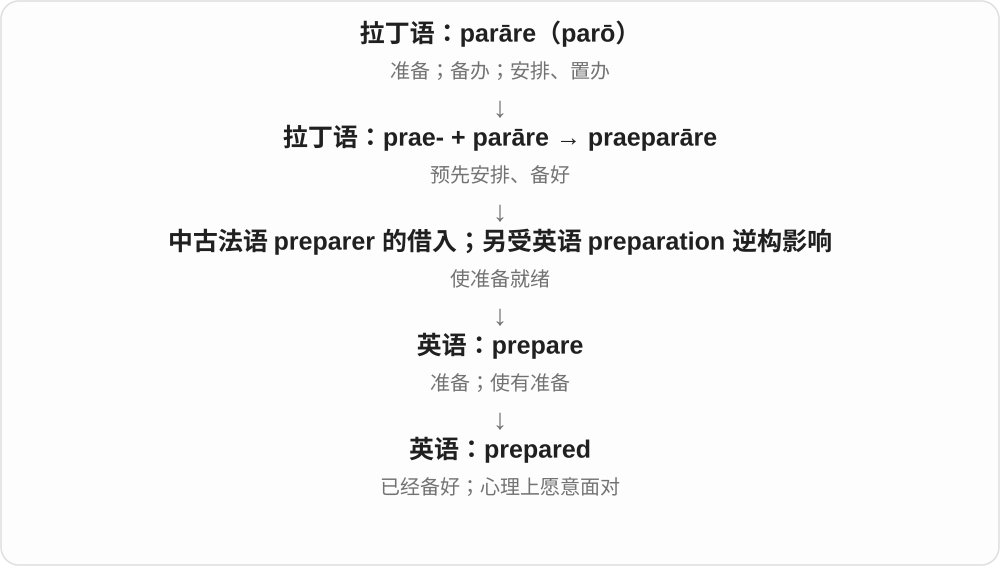

prepared for an exam 是备好考试；prepared to compromise 常是愿意作出妥协，不只指完成准备动作。

**常见搭配与例句**

be prepared for；be prepared to do；prepared food。

> She came prepared with a list of questions.

她带着问题清单，有备而来。

> We are prepared to change the date.

我们愿意更改日期。

**别混淆**

prepared 强调事先准备或意愿；ready 强调此刻已能开始，来源与用法不必完全相同。

### 37. advanced — 先进的；高阶的；进展到较后期的

**音标**：英 /ədˈvɑːnst/；美 /ədˈvænst/

**先抓住这个画面**

已经走在前面，可以是技术水平高、课程程度深，也可能只是时间进程较靠后。

**怎么拆**

advance + -ed，/s/ 后的 -ed 读 /t/，形成分词、形容词。不同对象决定前面是先进程度，还是某过程更后期。

**怎么变成今天的意思**

**晚期拉丁 ab ante → 通俗拉丁 \*abanteare**  
从前方、向前

↓

**法语 avancier → 英语 avauncen → advance**  
推进、前进；后来类推 ad- 加入字母 d

↓

**advance + -ed → advanced**  
已前进 → 先进、高阶、较后期

advanced technology 先进技术，an advanced course 高阶课程，advanced age 高龄。advanced 不保证每个场景都是好评价。

**常见搭配与例句**

advanced technology；an advanced course；an advanced stage。

> This course is designed for advanced learners.

课程为高阶学习者设计。

> The project is now at an advanced stage.

项目现已进入较后期阶段。

**别混淆**

advanced 高阶、先进；advance 作修饰语常预先，如 advance booking 提前预订。advanced booking 不宜机械当同义。

### 38. mix — 混合；相处；混合物

**音标**：/mɪks/

**先抓住这个画面**

把两种原本分开的东西放到一起搅：配料会 mix，人群也会 mix，声音同样能 mix。

**怎么拆**

现代不必再拆。常见词源分析把 mix 看作由中古英语 mixte 回构；另有联系古英语 miscian 的分析，不能只凭字母说从 miscēre 直接删减。

**怎么变成今天的意思**

**拉丁语 miscēre；过去分词 mixtus**  
混合；混合的

↓

**盎格鲁法语／中古英语 mixte**  
混合的

↓

**英语 mix**  
由旧分词形式回构动词的一种主流分析；混合

重点是合到一起，成分不一定彻底消失或均匀。mix with people 可说与人来往；名词 a mix 是混合的结果或组合。

**常见搭配与例句**

mix A with B；mix the ingredients；a mix of。

> Mix the flour with the water slowly.

把面粉和水慢慢混合。

> The class is a mix of beginners and experienced learners.

这个班既有初学者，也有有经验的学习者。

**别混淆**

blend 更突出调和、融成一体；mix 范围更宽，一把不同颜色的纽扣也可以是一种 mix。

### 39. mixed — 混合的；有好有坏的；mix 的过去式、分词

**音标**：/mɪkst/

**先抓住这个画面**

不是只有一种材料、同一个方向：坚果混着装，评价有赞有批，心里又高兴又担心，都可以是 mixed。

**怎么拆**

mix + -ed → mixed，末尾 /ks/ 后接 /t/；形容用法历史也受到法语 mixte、拉丁 mixtus 的影响。

**怎么变成今天的意思**

**mix；相关拉丁、法语混合材料**  
把不同事物放到一起

↓

**mix + -ed，并受相应借词影响 → mixed**  
混合后的状态；评价、情绪有不同方面

mixed nuts 混合坚果；mixed feelings 复杂、矛盾的心情；mixed reviews 褒贬不一的评论。

**常见搭配与例句**

mixed nuts；mixed feelings；mixed reviews。

> The film received mixed reviews.

电影收到的评论褒贬不一。

> She had mixed feelings about leaving the city.

对离开这座城市，她心情复杂。

**别混淆**

mixed reviews 不等于全是差评；mixed feelings 也不只是“我不知道自己有没有感觉”。

### 40. afraid — 害怕的；担心的；I’m afraid：恐怕、很遗憾地说

**音标**：/əˈfreɪd/

**先抓住这个画面**

危险还没发生，心里已经缩了一下，是 afraid；礼貌地传达不太好的消息，也常用 I’m afraid 来放软语气。

**怎么拆**

接中古英语 afray 使惊恐的旧过去分词，源于盎格鲁法语 afrayer 等惊扰材料；更早接重构的通俗拉丁 *exfridare，混合了拉丁和日耳曼语出离平安的词材。现代整体作形容词。

**怎么变成今天的意思**

**法语惊扰、恐惧材料 → 中古英语 afray 的分词**  
使惊恐 → 感到害怕的

↓

**现代 afraid**  
害怕、担心；礼貌表示恐怕、遗憾

afraid of dogs 怕狗；afraid to ask 不敢问；afraid that something will happen 担心某事发生；I’m afraid not 恐怕不行、恐怕不是。

**常见搭配与例句**

Don’t be afraid；I’m afraid so。

> She is afraid of the dark.

她怕黑。

> I’m afraid we have no tickets left.

很遗憾，票已经卖完了。

**别混淆**

afraid 通常在 be、feel 等后面，不常直接说 an afraid child；a frightened child 更自然。I’m afraid we’re closed 多是委婉说已关门。

### 41. connected — 相连的；相关的；有人脉的

**音标**：/kəˈnektɪd/

**先抓住这个画面**

connected 表示线已经接上了：设备能通，事情有关，人与人之间也可以保持联系。

**怎么拆**

connect + -ed，既是过去分词，也可作形容词。

**怎么变成今天的意思**

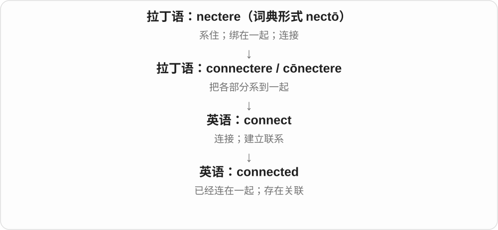

它描述连接形成后的状态。一个 connected person 在特定语境可指认识重要人物，但仅说人际关系好时要看上下文。

**常见搭配与例句**

be connected to…；be connected with…；stay connected；closely connected events。

> The two rooms are connected by a narrow corridor.

这两个房间由一条狭窄走廊相连。

> These decisions are closely connected.

这些决定彼此密切相关。

**别混淆**

connected 是连着的；connective 是起连接作用的。connected devices 是相连设备，connective tissue 是帮助连接和支持的组织。

### 42. accepted — 被接受的；公认的

**音标**：英、美 /əkˈseptɪd/

**先抓住这个画面**

一个说法或做法，已经被大家收进“可以采用”的范围。

**怎么拆**

accept + -ed；accept 经法语追到拉丁 acceptāre、accipere，后者是 ad- + capere“拿”。

**怎么变成今天的意思**

**拉丁语：ad**  
朝向；靠近；加到

↓

**拉丁语 accipere → acceptāre**  
接到手里；收下

↓

**古法语 accepter → 英语 accept → accepted**  
接受 → 被接受；公认

an accepted explanation 是大家普遍认可的解释，不保证绝对正确。申请 accepted 则指获得接收。

**常见搭配与例句**

widely accepted；accepted practice；an accepted explanation。

> This is the most widely accepted explanation of the pattern.

这是对这一模式最广获认可的解释。

> Her proposal was accepted after a few small changes.

做了几处小修改后，她的提案获准了。

**别混淆**

acceptable 说能不能接受；accepted 说已经受到接受。

### 43. fake — 假的、伪造的；假货、假冒者；伪造、装出

**音标**：/feɪk/

**先抓住这个画面**

外表像真的，实际上不是。fake ID 是假证件，fake a smile 是装出一个笑，a fake 则可以直接说假货。

**怎么拆**

较早见于英语俚语的伪造、作假等用法，确切来源不定。有人联系修饰外观、擦亮等词，也有其他说法，不能把某一种猜测写成定论。

**怎么变成今天的意思**

**较早英语俚语 fake**  
假冒、作假相关的使用

↓

**现代名词、形容词、动词发展**  
假的；假货或假冒者；伪造、装出

fake fur 人造仿毛皮；a fake passport 假护照；fake an illness 装病；fake a smile 强装笑容。

**常见搭配与例句**

a fake painting；fake enthusiasm。

> The expert discovered that the painting was a fake.

专家发现那幅画是假货。

> He faked a smile for the photograph.

拍照时，他强装笑容。

**别混淆**

false 范围广，可指事实不真；fake 常突出仿冒、装出来、冒充真的。fake 与 make 意义上的联系不能证明词源必然相同。

### 44. faked — 伪造、装出了；伪造的、装出来的

**音标**：/feɪkt/

**先抓住这个画面**

fake 的动作已经发生：笑容是装的，照片是伪造的，具体真假对象由名词决定。

**怎么拆**

fake 去末尾 e 再接 -ed；末尾 /k/ 后的 -ed 读 /t/。用于一般过去或过去分词，也可修饰伪造的东西。

**怎么变成今天的意思**

**fake 作假 + -ed**  
形成过去式、过去分词

↓

**faked 的动作与状态用法**  
伪造了、装出了；被伪造的

faked documents 伪造文件；a faked photograph 伪造照片；faked surprise 装出的惊讶。

**常见搭配与例句**

faked evidence；faked an injury。

> The documents had been faked.

这些文件被伪造了。

> She faked surprise when she saw the present.

看到礼物时，她装出惊讶的样子。

**别混淆**

fake photo 和 faked photo 都可能说假照片；faked 更显出经过作假处理的动作。不能仅凭语法形式判断具体用了什么处理方法。

### 45. talent — 天赋、才能；人才

**音标**：/ˈtælənt/

**先抓住这个画面**

有些人很快听出音准，有些人善于讲故事，这种突出能力可叫 talent。词的旧义其实是重量、钱财，后来把能力也看成可运用的资源。

**怎么拆**

接希腊 talanton、拉丁 talentum 等重量、货币名。才能义受法语发展和圣经才干寓言等比喻影响，不是拉丁字母 tal + ent 的现代拼接。

**怎么变成今天的意思**

**希腊 talanton 天平、重量 → 拉丁 talentum**  
重量、相应货币数量名称

↓

**法语等才干材料；圣经寓言等比喻影响**  
受托资源走向禀赋、才能

↓

**英语 talent**  
天赋、才干；人才集合称呼

a talent for music 音乐天赋；a talented person 中的 talent；new talent 新人才，后者常作集合。

**常见搭配与例句**

a talent for；show talent；develop your talent；new talent。

> She has a talent for explaining difficult ideas.

她很擅长把难懂的想法讲清楚。

> The festival introduces new talent to a wider audience.

艺术节把新人才介绍给更多观众。

**别混淆**

talent 常重禀赋，skill 更直接说技能、熟练程度；有天赋仍可通过训练发展技能。

### 46. talented — 有天赋、有才能的

**音标**：/ˈtæləntɪd/

**先抓住这个画面**

talent 是才能，talented 说这个人拥有才能。这里 -ed 不要求发生过一次叫“才能”的动作。

**怎么拆**

名词 talent + -ed，-ed 表具有某种性质、特征。末尾 /t/ 后 -ed 读 /ɪd/，与规则过去式的常见读音形式相同，但构词作用不同。

**怎么变成今天的意思**

**希腊 talanton 天平、重量 → 拉丁 talentum**  
重量、相应货币数量名称

↓

**法语等才干材料；圣经寓言等比喻影响**  
受托资源走向禀赋、才能

↓

**英语 talent**  
天赋、才干；人才集合称呼

↓

**talent + 拥有性质的 -ed → talented**  
有才能、天赋的

a talented musician 有才华的音乐人；a talented team 人才出色的团队；talented at design 有设计才能。

**常见搭配与例句**

a talented musician；a talented team。

> The school supports talented young musicians.

学校支持有才华的年轻音乐人。

> She is talented, but she still practises every day.

她很有天赋，但仍每天练习。

**别混淆**

talented 不等于 experienced 有经验，也不等于每次表现都完美；它说能力优势。

### 47. talents — 才能、才艺、天赋〔复数〕

**音标**：/ˈtælənts/

**先抓住这个画面**

有人擅长画，有人擅长讲，有人很会协调，这些不同本领可以合起来说 talents。

**怎么拆**

talent + -s，/t/ 后读 /s/。talent 接希腊 talanton、拉丁 talentum 的重量、货币单位名，才能义受法语发展、才干寓言等比喻影响。

**怎么变成今天的意思**

**希腊 talanton → 拉丁 talentum → 法语、英语相关发展**  
天平、重量、货币量；后来受托资源向禀赋、才能转义

↓

**talent + -s → talents**  
多种天赋、能力

musical talents 音乐才能；hidden talents 隐藏的才艺；use your talents 发挥所长。

**常见搭配与例句**

different talents 不同本领；discover talents 发现才艺、才能。

> The workshop helped the children discover their talents.

工作坊帮助孩子们发现自己的才艺。

> The team brings together people with different talents.

团队把有不同本领的人聚在一起。

**别混淆**

talents 通常数不同能力；talent 不可数时可概括才能、人才。古代重量、货币义解释历史，不代表今天夸人才是在算他的价格。

### 48. fired — 被解雇的；烧制过的；fire 的过去式、分词

**音标**：英 /ˈfaɪəd/；美 /ˈfaɪərd/

**先抓住这个画面**

人被 fired 是丢了职位，陶器被 fired 是进窑烧制；两者都要先选 fire 的动词义。

**怎么拆**

fire + -ed，末尾读 /d/。从动词不同义项形成分词、形容词，不把烧陶器说成辞退它。

**怎么变成今天的意思**

**古英语 fȳr → 中古英语 fyr**  
火；更早属日耳曼继承词族

↓

**英语 fire**  
火、点燃；射击；解雇；热情等扩展

↓

**fire + -ed → fired**  
射击、点燃等过去分词；解雇、烧制后的状态

get fired 被解雇，fired clay 烧制陶土，fired up 兴奋、斗志被点燃。fired up 的积极情绪不等于刚被辞退。

**常见搭配与例句**

get fired；fired clay；be fired up；a fired employee。

> He was worried about getting fired.

他担心被解雇。

> The sculpture is made from fired clay.

雕塑由烧制陶土制成。

**别混淆**

fired 被解雇，retired 退休，不是拼写相近就一样；两种离开工作的背景不同。

### 49. collect — 收集；领取；使镇定；短祷文

**音标**：动词 /kəˈlekt/；祷文名词英 /ˈkɒlekt/、美 /ˈkɑːlekt/

**先抓住这个画面**

collect 像把散在外面的东西一件件聚回来：邮票、资料、包裹，甚至散乱的思绪。

**怎么拆**

com-（一起）+ legere，经 colligere、collectus 等形式进入英语。

**怎么变成今天的意思**

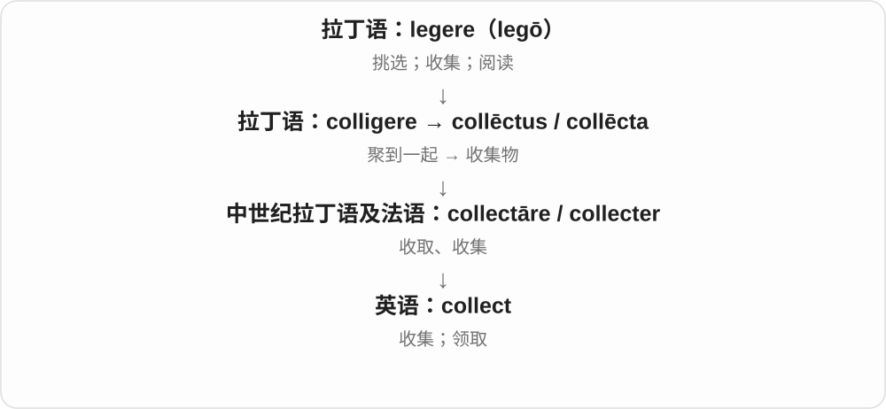

collect a parcel 是领取；collect yourself 是重新镇定。名词 collect 读音前重，另指礼拜中的短祷文，仍联系聚集的历史。

**常见搭配与例句**

collect stamps；collect data；collect a parcel；collect yourself。

> I collect postcards from places I visit.

我收集去过的地方的明信片。

> She paused to collect her thoughts.

她停下来整理了一下思路。

**别混淆**

collect 强调收拢；select 强调挑选，收来的东西不一定全是精选的。

### 50. collected — 收集起来的；镇定的；collect 的过去式、分词

**音标**：/kəˈlektɪd/

**先抓住这个画面**

散落的东西收拢到一起是 collected；人的注意力、情绪也像收拢了，没有慌乱散开，便是镇定。

**怎么拆**

collect + -ed；词末 /t/ 后 -ed 读 /ɪd/。镇定是固定的形容词发展，不能所有 collect 语境都解释成情绪。

**怎么变成今天的意思**

**拉丁 colligere、collect- 等 → collect**  
聚集、收拢

↓

**collect + -ed → collected**  
汇集的；注意力、情绪稳定的

collected works 文集、全集；collected data 收集的数据；calm and collected 冷静镇定。

**常见搭配与例句**

collected works；collected data；calm and collected。

> The volume contains her collected essays.

这本书收录了她的文章合集。

> He remained calm and collected during the interview.

面试中他始终冷静镇定。

**别混淆**

collected 镇定，collective 集体的；两者都有聚集材料，形容人的状态时不能换着用。

### 51. scar — 疤痕；伤痕；留下伤痕

**音标**：英 /skɑː/；美 /skɑːr/

**先抓住这个画面**

伤口留下的痕迹，是 a scar。一次难忘的打击也可能在心里留下痕迹，于是有 emotional scar 心理创伤的用法。

**怎么拆**

经古法语 escare、晚期拉丁 eschara 接希腊相应结痂词；英语意义、形式又可能受北欧裂口、切痕词影响。动词由伤痕名词发展，不能只挑一条材料就抹掉混合背景。

**怎么变成今天的意思**

**法语、拉丁、希腊结痂词 → 英语 scar**  
还可能受到北欧切痕、裂口词影响

↓

**皮肤上的痕迹 → 心理、地表的伤痕；名词转动词**  
可见痕迹成为经历留下影响的比喻

a scar on the hand 是手上的疤；an emotional scar 是心理伤痕；scar the landscape 可说在地貌上留下破坏痕迹。

**常见搭配与例句**

a scar on；leave a scar；emotional scars。

> A small scar crossed the back of his hand.

他的手背上横着一道小疤痕。

> The experience left a lasting emotional scar.

那次经历留下了持久的心理伤痕。

**别混淆**

wound 常说伤口、伤害，scar 常说留下的痕迹。scar 另有岩壁、岩礁相关词源，本页先掌握伤痕这一支。

### 52. scared — 害怕的、受惊的

**音标**：英 /skeəd/；美 /skerd/

**先抓住这个画面**

吓人的东西在外面，害怕的感受落到你身上；scared 站在那个“被吓到的人”的角度。

**怎么拆**

scare + -ed，分词发展为常用形容词；末尾 /d/，不是再添一个完整 /ɪd/ 音节。

**怎么变成今天的意思**

**古诺尔斯语 skirra → 中古英语 skerren 等 → scare**  
使害怕、避开等旧义，进入吓唬词族

↓

**scare + -ed → scared**  
被吓到；处于害怕状态

scared of the dark 怕黑，scared to ask 不敢问，scared that… 担心会……，scared stiff 吓呆了。

**常见搭配与例句**

scared of；scared to；scared that；scared stiff。

> The child was scared of the dark.

孩子怕黑。

> I was scared to ask another question.

我不敢再问一个问题。

**别混淆**

scared 是感到害怕，scary 通常说令人害怕；a scared child 是怕了的孩子，a scary story 是吓人的故事。

### 53. scarred — 有疤痕的；留下创伤、破坏痕迹的

**音标**：英 /skɑːd/；美 /skɑːrd/

**先抓住这个画面**

皮肤上有旧伤留下的疤，是 scarred；一片山地被开挖得留下大片痕迹，也可以说 scarred。重点在过去的事留下可见或内在痕迹。

**怎么拆**

scar 双写末尾 r，加完整 -ed → scarred。后缀读 /d/，可为过去形式，也可作描述有伤痕状态的形容词。

**怎么变成今天的意思**

**结痂、切痕等早期材料 → scar 名词、动词**  
伤痕义与留下伤痕动作对应

↓

**scar 双写 r + -ed → scarred**  
受过影响、留下痕迹的状态

scarred skin 是带疤的皮肤；scarred by experience 是因经历留下创伤；a scarred landscape 是留下破坏痕迹的地貌。

**常见搭配与例句**

scarred skin；scarred by；a scarred landscape。

> The old tree had a deeply scarred trunk.

老树的树干上留下了深深的伤痕。

> The hillside was scarred by abandoned mines.

废弃矿坑在山坡上留下了斑斑伤痕。

**别混淆**

scarred 有两个 r，来自 scar；scared 害怕来自 scare。读音也不同，分别为 /skɑːd/ 与 /skeəd/ 等。

### 54. armed — 携有武器的；武装的；具备应对资源的

**音标**：英 /ɑːmd/；美 /ɑːrmd/

**先抓住这个画面**

手中已经有了武器；比喻时，就是准备好了有用的资料或能力。

**怎么拆**

武装义是 arm“武装”加 -ed 的分词、形容词用法。表示“有某种手臂”的 armed 则来自身体名词 arm，是另一近源分支。

**怎么变成今天的意思**

**拉丁语 arma**  
装备、兵器；本来是复数形式

↓

**拉丁语 armare → 古法语 armer / 直接拉丁语 → 英语 arm〔动词〕**  
装备武器 → 武装；使具备应对能力

↓

**英语 arm + -ed → armed**  
已武装的；具备应对能力的

armed with a map 表示带着地图、有所准备；the armed forces 是国家的武装力量，不只指陆军。

**常见搭配与例句**

armed police；the armed forces；armed with information。

> Armed police guarded the entrance.

武装警察守卫着入口。

> Armed with a detailed map, we set off before sunrise.

我们带着一张详细地图，在日出前出发了。

**别混淆**

armed 不表示穿着防弹装备；有装甲保护要用 armored / armoured。

### 55. prize — 奖品；珍视；战利品；撬开

**音标**：英、美 /praɪz/

**先抓住这个画面**

现代常用义是值得争取的奖励或值得珍惜的东西；战利品和撬开则保留另一条抓取的历史。

**怎么拆**

要分源：奖赏名词与珍视动词联系法语 pris / preisier、拉丁语 pretium“价值”；战利品和撬开联系法语 prise“抓取”、拉丁语 prehendere。两支英语拼写汇合。

**怎么变成今天的意思**

**拉丁语 pretium → 法语 pris / preisier → 英语 prize**  
价值、奖赏 → 奖品；珍视

↓

**另一支：拉丁语 prehendere / prendere → 法语 prise → 英语 prize**  
抓取 → 战利品；杠杆抓持处 → 撬开

win a prize 是获奖；a prized possession 是珍爱的物品。prize a lid open 多见英式，常也写 prise。不能把所有 prize 都解释成夺来的东西。

**常见搭配与例句**

first prize；prize something highly；a prize ship；prize open。

> She won first prize in the competition.

她在比赛中获得一等奖。

> He prizes the letters his grandmother wrote to him.

他珍视祖母写给他的信。

> They used a lever to prize the lid open.

他们用杠杆撬开了盖子。

**别混淆**

price 是价格；prize 是奖品或珍视，虽部分同源，现代搭配不同。

### 56. prized — 珍视、看重了；珍贵的、深受珍视的；撬开了

**音标**：/praɪzd/

**先抓住这个画面**

一件老物件未必值很多钱，却被主人当宝贝，是 prized。另一个同形动词可说用工具撬开，英式也常写 prised，来源与珍视分开。

**怎么拆**

prize 去末尾 e + 完整 -ed → prized，/z/ 后读 /d/；珍视支接价值词族，撬动支接抓取、杠杆材料。

**怎么变成今天的意思**

**价值支：拉丁语 pretium → 法语价值、评价材料 → prize**  
奖赏名词与珍视动词在这里相关

↓

**抓取支：拉丁语 prehendere、prendere → 法语 prise → prize**  
战利品、杠杆抓持材料；撬动动词另走此支

↓

**prize 去 e + -ed → prized**  
已看重、珍视；珍爱的状态；另一支撬开

a prized possession 是珍爱之物，prized for its beauty 是因美而受珍视；prized open 则是撬开，读句子宾语即可分出。

**常见搭配与例句**

highly prized 很受珍视；prized the lid off 撬下盖子。

> The old camera was one of her most prized possessions.

那台旧相机是她最珍爱的物品之一。

> He prized the lid off with a small tool.

他用小工具把盖子撬下来。

**别混淆**

prized 描写被看重，expensive 描写价格高；一本旧本子可能非常 prized，却不贵。

### 57. prizing — 正在珍视、看重；正在撬开、撬取

**音标**：/ˈpraɪzɪŋ/

**先抓住这个画面**

把诚实、自由放在心里很高的位置，是 prizing；手正用工具把缝隙撬开，也可能拼作 prizing。两条词史不因同形就合成一条。

**怎么拆**

prize 去末尾 e + 完整 -ing → prizing，z 读 /z/；撬动义的 prise 对应 prising 也是常见写法。

**怎么变成今天的意思**

**价值支：拉丁语 pretium → 法语价值、评价材料 → prize**  
奖赏名词与珍视动词在这里相关

↓

**抓取支：拉丁语 prehendere、prendere → 法语 prise → prize**  
战利品、杠杆抓持材料；撬动动词另走此支

↓

**prize 去 e + -ing → prizing**  
看重的过程；另一支撬动过程

prizing honesty above comfort 是把诚实看得比安逸更重要；prizing the lid open 是撬开盖子，具体对象会把义项分明。

**常见搭配与例句**

prizing independence 珍视独立；prizing two boards apart 撬开两块木板。

> She grew up prizing honesty above popularity.

她从小就把诚实看得比受欢迎更重要。

> He was prizing the lid open with a flat tool.

他正用扁工具撬开盖子。

**别混淆**

prizing 与 pricing 只差中间字母，却是不同动作：prize 是珍视或撬，price 是定价；后者中间读 /s/。

### 58. trained — 训练过、受过培训的

**音标**：/treɪnd/

**先抓住这个画面**

不是天生就会，而是经过练习、教导，具备了某种能力。

**怎么拆**

train + -ed，过去分词兼形容词，末尾读 /d/。培训义在 train 历史中接引导、培养，不是受训者乘了火车。

**怎么变成今天的意思**

**拉丁 trahere 拉 → 法语 traîner、train → 英语 train**  
拉出、延伸；一串随行之物

↓

**现代 train**  
火车；引导、培养 → 训练与培训

↓

**train + -ed → trained**  
培养、训练 → 已受训练的

a trained nurse 受过专业训练的护士，a trained dog 训练过的狗，a trained eye 内行的眼光。

**常见搭配与例句**

a trained professional；a trained eye；highly trained。

> A trained guide led us through the cave.

一位受过训练的向导带我们穿过洞穴。

> To a trained eye, the difference is obvious.

在内行眼里，区别很明显。

**别混淆**

trained 经过训练，talented 有天分；二者可同时具备。trained 不保证对所有任务都合适。

### 59. crash — 撞击、撞毁；巨响；系统崩溃、暴跌；〔口语〕留宿、倒头睡

**音标**：英 /kræʃ/；美 /kræʃ/

**先抓住这个画面**

重东西撞上、碎落，“哗啦砰”地一下，是 crash。系统突然停摆、行情猛跌，也借这种突然垮掉的画面。

**怎么拆**

承中古英语 crasschen，大概拟声；名词、动词后来扩到车辆、金融、计算机等。口语 crash at a place 又可指临时留宿。

**怎么变成今天的意思**

**中古英语 crasschen → crash**  
打碎、响亮碰撞材料，大概拟声

↓

**巨响、撞碎 → 车辆碰撞、经济垮掉、系统崩溃**  
后来的用途各有领域；口语还可说留宿、倒头睡，或不请自来

a car crash 是车祸，the program crashed 是程序崩溃；crash at a friend’s place 是在朋友家凑合住一晚，属口语。

**常见搭配与例句**

crash into a wall 撞墙；a loud crash 一声巨响；a crash course 速成课。

> We heard a loud crash from the kitchen.

我们听见厨房一声巨响。

> I saved the file before the program could crash.

我在程序可能崩溃前保存了文件。

**别混淆**

crash 比 bump 常更强烈、更可能伴损坏；计算机 crash 不是真硬件撞在一起，而是运行突然失败。

### 60. crashed — 撞毁了、巨响着落下了；崩溃了、暴跌了；〔口语〕留宿、倒头睡了

**音标**：/kræʃt/

**先抓住这个画面**

车刚才撞上、电脑程序突然停摆，都能用 crashed；口语说 crashed at his place，则是去他那里凑合过夜。

**怎么拆**

crash + 完整 -ed，/ʃ/ 后读 /t/；不是 /ɪd/。不同领域的现代动词义按同一规则变化。

**怎么变成今天的意思**

**中古英语 crasschen → crash**  
打碎、响亮碰撞材料，大概拟声

↓

**巨响、撞碎 → 车辆碰撞、经济垮掉、系统崩溃**  
后来的用途各有领域；口语还可说留宿、倒头睡，或不请自来

↓

**crash + -ed → crashed**  
过去撞毁、垮掉；口语留宿等用法

crashed into a tree 是撞树了，the computer crashed 是电脑系统崩溃；crashed on the sofa 可以是倒在沙发睡了。

**常见搭配与例句**

crashed to the floor 哗啦坠地；crashed overnight 一夜间暴跌。

> The car crashed into a barrier.

汽车撞上了护栏。

> My computer crashed before I saved the document.

我还没保存文档，电脑就崩溃了。

> We crashed at a friend’s place after the concert.

音乐会后，我们在朋友家凑合住了一晚。

**别混淆**

crashed 描写突然失败、撞落或相应口语动作；clashed 则说两边不合、相冲，不能混写。

### 61. crashes — 撞毁、崩溃、猛跌〔第三人称单数〕；碰撞、巨响、崩溃〔复数〕

**音标**：/ˈkræʃɪz/

**先抓住这个画面**

程序一运行到某一步就停摆，叫 crashes；车辆碰撞、突然巨响或系统故障有几次，也可用名词复数。

**怎么拆**

crash + -es，/ʃ/ 后读 /ɪz/，多一个音节；现代变化接整个基础词，不拆出独立 -ash。

**怎么变成今天的意思**

**中古英语 crasschen → crash**  
打碎、响亮碰撞材料，大概拟声

↓

**巨响、撞碎 → 车辆碰撞、经济垮掉、系统崩溃**  
后来的用途各有领域；口语还可说留宿、倒头睡，或不请自来

↓

**crash + -es → crashes**  
它撞毁、崩溃；多次巨响、碰撞或故障

the app crashes 是应用崩溃，frequent crashes 是频繁崩溃；two car crashes 是两起车祸，具体领域由搭配分清。

**常见搭配与例句**

crashes on startup 一启动就崩溃；loud crashes 一阵阵巨响。

> The app crashes whenever I try to open that file.

我每次试着打开那个文件，应用就崩溃。

> The report describes several crashes at the same junction.

报告描述了同一路口发生的几起车祸。

**别混淆**

crashes 和 clashes 只差一个字母，但前者常是撞毁、崩溃，后者是冲突、不搭；读到 schedule 常优先看 clash。

### 62. crashing — 正在撞击、坠落、崩溃；轰然的；〔口语〕极其、十足的

**音标**：/ˈkræʃɪŋ/

**先抓住这个画面**

重物正哗啦落下、波浪正猛拍岸，或系统正突然停摆，叫 crashing。a crashing bore 又是十足的大闷人、无聊透顶的事。

**怎么拆**

crash + 完整 -ing；分词、形容用法之外，可在口语修饰中加强程度，不必每次真有碰撞。

**怎么变成今天的意思**

**中古英语 crasschen → crash**  
打碎、响亮碰撞材料，大概拟声

↓

**巨响、撞碎 → 车辆碰撞、经济垮掉、系统崩溃**  
后来的用途各有领域；口语还可说留宿、倒头睡，或不请自来

↓

**crash + -ing → crashing**  
撞落、崩溃过程；后有压倒性、十足的强调

crashing waves 是轰然拍岸的浪，keep crashing 是不断崩溃；a crashing bore 是极其无聊的人或事。

**常见搭配与例句**

crashing down 哗啦坠下；a crashing sound 轰然巨响。

> We listened to the crashing waves below the cliffs.

我们听着悬崖下海浪轰然拍岸。

> The app keeps crashing when I edit large photos.

我一编辑大照片，这个应用就不断崩溃。

**别混淆**

crashing 是碰撞、垮落等过程，clashing 是两边相冲；撞坏电脑与安排撞期，用不同基础词。

### 63. headed — 朝向……的；有某种头部、抬头的

**音标**：/ˈhedɪd/

**先抓住这个画面**

一种是行进时把头朝某个方向，另一种是某个东西顶上带有什么。

**怎么拆**

可来自 head 动词 + -ed“正往某方向去”，也可来自 head 名词 + -ed“具有某种头、顶端”。不能把所有 headed 都当过去发生的动作。

**怎么变成今天的意思**

**古英语 hēafod / hēafd- → 中古英语 hed / heved 等**  
头；顶端、领头位置

↓

**英语 head**  
头部；前端；负责人；朝向、领导

↓

**head + -ed → headed**  
朝向；具有某种头部或抬头

be headed for home 是正往家走，headed paper 是印有机构名称地址等抬头的信纸。前者说方向，后者说纸张特征。

**常见搭配与例句**

be headed for；be headed toward；headed paper。

> Where are you headed after lunch?

午饭后你打算去哪里？

> Please print the letter on headed paper.

请把信打印在带机构抬头的信纸上。

**别混淆**

Where are you headed? 问去哪里，Who headed the team? 问谁领导过团队；同形要看句法和语境。

### 64. wet — 湿的、潮湿的；弄湿；雨水、雨天

**音标**：/wet/

**先抓住这个画面**

干东西吸了水、表面沾了液体，就是 wet；用作动词就是让它从干到湿。

**怎么拆**

接古英语 wǣt、wǣtan 等湿、水相关词族，中古英语过去分词形态与旧形容词也发生合流。更远与 water 同族，不是现代 water 剪掉几字母就造出 wet。

**怎么变成今天的意思**

**古英语 wǣt、wǣtan 等 → 中古英语 wet、weten**  
湿的；使湿，相应形态交汇

↓

**英语 wet**  
湿、弄湿；湿天气等名词

wet clothes 湿衣服，wet paint 未干油漆，wet the cloth 把布弄湿，get wet 淋湿；比较级 wetter、最高级 wettest 双写 t。

**常见搭配与例句**

get wet；wet clothes；wet paint；wet the cloth。

> My shoes got wet in the rain.

我的鞋被雨淋湿了。

> Wet the cloth before wiping the table.

擦桌子前先把布弄湿。

**别混淆**

wet 较直接说沾水、液体多，damp 常只微潮；wetter 日常常是更湿的比较级，独立名词湿润剂等较专门。

### 65. wetting — 正在弄湿、变湿；润湿过程；尿湿

**音标**：/ˈwetɪŋ/

**先抓住这个画面**

液体正让表面变湿，是 wetting；wetting the bed 则是尿床这一用法，常可把整件事当活动名词说。

**怎么拆**

wet 双写 t + 完整 -ing → wetting；短元音重读单音节末尾的 t 双写，词尾表示过程。

**怎么变成今天的意思**

**古英语 wet 的相关动词材料 → wet**  
使湿、变湿

↓

**wet 双写 t + -ing → wetting**  
润湿过程；相应尿湿用法也能变化

wetting the paper 是把纸润湿，surface wetting 是表面润湿；wetting the bed 在生活语境是尿床。

**常见搭配与例句**

wetting a sponge 弄湿海绵；wetting the cloth 润湿布。

> She was wetting the paper before folding it.

她正把纸润湿，再折叠。

> The child had been wetting the bed.

那个孩子有一阵子一直尿床。

**别混淆**

wetting 可写主动弄湿，也可在日常搭配里说尿湿；具体含义由宾语与场景决定，不一律译成浇水。

### 66. wets — 弄湿、使湿；尿湿〔第三人称单数〕

**音标**：/wets/

**先抓住这个画面**

一个人把海绵、手、嘴唇润湿，用 wets；wets the bed 则是尿湿床铺，具体液体和动作靠对象分清。

**怎么拆**

动词 wet + -s，/t/ 后读 /s/；这是“使湿”的三单，形容词 wet 本身不靠 -s 变化数。

**怎么变成今天的意思**

**古英语 wætan 等 → wet 动词**  
使湿、变湿，与湿的形容词有旧词族联系

↓

**wet + -s → wets**  
他、她使湿；尿湿某物的现代用法

wets the sponge 是弄湿海绵，wets her lips 是润湿嘴唇；wets the bed 在日常语境指尿床。

**常见搭配与例句**

wets a cloth 把布润湿；wets the surface 使表面变湿。

> She wets the sponge before cleaning the board.

她擦板子前先把海绵弄湿。

> He wets his lips before beginning the speech.

开始讲话前，他润了润嘴唇。

**别混淆**

wets 只说有了湿的变化，不必浸透；drenches、saturates 常把充分、彻底湿透说得更明显。

### 67. wetted — 弄湿了、使湿了；尿湿了

**音标**：/ˈwetɪd/

**先抓住这个画面**

布、手指或表面刚才被润上水，用 wetted。wet 也可作过去式，这个有词尾的形式同样存在。

**怎么拆**

wet 双写 t + 完整 -ed → wetted；/t/ 后读 /ɪd/，多一个音节。现代过去式、过去分词也用 wet，按地区、语境有偏好。

**怎么变成今天的意思**

**古英语 wætan 等 → wet 动词**  
使湿、变湿的旧材料

↓

**wet 双写 t + -ed → wetted；另有 wet**  
现代两种过去式、过去分词形式

wetted the cloth 是把布润湿，wetted her finger 是润湿手指；不必一律改成过去式 wet，wetted 也是正确形式。

**常见搭配与例句**

slightly wetted 稍微润湿；wetted with water 用水弄湿。

> She wetted the cloth and wiped the table.

她把布润湿，擦了桌子。

> He wetted his finger to turn the page.

他润湿手指，翻过书页。

**别混淆**

wetted 强调发生了使湿的动作，was wet 可以只说处于湿的状态；同样有湿，叙述重点不同。

### 68. attach — 系上、装上、连接；附上；赋予〔重要性等〕

**音标**：/əˈtætʃ/

**先抓住这个画面**

把标签系到行李上，把文件附到邮件里，都是让一件东西连到另一件上。这个连上去的动作，是 attach 的核心。

**怎么拆**

经古法语 atachier、estachier 系住、固定等形式，较早在英语法律记录中也有扣押义。法语词基可能接日耳曼桩、柱词，与 stake 词族有关；更深路径带有不确定性。

**怎么变成今天的意思**

**古法语 atachier 等 → 英语 attach**  
系住、固定；较早英语也用于扣押

↓

**物理连接 → 文件附带、赋予重要性**  
把一件东西或一种评价加到对象上

attach a label to a bag 把标签系到包上；attach a file to an email 给邮件附文件；attach importance to something 重视某事；attach a condition 附加条件。

**常见搭配与例句**

attach something to something；attach great importance to。

> Please attach the receipt to your message.

请在消息中附上收据。

> We attach great importance to clear instructions.

我们非常重视清楚的说明。

**别混淆**

attach 是连接、附上；attachment 是附件或联系。attach importance to 是赋予重要性，后面的 to 是介词。

### 69. attached — 附着、连接着的；随附的；依恋、有感情的；attach 的过去式、过去分词

**音标**：/əˈtætʃt/

**先抓住这个画面**

一张标签连在箱子上，是 attached；一个人对住了多年的地方舍不得离开，也是 attached。连接可以在物体之间，也可以在感情里。

**怎么拆**

attach + -ed；/tʃ/ 后的词尾读 /t/，没有多一个 id 音节。从系住、连接的动词形成分词，并发展出感情上紧密相连的形容词义。

**怎么变成今天的意思**

**法语连接、固定词 → attach**  
把事物连起来

↓

**attach + -ed → attached**  
连着、附上的；感情上依恋

the attached file 随附文件；attached to the wall 固定在墙上；become attached to a place 对某地方产生感情；deeply attached to someone 深深依恋某人。

**常见搭配与例句**

Please see the attached ...；emotionally attached。

> The instructions are in the attached document.

说明在随附的文档里。

> I have become quite attached to this old house.

我已经对这栋老房子很有感情了。

**别混淆**

I attached the file 说做了附文件的动作；the attached file 说随附的文件。be attached to a person 可是感情联系，要结合对象理解。

### 70. defeat — 击败；失败

**音标**：/dɪˈfiːt/

**先抓住这个画面**

对手本来要完成自己的计划，你把它打断、瓦解了：这就是 defeat 的画面。

**怎么拆**

古法语 desfaire 是“拆掉、使落空”，由否定、逆转成分加 faire“做”构成；英语借用相关形式。

**怎么变成今天的意思**

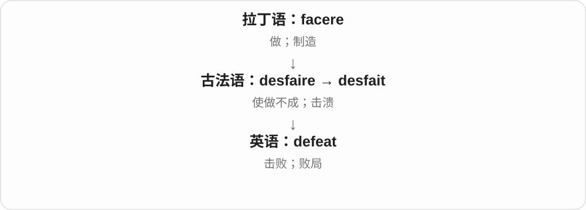

从使事情不能完成，发展到挫败目的和击败对手。名词 defeat 说一次败局，动词直接接被击败的人或计划。

**常见搭配与例句**

defeat an opponent；suffer a defeat；defeat the purpose。

> Our team defeated the champions.

我们队击败了冠军队。

> Adding more steps would defeat the purpose of simplifying the process.

再加步骤就违背了简化流程的目的。

**别混淆**

beat 更口语；win 接比赛或奖项，通常不直接说 win a person。

### 71. defeated — 被击败的；垂头丧气的；defeat 的过去式、分词

**音标**：/dɪˈfiːtɪd/

**先抓住这个画面**

比赛输了是 defeated；还没真正输，却已经觉得毫无办法、泄了气，也可以 feel defeated。

**怎么拆**

defeat + -ed；/t/ 后接 /ɪd/。形容词既可说实际被胜过，也可说像被压倒后的情绪。

**怎么变成今天的意思**

**法语 desfaire 等拆毁、挫败材料 → defeat**  
挫败、击败

↓

**defeat + -ed → defeated**  
被击败，或心灰泄气的状态

the defeated team 失利队伍；feel defeated 感到泄气；a defeated expression 垂头丧气的神情。

**常见搭配与例句**

the defeated team；feel defeated。

> The defeated team thanked its supporters.

失利的队伍向支持者致谢。

> After another setback, she felt defeated.

又一次受挫后，她感到很泄气。

**别混淆**

defeated 是受到挫败的一方；defeating 后接对手时则是击败动作，方向相反。

### 72. marked — 有标记的；明显的；被标出的

**音标**：英 /mɑːkt/；美 /mɑːrkt/

**先抓住这个画面**

一种是真的做过记号；另一种是差异大到像被特别标出来，一眼就看得出。

**怎么拆**

mark + -ed，过去分词并形成形容词。明显这一义来自显著可辨的特征；常用读音末尾 /t/，不是一律读成独立 /ɪd/ 音节。

**怎么变成今天的意思**

**古英语 mearc → 中古英语 mark、merk**  
边界、界标、记号

↓

**英语 mark**  
痕迹、标记、目标、分数；做记号、批改等

↓

**mark + -ed → marked**  
做过标记 → 有标记的；显著的

a marked change 明显变化，a marked improvement 显著改善，a clearly marked exit 清楚标出的出口。

**常见搭配与例句**

a marked difference；a marked improvement；clearly marked。

> There was a marked improvement in her confidence.

她的自信有了明显提升。

> Please use the clearly marked exit.

请使用清楚标出的出口。

**别混淆**

marked difference 是明显差异，不是必须有人拿笔圈过；marked papers 则可真指批改过的试卷。

### 73. faced — 面对了；面临……的

**音标**：/feɪst/

**先抓住这个画面**

问题已经站到你面前，你需要接住它。faced 可以叙述过去面对了什么，也常出现在 be faced with 里。

**怎么拆**

face + -ed；词尾读 /t/。这是英语动词变化，也可形成描述处境的分词结构。

**怎么变成今天的意思**

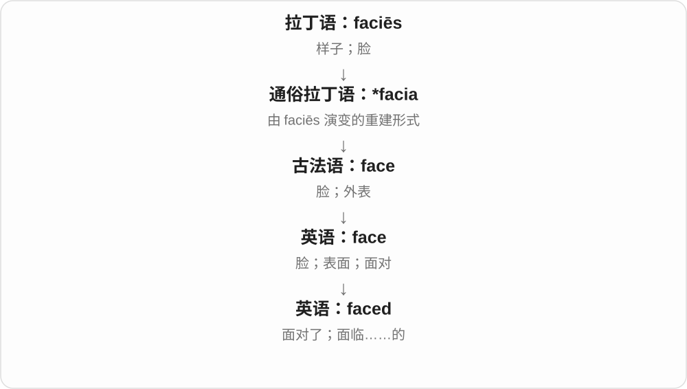

从把脸朝向对象到面对处境，-ed 只改变时间或语法状态，并没有产生一个新的古代词根。

**常见搭配与例句**

faced a choice；be faced with a challenge。

> We faced several delays last week.

我们上周遇到了几次延误。

> Faced with two options, she chose the simpler one.

面对两个选项，她选了较简单的那个。

**别混淆**

She faced a problem 与 She was faced with a problem 都可以；不要拼成 was faced a problem。

### 74. pant — 急促喘气、气喘吁吁；一口急喘

**音标**：/pænt/

**先抓住这个画面**

跑了一段路，嘴张着，一口接一口短短呼吸，就是 pant。它强调喘得急，不必有哨音。

**怎么拆**

可能由古法语 pantaisier 等缩短，更早或接与梦魇、幻象有关的拉丁、希腊材料。整条远源有保留，现代不靠做梦才能用 pant。

**怎么变成今天的意思**

**中古英语 panten；可能缩短自古法语 pantaisier 等**  
急喘、气喘；更早法语来源仍有不确定性

↓

**一条可能远源：重构拉丁 \*pantasiare 等 → 希腊 phantasia**  
梦魇、幻象与呼吸挣扎的解释带保留；现代泛说急喘

pant after running 是跑后急喘，pant for breath 是喘着找气；pant out a reply 是喘着挤出回答。

**常见搭配与例句**

pant heavily 喘得很急；a short pant 一口短促急喘。

> The dogs began to pant after the run.

跑了一阵后，狗开始急促喘气。

> I could hear him pant as he reached the top step.

他上到最后一级台阶时，我能听见他急急喘气。

**别混淆**

pant 喘气与 pants 裤子的近源不同；pants 作动词三单则是喘气。gasp 往往更突出突然吸一口。

### 75. pants — 长裤〔尤其美式〕；内裤〔尤其英式〕；喘气〔另源动词形式〕

**音标**：/pænts/

**先抓住这个画面**

美式说一条外穿长裤常用 pants，英式日常说 pants 却常在说内裤。同样穿在身上，地区用法会让画面完全变样。

**怎么拆**

衣物义是 pantaloons 的缩短，较早联系意大利喜剧人物 Pantalone 及其服装名称。复数结构保留下来；动词 pant 喘气的第三人称 pants 是另一来源。

**怎么变成今天的意思**

**人物、服装名 Pantalone → pantaloons**  
人物穿着相关的裤装名称，式样后来变化

↓

**缩短 pants**  
裤子等衣物；另有喘气动词的同形形式

a pair of pants 一条裤子或一条内裤，依地区；put on your pants 穿上裤子；short pants 短裤，常见美式；The dog pants 狗喘气，另源动词。

**常见搭配与例句**

These pants are ...；a pair of pants is ...。

> These pants are too long for me.

这条裤子我穿太长了。

> She bought two pairs of pants for work.

她买了两条上班穿的长裤。

**别混淆**

衣物义通常用复数结构，数一条用 a pair of pants。跨地区求清楚，trousers 通常更明确地说外穿长裤，underpants 明确说内裤。

### 76. panting — 正在急喘；气喘吁吁的；急促喘气声

**音标**：/ˈpæntɪŋ/

**先抓住这个画面**

急促的呼吸还没平下来，是 panting；也能把一个气喘吁吁的人直接形容为 panting。

**怎么拆**

pant + 完整 -ing，直接相接，不双写 t。现代过程形式仍是呼吸动词这一支。

**怎么变成今天的意思**

**中古英语 panten；可能缩短自古法语 pantaisier 等**  
急喘、气喘；更早法语来源仍有不确定性

↓

**一条可能远源：重构拉丁 \*pantasiare 等 → 希腊 phantasia**  
梦魇、幻象与呼吸挣扎的解释带保留；现代泛说急喘

↓

**pant + -ing → panting**  
急喘的过程、状态、声音

a panting dog 是喘着气的狗，stood panting 是站着气喘吁吁。

**常见搭配与例句**

panting after the climb 爬坡后急喘；still panting 还没喘匀气。

> He reached the door, panting after the run.

跑到门口时，他气喘吁吁。

> The panting dog lay down in the shade.

那只喘着气的狗在阴凉处趴下。

**别混淆**

panting 强调短、急、接连的呼吸，wheezing 强调其中的哨音般声响；二者关注不同特征。

### 77. panted — 急喘了；喘着说了

**音标**：/ˈpæntɪd/

**先抓住这个画面**

刚才跑得气息短促、一下下喘，用 panted。对话中也能说明那句话是喘着说出来的。

**怎么拆**

pant + 完整 -ed，/t/ 后读 /ɪd/；nt 是词尾辅音组合，不双写 t。

**怎么变成今天的意思**

**中古英语 panten；可能缩短自古法语 pantaisier 等**  
急喘、气喘；更早法语来源仍有不确定性

↓

**一条可能远源：重构拉丁 \*pantasiare 等 → 希腊 phantasia**  
梦魇、幻象与呼吸挣扎的解释带保留；现代泛说急喘

↓

**pant + -ed → panted**  
过去急喘、喘着说

panted up the hill 是喘着上坡，panted out the words 是喘着说出话。

**常见搭配与例句**

panted heavily 大口急喘了；panted after the race 比赛后急喘了。

> We panted up the last stretch of the hill.

我们喘着气爬完最后一段坡。

> “Slow down,” she panted.

“慢一点。”她喘着说道。

**别混淆**

panted 是 pant 喘气的过去式；painted 是 paint 的过去式，中间多一个 i 就是另一词。

### 78. confused — 困惑的；混乱的；不清楚的

**音标**：/kənˈfjuːzd/

**先抓住这个画面**

信息进来了，但脑子里没有排好，暂时拼不出一个清楚的答案。

**怎么拆**

中古英语已有 confused，由法语 confus 或拉丁语 confūsus 加 -ed 形成；今天可按 confuse + -ed 理解，历史方向却并非如此。

**怎么变成今天的意思**

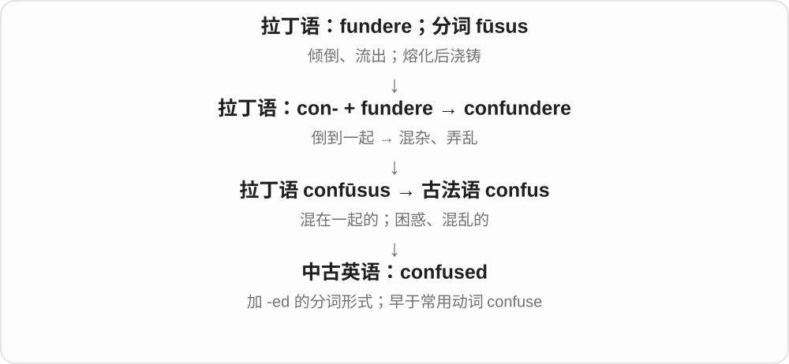

a confused person 是人没弄懂；a confused explanation 则是说明本身乱。be confused about 表示对某事困惑。

**常见搭配与例句**

confused about；a confused expression；a confused account。

> I am still confused about which form to complete.

我还是没弄清该填哪张表。

> He gave a confused account of the meeting.

他把会议经过讲得颠三倒四。

**别混淆**

confused 是接收信息后乱了，或叙述本身乱；confusing 是让别人感到乱。

### 79. divided — 被分开的；意见分裂的

**音标**：/dɪˈvaɪdɪd/

**先抓住这个画面**

人还坐在同一个房间，意见却已经站成两边；这就可以说 divided。

**怎么拆**

divide 的过去分词，接 -ed；-ed 在 /d/ 后读 /ɪd/。形容词突出分开后的状态。

**怎么变成今天的意思**

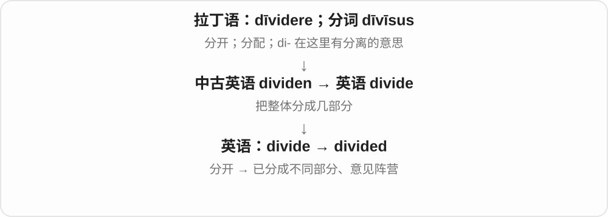

be divided over/about something 指对某事意见不一致；a divided road 则是两向车流之间有隔离带的道路。看对象是人还是物。

**常见搭配与例句**

divided opinion；divided loyalties；be divided over a plan。

> The residents were divided over the new road.

居民们对修建这条新路意见不一。

> Her loyalties were divided between her two friends.

两位朋友发生矛盾，她不知道该支持谁。

**别混淆**

divisive 说某事容易造成分裂；divided 说人群已经处于分裂状态。

### 80. accused — 被指控的；被告；accuse 的过去式和过去分词

**音标**：/əˈkjuːzd/

**先抓住这个画面**

accused 把镜头转向受到指控的一方：有人说他做了错事。仅凭这个词，还不能知道这件事最后是否被证实。

**怎么拆**

accuse + -ed；拼写时先去 e，再加完整 -ed。过去分词可用来描述状态；the accused 可以指被告。

**怎么变成今天的意思**

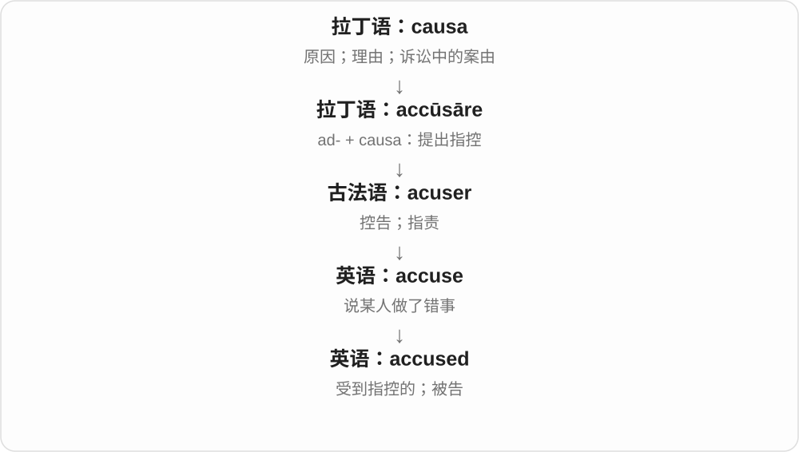

accuse 是提出指控的动作，be accused of 是承受指控。the accused 把形容词形式用作名词，指那位或那些被指控者；单复数要看语境。

**常见搭配与例句**

be accused of theft（被指控盗窃）；the accused person（受到指控的人）；the accused（被告）。

> She was accused of copying another student’s work.

她被指控抄袭了另一名学生的作业。

> The accused denied taking the money.

被告否认拿了那笔钱。

**别混淆**

accused 只说有人提出指控；convicted 说已经被裁定有罪。阅读新闻时，这个差别很关键。

### 81. informed — 知情的；有充分信息依据的

**音标**：英 /ɪnˈfɔːmd/；美 /ɪnˈfɔːrmd/

**先抓住这个画面**

作选择之前，先把相关事实弄清楚，这样的选择才是 informed。

**怎么拆**

inform + -ed；从“已经被告知”发展为“掌握相关知识的”。

**怎么变成今天的意思**

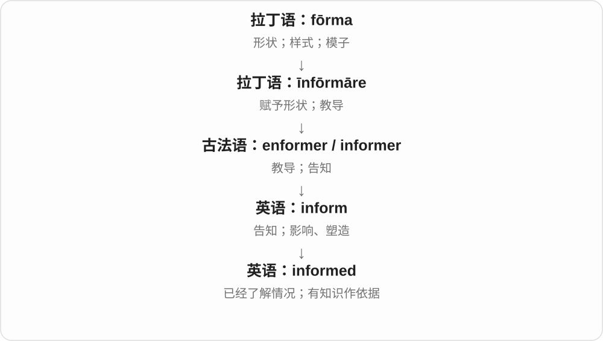

形容人是见多识广或知情；形容决定是经过了解后作出的。强调信息基础，不保证结论绝不会错。

**常见搭配与例句**

an informed decision；an informed opinion；keep someone informed。

> Clear labels help shoppers make informed choices.

清晰的标签帮助顾客在了解情况后作选择。

> Please keep me informed of the progress.

请让我随时了解进展。

**别混淆**

informed 提示有信息基础；certain 是确信。了解更多的人也可能仍有合理疑问。

### 82. featured — 被重点展示的；作为特色的

**音标**：/ˈfiːt͡ʃə(ɹ)d/

**先抓住这个画面**

杂志里给某个人留了醒目的位置，这个人就是 featured。它比“出现过”多一层特别挑出来展示。

**怎么拆**

feature + -ed，是过去式、过去分词，也可作形容词。

**怎么变成今天的意思**

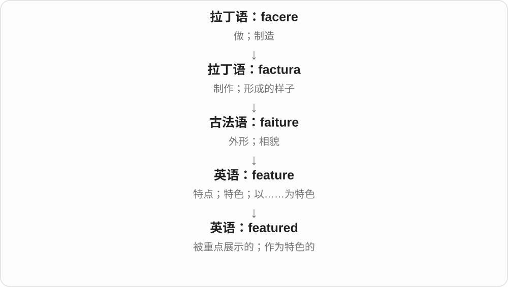

feature 作动词表示重点呈现，featured 转向被呈现的对象；featured artist 指受重点介绍的艺术家。

**常见搭配与例句**

a featured artist；featured in a magazine；featured on the homepage。

> Her photographs were featured in a travel magazine.

她的照片在一本旅游杂志上得到重点展示。

> Tonight’s featured speaker is a marine biologist.

今晚重点邀请的演讲者是一位海洋生物学家。

**别混淆**

included 只保证在里面；featured 往往说明被突出安排。

### 83. pleased — 高兴的；满意的

**音标**：英 /pliːzd/；美 /pliːzd/

**先抓住这个画面**

事情发生后，心里觉得“不错，这正合我的意”。

**怎么拆**

please + -ed，过去分词形容接受愉快感受的一方。

**怎么变成今天的意思**

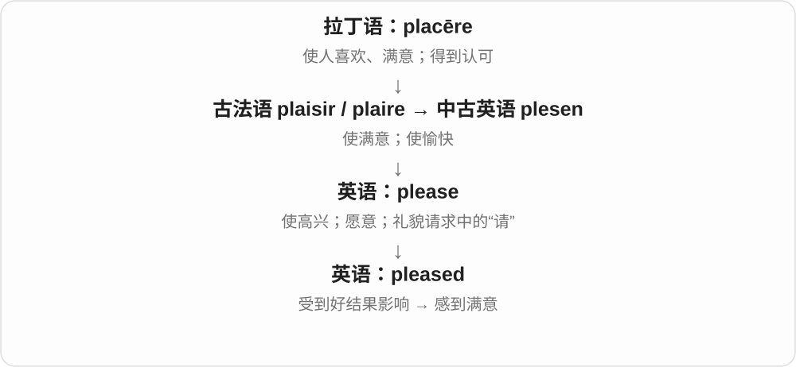

常说 pleased with the result、pleased to hear that、pleased that…。Very pleased 很自然，不必说 very pleasure。

**常见搭配与例句**

pleased with；pleased to do；pleased to meet you。

> She was pleased with the progress her students had made.

她对学生取得的进步很满意。

> I was pleased to hear that you arrived safely.

听说你平安抵达，我很高兴。

**别混淆**

I am pleased 是我高兴；The news is pleasing 是消息令人高兴。体验者与带来体验的东西不同。

### 84. retired — 退休、退役的；已停止使用的；隐居的〔较旧或文体用法〕

**音标**：英 /rɪˈtaɪəd/；美 /rɪˈtaɪərd/

**先抓住这个画面**

退出工作、役用状态已经发生，是 retired。说 retired equipment 是设备退役了，不是它开始感到疲倦。

**怎么拆**

retire + -ed，动词分词转状态形容词。跟随法语退出一路，早期还可强调退隐、远离人群。

**怎么变成今天的意思**

**法语 re- 回去 + tirer 拉 → retirer**  
抽回、退出；后半的更深来源不确定

↓

**英语 retire**  
退到一旁、退出任职或比赛；让设备退役

↓

**retire + -ed → retired**  
已经退出在职、役用或公共生活的状态

a retired teacher 退休教师，a retired athlete 退役运动员，retired equipment 已退役设备。

**常见搭配与例句**

a retired teacher；a retired athlete；retired equipment。

> A retired teacher now leads the reading group.

一位退休教师现在带领这个读书小组。

> The retired aircraft is on display at the museum.

那架退役飞机正在博物馆展出。

**别混淆**

retired 与 tired 一个说职务、使用状态，一个说疲劳；退休的人仍可忙碌，疲倦的人也不因此就退休。

### 85. abandoned — 被抛弃的、荒废的；放纵的〔较旧或文学〕

**音标**：/əˈbændənd/

**先抓住这个画面**

以前有人住、有人照管，现在不再管，门窗任风雨侵蚀，就是 abandoned building；-ed 把镜头放到被留下的对象。

**怎么拆**

abandon + -ed 的分词形容词，已有较早对应形式；也保留放任自己、放纵的文学支线。不是每座空楼都必然永久废弃。

**怎么变成今天的意思**

**古法语 à bandon、abandoner 等**  
交由支配、任其处置；放开控制

↓

**中古英语 abandounen → abandon**  
交出、放弃；后来抛下不管

↓

**abandon + -ed → abandoned**  
被遗弃、无人照管；另有放纵支线

an abandoned factory 废弃工厂，an abandoned vehicle 被弃车辆，an abandoned project 被放弃项目。

**常见搭配与例句**

an abandoned factory；an abandoned vehicle；an abandoned project。

> The film was shot in an abandoned factory.

电影在一家废弃工厂里拍摄。

> They found an abandoned bicycle beside the path.

他们在小径旁发现了一辆被丢下的自行车。

**别混淆**

empty 只说空，abandoned 更说被不再使用、照管；暂时没人在的房子可能 empty，却不是 abandoned。

### 86. hop — 短跳、单脚跳；快速去、短程移动；啤酒花〔另源〕

**音标**：英 /hɒp/；美 /hɑːp/

**先抓住这个画面**

小鸟一跳一跳，或人很快从这里到隔壁，是跳跃那一路；配料表里的 hops 却是啤酒花，不是会跳的花。

**怎么拆**

跳跃接古英语 hoppian；植物义借中古荷兰语 hoppe。两条来源分开。动词过去式 hopped、-ing 形式 hopping 双写 p，与 hope/hoped/hoping 不同。

**怎么变成今天的意思**

**古英语 hoppian → hop**  
短跳、单脚跳 → 快速短途移动

↓

**另一路中古荷兰语 hoppe → 英语 hop**  
啤酒花植物及其花，不从跳跃义变来

hop on one foot 单脚跳，hop on a bus 赶快上公交，a short hop 很短一段行程，hops used in brewing 酿造用啤酒花。

**常见搭配与例句**

hop on one foot；hop on a bus；a short hop；hops。

> The child hopped across the room on one foot.

孩子单脚跳着穿过房间。

> The brewery grows some of its own hops.

这家酿酒厂自己种了一部分啤酒花。

**别混淆**

hop 和 hope 希望元音、拼写变化不同；hops 植物配料不能只按跳跃复数理解。hop 网络一跳也是一步转发的比喻。

### 87. hopping — 正在跳、轻快辗转；跳跃；〔hopping mad〕气得跳脚

**音标**：英 /ˈhɒpɪŋ/；美 /ˈhɑːpɪŋ/

**先抓住这个画面**

单脚一下一下跳，或鸟在树枝间挪跳，是 hopping；hopping mad 把生气画成跳脚，表示气坏了。

**怎么拆**

hop 双写 p + 完整 -ing → hopping；短元音保留。hope 去 e 加 -ing 成 hoping，是另一词、另一发音。

**怎么变成今天的意思**

**跳跃支线：古英语 hoppian → hop**  
短跳、单脚跳，后来也说轻快短途移动

↓

**植物支线：中古荷兰语 hoppe → hop、hops**  
啤酒花另一路借入；不能从上下跳的动作直接推出植物名

↓

**hop 双写 p + -ing → hopping**  
短跳的过程；气得跳脚的固定搭配

hopping on one leg 是单腿跳，hopping from place to place 是在各处轻快辗转；hopping mad 是非常愤怒。

**常见搭配与例句**

hopping over stones 跳过石头；keep hopping 继续跳。

> The children were hopping on one leg along the line.

孩子们正沿着那条线单腿跳。

> He was hopping mad when he found the broken model.

发现模型坏了，他气得跳脚。

**别混淆**

hopping 与 jumping 有重叠，hop 常是短跳、单脚跳或小动物跳；hopping mad 只说明很生气，不保证真的离地跳起来。

### 88. hops — 跳、轻快短途移动〔第三人称单数〕；短跳、短途行程〔复数〕；啤酒花

**音标**：英 /hɒps/；美 /hɑːps/

**先抓住这个画面**

鸟在地面上一下一下跳，是 hops；啤酒配料里的 hops 则是啤酒花，属于另一条词源，不是花在跳。

**怎么拆**

hop + -s，/p/ 后读 /s/；跳跃三单、动作名词复数与植物复数同形。啤酒花通常用复数 hops。

**怎么变成今天的意思**

**跳跃支线：古英语 hoppian → hop**  
短跳、单脚跳，后来也说轻快短途移动

↓

**植物支线：中古荷兰语 hoppe → hop、hops**  
啤酒花另一路借入；不能从上下跳的动作直接推出植物名

↓

**hop + -s → hops**  
它跳；几次短跳；另一来源的啤酒花

hops on one foot 是单脚跳，short hops 是几段短途；beer made with hops 则说啤酒花原料。

**常见搭配与例句**

hops from branch to branch 在枝头间跳；aromatic hops 有香气的啤酒花。

> The bird hops along the garden path.

鸟沿花园小路一下一下跳。

> The brewer added hops to the mixture.

酿酒师往混合液里加入啤酒花。

**别混淆**

hops 与 hopes 希望差一个 e，发音也不同；hops 的元音较短，hop 的过去式要双写 p。

### 89. hopped — 跳了、轻快上去或短途去了；〔酿造〕加了啤酒花的

**音标**：英 /hɒpt/；美 /hɑːpt/

**先抓住这个画面**

刚才单脚跳、轻巧跳上车，用 hopped；说 hopped on a bus 常就是赶紧上公交。酿造里的 hopped 又属于啤酒花动词支线。

**怎么拆**

hop 双写 p + 完整 -ed → hopped，/p/ 后读 /t/；跳跃和加啤酒花两条同形动词都可按这个规则变化。

**怎么变成今天的意思**

**跳跃支线：古英语 hoppian → hop**  
短跳、单脚跳，后来也说轻快短途移动

↓

**植物支线：中古荷兰语 hoppe → hop、hops**  
啤酒花另一路借入；不能从上下跳的动作直接推出植物名

↓

**hop 双写 p + -ed → hopped**  
过去跳、短途移动；另一支为添加啤酒花

hopped over a puddle 是跳过水坑，hopped on the bus 是迅速上公交；a heavily hopped beer 是用了较多啤酒花的啤酒。

**常见搭配与例句**

hopped onto the wall 跳上墙；hopped from one topic to another 话题轻快地换来换去。

> She hopped over the puddle without getting her shoes wet.

她跳过水坑，没有弄湿鞋子。

> We hopped on a bus to the station.

我们赶紧上了一辆去车站的公交车。

**别混淆**

hopped 是 hop 的过去式，hoped 是 hope 的过去式；前者短元音且双 p，后者英 /həʊpt/、美 /hoʊpt/。

### 90. convince — 使相信；说服

**音标**：英、美 /kənˈvɪns/

**先抓住这个画面**

对方本来有怀疑，你拿出理由或证据，让他的疑虑被压下去。

**怎么拆**

拉丁语 con- 加强语气 + vincere“战胜”，形成 convincere“证实、驳倒”；英语从用论证压倒，逐渐转为使人信服。

**怎么变成今天的意思**

**拉丁语 vincere；分词 victus**  
战胜、克服；vinc- 与 vict- 是同一动词的不同词干

↓

**拉丁语 con- + vincere → convincere**  
加强语气：用证据压倒、证明

↓

**英语 convince**  
使人相信、说服

convince someone that… 是让人相信某件事；convince someone of something 是使其确信某事；convince someone to do… 也常用于说服行动。

**常见搭配与例句**

convince somebody that；convince somebody of；convince somebody to do。

> The figures convinced me that the plan was too expensive.

这些数字让我相信，这个计划太贵了。

> She convinced her brother to apply for the scholarship.

她说服弟弟申请这项奖学金。

**别混淆**

persuade 常突出促成行动；convince 常突出改变看法，两者在实际用法中有重叠。

### 91. convinced — 确信的、深信的；被说服的；convince 的过去式、过去分词

**音标**：/kənˈvɪnst/

**先抓住这个画面**

看过理由和证据之后，心里从可能是这样变成我相信就是这样。这个已经信服的状态叫 convinced。

**怎么拆**

convince 去 e 加 -ed，词末 /s/ 后读 /t/。拉丁 convincere 由加强性的 con- 和 vincere 战胜组成，英语较早说在论证中胜过，后来常说使人相信。

**怎么变成今天的意思**

**拉丁 con- + vincere → convincere**  
彻底战胜；在论证中使对方信服

↓

**convince → convinced**  
使确信 → 已经相信、深信

be convinced that ... 确信……；be convinced of someone’s honesty 确信某人诚实；not entirely convinced 并不完全信服。

**常见搭配与例句**

remain convinced；a convinced supporter。

> I am convinced that we can solve this together.

我确信我们能一起解决这件事。

> The explanation sounded reasonable, but I was not entirely convinced.

解释听起来有道理，但我还没有完全信服。

**别混淆**

convinced 描写人的信念，不保证观点客观上正确。convincing 描写证据、说法等令人信服；someone is convinced 与 something is convincing 角度不同。

### 92. bury — 埋、埋葬；掩藏；使埋头于

**音标**：/ˈberi/

**先抓住这个画面**

东西放下去，上面再盖住，看不到了，就是 bury 的核心画面。也能把自己埋进书堆、把消息压在不显眼处。

**怎么拆**

接古英语 byrgan，属掩藏、遮蔽的日耳曼语词族。标准常用读音与 berry 同音，不按 u 机械读 /ʌ/。

**怎么变成今天的意思**

**古英语 byrgan → 中古英语相关形式 → bury**  
埋入、掩藏；与保护、遮蔽词族相关

↓

**bury 现代字面与比喻用法**  
埋葬；把东西藏在下面；埋头于某事

bury treasure 埋藏宝物；bury your face in your hands 双手掩面；bury yourself in work 埋头工作；bury the news 淡化、隐藏消息。

**常见搭配与例句**

bury treasure；bury yourself in work；bury your face in your hands。

> The dog tried to bury a toy in the garden.

狗想把玩具埋进花园土里。

> She buried herself in her work.

她埋头工作。

**别混淆**

bury 的过去式 buried；不写 buryed。bury 与 berry 是同音词，意思不同。

### 93. buried — 埋着的；被掩藏的；bury 的过去式、分词

**音标**：/ˈberid/

**先抓住这个画面**

表面看不到，但下面确实有；或者重要内容被塞进一大段文字深处，都是 buried 的常见画面。

**怎么拆**

bury 的 y 改 i 加 -ed → buried；末尾 /i/ 后接 /d/。/ˈberid/ 主要仍是两个音节，不是每个 -ed 都额外加 /ɪd/。

**怎么变成今天的意思**

**古英语 byrgan → 中古英语相关形式 → bury**  
埋入、掩藏；与保护、遮蔽词族相关

↓

**bury 现代字面与比喻用法**  
埋葬；把东西藏在下面；埋头于某事

↓

**bury + -ed → buried**  
埋藏后、被遮住的状态

buried treasure 埋藏的宝物；buried in paperwork 埋头或困在文书中；buried information 被隐藏在不显眼处的信息。

**常见搭配与例句**

buried treasure；be buried in paperwork。

> The cable is buried beneath the path.

电缆埋在小路下面。

> The crucial detail was buried in the final paragraph.

关键细节藏在最后一段不显眼的位置。

**别混淆**

buried information 不一定真的在地下；is buried 可以说现在埋着的状态。

### 94. bother — 打扰；使烦恼；费心、特意做；麻烦

**音标**：英 /ˈbɒðə/；美 /ˈbɑːðər/

**先抓住这个画面**

一件事来敲你的注意力，让你分心、烦心，是 bother；反过来愿意为一件事花这点心思，也说 bother to do。

**怎么拆**

与苏格兰语 bauther、bather 等相关，更远来源不明，有多种联系解释。现代没有一个透明的 bo + ther 构词。

**怎么变成今天的意思**

**苏格兰 bauther、bather 等相关形式**  
使烦扰的材料；更早来源未定

↓

**英语 bother**  
打扰、烦恼；费心做；麻烦

Sorry to bother you 抱歉打扰；What bothers you? 什么让你烦心？Don’t bother 不必费心；can’t be bothered 懒得、不想费事，语气看场景。

**常见搭配与例句**

bother someone；bother to do；Don’t bother。

> Does the noise bother you?

这声音会打扰你吗？

> You do not need to bother printing the whole document.

你不必费心把整份文件都打印出来。

**别混淆**

bother 可以是小麻烦，不像 torment 折磨那样通常强烈；Don’t bother 也不必是愤怒，可能只是说不用麻烦了。

### 95. bothered — 打扰、使烦恼了；在意、感到困扰的〔过去式、过去分词〕

**音标**：英 /ˈbɒðəd/；美 /ˈbɑːðərd/

**先抓住这个画面**

有件事一直挤进心里、让你不能清静，是 bothered；说 not bothered，则常是没那么在意。

**怎么拆**

bother + -ed，结尾读 /d/。bother 与苏格兰 bauther、bather 等相关，更远来源不明，现代有烦扰、费心做的不同搭配。

**怎么变成今天的意思**

**苏格兰相关烦扰形式 → bother**  
使烦、打扰；费心去做

↓

**bother + -ed → bothered**  
已经烦扰；感到不安、在意

bothered by noise 被噪声烦扰；not bothered 不在意；bothered to reply 费心回复了。

**常见搭配与例句**

can’t be bothered 懒得、嫌麻烦不愿做；deeply bothered 很受困扰。

> The noise bothered me all evening.

噪声烦了我一整晚。

> She was not bothered by the change.

她对这个变化不怎么在意。

**别混淆**

bothered someone 是事情使人烦；was bothered 是人受困扰。can’t be bothered to do 常说不愿费劲，不是身体完全没有能力做。

### 96. unbothered — 不烦恼、不受影响的；不在意的

**音标**：英 /ʌnˈbɒðəd/；美 /ʌnˈbɑðərd/

**先抓住这个画面**

周围吵，对方仍安心读书；别人说闲话，他也不往心里去，这种没被搅动的状态是 unbothered。

**怎么拆**

否定 un- + bothered；bother 加完整 -ed 得到受到困扰的状态，外层 un- 把它否定。

**怎么变成今天的意思**

**bauther、bather 等相关英语形式 → bother**  
远源未定，爱尔兰语、苏格兰语等相关解释尚不能化为唯一确定路线

↓

**bother → bothered → unbothered**  
使困扰到感到困扰，再用否定 un- 写没有因此烦恼

↓

**un- + bothered → unbothered**  
没有受困扰、不因此烦恼

unbothered by criticism 不因批评烦恼；seem unbothered 显得不在意。

**常见搭配与例句**

remain unbothered；perfectly unbothered by the noise。

> She seemed unbothered by the criticism.

她似乎没因那些批评烦恼。

> The cat lay unbothered beside the noisy washing machine.

洗衣机很吵，猫却毫不受影响地躺在旁边。

**别混淆**

unbothered 可以是从容，不一定是冷漠；indifferent 更侧重不关心、不偏好，是否在乎事情与是否感到烦是两回事。

### 97. shaped — 有某种形状的；被塑造的；shape 的过去式、分词

**音标**：/ʃeɪpt/

**先抓住这个画面**

一方面看成形后的样子，一方面看是什么把它塑成这样。

**怎么拆**

shape + -ed，末尾在 /p/ 后读 /t/。历史有中古英语相应形式；前有形状修饰时常组成复合形容词，本页不另列连字符词头。

**怎么变成今天的意思**

**古英语 ġesceap〔名词〕、scieppan 等〔动词〕→ shape**  
形态、所造之物；塑造、创造

↓

**现代 shape**  
形状、状态；塑造外形、影响发展

↓

**shape + -ed → shaped**  
已经成形；具有某种形状、受某事塑造

beautifully shaped 造型优美的，shaped by experience 被经历塑造；前面加具体外形可进一步限定。

**常见搭配与例句**

beautifully shaped；shaped by experience；carefully shaped。

> The bowl was carefully shaped by hand.

这个碗经过手工仔细塑形。

> Her outlook was shaped by years of travel.

她的观念受到多年旅行经历的塑造。

**别混淆**

shaped 是形成、被塑造后的状态，shapely 是外形匀称漂亮；某物 shaped 不自动表示漂亮。

### 98. ranked — 列入排名的、有评级的；被排在某位的

**音标**：/ræŋkt/

**先抓住这个画面**

对象已经被放进一个排名系统；游戏 ranked matches 常说计入等级、排名的对局，不是每一局都有高水平玩家。

**怎么拆**

排名动词 rank + -ed，过去分词也可作形容词；末尾 -ed 在这里读 /t/，不多加一个 /ɪd/ 音节。

**怎么变成今天的意思**

**古法语 ranc、rang 等 → 中古英语 rank**  
行列 → 地位、等级、排名；较远为日耳曼语背景

↓

**rank 名词 → 排列、评级的动词**  
把对象放入次序；处于某名次

↓

**rank + -ed → ranked**  
已被排名、计入评级的

a highly ranked university 排名靠前的大学，ranked matches 排位对局，ranked second 排名第二。

**常见搭配与例句**

a highly ranked university；ranked matches；ranked second。

> She chose a highly ranked university.

她选了一所排名靠前的大学。

> He prefers ranked matches to casual games.

比起休闲对局，他更喜欢排位赛。

**别混淆**

ranked 有排名或评级，highly ranked 才说明排名高；ranked 本身不保证最高或第一。

### 99. scream — 尖叫、惊叫；尖声说；一声尖叫；强烈显出

**音标**：/skriːm/

**先抓住这个画面**

声音冲得又高又响，像害怕、兴奋或疼痛时放声叫，就是 scream。也能写机器尖鸣，或某种特征明显得像在大声告诉你。

**怎么拆**

接较早 scræmen、scremen 一系形式；与北欧、荷兰语等叫喊词的借入、同源关系有不同分析。现代 scream 整体作基础词。

**怎么变成今天的意思**

**较早 scræmen、scremen 等 → 中古英语 scremen → scream**  
尖厉叫声；可与北欧、荷兰语、德语材料比较，具体更远来源不确定

↓

**动词及声音名词 → 形容强烈传达**  
人尖叫、机器尖鸣；后来还可说某种迹象特别明显

scream for help 是尖声呼救，scream with delight 是开心尖叫；the design screams luxury 是设计处处透出奢华感。

**常见搭配与例句**

let out a scream 发出尖叫；scream at someone 冲某人尖声吼。

> The children began to scream with delight as the ride started.

游乐设施启动时，孩子们开心得尖叫。

> She heard a scream from the house next door.

她听见隔壁房子传来一声尖叫。

**别混淆**

scream 不等于总在害怕。cry 还常指流泪哭泣，scream 则先抓声音尖、响；人可以尖叫却不哭。

### 100. screaming — 正在尖叫、尖鸣；尖厉的；极明显的

**音标**：/ˈskriːmɪŋ/

**先抓住这个画面**

尖叫正持续着，叫 screaming；形容标题、颜色或差错时，也可说它醒目得像在大喊。

**怎么拆**

scream + 完整 -ing，直接加；既能表示进行动作，也能在修饰语里保留“强烈扑面而来”的感觉。

**怎么变成今天的意思**

**较早 scræmen、scremen 等 → 中古英语 scremen → scream**  
尖厉叫声；可与北欧、荷兰语、德语材料比较，具体更远来源不确定

↓

**动词及声音名词 → 形容强烈传达**  
人尖叫、机器尖鸣；后来还可说某种迹象特别明显

↓

**scream + -ing → screaming**  
尖叫过程、尖厉状态；后来的醒目、强烈义

screaming fans 是尖叫的粉丝，screaming headlines 是耸动、醒目的标题；不是标题真的会发声。

**常见搭配与例句**

screaming with laughter 尖声大笑；a screaming engine 尖鸣的引擎。

> The screaming fans crowded around the entrance.

尖叫着的粉丝挤在入口周围。

> The story appeared beneath a screaming headline.

这篇报道上面配着一个耸动的大标题。

**别混淆**

screaming 不能一律译成“惨叫”：欢呼时可译尖叫，标题中可译醒目、耸动，先看具体画面。

### 101. screams — 尖叫、尖鸣〔第三人称单数〕；一声声尖叫；强烈显出

**音标**：/skriːmz/

**先抓住这个画面**

某人遇到惊喜就尖声叫，用 screams；复数名词指多声尖叫。比喻用法则是某种特征特别显眼。

**怎么拆**

scream + -s，/m/ 后读 /z/；动词三单、名词复数外形相同。

**怎么变成今天的意思**

**较早 scræmen、scremen 等 → 中古英语 scremen → scream**  
尖厉叫声；可与北欧、荷兰语、德语材料比较，具体更远来源不确定

↓

**动词及声音名词 → 形容强烈传达**  
人尖叫、机器尖鸣；后来还可说某种迹象特别明显

↓

**scream + -s → screams**  
他、她尖叫；多声尖叫；明显表露

screams with laughter 是笑得尖叫，screams of joy 是欢乐的尖叫；screams success 可比喻处处显出成功的气派。

**常见搭配与例句**

screams for help 尖声呼救；distant screams 远处的尖叫。

> She screams with laughter at that part of the film.

看到电影那个片段，她笑得尖叫。

> Their screams of joy could be heard from the street.

街上都能听见他们欢乐的尖叫。

**别混淆**

screams 在比喻中不一定真有声音，如 a room that screams luxury 说房间的样子很显奢华。

### 102. screamed — 尖叫了、尖声喊了；尖鸣了；强烈显出了

**音标**：/skriːmd/

**先抓住这个画面**

刚才情绪一下冲上来、声音又高又响，叫 screamed。它也能把金属、引擎发出的尖厉声写得像叫喊。

**怎么拆**

scream + 完整 -ed，/m/ 后读 /d/；ea 的 /iː/ 保留，不能照 speak → spoke 那样换元音。

**怎么变成今天的意思**

**较早 scræmen、scremen 等 → 中古英语 scremen → scream**  
尖厉叫声；可与北欧、荷兰语、德语材料比较，具体更远来源不确定

↓

**动词及声音名词 → 形容强烈传达**  
人尖叫、机器尖鸣；后来还可说某种迹象特别明显

↓

**scream + -ed → screamed**  
过去尖叫、尖鸣或强烈传达

screamed for help 是尖声呼救了，screamed a warning 是尖声喊出警告；可以接引号里的喊话。

**常见搭配与例句**

screamed with excitement 兴奋尖叫；screamed in pain 痛得尖叫。

> “We won!” she screamed into the phone.

“我们赢了！”她对着电话尖叫。

> He screamed for help from the upstairs window.

他从楼上的窗口尖声呼救。

**别混淆**

screamed 比 said 多了强烈的声音信息；与 shouted 相比，常更突出尖、高或情绪激烈。

### 103. bang — 砰的一声；猛敲、猛撞；恰好；刘海〔bangs，美式〕

**音标**：/bæŋ/

**先抓住这个画面**

门猛地关上，砰！bang 很容易先用声音记住。它也能说猛撞的动作；bang in the middle 则借直接、正中的劲头说正好在中央。

**怎么拆**

通常看作拟声形成，或与古诺尔斯语 banga 敲打等形式有关。名词、动词和语气加强用法逐步扩展，不把未确证的古英语重建形式写成既成事实。

**怎么变成今天的意思**

**bang：拟声形成，或联系斯堪的纳维亚语 banga 等**  
重击、砰的一声；远处路线不完全确定

↓

**英语 bang 的扩展**  
猛撞、突然响声；恰好、正中；刘海的固定复数用法

a loud bang 一声巨响，bang on the door 猛敲门，bang your head 撞到头，bang in the middle 正在中央。美式 bangs 刘海，对应英式 fringe。另有粗俗性用法，读语境识别。

**常见搭配与例句**

a loud bang；bang on the door；bang in the middle；bangs。

> The door shut with a loud bang.

门砰的一声关上了。

> The café is bang in the middle of the village.

咖啡馆正好在村子中央。

**别混淆**

bang 常有突然、响亮的冲击，tap 往往轻得多。bangs 的刘海义是固定旧用法，不把每缕头发都解释成一次爆炸。

### 104. banging — 正在重敲、砰响；砰砰声；〔口语〕很棒的、带劲的

**音标**：/ˈbæŋɪŋ/

**先抓住这个画面**

门、鼓或工具正猛地一下下响，叫 banging。部分口语里说 a banging tune，则是在夸曲子带劲、好听。

**怎么拆**

bang + 完整 -ing，直接加；声音、击打分词和后来的夸赞形容词要按语境分，不双写 g。

**怎么变成今天的意思**

**十六世纪 bang → 现代 bang**  
大概模仿重击，或借北欧 banga 一系；响声、击打与语气用法扩展

↓

**现代不同场景**  
砰响、敲打；bangs 刘海；banging 在部分口语中还表示出色

↓

**bang + -ing → banging**  
砰响、重敲过程；后来口语有出色、带劲义

banging on the door 是正砰砰敲门，a banging noise 是砰砰声；a banging tune 不是曲子在敲门。

**常见搭配与例句**

stop banging 别再重敲；a banging bassline 带劲的低音线。

> The banging on the door grew louder.

砰砰敲门的声音越来越响。

> The DJ played a banging tune that got everyone dancing.

DJ 放了一首带劲的曲子，大家都跳起舞来。

**别混淆**

banging 可以形容响声，也能在非正式语境夸好；选哪种中文，要看 noise、door 还是 tune、meal 等搭配。

### 105. bangs — 砰响、重敲〔第三人称单数〕；砰声〔复数〕；〔美〕刘海

**音标**：/bæŋz/

**先抓住这个画面**

门、锅盖“砰”响，用 bangs；看发型时，bangs 又是额前的刘海。后一种不能按“头发在响”去翻。

**怎么拆**

声音动词、名词 bang + -s；刘海义通常用复数 bangs，或与齐截、突然截断的动作感有关，具体起名过程不完全确定。

**怎么变成今天的意思**

**十六世纪 bang → 现代 bang**  
大概模仿重击，或借北欧 banga 一系；响声、击打与语气用法扩展

↓

**现代不同场景**  
砰响、敲打；bangs 刘海；banging 在部分口语中还表示出色

↓

**bang + -s → bangs**  
它砰响；多声砰响；另有常用发型名词

bangs on the door 是砰砰敲门，have bangs 是留刘海。英式常说 fringe；hair bangs 是习惯复数，不能只认成三单。

**常见搭配与例句**

loud bangs 巨大砰响；cut her bangs 剪她的刘海。

> The loose door bangs in the wind.

松动的门被风吹得砰砰响。

> She has short bangs above her eyebrows.

她眉毛上方留着短刘海。

**别混淆**

bangs 作刘海时看头发语境；two bangs 在声响语境是两声砰响，不是两撮刘海。

### 106. banged — 砰地响了、重重敲了；撞痛了、重放了

**音标**：/bæŋd/

**先抓住这个画面**

门砰地一关、拳头重敲、膝盖不小心撞到桌角，都可以用 banged。动作往往又猛又突然。

**怎么拆**

bang + 完整 -ed，/ŋ/ 后读 /d/；ng 在这里读 /ŋ/，不另外加 /ɡ/。

**怎么变成今天的意思**

**十六世纪 bang → 现代 bang**  
大概模仿重击，或借北欧 banga 一系；响声、击打与语气用法扩展

↓

**现代不同场景**  
砰响、敲打；bangs 刘海；banging 在部分口语中还表示出色

↓

**bang + -ed → banged**  
过去重敲、砰响或撞到

banged on the door 是重重敲门，banged his knee 是撞了膝盖，banged the book down 是把书砰地一放。

**常见搭配与例句**

banged shut 砰地关上；banged into the table 猛撞桌子。

> He banged on the door but nobody answered.

他砰砰敲门，却没人回应。

> I banged my knee on the edge of the desk.

我的膝盖撞到了桌沿。

**别混淆**

banged 可以是碰到了，不必真有爆炸；写身体时通常是撞击动作，具体疼痛程度还看上下文。

### 107. punch — 拳打、一拳；打孔、打孔器；冲击力；宾治饮料

**音标**：英、美 /pʌntʃ/

**先抓住这个画面**

击打、打孔这一支都有“一下用力顶进去”的动作感；饮料 punch 则要单独记，不能解释成把水果打一拳。

**怎么拆**

工具名 punch 是 puncheon 的缩短；击打动词经古法语 ponchonner、中古英语 punchen 传入，还可能受 punish 的旧缩短形式影响。饮料义来源有争议，常联系印地语 pāñc“五”，不能当作已定论。图画工具、击打主线。

**怎么变成今天的意思**

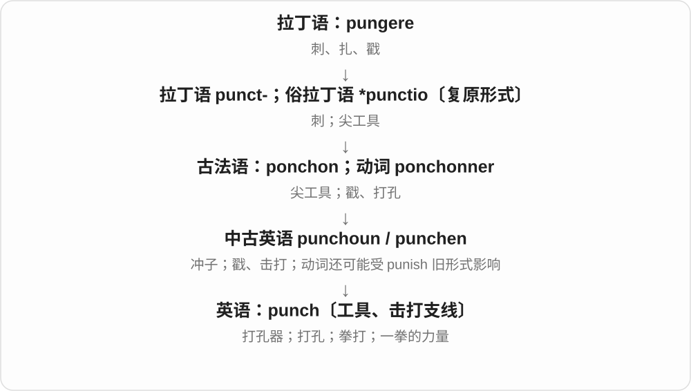

数字键上 punch in 是按键输入；pack a punch 是产生强烈效果。fruit punch 是混合果汁饮料，可含酒也可不含。饮料名常被解释为传统五种原料，但早期记录与语音仍有争议。

**常见搭配与例句**

throw a punch；a hole punch；punch in a number；pack a punch。

> The boxer blocked the punch with his glove.

拳击手用手套挡住了这一拳。

> Punch two holes near the edge of the card.

在卡片边缘附近打两个孔。

> The short speech packed a real punch.

这段简短发言很有冲击力。

> They served a fruit punch made without alcohol.

他们提供了一种不含酒精的混合果汁饮料。

**别混淆**

hit 是宽泛的击打；punch 作击打动词通常用拳。饮料、工具同形，不表示来源一定相同。

### 108. punched — 用拳打了；打孔了；按键输入了

**音标**：/pʌntʃt/

**先抓住这个画面**

刚才出拳、给纸打孔、把号码一个个按进去，都能用 punched；共同动作是一下下冲、戳、按进去。

**怎么拆**

punch + 完整 -ed，/tʃ/ 后读 /t/，结尾 /tʃt/；不另加 /ɪd/。

**怎么变成今天的意思**

**古法语 ponchonner、ponchon → 中古英语 punchen → punch**  
戳、冲打、尖工具；后来常用于打孔、拳击

↓

**工具、击打与其他同形词**  
punch 工具名还联系 puncheon 的缩短；饮料 punch 另有来源争论，不从打孔推来

↓

**punch + -ed → punched**  
过去拳击、冲孔或按键输入

punched a hole 是冲出一个孔，punched in the code 是输入密码、代码；punch the clock 还可指打卡。

**常见搭配与例句**

punched the bag 打了沙袋；punched in the number 按入号码。

> She punched two holes in the paper.

她在纸上打了两个孔。

> He punched in the code and opened the door.

他按键输入密码，打开了门。

**别混淆**

punched 不能一律译成揍：punched holes、punched in a code 都是工具或按键动作，宾语决定中文。

### 109. punches — 拳击、打孔、输入〔第三人称单数〕；拳击、冲孔工具〔复数〕

**音标**：/ˈpʌntʃɪz/

**先抓住这个画面**

拳头一记记打出，或冲孔器把纸打穿，用 punches。输入数字时 punch in 也保留一下下按键的动作感。

**怎么拆**

punch + -es，/tʃ/ 后读 /ɪz/；动词三单、工具或击打名词复数同形。饮料同形词的来源另分。

**怎么变成今天的意思**

**古法语 ponchonner、ponchon → 中古英语 punchen → punch**  
戳、冲打、尖工具；后来常用于打孔、拳击

↓

**工具、击打与其他同形词**  
punch 工具名还联系 puncheon 的缩短；饮料 punch 另有来源争论，不从打孔推来

↓

**punch + -es → punches**  
他、她拳击、打孔；多记拳击、冲孔工具

punches holes 是打孔，throws punches 是挥拳，punches in a number 是按键输入号码；不是每义都在打人。

**常见搭配与例句**

powerful punches 有力拳击；punches a ticket 给票打孔。

> The machine punches two holes in each sheet.

机器在每张纸上打两个孔。

> The boxer threw several quick punches.

拳击手快速打出几拳。

**别混淆**

punches 常指拳头或冲孔动作，slaps 更常是张开的手掌拍；动作形状不同。

### 110. wound — 伤口；使受伤、伤害感情；另源 wind〔缠绕〕的过去式、过去分词

**音标**：伤口、使受伤 /wuːnd/；缠绕的过去形式 /waʊnd/

**先抓住这个画面**

看到 wound，先听读音、看句子：a wound 是一处伤口；wound the string 则可能是把线绕了起来。同一拼写在这里藏着两条历史。

**怎么拆**

伤口 wound /wuːnd/ 接古英语 wund，动词与旧 wundian 使受伤相承。缠绕的 wound /waʊnd/ 则接 wind /waɪnd/，上溯古英语 windan 及 wand、wunden 等过去材料。两条来源不能串成同一个意思的发展。

**怎么变成今天的意思**

**古英语 wund、wundian → wound /wuːnd/**  
伤口、使受伤；后来也说感情受伤

↓

**古英语 windan 及旧过去材料 → wound /waʊnd/**  
wind〔缠绕〕的过去式、过去分词

a small wound 一处小伤口；wound someone’s pride 伤害某人的自尊；wound the string around a spool 把线绕在线轴上。最后一处读 /waʊnd/。

**常见搭配与例句**

a wound on the arm；a deeply wounded person；wind → wound → wound。

> He had a small wound on his arm.

他手臂上有一处小伤口。

> The remark wounded her pride.

那句话伤了她的自尊。

> She wound the string around a wooden spool.

她把线绕在一个木线轴上。

**别混淆**

风 wind /wɪnd/、缠绕 wind /waɪnd/、伤口 wound /wuːnd/ 要分开记。have wound up the clock 是给钟上好了发条，wound 在这里读 /waʊnd/。

### 111. wounded — 受伤的；感情受到伤害的；wound〔使受伤〕的过去式、过去分词

**音标**：/ˈwuːndɪd/

**先抓住这个画面**

身体留下伤，或一句话让人觉得自尊被刺痛，都能用 wounded。作形容词时，重点是受伤后的状态。

**怎么拆**

伤口词族 wound /wuːnd/ + -ed。词干末尾 /d/ 后的 -ed 读 /ɪd/，全词两个音节；继承古英语 wund、wundian 相关的伤害分支。

**怎么变成今天的意思**

**古英语 wund、wundian → wound /wuːnd/**  
伤口；使受伤

↓

**wound + -ed → wounded**  
受伤；感情或自尊受到伤害

a wounded animal 受伤的动物；wounded pride 受伤的自尊；a wounded look 受伤、委屈的神情；was wounded 受了伤。

**常见搭配与例句**

slightly wounded；look deeply wounded。

> They found a wounded bird near the fence.

他们在围栏附近发现了一只受伤的鸟。

> He tried to hide his wounded pride behind a smile.

他试图用微笑掩饰受伤的自尊。

**别混淆**

wounded 来自使受伤的 wound /wuːnd/。缠绕 wind 的过去式 wound /waʊnd/ 本身已经是过去形式；winded /ˈwɪndɪd/ 又常说喘不过气。

### 112. burned — 烧了、烧伤了；被烧过、烧焦的

**音标**：英 /bɜːnd/；美 /bɜːrnd/

**先抓住这个画面**

动作已经发生或留下结果。东西 burned 可能只是燃烧过，也可能烧坏、烧伤，要看对象与程度。

**怎么拆**

burn + -ed，对应中古英语 burnede、burned 等旧形。末尾 -ed 常读 /d/，不是 /ɪd/；burnt 是另一常见过去、分词形式。

**怎么变成今天的意思**

**古英语 bærnan、beornan 等；古诺尔斯语 brenna、brinna 等**  
使燃烧与自己燃烧的旧动词在英语中合流

↓

**中古英语 brennen、brinnen、birnen 等 → burn**  
读音次序变化；烧、燃、热痛、炽热情感等

↓

**burn + -ed → burned**  
过去的烧；被火、热作用过的结果

burned wood 烧过的木头，a burned hand 烫伤的手，burned the toast 把吐司烤焦。美式常用 burned，但 burnt 也常见。

**常见搭配与例句**

burned wood；burned the toast；a burned surface。

> He burned the toast while answering the phone.

他接电话时把吐司烤焦了。

> The fire left a pile of burned wood.

火过后留下一堆烧过的木头。

**别混淆**

burned 与 burnt 多处可替换，不硬定一个只动词、一个只形容词；burned-out 等固定复合另看惯用法。

### 113. ruin — 毁坏、毁灭；使糟掉；衰败；废墟、残垣

**音标**：/ˈruːɪn/

**先抓住这个画面**

本来能用、能维持的东西塌了、坏到失去原样，是 ruin；雨没把野餐打碎，却能让原来的安排全泡汤。

**怎么拆**

接拉丁 ruina 坍塌，来自 ruere 猛然倒下、坍塌，英语也受法语 ruine、ruiner 影响。实物倒塌再扩展到生活、计划、名誉等被严重破坏。

**怎么变成今天的意思**

**拉丁 ruere → ruina**  
猛烈倒下 → 坍塌、崩坏

↓

**英语 ruin，含法语相关词影响**  
废弃损毁状态；使事物失去价值、作用或原样

ruin a plan 毁掉计划；ruin a shirt 弄坏衣服；fall into ruin 日渐荒废；the ruins of a castle 城堡遗迹；financial ruin 经济上彻底垮掉。

**常见搭配与例句**

ruin the surprise；a ruined building。

> The rain ruined our picnic.

雨把我们的野餐全搅了。

> The old house had fallen into ruin.

老房子已经荒废破败了。

**别混淆**

ruin 通常比普通 damage 强，常说严重坏掉或安排全受影响；日常也可夸张：You ruined the surprise 是惊喜被提前揭破，不是真实物品一定损毁。

### 114. ruined — 毁坏的、破败的；搞砸了；ruin 的过去式、过去分词

**音标**：/ˈruːɪnd/

**先抓住这个画面**

衣服再穿不成原样，城堡只剩断墙，或计划被完全打乱，都可说 ruined。它把注意力放在受到破坏后的结果。

**怎么拆**

ruin + -ed，结尾读 /d/；继承倒塌、毁坏的词族。分词形容词常描述建筑受损或事物严重受破坏的状态。

**怎么变成今天的意思**

**ruin**  
严重破坏；使失去原有状态、作用

↓

**ruin + -ed → ruined**  
曾毁坏；处于受损、破败状态

a ruined castle 破败城堡；a ruined shirt 弄坏的衬衫；a ruined holiday 被毁掉的假期；financially ruined 经济上垮掉的。

**常见搭配与例句**

the ruined walls；the meal was ruined。

> We walked past the walls of a ruined castle.

我们走过一座破败城堡的城墙。

> The shirt was ruined by a large ink stain.

一大块墨渍把衬衫毁了。

**别混淆**

ruined 描述受损结果；ruins 常作名词说遗迹、废墟。a ruined castle 与 the ruins of a castle 都可以描述破败城堡，但句子结构不同。

### 115. ruining — 毁坏；糟蹋；破坏〔分词、动名词〕

**音标**：英、美 /ˈruːɪnɪŋ/

**先抓住这个画面**

原来好好的东西，被弄得没法正常使用、失去原有价值，是 ruining。下雨可能毁掉布景，一句剧透也可能破坏看故事的乐趣。

**怎么拆**

ruin + 完整 -ing → ruining，原词不改。名词 ruin 接拉丁 ruina 倒塌、崩落，来自动词 ruere 崩落；英语动词也可能接法语 ruiner。

**怎么变成今天的意思**

**拉丁 ruere 崩落 → ruina 倒塌 → ruin**  
从建筑倒塌扩展到衰败、严重损坏

↓

**英语名词转动词或法语 ruiner 影响 → ruining**  
现代可破坏实物，也可毁掉气氛、机会、体验

ruining the painting 是毁坏画作；ruining the surprise 是破坏惊喜；ruining the mood 是破坏气氛。

**常见搭配与例句**

ruining the painting；ruining the surprise；ruining the mood。

> The rain was ruining the paper decorations.

雨正在毁坏那些纸制装饰。

> Please stop ruining the surprise by giving away clues.

请别再透线索，把惊喜破坏掉。

**别混淆**

ruining 通常比普通 changing 强，常强调把好事、可用之物弄糟。日常抱怨中也可能有夸张，要看对象。

### 116. derived — 由……得来、派生的；推导出的；演化而来的〔相对祖先性状〕

**音标**：/dɪˈraɪvd/

**先抓住这个画面**

不是凭空冒出，而是有一条来源路径。计算后的 derived value 来自原数据，derived word 来自相应词基的构词过程。

**怎么拆**

derive 去 e + -ed，末尾 /vd/，不额外加 /ɪd/。作分词或形容词说明获得、派生关系；演化分类中又有相对祖先状态的专门用法。

**怎么变成今天的意思**

**拉丁 dē- 离开 + rīvus 溪流 → dērīvāre**  
把水从原来的河流引出、导向别处

↓

**法语 deriver → 英语 derive**  
从源头而来、取得；后来可由依据推导

↓

**derive + -ed → derived**  
已经从某来源得出、形成的；相关专门性状概念

derived data 派生数据，a derived value 计算所得值，a derived word 派生词，derived from natural materials 由天然材料提取或制得。

**常见搭配与例句**

derived data；a derived value；a derived word；derived from。

> The table includes both original and derived values.

表格同时列出原始值和计算所得值。

> The dye is derived from plant material.

这种染料从植物材料中提取制得。

**别混淆**

derived 不保证来源与产物完全相同，也不证明结果天然更好。生物学 derived 相对祖先状态说变化，不是优劣排名。

### 117. disabled — 残障的；被禁用的；无法运作的

**音标**：/dɪsˈeɪbəld/

**先抓住这个画面**

说人时，它谈身体、感官等方面的残障及相关障碍；说功能时，是“已经被关闭或停用”。不能把人等同于坏掉的机器。

**怎么拆**

disable 的过去分词，发展为形容词。

**怎么变成今天的意思**

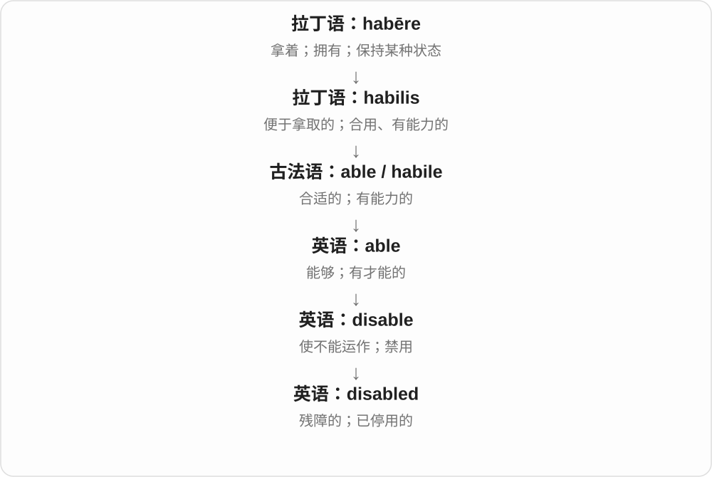

同一个词在不同对象上有不同语感。disabled people 与 people with disabilities 都能使用，具体称呼可尊重当事人的偏好。

**常见搭配与例句**

disabled people；disabled access；a disabled account；the button is disabled。

> The museum provides step-free access for disabled visitors.

博物馆为残障访客提供无台阶通道。

> The submit button remains disabled until every field is complete.

所有字段填完之前，提交按钮一直无法使用。

**别混淆**

disabled 是特定状态或身份描述；unable to do something 是某件事做不到，范围不能混同。

### 118. educated — 受过教育的；有知识根据的

**音标**：常见 /ˈedʒəkeɪtɪd/；英式也 /ˈedjuːkeɪtɪd/

**先抓住这个画面**

一个人接受过学习培养；一个猜测也可不是瞎蒙，而是有已有知识托着。

**怎么拆**

educate + -ed，过去分词形容词化。an educated guess 进一步借受过训练、有知识的背景，表示有根据的推测。

**怎么变成今天的意思**

**拉丁语 ēducāre → ēducātus、ēducātiō 词族**  
养育、训练、教育；相应分词和活动名词

↓

**英语 educate、education 及其派生**  
教育、培养；教育活动、过程

↓

**educate → educated**  
教育、培养 → 受过教育；有知识根据的

an educated reader 有一定知识背景的读者；an educated guess 有依据推测。受过教育不自动等于精通所有领域。

**常见搭配与例句**

highly educated；an educated guess；an educated opinion。

> She made an educated guess based on the earlier figures.

她根据先前数字作了一个有依据的推测。

> The article is written for educated readers without specialist training.

文章面向有一定知识背景、但未受专业训练的读者。

**别混淆**

educated guess 仍是推测，不是已证实事实；education 名词、educated 形容词不要混用。

### 119. satisfied — 满意的；确信的；得到满足的

**音标**：/ˈsætɪsfaɪd/

**先抓住这个画面**

需要被填上了，心里觉得“可以了”。

**怎么拆**

satisfy 的过去式和过去分词，y 改 i 加 -ed；分词也用作形容词。

**怎么变成今天的意思**

**拉丁 satis**  
足够

↓

**拉丁 satisfacere**  
satis + facere：做得足够、履行义务

↓

**古法语 satisfiier → 英语 satisfy**  
偿付、满足要求 → 使满足

↓

**英语 satisfied**  
被满足 → 满意；得到充分证据 → 确信

I am satisfied with the result 表示结果达到了你的期待；I am satisfied that ... 表示你经过考虑，认为后面的事情确实如此。后者不是“我很高兴那件事发生了”。读长句时先看跟的是 with 还是 that。

**常见搭配与例句**

be satisfied with；be satisfied that；a satisfied customer。

> Are you satisfied with the repair?

你对这次维修满意吗？

> We are satisfied that the figures are accurate.

我们确信这些数字是准确的。

**别混淆**

satisfied 说感受或判断的一方；satisfying 说让人获得满足感的事情。

### 120. classified — 已分类的；保密的；分类广告

**音标**：英 /ˈklæsɪfaɪd/；美 /ˈklæsəfaɪd/

**先抓住这个画面**

资料被放进某一类；如果这个“类”是保密等级，classified 就让人想到不能随便公开的材料。

**怎么拆**

classify 的过去分词作形容词；classifieds 是 classified advertisements 的缩短说法。

**怎么变成今天的意思**

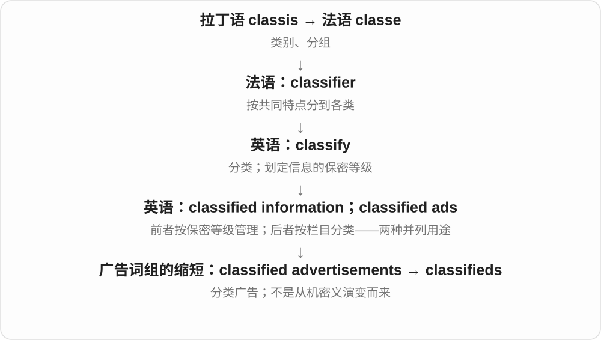

classified information 通常指保密信息；classified ads 则是分类广告，广告并不保密。要看后面的名词，别只记“机密”一个中文。

**常见搭配与例句**

classified information；a classified document；the classifieds。

> Only authorized staff may read the classified report.

只有获授权的员工可以阅读这份机密报告。

> She found a used bicycle in the classified ads.

她在分类广告中找到了一辆二手自行车。

**别混淆**

classified 不等于已公开；declassified 才表示已撤销保密等级。

### 121. clip — 夹子、夹住；剪、修剪；音视频片段；擦碰

**音标**：/klɪp/

**先抓住这个画面**

夹住纸张是一条线，剪掉一小截是另一条线。电影片段像从长片里取出的一段；夹板则直接靠夹子固定纸张。

**怎么拆**

夹住义承古英语 clyppan 拥抱、抱紧；剪切义借斯堪的纳维亚语，联系古诺尔斯语 klippa。两个来源后来同形，现代还有擦碰、短促打击等扩展。

**怎么变成今天的意思**

**古英语 clyppan → 中古英语 clippen**  
拥抱、抱紧 → 夹住、扣住

↓

**古诺尔斯语 klippa → 英语 clip**  
剪、修剪 → 剪下的片段

a paper clip 回形针，clip papers together 把纸夹在一起，clip a hedge 修剪树篱，a video clip 视频片段，clip a mirror 擦碰后视镜。

**常见搭配与例句**

a paper clip；clip papers together；a video clip。

> She clipped the papers together.

她把纸张夹在一起。

> We watched a short clip from the documentary.

我们看了纪录片的一个短片段。

**别混淆**

a clip 可以夹住东西，也可以是剪出的片段，先看搭配。clipboard 用的是夹持义，不是因为板子由视频剪成。

### 122. clipped — 剪短、修剪了；夹住、扣上了；擦碰了；短促生硬的

**音标**：/klɪpt/

**先抓住这个画面**

树篱被剪齐，纸被夹在板上，都可 clipped，却分属剪、夹两条来源。a clipped voice 像话音被剪短，说话很短促，常显得生硬。

**怎么拆**

clip 双写 p + 完整 -ed → clipped，/p/ 后读 /t/；剪切支借北欧材料，夹紧支承古英语抱住材料。

**怎么变成今天的意思**

**剪切支：北欧 klippa 等 → clip**  
剪短、修剪，后来也说说话短促、截短

↓

**夹住支：古英语 clyppan 抱住 → clip**  
拥抱、围住的旧义发展为夹紧，两支现代拼写同形

↓

**clip 双写 p + -ed → clipped**  
两支同形过去式；短促言语的状态

clipped the hedge 是修剪树篱，clipped the pass to his shirt 是把通行证夹在衣服上；clipped tones 是短促生硬的语调。

**常见搭配与例句**

neatly clipped 修剪整齐的；clipped to a board 夹在板上；clipped the kerb 擦碰路缘。

> She clipped the note to the front of the folder.

她把便条夹在文件夹正面。

> He answered in a clipped, impatient voice.

他用短促、不耐烦的声音回答。

**别混淆**

clipped 的剪、夹需看对象和介词；a clipped reply 说回答短促，并不是把那句话用夹子夹住。

### 123. mounted — 骑在马上的；已安装、裱好的

**音标**：/ˈmaʊntɪd/

**先抓住这个画面**

人已经上了马，或照片、设备已经固定到支撑物上；mounted 把“装上去之后”的状态留下。

**怎么拆**

英语 mount + -ed，由过去分词作形容词。-ed 在 /t/ 后另成 /ɪd/ 音节。

**怎么变成今天的意思**

**拉丁 mons，属格 montis，词干 mont-**  
山、高地

↓

**通俗拉丁 \*montare〔重构形式〕**  
登上、向上

↓

**古法语 monter／盎格鲁法语 munter**  
上升、爬上、骑上

↓

**中古英语 mounten → mount**  
登上、骑上 → 安装、安排开展；数量增加

↓

**英语 mount + -ed → mounted**  
骑乘的；安装好的、裱好的

mounted police 是骑警；a mounted photograph 是已经裱好的照片；mounted on the wall 是固定在墙上。这里不是所有 mounted 都指马。

**常见搭配与例句**

mounted police；mounted on a frame；a mounted photograph。

> Mounted police waited beside the parade route.

骑警在游行路线旁等候。

> The mounted photograph stood on the shelf.

那张裱好的照片放在架子上。

**别混淆**

mounting 常描述正在增加或安装动作；mounted 描述已骑上、已安装的状态。

### 124. loaded — 装满、装有的；带偏向的；口语有钱的

**音标**：英 /ˈləʊdɪd/；美 /ˈloʊdɪd/

**先抓住这个画面**

基本是东西已经装进去了；问题里塞了预设，便成 loaded question，口语 loaded 还可说富得很。

**怎么拆**

load + -ed，末尾 /ɪd/ 单独成音节。实物装入与抽象满载预设、资源的比喻在不同搭配中保留。

**怎么变成今天的意思**

**古英语 lād 行程、运送 → 中古英语 lode、loade**  
运送 → 搬运的负荷

↓

**现代 load**  
货物、负担；装载 → 加载与数据传送

↓

**load + -ed → loaded**  
已装入 → 满载；含预设、偏向；富有

a loaded truck 满载卡车，a loaded question 带预设或诱导的问题，loaded with detail 充满细节；They are loaded 是他们很有钱。

**常见搭配与例句**

a loaded truck；a loaded question；loaded with；They are loaded。

> The van was loaded with furniture.

货车里装满了家具。

> The interviewer asked a loaded question about who was to blame.

采访者问了一个带着责任预设的问题。

**别混淆**

loaded question 不是文件已加载的问题；loaded 一词不能自动告诉你装的是什么。

### 125. modified — 修改过的；改良的

**音标**：/ˈmɒdɪfaɪd/

**先抓住这个画面**

同一辆车换了座椅、调了设置，它还是那辆车，但已是 modified：原物保留，某些部分调整了。

**怎么拆**

modify + -ed，y 变 i，词尾读 /d/；可作过去式、分词或形容词。

**怎么变成今天的意思**

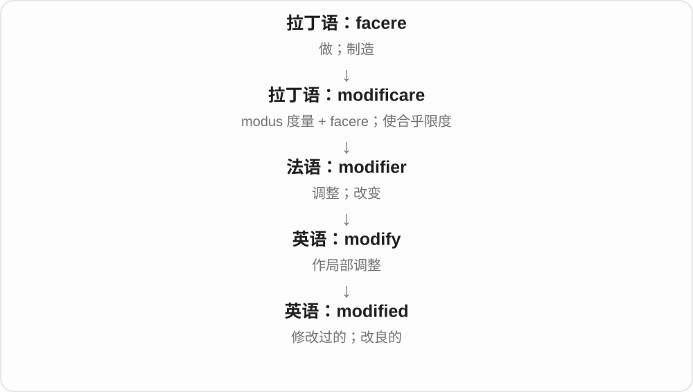

modify 的“调整限度、样式”加上完成状态，指改变已经发生。modified 不保证更好，只保证与原版本不同。

**常见搭配与例句**

a modified version；modified equipment；slightly modified。

> We tested a modified version of the design.

我们测试了设计的修改版。

> The bike was modified to fit a shorter rider.

自行车经过调整，以适合身材较矮的骑手。

**别混淆**

improved 明说变好；modified 只说改动，改好改坏要看效果。

### 126. sacred — 神圣的；与宗教有关的；极受珍视、不可侵犯的

**音标**：英、美 /ˈseɪkrɪd/

**先抓住这个画面**

把某个地方、物品或承诺郑重划出来：它不是可以随便拿来使用、破坏或背弃的东西。

**怎么拆**

拉丁 sacer“神圣的”产生 sacrare“使神圣”，经古法语 sacrer 或拉丁语进入中古英语 sacren。sacred 原是这个旧动词的分词形容词；如今作为独立形容词，-ed 读 /ɪd/。

**怎么变成今天的意思**

**拉丁 sacer → sacrare**  
神圣的 → 使神圣、奉献

↓

**古法语 sacrer／拉丁 sacrare → 中古英语 sacren**  
奉为神圣

↓

**中古英语分词 sacred → 现代形容词 sacred**  
神圣的；应受到极大尊重的

sacred music 是宗教音乐；a place sacred to a community 是某个群体视为神圣的地方。说 family time is sacred，则是强调家庭时间十分重要，不应被轻易打扰，不一定在谈宗教。

**常见搭配与例句**

sacred texts／music；sacred to someone；hold something sacred；a sacred duty。

> The mountain is sacred to the local community.

这座山对当地社群而言是神圣的。

> For her, the hour spent reading with her child is sacred.

对她来说，陪孩子阅读的那一个小时不可轻易打扰。

**别混淆**

holy 通常更直接关联宗教和神；sacred 还常形容人们极珍视的权利、时间或承诺。sacred 与 scared“害怕的”字母次序不同。

### 127. bless — 祝福；为……祈福；赐福

**音标**：/bles/

**先抓住这个画面**

为人祈求福佑是 bless；说自己 blessed with good friends，则把好朋友看成幸运得到的恩惠。

**怎么拆**

接古英语 bletsian、bledsian 等祝圣词，通常追到血相关仪式材料，后来受宗教翻译等扩展为祝福。不是 bliss 快乐直接改一个字母就造出动词。

**怎么变成今天的意思**

**古英语 bletsian 等 → bless**  
宗教祝圣、赐福；通常联系更早血祭仪式材料

↓

**现代 bless**  
祈福、祝福；be blessed with 受惠于、幸运拥有

bless someone 祝福某人；Bless you! 喷嚏后常说的祝福语；be blessed with 有幸拥有。

**常见搭配与例句**

bless someone；bless you；be blessed with。

> The elder blessed the couple before the ceremony.

仪式前，长者为这对伴侣祝福。

> She feels blessed with supportive friends.

她觉得能有支持自己的朋友很幸运。

**别混淆**

现代 bless 不需要实际血祭；旧来源说明词义怎样走来，不是今天的使用要求。

### 128. blessed — 受祝福的；幸运拥有的；令人宽慰的〔加强语〕；bless 的过去式、过去分词

**音标**：过去、分词常 /blest/；部分形容词用法常 /ˈblesɪd/

**先抓住这个画面**

把好意、祝福送到某人身上，是 bless；说自己幸运地拥有好邻居，也可用 be blessed with。生活里 a blessed relief 则像终于松了一口气。

**怎么拆**

bless + -ed，规则分词常读 /blest/；祝福、神圣、强调等形容词用法另保留常见两音节 /ˈblesɪd/。bless 承接古英语 bletsian 祝圣、祈福等词，后来扩大到祝福与幸运拥有的表达。

**怎么变成今天的意思**

**古英语 bletsian → bless**  
祝圣、祝福；后来也说赐予好处

↓

**bless + -ed → blessed**  
受祝福、幸运拥有；读音随用法分化

be blessed with wonderful friends 幸运地拥有好朋友；a blessed place 受祝福、神圣的地方；a blessed relief 极大的宽慰；Blessed are ... 宗教、文学用法。

**常见搭配与例句**

blessed with good weather；a blessed silence。

> We are blessed with wonderful neighbours.

我们很幸运，有一群好邻居。

> The quiet room was a blessed relief after the noisy journey.

喧闹的旅程之后，这间安静的房间真让人舒坦。

**别混淆**

过去动词如 blessed the meal 常为一音节 /blest/；a blessed relief 等强调性形容词常两音节。读音有传统和语境差异，不只按字母 ed 一刀切。

### 129. skip — 蹦跳；跳过、略过；不参加；废料斗〔英式〕

**音标**：/skɪp/

**先抓住这个画面**

脚轻轻跳着前进，是 skip；做事时越过一项，也像跳了一格。英式英语的 a skip 废料斗，则来自另一条容器名称。

**怎么拆**

跳跃义经中古英语 skippen，通常联系斯堪的纳维亚语言。废料斗义经 skep 等筐、量器形式；部分队长义又是 skipper 的简称。

**怎么变成今天的意思**

**中古英语 skippen，联系北日耳曼语跳跃形式**  
轻跳、跳着走

↓

**动作的扩展**  
跳过一部分、不参加；石头在水面弹跳

↓

**不同来源的容器名与简称**  
skip 废料斗另接筐、量器词；队长义可短自 skipper

skip breakfast 不吃早饭，skip a chapter 跳过一章，skip class 不去上课，skip stones 打水漂；hire a skip 租废料斗。

**常见搭配与例句**

skip a chapter；skip breakfast；skip stones；hire a skip。

> You can skip the introduction and start with chapter one.

你可以略过引言，从第一章开始。

> The builders put the broken tiles in a skip.

工人把碎瓷砖放进废料斗里。

**别混淆**

skip 可有意略过，miss 也常说没赶上、无意漏掉。skip 的容器义与跳跃义要分开认。

### 130. skipped — 轻跳、跳过、略过、不参加了

**音标**：/skɪpt/

**先抓住这个画面**

刚才从一个环节直接到下一个，中间没做，用 skipped；身体一蹦一跳，或石头在水上弹过，也可用它。

**怎么拆**

skip 双写 p + 完整 -ed → skipped，/p/ 后读 /t/；是规则过去式，不改变基础短元音。

**怎么变成今天的意思**

**中古英语 skippen，可能借北欧跳跃材料 → skip**  
轻快跳动、跳过障碍，也较早有略过内容的用法

↓

**动作、略过分支继续发展；容器与队长另分近源**  
废料斗名词接筐、容器材料；队长 skip 是 skipper 的简称

↓

**skip 双写 p + -ed → skipped**  
过去轻跳；跳过某部分或没参加

skipped a page 是跳过一页，skipped the meeting 是没参加会议；skipped across the water 可说石头弹过水面。

**常见搭配与例句**

skipped a beat 心跳像漏了一拍；skipped to the end 直接跳到末尾。

> I accidentally skipped a page while reading.

我读的时候不小心跳过了一页。

> The flat stone skipped across the water.

扁石头在水面上弹跳着掠过。

**别混淆**

skipped the lesson 说没参加那节课，left the lesson 可能已参加后离开；是否中途离开不能靠 skip 自动推出。

### 131. skipping — 正在轻跳、跳过、略过；跳绳；轻跳动作

**音标**：/ˈskɪpɪŋ/

**先抓住这个画面**

人一蹦一跳向前，或绳子转过脚下一次次跳，是 skipping；读文直接跳过部分内容，同样保留越过中段的感觉。

**怎么拆**

skip 双写 p + 完整 -ing → skipping；可作动作分词或名词，英式 skipping 常用来指跳绳。

**怎么变成今天的意思**

**中古英语 skippen，可能借北欧跳跃材料 → skip**  
轻快跳动、跳过障碍，也较早有略过内容的用法

↓

**动作、略过分支继续发展；容器与队长另分近源**  
废料斗名词接筐、容器材料；队长 skip 是 skipper 的简称

↓

**skip 双写 p + -ing → skipping**  
轻跳、略过的过程；跳绳活动

skipping rope 可说跳绳活动，也可指跳绳用的绳；skipping meals 是不吃某些餐，skipping the introduction 是略过导言。

**常见搭配与例句**

a skipping rope 一根跳绳；skipping ahead 先跳到后面。

> The children were skipping rope in the playground.

孩子们正在操场上跳绳。

> She was skipping the long descriptions to follow the story.

她正略过冗长描写，顺着情节往下读。

**别混淆**

skipping 的轻跳常有一跳一步的轻快节奏；hopping 更常让人想到短跳、单脚跳，两者在普通跳动场景里也可重叠。

### 132. skips — 轻跳、跳过、略过、不参加〔第三人称单数〕；轻跳、跳过处；废料斗〔复数〕

**音标**：/skɪps/

**先抓住这个画面**

小孩一蹦一跳走，叫 skips；读书直接略过一段，也像把中间那一段跳掉。英国工地的 skips 则是装废料的大斗，来源另分。

**怎么拆**

skip + -s，/p/ 后读 /s/；轻跳、略过三单与若干不同来源名词的复数同形，要按语境辨。

**怎么变成今天的意思**

**中古英语 skippen，可能借北欧跳跃材料 → skip**  
轻快跳动、跳过障碍，也较早有略过内容的用法

↓

**动作、略过分支继续发展；容器与队长另分近源**  
废料斗名词接筐、容器材料；队长 skip 是 skipper 的简称

↓

**skip + -s → skips**  
它跳过；几次跳动；另一支多个废料斗

skips breakfast 是不吃早餐，skips a paragraph 是跳过一段，skips down the path 是沿路蹦跳；rubbish skips 是废料斗。

**常见搭配与例句**

skips a step 跳过一步；skips school 不去上学、逃学。

> She sometimes skips breakfast when she is in a hurry.

她赶时间时有时不吃早餐。

> The child skips along the path beside his father.

孩子在爸爸身边沿小路一蹦一跳地走。

**别混淆**

skips 常带原本有个顺序、环节却没经过的感觉；forgets 说忘记，skip 可能有意，也可能无意，不能单凭词定原因。

### 133. bored — 感到无聊、厌烦的；已钻孔的〔另一义〕

**音标**：英 /bɔːd/；美 /bɔːrd/

**先抓住这个画面**

镜头对着人：没什么吸引注意，等得不耐烦，感觉无聊；就是 I am bored。

**怎么拆**

bore + -ed，末尾 e 后加 d。作感受形容词说受乏味影响，钻孔语境也可说已经打过孔。结尾 /d/ 不另添一个音节。

**怎么变成今天的意思**

**古英语 borian → bore**  
钻孔、穿透；孔及其直径

↓

**另一常用 bore 厌烦义**  
令人乏味的人、事与使厌烦；和钻孔义的历史联系有争议

↓

**bore → bored**  
使厌烦 → 感到无聊；钻孔 → 已钻孔

get bored 感到无聊，be bored with/of 对……厌烦，look bored 看起来无聊；of 口语常见，with 是稳妥常用搭配。

**常见搭配与例句**

get bored；be bored with；look bored；bored to tears。

> I got bored with the repetitive task.

我对重复的任务感到厌烦。

> The children looked bored during the long speech.

漫长演讲中，孩子们看起来很无聊。

**别混淆**

I am bored 是我感到无聊；I am boring 是我让别人无聊。人可以是造成者，也可以是感受者，不能仅按人用 -ed、物用 -ing 背。

### 134. distinguished — 杰出的、受尊敬的；气度不凡的；已区分的

**音标**：/dɪˈstɪŋɡwɪʃt/

**先抓住这个画面**

一个人从人群里“显出来”，是因为成就、声望，或举止有气度。常见形容词义带赞许，不只是与别人不一样。

**怎么拆**

distinguish + -ed，过去分词及形容词；末尾 /ʃ/ 后 -ed 读 /t/。在被动句中也可能只是“被区分”，要看上下文。

**怎么变成今天的意思**

**拉丁 distinguere〔dis- + -stinguere〕**  
分开、标出区别；更古老的刺、推等分析有分歧

↓

**法语 distinguer／词干 distinguiss-，也有直接拉丁借入分析**  
辨别、区分

↓

**中古英语 distingwen 等 → 现代 distinguish**  
辨别；使出众；现代词尾受 -ish 类形式影响

↓

**英语 distinguish + -ed → distinguished**  
已被区分；引申因成就或气质而出众

a distinguished scientist 是有成就、有声望的科学家；a distinguished appearance 是仪表不凡。be distinguished by something 说某种特点让其突出。

**常见搭配与例句**

a distinguished career；a distinguished guest；look distinguished；be distinguished by。

> The lecture was given by a distinguished historian.

讲座由一位享有声望的历史学家主讲。

> His silver hair and calm manner gave him a distinguished appearance.

银发和沉稳的举止让他显得气度不凡。

**别混淆**

distinctive 是有特色、容易识别，不一定优秀；distinguished 通常带成就或气度上的肯定。

### 135. wrap — 包、裹；包装材料、披肩、食物卷；收尾；文本换行

**音标**：/ræp/

**先抓住这个画面**

用一层柔软材料围住东西，是 wrap 的核心画面。食物被饼包起来成卷；工作全部收拢结束，又有 wrap up 收尾。

**怎么拆**

中古英语 wrappen、wrappe 等已存在，远源有日耳曼语相关分析但未定。开头 w 在现代常用读音中不发音；不要与 rap 说唱混为一词。

**怎么变成今天的意思**

**中古英语 wrappen、wrappe**  
包、折叠；更早来源未完全确定

↓

**现代 wrap**  
用材料包围；包裹物、食物卷；收尾与文本换行等扩展

wrap a gift 包礼物，wrap a scarf around your neck 把围巾绕在脖子上，a chicken wrap 鸡肉卷，wrap up a meeting 结束会议。word wrap 是排版中的自动换行。

**常见搭配与例句**

wrap a gift；wrap around；wrap up；word wrap。

> She wrapped the gift in blue paper.

她用蓝纸包好了礼物。

> Let’s wrap up the meeting in five minutes.

我们五分钟后结束会议吧。

**别混淆**

wrap 强调围包，pack 更广地说打包、装好。That’s a wrap! 常表示拍摄、工作完成，并不要求真出现包装纸。

### 136. wrapped — 包裹好的；全神贯注、沉浸其中的〔常与 up 连用〕；wrap 的过去式、过去分词

**音标**：/ræpt/

**先抓住这个画面**

把礼物用纸包住，或把自己裹进毯子，里面的东西就被一层外物围住了。注意力全被某件事占住，也可以借用这种包在里面的画面。

**怎么拆**

wrap 双写 p 加 -ed；w 不发音，词尾读 /t/。中古英语 wrappen 已有包裹、围住义，更早来源不确定，不能把某一推测写成定论。

**怎么变成今天的意思**

**中古英语 wrappen → wrap**  
包住、围住、折裹

↓

**wrap 双写 p + -ed → wrapped**  
已经包好；比喻被某件事占满注意力

wrapped in paper 用纸包着；wrapped in a blanket 裹着毯子；wrapped up in a book 全神贯注看书；wrapped up the meeting 结束了会议。

**常见搭配与例句**

a carefully wrapped gift；wrapped around a pole。

> The gift was wrapped in plain brown paper.

礼物用普通棕色纸包着。

> She was so wrapped up in her book that she missed the announcement.

她看书太入迷，没听见通知。

**别混淆**

wrap up 可以包好、结束，也能在 be wrapped up in 中表示沉浸。wrapped 与 rapped 同音，拼写和动作不同。

### 137. bias — 偏向、偏见；使产生偏向；斜裁〔纺织〕

**音标**：/ˈbaɪəs/

**先抓住这个画面**

一把秤总往一边歪，像判断总给某一方额外好处，这就是理解 bias 的画面；它也可能来自取样方法，而非故意偏袒。

**怎么拆**

借法语 biais 斜、倾斜等，曾用于滚球偏行，后来出现心智偏向义；法语远源仍有争论。不是 bi- 二 + 一个明确的现代英语 as。

**怎么变成今天的意思**

**法语 biais 斜、倾斜 → 英语 bias**  
斜向及滚球运动的偏行材料

↓

**英语 bias 名词、动词**  
偏向一边；偏见；使判断偏斜，远源未定

a bias against 某种不利偏见；a bias towards 偏向；sampling bias 抽样偏差；cut on the bias 斜裁布料。

**常见搭配与例句**

a bias against；sampling bias；cut on the bias。

> The survey design introduced a bias towards frequent users.

调查设计造成了偏向高频用户的偏差。

> The fabric is cut on the bias.

这块布按斜向裁剪。

**别混淆**

bias 可以是系统偏差，不必每次都是仇恨或故意说谎；random error 则更强调随机波动。

### 138. biased — 有偏向的；有偏见的；有系统偏差的

**音标**：/ˈbaɪəst/

**先抓住这个画面**

一个报道只挑一方有利事实，是 biased；硬币总更容易落到某一面，也可叫 biased，不要求硬币有心理态度。

**怎么拆**

bias + -ed → biased，通常不双写 s；词末 /s/ 后接 /t/，仍保留 bias 原来的两个音节。

**怎么变成今天的意思**

**法语 biais 斜、倾斜 → 英语 bias**  
斜向及滚球运动的偏行材料

↓

**英语 bias 名词、动词**  
偏向一边；偏见；使判断偏斜，远源未定

↓

**bias + -ed → biased**  
受到偏向影响；表现偏见、偏差

a biased report 有偏向的报道；a biased sample 有偏差的样本；a biased coin 不均衡、两面概率不等的硬币。

**常见搭配与例句**

a biased report；a biased sample；biased against。

> The article was criticised for being biased.

文章因有偏向而受到批评。

> A biased sample can give a misleading picture of the whole population.

有偏差的样本可能误导人们对整体的认识。

**别混淆**

biased 不能只凭与自己观点不同来判断；统计里的 biased 也不必带主观恶意。

### 139. devoted — 忠实热爱的；专心投入的；专用于的

**音标**：英 /dɪˈvəʊtɪd/；美 /dɪˈvoʊtɪd/

**先抓住这个画面**

不是偶尔关注，而是持续地把心思和行动放在某个人或事情上。

**怎么拆**

devote + -ed 的分词形容词；由被献出、投入发展出忠诚、热爱等意思。

**怎么变成今天的意思**

**拉丁语 vovēre**  
郑重许诺、起誓、奉献

↓

**拉丁语 de- + vovēre → dēvovēre**  
以誓愿献出、郑重奉献

↓

**拉丁语 dēvōtus → 英语 devote**  
被献出的 → 把时间、精力或自己投入某事

↓

**英语 devote + -ed → devoted**  
投入的、献出的 → 忠实热爱的、专用的

a devoted friend 是忠实朋友；be devoted to teaching 是热爱并投入教学；a page devoted to travel 是专门讲旅行的一页。最后一种并不表示网页有感情。

**常见搭配与例句**

a devoted friend；be devoted to；a section devoted to。

> He remained a devoted friend throughout her illness.

在她整个患病期间，他始终是一位忠实的朋友。

> The final section is devoted to practical examples.

最后一节专门介绍实际例子。

**别混淆**

devout 通常突出宗教虔诚；devoted 可以说对家人、事业、爱好的持续投入。

### 140. spray — 喷、喷洒；飞沫、喷雾、喷剂；带花小枝〔另源〕

**音标**：/spreɪ/

**先抓住这个画面**

液体分成许多细滴向外散开，是 spray；浪打在石头上扬起飞沫，也可叫 spray。a spray of flowers 却是带花枝条，来自另一条词线。

**怎么拆**

喷洒动词通常借中古荷兰语 sprayen 等，联系散播、撒散词族；液滴名词相关。小枝义在中古英语已有，远源未明，可能联系古英语枝条形式。

**怎么变成今天的意思**

**中古荷兰语 sprayen 等 → spray 动词**  
撒散、喷洒液滴

↓

**动词 → 液滴、喷雾产品等名词**  
分散的细水滴；喷雾、喷剂

↓

**另源同形词 spray**  
小枝、带花小枝；与喷雾线分开

sea spray 海浪飞沫，a fine spray of water 细水雾，spray water on leaves 往叶子上喷水，spray the leaves with water 用水喷叶子，a spray of flowers 带花的小枝。

**常见搭配与例句**

sea spray；a fine spray；spray something with water。

> Sea spray reached the windows of the boat.

海浪飞沫溅到船窗上。

> She added a spray of small flowers to the arrangement.

她往插花中添了一小枝花。

**别混淆**

spray 液滴分散，pour 倒水更像液流；花枝义不能只按现代喷雾比喻倒推词源。

### 141. sprayed — 喷洒了、喷雾了；被喷上细滴的

**音标**：/spreɪd/

**先抓住这个画面**

刚才把水、清洁液等分成许多细滴撒开，用 sprayed。它常同时交代喷的液体和被喷的表面。

**怎么拆**

喷洒动词 spray + 完整 -ed，/eɪ/ 后读 /d/；元音字母加 y 的结尾保留 y，不变成 i。

**怎么变成今天的意思**

**喷滴支线：中古荷兰语 sprayen → spray 动词、相关名词**  
把液体撒成细滴，喷雾、喷剂等由此发展

↓

**小枝支线：中古英语 sprai 等 → spray**  
细枝、花枝；更远来源未定，不从喷雾外形确定推导

↓

**spray + -ed → sprayed**  
过去把液体喷成细滴

sprayed water on the plants 是往植物喷水，sprayed the plants with water 则把植物放宾语；两句对应同一个喷洒场景。

**常见搭配与例句**

sprayed the glass 喷了玻璃；sprayed into the air 喷向空中。

> He sprayed water over the dusty path.

他往积灰的小路上喷水。

> She sprayed the glass with a little cleaning fluid.

她往玻璃上喷了一点清洁液。

**别混淆**

sprayed 常把液体分散成滴，poured 常一股倒出；squirted 又常是一小股细流，不要都译成随意泼。

### 142. sprays — 喷洒、喷雾〔第三人称单数〕；喷雾、喷剂、喷流〔复数〕；花枝〔复数〕

**音标**：/spreɪz/

**先抓住这个画面**

把水分成细细的散滴喷出去，用 sprays；桌上的 sprays of flowers 则是几枝带花的枝条，属于另一条来源。

**怎么拆**

喷洒动词、喷雾名词 spray + -s，读 /z/；小枝名词也有同形复数，近源需按场景分开。

**怎么变成今天的意思**

**喷滴支线：中古荷兰语 sprayen → spray 动词、相关名词**  
把液体撒成细滴，喷雾、喷剂等由此发展

↓

**小枝支线：中古英语 sprai 等 → spray**  
细枝、花枝；更远来源未定，不从喷雾外形确定推导

↓

**spray + -s → sprays**  
他、她喷洒；多种喷雾或多枝花枝

sprays water on the leaves 是给叶片喷细水滴，cleaning sprays 是清洁喷剂，sprays of blossom 是几枝花枝。

**常见搭配与例句**

fine sprays 细喷雾；sprays the surface 喷洒表面。

> She sprays the leaves with a little water.

她给叶片喷一点水。

> Two sprays of white flowers lay on the table.

桌上放着两枝白花。

**别混淆**

sprays 的植物枝条义不是“花朵被喷出来”；它有较早小枝材料，和喷液体支线分别记。

### 143. beloved — 深爱的；深受喜爱的；心爱的人

**音标**：形容人、物常读 /bɪˈlʌvɪd/；beloved by/of 亦常读 /bɪˈlʌvd/

**先抓住这个画面**

不只是随便觉得不错，而是珍爱、深受喜爱。a beloved place 可以是一处一直放在心里的地方。

**怎么拆**

中古英语 belove 等旧动词的分词：be- + love 材料 + -ed。现代保留形容词、名词；不是 love 现在额外统一多加一个 be 就都更高级。

**怎么变成今天的意思**

**中古英语 belove 等**  
喜爱、爱

↓

**belove + -ed → beloved**  
深爱的；心爱的人，保留不同词尾读法

a beloved teacher 深受喜爱的老师；beloved by readers 深受读者喜爱；my beloved 我心爱的人，较正式、文学化。

**常见搭配与例句**

a beloved teacher；beloved by readers；my beloved。

> The library was a beloved part of the neighbourhood.

图书馆是街区里深受喜爱的一部分。

> Her stories are beloved by readers of all ages.

她的故事深受各年龄读者喜爱。

**别混淆**

beloved 的 -ed 有保留 /ɪd/ 的固定读法，不能机械套成 /d/；具体结构也有较短的 /bɪˈlʌvd/。

### 144. tweet — 啁啾、鸟的短鸣；推文、发推

**音标**：/twiːt/

**先抓住这个画面**

小鸟短短地啾一声，是 tweet。网络把这种轻短的声音借去称一条信息、发一条信息，像向外啾了一声。

**怎么拆**

拟鸟鸣声的词。社交媒体义在 Twitter 的命名、使用中发展起来；现代阅读仍会遇到这些词，平台界面也使用 post 等名称。

**怎么变成今天的意思**

**tweet 拟声**  
鸟的短促高声鸣叫

↓

**网络借用鸟鸣的轻短表达**  
tweet 推文、发推；retweet 转推

birds tweet 鸟啾啾叫，write a tweet 写一条推文，tweet about something 发推谈某事。这里学词义，不限定某条消息的字数。

**常见搭配与例句**

write a tweet；tweet about。

> Birds were tweeting outside the window.

窗外鸟儿啾啾叫。

> Her tweet included a photograph of the exhibition.

她的推文附有一张展览照片。

**别混淆**

tweet 可数名词指一条消息，也能作动词；鸟鸣义比社交平台早，不能把所有 tweet 都译成网上发文。

### 145. tweeted — 啾叫了；发推文了、在 Twitter 上发帖了

**音标**：/ˈtwiːtɪd/

**先抓住这个画面**

鸟刚才“啾”地叫，用 tweeted；读到网络旧帖、新闻时，也常说某人发了一条推文。先看主语和内容。

**怎么拆**

tweet + 完整 -ed，/t/ 后读 /ɪd/，多一个音节。基础 tweet 先有鸟鸣名词，后来才有动词和网络用途。

**怎么变成今天的意思**

**十九世纪 tweet 鸟鸣名词 → 动词**  
模仿小鸟短促、尖细的鸣声

↓

**网络语境借用鸟鸣词**  
用 tweet 说在 Twitter 上发短帖；是新用途，不是鸟鸣来自网站名

↓

**tweet + -ed → tweeted**  
过去啾鸣或发布推文

tweeted from the tree 是在树上啾鸣，tweeted a photo 是发了一张图片；网络义不说明一定用手机。

**常见搭配与例句**

tweeted about the event 发帖谈那件事；tweeted a link 发了一个链接。

> A bird tweeted from the branch above the window.

窗上方的树枝上传来鸟儿啾鸣。

> She tweeted a photo of the finished mural.

她发了一张壁画完工后的照片到 Twitter。

**别混淆**

tweeted 的两义共用同一读音。网络用法是借鸟的短鸣作名称，不能反过来说鸟在模仿电子消息。

### 146. tweets — 鸟的短促鸣叫；推文〔复数〕；鸣叫、发推文〔第三人称单数〕

**音标**：/twiːts/

**先抓住这个画面**

小鸟短短叫几声，是 tweets；网络上把简短消息比作小鸟叫，历史上也形成了 tweets 的推文用法。

**怎么拆**

tweet 本是模仿鸟鸣的拟声词，网络义在 Twitter 的命名和使用中发展。现代直接加 -s，/t/ 后读 /s/；这是词汇与历史用法，不依赖某个当前界面的按钮名称。

**怎么变成今天的意思**

**tweet 拟鸟鸣声**  
短促高声的鸟叫

↓

**网络借用短促鸣叫的形象；tweet + -s → tweets**  
短消息、推文；鸟鸣复数或动作三单

the tweets of birds 小鸟的鸣叫；read old tweets 读旧推文；tweets about the event 关于活动的推文。

**常见搭配与例句**

a few tweets 几声鸟叫或几条推文；tweets from the garden 花园传来的鸟鸣。

> We heard soft tweets from the garden.

我们听到花园里传来轻轻的鸟鸣。

> The article quotes several old tweets.

文章引用了几条旧推文。

**别混淆**

tweets 的鸟鸣义和网络义靠对象分清。to tweet 可作动词，a tweet 是一声鸣叫或一条推文；网络词义在旧文章里仍需要认识。

### 147. tweeting — 正在啾叫；正在发推文；鸟鸣、发推文活动

**音标**：/ˈtwiːtɪŋ/

**先抓住这个画面**

鸟一声声短鸣，是 tweeting；网络语境里，则是正在发推文，或把发帖这件事整体说出来。

**怎么拆**

tweet + 完整 -ing，直接加；tweet 的鸟鸣基础先于网络义，两个义项都按同样规则变化。

**怎么变成今天的意思**

**十九世纪 tweet 鸟鸣名词 → 动词**  
模仿小鸟短促、尖细的鸣声

↓

**网络语境借用鸟鸣词**  
用 tweet 说在 Twitter 上发短帖；是新用途，不是鸟鸣来自网站名

↓

**tweet + -ing → tweeting**  
啾鸣过程；发布推文的过程、活动

birds tweeting 是鸟儿啾鸣，tweeting about a concert 是发推文谈音乐会；看 about 后的信息常能分清。

**常见搭配与例句**

tweeting from the garden 在花园里啾鸣；live tweeting 实时发帖记录。

> We could hear the birds tweeting in the garden.

我们听见花园里鸟儿啾鸣。

> He spent the evening tweeting about the concert.

他那晚一直在发推文谈音乐会。

**别混淆**

tweeting 不必一律翻成网络行为；自然描写里的 birds tweeting 仍是普通的鸟鸣。

### 148. accomplished — 技艺精湛的；有造诣的；完成了的

**音标**：英 /əˈkʌmplɪʃt/；美 /əˈkɑːmplɪʃt/

**先抓住这个画面**

一个人经过训练，已经能把一门技艺做得很成熟，不再只是会一点。

**怎么拆**

accomplish + -ed；既是过去分词，也发展为形容词。历史上 accomplish 还有通过教育使人完善、熟练的用法。

**怎么变成今天的意思**

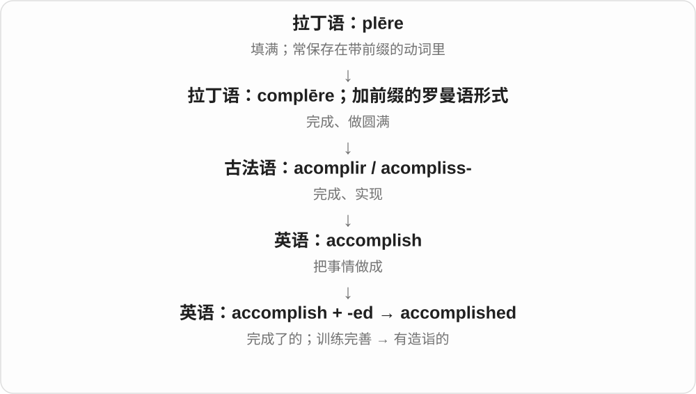

an accomplished pianist 是熟练出色的钢琴家；mission accomplished 是任务完成。人物形容词不表示这个人的人生已经结束。

**常见搭配与例句**

an accomplished musician；an accomplished writer；mission accomplished。

> She is an accomplished violinist as well as a careful teacher.

她既是技艺精湛的小提琴家，也是一位细心的老师。

> With the repairs finished, he could finally say, “Mission accomplished.”

维修结束后，他终于可以说：“任务完成。”

**别混淆**

talented 强调有天分；accomplished 强调已经展现出成熟的技艺。

### 149. embarrass — 使尴尬、使难堪

**音标**：英 /ɪmˈbærəs/；美 /ɪmˈbærəs/

**先抓住这个画面**

你正在大家面前说话，别人忽然揭出一件糗事，让你不知道脸往哪放，就是 embarrass you。

**怎么拆**

借法语 embarrasser 阻碍、使困窘，关联西班牙等语言的相关形式，细部借入路径有分歧。不是英语 bare 裸的简单加前后缀。

**怎么变成今天的意思**

**法语 embarrasser，接西班牙等罗曼语相关形式**  
阻碍、困住；更远路径有分歧

↓

**英语 embarrass → embarrassment**  
使局促难堪；尴尬及使人难堪的事

embarrass someone 使某人尴尬；be embarrassed about/by 因……难堪；embarrassing 说事情令人尴尬。

**常见搭配与例句**

embarrass someone；be embarrassed about。

> Please do not embarrass me in front of everyone.

请别让我在大家面前难堪。

> The unexpected praise embarrassed him.

突如其来的夸奖让他有些不好意思。

**别混淆**

embarrassed 是人感到难堪，embarrassing 是人或事使别人难堪；要看谁承受、谁造成。

### 150. embarrassing — 令人尴尬、难堪的；embarrass 的 -ing 形式

**音标**：/ɪmˈbærəsɪŋ/

**先抓住这个画面**

同样一个口误，从当事人的感受看是 embarrassed，从这件事给人的影响看是 embarrassing。它把尴尬带给别人。

**怎么拆**

embarrass 保留词尾加 -ing。继承妨碍、使局促的动词线，常作性质形容词说令人不自在，不一定表示动作此刻正在进行。

**怎么变成今天的意思**

**embarrass**  
使人局促、难堪

↓

**embarrass + -ing → embarrassing**  
正在使难堪；具有使人难堪的性质

an embarrassing mistake 尴尬的错误；an embarrassing question 令人难堪的问题；an embarrassing silence 尴尬的沉默；find something embarrassing 觉得某事让人尴尬。

**常见搭配与例句**

an embarrassing moment；an embarrassing situation。

> It was an embarrassing mistake, but we corrected it quickly.

那是个令人尴尬的错误，但我们很快纠正了。

> He can be very embarrassing in public.

他在公共场合有时很让旁人难堪。

**别混淆**

I am embarrassing 在某些语境是我让人难堪；I am embarrassed 才是我感到难堪。词尾在改变感受从哪一方来。

### 151. embarrassed — 尴尬的、难堪的；被弄得不自在；embarrass 的过去式、过去分词

**音标**：/ɪmˈbærəst/

**先抓住这个画面**

当众叫错了名字，大家看过来，你一时不知道怎样接话。这种局促、难堪的感受就是 embarrassed。

**怎么拆**

embarrass + -ed，末尾 /s/ 后读 /t/。embarrass 经法语 embarrasser，较早有妨碍、困住等义，更深罗曼语传入路径有不同解释；现代常说使人社交上窘迫。

**怎么变成今天的意思**

**法语 embarrasser → embarrass**  
妨碍、困住等 → 使局促难堪

↓

**embarrass + -ed → embarrassed**  
受到这种影响；感到难堪

feel embarrassed 感到尴尬；embarrassed about a mistake 为错误难堪；embarrassed to ask 不好意思开口问；an embarrassed smile 尴尬的笑。

**常见搭配与例句**

look embarrassed；be embarrassed by someone’s behaviour。

> I felt embarrassed when I forgot her name.

忘记她名字时，我觉得很尴尬。

> He was too embarrassed to ask the question.

他不好意思开口问那个问题。

**别混淆**

embarrassed 描写受到影响后的感受，embarrassing 描写造成尴尬的性质。人也可以很 embarrassing，只要他的言行让别人难堪。

### 152. peer — 同辈、同等者；贵族；另有“仔细看”的动词

**音标**：英 /pɪə/；美 /pɪr/

**先抓住这个画面**

这里先想与你处在相近位置的人：同龄、同级，或同专业的人。

**怎么拆**

名词经古法语 per／peir 来自拉丁 par“相等”。动词 peer“费力地看、凝视”来源不同，不能从同辈义推出来。

**怎么变成今天的意思**

**拉丁语 par**  
相等的、相称的

↓

**古法语 per／peir → 英语 peer**  
地位相等的人；同辈、同等者

peer pressure 是同伴压力；peer review 是让同领域的人评审。peer 不一定是朋友，也不一定严格同龄，关键是相关语境里地位或角色相近。英国贵族称谓中的 peer 也有历史上的同等级背景。

**常见搭配与例句**

a peer group；peer pressure；peer review；one’s peers。

> She is respected by her peers in the field.

她受到这个领域同行的尊重。

> The study was reviewed by a group of independent peers.

这项研究由一组独立同行进行了评审。

> He peered through the window to see who was inside.

他透过窗户仔细看，想弄清里面是谁。

**别混淆**

colleague 是同事，peer 是相关层面上的同等者，两者可重合但不完全相同。peer through the window 的 peer 是另源动词。

### 153. peering — 正在费力、仔细地看；网络对等互联

**音标**：英 /ˈpɪərɪŋ/；美 /ˈpɪrɪŋ/

**先抓住这个画面**

凑近门缝、眯着眼辨认小字，正在努力看清的过程叫 peering；网络语境另有同辈、对等的 peer 派生出的互联名词。

**怎么拆**

看这个动词 peer + -ing；网络名词也写 peering，但接对等的 peer 名词材料，词源分路，不能都从凝视推出。

**怎么变成今天的意思**

**中古英语 piren 等看、凝看的材料 → peer 动词**  
可能联系东弗里斯兰语材料，另受 appear 的缩短形式影响，远源未定

↓

**现代 peer：努力、仔细地看**  
同辈、贵族名词另接拉丁 par 相等；不能从同辈直接推成看

↓

**peer + -ing → peering**  
看这一支是正在努力辨认；对等这一支另形成网络互联名词

peering into the distance 努力看远处；peering over a wall 探头看墙外；网络 peering agreement 是对等互联协议。

**常见搭配与例句**

peering through the fog；peering at the screen。

> He was peering into the fog, trying to find the path.

他正努力往雾里看，想找出小路。

> She stood on tiptoe, peering over the wall.

她踮着脚，探头往墙外看。

**别混淆**

读 peering 时先看是不是眼睛、视线的场景；网络协议里的同形名词需要回到对等的另一支理解。

### 154. peered — 仔细、费力地看了；探头看了

**音标**：英 /pɪəd/；美 /pɪrd/

**先抓住这个画面**

光线暗、字太小，或东西被挡了一点，于是把头凑近、眼睛努力去看，过去这个动作叫 peered。

**怎么拆**

看这个动词 peer + -ed，词尾读 /d/；同拼写的同辈名词是另一来源，不是这里的历史起点。

**怎么变成今天的意思**

**中古英语 piren 等看、凝看的材料 → peer 动词**  
可能联系东弗里斯兰语材料，另受 appear 的缩短形式影响，远源未定

↓

**现代 peer：努力、仔细地看**  
同辈、贵族名词另接拉丁 par 相等；不能从同辈直接推成看

↓

**peer + -ed → peered**  
过去努力看清或仔细探看

peered into the darkness 向黑暗里费力看；peered over the glasses 从眼镜上方仔细看。

**常见搭配与例句**

peered through a crack；peered at the small print。

> She peered through the window to see whether anyone was inside.

她凑到窗边仔细看，想知道里面有没有人。

> He peered at the tiny print on the ticket.

他费力地看票上那些小字。

**别混淆**

stared 不一定看不清，只是目光停住；peered 常让人觉得对象不易看清，人在努力辨认。

### 155. plug — 塞子；插头；堵住、填补；为……宣传；接通〔plug in〕

**音标**：/plʌɡ/

**先抓住这个画面**

用一个塞子填住孔洞，是 plug；电线末端能插进接口的插头，也用了这个插入物的名称。

**怎么拆**

较早英语塞子义通常借荷兰语 plug、plugge 等，属于相关日耳曼语塞、桩词族，更早来源不明。电气插头义按插入的动作扩大，宣传义则是另一路较晚用法。

**怎么变成今天的意思**

**荷兰语等塞子、桩词 → plug**  
堵住孔洞的物体

↓

**名词 plug → 动词及扩展**  
堵孔；插头、插接；另有宣传义

a bath plug 浴缸塞子；an electric plug 电源插头；plug a gap 填补缺口；plug in a charger 插上充电器；plug a book 宣传一本书。

**常见搭配与例句**

pull out the plug；plug something into ...。

> The cable has a small plug at one end.

电缆一端有一个小插头。

> The extra information helped plug a gap in the report.

补充的信息填补了报告的一处缺漏。

**别混淆**

plug 是插进去的一端，socket 常是接纳插头的插座、接口。plug a gap 既可填实际孔洞，也可补人员、信息或预算缺口。

### 156. plugs — 插头、塞子〔复数〕；插、塞住；宣传〔第三人称单数〕

**音标**：/plʌɡz/

**先抓住这个画面**

把开口塞住、把接口接上，是 plugs 的器物动作画面。一个个插头、塞子可以数；动词还可在口语里说给某物做宣传。

**怎么拆**

plug 的塞子名通常经荷兰语相关形式借入，远源未定。插头、电气连接由插入用途扩大；宣传义较晚。现代加 -s，/ɡ/ 后读 /z/。

**怎么变成今天的意思**

**荷兰语等塞、桩材料 → plug**  
塞子、塞住 → 电气插接器具、动作

↓

**plug + -s → plugs；较晚口语扩展**  
多个塞子、插头；某人插、宣传

electrical plugs 电源插头；plugs the gap 塞住缺口；plugs a book 宣传一本书。

**常见搭配与例句**

plugs in the cupboard 柜子里的插头；plugs in the device 接上设备。

> The drawer held spare plugs and cables.

抽屉里放着备用插头和线缆。

> He plugs the cable into the socket.

他把线缆插头接到插口。

**别混淆**

插接义看 device、socket，宣传义看 book、show、interview 等。两类动作已是固定用法，不必每次重演一条字面故事。

### 157. plugged — 堵住的、填补好的；插接好的〔常与 in 连用〕；plug 的过去式、过去分词

**音标**：/plʌɡd/

**先抓住这个画面**

孔被塞住了，叫 plugged；设备插上电源或接口，常说 plugged in。有没有 in，会直接影响你理解它在做什么。

**怎么拆**

plug 双写 g 加 -ed，/ɡ/ 后词尾读 /d/。保持塞入、填住的动作，也继承现代电气插接和宣传等用法。

**怎么变成今天的意思**

**plug**  
塞子、插头；堵住、插接

↓

**plug 双写 g + -ed → plugged**  
已经堵住、插好；已作相应动作

plugged with mud 被泥堵住；plugged into a socket 插在插座上；plugged in 接通着；plugged the gap 填补了缺口。

**常见搭配与例句**

keep it plugged in；a plugged opening。

> The small hole was plugged with clay.

那个小孔用黏土堵住了。

> The lamp was plugged in, but it was switched off.

灯插着电源，但开关关着。

**别混淆**

plugged in 除接通外，口语还可说与某圈子联系紧、消息灵通。单独 plugged 不会在每个句子里自动包含电源已经接通的意思。

### 158. plugin — 插件；可接入的扩展部件

**音标**：/ˈplʌɡɪn/

**先抓住这个画面**

主程序已经能运行，再接入一个小部件增添功能，这个扩展部件叫 plugin。像给已有装置插上一个能配合工作的模块。

**怎么拆**

由 plug in 插入、接上形成的固定名称，常见另一拼写带连字符。plug 的电气插接义从塞子、插入用途扩大。

**怎么变成今天的意思**

**plug 的插接用法 → plug in**  
把部件接进现有装置

↓

**plug in → plugin**  
给主系统添功能的接入部件，常指软件

a browser plugin 浏览器插件；an audio plugin 音频插件。

**常见搭配与例句**

install a plugin 安装插件；a plugin for the editor 编辑器插件。

> The editor uses a plugin to check spelling.

编辑器用一个插件检查拼写。

> She added an audio plugin to her music software.

她给音乐软件添加了音频插件。

**别混淆**

plugin 强调附加到主系统，standalone application 强调独立使用；具体模块能否单独运行要看它的设计。

### 159. plugins — 插件、可接入的扩展部件〔复数〕

**音标**：/ˈplʌɡɪnz/

**先抓住这个画面**

给主程序另加的几个功能模块，就是 plugins。接入的重点是功能配合，不要求真有一个物理插头。

**怎么拆**

plug in → plugin 名词，再加 -s，/n/ 后读 /z/。

**怎么变成今天的意思**

**plug in → plugin**  
插接画面用于附加功能部件

↓

**plugin + -s → plugins**  
多个插件、扩展部件

audio plugins 音频插件；editor plugins 编辑器插件。

**常见搭配与例句**

manage plugins 管理插件；plugins for the browser 浏览器插件。

> The music software supports several audio plugins.

这款音乐软件支持几种音频插件。

> The team wrote plugins for the text editor.

团队为文本编辑器编写了插件。

**别混淆**

插件与主程序的关系是附加功能；不必把每个独立软件都叫 plugin。

### 160. unplug — 拔下插头、断开插接；暂时离开工作、网络等

**音标**：/ʌnˈplʌɡ/

**先抓住这个画面**

原来接着的插头被拔开，是 unplug。人在工作、网络中暂时断开联系、休息一下，也能借这个动作来说。

**怎么拆**

un- 解除、反向 + plug 插接 → unplug。现代组合直接把接上与解除接上相对应，再有抽象断联用法。

**怎么变成今天的意思**

**un- + plug → unplug**  
解除插接、拔开插头

↓

**连接画面的抽象扩展**  
暂时离开工作、网络等持续联系

unplug the lamp 拔下台灯插头；unplug for the weekend 周末暂离工作、网络。

**常见搭配与例句**

unplug the cable 拔下线缆插头；time to unplug 暂时放下外界联系、休息的时候。

> She reached down to unplug the lamp.

她弯下身去拔台灯插头。

> He wanted to unplug for the weekend.

他想周末暂离工作和网络，好好歇一下。

**别混淆**

字面义可直接接设备，抽象义也可不带宾语。un- 给解除关系，不是把 plug 变成一种否定形容词。

### 161. unplugged — 拔下插头了、未接电的；不插电演奏的

**音标**：/ʌnˈplʌɡd/

**先抓住这个画面**

插头已经断开，是 unplugged。音乐里不用电声乐器放大、偏重原声的演出，也常借这个断开插接的名称。

**怎么拆**

un- + plug → unplug，词末 g 在短重读音节后双写，加完整 -ed；/ɡ/ 后读 /d/。形容词再有原声演奏等固定用法。

**怎么变成今天的意思**

**un- + plug → unplug**  
解除插接

↓

**unplug 双写 g + -ed → unplugged**  
未插接的；不插电、原声演奏的名称

an unplugged lamp 未接电的台灯；an unplugged performance 不插电演出。

**常见搭配与例句**

unplugged the cable 拔下了线缆；an unplugged session 原声演奏场次。

> The lamp was unplugged.

台灯没有接电。

> The band gave an unplugged performance.

乐队带来了一场不插电演出。

**别混淆**

音乐名称强调演奏风格、乐器使用方式，不必据此推断现场所有录音、灯光设备都没有电。

### 162. unplugging — 正在拔下插头、断开；暂离持续联系的过程

**音标**：/ʌnˈplʌɡɪŋ/

**先抓住这个画面**

插接正在被解除，或人在安排一段不被持续工作、联网占住的时间，都可以用 unplugging。

**怎么拆**

un- + plug → unplug，再双写 g，加完整 -ing。进行形式和活动名都围绕解除连接的动作形成。

**怎么变成今天的意思**

**un- + plug → unplug**  
解除插接；后来也比喻暂时断联

↓

**unplug 双写 g + -ing → unplugging**  
正在断开；相应活动

unplugging the cable 正在拔下线缆；unplugging from work 暂时离开工作。

**常见搭配与例句**

finish unplugging 拔下、断开完毕；unplugging for a day 暂离持续联系一天。

> She was unplugging the cable when he entered.

他进来时，她正在拔下线缆。

> The essay describes unplugging from work for a day.

文章写了暂时离开工作一天的经历。

**别混淆**

物理对象 cable、lamp 选出拔插头；work、online life 等则提示抽象休息、断联。

### 163. motivate — 激励；使有动力；成为……的动机

**音标**：英 /ˈməʊtɪveɪt/；美 /ˈmoʊtɪveɪt/

**先抓住这个画面**

motivate 是给行动添一股推力，让人觉得值得做、愿意做。

**怎么拆**

motive + -ate，构成动词。

**怎么变成今天的意思**

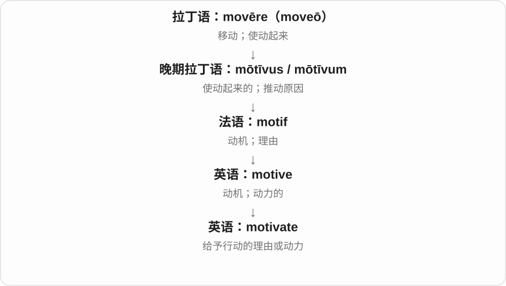

奖励、兴趣、责任感都可能激励人。be motivated by 则直接说明行动背后的原因。

**常见搭配与例句**

motivate someone to do；be motivated by；motivate a team。

> The teacher motivated us to ask more questions.

老师鼓励我们多提问题。

> Her decision was motivated by curiosity.

她作出这个决定是出于好奇心。

**别混淆**

force 是强迫；motivate 重点是形成行动动力，不一定施加压力。

### 164. motivated — 有动力的、积极想做的；受……驱动的；motivate 的过去式、过去分词

**音标**：英 /ˈməʊtɪveɪtɪd/；美 /ˈmoʊtɪveɪtɪd/

**先抓住这个画面**

同样一件事，有人需要不断催促，有人自己就很想推进。后者做事有内在或外在的推动力，可以说 motivated。

**怎么拆**

motivate 去 e 加 -ed。motive 经法语、拉丁 motivus、motus 接 movere 移动；推动身体的移动，延伸为推动行动的动机。英语 motivate 由 motive 加动词词尾形成。

**怎么变成今天的意思**

**拉丁 movere、motus → motive**  
移动 → 促使行动的动机

↓

**motive → motivate → motivated**  
提供动力 → 已受驱动、有动力

highly motivated 很有积极性；motivated to learn 有动力学习；motivated by curiosity 受到好奇心驱动；a motivated team 有干劲的团队。

**常见搭配与例句**

stay motivated；feel motivated to do something。

> Small improvements help me stay motivated.

一点点进步能帮助我保持动力。

> She was motivated by a desire to understand the problem.

她想弄明白问题，这份愿望给了她动力。

**别混淆**

motivated 说受到推动的一方，motivating 说能给动力的事物或行为。动机也可能是恐惧、利益等，不自带高尚的评价。

### 165. skilled — 熟练的、有技能的；需要技能的

**音标**：/skɪld/

**先抓住这个画面**

人经过学习、经验能做得熟，是 skilled；工作本身要求专门能力，也可说 skilled work。

**怎么拆**

现代可对应 skill + -ed 表有技能；更早 skill 也有懂得、熟知的动词，历史分词用法与熟练义相连。末尾 -ed 不多读一个音节。

**怎么变成今天的意思**

**古诺斯语 skil、skilja → 中古英语 skill 等**  
区分、辨别、理解

↓

**从判断到做得好**  
实践知识、方法、熟练能力

↓

**skill 的名词、旧熟知动词与 -ed → skilled**  
有实践知识、熟练；工作要求专门技能

a skilled worker 熟练工，skilled at something 擅长某事，skilled in design 在设计方面熟练，skilled work 技能型工作。

**常见搭配与例句**

a skilled worker；skilled at；skilled in；skilled work。

> She is skilled at repairing old radios.

她很擅长修理老收音机。

> The project needs skilled workers.

项目需要熟练工人。

**别混淆**

skilled worker 人有技能，skilled work 工作要求技能；用同一形容词，承载技能要求的对象位置不同。

### 166. fascinate — 使着迷；强烈吸引

**音标**：/ˈfæsɪneɪt/

**先抓住这个画面**

你本来只想看一眼，结果越看越想知道，注意力像被吸住了：这个东西 fascinates you。

**怎么拆**

借拉丁 fascinatus，来自 fascinare 施魔法、蛊惑。现代用法多转为吸引注意与兴趣，不是在说真有魔法。

**怎么变成今天的意思**

**拉丁 fascinare 施魔法、蛊惑 → fascinatus、fascinatio**  
像被控制注意力一样无法移开目光

↓

**英语 fascinate、fascination**  
使深深着迷；强烈兴趣与吸引力

something fascinates someone 某物使某人着迷；be fascinated by 对……着迷。事物作主语、感兴趣的人作宾语很常见。

**常见搭配与例句**

fascinate someone；be fascinated by。

> The night sky has always fascinated me.

夜空一直让我着迷。

> The children were fascinated by the tiny machine.

孩子们被那台小机器深深吸引。

**别混淆**

fascinating 说令人着迷，fascinated 说人感到着迷；I am fascinating 是说我本人很吸引人。

### 167. fascinating — 引人入迷的、极有趣的；fascinate 的 -ing 形式

**音标**：/ˈfæsɪneɪtɪŋ/

**先抓住这个画面**

它勾起你的好奇，越看越想知道后面怎样。这种能抓住注意力的性质，就是 fascinating。

**怎么拆**

fascinate 去 e 加 -ing。从较早施魅、使着迷的词族发展为引起强烈兴趣的形容词；现代不要求真有魔法意味。

**怎么变成今天的意思**

**fascinate**  
使着迷、吸引注意力

↓

**fascinate 去 e + -ing → fascinating**  
正在吸引；具有引人入迷的性质

a fascinating story 引人入胜的故事；a fascinating question 极有趣的问题；a fascinating insight 很有启发、让人感兴趣的见解。

**常见搭配与例句**

find something fascinating；a fascinating subject。

> The exhibition tells a fascinating story about the town.

展览讲述了小镇一段引人入胜的故事。

> She is a fascinating person to talk to.

她是个聊起来很有意思的人。

**别混淆**

fascinating 通常比普通 interesting 强，更突出留住注意力。a fascinating person 是一个引人入迷的人，证明 -ing 不只用来形容物。

### 168. fascinated — 入迷的、被深深吸引的；fascinate 的过去式、过去分词

**音标**：/ˈfæsɪneɪtɪd/

**先抓住这个画面**

眼前的东西让你忍不住继续看，耳边的故事让你不想漏掉一句：你的注意力被牢牢吸住了。

**怎么拆**

fascinate 去 e 加 -ed，末尾读 /ɪd/。较早接拉丁 fascinare 施魅、使着迷，词源更深不明；英语后来把像着了魔的吸引力转成日常使注意力入迷。

**怎么变成今天的意思**

**拉丁 fascinare → 法语、英语相关词**  
施魅、使着迷 → 吸引并留住注意力

↓

**fascinate + -ed → fascinated**  
被吸引、处于入迷状态

fascinated by a machine 被机器深深吸引；fascinated with a subject 对某主题入迷；fascinated to learn 很感兴趣地了解到。

**常见搭配与例句**

watch in fascinated silence；be absolutely fascinated。

> The children were fascinated by the old machine.

孩子们被那台老机器深深吸引。

> She listened, fascinated, as he described the journey.

他讲述旅程时，她听得入了迷。

**别混淆**

fascinated 关注注意力被吸引，不保证赞同对象或觉得它漂亮。fascinating 则描写有吸引力、令人想继续了解的一方。

### 169. lifted — 被抬起的、升高的；被解除的；偷用、抄来的〔语境义〕

**音标**：/ˈlɪftɪd/

**先抓住这个画面**

东西升起来、禁令拿掉，都可用 lifted；一句话从别处直接拿来，也可说 lifted from，需看有没有未经许可或抄袭意味。

**怎么拆**

lift + -ed，过去分词及形容词。lift 末尾 /t/，所以 -ed 另读 /ɪd/，不要压成一个 /t/。

**怎么变成今天的意思**

**古诺斯语 lypta → 中古英语 liften → lift**  
往空中抬起、举起

↓

**动词与现代名词扩展**  
电梯、搭便车；情绪抬起；偷拿的口语义

↓

**lift + -ed → lifted**  
抬起、解除等动作已发生；相应结果状态

a lifted ban 已解除的禁令，lifted restrictions 已取消的限制，lifted from a book 从书里拿来的。

**常见搭配与例句**

restrictions were lifted；lifted from；a lifted hand。

> The restrictions were lifted on Monday.

限制在周一取消了。

> The sentence was lifted from an earlier article.

那句话直接取自一篇较早的文章。

**别混淆**

lifted 是完成动作或结果，不是 lifted 越多便等级越高；lifted from 在文字语境常有直接拿用的含义。

### 170. pour — 倒、倾倒；涌入、倾泻；下大雨

**音标**：英 /pɔː/；美 /pɔːr/

**先抓住这个画面**

把壶倾斜，水连续流出来，是 pour；人群一下涌进门、雨像倒下来一样，也借这个流动的画面。

**怎么拆**

中古英语已有 pour 的相关形式，确切来源未定；一种分析联系法语方言 purer 筛、倒水等，更远拉丁材料只是可能路线。不能把“倒水为了净化”当成确定历史故事。

**怎么变成今天的意思**

**中古英语相关形式**  
倾倒液体等；更早来源不确定

↓

**现代 pour 的扩展**  
倒出、涌入；雨下得很大

pour water into a glass 把水倒进杯里；pour out one’s feelings 倾诉感情；It is pouring 下大雨。细沙等能连续流动的颗粒也可用 pour。

**常见搭配与例句**

pour into；pour out；pour with rain。

> Pour the water slowly into the bowl.

把水慢慢倒进碗里。

> People poured into the square after the announcement.

消息宣布后，人群涌入了广场。

**别混淆**

pour 强调倾倒、成流，spill 强调洒出、溢出常带意外；有意把水倒进杯子是 pour，不等于 spill it。

### 171. pouring — 正在倾倒、涌来、倾诉；大雨倾盆的

**音标**：英 /ˈpɔːrɪŋ/；美 /ˈpɔːrɪŋ/

**先抓住这个画面**

水正成股流、雨正密密大大地落，或消息正一大批传来，是 pouring。力度、数量感比零星滴流强。

**怎么拆**

pour + 完整 -ing；英式后接元音时 r 发出来。可作进行分词，也可形容雨势大。

**怎么变成今天的意思**

**中古英语 pour 的相关形式 → pour**  
来源未定；联系法语方言 purer 的分析只是一种可能

↓

**倒成一股 → 大雨、人大量到来、感情倾诉**  
实际动作的流量感，扩成事情一股脑涌来

↓

**pour + -ing → pouring**  
倾倒、涌流过程；倾盆雨状态

pouring rain 是倾盆大雨，pouring tea 是正在倒茶，messages pouring in 是消息大量涌来。

**常见搭配与例句**

pouring down 雨倾盆而下；pouring out his heart 倾诉心事。

> We walked home in the pouring rain.

我们冒着倾盆大雨走回家。

> Messages were pouring in after the announcement.

消息公布后，留言大量涌来。

**别混淆**

pouring rain 与 drizzle 的画面相反：前者雨大像倒，后者雨细；并非所有 raining 都等于 pouring。

### 172. poured — 倒出了、涌入了、倾诉了；下了大雨

**音标**：英 /pɔːd/；美 /pɔːrd/

**先抓住这个画面**

水刚才成一股倒出来，或人、信件一大批涌进来，用 poured。说心事也能像倒水一样一下放出来。

**怎么拆**

pour + 完整 -ed，读 /d/；英式基础词最后虽不读 r，仍由最后的元音接 /d/。

**怎么变成今天的意思**

**中古英语 pour 的相关形式 → pour**  
来源未定；联系法语方言 purer 的分析只是一种可能

↓

**倒成一股 → 大雨、人大量到来、感情倾诉**  
实际动作的流量感，扩成事情一股脑涌来

↓

**pour + -ed → poured**  
过去倾倒、涌流或倾诉

poured a drink 是倒了一杯饮料，poured into the street 是大量涌到街上；poured out her worries 是倾诉忧虑。

**常见搭配与例句**

poured with rain 下着大雨；poured into the cup 倒进杯子。

> He poured water into the jug.

他把水倒进水壶。

> People poured into the square after the concert.

音乐会后，人群大量涌进广场。

**别混淆**

poured 不一定全是液体：人群涌来、资源投入、感情倾诉都借成股而出的动作，不要逐字翻成倒人。

### 173. pours — 倒出、涌出、倾诉〔第三人称单数〕；下大雨

**音标**：英 /pɔːz/；美 /pɔːrz/

**先抓住这个画面**

把壶一倾，水成一股往外流，用 pours；雨大得像从天上倒，也说 it pours。人、消息大量涌来还能借这个画面。

**怎么拆**

pour + -s，读 /z/；基础词中古英语已有，确切来源未定，不把某条法语、拉丁候选路线说成定论。

**怎么变成今天的意思**

**中古英语 pour 的相关形式 → pour**  
来源未定；联系法语方言 purer 的分析只是一种可能

↓

**倒成一股 → 大雨、人大量到来、感情倾诉**  
实际动作的流量感，扩成事情一股脑涌来

↓

**pour + -s → pours**  
他、她倒；它涌出；雨倾盆而下

pours tea 是倒茶，pours into the hall 是涌进大厅，pours out her feelings 是把感情一股脑说出来。

**常见搭配与例句**

it pours 雨下得很大；pours money into a project 大量投入资金。

> She pours tea into the small cups.

她往小杯里倒茶。

> Whenever we plan a picnic, it pours.

我们一计划野餐，雨就下得特别大。

**别混淆**

pours 强调成股、量多或连续涌来的感觉；drizzles 常是细小雨滴或往菜上轻细淋一点液体。

### 174. leak — 漏、泄漏；透露秘密；漏洞、泄漏事件

**音标**：/liːk/

**先抓住这个画面**

容器本来该把东西留住，却从缝里跑出去：水、空气可以 leak，未公开的消息也能像这样漏出去。

**怎么拆**

中古英语 leken 与日耳曼语流漏词族相连，直接来源有本族、荷兰语、北欧语等分析。由液体进出漏洞扩展到秘密和资源外泄。

**怎么变成今天的意思**

**中古英语 leken → leak**  
让水流入、流出；可能承本族或荷兰、北欧相应形式

↓

**液体穿过不应有的缺口**  
扩展到信息、资源等泄漏

a leak in the roof 屋顶漏处，a water leak 漏水，leak documents to the press 向媒体泄露文件，a memory leak 内存泄漏。

**常见搭配与例句**

leak out；leak to；a water leak。

> Water was leaking through the ceiling.

水正从天花板漏下来。

> Details of the agreement leaked to the press.

协议细节泄露给了媒体。

**别混淆**

leak 可漏进或漏出，取决于容器和环境；信息 leak 常有尚未正式公开的背景。

### 175. leaking — 正在漏入、漏出；正在泄露消息；漏的

**音标**：/ˈliːkɪŋ/

**先抓住这个画面**

本该把东西关住的管道、屋顶、袋子留了出口，东西正在漏，就是 leaking；消息从保密范围跑出去，也用同一画面。

**怎么拆**

leak + 完整 -ing；基础动词可能借中古荷兰语 leken 或古诺尔斯 leka，不能仅因音近就当 lake 湖的现代派生。

**怎么变成今天的意思**

**中古荷兰语 leken、或古诺尔斯 leka 等 → leak**  
让水进入、漏出；相关古英语材料并非确定直接延续

↓

**leak + -ing → leaking**  
实体泄漏；后来有秘密、消息外泄

a leaking roof 是漏雨屋顶，leaking information 是泄露信息；水可进入容器，也可从容器流出。

**常见搭配与例句**

leaking from a pipe 管子里漏出；a leaking bottle 漏液的瓶子。

> The pipe under the sink is leaking.

水槽下的管子正在漏水。

> Someone had been leaking details of the plan to the press.

一直有人把计划细节泄露给媒体。

**别混淆**

leaking 不是一定缓慢：流速由场景决定。seeping 更经常突出细孔、缝隙里的慢渗。

### 176. slot — 狭槽、投入口；时间段、位置名额；放入、安排进

**音标**：英 /slɒt/；美 /slɑːt/

**先抓住这个画面**

卡片插进一个窄口，是 slot；日程表里留出的一小格时间，也像一个可以把事情放进去的位置。

**怎么拆**

现代狭槽义通常追到古法语 esclot 及中古英语较早的凹处义，更深来源和中间意义变化不完全确定。狭槽扩大为日程位置，再转作放进去、安排进去的动词。另有门闩的旧同形词，不混作唯一来源。

**怎么变成今天的意思**

**法语、早期英语凹处相关词 → slot**  
具体早期变化有不确定处；后来指狭窄开口

↓

**狭槽 → 日程位置 → 动词 slot**  
可放入物体的口；可安排事情的时间格

a card slot 卡槽；a coin slot 投币口；a time slot 一个时间段；slot something into place 把东西嵌入位置；slot in a meeting 插入一场会议。

**常见搭配与例句**

an available slot；a slot for a card。

> Insert the card into the slot.

把卡插进卡槽。

> Do you have a free slot on Friday afternoon?

你星期五下午有空余时间段吗？

**别混淆**

slot 的共同画面是能把东西、事情放进去的窄口或位置。预约里的 slot 不一定只有几分钟，也可能是一整段安排时间。

### 177. slots — 狭槽、插口；时段、位置〔复数〕；安排进、插入〔第三人称〕

**音标**：英 /slɒts/；美 /slɑːts/

**先抓住这个画面**

卡片要插进对应的小口，会议也要塞进对应的时间空当；这两种可以容纳东西的位置，都能叫 slots。

**怎么拆**

slot + -s → slots，/t/ 后读 /s/。狭槽义通常追到古法语 esclot 与中古英语凹处等材料，中间变化、远源不全清楚。

**怎么变成今天的意思**

**古法语 esclot 与中古英语较早凹处等义 → slot**  
远源及意义连接有不确定处

↓

**狭槽 → 日程位置等现代 slot 用法 → slots**  
名词复数，也可作放进、排入的动作第三人称

card slots 是卡槽；time slots 是时间段；slots a meeting into the schedule 是把会议排进日程。

**常见搭配与例句**

card slots；time slots；available slots。

> The device has two card slots.

这个设备有两个卡槽。

> We have three open time slots on Friday.

我们星期五有三个空闲时段。

**别混淆**

slot 常指安排好、能容纳某物的一格位置；不是所有抽象机会都适合直接叫 slots。

### 178. slotted — 有槽的；放进、嵌入、安排好了；slot 的过去式、过去分词

**音标**：英 /ˈslɒtɪd/；美 /ˈslɑːtɪd/

**先抓住这个画面**

卡片已经进了对应槽口，一场会也已经塞进日程的空位，都能用 slotted 描写完成的安排。

**怎么拆**

slot 双写 t 加 -ed，词尾读 /ɪd/。由 slot 狭槽、位置名转成动词放入；形容词还可说本身带狭槽的。

**怎么变成今天的意思**

**slot 名词 → 动词**  
可放入的槽、位置 → 放入、安排

↓

**slot 双写 t + -ed → slotted**  
已经嵌入、安排；具有槽口的

slotted into place 嵌入到位；slotted into the schedule 排进日程；a slotted spoon 漏勺〔勺面有槽孔〕。

**常见搭配与例句**

slotted in between meetings；a slotted panel。

> The pieces slotted into place easily.

这些部件轻松嵌入了各自的位置。

> We slotted the interview in between two meetings.

我们把面试安排在了两场会议之间。

**别混淆**

slotted 可以是做过了的动作，也能是有槽的性质。a slotted spoon 中 slotted 是带槽孔的，描述勺子结构。

### 179. smash — 猛击、打碎；彻底击败；破纪录；巨大成功；扣杀

**音标**：/smæʃ/

**先抓住这个画面**

想玻璃啪地碎开，力量强而效果明显。后来也说记录被打破、对手被大胜击败，作品大获成功则是很有冲击力的效果。

**怎么拆**

来源不完全确定，可能拟强烈撞击的声音；不拆成 s + mash 后声称有一条明确拉丁词源。动作扩展到压倒性胜利、巨大成功和体育扣杀。

**怎么变成今天的意思**

**英语 smash，具体远源不确定，可能拟声**  
强烈撞击、打碎的动作与声音

↓

**强烈效果的比喻**  
压倒性击败；巨大成功，smash hit

↓

**词尾形成不同用法**  
smashed 已碎或醉得厉害；smashing 极好的；smasher 执行者或突出的人物、事物

smash a window 砸碎窗户，smash a record 打破纪录，a smash hit 大受欢迎的作品，a tennis smash 网球高压扣杀。

**常见搭配与例句**

smash a record；a smash hit；a tennis smash。

> The falling branch smashed the greenhouse window.

落下的树枝砸碎了温室玻璃。

> The film became a smash hit.

这部电影大获成功。

**别混淆**

smash 力度通常比普通 break 强；smash a record 不是撕掉一张记录纸，a smash hit 也不是一次砸人的击打。

### 180. smashed — 被砸碎、撞坏的；醉得厉害的〔俚语〕

**音标**：/smæʃt/

**先抓住这个画面**

窗玻璃 smashed 是碎得厉害；人说 got smashed 常是喝得大醉。后一义像借被重击后失去正常状态的夸张说法，别译成人被砸成碎片。

**怎么拆**

smash + -ed，清辅音 /ʃ/ 后词尾读 /t/。俚语醉酒义是固定引申，不能把所有身体状态都凭这个画面推成词义。

**怎么变成今天的意思**

**英语 smash，具体远源不确定，可能拟声**  
强烈撞击、打碎的动作与声音

↓

**强烈效果的比喻**  
压倒性击败；巨大成功，smash hit

↓

**smash + -ed → smashed**  
被打碎、严重毁坏

↓

**固定俚语扩展**  
喝得大醉、醉得厉害

a smashed window 被砸碎的窗玻璃，a smashed phone 摔坏的手机，get smashed 喝得大醉〔随意俚语〕。

**常见搭配与例句**

a smashed window；a smashed phone；get smashed。

> The pavement was covered with smashed glass.

人行道上满是碎玻璃。

> The character admits that he got smashed at the party.

角色承认自己在聚会上喝得大醉。

**别混淆**

smashed 的醉酒义不适合所有正式场合；smashed 是结果状态，smashing 的赞扬义又是另一固定表达。

### 181. smashes — 砸碎、猛击、打破纪录〔第三人称单数〕；扣杀、巨大成功作品〔复数〕

**音标**：/ˈsmæʃɪz/

**先抓住这个画面**

猛地一击、东西碎了，用 smashes；体育里可说扣杀、打破纪录，演艺里 smashes 又可指大获成功的作品。

**怎么拆**

smash + -es，/ʃ/ 后读 /ɪz/；基础词可能拟声，不能硬拆成 s + mash 再声称这就是确定形成史。

**怎么变成今天的意思**

**近代英语 smash**  
强烈撞击、碎裂材料，具体来源未定，大概拟声

↓

**smash + -es → smashes**  
三单、名词复数；体育与巨大成功等分支

smashes a record 是打破纪录，smashes the ball 是猛击球，box-office smashes 是票房大热作品；不全是真砸碎。

**常见搭配与例句**

powerful smashes 强力扣杀；smashes into a wall 猛撞墙。

> The tennis player wins points with powerful smashes.

网球选手靠强力扣杀得分。

> Her new film smashes the opening-week record.

她的新电影打破首周纪录。

**别混淆**

smashes 强调击碎、压倒性效果，scratches 只是刮、划，cracks 还可只裂开；动作结果有轻重差别。

### 182. delight — 喜悦；令人高兴的事物；使高兴

**音标**：/dɪˈlaɪt/

**先抓住这个画面**

收到惊喜时眼睛一亮，是 delight 的感觉。作名词可指这份喜悦，也可指带来喜悦的人或事；作动词就是让人高兴。

**怎么拆**

经古法语接拉丁 delectare。早期英语有 delite；后来的 gh 不代表来自 light 光，也不单独发音。

**怎么变成今天的意思**

**拉丁 delectare → 古法语 deliter**  
使愉快、使喜爱

↓

**中古英语 delite → delight**  
喜悦；gh 是后来受 light 等拼写影响而出现的字母

to my delight 令我高兴的是；take delight in doing 乐于做；delight someone 使某人高兴。

**常见搭配与例句**

to someone’s delight；take delight in。

> To her delight, the old tree had flowered again.

令她高兴的是，老树又开花了。

> The unexpected visit delighted the children.

这次意外的来访让孩子们很开心。

**别混淆**

delight 通常比普通 pleasure 更鲜明，常有开心、惊喜的感觉；delighted 说人很高兴，delightful 常说人或事令人愉快。

### 183. delighted — 很高兴的、欣喜的；delight 的过去式、过去分词

**音标**：/dɪˈlaɪtɪd/

**先抓住这个画面**

等了很久的好消息终于来了，你忍不住高兴起来。delighted 通常比普通 pleased 更显欣喜。

**怎么拆**

delight + -ed，/t/ 后结尾读 /ɪd/。delight 经法语 delit、delitier 接拉丁 delectare 使愉快、吸引；现代 gh 是受 light 等拼写影响后加入，来源不是光线词。

**怎么变成今天的意思**

**拉丁 delectare → 法语 delit 等 → delight**  
使愉快、满足；英语拼写后来受类推影响

↓

**delight + -ed → delighted**  
受到愉快影响；很高兴、欣喜

delighted to hear 很高兴听到；delighted with the result 对结果很满意；delighted that ... 因某事很高兴；absolutely delighted 欣喜极了。

**常见搭配与例句**

be delighted to help；a delighted smile。

> We were delighted to hear the good news.

听到好消息，我们非常高兴。

> She was delighted with the finished drawing.

她对完成的画很满意。

**别混淆**

delighted 说感到欣喜，delightful 说让人愉快。I was delighted；The evening was delightful，分别描述感受与带来感受的性质。

### 184. enhanced — 增强的、改进的、提高后的

**音标**：英 /ɪnˈhɑːnst/；美 /ɪnˈhænst/

**先抓住这个画面**

在一个已有版本上把某方面提起来：更清楚的画面、更强功能，就是增强版本。增强了哪一项，要接着问。

**怎么拆**

enhance + -ed，末尾 e 后加 d；/s/ 后词尾读 /t/，不读成额外的 /ɪd/。可作分词或结果形容词。

**怎么变成今天的意思**

**拉丁 altus 高及相关动词 → 法语 enhauncer 等**  
抬高、使更大、更强

↓

**中古英语 enhauncen → enhance**  
提高程度、增进价值、改善表现

↓

**enhance → enhanced**  
提高效果 → 已被增强、改进的

an enhanced version 增强版本，enhanced features 增强功能，an enhanced image 增强处理的图像，enhanced performance 改善后的表现。

**常见搭配与例句**

an enhanced version；enhanced features；an enhanced image。

> The update includes enhanced search features.

更新加入了增强的搜索功能。

> The exhibition shows both the original and the enhanced image.

展览同时展示原图和增强处理后的图像。

**别混淆**

enhanced 是相对某个基准提高，不保证所有方面更好；enhanced image 也不等于未经处理的原始照片。

### 185. exhausted — 筋疲力尽的；耗尽的

**音标**：/ɪɡˈzɔːstɪd/

**先抓住这个画面**

像电池已经见底：人几乎没力气，物资也可能已经用完。

**怎么拆**

exhaust + -ed；过去分词形容词描述受到耗尽作用后的状态。

**怎么变成今天的意思**

**拉丁 haurire → ex- + haurire → exhaurire**  
汲取水 → 抽尽、耗尽

↓

**拉丁过去分词 exhaustus**  
已抽空、已用尽

↓

**英语 exhaust**  
抽尽、耗尽；也使人精疲力竭

↓

**英语 exhaust + -ed → exhausted**  
使耗尽 → 已耗尽、极疲惫的

feel exhausted 是非常疲惫；exhausted supplies 是已耗尽的物资。人累和资源耗尽都接同一个抽空画面。

**常见搭配与例句**

feel exhausted；physically exhausted；an exhausted supply。

> By the time we reached the hotel, we were exhausted.

到达酒店时，我们已经筋疲力尽。

> Once the supplies were exhausted, the team had to return.

物资一耗尽，团队就不得不返回。

**别混淆**

exhausted 是感到累，exhausting 是让人累。tired 可很普通，exhausted 通常更强。

### 186. frustrate — 使受挫、懊恼；阻挠、挫败

**音标**：/frʌˈstreɪt/〔亦有 /ˈfrʌstreɪt/〕

**先抓住这个画面**

想往前走，却反复被卡住，这种使努力落空的力量会 frustrate 人；它也可直接挫败计划。

**怎么拆**

接拉丁 frustratus 等分词材料，联系 frustra 徒然、无效。不是把 fruit 水果变化成某种心情词。

**怎么变成今天的意思**

**拉丁 frustra 徒然 → frustrari、frustratus 等 → frustrate**  
使落空、挫败

↓

**英语 frustrate**  
阻挠目标；让人因进展受阻而烦恼

frustrate someone 让某人受挫；frustrate an attempt 挫败一次尝试；frustrate plans 阻挠计划。

**常见搭配与例句**

frustrate someone；frustrate an attempt。

> The repeated errors frustrated everyone on the team.

反复出错让团队里的每个人都很懊恼。

> Bad weather frustrated their plans for an outdoor concert.

坏天气使他们的户外音乐会计划受挫。

**别混淆**

frustrate 比普通 annoy 更常含目标受阻、想做却做不成的成分；具体人也可能感到生气。

### 187. frustrated — 受挫的、沮丧烦躁的；受到阻挠的；frustrate 的过去式、过去分词

**音标**：/frʌˈstreɪtɪd/；亦 /ˈfrʌstreɪtɪd/

**先抓住这个画面**

想做成一件事，却反复被卡住；越想推进越推进不了，心里有受挫和烦躁，这就是 frustrated 的常见感觉。

**怎么拆**

frustrate 去词末 e 加 -ed，末尾读 /ɪd/。frustrate 接拉丁 frustrari 使落空、使徒劳，与 frustra 徒然相关；分词既可说人受挫，也可说尝试被挫败。

**怎么变成今天的意思**

**拉丁 frustra／frustrari → frustrate**  
徒然、落空 → 使不能如愿、阻挠

↓

**frustrate + -ed → frustrated**  
受阻、受挫；因此感到烦躁沮丧

frustrated with the situation 对处境感到受挫；frustrated by delays 因延误受挫；a frustrated attempt 被挫败的尝试；feel frustrated 感到沮丧烦躁。

**常见搭配与例句**

increasingly frustrated；a frustrated expression。

> I felt frustrated after trying the same solution three times.

同一个办法试了三遍之后，我感到又受挫又烦躁。

> The delays left everyone frustrated.

一再延误让所有人都感到挫败。

**别混淆**

disappointed 常在期望落空后失望；frustrated 更容易有想推进却受阻的烦闷。frustrating 描写引起这种感受的事物或行为。

### 188. frustrating — 令人受挫、懊恼的

**音标**：/frʌˈstreɪtɪŋ/〔亦有 /ˈfrʌstreɪtɪŋ/〕

**先抓住这个画面**

不是单纯难，而是越想推进越卡住，让人泄气或烦恼。一直转圈却没结果的页面就很 frustrating。

**怎么拆**

frustrate 去末尾 e 加 -ing → frustrating；分词性质说明让人受挫的原因、体验。

**怎么变成今天的意思**

**拉丁 frustra 徒然 → frustrari、frustratus 等 → frustrate**  
使落空、挫败

↓

**英语 frustrate**  
阻挠目标；让人因进展受阻而烦恼

↓

**frustrate + -ing → frustrating**  
使目标受阻、让人懊恼的性质

a frustrating delay 令人懊恼的延误；a frustrating experience 令人受挫的经历；find something frustrating 觉得某事让人烦恼。

**常见搭配与例句**

a frustrating delay；a frustrating experience。

> It was a frustrating wait with no clear explanation.

这次等候没有明确解释，让人很懊恼。

> She found the repeated interruptions frustrating.

反复被打断让她觉得很烦。

**别混淆**

frustrating 描述事情，frustrated 常描述受到影响的人；a frustrated plan 又可能说被挫败的计划。

### 189. drain — 排水、流走；耗尽；排水口、排水管；消耗资源的事物

**音标**：/dreɪn/

**先抓住这个画面**

水从出口流走，容器逐渐空了；精力、金钱也能像这样不断流失。drain 就连接这两种画面。

**怎么拆**

承接古英语 drēahnian，经中古英语 dreinen；与 dry、drought 的历史有联系。现代 drain 不能简单按 d + rain 雨拆。

**怎么变成今天的意思**

**古英语 drēahnian → 中古英语 dreinen → drain**  
逐渐引走液体；联系变干的旧概念

↓

**实体水流 → 资源、精力的扩展**  
流走、排走；逐渐耗尽

drain the sink 排掉水槽里的水，a blocked drain 堵住的排水管，drain resources 消耗资源，go down the drain 白白浪费、付诸东流。

**常见搭配与例句**

drain away；a blocked drain；a drain on resources；down the drain。

> The water drained slowly from the sink.

水从水槽里慢慢排走。

> The repeated delays were a drain on our resources.

一再延误不断消耗我们的资源。

**别混淆**

drain 说流出、耗去；flood 说大量涌入、淹没。a drain on time 是不断消耗时间的事，不是字面的时间排水口。

### 190. drained — 排干的、耗尽的；精疲力竭的

**音标**：/dreɪnd/

**先抓住这个画面**

像容器里的东西流走了，身体也好像没剩多少劲，便是 feel drained。它强调被耗空后的状态。

**怎么拆**

drain + -ed，过去分词可作形容词；末尾读 /d/。由液体排走扩到电量、精力耗去。

**怎么变成今天的意思**

**古英语 drēahnian → 中古英语 dreinen → drain**  
逐渐引走液体；联系变干的旧概念

↓

**实体水流 → 资源、精力的扩展**  
流走、排走；逐渐耗尽

↓

**drain + -ed → drained**  
被排走、消耗后的状态

feel drained 感到精疲力竭，emotionally drained 心力交瘁，a drained battery 电量耗尽的电池。形容人的感受不代表实际生理指标归零。

**常见搭配与例句**

feel drained；emotionally drained；a drained battery。

> After the long meeting, she felt completely drained.

开完长会后，她觉得精疲力竭。

> The drained battery could no longer power the device.

电量耗尽的电池无法再给设备供电。

**别混淆**

drained 是被耗空后的状态；draining 是令人耗力的，an exhausting meeting 可让人 feel drained。

### 191. draining — 正在排液、流走；耗尽资源的、令人精疲力尽的

**音标**：/ˈdreɪnɪŋ/

**先抓住这个画面**

水正从出口一点点排走，是 draining；做一件事把人的精力一点点抽空，也可形容 emotionally draining。

**怎么拆**

drain + 完整 -ing；基础承古英语 dreahnian，经中古英语 dreinen，与变干材料相关，不能拆成现代 d + rain。

**怎么变成今天的意思**

**古英语 dreahnian → 中古英语 dreinen → drain**  
把液体渐渐引走，使干

↓

**drain + -ing → draining**  
排液过程；资源、精力逐渐耗尽的比喻

draining the bath 是给浴缸排水，a draining day 是特别耗神的一天；draining away 是逐渐流失。

**常见搭配与例句**

emotionally draining 让人情绪、精神被耗空；water draining away 水正在排走。

> The water was draining slowly from the bath.

浴缸里的水正慢慢排走。

> It had been an emotionally draining day.

那一天让人精神上格外疲惫。

**别混淆**

draining 形容事情耗人，drained 则可形容人已经累空；a draining meeting 之后，人可能 feel drained。

### 192. hint — 提示、暗示；一点点迹象、少许；间接透露

**音标**：/hɪnt/

**先抓住这个画面**

不把答案全部说出来，只递出一点能让对方想到答案的线索，就是 a hint。味道里只有一点点柠檬，也可以说 a hint of lemon。

**怎么拆**

通常联系旧 hent 及古英语 hentan 抓取词族，经中古英语告知等用法到间接提示；后转作动词。可以用让人抓住一点线索帮助理解，但具体历史不能简化成现代英语的现场拼接。

**怎么变成今天的意思**

**古英语抓取词族、旧 hent 等**  
常用来解释 hint 的较早来源

↓

**英语 hint 名词 → 动词**  
间接提示；一点迹象 → 暗示、间接透露

give someone a hint 给某人一点提示；take the hint 领会暗示；hint at a change 暗示变化；a hint of sadness 一丝悲伤。

**常见搭配与例句**

a useful hint；drop a hint。

> Can you give me a hint without telling me the answer?

你能给我一点提示，但别直接告诉我答案吗？

> The sauce has a hint of lemon.

酱汁有一点柠檬味。

**别混淆**

a hint 可以是有意给的提示；a hint of colour、lemon 等只是少许性质，不要求谁有意暗示。hint at 后接名词，hint that 后接从句。

### 193. hinted — 暗示了、间接透露了；hint 的过去式、过去分词

**音标**：/ˈhɪntɪd/

**先抓住这个画面**

对方没有正式宣布，却在话里露了一点口风。后来回头叙述这次间接透露，就用 hinted。

**怎么拆**

hint + -ed；词末 /t/ 后读 /ɪd/。继承名词提示转来的动词义：给一点线索，而不把话说尽。

**怎么变成今天的意思**

**hint 提示 → hint 动词**  
间接提供线索、透露想法

↓

**hint + -ed → hinted**  
曾暗示；被间接透露

hinted at a possible move 暗示可能搬迁、调动；hinted that ... 间接透露……；as hinted earlier 正如前面暗示的。

**常见搭配与例句**

strongly hinted；only hinted at。

> She hinted that she might move to another city.

她透露了点口风，说自己可能搬去另一座城市。

> The title hinted at the ending without revealing it.

标题暗示了结局，却没有直接揭示。

**别混淆**

hinted that 之后是完整信息从句；hinted at 之后通常接名词或名词性表达。暗示不等于正式确认，语气强弱还要看场景。

### 194. shout — 大声喊、呼喊；一声喊叫

**音标**：/ʃaʊt/

**先抓住这个画面**

把声音提起来，让远处的人也听见，就是 shout。它可以是叫朋友、提醒危险，也可以是愤怒或高兴地喊。

**怎么拆**

接中古英语 shouten 等，更早来源未定。有与 shoot、北欧相关词联系的分析，但不能把“把声音射出去”的画面当成已经证实的单一路线。

**怎么变成今天的意思**

**中古英语 shouten、schowten → shout**  
大声呼喊；更早来源未定，有日耳曼相关分析

↓

**现代 shout 动词；名词沿动词发展**  
大声喊话、一声喊；可以呼唤、警告、愤怒或欢呼

shout to someone 常说隔着距离喊话；shout at someone 常带冲人吼的意味，具体语气仍看情境。

**常见搭配与例句**

shout for help 大声求助；a shout of joy 一声欢呼。

> We had to shout to be heard above the music.

音乐太响，我们得大声喊才能让人听见。

> A shout from the garden brought her to the window.

花园里一声喊，把她引到窗边。

**别混淆**

shout 主要说声音大，不规定一定生气；whisper 则压低声音，两者可说同一段内容的不同音量。

### 195. shouting — 正在大声喊；喊叫声、呼喊活动

**音标**：/ˈʃaʊtɪŋ/

**先抓住这个画面**

响亮的喊声正在持续，就是 shouting。可以是争吵、欢呼，也可以只因距离远、环境吵。

**怎么拆**

shout + 完整 -ing，直接相接；保持原拼写，不双写 t。

**怎么变成今天的意思**

**中古英语 shouten、schowten → shout**  
大声呼喊；更早来源未定，有日耳曼相关分析

↓

**现代 shout 动词；名词沿动词发展**  
大声喊话、一声喊；可以呼唤、警告、愤怒或欢呼

↓

**shout + -ing → shouting**  
大声呼喊的过程、声音

heard shouting 是听见喊声；shouting over the music 是在音乐声中提着嗓子喊话。

**常见搭配与例句**

loud shouting 响亮的喊声；shouting for help 正在大声求助。

> We heard shouting from the street.

我们听见街上传来喊声。

> They were shouting to each other over the noise of the engine.

引擎声太响，他们正彼此提着嗓子喊话。

**别混淆**

shouting 不等于 arguing；前者说大声喊，后者说争论，两者可能同时发生，也可以分别出现。

### 196. shouted — 大声喊了、呼喊了

**音标**：/ˈʃaʊtɪd/

**先抓住这个画面**

刚才把声音提得很大喊出话，用 shouted。能喊一声，也能把一整句说得很响。

**怎么拆**

shout + 完整 -ed，/t/ 后读 /ɪd/；ou 是元音字母组合，不按短单元音拼写去双写 t。

**怎么变成今天的意思**

**中古英语 shouten、schowten → shout**  
大声呼喊；更早来源未定，有日耳曼相关分析

↓

**现代 shout 动词；名词沿动词发展**  
大声喊话、一声喊；可以呼唤、警告、愤怒或欢呼

↓

**shout + -ed → shouted**  
过去大声呼喊

shouted a warning 是大声喊出警告，shouted to be heard 是为了让人听见而提高声音。

**常见搭配与例句**

shouted for help 大声求助了；shouted across the road 隔着马路喊了。

> She shouted a warning as the bicycle approached.

自行车靠近时，她大声提醒了一句。

> He shouted my name across the station.

他隔着车站大声喊我的名字。

**别混淆**

shouted 描写音量，scolded 描写责骂；大声喊一句“当心”并不是在骂人。

### 197. shouts — 大声喊〔第三人称单数〕；几声喊叫、欢呼〔复数〕

**音标**：/ʃaʊts/

**先抓住这个画面**

说她总是隔着花园喊人，用 shouts；一阵阵欢呼或喊声，也可数作 shouts。

**怎么拆**

shout + -s，/t/ 后读 /s/；名词复数和动词三单同形，不双写 t。

**怎么变成今天的意思**

**中古英语 shouten、schowten → shout**  
大声呼喊；更早来源未定，有日耳曼相关分析

↓

**现代 shout 动词；名词沿动词发展**  
大声喊话、一声喊；可以呼唤、警告、愤怒或欢呼

↓

**shout + -s → shouts**  
他、她大声喊；几声喊叫

shouts across the room 是隔着房间喊话；shouts of joy 是阵阵欢呼。

**常见搭配与例句**

shouts for help 大声求助；angry shouts 愤怒的喊声。

> He shouts across the garden to his brother.

他隔着花园向哥哥喊话。

> Shouts of joy came from the playground.

操场上传来阵阵欢呼。

**别混淆**

shouts 数清楚的几声喊，shouting 常把一片喊声、喊叫活动整体提出来；视角不同。

### 198. buzz — 嗡嗡声、嗡嗡响；热议、兴奋感；用蜂鸣器叫人

**音标**：/bʌz/

**先抓住这个画面**

蜂或机器嗡嗡响，人群低声又兴奋地议论，也像一片嗡嗡声。于是 buzz 从声音走向热度、活跃气氛和兴奋感。

**怎么拆**

拟声词，中古英语已有相应嗡响形式。声音义再扩到谈话、传闻、兴奋；不是由一个表示昆虫的古典词根借来。

**怎么变成今天的意思**

**拟声来源，中古英语已有相关形式**  
嗡嗡声，像蜂、机器的连续低响

↓

**群体谈话与兴奋的比喻**  
热议、活跃气氛；兴奋感

the buzz of bees 蜂的嗡嗡声，create a buzz 引发热议，get a buzz from something 因某事感到兴奋，Give me a buzz. 给我打个电话〔口语〕。

**常见搭配与例句**

create a buzz；get a buzz；give someone a buzz。

> A bee buzzed past the window.

一只蜂嗡嗡飞过窗边。

> The preview created a buzz among fans.

预告片在粉丝间引起热议。

**别混淆**

buzz 可指话题热度，不保证是赞美，也不保证传闻属实。声响上常比 hum 更带嗡嗡、振动感，实际有重叠。

### 199. buzzing — 嗡嗡声；嗡响、忙碌热闹的；兴奋的〔口语〕

**音标**：/ˈbʌzɪŋ/

**先抓住这个画面**

手机在桌上嗡嗡振动，现场热闹得像一窝蜂，或者人刚经历好事还兴奋着，都可能用 buzzing。

**怎么拆**

buzz + -ing。分词可描述正在嗡响、活跃，也形成声音名词和兴奋的口语形容词。

**怎么变成今天的意思**

**拟声来源，中古英语已有相关形式**  
嗡嗡声，像蜂、机器的连续低响

↓

**群体谈话与兴奋的比喻**  
热议、活跃气氛；兴奋感

↓

**buzz + -ing → buzzing**  
嗡响的声音、状态；兴奋活跃

a buzzing sound 嗡嗡声，buzzing with activity 忙碌热闹，I’m still buzzing. 我还兴奋着呢。

**常见搭配与例句**

a buzzing sound；buzzing with activity；still buzzing。

> A buzzing sound came from the light.

灯那里传来嗡嗡声。

> She was still buzzing after the performance.

演出结束后，她还兴奋着。

**别混淆**

buzzing phone 通常是声响、振动，buzzing fans 可以是兴奋状态。不要见 -ing 就全译成正在叫。

### 200. buzzed — 嗡嗡响了；用电话、对讲联系了；〔口语〕微醺的

**音标**：/bʌzd/

**先抓住这个画面**

刚才设备、昆虫嗡地响了，用 buzzed；人被电话叫到、按门禁放入，也能进入 buzzed 的搭配。

**怎么拆**

buzz + 完整 -ed，/z/ 后读 /d/；即使字母有 zz，也不加读 /ɪd/。口语形容词义要按上下文分辨。

**怎么变成今天的意思**

**较早 buzzing 及 buzz 动词 → 现代 buzz**  
模仿蜜蜂等昆虫连续嗡声；分词记录可早于基础动词记录

↓

**嗡声 → 电话、忙碌、兴奋等用法**  
通过设备联系、低飞掠过、人群热议；按搭配分支

↓

**buzz + -ed → buzzed**  
过去嗡响、联系；另有口语微醺状态

buzzed me 是给我打电话、通过设备联系我，buzzed me in 是按门禁让我进来；不是把我弄成嗡声。

**常见搭配与例句**

buzzed past 嗡嗡掠过；felt buzzed 感到微醺。

> My phone buzzed in my pocket.

我的手机在口袋里震响。

> The receptionist buzzed me in through the main door.

接待员按了门禁，让我从正门进去。

**别混淆**

buzzed in 依靠门禁系统放行，let in 只说让人进来；声音词扩到设备动作后，不能逐字翻成“嗡进去”。

### 201. buzzes — 嗡嗡响、震动鸣响〔第三人称单数〕；嗡声、兴奋感〔复数〕

**音标**：/ˈbʌzɪz/

**先抓住这个画面**

昆虫“嗡嗡”飞、手机振动着响，用 buzzes。场所满是活动、谈论，也能说 buzzes with activity、excitement。

**怎么拆**

buzz + -es，/z/ 后读 /ɪz/，多一个音节。已有 zz 保留，不把它改成一个 z。

**怎么变成今天的意思**

**较早 buzzing 及 buzz 动词 → 现代 buzz**  
模仿蜜蜂等昆虫连续嗡声；分词记录可早于基础动词记录

↓

**嗡声 → 电话、忙碌、兴奋等用法**  
通过设备联系、低飞掠过、人群热议；按搭配分支

↓

**buzz + -es → buzzes**  
它嗡响、忙碌活跃；多阵嗡声

buzzes around the room 是嗡嗡绕屋飞，buzzes with excitement 是到处洋溢兴奋感；先看声源和搭配。

**常见搭配与例句**

the phone buzzes 手机震响；the room buzzes with talk 满屋子议论声。

> A fly buzzes around the window.

一只苍蝇绕着窗户嗡嗡飞。

> My phone buzzes whenever a new message arrives.

新消息一到，我的手机就震响。

**别混淆**

buzzes 常带较密的嗡鸣、振动感，hums 更容易表现平稳的低鸣；两者都能写机器，听感略不同。

### 202. sketch — 素描、草图；简述；短喜剧；画草图

**音标**：/sketʃ/

**先抓住这个画面**

几笔先画出大概形状，不急着补齐细节，是 sketch。语言也能画轮廓：简要介绍一个人、一段经历；舞台上则可是一小段喜剧。

**怎么拆**

经荷兰 schets、低地德语等接意大利 schizzo。更远有拉丁、希腊即兴词及飞溅词等不同解释，近源比远源更清楚。

**怎么变成今天的意思**

**意大利 schizzo → 荷兰 schets、低地德语等 → sketch**  
素描、草图；意大利词更远有不同解释

↓

**简略画出轮廓 → 简述、短小表演**  
少量笔触先抓大体形状

a pencil sketch 铅笔素描，sketch out a plan 勾勒计划，a comedy sketch 一段喜剧小品，a biographical sketch 生平简述。

**常见搭配与例句**

a pencil sketch；sketch out；a comedy sketch。

> She made a quick sketch of the house.

她很快画了一幅房子的草图。

> He sketched out the main stages of the project.

他简要说明了项目的主要阶段。

**别混淆**

sketch 可以有意保留简略，不等于画得失败；drawing 范围更广，不一定只是草稿。

### 203. sketches — 草图、速写、短文、短喜剧〔复数〕；勾草图、简述〔第三人称单数〕

**音标**：/ˈsketʃɪz/

**先抓住这个画面**

几笔留下桥的形状，是 sketches；几句话留下人物或事件大概，也像文字速写。舞台上短小的一段喜剧，也叫 a sketch。

**怎么拆**

sketch + -es，/tʃ/ 后读 /ɪz/；名词复数和动词三单同形，英语名词早于相应动词。

**怎么变成今天的意思**

**意大利 schizzo → 荷兰语 schets、低地德语等 → sketch**  
更远有即兴词、飞溅词等不同分析，近源较清楚

↓

**草图、简述名词 → sketch 的简述、画轮廓动词**  
英语动词的简述义记录早于相应绘画义，不能一律按实体先来排序

↓

**sketch + -es → sketches**  
几幅草图、几个短表演；他、她勾大体轮廓

pencil sketches 是铅笔速写，comedy sketches 是短喜剧；sketches the plan 是简述方案，sketches the bridge 是勾桥的轮廓。

**常见搭配与例句**

rough sketches 粗略草图；sketches out an idea 勾出想法大致内容。

> She filled the book with pencil sketches of old buildings.

她在本子里画满了旧建筑的铅笔速写。

> He sketches out the plan before discussing the details.

他先勾出方案大概，再讨论细节。

**别混淆**

sketches 主要抓整体，不自动表示画得差；finished paintings 更强调完成品，草图也可以画得很有功力。

### 204. sketching — 正在画草图、速写、简述；速写活动

**音标**：/ˈsketʃɪŋ/

**先抓住这个画面**

笔正用少量线条抓住对象大体样子，是 sketching；嘴上或文字勾出想法主线，也能用这个词。

**怎么拆**

sketch + 完整 -ing，直接加；名词活动和分词同形，tch 仍读 /tʃ/。

**怎么变成今天的意思**

**意大利 schizzo → 荷兰语 schets、低地德语等 → sketch**  
更远有即兴词、飞溅词等不同分析，近源较清楚

↓

**草图、简述名词 → sketch 的简述、画轮廓动词**  
英语动词的简述义记录早于相应绘画义，不能一律按实体先来排序

↓

**sketch + -ing → sketching**  
勾轮廓、讲大概的过程

sketching buildings 是给建筑画速写，sketching out ideas 是勾出想法；a sketching trip 是以速写为主的外出活动。

**常见搭配与例句**

practise sketching 练速写；sketching in a notebook 在本子里勾草图。

> She spent the afternoon sketching by the river.

她整个下午都在河边画速写。

> We started by sketching out the main stages of the project.

我们先勾出了项目的主要阶段。

**别混淆**

sketching 常有抓形状、框架的方向，doodling 更能是随意画图案；两者不按谁更高明来分。

### 205. sketched — 勾画了草图、轮廓；简述了

**音标**：/sketʃt/

**先抓住这个画面**

刚才几笔画出房间大概，或几句话讲出计划主线，是 sketched。它先把骨架留下，细节可以以后再填。

**怎么拆**

sketch + 完整 -ed，/tʃ/ 后读 /t/，结尾 /tʃt/；基础 tch 保留，整词不增 /ɪd/ 音节。

**怎么变成今天的意思**

**意大利 schizzo → 荷兰语 schets、低地德语等 → sketch**  
更远有即兴词、飞溅词等不同分析，近源较清楚

↓

**草图、简述名词 → sketch 的简述、画轮廓动词**  
英语动词的简述义记录早于相应绘画义，不能一律按实体先来排序

↓

**sketch + -ed → sketched**  
过去留下大体轮廓、主线

sketched a map 是粗画地图，sketched out a proposal 是概述提案；都常把详情留到后面。

**常见搭配与例句**

sketched in pencil 用铅笔勾过；a hastily sketched plan 匆忙勾出的方案。

> He sketched a quick map on the back of the receipt.

他在收据背面迅速画了张简图。

> She sketched out her proposal in a few sentences.

她用几句话概述了提案。

**别混淆**

sketched out 关注框架，spelled out 更像把细节说清楚；先 sketched out the plan，之后才逐项解释也很自然。

### 206. suited — 适合的；配备某种套服或牌花色的

**音标**：/ˈsuːtɪd/；英式也 /ˈsjuːtɪd/

**先抓住这个画面**

人和工作、材料和环境之间恰好搭得上，常说 well suited。

**怎么拆**

suit + -ed，/t/ 后的 -ed 读 /ɪd/。既可过去式、分词，也固定作适配的形容词；其他义项接套服、牌花色。

**怎么变成今天的意思**

**拉丁 sequī、secūtus → 通俗拉丁 \*sequita**  
跟随；跟随、追随相关形式

↓

**古法语 suite、siute → 英语 suit**  
随从、追随、成套 → 套服、花色、诉讼；相配、适合

↓

**suit + -ed → suited**  
已适配、合适；具有某套服或花色

well suited to the role 很适合角色，ideally suited for the task 非常适合任务。根据具体搭配可接 to 或 for。

**常见搭配与例句**

well suited to；ideally suited for；poorly suited to。

> Her calm manner is well suited to this role.

她沉稳的作风很适合这个角色。

> The room is poorly suited for large meetings.

这个房间不太适合开大型会议。

**别混淆**

suited 常和程度词、to/for 一起说适配关系；suitable 常直接修饰名词。a suitable candidate 与 a candidate well suited to the role 都自然。

### 207. bounce — 弹起、反弹；使弹跳；退回；恢复

**音标**：/baʊns/

**先抓住这个画面**

球撞地后跳回来是 bounce；邮件没投递成功退回来、人在挫折后恢复，也借这个被弹回来的画面。

**怎么拆**

承中古英语 bounsen 等捶击词，来源未定，可能拟声或联系荷兰、低地德语等；弹回、跳动义后来发展。

**怎么变成今天的意思**

**中古英语 bounsen、bunsen**  
捶、击，可能拟声或联系邻近语言，来源未定

↓

**bounce 的弹回义**  
碰到东西后反弹；反复上下跳

bounce a ball 拍球，bounce back 恢复，bounce an idea off someone 把想法说给某人听、听反馈，an email bounced 邮件退回。

**常见搭配与例句**

bounce back；bounce off；bounce an idea off。

> The ball bounced off the wall.

球撞墙后弹了回来。

> Can I bounce an idea off you?

我能跟你说个想法，听听你的意见吗？

**别混淆**

bounce back 既可实体弹回，也可恢复；把想法 bounce off 别人是在来回交流，不是已经取得对方同意。

### 208. bouncing — 正在弹跳、反弹；活泼健壮的；弹跳动作

**音标**：/ˈbaʊnsɪŋ/

**先抓住这个画面**

球正一下一下弹，孩子在软垫上蹦，是 bouncing。a bouncing baby 则让人想到结实、有活力的宝宝，是固定形容用法。

**怎么拆**

bounce 去末尾 e + 完整 -ing → bouncing；分词描写弹跳，健壮、有活力的形容义较早已固定。

**怎么变成今天的意思**

**中古英语 bounsen 的捶击材料 → bounce**  
来源未定，可能借德荷相关词或拟声；弹回义后来发展

↓

**碰撞弹回 → 消息退回、支票退回、状态恢复**  
现代不同搭配抓住被弹回或重新弹起的画面，不作唯一词史先后

↓

**bounce 去 e + -ing → bouncing**  
反复弹起的过程；旺盛、有活力的形容

bouncing a ball 是正在拍球，bouncing on the bed 是在床上蹦；a bouncing baby 是健壮活泼的宝宝。

**常见搭配与例句**

keep the ball bouncing 让球继续弹；bouncing back 恢复状态。

> The children were bouncing on the soft play mat.

孩子们正在柔软的游戏垫上蹦跳。

> She was bouncing the ball while she waited.

她等着的时候一直在拍球。

**别混淆**

bouncing baby 不保证宝宝此刻真的蹦，词可以形容旺盛活力；bouncing on a bed 则直接是在描述动作。

### 209. bounced — 弹起、反弹了；被退回了；跳动、恢复了

**音标**：/baʊnst/

**先抓住这个画面**

球落地后弹了一下，是 bounced；邮件被退回，也是 bounced。bounce back 则像被压低后重新弹起，说恢复过来。

**怎么拆**

bounce 去末尾 e + 完整 -ed → bounced，/s/ 后读 /t/，结尾 /nst/；不是 /ɪd/。

**怎么变成今天的意思**

**中古英语 bounsen 的捶击材料 → bounce**  
来源未定，可能借德荷相关词或拟声；弹回义后来发展

↓

**碰撞弹回 → 消息退回、支票退回、状态恢复**  
现代不同搭配抓住被弹回或重新弹起的画面，不作唯一词史先后

↓

**bounce 去 e + -ed → bounced**  
过去反弹；消息等未被接收而退回

bounced off the wall 是从墙上弹回，the email bounced 是邮件退回；bounced back from defeat 是从失败中恢复。

**常见搭配与例句**

bounced on the bed 在床上弹跳了；bounced a ball 拍了球。

> The ball bounced twice before he caught it.

球弹了两下，他才接住。

> Our email bounced because the address was no longer active.

那个地址已停用，我们的邮件被退回了。

**别混淆**

bounced back 常关注恢复能力，went back 只说回去；恢复状态可以不涉及回到一个地方。

### 210. bounces — 弹起、反弹、跳动、退回〔第三人称单数〕；反弹次数〔复数〕

**音标**：/ˈbaʊnsɪz/

**先抓住这个画面**

球撞地后重新弹起来，是 bounces；邮件没送达又退回，也像被对面弹回来了。几个来回反弹则是名词复数。

**怎么拆**

bounce + -s，基础已有末尾 e，直接加 s；/s/ 后读 /ɪz/，动词三单与名词复数同形。

**怎么变成今天的意思**

**中古英语 bounsen 的捶击材料 → bounce**  
来源未定，可能借德荷相关词或拟声；弹回义后来发展

↓

**碰撞弹回 → 消息退回、支票退回、状态恢复**  
现代不同搭配抓住被弹回或重新弹起的画面，不作唯一词史先后

↓

**bounce + -s → bounces**  
它弹回、退回；几次反弹

bounces off the wall 是撞墙弹回，email bounces 是邮件退回；bounces back 可说受挫后重新恢复。

**常见搭配与例句**

bounces up and down 上下弹跳；count the bounces 数反弹次数。

> The ball bounces higher on the hard floor.

球在硬地板上弹得更高。

> The message bounces back whenever I use that address.

我每次用那个地址，邮件都会被退回来。

**别混淆**

bounces 常包含接触后弹回的感觉，leaps 更像主动发力跃起；皮球自己弹起会 bounce，不需像人主动蹬地。

### 211. slam — 砰地关上、猛撞、重放；抨击；砰响；大满贯相关用词

**音标**：/slæm/

**先抓住这个画面**

门砰一声关上、书啪地摔在桌上，就是 slam 的力量感。评论猛烈抨击也像用力一击；Grand Slam 大满贯则有牌戏历史，不能全靠撞门解释。

**怎么拆**

猛击、响声义可能来自北欧相关拟声词，具体来源未定。牌戏全拿赢墩等义另有来历争论，后扩展体育 Grand Slam。

**怎么变成今天的意思**

**slam 猛击、砰响，可能联系北欧拟声词族**  
来源细节未定；不把未见证中古形式当实存原词

↓

**猛关、猛撞 → 强烈批评**  
另有牌戏全胜的 slam，来历未定；-er 形成人或器物名

slam the door 砰地关门，slam on the brakes 猛踩刹车，slam a proposal 猛批建议，a poetry slam 竞技性诗歌朗诵活动。

**常见搭配与例句**

slam the door；slam into；slam a proposal。

> He slammed the door behind him.

他砰地关上身后的门。

> Critics slammed the proposal as impractical.

评论者猛烈抨击该建议不切实际。

**别混淆**

slam 批评强调力度；Grand Slam 来自另一历史用法，各运动具体范围并不一样。

### 212. slams — 猛关、猛放、抨击〔第三人称单数〕；重击、猛关声〔复数〕；〔Grand Slams〕大满贯

**音标**：/slæmz/

**先抓住这个画面**

门“砰”地猛关、东西重重一放，用 slams；批评把人说得很重，也能用。Grand Slams 则走牌戏、体育那条历史。

**怎么拆**

slam + -s，/m/ 后读 /z/。响声动词、名词规则变化；大满贯中的 slam 近源有另一路，不都出自猛关门。

**怎么变成今天的意思**

**十七世纪 slam 重击名词 → 相应动词**  
可能联系北欧拟声材料；重击、猛关，再到严厉批评

↓

**牌戏 slam 另一条历史 → Grand Slam 等**  
早期牌戏词来源不明，后来扩到体育大满贯；不从摔门直接推来

↓

**slam + -s → slams**  
他、她猛关、抨击；多次重击或大满贯

slams the door 是猛关门，slams the proposal 是抨击提案，wins Grand Slams 是赢得大满贯；先看动作、评价还是比赛。

**常见搭配与例句**

slams on the brakes 猛踩刹车；door slams 猛关门声。

> He slams the door whenever he is annoyed.

他一恼火就猛地关门。

> The newspaper slams the plan as unrealistic.

报纸抨击这项计划不切实际。

> She dreams of winning Grand Slams.

她梦想赢得大满贯。

**别混淆**

slams 作批评动词常语气很重，比 neutrally criticizes 更猛烈；大满贯不是说运动员把门关得响。

### 213. slammed — 猛关、猛放、猛撞了；严厉批评了

**音标**：/slæmd/

**先抓住这个画面**

把门、书或别的东西重重关、放、撞，用 slammed；媒体把一个做法狠狠批了一顿，也能这样写。

**怎么拆**

slam 双写 m + 完整 -ed → slammed，词尾读 /d/；基础是短元音重读单音节，按规则双写。

**怎么变成今天的意思**

**十七世纪 slam 重击名词 → 相应动词**  
可能联系北欧拟声材料；重击、猛关，再到严厉批评

↓

**牌戏 slam 另一条历史 → Grand Slam 等**  
早期牌戏词来源不明，后来扩到体育大满贯；不从摔门直接推来

↓

**slam 双写 m + -ed → slammed**  
过去猛击、猛关或严厉批评

slammed the door 是猛关门，slammed the decision 是抨击决定；slammed on the brakes 是猛踩刹车。

**常见搭配与例句**

slammed shut 砰地关上；slammed into a wall 猛撞墙。

> She slammed the book shut.

她把书啪地重重合上。

> Critics slammed the decision as unfair.

批评者抨击这个决定不公平。

**别混淆**

slammed 在新闻评论里常是强烈批评，不是真有人动手打某项计划；宾语会提示是实体还是观点。

### 214. slamming — 正在猛关、猛击、重放；猛关声；正在抨击

**音标**：/ˈslæmɪŋ/

**先抓住这个画面**

门正一遍遍砰地关、东西正被重重一放，叫 slamming；说话、写文章正猛批某事，也能借这种重击感。

**怎么拆**

slam 双写 m + 完整 -ing → slamming；可以表示动作、声音，也可进入批评的比喻，不必每次都真击打。

**怎么变成今天的意思**

**十七世纪 slam 重击名词 → 相应动词**  
可能联系北欧拟声材料；重击、猛关，再到严厉批评

↓

**牌戏 slam 另一条历史 → Grand Slam 等**  
早期牌戏词来源不明，后来扩到体育大满贯；不从摔门直接推来

↓

**slam 双写 m + -ing → slamming**  
猛关、重击或抨击的过程

slamming doors 是猛关门，slamming the policy 是正抨击政策；the slamming of doors 可以整体说反复关门声。

**常见搭配与例句**

slamming on the brakes 猛踩刹车；slamming a cup down 重重放下杯子。

> The slamming of doors woke the baby.

砰砰关门的声音吵醒了婴儿。

> The article is slamming the policy rather than explaining it.

这篇文章在猛烈抨击那项政策，却没有把政策解释清楚。

**别混淆**

slamming 与 closing 都能关门，前者额外交代猛、响；批评用法也保留这种力度很大的感觉。

### 215. relaxed — 放松的；自在的；宽松的

**音标**：英、美 /rɪˈlækst/

**先抓住这个画面**

紧绷已经退下来了，人的神态或环境气氛显得从容、不拘束。

**怎么拆**

relax + -ed，原是过去分词；词尾读 /st/，不是 /sɪd/。

**怎么变成今天的意思**

**拉丁语 laxus → laxare**  
松的、宽的 → 使松开

↓

**拉丁语 re- + laxare → relaxare**  
松开、舒缓、减弱约束

↓

**法语 relaxer / relaschier 与拉丁语 → 英语 relax**  
使不紧绷；放宽限制

↓

**英语 relax + -ed → relaxed**  
放松后的；不拘束的

a relaxed atmosphere 是轻松气氛；a relaxed attitude 可能是从容，也可能在特定语境下暗示过于随意。

**常见搭配与例句**

feel relaxed；a relaxed atmosphere；a relaxed attitude to。

> Everyone seemed more relaxed after the introductions.

互相介绍之后，大家显得自在多了。

> The café has a relaxed atmosphere and comfortable chairs.

这家咖啡馆气氛轻松，椅子也舒服。

**别混淆**

relaxing 是让别人放松；relaxed 是自己处于放松状态。

### 216. harass — 不断烦扰、纠缠、骚扰

**音标**：/həˈræs/，也读 /ˈhærəs/

**先抓住这个画面**

一次次来打扰、施压，让人没法安宁。harass 的劲头在持续、反复，并且对方不欢迎这种行为。

**怎么拆**

借自法语 harasser 使疲惫、烦扰，更远来源未定，可能联系旧法语驱赶、挑动等材料。不能把 ha-、rass 硬拆成现代英语词根。

**怎么变成今天的意思**

**法语 harasser → 英语 harass**  
使疲惫、反复烦扰

↓

**现代不同场景的 harass**  
持续纠缠、骚扰或反复施压

harass someone with calls 用不断来电骚扰某人；be harassed at work 在工作中遭骚扰；harass someone for payment 不断催某人付款。搭配说明行为方式。

**常见搭配与例句**

repeatedly harass；harass someone online。

> She asked him to stop harassing her with repeated messages.

她要求他别再不断发消息骚扰她。

> The reporters harassed the actor for a comment.

记者们不断纠缠那位演员，想让他表态。

**别混淆**

annoy 可以是一次让人烦；harass 常有反复、持续施压的意味。具体行为性质由语境说明，不能只当普通打招呼。

### 217. harassment — 骚扰；反复烦扰、施压的行为

**音标**：英 /ˈhærəsmənt/；美常见 /həˈræsmənt/，也有 /ˈhærəsmənt/

**先抓住这个画面**

让一个人不断被纠缠、攻击或烦扰，难以安稳下来，这种行为就是 harassment。常突出反复侵扰、施压带来的困扰感。

**怎么拆**

harass + -ment，把骚扰的动作变成名词。harass 借法语 harasser 使疲惫、烦扰，更早来源未定；名词 harassment 是英语中的后续派生。

**怎么变成今天的意思**

**法语 harasser → 英语 harass**  
使疲惫、反复烦扰

↓

**harass + -ment → harassment**  
骚扰行为；遭受侵扰的状态

online harassment 网络骚扰；workplace harassment 工作场所骚扰；complaints of harassment 关于骚扰的投诉。

**常见搭配与例句**

report harassment；a policy on harassment。

> The company explained its policy on workplace harassment.

公司说明了处理工作场所骚扰的政策。

> She described the repeated messages as harassment.

她把那些反复发来的信息称为骚扰。

**别混淆**

harassment 通常不可数，描述一件具体事件可说 an incident of harassment。harass 是动作，harassed 可说受到侵扰的人或状态；名词 -ment 把行为本身拿出来讨论。

### 218. harassed — 受到骚扰、烦扰的；忙乱疲惫的；harass 的过去式、过去分词

**音标**：/həˈræst/，也读 /ˈhærəst/

**先抓住这个画面**

一层是别人不停来烦你；另一层是事情接连压过来，让人显得忙乱、疲惫。看人的处境和后面搭配来选。

**怎么拆**

harass + -ed。harass 的使疲惫、不断烦扰材料，进入分词后形成被烦扰的、忙乱的状态形容词；-ed 在这里常读 /t/。

**怎么变成今天的意思**

**harass + -ed**  
过去发生的烦扰；被烦扰

↓

**分词形容词 harassed**  
受骚扰的；被琐事折腾得忙乱的

feel harassed 感到被纠缠、受压力；look harassed 看起来忙乱疲惫；be harassed by someone 被某人骚扰。是否明确有骚扰者，要看句子。

**常见搭配与例句**

a harassed expression；a harassed parent。

> The receptionist looked harassed as the phones kept ringing.

电话不停地响，接待员显得忙乱不堪。

> She said she was being harassed by unwanted calls.

她说自己不断受到不请自来的电话骚扰。

**别混淆**

harassed 有时是忙乱神情的形容，不必每次都译成遭到某项明确骚扰。being harassed by someone 则直接给了行为者。

### 219. dash — 急冲、赶去；打碎；一小份；破折号、短横线

**音标**：/dæʃ/

**先抓住这个画面**

赶车时突然冲过去是 dash；希望被猛地打碎是 dash someone’s hopes；往食物里加一点点调料则是 a dash。先抓短促、有劲的动作。

**怎么拆**

中古英语 daschen 等表示突然打击、急冲，可能借北欧词。名词由动作发展，少量加入、短横符号等成为不同常用分支。

**怎么变成今天的意思**

**中古英语 daschen 等**  
突然猛击、急冲，可能接北欧相应词，更远未定

↓

**dash 的扩展**  
冲刺；少量泼入；希望被打碎；短横符号

dash for the door 冲向门口，dash off a note 匆匆写张便条，a dash of pepper 少许胡椒，dash someone’s hopes 使希望破灭。

**常见搭配与例句**

dash for；dash off；a dash of；dash hopes。

> We dashed across the road to catch the bus.

我们冲过马路去赶公交车。

> Add a dash of pepper to the soup.

往汤里加少许胡椒。

> The cancellation dashed their hopes of performing.

活动取消，让他们登台表演的希望破灭了。

**别混淆**

a dash 在食谱里通常泛说少量，不总是精确计量单位；标点 dash 与连接词的 hyphen 常有不同长度和用途。

### 220. dashed — 冲去了、猛撞、摔碎了；希望等破灭的；虚线的

**音标**：/dæʃt/

**先抓住这个画面**

人刚才一阵急冲，是 dashed；盼着的结果被消息一下打碎，是 hopes were dashed。a dashed line 则像一段段短划排成线。

**怎么拆**

dash + 完整 -ed，/ʃ/ 后读 /t/；动词过去、分词及虚线形容词都接完整基础词，结尾不读 /ɪd/。

**怎么变成今天的意思**

**中古英语 daschen 的猛击、急冲 → dash**  
可能接北欧相似词，较远或拟声；快速冲击感较早已有

↓

**急冲、撞击的不同分支 → 少量添入、短横符号、打碎希望**  
现代按搭配看画面，不把所有固定用法逐字硬译为打击

↓

**dash + -ed → dashed**  
过去急冲、猛击；已破灭；由短划组成

dashed to the station 是急冲去车站，dashed hopes 是破灭的希望；dashed line 是虚线，有间隔的小划。

**常见搭配与例句**

dashed off a note 匆匆写了便条；dashed against the rocks 撞向礁石。

> We dashed to the station when we realised the time.

我们一看时间，赶紧冲向车站。

> The cancelled trip dashed the children's hopes.

行程取消，孩子们的希望破灭了。

**别混淆**

dashed hopes 的被打碎画面带失望，delayed plans 只说推迟；虚线 dashed 另走短划分支，不带这种失望。

### 221. dashes — 急冲、猛撞、打碎〔第三人称单数〕；冲跑、破折号、少量添入〔复数〕

**音标**：/ˈdæʃɪz/

**先抓住这个画面**

人急急冲进屋，动词用 dashes；写字中的长横线、往饮料里少加的几滴，又是同形名词的常用分支。

**怎么拆**

dash + -es，/ʃ/ 后读 /ɪz/；三单、名词复数同形。词史从猛击、急冲材料扩出多条常见用法。

**怎么变成今天的意思**

**中古英语 daschen 的猛击、急冲 → dash**  
可能接北欧相似词，较远或拟声；快速冲击感较早已有

↓

**急冲、撞击的不同分支 → 少量添入、短横符号、打碎希望**  
现代按搭配看画面，不把所有固定用法逐字硬译为打击

↓

**dash + -es → dashes**  
它急冲、打碎；几次冲跑、几道横线或几份少量添入

dashes into the room 是冲进房间，two dashes of sauce 是少量几滴调味汁；dashes in a sentence 是句中的破折号。

**常见搭配与例句**

dashes out of the door 冲出门；short dashes 短横线或几次短跑，看语境。

> He dashes upstairs as soon as the phone rings.

电话一响，他就冲上楼。

> The sentence uses two dashes to set off the extra information.

这个句子用两道破折号隔开补充信息。

**别混淆**

dash 与 hyphen 在标点中不同：dash 常是隔开话语的较长横线，hyphen 常把词的部分连接起来；这里不把所有横线混成一种。

### 222. defended — 保卫了；为……辩护了；受到防守的

**音标**：英、美 /dɪˈfendɪd/

**先抓住这个画面**

表示抵抗或辩护已经发生，也能描述某地已经有人把守。

**怎么拆**

defend + -ed；词尾已有 /d/，所以 -ed 读成额外一拍 /ɪd/。

**怎么变成今天的意思**

**拉丁语 de-**  
离开、向下；也可加强动作或表示解除

↓

**拉丁语 de- + -fendere → defendere**  
击退、挡开 → 保护

↓

**古法语 defendre；拉丁语 → 中古英语 defenden → defend**  
抵御；为人或主张辩护

↓

**英语 defend + -ed → defended**  
过去发生的防卫；受到保护的状态

They defended the town 是过去动作；a heavily defended town 是防守严密的城镇。它不自动保证防守最终成功。

**常见搭配与例句**

defended the decision；a strongly defended position。

> The team defended its lead until the final whistle.

球队把领先优势保持到了终场哨响。

> The entrance was heavily defended.

入口处防守严密。

**别混淆**

defensive 是防御性的或容易戒备的；defended 则来自具体防卫动作。

### 223. jerk — 猛拉、突然一动；急促动作；讨厌鬼、混蛋

**音标**：英 /dʒɜːk/；美 /dʒɝːk/

**先抓住这个画面**

车突然一顿、手猛地一拉，就是 jerk 的动作画面。骂人 a jerk 则说对方讨厌、自私或没礼貌，已经是人物评价。

**怎么拆**

动作词的早期来源未定，可比较 yerk 等急拉词形。猛拉、一顿名词接动作材料；讨厌者的人物义来路另有争议，不能直接画成由突动义顺推。干肉、牙买加风味的同形词另分食物来源。

**怎么变成今天的意思**

**jerk 急拉、突然动作**  
早期 yerk 等形式的联系有讨论，来源未完全确定

↓

**急促动作的名词；另有来路有争议的人物贬称**  
猛拉、一顿；讨厌者人物义不作确定的单线派生

jerk the door open 猛拉开门，with a jerk 猛地一动，Don’t be a jerk. 别那么混蛋、别惹人讨厌。

**常见搭配与例句**

with a jerk；jerk backwards；a rude jerk。

> The bus stopped with a jerk.

公交车猛地一顿停住了。

> Being tired is no excuse to act like a jerk.

累了也不是待人粗鲁、惹人讨厌的理由。

**别混淆**

人物义带冒犯色彩；jerk a rope 描述动作，并不在评价绳子讨厌。

### 224. jerks — 突然猛拉、猛动〔第三人称单数〕；突动、猛拉；讨厌的人〔复数〕

**音标**：英 /dʒɜːks/；美 /dʒɜːrks/

**先抓住这个画面**

身体、机器忽然一顿，动词用 jerks；走走停停的一下一下，是动作名词复数。骂人 jerks 则是说几个人没礼貌、惹人讨厌。

**怎么拆**

jerk + -s，/k/ 后读 /s/；动作三单、突动名词与人物名词复数同形，人物义来源另有争议。

**怎么变成今天的意思**

**较早 jerk 的抽打、急拉材料**  
更远来源未定，可比较 yerk 等形式，不用统一来路包办所有同形词

↓

**突然一拉、一顿 → 突动名词；人物贬称另有争议**  
动作现代常见；讨厌者义不写成由突动直接引申的确定路线

↓

**jerk + -s → jerks**  
它突然一动；几次突动；多人评价

jerks forward 是猛地向前一顿，in short jerks 是一顿一顿地；a bunch of jerks 是一群惹人讨厌的家伙。

**常见搭配与例句**

jerks the rope 猛拉绳子；sudden jerks 突然的几下抖动。

> The machine jerks forward when it starts.

机器启动时会猛地向前一顿。

> The drawer came open in short jerks.

抽屉一顿一顿地被拉开了。

**别混淆**

jerks 的人物用法带贬义，动作里的短促抖动则不含人物评价；词性、句型会把它们分清。

### 225. jerking — 正在猛拉、突动、抽动；一顿一顿的动作

**音标**：英 /ˈdʒɜːkɪŋ/；美 /ˈdʒɜːrkɪŋ/

**先抓住这个画面**

一根绳被急促拉几下，机器不是平顺动而是走一下顿一下，是 jerking。这个词让人看见动作被分成短促的冲击。

**怎么拆**

jerk + 完整 -ing，直接加；rk 保留，可作分词或把突动看作一种动作的名词。

**怎么变成今天的意思**

**较早 jerk 的抽打、急拉材料**  
更远来源未定，可比较 yerk 等形式，不用统一来路包办所有同形词

↓

**突然一拉、一顿 → 突动名词；人物贬称另有争议**  
动作现代常见；讨厌者义不写成由突动直接引申的确定路线

↓

**jerk + -ing → jerking**  
突然拉动、抖动的过程

jerking the rope 是正猛拉绳子，jerking forward 是一顿一顿向前；a jerking movement 是突然抽动。

**常见搭配与例句**

jerking from side to side 突然左右动；keep jerking 不停短促拉动。

> He was jerking the rope to loosen the knot.

他正急促拉动绳子，想把结弄松。

> The old machine kept jerking forward.

旧机器一直一顿一顿地向前动。

**别混淆**

jerking 与 gliding 的移动感觉很不同：一个短促不连贯，一个顺滑；不只是在说哪个更快。

### 226. jerked — 突然猛拉、猛动了；一顿、抽动了

**音标**：英 /dʒɜːkt/；美 /dʒɜːrkt/

**先抓住这个画面**

手碰到烫处，立刻猛地缩回，是 jerked；车突然一顿，也能用它。核心是动作短、突然，不平顺。

**怎么拆**

jerk + 完整 -ed，/k/ 后读 /t/；rk 后直接加词尾，结尾不是 /ɪd/。

**怎么变成今天的意思**

**较早 jerk 的抽打、急拉材料**  
更远来源未定，可比较 yerk 等形式，不用统一来路包办所有同形词

↓

**突然一拉、一顿 → 突动名词；人物贬称另有争议**  
动作现代常见；讨厌者义不写成由突动直接引申的确定路线

↓

**jerk + -ed → jerked**  
过去急促拉动或突然一动

jerked his hand away 是猛地缩开手，jerked the door open 是猛拉开门；jerked awake 是猛然惊醒。

**常见搭配与例句**

jerked backwards 猛地向后一顿；jerked his head towards the door 突然转头示意门口。

> He jerked his hand away from the hot handle.

他猛地把手从烫的把手上缩回来。

> The bus jerked to a stop.

公交车猛地一顿停住了。

**别混淆**

jerked 常更短促，hauled 更像花力气持续拉、搬；把重箱子一路拖进屋，用 hauled 比 jerked 更能交代全程。

### 227. bump — 碰撞、颠一下；凸起；偶遇；提高等

**音标**：/bʌmp/

**先抓住这个画面**

身子碰到桌角是 bump；路面一个鼓包让车颠一下也是 a bump。走着走着碰见熟人，bump into someone 就从身体碰撞借成偶遇。

**怎么拆**

近代英语中已有凸起、碰撞等义，可能与拟声、斯堪的纳维亚近形词相关，具体形成路线不完全确定。现代短语再发展出遇到、推高等义。

**怎么变成今天的意思**

**bump 的碰撞、凸起用法**  
可能联系拟声及斯堪的纳维亚近形词，具体先后来源未全定

↓

**碰一下 → 遇到、推高**  
bump into 偶遇；bump up 增加

a bump on the road 路面凸起，bump into a chair 撞上椅子，bump into a friend 偶遇朋友，bump up the price 提高价格。

**常见搭配与例句**

bump into；bump up；a bump on。

> The car hit a bump in the road.

车驶过路面凸起，颠了一下。

> I bumped into an old friend at the station.

我在车站偶遇一位老朋友。

**别混淆**

bump into a person 可能真的撞到，也可能只是偶遇，场景决定；bump up 不一定含物理碰撞。

### 228. bumps — 碰撞、颠簸、推高〔第三人称单数〕；凸包、颠簸、碰撞〔复数〕

**音标**：/bʌmps/

**先抓住这个画面**

车驶过路面一凸一点，或头碰到后鼓起一个包，是 bumps 的常见画面；动词则可写轻撞、颠簸。

**怎么拆**

bump + -s，/p/ 后读 /s/；同一现代形式可作动词三单、名词复数，基础来源仍有不同分析。

**怎么变成今天的意思**

**十六、十七世纪 bump 的凸起、撞击材料**  
可能拟声，也有北欧来源分析；凸起、碰撞的先后关系不宜只凭直觉倒推

↓

**碰到 → 偶遇；推挪 → 推高、挤掉位置**  
名词还说包、凸点、颠簸；动作不都很重

↓

**bump + -s → bumps**  
它碰、颠；多个包、凸点或碰撞

bumps in the road 是路面凸起，bumps into a friend 是偶遇朋友；bumps up the price 是把价钱推高。

**常见搭配与例句**

speed bumps 减速带；a few bumps 几次颠簸、几个包。

> We slowed down for the bumps in the road.

遇到路面凸起，我们减了速。

> He often bumps into old friends at the market.

他常在市场偶遇老朋友。

**别混淆**

bumps into 可以是真撞上，也可以只是碰巧遇见；主语、对象、场景共同分出，别总译成撞伤。

### 229. bumped — 碰到了、颠簸了；偶遇了；被挤掉位置、推迟或提高了

**音标**：/bʌmpt/

**先抓住这个画面**

刚才肩膀、车或箱子碰到别处，用 bumped；bumped into an old friend 也能只是路上偶遇，没真的碰撞。

**怎么拆**

bump + 完整 -ed，/p/ 后读 /t/；末尾已有 mp，不双写 p，元音保持 /ʌ/。

**怎么变成今天的意思**

**十六、十七世纪 bump 的凸起、撞击材料**  
可能拟声，也有北欧来源分析；凸起、碰撞的先后关系不宜只凭直觉倒推

↓

**碰到 → 偶遇；推挪 → 推高、挤掉位置**  
名词还说包、凸点、颠簸；动作不都很重

↓

**bump + -ed → bumped**  
过去碰撞、偶遇或推挪位置、数额

bumped my head 是碰了头，bumped into him 是碰到或偶遇他，bumped up the price 是提高价钱；航班语境被 bumped 还可指座位被挤掉。

**常见搭配与例句**

bumped against a chair 碰到椅子；bumped to next week 被挪到下周。

> I bumped my shoulder against the doorframe.

我的肩膀碰到了门框。

> We bumped into an old classmate at the station.

我们在车站偶遇一位老同学。

**别混淆**

bumped 的物理碰撞通常比 crashed 更轻；bumped into a classmate 又可只说偶遇，完全没有碰撞动作。

### 230. bumping — 正在碰撞、颠簸；偶遇；正在推高、挪动

**音标**：/ˈbʌmpɪŋ/

**先抓住这个画面**

车一路在不平处上下颠、东西互相碰，是 bumping；反复碰巧遇到某人，也能说 keep bumping into。

**怎么拆**

bump + 完整 -ing，直接加；基础末尾 mp 两字母保留，不双写 p。

**怎么变成今天的意思**

**十六、十七世纪 bump 的凸起、撞击材料**  
可能拟声，也有北欧来源分析；凸起、碰撞的先后关系不宜只凭直觉倒推

↓

**碰到 → 偶遇；推挪 → 推高、挤掉位置**  
名词还说包、凸点、颠簸；动作不都很重

↓

**bump + -ing → bumping**  
碰撞、颠簸过程；偶遇、推挪等搭配

bumping along a road 是沿路颠簸，bumping into people 是撞到或偶遇人，bumping up costs 是把成本推高。

**常见搭配与例句**

bumping over stones 越过石头一路颠；keep bumping into her 总是偶遇她。

> The bus went bumping along the rough road.

公交车沿崎岖路面一路颠簸。

> I keep bumping into her at the library.

我老在图书馆偶遇她。

**别混淆**

bumping along 常含不平路面的上下颠动，gliding along 更像平滑移动；动作质感很不同。

### 231. clash — 冲突、不合、撞期；不搭；碰撞响；冲突、碰撞声

**音标**：/klæʃ/

**先抓住这个画面**

两边迎面顶上，谁也不顺谁，就是 clash 的核心画面：意见顶上、时间撞上、颜色放在一起扎眼，都能这样说。

**怎么拆**

大概由碰撞声拟声发展，也有 clap、crash 混合分析；后来扩到非实体冲突、颜色不协调等。不是确定从现代 crash 换 r 为 l。

**怎么变成今天的意思**

**十六世纪 clash 动词、名词**  
大概拟声，也有 clap 与 crash 混合的分析，不能当作确定唯一来源

↓

**碰撞响声 → 对立、冲突、不协调**  
人意见顶上、日程同一时间、颜色不搭，各有常用搭配

a clash of opinions 是意见冲突，a timetable clash 是安排撞期，red clashes with pink 是红色和粉色放一起不搭。

**常见搭配与例句**

clash with a colleague 与同事起冲突；a clash of colours 不协调的配色。

> There is a clash between the two meetings.

这两场会议时间撞上了。

> The bright tie seems to clash with his shirt.

那条鲜亮领带看起来和他的衬衫不搭。

**别混淆**

clash 强调两边相冲、不合，crash 常强调撞毁、突然失败；two meetings clash 不表示两个会议崩溃。

### 232. clashes — 相冲、不搭、撞期〔第三人称单数〕；冲突、对抗〔复数〕

**音标**：/ˈklæʃɪz/

**先抓住这个画面**

一件事碰到另一件事不合适，用 clashes；几次争执、对抗作为名词，也用这个形式。

**怎么拆**

clash + -es，/ʃ/ 后读 /ɪz/，多一个音节；三单、名词复数共用拼写。

**怎么变成今天的意思**

**十六世纪 clash 动词、名词**  
大概拟声，也有 clap 与 crash 混合的分析，不能当作确定唯一来源

↓

**碰撞响声 → 对立、冲突、不协调**  
人意见顶上、日程同一时间、颜色不搭，各有常用搭配

↓

**clash + -es → clashes**  
它与别的相冲；多次冲突、对抗

clashes with my class 是和我的课撞期，personality clashes 是性格不合引起的冲突；不要求真有声音。

**常见搭配与例句**

clashes over policy 因政策起冲突；clashes with the decor 和装饰不搭。

> The workshop clashes with my afternoon class.

这场工作坊和我下午的课撞期。

> Their personality clashes made teamwork difficult.

他们性格不合、常起冲突，合作变得困难。

**别混淆**

clashes 与 crashes 的中间辅音分别是 /l/、/r/；记住前者两边不合、后者撞毁或崩溃，搭配会更清楚。

### 233. clashed — 起冲突了、意见不合了；撞期了、不搭了；碰撞响了

**音标**：/klæʃt/

**先抓住这个画面**

两个人刚才争到一起，两个安排时间撞上，或颜色放在一起不协调，都可用 clashed。

**怎么拆**

clash + 完整 -ed，/ʃ/ 后读 /t/；规则变化，和 crashed 相近但不是同一个词。

**怎么变成今天的意思**

**十六世纪 clash 动词、名词**  
大概拟声，也有 clap 与 crash 混合的分析，不能当作确定唯一来源

↓

**碰撞响声 → 对立、冲突、不协调**  
人意见顶上、日程同一时间、颜色不搭，各有常用搭配

↓

**clash + -ed → clashed**  
过去相冲、不协调、碰撞

clashed over the plan 是因计划争执了，clashed with another event 是和另一活动撞期；颜色也能 clashed。

**常见搭配与例句**

clashed repeatedly 反复起冲突；clashed with the curtains 和窗帘颜色不搭。

> They clashed over how to spend the budget.

他们为预算怎么花起了争执。

> The orange cushions clashed with the pink curtains.

橙色靠垫和粉色窗帘放一起不搭。

**别混淆**

clashed 不必升级成暴力冲突；讨论、个性、时间、配色都能互相不合，按对象选中文。

### 234. clashing — 正在冲突、相撞；不合的、撞期的；不协调的

**音标**：/ˈklæʃɪŋ/

**先抓住这个画面**

两边的想法、要求或安排正顶在一起，叫 clashing；形容颜色、花纹时，是看着打架、不搭。

**怎么拆**

clash + 完整 -ing，直接加；可表示过程，也可修饰互不相容的事物，不全是进行时。

**怎么变成今天的意思**

**十六世纪 clash 动词、名词**  
大概拟声，也有 clap 与 crash 混合的分析，不能当作确定唯一来源

↓

**碰撞响声 → 对立、冲突、不协调**  
人意见顶上、日程同一时间、颜色不搭，各有常用搭配

↓

**clash + -ing → clashing**  
冲突过程；不合、不搭、撞期的状态

clashing opinions 是相冲的意见，clashing patterns 是不协调的花纹，clashing schedules 是互相撞期的安排。

**常见搭配与例句**

clashing colours 不搭的颜色；clashing demands 相互冲突的要求。

> The room was full of clashing colours and patterns.

房间里各种颜色、花纹互相不搭。

> Clashing schedules made it hard for us to meet.

日程互相撞期，让我们很难碰面。

**别混淆**

clashing colours 是审美、视觉上的不协调，不是颜料真的撞击；这类比喻保留两边互相顶住的感觉。

### 235. grasp — 抓紧、握住；理解；掌握、理解程度

**音标**：英 /ɡrɑːsp/；美 /ɡræsp/

**先抓住这个画面**

手把东西抓牢，是 grasp；脑子把一个概念抓住、不再模糊，也就是理解、掌握。

**怎么拆**

中古英语 grasp 可能由 grapsen 发生音位换位，较早联系日耳曼抓、触摸的 *grap-、*grab- 材料。和 grab 同族，但不是现代把 grab 的 b 换成 sp 的造词规则。

**怎么变成今天的意思**

**日耳曼抓取材料 → grapsen 等 → 可能换位为 grasp**  
摸索、触摸 → 牢牢抓住

↓

**实物抓握到智力比喻；相应名词发展**  
抓握力量 → 理解、理解程度

grasp the handle 抓住把手；grasp an idea 理解想法；a good grasp of the subject 对主题掌握得好。

**常见搭配与例句**

beyond my grasp 超出我的理解；within reach or grasp 在可触及、可把握范围内。

> Grasp the handle firmly.

紧紧抓住把手。

> I could not grasp the main idea at first.

起初我没能理解主要意思。

**别混淆**

grasp 作动词通常直接接对象；a grasp of 则是名词，说对什么掌握如何。grab 常突出迅速拿取，grasp 也突出抓牢、理解。

### 236. grasping — 正在抓住、领会；贪婪的、贪得无厌的

**音标**：英 /ˈɡrɑːspɪŋ/；美 /ˈɡræspɪŋ/

**先抓住这个画面**

手正伸出去抓，或脑子正试着弄懂，是 grasping；形容一个人总想多抓好处，a grasping person 就是贪婪的人。

**怎么拆**

grasp + 完整 -ing，直接加；贪婪形容词很早已有，不能只按今天学习顺序写成理解义之后才生出来。

**怎么变成今天的意思**

**较早抓摸材料、grapsen 等 → 可能换位为 grasp**  
日耳曼 \*grap-、\*grab- 一系，相关路线有重建和分析部分

↓

**抓、摸材料继续发展 → 抓牢、理解；贪抓形容较早已见**  
用脑把意思抓住是现代好用的图景；各义记录不硬排成简单直线

↓

**grasp + -ing → grasping**  
抓取、理解过程；贪抓利益的性质

grasping the handle 是正抓住把手，grasping the problem 是领会问题；a grasping attitude 是贪得无厌的态度。

**常见搭配与例句**

grasping for support 伸手抓支撑；grasping at straws 抓住一点不可靠希望。

> She climbed onto the boat, grasping the rail tightly.

她紧抓栏杆，爬上船。

> The story portrays a grasping landlord who always wants more.

故事刻画了一个总嫌不够、贪得无厌的房东。

**别混淆**

grasping 作人物形容词有贪婪评价，grasping a difficult idea 却只是理解动作；同形 -ing 不固定带同一种褒贬。

### 237. grasped — 抓牢、抓住了；领会、理解了

**音标**：英 /ɡrɑːspt/；美 /ɡræspt/

**先抓住这个画面**

刚才手把绳头抓牢，或听到解释后突然懂了，是 grasped。后一种像原本滑走的道理终于落进掌心。

**怎么拆**

grasp + 完整 -ed，/p/ 后读 /t/，结尾 /spt/；sp 后直接加，不双写 p。

**怎么变成今天的意思**

**较早抓摸材料、grapsen 等 → 可能换位为 grasp**  
日耳曼 \*grap-、\*grab- 一系，相关路线有重建和分析部分

↓

**抓、摸材料继续发展 → 抓牢、理解；贪抓形容较早已见**  
用脑把意思抓住是现代好用的图景；各义记录不硬排成简单直线

↓

**grasp + -ed → grasped**  
过去抓牢；已理解重点

grasped her hand 是握住她的手，grasped the meaning 是领会含义；had not grasped the problem 是还没弄懂问题。

**常见搭配与例句**

grasped the opportunity 抓住机会；grasped what had happened 弄明白发生了什么。

> He grasped the rope with both hands.

他双手抓牢绳子。

> I finally grasped why the two answers were different.

我终于弄懂了两个答案为什么不同。

**别混淆**

grasped 关注拿住或领会，不只看见、听见；heard the explanation 是听到解释，grasped it 才是懂了。

### 238. grasps — 抓牢、抓住；理解〔第三人称单数〕；抓握〔复数〕

**音标**：英 /ɡrɑːsps/；美 /ɡræsps/

**先抓住这个画面**

手伸出把栏杆抓住，叫 grasps；脑子把一个道理弄明白，也像终于把它抓牢。实物和意思都能成为被抓住的对象。

**怎么拆**

grasp + -s，/p/ 后读 /s/，结尾 /sps/；动词三单与抓握名词复数同形，历史与 grab 的抓摸材料相关。

**怎么变成今天的意思**

**较早抓摸材料、grapsen 等 → 可能换位为 grasp**  
日耳曼 \*grap-、\*grab- 一系，相关路线有重建和分析部分

↓

**抓、摸材料继续发展 → 抓牢、理解；贪抓形容较早已见**  
用脑把意思抓住是现代好用的图景；各义记录不硬排成简单直线

↓

**grasp + -s → grasps**  
他、她抓住东西或弄懂意思

grasps the handle 是抓住把手，grasps the point 是领会重点；grasps at a chance 是急着抓机会，at 带伸手追抓感。

**常见搭配与例句**

grasps the idea 理解想法；grasps it firmly 抓牢它。

> She grasps the rail before stepping onto the boat.

她先抓住栏杆，再踏上船。

> He quickly grasps the main idea.

他很快就领会了主要意思。

**别混淆**

grasps 的理解义像抓牢重点，memorises 是记住；背得下来不一定真的 grasp the idea。

### 239. rub — 擦、揉、摩擦；擦动；难处、障碍〔名词〕

**音标**：/rʌb/

**先抓住这个画面**

两个表面贴着来回动，手掌搓热、揉眼、擦污都抓这个动作；There’s the rub 则像事情卡在一个摩擦点。

**怎么拆**

中古英语 rubben 延续为 rub，和一些日耳曼擦、刮词可能相关，更早来路不确定。现代加 -ing、-er 常双写 b。

**怎么变成今天的意思**

**中古英语 rubben → rub**  
擦、摩擦；更早具体来路不确定

↓

**英语 rub**  
擦动；摩擦的动作；妨碍、难处等比喻

rub your eyes 揉眼，rub your hands together 搓手，rub off 擦掉、沾染，rub it in 老拿痛处反复说；There’s the rub 问题就在这。

**常见搭配与例句**

rub your eyes；rub your hands together；rub off；rub it in。

> He rubbed his hands together to warm them.

他搓了搓手取暖。

> The job is interesting, but the long commute is the rub.

工作很有趣，可通勤太远就是难处。

**别混淆**

rub 强调表面接触摩擦，wipe 常是擦拭清掉，scrub 更用力刷洗；动作有重叠，力度、工具、目的不同。

### 240. rubbed — 擦、搓、摩擦了；擦掉、抹入了

**音标**：/rʌbd/

**先抓住这个画面**

刚才手在表面来回擦、把双手搓热，是 rubbed；某句话让人不快，也像不合适地磨到了人。

**怎么拆**

rub 双写 b + 完整 -ed → rubbed，/b/ 后读 /d/；短元音重读单音节按规则双写。

**怎么变成今天的意思**

**中古英语 rubben → rub**  
与德荷、北欧擦刮词形可比较，更远来源未定

↓

**表面摩擦 → 擦去、抹进；影响、惹恼等搭配**  
现代看 off、in、against 等小词，摩擦的画面会带到不同结果

↓

**rub 双写 b + -ed → rubbed**  
过去摩擦、搓动及相关搭配

rubbed his hands together 是搓了搓手，rubbed the mark off 是擦掉痕；rubbed me the wrong way 是惹得我不舒服。

**常见搭配与例句**

rubbed dry 擦干了；rubbed it in 反复提人难处、让人更难受。

> She rubbed the mark off the desk.

她把桌上的痕迹擦掉了。

> His dismissive tone rubbed me the wrong way.

他那轻慢的语气让我很不舒服。

**别混淆**

rubbed off 常是被擦掉，rubbed off on someone 则是影响别人；多了 on 和人物对象，搭配方向就变了。

### 241. rubs — 擦、搓、摩擦〔第三人称单数〕；摩擦、揉擦〔复数〕

**音标**：/rʌbz/

**先抓住这个画面**

一个人来回搓手取暖，或鞋不停磨到脚，用 rubs。rub off on someone 又像一种颜色擦到别人身上，表示习惯、情绪影响对方。

**怎么拆**

rub + -s，/b/ 后读 /z/；三单与揉擦名词复数同形，基础单 b 保留。

**怎么变成今天的意思**

**中古英语 rubben → rub**  
与德荷、北欧擦刮词形可比较，更远来源未定

↓

**表面摩擦 → 擦去、抹进；影响、惹恼等搭配**  
现代看 off、in、against 等小词，摩擦的画面会带到不同结果

↓

**rub + -s → rubs**  
他、她摩擦；几下揉擦

rubs his hands together 是搓双手，rubs against the skin 是磨皮肤；enthusiasm rubs off on others 是热情感染别人。

**常见搭配与例句**

rubs it clean 擦干净；rubs me the wrong way 让我不舒服、惹我不快。

> He rubs his hands together to warm them.

他搓着双手取暖。

> Her enthusiasm rubs off on everyone around her.

她的热情感染了周围每个人。

**别混淆**

rubs 往往来回接触，dabs 是轻点后抬开；rub off on 的影响义又要把 off on 一起记。

### 242. slap — 拍、掌掴；啪的一击；随手放、强加；〔口语〕音乐很带劲

**音标**：/slæp/

**先抓住这个画面**

手掌张开，啪地拍一下，是 slap。把文件啪地放桌上、把处罚一下压给对方，都延续这股突然、直接的动作感。

**怎么拆**

中古英语 slappen 来源未定，可能拟声，联系低地德语等相应拍击词。由实体拍击扩展随手放、强加及声音相关用法。

**怎么变成今天的意思**

**中古英语 slappen → slap**  
拍击、啪响，可能含拟声来源

↓

**平掌拍下 → 随手放、强加；动作声进入音乐与喜剧**  
slapstick 舞台响棍 → 肢体喜剧；slapdash 草率

slap the table 拍桌子，slap something down 啪地放下，a slap in the face 一记耳光、比喻羞辱；This song slaps. 口语这首歌真带劲。

**常见搭配与例句**

slap down；a slap in the face；slap on。

> She slapped the papers down on the desk.

她把文件啪地放在桌上。

> His dismissal of their work felt like a slap in the face.

他对他们工作的轻蔑，像是给了他们一记耳光。

**别混淆**

slap 常突出手掌、扁平表面的拍击；punch 通常拳击。slaps 夸音乐是现代口语，不能套进每个场景。

### 243. slapped — 拍打了、扇了；啪地放下、随手贴上〔过去式、过去分词〕

**音标**：/slæpt/

**先抓住这个画面**

啪的一下，手掌或物体突然接触表面，是 slapped。可以拍人，也可以把本子啪地放桌上、把标签随手贴上。

**怎么拆**

slap 接中古英语 slappen，更远来源未定，常联系拟声及低地德语等拍击词。现代重读短元音后单个 p，双写 p 加完整 -ed，/p/ 后读 /t/。

**怎么变成今天的意思**

**中古英语 slappen → slap**  
啪响、拍击 → 随手放、强加等

↓

**slap 双写 p + -ed → slapped**  
已经拍下、啪地放上

slapped the table 拍了桌子；slapped a label on… 随手贴上标签；slapped against the window 啪啪打在窗上。

**常见搭配与例句**

slapped the notebook down 啪地放下笔记本；slapped his forehead 拍了拍额头。

> She slapped the notebook onto the desk.

她把笔记本啪地放到桌上。

> Rain slapped against the windows.

雨水啪啪打在窗上。

**别混淆**

slapped 常比 put、placed 突然、有力、随意。具体是否发怒，不能只凭这一个动作词断定。

### 244. slapping — 正在拍打、随手放、强加；拍击声、动作

**音标**：/ˈslæpɪŋ/

**先抓住这个画面**

平平的表面一下一下拍到另一处，像水拍船身或人拍桌，是 slapping；也能写随手贴上、强加的动作。

**怎么拆**

slap 双写 p + 完整 -ing → slapping；短元音重读单音节后单个辅音字母的变化，基础仍是 slap。

**怎么变成今天的意思**

**中古英语 slap 名词、slappen 动词 → slap**  
拍击材料大概拟声，可与低地德语等形式比较

↓

**拍击 → 迅速、随意放上；强加处罚等用法**  
手掌、平面拍响的动作感，扩到贴、放或施加

↓

**slap 双写 p + -ing → slapping**  
拍打、随手放或强加的过程

water slapping against the hull 是水拍船壳；slapping labels on boxes 是随手贴标签。看对象分出声音或动作。

**常见搭配与例句**

slapping the table 拍桌；slapping paint on the wall 草草往墙上涂漆。

> We heard water slapping against the side of the boat.

我们听见水啪啪拍着船身。

> He was slapping paint onto the fence in broad strokes.

他正大笔往栅栏上刷漆，刷得很随意。

**别混淆**

slapping 与 clapping 都能拍，clapping 常指两手相击鼓掌；slapping 常是一只手或平面拍到别处。

### 245. slaps — 拍、打、随手放上、强加〔第三人称单数〕；拍击〔复数〕

**音标**：/slæps/

**先抓住这个画面**

用张开的手掌“啪”地拍一下，用 slaps；把文件、标签很随意地一放、一贴，也能借这个动作。

**怎么拆**

slap + -s，/p/ 后读 /s/；动词三单与拍击名词复数同形，不双写 p。

**怎么变成今天的意思**

**中古英语 slap 名词、slappen 动词 → slap**  
拍击材料大概拟声，可与低地德语等形式比较

↓

**拍击 → 迅速、随意放上；强加处罚等用法**  
手掌、平面拍响的动作感，扩到贴、放或施加

↓

**slap + -s → slaps**  
他、她拍、随手放、强加；多记拍击

slaps the table 是拍桌，slaps a label on it 是随手贴个标签；slaps a fine on someone 是对某人处以罚款。

**常见搭配与例句**

slaps him on the back 拍他的背；slaps on some paint 随意涂点漆。

> He slaps his friend on the back in congratulations.

他拍朋友的背，表示祝贺。

> She slaps a label on the box and moves to the next one.

她把标签啪地贴到箱子上，接着处理下一个。

**别混淆**

slaps 不一定是在伤害人：拍背祝贺、把东西啪地一放都有这个动作感；态度看对象、力度和情境。

### 246. bully — 欺凌者；欺负、威逼

**音标**：/ˈbʊli/

**先抓住这个画面**

仗着力量、地位或人数压别人，逼别人害怕、服从。名词说这个人，动词说他怎样对待别人。

**怎么拆**

早期英语有亲爱的、好伙伴等褒义称呼，可能接荷兰语 boel 等材料，确切来源未定；后来经逞威风者等意思，发展为欺负弱者的人，并出现动词。

**怎么变成今天的意思**

**早期 bully 的亲昵称呼、好伙伴义**  
可能与荷兰语相关称呼相连

↓

**词义贬化与动词形成**  
逞威风者 → 欺凌者；欺负、胁迫

a school bully 校园里的欺凌者；bully someone into doing something 胁迫某人做某事；bully someone out of something 胁迫某人放弃某物。

**常见搭配与例句**

stand up to a bully；bully someone into agreeing。

> The new student refused to give in to the bully.

新来的学生不肯向那名欺凌者屈服。

> He tried to bully the others into accepting his plan.

他试图威逼其他人接受自己的计划。

**别混淆**

bully 的历史不宜直接说成 bull 公牛 + -y。现代 tease 可指轻微逗弄，bully 常突出以强压弱的伤害、威逼。

### 247. bullying — 欺凌、霸凌；威吓的、欺凌的

**音标**：/ˈbʊliɪŋ/

**先抓住这个画面**

仗着力量、地位、人数或掌握的信息，让别人难以抵抗地反复受欺负，就是 bullying 的核心画面。它可以是动作，也可形容威吓的做派。

**怎么拆**

bully + -ing，保留 y。由欺负、威吓动词形成活动名词、分词形容词。校园等常用定义强调实际或感知的力量不平衡，以及反复发生或很可能反复发生。

**怎么变成今天的意思**

**bully 欺负、威吓 → bullying**  
反复压迫、欺凌的活动名与分词

↓

**cyber- + bullying → cyberbullying**  
通过数字网络进行的欺凌

school bullying 校园欺凌，bullying behaviour 欺凌行为，a bullying manner 威吓人的态度。

**常见搭配与例句**

bullying behaviour；school bullying。

> The school investigated reports of bullying.

学校调查了欺凌举报。

> His bullying manner made the meeting tense.

他咄咄逼人的态度让会议气氛紧张。

**别混淆**

一次平等争执与典型反复欺凌要分别理解；不符合某一定义的伤害行为，也不因此就变得合理。

### 248. bullied — 被欺负、被胁迫；bully 的过去式、过去分词

**音标**：/ˈbʊlid/

**先抓住这个画面**

someone was bullied 说一个人被欺负了；was bullied into agreeing 则说是在压力下被逼着同意。

**怎么拆**

bully + -ed，末尾辅音字母加 y 的结构把 y 改为 i，写成 bullied；读音 /d/，不另添一个音节。

**怎么变成今天的意思**

**bully 欺负、威逼 + -ed**  
形成过去、过去分词形式

↓

**bullied 的主动过去与被动结构**  
欺负了；被欺负、被迫做某事

was bullied at school 在学校被欺负；bullied into silence 被威逼得不敢说话；bullied out of giving evidence 被胁迫而放弃提供证词。

**常见搭配与例句**

felt bullied；bullied into signing。

> He was bullied at his old school.

他在原来的学校受过欺负。

> She refused to be bullied into signing the letter.

她拒绝在威逼下签署那封信。

**别混淆**

bullied 常说经历或被动状态，bullying 常说欺凌行为。bully into 是逼着去做，bully out of doing 是逼着不做。

### 249. bullies — 欺凌者〔复数〕；欺负、胁迫〔第三人称单数〕

**音标**：/ˈbʊliz/

**先抓住这个画面**

几个人专挑比自己弱、不敢反抗的人下手，是 bullies；一个人总这样做，动词也用 bullies。

**怎么拆**

bully 的 y 变 i 加 -es；名词复数、动词三单同形。早期 bully 曾是亲昵称呼，后来贬化为欺凌者，再转动词。

**怎么变成今天的意思**

**早期 bully：亲昵称呼、好伙伴**  
来源未定，可能联系荷兰语相关词

↓

**逞威风者 → 欺凌者；名词再转动词**  
词义逐渐贬化，不能因现代指欺负弱者，就倒说最初已经是贬义

↓

**bully → bullies**  
多个欺凌者；他欺负、以强压弱

stand up to bullies 勇敢面对欺凌者；bullies younger children 欺负更小的孩子。

**常见搭配与例句**

school bullies；bullies people into giving in。

> The teacher made it clear that bullies would not control the classroom.

老师明确表示，不能让欺凌者在班上横行。

> He bullies younger children into giving him their snacks.

他欺负更小的孩子，逼他们把零食交给他。

**别混淆**

argues with someone 不一定有强弱压迫，bullies someone 则明确带欺负、胁迫意味；不是普通意见不合的中性词。

### 250. deceased — 已故的；死者〔正式〕

**音标**：/dɪˈsiːst/

**先抓住这个画面**

在正式记录中，平静、客观地指已经去世的人。作名词时常见 the deceased，指文中提到的死者。

**怎么拆**

decease 去世 + -ed 的过去分词形容词；decease 经法语接拉丁 decessus 离去、decedere 离开的词族，以离去表达死亡。

**怎么变成今天的意思**

**拉丁离去词族 → 法语、英语 decease**  
离去 → 去世

↓

**decease + -ed → deceased**  
已故的；再作名词指死者

a deceased relative 已故亲属；the deceased 死者。可作形容词，也可在正式叙述里以 the deceased 指一人或相关死者。

**常见搭配与例句**

the deceased person；her deceased parents。

> The letter belonged to her deceased grandfather.

这封信是她已故祖父的。

> The report identifies the deceased by name.

报告注明了死者的姓名。

**别混淆**

dead 更普通直接；deceased 更正式。late 放在人物身份前也可说已故，如 her late husband，但句法习惯不同。

### 251. eyed — 有眼的、具有某种眼睛的；eye 的过去式、过去分词

**音标**：/aɪd/

**先抓住这个画面**

blue-eyed 是有蓝眼睛的，wide-eyed 是睁大眼睛的。这里 -ed 可以表示“具有”，不要求先发生一个“给它装眼睛”的动作；He eyed the box 则真的在用 eye 打量的过去式。

**怎么拆**

有眼性质承中古英语 eyed 等，对应 eye + 性质后缀 -ed。现代 eyed 也可来自 eye 动词加 -d。两类形式碰巧相同，要用句子结构辨认。

**怎么变成今天的意思**

**中古英语 eyed、eied 等 → eyed**  
有眼的，具有某种眼睛、眼状结构的

↓

**eye + 性质后缀 -ed；另有 eye 动词的过去、分词 eyed**  
具有……眼睛；看过、打量过

blue-eyed 蓝眼睛的；wide-eyed 睁大眼睛的、天真的；eyed the door 打量了门口。ed 在 eyed 中读 /d/，全词一音节。

**常见搭配与例句**

blue-eyed；wide-eyed；eyed the room。

> A blue-eyed child stood by the window.

一个蓝眼睛的孩子站在窗边。

> She eyed the unfamiliar machine with curiosity.

她好奇地打量着那台陌生机器。

**别混淆**

a blue-eyed child 的 eyed 表具有；She eyed the child 的 eyed 是过去动作，不能只凭词尾统一解释。

### 252. processed — 处理过的；加工过的

**音标**：英 /ˈprəʊsest/；美 /ˈprɑːsest/

**先抓住这个画面**

原材料、资料或申请已经经过了一道或多道处理；究竟怎样处理要看对象。

**怎么拆**

process + -ed，过去式、过去分词并可作形容词；-ed 接在这里常读 /t/，不是额外完整的 /ɪd/ 音节。

**怎么变成今天的意思**

**拉丁 prōcēdere → prōcessus → 法语 proces → 英语 process**  
向前推进 → 行进、进程、过程

↓

**英语 process 的动词和派生词**  
按程序处理；处理过的；执行处理的设备、人或机构

↓

**process + -ed → processed**  
处理 → 已处理、加工过的

processed food 加工食品，processed data 已处理数据；The application has been processed 申请已处理，不自动等于获批。

**常见搭配与例句**

processed food；processed data；a processed application。

> The processed data was ready for analysis.

处理后的数据已经可以分析了。

> Your application has been processed, but a decision is still pending.

你的申请已处理，但决定仍待作出。

**别混淆**

processed 说经过处理，approved 说得到批准；食品加工方式很多，不能仅凭这一个词推断具体营养或安全状况。

### 253. sprint — 短跑、冲刺；短时间集中完成的一轮工作

**音标**：/sprɪnt/

**先抓住这个画面**

最后一段路把速度一下提满，短时间全力跑。工作里的一轮 sprint 也借这种集中推进的画面。

**怎么拆**

较早英语 sprint 有跳起、窜出义，很可能改自 sprenten，并与古诺斯 spretta 等跳起材料有关；具体路径不是完全确定。后来发展为短距离全速跑。

**怎么变成今天的意思**

**较早 sprenten／sprint；可能有斯堪的纳维亚来源**  
跳起、窜出

↓

**现代 sprint**  
短距离冲刺；比喻集中推进的一轮

sprint to the bus 冲向公交车；a final sprint 最后冲刺；a hundred-metre sprint 百米短跑；a design sprint 一轮集中的设计工作。

**常见搭配与例句**

break into a sprint；sprint for the finish line。

> She sprinted to catch the bus.

她冲刺跑去赶公交车。

> He saved his energy for the final sprint.

他留着体力作最后冲刺。

**别混淆**

run 可泛指跑，sprint 把短时间全速冲刺突出出来。工作语境 sprint 的具体时长由采用的流程决定，词本身不固定等于某几天。

### 254. sprints — 短距离全速跑、冲刺〔第三人称单数〕；冲刺、短跑、短时集中工作〔复数〕

**音标**：/sprɪnts/

**先抓住这个画面**

一个人突然使出全速跑一段，是 sprints；训练里几次短冲刺，也叫 sprints。工作里限定时间集中做一轮任务，也借冲刺的画面。

**怎么拆**

sprint + -s，/t/ 后读 /s/，结尾 /nts/；动词三单和名词复数同形，工作用法是短时集中推进的借用。

**怎么变成今天的意思**

**较早 sprenten／sprint 的跃起、窜出材料**  
可能接北欧 spretta 等，具体改形路线保留不确定性

↓

**现代体育 sprint → 短距离全速跑及短时集中工作**  
冲刺名词与短跑复合词有记录关系，不把今天整词顺序当唯一史实

↓

**sprint + -s → sprints**  
他、她冲刺；多次短跑或多轮集中推进

sprints towards the line 是全速冲向终点，short sprints 是短距离冲刺；two-week sprints 是两周一轮的集中工作安排。

**常见搭配与例句**

sprints for the bus 冲跑赶公交；a series of sprints 一连串冲刺。

> She sprints towards the finish line.

她全速冲向终点。

> The team works in short sprints with a clear goal for each one.

团队分成短轮次集中工作，每轮都有明确目标。

**别混淆**

sprints 强调短时间、全力跑，jogs 常是较慢、可持续的慢跑；不同速度、持续方式让两词画面不同。

### 255. sprinted — 全速短跑、冲刺了

**音标**：/ˈsprɪntɪd/

**先抓住这个画面**

刚才突然拿出全速，冲到门口或终点，是 sprinted。重点像开了短时最大档，不是一路慢慢跑。

**怎么拆**

sprint + 完整 -ed，/t/ 后读 /ɪd/，多一个音节；nt 后直接加，不双写 t。

**怎么变成今天的意思**

**较早 sprenten／sprint 的跃起、窜出材料**  
可能接北欧 spretta 等，具体改形路线保留不确定性

↓

**现代体育 sprint → 短距离全速跑及短时集中工作**  
冲刺名词与短跑复合词有记录关系，不把今天整词顺序当唯一史实

↓

**sprint + -ed → sprinted**  
过去短时间全速跑动

sprinted across the field 是全速跑过球场，sprinted to catch the bus 是冲跑赶公交；方向可近可远，动作突出冲劲。

**常见搭配与例句**

sprinted for the door 冲向门口；sprinted the final stretch 冲刺最后一段。

> He sprinted across the field to catch the ball.

他全速跑过球场去接球。

> We sprinted the last few metres to the gate.

我们冲刺着跑完了通向大门的最后几米。

**别混淆**

sprinted 可以为赶车、玩耍或比赛，raced 有时另暗含竞赛；仅凭 sprinted 不需要假定旁边一定有对手。

### 256. stuffed — 塞满的；填馅的；吃撑的；填充的

**音标**：/stʌft/

**先抓住这个画面**

里面已经装得满满的：包里塞衣服，食物里包馅，人肚子里也能像塞满一样表示撑了。

**怎么拆**

stuff + -ed，保留双 f，末尾读 /t/。过去分词逐渐形成多种结果状态形容词。

**怎么变成今天的意思**

**古法语 estoffe、estoffer → 中古英语 stuffe、stuffen**  
材料、配备；提供所需、填充

↓

**现代 stuff**  
东西、材料；把东西塞进去 → 充满、堵闷等分支

↓

**stuff + -ed → stuffed**  
填塞 → 已填满、填馅；吃撑

stuffed peppers 填馅甜椒，a stuffed toy 填充玩具；I am stuffed 口语吃撑了。stuffed animal 还可能是动物标本，要看语境。

**常见搭配与例句**

stuffed peppers；a stuffed toy；I am stuffed。

> The child carried a stuffed rabbit everywhere.

孩子走到哪儿都抱着一只填充兔玩具。

> No more cake for me, thanks. I am stuffed.

谢谢，不再吃蛋糕了，我撑了。

**别混淆**

stuffed 满、撑，stuffy 闷、不通风；a stuffed toy 是填充玩具，不是脾气古板的玩具。

### 257. cough — 咳嗽；一声咳嗽；咳嗽的症状

**音标**：英 /kɒf/；美 /kɔːf/，部分美音 /kɑːf/

**先抓住这个画面**

喉间突然“咳”一声，把气用力冲出来，是 cough。它既可说动作，也可数一声，或泛说最近有咳嗽。

**怎么拆**

经中古英语 coughen 等拟声材料，更早古英语动词有重构分析。现代 gh 读 /f/，不能照 sigh 中不发音的 gh 来读。

**怎么变成今天的意思**

**中古英语 coughen、coghen → cough**  
拟声背景；更早古英语对应动词有重构分析

↓

**现代 cough 的名词、动词用途**  
咳嗽、一声咳嗽；也可用机器断续声作比喻

give a cough 是咳一声，have a cough 是有咳嗽；cough up the money 是非正式地说终于掏钱，不是真的把钱咳出来。

**常见搭配与例句**

a dry cough 干咳；a polite cough 为引起注意轻咳一声。

> He gave a polite cough to attract her attention.

他轻咳一声，想引起她注意。

> The dusty air made her cough.

满是灰尘的空气让她咳了起来。

**别混淆**

cough 是咳嗽，sneeze 是打喷嚏；两者都能突然发声，具体动作和声音不同。

### 258. coughing — 正在咳嗽；咳嗽的活动、声音

**音标**：英 /ˈkɒfɪŋ/；美 /ˈkɔːfɪŋ/，部分美音 /ˈkɑːfɪŋ/

**先抓住这个画面**

咳声正一阵阵出现，叫 coughing。也能把引擎断断续续、像咳嗽的声音写成 coughing。

**怎么拆**

cough + 完整 -ing，gh 仍读 /f/，不因后面加元音就改成 /ɡ/。

**怎么变成今天的意思**

**中古英语 coughen、coghen → cough**  
拟声背景；更早古英语对应动词有重构分析

↓

**现代 cough 的名词、动词用途**  
咳嗽、一声咳嗽；也可用机器断续声作比喻

↓

**cough + -ing → coughing**  
咳嗽的过程、声音；相似断续声

a fit of coughing 是一阵接连咳嗽，coughing from the next room 是隔壁传来的咳声。

**常见搭配与例句**

kept coughing 一直咳嗽；a coughing engine 发出咳嗽般断续声的引擎。

> His coughing kept interrupting the conversation.

他一阵阵咳嗽不断打断谈话。

> The old engine was coughing and spluttering.

旧引擎咳嗽似的断续响着，噗噗作声。

**别混淆**

coughing 是断续、明显的咳声，wheezing 强调呼吸带哨音般的响声；两种描述关注不同声音。

### 259. coughs — 咳嗽〔第三人称单数〕；几声、几次咳嗽〔复数〕

**音标**：英 /kɒfs/；美 /kɔːfs/，部分美音 /kɑːfs/

**先抓住这个画面**

说他一闻到烟味就咳嗽，用 coughs；几声打断安静的咳嗽，也是 coughs。

**怎么拆**

cough + -s，gh 读 /f/，词尾再接 /s/，连成 /fs/；不因字母 gh 就把词尾读成 /ɡz/。

**怎么变成今天的意思**

**中古英语 coughen、coghen → cough**  
拟声背景；更早古英语对应动词有重构分析

↓

**现代 cough 的名词、动词用途**  
咳嗽、一声咳嗽；也可用机器断续声作比喻

↓

**cough + -s → coughs**  
他、她咳嗽；几声咳嗽

coughs repeatedly 是反复咳嗽，a few coughs 是几声咳嗽。

**常见搭配与例句**

coughs loudly 大声咳嗽；dry coughs 几声干咳。

> She coughs whenever she enters the smoky room.

她每次进那间烟雾弥漫的房间都会咳嗽。

> A few coughs interrupted the silence.

几声咳嗽打断了寂静。

**别混淆**

coughs 可以指数次动作，a cough 还可泛指咳嗽症状；名词单复数不同，句子里的关注点也可能不同。

### 260. coughed — 咳嗽了；咳出了

**音标**：英 /kɒft/；美 /kɔːft/，部分美音 /kɑːft/

**先抓住这个画面**

刚才“咳”过一声或一阵，用 coughed；咳出什么东西，常再接 up。

**怎么拆**

cough + 完整 -ed，gh 读 /f/，所以词尾 -ed 在清辅音后读 /t/；整词不多加 /ɪd/。

**怎么变成今天的意思**

**中古英语 coughen、coghen → cough**  
拟声背景；更早古英语对应动词有重构分析

↓

**现代 cough 的名词、动词用途**  
咳嗽、一声咳嗽；也可用机器断续声作比喻

↓

**cough + -ed → coughed**  
过去咳嗽、咳出

coughed twice 是咳了两声，coughed into his sleeve 是对着袖子咳了一声。

**常见搭配与例句**

coughed softly 轻轻咳了声；coughed and paused 咳嗽后停顿了。

> He coughed twice before answering.

他回答前咳了两声。

> She coughed and reached for a glass of water.

她咳了一声，伸手去拿一杯水。

**别混淆**

coughed 读音的词尾依据是 /f/，不是最后看到的字母 h；判断 -ed 读法要听基础词最后一个音。

### 261. sigh — 叹气；一声长叹、松气

**音标**：/saɪ/

**先抓住这个画面**

把心里压着的一口气长长呼出来，就是 sigh。可能是失望、无奈，也可能是事情解决后终于松口气。

**怎么拆**

经中古英语 sighen 等，词源有从早期过去式 sighte 逆构的分析，更早联系古英语叹气材料；gh 在现代读音中不发音。

**怎么变成今天的意思**

**古英语叹气材料 → 中古英语 sighen 等**  
有从过去式 sighte 逆构等分析，更早或带拟声性质

↓

**英语 sigh；名词沿动词发展**  
带着情绪呼出一口长气；不只限于悲伤

sigh with relief 是松口气，give a deep sigh 是长叹一声；读到它先想呼气动作，再由场景判断情绪。

**常见搭配与例句**

a sigh of relief 如释重负的一口气；sigh deeply 深深叹气。

> She gave a sigh of relief when she found her passport.

找到护照时，她如释重负地松了口气。

> I heard him sigh before he answered.

他回答前，我听见他叹了口气。

**别混淆**

sigh 重点是长呼气，sob 是哭得呼吸一抽一抽；sigh 不一定在哭，也不一定表示难过。

### 262. sighs — 叹气〔第三人称单数〕；几声叹息〔复数〕

**音标**：/saɪz/

**先抓住这个画面**

说她总会叹一口气，用 sighs；几声长叹，也可以直接数作 sighs。

**怎么拆**

sigh + -s，gh 不发音，元音 /aɪ/ 后词尾读 /z/；不要因为有 gh 就额外添 /ɡ/。

**怎么变成今天的意思**

**古英语叹气材料 → 中古英语 sighen 等**  
有从过去式 sighte 逆构等分析，更早或带拟声性质

↓

**英语 sigh；名词沿动词发展**  
带着情绪呼出一口长气；不只限于悲伤

↓

**sigh + -s → sighs**  
他、她叹气；几声叹息

sighs with relief 是松口气，a series of sighs 是接连几声叹息。

**常见搭配与例句**

sighs deeply 深深叹气；weary sighs 疲惫的叹息。

> She sighs whenever she sees the untidy room.

她一看见凌乱的房间就叹气。

> His long sighs told us how tired he was.

他那一声声长叹让我们知道他有多累。

**别混淆**

sighs 与 size 在常见口音里同音；句子里的动作、名词位置与语境帮助区分叹气和大小。

### 263. sighed — 叹了口气；叹息着说

**音标**：/saɪd/

**先抓住这个画面**

过去呼出一口带情绪的长气，叫 sighed；叙述对话时，也能说某人叹息着说出了话。

**怎么拆**

sigh + 完整 -ed，元音后读 /d/，gh 仍不发音；现代规则过去式不是把古代 sighte 原样拿来用。

**怎么变成今天的意思**

**古英语叹气材料 → 中古英语 sighen 等**  
有从过去式 sighte 逆构等分析，更早或带拟声性质

↓

**英语 sigh；名词沿动词发展**  
带着情绪呼出一口长气；不只限于悲伤

↓

**sigh + -ed → sighed**  
过去叹气、叹息着说

sighed with relief 是松了口气，sighed and shook her head 是叹气摇头。

**常见搭配与例句**

sighed deeply 深深叹了口气；sighed at the sight 看见后叹了气。

> He sighed and put the letter down.

他叹了口气，把信放下。

> She sighed with relief when the door finally opened.

门终于打开时，她松了口气。

**别混淆**

sighed 只是呼气动作，laughed 是笑，sobbed 是抽泣；具体情绪还要看上下文，不按一个动作断定全部感受。

### 264. sighing — 正在叹气；叹息的活动、声音

**音标**：/ˈsaɪɪŋ/

**先抓住这个画面**

长长呼出的气正带出心里的感受，就是 sighing。也能把风穿过树木的声音写得像人在叹息。

**怎么拆**

sigh + 完整 -ing，gh 不发音；/aɪ/ 后再接 /ɪŋ/，不把现代 -ing 当成古代的过去式材料。

**怎么变成今天的意思**

**古英语叹气材料 → 中古英语 sighen 等**  
有从过去式 sighte 逆构等分析，更早或带拟声性质

↓

**英语 sigh；名词沿动词发展**  
带着情绪呼出一口长气；不只限于悲伤

↓

**sigh + -ing → sighing**  
叹息的过程；像叹气的声音

kept sighing 是一直叹气；the wind sighing in the trees 是风在树间发出像叹息的声音。

**常见搭配与例句**

sighing with relief 松着一口气；sighing over the cost 为花费叹气。

> He kept sighing as he read the bill.

他读账单时一直叹气。

> We heard the wind sighing through the trees.

我们听见风穿过树木，像在叹息。

**别混淆**

sighing 是叹息动作、声音，sighing wind 是拟人写法，不表示风真有人的情绪。

### 265. leap — 跳跃；跃进；跳跃式推断

**音标**：/liːp/

**先抓住这个画面**

双脚发力，身体越过一段距离，是 leap。把进步看成一大跳，是 a leap forward；推理少了中间台阶，也会被说成 a leap。

**怎么拆**

承古英语 hlēapan，经中古英语 lepen 到 leap，古义范围还包括跑、行进等。现代由身体跳跃扩展到明显进展、跳步推断。

**怎么变成今天的意思**

**古英语 hlēapan → 中古英语 lepen → leap**  
跳、跃，也曾有跑、行进的范围

↓

**leap + frog → leapfrog；elope 经外来形式接跑离词族**  
跨过去、超越；跑离后发展为私奔结婚

leap over 跳过；a leap forward 大幅进展；leap to a conclusion 草率下结论；a leap of faith 缺少充分把握仍作出的信任或行动。

**常见搭配与例句**

leap over；a leap forward；leap to conclusions。

> The dog leapt over the low wall.

狗跃过了矮墙。

> That conclusion is a big leap from the evidence.

从这些证据跳到那个结论，跨度太大了。

**别混淆**

过去式、过去分词可用 leaped /liːpt/ 或 leapt /lept/。推理中的 leap 不一定是好事，可能缺证据。

### 266. leaps — 跳跃、猛增〔第三人称单数〕；跳跃、大幅进步或变化〔复数〕

**音标**：/liːps/

**先抓住这个画面**

人或动物一下跃过距离，动词用 leaps；进展不是一点点挪，而是一段一段大步前进，也能叫 leaps。

**怎么拆**

leap + -s，/p/ 后读 /s/；动词三单与跳跃名词复数同形。名词也有古英语来源，并非一定在现代动词后才造出。

**怎么变成今天的意思**

**古英语 hleapan 与相关跳跃名词 → leap**  
动词古义也有跑、行进；名词本身也有早期来源

↓

**身体越过距离 → 明显跃进、思路跳步**  
现代大幅变化像从一点直接跳到更远一点

↓

**leap + -s → leaps**  
它跃起、猛增；多次跳跃或大步变化

leaps over a wall 是跃过墙，by leaps and bounds 是突飞猛进；leaps in understanding 是理解上的大步提升。

**常见搭配与例句**

leaps into action 一跃而起行动；great leaps forward 巨大进步。

> The deer leaps over the low fence.

鹿跃过低矮围栏。

> Her confidence has grown by leaps and bounds.

她的信心突飞猛进。

**别混淆**

leaps 常有跨越一段距离或阶段的幅度，steps 更能强调一步一步；用于进展时，一个像跃进，一个像逐步。

### 267. leaping — 正在跳跃、跃过；跃起的；快速增长、跳步推断

**音标**：/ˈliːpɪŋ/

**先抓住这个画面**

身体用力一下离地、跨过距离，是 leaping；思路一下跨到结论，也像把中间几步直接跳过去。

**怎么拆**

leap + 完整 -ing，直接加；ea 的 /iː/ 保留，分词可讲实际跳跃，也可接已有比喻搭配。

**怎么变成今天的意思**

**古英语 hleapan 与相关跳跃名词 → leap**  
动词古义也有跑、行进；名词本身也有早期来源

↓

**身体越过距离 → 明显跃进、思路跳步**  
现代大幅变化像从一点直接跳到更远一点

↓

**leap + -ing → leaping**  
身体或思路跨过中间距离的过程

leaping over a ditch 是跃过沟，leaping to conclusions 是急着下结论；leaping at the chance 是迫不及待抓住机会。

**常见搭配与例句**

leaping into the air 跃向空中；a leaping salmon 跃起的鲑鱼。

> We watched fish leaping out of the water.

我们看着鱼跃出水面。

> You are leaping to conclusions before hearing the whole story.

事情还没听完整，你就急着下结论了。

**别混淆**

leaping to conclusions 往往暗含中间证据没核实，reaching a conclusion 只是得出结论；跳步感让前者容易带批评。

### 268. squeeze — 挤压；挤入；榨出；勉强腾出

**音标**：/skwiːz/

**先抓住这个画面**

手把柠檬两边往中间压，汁挤出来；几个人挤进小房间，也都带着空间被压紧的感觉。

**怎么拆**

十六、十七世纪已有 squise、squize 等形式，更远可能承较早 quease 及古英语相关挤压材料，也受近音词影响；确切路线有分歧。不硬给 squ- 或 ee 配独立古代含义。

**怎么变成今天的意思**

**较早 squise、squize 等；更远来源有分歧**  
挤压相关词形

↓

**现代 squeeze**  
压挤、榨出；挤入、腾挤出空间或时间

squeeze a lemon 挤柠檬；squeeze into a seat 挤进座位；squeeze in a meeting 勉强挤时间开会；a tight squeeze 空间很挤。

**常见搭配与例句**

squeeze into；squeeze out；a tight squeeze。

> She squeezed some lemon juice into the water.

她往水里挤了点柠檬汁。

> Can we squeeze in a short meeting before lunch?

午饭前我们能挤时间开个短会吗？

**别混淆**

squeeze 强调挤压、空间紧，press 泛指按压；挤时间 squeeze in 是比喻，不需要真的挤压钟表。

### 269. squeezed — 挤压、榨出、挤入了；被挤紧、受压的

**音标**：/skwiːzd/

**先抓住这个画面**

刚才用力挤、榨出一点东西，或从窄缝里挤过去，用 squeezed。比喻安排时，也可说挤出一点时间。

**怎么拆**

squeeze 去 e + 完整 -ed，/z/ 后读 /d/；已有 ee 保留长元音，不多读 /ɪd/。

**怎么变成今天的意思**

**较早 quease、quisen 等挤压材料可能参与 → squeeze**  
具体变化、近音词影响有不同分析，不给 squ-、ee 逐段编义

↓

**挤压 → 榨出、挤入、挤出时间资源**  
压力使空间变小，也让里面东西出来，形成常用搭配

↓

**squeeze 去 e + -ed → squeezed**  
过去挤压、挤入、腾挤时间

squeezed her hand 是握紧她的手，squeezed through the gap 是挤过缝，squeezed in a meeting 是挤出时间开会。

**常见搭配与例句**

freshly squeezed juice 鲜榨果汁；squeezed between two people 被挤在两人之间。

> She squeezed my hand before the interview.

面试前，她握紧了一下我的手。

> We squeezed through the narrow gap.

我们从狭窄的缝隙挤过去。

**别混淆**

squeezed 不必真有液体：人挤地铁、日程挤出空档，都保留有限空间被收紧的画面。

### 270. squeezing — 正在挤压、榨出、挤入；挤出资源、时间

**音标**：/ˈskwiːzɪŋ/

**先抓住这个画面**

空间正被两边往里收紧，或人正一点点挤过窄处，是 squeezing；挤时间、挤资源也能借这个动作。

**怎么拆**

squeeze 去 e + 完整 -ing；ee 保留长元音 /iː/，z 仍读 /z/，整个动词再接表示过程的词尾。

**怎么变成今天的意思**

**较早 quease、quisen 等挤压材料可能参与 → squeeze**  
具体变化、近音词影响有不同分析，不给 squ-、ee 逐段编义

↓

**挤压 → 榨出、挤入、挤出时间资源**  
压力使空间变小，也让里面东西出来，形成常用搭配

↓

**squeeze 去 e + -ing → squeezing**  
挤压、榨出、挤入的过程

squeezing oranges 是正榨橙汁，squeezing past someone 是正从某人身边挤过；squeezing in time 是腾出一点时间。

**常见搭配与例句**

squeezing out toothpaste 挤牙膏；squeezing into a small space 挤进小空间。

> He was squeezing toothpaste onto his brush.

他正往牙刷上挤牙膏。

> People were squeezing past us in the crowded corridor.

拥挤走廊里，人们正从我们身边挤过。

**别混淆**

squeezing 与 pressing 都可压，squeezing 更常有包住、夹紧、让空间变小的感觉；pressing 可只从一侧按。

### 271. squeezes — 挤压、榨出、挤入〔第三人称单数〕；一挤、拥挤局面〔复数〕

**音标**：/ˈskwiːzɪz/

**先抓住这个画面**

手把柠檬往里压、让汁出来，或人从窄处挤进去，用 squeezes。抓住两边收紧、空间变小的感觉。

**怎么拆**

squeeze + -s，保留 e，/z/ 后读 /ɪz/；名词复数、动词三单同形。基础词更早来源有分歧。

**怎么变成今天的意思**

**较早 quease、quisen 等挤压材料可能参与 → squeeze**  
具体变化、近音词影响有不同分析，不给 squ-、ee 逐段编义

↓

**挤压 → 榨出、挤入、挤出时间资源**  
压力使空间变小，也让里面东西出来，形成常用搭配

↓

**squeeze + -s → squeezes**  
他、她挤压；它挤入；几次一挤

squeezes a lemon 是挤柠檬，squeezes into the seat 是挤进座位，squeezes in a visit 是挤出时间拜访。

**常见搭配与例句**

squeezes her hand 握紧她的手；squeezes out the juice 挤出汁。

> She squeezes lemon juice over the salad.

她往沙拉上挤柠檬汁。

> He squeezes into the last empty seat.

他挤进最后一个空座位。

**别混淆**

squeezes 强调压力、空间收紧，不一定把东西压坏；squashes 更容易让人想到压扁、变形。

### 272. themed — 有特定主题的

**音标**：/θiːmd/

**先抓住这个画面**

装饰、活动和内容围着同一个想法转，让人一进来就知道这次玩什么。

**怎么拆**

theme + -ed；既可理解为主题化动词的分词，也可描述具有某主题的状态。

**怎么变成今天的意思**

**古希腊语 tithenai，词典形 tithemi**  
放、安置、设定

↓

**希腊语 thema → 拉丁语 thema → 古法语 teme／tesme**  
放在面前的内容 → 讨论对象、题目

↓

**中古英语 teme → theme**  
主题；音乐主题；界面风格

↓

**英语 theme → themed**  
主题 → 围绕某主题安排的

a themed party 是有主题的聚会，themed around space 是围绕太空设计。它只说明有统一题材，不保证内容有多深刻。

**常见搭配与例句**

a themed event；themed around；a themed exhibition。

> The museum opened a themed exhibition about rivers.

博物馆开设了一个关于河流的主题展。

> The room is themed around early space travel.

房间围绕早期太空旅行来布置。

**别混淆**

themed 说成品按主题布置；thematic 更常说分析、关系或材料属于某个主题。

### 273. absorbed — 被吸收的；全神贯注的、入迷的

**音标**：英 /əbˈzɔːbd/；美 /əbˈzɔːrbd/；也读 /s/ 音版本

**先抓住这个画面**

注意力已经被某件事整个吸过去，以至于周围的声响和变化暂时退到了背景里。

**怎么拆**

absorb + -ed，过去式、过去分词与形容词；-ed 读 /d/。专注义是吸收动作的比喻结果，不是说人真的被吞入书本。

**怎么变成今天的意思**

**拉丁 ab，构词中也有 abs-、a- 等形式**  
离开、从……分离、去掉

↓

**拉丁 ab- + sorbere → absorbere**  
吸吮、吞咽 → 吞下、吸收掉

↓

**古法语 absorbir／assorbir；法语 absorber → 英语 absorb**  
吸进去、吞没

↓

**英语 absorb 的扩展**  
吸收材料或能量；理解信息；占住注意力；承担成本

↓

**英语 absorb + -ed → absorbed**  
已被吸收；注意力完全投入的

be absorbed in a book 是看书入迷；be absorbed by a task 也可说任务吸住注意。材料语境里的 absorbed water 则仍是已经吸进去的水。

**常见搭配与例句**

be absorbed in；deeply absorbed；absorbed by；absorbed energy。

> She was so absorbed in the puzzle that she missed the announcement.

她解谜太入神，没听见广播通知。

> The report estimates how much heat was absorbed by the material.

报告估算了材料吸收了多少热量。

**别混淆**

absorbed 描写人的状态；absorbing 评价事物很吸引人。an absorbed reader 是入迷的读者，an absorbing book 是引人入胜的书。

### 274. boo — 呜、哇〔突然吓人的喊声〕；嘘声；喝倒彩

**音标**：英、美 /buː/

**先抓住这个画面**

躲在门后突然喊一声 boo，是吓人；观众拖长同样的声音，又能表达不满，成了嘘声。声音先让人听见，态度由场景决定。

**怎么拆**

早期 boo、boh 是适合突然大声喊出的呼声；后来用作不赞同的声音名，进一步形成喝倒彩的动词。不是从中文嘘的发音借来。

**怎么变成今天的意思**

**早期 boo、boh 等突然而响亮的呼声**  
可用于惊吓、引人注意，拟声式表达

↓

**不赞同的嘘声名词 → boo 喝倒彩动词**  
名词复数 boos；动词 booed、booing 保留 oo

shout boo 是突然喊一声；boo a performer 是向表演者喝倒彩；a boo 是一声嘘声。这里先掌握声音、态度这条用法线。

**常见搭配与例句**

shout boo；boo the decision；a loud boo。

> “Boo!” he shouted from behind the door.

“哇！”他从门后突然喊了一声。

> The audience began to boo the decision.

观众开始向这个决定喝倒彩。

**别混淆**

boo 的常见读音 /buː/ 与中文“嘘”的声音并不相同；翻译写嘘声，是在对应观众表达不满的功能。

### 275. booing — 正在喝倒彩；嘘声、喝倒彩的行为

**音标**：英、美 /ˈbuːɪŋ/

**先抓住这个画面**

观众持续发出不满的声音，这个过程是 booing；把行为本身当一回事讨论，也能用这个 -ing 名词形式。

**怎么拆**

boo + -ing → booing，保留 oo，再接 /ɪŋ/；两个元音部分都保留，不写成 boing。

**怎么变成今天的意思**

**早期 boo、boh 等突然而响亮的呼声**  
可用于惊吓、引人注意，拟声式表达

↓

**不赞同的嘘声名词 → boo 喝倒彩动词**  
名词复数 boos；动词 booed、booing 保留 oo

↓

**boo + -ing → booing**  
现在分词、动名词；嘘声过程或行为

be booing 是正在喝倒彩；loud booing 是很响的嘘声；booing from the crowd 是人群传来的倒彩声。

**常见搭配与例句**

loud booing；booing from the crowd；start booing。

> Loud booing came from the back of the hall.

大厅后方传来很响的嘘声。

> The spectators started booing when the result was announced.

结果一公布，观众就开始喝倒彩。

**别混淆**

boing 常拟弹簧弹起的声音；booing 是 boo 加 -ing 的正常形式，不能因为书写接近就少掉一个 o。

### 276. booed — 喝了倒彩；受到嘘声〔过去式、过去分词〕

**音标**：英、美 /buːd/

**先抓住这个画面**

观众已经发出不赞同的嘘声，是 booed；表演者被嘘，则是 was booed。词尾变过去，声音仍是那一声 boo。

**怎么拆**

boo + -ed → booed，保留 oo，元音后 -ed 读 /d/；不把 e 单独读成一个新音节。

**怎么变成今天的意思**

**早期 boo、boh 等突然而响亮的呼声**  
可用于惊吓、引人注意，拟声式表达

↓

**不赞同的嘘声名词 → boo 喝倒彩动词**  
名词复数 boos；动词 booed、booing 保留 oo

↓

**boo + -ed → booed**  
过去式、过去分词；读 /buːd/

booed the decision 是向决定喝倒彩；was booed off the stage 是在嘘声中下台；语气通常明确表达反对、不满。

**常见搭配与例句**

booed the decision；was booed；booed off the stage。

> The crowd booed the referee’s decision.

人群向裁判的判罚喝倒彩。

> The performer was booed during the final act.

最后一幕表演时，演员受到了嘘声。

**别混淆**

booed 不是 cheered 欢呼；两者同是观众出声，表达的态度不同。

### 277. boos — 嘘声〔复数〕；喝倒彩〔第三人称单数〕

**音标**：英、美 /buːz/

**先抓住这个画面**

几声、成片的不满喊声，是 boos；the crowd boos 则是人群正在或通常作出喝倒彩动作。声音与动词位置分开看。

**怎么拆**

boo + -s → boos，元音后后缀读 /z/；名词复数与动词第三人称单数同形。

**怎么变成今天的意思**

**早期 boo、boh 等突然而响亮的呼声**  
可用于惊吓、引人注意，拟声式表达

↓

**不赞同的嘘声名词 → boo 喝倒彩动词**  
名词复数 boos；动词 booed、booing 保留 oo

↓

**boo + -s → boos**  
多个嘘声；或单数主体喝倒彩

cheers and boos 是欢呼和嘘声；a chorus of boos 是一片嘘声；boos the announcement 是向宣布喝倒彩。

**常见搭配与例句**

cheers and boos；a chorus of boos；boos the decision。

> The announcement was met with a chorus of boos.

宣布一出，就响起了一片嘘声。

> Some cheers were drowned out by boos.

一些欢呼声被嘘声盖了过去。

**别混淆**

boos 与 booze 酒同音 /buːz/，来源和所指不同；观众反应里 boos 常是嘘声，不能按酒来解释。

### 278. hooked — 弯钩形的；被钩住的；着迷的、上瘾的

**音标**：/hʊkt/

**先抓住这个画面**

像鱼上钩后被留住，注意力也被留在某件事上；I am hooked 常是“看入迷、玩上头了”的口语。

**怎么拆**

hook + -ed，动作分词与性质形容词；词尾读 /t/，不是额外一个 /ɪd/。

**怎么变成今天的意思**

**古英语 hōc → 中古英语 hoke → hook**  
弯曲、能钩住的器物

↓

**接住、吸引的动作引申**  
挂住、钓上；开头钩住兴趣；hooked 上迷

↓

**hook + -ed → hooked**  
钩状、钩住；心思被吸住

a hooked beak 钩状喙，be hooked on a series 追剧入迷，get hooked 被迷住。

**常见搭配与例句**

a hooked beak；be hooked on；get hooked。

> The bird has a sharply hooked beak.

这种鸟有尖锐的钩状喙。

> I watched one episode and was hooked.

我看了一集就入迷了。

**别混淆**

hooked on 在普通娱乐语境常是夸张说着迷，不一定专业诊断；hooked beak 则只是形状。

### 279. lounge — 懒洋洋休息；休息室、客厅；长沙发

**音标**：/laʊndʒ/

**先抓住这个画面**

不急着办事，靠着、坐着、躺着放松，是 lounge。给这种活动留出的房间，便成了 lounge 休息室；有些地区还用它说沙发。

**怎么拆**

来源未定，可能联系法语 s’allonger 躺下，也有其他比较。英语先有闲躺、懒散休息动作，再有动作名、休息空间、家具名称。

**怎么变成今天的意思**

**英语 lounge 的最早来源未定**  
可能联系法语躺下等形式，也有其他解释

↓

**懒洋洋休息的动作 → 休息室、沙发；+ -er**  
供人休息的地方、家具；闲坐者或躺椅

lounge around 闲坐、闲躺；an airport lounge 机场休息室；a hotel lounge 酒店休息厅。

**常见搭配与例句**

lounge around；an airport lounge。

> They lounged on the sofa after lunch.

午饭后，他们懒洋洋地靠在沙发上。

> We waited in the hotel lounge.

我们在酒店休息厅等候。

**别混淆**

lounge 作动词常有轻松、懒洋洋的姿态；wait 只说明等待，不说明人是否舒适、放松。

### 280. lounging — 正在闲坐、闲躺；适于放松休息的

**音标**：/ˈlaʊndʒɪŋ/

**先抓住这个画面**

人舒服地靠着，暂时不想起身做事，这个进行中的画面就是 lounging；也能用来形容供人这样休息的区域。

**怎么拆**

lounge 去 e 加 -ing；这次 /dʒ/ 后接的是 /ɪŋ/，与 lounged 的 /dʒd/ 区别开。

**怎么变成今天的意思**

**苏格兰英语 lounge：闲待、懒散休息**  
来源未定，联系法语伸展身体等材料是一种分析，并非定论

↓

**懒洋洋休息 → 闲躺、闲坐；休息处和沙发等名词用法**  
现代动词表现人的放松姿态，名词依场景指休息室、会客处或沙发

↓

**lounge → lounging**  
正在懒洋洋休息；也可说明某处供这种休息使用

lounging on the couch 闲躺在长沙发上；a lounging area 是供人放松休息的区域。

**常见搭配与例句**

spend the day lounging；lounging around at home。

> The cat was lounging in a patch of sunlight.

猫正懒洋洋地卧在一块阳光里。

> We spent Sunday lounging around at home.

星期天我们就在家里懒洋洋地休息。

**别混淆**

lounging 关注松弛休息的姿态；loitering 关注闲待、逗留，可以站着来回晃，未必舒服地靠躺。

### 281. lounges — 休息室、会客厅、沙发〔复数〕；懒洋洋休息〔第三人称单数〕

**音标**：/ˈlaʊndʒɪz/

**先抓住这个画面**

机场里坐着等候的房间可以是 lounges；一个人把身体松松地靠在椅子里，动词也用 lounges。词性决定你是在说地方还是姿态。

**怎么拆**

lounge + -s，/dʒ/ 后词尾读 /ɪz/；现代 lounge 的地方名词与休息动作有关，更早来源未定。

**怎么变成今天的意思**

**苏格兰英语 lounge：闲待、懒散休息**  
来源未定，联系法语伸展身体等材料是一种分析，并非定论

↓

**懒洋洋休息 → 闲躺、闲坐；休息处和沙发等名词用法**  
现代动词表现人的放松姿态，名词依场景指休息室、会客处或沙发

↓

**lounge + -s → lounges**  
多个休息处、沙发；他、她懒洋洋休息

airport lounges 机场休息室；lounges on the sofa 懒洋洋躺在沙发上。

**常见搭配与例句**

departure lounges 候机厅；lounges around the house 在家懒散待着。

> The airport has several quiet lounges.

这座机场有几个安静的休息室。

> He lounges on the sofa after lunch.

午饭后，他懒洋洋地靠躺在沙发上。

**别混淆**

lounges 名词的具体家具义、房间义有地区差别；机场场景一般先理解成休息、等候的空间。

### 282. lounged — 懒洋洋地坐着、躺着休息了

**音标**：/laʊndʒd/

**先抓住这个画面**

不用挺直坐好，也没急着干活，把身体放松地靠着、躺着，过去这样的休息状态叫 lounged。

**怎么拆**

lounge 去不发音 e，加完整 -ed，词尾读 /d/；/dʒd/ 连着发，不加 /ɪd/。

**怎么变成今天的意思**

**苏格兰英语 lounge：闲待、懒散休息**  
来源未定，联系法语伸展身体等材料是一种分析，并非定论

↓

**懒洋洋休息 → 闲躺、闲坐；休息处和沙发等名词用法**  
现代动词表现人的放松姿态，名词依场景指休息室、会客处或沙发

↓

**lounge → lounged**  
过去闲躺、闲坐着休息

lounged by the pool 在泳池边懒洋洋休息；lounged in a chair 放松靠坐在椅子里。

**常见搭配与例句**

lounged around all morning；lounged on the grass。

> We lounged by the pool all afternoon.

我们整个下午都在泳池边懒洋洋地休息。

> She lounged in an armchair with a book.

她拿着一本书，放松地靠在扶手椅里。

**别混淆**

rested 只说休息；lounged 会让人更容易看到身体松散、闲适的姿态。

### 283. smoked — 烟熏的；熏黑、烟色的；smoke 的过去式、分词

**音标**：英 /sməʊkt/；美 /smoʊkt/

**先抓住这个画面**

三文鱼是用烟熏过，玻璃则可做出暗暗的烟色；对象决定是哪种处理效果。

**怎么拆**

smoke + -ed，中古英语已有同族分词。这里 -ed 在 /k/ 后读 /t/，不多加一个完整音节。

**怎么变成今天的意思**

**古英语 smoca、smocian 等 → 中古英语 smoke、smoken**  
烟；冒烟

↓

**现代 smoke**  
烟；吸烟；以烟熏制等用法

↓

**smoke + -ed → smoked**  
经历烟熏；形成烟色、熏黑外观

smoked salmon 烟熏三文鱼，smoked cheese 烟熏奶酪，smoked glass 烟色玻璃。

**常见搭配与例句**

smoked salmon；smoked cheese；smoked glass。

> The sandwich contains smoked salmon and cucumber.

三明治里有烟熏三文鱼和黄瓜。

> The lamp has a shade made of smoked glass.

这盏灯的灯罩由烟色玻璃制成。

**别混淆**

smoked 常说被熏处理过，smoky 常说有烟、带烟味；smoked fish 与 a smoky room 着眼点不同。

### 284. automated — 自动化的；由自动系统执行的

**音标**：英 /ˈɔːtəmeɪtɪd/；美 /ˈɔːtəmeɪtɪd/，也读 /ˈɑːtəmeɪtɪd/

**先抓住这个画面**

描述的是一个已安排好自动运行的流程：消息有人预先设置，但发出时不用人工逐条操作。

**怎么拆**

现代是 automate + -ed 的过去式、分词；历史上 automated 形容词以 automation 为基础先出现，随后又参与 automate 的逆构。现代拆分和最初形成顺序不同。

**怎么变成今天的意思**

**希腊 autos**  
自己；自身；同一

↓

**希腊 automatos／automaton**  
自行活动的；自行动作之物

↓

**新拉丁 automaticus → 英语 automatic**  
自动的；不经有意识控制的

↓

**英语 automatic 词族 + -ion → automation**  
二十世纪工业用词：自动化

↓

**英语 automated 形容词**  
由自动设备完成的；历史记录早于常用动词 automate

↓

**英语 automate 形成后，automated 也成为规则分词**  
已经自动化；被自动处理的

an automated message 是系统自动发出的消息；an automated check 是由程序执行的检查。它不保证检查充分，也不表示内容一定由人工智能生成。

**常见搭配与例句**

an automated message；an automated process；automated testing；an automated response。

> This is an automated message confirming receipt of your request.

这是一条自动消息，用于确认已收到你的请求。

> The laboratory uses an automated system to label samples.

实验室使用自动化系统给样本贴标签。

**别混淆**

automatic 可以描述自然反应；automated 通常暗示有人设计、配置过自动执行的流程。

### 285. embed — 嵌入；牢牢置于；内嵌

**音标**：/ɪmˈbed/

**先抓住这个画面**

不只是放在表面，而是塞进、固定进某个承托环境或结构里，让它成为其中一部分。

**怎么拆**

em- 使置入 + bed 底层、承托处，形成置于其中、嵌住的动词；也有 imbed 拼写。词尾加 -ed 时为 embedded，双写 d。

**怎么变成今天的意思**

**古英语 bedd → 中古英语 bed、bedde → bed**  
休息、躺卧处；床与铺垫、地块等旧用法

↓

**现代 bed 的空间引申**  
床、底层、承托处；河底、苗床、测试平台等

↓

**em- + bed → embed**  
置于承托处 → 牢牢嵌入、置入

embed a stone in concrete 把石头嵌进混凝土，embed a video in a page 在页面内嵌视频；values embedded in culture 融入文化的价值观。

**常见搭配与例句**

embed in；embed a video；deeply embedded；embedded in culture。

> The artist embedded coloured stones in the wall.

艺术家把彩色石头嵌入墙中。

> The page has an embedded video.

页面里内嵌了一段视频。

**别混淆**

embed 强调成为环境、结构的一部分；attach 附着、连接范围更宽，不一定嵌到内部。

### 286. embedded — 嵌入的；根深蒂固的；embed 的过去式、分词

**音标**：/ɪmˈbedɪd/

**先抓住这个画面**

小石子卡在轮胎里，视频放进网页里，习惯扎进日常生活里，都像是被放进内部并牢牢留住。

**怎么拆**

embed + -ed → embedded；末尾重读短元音加 d，接元音起首后缀时双写 d。embed 的 em- 与 bed 构词给嵌入画面。

**怎么变成今天的意思**

**em- 放入 + bed 基底、床 → embed**  
使安在内部、嵌入

↓

**embed + -ed → embedded**  
嵌入、植入或深植的状态

an embedded video 嵌入的视频；embedded systems 嵌入式系统；deeply embedded habits 根深蒂固的习惯。

**常见搭配与例句**

an embedded video；an embedded system；deeply embedded。

> The article contains an embedded video.

文章里嵌入了一段视频。

> These habits are deeply embedded in daily life.

这些习惯深植于日常生活中。

**别混淆**

embedded system 是专门术语，常为更大设备中的特定功能计算系统；不是每台小电脑都因体积小就这么叫。

### 287. haul — 用力拖、搬运；运输；一批收获；一段路程

**音标**：英 /hɔːl/；美 /hɔːl/

**先抓住这个画面**

箱子又重又笨，要费劲拉走，就是 haul。捕鱼、购物回来拿到的一大批东西，也能叫 a haul。

**怎么拆**

经中古英语 halen 等，联系法语 haler 及日耳曼相应拉取词，可能还有本族旧形式合流。名词从搬运、拉取发展到路程和所得。

**怎么变成今天的意思**

**法语 haler 与日耳曼相应拉、取词**  
拉、拖，进入中古英语 halen 等

↓

**英语 haul**  
费力拉、搬运；一趟路及取得的一批东西

haul a heavy box 搬拖重箱，haul goods 运货，a shopping haul 购物收获，a long haul 长途、长期艰难过程。

**常见搭配与例句**

haul goods；a shopping haul；a long haul。

> They hauled the heavy table upstairs.

他们费劲把重桌子搬上楼。

> The fishing boat returned with a good haul.

渔船带着不错的渔获回来了。

**别混淆**

haul 通常比普通 carry 多一点费劲、距离长或数量大的感觉；一大批收获不一定违法，需看对象。

### 288. hauled — 费力拉、拖、搬运了；把自己撑起、拽上了

**音标**：英 /hɔːld/；美 /hɔːld/

**先抓住这个画面**

刚才把重物拖过地面，或用手把自己拉上岸，是 hauled。它让人感觉到了重量、阻力和花的那股劲。

**怎么拆**

haul + 完整 -ed，/l/ 后读 /d/；拼写直接加，au 仍保留基础长元音。

**怎么变成今天的意思**

**中古英语 halen，接法语、日耳曼拉拖材料 → haul**  
现代 haul 由较早变体、拼写演变固定下来

↓

**费力拉运 → 一批所得；一段运输路程**  
收网拉得的东西可作所得画面，路程名词另联系拉运距离

↓

**haul + -ed → hauled**  
过去费力拉运或抬撑

hauled the box upstairs 是把箱子费力搬上楼，hauled himself out 是费劲把自己弄出来；动作可由人或车辆完成。

**常见搭配与例句**

hauled ashore 拖上岸；hauled away 拉运走。

> We hauled the heavy boxes up the stairs.

我们费劲把重箱子搬上楼。

> He hauled himself out of the water.

他费力把自己撑出水面。

**别混淆**

hauled 不限定往上拉，沿地面、长距离运送都可以；lifted 更明确离开支撑面向上抬。

### 289. hauling — 正在费力拉、拖、搬运；运输、拖运工作

**音标**：英 /ˈhɔːlɪŋ/；美 /ˈhɔːlɪŋ/

**先抓住这个画面**

人抓着重箱把它一路往前拖，或车一趟趟运木料，是 hauling；可看作眼前动作，也可把拉运当一类工作。

**怎么拆**

haul + 完整 -ing，直接加；分词、动作名词都保留较费力或带负载的移动感觉。

**怎么变成今天的意思**

**中古英语 halen，接法语、日耳曼拉拖材料 → haul**  
现代 haul 由较早变体、拼写演变固定下来

↓

**费力拉运 → 一批所得；一段运输路程**  
收网拉得的东西可作所得画面，路程名词另联系拉运距离

↓

**haul + -ing → hauling**  
拉运过程；运输工作

hauling timber 是运木料，hauling a boat onto the beach 是把船拖上滩；hauling costs 是运输费用。

**常见搭配与例句**

heavy hauling 重货运输；hauling it upstairs 把它费劲搬上楼。

> They spent the morning hauling branches out of the garden.

他们整个上午都在把树枝拖出花园。

> The truck was hauling building materials to the site.

卡车正往工地运送建筑材料。

**别混淆**

hauling 比 tugging 更容易说较完整的搬运过程，tugging 常聚焦手抓着一处拽；可以先 tug 松，再 haul 走。

### 290. hauls — 费力拉、搬运〔第三人称单数〕；所得、捕获、运输路程〔复数〕

**音标**：英 /hɔːlz/；美 /hɔːlz/

**先抓住这个画面**

卡车把沉重货物一路运走，或人把大箱子费劲拉上去，动词用 hauls；几批收获、购得的东西，也能叫 hauls。

**怎么拆**

haul + -s，/l/ 后读 /z/；动词三单和所得、运输路程等名词复数同形，现代多条分支接拉运画面。

**怎么变成今天的意思**

**中古英语 halen，接法语、日耳曼拉拖材料 → haul**  
现代 haul 由较早变体、拼写演变固定下来

↓

**费力拉运 → 一批所得；一段运输路程**  
收网拉得的东西可作所得画面，路程名词另联系拉运距离

↓

**haul + -s → hauls**  
它拉运；多批所得或多段运输

hauls logs 是拉运木料，hauls himself up 是费劲把自己撑上去；shopping hauls 是几批买回来的东西。

**常见搭配与例句**

hauls the boat ashore 把船拖上岸；large hauls of fish 大批捕获的鱼。

> The truck hauls timber down from the hills.

卡车把木料从山上运下来。

> The fishermen returned with large hauls of fish.

渔民们带着大批捕获的鱼回来。

**别混淆**

hauls 强调搬拉有重量、距离或费力感，carries 只要携带；轻松拿一本小书也可 carry，通常不必 haul。

### 291. cling — 紧抓、抱紧；黏附、贴紧；依恋、坚持不放

**音标**：/klɪŋ/

**先抓住这个画面**

孩子抱着大人不松手，湿衣贴在身上，心里抓着一点希望不肯丢，都像 cling：贴住、拉不开。

**怎么拆**

承古英语 clingan 的牢靠贴住、凝结等材料；现代 cling → clung，不靠加 -ed 变过去式。clench 是相关旧使动词的一支。

**怎么变成今天的意思**

**古英语 clingan → cling**  
牢靠贴住、黏附，也有凝结、萎缩旧义

↓

**贴紧不放 → 抱住人、坚持希望或旧观念**  
现代可把身体、衣物和心里执着都放在“不愿脱开”的画面里理解

cling to a rail 是紧抓栏杆，cling to hope 是抱住希望；clothes cling 是衣服贴身，cling to someone 也可说情感上依赖。

**常见搭配与例句**

cling together 紧靠在一起；cling to an old idea 固守旧观念。

> The wet shirt began to cling to his back.

湿衬衫开始紧贴他的背。

> They continued to cling to the hope of finding the dog.

他们仍抱着找到狗的希望不放。

**别混淆**

cling 常带紧、不愿松开的感觉，hold 更中性；孩子 cling to a parent，常比普通牵手更有依赖、怕分开的画面。

### 292. clutch — 紧抓、抱紧；抓握、控制；离合器；小手包；一窝蛋；关键时刻

**音标**：/klʌtʃ/

**先抓住这个画面**

怕东西掉，手紧紧攥住，是 clutch。离合器把传动部分接上、分开，像抓住再放开；手拿的小包也叫 a clutch。一窝蛋是另一条来源。

**怎么拆**

抓握动词接古英语 clyccan 的弯指、合拢材料；机械、小包义围绕抓持展开。一窝蛋另接 cletch、cleck 的孵化材料，不是母鸟用爪攥出的词。

**怎么变成今天的意思**

**抓握支：古英语 clyccan 的合拢、弯指材料 → clutch**  
手指弯起来抓紧，后来也受爪相关形式影响

↓

**抓握 → 离合器的接合、分离；紧要关头**  
机械把工作部件接合像抓住；一窝蛋另来自孵化支线

clutch a bag 是紧抱包，release the clutch 是松离合器，a clutch of eggs 是一窝蛋；in the clutch 是关键时刻，美式体育也常用 clutch 形容关键时刻发挥好。

**常见搭配与例句**

clutch at a rope 伸手紧抓绳；in someone's clutches 落在某人控制中。

> She kept a tight clutch on her bag in the crowd.

在人群里，她一直紧紧抓着包。

> Press the clutch before changing gear.

换挡前踩下离合器。

**别混淆**

clutch 常比 hold 更有紧、急、不愿松手的感觉；hold 只要拿着，clutch 往往让人想到担心失去、需要抓牢。

### 293. clutching — 正在紧抓、抱牢；紧攥着的

**音标**：/ˈklʌtʃɪŋ/

**先抓住这个画面**

手或胳膊正把东西抓得很紧、不想让它离开，是 clutching；像人挤在车里护住包，或紧攥一张重要纸条。

**怎么拆**

clutch + 完整 -ing，直接加；ch 的 /tʃ/ 保留，分词描写紧抓过程、伴随姿势。

**怎么变成今天的意思**

**抓握支：古英语 clyccan 的合拢、弯指材料 → clutch**  
手指弯起来抓紧，后来也受爪相关形式影响

↓

**抓握 → 离合器的接合、分离；紧要关头**  
机械把工作部件接合像抓住；一窝蛋另来自孵化支线

↓

**clutch + -ing → clutching**  
抓紧不放的过程

clutching a ticket 是紧攥着票，clutching a bag to her chest 是把包紧抱在胸前；clutching at straws 是抓不可靠的希望。

**常见搭配与例句**

clutching the rail 紧抓栏杆；clutching at support 伸手急抓支撑。

> She ran towards us, clutching the ticket we had been looking for.

她紧攥着我们一直在找的那张票，朝我们跑来。

> He stood clutching the rail with both hands.

他站着，双手紧抓栏杆。

**别混淆**

clutching 常有急切、用力抱持的画面，carrying 只说携带；包轻松拎着是 carrying，担心丢了紧抱是 clutching。

### 294. clutches — 紧抓、抱紧〔第三人称单数〕；掌控、抓握；离合器、小手包、窝蛋〔复数〕

**音标**：/ˈklʌtʃɪz/

**先抓住这个画面**

一个人把包紧抱住，用 clutches；in his clutches 像落进他攥紧的手里，表示受他控制。几套离合器、几窝蛋又是相应名词复数。

**怎么拆**

clutch + -es，/tʃ/ 后读 /ɪz/；动词三单与不同来源名词的复数同形，一窝蛋支仍和抓握支近源分开。

**怎么变成今天的意思**

**抓握支：古英语 clyccan 的合拢、弯指材料 → clutch**  
手指弯起来抓紧，后来也受爪相关形式影响

↓

**抓握 → 离合器的接合、分离；紧要关头**  
机械把工作部件接合像抓住；一窝蛋另来自孵化支线

↓

**clutch + -es → clutches**  
他、她紧抓；控制之手；多套装置或多窝蛋

clutches her bag 是紧抱包，escape his clutches 是逃出他的控制；several clutches of eggs 是几窝蛋。

**常见搭配与例句**

clutches at the rail 伸手紧抓栏杆；the clutches of fear 恐惧的控制。

> She clutches her bag as the train fills up.

车厢挤满人时，她紧抱着包。

> The hero finally escapes the villain's clutches.

主人公终于逃出了反派的控制。

**别混淆**

clutches 在掌控搭配里常带被控制、难脱身的感觉；hands 只说手，不能在所有语境里替换出这种压力。

### 295. clutched — 紧抓、攥住、抱紧了

**音标**：/klʌtʃt/

**先抓住这个画面**

刚才身子不稳，立刻把栏杆攥牢，或把信压在胸前不放，是 clutched。动作有一股抓得紧、贴得近的感觉。

**怎么拆**

clutch + 完整 -ed，/tʃ/ 后读 /t/，结尾 /tʃt/；现代规则过去式，不额外加 /ɪd/。

**怎么变成今天的意思**

**抓握支：古英语 clyccan 的合拢、弯指材料 → clutch**  
手指弯起来抓紧，后来也受爪相关形式影响

↓

**抓握 → 离合器的接合、分离；紧要关头**  
机械把工作部件接合像抓住；一窝蛋另来自孵化支线

↓

**clutch + -ed → clutched**  
过去紧抓、抱牢

clutched the rail 是紧抓栏杆，clutched the letter to her chest 是把信紧抱在胸前；clutched at 是伸手急抓。

**常见搭配与例句**

clutched in one hand 紧攥在一只手里；clutched at his sleeve 急抓他的袖子。

> He clutched the rail as the boat rocked.

船晃时，他紧紧抓住栏杆。

> She clutched the letter to her chest.

她把信紧紧抱在胸前。

**别混淆**

clutched 是抓住一个对象，clenched 常把手、牙关等本身合紧；clutched a bag 是抱包，clenched a fist 是攥拳。

### 296. clinging — 正在紧抓、贴紧、依恋；贴身的、黏着的

**音标**：/ˈklɪŋɪŋ/

**先抓住这个画面**

人正抱着不放，或布正贴住身体，是 clinging；衣服作 clinging 时像紧贴轮廓，情感里则可能过分依赖。

**怎么拆**

cling + 完整 -ing，直接加；ng 保留 /ŋ/，后接元音也不凭空加一个 /ɡ/。

**怎么变成今天的意思**

**古英语 clingan → cling**  
牢靠贴住、黏附，也有凝结、萎缩旧义

↓

**贴紧不放 → 抱住人、坚持希望或旧观念**  
现代可把身体、衣物和心里执着都放在“不愿脱开”的画面里理解

↓

**cling + -ing → clinging**  
紧贴、抱持的过程或性质

clinging to a rope 是正紧抓绳，clinging clothes 是紧贴身体的衣服；clinging to the past 是放不下过去。

**常见搭配与例句**

clinging together 紧紧靠在一起；a clinging child 黏着大人的孩子。

> He stood clinging to the rail with both hands.

他站着，双手紧紧抓着栏杆。

> She was still clinging to the hope that he would return.

她仍抱着他会回来的希望不放。

**别混淆**

clinging 可以是布料或手的实际贴紧，也可以是心理不肯放手；是否令人不适取决于具体对象，词形本身不只一种评价。

### 297. clung — 紧抓、黏附、抱紧了；坚持、依恋着〔过去式、过去分词〕

**音标**：/klʌŋ/

**先抓住这个画面**

刚才孩子紧抱着、湿叶贴着地，或人一直没放掉希望，是 clung。换成过去，贴紧不放的画面仍一样。

**怎么拆**

cling → clung，元音由 /ɪ/ 变 /ʌ/；现代过去式、过去分词同形，是旧强变化材料延续后的不规则形式。

**怎么变成今天的意思**

**古英语 clingan → cling**  
牢靠贴住、黏附，也有凝结、萎缩旧义

↓

**贴紧不放 → 抱住人、坚持希望或旧观念**  
现代可把身体、衣物和心里执着都放在“不愿脱开”的画面里理解

↓

**cling → clung**  
过去或完成时紧贴、抱住、坚持

clung to the rope 是紧抓绳子，had clung to hope 是此前一直抱住希望；没有词尾 -ed。

**常见搭配与例句**

clung together 紧抱在一起；clung to the wall 贴在墙上。

> The child clung to her father's hand.

孩子紧紧抓着爸爸的手。

> Wet leaves clung to the pavement.

湿叶贴在路面上。

**别混淆**

clung 通常接 to 再接对象，clutched 可直接接宾语；clung to the rail 与 clutched the rail 都能说紧抓，句型不同。

### 298. clings — 紧抓、黏附、依恋、坚持不放〔第三人称单数〕

**音标**：/klɪŋz/

**先抓住这个画面**

一件湿衣紧贴身体，或一个人总抓住旧想法，用 clings。东西、人、观念都能呈现紧贴不放的状态。

**怎么拆**

cling + -s，/ŋ/ 后读 /z/，结尾 /ŋz/；现代三单规则加 s，过去式则另为 clung。

**怎么变成今天的意思**

**古英语 clingan → cling**  
牢靠贴住、黏附，也有凝结、萎缩旧义

↓

**贴紧不放 → 抱住人、坚持希望或旧观念**  
现代可把身体、衣物和心里执着都放在“不愿脱开”的画面里理解

↓

**cling + -s → clings**  
它贴紧；他、她坚持、依附

clings to the wall 是贴住墙，clings to her hand 是紧抓她的手，clings to the belief 是坚持那个看法；常用 to 接对象。

**常见搭配与例句**

clings tightly 紧紧贴住；mud clings to shoes 泥黏在鞋上。

> Mud clings to the soles of my shoes.

泥黏在我的鞋底。

> She clings to the belief that things can improve.

她始终坚信事情能够好转。

**别混淆**

clings to an idea 不一定赞成或贬低该想法，只强调抓得紧；说 outmoded ideas 才把旧、过时的评价加出来。

### 299. clench — 攥紧、咬紧、使紧闭；紧握、合紧

**音标**：/klentʃ/

**先抓住这个画面**

五指缩进去，把拳头攥牢；牙齿上下压紧，都是 clench。像把原来有空隙的部位合上、收紧。

**怎么拆**

承古英语 clencan 的抓牢、使贴紧义，是 clingan 一系的旧使动材料，和 cling、clinch 有历史联系；现代整词表示合紧。

**怎么变成今天的意思**

**古英语 (be)clencan 的抓牢、使贴紧 → clench**  
历史上是 clingan 一系的使动材料，可联系 cling、clinch

↓

**使紧固 → 攥拳、咬紧牙等合紧动作**  
现代最常见对象是 fist、teeth、jaw，像把松开的部分收拢锁紧

clench your fists 是攥紧拳头，clench your teeth 是咬紧牙，clench your jaw 是绷紧牙关；也能紧握着东西。

**常见搭配与例句**

a tight clench 紧紧一握；clench in frustration 因懊恼攥紧。

> Try not to clench your jaw while you concentrate.

专注时尽量别把牙关绷得那么紧。

> He began to clench his fists under the table.

他开始在桌下攥紧拳头。

**别混淆**

clench 常收紧拳、牙关等部位，clutch 常抓着外部对象；握拳的形状是 clench，紧抱手包则 clutch。

### 300. clinch — 敲定、锁定、赢得；近身缠抱；紧固

**音标**：/klɪntʃ/

**先抓住这个画面**

比分还没稳，最后一球让胜负基本定了，是 clinch the win；谈判最后一项同意下来，是 clinch the deal。像把钉尖敲弯，结果锁牢了。

**怎么拆**

原是 clench 的变体，较早指把已打入的钉尖弯折、敲牢；决定性解决的比喻从这种固定动作发展，拳击紧抱又有相应动作支。

**怎么变成今天的意思**

**clench 的变体 → clinch 的紧固动作**  
较早把钉尖敲弯，使钉子固定、不易拔出

↓

**锁牢 → 敲定、锁定；拳击中近身抱住**  
现代胜局、协议像最后一锤固定住；缠抱另沿紧固身体动作发展

clinch a deal 是敲定交易，clinch victory 是锁定胜利；in a clinch 可说拳击中近身抱在一起。

**常见搭配与例句**

clinch the title 锁定冠军；clinch the argument 为论点作决定性证明。

> The final goal helped them clinch the victory.

最后那个进球帮助他们锁定胜利。

> The boxers became locked in a clinch.

两名拳击手近身缠抱在一起。

**别混淆**

clinch 强调最后把结果定住，pursue 只是追求；还在争取冠军是 pursue，拿到决定性结果才更像 clinch。

### 301. clinched — 敲定、锁定、赢得了；缠抱、紧固了

**音标**：/klɪntʃt/

**先抓住这个画面**

刚才的一步让结果不再悬着，是 clinched；一个名额、一场胜利、一个协议终于落定，都能带这种最后锁牢的感觉。

**怎么拆**

clinch + 完整 -ed，/tʃ/ 后读 /t/，结尾 /ntʃt/；现代规则过去式、分词。

**怎么变成今天的意思**

**clench 的变体 → clinch 的紧固动作**  
较早把钉尖敲弯，使钉子固定、不易拔出

↓

**锁牢 → 敲定、锁定；拳击中近身抱住**  
现代胜局、协议像最后一锤固定住；缠抱另沿紧固身体动作发展

↓

**clinch + -ed → clinched**  
结果已定住；过去缠抱、锁牢

clinched the championship 是锁定冠军，clinched the deal 是敲定交易，clinched a place in the final 是锁定决赛名额。

**常见搭配与例句**

clinched victory 锁定胜利；clinched the argument 决定性证明论点。

> Their last win clinched a place in the final.

最后那场胜利让他们锁定了决赛名额。

> The extra evidence clinched the argument.

补充证据把论点彻底坐实了。

**别混淆**

clinched 常说有一个关键动作、证据让结果确定，improved 只说变好；比分领先一点不自动等于已 clinched victory。

### 302. clinching — 正在敲定、锁定、紧固、缠抱；起决定作用的

**音标**：/ˈklɪntʃɪŋ/

**先抓住这个画面**

事情正被最后一锤定住，是 clinching；a clinching argument 像那枚最后锁住的钉子，让对方难再反驳。

**怎么拆**

clinch + 完整 -ing，直接加；分词可描述敲定过程，也可修饰起决定作用的证据、论证等。

**怎么变成今天的意思**

**clench 的变体 → clinch 的紧固动作**  
较早把钉尖敲弯，使钉子固定、不易拔出

↓

**锁牢 → 敲定、锁定；拳击中近身抱住**  
现代胜局、协议像最后一锤固定住；缠抱另沿紧固身体动作发展

↓

**clinch + -ing → clinching**  
锁定过程；有决定性作用的性质

clinching the title 是正锁定冠军，a clinching piece of evidence 是决定性证据；拳击 clinching 又是近身缠抱。

**常见搭配与例句**

a clinching argument 决定性论据；clinching the deal 敲定交易。

> She supplied the clinching piece of evidence.

她提供了那条决定性证据。

> The team celebrated clinching a place in the final.

球队庆祝锁定了决赛名额。

**别混淆**

clinching 的决定性用法说明足以把结果落定，helpful 只是有帮助；有用的信息还可能不是最后定论。

### 303. clinches — 敲定、锁定、紧固〔第三人称单数〕；缠抱、紧固处〔复数〕

**音标**：/ˈklɪntʃɪz/

**先抓住这个画面**

一个证据把争论最后定下来，或一球让胜局落定，用 clinches；拳击中的几次紧抱则是名词复数。

**怎么拆**

clinch + -es，/tʃ/ 后读 /ɪz/；动词三单与缠抱、紧固名词复数同形。

**怎么变成今天的意思**

**clench 的变体 → clinch 的紧固动作**  
较早把钉尖敲弯，使钉子固定、不易拔出

↓

**锁牢 → 敲定、锁定；拳击中近身抱住**  
现代胜局、协议像最后一锤固定住；缠抱另沿紧固身体动作发展

↓

**clinch + -es → clinches**  
它把结果定住；几次缠抱

clinches the argument 是为论点作决定性证明，clinches a place 是锁定一个名额；break up clinches 是分开近身缠抱。

**常见搭配与例句**

clinches the deal 敲定交易；repeated clinches 反复的近身缠抱。

> This final piece of evidence clinches the argument.

最后这条证据把论点彻底坐实了。

> The referee separated the boxers after several clinches.

几次近身缠抱之后，裁判把拳击手分开。

**别混淆**

clinches a title 是拿到足以确定冠军的结果，defends a title 是争取卫冕、保卫头衔；后者不自动保证这次也获胜。

### 304. clenched — 攥紧、咬紧了；紧闭、合紧的

**音标**：/klentʃt/

**先抓住这个画面**

拳头已缩得紧紧，牙关已绷住，是 clenched。a clenched fist 让人看见五指收在掌心，手没有张开。

**怎么拆**

clench + 完整 -ed，/tʃ/ 后读 /t/，结尾 /ntʃt/；过去式、过去分词和状态形容词同形。

**怎么变成今天的意思**

**古英语 (be)clencan 的抓牢、使贴紧 → clench**  
历史上是 clingan 一系的使动材料，可联系 cling、clinch

↓

**使紧固 → 攥拳、咬紧牙等合紧动作**  
现代最常见对象是 fist、teeth、jaw，像把松开的部分收拢锁紧

↓

**clench + -ed → clenched**  
已经攥紧、咬紧的动作或状态

clenched fists 是攥紧的拳头，through clenched teeth 是从咬紧的牙缝间说；可描写紧张、怒气或强忍。

**常见搭配与例句**

clenched jaw 绷紧的牙关；clenched in his hand 紧握在手中。

> She clenched her fists and waited for the result.

她攥紧拳头，等着结果。

> He spoke through clenched teeth.

他咬着牙，从牙缝里说话。

**别混淆**

clenched 强调合紧的力量，closed 只说关闭状态；手轻轻合上可以 closed，攥得用力才更像 clenched。

### 305. clenching — 正在攥紧、咬紧、合紧；攥握、咬紧动作

**音标**：/ˈklentʃɪŋ/

**先抓住这个画面**

手正从张开变成拳头，牙关正越来越绷紧，是 clenching。也可把反复这样用力当作一个动作习惯来讲。

**怎么拆**

clench + 完整 -ing，直接加；ch 保留 /tʃ/，现代词尾接完整 clench，不需改基础元音。

**怎么变成今天的意思**

**古英语 (be)clencan 的抓牢、使贴紧 → clench**  
历史上是 clingan 一系的使动材料，可联系 cling、clinch

↓

**使紧固 → 攥拳、咬紧牙等合紧动作**  
现代最常见对象是 fist、teeth、jaw，像把松开的部分收拢锁紧

↓

**clench + -ing → clenching**  
从松开到合紧的过程

clenching his fists 是正在攥拳，jaw clenching 是咬紧牙关这个动作；可出现于紧张、专注、压抑情绪的描写。

**常见搭配与例句**

clenching her teeth 咬紧牙；keep clenching 反复合紧。

> He was clenching and unclenching his fists.

他正反复攥紧、松开拳头。

> She noticed herself clenching her jaw during the difficult puzzle.

做那道难题时，她发现自己把牙关绷紧了。

**别混淆**

clenching 主要写向内收紧，gripping 主要写抓牢某个对象；攥空拳用 clenching，抓紧栏杆通常 gripping。

### 306. clenches — 攥紧、咬紧、合紧〔第三人称单数〕；紧握动作〔复数〕

**音标**：/ˈklentʃɪz/

**先抓住这个画面**

一个人把拳头收牢、牙关压紧，用 clenches；主语也可以直接是手、牙关，表示那个部位自己紧起来。

**怎么拆**

clench + -es，/tʃ/ 后读 /ɪz/，多一个音节；常见作动词三单，也有相应动作名词复数。

**怎么变成今天的意思**

**古英语 (be)clencan 的抓牢、使贴紧 → clench**  
历史上是 clingan 一系的使动材料，可联系 cling、clinch

↓

**使紧固 → 攥拳、咬紧牙等合紧动作**  
现代最常见对象是 fist、teeth、jaw，像把松开的部分收拢锁紧

↓

**clench + -es → clenches**  
他、她或身体部位合紧

clenches his fists 是攥拳，her jaw clenches 是她牙关一紧；前者让人动作，后者把身体反应放在主语。

**常见搭配与例句**

clenches her teeth 咬紧牙；clenches in frustration 懊恼得紧起来。

> He clenches his fists when the match gets tense.

比赛紧张时，他会攥紧拳头。

> Her jaw clenches whenever she concentrates too hard.

她一过分专注，牙关就会绷紧。

**别混淆**

clenches 不自动等于发怒，也可能紧张、专注或用力；是否生气要看情境，词先描写合紧的动作。

### 307. overwhelm — 压倒；使不知所措；淹没

**音标**：英 /ˌəʊvəˈwelm/；美 /ˌoʊvərˈwelm/

**先抓住这个画面**

任务像浪一下涌过来，你来不及接住，就是 overwhelm。强烈的善意、喜悦也能让人一时承受不住。

**怎么拆**

over- 与旧 whelm 翻覆、覆盖等相合，经中古英语延续。不是 overwhelmed 去 -ed 后才新造出的现代基础词。

**怎么变成今天的意思**

**中古英语 overwhelmen；over- + whelm**  
翻覆、覆盖、淹没的旧动作材料

↓

**英语 overwhelm**  
以数量、力量或情绪压倒，使难以应付

overwhelm someone with requests 大量请求让人应接不暇；be overwhelmed by emotion 被情绪淹没；overwhelm an opponent 压倒对手。

**常见搭配与例句**

overwhelm someone with；overwhelm an opponent。

> Too many choices can overwhelm a new user.

选择太多可能让新用户不知所措。

> The warm welcome overwhelmed her.

热情欢迎让她感动得有些不知所措。

**别混淆**

overwhelm 不一定负面：kindness can overwhelm someone，表示善意强烈到令人感动得不知如何回应。

### 308. overwhelmed — 不堪重负的；被情绪压倒的

**音标**：英 /ˌəʊvəˈwelmd/；美 /ˌoʊvərˈwelmd/

**先抓住这个画面**

事情或感受已经大到自己一时装不下，便 feel overwhelmed。它可以是压力，也可以是感激、惊喜。

**怎么拆**

overwhelm + -ed；/m/ 后接 /d/，没有额外 /ɪd/ 音节。过去分词发展为常用状态形容词。

**怎么变成今天的意思**

**中古英语 overwhelmen；over- + whelm**  
翻覆、覆盖、淹没的旧动作材料

↓

**英语 overwhelm**  
以数量、力量或情绪压倒，使难以应付

↓

**overwhelm + -ed → overwhelmed**  
被压倒、难以应付的状态

overwhelmed by work 被工作压得喘不过气；overwhelmed with gratitude 满怀强烈感激；feel overwhelmed 感到难以招架。

**常见搭配与例句**

feel overwhelmed；overwhelmed by work；overwhelmed with gratitude。

> He felt overwhelmed by the amount of paperwork.

大量文书工作让他难以招架。

> She was overwhelmed with gratitude for their help.

他们的帮助让她满怀感激。

**别混淆**

overwhelmed 描述承受者状态，overwhelming 描述让人难以承受的力量、数量或感受；两者角色不同。

### 309. inclined — 倾向于的；愿意的；有某方面才能的；倾斜的

**音标**：/ɪnˈklaɪnd/

**先抓住这个画面**

可以是身体有坡度，也可以是心或才能自然偏向某一面。

**怎么拆**

incline + -ed，过去分词作形容词；心里偏向的比喻很早就有。

**怎么变成今天的意思**

**拉丁 -clinare**  
弯、倾斜；与希腊 klinein 倾斜、躺卧同源，并非后者的直接后代

↓

**拉丁 in- + clinare → inclinare → 古法语 encliner → 英语 incline**  
向某个方向倾斜 → 身体倾斜、意向偏向

↓

**英语 incline + -ed → inclined**  
倾斜的；心理倾向、能力倾向

be inclined to do 可以是想做，也可表示容易做；musically inclined 是有音乐兴趣或才能。an inclined plane 则是物理上的斜面。

**常见搭配与例句**

be inclined to agree；musically inclined；an inclined plane。

> I am inclined to accept the offer, but I need another day to decide.

我倾向接受这个提议，但还需要一天来决定。

> The cart rolled down the inclined surface.

小车沿倾斜的表面滑了下去。

**别混淆**

willing 强调愿意；inclined 常只是偏向、倾向，不一定已决定行动。

### 310. fade — 褪色、减弱；逐渐消失；淡入淡出、渐变

**音标**：/feɪd/

**先抓住这个画面**

窗帘的颜色晒久变浅，音乐慢慢轻下去，记忆轮廓渐渐没了，都是 fade。重点是一步步弱下去，不是一下开关掉。

**怎么拆**

承中古英语 fade、vade 等衰弱、褪色形式，联系法语及其他相关形式，最远来源未定。颜色、鲜活程度减弱，再扩展到光、声音、记忆的渐变。

**怎么变成今天的意思**

**中古英语 fade、vade 等，联系苍白、衰弱的法语及相关形式**  
较远来源未定，具体语言影响有讨论

↓

**fade → 颜色、光、声音、记忆逐渐减弱；+ -er**  
控制渐变的装置、程序，常见于音频控制台

colours fade 颜色褪去；fade away 逐渐消失；fade out 淡出、渐弱；fade in 淡入、渐强。

**常见搭配与例句**

fade away；fade out；fade in。

> The curtains faded in the sunlight.

窗帘在日晒下褪色了。

> The music slowly faded out.

音乐慢慢淡出。

**别混淆**

fade out 强调渐变，cut off 可是突然切断；fade 不限视觉颜色。

### 311. faded — 褪色、渐弱了；颜色浅旧的；记忆、希望变淡了

**音标**：/ˈfeɪdɪd/

**先抓住这个画面**

原来鲜明的颜色、声音已经退了一层，叫 faded；照片、衣服的 faded 常直接让人想到用了很久的浅旧颜色。

**怎么拆**

fade 去 e + 完整 -ed；基础以 /d/ 结尾，词尾读 /ɪd/，多一个音节。

**怎么变成今天的意思**

**中古英语 fade、vade 等及法语 fader、fade 材料 → fade**  
苍白、衰弱、失去鲜活；更远具体来源有不同分析

↓

**色泽减弱 → 声音、光、记忆等渐弱**  
并非突然消失；音频、影像里可人为控制渐入、渐出

↓

**fade 去 e + -ed → faded**  
过去逐渐变弱；已经浅旧、变淡

a faded photograph 是褪色照片，faded jeans 是颜色洗淡的牛仔裤；hopes faded 是希望渐渐减弱。

**常见搭配与例句**

badly faded 褪色厉害；faded into the background 逐渐淡出注意。

> The curtains had faded in the sun.

窗帘在太阳下已经褪色。

> She kept a faded photograph in her wallet.

她钱包里放着一张褪色照片。

**别混淆**

faded 说鲜明度减弱，withered 常说植物、活力枯萎；一张照片褪色不意味着照片像植物干死。

### 312. fading — 正在褪色、渐弱、变淡；逐渐消退的

**音标**：/ˈfeɪdɪŋ/

**先抓住这个画面**

光线正一点点暗、声音正远去、记忆正模糊，是 fading。它把渐渐退场的过程保留下来。

**怎么拆**

fade 去 e + 完整 -ing；词干的 /d/ 后直接接 /ɪŋ/，不双写 d。

**怎么变成今天的意思**

**中古英语 fade、vade 等及法语 fader、fade 材料 → fade**  
苍白、衰弱、失去鲜活；更远具体来源有不同分析

↓

**色泽减弱 → 声音、光、记忆等渐弱**  
并非突然消失；音频、影像里可人为控制渐入、渐出

↓

**fade 去 e + -ing → fading**  
色、光、声、印象逐渐减弱的过程

fading light 是渐暗的光，a fading memory 是渐淡的记忆；fading in 是从弱到强渐显，fading out 是渐隐。

**常见搭配与例句**

fading hopes 渐渐消退的希望；fading into the distance 渐远渐淡。

> We walked home in the fading light.

我们在渐暗的光线里走回家。

> The sound of the train was fading into the distance.

火车声正向远处渐渐弱去。

**别混淆**

fading in 是让内容渐渐出现，fading out 是让它渐渐退去；基础给渐变过程，方向由 in、out 明确。

### 313. fades — 褪色、渐弱、渐渐消失〔第三人称单数〕；渐变效果〔复数〕

**音标**：/feɪdz/

**先抓住这个画面**

颜色一点点浅、音乐一点点轻，或记忆不再清晰，用 fades。共同点是强度逐渐退下去，不是啪地立刻没了。

**怎么拆**

fade + -s，保留 e，/d/ 后读 /z/；基础联系中古英语、法语的苍白、衰弱材料。

**怎么变成今天的意思**

**中古英语 fade、vade 等及法语 fader、fade 材料 → fade**  
苍白、衰弱、失去鲜活；更远具体来源有不同分析

↓

**色泽减弱 → 声音、光、记忆等渐弱**  
并非突然消失；音频、影像里可人为控制渐入、渐出

↓

**fade + -s → fades**  
它逐渐变浅、变弱；多次渐变效果

colour fades 是颜色褪，music fades out 是音乐渐渐弱到听不见，memory fades 是记忆变淡。

**常见搭配与例句**

fades slowly 慢慢变淡；fades into the distance 渐渐远去看不清。

> This fabric fades in strong sunlight.

这种布在强阳光下会褪色。

> The music fades out at the end of the scene.

场景结束时，音乐渐渐弱下去。

**别混淆**

fades 侧重逐渐变弱，vanishes 更容易只是交代消失；描写节奏不同。

### 314. splash — 溅、泼；水花；少量液体；引人注目的效果

**音标**：/splæʃ/

**先抓住这个画面**

东西一落水，“啪”地激起一圈水花。水滴飞开是 splash，后来也拿这种显眼动静来说一件事很轰动。

**怎么拆**

一般联系 plash 等溅水、拟声材料，可能有 s- 增加或相近词形影响。由溅水动作、声音发展出少量液体、鲜明色块和引人注目的比喻。

**怎么变成今天的意思**

**plash 等水声、溅水材料 → splash**  
可能加 s- 或受相近拟声词影响

↓

**splash + -y → splashy**  
水花飞溅的 → 醒目、张扬的

splash water 溅水；a splash of milk 少量牛奶；a splash of colour 一抹亮色；make a splash 引起轰动。

**常见搭配与例句**

a splash of；make a splash；splash around。

> The children splashed water at each other.

孩子们互相泼水。

> She added a splash of milk to her tea.

她往茶里加了一点牛奶。

> The young designer made a splash with her first collection.

年轻设计师的首个系列就引起了轰动。

**别混淆**

spill 常说液体从容器洒出，splash 强调水滴飞溅；a splash of milk 是少量，不能机械译为一朵牛奶水花。

### 315. splashing — 正在泼溅、溅水；水花声、泼水活动；醒目刊登

**音标**：/ˈsplæʃɪŋ/

**先抓住这个画面**

脚、手或船桨把水一阵阵扬起，叫 splashing。既能说动作，也能把水花四溅的声音作为背景。

**怎么拆**

splash + 完整 -ing，直接加；sh 保留，不需要双写末尾 h。

**怎么变成今天的意思**

**较早 plash 等溅水材料 → splash**  
可能加了强化的 s-；不是每一步都能从现代字母独立推出来

↓

**溅水 → 飞溅液体、色块、醒目宣传等**  
make a splash 是引人注意；splash out 是痛快花钱，按搭配另记

↓

**splash + -ing → splashing**  
泼溅过程、声音；相应展示等引申用法

splashing in the pool 是在泳池里玩得水花四溅；the splashing of oars 是船桨激起水花的声音。

**常见搭配与例句**

splashing water around 四处泼水；splashing through puddles 踩过水坑飞溅。

> The children were splashing in the shallow pool.

孩子们在浅水池里玩得水花四溅。

> We heard splashing near the riverbank.

我们听见河岸附近有水花声。

**别混淆**

splashing 更侧重液体被打起、散开，swimming 是游泳；人在水里 splashing 不保证真会游。

### 316. splashed — 泼溅了、溅湿了；醒目刊登了；〔splashed out〕痛快花钱了

**音标**：/splæʃt/

**先抓住这个画面**

水或别的液体刚才哗地溅出去、溅到人身上，用 splashed；splashed out on a holiday 又可说花一笔钱好好度假。

**怎么拆**

splash + 完整 -ed，/ʃ/ 后读 /t/；不另加 /ɪd/。固定搭配的现代意义也跟着同一动词变化。

**怎么变成今天的意思**

**较早 plash 等溅水材料 → splash**  
可能加了强化的 s-；不是每一步都能从现代字母独立推出来

↓

**溅水 → 飞溅液体、色块、醒目宣传等**  
make a splash 是引人注意；splash out 是痛快花钱，按搭配另记

↓

**splash + -ed → splashed**  
过去泼溅、醒目展示；splashed out 的花钱义

splashed water on his face 是往脸上泼水，splashed the story across the front page 是把报道醒目放上头版。

**常见搭配与例句**

splashed through the stream 踩得小溪水花四溅；splashed out on dinner 花钱好好吃一顿。

> A passing car splashed mud onto my shoes.

经过的汽车把泥水溅到我的鞋上。

> We splashed out on a special dinner for her birthday.

她生日那天，我们花钱好好吃了一顿特别的晚餐。

**别混淆**

splashed out 常有舍得多花、享受一下的感觉；spent money 只说花钱，不一定有这层态度。

### 317. splashes — 溅水、泼溅、醒目刊登〔第三人称单数〕；水花、溅点、色块〔复数〕

**音标**：/ˈsplæʃɪz/

**先抓住这个画面**

水“哗”地一溅，形成一团水花，用 splashes；墙上、画上的鲜明色块也可这样说，像颜色泼上去。

**怎么拆**

splash + -es，/ʃ/ 后读 /ɪz/；声音动词、飞溅物名词同形变化，基础可能联系 plash 的强化形式。

**怎么变成今天的意思**

**较早 plash 等溅水材料 → splash**  
可能加了强化的 s-；不是每一步都能从现代字母独立推出来

↓

**溅水 → 飞溅液体、色块、醒目宣传等**  
make a splash 是引人注意；splash out 是痛快花钱，按搭配另记

↓

**splash + -es → splashes**  
它泼、溅；多团水花、液点或色块

splashes through puddles 是踩得水坑飞溅，splashes of colour 是鲜明色块；news splashed across a page 是醒目刊登。

**常见搭配与例句**

splashes of water 水花；splashes of red 一块块醒目的红色。

> The child splashes through every puddle.

孩子踩过每个水坑，溅起水花。

> Bright splashes of colour cover the canvas.

画布上是一块块鲜亮色彩。

**别混淆**

splashes 可以是声音、动作、留下的色点；不是只表示泼的水量大。add a splash of milk 里甚至只是一点奶。

### 318. grill — 烤架；烤制；严厉盘问

**音标**：/ɡrɪl/

**先抓住这个画面**

食物放在烤架上受热是 grill；问题一个接一个，问得人像在受烤，也能叫 grill someone。

**怎么拆**

借法语 gril，上接拉丁 craticula 小格架、烤架材料。动词从器具名发展，严厉盘问是后来的比喻。

**怎么变成今天的意思**

**拉丁 craticula 小烤架等 → 法语 gril → grill**  
格栅、烤架

↓

**英语 grill 名词转动词**  
烤制；像持续火烤一样严厉盘问

grill vegetables 烤蔬菜；a grill 烤架、烤制设备；grill someone about something 就某事严厉盘问。英美烹饪习惯中加热位置、设备说法略有不同。

**常见搭配与例句**

grill vegetables；on the grill；grill someone about something。

> They grilled vegetables for dinner.

他们烤蔬菜作晚餐。

> The panel grilled the candidate about the missing figures.

评审团就缺失的数据严厉追问候选人。

**别混淆**

grill 的盘问义比普通 ask 强；ask a question 不天然有施压、连续追问的感觉。

### 319. grilled — 烤制的；受到盘问的；grill 的过去式、分词

**音标**：/ɡrɪld/

**先抓住这个画面**

菜单里是食物烤好了；访谈里某人 was grilled，则可能是受到一连串严厉问题。

**怎么拆**

grill + -ed → grilled，词末 /l/ 后接 /d/，通常一个音节。另有 grille 格栅形成的覆盖形容词，不靠菜单义解释全部场景。

**怎么变成今天的意思**

**拉丁 craticula 小烤架等 → 法语 gril → grill**  
格栅、烤架

↓

**英语 grill 名词转动词**  
烤制；像持续火烤一样严厉盘问

↓

**grill + -ed → grilled**  
烤制、盘问后的状态或动作形式

grilled fish 烤鱼；grilled vegetables 烤蔬菜；be grilled about the decision 被追问决定。

**常见搭配与例句**

grilled fish；grilled vegetables；be grilled about。

> The menu includes grilled fish and rice.

菜单有烤鱼配米饭。

> She was grilled about the decision during the interview.

访谈中她被连续追问那个决定。

**别混淆**

grilled 不是每次都在吃烧烤；上下文的人物、提问能明确它的比喻用法。

### 320. grounded — 有根据的；脚踏实地的；被禁足的、停飞的；接地的

**音标**：/ˈɡraʊndɪd/

**先抓住这个画面**

可以说观点落在事实基础上、人不飘；也可以说人或飞机被要求留在原处。

**怎么拆**

ground + -ed，来自地面、奠基、限制离开等不同动词用法。现代形容词的具体意思不能只靠一个中文接地气涵盖。

**怎么变成今天的意思**

**古英语 grund → 中古英语 ground**  
底部、地面、基础

↓

**英语 ground**  
地面、场地；理由根据；动词可说奠基、停飞、禁足等

↓

**ground → grounded**  
奠基、留在地面等 → 有基础、务实、被禁足或停飞

grounded in evidence 以证据为基础；stay grounded 保持务实；be grounded for a week 被禁足一周。电气语境还可说已接地，尤其美式。

**常见搭配与例句**

grounded in reality；stay grounded；be grounded for a week；grounded aircraft。

> Her advice is grounded in years of practical experience.

她的建议建立在多年实践经验上。

> Success has not stopped him from staying grounded.

成功没有让他失去脚踏实地的态度。

> In the story, he is grounded for breaking the family rules.

故事里，他因违反家规被禁足。

**别混淆**

grounded 务实不等于 boring 无聊；grounded aircraft 是被停飞，不只是飞机眼下碰着地。

### 321. reinforced — 经过加固、加强的；reinforce 的过去式、过去分词

**音标**：英 /ˌriːɪnˈfɔːst/；美 /ˌriːɪnˈfɔːrst/

**先抓住这个画面**

普通布料在容易磨破处多加一层，是 reinforced；结论得到更多证据支持，也可以说被 reinforced。

**怎么拆**

reinforce + -ed，词尾 e 后直接加 d；末尾 /s/ 后 -ed 读 /t/。它可以是完成、被动形式，也能作描述加强状态的形容词。

**怎么变成今天的意思**

**reinforce 加强、加固**  
让结构、效果或认识更牢固

↓

**reinforce + -ed → reinforced**  
加固、增强后的状态

reinforced concrete 钢筋混凝土，reinforced knees 裤子膝部加固处，a belief reinforced by evidence 被证据强化的看法。

**常见搭配与例句**

reinforced concrete；reinforced by。

> The trousers have reinforced knees.

这条裤子的膝部经过加固。

> The new evidence reinforced our conclusion.

新证据加强了我们对结论的确信。

**别混淆**

reinforced 不只指金属加固；强化材料、额外支持或反复确认都可能形成相应语境。

### 322. overlooked — 被忽视、漏看的；overlook 的过去式、过去分词

**音标**：英 /ˌəʊvəˈlʊkt/；美 /ˌoʊvərˈlʊkt/

**先抓住这个画面**

一个细节明明在那里，目光却从它上面过去了，没注意到；overlooked 常把这种被漏掉的状态说出来。

**怎么拆**

overlook + -ed；overlook 的 over- 越过、在上方与 look 看构成复合，分别发展俯瞰、漏看、宽容等义。分词形容词常取被忽视这一支。

**怎么变成今天的意思**

**over- + look → overlook**  
在上方看、越过而没注意等分支

↓

**overlook + -ed → overlooked**  
过去漏看；被漏掉、被忽视

an overlooked detail 被漏看的细节；an often overlooked problem 常被忽视的问题。We overlooked it 是过去漏看；It was overlooked 是它被漏看。

**常见搭配与例句**

a frequently overlooked factor；easily overlooked。

> One important detail had been overlooked.

一个重要细节被漏掉了。

> The article highlights an often overlooked problem.

文章强调了一个常被忽视的问题。

**别混淆**

looked over 常是检查、浏览，overlooked 常是漏看，两者词序不同。overlook 作俯瞰义时，过去式仍写 overlooked，要按宾语判断。

### 323. structured — 有条理的；有明确安排的；结构化的

**音标**：英 /ˈstrʌktʃəd/；美 /ˈstrʌktʃərd/

**先抓住这个画面**

structured 像桌上有编号的格子：先做什么、信息放哪儿，都有明确位置。

**怎么拆**

structure 的过去分词加形容词用法；-ed 表示已经组织安排好的状态。

**怎么变成今天的意思**

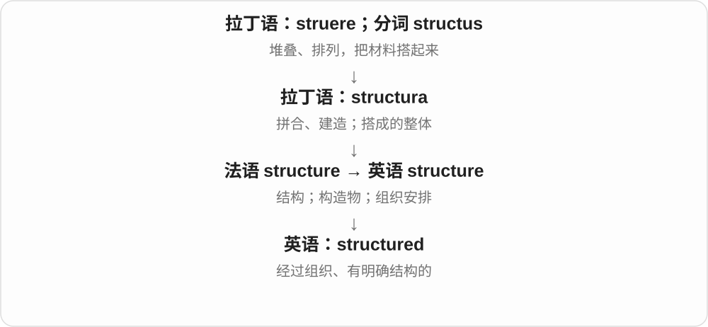

a structured interview 按预设的问题和流程进行；structured data 则按明确字段或模式组织，比如姓名、日期各占一列。

**常见搭配与例句**

a structured course；a structured interview；structured data。

> The course offers structured practice every morning.

课程每天上午安排有步骤的练习。

> The records were converted into structured data.

这些记录被转换成了结构化数据。

**别混淆**

structural 是与结构有关；structured 是已经安排出明确结构。structured 并不必然死板。

### 324. unprecedented — 前所未有的；史无前例的

**音标**：/ʌnˈpresɪdentɪd/

**先抓住这个画面**

往前翻记录，找不到能相比的先例。

**怎么拆**

un-“没有” + precedent“先例” + -ed“具有……的”。

**怎么变成今天的意思**

**拉丁 cēdere；分词词干 cess-**  
走、离开；让步、让出

↓

**拉丁 prae- + cēdere → praecēdere**  
走在前面、先发生

↓

**拉丁 praecēdēns / praecēdent- → 法语 precedent；亦可直接借入**  
走在前面的、在先的

↓

**英语 precedent**  
先前的实例 → 可供后来参照的先例

↓

**英语 un- + precedent + -ed → unprecedented**  
没有相应先例的

通常说规模、程度或情况超出此前经验，不必声称全宇宙从来没出现过。应理解为在谈论的范围内没有先例。

**常见搭配与例句**

an unprecedented level；unprecedented demand；an unprecedented decision。

> The exhibition attracted an unprecedented number of visitors.

展览吸引了空前多的参观者。

> The city faced an unprecedented shortage of water.

这座城市面临前所未有的缺水状况。

**别混淆**

unusual 只是少见；unprecedented 的说法更强，强调没有先例。

### 325. bash — 猛击、撞击；严厉抨击；〔口语〕派对；尝试

**音标**：/bæʃ/

**先抓住这个画面**

砰地撞一下是 bash；用话狠狠批评也像在砸。have a bash at something 却是放手试试，a birthday bash 则是热闹的生日派对。

**怎么拆**

常联系斯堪的纳维亚击打词，或拟声材料，更早具体来源未定。抨击义借实物击打；尝试、派对是后来口语分支，不必每个都编成真实打斗。

**怎么变成今天的意思**

**英语 bash 猛击，常联系斯堪的纳维亚拍打材料或拟声**  
更早具体路线未定

↓

**bash → 严厉抨击；a bash 一试、派对；+ -er → basher**  
动作与口语名词各有用法，不能只按打人理解

bash your knee 磕到膝盖；bash a policy 严厉抨击政策；have a bash at 尝试；a birthday bash 生日派对。

**常见搭配与例句**

have a bash at；a birthday bash。

> I bashed my knee against the desk.

我的膝盖重重磕到了桌子。

> I have never made bread, but I will have a bash at it.

我没做过面包，不过我会试试。

> They held a birthday bash in the garden.

他们在花园办了一场热闹的生日派对。

**别混淆**

bash 常比 hit 有猛、粗重的感觉；a bash 派对不说明有人斗殴。程序名 Bash 则另有命名缩略背景。

### 326. bashing — 正在猛击、猛批；一顿重打、猛烈抨击

**音标**：/ˈbæʃɪŋ/

**先抓住这个画面**

工具、身体正重重敲撞，是 bashing；评论中对某人、某事集中猛批，也可叫 a bashing。

**怎么拆**

bash + 完整 -ing，直接加；可写进行动作，也可作活动名词，再用于抨击的比喻。

**怎么变成今天的意思**

**十七世纪 bash 重击动词 → 名词**  
或北欧来源，或拟声；不能把推定古诺尔斯形式当作直接记录

↓

**重击 → 猛批、尝试、派对等口语分支**  
have a bash 是试一下或办场聚会，按具体搭配分别理解

↓

**bash + -ing → bashing**  
猛击过程；猛烈批评活动

bashing on the door 是猛敲门，give the proposal a bashing 是猛烈抨击提案；宾语帮助区分实体还是观点。

**常见搭配与例句**

constant bashing 没完没了的猛批；bashing away at a keyboard 使劲敲键盘。

> Someone was bashing on the door downstairs.

有人在楼下猛敲门。

> The proposal took a bashing in the press.

这项提案遭到媒体猛烈抨击。

**别混淆**

bashing 语气比 discussion、criticism 更猛烈，通常带痛打或集中攻击的感觉；并不是普通中性讨论。

### 327. bashed — 猛击、撞击了；猛批了；〔bashed out〕草草写出、弹出

**音标**：/bæʃt/

**先抓住这个画面**

刚才重重撞、敲了一下，叫 bashed；批评说得很重，也可这样写。bashed out a draft 则像猛敲键盘，赶快弄出一稿。

**怎么拆**

bash + 完整 -ed，/ʃ/ 后读 /t/；只有一个音节，不读 /ɪd/。

**怎么变成今天的意思**

**十七世纪 bash 重击动词 → 名词**  
或北欧来源，或拟声；不能把推定古诺尔斯形式当作直接记录

↓

**重击 → 猛批、尝试、派对等口语分支**  
have a bash 是试一下或办场聚会，按具体搭配分别理解

↓

**bash + -ed → bashed**  
过去猛击、猛批；快速弄出内容等搭配

bashed his knee 是撞了膝盖，bashed the plan 是猛批计划；bashed out an email 是很快草草写出邮件。

**常见搭配与例句**

bashed against a wall 撞到墙；bashed out a tune 使劲、随意弹出曲子。

> I bashed my knee on the low table.

我的膝盖重重撞到了矮桌。

> She bashed out a first draft in an hour.

她一小时里赶出了一份初稿。

**别混淆**

bashed out 常带赶快、不精细的感觉；carefully drafted 则强调仔细起草，速度、态度都不同。

### 328. bashes — 猛击、猛批〔第三人称单数〕；重击、尝试、聚会〔复数〕

**音标**：/ˈbæʃɪz/

**先抓住这个画面**

用力敲、打一个东西，用 bashes；狠狠批评一个做法也能用。名词 bashes 还可以说几场热闹聚会。

**怎么拆**

bash + -es，/ʃ/ 后读 /ɪz/。动词三单、名词复数同形，基础词来源可能北欧、也可能拟声。

**怎么变成今天的意思**

**十七世纪 bash 重击动词 → 名词**  
或北欧来源，或拟声；不能把推定古诺尔斯形式当作直接记录

↓

**重击 → 猛批、尝试、派对等口语分支**  
have a bash 是试一下或办场聚会，按具体搭配分别理解

↓

**bash + -es → bashes**  
他、她猛击、猛批；多记重击、聚会等

bashes the door 是猛敲门，bashes the government 是猛批政府；birthday bashes 是生日派对，属口语。

**常见搭配与例句**

bashes away at the keyboard 使劲敲键盘；big bashes 热闹的大聚会。

> He bashes the stuck door with his shoulder.

他用肩膀猛撞卡住的门。

> They are known for throwing huge birthday bashes.

他们以办热闹的大型生日派对出名。

**别混淆**

bashes 作派对名词时不要求真打架；这个口语分支和动词重击画面有关联，但不是每场聚会都有击打。

### 329. boycott — 抵制；拒买、拒绝参与以表达反对

**音标**：英 /ˈbɔɪkɒt/；美 /ˈbɔɪkɑːt/

**先抓住这个画面**

不是偶然没买、没去，而是为了表示反对，大家主动不买、不参加，这就是 boycott。重点在用拒绝往来表达立场。

**怎么拆**

来自 Charles Boycott 的姓氏。他是十九世纪爱尔兰的土地代理人，1880 年遭当地有组织的拒绝往来，其姓名随后成为这类抵制行动的名词、动词。

**怎么变成今天的意思**

**Charles Boycott 姓名 → 1880 年相关抵制事件**  
人名在特定事件后成为行动名称

↓

**英语 boycott 名词、动词 → 更广拒买、拒参场景**  
现代是完整词，不从 boy 男孩、cot 小床拼义

boycott a product 是抵制某产品；boycott a meeting 是拒绝参加会议以示反对；call for a boycott 是呼吁抵制。

**常见搭配与例句**

boycott a product；boycott a meeting；call for a boycott。

> The group voted to boycott the meeting.

这个团体投票决定抵制会议，拒绝参加。

> Some shoppers decided to boycott the brand.

一些消费者决定抵制这个品牌。

**别混淆**

boycott 是参与者有意拒买、拒参；ban 通常说作出禁止规定；strike 常说劳动者罢工。它们不是同一种行动。

### 330. boycotted — 抵制了；被抵制的

**音标**：英 /ˈbɔɪkɒtɪd/；美 /ˈbɔɪkɑːtɪd/

**先抓住这个画面**

一场会议、一种商品遭到有意拒绝参加或购买，可以说 was boycotted。它仍强调表达反对的抵制，不只是没人感兴趣。

**怎么拆**

boycott + 完整 -ed → boycotted，末音 /t/ 后 -ed 读 /ɪd/。boycott 原词已有两个 t，直接接词尾，不再额外增加第三个 t。

**怎么变成今天的意思**

**Boycott 人名 → 英语 boycott 抵制**  
十九世纪事件使完整姓氏词化

↓

**boycott + -ed → boycotted**  
过去抵制动作；被抵制的状态

was boycotted by 是被某些人抵制；a boycotted event 是遭抵制的活动。具体拒买、拒参哪一种，取决于宾语。

**常见搭配与例句**

was boycotted by；a boycotted event；boycotted the meeting。

> The event was boycotted by several local groups.

几个当地团体抵制了这项活动。

> They boycotted the shop for a week.

他们抵制那家商店，持续了一周。

**别混淆**

boycotted 强调有意抵制，cancelled 是被取消，ignored 是被忽视。抵制本身不表示活动已经取消。

### 331. wired — 有线连接的、已接线的；兴奋得绷着的〔口语〕

**音标**：英 /waɪəd/；美 /waɪərd/

**先抓住这个画面**

设备通过线接上，叫 wired；人像电路通上电，精神绷得很紧、睡不下来，也借说 wired。

**怎么拆**

wire 去 e 加 -ed，既是过去分词，也有形容词用法。口语兴奋义是比喻，不能当作身体真的装了线。

**怎么变成今天的意思**

**古英语 wīr → 中古英语 wir、wyr → wire**  
金属细丝、金属丝饰物

↓

**wire + -ed → wired〔去 e〕**  
已接线、有线的；比喻精神兴奋绷紧

a wired connection 有线连接，wired headphones 有线耳机，feel wired 感到兴奋紧绷，wired differently 思考、反应方式不同〔比喻〕。

**常见搭配与例句**

a wired connection；wired headphones；feel wired。

> I prefer a wired connection for this computer.

这台电脑我更喜欢用有线连接。

> I felt tired but too wired to sleep.

我很累，精神却绷得太紧，睡不着。

**别混淆**

wired 有线、wireless 无线；tired 累与 wired 兴奋紧绷可以同时出现，不能只因尾字母相像认为近义。

### 332. stain — 污渍；染色剂；弄脏、染色；玷污

**音标**：/steɪn/

**先抓住这个画面**

咖啡滴在白衬衫上留下一个印子，那是 stain；给木头上色，也可用 stain。一个词既能说不想要的污痕，也能说有意染出的颜色。

**怎么拆**

中古英语 steinen 等与古诺斯语 steina 染色有关，也受经法语来的 disteynen 等变色、弄脏材料影响。来源有合流，不硬拆成 st + ain。

**怎么变成今天的意思**

**古诺斯 steina；经法语的 disteynen 等**  
染色、变色、弄脏的材料

↓

**英语 stain**  
染色或污渍；名誉上的污点

a coffee stain 咖啡渍；stain a shirt 弄脏衬衫；wood stain 木材着色剂；a stain on his reputation 名誉上的污点。

**常见搭配与例句**

remove a stain；a coffee stain。

> The coffee left a stain on my shirt.

咖啡在我的衬衫上留下了一块污渍。

> They stained the wooden floor a darker colour.

他们把木地板染成了更深的颜色。

**别混淆**

stain 常强调颜色、渗入留下的痕，dirt 泛指脏东西；stain wood 可以是装修时主动着色，不一定是做坏了。

### 333. stained — 染色、沾污了；带污渍的；有色彩的

**音标**：/steɪnd/

**先抓住这个画面**

衬衫染上咖啡色，是 stained；窗上的 stained glass 却是有意做出的彩色玻璃。关键看颜色被当作污渍还是设计。

**怎么拆**

stain + 完整 -ed，/n/ 后读 /d/；过去式、过去分词和染色状态形容词同形。

**怎么变成今天的意思**

**北欧 steina 染色材料与经法语来的 disteynen 等合流 → stain**  
染色、失色、弄脏的不同旧用法汇入同一现代词

↓

**改变颜色 → 污渍；有意染木、彩色玻璃；名声污点**  
现代看颜色是不是有意加上，不把所有 stain 都看成失败、脏

↓

**stain + -ed → stained**  
颜色已改变；可以污损，也可以有意染色

stained with ink 是沾上墨，stained glass 是彩色玻璃；stained the wood dark brown 是把木头染成深棕色。

**常见搭配与例句**

a stained shirt 有污渍的衬衫；reputation stained by lies 被谎言弄脏的名声。

> Her sleeve was stained with coffee.

她的袖子沾上了咖啡渍。

> Sunlight shone through the stained glass.

阳光透过彩色玻璃照进来。

**别混淆**

stained glass 里的 stained 是有色、染色，不等于 dirty glass 脏玻璃；一个固定搭配就能显示这个词不只负面。

### 334. stains — 污渍、染色剂、名誉污点〔复数〕；染色、留下污渍〔第三人称单数〕

**音标**：/steɪnz/

**先抓住这个画面**

衣服上几块洗不掉的颜色，是 stains；一种果汁染到桌布，也可 it stains。木工染色剂同样改变颜色，却是有意求效果。

**怎么拆**

stain + -s，/n/ 后读 /z/；动词三单与污渍、染料等名词复数同形，基础涉及北欧与法语材料合流。

**怎么变成今天的意思**

**北欧 steina 染色材料与经法语来的 disteynen 等合流 → stain**  
染色、失色、弄脏的不同旧用法汇入同一现代词

↓

**改变颜色 → 污渍；有意染木、彩色玻璃；名声污点**  
现代看颜色是不是有意加上，不把所有 stain 都看成失败、脏

↓

**stain + -s → stains**  
它染色；几块污渍或几种染色剂

coffee stains 是咖啡渍，stains the fabric 是把布染色；wood stains 是木材染色剂，未必指木头脏了。

**常见搭配与例句**

stains easily 容易留下污渍；stains on a reputation 名誉污点。

> The tablecloth had several coffee stains.

桌布上有几块咖啡渍。

> Beetroot juice stains the fabric a deep red.

甜菜汁把布染成深红色。

**别混淆**

stains 常像颜色留在材料里，smears 常像软物在表面拖开成痕；有些污渍要洗，有些油痕一擦就掉，形状和附着方式不同。

### 335. staining — 正在染色、留下污渍；染色处理、污渍形成

**音标**：/ˈsteɪnɪŋ/

**先抓住这个画面**

木头正在吸进染色剂，或饮料正把布变色，是 staining。动作都是颜色进入、留住，效果好坏要看是不是有意。

**怎么拆**

stain + 完整 -ing，直接加；分词、动作名词同形，基础 ai 长元音不改。

**怎么变成今天的意思**

**北欧 steina 染色材料与经法语来的 disteynen 等合流 → stain**  
染色、失色、弄脏的不同旧用法汇入同一现代词

↓

**改变颜色 → 污渍；有意染木、彩色玻璃；名声污点**  
现代看颜色是不是有意加上，不把所有 stain 都看成失败、脏

↓

**stain + -ing → staining**  
使材料变色、留色的过程

staining wood 是给木材染色，prevent staining 是防止留污渍；staining the cloth 是把布染上颜色。

**常见搭配与例句**

wood staining 木材染色；staining around the edge 边缘的色渍。

> They spent the afternoon staining the wooden shelves.

他们整个下午都在给木架染色。

> The dark liquid was staining the white cloth.

深色液体正把白布染上颜色。

**别混淆**

staining 与 painting 都能加颜色，staining 常让木纹等基底仍透出，painting 更常覆盖表面；具体材料、效果仍看场景。

### 336. chopped — 切碎、剁过的；chop 的过去式、过去分词

**音标**：英 /tʃɒpt/；美 /tʃɑːpt/

**先抓住这个画面**

原来一整颗洋葱，处理成小块以后，就可以 chopped onion。这个分词让你看到动作完成后的食材状态。

**怎么拆**

chop + -ed，双写 p；-ed 在 /p/ 后读 /t/。过去式说做过切剁，形容词说切过的状态。

**怎么变成今天的意思**

**中古英语 choppen、chappen**  
短促用力地切、劈，更远拟声、法语、日耳曼语等来源有讨论

↓

**切一块 → chop 肉块等**  
动词与成品、切击动作互相联系

↓

**chop + -ed → chopped**  
已切、剁过的状态

chopped onions 碎洋葱，finely chopped herbs 切得很碎的香草，roughly chopped vegetables 粗切蔬菜。

**常见搭配与例句**

finely chopped；roughly chopped。

> Add the chopped tomatoes to the bowl.

把切好的番茄加入碗里。

> The recipe calls for finely chopped parsley.

食谱需要切得很碎的欧芹。

**别混淆**

chopped 不单独规定每块多大，finely、roughly 等再说明精细程度；读一音节，不把 -ed 发成 /ɪd/。

### 337. compromised — 受损的；遭泄露或入侵的；因让步而改变的

**音标**：英 /ˈkɒmprəmaɪzd/；美 /ˈkɑːmprəmaɪzd/

**先抓住这个画面**

compromised 像原本完整的防线出现缺口，安全性、可靠性或独立性已经受到影响。

**怎么拆**

compromise + -ed。

**怎么变成今天的意思**

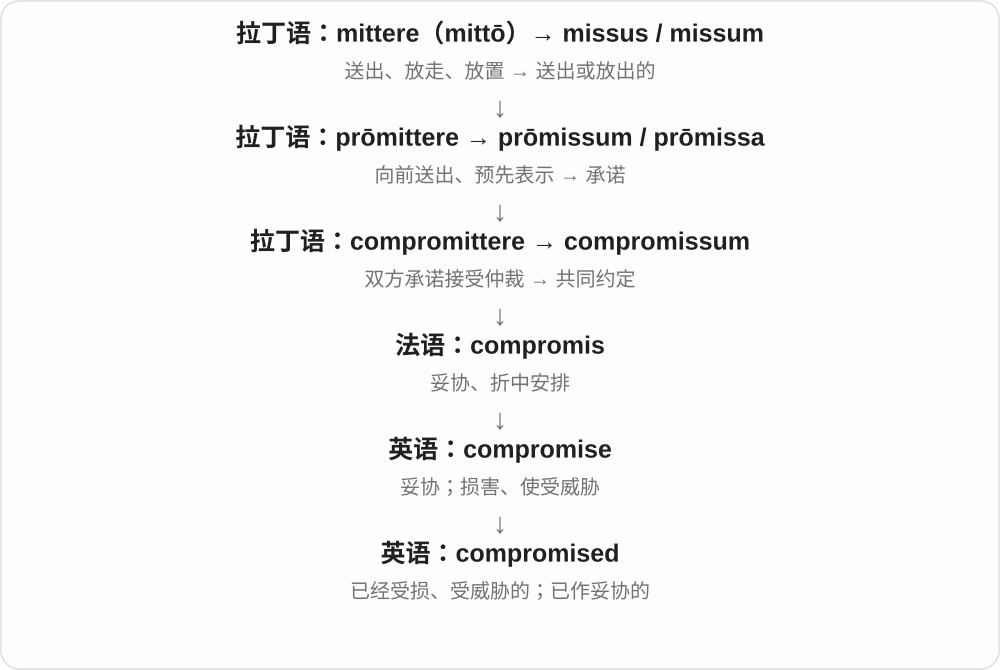

网络账户被 compromised 常指账户安全遭到破坏；判断被 compromised 则可能受利益或压力干扰。不能都按“达成妥协”翻译。

**常见搭配与例句**

a compromised account；compromised security；compromised independence。

> The notice warned users that their accounts might be compromised.

通知提醒用户，他们的账户安全可能已经受到破坏。

> Her independence was compromised by the undisclosed payment.

那笔未披露的付款损害了她的独立性。

**别混淆**

damaged 可指有形损坏；compromised 更常说保护、功能、立场或可信度受到侵蚀。

### 338. jade — 玉；玉石；玉色〔另有不同来源的旧词〕

**音标**：英、美 /dʒeɪd/

**先抓住这个画面**

玉雕、玉镯这类物品中的玉，英语常叫 jade。颜色可以有多种，不只一种绿色；专业珠宝语境还会区分具体材料。

**怎么拆**

玉石义经法语 le jade、早期 l’ejade，接西班牙 piedra de la ijada 腰腹之石的名称。它源于早期相关命名观念，不是现代医学用途；英语另有旧 jade 疲惫的马，来源不同。

**怎么变成今天的意思**

**西班牙相关玉石名 → 法语词界重新划分 → jade**  
法语早期 l’ejade 被重新理解为 le jade，形成现代词形

↓

**jade 玉石；另源旧马名 jade → 疲倦动词**  
两条同形线分开，jaded 走旧马名这条历史支线

a jade carving 是玉雕；a jade bracelet 是玉镯；jade green 是玉绿色。

**常见搭配与例句**

a jade carving；a jade bracelet；jade green。

> The museum displayed a small jade carving.

博物馆展出了一件小玉雕。

> She kept the jade bracelet in a wooden box.

她把玉镯收在木盒里。

**别混淆**

jade 是玉石的通用名称之一，珠宝学里常涉及 jadeite、nephrite 等材料。它不是所有绿色石头的总称，也不能只凭这个词确定颜色或具体矿物。

### 339. jaded — 厌倦的；见得太多而失去兴致的；疲惫的

**音标**：英、美 /ˈdʒeɪdɪd/

**先抓住这个画面**

好东西看过太多，同类场面经历太多，现在再来一遍也提不起劲，就是 jaded。它常带一种见惯了、腻了、很难再惊喜的感觉。

**怎么拆**

jade 使疲倦的旧动词去末尾 e，加完整 -ed → jaded，/d/ 后读 /ɪd/。这条 jade 来自旧时疲惫、不中用的马名，远源不明，与玉石借词分开。

**怎么变成今天的意思**

**旧 jade 疲惫的马 → jade 使疲倦、变迟钝**  
从疲马名称发展出使失去活力的动词

↓

**jade + -ed → jaded**  
现代形容经历、享受太多而厌倦，也可说精神疲惫

a jaded audience 是看惯一切、难再感到新鲜的观众；feel jaded 是觉得倦怠；a jaded critic 是见多而不易惊喜的评论者。

**常见搭配与例句**

a jaded audience；feel jaded；a jaded critic。

> Even the jaded critics seemed impressed by the performance.

连见多识广、很难再惊喜的评论者都似乎被演出打动了。

> After a week of receptions, she felt jaded.

接连参加一周招待活动后，她感到厌倦疲惫。

**别混淆**

tired 可以只是需要休息；jaded 常多了重复经历、兴趣被磨掉的意味。玉石 jade 的字形相同，不是这条厌倦义的来源。

### 340. cursed — 被诅咒的；可恶的；怪异、令人不安的〔网络等语境〕

**音标**：英 /kɜːst/ 或 /ˈkɜːsɪd/；美 /kɜːrst/ 或 /ˈkɜːrsɪd/

**先抓住这个画面**

故事里的宝物受了诅咒，是 cursed；抱怨某个破机器可说 this cursed machine。网络里 cursed image 则常说怪得让人不舒服、又有点好笑的图。

**怎么拆**

curse + -ed，中古英语已有相应形式。过去分词常读单音节 /kɜːst/ 等，形容词也有两音节读法；具体语气随语境变化。

**怎么变成今天的意思**

**古英语 curs、cors；远源不明**  
诅咒、咒骂

↓

**curse 的比喻和日常表达**  
带来苦难之物；说脏话、咒骂

↓

**cursed、cursing**  
被诅咒、可恶或怪异的；咒骂这一活动

↓

**curse + -ed → cursed**  
被诅咒；可恶、怪异等状态评价

a cursed object 被诅咒的物件，a cursed image 怪异图像，this cursed machine 这该死的机器〔抱怨语气〕。

**常见搭配与例句**

a cursed object；a cursed image。

> The tale begins with a cursed ring.

故事从一枚被诅咒的戒指开始。

> I cannot get this cursed printer to work.

这该死的打印机，我怎么都弄不动。

**别混淆**

两个读法不是绝对按一个词义切开；文学、语气和说话习惯会影响读法。网络 cursed 也不等于真在声称存在诅咒。

### 341. pinch — 捏、夹、夹痛；节省、偷拿〔口语〕；一捏、一撮；急用关头

**音标**：/pɪntʃ/

**先抓住这个画面**

两根手指往中间夹一点，是 pinch；一撮盐就像两指捏住的那一点。鞋太紧夹得脚疼、手头紧得开支被挤，也能借这个夹压画面。

**怎么拆**

经中古英语 pinchen 借法语捏夹材料，更早来源不定。名词紧要关头的记录早于“一捏、一撮”，学习图景不代表所有义都按物理名词先后派生。

**怎么变成今天的意思**

**中古英语 pinchen，借法语捏、夹材料 → pinch**  
法语更远来源未定；穿刺、点等拉丁词源属于候选分析

↓

**夹压动作、疼痛、吝啬等分支；名词急用处境较早已见**  
一撮盐是两指捏起的一点；in a pinch 的紧急处境名词记录更早

a pinch of salt 是一撮盐，shoes pinch 是鞋夹脚；in a pinch 是急用时、必要时，take it with a pinch of salt 是别全信。

**常见搭配与例句**

pinch the edge 捏住边；feel the pinch 感到手头紧；pinch pennies 精打细算、抠钱。

> Add a pinch of salt to the mixture.

往混合物里加一撮盐。

> These shoes pinch my toes.

这双鞋夹我的脚趾。

**别混淆**

pinch 是局部从两边夹，squeeze 更宽，可以整手、整个空间挤压；取一撮盐用 pinch，挤柠檬通常 squeeze。

### 342. pinched — 捏、夹、偷拿了；被夹压的；瘦削憔悴的、拮据的

**音标**：/pɪntʃt/

**先抓住这个画面**

手指刚才被门夹了，或一处布被两指捏起，是 pinched；脸显得又瘦又紧、生活手头紧，也像被挤得没有余量。

**怎么拆**

pinch + 完整 -ed，/tʃ/ 后读 /t/，结尾 /ntʃt/；分词还固定成憔悴、拮据等形容用法。

**怎么变成今天的意思**

**中古英语 pinchen，借法语捏、夹材料 → pinch**  
法语更远来源未定；穿刺、点等拉丁词源属于候选分析

↓

**夹压动作、疼痛、吝啬等分支；名词急用处境较早已见**  
一撮盐是两指捏起的一点；in a pinch 的紧急处境名词记录更早

↓

**pinch + -ed → pinched**  
过去捏夹；夹紧、削瘦或资源紧的状态

pinched her fingers 是夹了她的手指，a pinched face 是瘦削憔悴的脸；pinched a biscuit 是口语偷拿了一块饼干。

**常见搭配与例句**

pinched the edge together 把边捏拢；financially pinched 手头拮据。

> He pinched the edges of the dough together.

他把面团的边捏拢。

> Her face looked pinched after the sleepless night.

一夜没睡，她的脸显得瘦削憔悴。

**别混淆**

pinched 的瘦削义常带疲惫、不好过的紧缩感，slim 可以只说苗条；形容脸时不能全当中性的瘦。

### 343. pinching — 正在捏夹、夹痛、节省、偷拿；捏夹动作

**音标**：/ˈpɪntʃɪŋ/

**先抓住这个画面**

两指正把布夹起一点，鞋正把脚挤得不舒服，是 pinching；pinching pennies 则像连小钱都抓得紧紧的。

**怎么拆**

pinch + 完整 -ing，直接加；分词能描述夹压动作，也可把捏夹看作一类行为。

**怎么变成今天的意思**

**中古英语 pinchen，借法语捏、夹材料 → pinch**  
法语更远来源未定；穿刺、点等拉丁词源属于候选分析

↓

**夹压动作、疼痛、吝啬等分支；名词急用处境较早已见**  
一撮盐是两指捏起的一点；in a pinch 的紧急处境名词记录更早

↓

**pinch + -ing → pinching**  
捏夹、局部挤压的过程

pinching the fabric 是捏着布，shoes are pinching 是鞋正在夹脚；pinching pennies 是在开支上非常节省。

**常见搭配与例句**

pinching the ends together 把两端捏拢；a pinching sensation 像被夹的感觉。

> She was pinching the fabric to mark where the fold should go.

她正捏着布，标出该折的位置。

> My shoes were pinching by the end of the walk.

走到最后，我的鞋已经夹得脚疼。

**别混淆**

pinching 常是局部夹压，clenching 常是把拳、牙关收紧；两指取少量盐像 pinching，不是把整只拳头攥住。

### 344. pinches — 捏、夹痛、节省、偷拿〔第三人称单数〕；几捏、几撮〔复数〕

**音标**：/ˈpɪntʃɪz/

**先抓住这个画面**

一个人捏住小部分，或鞋紧得夹脚，动词用 pinches；调味时加几小撮，也叫 a few pinches。

**怎么拆**

pinch + -es，/tʃ/ 后读 /ɪz/；动词三单与捏夹、少量名词复数同形。

**怎么变成今天的意思**

**中古英语 pinchen，借法语捏、夹材料 → pinch**  
法语更远来源未定；穿刺、点等拉丁词源属于候选分析

↓

**夹压动作、疼痛、吝啬等分支；名词急用处境较早已见**  
一撮盐是两指捏起的一点；in a pinch 的紧急处境名词记录更早

↓

**pinch + -es → pinches**  
它夹压；几下捏夹或几撮

pinches the fabric 是捏住布，pinches at the heel 是在脚跟处夹痛；two pinches of salt 是两撮盐。

**常见搭配与例句**

pinches her nose 捏住鼻子；pinches pennies 在小开支上非常节省。

> The new shoe pinches at the heel.

新鞋在脚跟处夹得疼。

> She added two pinches of salt.

她加了两撮盐。

**别混淆**

pinches 可以写实际夹痛，也能说花钱抠得紧；pinches pennies 的意思在整个搭配里，不能译成捏几枚硬币。

### 345. turf — 草皮；草地；地盘、专属范围；铺草皮

**音标**：英 /tɜːf/；美 /tɝːf/

**先抓住这个画面**

连着草根、薄土的一块草皮，是 turf 的实体画面。属于自己的场地、熟悉的领域，也像自己脚下这一片草地，于是有地盘、主场的比喻。

**怎么拆**

承古英语 turf、tyrf 草皮、草地，来自日耳曼对应词族。英语后来形成铺草皮动词，也有场地、某群体活动范围等扩展。

**怎么变成今天的意思**

**古英语 turf 草、根、土连在一起的草皮 → turf**  
实体草皮与草地区域两类用法保留

↓

**草地、活动场地 → turf 地盘、领域；铺草皮动词**  
现代体育、园地与抽象工作范围都可出现

natural turf 是天然草皮；home turf 是主场、熟悉地盘；a turf war 是为地盘、职责范围而起的争斗。

**常见搭配与例句**

natural turf；home turf；a turf war。

> Fresh turf covered the repaired section of the field.

修补过的那片场地铺上了新草皮。

> She felt confident discussing the topic on her own turf.

谈到自己熟悉的领域，她很有信心。

**别混淆**

grass 常说草这种植物；turf 常强调连根、连土的草皮或铺成的草地。on home turf 也可在工作、讨论语境说处于熟悉领域。

### 346. turfed — 铺了草皮；赶了出去〔常见于 turf out 等搭配〕

**音标**：英 /tɜːft/；美 /tɝːft/

**先抓住这个画面**

地面铺上草皮，可以说 was turfed。英式口语里，turfed out 又常说被赶出去、被迫离开，两个用法要靠搭配分开。

**怎么拆**

turf + 完整 -ed → turfed，/f/ 后后缀读 /t/。基础词 turf 草皮承古英语，名词形成铺草皮动词；赶出的口语义是后来的动词搭配分支。

**怎么变成今天的意思**

**turf 草皮 → turf 给地面铺草皮**  
实体名词转作相应动作动词

↓

**turf + -ed → turfed；turf out 的口语用法**  
现代过去形式按是否接 out 等词判断具体动作

newly turfed ground 是新铺草皮的地面；turfed out of somewhere 是被赶出某处；turfed out of bed 是被催赶着起床。

**常见搭配与例句**

newly turfed ground；turfed out of；turfed out of bed。

> The small courtyard was turfed before the opening.

小院子在开放前铺上了草皮。

> We were turfed out of the room when the next class arrived.

下一班学生到来时，我们被赶出了房间。

**别混淆**

The garden was turfed 谈铺草皮；we were turfed out 谈被赶走。不要只按基础名词草地，把每个 turfed 都理解成园艺动作。

### 347. twitch — 抽动、颤动、急促拉动；抽动一下

**音标**：/twɪtʃ/

**先抓住这个画面**

眼皮忽然跳一下，猫耳朵迅速动一下，是 twitch。像一个局部被短促拉了下，动作很快就过去。

**怎么拆**

承古英语 twiccian 的拔、急扯材料，经中古英语 twicchen；较早主动拉扯，后来也说肌肉自己短促收动。

**怎么变成今天的意思**

**古英语 twiccian → 中古英语 twicchen → twitch**  
拔、急扯、抓住，和 tweak 的相关材料可比较

↓

**急扯小动作 → 肌肉短促抽动；相关名词**  
现代常是眼皮、嘴角、耳朵忽然微动，不一定持续抖

an eye twitch 是眼皮抽动，ears twitch 是耳朵快动；twitch the curtain aside 是把帘子急促拉开一点。

**常见搭配与例句**

a slight twitch 轻微一抽；twitch at the corner of the mouth 嘴角动一下。

> I saw the cat's ear twitch.

我看见猫的耳朵快动了一下。

> A slight twitch at the corner of his mouth suggested a smile.

他的嘴角轻轻一动，像要笑出来。

**别混淆**

twitch 常是一个部位短促一抽，tremble 更能说持续发抖；一只耳朵 twitch 不等于整只动物一直在抖。

### 348. twitching — 正在抽动、颤动、急促微动；抽动行为

**音标**：/ˈtwɪtʃɪŋ/

**先抓住这个画面**

眼皮正跳，猫尾巴尖正一下下抽动，是 twitching；一个过程可以由连续几次很快的小动作构成。

**怎么拆**

twitch + 完整 -ing，直接加；分词、动作名词同形，ch 仍读 /tʃ/。

**怎么变成今天的意思**

**古英语 twiccian → 中古英语 twicchen → twitch**  
拔、急扯、抓住，和 tweak 的相关材料可比较

↓

**急扯小动作 → 肌肉短促抽动；相关名词**  
现代常是眼皮、嘴角、耳朵忽然微动，不一定持续抖

↓

**twitch + -ing → twitching**  
短促微动连续发生的过程

a twitching tail 是抽动的尾巴，twitching at the mouth 是嘴角微动；look at the twitching ears 是看那快动的耳朵。

**常见搭配与例句**

twitching slightly 轻轻抽动；stop twitching 停止抽动。

> The cat sat with the tip of its tail twitching.

猫坐着，尾巴尖一下一下抽动。

> She noticed her eyelid twitching as she read.

看书时，她发现眼皮在跳。

**别混淆**

twitching 由短促的小抽构成，swaying 常是平缓来回摆；猫尾巴可以轻摆，也可以突然一下一下抽动，镜头不同。

### 349. twitches — 抽动、颤动、急拉〔第三人称单数〕；短促抽动〔复数〕

**音标**：/ˈtwɪtʃɪz/

**先抓住这个画面**

一只耳朵或嘴角一下快动，叫 twitches；接连几个小抽动也可看作一下一下的名词复数。

**怎么拆**

twitch + -es，/tʃ/ 后读 /ɪz/；动词三单和局部抽动名词复数同形。

**怎么变成今天的意思**

**古英语 twiccian → 中古英语 twicchen → twitch**  
拔、急扯、抓住，和 tweak 的相关材料可比较

↓

**急扯小动作 → 肌肉短促抽动；相关名词**  
现代常是眼皮、嘴角、耳朵忽然微动，不一定持续抖

↓

**twitch + -es → twitches**  
它短促微动；几下抽动

his eyelid twitches 是他眼皮跳，a few twitches 是几下抽动；主语经常直接是身体局部。

**常见搭配与例句**

twitches suddenly 忽然抽一下；tiny twitches 细微抽动。

> The rabbit's nose twitches as it sniffs.

兔子嗅闻时，鼻子一动一动。

> We noticed a few small twitches in his fingers.

我们注意到他的手指轻轻抽了几下。

**别混淆**

twitches 描写动作，不单凭它判断身体、情绪的原因；猫耳朵因声音动一下，也能用 twitches。

### 350. twitched — 抽动、快动、急拉了一下

**音标**：/twɪtʃt/

**先抓住这个画面**

刚才嘴角轻轻一跳，猫尾巴尖突然动了一下，是 twitched。它常把叙述缩到很小、很快的一次动作。

**怎么拆**

twitch + 完整 -ed，/tʃ/ 后读 /t/，结尾 /tʃt/；基础短元音不改，整词不增 /ɪd/ 音节。

**怎么变成今天的意思**

**古英语 twiccian → 中古英语 twicchen → twitch**  
拔、急扯、抓住，和 tweak 的相关材料可比较

↓

**急扯小动作 → 肌肉短促抽动；相关名词**  
现代常是眼皮、嘴角、耳朵忽然微动，不一定持续抖

↓

**twitch + -ed → twitched**  
过去局部短促抽动或急拉

his mouth twitched 是他嘴角动了动，twitched the curtain aside 是急拉开帘子一点；后者是主动动作。

**常见搭配与例句**

twitched once 抽了一下；ears twitched 耳朵动了动。

> His mouth twitched as he tried not to laugh.

他忍着笑，嘴角动了动。

> The cat's ears twitched at the sound.

听到声音，猫的耳朵快动了一下。

**别混淆**

twitched 不必是大幅动作，jerked 常更显突然一拉、一顿；描述微小表情时 twitched 更能留住细节。

### 351. amuse — 逗乐；使愉快消遣

**音标**：/əˈmjuːz/

**先抓住这个画面**

讲个笑话让人笑，拿本有趣的书让自己消磨时间，都是 amuse：把注意力留在让人愉快的东西上。

**怎么拆**

借古法语 amuser，由 a- 与 muser 等发呆、停留思索材料组成，远源不确定。不是 a- 不 + Muse 缪斯女神，所以不叫没有灵感。

**怎么变成今天的意思**

**古法语 amuser；a- + muser**  
发呆、消磨时间、吸引注意等；muser 远源有争论

↓

**英语 amuse**  
使愉快、逗乐；愉快地占住注意力

amuse the children 逗孩子开心；amuse yourself with a book 读书消遣；be easily amused 很容易被逗乐。

**常见搭配与例句**

amuse someone；amuse yourself with。

> The story amused the children.

故事把孩子们逗乐了。

> She amused herself with a puzzle while waiting.

等候时，她做拼图消遣。

**别混淆**

amuse 常是逗乐、消遣，entertain 范围更宽；不用每次都保证大笑出声。

### 352. amusing — 有趣、逗人发笑的；正在逗乐、使消遣

**音标**：/əˈmjuːzɪŋ/

**先抓住这个画面**

故事里的小反转让人觉得好笑，这个故事是 amusing；人正在逗孩子开心，动作也用 amusing。

**怎么拆**

amuse 去 e 加 -ing；既是动作形式，也形成常见形容词，指能让人觉得有趣的性质。

**怎么变成今天的意思**

**法语 a- 加 muser 等沉思、停留注意材料 → amuser → amuse**  
早期吸住、分散注意，也可使迷惑，不只是现代逗人开心

↓

**分散严肃事务的注意 → 使愉快、消遣、觉得有趣**  
现代 amused 是人觉得有趣，amusing 是让人觉得有趣

↓

**amuse → amusing**  
正在逗乐；也形容令人觉得有趣

an amusing story 有趣的故事；amusing the children 正在逗孩子；find something amusing 觉得某事好笑。

**常见搭配与例句**

an amusing detail；mildly amusing 有点好笑。

> She told us an amusing story about the journey.

她给我们讲了旅途中的一个趣事。

> He was amusing the children with simple tricks.

他正用简单的小戏法逗孩子们。

**别混淆**

amusing 是东西、行为让人觉得有趣，amused 是人的感受；an amusing guest 逗趣的客人，an amused guest 觉得有趣的客人。

### 353. amusingly — 有趣、好笑地；令人发笑地

**音标**：/əˈmjuːzɪŋli/

**先抓住这个画面**

两个人碰巧给猫取了同一个名字，这个巧合本身有趣；开头用 amusingly，就像提醒读者“说来也好笑”。

**怎么拆**

amusing + 副词 -ly；内层 amuse 去 e 加 -ing 的形容词再扩展，主说事物有趣的呈现方式。

**怎么变成今天的意思**

**法语 a- 加 muser 等沉思、停留注意材料 → amuser → amuse**  
早期吸住、分散注意，也可使迷惑，不只是现代逗人开心

↓

**分散严肃事务的注意 → 使愉快、消遣、觉得有趣**  
现代 amused 是人觉得有趣，amusing 是让人觉得有趣

↓

**amusing + -ly → amusingly**  
以让人觉得有趣的方式；也评价整件事有趣

amusingly similar 相似得有趣；amusingly enough 说来也好笑；amusingly described 描述得很有趣。

**常见搭配与例句**

amusingly different；amusingly exaggerated 夸张得好玩。

> Amusingly, we had both chosen the same name for the cat.

说来也好笑，我们竟给猫选了同一个名字。

> The scene is amusingly exaggerated.

这个场景夸张得很有趣。

**别混淆**

amusingly 评价内容有趣，amusedly 才偏本人觉得有趣地；一个是造成感受，一个是带着感受。

### 354. amused — 觉得好笑、被逗乐的

**音标**：/əˈmjuːzd/

**先抓住这个画面**

amuse 逗别人，amused 是自己心里觉得有趣、好笑的那一端。可能只是笑一下，不必笑到停不下来。

**怎么拆**

amuse + -ed，拼写时先去 e，再加完整 -ed；/z/ 后读 /d/。对应 amused 被逗乐与 amusing 令人发笑的角色差异。

**怎么变成今天的意思**

**古法语 amuser；a- + muser**  
发呆、消磨时间、吸引注意等；muser 远源有争论

↓

**英语 amuse**  
使愉快、逗乐；愉快地占住注意力

↓

**amuse + -ed → amused**  
受到逗乐、觉得有趣的状态

an amused smile 觉得好笑的微笑；look amused 看起来觉得有趣；amused by the story 被故事逗乐。

**常见搭配与例句**

an amused smile；look amused；amused by。

> She gave him an amused smile.

她觉得好笑，对他微微一笑。

> He did not look amused by the joke.

他看起来并没觉得那个笑话好笑。

**别混淆**

amused 觉得好笑，bemused 常是困惑、茫然；两者近形，不能只按一个笑字混用。

### 355. amusements — 娱乐活动、消遣；游乐设施〔复数〕

**音标**：/əˈmjuːzmənts/

**先抓住这个画面**

不是只说心里觉得好笑，而是把逛集市、玩游戏、坐游乐设施这些具体消遣一项项数出来，用 amusements。

**怎么拆**

amusement + -s；amusement 经法语动作名词借入，现代可与 amuse 去 e 加 -ment 对照，复数再接 /s/。

**怎么变成今天的意思**

**法语 a- 加 muser 等沉思、停留注意材料 → amuser → amuse**  
早期吸住、分散注意，也可使迷惑，不只是现代逗人开心

↓

**分散严肃事务的注意 → 使愉快、消遣、觉得有趣**  
现代 amused 是人觉得有趣，amusing 是让人觉得有趣

↓

**法语 amusement → 英语 amusement，再作 amusements**  
消遣、乐趣；可数时指具体娱乐活动、设施

seaside amusements 海滨娱乐活动、设施；fairground amusements 游乐场里的设施；simple amusements 简单消遣。

**常见搭配与例句**

a range of amusements；children’s amusements。

> The seafront has cafés, shops and plenty of amusements.

海滨有咖啡馆、商店，还有不少娱乐设施。

> Reading and gardening were her favourite amusements.

阅读和园艺是她最喜欢的消遣。

**别混淆**

amusement 单数常说有趣的感受、消遣这一过程，amusements 把具体娱乐项目数出来；并不只是好多次笑。

### 356. amuses — 逗乐、使觉得有趣；让自己消遣〔第三人称单数〕

**音标**：/əˈmjuːzɪz/

**先抓住这个画面**

一件小事让人忍不住觉得好玩，是 amuses；孩子自己想点游戏打发时间，是 amuses herself。

**怎么拆**

amuse + -s，/z/ 后词尾读 /ɪz/；基础借法语 a- 加 muser 一路，不把 a- 当否定。

**怎么变成今天的意思**

**法语 a- 加 muser 等沉思、停留注意材料 → amuser → amuse**  
早期吸住、分散注意，也可使迷惑，不只是现代逗人开心

↓

**分散严肃事务的注意 → 使愉快、消遣、觉得有趣**  
现代 amused 是人觉得有趣，amusing 是让人觉得有趣

↓

**amuse + -s → amuses**  
它使人觉得有趣；他、她让自己消遣

amuses the children 逗孩子开心；amuses herself with a game 自己玩游戏消遣。

**常见搭配与例句**

it amuses me that 让我觉得有趣的是；amuses everyone。

> The little dog’s expression amuses everyone.

小狗的表情让大家都觉得有趣。

> She amuses herself by drawing tiny cartoons.

她画些小漫画，自己找乐子。

**别混淆**

amuses 使人觉得有趣，不要求一定笑出声；makes someone laugh 才直接把笑的反应说出。

### 357. stray — 偏离、走失；走失的、散落的、零星的；流浪动物

**音标**：/streɪ/

**先抓住这个画面**

羊离开羊群，脚步偏出小路，是 stray；一根头发从发束跑出来，或一个念头飘进脑海，也像离开原本该在的位置。

**怎么拆**

接古法语走失、漫游材料，更远有 street 所属的路词族与 extra vagari 向外游走等不同分析。英语走失动物名词也有较早独立借入背景。

**怎么变成今天的意思**

**法语 estraier、estraié 等走失材料 → 英语 stray**  
更远有街路词族与“游到外面”两种分析，具体路线不统一

↓

**走离原处 → 走失动物；离散、偶然偏来的东西**  
名词走失动物在英语记录很早，不能全说现代动词之后才造出

a stray cat 是流浪猫，stray from the path 是偏离小路，a stray thought 是偶然飘来的念头；a stray 可直接指走失动物。

**常见搭配与例句**

stray hairs 散开的几根头发；stray off topic 偏离话题。

> We found a stray cat outside the station.

我们在车站外发现一只流浪猫。

> Try not to stray from the main topic.

尽量别偏离主要话题。

**别混淆**

stray 比 wander 更突出离开原来、应该在的路或群体；wander 可以只是没有固定路线地闲逛。

### 358. strayed — 走偏了；偏离了；走失了

**音标**：/streɪd/

**先抓住这个画面**

本来沿着一条路走，后来脚步出了这条线，就是 strayed；谈话也会从主题走偏。

**怎么拆**

stray + -ed，元音字母 a 后的 y 保留，词尾读 /d/。不是把 y 改成 i。

**怎么变成今天的意思**

**法语 estraier、estraié 等走失材料 → 英语 stray**  
更远有街路词族与“游到外面”两种分析，具体路线不统一

↓

**走离原处 → 走失动物；离散、偶然偏来的东西**  
名词走失动物在英语记录很早，不能全说现代动词之后才造出

↓

**stray + -ed → strayed**  
过去偏离路线、主题或原来的群体

strayed from the path 走离小路；strayed into the garden 是误走、游荡进花园。

**常见搭配与例句**

strayed too far 离开得太远；strayed off topic 跑题了。

> We strayed from the marked path in the fog.

雾里，我们走偏了，离开了有标记的小路。

> The discussion strayed into personal matters.

讨论偏到了私人事情上。

**别混淆**

strayed 强调离开原线；wandered 可以只是随意逛，未必偏离什么。

### 359. strays — 走失动物〔复数〕；偏离、走失〔第三人称单数〕

**音标**：/streɪz/

**先抓住这个画面**

几只没人领回的猫狗，是 strays；一个人说着说着离开重点，动词用 strays。一个是走离原处的对象，一个是走偏动作。

**怎么拆**

stray + -s，元音后读 /z/；ay 的 y 保留，不改 ies，名词复数与动词三单同形。

**怎么变成今天的意思**

**法语 estraier、estraié 等走失材料 → 英语 stray**  
更远有街路词族与“游到外面”两种分析，具体路线不统一

↓

**走离原处 → 走失动物；离散、偶然偏来的东西**  
名词走失动物在英语记录很早，不能全说现代动词之后才造出

↓

**stray + -s → strays**  
多个走失动物；它偏离原线

care for strays 是照顾流浪动物，strays from the topic 是偏离主题；strays too far 是走得离原路太远。

**常见搭配与例句**

strays into another field 跑到另一领域；cats and other strays 猫和其他流浪动物。

> The shelter takes in strays from the neighbourhood.

收容所接收附近的走失、流浪动物。

> His answer often strays from the question.

他的回答常偏离问题。

**别混淆**

strays 作为动物名词不自动说明野生；feral 更突出野化、未驯养，走失宠物同样可以是 a stray。

### 360. straying — 正在走偏、走失、偏离

**音标**：/ˈstreɪɪŋ/

**先抓住这个画面**

脚步一点点走出该走的路，话题一点点离开重点，正在发生时就是 straying。

**怎么拆**

stray + -ing，y 保留；/eɪ/ 后接 /ɪŋ/，不要把整段压成一个音节。

**怎么变成今天的意思**

**法语 estraier、estraié 等走失材料 → 英语 stray**  
更远有街路词族与“游到外面”两种分析，具体路线不统一

↓

**走离原处 → 走失动物；离散、偶然偏来的东西**  
名词走失动物在英语记录很早，不能全说现代动词之后才造出

↓

**stray + -ing → straying**  
正在离开原路、原处或话题

straying from the subject 是说话正在跑题；straying onto private land 是走进别人的地界。

**常见搭配与例句**

keep someone from straying 防止某人走失、偏离；straying eyes 游移的目光。

> The dog kept straying into the road.

那条狗老是乱跑到马路上。

> We are straying from the point of the meeting.

我们正在偏离这次会议的重点。

**别混淆**

straying from 指离开某条线，straying into 指偏进某个地方、领域，介词把方向讲清楚。

### 361. stud — 饰钉、凸钉；耳钉；种公畜、种马等〔另一支〕

**音标**：/stʌd/

**先抓住这个画面**

衣服、鞋底上固定着的小凸点，是一支；a stud farm 里的 stud 则联系繁育马匹。先把这两支分开看。

**怎么拆**

凸钉、支柱义接古英语 studu 支撑柱等，后来也说固定并突出的钉头、饰物；种畜义接古英语 stod 马群、养马处等另一条旧材料。

**怎么变成今天的意思**

**古英语 studu → 支柱、凸钉、饰物支**  
固定、突出的小构件；相应动词装钉、点缀

↓

**古英语 stod → 马群、种畜支**  
种马场、种公畜等

metal studs 金属饰钉；stud earrings 耳钉；a stud farm 种马场。人物俚语 stud 还可称性吸引力强或性能力强的男人，带明显口语色彩。

**常见搭配与例句**

diamond studs；a breeding stud。

> Her jacket was decorated with metal studs.

她的夹克上装饰着金属饰钉。

> They visited a stud farm in the countryside.

他们参观了乡间的一家种马场。

**别混淆**

studded with 的装饰、遍布义接凸钉这一支；stud farm、at stud 接繁育这一支。读音相同不代表可以把具体词义混接。

### 362. studded — 镶有、布满、点缀着；装有饰钉的

**音标**：/ˈstʌdɪd/

**先抓住这个画面**

在一个表面上，许多醒目的小点固定在那里：外套上的饰钉、天空中的星星，都能形成 studded with 的画面。

**怎么拆**

stud 装凸钉、镶嵌、布满 + -ed。由把一个个凸起饰物固定在表面的动作，扩展到小物分布其间。

**怎么变成今天的意思**

**stud 凸钉名词 → 装钉、点缀动词**  
在表面放置醒目的小物

↓

**stud + -ed → studded**  
装有饰钉；遍布、点缀着

studded with diamonds 镶满钻石；a sky studded with stars 星光点点的天空；a studded belt 饰钉腰带。

**常见搭配与例句**

studded with small islands；a studded leather jacket。

> The leather belt was studded with silver buttons.

那条皮带上镶着银色扣饰。

> The dark sky was studded with stars.

漆黑的天空中繁星点点。

**别混淆**

covered with 更宽泛地说覆盖；studded with 往往突出一个个明显的点、物体分布其中，未必把表面完全遮住。

### 363. whisper — 耳语、轻声说；一句耳语；一丝轻声、风声

**音标**：英 /ˈwɪspə/；美 /ˈwɪspər/

**先抓住这个画面**

靠近对方，把话放得很轻，像气从嘴边送过去，就是 whisper。可以说得很清楚，只是尽量不让别人听见。

**怎么拆**

承古英语 hwisprian 很轻地说，经中古英语 whisperen 延续。整体有拟声背景，不把 -er 拆成一个说话者名词。

**怎么变成今天的意思**

**古英语 hwisprian → 中古英语 whisperen → whisper**  
很轻地说、低语；远接嘶声、哨声一类拟声材料

↓

**现代 whisper 名词、动词；旧时也已有相关活动名词**  
耳语、轻声说话；轻微沙沙声，或私下传出的风声

whisper to someone 是向某人耳语，in a whisper 是用耳语；a whisper of doubt 是一丝疑虑的比喻说法。

**常见搭配与例句**

a quiet whisper 一句轻轻耳语；whisper in her ear 在她耳边轻声说。

> Please whisper; the baby is asleep.

请轻声说，婴儿睡着了。

> She answered in a whisper.

她用耳语回答。

**别混淆**

whisper 强调轻声、气声，mumble 强调含糊不清；耳语不是故意把字含在嘴里。

### 364. whispers — 轻声说、耳语〔第三人称单数〕；耳语、私下风声〔复数〕

**音标**：英 /ˈwɪspəz/；美 /ˈwɪspərz/

**先抓住这个画面**

说一个人总把话轻轻送到耳边，用 whispers；房间里一阵阵低语，或私下传出的消息，也可叫 whispers。

**怎么拆**

whisper + -s，词尾 /z/；名词复数和动词三单同形。

**怎么变成今天的意思**

**古英语 hwisprian → 中古英语 whisperen → whisper**  
很轻地说、低语；远接嘶声、哨声一类拟声材料

↓

**现代 whisper 名词、动词；旧时也已有相关活动名词**  
耳语、轻声说话；轻微沙沙声，或私下传出的风声

↓

**whisper + -s → whispers**  
他、她耳语；多句耳语 → 私下传闻

speaks in whispers 是低声交谈；whispers of change 是私下有关变化的风声，不表示消息已证实。

**常见搭配与例句**

whispers to a friend 向朋友耳语；quiet whispers 轻轻的低语。

> She whispers to her friend during the film.

看电影时，她轻声跟朋友说话。

> There were whispers of change around the office.

办公室里私下传着要有变化的风声。

**别混淆**

whispers 作传闻仍保留私下、轻轻传开的感觉；announcements 是公开宣布，信息场景不同。

### 365. whispered — 轻声说、耳语了；低声说出的

**音标**：英 /ˈwɪspəd/；美 /ˈwɪspərd/

**先抓住这个画面**

刚才把话压得很轻告诉对方，用 whispered；a whispered warning 则是一句低声说出的警告。

**怎么拆**

whisper + 完整 -ed，词尾 /d/；基础词最后并不是 /p/，不把 -ed 误读成 /t/。

**怎么变成今天的意思**

**古英语 hwisprian → 中古英语 whisperen → whisper**  
很轻地说、低语；远接嘶声、哨声一类拟声材料

↓

**现代 whisper 名词、动词；旧时也已有相关活动名词**  
耳语、轻声说话；轻微沙沙声，或私下传出的风声

↓

**whisper + -ed → whispered**  
过去耳语；低声说出的

whispered to her 是向她耳语，whispered a secret 是轻声说出秘密。

**常见搭配与例句**

a whispered reply 低声的答复；whispered in his ear 在他耳边轻声说了。

> He whispered the answer in her ear.

他在她耳边轻声说出答案。

> She gave a whispered warning as we approached the door.

我们走近门口时，她低声提醒了一句。

**别混淆**

whispered 是声音很轻，muttered 常带私下低语、嘀咕的感觉；轻声说秘密不必有不满。

### 366. whispering — 正在耳语；低语声；轻轻的沙沙声

**音标**：英 /ˈwɪspərɪŋ/；美 /ˈwɪspərɪŋ/

**先抓住这个画面**

轻轻的气声还在传话，就是 whispering。风过叶片、布料轻动，也能写出像耳语的沙沙声。

**怎么拆**

现代对应 whisper + 完整 -ing；相关活动名词古英语已有 hwisprung 一类形式，不把现代拼写规则当成所有历史形式的起点。

**怎么变成今天的意思**

**古英语 hwisprian → 中古英语 whisperen → whisper**  
很轻地说、低语；远接嘶声、哨声一类拟声材料

↓

**现代 whisper 名词、动词；旧时也已有相关活动名词**  
耳语、轻声说话；轻微沙沙声，或私下传出的风声

↓

**现代对应 whisper + -ing → whispering；旧活动名词另有传承记录**  
耳语的活动、声音 → 相似轻微声响

heard whispering 是听见耳语，whispering in the corridor 是在走廊轻声交谈；whispering leaves 是叶片轻轻沙沙响的拟人写法。

**常见搭配与例句**

quiet whispering 轻轻的低语；whispering to each other 互相耳语。

> The children were whispering to each other in the corner.

孩子们正在角落里互相耳语。

> We could hear the leaves whispering in the breeze.

我们能听见树叶在微风里轻轻沙沙作响。

**别混淆**

whispering 可以是清楚的轻声交谈，mumbling 更偏含糊；细小声音不一定字句难懂。

### 367. frighten — 使害怕；吓到

**音标**：/ˈfraɪtən/

**先抓住这个画面**

fright 是害怕这份感觉，frighten 是让这份感觉在别人心里出现。

**怎么拆**

fright + -en → frighten，-en 构成使进入状态的动词；t 通常保留，gh 不发音。

**怎么变成今天的意思**

**古英语 fryhtu、fyrhto 等 → fright**  
惊惧、害怕的日耳曼语名词

↓

**fright + -en → frighten**  
使产生惊惧

frighten someone 吓到某人；frighten someone away 吓走；frighten easily 很容易受惊，依主语解释。

**常见搭配与例句**

frighten someone；frighten someone away。

> The loud music frightened the cat.

响亮的音乐吓到了猫。

> The warning was intended to inform people, not frighten them.

这则提醒是为了告知情况，而不是吓人。

**别混淆**

frighten 讲引起害怕，frightened 是承受后的害怕状态，frightening 是令人害怕的性质。

### 368. frightened — 害怕的、受到惊吓的；吓到了

**音标**：/ˈfraɪtənd/

**先抓住这个画面**

刚才被吓了一下，或正觉得害怕的人，可以说 frightened。它把注意力放在受惊的一方。

**怎么拆**

frighten + 完整 -ed，/n/ 后读 /d/；先有 fright + -en 的使害怕动词，再接过去、分词词尾。

**怎么变成今天的意思**

**古英语 fyrhtu、fryhtu 等 → 英语 fright**  
惊惧、害怕

↓

**fright + -en → frighten**  
使人产生害怕

↓

**frighten + -ed → frightened**  
过去吓到 → 受惊、害怕的

frightened of the dark 是怕黑；frightened by a noise 是被声音吓到；frightened to move 是怕得不敢动。

**常见搭配与例句**

a frightened child 受惊的孩子；too frightened to speak 怕得说不出话。

> The frightened child held her hand tightly.

受惊的孩子紧紧抓着她的手。

> I was frightened by the sudden crash.

突然的一声巨响吓到了我。

**别混淆**

frightened 常说感到害怕的人，frightening 常说让人害怕的东西；a frightened dog 自己怕，a frightening dog 让别人怕。

### 369. frightening — 令人害怕的；frighten 的 -ing 形式

**音标**：/ˈfraɪtənɪŋ/

**先抓住这个画面**

声音、经历或想象让人心里一紧，它本身就可以叫 frightening。说的是引起害怕的那个东西。

**怎么拆**

frighten 使害怕 + -ing，形成分词和形容词；frighten 又接 fright 恐惧及动词化材料。

**怎么变成今天的意思**

**fright → frighten**  
恐惧 → 使害怕

↓

**frighten + -ing → frightening**  
正在使人害怕；具有这种效果的

a frightening experience 可怕经历；a frightening noise 吓人的声响；find something frightening 觉得某事可怕。

**常见搭配与例句**

a frightening thought；frighteningly close。

> The sudden noise was frightening.

突如其来的声响很吓人。

> Getting lost in the dark was a frightening experience.

在黑暗中迷路是一次可怕的经历。

**别混淆**

frightened 常说人感到害怕，frightening 常说事物令人害怕。The child is frightened 与 The noise is frightening 主角不同。

### 370. frightens — 使害怕、吓到〔第三人称单数〕

**音标**：/ˈfraɪtənz/

**先抓住这个画面**

一个突发声音、一个想法，把害怕的感觉带给人，就是 frightens。

**怎么拆**

frighten + -s，/n/ 后读 /z/；基础词 fright + -en，-en 构成使进入害怕状态的动词。gh 不发音，t 通常保留。

**怎么变成今天的意思**

**古英语 fyrhtu、fryhtu 等 → 英语 fright**  
惊惧、害怕

↓

**fright + -en → frighten**  
使人产生害怕

↓

**frighten + -s → frightens**  
它使人害怕

frightens me 是吓到我；frightens her away 是把她吓走。

**常见搭配与例句**

frightens the birds 吓到鸟；frightens him to think of it 想到这件事就让他害怕。

> The sudden noise frightens the birds.

突如其来的声音吓到了鸟。

> The thought of getting lost frightens him.

想到会迷路，他就害怕。

**别混淆**

frightens 的主语常是造成惊吓的人、事；fears 的主语则常是感到害怕的人，动作方向不同。

### 371. flawed — 有缺陷、不完善的

**音标**：英 /flɔːd/；美 /flɔːd/

**先抓住这个画面**

东西整体摆在那里，但里面存在会影响它的缺点，就是 flawed；论证 flawed 可能因为其中某一步站不住。

**怎么拆**

flaw + -ed，形成具有缺陷的状态形容词，也有相关动词分词用法；末尾读 /d/。

**怎么变成今天的意思**

**中古英语 flawe 等碎片、薄片词**  
可能接北欧 flaga 石片等，更远联系扁平物词族

↓

**碎片、破口的形象 → flaw**  
缺点、裂隙、瑕疵，具体演变有推测成分

↓

**flaw + -ed → flawed**  
具有缺陷的状态

a flawed argument 有漏洞的论证，a flawed design 有缺陷的设计，a deeply flawed plan 问题很大的计划。

**常见搭配与例句**

a flawed argument；a flawed design。

> The conclusion was based on flawed assumptions.

结论建立在有缺陷的假设上。

> The novel presents a flawed but sympathetic hero.

小说塑造了一位有缺点却令人同情的主人公。

**别混淆**

flawed 不自动等于毫无价值；一个人物、作品可以有缺陷又有优点。

### 372. starred — 标了星的；布满星星的；主演过的

**音标**：英 /stɑːd/；美 /stɑːrd/

**先抓住这个画面**

消息旁边加了星，就是 starred；放进动词句，还可以说某人当过主演。

**怎么拆**

star + -ed，双写 r，是过去式、过去分词，也形成有星标等形容词。star 本身不同义决定最终解释。

**怎么变成今天的意思**

**古英语 steorra → 中古英语 sterre → star**  
星

↓

**现代 star**  
恒星、星形标记 → 明星、突出者；主演、标星等

↓

**star + -ed → starred**  
标星、主演 → 标过星、曾主演

starred messages 星标消息，a starred item 标星条目；She starred in the play 她在戏里主演。a starred sky 还可文艺地说繁星天空。

**常见搭配与例句**

starred messages；a starred item；starred in the film。

> Open the folder containing your starred messages.

打开存放星标消息的文件夹。

> He starred in several early television dramas.

他在几部早期电视剧中担任主演。

**别混淆**

starred 主演、标星，stared 盯着看；She starred in it 她主演，She stared at it 她盯着看。

### 373. gaze — 凝视；注视；目光

**音标**：/ɡeɪz/

**先抓住这个画面**

景色把注意力吸住，人一时不想把目光移开，这种看得入神的样子常用 gaze。名词则把那道目光、一段注视拿出来说。

**怎么拆**

承中古英语 gasen、gazen，可能接北欧相关材料；名词由动词发展，现代整体保留，不强拆音节。

**怎么变成今天的意思**

**中古英语 gasen、gazen → gaze**  
可能借自北欧凝看、张口观看材料，具体远源未定

↓

**持续、专心地看 → 名词一段注视、目光**  
现代常写沉浸、出神、欣赏，也可由形容词补出冷漠等态度

gaze at the stars 凝望星空；gaze out of the window 出神看窗外；meet someone’s gaze 迎上某人的目光。

**常见搭配与例句**

a steady gaze 稳定的注视；lower your gaze 垂下目光。

> We sat quietly and let ourselves gaze at the stars.

我们安静坐着，任自己凝望星空。

> She met his gaze without speaking.

她没有说话，迎上了他的目光。

**别混淆**

gaze 常比 stare 更容易带入神、专注感，但不是固定等于温柔；a cold gaze 也可以很冷。

### 374. gazing — 正在凝视、凝望；出神地看

**音标**：/ˈɡeɪzɪŋ/

**先抓住这个画面**

人还被眼前的景色、面孔吸住，目光慢慢停在那里，这段持续的注视叫 gazing。

**怎么拆**

gaze 去 e 加 -ing，基础 /z/ 保留；可作进行形式，也可把凝望当作一项活动。

**怎么变成今天的意思**

**中古英语 gasen、gazen → gaze**  
可能借自北欧凝看、张口观看材料，具体远源未定

↓

**持续、专心地看 → 名词一段注视、目光**  
现代常写沉浸、出神、欣赏，也可由形容词补出冷漠等态度

↓

**gaze → gazing**  
持续凝望的过程；也作活动表达

gazing at the sky 凝望天空；gazing into the distance 出神望远处；spend time gazing 花时间凝望。

**常见搭配与例句**

gazing out over the fields；gazing at one another。

> She was gazing at the sky when the first star appeared.

第一颗星出现时，她正凝望天空。

> We spent the evening gazing out over the fields.

傍晚，我们一直出神地望着外面的田野。

**别混淆**

gazing at 指向凝视对象，gazing out of 从某个出口往外看；at the stars、out of the window 分别说目标与视线通路。

### 375. gazed — 凝视、凝望了；出神地看了

**音标**：/ɡeɪzd/

**先抓住这个画面**

刚才被某个画面吸住，安静地看了一阵，叫 gazed。也可说认真望着某人，态度由上下文说明。

**怎么拆**

gaze 去 e 加完整 -ed，/z/ 后词尾读 /d/；不是像三单 gazes 那样多出 /ɪz/。

**怎么变成今天的意思**

**中古英语 gasen、gazen → gaze**  
可能借自北欧凝看、张口观看材料，具体远源未定

↓

**持续、专心地看 → 名词一段注视、目光**  
现代常写沉浸、出神、欣赏，也可由形容词补出冷漠等态度

↓

**gaze → gazed**  
过去持续、专注地看

gazed at the horizon 凝望地平线；gazed into her eyes 凝视她的眼睛；gazed out of the window 出神望窗外。

**常见搭配与例句**

gazed in wonder 惊叹地望着；gazed silently。

> We gazed at the mountains as the light faded.

天色渐暗时，我们凝望着群山。

> She gazed out of the window for a long time.

她出神地望着窗外，看了很久。

**别混淆**

gazed 不要求目光始终带喜欢；gazed coldly 就是冷冷地注视，别把常见气氛当唯一词义。

### 376. gazes — 凝视、出神地看〔第三人称单数〕；目光、注视〔复数〕

**音标**：/ˈɡeɪzɪz/

**先抓住这个画面**

他每晚都往远处看得出神，动词用 gazes；几个人的目光汇到一处，名词也可以用 gazes。

**怎么拆**

gaze + -s，基础 /z/ 后词尾读 /ɪz/；名词复数、动词三单同形。

**怎么变成今天的意思**

**中古英语 gasen、gazen → gaze**  
可能借自北欧凝看、张口观看材料，具体远源未定

↓

**持续、专心地看 → 名词一段注视、目光**  
现代常写沉浸、出神、欣赏，也可由形容词补出冷漠等态度

↓

**gaze + -s → gazes**  
他、她专注凝望；多道、几次目光

gazes out to sea 出神望海；gazes at the painting 凝视画作；their gazes met 他们目光相遇。

**常见搭配与例句**

gazes into the distance；steady gazes。

> She gazes out to sea from the balcony.

她在阳台上出神地望着大海。

> Their gazes met across the crowded room.

隔着拥挤的房间，他们的目光相遇了。

**别混淆**

gazes 描写目光停留的状态；glances 是短短一眼，两者的持续感不同。

### 377. haired — 有某种头发的

**音标**：英 /heəd/；美 /herd/

**先抓住这个画面**

通常前面要告诉你头发什么样，比如短发、红发；单独说有头发往往信息不够。

**怎么拆**

hair + -ed，形成具有毛发特征的形容词，相应形式中古英语已有。读 /d/ 结尾，不另添 /ɪd/ 音节。

**怎么变成今天的意思**

**古英语 hǣr → 中古英语 her、heer → hair**  
头发、毛发

↓

**现代 hair 词族**  
毛发集合与单根；护理、造型、发际线和细如发丝的比喻

↓

**hair + -ed → haired**  
具有某种毛发的

a red-haired child 红发孩子，a short-haired cat 短毛猫；复合修饰语中的连字符照常保留，不另建连字符词条。

**常见搭配与例句**

red-haired；short-haired；dark-haired。

> A red-haired child opened the door.

一个红发孩子打开了门。

> The short-haired cat was sleeping on the sofa.

短毛猫正在沙发上睡觉。

**别混淆**

haired 描述特征，haired 不等于 hired 被雇用；hairy 则直接说毛多。

### 378. roar — 吼叫、轰鸣；大声欢呼、大笑；吼声、轰鸣声

**音标**：英 /rɔː/；美 /rɔːr/

**先抓住这个画面**

声音饱满、响亮地涌出来，像狮吼、引擎轰鸣，是 roar。人群欢呼、笑得很响，也能共享这个画面。

**怎么拆**

动词承古英语 rarian，名词与同族动词、旧名词材料相连。较远常按拟声解释，不用今天某个字母片段硬推来源。

**怎么变成今天的意思**

**古英语 rarian → 中古英语 roren、raren → roar**  
大声吼叫、哀号，通常有拟声背景

↓

**英语 roar 的动词、名词用途**  
动物吼叫；风、引擎等轰鸣；人群欢呼、放声大笑

roar with laughter 是放声大笑；the roar of the crowd 是人群的欢呼声；roar past 是轰鸣着飞驰过去。

**常见搭配与例句**

a lion’s roar 狮吼；a roar of approval 一片响亮赞同声。

> The crowd let out a roar of approval.

人群爆发出一片响亮的赞同声。

> We heard the lion roar beyond the trees.

我们听见树丛那边狮子的吼叫。

**别混淆**

growl 常低沉、带警告，roar 通常更饱满、响亮；写人时 roar 还可表示欢笑，不只怒吼。

### 379. roaring — 正在吼叫、轰鸣；响亮强盛的；极大的

**音标**：英 /ˈrɔːrɪŋ/；美 /ˈrɔːrɪŋ/

**先抓住这个画面**

声音正旺、势头很足，是 roaring 的画面。roaring fire 是旺火，roaring success 是大获成功，不要求成功本身真的发声。

**怎么拆**

roar + 完整 -ing，英式在元音相接处发 /r/。从吼叫动作形成形容词，声音强盛的形象可延伸到火势、成功程度。

**怎么变成今天的意思**

**古英语 rarian → 中古英语 roren、raren → roar**  
大声吼叫、哀号，通常有拟声背景

↓

**英语 roar 的动词、名词用途**  
动物吼叫；风、引擎等轰鸣；人群欢呼、放声大笑

↓

**roar + -ing → roaring**  
吼叫、轰鸣的过程 → 声势强、程度大的

a roaring fire 是熊熊旺火；a roaring success 是大获成功；roaring with laughter 是正在放声大笑。

**常见搭配与例句**

a roaring engine 轰鸣的引擎；roaring crowds 大声欢呼的人群。

> We warmed our hands beside a roaring fire.

我们在熊熊炉火旁暖手。

> The concert was a roaring success.

那场音乐会大获成功。

**别混淆**

roaring 可形容强盛的场景，raging 常更突出猛烈、失控；旺火、烈火有相近场景，语感重点仍不同。

### 380. roared — 吼叫、轰鸣了；放声大笑、欢呼了

**音标**：英 /rɔːd/；美 /rɔːrd/

**先抓住这个画面**

刚才一股响亮、饱满的声音冲出来，用 roared。也可以让人听见车从身边轰鸣而过。

**怎么拆**

roar + 完整 -ed，词尾 /d/，不添 /ɪd/；美式常在 r 后接 /d/，英式常不发 r。

**怎么变成今天的意思**

**古英语 rarian → 中古英语 roren、raren → roar**  
大声吼叫、哀号，通常有拟声背景

↓

**英语 roar 的动词、名词用途**  
动物吼叫；风、引擎等轰鸣；人群欢呼、放声大笑

↓

**roar + -ed → roared**  
过去吼叫、轰鸣、欢笑

roared with laughter 是放声大笑了；roared past us 是轰鸣着从我们身边驶过。

**常见搭配与例句**

roared in anger 愤怒地吼了；roared their approval 大声表达了赞同。

> They roared with laughter at the story.

那个故事逗得他们放声大笑。

> A motorcycle roared past us.

一辆摩托车轰鸣着从我们身边驶过。

**别混淆**

roared with laughter 是欢笑，roared in anger 是怒吼；后面的词语把同一种响亮声放进不同情绪。

### 381. roars — 吼叫、轰鸣、欢呼〔第三人称单数〕；几声吼叫、轰鸣〔复数〕

**音标**：英 /rɔːz/；美 /rɔːrz/

**先抓住这个画面**

说引擎一发动就声浪涌出，用 roars；连续几声大吼、欢笑，也能数成 roars。

**怎么拆**

roar + -s，词尾 /z/；英式通常不发词末 r，美式通常保留。

**怎么变成今天的意思**

**古英语 rarian → 中古英语 roren、raren → roar**  
大声吼叫、哀号，通常有拟声背景

↓

**英语 roar 的动词、名词用途**  
动物吼叫；风、引擎等轰鸣；人群欢呼、放声大笑

↓

**roar + -s → roars**  
它吼叫、轰鸣；几声吼声、轰鸣

roars with laughter 是放声大笑；roars of laughter 是阵阵大笑声，一个是动词，一个是名词复数。

**常见搭配与例句**

the engine roars 引擎轰鸣；roars of approval 阵阵响亮赞同声。

> The engine roars as the boat leaves the harbour.

船离港时，引擎轰鸣。

> Roars of laughter came from the next room.

隔壁传来阵阵大笑。

**别混淆**

roars 可以属于人、动物、风和机器；它描写声音的饱满响亮，不规定每次都是真正兽吼。

### 382. strand — 一股、一缕；方面、线索；使搁浅、滞留；海岸〔较文学〕

**音标**：/strænd/

**先抓住这个画面**

一根细长材料是一 strand of hair；故事的一条发展线是 a strand。让人没法离开某地的 strand 则从海岸、搁浅那支理解。

**怎么拆**

海岸支接古英语 strand；绳股、发丝支可能另接日耳曼线股材料，来源有争论。两支近形不能硬说成海滩拉出的头发。

**怎么变成今天的意思**

**古英语 strand 海岸 → strand**  
海岸；使船搁在岸边、搁浅

↓

**另有绳股、细丝的 strand，来源关系未定**  
绳股、发丝；不硬并成同一条海滩故事

a strand of hair 一缕头发；a strand of the argument 论证的一方面；strand travellers 使旅客滞留。

**常见搭配与例句**

a strand of hair；a strand of the story；strand travellers。

> A strand of hair fell across her face.

一缕头发垂到她脸上。

> The storm stranded travellers at the station.

暴风雨让旅客滞留在车站。

**别混淆**

strand 的名词细丝义与搁浅动词分源理解；不要把每个 stranded 都译成“被分成丝状”。

### 383. stranded — 滞留、困住的；搁浅的；成股的〔特定材料用法〕

**音标**：/ˈstrændɪd/

**先抓住这个画面**

末班车走了，自己卡在这里回不去，就是 stranded 的常用感觉，不必真在海岛或沙滩。

**怎么拆**

搁浅、滞留义 strand + -ed，/d/ 后接 /ɪd/；材料里的成股义还可能接绳股名词形成的拥有结构性质，须分上下文。

**怎么变成今天的意思**

**古英语 strand 海岸 → strand**  
海岸；使船搁在岸边、搁浅

↓

**另有绳股、细丝的 strand，来源关系未定**  
绳股、发丝；不硬并成同一条海滩故事

↓

**strand + -ed → stranded**  
搁浅、无法离开；另有绳股相关性质

stranded passengers 滞留乘客；be stranded at the airport 困在机场；stranded wire 多股线，属于材料的另一义支。

**常见搭配与例句**

stranded passengers；be stranded at the airport。

> Cancelled trains left hundreds of passengers stranded.

列车取消，数百名乘客滞留。

> The boat was stranded on a sandbank.

小船搁浅在沙洲上。

**别混淆**

stranded 侧重无法离开、缺乏出路；alone 只说独自，不保证被困。

### 384. swell — 胀大、肿起；增强、增多；涌浪

**音标**：/swel/

**先抓住这个画面**

海绵吸水后鼓起来，声音一层层变响，人群越来越大，都能用 swell。先抓住“原来的体量或强度在变大”。

**怎么拆**

古英语 swellan 变大延续至今，远源未定。动词之后形成名词；海上的 swell 常是连续、较长的涌浪。形容词 swell 很棒另由旧时髦人物义发展，口气较旧。

**怎么变成今天的意思**

**古英语 swellan → 中古英语 swellen → swell**  
变大、胀起；更远来源未定

↓

**身体、海面等变大 → 情绪、音量、数量增强**  
过去式 swelled；旧强变化分词 swollen 仍常用

swell with pride 满心自豪；a swell of support 支持声势增强；ocean swell 海上涌浪。

**常见搭配与例句**

swell up 肿起、胀起；swell to a crowd of hundreds 增至数百人。

> The music began to swell as the doors opened.

门打开时，音乐声开始增强。

> A long swell lifted the boat gently.

一道长涌浪轻轻托起小船。

**别混淆**

swell 常给人逐步胀起的感觉，surge 常突出一股力量突然涌强；具体过程仍看上下文。

### 385. swelling — 正在胀大、增强；肿胀、肿起处

**音标**：/ˈswelɪŋ/

**先抓住这个画面**

脚踝比平常鼓出一块，that swelling 指那处肿胀；人群不断变大，a swelling crowd 则说人数在增长。

**怎么拆**

swell + -ing；动作名词的对应形式在古英语已有，不是现代英语才临时造出。可说过程，也可说肿起的部位。

**怎么变成今天的意思**

**古英语 swellan → 中古英语 swellen → swell**  
变大、胀起；更远来源未定

↓

**身体、海面等变大 → 情绪、音量、数量增强**  
过去式 swelled；旧强变化分词 swollen 仍常用

↓

**swell + -ing → swelling**  
胀大过程、正在增强的性质，或具体肿胀处

reduce the swelling 让肿胀减轻；swelling crowds 越来越大的人群。

**常见搭配与例句**

swelling around the ankle 脚踝周围的肿胀；a swelling chorus 越来越响的合唱。

> The swelling around his ankle had gone down by morning.

到了早晨，他脚踝周围的肿胀已经减轻。

> We could hear a swelling chorus of voices outside.

我们听见外面的齐声呼喊越来越响。

**别混淆**

swelling 常说胀大的过程或现象，swollen 常直接描述已经胀起的状态；两者可从不同角度写同一部位。

### 386. swellings — 多处肿胀、肿起部位

**音标**：/ˈswelɪŋz/

**先抓住这个画面**

不是笼统说“有点肿”，而是身上能分出几处鼓起的部位，才把 swelling 数出来，写成 swellings。

**怎么拆**

swelling 名词 + -s，读 /z/；可数时说一处处肿起的部位，泛说肿胀现象常用不可数 swelling。

**怎么变成今天的意思**

**古英语 swellan → 中古英语 swellen → swell**  
变大、胀起；更远来源未定

↓

**身体、海面等变大 → 情绪、音量、数量增强**  
过去式 swelled；旧强变化分词 swollen 仍常用

↓

**swelling + -s → swellings**  
数得出的多处肿起部位

small swellings 几处小肿块；swellings under the skin 皮下肿起处。

**常见搭配与例句**

swellings on the hands；several swellings。

> She noticed two small swellings on the back of her hand.

她注意到手背上有两处小肿起。

> The report described several swellings under the skin.

报告描述了皮下几处肿起的部位。

**别混淆**

swellings 描述外观上肿起的部位，本身不说明原因；lumps 也可说块状物，但不一定是肿胀形成。

### 387. swollen — 肿起的、胀大的；swell 的过去分词

**音标**：英 /ˈswəʊlən/；美 /ˈswoʊlən/

**先抓住这个画面**

脚踝、眼皮、河水已经胀起或涨满，swollen 把结果摆到眼前。a swollen river 是水量涨得很大的河。

**怎么拆**

保留 swell 的旧强变化分词，与古英语 geswollen 相接。现代可对应 swell → swelled → swollen，但不是任意动词加 -en 都能照做。

**怎么变成今天的意思**

**古英语 swellan → 中古英语 swellen → swell**  
变大、胀起；更远来源未定

↓

**身体、海面等变大 → 情绪、音量、数量增强**  
过去式 swelled；旧强变化分词 swollen 仍常用

↓

**旧强变化分词 → swollen**  
已经胀起、涨大的状态

swollen ankles 肿起的脚踝；swollen eyes 肿起的眼睛；a swollen river 涨水的河。

**常见搭配与例句**

be swollen with pride 自大、自满；swollen by heavy rain 因大雨涨水。

> Her eyes were swollen from crying.

她的眼睛哭肿了。

> The swollen river had covered the footpath.

涨水的河已经淹过小路。

**别混淆**

swollen 常是身体部位或体量已经鼓起，swelling 可描述仍在增长；有时都能形容河水，但关注点不同。

### 388. swells — 胀大、增强〔第三人称单数〕；涌浪〔复数〕

**音标**：/swelz/

**先抓住这个画面**

一个声音越来越响，是 it swells；海面上一道道缓长起伏的浪，是 swells。两种形式拼在一起，要看句中是在做什么。

**怎么拆**

swell + -s，/l/ 后读 /z/；既可为动词三单，也可为名词复数。

**怎么变成今天的意思**

**古英语 swellan → 中古英语 swellen → swell**  
变大、胀起；更远来源未定

↓

**身体、海面等变大 → 情绪、音量、数量增强**  
过去式 swelled；旧强变化分词 swollen 仍常用

↓

**swell + -s → swells**  
它胀大、增强；多道涌浪

the river swells 河水上涨；ocean swells 海上涌浪。

**常见搭配与例句**

swells with emotion 满心激动；large swells 大涌浪。

> The crowd swells as more people arrive.

随着更多人赶来，人群越来越大。

> The boat rose and fell with the swells.

小船随一道道涌浪起伏。

**别混淆**

swells 是较长的海面起伏，ripples 是细小波纹；大小、波形的画面不同。

### 389. swelled — 胀大、增强了；使增多了

**音标**：/sweld/

**先抓住这个画面**

原来只有几十人的队伍，一路加入新人，最后扩大到几百人，这个变大的过程过去发生了，就用 swelled。

**怎么拆**

swell + 完整 -ed，/l/ 后读 /d/。swelled 通常作过去式，也可作分词；swollen 是常用的另一过去分词。

**怎么变成今天的意思**

**古英语 swellan → 中古英语 swellen → swell**  
变大、胀起；更远来源未定

↓

**身体、海面等变大 → 情绪、音量、数量增强**  
过去式 swelled；旧强变化分词 swollen 仍常用

↓

**swell + -ed → swelled**  
规则过去式、过去分词形式

swelled to 增至；swelled with pride 充满自豪；swelled the total 使总数增加。

**常见搭配与例句**

the river swelled；the music swelled。

> The crowd swelled to more than a thousand people.

人群扩大到一千多人。

> Her heart swelled with pride as she watched her son perform.

看着儿子表演，她心中充满自豪。

**别混淆**

叙述昨天肿起来可说 the ankle swelled；说现在肿着常用 a swollen ankle。swelled 和 swollen 的常用位置不同。

### 390. stun — 使惊呆、震惊；使眩晕

**音标**：/stʌn/

**先抓住这个画面**

消息太意外，人一下愣住，便是 stun。既能说坏消息，也能说美景、表现让人惊叹。

**怎么拆**

接中古英语 stonen 等，常联系古法语 estoner 使惊呆、雷击般震惊的材料；具体更早来源不硬定唯一。

**怎么变成今天的意思**

**中古英语 stonen 等，与古法语 estoner 等关系密切**  
使惊呆、失去反应；更早路线有不同解释

↓

**英语 stun**  
使眩晕；使震惊、惊叹

stun the audience 让观众惊叹；stun someone into silence 让人震惊得说不出话；be stunned by 被震惊。

**常见搭配与例句**

stun the audience；stun someone into silence。

> Her unexpected answer stunned the room.

她出人意料的回答让全场愣住。

> The view stunned us into silence.

眼前景色惊艳得我们一时说不出话。

**别混淆**

stun 强于普通 surprise，常带短时反应不过来的感觉；并不每次真的失去意识。

### 391. stunned — 惊呆的；震惊的；眩晕的

**音标**：/stʌnd/

**先抓住这个画面**

stun 把别人震住，stunned 是被震住后的状态。眼睛睁大、话卡住，就是常见画面。

**怎么拆**

stun + -ed，重读短元音后双写 n；末尾 /n/ 后 -ed 读 /d/，整个词通常一个音节。

**怎么变成今天的意思**

**中古英语 stonen 等，与古法语 estoner 等关系密切**  
使惊呆、失去反应；更早路线有不同解释

↓

**英语 stun**  
使眩晕；使震惊、惊叹

↓

**stun + -ed → stunned**  
被惊呆、震住或弄得眩晕的状态

stunned silence 惊愕中的沉默；look stunned 看起来惊呆；stunned by the news 因消息震惊。

**常见搭配与例句**

stunned silence；look stunned；stunned by the news。

> The audience sat in stunned silence.

观众惊呆了，一片沉默。

> He looked stunned when he heard the result.

听到结果时，他看起来愣住了。

**别混淆**

stunned 被惊呆，stunning 常说令人惊艳、极美；She was stunned 与 She was stunning 说的不是同一件事。

### 392. capped — 有盖的、覆盖着的；设有上限的

**音标**：/kæpt/

**先抓住这个画面**

瓶子已经封住、山顶覆雪，或数量被封在一个上限以内，都可以 capped；看后面接的是覆盖物还是数字。

**怎么拆**

cap 双写 p + -ed，过去分词作状态形容词，末尾读 /t/。覆盖、限额等不同用法随基础词保留。

**怎么变成今天的意思**

**拉丁 cappa → 古英语 cæppe → cap**  
头部、披风等覆盖物 → 帽、盖；更远来源不定

↓

**覆盖在上方的现代引申**  
上限、封顶、末尾完成；膝盖骨等盖状物

↓

**cap + -ed → capped〔双写 p〕**  
已经加盖、覆盖、设定上限的

capped bottles 已盖瓶子，capped at fifty 上限五十，a mountain capped with snow 顶部覆雪的山。

**常见搭配与例句**

capped at；capped with snow；capped bottles。

> The bottles were capped and packed.

瓶子盖好后装箱了。

> Annual membership is capped at two hundred.

年度会员人数上限为两百。

**别混淆**

capped at 指上限，不说每次实际人数都等于那个数；cap—capped—capping 都要注意双写 p。

### 393. wander — 漫步、闲逛；走偏；走神

**音标**：英 /ˈwɒndə/；美 /ˈwɑːndər/

**先抓住这个画面**

不按一条明确路线赶到终点，而是东看看、西走走，就是 wander。人坐着不动，心思跑到别处，也能 wander。

**怎么拆**

承古英语 wandrian，经中古英语 wandren 延续，旧词族与反复转向、移动相关；由行动路线扩展到注意力、言谈偏离。

**怎么变成今天的意思**

**古英语 wandrian → 中古英语 wandren → wander**  
四处走、偏离路线；旧词更深联系反复转向

↓

**身体走散 → 思绪偏离**  
没有严格路线，注意力也能离开当前任务

wander around 四处闲逛，wander off 走开、走偏，let one’s mind wander 任思绪飘走，wander from the subject 偏离话题。

**常见搭配与例句**

wander around；wander off；one’s mind wanders。

> We wandered through the old town without a map.

我们没带地图，在老城里随意闲逛。

> My mind began to wander during the long speech.

漫长的讲话中，我开始走神。

**别混淆**

wander 不一定迷路，也可以自愿闲逛；wonder 想知道、惊奇是另一个词，读音也不同。

### 394. wandered — 漫游、闲逛了；走偏、走神、跑题了

**音标**：英 /ˈwɒndəd/；美 /ˈwɑːndərd/

**先抓住这个画面**

刚才没赶着去某处，只是边看边走，是 wandered；讨论的话题、脑子里的念头也能走着走着偏到别处。

**怎么拆**

wander + 完整 -ed，读 /d/；基础 er 保留，英美元音不同，但现代规则过去词尾相同。

**怎么变成今天的意思**

**古英语 wandrian → 中古英语 wandren → wander**  
没有固定路线地走，较远联系转、绕的日耳曼材料

↓

**脚步游走 → 目光、心思离开眼前主线**  
现代可以是轻松闲逛，也可以是分心，不自动等于已经迷路

↓

**wander + -ed → wandered**  
过去四处走动或注意、路线游移

wandered around the old town 是在老城闲逛，wandered off the path 是走离小路；the discussion wandered 是讨论跑题。

**常见搭配与例句**

wandered into a shop 闲走进一家店；thoughts wandered 思绪飘远。

> We wandered through the old streets after lunch.

午饭后，我们在老街里闲逛。

> My thoughts wandered back to our first meeting.

我的思绪飘回到我们第一次见面。

**别混淆**

wandered into 常带并非一开始就直奔目标的感觉，headed straight for 则明确朝目标去；走到同一家店，路线意图不同。

### 395. wanders — 漫游、闲走、走神、目光游移〔第三人称单数〕；闲逛〔复数〕

**音标**：英 /ˈwɒndəz/；美 /ˈwɑːndərz/

**先抓住这个画面**

一个人在街边这儿看那儿逛，或脑子听着听着跑到别处，用 wanders。核心像路线没有收在一条线上。

**怎么拆**

wander + -s，读 /z/；常见动词三单，闲逛名词复数也同形。原来的 er 是基础旧形式的一部分。

**怎么变成今天的意思**

**古英语 wandrian → 中古英语 wandren → wander**  
没有固定路线地走，较远联系转、绕的日耳曼材料

↓

**脚步游走 → 目光、心思离开眼前主线**  
现代可以是轻松闲逛，也可以是分心，不自动等于已经迷路

↓

**wander + -s → wanders**  
他、她走走逛逛；心思、目光游走

wanders through the market 是在市场闲逛，his mind wanders 是他走神；eyes wander 是目光四处游移。

**常见搭配与例句**

wanders off 走开、跑题；wanders around the town 在镇里闲逛。

> She wanders through the market looking at the stalls.

她在市场里闲逛，看各个摊位。

> His mind wanders during long explanations.

解释一长，他就走神。

**别混淆**

wanders 可以完全知道自己在哪里，只是没固定路线；gets lost 才明确说迷路。

### 396. pinned — 钉住、别住、固定了；已置顶的；有销、针的

**音标**：/pɪnd/

**先抓住这个画面**

把便条别在板上，它就固定不乱跑；聊天里把重要消息固定在上面，也叫 pinned。

**怎么拆**

pin 双写 n + -ed，过去式、过去分词及状态形容词。/n/ 后 -ed 读 /d/，不另加 /ɪd/ 音节；具备某种销针的形容词构造也存在。

**怎么变成今天的意思**

**古英语 pinn 等 → pin**  
销、钉、别针等细小固定件

↓

**英语 pin**  
针状固定物 → 钉住、置顶、把希望寄托其上等

↓

**pin + -ed → pinned**  
被固定、固定了；数字界面已置顶

pinned to the board 钉在板上，a pinned message 置顶消息，pinned her hopes on 把希望寄托在。固定动作借到位置、心理依靠。

**常见搭配与例句**

pinned to；a pinned message；pin your hopes on。

> The note was pinned to the board.

便条被别在板上。

> Check the pinned message for the meeting time.

查看置顶消息里的开会时间。

**别混淆**

pinned 已固定或置顶，不是所有 highlighted 高亮都等于置顶；数字界面颜色醒目与位置固定可以分开。

### 397. shaved — 剃刮过的；shave 的过去式、过去分词

**音标**：/ʃeɪvd/

**先抓住这个画面**

原有毛发或表面薄层已经被刮掉，留下 shaved 的状态。a shaved head 是剃过的头部，不一定交代为什么剃。

**怎么拆**

shave + -ed，拼写时先去 e，再加完整 -ed，末尾读 /d/。shave 还保留 shaven 这一过去分词、形容词形式，常见于组合表达。

**怎么变成今天的意思**

**古英语 sċafan → 中古英语 shaven → shave**  
刮、削去表面薄层

↓

**贴皮肤刮毛 → 一点点削减**  
刮胡须、削薄片、减少时间费用

↓

**shave + -ed → shaved**  
完成剃刮的动作、状态

a shaved head 剃过的头，freshly shaved 刚剃刮过的，shaved ice 刨冰；clean shaven 的常见组合写作 clean-shaven，表示胡须刮净。

**常见搭配与例句**

a shaved head；freshly shaved；shaved ice。

> He touched his freshly shaved chin.

他摸了摸刚刮干净的下巴。

> The dessert was made with shaved ice.

这道甜品用刨冰制成。

**别混淆**

shaved 不单指胡子，冰、木材等也能按削薄片来用；-ed 读 /d/，不另多一音节。

### 398. shove — 猛推、推挤；胡乱塞入；一推

**音标**：/ʃʌv/

**先抓住这个画面**

push 只是推，shove 常让你感到那一下更急、更粗鲁：把人推开，或把东西不仔细地塞进包。

**怎么拆**

承古英语 scūfan，经中古英语 schouven 等到 shove。推移是核心，匆忙塞放与把船推离岸边等是具体方向、场景。

**怎么变成今天的意思**

**古英语 scūfan → 中古英语 schouven → shove**  
推、用力推移

↓

**古英语 scofl → shovel；shove + -ing → shoving**  
推铲物料的工具；推搡活动

shove someone aside 把人推到一边；shove something into a bag 胡乱塞进包；shove off 把船推离，也可口语说走开。

**常见搭配与例句**

give a shove；shove aside；shove into。

> He gave the heavy door a shove.

他用力推了那扇沉重的门。

> She shoved the papers into her bag.

她把文件匆忙塞进包里。

**别混淆**

shove 与 tuck 都能涉及放入；tuck 常是收妥，shove 更突出用力或仓促，动作质感不同。

### 399. shoved — 用力推、搡、塞了；挤过去了

**音标**：/ʃʌvd/

**先抓住这个画面**

刚才用力把东西推到一边，或不太讲究地把纸塞进袋子，是 shoved；人在人群中使劲往前挤也可用它。

**怎么拆**

shove 去末尾 e + 完整 -ed → shoved，/v/ 后读 /d/；现代规则过去式，元音仍是 /ʌ/。

**怎么变成今天的意思**

**古英语 scufan、sceofan → 中古英语 shouven → shove**  
推、搡、向前挤，较早有强变化形式

↓

**现代用力推、塞入；shove off 等搭配**  
现代常见 shoved 为规则变化，不沿用每个古英语词形

↓

**shove 去 e + -ed → shoved**  
过去推搡、随手塞入

shoved aside 是用力推到一旁，shoved into a drawer 是塞进抽屉；shoved past me 是从我身边挤过去。

**常见搭配与例句**

shoved the gate open 推开大门；shoved his hands into his pockets 把手插进袋里。

> She shoved the papers into her bag.

她把那些纸塞进包里。

> He shoved the box aside to clear the doorway.

他把箱子推到一旁，腾出门口。

**别混淆**

shoved 在塞物场景常显得匆忙、随意，placed 更像放好；同一份文件 shoved into a bag 与 placed in a folder 的动作感觉不同。

### 400. shoves — 用力推、搡、塞〔第三人称单数〕；推搡动作〔复数〕

**音标**：/ʃʌvz/

**先抓住这个画面**

手掌顶着箱子用力推开，或把衣服随手塞进袋里，是 shoves；几下不客气的推搡也可作名词复数。

**怎么拆**

shove + -s，/v/ 后读 /z/，结尾 /vz/；o 的基础读音 /ʌ/ 保留，不按 move 的 /uː/ 读。

**怎么变成今天的意思**

**古英语 scufan、sceofan → 中古英语 shouven → shove**  
推、搡、向前挤，较早有强变化形式

↓

**现代用力推、塞入；shove off 等搭配**  
现代常见 shoved 为规则变化，不沿用每个古英语词形

↓

**shove + -s → shoves**  
他、她推搡、塞入；几下推搡

shoves the door open 是用力推门，shoves the papers into a bag 是把纸塞进包；pushes and shoves 是推推搡搡。

**常见搭配与例句**

shoves past someone 挤过某人；a few hard shoves 几下用力推搡。

> He shoves the heavy door open with his shoulder.

他用肩膀把沉门顶开。

> A few hard shoves moved the cupboard away from the wall.

使劲推了几下，柜子被挪离墙边。

**别混淆**

shoves 比 pushes 更容易显得用力、不太轻柔；nudges 则是轻碰、小推，力度和待人感觉都不同。

### 401. tilt — 倾斜；使倾斜；倾向、偏向

**音标**：/tɪlt/

**先抓住这个画面**

本来是直的、平衡的，现在向一侧偏过去。头可以 tilt，判断或局势也可以像天平一样向一边偏。

**怎么拆**

中古英语 tilten 较早有倒下、推倒等义，接古英语不稳的相关材料；后来常说使倾斜、进入斜的位置。旧的骑枪比武、棚盖等同形关系更复杂。

**怎么变成今天的意思**

**古英语不稳词族 → 中古英语 tilten**  
不稳、倒下、使倒下

↓

**现代常见 tilt**  
倾斜、使倾斜；偏向的比喻

tilt your head 歪头；a slight tilt 轻微倾斜；tilt the balance 使天平、局势向一方偏。on tilt 也见于扑克、游戏里情绪失控的口语。

**常见搭配与例句**

tilt to one side；tilt the balance。

> She tilted her head to one side.

她把头歪向一边。

> The new evidence tilted the balance in her favour.

新证据让判断更偏向对她有利的一边。

**别混淆**

lean 倾身、倚靠也能说斜，tilt 常突出原来方向发生偏转；full tilt 全速的固定表达另有旧用法背景。

### 402. tilted — 倾斜、使倾斜了；斜着的；偏向的

**音标**：/ˈtɪltɪd/

**先抓住这个画面**

相框一边高一边低，或人把头稍歪，是 tilted；规则、条件偏向一方，也像把原本平的面斜了过去。

**怎么拆**

tilt + 完整 -ed，/t/ 后读 /ɪd/，多一个音节；lt 两个辅音字母后直接加词尾。

**怎么变成今天的意思**

**中古英语 tilten 的倒下、推倒材料 → tilt**  
可能接古英语不稳词族；未记录的重建形式保留为推测

↓

**倾倒的旧义 → 现代倾斜、使倾斜 → 偏向**  
一端高、一端低；机会、判断像被压向某一边

↓

**tilt + -ed → tilted**  
已经倾斜；已被带向某边

tilted her head 是歪了歪头，a tilted screen 是倾斜屏幕；tilted in favour of someone 是偏向某人、有利于某人。

**常见搭配与例句**

tilted backwards 向后倾；slightly tilted 稍稍斜着。

> He tilted the lamp towards the page.

他把灯斜向书页。

> The picture frame was slightly tilted.

相框有点歪。

**别混淆**

tilted 描写相对于正直位置的角度，crooked 还可泛说不直、不正；一块整体平直的板也能 tilted。

### 403. tilting — 正在倾斜、使倾斜、偏向；倾斜动作

**音标**：/ˈtɪltɪŋ/

**先抓住这个画面**

把瓶子一点点斜过去倒水，或把屏幕调成斜角，是 tilting；局面向一边偏，也能借同一个动作说。

**怎么拆**

tilt + 完整 -ing，直接加，lt 保留。tilting at windmills 的骑枪比喻另有旧比武材料背景，不能从倒水动作直接推出词史。

**怎么变成今天的意思**

**中古英语 tilten 的倒下、推倒材料 → tilt**  
可能接古英语不稳词族；未记录的重建形式保留为推测

↓

**倾倒的旧义 → 现代倾斜、使倾斜 → 偏向**  
一端高、一端低；机会、判断像被压向某一边

↓

**tilt + -ing → tilting**  
改变角度、使局势偏向的过程

tilting the screen 是调屏幕角度，tilting towards one side 是正在向一边倾；tilting at windmills 比喻攻击想象中的敌人或无谓争斗。

**常见搭配与例句**

tilting her head 歪着头；a tilting platform 可倾斜平台。

> She adjusted the view by tilting the screen.

她把屏幕调斜，改变观看角度。

> The boat was tilting to one side under the uneven load.

货物装得不均，船正向一侧倾斜。

**别混淆**

tilting 常可以是受控调角度，tipping over、toppling 更突出倒下；读倒水场景时不用一见倾斜就想成事故。

### 404. tilts — 倾斜、使倾斜；使偏向〔第三人称单数〕；倾角、倾斜动作〔复数〕

**音标**：/tɪlts/

**先抓住这个画面**

一个人把头歪一点，瓶口抬高或压低，用 tilts；一个因素把局势推向某边，也像把平衡面倾过去。

**怎么拆**

tilt + -s，/t/ 后读 /s/，结尾 /lts/；动词三单和倾斜名词复数同形。

**怎么变成今天的意思**

**中古英语 tilten 的倒下、推倒材料 → tilt**  
可能接古英语不稳词族；未记录的重建形式保留为推测

↓

**倾倒的旧义 → 现代倾斜、使倾斜 → 偏向**  
一端高、一端低；机会、判断像被压向某一边

↓

**tilt + -s → tilts**  
它倾斜；他、她使物体倾斜；多次倾斜

tilts her head 是歪头，tilts the balance 是使天平、局势偏向某边；物体也可自己 tilts backwards。

**常见搭配与例句**

tilts slightly 稍稍倾斜；tilts the screen 调斜屏幕。

> She tilts her head when she listens carefully.

她认真听时会把头歪一点。

> The extra space tilts the balance in favour of the larger room.

多出来的空间让选择偏向了更大的房间。

**别混淆**

tilts 可以只是改变角度、还站得稳，topples 则通常失衡倒下；倾斜不是倾覆的必然结果。

### 405. soak — 浸泡、浸透；吸收；一次浸泡

**音标**：/səʊk/〔英〕；/soʊk/〔美〕

**先抓住这个画面**

把东西放在水里，让水慢慢进到里面，是 soak；海绵吸满水，也能用它。重点不是表面沾一点，而是让液体进入、停留。

**怎么拆**

承古英语 socian，经中古英语 soken；与旧 sucan 吸的词族有关。不是现代 suck 按规则变元音后就能随意构造出的新词。

**怎么变成今天的意思**

**古英语 socian → 中古英语 soken → soak**  
浸在液体中；与 sucan 吸一系的旧次生形式有关

↓

**浸泡、吸满 → 充分吸收等比喻**  
soak up 阳光、气氛、知识，不要求把对象当水喝下

soak beans 是泡豆子，soak up water 是吸水；soak up the atmosphere 是充分感受气氛，a long soak 是好好泡一会儿。

**常见搭配与例句**

soak overnight 泡一夜；soak through 浸透。

> Leave the beans to soak overnight.

把豆子留着泡一夜。

> The sponge can soak up a lot of water.

这块海绵能吸进很多水。

**别混淆**

soak 常重浸泡、吸进去，rinse 更重用水冲掉表面东西；泡豆子和冲一下豆子不是同一个动作。

### 406. soaked — 浸泡了、浸透了；湿透的；吸收了

**音标**：英 /səʊkt/；美 /soʊkt/

**先抓住这个画面**

水已经进到东西里面、把它弄得湿透，叫 soaked；大雨把人从头淋湿，也说 got soaked。

**怎么拆**

soak + 完整 -ed，/k/ 后读 /t/；词尾不另添一个音节。

**怎么变成今天的意思**

**古英语 socian → 中古英语 soken → soak**  
浸在液体中；与 sucan 吸一系的旧次生形式有关

↓

**浸泡、吸满 → 充分吸收等比喻**  
soak up 阳光、气氛、知识，不要求把对象当水喝下

↓

**soak + -ed → soaked**  
过去浸泡；已经浸湿透的状态

soaked in water 是泡在水里，soaked to the skin 是浑身湿透；soaked up the atmosphere 是充分感受了气氛。

**常见搭配与例句**

completely soaked 完全湿透；soaked clothes 湿透的衣服。

> We were soaked by the time we reached home.

我们到家时已经湿透了。

> She soaked the bowl before washing it.

她洗碗前先把碗泡了一会儿。

**别混淆**

soaked 比 damp 强得多，后者只是微湿；to the skin 是湿透的强调，不是一定在讨论皮肤状况。

### 407. soaking — 正在浸泡、吸收；浸泡；〔soaking wet〕湿透的

**音标**：英 /ˈsəʊkɪŋ/；美 /ˈsoʊkɪŋ/

**先抓住这个画面**

东西正放在水里让液体进去，是 soaking；soaking wet 直接说湿得很透，像刚从水里捞出来。

**怎么拆**

soak + 完整 -ing，直接加；活动名词与状态形容用法都来自浸泡动作，不双写 k。

**怎么变成今天的意思**

**古英语 socian → 中古英语 soken → soak**  
浸在液体中；与 sucan 吸一系的旧次生形式有关

↓

**浸泡、吸满 → 充分吸收等比喻**  
soak up 阳光、气氛、知识，不要求把对象当水喝下

↓

**soak + -ing → soaking**  
浸泡过程；湿透的强调状态

soaking the beans 是正在泡豆子，give it a soaking 是让它泡透；soaking up the view 是尽情欣赏景色。

**常见搭配与例句**

soaking wet 湿透了；soaking in warm water 泡在温水里。

> The beans are soaking in a bowl of water.

豆子正泡在一碗水里。

> My coat was soaking wet after the storm.

风暴过后，我的外套湿透了。

**别混淆**

soaking 可写正在做的事，也可在 soaking wet 中加强湿的程度；I am soaking wet 不等于我现在正在泡澡。

### 408. soaks — 浸泡、浸透、吸收〔第三人称单数〕；浸泡〔复数〕

**音标**：英 /səʊks/；美 /soʊks/

**先抓住这个画面**

东西在水里慢慢吸进去，或布、海绵把水吸住，用 soaks。作名词复数还可说几次好好浸泡、泡澡。

**怎么拆**

soak + -s，/k/ 后读 /s/；oa 仍读英 /əʊ/、美 /oʊ/，不因加词尾变元音。

**怎么变成今天的意思**

**古英语 socian → 中古英语 soken → soak**  
浸在液体中；与 sucan 吸一系的旧次生形式有关

↓

**浸泡、吸满 → 充分吸收等比喻**  
soak up 阳光、气氛、知识，不要求把对象当水喝下

↓

**soak + -s → soaks**  
它浸泡、吸收；多次浸泡

soaks in the sink 是在水槽里泡着，soaks up the water 是吸进水；soaks up the sun 是舒服地晒太阳。

**常见搭配与例句**

soaks through the cloth 浸透布；long soaks 长时间浸泡。

> The cloth soaks up the spilled water.

布把洒出的水吸进去。

> She soaks the dried mushrooms before cooking them.

她做干蘑菇前先把它们泡一泡。

**别混淆**

soaks up 把液体、光或体验吸进去；gives off 则向外发出，方向感相反。

### 409. crowned — 戴冠的；已加冕的；获封冠军的；顶部饰以……的

**音标**：/kraʊnd/

**先抓住这个画面**

冠已经戴上，或称号已经授予；比喻时，就是一个人或作品被推到最高、最受认可的位置。

**怎么拆**

crown + -ed，过去式、过去分词及相关形容词；-ed 在这里读 /d/。英语从中古时期已有相应分词形式。

**怎么变成今天的意思**

**拉丁 corona**  
花环；戴在头上的冠

↓

**拉丁 coronare → 古法语 coroner → 早期英语 corounen**  
给人戴冠、授予荣誉

↓

**英语 crown〔动词〕**  
加冕；授予冠军；使达到顶点

↓

**英语 crown + -ed → crowned**  
已经戴冠、授予称号；也描述顶部的装饰

be crowned king 通常是获加冕为王；be crowned champion 是获冠军称号；a hill crowned with a castle 是山顶上有座城堡。这里 with 后面说明顶上是什么。

**常见搭配与例句**

be crowned king；be crowned champion；newly crowned；crowned with。

> She was crowned champion after a close final.

一场激烈的决赛后，她获得了冠军称号。

> A hill crowned with a ruined castle stood above the village.

村庄上方有座山，山顶矗立着一座城堡遗迹。

**别混淆**

crowned 强调已经得到冠或最高称号；winning 强调赢得比赛。体育报道可能都用，但 crowned 额外带授予荣誉的画面。

### 410. masked — 戴面具、口罩的；被掩盖、隐藏的

**音标**：英 /mɑːskt/；美 /mæskt/

**先抓住这个画面**

人脸前有东西挡着，是 masked；问题被表面好成绩遮住，也可以说 masked。要看遮的是脸、事实还是技术处理的某部分。

**怎么拆**

mask + -ed，过去分词或相应形容词。词尾在 /sk/ 后读 /t/，通常一个音节，不额外读 /ɪd/。

**怎么变成今天的意思**

**法语 masque ← 意大利语 maschera、拉丁 masca 等**  
遮住脸的物件；更深来源有争议

↓

**具体遮盖 → 抽象掩盖、技术遮罩**  
掩饰感受；选择哪些画面、数据受到作用

↓

**mask + -ed → masked**  
已遮盖的、戴面具的，或被遮蔽的

a masked performer 戴面具的表演者，masked data 经掩蔽处理的数据，a problem masked by success 被成功掩盖的问题。

**常见搭配与例句**

a masked performer；masked data；masked by。

> A masked performer stepped onto the stage.

一位戴面具的表演者走上舞台。

> The underlying problem was masked by a temporary rise in sales.

短期销量上升掩盖了潜在问题。

**别混淆**

masked 说呈现、处理后的状态，不自动保证信息不可恢复；与 mask 的具体防护性能也不是同一个问题。

### 411. sway — 摇摆、使摇摆；影响、说动；摇摆动作；支配、影响力

**音标**：/sweɪ/

**先抓住这个画面**

树枝随风左右摆，是 sway；一句话让立场往另一边偏，也能 sway someone。hold sway 则像握住方向盘，表示占支配地位。

**怎么拆**

接中古英语 sweien，可能借北欧语弯、摆材料，与 swing 一系可比较。控制名词义另有欧洲相关用法背景，不能只当现代“说动”动词转出的结果。

**怎么变成今天的意思**

**中古英语 sweien，可能来自北欧弯、摆材料 → sway**  
可能并入英语同族形式；与 swing 的远近关系保留不确定性

↓

**摇摆、倾向一边；影响、支配等分支**  
现代可用让人改变方向来理解说服，但不能据此编出每条名词的唯一先后

sway in the breeze 是随微风摇摆，sway an opinion 是影响看法，hold sway 是起支配作用，under the sway of 是受某种力量影响。

**常见搭配与例句**

sway from side to side 左右摇摆；sway the decision 影响决定。

> The tall grass began to sway in the wind.

高高的草开始随风摇摆。

> Her clear explanation helped sway the committee.

她清楚的解释帮助说动了委员会。

**别混淆**

sway someone 可影响其判断、使其改主意，force someone 则明确强迫；被说动不必有人施加命令。

### 412. swayed — 摇摆了；影响、说动了；被左右的

**音标**：/sweɪd/

**先抓住这个画面**

树或身体刚才往左右摆，是 swayed；人听了论证改了倾向，是 was swayed。立场像从原位被带向了另一边。

**怎么拆**

sway + 完整 -ed，元音后读 /d/；ay 的 y 保留，不能写成 swaied。

**怎么变成今天的意思**

**中古英语 sweien，可能来自北欧弯、摆材料 → sway**  
可能并入英语同族形式；与 swing 的远近关系保留不确定性

↓

**摇摆、倾向一边；影响、支配等分支**  
现代可用让人改变方向来理解说服，但不能据此编出每条名词的唯一先后

↓

**sway + -ed → swayed**  
过去摆动；已经影响或受到影响

swayed to the music 是随音乐摇摆，swayed by the evidence 是被证据说动；被动用法常接 by 交代影响来源。

**常见搭配与例句**

easily swayed 容易受影响的；swayed in the breeze 在微风里摇摆。

> The crowd swayed to the music.

人群随着音乐摇摆。

> I was swayed by her practical arguments.

她切合实际的论证说动了我。

**别混淆**

swayed by evidence 不一定是贬义动摇，也可以是合理改变判断；词本身只说受到影响、偏向某边。

### 413. swaying — 正在摇摆；正在影响、说动；摇摆的

**音标**：/ˈsweɪɪŋ/

**先抓住这个画面**

身体随音乐轻轻左右移，树梢随风来回摆，是 swaying；文字、演讲也可能正在把人的看法带向某边。

**怎么拆**

sway + 完整 -ing，直接加；保留 y，/eɪ/ 后再接 /ɪŋ/，不是换成另一个元音拼写。

**怎么变成今天的意思**

**中古英语 sweien，可能来自北欧弯、摆材料 → sway**  
可能并入英语同族形式；与 swing 的远近关系保留不确定性

↓

**摇摆、倾向一边；影响、支配等分支**  
现代可用让人改变方向来理解说服，但不能据此编出每条名词的唯一先后

↓

**sway + -ing → swaying**  
摆动过程；影响判断的过程

swaying trees 是摇曳的树，swaying to the rhythm 是随节奏摇摆；swaying voters 是正在影响选民判断。

**常见搭配与例句**

gently swaying 轻轻摇摆；swaying from side to side 左右摇摆。

> She stood by the stage, swaying to the rhythm.

她站在舞台旁，随着节奏摇摆。

> We could see the tops of the trees swaying in the wind.

我们能看见树梢正在风中摇动。

**别混淆**

swaying 可以平缓且有节奏，lurching 常突然、失控；不是出现摇晃就一律有危险、要跌倒。

### 414. sways — 摇摆、影响、说动〔第三人称单数〕；摇摆动作〔复数〕

**音标**：/sweɪz/

**先抓住这个画面**

一棵树在风里左右摆，叫 sways；一条消息把人的判断带向某边，也可用同形动词。名词可数时是几次摆动。

**怎么拆**

sway + -s，元音后读 /z/；ay 中的 y 保留，不改成 ies，因为 y 前是元音字母 a。

**怎么变成今天的意思**

**中古英语 sweien，可能来自北欧弯、摆材料 → sway**  
可能并入英语同族形式；与 swing 的远近关系保留不确定性

↓

**摇摆、倾向一边；影响、支配等分支**  
现代可用让人改变方向来理解说服，但不能据此编出每条名词的唯一先后

↓

**sway + -s → sways**  
它左右摆；它影响人的决定

sways in the wind 是在风里摆，sways the audience 是影响观众、听众的看法；人物是否直接作宾语能提示用法。

**常见搭配与例句**

sways gently 轻轻摇摆；sways public opinion 影响公众看法。

> The branch sways whenever a bird lands on it.

每逢有鸟落上去，树枝就会摇摆。

> A strong personal story often sways the audience.

有感染力的亲身经历往往能说动听众。

**别混淆**

sways someone 的影响常朝某个决定、立场偏转；impresses someone 只保证给人深刻印象，未必改变判断。

### 415. cooled — 已冷却的；cool 的过去式、过去分词

**音标**：/kuːld/

**先抓住这个画面**

温度已经降下来，或者原先高涨的热情已经减弱。

**怎么拆**

cool + -ed，末尾读 /d/；是常规动词变化，也可在名词前描述冷却后的状态。

**怎么变成今天的意思**

**古英语 cōl、cōlian → 英语 cool**  
凉的；冷却；也用于情绪平静

↓

**现代 cool**  
温度不高 → 情绪不热、态度冷淡；口语赞许很酷

↓

**cool + -ed → cooled**  
降温、减弱 → 已冷却、已减弱

cooled water 已冷却的水，cooled lava 冷却后的熔岩；enthusiasm cooled 表热情减退，不是字面被冻住。

**常见搭配与例句**

cooled water；cooled lava；enthusiasm cooled。

> Pour the cooled sauce into a clean jar.

把冷却后的酱汁倒进干净罐子里。

> Their enthusiasm cooled after several delays.

几次延误后，他们的热情减退了。

**别混淆**

cool water 说水温偏凉，cooled water 说它经过降温；不一定要凉到冰冷才能用 cooled。

### 416. lever — 杠杆；操纵杆；撬动；促成变化的手段

**音标**：英 /ˈliːvə/；美 /ˈlevər/

**先抓住这个画面**

一根杆子绕支点转，把你的力传到另一端，撬动原本难动的东西。

**怎么拆**

古法语 leveor／leveur 接拉丁 levator“抬举者”，最终来自 levare。

**怎么变成今天的意思**

**拉丁 levis → levare**  
轻 → 抬起、使负担减轻

↓

**拉丁 levator → 古法语 leveor／leveur**  
抬举者、用来抬的东西

↓

**英语 lever**  
杠杆；撬动

push a lever 是推动操纵杆；lever a lid open 是用杠杆作用把盖子撬开。a policy lever 则把政策看作能带动结果变化的操作杆。这种比喻说的是作用点，不是保证一推就成功。

**常见搭配与例句**

pull a lever；lever something open；a lever for change。

> Pull the lever to release the seat.

拉动操纵杆，让座椅解锁。

> They used a metal bar to lever the heavy lid open.

他们用一根金属杆把沉重的盖子撬开。

**别混淆**

handle 是握住的把手；lever 强调杠杆或操纵作用。杠杆可以省力，但通常要用更大的移动距离交换，不会凭空增加能量。

### 417. levers — 杠杆、操纵杆〔复数〕；用杠杆撬动〔第三人称单数〕

**音标**：英 /ˈliːvəz/；美 /ˈlevərz/

**先抓住这个画面**

一根硬杆靠支点把另一端撬起，是 lever；几根操纵杆叫 levers。动词 levers 则把工具变成动作：借杠杆把重处撬起来。

**怎么拆**

lever + -s，读 /z/；基础词在英美常见读音不同，名词复数与较晚从名词来的动词三单同形。

**怎么变成今天的意思**

**古法语举起工具名 → 英语 lever**  
接拉丁语 levare 抬起、levis 轻的材料，名词杠杆较早

↓

**杠杆名词 → 英语 lever 撬动动词**  
像把省力的支点办法变成一个可做的动作

↓

**lever + -s → levers**  
多个杠杆；他、她借杠杆撬动

control levers 是操纵杆，levers the stone up 是把石头撬起；levers of power 像控制机器的杆，指影响权力的手段。

**常见搭配与例句**

pull the levers 拉操纵杆；levers the board loose 撬松木板。

> The machine has three control levers.

机器有三根操纵杆。

> He levers the stone up with a metal bar.

他用金属杆把石头撬起来。

**别混淆**

levers 的工具义与动作义看句型；lifts 只说举起，levers 还说明借杆、支点的撬法。

### 418. levered — 用杠杆撬起、撬动了；借力挤出、抬起了

**音标**：英 /ˈliːvəd/；美 /ˈlevərd/

**先抓住这个画面**

刚才把杆子插进缝里，借支点把重板撬起来，是 levered；身体撑着某处费力起来，也能借这股撬升的画面。

**怎么拆**

lever + 完整 -ed，读 /d/；基础 er 留着，杠杆名词较早，现代动词再接过去词尾。

**怎么变成今天的意思**

**古法语举起工具名 → 英语 lever**  
接拉丁语 levare 抬起、levis 轻的材料，名词杠杆较早

↓

**杠杆名词 → 英语 lever 撬动动词**  
像把省力的支点办法变成一个可做的动作

↓

**lever + -ed → levered**  
过去用杆或支点撬动

levered the lid off 是撬下盖子，levered the slab up 是撬起板块；levered himself out 是撑着把自己从低处挪起。

**常见搭配与例句**

levered it loose 撬松；levered apart 撬开。

> They levered the heavy slab up with a bar.

他们用杆子把沉板撬起来。

> He levered himself out of the low chair.

他撑着身子，费劲从低椅子里站起来。

**别混淆**

levered 强调借支点的撬法，yanked 强调急促猛拉；结果都可能让物体脱开，但用力方式不同。

### 419. levering — 正在用杠杆撬动、撑起；撬动行为

**音标**：英 /ˈliːvərɪŋ/；美 /ˈlevərɪŋ/

**先抓住这个画面**

硬杆一端往下压，另一端把板、石头顶起来，是 levering；它让人看到力量通过支点换了方向。

**怎么拆**

lever + 完整 -ing，直接加；英式在元音词尾前发 r，动作分词仍来自整个杠杆动词。

**怎么变成今天的意思**

**古法语举起工具名 → 英语 lever**  
接拉丁语 levare 抬起、levis 轻的材料，名词杠杆较早

↓

**杠杆名词 → 英语 lever 撬动动词**  
像把省力的支点办法变成一个可做的动作

↓

**lever + -ing → levering**  
借支点撬动的过程

levering up a slab 是正撬起石板，levering a lid off 是撬下盖子；levering himself up 是撑着把自己弄起。

**常见搭配与例句**

levering it into place 把它撬到位；levering two pieces apart 撬开两块。

> They were levering the slab up with a metal bar.

他们正用金属杆撬起石板。

> He loosened the lid by levering it upwards.

他把盖子向上撬，弄松了它。

**别混淆**

levering 与 prying 在撬开东西时常重叠，levering 更直接让人想到杠杆和支点；prying 还另有打探隐私的来源分支。

### 420. smack — 啪地打、拍击；咂嘴；啪声、响吻；〔smack of〕有某种意味

**音标**：/smæk/

**先抓住这个画面**

一巴掌、一声响吻或嘴唇“吧嗒”一声，可用 smack；smack of desperation 则是“透着绝望的味道”，走另一条滋味来源。

**怎么拆**

拍击、咂嘴联系拟声材料；smack of 联系古英语 smæc 味道、smæccan 品尝一系。不能编成先咂嘴才从中派生全部滋味义。

**怎么变成今天的意思**

**声音、拍击支线：咂嘴、响吻与重拍材料 → smack**  
大概拟声，低地德语等有可比较形式；具体借入分析不同

↓

**滋味支线：古英语 smæc、smæccan → smack、smack of**  
味道、气味 → 带某种意味；不是因为咂嘴才第一次产生味道义

smack his lips 是咂嘴，a smack on the cheek 可说脸上一记拍打或响吻，smack of arrogance 是带傲慢意味。

**常见搭配与例句**

a loud smack 啪的一响；smack the ball 用力击球。

> The door closed with a sharp smack.

门啪地一声关上。

> That excuse seems to smack of desperation.

那个借口似乎透着走投无路的意味。

> He began to smack his lips in anticipation of lunch.

他一想到午饭就开始咂嘴。

**别混淆**

smack 与 slap 在拍击义很近；smack of a cover-up 说有掩盖事情的嫌疑，既不是真打，也不是人在吃什么。

### 421. smacked — 啪地打了、拍了；咂嘴了、响吻了；带有某种意味

**音标**：/smækt/

**先抓住这个画面**

刚才手掌或球拍啪地击了一下，或嘴唇吧嗒一响，用 smacked；smacked of 则仍要看滋味比喻那条线。

**怎么拆**

smack + 完整 -ed，/k/ 后读 /t/；ck 保留，不再添一个 k，也不多读 /ɪd/。

**怎么变成今天的意思**

**声音、拍击支线：咂嘴、响吻与重拍材料 → smack**  
大概拟声，低地德语等有可比较形式；具体借入分析不同

↓

**滋味支线：古英语 smæc、smæccan → smack、smack of**  
味道、气味 → 带某种意味；不是因为咂嘴才第一次产生味道义

↓

**smack + -ed → smacked**  
过去拍击、咂嘴；smacked of 带某种意味

smacked the ball 是猛击球，smacked his lips 是咂嘴，smacked of arrogance 是带傲慢意味；共同拼写不等于同一近源。

**常见搭配与例句**

smacked against the wall 啪地撞墙；smacked the table 啪地拍桌。

> She smacked the ball across the court.

她用力把球击向球场另一边。

> He smacked his lips after the first bite.

吃了第一口，他咂了咂嘴。

**别混淆**

smacked the ball 常带用力击球的感觉，tapped the ball 则更像轻轻一碰；力度是选词的一部分。

### 422. smacks — 拍打、咂嘴〔第三人称单数〕；拍击、响吻〔复数〕；〔smacks of〕带某种意味

**音标**：/smæks/

**先抓住这个画面**

嘴唇吧嗒响或手掌啪地拍，用 smacks；smacks of 后接欺骗、傲慢等，则是带这种味道、嫌疑。

**怎么拆**

两条基础动词 smack 都可加 -s，/k/ 后读 /s/；名词复数也是同形，近源分支由上下文确定。

**怎么变成今天的意思**

**声音、拍击支线：咂嘴、响吻与重拍材料 → smack**  
大概拟声，低地德语等有可比较形式；具体借入分析不同

↓

**滋味支线：古英语 smæc、smæccan → smack、smack of**  
味道、气味 → 带某种意味；不是因为咂嘴才第一次产生味道义

↓

**smack + -s → smacks**  
他、她拍打、咂嘴；它带某种意味；数记拍击

smacks his lips 是咂嘴，smacks of dishonesty 是透着不诚实的嫌疑；滋味比喻常带负面评价。

**常见搭配与例句**

smacks the ball 猛击球；smacks of an excuse 像是在找借口。

> The child smacks his lips after tasting the soup.

孩子尝完汤，咂了咂嘴。

> The whole arrangement smacks of favouritism.

整套安排透着偏袒的味道。

**别混淆**

smacks of 的“味道”通常是抽象意味，不能译成闻到一个真实气味；更不能按声音支线翻成拍了某物。

### 423. smacking — 正在拍打、咂嘴；拍击声、吧嗒声；〔smacking of〕带某种意味

**音标**：/ˈsmækɪŋ/

**先抓住这个画面**

手掌或嘴唇正发出“啪、吧嗒”的动作声，叫 smacking；后接 of 观点、态度时，就转到带某种意味。

**怎么拆**

smack + 完整 -ing，直接加；ck 两个字母保留，不双写末尾 k。声音、滋味两条动词都能按现代规则变化。

**怎么变成今天的意思**

**声音、拍击支线：咂嘴、响吻与重拍材料 → smack**  
大概拟声，低地德语等有可比较形式；具体借入分析不同

↓

**滋味支线：古英语 smæc、smæccan → smack、smack of**  
味道、气味 → 带某种意味；不是因为咂嘴才第一次产生味道义

↓

**smack + -ing → smacking**  
拍击、咂嘴过程；smacking of 的意味用法

lip smacking 是咂嘴，smacking the ball 是正在猛击球；smacking of dishonesty 是带不诚实的嫌疑。

**常见搭配与例句**

smacking his lips 咂嘴；a smacking sound 啪、吧嗒声。

> He was smacking his lips as he looked at the cake.

他看着蛋糕，咂着嘴。

> We heard waves smacking against the rocks.

我们听见浪啪地拍在岩石上。

**别混淆**

smacking 的咂嘴是嘴唇发声，不等于 chewing 咀嚼的全部动作；吃东西时可以有前者，也可以没有。

### 424. accustom — 使习惯；使熟悉

**音标**：/əˈkʌstəm/

**先抓住这个画面**

一开始不适应，反复接触后慢慢觉得正常，就是 accustom someone to something 的方向。

**怎么拆**

借古法语 acoustumer 等，联系 a- 朝向与 custom 习惯材料；现代常配反身形式 accustom yourself to。

**怎么变成今天的意思**

**古法语 acoustumer、acustumer → 中古英语 accustomen**  
使进入习惯；a- 朝向 + custom 习惯材料

↓

**英语 accustom**  
使逐渐习惯、熟悉

accustom yourself to a routine 让自己习惯作息；accustom someone to doing something 使某人习惯做某事。to 在这里是介词，后接名词或 -ing。

**常见搭配与例句**

accustom yourself to；accustom someone to doing something。

> It took time to accustom herself to the new routine.

她花了一些时间才让自己习惯新的作息。

> The training helps staff accustom themselves to working in pairs.

培训帮助员工习惯两人搭档工作。

**别混淆**

accustom 是让适应的动作；be accustomed 是已经熟悉的状态；不能只看 to 就一律接动词原形。

### 425. accustomed — 习惯于的；惯常的

**音标**：/əˈkʌstəmd/

**先抓住这个画面**

以前可能不熟，现在反复经历后已经适应，便是 accustomed。也可修饰惯常、熟悉的时间、位置。

**怎么拆**

accustom + -ed；/m/ 后接 /d/。be accustomed to 后面 to 是介词，所以接事物或 doing。

**怎么变成今天的意思**

**古法语 acoustumer、acustumer → 中古英语 accustomen**  
使进入习惯；a- 朝向 + custom 习惯材料

↓

**英语 accustom**  
使逐渐习惯、熟悉

↓

**accustom + -ed → accustomed**  
已习惯、熟悉；惯常的

be accustomed to noise 习惯噪声；be accustomed to working early 习惯早上工作；at the accustomed time 在惯常时间。

**常见搭配与例句**

be accustomed to；become accustomed to；the accustomed routine。

> She is accustomed to working with a small team.

她习惯和小团队合作。

> He returned to his accustomed seat by the window.

他回到窗边惯常坐的位置。

**别混淆**

accustomed to 与 used to 表习惯时可对照；但 I used to work 的过去常常是另一结构，不直接替换。

### 426. squash — 挤扁；压碎；挤入；壁球；果汁浓缩饮料；南瓜类〔另源〕

**音标**：英 /skwɒʃ/；美 /skwɑːʃ/

**先抓住这个画面**

主线是一个软东西被压得变形；但餐桌上的瓜类 squash 来自另一种语言。

**怎么拆**

挤压义经古法语 esquacher 等传入，拉丁近源有 *exquassare“击碎”和 *excoactiare“挤压”两种分析，也可能受拟声影响。瓜类名词则缩借自纳拉甘西特语 askutasquash。

**怎么变成今天的意思**

**古法语 esquacher、escachier 等**  
压碎；拉丁近源有 \*exquassare 与 \*excoactiare 等分析，亦受 quash 影响

↓

**中古英语 squachen → squash**  
挤扁、压碎；软球、果汁等由此发展

↓

**另源：纳拉甘西特语 askutasquash → 英语 squash〔瓜类〕**  
可生吃的东西；不从前面的挤压动词演变

squash a box 是压扁盒子；squash into a car 是挤进车里。壁球名来自使用的软球；英式饮料义指需加水调配的果汁饮料。瓜类不一定都是中国日常说的某一种南瓜。

**常见搭配与例句**

squash into；play squash；orange squash；winter squash。

> Don’t squash the bread at the bottom of the bag.

别把面包压在袋底挤扁了。

> We somehow squashed five people into the small car.

我们设法把五个人挤进了那辆小汽车。

> She roasted the squash with a little olive oil.

她加了少许橄榄油烤那种南瓜。

**别混淆**

squash 与 squeeze 都可挤压，但 squash 更容易让人想到压扁；瓜类名称不能用压碎果肉来解释词源。

### 427. squashing — 正在挤扁、压碎、压制；挤压动作

**音标**：英 /ˈskwɒʃɪŋ/；美 /ˈskwɑːʃɪŋ/

**先抓住这个画面**

软物正被压扁、人正把东西硬挤进有限空间，叫 squashing。比喻希望、提议被压下，也能保留这种受压感。

**怎么拆**

挤压动词 squash + 完整 -ing；植物名 squash 不因结尾相同，就把 squashing 当作种瓜的规则动词。

**怎么变成今天的意思**

**挤压支线：古法语 esquacher 等 → squash**  
更近拉丁来源有不同分析，亦可能受拟声、近形词影响；压扁、压碎

↓

**瓜类支线：纳拉甘西特语 askutasquash 的缩借 → squash**  
植物名称另借；运动、饮料等名词另联系挤压、软物材料

↓

**挤压动词 squash + -ing → squashing**  
压扁、硬挤或压制的过程

squashing a can 是正在压扁罐子，squashing clothes into a bag 是往包里硬塞衣服；squashing hopes 是压灭希望。

**常见搭配与例句**

squashing the bread 压扁面包；squashing everything together 把一切挤成一团。

> You are squashing the bread under that bag.

你那个袋子把面包压扁了。

> She was squashing the last few clothes into the suitcase.

她正把最后几件衣服硬塞进箱子。

**别混淆**

squashing 常比 squeezing 更突出压扁、变形或硬塞的结果；挤柠檬汁更常说 squeezing。

### 428. squashes — 挤扁、压碎、压制〔第三人称单数〕；瓜类果实、品种〔复数〕

**音标**：英 /ˈskwɒʃɪz/；美 /ˈskwɑːʃɪz/

**先抓住这个画面**

把软东西往下压扁，用 squashes；在菜市场或种植语境，squashes 又可以是各种南瓜、西葫芦等瓜类，来源另分。

**怎么拆**

动词 squash + -es，/ʃ/ 后读 /ɪz/；瓜类名词可复数为 squashes，也可用不变复数 squash，名称不来自把瓜压扁。

**怎么变成今天的意思**

**挤压支线：古法语 esquacher 等 → squash**  
更近拉丁来源有不同分析，亦可能受拟声、近形词影响；压扁、压碎

↓

**瓜类支线：纳拉甘西特语 askutasquash 的缩借 → squash**  
植物名称另借；运动、饮料等名词另联系挤压、软物材料

↓

**squash + -es → squashes**  
他、她挤扁；多种或多个瓜类果实

squashes the box flat 是把盒子压扁，grows squashes 是种瓜类；语境决定是动作还是植物。

**常见搭配与例句**

winter squashes 冬南瓜类；squashes a hope 压灭希望。

> The heavy bag squashes the soft bread underneath.

重袋子压扁了下面的软面包。

> The stall sells several varieties of squashes.

摊位卖好几种瓜类。

**别混淆**

squashes 作植物名时不从英语压碎动词来；两词同形，不能用“瓜软所以一压就扁”替代借词历史。

### 429. stacked — 叠放好的；经倾向性安排的；阵容强大的

**音标**：/stækt/

**先抓住这个画面**

盘子已经堆好，是 stacked；若好牌、高手都被堆到一方，也会说安排偏向那边，或阵容特别强。

**怎么拆**

stack + -ed，过去分词及形容词。-ed 在 /k/ 后读 /t/，不是额外一整个音节。

**怎么变成今天的意思**

**斯堪的纳维亚词，联系古诺尔斯 stakkr → stack**  
草垛、堆放成堆的东西

↓

**名词 → 动词**  
一摞、一堆 → 堆起来；安排得偏向某方

↓

**stack + -ed → stacked**  
堆好 → 有意安排、优势集中

stacked chairs 叠放的椅子，the odds are stacked against us 形势很不利于我们，a stacked team 高手云集的队伍。

**常见搭配与例句**

stacked chairs；the odds are stacked against。

> The chairs were stacked neatly against the wall.

椅子整齐叠放在墙边。

> They kept working even though the odds were stacked against them.

尽管形势很不利，他们仍继续努力。

**别混淆**

stacked team 可是称赞阵容强；stacked committee 常批评成员安排偏向某方。不是所有 stacked 都意味着不公平。

### 430. armored — 有装甲保护的；装甲部队的〔美式拼写〕

**音标**：英 /ˈɑːməd/；美 /ˈɑːrmərd/

**先抓住这个画面**

原来的车、人或物件，已经加上防护外层。

**怎么拆**

英语 armor + -ed，表示装有装甲的；也可以是动词 armor 的过去式、过去分词。英式通常拼 armoured。

**怎么变成今天的意思**

**拉丁语 arma**  
装备、兵器；本来是复数形式

↓

**拉丁语 armare → armatura → 古法语 armeure / armure**  
武装 → 护身装备

↓

**英语 armor / armour**  
盔甲；装甲；美、英常见拼写

↓

**英语 armor + -ed → armored**  
加了装甲的；配备装甲车辆的

an armored vehicle 是装甲车辆；an armored division 指以装甲车辆装备的部队，不能理解成每个士兵都穿古代盔甲。

**常见搭配与例句**

an armored vehicle；an armored car；an armored division。

> The bank uses an armored vehicle to transport cash.

这家银行使用装甲运钞车运输现金。

> The animal’s armored shell protects its soft body.

这种动物坚硬的外壳保护着柔软的身体。

**别混淆**

armed 说有武器；armored 说有防护装甲。一辆车可以两者都有。

### 431. paved — 已铺设硬面的；铺好的

**音标**：/peɪvd/

**先抓住这个画面**

原来可能是土、沙或碎石的表面，如今已经铺好。

**怎么拆**

pave 的过去式、过去分词，也作形容词；中古英语已有 paved、ypavyd 等形式。结尾 -ed 读 /d/。

**怎么变成今天的意思**

**拉丁语 pavire**  
敲打、夯实、踩实

↓

**通俗拉丁拟构形式 \*pavare；另有经名词 pavement 逆构的分析**  
古法语动词的更早来历有不同解释

↓

**古法语 paver**  
铺设坚实表面

↓

**中古英语 paven → paved、ypavyd**  
铺设 → 已铺设的

↓

**英语 paved**  
铺好的；动词 pave 的过去式、过去分词

a paved path 说明有铺装表面，并不自动保证它宽阔、平坦或适合汽车。句子 they paved the path 中则是过去式，叙述他们完成铺路这件事。

**常见搭配与例句**

a paved road；a paved courtyard；a paved path；be paved with stone。

> A paved path connects the station to the river.

一条铺好的步道连接着车站和河边。

> The courtyard was paved with large grey stones.

院子铺着大块灰色石板。

**别混淆**

paved 说是否铺装，smooth 说是否平滑。铺过的旧路仍可能坑坑洼洼，所以两个形容词不能互相替代。

### 432. tuck — 塞入、掖好；折起；褶；〔英口语〕食物

**音标**：/tʌk/

**先抓住这个画面**

把衬衫下摆收进裤腰，把被子边掖到身体旁边，都是 tuck：把松散伸出的部分收妥。跳水时把腿抱向胸前，也是在把身体收紧。

**怎么拆**

中古英语 tuken、touken 联系古英语 tūcian 和中古荷兰语 tucken 等拉扯、处理布料的词。现代核心转到折起、塞到妥当位置；食物、进食则见 tuck、tuck in 等口语用法。

**怎么变成今天的意思**

**古英语 tūcian 与中古荷兰语 tucken 等 → 中古英语 tuken、touken**  
拉扯、整理布料等旧义

↓

**tuck → 塞妥、掖好、折起；tuck in 又可说吃东西**  
布边收进去、身体收起来；不同搭配有不同习惯义

tuck your shirt in 把衬衫掖进去；tuck someone in 给人掖好被子；tuck something away 藏好、收好。tuck into a meal 是津津有味地吃，不必逐字硬译成塞。

**常见搭配与例句**

tuck in；tuck away；tuck into a meal。

> He tucked his shirt into his trousers.

他把衬衫下摆掖进裤腰。

> She tucked the child in and turned off the light.

她给孩子掖好被子，关了灯。

> We tucked into the hot soup.

我们津津有味地喝起了热汤。

**别混淆**

put 只是放；tuck 往往多出收进去、塞得贴合或安置妥当的动作。

### 433. tucked — 掖好、塞妥、收起了；藏在里面的

**音标**：/tʌkt/

**先抓住这个画面**

衣角已收进裤腰，纸条塞进书页，孩子被边掖好了，都可用 tucked。东西 tucked away 还像被安置在隐蔽、偏僻的小角落。

**怎么拆**

tuck + 完整 -ed，/k/ 后读 /t/，结尾 /kt/；ck 已是两个字母，直接加，不再双写 k。

**怎么变成今天的意思**

**中古英语 tuck 的拉拢、衣料整理材料**  
可能借低地德语、荷兰语；与古英语拉扯相关形式可比较

↓

**把松散部分收近 → 掖妥、塞好、收腿**  
衣角塞入裤腰、被边掖妥；tuck in 另有开始吃的口语分支

↓

**tuck + -ed → tucked**  
过去收好、掖妥；已经被安置进去

tucked in the blanket 是把毯边掖好，tucked the child in 是给孩子掖被子；tucked away in a lane 是藏在小巷深处。

**常见搭配与例句**

tucked under his arm 夹在胳膊下；tucked into a pocket 塞进袋里。

> He tucked the note between the pages of the book.

他把纸条塞进书页之间。

> The café was tucked away in a quiet side street.

那家咖啡馆藏在一条安静的小街里。

**别混淆**

tucked in 可以连接被子、衣角，也能出现在吃饭口语里；若写 tucked into dinner，就是开始津津有味吃饭。

### 434. tucking — 正在掖好、塞入、收起；收体动作

**音标**：/ˈtʌkɪŋ/

**先抓住这个画面**

手正把布边推到下面，或把围巾尾端收进领口，是 tucking；动作像让伸出的部分回到安全、妥当的小位置。

**怎么拆**

tuck + 完整 -ing，直接加；ck 保留，短元音 /ʌ/ 不变。不要把基础 tuck 的 k 看成另一个后缀。

**怎么变成今天的意思**

**中古英语 tuck 的拉拢、衣料整理材料**  
可能借低地德语、荷兰语；与古英语拉扯相关形式可比较

↓

**把松散部分收近 → 掖妥、塞好、收腿**  
衣角塞入裤腰、被边掖妥；tuck in 另有开始吃的口语分支

↓

**tuck + -ing → tucking**  
把边、物品或身体收进的过程

tucking in a shirt 是正在塞衣角，tucking a child in 是给孩子掖被子；tucking her knees up 是把膝盖收起。

**常见搭配与例句**

tucking hair behind an ear 把头发别到耳后；tucking a scarf into a coat 把围巾收进外套里。

> She was tucking her hair behind her ears.

她正把头发别到耳后。

> He kept warm by tucking his hands into his sleeves.

他把双手收进袖子里取暖。

**别混淆**

tucking 关心收进、塞妥，folding 关心折叠；把头发别到耳后会用 tuck，未必是在把头发折出一道折痕。

### 435. tucks — 掖好、塞妥、收起〔第三人称单数〕；衣褶、收体姿势〔复数〕

**音标**：/tʌks/

**先抓住这个画面**

衬衫下摆伸着，把它收进裤腰，是 tucks；衣服上缝住的几条窄褶，也叫 tucks，都是把松散布料收妥的形状。

**怎么拆**

tuck + -s，/k/ 后读 /s/；掖塞的三单和衣褶等名词复数同形，现代核心接衣料整理旧义。

**怎么变成今天的意思**

**中古英语 tuck 的拉拢、衣料整理材料**  
可能借低地德语、荷兰语；与古英语拉扯相关形式可比较

↓

**把松散部分收近 → 掖妥、塞好、收腿**  
衣角塞入裤腰、被边掖妥；tuck in 另有开始吃的口语分支

↓

**tuck + -s → tucks**  
他、她掖好；多条衣褶或收体动作

tucks in her shirt 是把衬衫下摆塞好，tucks the child in 是给孩子掖好被子；sewn tucks 是缝起的衣褶。

**常见搭配与例句**

tucks a note into a pocket 把纸条塞进袋里；tiny tucks 小衣褶。

> She tucks the receipt into her wallet.

她把收据塞进钱包里。

> The blouse has small tucks along the front.

这件衬衫前面有几条小褶。

**别混淆**

tucks 比 puts 多了收进、塞妥的动作感；把纸平放桌上可以 puts，塞进狭小地方才更像 tucks。

### 436. empowered — 获授权的；有能力自主行动的

**音标**：英 /ɪmˈpaʊəd/；美 /ɪmˈpaʊərd/

**先抓住这个画面**

empowered 是手里终于有了工具、权限，心里也有“我能处理”的底气。

**怎么拆**

empower + -ed，过去分词可描述得到授权或增强能力后的状态。

**怎么变成今天的意思**

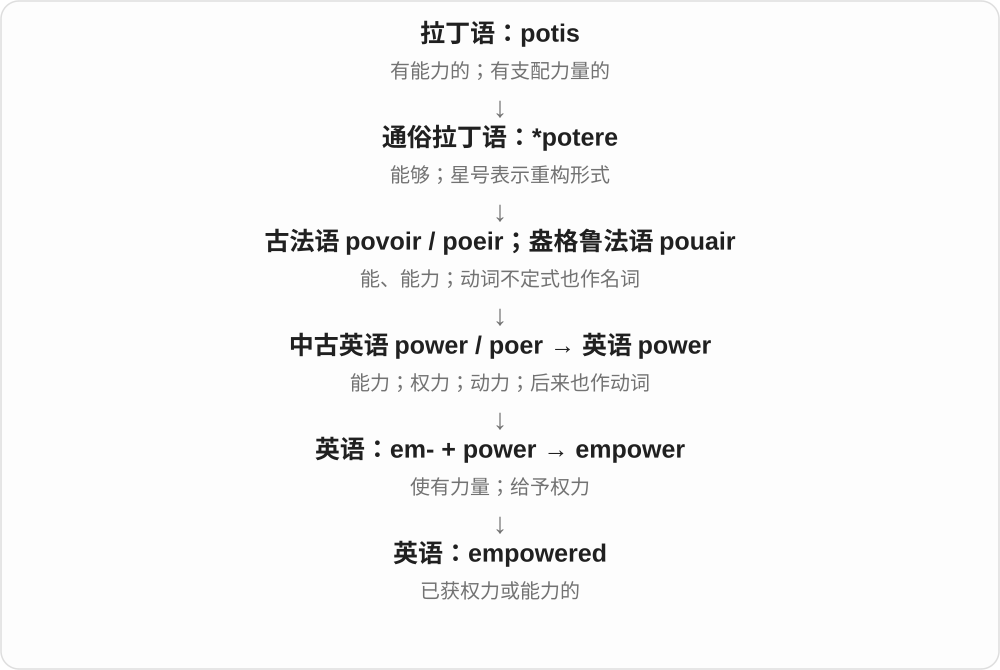

be empowered to sign 是得到签字权限；feel empowered 则侧重觉得自己有能力、有自主性。它描述获得行动空间，不等于比别人地位高。

**常见搭配与例句**

be empowered to；feel empowered；empowered employees。

> Only two officers are empowered to sign this document.

只有两名负责人获授权签署这份文件。

> After the workshop, she felt empowered to speak at meetings.

参加工作坊后，她觉得自己更有底气在会上发言了。

**别混淆**

powerful 说本身力量强；empowered 常带有通过授权、学习或支持获得自主能力的过程感。

### 437. grin — 咧嘴笑、露齿笑；大大的笑容

**音标**：/ɡrɪn/

**先抓住这个画面**

嘴角往两边拉开，牙齿也露出来，是 grin。它让人直接看见笑容的形状，通常不要求真的发出笑声。

**怎么拆**

承古英语 grennian 露齿，后来常说露齿的宽笑。不是 grind 磨去掉 d；也不把古代露齿用途直接等同今天所有笑容的心情。

**怎么变成今天的意思**

**古英语 grennian → 中古英语相关形式 → grin**  
较早露齿，可因疼痛、愤怒等

↓

**英语 grin 的常见现代义；名词沿动词发展**  
咧嘴露齿的笑；常愉快，也可勉强、尴尬

grin at someone 是朝某人咧嘴笑，a broad grin 是大大的笑容；grin and bear it 是苦笑着忍下去。

**常见搭配与例句**

a cheerful grin 欢快的大笑容；a sheepish grin 不好意思的笑。

> She greeted me with a broad grin.

她咧开嘴笑着迎接我。

> He tried not to grin when he heard the good news.

听见好消息，他努力忍住不咧嘴笑。

**别混淆**

grin 强调咧嘴的表情，laugh 更常是笑出声的动作；grin 可以安静，也可以与笑声一起发生。

### 438. grinning — 正在咧嘴笑；咧嘴露齿笑的

**音标**：/ˈɡrɪnɪŋ/

**先抓住这个画面**

大笑容还挂在脸上，就是 grinning。它能写正在做的表情，也能形容一个满脸笑意的人。

**怎么拆**

grin 双写 n，加完整 -ing；原来的短元音 /ɪ/ 保留，双写不多发一个 n 音节。

**怎么变成今天的意思**

**古英语 grennian → 中古英语相关形式 → grin**  
较早露齿，可因疼痛、愤怒等

↓

**英语 grin 的常见现代义；名词沿动词发展**  
咧嘴露齿的笑；常愉快，也可勉强、尴尬

↓

**grin + -ing → grinning〔双写 n〕**  
咧嘴笑的过程、表情

a grinning child 是咧嘴笑的孩子，grinning from ear to ear 是笑得合不拢嘴。

**常见搭配与例句**

stood grinning 站着咧嘴笑；grinning at the camera 对镜头露齿笑。

> He came back grinning from ear to ear.

他回来时笑得合不拢嘴。

> The photograph shows two grinning children.

照片里是两个咧嘴笑的孩子。

**别混淆**

grinning 说笑的表情，giggling 说一阵阵轻快笑声；一个偏视觉，一个偏听觉。

### 439. grinned — 咧嘴笑了；露出了大笑容

**音标**：/ɡrɪnd/

**先抓住这个画面**

刚才嘴角一拉开、牙齿露出，用 grinned。它可以是高兴，也能从上下文看出尴尬、勉强。

**怎么拆**

grin 双写末尾 n，加完整 -ed；单音节短元音后单辅音的常见规则，/n/ 后读 /d/。

**怎么变成今天的意思**

**古英语 grennian → 中古英语相关形式 → grin**  
较早露齿，可因疼痛、愤怒等

↓

**英语 grin 的常见现代义；名词沿动词发展**  
咧嘴露齿的笑；常愉快，也可勉强、尴尬

↓

**grin + -ed → grinned〔双写 n〕**  
过去咧嘴笑

grinned at her 是朝她咧嘴笑，grinned sheepishly 是不好意思地咧嘴一笑。

**常见搭配与例句**

grinned broadly 咧嘴大笑；grinned with relief 松口气地咧嘴笑。

> She grinned at me from the doorway.

她在门口朝我咧嘴笑。

> He grinned sheepishly when he realised his mistake.

意识到自己的错误时，他不好意思地咧嘴笑了笑。

**别混淆**

grinned 读 /ɡrɪnd/；grind 磨读 /ɡraɪnd/，拼写只差一点，元音、来源与意思都不同。

### 440. grins — 咧嘴笑〔第三人称单数〕；几个大笑容〔复数〕

**音标**：/ɡrɪnz/

**先抓住这个画面**

说一个人一高兴就咧开嘴，用 grins；照片里好几个人都露齿笑，也可说他们的 grins。

**怎么拆**

grin + -s，/n/ 后读 /z/；三单、名词复数都直接加 s，不像 grinned、grinning 那样双写 n。

**怎么变成今天的意思**

**古英语 grennian → 中古英语相关形式 → grin**  
较早露齿，可因疼痛、愤怒等

↓

**英语 grin 的常见现代义；名词沿动词发展**  
咧嘴露齿的笑；常愉快，也可勉强、尴尬

↓

**grin + -s → grins**  
他、她咧嘴笑；几个笑容

grins at me 是朝我咧嘴笑，wide grins 是几个大大的笑容。

**常见搭配与例句**

grins with delight 乐得咧嘴；exchanged grins 相视咧嘴一笑。

> He grins whenever he sees the puppy.

他每次看见小狗都咧嘴笑。

> The children exchanged excited grins.

孩子们兴奋地相视咧嘴一笑。

**别混淆**

grins 关注笑容形状，smirks 常还带自满、讥讽的评价；露齿笑不必令人讨厌。

### 441. hum — 哼曲；低声嗡鸣；嗡嗡声；忙碌运转

**音标**：/hʌm/

**先抓住这个画面**

嘴不唱清歌词，轻轻哼旋律，是 hum；冰箱、电机持续低响也像哼着。一个地方运作活跃，又可以说 it is humming。

**怎么拆**

承中古英语 hummen 等，通常归于拟声词，并与其他日耳曼语言的嗡鸣形式相比。不是所有 hum 开头的词都取这个意思。

**怎么变成今天的意思**

**中古英语 hummen；通常看作拟声来源**  
哼、嗡嗡响、低声连续作响

↓

**声音与活动的比喻**  
机器低鸣、人哼曲；地方运转活跃

hum a tune 哼曲子，the hum of traffic 车流的低响，hum along 跟着哼，hum with activity 忙碌活跃地运作。

**常见搭配与例句**

hum a tune；the hum of traffic；hum with activity。

> She hummed a tune while washing the dishes.

她洗碗时轻轻哼着曲子。

> The refrigerator gave a steady hum.

冰箱发出持续的低鸣。

**别混淆**

hum 可轻轻哼唱，不必有词；sing 范围更广。humble 谦逊的来自另一词源，不能拆成 hum 嗡鸣 + -ble。

### 442. humming — 哼唱、嗡鸣声；嗡响、运转活跃的

**音标**：/ˈhʌmɪŋ/

**先抓住这个画面**

耳边一直有低低的声音，可以说 humming；工厂、办公室正活跃运作，也可借用机器嗡鸣的形象。

**怎么拆**

hum + -ing，双写 m。名词说声音、行为，分词形容持续低响等状态。

**怎么变成今天的意思**

**中古英语 hummen；通常看作拟声来源**  
哼、嗡嗡响、低声连续作响

↓

**声音与活动的比喻**  
机器低鸣、人哼曲；地方运转活跃

↓

**hum + -ing → humming**  
哼唱、嗡鸣；正在活跃运转

a humming noise 嗡鸣声，the humming of a motor 电机嗡鸣，keep the business humming 让业务顺畅活跃地运行。

**常见搭配与例句**

a humming noise；the humming of a motor。

> The humming of the fan filled the quiet room.

风扇的嗡鸣回荡在安静的房间里。

> Orders kept the workshop humming all week.

订单让工场整周忙碌运转。

**别混淆**

humming 可以是唱歌，也可以是机器声或活跃比喻。hummingbird 是因翅膀声音得名的鸟，不是在唱歌词。

### 443. hums — 哼唱、低鸣〔第三人称单数〕；低鸣声、哼曲〔复数〕

**音标**：/hʌmz/

**先抓住这个画面**

嘴唇合着，旋律在鼻腔、喉间“嗯嗯”走，用 hums；机器平稳低鸣，也能这样说。

**怎么拆**

hum + -s，/m/ 后读 /z/。声音基础词不同于古典 hum- 土地，不用从 human、人类等词硬拆。

**怎么变成今天的意思**

**中古英语 hommen、hummen 等 → hum**  
轻声发声、低鸣，大概拟声；后来发展出闭口哼唱

↓

**现代声音与活动的比喻**  
哼曲、机器低鸣；场所忙碌活跃，像蜂巢运转

↓

**hum + -s → hums**  
他、她哼唱；它低鸣；多段哼曲、低声

hums a tune 是哼一段旋律，the fridge hums 是冰箱低鸣；the office hums with activity 是办公室忙碌运转。

**常见搭配与例句**

hums quietly 轻轻哼唱、低鸣；hums to himself 自顾自哼曲。

> She hums a tune while she cooks.

她做饭时哼着曲子。

> The fridge hums quietly in the corner.

冰箱在角落里轻轻低鸣。

**别混淆**

hums a song 往往不把歌词清楚唱出；sings a song 通常说唱歌，是否有歌词要看具体形式。

### 444. hummed — 哼唱了、低鸣了；忙碌活跃地运转了

**音标**：/hʌmd/

**先抓住这个画面**

刚才轻轻哼了一段曲子，或机器一阵平稳低响，用 hummed；场所忙碌，也能借这种持续运转的感觉。

**怎么拆**

hum 双写 m + 完整 -ed → hummed，词尾 /d/；短元音重读单音节的拼写变化，元音不变。

**怎么变成今天的意思**

**中古英语 hommen、hummen 等 → hum**  
轻声发声、低鸣，大概拟声；后来发展出闭口哼唱

↓

**现代声音与活动的比喻**  
哼曲、机器低鸣；场所忙碌活跃，像蜂巢运转

↓

**hum 双写 m + -ed → hummed**  
过去哼唱、低鸣或忙碌运转

hummed a melody 是哼了旋律，hummed with activity 是忙得热火朝天；后一种不只是在描述噪音。

**常见搭配与例句**

hummed softly 轻轻哼；hummed all night 整夜低鸣。

> He hummed the melody as we walked home.

回家路上，他哼着那段旋律。

> The workshop hummed with activity before the opening.

开业前，作坊里一派忙碌。

**别混淆**

hummed 的词尾看基础词最后的音：hum 的 /m/ 后接 /d/，hush 的 /ʃ/ 后接 /t/；不是看到同样的 -ed 就一律同音。

### 445. muse — 沉思；若有所思地说；缪斯；灵感来源

**音标**：/mjuːz/

**先抓住这个画面**

眼睛看着窗外，心里慢慢转一个问题，是动词 muse；某个人让诗人总想写诗，则可以叫 the poet’s muse。两条画面不要硬并成一个来源。

**怎么拆**

动词经法语 muser，远源未定；名词接希腊 Mousa 缪斯，经拉丁、法语借入，较远联系思想材料。现代可能相互影响。

**怎么变成今天的意思**

**动词：古法语 muser 沉思、出神 → 英语 muse**  
较远可能有鼻子、吻部材料等分析，来源未定

↓

**名词：希腊 Mousa → 拉丁 Musa、法语 Muse → muse**  
缪斯女神；后说启发创作的人、物，与沉思动词分路，现代意思可能相互影响

muse about the future 沉思未来；muse on a question 琢磨问题；a writer’s muse 作家的灵感来源。

**常见搭配与例句**

muse aloud 若有所思地说出；find a muse 找到灵感来源。

> She liked to muse about the future on long walks.

她喜欢在长时间散步时沉思未来。

> The city became a muse for the young poet.

这座城市成了年轻诗人的灵感来源。

**别混淆**

Muse 可专指神话缪斯，muse 小写也指创作启发者；动词并不要求主题一定是文学艺术。

### 446. muses — 沉思、若有所思地说〔第三人称单数〕；缪斯、灵感来源〔复数〕

**音标**：/ˈmjuːzɪz/

**先抓住这个画面**

他坐着慢慢想，用 muses；几个启发创作的人、地方，也能称作 muses。动词与名词碰巧同形，来源仍分开。

**怎么拆**

muse + -s，基础 /z/ 后词尾读 /ɪz/；两条来源分别有动词三单和名词复数。

**怎么变成今天的意思**

**动词：古法语 muser 沉思、出神 → 英语 muse**  
较远可能有鼻子、吻部材料等分析，来源未定

↓

**名词：希腊 Mousa → 拉丁 Musa、法语 Muse → muse**  
缪斯女神；后说启发创作的人、物，与沉思动词分路，现代意思可能相互影响

↓

**muse + -s → muses**  
他、她沉思；多个缪斯或灵感来源

muses on the past 沉思往事；the nine Muses 神话九位缪斯；artists and their muses 艺术家与他们的灵感来源。

**常见搭配与例句**

muses aloud；muses about what comes next。

> He often muses on how the town has changed.

他常沉思小镇这些年的变化。

> The exhibition explores artists and their muses.

展览探讨艺术家与他们的灵感来源。

**别混淆**

muses 的词性靠句子判：he muses 是他在想，his muses 是他的灵感来源，不要统一翻成沉思。

### 447. mused — 沉思了；若有所思地说了

**音标**：/mjuːzd/

**先抓住这个画面**

不是立刻下结论，而是把一个念头放在心里慢慢转；话说出来仍带琢磨的感觉，过去可以用 mused。

**怎么拆**

沉思动词 muse 去 e 加完整 -ed，/z/ 后词尾读 /d/；这里不接名词缪斯那条借入来源。

**怎么变成今天的意思**

**动词：古法语 muser 沉思、出神 → 英语 muse**  
较远可能有鼻子、吻部材料等分析，来源未定

↓

**名词：希腊 Mousa → 拉丁 Musa、法语 Muse → muse**  
缪斯女神；后说启发创作的人、物，与沉思动词分路，现代意思可能相互影响

↓

**动词 muse → mused**  
过去沉思，或若有所思地说出

mused about the future 琢磨未来；mused aloud 若有所思地说出来；mused that 后接所想的内容。

**常见搭配与例句**

mused on the question；“Perhaps,” she mused。

> “Perhaps we should wait,” she mused.

“也许我们该等等。”她若有所思地说。

> He mused about the possible reasons for the change.

他琢磨着这次变化可能有哪些原因。

**别混淆**

mused 标出思考式、沉吟式语气；announced 则是明确宣布，声音的确定感不同。

### 448. musing — 正在沉思；若有所思的；一段思绪

**音标**：/ˈmjuːzɪŋ/

**先抓住这个画面**

心里慢慢想着，暂时没有急着下结论，叫 musing；也能把这样一段想法当成名词，复数 musings 更常见。

**怎么拆**

动词 muse 去 e 加 -ing；形成动作形式、形容词和思绪名词，不直接从缪斯女神复数变化来解释。

**怎么变成今天的意思**

**动词：古法语 muser 沉思、出神 → 英语 muse**  
较远可能有鼻子、吻部材料等分析，来源未定

↓

**名词：希腊 Mousa → 拉丁 Musa、法语 Muse → muse**  
缪斯女神；后说启发创作的人、物，与沉思动词分路，现代意思可能相互影响

↓

**动词 muse → musing**  
沉思的过程；也形容若有所思，或指一段思绪

musing about the past 沉思往事；a musing expression 若有所思的神情；a quiet musing 一段安静的思索。

**常见搭配与例句**

musing aloud；lost in musing 陷入沉思。

> She sat by the window, musing about the journey.

她坐在窗边，回想着那趟旅程。

> He gave me a musing look before replying.

他若有所思地看了我一眼，才回答。

**别混淆**

musing 常是散缓、反思式的想，calculating 更明确是计算、权衡；两者思考的节奏、目标感不同。

### 449. musings — 随想；沉思、感想〔复数〕

**音标**：/ˈmjuːzɪŋz/

**先抓住这个画面**

不是一份条理紧密的论证，而是慢慢想出来、随手记下的感想，常叫 musings。读起来像跟着一个人的思绪走。

**怎么拆**

muse 去 e 加 -ing → musing，再加复数 -s，词尾读 /z/；名词把思索片段一篇篇、一段段数出来。

**怎么变成今天的意思**

**动词：古法语 muser 沉思、出神 → 英语 muse**  
较远可能有鼻子、吻部材料等分析，来源未定

↓

**名词：希腊 Mousa → 拉丁 Musa、法语 Muse → muse**  
缪斯女神；后说启发创作的人、物，与沉思动词分路，现代意思可能相互影响

↓

**musing + -s → musings**  
多段沉思、随想或感想

musings on life 对生活的随想；personal musings 个人感想；a collection of musings 一本随想集。

**常见搭配与例句**

late-night musings 深夜随想；musings about the future。

> The notebook is full of her musings on everyday life.

笔记本里写满了她对日常生活的随想。

> He published a collection of travel musings.

他出版了一本旅行随想集。

**别混淆**

musings 通常比较反思、随笔式；findings 是调查研究得出的发现，不只是同一种想法换个词。

### 450. bemuse — 使困惑、茫然；使有点摸不着头脑

**音标**：/bɪˈmjuːz/

**先抓住这个画面**

对方做的事很古怪，你一下不知道该怎么理解，停在那里发懵，这件事会 bemuse you。

**怎么拆**

be- 使、加强 + 动词 muse 沉入思绪；不从名词 Muse 缪斯直接推出把人变成缪斯崇拜者。

**怎么变成今天的意思**

**be- 使、加强 + muse 沉入思绪 → bemuse**  
使人陷入出神、混乱，后来常写摸不着头脑

↓

**现代困惑、茫然，有时夹着觉得好笑**  
与 amuse 形似而侧重点不同；可以困惑中发笑，不当成普通逗乐的完全同义词

bemuse the visitors 让访客摸不着头脑；can bemuse beginners 会把初学者弄糊涂；常见被动、形容形式 bemused。

**常见搭配与例句**

seems to bemuse him；a rule that may bemuse people。

> The unusual rules may bemuse first-time visitors.

这些特别的规矩可能让第一次来的访客摸不着头脑。

> His sudden change of subject seemed to bemuse everyone.

他突然换话题，似乎把大家都弄糊涂了。

**别混淆**

amuse 更侧重让人觉得有趣；bemuse 常是看不懂、想不明白，特定场景也带一点好笑的反应。

### 451. bemused — 困惑、茫然的；带点好笑地不解的

**音标**：/bɪˈmjuːzd/

**先抓住这个画面**

不是直接被逗得开心，而是像在想“这到底怎么回事”，可能还忍不住笑一下，这种反应常叫 bemused。

**怎么拆**

bemuse 去 e 加完整 -ed，/z/ 后词尾读 /d/；作过去形式，也常作描述人神态的形容词。

**怎么变成今天的意思**

**be- 使、加强 + muse 沉入思绪 → bemuse**  
使人陷入出神、混乱，后来常写摸不着头脑

↓

**现代困惑、茫然，有时夹着觉得好笑**  
与 amuse 形似而侧重点不同；可以困惑中发笑，不当成普通逗乐的完全同义词

↓

**bemuse → bemused**  
已经被弄困惑；也描述摸不着头脑的神态

a bemused expression 困惑的神情；looked bemused 显得茫然；a bemused smile 带点不解的笑。

**常见搭配与例句**

slightly bemused；bemused by the instructions。

> She gave me a bemused look when I explained the plan.

我解释方案时，她困惑地看了我一眼。

> He watched the strange performance with a bemused smile.

他看着这场古怪的表演，笑里带着不解。

**别混淆**

bemused smile 可以在不理解中觉得好笑，amused smile 更直接是觉得有趣；不要只因都能带笑就抹掉差别。

### 452. bemusedly — 困惑地；茫然、带不解地

**音标**：/bɪˈmjuːzədli/

**先抓住这个画面**

一个人不太明白发生了什么，停一下、笑一下或看着别人，这种反应方式可以用 bemusedly。

**怎么拆**

bemused + -ly；bemused 作动词过去形式通常读 /bɪˈmjuːzd/，这个副词常保留 /əd/ 音节，按实际副词读音记。

**怎么变成今天的意思**

**be- 使、加强 + muse 沉入思绪 → bemuse**  
使人陷入出神、混乱，后来常写摸不着头脑

↓

**现代困惑、茫然，有时夹着觉得好笑**  
与 amuse 形似而侧重点不同；可以困惑中发笑，不当成普通逗乐的完全同义词

↓

**bemused → bemusedly**  
带着困惑、不解的感受做动作

looked bemusedly at someone 茫然不解地看某人；smiled bemusedly 带着不解笑了笑。

**常见搭配与例句**

shook his head bemusedly；watched bemusedly。

> She looked bemusedly at the pile of mismatched shoes.

她不解地看着那堆不成对的鞋。

> He shook his head bemusedly and read the message again.

他茫然地摇摇头，又读了一遍消息。

**别混淆**

bemusedly 重点是当事人不解的反应，amusingly 重点是内容好笑；修饰同一个笑脸时也不能随意调换。

### 453. bemusement — 困惑、茫然；带点好笑的不解

**音标**：/bɪˈmjuːzmənt/

**先抓住这个画面**

表演结束了，人却还在想“刚才那是什么意思”，脸上带着不解，这份感受就是 bemusement。

**怎么拆**

bemuse 去 e 加 -ment；动作使人茫然，名词把这种反应、状态拿出来说。

**怎么变成今天的意思**

**be- 使、加强 + muse 沉入思绪 → bemuse**  
使人陷入出神、混乱，后来常写摸不着头脑

↓

**现代困惑、茫然，有时夹着觉得好笑**  
与 amuse 形似而侧重点不同；可以困惑中发笑，不当成普通逗乐的完全同义词

↓

**bemuse + -ment → bemusement**  
使人不解或当事人困惑的状态

in bemusement 困惑地；with bemusement 带着不解；to someone’s bemusement 让某人不解的是。

**常见搭配与例句**

a look of bemusement；watched with bemusement。

> She watched the ceremony with mild bemusement.

她带着些许不解，看着仪式进行。

> To my bemusement, everyone applauded before I had spoken.

让我不解的是，我还没开口，大家就鼓起掌来。

**别混淆**

amusement 是有趣、消遣的感受，bemusement 侧重摸不着头脑；有时两种感受能在同一场景并存。

### 454. bemusing — 令人困惑、摸不着头脑的；正在使人茫然

**音标**：/bɪˈmjuːzɪŋ/

**先抓住这个画面**

眼前的事不按常理来，越看越不知道该怎么理解，就可以叫 bemusing；有时也会让人在困惑中发笑。

**怎么拆**

bemuse 去 e 加 -ing；动作形式又可描述引起困惑的事物性质。

**怎么变成今天的意思**

**be- 使、加强 + muse 沉入思绪 → bemuse**  
使人陷入出神、混乱，后来常写摸不着头脑

↓

**现代困惑、茫然，有时夹着觉得好笑**  
与 amuse 形似而侧重点不同；可以困惑中发笑，不当成普通逗乐的完全同义词

↓

**bemuse → bemusing**  
使人困惑正在发生；也形容引发不解

a bemusing situation 让人摸不着头脑的情况；a bemusing mixture 令人不解的混搭。

**常见搭配与例句**

find it bemusing；a bemusing response。

> The instructions were a bemusing mixture of words and symbols.

说明书把文字和符号混在一起，让人摸不着头脑。

> I found his sudden politeness rather bemusing.

他突然这么客气，让我有点不解。

**别混淆**

bemusing 说事情令人困惑，bemused 说人的反应；结构与 amusing、amused 的关系相似，具体感受不同。

### 455. bemuses — 使困惑、出神；使带着不解而觉得好笑〔第三人称单数〕

**音标**：/bɪˈmjuːzɪz/

**先抓住这个画面**

一件事让人停下来发愣，觉得“这是什么情况”，可以说 it bemuses me；有时还带着无奈、诧异而觉得好笑的反应。

**怎么拆**

bemuse + -s，/z/ 后的词尾加出 /ɪz/。内层是 be- + muse 动词；muse 接法语 muser，不能只因同形就改接希腊神话的 Muse。

**怎么变成今天的意思**

**法语 muser → 英语 muse 动词**  
沉思、出神等意义，远源存在不同解释

↓

**英语 be- + muse → bemuse → bemuses**  
使出神、使困惑；现代也可含困惑与微妙好笑并存

bemuses me 让我不解；bemuses outsiders 让局外人看不懂。

**常见搭配与例句**

a custom that bemuses visitors；the attention bemuses him。

> The complicated ticket system bemuses many visitors.

复杂的售票系统让许多游客摸不着头脑。

> It bemuses her that a tiny joke has attracted so much attention.

那么小的一个玩笑竟引来这么多关注，让她又不解又觉得有点好笑。

**别混淆**

amuses 主要是使人觉得有趣、开心；bemuses 通常保留想不通、发愣的成分，部分语境里两种反应会交叠。

### 456. drip — 滴落、滴出；水滴、滴水声；输液装置；时髦穿搭〔俚语〕

**音标**：/drɪp/

**先抓住这个画面**

水龙头关不严，水一滴一滴往下落，就是 drip；名词也可以指落下的滴、声音，以及让液体慢慢输入的装置。

**怎么拆**

继承古英语 drypan，经中古英语 drippen 等延续，与 drop 所属滴落词族相连。名词从动词形成，输液装置按滴注动作命名；穿搭俚语又是较晚扩展。

**怎么变成今天的意思**

**古英语 drypan → 中古英语 drippen**  
一滴一滴落下、流出

↓

**现代动词及名词 drip**  
滴落、液滴、滴注；较晚有时髦穿搭俚语

The tap is dripping 水龙头在滴水；drip with water 身上不断滴水；be on a drip 在输液。口语夸穿搭的 drip 要按俚语场景读。

**常见搭配与例句**

drip from；drip onto；a steady drip。

> Water dripped from the roof onto the path.

水从屋顶一滴滴落到小路上。

> I could hear the steady drip of the tap.

我能听见水龙头持续的滴水声。

**别混淆**

drop 可说单个水滴或较广的掉落；drip 更突出液体一滴滴落。输液义说装置、过程，具体读完整句子。

### 457. dripping — 正在滴落；湿得滴水的；满是某种意味的；烤肉滴出的脂油

**音标**：/ˈdrɪpɪŋ/

**先抓住这个画面**

衣服湿到往下掉水，是 dripping；dripping with sarcasm 是讽刺浓得藏不住。烹饪里 dripping 还指烤肉滴下的脂油。

**怎么拆**

drip 双写 p + 完整 -ing；活动、状态分词之外，烹饪名词保留“滴出来的东西”这一发展，不是所有 dripping 都是进行时。

**怎么变成今天的意思**

**古英语 drypan、dryppan → 中古英语 drippen → drip**  
让液体一滴一滴落下，与 drop、droop 等词族可比较

↓

**动词 → 液滴、滴注名词及比喻**  
dripping 可说滴湿；还可指烤肉滴出的脂油，按用途分支

↓

**drip 双写 p + -ing → dripping**  
滴落过程、滴湿状态；滴出的脂油名词

dripping wet 是湿得直滴水，dripping with confidence 可夸张说满满自信，beef dripping 是牛肉烤出的脂油。

**常见搭配与例句**

a dripping coat 滴水的外套；dripping with sarcasm 满是讽刺。

> We came home dripping wet from the rain.

我们淋雨回家，浑身湿得直滴水。

> The potatoes were roasted in beef dripping.

土豆用烤牛肉滴出的脂油烤熟。

**别混淆**

dripping 比 damp 的湿更强，常已湿得滴水；菜谱里的 dripping 则要认成油脂名词。

### 458. dribble — 滴流；流口水；运球、带球

**音标**：/ˈdrɪbəl/

**先抓住这个画面**

水一点点往下滴是 dribble；控球时一次次轻拍、轻带球，也像连续的小动作，而不是一次把球远远踢走。

**怎么拆**

旧 drib 少量、滴的材料 + -le 反复尾；从一点点滴流发展出控球的专门动作义。

**怎么变成今天的意思**

**drib 少量、滴 + -le → dribble**  
少量连续地流、滴

↓

**运动中的 dribble**  
以连续轻触来控制、推进球

water dribbles 水一点点流；dribble the ball 运球；dribble past an opponent 带球过人；婴儿也可 dribble 流口水。

**常见搭配与例句**

dribble the ball；dribble past。

> Water dribbled from the tap.

水从龙头一点点滴流。

> She dribbled the ball past two defenders.

她带球过了两名防守队员。

**别混淆**

dribble 是连续控制球，pass 是传给别人；球向前走不等于每次都在 dribble。

### 459. dribbling — 正在少量流、滴、流口水；运球、带球及其技术

**音标**：/ˈdrɪblɪŋ/

**先抓住这个画面**

液体正一点点流，是 dribbling；运动里是不断轻触、拍弹，边控球边推进，像把大动作分成连续小动作。

**怎么拆**

dribble 去 e + 完整 -ing，常读 /ˈdrɪblɪŋ/；可以是进行分词，也可以把运球当一项技术来谈。

**怎么变成今天的意思**

**旧动词 drib，属 drip 一系 → dribble**  
加旧反复动作材料，少量一点点流、落

↓

**少量连续动作 → 运动控球**  
足球连续轻触推进；篮球连续拍弹控球，技术动作不同但都非一次大力击出

↓

**dribble 去 e + -ing → dribbling**  
少量流滴过程；运球活动、技术

dribbling skills 是运球技术，practise dribbling 是练运球；water dribbling down a wall 则仍是细水往下流。

**常见搭配与例句**

dribbling past opponents 带球过人；keep dribbling 保持运球。

> The coach made us practise dribbling with both hands.

教练让我们练习左右手运球。

> Water was dribbling down the tiled wall.

水正沿瓷砖墙一点点流下来。

**别混淆**

dribbling 是控制球，不等于 scoring 得分；运球可以为传球、摆脱防守做准备，未必马上射、投。

### 460. dribbles — 少量流滴、流口水、运球〔第三人称单数〕；细流、运球动作〔复数〕

**音标**：/ˈdrɪbəlz/

**先抓住这个画面**

水一点点沿边流，或口水慢慢流，用 dribbles；球不是一下踢飞，而是靠连续小动作带着走，也叫 dribbles。

**怎么拆**

dribble + -s，保留 e，/l/ 后读 /z/。基础 dribble 联系旧 drib、drip 的少量流滴材料与反复动作尾。

**怎么变成今天的意思**

**旧动词 drib，属 drip 一系 → dribble**  
加旧反复动作材料，少量一点点流、落

↓

**少量连续动作 → 运动控球**  
足球连续轻触推进；篮球连续拍弹控球，技术动作不同但都非一次大力击出

↓

**dribble + -s → dribbles**  
它少量流；他、她控球；多段细流、运球

water dribbles down 是水一点点流下，dribbles the ball 是控球、运球；篮球与足球由运动背景区分具体动作。

**常见搭配与例句**

dribbles past a defender 带球过防守者；small dribbles of water 几小股缓流水。

> Water dribbles from the loose tap.

松动的水龙头里一点点流着水。

> She dribbles past the defender and passes the ball.

她带球过了防守者，把球传出去。

**别混淆**

dribbles 在球场不是球漏水，借的是连续、小幅控制的动作；kick the ball 可以是一脚把球送远。

### 461. dribbled — 一点点流、滴了；流口水了；运球、带球了

**音标**：/ˈdrɪbəld/

**先抓住这个画面**

液体刚才细细沿边流下，或球员靠连续小动作把球带过一段，用 dribbled。不要在运动句子里仍只想口水。

**怎么拆**

dribble 去 e + 完整 -ed，/l/ 后读 /d/；基础词已有 bb 保留，不再多添 b。

**怎么变成今天的意思**

**旧动词 drib，属 drip 一系 → dribble**  
加旧反复动作材料，少量一点点流、落

↓

**少量连续动作 → 运动控球**  
足球连续轻触推进；篮球连续拍弹控球，技术动作不同但都非一次大力击出

↓

**dribble 去 e + -ed → dribbled**  
过去少量流滴、流口水或运球

dribbled down his chin 是沿下巴流下来，dribbled across the court 是运球穿过球场；同形动词借动作扩义。

**常见搭配与例句**

dribbled oil into the pan 往锅里慢慢滴油；dribbled past two players 带球过两人。

> A little sauce dribbled down the side of the bottle.

一点酱汁沿瓶身慢慢流下来。

> She dribbled the ball across the court.

她运球穿过球场。

**别混淆**

dribbled 常是连续小动作控着球走，shot 常是把球射、投向得分目标；别只译成笼统的打球。

### 462. drips — 一滴滴落、漏滴〔第三人称单数〕；液滴、漏滴声；输液滴注〔复数〕

**音标**：/drɪps/

**先抓住这个画面**

水龙头“滴、滴”地掉水，叫 drips；名词可以把几滴水、几声滴落说出来，设备场景还有滴注用法。

**怎么拆**

drip + -s，/p/ 后读 /s/；动词三单、名词复数同形，基础承古英语滴落材料。

**怎么变成今天的意思**

**古英语 drypan、dryppan → 中古英语 drippen → drip**  
让液体一滴一滴落下，与 drop、droop 等词族可比较

↓

**动词 → 液滴、滴注名词及比喻**  
dripping 可说滴湿；还可指烤肉滴出的脂油，按用途分支

↓

**drip + -s → drips**  
它一滴滴落；多滴液体或相关装置

the tap drips 是水龙头漏滴，drips of water 是水滴；medical drips 的装置命名联系一滴滴输入，不是新古根。

**常见搭配与例句**

drips onto the floor 滴到地上；steady drips 稳稳的一滴滴落。

> The tap drips all night.

水龙头整夜滴水。

> Cold drips of water fell from the cave roof.

冰凉的水滴从洞顶落下。

**别混淆**

drips 更突出一滴一滴分开，dribbles 更容易是少量细细流；实际少量出水时两个画面可能重合。

### 463. dripped — 一滴滴落下了、滴出了；充满某种意味

**音标**：/drɪpt/

**先抓住这个画面**

水刚才一滴滴落下，用 dripped；声音“滴着讽刺”则像某种态度浓得都往外落，是比喻。

**怎么拆**

drip 双写 p + 完整 -ed → dripped；/p/ 后读 /t/，短元音重读单音节按规则双写。

**怎么变成今天的意思**

**古英语 drypan、dryppan → 中古英语 drippen → drip**  
让液体一滴一滴落下，与 drop、droop 等词族可比较

↓

**动词 → 液滴、滴注名词及比喻**  
dripping 可说滴湿；还可指烤肉滴出的脂油，按用途分支

↓

**drip 双写 p + -ed → dripped**  
过去滴落；态度浓得外露的比喻

dripped from the roof 是从屋顶滴下，dripped onto the floor 是滴到地上；dripped with sarcasm 是充满讽刺。

**常见搭配与例句**

dripped slowly 慢慢滴；dripped off his coat 从外套上滴下。

> Water dripped from the edge of his coat.

水从他的衣服边一滴滴落下。

> Her voice dripped with sarcasm.

她说话的声音满是讽刺。

**别混淆**

dripped with sarcasm 不是讽刺真的液化，是把很浓、很明显的态度写成往外滴；与普通 said 多了一层评价。

### 464. hassle — 麻烦、烦人的琐事；纠缠、找麻烦

**音标**：/ˈhæsəl/

**先抓住这个画面**

本来想办件简单事，却被手续、等待、来回沟通缠住，这些令人烦的小折腾就是 hassle。作动词则说不停催烦、纠缠别人。

**怎么拆**

近代美式英语中流行，可能与更早方言或其他骚扰词有关，确切来源未定。名词麻烦、烦扰又发展出动词纠缠。

**怎么变成今天的意思**

**较早方言等可能材料 → 近代 hassle**  
形成麻烦、烦扰的口语名词

↓

**现代名词与动词**  
烦人的折腾；纠缠、不断烦扰

avoid the hassle 避免麻烦；too much hassle 太折腾；hassle someone about something 为某事不断烦某人。

**常见搭配与例句**

save you the hassle；without any hassle。

> Booking online saved us a lot of hassle.

网上预订让我们省去了很多麻烦。

> Stop hassling me about the deadline.

别再为截止时间不停地烦我了。

**别混淆**

problem 是很宽泛的问题；hassle 常突出事情烦、费事、反复折腾。小事也可能很有 hassle。

### 465. hassled — 受纠缠的、被琐事忙得焦头烂额的

**音标**：/ˈhæsəld/

**先抓住这个画面**

事情一件接一件地追着来，或有人不断打扰催促，显得疲惫烦躁，就可以说 hassled。

**怎么拆**

hassle 去末尾 e 接 -ed；由被烦扰的过去分词，形成被琐事压得忙乱的状态描写。

**怎么变成今天的意思**

**hassle 纠缠、烦扰 + -ed**  
受过或受到烦扰

↓

**hassled 的状态形容词**  
疲惫烦躁、被琐事缠住的

a hassled parent 忙得焦头烂额的家长；look hassled 显得忙乱烦躁；feel hassled 感到不断受催扰。

**常见搭配与例句**

a hassled expression；hassled by repeated calls。

> She looked tired and hassled after the long journey.

长途旅行后，她显得疲惫又烦躁。

> He felt hassled by the repeated phone calls.

接二连三的电话让他觉得烦不胜烦。

**别混淆**

busy 只说忙；hassled 更常加上被打断、被催、被小事缠得烦的感觉。不是所有忙人都显得 hassled。

### 466. batter — 击球手；反复猛击；面糊〔相关旧词义〕

**音标**：英 /ˈbætə/；美 /ˈbætər/

**先抓住这个画面**

体育里 batter 是击球的人；storm battered the coast 是风暴反复冲打；面糊则是被搅打匀的一团液状材料。末尾 -er 不每次都指人。

**怎么拆**

击球者对应 bat + 人物 -er；猛击动词有法语 batre、英语反复动作形式等背景；面糊名词接法语 bateure 击打、搅打等名词。不是英语击球手先变成了面糊。

**怎么变成今天的意思**

**bat + -er → batter〔击球者〕**  
挥棒击球的人

↓

**旧击打动词形式、法语 batre 等 → batter〔猛击〕**  
反复强烈打击

↓

**法语 bateure → 中古英语 bature → batter〔面糊〕**  
搅打 → 搅成的面糊

a baseball batter 棒球击球手，batter the coast 冲打海岸，pancake batter 煎饼面糊，fish in batter 裹面糊的鱼。

**常见搭配与例句**

a baseball batter；batter the coast；pancake batter；fish in batter。

> The batter waited for the next pitch.

击球手等待下一球。

> Strong waves battered the harbour wall.

强浪反复冲打港口围墙。

> She poured the pancake batter into the pan.

她把煎饼面糊倒进平底锅。

**别混淆**

面糊 batter 较流动，dough 面团通常更能成团；batter 的人物 -er 与反复动作词尾、借词名词不是一套现代规则。

### 467. battered — 受损、破旧的；被殴打的；裹面糊的

**音标**：英 /ˈbætəd/；美 /ˈbætərd/

**先抓住这个画面**

旧箱子被撞得伤痕累累，是 battered；菜单上的 battered fish 却是在说鱼外面裹了面糊。先看名词、场景。

**怎么拆**

受损义接 batter 反复击打 + -ed；食品义接 batter 面糊与覆盖某物的形容词材料。batter 的相关词族更早都与击打、搅打等有联系，但现代词性和构成分开。

**怎么变成今天的意思**

**batter 击打动词 + -ed**  
被反复敲击、撞坏 → 破旧、受伤的

↓

**batter 面糊名词的相应形容词**  
外面裹着面糊的

a battered suitcase 破旧的手提箱；battered furniture 伤痕累累的家具；battered fish 裹面糊的鱼。形容人时还可能说受殴打，要按语境认真选义。

**常见搭配与例句**

a battered old car；battered fish and chips。

> He carried a battered suitcase.

他提着一只破旧的手提箱。

> The menu includes battered fish with chips.

菜单上有裹面糊的炸鱼配薯条。

**别混淆**

食品里的 battered 不表示把鱼打坏；这是面糊名词参与的构词。旧物 battered 则常借反复受撞的画面形容损伤。

### 468. blush — 脸红；红晕、淡红色；腮红；初看〔固定搭配〕

**音标**：/blʌʃ/

**先抓住这个画面**

别人一夸，脸颊就红起来，是 blush；化妆时把脸颊添一点红润的产品，也叫 blush。at first blush 则是初看、乍看。

**怎么拆**

可能承古英语 blyscan 与较早发亮、看材料，现代脸红义后来很常见；旧 look、glance 的名词用法保存在固定短语。

**怎么变成今天的意思**

**中古英语 bluschen 等发亮、看材料 → blush**  
可能接古英语 blyscan，较远有发亮、燃烧词族联系

↓

**现代脸红义；名词也说红晕、腮红**  
旧看一眼的名词义保存在 at first blush，不能把该短语一律直译为第一次脸红

blush with embarrassment 尴尬得脸红；a faint blush 一点红晕；apply blush 上腮红；at first blush 初看。

**常见搭配与例句**

make someone blush 让某人脸红；a blush of pink 一抹淡粉红。

> You are making me blush with all those compliments.

你夸这么多，都让我脸红了。

> At first blush, the two plans seem almost identical.

乍一看，这两个方案似乎几乎一样。

**别混淆**

blush 常有害羞、尴尬或被赞美触动的场景；turn red 更一般，未必说明什么情绪。

### 469. blushing — 正在脸红；泛着红晕的；羞赧的

**音标**：/ˈblʌʃɪŋ/

**先抓住这个画面**

脸上的红色还没退，人还在害羞或尴尬，这个正在发生的反应叫 blushing；也能直接描述红着脸的人。

**怎么拆**

blush + -ing；可作进行形式，也作形容词，红润色彩还可用于花朵等描写。

**怎么变成今天的意思**

**中古英语 bluschen 等发亮、看材料 → blush**  
可能接古英语 blyscan，较远有发亮、燃烧词族联系

↓

**现代脸红义；名词也说红晕、腮红**  
旧看一眼的名词义保存在 at first blush，不能把该短语一律直译为第一次脸红

↓

**blush + -ing → blushing**  
正在脸红；也描述羞赧、带红晕的样子

a blushing face 红着的脸；the blushing bride 羞赧的新娘，带传统描写色彩；blushing at the praise 因赞美而脸红。

**常见搭配与例句**

blushing cheeks；stop blushing。

> I could feel myself blushing as I accepted the gift.

接过礼物时，我能感觉到自己脸红了。

> She stood smiling and blushing while we sang.

我们唱歌时，她站在那里，一边笑一边脸红。

**别混淆**

blushing 写颜色反应及常见情绪气氛；embarrassed 直接写尴尬心理，不要求一定看得出脸红。

### 470. blushes — 脸红〔第三人称单数〕；红晕、害羞脸红〔复数〕

**音标**：/ˈblʌʃɪz/

**先抓住这个画面**

她一被夸奖，脸就红，动词用 blushes；save someone’s blushes 像替人把脸红的尴尬遮过去，意思是帮人解围。

**怎么拆**

blush + -s，/ʃ/ 后词尾读 /ɪz/；动词三单与名词复数同形。

**怎么变成今天的意思**

**中古英语 bluschen 等发亮、看材料 → blush**  
可能接古英语 blyscan，较远有发亮、燃烧词族联系

↓

**现代脸红义；名词也说红晕、腮红**  
旧看一眼的名词义保存在 at first blush，不能把该短语一律直译为第一次脸红

↓

**blush + -s → blushes**  
他、她脸红；几次红晕、羞赧的固定表达

blushes easily 容易脸红；save someone’s blushes 帮人解围、免其尴尬；spare someone’s blushes 同样可说替人避免尴尬。

**常见搭配与例句**

blushes at a compliment；spare my blushes。

> She blushes whenever someone praises her work.

每次有人夸她的作品，她都会脸红。

> He changed the subject to spare my blushes.

他换了话题，替我解了围。

**别混淆**

save her blushes 不一定真的看见她脸红，而是帮她避免难堪；不能只按挽救红色理解。

### 471. blushed — 脸红了；泛起红晕了

**音标**：/blʌʃt/

**先抓住这个画面**

话刚听完，脸颊红起来，像颜色一下浮上皮肤，过去这个变化叫 blushed。

**怎么拆**

blush + 完整 -ed，/ʃ/ 后词尾读 /t/，结尾 /ʃt/；拼写不是按听感只写一个 t。

**怎么变成今天的意思**

**中古英语 bluschen 等发亮、看材料 → blush**  
可能接古英语 blyscan，较远有发亮、燃烧词族联系

↓

**现代脸红义；名词也说红晕、腮红**  
旧看一眼的名词义保存在 at first blush，不能把该短语一律直译为第一次脸红

↓

**blush + -ed → blushed**  
过去因情绪等脸红，或泛起红色

blushed with embarrassment 尴尬得脸红；blushed at the compliment 听到夸奖脸红了。

**常见搭配与例句**

blushed deeply 脸涨得很红；blushed and looked away。

> She blushed when everyone began to applaud.

大家开始鼓掌时，她脸红了。

> He blushed and looked down at his shoes.

他脸红了，低头看着自己的鞋。

**别混淆**

blushed 说明脸红的反应，不保证是撒谎；害羞、被夸、尴尬都可能让人物在故事里 blush。

### 472. flop — 重重坐下、倒下；失败；失败的作品

**音标**：英 /flɒp/；美 /flɑːp/

**先抓住这个画面**

人累了往沙发上一瘫，是 flop；一部被寄予厚望的电影上映后没激起反响，也可说是 a flop。

**怎么拆**

通常认为是 flap 的变形，带较沉、较松垮的动作感。失败名词义在英语中早于相应失败动词的记录，不能只按今天动词→名词画唯一先后。

**怎么变成今天的意思**

**英语 flap 的可能变形 → flop**  
声音更沉、动作更松垮的落下、拍动

↓

**flop → 失败义；flop + -y → floppy**  
重重落下的比喻走向失败；软垂的

flop onto the sofa 一屁股瘫到沙发上；a box office flop 票房失败的作品；The show flopped 节目不成功。

**常见搭配与例句**

flop onto the sofa；a commercial flop；the film flopped。

> He flopped onto the sofa after the long walk.

走了很久后，他一屁股瘫到沙发上。

> The expensive film was a commercial flop.

这部高成本电影在商业上失败了。

**别混淆**

flop 强调不成功，常有预期落空感；floppy 则通常形容软垂，不是失败的形容词。

### 473. flops — 重重瘫下、扑动、失败〔第三人称单数〕；失败作品或事情〔复数〕

**音标**：英 /flɒps/；美 /flɑːps/

**先抓住这个画面**

人往床上一瘫叫 flops；几部票房、反响都惨淡的作品叫 flops。共同的现代画面是没撑起来、垮下去。

**怎么拆**

flop + -s，/p/ 后读 /s/；名词复数与动词三单同形。基础词可能是 flap 的声音变体，不能把所有失败义排在动词之后。

**怎么变成今天的意思**

**flap 的可能声音变体 → flop**  
扑动的声音、感觉更沉、更软垮；后来明确说重重倒落

↓

**软垮落下 → 失败名词，再见失败动词义**  
作品、计划没撑起来，像一下垮掉；两种词性记录先后不同

↓

**flop + -s → flops**  
它瘫下、失败；多部失败作品

flops onto the bed 是一下瘫到床上，box office flops 是票房失败的电影；剧本、产品也能这样评价。

**常见搭配与例句**

flops on the sofa 瘫上沙发；a string of flops 一连串失败作品。

> He flops onto the bed as soon as he gets home.

他一到家就瘫到床上。

> Several of the studio's recent films were flops.

这家制片厂最近几部电影都失败了。

**别混淆**

flops 的失败义比较口语，常暗含结果很差；disappointments 也可只是没达到期望，并非彻底失败。

### 474. flopped — 重重瘫下、倒下了；失败了

**音标**：英 /flɒpt/；美 /flɑːpt/

**先抓住这个画面**

累得往沙发上一倒，或新节目推出后没人买账，都可用 flopped。一个是身体垮下，一个是期待落空。

**怎么拆**

flop 双写 p + 完整 -ed → flopped，/p/ 后读 /t/；单音节短元音后的单辅音双写。

**怎么变成今天的意思**

**flap 的可能声音变体 → flop**  
扑动的声音、感觉更沉、更软垮；后来明确说重重倒落

↓

**软垮落下 → 失败名词，再见失败动词义**  
作品、计划没撑起来，像一下垮掉；两种词性记录先后不同

↓

**flop 双写 p + -ed → flopped**  
过去软垮落下或遭遇失败

flopped into a chair 是瘫进椅子，flopped at the box office 是票房失败；后者不需要发生真实跌落。

**常见搭配与例句**

flopped onto the grass 倒在草上；the show flopped 节目失败。

> She flopped onto the sofa and kicked off her shoes.

她瘫到沙发上，甩掉鞋子。

> The comedy flopped despite its expensive advertising campaign.

尽管花了大钱宣传，那部喜剧还是失败了。

**别混淆**

flopped down 有松垮、沉重的动作感，lay down 只说躺下；计划 flopped 则常是明显没有成功。

### 475. flopping — 正在软垮扑动、重重倒下；正在失败

**音标**：英 /ˈflɒpɪŋ/；美 /ˈflɑːpɪŋ/

**先抓住这个画面**

离水的鱼反复扑腾，软耳朵随步子甩动，都能说 flopping；人也能 flopping onto the bed，一下瘫上床。

**怎么拆**

flop 双写 p + 完整 -ing → flopping；双写是拼写规则，不多发一个 /p/。

**怎么变成今天的意思**

**flap 的可能声音变体 → flop**  
扑动的声音、感觉更沉、更软垮；后来明确说重重倒落

↓

**软垮落下 → 失败名词，再见失败动词义**  
作品、计划没撑起来，像一下垮掉；两种词性记录先后不同

↓

**flop 双写 p + -ing → flopping**  
软垮扑动、倒落或失败的过程

flopping about 是扑腾来扑腾去，ears flopping 是耳朵软软地摆动；失败义看作品、计划等主语。

**常见搭配与例句**

flopping on the bank 在岸边扑腾；flopping into a chair 瘫坐进椅子。

> A fish was flopping on the riverbank.

一条鱼正在河岸上扑腾。

> The puppy ran towards us with its ears flopping.

小狗朝我们跑来，耳朵软软地甩着。

**别混淆**

flapping 常让人想到翅膀、布片拍动，flopping 更有松软、沉重、失去控制的感觉，两者声音感不同。

### 476. edged — 有边、有刃的；edge 的过去式、分词

**音标**：/edʒd/

**先抓住这个画面**

东西带着某种边缘、刀刃时，可见 edged 的形容用法；人 edged closer 则是小心挪近的动作已经发生。

**怎么拆**

edge 去 e 加 -ed，词尾 /dʒd/。边、刃的形容词还有中古英语及更早对应形式，不把所有用例都认成同一过去时。

**怎么变成今天的意思**

**古英语 eċġ → 中古英语 egge → edge**  
边、刃、尖端

↓

**英语 edge**  
边缘；锋刃、优势；慢慢挪动、险胜等动作

↓

**edge + -ed → edged**  
具有某种边、刃；已经缓移、微胜等

a double-edged sword 双刃剑，gold-edged pages 金边书页；edged closer 慢慢挪近。连字符组合只在搭配展示，不另立词头。

**常见搭配与例句**

edged closer；gold-edged pages；a double-edged sword。

> She edged closer to the window.

她慢慢挪近窗户。

> The old book had gold-edged pages.

旧书的书页镶着金边。

**别混淆**

edged closer 缓移，an edged tool 有刃工具；同形分词、形容词看句法，不一律译为被边缘。

### 477. whine — 哀叫、发出拖长的尖声；哼唧着抱怨；尖细哀声

**音标**：/waɪn/

**先抓住这个画面**

声音细细地拖着，像“为什么嘛——”，是 whine 的感觉。狗哀叫、机器尖鸣，以及人拖着腔抱怨，都能用它。

**怎么拆**

承古英语 hwinan 等尖响、嘶声材料，后来有动物哀叫与人的抱怨用途。现代 wh 常读 /w/，部分口音保留 /ʍ/。

**怎么变成今天的意思**

**古英语 hwinan、hwinsian 等 → 中古英语 whinen → whine**  
嘶、尖响与动物哀叫的拟声材料

↓

**现代 whine 动词、名词**  
拖着的细尖哀声 → 哼哼唧唧地抱怨；也写机器尖鸣

whine about the food 是哼哼唧唧抱怨饭菜，a high whine 是一阵尖细长声；人际用法常带不赞许。

**常见搭配与例句**

a whine of complaint 哼唧抱怨的声音；whine for attention 哀叫着求关注。

> The dog began to whine at the door.

狗开始在门口低低哀叫。

> A high whine came from the old machine.

旧机器发出一阵尖细长声。

**别混淆**

complain 可中性说提出不满，whine 常评价说话方式软弱、惹人烦；不能把所有正当投诉都换成它。

### 478. whining — 正在哀叫、哼唧抱怨；拖长的尖声

**音标**：/ˈwaɪnɪŋ/

**先抓住这个画面**

那种细细拖着、带哀求或不满的声音还在持续，是 whining。机器的高尖声也可以这样写。

**怎么拆**

whine 去末尾 e，加完整 -ing。发声动词形成进行、活动名词，抱怨义与真实声音义分开认。

**怎么变成今天的意思**

**古英语 hwinan、hwinsian 等 → 中古英语 whinen → whine**  
嘶、尖响与动物哀叫的拟声材料

↓

**现代 whine 动词、名词**  
拖着的细尖哀声 → 哼哼唧唧地抱怨；也写机器尖鸣

↓

**whine + -ing → whining〔去 e〕**  
哀叫、抱怨、尖鸣的过程、声音

stop whining 是别哼唧抱怨了；a whining noise 是拖长的尖细声。

**常见搭配与例句**

whining about the food 抱怨饭菜；whining for attention 哀叫着求关注。

> The puppy was whining for attention.

小狗正哀叫着求关注。

> A whining noise came from the fan.

风扇传出一阵尖细长声。

**别混淆**

whining 说话时常带不赞许的评价，muttering 重在低声念叨；一个更重语调，一个更重低声表达。

### 479. whines — 哀叫、哼唧抱怨〔第三人称单数〕；几阵尖细哀声〔复数〕

**音标**：/waɪnz/

**先抓住这个画面**

说一个人什么事都拖着腔抱怨，用 whines；几阵细尖哀声，也可数成同样形式。

**怎么拆**

whine + -s，保留 e，/n/ 后读 /z/；三单和名词复数同形。

**怎么变成今天的意思**

**古英语 hwinan、hwinsian 等 → 中古英语 whinen → whine**  
嘶、尖响与动物哀叫的拟声材料

↓

**现代 whine 动词、名词**  
拖着的细尖哀声 → 哼哼唧唧地抱怨；也写机器尖鸣

↓

**whine + -s → whines**  
他、它哀叫、抱怨；几阵尖细声

whines about the wait 是为等待哼唧抱怨，soft whines 是轻轻的哀叫声。

**常见搭配与例句**

whines for attention 哀叫着求关注；high whines 阵阵尖细声。

> He whines about every small inconvenience.

每点小小的不方便，他都哼唧着抱怨。

> Soft whines came from the puppy’s basket.

小狗的篮子里传来轻轻的哀叫。

**别混淆**

whines 与 wines 葡萄酒在许多口音里同音；部分保留 /ʍ/ 的口音仍区分，不能把同音说成所有英语都一样。

### 480. whined — 哀叫了；哼哼唧唧抱怨了；尖鸣了

**音标**：/waɪnd/

**先抓住这个画面**

刚才拖着细细的声音表达不满，用 whined；机器发出类似长尖声，也能这样叙述。

**怎么拆**

whine 去 e，加完整 -ed，/n/ 后读 /d/；现代常读 /waɪnd/。

**怎么变成今天的意思**

**古英语 hwinan、hwinsian 等 → 中古英语 whinen → whine**  
嘶、尖响与动物哀叫的拟声材料

↓

**现代 whine 动词、名词**  
拖着的细尖哀声 → 哼哼唧唧地抱怨；也写机器尖鸣

↓

**whine + -ed → whined〔去 e〕**  
过去哀叫、拖腔抱怨、尖鸣

whined about the cost 是为费用哼唧抱怨；whined that... 后说抱怨的内容。

**常见搭配与例句**

whined for a treat 哀叫着讨零食；whined in protest 哼唧着表示不满。

> She whined that the walk was too long.

她哼唧着抱怨路太远。

> The motor whined as it slowed down.

马达减速时发出尖鸣。

**别混淆**

whined 读音在许多口音里同卷绕动词 wind /waɪnd/；拼写、句式决定是抱怨过还是卷绕。

### 481. whinge — 〔英等地口语〕发牢骚、嘟囔抱怨；一通牢骚

**音标**：/wɪndʒ/

**先抓住这个画面**

一点不顺心就“怎么又这样啊”地抱怨个不停，可以叫 whinge。说话者常觉得对方小题大做或抱怨太多。

**怎么拆**

承较早北方形式，联系古英语 hwinsian 与 whine 的声音材料；g 在现代 /dʒ/ 里发音，不是 whine 的装饰字母。

**怎么变成今天的意思**

**古英语 hwinsian 等 → 较早北方形式 → whinge**  
与 whine 的旧声音材料相连，不是现代 whine 加字母 g

↓

**现代英国等地口语**  
不满地嘟囔、发牢骚；常含说话者觉得抱怨过多的语气

whinge about the weather 是不停抱怨天气，have a whinge 是发一通牢骚；英国、澳大利亚等地口语常用。

**常见搭配与例句**

stop whingeing 别再发牢骚；whinge about everything 什么都抱怨。

> There is no point in having a whinge about the rain.

为下雨发一通牢骚也没什么用。

> They always find something to whinge about.

他们总能找出点事来抱怨。

**别混淆**

complain 比较中性，可以是合理投诉；whinge 通常带嫌对方爱抱怨的评价，换词会改变态度。

### 482. whinging — 〔口语〕正在发牢骚；爱抱怨的；牢骚

**音标**：/ˈwɪndʒɪŋ/

**先抓住这个画面**

抱怨正一句接一句地冒出来，叫 whinging。既能写正在说，也能把让人厌烦的一阵抱怨整体当名词。

**怎么拆**

whinge 去 e + 完整 -ing → whinging；另有保留 e 的 whingeing，两种拼法都用。这里解释去 e 的形式。

**怎么变成今天的意思**

**古英语 hwinsian 等 → 较早北方形式 → whinge**  
与 whine 的旧声音材料相连，不是现代 whine 加字母 g

↓

**现代英国等地口语**  
不满地嘟囔、发牢骚；常含说话者觉得抱怨过多的语气

↓

**whinge 去 e + -ing → whinging**  
发牢骚过程；也有 whingeing 拼法

whinging about the weather 是正为天气抱怨，all this whinging 是这一通通牢骚；形容别人时语气偏负面。

**常见搭配与例句**

constant whinging 不断的牢骚；stop whinging 别再发牢骚。

> Stop whinging and help me carry the bags.

别发牢骚了，帮我提一下袋子。

> His constant whinging about the weather was tiring.

他不断为天气发牢骚，听着让人累。

**别混淆**

whinging 读 /ˈwɪndʒɪŋ/，不是 whining /ˈwaɪnɪŋ/；两者可在抱怨义重合，但不能混读。

### 483. whinges — 〔口语〕发牢骚〔第三人称单数〕；一通通牢骚

**音标**：/ˈwɪndʒɪz/

**先抓住这个画面**

说某个人每遇到小事就抱怨，用 whinges；名词复数则是一次次发牢骚。这个词本身常带不耐烦的评价。

**怎么拆**

whinge + -s，基础词保留 e，词尾 /dʒ/ 后读 /ɪz/。不能读成 whines 的 /waɪnz/。

**怎么变成今天的意思**

**古英语 hwinsian 等 → 较早北方形式 → whinge**  
与 whine 的旧声音材料相连，不是现代 whine 加字母 g

↓

**现代英国等地口语**  
不满地嘟囔、发牢骚；常含说话者觉得抱怨过多的语气

↓

**whinge + -s → whinges**  
他、她发牢骚；几通牢骚

whinges about the price 是嫌价格而发牢骚；a few whinges 是几句、几通抱怨，不是正式投诉的固定名称。

**常见搭配与例句**

whinges constantly 不停发牢骚；whinges about work 抱怨工作。

> He whinges about the journey every Monday.

他每周一都为这段路程发牢骚。

> I listened to a few whinges about the new timetable.

我听了几通对新时间表的牢骚。

**别混淆**

whinges 与 whines 历史有关，现代发音、拼写不同；whine 还能写机器、动物的尖细哀鸣。

### 484. whinged — 〔口语〕发了牢骚、嘟囔抱怨了

**音标**：/wɪndʒd/

**先抓住这个画面**

过去有人不停说“太麻烦了、太远了”，而叙述者觉得他是在发牢骚，可以用 whinged。

**怎么拆**

whinge 去掉末尾 e，再加完整 -ed；/dʒ/ 后词尾读 /d/，不是 /ɪd/。

**怎么变成今天的意思**

**古英语 hwinsian 等 → 较早北方形式 → whinge**  
与 whine 的旧声音材料相连，不是现代 whine 加字母 g

↓

**现代英国等地口语**  
不满地嘟囔、发牢骚；常含说话者觉得抱怨过多的语气

↓

**whinge 去 e + -ed → whinged**  
过去发牢骚

whinged about the food 是为饭菜发牢骚，whinged all the way 是一路抱怨；带口语和评价色彩。

**常见搭配与例句**

whinged for hours 抱怨了好几小时；whinged about the cost 抱怨花费。

> He whinged about the early start all the way to the station.

去车站一路上，他都在抱怨出发太早。

> They whinged for ten minutes and then got on with the job.

他们发了十分钟牢骚，随后继续干活。

**别混淆**

whinged 描写抱怨的方式和说话者态度；reported a problem 更像陈述、反映问题，不带这种贬意。

### 485. clap — 拍手、鼓掌；拍击；短促爆响

**音标**：/klæp/

**先抓住这个画面**

两只手掌一碰，“啪”一声。clap 可以看这个动作，也可以听这一声；拍肩、啪地合书，也沿用拍击的画面。

**怎么拆**

承古英语 clæppan 等，经中古英语 clappen 延续；属于日耳曼语的拍击、响声词。鼓掌是常用分支，不是全部词义。

**怎么变成今天的意思**

**古英语 clæppan 等 → 中古英语 clappen → clap**  
两面相撞，发出短促拍响

↓

**clap + -ing、-er；clap + board 电影用法**  
拍手动作；发响的人或部件；打板工具

clap your hands 拍手；clap for someone 为某人鼓掌；clap someone on the back 拍某人后背；a clap of thunder 一声雷。

**常见搭配与例句**

clap your hands；a clap of thunder。

> Everyone began to clap when the music ended.

音乐结束时，大家开始鼓掌。

> She clapped him on the shoulder.

她拍了拍他的肩膀。

**别混淆**

applaud 强调赞赏，可通过鼓掌表达；clap 更直接说拍手、拍击动作，也可完全没有赞赏意思。

### 486. clapping — 拍手、鼓掌；clap 的 -ing 形式

**音标**：/ˈklæpɪŋ/

**先抓住这个画面**

clap 是拍一下或拍手这个动作，clapping 把拍手、鼓掌的活动拿出来说，也能放进正在进行的句子。

**怎么拆**

clap 双写 p + -ing → clapping；中古英语已有相应动作名词。clap 只有一个音节，以短元音加单个辅音字母收尾。

**怎么变成今天的意思**

**古英语 clæppan 等 → 中古英语 clappen → clap**  
两面相撞，发出短促拍响

↓

**clap + -ing、-er；clap + board 电影用法**  
拍手动作；发响的人或部件；打板工具

↓

**clap + -ing → clapping**  
拍手活动，或正在拍手

loud clapping 响亮的掌声；rhythmic clapping 有节奏的拍手；keep clapping 不断鼓掌。

**常见搭配与例句**

rhythmic clapping；keep clapping。

> The clapping grew louder as the singer returned.

歌手返场时，掌声更响了。

> The children were clapping in time with the song.

孩子们正跟着歌曲的节拍拍手。

**别混淆**

clapping 可说大家拍手的动作与声响，applause 更集中指表示赞赏的掌声；-ing 不能一律译成正在。

### 487. clapped — 鼓掌了、拍手了；啪地拍、合上了

**音标**：/klæpt/

**先抓住这个画面**

刚才拍了手、拍了一下肩膀，或双手把东西啪地合上，用 clapped。鼓掌是常见义，动作还可以扩到别处。

**怎么拆**

clap 双写 p + 完整 -ed → clapped，/p/ 后读 /t/；仍是一个音节。

**怎么变成今天的意思**

**古英语 clæppan、或北欧 klappa 的相关影响 → clap**  
日耳曼拍击、响声材料，大概有拟声基础

↓

**拍响 → 拍手鼓掌及其他快速拍动作**  
还可说拍肩、啪地合上；不必每次都在称赞

↓

**clap 双写 p + -ed → clapped**  
过去拍响、鼓掌、啪地拍

clapped for the performers 是为表演者鼓掌，clapped him on the back 是啪地拍他的背；不是所有 clapped 都要译鼓掌。

**常见搭配与例句**

clapped loudly 大声鼓掌；clapped her hands over her ears 迅速用手捂住耳朵。

> The audience clapped as the actors bowed.

演员鞠躬时，观众鼓掌。

> He clapped me on the back and said, “Well done!”

他啪地拍我的背，说：“干得好！”

**别混淆**

clapped someone on the back 常是鼓励、祝贺动作；与 slapped 都可写拍背，力度和态度仍看具体语境。

### 488. claps — 鼓掌、拍手、啪地拍〔第三人称单数〕；拍响、鼓掌声〔复数〕

**音标**：/klæps/

**先抓住这个画面**

两手“啪、啪”相碰，叫 claps；雷声突然一记炸响，也能用名词 claps of thunder。先抓快速拍响。

**怎么拆**

clap + -s，/p/ 后读 /s/。基础 clap 接古英语、古诺尔斯等相关拍击材料，不从现代 clip 夹子换元音解释。

**怎么变成今天的意思**

**古英语 clæppan、或北欧 klappa 的相关影响 → clap**  
日耳曼拍击、响声材料，大概有拟声基础

↓

**拍响 → 拍手鼓掌及其他快速拍动作**  
还可说拍肩、啪地合上；不必每次都在称赞

↓

**clap + -s → claps**  
他、她拍手；多记拍响、炸雷

claps her hands 是拍手，claps him on the shoulder 是啪地拍肩；claps of thunder 是几记响雷。

**常见搭配与例句**

claps along with the music 随音乐拍手；loud claps 响亮的拍手声。

> She claps her hands to get the children’s attention.

她拍拍手，吸引孩子们注意。

> We heard two loud claps of thunder.

我们听见两声响亮的炸雷。

**别混淆**

claps 可以是拍手吸引注意、打节拍，也可以是赞赏；不等于每次都在说表演好。

### 489. dipped — 蘸过、浸过的；〔车灯〕调低光束的；dip 的过去式、过去分词

**音标**：/dɪpt/

**先抓住这个画面**

饼干表面蘸上巧克力，是 dipped in chocolate；汽车灯束压低、改为近光状态，英式用语常说 dipped headlights。

**怎么拆**

dip + -ed，双写 p；-ed 在 /p/ 后读 /t/。动作完成后，也可用分词描述物品或灯光状态。

**怎么变成今天的意思**

**古英语 dyppan → 中古英语 dippen → dip**  
把东西短暂放入、浸一下，联系 deep 同族

↓

**动作 → 下降、低处与可蘸的酱**  
由向下入水的画面扩展

↓

**dip + -ed → dipped**  
已浸过、已向下调低的状态

fruit dipped in chocolate 蘸巧克力的水果，dipped headlights 近光灯、已调低的车灯。灯光义不需要真的把车灯放进液体。

**常见搭配与例句**

dipped in chocolate；dipped headlights。

> They served strawberries dipped in chocolate.

他们端上了蘸巧克力的草莓。

> The car approached with its headlights dipped.

那辆车开着近光灯驶来。

**别混淆**

dipped 仍要按对象解释：食物是蘸过，灯束是调低；读成一音节 /dɪpt/。

### 490. skinned — 去皮的；擦破皮的；有某种皮肤的〔组合中〕

**音标**：/skɪnd/

**先抓住这个画面**

厨房里是皮被剥掉了，摔跤后是皮擦破了；组合形容词里也可说有怎样的皮肤。

**怎么拆**

两种结构要分开：动词 skin + -ed 是去皮、擦皮的分词；名词 skin + -ed 可表示有某种皮肤，常带前面的修饰成分。

**怎么变成今天的意思**

**古诺尔斯语 skinn → 古、中古英语相关形式 → skin**  
动物皮；后来也通用于人体皮肤

↓

**现代 skin**  
皮肤、皮、表层；动词可剥皮或擦破皮

↓

**skin〔动词〕+ -ed**  
被去皮、擦破皮

↓

**skin〔名词〕+ -ed〔有……的〕**  
组合中描述所具有的皮肤性质

skinned tomatoes 去皮番茄，a skinned knee 擦破皮的膝盖；描述肤色、皮肤厚薄时常在组合形容词中出现。

**常见搭配与例句**

skinned tomatoes；a skinned knee；peeled and skinned ingredients。

> Add the skinned tomatoes to the pan.

把去皮番茄放进锅里。

> He showed me his skinned knee after the fall.

摔倒后，他给我看擦破皮的膝盖。

**别混淆**

skinned 可能已去皮，skinless 直接说无皮；带皮性质的 -skinned 组合又是另一构词结构。

### 491. striped — 有条纹的；饰有条纹的

**音标**：/straɪpt/

**先抓住这个画面**

stripe 是一道条纹，striped 说整件衣服或整只动物带着条纹。-ed 表有这种特征，不必想成谁刚把斑马刷过。

**怎么拆**

stripe + -ed → striped，只加 d；可接动词分词，也有带条纹的形容词用法。读一个音节 /straɪpt/。

**怎么变成今天的意思**

**荷兰、低地德语 strîpe 等 → 中古英语 stripe → stripe**  
细长条带、条纹

↓

**stripe + -ed、-y；pin + stripe**  
带条纹；细针状条纹

↓

**stripe + -ed → striped**  
带着条纹这一特征

a striped shirt 条纹衬衫；striped socks 条纹袜子；a striped pattern 条纹图案。

**常见搭配与例句**

a striped shirt；striped socks。

> He wore a striped shirt to the party.

他穿着条纹衬衫参加聚会。

> The cat has a striped tail.

那只猫的尾巴有条纹。

**别混淆**

striped /straɪpt/ 是有条纹；stripped /strɪpt/ 是剥去、脱去的过去式或分词，元音和拼写都不同。

### 492. stroll — 散步；悠闲地走

**音标**：英 /strəʊl/；美 /stroʊl/

**先抓住这个画面**

吃过饭，没有任务地出去走一走，就是 take a stroll。重点是轻松走走，不是赶着把一段路走完。

**怎么拆**

基础词的来源未定，可能联系德语等语言的游荡词；现代不能可靠拆成更小的英语前后缀。

**怎么变成今天的意思**

**约十七世纪初 stroll 表示四处游荡**  
来源未定，可能接日耳曼语言中的流浪、游荡材料

↓

**游荡 → 不赶路、随意走一走**  
现代常指轻松散步，较远的语源猜测不拿来当确定拆分

take a stroll、go for a stroll 都说出去散步；stroll along the river 是沿河悠闲走。名词和动词都很常见。

**常见搭配与例句**

an evening stroll 傍晚散步；stroll into a shop 悠闲走进商店。

> We went for a stroll after dinner.

晚饭后，我们出去散了散步。

> You can stroll along the river and watch the boats.

你可以沿河悠闲地走，看来往的船。

**别混淆**

walk 是一般的走路；stroll 额外带轻松、不匆忙的感觉。通勤走得很急，通常只说 walk。

### 493. strolling — 正在散步；悠闲地走着

**音标**：英 /ˈstrəʊlɪŋ/；美 /ˈstroʊlɪŋ/

**先抓住这个画面**

把散步的镜头停在半路：人正慢慢往前走，可能聊天、看景，这时就是 strolling。

**怎么拆**

stroll + -ing；基础词没有末尾不发音 e，直接接完整词尾。

**怎么变成今天的意思**

**约十七世纪初 stroll 表示四处游荡**  
来源未定，可能接日耳曼语言中的流浪、游荡材料

↓

**游荡 → 不赶路、随意走一走**  
现代常指轻松散步，较远的语源猜测不拿来当确定拆分

↓

**stroll + -ing → strolling**  
正在悠闲步行，也可描述边走边活动的人

strolling through the park 在公园散步；strolling musicians 是边走边表演的乐手。

**常见搭配与例句**

spend an hour strolling；people strolling by 悠闲走过的人。

> People were strolling through the park in the evening sun.

人们在傍晚的阳光里逛公园。

> We spent an hour strolling around the harbour.

我们在港口周围悠闲地走了一个小时。

**别混淆**

strolling 是放松走动；loitering 常突出在某处磨蹭、逗留，甚至让旁人觉得没什么明确目的。

### 494. strolled — 散步了；悠闲走过去了

**音标**：英 /strəʊld/；美 /stroʊld/

**先抓住这个画面**

这段路是慢慢走过去、顺便看看周围的，不像赶任务，用 strolled 就能把这种松弛感带出来。

**怎么拆**

stroll + -ed，词尾读 /d/；已有双 l，不需要再增一个 l。

**怎么变成今天的意思**

**约十七世纪初 stroll 表示四处游荡**  
来源未定，可能接日耳曼语言中的流浪、游荡材料

↓

**游荡 → 不赶路、随意走一走**  
现代常指轻松散步，较远的语源猜测不拿来当确定拆分

↓

**stroll + -ed → strolled**  
过去轻松、不匆忙地走

strolled home 悠闲走回家；strolled through the market 在市场里散步闲逛。

**常见搭配与例句**

strolled along the beach；strolled over to the table。

> We strolled home under the streetlights.

我们在路灯下悠闲地走回家。

> She strolled over to see what we were making.

她不紧不慢走过来，看看我们在做什么。

**别混淆**

strolled 强调从容步行；strayed 强调偏离路线。一个人可以 strolled home，路线完全没有走偏。

### 495. strolls — 散步〔复数〕；悠闲地走〔第三人称单数〕

**音标**：英 /strəʊlz/；美 /stroʊlz/

**先抓住这个画面**

每天晚饭后的一段闲步，合起来是 evening strolls；他不紧不慢地走过去，动词用 strolls。

**怎么拆**

stroll + -s，词尾读 /z/；双 l 保留，名词复数与动词三单同形。

**怎么变成今天的意思**

**约十七世纪初 stroll 表示四处游荡**  
来源未定，可能接日耳曼语言中的流浪、游荡材料

↓

**游荡 → 不赶路、随意走一走**  
现代常指轻松散步，较远的语源猜测不拿来当确定拆分

↓

**stroll + -s → strolls**  
几次散步；他、她悠闲地走

takes long strolls 长时间散步；strolls past the window 不紧不慢走过窗前。

**常见搭配与例句**

leisurely strolls；strolls around the neighbourhood。

> She takes short strolls around the lake.

她常绕湖走一小段，散散步。

> He strolls into the office with a cup of coffee.

他端着一杯咖啡，不紧不慢地走进办公室。

**别混淆**

strolls in 可以描写人轻松走进来；若上下文是别人都很急，也可能带说话人对其悠闲姿态的评价。

### 496. pawn — 国际象棋中的兵；被人操纵的棋子；典当、抵押物〔另源〕

**音标**：英 /pɔːn/；美 /pɔːn/，合流口音也读 /pɑːn/

**先抓住这个画面**

棋盘上的兵原来象征徒步士兵；比喻到人，就是被更有权力的人调来调去的工具。典当义则属于另一条历史。

**怎么拆**

棋兵经盎格鲁法语 poun、古法语 peon 接拉丁 pedonem“步兵”。典当的 pawn 经古法语 pan／pant，来自日耳曼语的押物名称，远源未定，不能归到 ped-“脚”。

**怎么变成今天的意思**

**拉丁 pes，属格 pedis，词干 ped-**  
脚、足；也能由支撑作用说物体的脚

↓

**晚期拉丁 pedo／pedonem → 中世纪拉丁 pedonem**  
步行的人 → 徒步士兵

↓

**古法语 peon／盎格鲁法语 poun → 中古英语 poune**  
徒步士兵 → 棋盘上的兵

↓

**英语 pawn〔棋兵；比喻〕**  
兵；被他人摆布的工具

↓

**另源并行：日耳曼押物词 → 古法语 pan／pant → 英语 pawn**  
抵押物；将东西拿去典当

a pawn in someone’s game 是某人布局中被利用的小人物；pawn a watch 则是典当手表。两者同形同音，但不能用象棋比喻去解释典当的实际来源。

**常见搭配与例句**

a chess pawn；a pawn in；use someone as a pawn；pawn a watch。

> She moved a pawn to open a path for the bishop.

她移动了一个兵，为象打开通路。

> He refused to become a pawn in the dispute between the two departments.

他拒绝成为两个部门争执中被利用的棋子。

> In the novel, the musician pawns his watch to pay the rent.

小说中，音乐家典当手表来付房租。

**别混淆**

piece 可以泛指棋子，狭义国际象棋术语有时把 pawn 与其他 pieces 区分。pawn 的被操控比喻不表示人真的毫无能力，只强调在当前关系里受摆布。

### 497. pawns — 棋兵、被利用的人〔复数〕；典当〔第三人称单数，另源〕

**音标**：英 /pɔːnz/；美 /pɔnz/

**先抓住这个画面**

棋盘前排的一排小兵是 pawns；人被大人物当工具摆布，也可叫 pawns。小说里有人 pawns a watch，则是典当手表，另一个词源。

**怎么拆**

pawn + -s，/n/ 后读 /z/。棋兵线来自法语步兵词、拉丁 ped- 脚；典当线接法语押物词，不能把两种意思都用脚解释。

**怎么变成今天的意思**

**典当线：法语 pan、pant 押物，可能接日耳曼材料**  
更远来源未定，不能硬定来自布料

↓

**押物名词 → pawn 典当动词**  
另源棋兵线接法语步兵、拉丁 ped- 脚，不解释典当

↓

**另一棋兵线：拉丁步行者、步兵材料 → pawn → pawns**  
多个兵、被摆布者；典当三单同形但另源

chess pawns 棋兵；political pawns 被当作政治棋子的人；pawns his watch 典当手表。

**常见搭配与例句**

use people as pawns 把人当棋子利用；a row of pawns。

> The pawns stood in a row at the start of the game.

开局时，兵排成一行。

> The workers did not want to be used as pawns in the dispute.

工人们不想在争端中被当作棋子利用。

**别混淆**

pawns 作被利用者时是棋兵比喻；pawns valuables 是典当动作，不能把押物也说成在下棋。

### 498. pawned — 典当了；被用作押物了

**音标**：英 /pɔːnd/；美 /pɔnd/

**先抓住这个画面**

把戒指留在店里作押物，拿一笔借款，过去做了这件事，就是 pawned。它对应押物这一支，不是棋兵的动作。

**怎么拆**

pawn 典当动词 + 完整 -ed，/n/ 后读 /d/；动词由押物名词转来，经法语押物词接更早日耳曼材料，远源未定。

**怎么变成今天的意思**

**典当线：法语 pan、pant 押物，可能接日耳曼材料**  
更远来源未定，不能硬定来自布料

↓

**押物名词 → pawn 典当动词**  
另源棋兵线接法语步兵、拉丁 ped- 脚，不解释典当

↓

**pawn + -ed → pawned**  
过去典当或已被典当

pawned a watch 典当手表；pawned jewellery 典当珠宝。

**常见搭配与例句**

had pawned the ring；pawned for a loan。

> The musician pawned his guitar to pay the rent.

那位音乐家典当吉他来付房租。

> She returned to reclaim the ring she had pawned.

她回去赎回了自己典当过的戒指。

**别混淆**

pawned 是交物作押借钱，sold 是卖出；典当物有赎回这一可能，不能把两种交易一概混译。

### 499. pawning — 正在典当；典当活动

**音标**：英 /ˈpɔːnɪŋ/；美 /ˈpɔnɪŋ/

**先抓住这个画面**

先留下值钱物，拿到暂时用的钱，这种把物品作为借款押物的活动，就是 pawning。它不是简单把所有权直接卖给下一位买家。

**怎么拆**

pawn + -ing，当前用典当动词一支；棋兵名词虽同形，并非这项借款活动的来历。

**怎么变成今天的意思**

**典当线：法语 pan、pant 押物，可能接日耳曼材料**  
更远来源未定，不能硬定来自布料

↓

**押物名词 → pawn 典当动词**  
另源棋兵线接法语步兵、拉丁 ped- 脚，不解释典当

↓

**pawn + -ing → pawning**  
以物作押借款的过程、活动

pawning possessions 典当财物；pawning jewellery 典当珠宝。

**常见搭配与例句**

consider pawning something；a story about pawning a watch。

> The film shows him pawning his watch before leaving town.

电影里，他离开小镇前典当了手表。

> She thought about pawning the camera but changed her mind.

她想过典当相机，后来改了主意。

**别混淆**

pawning 和 hocking 在典当语境可相近，hocking 较口语；共同意思不要求历史来源相同。

### 500. tempered — 经过调节、处理的；缓和了的；具有某种脾气的

**音标**：英 /ˈtempəd/；美 /ˈtempərd/

**先抓住这个画面**

一种力量被另一种因素拉回平衡，是 tempered；玻璃、金属经过特定处理，也用同一个词说状态。放进脾气组合时则描述人的性情。

**怎么拆**

temper + -ed，末尾读 /d/，古英语已有相应分词。承调节、材料处理及性情各支；钢的回火与玻璃的钢化并非相同工艺。

**怎么变成今天的意思**

**拉丁 temperare 调和、适度调节 → 古英语 temprian → temper**  
把各种成分、性质调到合适程度

↓

**材料状态、人的性情 → temper**  
材料经处理的性质；心境、脾气，后来常偏向怒气

↓

**temper + -ed → tempered**  
调节、处理完成的状态；带某种性情

tempered glass 钢化玻璃，tempered steel 回火钢，enthusiasm tempered by caution 被谨慎调和的热情；good-tempered 脾气好属常见组合。

**常见搭配与例句**

tempered glass；be tempered by experience。

> The door has a panel of tempered glass.

这扇门嵌着一块钢化玻璃。

> Their excitement was tempered by uncertainty.

不确定性使他们的兴奋多了一点克制。

**别混淆**

tempered glass 习惯译钢化玻璃，tempered steel 通常看回火等工艺；不按同一个中文动词包办。

### 501. lurk — 潜伏、藏着待着；隐约存在；网络中只看不发言

**音标**：英 /lɜːk/；美 /lɝːk/

**先抓住这个画面**

人藏在不显眼的地方，旁边的人没有马上注意到。网络里看讨论却不发言，也借这个不露面的画面。

**怎么拆**

中古英语 lurken 躲藏等，可能与斯堪的纳维亚相关词相连，具体更早来源不确定。后来可说暗中移动、风险潜在，也用于网络旁观。

**怎么变成今天的意思**

**中古英语 lurken；可能接北欧相关材料**  
躲藏、藏而不露

↓

**现代 lurk**  
潜伏；疑虑隐存；在论坛只看不发言

lurk in the shadows 潜伏在阴影里；danger lurks 危险潜伏；lurk on a forum 在论坛潜水、只看不发言。

**常见搭配与例句**

lurk nearby；lurk in the background。

> A cat lurked behind the garden wall.

一只猫躲在花园围墙后面。

> I usually lurk on the forum rather than post comments.

我通常在论坛只看，不发评论。

**别混淆**

hide 直接说躲藏，lurk 常有不露面、还可能出现或行动的感觉。网络潜水用法并不自动带恶意，是不发言的参与方式。

### 502. lurking — 潜伏、暗藏；隐约存在的；lurk 的 -ing 形式

**音标**：英 /ˈlɜːkɪŋ/；美 /ˈlɝːkɪŋ/

**先抓住这个画面**

表面看着平静，后面还藏着一个疑虑或风险。lurking 常让人感觉事情尚未明摆出来，但并没有消失。

**怎么拆**

lurk + -ing，继承藏而不露的旧动词义，再用分词描写隐藏的人、危险、疑虑；网络中也可说正在潜水浏览。

**怎么变成今天的意思**

**lurk**  
躲藏、藏而不露

↓

**lurk + -ing → lurking**  
潜伏的动作；尚未显露的状态

a lurking danger 潜在危险；a lurking suspicion 隐约挥之不去的怀疑；lurking behind the door 藏在门后；lurking online 网上只看不发言。

**常见搭配与例句**

lurking in the background；a lurking doubt。

> There was a lurking doubt in her mind.

她心里一直隐隐有个疑问。

> We noticed a cat lurking behind the bins.

我们注意到一只猫藏在垃圾桶后面。

**别混淆**

lurking 修饰 doubt、suspicion 时说疑虑隐存，读成背景中尚在、并未消失的感觉即可。

### 503. lurks — 潜伏、隐藏〔第三人称单数〕；〔网络〕只看不发言

**音标**：英 /lɜːks/；美 /lɝːks/

**先抓住这个画面**

东西就在那儿，却没摆到明面上：角落藏着危险，心里留着疑虑，都可以用 lurks。人在群里只看不说话，也是这种不露面。

**怎么拆**

lurk + -s，/k/ 后读 /s/；基础词可能借自北欧语言，现代不再拆出额外前缀。

**怎么变成今天的意思**

**中古英语 lurken：躲藏、藏而不露 → lurk**  
可能接北欧相关材料，较远来源不完全确定

↓

**不露面的存在 → 危险、疑虑隐存；网络只看不发言**  
现代有隐藏、不易察觉的感觉，不要求人一直在移动

↓

**lurk + -s → lurks**  
它隐存；他、她躲着或只看不发言

danger lurks 危险潜伏；doubt lurks at the back of the mind 疑虑藏在心底；lurks on the forum 在论坛潜水。

**常见搭配与例句**

lurks in the shadows；lurks behind a friendly smile。

> A small doubt still lurks at the back of my mind.

我心底还藏着一点疑虑。

> He lurks on the forum but never posts anything.

他在论坛里潜水，却从不发帖。

**别混淆**

prowls 侧重四处找目标的活动；lurks 可以一动不动地藏着，核心是存在却不显露。

### 504. lurked — 躲藏、潜伏了；隐存着；〔网络〕曾只看不发言

**音标**：英 /lɜːkt/；美 /lɝːkt/

**先抓住这个画面**

过去有个人藏在后面，或某种担心一直没说出口，就用 lurked；它强调没露面，不一定突然跳出来。

**怎么拆**

lurk + 完整 -ed，/k/ 后读 /t/，结尾 /kt/；拼写仍是 ed。

**怎么变成今天的意思**

**中古英语 lurken：躲藏、藏而不露 → lurk**  
可能接北欧相关材料，较远来源不完全确定

↓

**不露面的存在 → 危险、疑虑隐存；网络只看不发言**  
现代有隐藏、不易察觉的感觉，不要求人一直在移动

↓

**lurk + -ed → lurked**  
过去处在隐藏、不显露的状态

lurked behind the door 藏在门后；fear lurked beneath the excitement 兴奋底下藏着害怕。

**常见搭配与例句**

lurked online for months；lurked in the background。

> A fox lurked behind the shed.

一只狐狸藏在棚子后面。

> I lurked in the group for weeks before introducing myself.

我在群里潜水了几周，才作自我介绍。

**别混淆**

lurked 可以写持续隐存，hid 更一般地说藏起来或藏着；不是每个隐藏场景都带 lurk 的潜在、暗中感。

### 505. curl — 卷曲；卷发、卷曲形状；蜷起

**音标**：英 /kɜːl/；美 /kɜːrl/

**先抓住这个画面**

头发绕成一圈、纸边卷起来、猫把身体缩成一团，都能用 curl。核心不是一般弯一下，而是往回绕、往内收。

**怎么拆**

由中古英语 crull、crulle 等形式经过字音次序变化形成 curl；较早来源可能联系荷兰语或未记载的英语同族形式。现代名词、动词围绕卷曲形状展开。

**怎么变成今天的意思**

**中古英语 crull、crulle 等 → 字音次序变化后的 curl**  
卷曲，可能接荷兰语或更早英语同族形式，最远来源未定

↓

**curl → curly、curler**  
卷曲形体；卷发的性质；卷发工具、冰壶运动者等

curl your hair 卷发；curl up 蜷起；a curl of smoke 一缕盘旋的烟；curl your fingers 蜷起手指。

**常见搭配与例句**

curl up；curl your hair；a curl of smoke。

> The edges of the paper began to curl.

纸边开始卷起来。

> The cat curled up beside the fire.

猫在炉火旁蜷成一团。

**别混淆**

bend 可以只是弯折，curl 常多出绕回、卷成圈、蜷缩的形状。

### 506. curling — 正在卷曲、蜷起；卷曲的；冰壶运动

**音标**：英 /ˈkɜːlɪŋ/；美 /ˈkɜːrlɪŋ/

**先抓住这个画面**

一缕烟打着弯向上，或纸边渐渐卷起来，是 curling。冰面上推石壶、让它滑向目标的运动也叫 curling，是固定运动名。

**怎么拆**

curl + 完整 -ing，直接加；普通动作名词说卷曲，冰壶运动名在苏格兰较早出现，可能联系石壶的运动，细节未定。

**怎么变成今天的意思**

**中古英语 crull、crulle → curl**  
字音次序调整；更早可能联系荷兰语或未记录的英语同族形式

↓

**卷弯动作 → 卷发、卷形；curling 另指冰壶**  
运动命名可能涉及石壶的运动方式，具体连接不完全确定

↓

**curl + -ing → curling**  
卷曲过程；固定的冰壶运动名

curling smoke 是盘绕的烟，curling leaves 是卷起的叶；watch curling 是看冰壶比赛，后者是不可数运动名称。

**常见搭配与例句**

curling upwards 打着弯向上；a curling match 一场冰壶比赛。

> We watched smoke curling above the chimney.

我们看着烟在烟囱上方盘绕升起。

> She started watching curling during the Winter Olympics.

冬奥会期间，她开始看冰壶比赛。

**别混淆**

curling 的运动名不能只按“卷头发”直译；现代知道同一个词也能说卷曲，再把冰壶当独立固定用法记即可。

### 507. curls — 卷曲、蜷起〔第三人称单数〕；卷发、卷曲物、弯举〔复数〕

**音标**：英 /kɜːlz/；美 /kɜːrlz/

**先抓住这个画面**

头发一绺一绺绕成卷，是 curls；猫把身体往里收成一团，也可说 it curls up。健身里手臂弯举同样叫 curls。

**怎么拆**

curl + -s，/l/ 后读 /z/；卷发等名词复数与动词三单同形，整个 curl 表示卷弯形状、动作。

**怎么变成今天的意思**

**中古英语 crull、crulle → curl**  
字音次序调整；更早可能联系荷兰语或未记录的英语同族形式

↓

**卷弯动作 → 卷发、卷形；curling 另指冰壶**  
运动命名可能涉及石壶的运动方式，具体连接不完全确定

↓

**curl + -s → curls**  
它卷曲；多绺卷发或多次弯举

natural curls 是天然卷发，curls up on the chair 是在椅上蜷成一团；do arm curls 是做手臂弯举。

**常见搭配与例句**

loose curls 松松的卷发；the paper curls at the edges 纸边卷起。

> Her hair falls in soft curls around her face.

她的头发在脸旁垂成柔软的卷。

> The cat curls up on the warm chair.

猫在温暖的椅子上蜷成一团。

**别混淆**

curls 常带绕回、收成弧或卷的形状，bends 可只是弯一下；一根直棍折弯一点未必形成 curl。

### 508. curled — 卷曲、蜷起了；卷着的

**音标**：英 /kɜːld/；美 /kɜːrld/

**先抓住这个画面**

纸角已经往回卷，猫已经收成一个毛球，是 curled。后接 up 常是身体蜷起来；curled hair 则是卷过或呈卷状的头发。

**怎么拆**

curl + 完整 -ed，/l/ 后读 /d/；基础字母不改。较早 curl 本身的记录就见于 curled 材料，不能按现代拆法认定所有原形都更早见载。

**怎么变成今天的意思**

**中古英语 crull、crulle → curl**  
字音次序调整；更早可能联系荷兰语或未记录的英语同族形式

↓

**卷弯动作 → 卷发、卷形；curling 另指冰壶**  
运动命名可能涉及石壶的运动方式，具体连接不完全确定

↓

**curl + -ed → curled**  
过去卷弯；已卷起的形状

curled up on the sofa 是蜷在沙发上，curled at the edges 是边缘卷起；也可说 smoke curled upwards 烟打着弯向上。

**常见搭配与例句**

curled leaves 卷起的叶片；curled around a finger 绕着手指卷起。

> The dog curled up beside the heater.

狗在暖气旁蜷成一团。

> The corners of the old photograph had curled.

旧照片的几个角已经卷起来了。

**别混淆**

curled up 强调身体收卷，huddled 更强调缩成一团或彼此靠紧；猫独自绕成圆团，curled up 很直观。

### 509. mailed — 已邮寄的；穿锁子甲的〔另来源〕

**音标**：/meɪld/

**先抓住这个画面**

mailed letter 是寄出的信；mailed knight 则是披锁甲的骑士。看后面对象才能确定到底走哪条 mail。

**怎么拆**

邮寄义是 mail 动词 + -ed；锁甲形容词是 mail 锁甲 + -ed，旧时已有 mayled 等。两者同音、同形，不能统一理解成把骑士塞进邮袋。

**怎么变成今天的意思**

**mail〔邮寄〕+ -ed → mailed**  
已寄出的

↓

**mail〔锁子甲〕+ -ed → mailed**  
披锁子甲的；有中古英语旧形背景

a mailed letter 寄出的信，mailed copies 邮寄的副本，a mailed knight 锁甲骑士。被寄出不保证对方已经收到。

**常见搭配与例句**

a mailed letter；mailed copies；a mailed knight。

> The mailed copies should arrive next week.

邮寄出去的副本预计下周送到。

> The illustration shows a mailed knight on horseback.

插图画着一位骑马的锁甲骑士。

**别混淆**

mailed 已寄出、delivered 已投递，步骤不同；mailed armour 语境接锁甲来源，不接邮政。

### 510. tug — 用力拉、拽；猛拉一下；拖船〔名词等义〕

**音标**：/tʌɡ/

**先抓住这个画面**

袖子被人轻轻一拽，或卡住的绳子被用力拉一下，都能用 tug。画面常比一般 pull 更短促、费力。

**怎么拆**

接中古英语 tuggen，与古英语拉、拖及更早日耳曼语相应材料有关，与 tow 同族。名词由拉的动作发展，再用于拖曳船只的小型动力船。

**怎么变成今天的意思**

**早期英语拉、拖词族 → 中古英语 tuggen**  
用力拉、拖动

↓

**现代 tug 名词、动词**  
一拽、拉动；执行拖曳的船

tug at a sleeve 拽袖子；give the rope a tug 拉一下绳；a tug in the harbour 港内拖船。过去式 tugged、分词 tugging 双写 g。

**常见搭配与例句**

tug at；give a tug；a harbour tug。

> The child tugged at my sleeve.

孩子拽了拽我的袖子。

> She gave the rope a sharp tug.

她猛地拉了一下绳子。

**别混淆**

pull 是广义拉，tug 常突出短促、费力地拉；tugboat 明确说船，单独 tug 要靠句子辨动作、一次拉动还是船。

### 511. tugging — 正在用力拽、拉扯；拉扯动作、牵动

**音标**：/ˈtʌɡɪŋ/

**先抓住这个画面**

手抓住绳头一下一下往回使劲，是 tugging；衣角被风不断牵拉，也可写成同一个反复拉扯画面。

**怎么拆**

tug 双写 g + 完整 -ing → tugging；双写只保留拼写模式，不多发一遍 /ɡ/。

**怎么变成今天的意思**

**中古英语 tuggen 与较早英语拉拖词族 → tug**  
与 tow 的历史拉取材料相关，现代形式各自固定

↓

**用力拉 → 一拽、拖轮等名词**  
把东西拉近的动作，也借给引起牵挂、注意等心理感觉

↓

**tug 双写 g + -ing → tugging**  
拉扯、牵动的过程

tugging at a sleeve 是正在拉袖子，tugging on a rope 是使劲拉绳；keep tugging 是继续拽。

**常见搭配与例句**

tugging it loose 使劲拽松；a tugging sensation 像被牵拉的感觉。

> She kept tugging at the stuck drawer.

她不停用力拉那个卡住的抽屉。

> The wind was tugging at the loose corner of the tent.

风正不断扯动帐篷松开的角。

**别混淆**

tugging 往往能连续、反复，yanking 更常突出某一下突然猛拽；同一次拉扯里可以先 tug 再 yank。

### 512. tugs — 用力拽、拉扯〔第三人称单数〕；几下拽拉、拖轮〔复数〕

**音标**：/tʌɡz/

**先抓住这个画面**

孩子拉你的袖子想让你注意，动词用 tugs；码头上拉大船的小动力船也叫 tugs，名字来自它做的拉拖工作。

**怎么拆**

tug + -s，/ɡ/ 后读 /z/；拉扯三单与拉动、拖轮名词复数同形，基础词联系较早拉拖材料。

**怎么变成今天的意思**

**中古英语 tuggen 与较早英语拉拖词族 → tug**  
与 tow 的历史拉取材料相关，现代形式各自固定

↓

**用力拉 → 一拽、拖轮等名词**  
把东西拉近的动作，也借给引起牵挂、注意等心理感觉

↓

**tug + -s → tugs**  
他、她拉扯；几下拉动或多艘拖轮

tugs at a sleeve 是拉袖子，gives a few tugs 是拽几下；harbour tugs 是港内拖轮。

**常见搭配与例句**

tugs on the rope 拉绳；tugs at the heartstrings 触动心弦。

> The child tugs at her father's sleeve.

孩子拉着爸爸的袖子。

> Two tugs guided the large ship into the harbour.

两艘拖轮引导大船驶进港口。

**别混淆**

tugs 常让人看到手抓住后用力拉，nudges 是小力度推碰；码头的 tugs 又是按拉拖用途命名的船。

### 513. tugged — 用力拽、拉扯了；牵动了

**音标**：/tʌɡd/

**先抓住这个画面**

刚才抓住绳、衣角使劲拉，是 tugged；某种情感像小手拉你回头，也能 tugged at something，说内心被牵动。

**怎么拆**

tug 双写 g + 完整 -ed → tugged，/ɡ/ 后读 /d/；短元音重读单音节按规则双写。

**怎么变成今天的意思**

**中古英语 tuggen 与较早英语拉拖词族 → tug**  
与 tow 的历史拉取材料相关，现代形式各自固定

↓

**用力拉 → 一拽、拖轮等名词**  
把东西拉近的动作，也借给引起牵挂、注意等心理感觉

↓

**tug 双写 g + -ed → tugged**  
过去用力拽、牵动

tugged at my sleeve 是拉了我的袖子，tugged the rope free 是拽脱绳子；at、on 可突出抓着某处拉。

**常见搭配与例句**

tugged hard 用力拉；tugged at her heartstrings 触动她的心弦。

> He tugged at the rope, but the knot held firm.

他拽了拽绳子，但结还是很牢。

> The child tugged my sleeve to get my attention.

孩子拉了拉我的袖子，想让我注意他。

**别混淆**

tugged 说用力拉的动作，dragged 更常写东西沿着表面被拖动；拽了一下没拉动，也能 tugged。

### 514. roam — 漫游；四处走动；自由游荡

**音标**：英 /rəʊm/；美 /roʊm/

**先抓住这个画面**

没有把自己拴在一条固定路线上，一整片地方都可以走，可以用 roam：动物在草原活动，人也可以在城市里随处逛。

**怎么拆**

中古英语已有 romen，远源未定。现代不能因为与 Rome 同音，就解释成到罗马朝圣。

**怎么变成今天的意思**

**中古英语 romen：走、四处走 → roam**  
更早来源未定，古英语重建形式与北欧比较材料是不同线索

↓

**四处游走 → 在一片区域自由活动**  
现代还说电话漫游：离开原属网络，在其他网络服务区使用

roam the streets 和 roam around the town 都成立；前者直接接活动区域，后者用介词。

**常见搭配与例句**

roam freely 自由游走；let your eyes roam 让目光随意游移；roam on another network 在其他网络漫游。

> The animals are free to roam across the grassland.

这些动物可以在草原上自由活动。

> We spent the afternoon watching people roam around the square.

下午，我们看着人们在广场上四处走动。

**别混淆**

roam 常让人看到在较大范围自由活动；stroll 更聚焦轻松地走一段，路线大小不是唯一差别。

### 515. roaming — 正在漫游、游荡；〔手机〕漫游服务

**音标**：英 /ˈrəʊmɪŋ/；美 /ˈroʊmɪŋ/

**先抓住这个画面**

人、动物在较大范围四处活动，是 roaming；手机离开自己的原属网络，借用别的网络继续服务，也叫漫游。

**怎么拆**

roam + -ing；手机用法借用四处活动的形象，不是最早词源来自通信技术。

**怎么变成今天的意思**

**中古英语 romen：走、四处走 → roam**  
更早来源未定，古英语重建形式与北欧比较材料是不同线索

↓

**四处游走 → 在一片区域自由活动**  
现代还说电话漫游：离开原属网络，在其他网络服务区使用

↓

**roam + -ing → roaming**  
游走过程；后来也命名移动通信的漫游服务

roaming animals 自由游走的动物；data roaming 数据漫游；roaming charges 漫游费用。

**常见搭配与例句**

roaming around the town；turn off data roaming 关闭数据漫游。

> We saw deer roaming near the edge of the forest.

我们看见鹿在森林边缘四处活动。

> I turned off data roaming before the trip.

出发前，我关掉了数据漫游。

**别混淆**

roaming 在手机设置里先按网络服务理解；在野外叙述里则看动物、人的实际游走，不要只记一个中文义。

### 516. roamed — 漫游了；四处走动、游荡了

**音标**：英 /rəʊmd/；美 /roʊmd/

**先抓住这个画面**

过去一段时间，人或动物没有沿固定线路赶路，而是在一片地方四处活动，就是 roamed。

**怎么拆**

roam + -ed，词尾读 /d/；没有改元音，也不需要双写 m。

**怎么变成今天的意思**

**中古英语 romen：走、四处走 → roam**  
更早来源未定，古英语重建形式与北欧比较材料是不同线索

↓

**四处游走 → 在一片区域自由活动**  
现代还说电话漫游：离开原属网络，在其他网络服务区使用

↓

**roam + -ed → roamed**  
过去在某片范围内四处活动

roamed the countryside 在乡间四处走；roamed from place to place 从一处游走到另一处。

**常见搭配与例句**

roamed freely；roamed around the city。

> We roamed the city with no particular plan.

我们没有特定计划，就在城里到处逛。

> Wild horses once roamed these hills.

这些山丘上过去有野马自由活动。

**别混淆**

roamed 强调活动范围与自由游走；searched 明确在找目标，roamed 本身并不保证有搜索任务。

### 517. ramble — 漫步、漫游；漫无边际地说

**音标**：/ˈræmbəl/

**先抓住这个画面**

脚步没按一条紧凑路线走，是 ramble；说话东拉西扯，没守住一条线，也像在话题里漫游。

**怎么拆**

接旧漫游动词的反复形式，常与 roam 的词族联系；具体中间形式、元音变化有不同解释。不要把现代 ram 公羊当作确定基础。

**怎么变成今天的意思**

**旧漫游、行走材料 → 中古英语相关形式**  
来回走动、漫游

↓

**英语 ramble**  
漫步；引申为说话写作游移不集中

ramble through the woods 在林中漫步；ramble on 说个没完；a ramble in the countryside 乡间漫游。

**常见搭配与例句**

ramble through；ramble on。

> We rambled through the woods all afternoon.

我们整个下午都在树林里漫步。

> He rambled on without answering the question.

他东拉西扯说个没完，没有回答问题。

**别混淆**

ramble 的说话义常在批评不够集中，chat 只说聊天；一起聊很久未必就是离题乱说。

### 518. rambling — 漫步；正在漫游；漫无条理的；曲折延伸的

**音标**：/ˈræmbəlɪŋ/

**先抓住这个画面**

一条路岔出去又接着伸，房子走过一间还有一间，讲话说到这里又扯到那里，都像 rambling：一路铺开，却没有一条紧收的主线。

**怎么拆**

ramble 去 e 加 -ing，可作动作形式，也可作形容词；描述散布延伸与话题散漫都有较早使用。

**怎么变成今天的意思**

**中古英语 ramblen 等漫游形式 → ramble**  
可能联系 roam 的旧形式及反复动作词尾，也有荷兰语材料分析，具体路线不完全统一

↓

**没有固定路线地走 → 讲话没有收住主线**  
现代既能说愉快漫步，也能说东拉西扯；两种感情色彩要看场景

↓

**ramble → rambling**  
正在漫游；也把散开、岔出去的样子用于讲话和建筑

a rambling speech 是冗长散漫的讲话；a rambling old house 是房间多、布局曲折的老房子；go rambling 去徒步漫游。

**常见搭配与例句**

a rambling explanation；a rambling country walk。

> He gave a rambling answer that confused everyone.

他的回答东拉西扯，把大家都说糊涂了。

> We spent the weekend rambling through the hills.

我们周末在山间徒步漫游。

**别混淆**

rambling explanation 常嫌不够有条理；detailed explanation 只说详细，并不自动表示跑题。

### 519. rambles — 漫步〔复数〕；漫游、东拉西扯〔第三人称单数〕

**音标**：/ˈræmbəlz/

**先抓住这个画面**

走路没有定死路线，想到哪儿走到哪儿；说话没有收住主线，想到哪儿说到哪儿，都能用 rambles。

**怎么拆**

ramble + -s，词尾读 /z/；基础词的旧来路有争议，不把 ram 当成可确定的现代拆分。

**怎么变成今天的意思**

**中古英语 ramblen 等漫游形式 → ramble**  
可能联系 roam 的旧形式及反复动作词尾，也有荷兰语材料分析，具体路线不完全统一

↓

**没有固定路线地走 → 讲话没有收住主线**  
现代既能说愉快漫步，也能说东拉西扯；两种感情色彩要看场景

↓

**ramble + -s → rambles**  
几次漫步；他、她散漫地走或说

country rambles 乡间漫步；rambles on about something 没完没了地东说西说。

**常见搭配与例句**

rambles through the countryside；rambles on for hours。

> We used to take long rambles in the hills.

我们过去常在山间长时间漫步。

> He rambles on whenever someone asks about his travels.

只要有人问起旅行，他就东拉西扯地说个不停。

**别混淆**

rambles 用于散步可以很愉快，用于讲话常暗示不够简洁，不能统一翻成负面的乱走。

### 520. rambled — 漫步了；东拉西扯地说了

**音标**：/ˈræmbəld/

**先抓住这个画面**

脚步从一处随意走到另一处，或一句话牵出另一件事，过去发生的这种游走就是 rambled。

**怎么拆**

ramble 去 e 加完整 -ed，词尾读 /d/；-ble 保留在基础词的历史形式中。

**怎么变成今天的意思**

**中古英语 ramblen 等漫游形式 → ramble**  
可能联系 roam 的旧形式及反复动作词尾，也有荷兰语材料分析，具体路线不完全统一

↓

**没有固定路线地走 → 讲话没有收住主线**  
现代既能说愉快漫步，也能说东拉西扯；两种感情色彩要看场景

↓

**ramble → rambled**  
过去漫游，或讲话不断岔出去

rambled through the woods 漫步穿过树林；rambled on about childhood 絮絮说起童年。

**常见搭配与例句**

rambled from one subject to another 从一个话题扯到另一个话题。

> We rambled through the fields until sunset.

我们在田野里漫步，一直到日落。

> The speaker rambled for ten minutes without answering the question.

发言人东拉西扯了十分钟，也没回答问题。

**别混淆**

rambled 并不要求走得快慢；ambled 主要写慢而松弛的步子，关注点不同。

### 521. roams — 漫游、四处走动〔第三人称单数〕

**音标**：英 /rəʊmz/；美 /roʊmz/

**先抓住这个画面**

一只猫把附近几条街都当活动范围，不固定待在一个地方，可以说 it roams；目光也能这样四处游移。

**怎么拆**

roam + -s，词尾读 /z/；oa 的元音组合保留。

**怎么变成今天的意思**

**中古英语 romen：走、四处走 → roam**  
更早来源未定，古英语重建形式与北欧比较材料是不同线索

↓

**四处游走 → 在一片区域自由活动**  
现代还说电话漫游：离开原属网络，在其他网络服务区使用

↓

**roam + -s → roams**  
它、他、她在一片范围内游走

roams the streets 在街头四处游走；roams freely 在某处自由活动。

**常见搭配与例句**

roams around at night；her gaze roams 她的目光四处游移。

> Our cat roams around the neighbourhood during the day.

我们的猫白天会在附近四处活动。

> His gaze roams across the shelves.

他的目光扫过一排排架子。

**别混淆**

roams 不自动表示无家可归；家猫也可能白天在附近活动、晚上回家。

### 522. stagger — 踉跄、摇晃着走；使震惊；把时间、位置错开；踉跄动作

**音标**：英 /ˈstæɡə/；美 /ˈstæɡər/

**先抓住这个画面**

东西太重，人一步东一步西地勉强走稳，是 stagger。消息让人惊得像站不稳，也能 stagger someone；上班时间分批错开则是另一条安排用法。

**怎么拆**

经中古英语 stakeren 等接北欧的不稳、推撞材料；后来扩到使人震惊，以及交错排列、错时安排。现代不能拆成 stag 鹿 + -er。

**怎么变成今天的意思**

**北欧 stakra 等不稳、推撞材料 → 中古英语 stakeren → stagger**  
较早说走不稳、踉跄；现代 er 不是临时加上的人物后缀

↓

**失去平衡 → 使人震惊；位置、时间交错安排**  
震惊像被冲得站不稳；错开则像脚步、排列不在同一条线上

stagger under a load 是负重踉跄，stagger the start times 是把开始时间错开；the cost can stagger you 是费用高得让人震惊。

**常见搭配与例句**

stagger across the room 踉跄穿过房间；stagger the shifts 错开各班次。

> He began to stagger under the weight of the boxes.

箱子太重，他开始踉跄。

> We can stagger the lunch breaks to keep the desk staffed.

我们可以错开午休时间，让服务台一直有人。

**别混淆**

stagger 的动作义重在保持不了平衡，limp 重在一瘸一拐；stagger the hours 则是主动安排，不带走路意思。

### 523. staggering — 正在踉跄、错开安排；惊人的、令人震惊的

**音标**：英 /ˈstæɡərɪŋ/；美 /ˈstæɡərɪŋ/

**先抓住这个画面**

人正晃着身子找平衡，是 staggering；一个数大到让人像被冲得站不稳，也就成了 a staggering number。

**怎么拆**

stagger + 完整 -ing；分词形容词的“惊人”用法较早已见，不能把它只当今天临时拼成的现在进行。

**怎么变成今天的意思**

**北欧 stakra 等不稳、推撞材料 → 中古英语 stakeren → stagger**  
较早说走不稳、踉跄；现代 er 不是临时加上的人物后缀

↓

**失去平衡 → 使人震惊；位置、时间交错安排**  
震惊像被冲得站不稳；错开则像脚步、排列不在同一条线上

↓

**stagger + -ing → staggering**  
踉跄过程；让人震惊的效果

staggering across the floor 是正踉跄走过地板，a staggering cost 是惊人的费用；staggering the arrivals 是把到达时间错开。

**常见搭配与例句**

a staggering amount 惊人的数量；staggering backwards 踉跄退后。

> He was staggering under the weight of his backpack.

背包太重，他正踉跄着走。

> The library holds a staggering number of old maps.

图书馆收藏的旧地图数量惊人。

**别混淆**

a staggering figure 是那个数字令人吃惊，a staggered reader 是读者被惊住；两词形容的对象、受力方向不同。

### 524. staggered — 踉跄了；震惊的；交错、分批错开的

**音标**：英 /ˈstæɡəd/；美 /ˈstæɡərd/

**先抓住这个画面**

人刚才晃得站不稳，是 staggered；被消息惊住了，是 was staggered；几组时间不同时开始，则是 staggered times。

**怎么拆**

stagger + 完整 -ed，读 /d/；可作过去式、过去分词，也形成震惊、错开安排的形容用法。

**怎么变成今天的意思**

**北欧 stakra 等不稳、推撞材料 → 中古英语 stakeren → stagger**  
较早说走不稳、踉跄；现代 er 不是临时加上的人物后缀

↓

**失去平衡 → 使人震惊；位置、时间交错安排**  
震惊像被冲得站不稳；错开则像脚步、排列不在同一条线上

↓

**stagger + -ed → staggered**  
过去踉跄；受到震撼；已被错开

staggered back 是踉跄退后，staggered by the news 是被消息震惊；staggered hours 是分批错开的工时。

**常见搭配与例句**

a staggered schedule 错开安排的时间表；staggered rows 交错排列的行。

> She was staggered by the amount of work involved.

工作量之大让她震惊。

> We introduced staggered start times for the three groups.

我们把三个小组的开始时间错开了。

**别混淆**

staggered 常是受到冲击的人感到震惊，staggering 常是使人震惊的数字、消息；错开安排的 staggered 又是另一条义。

### 525. staggers — 踉跄、使震惊、错开安排〔第三人称单数〕；踉跄动作〔复数〕

**音标**：英 /ˈstæɡəz/；美 /ˈstæɡərz/

**先抓住这个画面**

一个人重心不稳地挪，用 staggers；一个数字让人吃惊，或公司把各组时间分开，也可用它，宾语让不同画面分明。

**怎么拆**

stagger + -s，读 /z/；动词三单直接接到完整基础词，动作名词也可有同形复数。

**怎么变成今天的意思**

**北欧 stakra 等不稳、推撞材料 → 中古英语 stakeren → stagger**  
较早说走不稳、踉跄；现代 er 不是临时加上的人物后缀

↓

**失去平衡 → 使人震惊；位置、时间交错安排**  
震惊像被冲得站不稳；错开则像脚步、排列不在同一条线上

↓

**stagger + -s → staggers**  
他、她踉跄；它使人震惊或把安排错开

staggers towards the door 是踉跄走向门，staggers the breaks 是把休息时间错开；a figure that staggers us 是惊人的数字。

**常见搭配与例句**

staggers under the load 负重踉跄；staggers its opening times 错开开放时间。

> He staggers backwards when the heavy door swings open.

沉重的门一荡开，他就踉跄着往后退。

> The factory staggers its lunch breaks.

工厂把午休时间分批错开。

**别混淆**

staggers 如果直接带 start times 等宾语，常说安排错开；后接 across、towards 等方向，常说人走不稳。

### 526. bottled — 装瓶的、瓶装的；已装瓶的

**音标**：英 /ˈbɒtəld/；美 /ˈbɑːtəld/

**先抓住这个画面**

水、果汁等已经被装进瓶子来供应；名字说包装、处理状态，不自动承诺内容质量。

**怎么拆**

bottle 去 e 加 -ed，过去分词常作形容词。末尾按 /d/ 读，不再多出与 forested 相同的 /ɪd/。

**怎么变成今天的意思**

**晚期拉丁 buttis〔桶〕、butticula〔小容器〕→ 法语 boteille → 中古英语 botel → bottle**  
桶的小称 → 瓶、盛液体器皿

↓

**bottle + -ed → bottled〔去 e〕**  
装进瓶内的、瓶装的

bottled water 瓶装水，bottled juice 瓶装果汁，freshly bottled 刚装瓶的。

**常见搭配与例句**

bottled water；bottled juice；freshly bottled。

> They sold bottled water at the entrance.

入口处出售瓶装水。

> The juice was bottled at the farm.

果汁在农场装瓶。

**别混淆**

bottled 说包装状态，fresh 新鲜、safe 安全是其他判断；瓶装不等于一定刚制作，也不等于一定某种瓶材。

### 527. chilled — 冷却过的、冰镇的；感到寒冷或惊惧的

**音标**：/tʃɪld/

**先抓住这个画面**

饮料已经凉下来，是 chilled water；人因冷风或害怕而发冷，也可说 chilled。

**怎么拆**

chill + -ed，/l/ 后词尾读 /d/，不添 /ɪd/。表冷却或受影响的结果；chilled out 又常以固定口语组合表示放松。

**怎么变成今天的意思**

**古英语 ċiele/ċele、ċilian → chill**  
寒冷、变冷；名词与动词各有旧形式

↓

**身体与情绪比喻**  
发冷、害怕、关系冷淡；口语再有冷静、放松

↓

**性质、结果与工具**  
chilly / chilling / chilled / chiller

↓

**chill + -ed → chilled**  
冷却完成；感到寒意或惊惧

chilled water 冷水，serve chilled 冷藏后上桌，chilled to the bone 冷透了，feel chilled 感到发冷。

**常见搭配与例句**

chilled water；serve chilled；chilled to the bone。

> The juice is best served chilled.

这种果汁冷藏后上桌口感最好。

> After waiting outside, we were chilled to the bone.

在外面等了一阵，我们都冷透了。

**别混淆**

chilled 不一定 frozen 冻成固体；chilled water 只是较冷的水。chilled out 口语放松的不能照成冻透。

### 528. shuffle — 拖着脚走；洗牌、打乱顺序；随手翻动；重排、随机播放

**音标**：/ˈʃʌfəl/

**先抓住这个画面**

脚不怎么离地，一小步一小步拖着挪，是 shuffle。把牌推来混去、让原来顺序变掉，也叫 shuffle；歌曲随机播放就借这幅重排画面。

**怎么拆**

可能接中古英语拖步词、shove 的反复动作材料，或借低地德语。现代 shuffle 是整词，-le 的来路不能只凭外形定成一种。

**怎么变成今天的意思**

**中古英语拖步、推移材料或低地德语 → shuffle**  
可能联系 shove 的旧反复形式，也有独立借入分析

↓

**小步推移、杂放 → 洗牌、调换顺序、随机播放**  
几张牌、人事或曲目被换动位置，现代可用同一重排画面理解

shuffle along 是拖步走，shuffle the cards 是洗牌，shuffle the playlist 是打乱播放顺序；shuffle papers 也可说翻弄、挪动纸张。

**常见搭配与例句**

put the music on shuffle 把音乐设成随机播放；lost in the shuffle 在杂乱安排中被忽略。

> Please shuffle the cards before you deal.

发牌前请先洗牌。

> We heard someone shuffle along the corridor.

我们听见有人拖着脚沿走廊挪动。

**别混淆**

shuffle 强调小步挪移或顺序混动；sort 强调按某种规则整理，方向常相反。

### 529. shuffling — 正在拖步、洗牌、重排；拖步声、翻动动作

**音标**：/ˈʃʌfəlɪŋ/

**先抓住这个画面**

鞋底贴着地一下一下擦着走，或手里正把牌混来换去，是 shuffling；同样的小幅挪动可以发生在脚、牌或纸张上。

**怎么拆**

shuffle 去末尾 e + 完整 -ing → shuffling；可作分词，也可把拖步、洗牌当一类动作。

**怎么变成今天的意思**

**中古英语拖步、推移材料或低地德语 → shuffle**  
可能联系 shove 的旧反复形式，也有独立借入分析

↓

**小步推移、杂放 → 洗牌、调换顺序、随机播放**  
几张牌、人事或曲目被换动位置，现代可用同一重排画面理解

↓

**shuffle 去 e + -ing → shuffling**  
拖步或混动、调换的过程

shuffling feet 是拖动的脚或拖步声，shuffling cards 是洗牌；a shuffling gait 是脚抬得很低的步态。

**常见搭配与例句**

the shuffling of papers 翻动纸张的声音、动作；shuffling along a queue 在队里拖步挪动。

> We heard the shuffling of feet outside the room.

我们听见房间外有拖步声。

> She kept shuffling the cards as she talked.

她说话时一直在洗牌。

**别混淆**

shuffling 强调贴近着推移；staggering 强调身体失去平衡、东倒西歪，脚步不一定贴地。

### 530. shuffled — 拖步走了；洗过牌、重排了；被打乱顺序的

**音标**：/ˈʃʌfəld/

**先抓住这个画面**

刚才脚贴着地慢慢挪，用 shuffled；卡牌、曲目已经换了原来的次序，也可说 shuffled。

**怎么拆**

shuffle 去末尾 e + 完整 -ed → shuffled，/l/ 后读 /d/；原来的双 f 不变。

**怎么变成今天的意思**

**中古英语拖步、推移材料或低地德语 → shuffle**  
可能联系 shove 的旧反复形式，也有独立借入分析

↓

**小步推移、杂放 → 洗牌、调换顺序、随机播放**  
几张牌、人事或曲目被换动位置，现代可用同一重排画面理解

↓

**shuffle 去 e + -ed → shuffled**  
过去拖步；已混动、重排

shuffled to the door 是拖步走到门口，shuffled the papers 是翻动纸张；shuffled the songs 是把歌曲顺序打乱。

**常见搭配与例句**

shuffled into line 拖步进入队列；a shuffled deck 洗过的牌。

> He shuffled to the window to look outside.

他拖着脚挪到窗边向外看。

> She shuffled the playlist before the party started.

聚会开始前，她打乱了播放列表的顺序。

**别混淆**

shuffled 的拖步不一定因为跛，可能疲惫、慢吞吞或不愿走；limped 明确写一瘸一拐的步态。

### 531. shuffles — 拖步走、洗牌、重排〔第三人称单数〕；拖步、洗牌动作〔复数〕

**音标**：/ˈʃʌfəlz/

**先抓住这个画面**

一个人拖着脚挪、把牌来回混，动词用 shuffles；几次洗牌或拖步小动作，也能当名词复数说。

**怎么拆**

shuffle + -s，/l/ 后读 /z/；整个基础词后加三单或复数词尾，末尾 e 不去。

**怎么变成今天的意思**

**中古英语拖步、推移材料或低地德语 → shuffle**  
可能联系 shove 的旧反复形式，也有独立借入分析

↓

**小步推移、杂放 → 洗牌、调换顺序、随机播放**  
几张牌、人事或曲目被换动位置，现代可用同一重排画面理解

↓

**shuffle + -s → shuffles**  
他、她拖步或洗牌；多次洗牌、拖步

shuffles the deck 是洗那副牌，shuffles into the room 是拖步进房；give the cards a few shuffles 是给牌洗几遍。

**常见搭配与例句**

shuffles papers 翻弄纸张；shuffles towards the door 拖步向门口挪。

> She shuffles the cards while we find our seats.

我们找座位时，她在洗牌。

> He shuffles into the kitchen in his slippers.

他穿着拖鞋，拖步挪进厨房。

**别混淆**

shuffles the cards 是动词加宾语；a few shuffles 则把一次洗牌当可数动作，词义相连而句子结构不同。

### 532. squat — 蹲、蹲下；未经许可占住；矮胖的；深蹲、蹲姿；〔口语〕什么也没有

**音标**：英 /skwɒt/；美 /skwɑːt/

**先抓住这个画面**

两脚撑地，把屁股、身体压低，是 squat。矮矮宽宽的罐子也像这个低而厚的形状；squat in a building 则是没获许可就占住那里。

**怎么拆**

经古法语 esquatir 的压扁、压下义进入英语，上溯拉丁语 coactus 一系。现代不拆成 squ- 加 -at；动作、形状和占用是不同用法。

**怎么变成今天的意思**

**拉丁语 coactus 等压拢材料 → 古法语 esquatir → 英语 squat**  
压扁、压下的旧动作，较远联系 cogere 的聚拢、驱使

↓

**压低 → 蹲着；矮胖；占住地方等现代分支**  
身体压低是直观形状；占用房地与占地者的相关词形后来发展

do a squat 是做一次深蹲，a squat building 是矮而敦实的建筑，know squat 是口语几乎什么都不知道；语境会分清。

**常见搭配与例句**

squat down 蹲下；squat beside the stream 蹲在溪边；a squat jar 矮胖罐子。

> She had to squat beside the pond to see the tiny fish.

她得蹲在池塘边，才能看清小鱼。

> A squat stone tower stood at the corner.

拐角处立着一座矮壮的石塔。

**别混淆**

squat 强调身体压低，kneel 强调膝着地；crouch 也可弯身蹲伏，姿态比 squat 更宽，不保证同样的蹲法。

### 533. squats — 蹲、占住〔第三人称单数〕；深蹲、蹲姿、被占用处〔复数〕

**音标**：英 /skwɒts/；美 /skwɑːts/

**先抓住这个画面**

一个人把身体蹲低用 squats；训练里做的好几次深蹲也叫 squats。看到数字或 do，通常先按动作名词理解。

**怎么拆**

squat + -s，/t/ 后读 /s/，结尾 /ts/；蹲、占住的三单与深蹲等名词复数同形。

**怎么变成今天的意思**

**拉丁语 coactus 等压拢材料 → 古法语 esquatir → 英语 squat**  
压扁、压下的旧动作，较远联系 cogere 的聚拢、驱使

↓

**压低 → 蹲着；矮胖；占住地方等现代分支**  
身体压低是直观形状；占用房地与占地者的相关词形后来发展

↓

**squat + -s → squats**  
他、她蹲；多次深蹲或多个占用处

does ten squats 是做十次深蹲，squats beside the fire 是蹲在火边；squats in an empty building 则是占住空楼。

**常见搭配与例句**

bodyweight squats 徒手深蹲；squats down to look 蹲下来查看。

> He squats beside the fire to warm his hands.

他蹲在火旁暖手。

> She counted the squats aloud.

她大声数着深蹲次数。

**别混淆**

squats 在 he squats 里是动作，在 ten squats 里是可计数训练次数；意思相连，语法角色不同。

### 534. squatting — 正在蹲着、做深蹲；未经许可占住；蹲姿、占住行为

**音标**：英 /ˈskwɒtɪŋ/；美 /ˈskwɑːtɪŋ/

**先抓住这个画面**

人把身体降得很低，脚还撑着，是 squatting；说 squatting in a house，则可能讲长期未经许可占住。

**怎么拆**

squat 双写 t + 完整 -ing → squatting；同一个分词、动作名词可沿身体姿势与占住两条义使用。

**怎么变成今天的意思**

**拉丁语 coactus 等压拢材料 → 古法语 esquatir → 英语 squat**  
压扁、压下的旧动作，较远联系 cogere 的聚拢、驱使

↓

**压低 → 蹲着；矮胖；占住地方等现代分支**  
身体压低是直观形状；占用房地与占地者的相关词形后来发展

↓

**squat 双写 t + -ing → squatting**  
蹲低过程；占用房地的行为

squatting beside the stove 是蹲在炉边，squatting in an empty shop 是占住空店铺；不要只凭 -ing 把所有用法认成体育。

**常见搭配与例句**

a squatting position 蹲姿；squatting down 蹲下去。

> He was squatting beside the stream, washing a cup.

他正蹲在溪边洗杯子。

> They had been squatting in an empty shop.

他们此前一直未经许可占住一间空店铺。

**别混淆**

squatting 与 kneeling 都低，但 kneeling 明确膝着地；squatting 的占住义则看房屋、土地等语境来判断。

### 535. squatted — 蹲下、蹲着了；未经许可占住了

**音标**：英 /ˈskwɒtɪd/；美 /ˈskwɑːtɪd/

**先抓住这个画面**

刚才身体压低蹲在某处，用 squatted；回顾某段时间占住一间没有许可使用的房子，也可用它。

**怎么拆**

squat 双写 t + 完整 -ed → squatted，/t/ 后词尾读 /ɪd/，多一个音节。

**怎么变成今天的意思**

**拉丁语 coactus 等压拢材料 → 古法语 esquatir → 英语 squat**  
压扁、压下的旧动作，较远联系 cogere 的聚拢、驱使

↓

**压低 → 蹲着；矮胖；占住地方等现代分支**  
身体压低是直观形状；占用房地与占地者的相关词形后来发展

↓

**squat 双写 t + -ed → squatted**  
过去蹲低或占住

squatted beside the box 是蹲在箱旁，squatted in a vacant house 是占住空房；位置和宾语帮助分开分支。

**常见搭配与例句**

squatted on her heels 蹲坐下来；squatted to inspect something 蹲下来检查。

> She squatted beside the box to read the label.

她蹲在箱子旁看标签。

> The group had squatted in the abandoned house for months.

那群人曾未经许可在废弃房子里住了几个月。

**别混淆**

squatted down 比 sat down 更具体：身体低下去，通常还靠脚支撑；不必已经坐到椅子或地面。

### 536. blurred — 模糊的；blur 的过去式、过去分词

**音标**：英 /blɜːd/；美 /blɜːrd/

**先抓住这个画面**

blur 是变糊，blurred 常呈现已经看不清、被模糊处理的结果。a blurred face 可能是失焦，也可能是为了遮身份而作了处理。

**怎么拆**

blur + -ed，双写 r → blurred。过去分词可作形容词，描述模糊状态；单凭词形不能确定具体原因。

**怎么变成今天的意思**

**英语较早 blurre → blur，可能联系 blear 眼花、模糊**  
早期来源细节并不完全确定

↓

**blur + -ed → blurred**  
被弄模糊、变得模糊的结果

a blurred image 模糊图像；blurred outlines 模糊轮廓；blurred vision 视物模糊，是描述词组。

**常见搭配与例句**

a blurred image；blurred outlines。

> The photograph had blurred edges.

照片边缘模糊。

> The editor blurred the faces in the background.

编辑把背景中的人脸作了模糊处理。

**别混淆**

blurred 与 blurry 常有重叠；blurred 还可明确接被处理、变模糊的动词过程，不必说成两者永远不同。

### 537. hush — 嘘、安静些；使安静、静下来；一片寂静；〔hush up〕压下消息

**音标**：/hʌʃ/

**先抓住这个画面**

轻轻“嘘”一声，让声音停下来，就是 hush。a hush 则把现场安静下来的那一片寂静整体提出来。

**怎么拆**

由较早 huisht 一类制止声发展，大概拟声；末尾 t 的消失有与过去式误解相连的分析，不是现代 hush 的词根里藏着 quiet。

**怎么变成今天的意思**

**较早中古英语 huisht 等 → hush**  
大概源于轻轻制止声；末尾 t 的消失或与过去式误解有关

↓

**使安静、安静下来 → 寂静名词及保密搭配**  
a hush 是突然或一片安静；hush up 是把事情压下、不让议论

Hush! 是安静点；hush the baby 是哄婴儿安静；a hush fell over the room 是屋里忽然安静下来。

**常见搭配与例句**

a sudden hush 突然的寂静；hush up a scandal 压下丑闻。

> A hush fell over the audience as the lights dimmed.

灯光暗下来时，观众席安静了。

> She sang softly to hush the baby.

她轻声唱歌，哄婴儿安静。

**别混淆**

hush up 在消息语境是让事情不被谈论、披露；它不只是把说话音量调小，常带隐瞒的意思。

### 538. hushed — 使安静了、静下来了；压低声音的、静悄悄的；压下消息了

**音标**：/hʌʃt/

**先抓住这个画面**

说话声被收住、现场静下来，是 hushed；hushed voices 则是人有意压低、轻轻说的声音。

**怎么拆**

hush + 完整 -ed，/ʃ/ 后读 /t/；可作过去式、过去分词或描述安静状态的形容词。

**怎么变成今天的意思**

**较早中古英语 huisht 等 → hush**  
大概源于轻轻制止声；末尾 t 的消失或与过去式误解有关

↓

**使安静、安静下来 → 寂静名词及保密搭配**  
a hush 是突然或一片安静；hush up 是把事情压下、不让议论

↓

**hush + -ed → hushed**  
已经安静、压低声音；也可写消息被压下

in hushed voices 是压低声音交谈，a hushed room 是静悄悄的房间；hushed up a scandal 是压下了丑闻。

**常见搭配与例句**

hushed tones 低低的语调；the crowd hushed 人群静下来了。

> They spoke in hushed voices outside the bedroom.

他们在卧室外压低声音说话。

> The crowd hushed as the speaker stepped forward.

讲话者走上前时，人群安静下来。

**别混淆**

hushed 形容声音往往有刻意放轻、肃静的感觉；hoarse 是音色沙哑，两种性质不同。

### 539. hushing — 正在让人安静、静下来；制止声；正在压下消息

**音标**：/ˈhʌʃɪŋ/

**先抓住这个画面**

有人正“嘘、嘘”地哄孩子、示意人群安静，叫 hushing；接 up 消息时，才转成压下议论的用法。

**怎么拆**

hush + 完整 -ing，直接加；sh 是两个辅音字母，基础拼写不需要双写 h。

**怎么变成今天的意思**

**较早中古英语 huisht 等 → hush**  
大概源于轻轻制止声；末尾 t 的消失或与过去式误解有关

↓

**使安静、安静下来 → 寂静名词及保密搭配**  
a hush 是突然或一片安静；hush up 是把事情压下、不让议论

↓

**hush + -ing → hushing**  
使安静的过程；hushing up 则是压消息

hushing the baby 是正哄婴儿安静，hushing the crowd 是让人群静下来；hushing up the matter 是压下这件事。

**常见搭配与例句**

gently hushing 温柔地哄静；a hushing gesture 示意安静的手势。

> She was hushing the baby when we arrived.

我们到时，她正哄婴儿安静。

> The guide was hushing the group before the performance.

演出开始前，导游正示意大家安静。

**别混淆**

hushing 的对象可以是人、声音，也可以在固定搭配里是消息；看宾语及 up，才能选对中文义。

### 540. hushes — 使安静、静下来〔第三人称单数〕

**音标**：/ˈhʌʃɪz/

**先抓住这个画面**

一个人轻轻示意大家别说话，或哄孩子静下来，用 hushes；接 up 一件事时，还可说把消息压下。

**怎么拆**

hush + -es，/ʃ/ 后读 /ɪz/；不是直接接 /s/，要多一个音节。

**怎么变成今天的意思**

**较早中古英语 huisht 等 → hush**  
大概源于轻轻制止声；末尾 t 的消失或与过去式误解有关

↓

**使安静、安静下来 → 寂静名词及保密搭配**  
a hush 是突然或一片安静；hush up 是把事情压下、不让议论

↓

**hush + -es → hushes**  
他、她使人安静；压下某事

hushes the crowd 是使人群安静，hushes the baby 是哄孩子别哭；hushes up the story 是把消息压住。

**常见搭配与例句**

hushes everyone 让大家安静；hushes us with a gesture 用手势示意我们安静。

> The teacher hushes the class with a gentle gesture.

老师用一个温和的手势让全班安静。

> She hushes the baby by singing softly.

她轻声唱歌，哄婴儿安静。

**别混淆**

hushes 可以很温和，不等于 harshly silences 严厉制止；态度要看手势、语气和对象。

### 541. sob — 抽泣、啜泣；一声抽泣

**音标**：英 /sɒb/；美 /sɑːb/

**先抓住这个画面**

哭得气一抽一抽，胸口跟着起伏，话都说不顺，这个动作叫 sob。

**怎么拆**

接中古英语 sobben；更早常作拟声解释，也有低地德语相关分析，不能认作已经确定的单一路线。名词沿动词发展。

**怎么变成今天的意思**

**中古英语 sobben → 英语 sob**  
抽泣；更早常作拟声解释，也有与低地德语 sabben 联系的分析

↓

**英语名词 sob；现代动词形式**  
一声抽泣；哭得呼吸断断续续

sob into a pillow 是伏在枕头上抽泣，let out a sob 是抽泣一声；sob that... 可以引出抽噎着说的话。

**常见搭配与例句**

a quiet sob 轻轻的一声抽泣；sob uncontrollably 止不住地抽泣。

> She tried not to sob as she told the story.

她讲述这件事时，努力忍住抽泣。

> He let out a sob and covered his face.

他抽泣了一声，捂住了脸。

**别混淆**

cry 可宽泛说哭、叫喊，weep 较书面地说流泪，sob 具体突出呼吸一抽一抽的哭法。

### 542. sobbing — 正在抽泣；抽泣的声音、活动

**音标**：英 /ˈsɒbɪŋ/；美 /ˈsɑːbɪŋ/

**先抓住这个画面**

哭声一顿一顿，呼吸难以连成一口，是 sobbing。句子里可以说人在抽泣，也可以把哭声本身当成名词。

**怎么拆**

sob 双写 b，加完整 -ing；原来的短元音保留，双写 b 不等于多发一个 /b/ 音节。

**怎么变成今天的意思**

**中古英语 sobben → 英语 sob**  
抽泣；更早常作拟声解释，也有与低地德语 sabben 联系的分析

↓

**英语名词 sob；现代动词形式**  
一声抽泣；哭得呼吸断断续续

↓

**sob + -ing → sobbing〔双写 b〕**  
抽泣的过程、声音

could hear sobbing 是能听见抽泣声；was sobbing 是当时正在抽泣。

**常见搭配与例句**

uncontrollable sobbing 止不住的抽泣；sobbing with relief 因如释重负而抽泣。

> I could hear sobbing from the next room.

我能听见隔壁传来的抽泣声。

> She was sobbing with relief when they finally found him.

他们终于找到他时，她如释重负地抽泣起来。

**别混淆**

sobbing 可来自悲伤，也可因喜悦、松口气而起；哭法本身不规定只有一种情绪。

### 543. sobs — 抽泣〔第三人称单数〕；一阵阵抽泣、几声抽泣〔复数〕

**音标**：英 /sɒbz/；美 /sɑːbz/

**先抓住这个画面**

一声声断续的哭声，可以数作 sobs；说某人抽泣，也用同样的动词形式。

**怎么拆**

sob + -s，/b/ 后读 /z/；三单、名词复数直接加 s，不需要像 sobbed 那样双写 b。

**怎么变成今天的意思**

**中古英语 sobben → 英语 sob**  
抽泣；更早常作拟声解释，也有与低地德语 sabben 联系的分析

↓

**英语名词 sob；现代动词形式**  
一声抽泣；哭得呼吸断断续续

↓

**sob + -s → sobs**  
他、她抽泣；几声抽泣

between sobs 是在抽泣的间隙，sobs into her pillow 是伏在枕头上抽泣。

**常见搭配与例句**

quiet sobs 轻轻的抽泣声；deep sobs 胸口起伏明显的抽泣。

> Her words came out between sobs.

她抽泣着，断断续续把话说出来。

> He sobs whenever he watches that scene.

他每次看到那个场景都会抽泣。

**别混淆**

sobs 是抽泣动作或哭声，tears 是眼泪；一个说声音、呼吸表现，一个说流出的泪水。

### 544. sobbed — 抽泣了；抽噎着说了

**音标**：英 /sɒbd/；美 /sɑːbd/

**先抓住这个画面**

过去哭得一抽一抽，叫 sobbed；“我回不了家了，”她抽噎着说，也能用它引对话。

**怎么拆**

sob 双写末尾 b，加完整 -ed；单音节、短元音后单辅音符合常见双写规则，/b/ 后词尾读 /d/。

**怎么变成今天的意思**

**中古英语 sobben → 英语 sob**  
抽泣；更早常作拟声解释，也有与低地德语 sabben 联系的分析

↓

**英语名词 sob；现代动词形式**  
一声抽泣；哭得呼吸断断续续

↓

**sob + -ed → sobbed〔双写 b〕**  
过去抽泣、抽噎着说

sobbed for several minutes 是抽泣了几分钟；sobbed out the story 是抽噎着把经过讲出来。

**常见搭配与例句**

sobbed quietly 轻声抽泣了；sobbed into a pillow 伏在枕头上抽泣了。

> She sobbed quietly into her pillow.

她伏在枕头上轻声抽泣。

> He sobbed out the story in broken sentences.

他抽噎着，断断续续讲出了事情经过。

**别混淆**

sobbed 的双写是拼写变化，不把 /b/ 读成两个音节；sobbed 仍是一音节的常见读法。

### 545. iced — 加冰、冰镇的；裱糖霜的

**音标**：/aɪst/

**先抓住这个画面**

饮料被冰镇，糕点被覆上糖霜；看后面的名词，就知道是哪一种处理。

**怎么拆**

ice + -ed，/s/ 后的 -ed 读 /t/，整个词仍一音节。饮料义与糕点义来自 ice 不同动词用法。

**怎么变成今天的意思**

**古英语 īs → 中古英语 is、ice**  
冰

↓

**现代 ice**  
冰；使结冰、加冰；另有裱糖霜等用法

↓

**ice + -ed → iced**  
被冰镇、加冰；被覆糖霜

iced tea 冰茶，iced coffee 冰咖啡，an iced cake 裱糖霜蛋糕。iced drink 不保证喝到时仍有完整冰块。

**常见搭配与例句**

iced tea；iced coffee；an iced cake。

> She ordered an iced coffee.

她点了一杯冰咖啡。

> The display was full of brightly iced cakes.

陈列柜里摆满了裱着鲜艳糖霜的蛋糕。

**别混淆**

iced cake 不是 ice-cream cake 冰淇淋蛋糕的必然同义词；iced 可能只说糖霜装饰。

### 546. smear — 涂抹、抹开、蹭糊；抹黑、污蔑；一道污痕、抹黑言论

**音标**：英 /smɪə/；美 /smɪr/

**先抓住这个画面**

把软膏、巧克力从一点抹成一片，是 smear；玻璃上拖出一道油痕也是 smear。抹黑别人名声，像把脏东西抹到对方身上。

**怎么拆**

接古英语 smerian 涂油等动词及 smeoru 油脂名词材料；现代污痕名词与声誉攻击义后来发展，旧油脂名词并非由现代动词临时造出。

**怎么变成今天的意思**

**古英语 smerian 的涂油与 smeoru 的油脂材料 → smear**  
动词抹涂、旧名词油脂各有历史，不都从现代污痕名词出发

↓

**涂抹、拖出污痕 → 给名声抹黑**  
现代像把不干净的东西摊到表面，也借给恶意损害声誉

smear butter on bread 是把黄油抹上面包，a greasy smear 是一道油痕；smear someone's name 是抹黑名声，a smear campaign 是抹黑攻势。

**常见搭配与例句**

smear across the glass 在玻璃上抹出痕；a smear of paint 一抹颜料。

> There was a smear of chocolate on his cheek.

他脸颊上有一道巧克力痕。

> They tried to smear her reputation with false claims.

他们试图用虚假说法抹黑她的名声。

**别混淆**

smear 更像把软黏物摊开、拖成痕，smudge 更常突出蹭糊、边界模糊；两者可描述同一次抹动的不同侧面。

### 547. smeared — 涂抹、抹开、蹭糊了；被污物抹着的；被抹黑的

**音标**：英 /smɪəd/；美 /smɪrd/

**先抓住这个画面**

刚才手把湿颜料从一点拖成一片，是 smeared；某人的名声被恶意说法弄脏，也可说被 smeared。

**怎么拆**

smear + 完整 -ed，读 /d/；基础 ear 后直接加，英式、美式基础元音加 r 的习惯不同。

**怎么变成今天的意思**

**古英语 smerian 的涂油与 smeoru 的油脂材料 → smear**  
动词抹涂、旧名词油脂各有历史，不都从现代污痕名词出发

↓

**涂抹、拖出污痕 → 给名声抹黑**  
现代像把不干净的东西摊到表面，也借给恶意损害声誉

↓

**smear + -ed → smeared**  
过去涂抹、拖糊；已经被抹黑

smeared with mud 是抹着泥，smeared across the page 是被抹过纸面；smeared her name 是抹黑她的名声。

**常见搭配与例句**

smeared makeup 被抹花的妆；smeared the paint 把颜料抹开了。

> His hands were smeared with paint.

他的手上抹得到处是颜料。

> The false story smeared her reputation.

那篇虚假故事抹黑了她的名声。

**别混淆**

smeared 常像一道拖开的痕，splashed 像液体溅出；同样让衣服脏，留下的形状和动作不同。

### 548. smears — 涂抹、蹭糊、抹黑〔第三人称单数〕；污痕、抹黑言论〔复数〕

**音标**：英 /smɪəz/；美 /smɪrz/

**先抓住这个画面**

一个人把颜料抹成一道，是 smears；玻璃上的几道油痕，或针对名声散布的几条污蔑，也叫 smears。

**怎么拆**

smear + -s，读 /z/；动词三单和污痕、声誉攻击名词复数同形，ear 的基础读音保留。

**怎么变成今天的意思**

**古英语 smerian 的涂油与 smeoru 的油脂材料 → smear**  
动词抹涂、旧名词油脂各有历史，不都从现代污痕名词出发

↓

**涂抹、拖出污痕 → 给名声抹黑**  
现代像把不干净的东西摊到表面，也借给恶意损害声誉

↓

**smear + -s → smears**  
他、她抹涂、抹黑；几道污痕或污蔑

smears paint on paper 是把颜料抹到纸上，smears on the window 是窗上污痕；political smears 是政治抹黑言论。

**常见搭配与例句**

greasy smears 油污痕；smears someone's name 抹黑某人名声。

> The toddler smears paint across the paper.

小宝宝把颜料在纸上抹开。

> She wiped the greasy smears from the window.

她擦掉窗上的一道道油污痕。

**别混淆**

smears 作言论名词带攻击、败坏名声的评价，criticisms 是批评；有根据的不同意见不自动等于 smears。

### 549. smearing — 正在涂抹、抹糊、抹黑；涂抹、污蔑行为

**音标**：英 /ˈsmɪərɪŋ/；美 /ˈsmɪrɪŋ/

**先抓住这个画面**

软东西正从一点铺成一片，或手在表面拖出一道脏痕，是 smearing；恶意言论正在损害名声，也像在往人身上抹脏。

**怎么拆**

smear + 完整 -ing，直接加；英式在元音词尾前也发 r，分词和动作名词同形。

**怎么变成今天的意思**

**古英语 smerian 的涂油与 smeoru 的油脂材料 → smear**  
动词抹涂、旧名词油脂各有历史，不都从现代污痕名词出发

↓

**涂抹、拖出污痕 → 给名声抹黑**  
现代像把不干净的东西摊到表面，也借给恶意损害声誉

↓

**smear + -ing → smearing**  
涂抹或损害名声的过程

smearing paint 是抹颜料，smearing the writing 是把字抹糊；smearing a rival 是恶意败坏对手的名声。

**常见搭配与例句**

smearing across the surface 在表面抹开；smearing someone's reputation 抹黑名声。

> The child was smearing paint across the paper.

孩子正在纸上把颜料抹开。

> The article was aimed at smearing her reputation.

那篇文章意在抹黑她的名声。

**别混淆**

smearing 不必永远负面：涂抹软膏可以是普通动作；说人名、reputation 时才进入声誉攻击义。

### 550. beep — 嘀地响；鸣喇叭提醒；一声嘀响；用嘀声遮盖

**音标**：/biːp/

**先抓住这个画面**

像计时器到点“嘀”一下，或车喇叭短短一响，就是 beep。重点是一声短促、清楚的提示音。

**怎么拆**

近代模仿汽车喇叭声音形成，随后作名词、动词，再用于电子提示音；不是所有拟声词都有可拆的古典词根。

**怎么变成今天的意思**

**二十世纪初 beep 表示汽车喇叭声 → 名词、动词**  
模仿短促“嘀”声；是近代拟声词，不需硬追成拉丁古根

↓

**汽车喇叭 → 电子设备提示声等**  
嘀声；使设备响、按喇叭提醒；用嘀声遮盖录音内容

a short beep 是短短一声嘀，beep the horn 是按喇叭；beep out a word 是在录音中用嘀声盖掉一个词。

**常见搭配与例句**

wait for the beep 等提示音；beep twice 嘀响两声。

> Leave your message after the beep.

听到嘀声后请留言。

> The timer will beep when the eggs are ready.

鸡蛋煮好时，计时器会嘀响。

**别混淆**

beep 常是短促提示音，buzz 更容易让人想到连续嗡声或振动声；同一台设备也可能有不同模式。

### 551. beeps — 嘀地响、按喇叭〔第三人称单数〕；一声声嘀响

**音标**：/biːps/

**先抓住这个画面**

设备每完成一步就短促“嘀”一下，用 beeps；名词复数则是几声提示音。

**怎么拆**

beep + -s，/p/ 后读 /s/；三单、名词复数同形。

**怎么变成今天的意思**

**二十世纪初 beep 表示汽车喇叭声 → 名词、动词**  
模仿短促“嘀”声；是近代拟声词，不需硬追成拉丁古根

↓

**汽车喇叭 → 电子设备提示声等**  
嘀声；使设备响、按喇叭提醒；用嘀声遮盖录音内容

↓

**beep + -s → beeps**  
它嘀响；多声提示音

beeps when finished 是完成时嘀响，three beeps 是三声提示音；具体提示什么由设备、场景交代。

**常见搭配与例句**

beeps loudly 大声嘀响；a series of beeps 一连串提示音。

> The microwave beeps when the food is ready.

食物热好时，微波炉会嘀响。

> Three short beeps came from the speaker.

扬声器传来三声短促嘀响。

**别混淆**

beeps 描述怎么响，不自动表示故障；完成、确认、倒计时等也能用嘀声提示。

### 552. beeping — 正在嘀响、鸣喇叭；嘀嘀提示声

**音标**：/ˈbiːpɪŋ/

**先抓住这个画面**

耳边的短促电子音正一声接一声响，是 beeping。单个 beep 很短，beeping 可以描述一整段反复提示。

**怎么拆**

beep + 完整 -ing，直接加；ee 表示长元音，不能套短元音重读词的规则双写 p。

**怎么变成今天的意思**

**二十世纪初 beep 表示汽车喇叭声 → 名词、动词**  
模仿短促“嘀”声；是近代拟声词，不需硬追成拉丁古根

↓

**汽车喇叭 → 电子设备提示声等**  
嘀声；使设备响、按喇叭提醒；用嘀声遮盖录音内容

↓

**beep + -ing → beeping**  
嘀响、鸣喇叭的过程与提示声

the beeping of an alarm 是警报嘀嘀声，a beeping timer 是正嘀响的计时器；也可写人正在按喇叭。

**常见搭配与例句**

constant beeping 不断的嘀嘀声；stop beeping 停止嘀响。

> The beeping of the alarm woke me.

警报的嘀嘀声把我叫醒了。

> Someone was beeping a horn outside the gate.

有人在大门外按喇叭。

**别混淆**

beeping 通常把短声反复连起来；a continuous tone 则可以是一条不停顿的长音，节奏不同。

### 553. beeped — 嘀地响了、按喇叭了；用嘀声遮盖了

**音标**：/biːpt/

**先抓住这个画面**

设备刚才短短响了一声，或司机短按喇叭提醒，用 beeped；录音里盖掉某个词时，也可说 beeped out。

**怎么拆**

beep + 完整 -ed，/p/ 后读 /t/；ee 元音保留，不多一个音节。

**怎么变成今天的意思**

**二十世纪初 beep 表示汽车喇叭声 → 名词、动词**  
模仿短促“嘀”声；是近代拟声词，不需硬追成拉丁古根

↓

**汽车喇叭 → 电子设备提示声等**  
嘀声；使设备响、按喇叭提醒；用嘀声遮盖录音内容

↓

**beep + -ed → beeped**  
过去嘀响、鸣喇叭或用嘀声遮盖

beeped twice 是嘀响两声，beeped the horn 是按了喇叭，beeped out the name 是用嘀声盖掉名字。

**常见搭配与例句**

beeped at us 朝我们按喇叭；beeped softly 轻轻嘀响。

> The scanner beeped when it read the code.

扫描器读到代码时嘀地响了。

> The driver beeped the horn to get our attention.

司机短按喇叭，引起我们的注意。

**别混淆**

beeped out 是音频处理的固定搭配；这里 out 不是声音“向外跑”，而是内容被遮掉。

### 554. gasp — 突然猛吸气；急喘；喘着说；一声惊喘

**音标**：英 /ɡɑːsp/；美 /ɡæsp/

**先抓住这个画面**

突然看见意外景象，嘴一张、猛吸一口气，是 gasp；跑得没气时急急吸气，也用它。

**怎么拆**

经中古英语 gaspen，可能接北欧 geispa 打哈欠等张嘴材料，更早来源有保留。可与 gap 的张开形象比较，不是现代 gap 插入 s 的规则造词。

**怎么变成今天的意思**

**中古英语 gaspen、gayspen → gasp**  
张嘴、呼气；更早可能接北欧 geispa 等，来源未定

↓

**现代 gasp 的名词、动词用途**  
突然急促吸气；气喘着说；与张口词族作有保留的比较

gasp in surprise 是吃惊地倒吸一口气，gasp for breath 是急着喘气，gasp out a word 是喘着挤出一个词。

**常见搭配与例句**

a gasp of surprise 一声惊喘；give a gasp 猛吸一口气。

> She gave a gasp of surprise when the lights came on.

灯亮起来时，她惊讶地倒吸一口气。

> The view made us gasp.

眼前的景象让我们惊得猛吸一口气。

**别混淆**

gasp 常突出突然、用力的一口气，pant 更突出接连急喘；看呼吸节奏比都译成喘气更清楚。

### 555. gasping — 正在急喘、猛吸气；喘着的

**音标**：英 /ˈɡɑːspɪŋ/；美 /ˈɡæspɪŋ/

**先抓住这个画面**

一口气接不上，正急着吸气，叫 gasping。也可写一个人吃惊、笑得停不下时的吸气。

**怎么拆**

gasp + 完整 -ing，直接接在词干后；没有末尾 e，也不双写已有 sp 组合的 p。

**怎么变成今天的意思**

**中古英语 gaspen、gayspen → gasp**  
张嘴、呼气；更早可能接北欧 geispa 等，来源未定

↓

**现代 gasp 的名词、动词用途**  
突然急促吸气；气喘着说；与张口词族作有保留的比较

↓

**gasp + -ing → gasping**  
急促吸气的过程、状态

gasping for breath 是急急喘气，left them gasping 是让他们惊讶、急喘；具体感受看场景。

**常见搭配与例句**

gasping after the run 跑后急喘；gasping with laughter 笑得直吸气。

> We reached the top, gasping for breath.

我们上到顶端，急急喘着气。

> She was gasping with laughter at his story.

她被他的故事逗得笑到直吸气。

**别混淆**

gasping 说正在急促吸气，breathless 说气喘、没气的状态；一个偏动作，一个偏状态。

### 556. gasped — 猛吸了一口气、急喘了；喘着说了

**音标**：英 /ɡɑːspt/；美 /ɡæspt/

**先抓住这个画面**

刚才嘴一张、吃惊得吸了一口气，用 gasped；说话人气息急，也能在对话后写 he gasped。

**怎么拆**

gasp + 完整 -ed，/p/ 后读 /t/，词尾 /spt/ 连在一起，不另加 /ɪd/。

**怎么变成今天的意思**

**中古英语 gaspen、gayspen → gasp**  
张嘴、呼气；更早可能接北欧 geispa 等，来源未定

↓

**现代 gasp 的名词、动词用途**  
突然急促吸气；气喘着说；与张口词族作有保留的比较

↓

**gasp + -ed → gasped**  
过去急喘、惊喘、喘着说

gasped at the sight 是看见景象后倒吸气，gasped for air 是急喘着找气。

**常见搭配与例句**

gasped in surprise 惊讶地吸了口气；gasped out an answer 喘着答出了话。

> She gasped when she saw the size of the room.

看到房间那么大，她惊得倒吸一口气。

> “We made it,” he gasped at the top of the hill.

“我们到了。”他在山顶喘着说道。

**别混淆**

gasped 可能来自惊讶，也可能来自费力后的缺气感；从句子判断，不只固定译成吓了一跳。

### 557. gasps — 猛吸气、急喘〔第三人称单数〕；几声惊喘〔复数〕

**音标**：英 /ɡɑːsps/；美 /ɡæsps/

**先抓住这个画面**

一个人看见意外场景突然吸气，用 gasps；人群里接连几声“啊”的惊喘，也可数出来。

**怎么拆**

gasp + -s，/p/ 后读 /s/，词尾连成 /sps/；没有额外 /ɪz/ 音节。

**怎么变成今天的意思**

**中古英语 gaspen、gayspen → gasp**  
张嘴、呼气；更早可能接北欧 geispa 等，来源未定

↓

**现代 gasp 的名词、动词用途**  
突然急促吸气；气喘着说；与张口词族作有保留的比较

↓

**gasp + -s → gasps**  
他、她急喘；几声惊喘

gasps in amazement 是惊得猛吸气，gasps of surprise 是阵阵惊喘。

**常见搭配与例句**

gasps for breath 急急喘气；audible gasps 能听见的惊喘声。

> The audience let out gasps of surprise.

观众发出阵阵惊喘。

> He gasps for breath at the top of the stairs.

他上到楼梯顶端，急急喘气。

**别混淆**

gasps 可指一声声呼吸反应，shouts 是喊声；吃惊时可以猛吸气而没有喊出话。

### 558. scramble — 手脚并用地爬；争抢、急忙行动；打乱、搅拌

**音标**：/ˈskræmbəl/

**先抓住这个画面**

手脚忙乱地往上爬，是 scramble；人们抢着找座位，也是争先忙动。把顺序搅乱、把蛋打散炒熟，又沿打散、混合的分支走。

**怎么拆**

来源未定，可能接旧 scramb 抓拢等材料加 -le，也可能与 scrabble 的词形变化有关；不能只从炒蛋反推所有义。

**怎么变成今天的意思**

**旧抓拢、抓扒的相关材料**  
确切来源有分歧，常联系反复动作形

↓

**英语 scramble**  
忙乱爬、争抢；打乱、搅拌

scramble up a slope 手脚并用爬坡；scramble for seats 争抢座位；scrambled eggs 炒蛋；scramble the order 打乱顺序。

**常见搭配与例句**

scramble up；scramble for；scrambled eggs。

> We scrambled up the rocky slope.

我们手脚并用爬上石坡。

> The children scrambled for the last few seats.

孩子们争抢最后几个座位。

**别混淆**

scramble up 强调急或费力的攀爬，stroll 是从容散步；食物义要看宾语 eggs。

### 559. scrambled — 急忙行动、攀爬、争抢了；被打乱的；炒制搅散的〔鸡蛋〕

**音标**：/ˈskræmbəld/

**先抓住这个画面**

人急着手脚并用爬过去，是 scrambled；卡片次序被搅乱，也可以是 scrambled；鸡蛋边搅边炒成小块，就是 scrambled eggs。

**怎么拆**

scramble 去 e 加完整 -ed，词尾读 /d/；既能作过去动作，也能形容已经被弄乱、搅散的状态。

**怎么变成今天的意思**

**十六世纪英语 scramble：攀爬、争抢等急促动作**  
来源未定，可能联系 scrabble、抓扒等方言材料，不作确定的现代音节拆分

↓

**急促争着行动；另发展出把东西弄乱、混在一起的用法**  
现代的争抢、费力攀爬、打乱顺序和炒蛋要按场景分开理解

↓

**scramble → scrambled**  
过去仓促行动；东西被混乱、搅散后的样子

scrambled up the bank 急忙爬上岸；scrambled eggs 炒蛋；scrambled letters 被打乱的字母。

**常见搭配与例句**

scrambled to get ready；a scrambled message 被扰乱、难以直接读懂的信息。

> We scrambled up the bank before the rain started.

下雨前，我们急忙手脚并用爬上河岸。

> I made scrambled eggs for breakfast.

我早餐做了炒蛋。

**别混淆**

scrambled eggs 是边搅散边炒；an omelette 通常摊成一片。打乱信号的 scrambled 也不保证采用了特定加密方法。

### 560. scrambling — 正在急忙攀爬、争抢、设法应付；打乱、搅散

**音标**：/ˈskræmbəlɪŋ/

**先抓住这个画面**

资源突然不够，大家忙着凑、忙着抢；前面突然有事，人赶紧爬过去、赶紧应付，这种仓促行动的过程叫 scrambling。

**怎么拆**

scramble 去 e 加 -ing；可作进行形式，也可指攀爬、打乱信号等过程，具体看宾语和介词。

**怎么变成今天的意思**

**十六世纪英语 scramble：攀爬、争抢等急促动作**  
来源未定，可能联系 scrabble、抓扒等方言材料，不作确定的现代音节拆分

↓

**急促争着行动；另发展出把东西弄乱、混在一起的用法**  
现代的争抢、费力攀爬、打乱顺序和炒蛋要按场景分开理解

↓

**scramble → scrambling**  
仓促行动、争抢或打乱东西正在进行

scrambling for tickets 争抢票；scrambling to find a solution 急忙寻找解决办法；scrambling eggs 边搅边炒蛋。

**常见搭配与例句**

send people scrambling 让人一下子忙乱起来；scrambling over rocks 手脚并用爬过岩石。

> The announcement sent everyone scrambling for tickets.

消息一公布，大家立刻争着抢票。

> We were scrambling over rocks when the sun came out.

太阳出来时，我们正手脚并用爬过岩石。

**别混淆**

scrambling 常带忙、急、争的感觉；ambling 则是不紧不慢地走，两者场景很不一样。

### 561. scrambles — 急忙攀爬、争抢、设法凑齐、打乱〔第三人称单数〕；争抢、费力攀爬〔复数〕

**音标**：/ˈskræmbəlz/

**先抓住这个画面**

车快来了，他急忙找齐东西；座位不够，大家争着占；坡不好走，手脚并用往上赶，这些都能用 scrambles。

**怎么拆**

scramble + -s，词尾读 /z/；基础词远源未定，可能联系抓扒、scrabble 等材料。

**怎么变成今天的意思**

**十六世纪英语 scramble：攀爬、争抢等急促动作**  
来源未定，可能联系 scrabble、抓扒等方言材料，不作确定的现代音节拆分

↓

**急促争着行动；另发展出把东西弄乱、混在一起的用法**  
现代的争抢、费力攀爬、打乱顺序和炒蛋要按场景分开理解

↓

**scramble + -s → scrambles**  
他、她急忙行动、攀爬或打乱东西；多次争抢、攀爬

scrambles for a seat 争着找座位；scrambles up the slope 急忙爬上坡；程序 scrambles the order 是打乱次序。

**常见搭配与例句**

scrambles to finish work 急着赶完工作；scrambles the letters 打乱字母。

> He scrambles to find his keys when the taxi arrives.

出租车一到，他就手忙脚乱地找钥匙。

> The program scrambles the order of the questions.

这个程序会打乱题目的顺序。

**别混淆**

scrambles for 突出争取某物；scrambles to do 突出仓促设法完成某事，后面接法帮你选义。

### 562. grieve — 悲伤；哀悼；使悲痛

**音标**：/ɡriːv/

**先抓住这个画面**

心里正在承受失去带来的痛苦，也可以说一件事让别人痛苦。

**怎么拆**

古法语 grever 来自拉丁 gravare“使沉重、使有负担”；借入英语后发展出使悲伤与感到悲伤两种常见用法。

**怎么变成今天的意思**

**拉丁语 gravis**  
重的；分量大、难承受、严肃的

↓

**拉丁语 gravare → 古法语 grever**  
使负担加重 → 使痛苦、伤害

↓

**英语 grieve**  
使悲伤；感到悲痛

grieve for someone 是为失去某人悲痛；grieve over a loss 是为损失难过。It grieves me to... 是正式的“……令我难过”，动作可以由人发出，也可以由事情引起。

**常见搭配与例句**

grieve for somebody；grieve over a loss；it grieves somebody to do。

> The family is still grieving for their father.

全家仍在为父亲的去世悲痛。

> It grieves me to see the old building abandoned.

看到那座老建筑被遗弃，我很难过。

**别混淆**

grief 是名词，grieve 是动词；词尾 /f/ 与 /v/ 也不同。mourn 更容易突出对死者的哀悼和表达。

### 563. grieving — 悲痛中的；正在哀悼的

**音标**：/ˈɡriːvɪŋ/

**先抓住这个画面**

说的是一个人正处在承受失去的过程中，不是一张固定的性格标签。

**怎么拆**

grieve 去末尾 e 加 -ing；可作分词，也可作描述悲痛状态的形容词。

**怎么变成今天的意思**

**拉丁语 gravis**  
重的；分量大、难承受、严肃的

↓

**拉丁语 gravare → 古法语 grever**  
使负担加重 → 使痛苦、伤害

↓

**英语 grieve**  
使悲伤；感到悲痛

↓

**英语 grieve + -ing → grieving**  
正在悲伤、承受丧失的过程

a grieving family 是正在承受丧失之痛的家庭。它不像 distressing 那样通常说“令人痛苦的”，现代常用义重点是本人感到悲痛。

**常见搭配与例句**

a grieving parent；a grieving family；the grieving process。

> Neighbours brought meals to the grieving family.

邻居们给悲痛中的一家人送来了饭菜。

> He was still grieving and did not feel ready to return to the routine.

他仍沉浸在悲痛中，还没准备好恢复日常生活。

**别混淆**

grieved 常表示被某件事弄得难过；grieving 更突出仍在经历悲痛、哀悼的过程。

### 564. grieved — 悲痛、哀悼了；深感悲伤的

**音标**：/ɡriːvd/

**先抓住这个画面**

过去曾为失去的人、事长久难过，用 grieved；听到坏消息而深感悲伤，也可以用被动、状态形式。

**怎么拆**

grieve 去 e，加完整 -ed，/v/ 后读 /d/。动词 grieve 的 v 与同族名词 grief 的 f 不能在词尾随意互换。

**怎么变成今天的意思**

**拉丁 gravis → gravare → 古法语 grever**  
重 → 加重负担、使痛苦

↓

**英语 grieve**  
使悲伤；自己感到悲痛

↓

**grieve + -ed → grieved〔去 e〕**  
过去感到、引起悲痛；悲伤的状态

grieved for her 是为她哀痛；deeply grieved by the news 是因消息深感悲痛。

**常见搭配与例句**

grieved over the loss 因失去而悲痛了；grieved the family 使家人悲伤了。

> They grieved for their friend for many years.

他们为朋友的离去哀痛了多年。

> She was deeply grieved by the news.

这个消息让她深感悲痛。

**别混淆**

grieved 是动词过去、分词，grief 是悲痛名词；表达感受时，不能只看中文都含悲伤就替换词性。

### 565. grieves — 使悲伤；感到悲痛、哀悼〔第三人称单数〕

**音标**：/ɡriːvz/

**先抓住这个画面**

难过像一块重物压在心上，事情 grieves you；自己为失去的人悲痛，也可以说 grieves。

**怎么拆**

grieve + -s，保留 e，/v/ 后读 /z/。更早拉丁使沉重、使有负担的材料，经法语进入英语。

**怎么变成今天的意思**

**拉丁 gravis → gravare → 古法语 grever**  
重 → 加重负担、使痛苦

↓

**英语 grieve**  
使悲伤；自己感到悲痛

↓

**grieve + -s → grieves**  
它使人悲伤；他、她感到悲痛

it grieves me to see... 是看见某事让我悲伤；grieves for a friend 是为朋友哀痛。

**常见搭配与例句**

grieves over the loss 因失去而悲痛；grieves for her father 哀悼父亲。

> It grieves me to see the old garden neglected.

看见老花园无人照料，我很难过。

> She still grieves for her father.

她仍为父亲的离去悲痛。

**别混淆**

grieve 可以是使别人悲伤，也可以是自己悲伤；看有没有对象，以及 for、over 等搭配来判断方向。

### 566. soothe — 安抚；使平静；舒缓

**音标**：/suːð/

**先抓住这个画面**

像轻声哄一个哭着的孩子，把心里的尖锐、紧张慢慢抚平，就是 soothe。它也能说让疼痛、不适缓一点。

**怎么拆**

承古英语 soðian 确认、证明真实，接 soð 真实；后来从顺着确认、安抚发展出现代舒缓义。不是 smooth 去掉 m。

**怎么变成今天的意思**

**古英语 soð、soðian → 中古英语 sothen**  
真实；证明、确认说法真实

↓

**英语 soothe**  
顺着对方确认、安抚 → 让人安定、使不适减轻

soothe a crying baby 是哄哭着的婴儿；soothe someone’s nerves 是缓解其紧张。历史路线解释这个词怎么来，现代不要求靠附和来安抚。

**常见搭配与例句**

soothe a child 安抚孩子；soothe tired feet 舒缓疲惫的双脚。

> She sang softly to soothe the baby.

她轻声唱歌，安抚婴儿。

> The familiar music helped soothe his nerves.

熟悉的音乐帮他缓解了紧张。

**别混淆**

comfort 常突出给予难过者支持，soothe 常突出把激动、不适、紧张抚缓；两者有交集。th 在这里读 /ð/。

### 567. soothing — 让人安定、舒缓的；正在安抚

**音标**：/ˈsuːðɪŋ/

**先抓住这个画面**

一个不急不躁的声音，让心里的刺和结慢慢松开，可以叫 soothing。

**怎么拆**

soothe 去 e，加完整 -ing；由安抚动词形成过程形式，也常作有舒缓作用的形容词。

**怎么变成今天的意思**

**古英语 soð、soðian → 中古英语 sothen**  
真实；证明、确认说法真实

↓

**英语 soothe**  
顺着对方确认、安抚 → 让人安定、使不适减轻

↓

**soothe + -ing → soothing〔去 e〕**  
安抚的活动 → 令人舒缓的性质

a soothing voice 是让人安定的声音；soothing music 是舒缓的音乐。

**常见搭配与例句**

a soothing effect 舒缓的作用；soothing the child 正在哄孩子。

> She spoke in a soothing voice.

她用安抚人的声音说话。

> The room was filled with soft, soothing music.

房间里响着轻柔舒缓的音乐。

**别混淆**

soothing 说带来舒缓的作用，soothed 说受到舒缓；soothing 与 calming 常相近，前者还常涉及不适、痛苦的减轻。

### 568. soothes — 安抚、使平静、舒缓〔第三人称单数〕

**音标**：/suːðz/

**先抓住这个画面**

某种声音一响起，人就没那么紧张了，可以说 it soothes you。

**怎么拆**

soothe + -s，保留 e，/ð/ 后读 /z/；th 与 s 连读成 /ðz/，不是把 th 读成 /θ/。

**怎么变成今天的意思**

**古英语 soð、soðian → 中古英语 sothen**  
真实；证明、确认说法真实

↓

**英语 soothe**  
顺着对方确认、安抚 → 让人安定、使不适减轻

↓

**soothe + -s → soothes**  
它使人安定、舒缓

soothes her nerves 是使她不那么紧张；soothes the baby 是把婴儿哄安稳。

**常见搭配与例句**

soothes tired muscles 舒缓疲惫的肌肉；soothes him to sleep 哄他入睡。

> The steady rhythm soothes the baby.

稳定的节奏让婴儿安静下来。

> A short walk by the river soothes her nerves.

沿河走一小会儿能让她不那么紧张。

**别混淆**

soothes 是安抚动作；smooths 是让表面平滑，也可抽象说排除困难。两个词相似，但不是简单同词变化。

### 569. soothed — 安抚、舒缓了；得到安抚的

**音标**：/suːðd/

**先抓住这个画面**

原先烦躁、紧张，后来因为轻声说话、陪伴而好受些，可以说 was soothed。

**怎么拆**

soothe 去 e，加完整 -ed；/ð/ 后接 /d/，不多读一个 /ɪd/。古代确认真实的词，经过意义变化才有现代安抚义。

**怎么变成今天的意思**

**古英语 soð、soðian → 中古英语 sothen**  
真实；证明、确认说法真实

↓

**英语 soothe**  
顺着对方确认、安抚 → 让人安定、使不适减轻

↓

**soothe + -ed → soothed〔去 e〕**  
过去安抚、舒缓；得到安抚

soothed by the music 是被音乐安抚了；soothed the child 是把孩子哄安稳了。

**常见搭配与例句**

soothed her worries 缓解了她的忧虑；felt soothed 觉得安定好受了。

> His familiar voice soothed the child.

他熟悉的声音把孩子安抚下来。

> She felt soothed by the quiet garden.

安静的花园让她觉得安定舒缓。

**别混淆**

soothed 描写已经受到舒缓的人、状态，soothing 描写带来舒缓作用的音乐、声音等。

### 570. sniff — 吸鼻子；嗅、闻；一嗅

**音标**：/snɪf/

**先抓住这个画面**

鼻子短促吸一口气，可能是在闻香味，也可能把鼻涕吸回去，这个声音和动作是 sniff。

**怎么拆**

接中古英语 sniffen，大体为拟声起源；sniffle 再用反复动作形式说不断吸鼻子。

**怎么变成今天的意思**

**中古英语 sniffen**  
模仿鼻子短促吸气的声音、动作

↓

**英语 sniff → sniffle**  
闻、吸鼻；反复吸鼻子

sniff the air 嗅空气；sniff at food 闻食物；sniff out a problem 察觉问题；a sniff of perfume 一闻香水。

**常见搭配与例句**

sniff the air；sniff out。

> The dog sniffed the bag.

狗闻了闻那个包。

> She sniffed and reached for a tissue.

她吸了吸鼻子，伸手去拿纸巾。

**别混淆**

sniff 突出短促用鼻吸气，smell 可说闻到气味的状态；香味传来，不一定有人主动 sniff。

### 571. sniffing — 正在嗅闻、吸鼻子；嗅闻的活动

**音标**：/ˈsnɪfɪŋ/

**先抓住这个画面**

鼻子正一下下吸气、辨气味，就是 sniffing。人、动物都能做这个动作。

**怎么拆**

sniff + 完整 -ing，保留原来的 ff；不是先变成 sniffle 再作进行形式。

**怎么变成今天的意思**

**中古英语 sniffen → sniff**  
鼻子短促吸气的拟声材料

↓

**现代 sniff；sniff + 旧反复动作 -le → sniffle**  
吸鼻、嗅闻；反复轻轻吸鼻子

↓

**sniff + -ing → sniffing**  
嗅闻、吸鼻的过程

sniffing the flowers 是闻花，sniffing around 可指到处闻，也可非正式说四处打探。

**常见搭配与例句**

sniffing the air 嗅着空气；sniffing at the bag 闻着那个包。

> The puppy was sniffing the flowers by the path.

小狗正在闻小路边的花。

> She kept sniffing as she waited for a tissue.

她等着拿纸巾时，不停吸着鼻子。

**别混淆**

sniffing 可是为了闻气味的动作，sniffling 更常是反复轻吸鼻子，不把所有闻花都叫 sniffling。

### 572. sniffed — 嗅闻、吸鼻子了；不屑地哼鼻子了

**音标**：/snɪft/

**先抓住这个画面**

刚才凑近闻一下，或短短吸一下鼻子，用 sniffed。它能让你看见闻气味时的动作。

**怎么拆**

sniff + 完整 -ed，/f/ 后读 /t/；词尾 /ft/ 连读，不添 /ɪd/。

**怎么变成今天的意思**

**中古英语 sniffen → sniff**  
鼻子短促吸气的拟声材料

↓

**现代 sniff；sniff + 旧反复动作 -le → sniffle**  
吸鼻、嗅闻；反复轻轻吸鼻子

↓

**sniff + -ed → sniffed**  
过去嗅闻、吸鼻子

sniffed the air 是闻了闻空气，sniffed at the suggestion 是不屑地对建议哼鼻子。

**常见搭配与例句**

sniffed cautiously 小心地闻了闻；sniffed the flowers 闻了花。

> She sniffed the milk before pouring it.

她倒牛奶前先闻了闻。

> The dog sniffed the stranger’s shoes.

狗闻了闻陌生人的鞋。

**别混淆**

sniffed 描写吸鼻嗅闻的动作，smelled 可只说闻到了什么；结果和动作侧重点不同。

### 573. sniffs — 吸鼻子、嗅闻〔第三人称单数〕；几次轻嗅〔复数〕

**音标**：/snɪfs/

**先抓住这个画面**

狗把鼻子凑近闻，人短短吸一下鼻子，都可以说 sniffs。名词复数则数几次嗅闻、吸鼻声。

**怎么拆**

sniff + -s，/f/ 后读 /s/，词尾连成 /fs/；原词已有 ff，不需要再加一个 f。

**怎么变成今天的意思**

**中古英语 sniffen → sniff**  
鼻子短促吸气的拟声材料

↓

**现代 sniff；sniff + 旧反复动作 -le → sniffle**  
吸鼻、嗅闻；反复轻轻吸鼻子

↓

**sniff + -s → sniffs**  
它嗅闻；几次轻嗅、吸鼻声

sniffs the bag 是闻那个包，sniffs at the idea 可说对那个主意不屑地哼鼻子。

**常见搭配与例句**

sniffs the air 嗅空气；a few sniffs 几次轻嗅。

> The dog sniffs every bag by the door.

狗把门边每个包都闻一遍。

> She took a few sniffs of the unfamiliar spice.

她凑近闻了几下那种不熟悉的香料。

**别混淆**

sniff 常是短促吸气、主动闻，smell 可直接说明闻到、散发气味；有气味不要求正在做吸鼻动作。

### 574. sniffle — 反复吸鼻子；抽鼻声

**音标**：/ˈsnɪfəl/

**先抓住这个画面**

鼻涕要流下来，你隔一会儿就轻轻吸回去；哭着吸鼻子，也会 sniffle。它是一串小动作和声音。

**怎么拆**

sniff 吸鼻子 + -le，清楚保留反复、小幅动作的构词关系。

**怎么变成今天的意思**

**sniff 吸鼻子 + -le → sniffle**  
反复、轻微地吸鼻子

↓

**名词 sniffle、the sniffles**  
吸鼻声；口语可指轻微感冒症状

sniffle quietly 轻轻抽鼻子；have the sniffles 口语说有点鼻塞、流鼻涕；a sniffling child 抽鼻子的孩子。

**常见搭配与例句**

sniffle quietly；have the sniffles。

> The child sniffled quietly into a tissue.

孩子拿着纸巾，轻轻抽着鼻子。

> He had the sniffles and stayed home.

他有点流鼻涕，就待在家里。

**别混淆**

sniff 可是闻气味，sniffle 常是反复抽鼻；不是所有闻一下都变成 sniffle。

### 575. sniffles — 反复轻吸鼻子〔第三人称单数〕；吸鼻声；轻微感冒样表现〔the sniffles〕

**音标**：/ˈsnɪfəlz/

**先抓住这个画面**

鼻子不畅，轻轻一下下往里吸，可以说 sniffles；have the sniffles 是口语里说有点流鼻、吸鼻的表现。

**怎么拆**

sniffle + -s，保留 e，/l/ 后读 /z/；先 sniff + 反复动作 -le，再接现代复数、三单词尾。

**怎么变成今天的意思**

**中古英语 sniffen → sniff**  
鼻子短促吸气的拟声材料

↓

**现代 sniff；sniff + 旧反复动作 -le → sniffle**  
吸鼻、嗅闻；反复轻轻吸鼻子

↓

**sniffle + -s → sniffles**  
他、她反复吸鼻；吸鼻声或口语症状称法

has the sniffles 是有点流鼻、吸鼻的表现；sniffles quietly 是轻轻反复吸鼻子。

**常见搭配与例句**

a few sniffles 几声吸鼻声；sniffles into a tissue 对着纸巾抽鼻子。

> He has the sniffles today.

他今天有点流鼻、吸鼻子。

> She sniffles quietly while listening to the story.

她听故事时轻轻抽着鼻子。

**别混淆**

the sniffles 是整体口语称法，a sniff 是一次吸鼻、轻嗅；复数固定搭配不等于每次都在逐个数声音。

### 576. sniffling — 正在反复吸鼻、抽鼻；吸鼻声

**音标**：/ˈsnɪflɪŋ/

**先抓住这个画面**

轻轻的吸鼻声还在断续响着，是 sniffling。它可以跟哭过后的情景，也能只是鼻子不畅。

**怎么拆**

sniffle 去 e，加完整 -ing；常见读音将 /fl/ 连到后面的 /ɪŋ/。

**怎么变成今天的意思**

**中古英语 sniffen → sniff**  
鼻子短促吸气的拟声材料

↓

**现代 sniff；sniff + 旧反复动作 -le → sniffle**  
吸鼻、嗅闻；反复轻轻吸鼻子

↓

**sniffle + -ing → sniffling〔去 e〕**  
反复轻吸鼻子的过程、声音

heard sniffling 是听见抽鼻声；sniffling into a tissue 是正对着纸巾抽鼻子。

**常见搭配与例句**

quiet sniffling 轻轻的抽鼻声；still sniffling 还在抽鼻子。

> I could hear quiet sniffling beside me.

我能听见身边有人轻轻抽鼻子。

> She was still sniffling after the film ended.

电影结束后，她还在抽鼻子。

**别混淆**

sniffling 不一定是大哭，sobbing 更突出哭声、呼吸抽动；只听到抽鼻声时，不宜都译成痛哭。

### 577. sniffled — 反复轻吸了鼻子、抽了鼻子

**音标**：/ˈsnɪfəld/

**先抓住这个画面**

刚才鼻子一吸一吸的，用 sniffled。哭过以后也常出现这种动作，不专属于感冒。

**怎么拆**

sniffle 去 e，加完整 -ed，/l/ 后读 /d/；-le 的旧反复动作构件留在基础词里。

**怎么变成今天的意思**

**中古英语 sniffen → sniff**  
鼻子短促吸气的拟声材料

↓

**现代 sniff；sniff + 旧反复动作 -le → sniffle**  
吸鼻、嗅闻；反复轻轻吸鼻子

↓

**sniffle + -ed → sniffled〔去 e〕**  
过去反复轻吸鼻子

sniffled and wiped her eyes 是抽鼻子并擦眼睛；sniffled quietly 是轻轻反复吸鼻。

**常见搭配与例句**

sniffled into a tissue 对着纸巾抽鼻子；sniffled after crying 哭过后抽鼻子了。

> She sniffled and wiped her eyes.

她抽了抽鼻子，擦擦眼睛。

> He sniffled quietly throughout the lesson.

整堂课他都在轻轻抽鼻子。

**别混淆**

sniffled 具体写吸鼻子的动作，sobbed 具体写哭得呼吸一抽一抽；可以先抽泣再抽鼻，但不是同一动作名称。

### 578. fiddle — 小提琴〔俗称〕；拉小提琴；摆弄、瞎调；做手脚、作弊

**音标**：/ˈfɪdəl/

**先抓住这个画面**

fiddle 可以亲切地叫小提琴，尤其民间音乐场景；fiddle with a pen 又像手指没闲着，来回摆弄。fiddle the figures 则是对数字做手脚。

**怎么拆**

乐器名承古英语 fiðele 等，远源未定；和拉丁 vitula 的关系有不同方向分析。拉琴动词由乐器名来，手上摆弄是后来发展的常用支。

**怎么变成今天的意思**

**古英语 fiðele 一类乐器名 → 中古英语 fedele、fydyll → fiddle**  
日耳曼同族乐器词较早，和拉丁 vitula 的关系、借入方向有争议

↓

**乐器名 → 拉琴动词 → 手上摆弄等用法**  
现代还可说胡乱改动、做手脚；不靠一个传闻包办具体词史

play the fiddle 是拉小提琴，fiddle with the controls 是摆弄控制器，fiddle the accounts 是做假账；fit as a fiddle 是非常健康、状态很好。

**常见搭配与例句**

stop fiddling with it 别再摆弄它；a fiddle tune 小提琴曲。

> She plays the fiddle at local dances.

她在当地舞会上拉小提琴。

> Please do not fiddle with the controls.

请别乱动那些控制器。

**别混淆**

fiddle 与 violin 常可指同一种现代乐器，前者更口语、常见民间演奏场景；不是 fiddle 一定廉价或演奏技术差。

### 579. fiddling — 正在拉琴、摆弄、乱调、做手脚；拉琴演奏；琐碎的

**音标**：/ˈfɪdəlɪŋ/

**先抓住这个画面**

手指正来回摸笔、调小旋钮，是 fiddling；如果对象是琴，就是拉小提琴。fiddling details 又像小得让人反复摆弄的琐事。

**怎么拆**

fiddle 去末尾 e + 完整 -ing → fiddling；可作动作名词、分词，也固定出琐小、不重要的形容用法。

**怎么变成今天的意思**

**古英语 fiðele 一类乐器名 → 中古英语 fedele、fydyll → fiddle**  
日耳曼同族乐器词较早，和拉丁 vitula 的关系、借入方向有争议

↓

**乐器名 → 拉琴动词 → 手上摆弄等用法**  
现代还可说胡乱改动、做手脚；不靠一个传闻包办具体词史

↓

**fiddle 去 e + -ing → fiddling**  
拉琴、摆弄过程；琐碎性质

fiddling with keys 是摆弄钥匙，folk fiddling 是民间小提琴演奏；fiddling the books 是在账本上做假。

**常见搭配与例句**

stop fiddling around 别再瞎忙活；fiddling little details 琐小细节。

> He was fiddling with his keys during the announcement.

通知播放时，他一直摆弄钥匙。

> We listened to some lively folk fiddling.

我们听了一段活泼的民间小提琴演奏。

**别混淆**

fiddling with a pen 是手在摆弄物件，fidgeting 更宽，动脚、挪屁股也包括；两者可描述同一个人的不同小动作。

### 580. fiddled — 拉琴、摆弄、乱调了；做手脚、造假了

**音标**：/ˈfɪdəld/

**先抓住这个画面**

刚才手没闲着，一直弄拉链、旋钮，是 fiddled with；如果是 fiddled the accounts，就变成在账目上做手脚的负面用法。

**怎么拆**

fiddle 去末尾 e + 完整 -ed → fiddled，/l/ 后读 /d/；原有双 d 保留。

**怎么变成今天的意思**

**古英语 fiðele 一类乐器名 → 中古英语 fedele、fydyll → fiddle**  
日耳曼同族乐器词较早，和拉丁 vitula 的关系、借入方向有争议

↓

**乐器名 → 拉琴动词 → 手上摆弄等用法**  
现代还可说胡乱改动、做手脚；不靠一个传闻包办具体词史

↓

**fiddle 去 e + -ed → fiddled**  
过去拉琴、摆弄或弄虚作假

fiddled with the zip 是摆弄拉链，fiddled with the settings 是调来调去；fiddled the figures 是篡改数字。

**常见搭配与例句**

fiddled around 胡乱忙活；fiddled the accounts 做假账。

> She fiddled with the zip while she waited.

她等着时不停摆弄拉链。

> He admitted that he had fiddled the figures.

他承认自己对数字做了手脚。

**别混淆**

fiddled 如果直接带 figures、accounts 等宾语，常说做假；with 后接小物件，常只是摆弄，不能一律译成诈骗。

### 581. fiddles — 拉琴、摆弄、做手脚〔第三人称单数〕；小提琴、骗局〔复数〕

**音标**：/ˈfɪdəlz/

**先抓住这个画面**

一个人手里不停转笔，或在控制器上随手调，用 fiddles；几把小提琴也叫 fiddles，词性和搭配会把意思分开。

**怎么拆**

fiddle + -s，/l/ 后读 /z/；动词三单与乐器、欺诈行为等名词复数同形，末尾 e 保留。

**怎么变成今天的意思**

**古英语 fiðele 一类乐器名 → 中古英语 fedele、fydyll → fiddle**  
日耳曼同族乐器词较早，和拉丁 vitula 的关系、借入方向有争议

↓

**乐器名 → 拉琴动词 → 手上摆弄等用法**  
现代还可说胡乱改动、做手脚；不靠一个传闻包办具体词史

↓

**fiddle + -s → fiddles**  
他、她拉琴、摆弄；多把小提琴或多次欺诈

fiddles with a pen 是不停摆弄笔，fiddles the figures 是对数字做手脚；two fiddles 是两把小提琴。

**常见搭配与例句**

fiddles with the dial 乱调旋钮；traditional fiddles 民间音乐中的小提琴。

> He fiddles with his pen while he thinks.

他思考时不停摆弄笔。

> The band uses two fiddles and a guitar.

乐队用两把小提琴和一把吉他。

**别混淆**

fiddles with settings 可能显得没必要地动来动去，tweaks settings 更容易是有目的微调；语气和目的感不同。

### 582. limp — 一瘸一拐地走；勉强继续；软塌无力的；跛行

**音标**：/lɪmp/

**先抓住这个画面**

一条腿使不上劲，走路一高一低，是 limp；一片叶子、胳膊软软垂着，limp 作形容词。项目勉强撑着往前，也能 limp along。

**怎么拆**

现代动词和形容词的更早来源都未定，可能联系古英语 lemphealt 等材料；名词跛行由动词发展。不能把 limb 肢体随手变成 limp 当历史。

**怎么变成今天的意思**

**limp 的动词、形容词来源都不完全清楚**  
可能联系古英语 lemphealt 等较早材料；不能当作 limb 删字母的规则

↓

**动词一瘸一拐 → 名词跛行；形容词软塌无力**  
现代两幅画面相近，却不能据此编出确定的先后派生链

walk with a limp 是走路有些跛，a limp handshake 是软绵绵的握手，limp along 是吃力地继续运转。

**常见搭配与例句**

go limp 身体软下来；limp home 一瘸一拐回家或勉强返航。

> He began to limp after the long walk.

走了很久之后，他开始一瘸一拐。

> The lettuce had gone limp in the heat.

生菜在热天里已经蔫软了。

**别混淆**

limp 作形容词强调失去挺劲，limping 作分词突出跛着走；a limp arm 是无力垂下的胳膊，不是胳膊在走路。

### 583. limping — 正在一瘸一拐地走；勉强前进、运转的

**音标**：/ˈlɪmpɪŋ/

**先抓住这个画面**

人正一步轻、一步重地挪动，是 limping；系统还没停，却已经跑得很吃力，也可这样写。

**怎么拆**

limp + 完整 -ing，直接加；mp 保留，分词描写跛行过程或艰难运行状态。

**怎么变成今天的意思**

**limp 的动词、形容词来源都不完全清楚**  
可能联系古英语 lemphealt 等较早材料；不能当作 limb 删字母的规则

↓

**动词一瘸一拐 → 名词跛行；形容词软塌无力**  
现代两幅画面相近，却不能据此编出确定的先后派生链

↓

**limp + -ing → limping**  
跛行、勉强运转的过程

limping across the road 是正跛着过马路，limping along 是勉强撑着继续；也可前置说 a limping player。

**常见搭配与例句**

limping towards the exit 跛着走向出口；keep limping along 继续勉强维持。

> We saw a dog limping along the path.

我们看见一条狗正沿小路一瘸一拐地走。

> The project was limping along with only two people left.

项目只剩两个人，正艰难维持着。

**别混淆**

limping 让人看到走路不均的动作；limp 作形容词则是软塌无力，a limp towel 是软软垂着的毛巾。

### 584. limped — 一瘸一拐地走了；勉强前进、运行了

**音标**：/lɪmpt/

**先抓住这个画面**

刚才靠着一条不太使得上劲的腿挪过去，是 limped；车、船勉强回到终点，也能借这个动作讲。

**怎么拆**

limp + 完整 -ed，/p/ 后读 /t/，结尾 /mpt/；mp 已是两个辅音字母，不双写 p。

**怎么变成今天的意思**

**limp 的动词、形容词来源都不完全清楚**  
可能联系古英语 lemphealt 等较早材料；不能当作 limb 删字母的规则

↓

**动词一瘸一拐 → 名词跛行；形容词软塌无力**  
现代两幅画面相近，却不能据此编出确定的先后派生链

↓

**limp + -ed → limped**  
过去跛着走；吃力地继续或返回

limped off the field 是跛着离场，limped back to port 是勉强返港；机器、船用法不表示真的有腿。

**常见搭配与例句**

limped home 跛着或艰难回家；limped through the final stages 艰难撑过最后阶段。

> He limped back to the bench after the match.

比赛后，他一瘸一拐走回长椅。

> The damaged boat limped back to port.

受损的船勉强驶回港口。

**别混淆**

limped 把移动中的困难描出来，went limp 说变得软塌无力；一个是动词过去式，一个是 go 后的形容词。

### 585. limps — 一瘸一拐地走、勉强继续〔第三人称单数〕；跛行步态〔复数〕

**音标**：/lɪmps/

**先抓住这个画面**

一个人走路一边轻、一边重，叫 limps；机器、项目勉强维持运行，也借跛着走的图景。

**怎么拆**

limp + -s，/p/ 后读 /s/；常见作动词三单，跛行名词的复数也同形。

**怎么变成今天的意思**

**limp 的动词、形容词来源都不完全清楚**  
可能联系古英语 lemphealt 等较早材料；不能当作 limb 删字母的规则

↓

**动词一瘸一拐 → 名词跛行；形容词软塌无力**  
现代两幅画面相近，却不能据此编出确定的先后派生链

↓

**limp + -s → limps**  
他、她跛行；它勉强运转

limps across the room 是一瘸一拐穿过房间；limps along 是缓慢而吃力地继续，动作义延伸为运行状态。

**常见搭配与例句**

limps slightly 有点跛；limps towards the door 跛着走向门口。

> She still limps slightly when she gets tired.

她累时走路还是有点跛。

> The old computer limps along, but it still works.

旧电脑勉强运转着，不过还能用。

**别混淆**

limps 说步态不均或运行艰难，walks slowly 只是走得慢；慢走可以很稳，不一定有 limp。

### 586. rumble — 发出低沉隆隆声；隆隆声

**音标**：/ˈrʌmbəl/

**先抓住这个画面**

远处雷声滚过、重车从街上驶过，那种低而连续的轰隆感是 rumble。肚子饿得咕噜响，也能用它。

**怎么拆**

中古英语 rumblen 等，与旧的吼叫、低声响材料相连，有反复尾 -le；本身带拟声性质。不是把现代罗马 Rome 当基础词。

**怎么变成今天的意思**

**旧低沉吼声材料 → 中古英语 rumblen**  
反复、连续的低沉声响

↓

**英语 rumble**  
隆隆作响；名词指这种声响

thunder rumbles 雷声隆隆；a rumbling stomach 咕噜响的肚子；a distant rumble 远处低沉响声。

**常见搭配与例句**

a distant rumble；thunder rumbles。

> Thunder rumbled in the distance.

远处雷声隆隆。

> My stomach began to rumble during the meeting.

开会时我的肚子开始咕噜响。

**别混淆**

rumble 常低沉、持续，crack 可是突然清脆的一声；声响画面不同。

### 587. rumbling — 正在隆隆、咕噜响；低沉连续的声响；隆隆响着移动

**音标**：/ˈrʌmblɪŋ/

**先抓住这个画面**

低沉声音正滚动、持续，叫 rumbling。远雷、车轮、肚子都能成为声源，听感像在低处“隆隆”推进。

**怎么拆**

rumble 去 e + 完整 -ing，常读 /ˈrʌmblɪŋ/；基础词里的 b 发音，不按 thumb 的 mb 处理。

**怎么变成今天的意思**

**中古英语 rumblen → rumble**  
低沉、连续的声响材料，大概拟声，与其他日耳曼语相近形式可比较

↓

**雷、车轮、腹部等低声 → 动作、比喻**  
隆隆、咕噜；也可带着这种声音移动，不限定一个声源

↓

**rumble 去 e + -ing → rumbling**  
低沉作响的过程、声音与状态

a rumbling stomach 是咕噜叫的肚子，the rumbling of thunder 是隆隆雷声；也能修饰深沉的声音。

**常见搭配与例句**

low rumbling 低沉隆隆声；a rumbling train 隆隆行驶的火车。

> The rumbling of thunder grew louder.

隆隆雷声越来越响。

> His rumbling stomach made us both laugh.

他的肚子咕噜叫，让我们俩都笑了。

**别混淆**

rumbling 常给人持续、滚动感；a bang 更像突然一记巨响。描述同一场雷雨，可以按声音变化选不同词。

### 588. rumbled — 隆隆、咕噜地响了；隆隆响着移动了；〔英口语〕识破了

**音标**：/ˈrʌmbəld/

**先抓住这个画面**

雷声刚才低低滚过，或一辆重车带着低沉声驶过，用 rumbled。它常把声响和移动一起打包。

**怎么拆**

rumble 去 e + 完整 -ed，/l/ 后读 /d/；已有 mb 的 /mb/ 保留，不把 b 当哑字母。

**怎么变成今天的意思**

**中古英语 rumblen → rumble**  
低沉、连续的声响材料，大概拟声，与其他日耳曼语相近形式可比较

↓

**雷、车轮、腹部等低声 → 动作、比喻**  
隆隆、咕噜；也可带着这种声音移动，不限定一个声源

↓

**rumble 去 e + -ed → rumbled**  
过去低沉作响、隆隆移动

rumbled in the distance 是远处雷声隆隆，rumbled past 是隆隆驶过；写人低声说话时也可借这种深沉听感。

**常见搭配与例句**

rumbled along the road 沿路隆隆驶过；rumbled beneath our feet 脚下隆隆响。

> Thunder rumbled beyond the hills.

山那边雷声隆隆。

> A heavy lorry rumbled past the house.

一辆重型卡车隆隆驶过屋旁。

> We have been rumbled; she knows about the surprise party.

我们被识破了；她已经知道惊喜派对的事。

**别混淆**

英口语 We have been rumbled 是我们被识破了，不是真有人在隆隆响。这个固定用法另记，不硬编成已确定的声音演化链。

### 589. rumbles — 隆隆响、咕噜响〔第三人称单数〕；一阵阵隆隆声

**音标**：/ˈrʌmbəlz/

**先抓住这个画面**

远雷在低处滚，重车低低响过，或肚子“咕噜”一响，用 rumbles。共同点是低沉、带滚动感。

**怎么拆**

rumble + -s，保留 e，/l/ 后读 /z/。名词复数则数一阵阵隆隆声。

**怎么变成今天的意思**

**中古英语 rumblen → rumble**  
低沉、连续的声响材料，大概拟声，与其他日耳曼语相近形式可比较

↓

**雷、车轮、腹部等低声 → 动作、比喻**  
隆隆、咕噜；也可带着这种声音移动，不限定一个声源

↓

**rumble + -s → rumbles**  
它隆隆、咕噜响；多阵低沉声

thunder rumbles 是雷隆隆响，my stomach rumbles 是肚子咕噜叫；rumbles in the distance 是远处几阵低响。

**常见搭配与例句**

distant rumbles 远处隆隆声；rumbles past 隆隆响着经过。

> My stomach rumbles when I miss breakfast.

我没吃早饭时，肚子会咕噜叫。

> We heard distant rumbles of thunder.

我们听见远处阵阵低沉雷声。

**别混淆**

rumbles 偏低沉、持续，clinks 偏轻脆短响；中文都写“响”会丢掉英语选词的听感。

### 590. whack — 猛击、重重敲一下；尝试〔常见于 have a whack at〕

**音标**：/wæk/

**先抓住这个画面**

啪地给一下重击，是 whack；have a whack at a task 则像亲自上去试一把。名词、动词都带明显口语感。

**怎么拆**

近代英语出现的拟声性击打词，确切形成未定。由一次敲打、动作又扩展出尝试等口语用法。

**怎么变成今天的意思**

**较早 whack 的击打动词、名词**  
啪地打、一次重击

↓

**口语搭配的扩展**  
试一把；out of whack 表示失调、不正常

whack a ball 猛击球；give it a whack 敲它一下，也可能依场景说试一把；out of whack 失调、不对劲。

**常见搭配与例句**

have a whack at the puzzle；knock something out of whack。

> He whacked the ball over the fence.

他猛地把球打过了围栏。

> Let me have a whack at that puzzle.

让我也来试试那道谜题。

**别混淆**

hit 很通用；whack 常突出猛地敲、打的感觉。out of whack 属固定口语表达，不必逐字翻成在敲打外面。

### 591. whacked — 猛击了、重敲了；〔英口语〕累坏的

**音标**：/wækt/

**先抓住这个画面**

刚才重重敲、打了一下，叫 whacked；一天忙完说 I’m whacked，则是累瘫了，不是真被谁打了一顿。

**怎么拆**

whack + 完整 -ed，/k/ 后读 /t/；过去分词后来还可作疲惫的口语形容词，按场景分义。

**怎么变成今天的意思**

**十八世纪口语 whack 动词 → 名词**  
大概模仿重重、利落击打的声音

↓

**击打 → 尝试等搭配及口语强调**  
whacked 还说筋疲力尽；whacking 可强调数量、体积很大

↓

**whack + -ed → whacked**  
过去猛击；后有筋疲力尽的口语状态

whacked the ball 是猛击了球，absolutely whacked 是累坏了；疲惫义在英式口语较常见。

**常见搭配与例句**

whacked it away 猛地把它击开；felt whacked 觉得累瘫了。

> She whacked the ball over the net.

她用力把球击过球网。

> I was absolutely whacked after the long walk.

走了那么远，我累坏了。

**别混淆**

whacked 的累不是 wounded 受伤；运动、工作一天也能让人 whacked，词本身不要求遭到击打。

### 592. whacking — 正在猛击、重敲；〔口语〕极大的、非常

**音标**：/ˈwækɪŋ/

**先抓住这个画面**

人正一下一下重重打，是 whacking；a whacking great bill 则像把“大”重重敲给你，表示账单大得吓人。

**怎么拆**

whack + 完整 -ing，直接加；在强调数量、体积的口语中，常由形容或副词性用法修饰 great、big 等词。

**怎么变成今天的意思**

**十八世纪口语 whack 动词 → 名词**  
大概模仿重重、利落击打的声音

↓

**击打 → 尝试等搭配及口语强调**  
whacked 还说筋疲力尽；whacking 可强调数量、体积很大

↓

**whack + -ing → whacking**  
猛击过程；后来口语强调很大、很多

whacking the ball 是正在猛击球，a whacking great sum 是很大一笔钱；后一种没有真实击打动作。

**常见搭配与例句**

a whacking big hole 一个大得吓人的洞；keep whacking 不停重打。

> He was whacking the ball against the wall.

他正用力把球打向墙。

> We were left with a whacking great bill.

最后留给我们一张大得吓人的账单。

**别混淆**

whacking great 是非正式强调；正式报告通常直接写 very large、substantial 等，具体看表达场合。

### 593. whacks — 猛击、重敲〔第三人称单数〕；一记记重击；尝试〔复数〕

**音标**：/wæks/

**先抓住这个画面**

手、球拍或工具重重“啪”一下，用 whacks；名词复数则是几记利落的重击。take a whack at 又可说试一下。

**怎么拆**

whack + -s，/k/ 后读 /s/；大概拟声基础词，现代直接变化，不从 wh 后面硬找一个古典词根。

**怎么变成今天的意思**

**十八世纪口语 whack 动词 → 名词**  
大概模仿重重、利落击打的声音

↓

**击打 → 尝试等搭配及口语强调**  
whacked 还说筋疲力尽；whacking 可强调数量、体积很大

↓

**whack + -s → whacks**  
他、她猛击；多记重击或尝试

whacks the ball 是用力击球，a few whacks 是几下重敲；whack at a problem 可借击打画面说尝试解决。

**常见搭配与例句**

whacks it hard 猛击它；three sharp whacks 三记利落重击。

> He whacks the ball hard towards the fence.

他用力把球击向围栏。

> She gave the stuck lid a few whacks with a wooden spoon.

她用木勺把卡住的盖子重敲了几下。

**别混淆**

whacks 与 taps 都能写敲，前者通常更重、更猛；不只是多一个声音大小的差别。

### 594. dotted — 点状的、由点组成的；散布着的

**音标**：英 /ˈdɒtɪd/；美 /ˈdɑːtɪd/

**先抓住这个画面**

线不是一笔连过去，而是一点接一点，就是 dotted line；山坡上零散分布小屋，也像纸面点上许多小点。

**怎么拆**

dot + -ed，双写 t；末音 /t/ 后 -ed 读 /ɪd/。既可表示点过的状态，也能形容有点、散布点状物。

**怎么变成今天的意思**

**古英语 dott → 中古英语 dotte → dot**  
小点、小团块

↓

**小点 → 文字、数字、地址中的点**  
同一可见形状进入不同符号系统

↓

**dot + -ed → dotted**  
点状、点过的；散布着的

a dotted line 点线、虚线，a dotted pattern 圆点图案，be dotted with houses 零星分布着房屋。

**常见搭配与例句**

a dotted line；be dotted with。

> Cut along the dotted line.

沿点状虚线剪开。

> The hillside was dotted with small cottages.

山坡上零星分布着小屋。

**别混淆**

dotted line 通常由点形成，dashed line 通常由短线段形成；都可被中文宽泛叫虚线，具体画法有区别。

### 595. gutted — 被掏空内部的；〔英口语〕失望透了、难受极了

**音标**：/ˈɡʌtɪd/

**先抓住这个画面**

房子内部烧空了可以 gutted；人盼了很久却落空，心里像被掏空一样，英式口语也会说 I’m gutted。

**怎么拆**

gut + -ed，双写 t，结尾读 /ɪd/；由取出内部的动词分词发展为内部被毁、精神被重挫的性质。

**怎么变成今天的意思**

**古英语 gutt，复数 guttas → gut**  
肠道、内脏，联系通道、倾注的旧词族

↓

**身体内部 → 内心反应、胆量**  
gut feeling 直觉；guts 勇气

↓

**gut 动词及后缀**  
取出内脏、掏空；gutted 失望透了；gutless 没胆量

a gutted building 内部毁空的建筑，be gutted about something 因某事失望透了，absolutely gutted 难受极了。

**常见搭配与例句**

a gutted building；be gutted about。

> The fire left the building gutted.

大火把建筑内部烧空了。

> She was gutted when the concert was cancelled.

演唱会取消时，她失望透了。

**别混淆**

口语 gutted 不是真说人的内脏被取走；比一般 disappointed 更强，常带情绪色彩。

### 596. panicked — 惊慌失措的；慌了〔panic 的过去式、分词〕

**音标**：/ˈpænɪkt/

**先抓住这个画面**

突发的恐惧已经让人慌了，反应带着急切和混乱。

**怎么拆**

panic + -ed，拼写加 k；末尾 -ed 在 /k/ 后读 /t/，不额外添一个音节。

**怎么变成今天的意思**

**希腊神名 Pan 潘神 → panikos 属于潘神的**  
古人把旷野中突发、蔓延的惊恐归于潘神

↓

**法语 panique → 英语 panic〔先形容词，后名词〕**  
潘神引起的恐惧 → 恐慌

↓

**英语名词 panic → 同形动词**  
恐慌 → 惊慌失措，或使人惊慌

↓

**英语 panic → panicked**  
发生恐慌；也描述已经惊慌的状态

a panicked call 是慌慌张张打来的电话；They panicked 是他们慌了。可以作动词过去式，也可以作修饰人的形容词。

**常见搭配与例句**

a panicked expression；a panicked response；panicked buyers。

> He sent a panicked message after deleting the wrong folder.

误删文件夹后，他慌忙发来一条消息。

> The crowd panicked when the lights suddenly went out.

灯光突然熄灭时，人群惊慌起来。

**别混淆**

panicky 常说有慌张感觉；panicked 更突出已经被恐慌冲击，两者实际用法有交叠。

### 597. sprinkle — 撒、洒〔少量、分散地〕；零星小雨

**音标**：/ˈsprɪŋkəl/

**先抓住这个画面**

不是整杯倒下去，而是把小颗粒、小水滴分散落在表面，像在面包上撒芝麻，就是 sprinkle。

**怎么拆**

经中古英语接荷兰语相关 sprenkelen 等分散洒落的材料，带反复动作尾；现代不必另造独立的 sprink 才能理解。

**怎么变成今天的意思**

**荷兰语相关形式 → 中古英语 sprenkelen、sprynklen**  
分散、反复洒落

↓

**英语 sprinkle**  
少量地撒、洒；零星降雨

sprinkle sugar on something 往某物撒糖；sprinkle something with water 给某物洒水；a sprinkle of rain 一点小雨。

**常见搭配与例句**

sprinkle on；sprinkle with；a sprinkle of。

> Sprinkle a little sugar over the fruit.

往水果上撒一点糖。

> She sprinkled the plants with water.

她给植物洒了些水。

**别混淆**

sprinkle 重小量、分散，pour 重倾倒；同样是加水，动作画面不同。

### 598. sprinkled — 撒了、洒了；点缀了、零星分布的

**音标**：/ˈsprɪŋkəld/

**先抓住这个画面**

小颗粒、液滴刚才分散落到表面，叫 sprinkled；故事里点几个笑话，也能像撒调料一样 sprinkled。

**怎么拆**

sprinkle 去 e + 完整 -ed，/l/ 后读 /d/；保留基础词 nk 的 /ŋk/，不多读 /ɪd/。

**怎么变成今天的意思**

**中古英语 sprenklen 等 → sprinkle**  
联系 sprenge 及荷兰语等撒散材料，早期借入、反复动作分析有不同解释

↓

**撒细粒、洒水滴 → 零星小雨、点缀**  
名词可说撒下的一点东西，sprinkles 又常指蛋糕彩糖粒

↓

**sprinkle 去 e + -ed → sprinkled**  
过去撒洒；少量分散点缀

sprinkled cheese over the pasta 是往意面撒奶酪，sprinkled with flowers 是零星点缀着花；with、over 提示东西和表面。

**常见搭配与例句**

sprinkled sugar on top 在上面撒糖；sprinkled jokes into the speech 在演讲中穿插笑话。

> He sprinkled grated cheese over the pasta.

他往意面上撒了奶酪碎。

> Her talk was sprinkled with gentle jokes.

她的讲话里穿插着几个温和的笑话。

**别混淆**

sprinkled 常是一点点、分散地加，covered 可以整片覆盖；a speech sprinkled with jokes 不是整场只有笑话。

### 599. sprinkling — 正在撒、洒；少量撒落物；零星、少许

**音标**：/ˈsprɪŋklɪŋ/

**先抓住这个画面**

细粒正分散洒下，是 sprinkling；a sprinkling of something 又把少量、零星分布的一点东西提出来。

**怎么拆**

sprinkle 去 e + 完整 -ing，常读 /ˈsprɪŋklɪŋ/；活动名词后来也可说少量分布，不全是正在做。

**怎么变成今天的意思**

**中古英语 sprenklen 等 → sprinkle**  
联系 sprenge 及荷兰语等撒散材料，早期借入、反复动作分析有不同解释

↓

**撒细粒、洒水滴 → 零星小雨、点缀**  
名词可说撒下的一点东西，sprinkles 又常指蛋糕彩糖粒

↓

**sprinkle 去 e + -ing → sprinkling**  
撒洒过程；少量分散的东西或人

a sprinkling of sugar 是撒上一点糖，a sprinkling of visitors 是零星几个游客；不要求每个对象真被撒下来。

**常见搭配与例句**

a light sprinkling of rain 零星小雨；sprinkling herbs over the dish 往菜上撒香草。

> Add a light sprinkling of sugar before serving.

上桌前轻轻撒一点糖。

> Only a sprinkling of visitors remained in the gallery.

画廊里只剩零星几个游客。

**别混淆**

a sprinkling of people 强调人数少、散布着；a crowd of people 是一群人，数量、聚集感不同。

### 600. sprinkles — 撒、洒、零星降雨〔第三人称单数〕；彩糖粒、零星洒落物〔复数〕

**音标**：/ˈsprɪŋkəlz/

**先抓住这个画面**

盐、水、糖粒不是一股倒下，而是分散地落在表面，用 sprinkles。蛋糕上彩色小糖针、糖粒也常直接叫 sprinkles。

**怎么拆**

sprinkle + -s，保留 e，/l/ 后读 /z/；动词三单、名词复数同形，基础包含旧的撒散、反复动作材料。

**怎么变成今天的意思**

**中古英语 sprenklen 等 → sprinkle**  
联系 sprenge 及荷兰语等撒散材料，早期借入、反复动作分析有不同解释

↓

**撒细粒、洒水滴 → 零星小雨、点缀**  
名词可说撒下的一点东西，sprinkles 又常指蛋糕彩糖粒

↓

**sprinkle + -s → sprinkles**  
他、她撒洒；彩糖粒等撒落物

sprinkles salt over the soup 是往汤上撒盐，chocolate sprinkles 是巧克力糖粒；名词常直接是可吃的装饰。

**常见搭配与例句**

sprinkles of rain 零星雨点；colourful sprinkles 彩糖粒。

> She sprinkles a little salt over the tomatoes.

她往番茄上撒一点盐。

> The children decorated the cupcakes with sprinkles.

孩子们用彩糖粒装饰纸杯蛋糕。

**别混淆**

sprinkles 可撒干颗粒，也可洒水滴；sprays 更常是把液体喷成细滴，别只因为都分散就混用。

### 601. chatter — 喋喋不休、叽喳声；牙齿打战；快速碎响

**音标**：英 /ˈtʃætə/；美 /ˈtʃætər/

**先抓住这个画面**

一小串声音接着一小串，不停往外冒；可以是人说个不停、鸟叽喳，也可以是冷得牙齿咯咯响。

**怎么拆**

来自中古英语 chateren、chiteren 等带拟声性质的形式。历史上 chatter 比缩短后的 chat 早，不是现代 chat + -er 表示聊天的人。

**怎么变成今天的意思**

**中古英语 chateren 等拟声词 → chatter**  
叽叽喳喳、快速细碎发声

↓

**chatter 缩短 → chat**  
较轻松、随意地聊

chatter away 聊个不停，teeth chatter 牙齿打战，background chatter 背景里的人声，the chatter of birds 鸟的叽喳声。

**常见搭配与例句**

chatter away；teeth chatter；background chatter；the chatter of birds。

> The children chattered all the way home.

孩子们一路叽叽喳喳地聊回家。

> His teeth began to chatter in the cold.

天一冷，他的牙齿开始打战。

**别混淆**

chatter 侧重连续细碎、可能烦人的声音，chat 通常只是随便聊聊；聊天的人通常说 someone chatting、a talker 等，不直接按 chat+-er 猜 chatter。

### 602. chattering — 正在叽喳、喋喋说；牙齿打颤；一片快速杂声

**音标**：英 /ˈtʃætərɪŋ/；美 /ˈtʃætərɪŋ/

**先抓住这个画面**

一串串快声音还在继续，是 chattering：树里的鸟、人群的闲聊，或牙齿的碰响。

**怎么拆**

chatter + 完整 -ing；英式接元音时发 /r/。整个声音动词形成过程、声音名词。

**怎么变成今天的意思**

**中古英语 chateren、chiteren 等 → chatter**  
鸟鸣、快速尖细声音与闲谈的拟声材料

↓

**chatter → 较短的 chat；chatter 的现代多义用途**  
喋喋不停、叽喳声；牙齿因冷、怕而打颤

↓

**chatter + -ing → chattering**  
叽喳、闲谈、打颤的过程或声音

chattering birds 是叽喳的鸟，chattering teeth 是打颤的牙齿；两种场景共享快速、反复的听感。

**常见搭配与例句**

chattering in the corridor 在走廊叽喳交谈；the chattering of birds 鸟的叽喳声。

> The children were chattering in the corridor.

孩子们在走廊里叽叽喳喳交谈。

> We could hear birds chattering in the trees.

我们能听见树上鸟的叽喳声。

**别混淆**

chattering 可写不同声源，whispering 更偏轻而压低的气声；人声热闹、快速时通常不叫耳语。

### 603. chatters — 喋喋说、叽喳叫；牙齿打颤〔第三人称单数〕

**音标**：英 /ˈtʃætəz/；美 /ˈtʃætərz/

**先抓住这个画面**

声音小而快，一下一下不停响，可以说 chatters：鸟叽喳，人闲聊不停，牙齿也会打颤发响。

**怎么拆**

chatter + -s，词尾 /z/。chatter 的较早形式在先，chat 是后来短形式；不把 -er 理解为聊天的人。

**怎么变成今天的意思**

**中古英语 chateren、chiteren 等 → chatter**  
鸟鸣、快速尖细声音与闲谈的拟声材料

↓

**chatter → 较短的 chat；chatter 的现代多义用途**  
喋喋不停、叽喳声；牙齿因冷、怕而打颤

↓

**chatter + -s → chatters**  
他、它叽喳、喋喋说、打颤

chatters about her day 是不停讲一天的事，her teeth chatter 用复数主语，his jaw chatters 则按单数变化。

**常见搭配与例句**

chatters happily 开心地说个不停；chatters in the trees 在树上叽喳叫。

> She chatters happily about her day.

她开心地讲着一天的事，说个不停。

> The bird chatters from its perch by the window.

鸟在窗边的栖架上叽喳叫。

**别混淆**

chatters 往往有快速、接连的声音感；chats 常只是轻松交谈，不必听起来叽叽喳喳。

### 604. chattered — 喋喋说、叽喳叫了；牙齿打颤了

**音标**：英 /ˈtʃætəd/；美 /ˈtʃætərd/

**先抓住这个画面**

过去一阵子小而快的声音接连响着，用 chattered。它能写说话，也能写牙齿控制不住的碰响。

**怎么拆**

chatter + 完整 -ed，词尾 /d/；基础词末尾不是 /t/，不因中间 tt 就把词尾读成 /ɪd/。

**怎么变成今天的意思**

**中古英语 chateren、chiteren 等 → chatter**  
鸟鸣、快速尖细声音与闲谈的拟声材料

↓

**chatter → 较短的 chat；chatter 的现代多义用途**  
喋喋不停、叽喳声；牙齿因冷、怕而打颤

↓

**chatter + -ed → chattered**  
过去喋喋说、叽喳或打颤

chattered all the way 是一路不停说；her teeth chattered 是她牙齿打颤。

**常见搭配与例句**

chattered with excitement 兴奋得说个不停；chattered with cold 冷得牙齿打颤。

> They chattered all the way home.

他们一路叽叽喳喳说到家。

> Her teeth chattered in the cold wind.

冷风里，她的牙齿直打颤。

**别混淆**

chattered 的牙齿用法重在一下一下碰响；shivered 可宽泛说身体发抖，不局限牙齿。

### 605. rake — 耙子；用耙耙拢；彻底搜查；〔另线〕浪荡者

**音标**：/reɪk/

**先抓住这个画面**

一排齿把落叶往自己方向拉，叶子聚成堆，工具和动作都叫 rake。rake in money 则把钱像落叶一样一堆堆耙进来，是赚得多的画面。

**怎么拆**

工具名接古英语 raca、ræce；动词有名词转用、失传旧动词、北欧相关材料等分析。浪荡者 rake 另由 rakehell 缩短，不从园艺工具硬推。

**怎么变成今天的意思**

**古英语 raca、ræce → rake 耙子**  
拉拢、刮拢用的齿状工具

↓

**rake 动词近源有多种分析；浪荡者名词另线**  
现代可耙拢、搜查；rake in 大量获得

rake leaves 耙落叶；a garden rake 园艺耙；rake in profits 大量获利。

**常见搭配与例句**

rake through the files 彻底翻查文件；rake over the past 翻旧账。

> Use a rake to gather the leaves into a pile.

用耙子把落叶拢成一堆。

> The successful show continues to rake in money.

那场成功的演出仍在赚大钱。

**别混淆**

rake 常有齿状刮拢的动作感，sweep 常用扫帚扫；两者都能清叶子，工具与运动方式不同。

### 606. raking — 正在耙拢、搜查；〔raking in〕大量赚入

**音标**：/ˈreɪkɪŋ/

**先抓住这个画面**

耙齿一遍遍拖过草地，把散叶拢起来，是 raking；一遍遍翻动过去的事情，raking over the past 就有翻旧账的感觉。

**怎么拆**

rake 去 e 加 -ing；动作形式可说当前过程，也作活动名词谈耙地、翻查等。

**怎么变成今天的意思**

**古英语 raca、ræce → rake 耙子**  
拉拢、刮拢用的齿状工具

↓

**rake 动词近源有多种分析；浪荡者名词另线**  
现代可耙拢、搜查；rake in 大量获得

↓

**rake + -ing → raking**  
耙拢、搜查、大量赚入的过程

raking leaves 耙落叶；raking in profits 大量获利；raking over old arguments 翻旧争执。

**常见搭配与例句**

spent the morning raking；raking through drawers 翻查抽屉。

> He spent the morning raking leaves in the garden.

他一上午都在花园耙落叶。

> There is little point in raking over the same old argument.

反复翻同一场旧争执没多大意义。

**别混淆**

raking over the past 常带反复翻旧事的评价，reviewing the past 更中性；是否值得回顾，单词本身并不替人决定。

### 607. raked — 耙拢、耙过、翻查了；〔raked in〕大量赚得了

**音标**：/reɪkt/

**先抓住这个画面**

院子里落叶被拉成几堆，过去用耙做了这件事，就是 raked；报告里 raked through the records 则是像耙过地面一样彻底翻查。

**怎么拆**

rake 去 e 加完整 -ed，/k/ 后读 /t/。动词各现代用法加同样词尾，不把词尾 k 改成别的基底。

**怎么变成今天的意思**

**古英语 raca、ræce → rake 耙子**  
拉拢、刮拢用的齿状工具

↓

**rake 动词近源有多种分析；浪荡者名词另线**  
现代可耙拢、搜查；rake in 大量获得

↓

**rake + -ed → raked**  
过去耙拢、搜查或大量获得

raked leaves 耙了落叶；raked in money 赚了大钱；raked through records 翻查记录。

**常见搭配与例句**

raked the soil smooth 把土耙平；raked into a heap。

> We raked the fallen leaves into two large piles.

我们把落叶耙成两大堆。

> She raked through the files looking for the missing receipt.

她仔细翻查文件，寻找那张不见的收据。

**别混淆**

raked the soil 侧重耙动、平整表层，dug the soil 侧重挖开土；并非同一个园艺动作。

### 608. rakes — 耙子〔复数〕；耙拢、搜查、大量获得〔第三人称单数〕

**音标**：/reɪks/

**先抓住这个画面**

棚里几把长柄齿耙，是 rakes；一个人一拉一拉把落叶拢起来，动词也用 rakes。到赚钱场景里，常配 in。

**怎么拆**

rake + -s，/k/ 后读 /s/；工具名词复数、动词三单同形，另一浪荡者人物名的复数也同形，须看对象。

**怎么变成今天的意思**

**古英语 raca、ræce → rake 耙子**  
拉拢、刮拢用的齿状工具

↓

**rake 动词近源有多种分析；浪荡者名词另线**  
现代可耙拢、搜查；rake in 大量获得

↓

**rake + -s → rakes**  
多个耙子，或它耙拢、翻查、赚入

garden rakes 园艺耙；rakes the leaves 耙落叶；rakes in money 赚进大钱。

**常见搭配与例句**

rakes through documents；rakes leaves into a pile。

> Several rakes and shovels stood in the shed.

几把耙子和铲子立在棚里。

> He rakes the leaves into a pile beside the fence.

他把落叶耙成一堆，放在篱笆旁。

**别混淆**

rakes in revenue 强调赚得多、收入不断进来，earns revenue 更中性；词本身不保证扣完费用后净利润多少。

### 609. tainted — 受污染的；有污点的；受到不良影响的

**音标**：/ˈteɪntɪd/

**先抓住这个画面**

给已经被坏成分影响的东西贴一个状态标签：食物不纯净了，证据不可靠了，名声不清白了。

**怎么拆**

taint + -ed，过去分词转作形容词；词尾 /t/ 后的 -ed 读 /ɪd/。taint 的染色与法律词两条来源仍在背后，不是从 tinted 改一个元音产生。

**怎么变成今天的意思**

**两条来源：拉丁 tingere；另一支接触、达到的动词词族**  
一边是染色，一边经法律用法发展出定罪

↓

**古法语 teindre／teint；另有 ataindre／ataint／atteinte**  
染色、颜色；另一支为触及、指控、定罪及相关名词

↓

**中古英语染色词与 attaint 的缩短形式等汇合**  
染色、污点、耻辱的意义互相影响

↓

**现代英语 taint**  
污染、使名声受损；污染或污点的名词

↓

**taint + -ed → tainted**  
已经受到污染或坏影响的

tainted food 可以是受到有害物污染的食物；tainted evidence 可以是来源、取得过程或可靠性受不良因素影响的证据。它指出“掺进了问题”，并不自己说明究竟是哪一种问题。

**常见搭配与例句**

tainted food；tainted water；a tainted reputation；evidence tainted by pressure。

> The company recalled a batch of tainted food.

公司召回了一批受到污染的食品。

> The review found that the evidence was tainted by conflicts of interest.

复核发现，利益冲突损害了这些证据的可信度。

**别混淆**

tainted 是状态描述，taint 作动词说使它变坏的动作。tinted windows 是有色窗；tainted water 则不是水只是染了好看的颜色。

### 610. wooded — 树木覆盖的；林木繁茂的

**音标**：/ˈwʊdɪd/

**先抓住这个画面**

一座山、一片地上长着许多树，绿荫铺满那个地方。

**怎么拆**

wood + -ed，接中古英语相应形容词；-ed 在这里描述具有树木覆盖的状态，/d/ 后读 /ɪd/。

**怎么变成今天的意思**

**古英语 wudu、widu → 中古英语 wode**  
树木、树林；木材

↓

**英语 wood**  
木头这种材料；一片树林

↓

**wood + -ed → wooded**  
长满树林、被树木覆盖的

a wooded valley 林木覆盖的山谷，a heavily wooded area 树木稠密地区。常描述土地环境。

**常见搭配与例句**

a wooded valley；wooded hills；a heavily wooded area。

> The path leads into a wooded valley.

小路通往一个林木覆盖的山谷。

> The house overlooks a heavily wooded hillside.

房子俯瞰一片树木茂密的山坡。

**别混淆**

wooded 不是木头做的，wooden 才常说木制；a wooded garden 长树的花园不同于 wooden furniture 木家具。

### 611. wretch — 可怜的人；可恶、卑鄙的家伙〔较文学〕

**音标**：/retʃ/

**先抓住这个画面**

同一个词可以带两种目光：poor wretch 是同情遭罪的人；叫人 a vile wretch，则在谴责这个人卑劣。

**怎么拆**

古英语 wrecca 流亡者、被放逐的人，经中古英语 wrecche 延续。失去归属、身处困境的旧背景，联系悲惨、可怜以及贬斥义。

**怎么变成今天的意思**

**古英语 wrecca → 中古英语 wrecche**  
流亡、受苦、处境不幸的人

↓

**现代较文学的 wretch**  
可怜人；也可贬称可鄙的人

a poor wretch 可怜的人；a miserable wretch 悲惨的人；a cruel wretch 残酷的家伙。修饰语和语气常能帮助分辨同情还是厌恶。

**常见搭配与例句**

the poor wretch；a heartless wretch。

> The poor wretch had nowhere to sleep.

那可怜的人连睡觉的地方都没有。

> The villain was described as a heartless wretch.

那个反派被描述成一个冷酷无情的家伙。

**别混淆**

wretch /retʃ/ 是人，retch /retʃ/ 是干呕；两者同音。wretch 单独叫别人时可能带贬斥，不总是同情。

### 612. wretched — 悲惨的、难受的；糟糕、可恶的

**音标**：英 /ˈretʃɪd/；美 /ˈretʃəd/

**先抓住这个画面**

人过得苦、心里难受，或生活条件很糟，都可以叫 wretched。说 that wretched noise，又是嫌那噪声讨厌。

**怎么拆**

中古英语 wrecched 承接较早 wrecche 受苦、悲惨的形容词，与 wretch 人物词相连，另有 -ed 形容词材料。不是普通现代动词加过去式。

**怎么变成今天的意思**

**wretch 词族的受苦、悲惨材料**  
处境不幸、痛苦

↓

**较早形容词 → wretched**  
悲惨、难受；质量差、令人生厌

feel wretched 感觉难受、心情很糟；wretched conditions 恶劣条件；a wretched excuse 蹩脚借口。常用读音有两个音节。

**常见搭配与例句**

a wretched life；that wretched alarm。

> The families lived in wretched conditions.

这些家庭生活条件十分恶劣。

> I felt wretched after arguing with her.

和她争吵后，我心里很难受。

**别混淆**

wretched 在形容人时可侧重悲惨、难受，不一定是品德坏；形容行为、人品时才可能强调卑劣。看搭配判断。

### 613. slump — 瘫坐、垮下；猛跌、低迷；低迷期、明显下滑

**音标**：/slʌmp/

**先抓住这个画面**

人累得整个人往椅子里一塌，是 slump；生意、成绩突然掉到低处，也像支撑垮掉。

**怎么拆**

可能借北欧语的掉落、下陷材料，较早有陷进泥里等义；后来扩到失败、价格或商业低迷。

**怎么变成今天的意思**

**十七世纪 slump → 下陷、跌落**  
可能借北欧语 slumpe、slumpa 等，最后或有拟声基础

↓

**实体突然塌下 → 人瘫坐、行情低迷**  
低落、失败的比喻后来常用于经济、比赛或个人状态

slump into a chair 是瘫进椅子，a sales slump 是销量低迷；in a slump 是处于低谷，不限定只有经济。

**常见搭配与例句**

a sudden slump 突然大跌；slump forward 身子向前垮下。

> He began to slump in his chair after the long journey.

长途旅行后，他开始瘫在椅子里。

> The team was trying to recover from a slump.

球队正努力走出低迷。

**别混淆**

slump 常比 decline 更有明显下坠、失去活力的感觉；sag 也可低迷，但往往更像渐渐撑不住。

### 614. slumped — 瘫坐、垮下了；猛跌、陷入低迷了

**音标**：/slʌmpt/

**先抓住这个画面**

人刚才像没了骨头一样陷进椅子，或数字、状态一下跌下去，用 slumped。它比普通坐下多了疲惫、无力的画面。

**怎么拆**

slump + 完整 -ed，/p/ 后读 /t/，结尾 /mpt/；mp 两字母后直接加，不双写 p。

**怎么变成今天的意思**

**十七世纪 slump → 下陷、跌落**  
可能借北欧语 slumpe、slumpa 等，最后或有拟声基础

↓

**实体突然塌下 → 人瘫坐、行情低迷**  
低落、失败的比喻后来常用于经济、比赛或个人状态

↓

**slump + -ed → slumped**  
过去塌坐、明显走低

slumped in the chair 是瘫在椅子里，slumped against the wall 是无力靠在墙上；sales slumped 是销量大跌。

**常见搭配与例句**

slumped forward 身子垮向前；slumped to a low point 跌到低点。

> She slumped into the armchair and closed her eyes.

她瘫进扶手椅，闭上眼睛。

> Ticket sales slumped after the opening week.

首周之后，门票销量明显下滑。

**别混淆**

slumped into a chair 与 sat down 都可说坐，前者让人看见整个身子失去支撑般落下。

### 615. slumping — 正在垮下、瘫坐、猛跌；低迷的

**音标**：/ˈslʌmpɪŋ/

**先抓住这个画面**

身体正往下塌，或表现、需求正明显走低，是 slumping。可以写一个动作，也可形容持续低迷的局面。

**怎么拆**

slump + 完整 -ing，直接加；基础 mp 保留，不双写 p。

**怎么变成今天的意思**

**十七世纪 slump → 下陷、跌落**  
可能借北欧语 slumpe、slumpa 等，最后或有拟声基础

↓

**实体突然塌下 → 人瘫坐、行情低迷**  
低落、失败的比喻后来常用于经济、比赛或个人状态

↓

**slump + -ing → slumping**  
塌下过程；表现明显走低的状态

slumping in a chair 是正垮坐在椅子上，slumping sales 是走低的销量；前者姿势，后者比喻。

**常见搭配与例句**

slumping forward 向前垮下；slumping demand 低迷需求。

> He kept slumping forward as he grew tired.

他越来越累，身子总往前垮。

> The company was struggling with slumping demand.

公司正为低迷需求发愁。

**别混淆**

slumping 比 fluctuating 更有向下、低迷的方向；fluctuating 只说上下波动，不保证走低。

### 616. slumps — 瘫坐、垮下、猛跌〔第三人称单数〕；低迷期、下滑〔复数〕

**音标**：/slʌmps/

**先抓住这个画面**

人累到往下一塌，或销量、状态明显下滑，用 slumps；几个低迷期也可用名词复数。

**怎么拆**

slump + -s，/p/ 后读 /s/；动词三单、低迷期名词复数同形，基础 mp 保留。

**怎么变成今天的意思**

**十七世纪 slump → 下陷、跌落**  
可能借北欧语 slumpe、slumpa 等，最后或有拟声基础

↓

**实体突然塌下 → 人瘫坐、行情低迷**  
低落、失败的比喻后来常用于经济、比赛或个人状态

↓

**slump + -s → slumps**  
他、她瘫坐；它猛跌；多段低迷

slumps onto the sofa 是瘫到沙发上，slumps in demand 是需求的明显下滑；不同词性要看句子结构。

**常见搭配与例句**

slumps forward 身子向前塌；seasonal slumps 季节性低迷。

> He slumps onto the sofa after work.

下班后，他瘫到沙发上。

> The shop has survived several seasonal slumps.

这家店挺过了几次季节性低迷。

**别混淆**

slumps 不只等于懒：姿态可能来自疲劳、失望；商业用法则写表现走低，原因需另说。

### 617. baffle — 使困惑、难住；挫败；挡板

**音标**：/ˈbæfəl/

**先抓住这个画面**

几种办法都试了，仍想不明白，问题把人卡住了，叫 baffle；工程里把流动挡一下、改个方向的板，也叫 a baffle。

**怎么拆**

基础词来源未定，早期有羞辱义，后有挫败、造成困难；挡板名词后来由阻挡动作发展。现代不强造一个确定 baff 词根。

**怎么变成今天的意思**

**早期英语 baffle：羞辱、使丢脸**  
更早来源未定，可能联系苏格兰语、法语羞辱等材料

↓

**挫败努力、使行不通 → 难住、使困惑**  
后来还以 baffle 命名阻挡、改变气流水流声音的挡板

baffle the experts 把专家难住；a baffle in a tank 水箱里的挡板；baffle attempts 使尝试受挫。

**常见搭配与例句**

continue to baffle 继续令人费解；an acoustic baffle 声学挡板。

> The strange result continues to baffle the experts.

这个奇怪的结果仍把专家们难住了。

> A baffle inside the tank slows the flow of water.

水箱内的一块挡板减缓了水流。

**别混淆**

puzzle 可让人琢磨，baffle 更常给人思路受阻、尝试也没解开的感觉；不代表这个问题永远无解。

### 618. baffled — 困惑、被难住的；挫败、使困惑了

**音标**：/ˈbæfəld/

**先抓住这个画面**

线索都摆在面前，自己却接不起来，只能停着想“怎么会这样”，就是 baffled。

**怎么拆**

baffle 去 e 加完整 -ed，词尾读 /d/；常作人的困惑状态形容词，也可作动作过去形式。

**怎么变成今天的意思**

**早期英语 baffle：羞辱、使丢脸**  
更早来源未定，可能联系苏格兰语、法语羞辱等材料

↓

**挫败努力、使行不通 → 难住、使困惑**  
后来还以 baffle 命名阻挡、改变气流水流声音的挡板

↓

**baffle → baffled**  
过去难住；也形容被问题卡住的人

a baffled look 困惑的目光；baffled by the result 被结果难住；left everyone baffled 让大家都想不通。

**常见搭配与例句**

completely baffled；baffled but curious。

> The engineer looked baffled by the strange noise.

那阵奇怪的噪声让工程师显得很困惑。

> I was completely baffled by the final question.

最后一道题把我彻底难住了。

**别混淆**

baffled 说人的感受，baffling 说事情令人费解；the baffled engineer、the baffling fault。

### 619. baffling — 令人困惑、难以理解的；正在难住人

**音标**：/ˈbæflɪŋ/

**先抓住这个画面**

事物不按能理解的规律来，试着解释也接不上，叫 baffling。重点不是单纯信息多，而是让理解卡住。

**怎么拆**

baffle 去 e 加 -ing；动作形式也形容造成困惑的性质，常见读音可收成 /ˈbæflɪŋ/。

**怎么变成今天的意思**

**早期英语 baffle：羞辱、使丢脸**  
更早来源未定，可能联系苏格兰语、法语羞辱等材料

↓

**挫败努力、使行不通 → 难住、使困惑**  
后来还以 baffle 命名阻挡、改变气流水流声音的挡板

↓

**baffle → baffling**  
使人困惑正在发生；也描述令人难解

a baffling mystery 令人费解的谜团；a baffling result 难以理解的结果；baffling the experts 正在把专家难住。

**常见搭配与例句**

a baffling decision；a baffling explanation。

> The machine produced a baffling series of errors.

机器接连出现一串让人摸不着头脑的错误。

> It was a baffling decision that nobody could explain.

那是个令人费解、谁也解释不清的决定。

**别混淆**

complex 只说结构复杂，有时仍然很清楚；baffling 额外说人无法顺利理解。

### 620. baffles — 使困惑、难住、挫败〔第三人称单数〕；挡板〔复数〕

**音标**：/ˈbæfəlz/

**先抓住这个画面**

一个问题让人试来试去都解不开，动词用 baffles；几块挡住、改变流向的板，则是名词 baffles。

**怎么拆**

baffle + -s，词尾读 /z/；名词复数和动词三单同形，基础来源未定。

**怎么变成今天的意思**

**早期英语 baffle：羞辱、使丢脸**  
更早来源未定，可能联系苏格兰语、法语羞辱等材料

↓

**挫败努力、使行不通 → 难住、使困惑**  
后来还以 baffle 命名阻挡、改变气流水流声音的挡板

↓

**baffle + -s → baffles**  
它难住人；多个改变流动的挡板

baffles me 让我想不通；internal baffles 内部挡板；sound baffles 声学挡板。

**常见搭配与例句**

baffles attempts to explain；a series of baffles。

> What baffles me is why the error appears only at night.

让我想不通的是，这个错误为什么只在夜里出现。

> Several baffles divide the airflow inside the chamber.

几块挡板把腔体内的气流分开。

**别混淆**

baffles 说挡板时是可见的器件，说问题时则是动作；看 two、internal 等修饰与主谓关系。

### 621. bafflement — 困惑；被难住、理不出头绪的状态

**音标**：/ˈbæfəlmənt/

**先抓住这个画面**

想了半天仍然接不上，脸上挂着“这怎么解释”的样子；把这份困惑当名词，就是 bafflement。

**怎么拆**

baffle 去 e 加 -ment；动词使人难住，名词命名相应状态、反应。

**怎么变成今天的意思**

**早期英语 baffle：羞辱、使丢脸**  
更早来源未定，可能联系苏格兰语、法语羞辱等材料

↓

**挫败努力、使行不通 → 难住、使困惑**  
后来还以 baffle 命名阻挡、改变气流水流声音的挡板

↓

**baffle + -ment → bafflement**  
被问题卡住、无法理解的状态

in bafflement 困惑地；a look of bafflement 不解的神情；to my bafflement 让我不解的是。

**常见搭配与例句**

complete bafflement；a mixture of curiosity and bafflement。

> She shook her head in bafflement.

她困惑地摇了摇头。

> The explanation only increased our bafflement.

这番解释只让我们更摸不着头脑。

**别混淆**

bafflement 侧重想不明白，frustration 侧重受阻后的烦躁、挫败；两种感受可以同时存在。

### 622. bafflingly — 令人费解地；难以理解地

**音标**：/ˈbæflɪŋli/

**先抓住这个画面**

该回应的人一直不说话，偏偏你想不通原因，就可以写 bafflingly silent；副词把不解一并放进描述里。

**怎么拆**

baffling + 副词 -ly；内层 baffle 去 e 加 -ing，外层修饰事物令人困惑的程度、方式。

**怎么变成今天的意思**

**早期英语 baffle：羞辱、使丢脸**  
更早来源未定，可能联系苏格兰语、法语羞辱等材料

↓

**挫败努力、使行不通 → 难住、使困惑**  
后来还以 baffle 命名阻挡、改变气流水流声音的挡板

↓

**baffling + -ly → bafflingly**  
以让理解受阻的方式；或修饰难解程度

bafflingly vague 模糊得令人费解；bafflingly inconsistent 不一致得让人想不通。

**常见搭配与例句**

bafflingly silent；bafflingly complicated。

> His answer was bafflingly vague.

他的回答含糊得让人想不通。

> The figures were bafflingly inconsistent across the two pages.

两页上的数字不一致，令人费解。

**别混淆**

bafflingly 是说理解上受阻，deliberately 才明确故意；一个回答让人费解，并不能只凭副词断言对方有意为之。

### 623. rattle — 哗啦响、咯咯响；摇得响；使慌乱；摇铃、连续碰撞声

**音标**：/ˈrætəl/

**先抓住这个画面**

摇一个装着硬币的盒子，里面一连串“哗啦、咯咯”响，叫 rattle；借来说人，就是把原本镇定的心搅乱。

**怎么拆**

承中古英语 ratelen，可能借中古荷兰语同类形式，也有本土来源分析。古英语基础动词没有直接记录，不把推定形式写成确证。

**怎么变成今天的意思**

**中古英语 ratelen → rattle**  
连续碰撞的声音材料；可能借中古荷兰语，也有本土来源分析

↓

**声音 → 摇出响声、说得飞快 → 搅得人慌乱**  
名词还可指婴儿摇铃等发出哗啦声的器具

rattle the keys 是把钥匙摇得哗啦响；rattle off a list 是一口气飞快报出清单；rattle someone 是使人心慌、不镇定。

**常见搭配与例句**

a baby’s rattle 婴儿摇铃；rattle around 在里面晃得哗啦响。

> Loose coins began to rattle inside the box.

松散的硬币开始在盒子里哗啦响。

> The unexpected question did not rattle her.

突如其来的问题没有让她慌乱。

**别混淆**

rattle 不一定代表东西破了：钥匙、玩具本来就能这样响。比喻人被 rattled 则是镇定被打乱。

### 624. rattling — 正在连续碰响、摇响；哗啦声、咯咯声；使人慌乱的

**音标**：/ˈrætlɪŋ/

**先抓住这个画面**

一串短促碰撞声正接连响着，是 rattling。也能写使人失去镇定，或飞快地念、说出内容。

**怎么拆**

rattle 去 e + 完整 -ing → rattling；常读两音节 /ˈrætlɪŋ/，不是看见 -ing 就保留 e。

**怎么变成今天的意思**

**中古英语 ratelen → rattle**  
连续碰撞的声音材料；可能借中古荷兰语，也有本土来源分析

↓

**声音 → 摇出响声、说得飞快 → 搅得人慌乱**  
名词还可指婴儿摇铃等发出哗啦声的器具

↓

**rattle 去 e + -ing → rattling**  
碰响、摇响过程；快速报说等扩展

a rattling window 是咯咯响的窗子，rattling off names 是一口气飞快报名字；听感与动作都由搭配提示。

**常见搭配与例句**

rattling around inside 在里面晃得响；the rattling of keys 钥匙哗啦声。

> The rattling of the loose window kept me awake.

松动窗子的咯咯声让我睡不着。

> He was rattling off names faster than I could write them down.

他报名字报得飞快，我都来不及记。

**别混淆**

rattling 多是接连的短响，ringing 更容易让人想到延续的共鸣；两种声音可以来自同一个物体的不同动作。

### 625. rattled — 连续碰响了、摇响了；慌乱的、心神不定的

**音标**：/ˈrætəld/

**先抓住这个画面**

刚才硬物一连串响了，叫 rattled；一个人被意外打乱镇定，也说 looked rattled，像心里被摇乱了。

**怎么拆**

rattle 去 e + 完整 -ed → rattled；/l/ 后读 /d/，基础词里的 tt 保留。

**怎么变成今天的意思**

**中古英语 ratelen → rattle**  
连续碰撞的声音材料；可能借中古荷兰语，也有本土来源分析

↓

**声音 → 摇出响声、说得飞快 → 搅得人慌乱**  
名词还可指婴儿摇铃等发出哗啦声的器具

↓

**rattle 去 e + -ed → rattled**  
过去摇响、碰响；后来也形容慌乱状态

rattled the handle 是摇得把手响了；looked rattled 是看起来有些慌；rattled off the answers 是飞快报出答案。

**常见搭配与例句**

slightly rattled 有点慌；rattled by the news 被消息搅得心神不定。

> The windows rattled as the train went past.

火车经过时，窗子咯咯作响。

> She looked rattled by the sudden change of plan.

计划突然变动，让她显得有些慌乱。

**别混淆**

rattled 的心理义比 angry 更接近不镇定、受惊扰；人可能被弄慌，却没有生气。

### 626. rattles — 连续碰响、摇得响、使慌乱〔第三人称单数〕；摇铃、连续响声〔复数〕

**音标**：/ˈrætəlz/

**先抓住这个画面**

硬物在盒子里晃来碰去，发一串细碎响声，用 rattles；婴儿的摇铃有几个，也用这个名词复数。

**怎么拆**

rattle + -s，保留 e，/l/ 后读 /z/；已有 tt 属基础拼写，不再变化。

**怎么变成今天的意思**

**中古英语 ratelen → rattle**  
连续碰撞的声音材料；可能借中古荷兰语，也有本土来源分析

↓

**声音 → 摇出响声、说得飞快 → 搅得人慌乱**  
名词还可指婴儿摇铃等发出哗啦声的器具

↓

**rattle + -s → rattles**  
它连续碰响；他、她摇得响；多个摇铃

rattles in the wind 是风一吹就咯咯响；nothing rattles her 是没有什么能使她慌乱，转到心理比喻。

**常见搭配与例句**

rattles the keys 摇得钥匙哗啦响；wooden rattles 木制摇铃。

> The loose window rattles in the wind.

松动的窗子被风吹得咯咯响。

> The baby has two wooden rattles.

婴儿有两个木制摇铃。

**别混淆**

rattles 在 the window rattles 中是动词，在 two rattles 中可指数个摇铃；看句子位置，比只背一个中文义更清楚。

### 627. warped — 翘曲、变形的；〔比喻〕扭曲的、怪异的

**音标**：英 /wɔːpt/；美 /wɔːrpt/

**先抓住这个画面**

warped board 是已经翘了的木板；a warped sense of humour 则借变形说一种古怪、常让人不舒服的幽默口味。

**怎么拆**

warp + -ed → warped。既是过去式、分词，也是描述变形结果或偏离常态的形容词，-ed 读 /t/。

**怎么变成今天的意思**

**古英语 weorpan 抛、投 → 中古英语 werpen 等 → warp**  
旧动作材料发展出扭、变形

↓

**古英语 wearp → warp 经线**  
织布名词同属相关古老日耳曼材料

↓

**warp + -ed、-ing**  
变形的结果；变形过程

↓

**warp + -ed → warped**  
变形结果 → 比喻中的扭曲、怪异

a warped door 翘曲的门；a warped view 扭曲的看法；a warped sense of humour 怪异的幽默感。

**常见搭配与例句**

a warped board；a warped view。

> The warped door would not close properly.

门翘曲了，关不严。

> The story presents a warped view of friendship.

这个故事表现了一种扭曲的友谊观。

**别混淆**

warped 描述看法时有负面评价；a warped sense of humour 是表达口味古怪的说法，不能据此给人作医学判断。

### 628. peeled — 削过皮、剥去外层的；peel 的过去式、过去分词

**音标**：/piːld/

**先抓住这个画面**

peeled potatoes 已经没了皮，可以接着加工。keep your eyes peeled 则是睁大眼睛、留神，是固定说法，不按字面想成真的剥眼睛。

**怎么拆**

peel + -ed → peeled，表示过去动作、完成后的状态；另有名词 peel + 性质 -ed 的复合修饰用法。常见独立食品描述先记已经去皮。

**怎么变成今天的意思**

**古英语 pilian 与古法语 peler 等 → 中古英语 pelen → peel**  
剥除外层，拉丁语上游涉及除毛

↓

**peel + -ed → peeled**  
剥过、去掉外层的；ed 读 /d/

peeled apples 去皮苹果；peeled potatoes 削皮土豆；keep your eyes peeled 留神、睁大眼睛找。

**常见搭配与例句**

peeled potatoes；keep your eyes peeled。

> Put the peeled potatoes in the bowl.

把削好皮的土豆放进碗里。

> Keep your eyes peeled for the small sign.

留神找那块小标牌。

**别混淆**

peeled 说明去皮这一步，不保证已经煮熟；cooked 才明确说烹饪过。

### 629. glide — 平滑移动、滑行；滑翔；轻松通过

**音标**：/ɡlaɪd/

**先抓住这个画面**

天鹅在水面不紧不慢地划过，看起来几乎不费劲。glide 把移动的平顺、连续、轻巧突出出来。

**怎么拆**

接古英语 glidan 平滑移动、滑过等旧强变化词族；后来现代常用规则过去式 glided。更远与哪些 gl- 词有关存在推测，不把所有 gl 开头词都当一个可拆前缀。

**怎么变成今天的意思**

**古英语 glidan → 中古英语相关形式**  
滑行、顺畅地移动

↓

**现代 glide；过去常 glided**  
平滑移动、滑翔；比喻顺利通过

glide across the water 滑过水面；glide through the air 在空中滑翔；glide through an exam 轻松通过考试；glide into the room 轻巧地走进房间。

**常见搭配与例句**

glide smoothly；glide past。

> A swan glided across the lake.

一只天鹅平滑地游过湖面。

> She seemed to glide through the crowded room.

她在拥挤的房间里穿行，显得轻巧从容。

**别混淆**

slide 常关注沿表面滑动，也可滑倒；glide 更突出顺滑、轻巧的移动。滑翔语境还要按飞行方式理解，不能都译成地面滑行。

### 630. glides — 滑行、平顺移动、滑翔〔第三人称单数〕；滑行动作、语音滑音〔复数〕

**音标**：/ɡlaɪdz/

**先抓住这个画面**

天鹅在水上不急不颠地过去，溜冰者几乎不费劲地划过冰面，是 glides；说事情轻易过关，也能借这种顺滑感。

**怎么拆**

glide + -s，/d/ 后读 /z/，结尾 /dz/；动词三单与滑行、滑音等名词复数同形。

**怎么变成今天的意思**

**古英语 glidan 的平顺滑动材料 → glide**  
早期强变化动词；现代常用规则 glided

↓

**平滑移动 → 滑翔；事情、话题顺畅通过**  
现代核心常是不颠、不费劲地从一点移过另一点

↓

**glide + -s → glides**  
它平滑移动；几次滑行或几种滑音

glides across the water 是滑过水面，glides through an exam 是轻松通过考试；语音 glides 指顺滑过渡的音类。

**常见搭配与例句**

glides above the trees 在树上方滑翔；glides from one topic to another 顺畅地换话题。

> The swan glides across the lake.

天鹅平顺地滑过湖面。

> She glides from one topic to another without losing the audience.

她顺畅地转换话题，听众仍跟得上。

**别混淆**

glides 让人觉得平滑、轻松，slides 更能中性地说在表面滑动；滑倒、失去控制的 slide 不一定有 glide 的从容感。

### 631. glided — 平滑移动、滑行、滑翔了；顺畅通过了

**音标**：/ˈɡlaɪdɪd/

**先抓住这个画面**

刚才船、鸟或滑冰者顺滑地过去，是 glided；一个人轻松通过难关，也能借用这幅没有磕绊的动作。

**怎么拆**

glide 去末尾不发音 e + 完整 -ed → glided，/d/ 后读 /ɪd/。基础虽接古英语强变化词，现代常用规则过去式。

**怎么变成今天的意思**

**古英语 glidan 的平顺滑动材料 → glide**  
早期强变化动词；现代常用规则 glided

↓

**平滑移动 → 滑翔；事情、话题顺畅通过**  
现代核心常是不颠、不费劲地从一点移过另一点

↓

**glide 去 e + -ed → glided**  
现代规则过去式；平顺地移过

glided into the room 是轻巧平顺地进入房间，glided over the water 是滑过水面；glided through the test 是轻松通过测试。

**常见搭配与例句**

glided past 平顺掠过；glided down towards the field 滑翔着降向田野。

> The canoe glided silently across the water.

独木舟无声地滑过水面。

> The bird glided down towards the field.

鸟滑翔着向田野降去。

**别混淆**

glided 更突出动作顺滑，flew 只说飞；鸟 glided 时常借气流少拍或不拍翅膀，讲它在怎样飞。

### 632. dab — 轻按、轻点、点涂；一小团、一点；〔dab hand〕能手

**音标**：/dæb/

**先抓住这个画面**

纸巾轻轻碰脸，不来回擦，是 dab；画笔蘸一点颜色点下去，也是 dab。一小团奶油、颜料就叫 a dab。

**怎么拆**

较早 dabben 有打击义，更远来源未定；轻按、轻点义后来发展，也受 daub 相关用法影响。dab hand 能手的具体来源不确定。

**怎么变成今天的意思**

**中古英语 dabben 与 dab 的打击材料**  
更早来源不明，可能拟声；较早的动作、名词不都先是轻点

↓

**较轻接触 → 轻按、点涂；一小团软物**  
轻触纸巾、点一点颜料是现代直观画面；dab hand 能手的近源另有疑问

dab your eyes 是用纸巾轻按眼睛周围，dab paint on the paper 是点上颜料；a dab of cream 是一点奶油或膏体，看场景。

**常见搭配与例句**

a dab hand at cooking 做饭能手；dab gently 轻轻点按。

> She used a tissue to dab her cheeks dry.

她用纸巾轻按脸颊，吸干水分。

> He added a dab of yellow paint.

他添了一小点黄色颜料。

**别混淆**

dab 是点到一下、再抬开，rub 是接触着来回擦；擦一大块表面与轻点某处，动作轨迹不同。

### 633. dabble — 涉猎、浅尝；用手脚轻拨水

**音标**：/ˈdæbəl/

**先抓住这个画面**

手在水里轻拨几下，没整个跳进去；学一门东西也只试一点、碰一点，就能说 dabble in。

**怎么拆**

旧 dable 等形式，常对应 dab 轻触等 + -le，也可能受荷兰语相关形式影响；浅涉某领域是后续比喻。

**怎么变成今天的意思**

**轻拨、碰触等相关材料 → dabble**  
反复轻触、拨弄

↓

**dabble in 的比喻用法**  
浅浅涉入某种活动、知识

dabble in painting 涉猎绘画；dabble in politics 浅涉政治；dabble fingers in water 用手指拨水。

**常见搭配与例句**

dabble in；dabble in water。

> She dabbles in photography at weekends.

她周末玩玩摄影。

> The child dabbled his fingers in the water.

孩子用手指轻轻拨水。

**别混淆**

dabble 通常不表示长期深入钻研；specialise in 是专门研究、从事。说自己只是涉猎，也可能带自谦。

### 634. dabbled — 业余试过、浅涉过；拨弄水了

**音标**：/ˈdæbəld/

**先抓住这个画面**

以前偶尔画过、试过一点某个领域，是 dabbled in；它不像多年主修，更像一度把脚尖探进水里。

**怎么拆**

dabble 去末尾 e + 完整 -ed → dabbled，/l/ 后读 /d/；基础双 b 保留。

**怎么变成今天的意思**

**dab 一系的轻触 + 旧反复动作形式 → dabble**  
可能从小量、多次浸碰、拨水材料形成，也有邻近语言影响分析

↓

**反复浅浅碰水 → 业余试着做、涉猎**  
像把脚尖探进水里玩一点，还没把整个学习、职业投入进去

↓

**dabble 去 e + -ed → dabbled**  
过去小量接触、业余试做

dabbled in pottery 是玩过一点陶艺，dabbled in poetry 是业余写过诗；dabbled her fingers in the pool 是用手指拨过池水。

**常见搭配与例句**

briefly dabbled 短暂涉猎过；dabbled in music 业余玩过音乐。

> I dabbled in pottery for a while.

我曾有一阵子业余玩过陶艺。

> She dabbled her fingers in the cool water.

她用手指拨了拨凉水。

**别混淆**

dabbled in 常适合轻描淡写地说试过，不等于完全学会；mastered 则明确达到熟练掌握。

### 635. dabbling — 正在浅涉、业余试做、拨水；浅浅接触

**音标**：/ˈdæbəlɪŋ/

**先抓住这个画面**

闲时试试陶艺、画画，像在水边浅浅玩一下，是 dabbling。这里强调投入方式轻、范围浅，并不自动贬低兴趣。

**怎么拆**

dabble 去末尾 e + 完整 -ing → dabbling；双 b 保留，分词和动作名词同形。

**怎么变成今天的意思**

**dab 一系的轻触 + 旧反复动作形式 → dabble**  
可能从小量、多次浸碰、拨水材料形成，也有邻近语言影响分析

↓

**反复浅浅碰水 → 业余试着做、涉猎**  
像把脚尖探进水里玩一点，还没把整个学习、职业投入进去

↓

**dabble 去 e + -ing → dabbling**  
随意、小量试做的过程

dabbling in photography 是正业余玩摄影，dabbling in the water 是拨水、浅玩水；后面的领域或对象决定场景。

**常见搭配与例句**

start dabbling in something 开始业余试做某事；a bit of dabbling 一点浅尝。

> He has been dabbling in watercolour painting.

他最近一直在业余试着画水彩。

> She relaxed by dabbling her fingers in the stream.

她把手指伸进溪水里拨了拨，放松下来。

**别混淆**

dabbling 常说没有全面投入，experimenting 更强调试验、探索结果；两者可重叠，但后者也可以很系统。

### 636. dabbles — 浅涉、业余玩一点；拨水〔第三人称单数〕

**音标**：/ˈdæbəlz/

**先抓住这个画面**

一个人平时画一点、偶尔写一点，没把它当主要工作，是 dabbles in it。像手只在浅水里拨一拨，接触了一点。

**怎么拆**

dabble + -s，/l/ 后读 /z/；基础可能接 dab 的旧反复形式，现代三单直接加 s。

**怎么变成今天的意思**

**dab 一系的轻触 + 旧反复动作形式 → dabble**  
可能从小量、多次浸碰、拨水材料形成，也有邻近语言影响分析

↓

**反复浅浅碰水 → 业余试着做、涉猎**  
像把脚尖探进水里玩一点，还没把整个学习、职业投入进去

↓

**dabble + -s → dabbles**  
他、她业余涉猎、浅浅接触

dabbles in painting 是业余画一点，dabbles in photography 是玩一点摄影；水的用法可接 in、with，具体看对象。

**常见搭配与例句**

dabbles in several hobbies 业余试几种爱好；dabbles her fingers in the water 用手指拨水。

> She dabbles in photography at weekends.

她周末业余玩一点摄影。

> He dabbles in several hobbies without choosing just one.

他试着玩几种爱好，没有只选定一种。

**别混淆**

dabbles in 不保证做得差，只说投入较随意、不是专业主业；studies 可以更系统，也可以只说学习。

### 637. dabs — 轻按、点涂〔第三人称单数〕；几点、一小团团〔复数〕

**音标**：/dæbz/

**先抓住这个画面**

一个人用画笔在纸上点一点，动词用 dabs；画上几小团颜色也叫 dabs，像把每次点触留下的量数出来。

**怎么拆**

dab + -s，/b/ 后读 /z/；动词三单与小团、小点名词复数同形，原来的单 b 保留。

**怎么变成今天的意思**

**中古英语 dabben 与 dab 的打击材料**  
更早来源不明，可能拟声；较早的动作、名词不都先是轻点

↓

**较轻接触 → 轻按、点涂；一小团软物**  
轻触纸巾、点一点颜料是现代直观画面；dab hand 能手的近源另有疑问

↓

**dab + -s → dabs**  
他、她点按；几小团、几点

dabs paint on the canvas 是在画布上点颜料，small dabs of cream 是几小团奶油；动作和留下的量相连。

**常见搭配与例句**

dabs at her eyes 用纸巾轻按眼周；dabs of blue 几点蓝色。

> She dabs blue paint onto the paper.

她在纸上点上蓝色颜料。

> The dessert was topped with small dabs of cream.

甜点上点缀着几小团奶油。

**别混淆**

dabs 强调点下来的局部小量，streaks 更像拖出长条；同一颜色落在纸上，点与条形状不同。

### 638. dabbing — 正在轻按、点触、点涂；点按手法

**音标**：/ˈdæbɪŋ/

**先抓住这个画面**

画笔正一触一抬，留下一点点色块；纸巾正轻轻按水痕，都是 dabbing。核心是小范围接触，而非长长抹开。

**怎么拆**

dab 双写 b + 完整 -ing → dabbing；双写不多发一遍 /b/，分词、动作名词同形。

**怎么变成今天的意思**

**中古英语 dabben 与 dab 的打击材料**  
更早来源不明，可能拟声；较早的动作、名词不都先是轻点

↓

**较轻接触 → 轻按、点涂；一小团软物**  
轻触纸巾、点一点颜料是现代直观画面；dab hand 能手的近源另有疑问

↓

**dab 双写 b + -ing → dabbing**  
轻点、点按的过程或手法

dabbing paint 是点涂颜料，dabbing at tears 是轻按眼泪；a dabbing motion 是一触一抬的点按动作。

**常见搭配与例句**

dabbing with a tissue 用纸巾轻按；dabbing colour onto the paper 在纸上点颜色。

> She was dabbing at her tears with a tissue.

她正用纸巾轻按眼泪。

> He created the flowers by dabbing paint onto the paper.

他把颜料一点点点在纸上，画出花朵。

**别混淆**

dabbing 更像留下一个个点或小团，smearing 更像把软物拖开摊成痕；画一片阴影和点几朵小花，可以选不同动作。

### 639. dabbed — 轻按、点触、点涂了

**音标**：/dæbd/

**先抓住这个画面**

刚才纸巾轻轻碰几下，把水吸掉，或画笔点几下留下颜色，是 dabbed。动作像碰一下就抬开，不长距离拖。

**怎么拆**

dab 双写 b + 完整 -ed → dabbed，/b/ 后读 /d/；短元音重读单音节按规则双写。

**怎么变成今天的意思**

**中古英语 dabben 与 dab 的打击材料**  
更早来源不明，可能拟声；较早的动作、名词不都先是轻点

↓

**较轻接触 → 轻按、点涂；一小团软物**  
轻触纸巾、点一点颜料是现代直观画面；dab hand 能手的近源另有疑问

↓

**dab 双写 b + -ed → dabbed**  
过去轻按、点涂

dabbed her face with a towel 是用毛巾轻按脸，dabbed paint onto the canvas 是在画布上点颜料；with 后可说工具。

**常见搭配与例句**

dabbed gently 轻轻点按了；dabbed at the stain 轻按污渍。

> She dabbed her face with a towel.

她用毛巾轻轻按了按脸。

> He dabbed white paint onto the dark background.

他在深色背景上点上白色颜料。

**别混淆**

dabbed 关注点按动作，wiped 更常是布或手横着擦过去；同样擦干脸，接触轨迹不同。

### 640. mirrored — 装有镜面的；被映出的；相对应的

**音标**：英 /ˈmɪrəd/；美 /ˈmɪrərd/

**先抓住这个画面**

衣柜门上整面都是镜子，可以说 mirrored doors；某人的动作被另一人照着做，也能用 mirrored。

**怎么拆**

mirror + -ed；可作动词过去式、过去分词，也可作“装有镜面”的形容词。

**怎么变成今天的意思**

**拉丁语 mīrus → mīrārī**  
令人惊奇的 → 惊叹、注目

↓

**古法语 mirer → mireor；中古英语 mirour**  
看 → 供人照看的镜子

↓

**英语 mirror**  
镜子；照出、反映

↓

**英语 mirror → mirrored**  
镜子／照出 → 有镜面的／映出的

镜面义说物体表面；过去式则说发生了映照或模仿。看它在句中修饰名词还是充当谓语。

**常见搭配与例句**

mirrored walls；mirrored sunglasses；be mirrored in。

> The mirrored doors made the room look larger.

镜面门让房间显得更大。

> His disappointment was mirrored in her expression.

他的失望也反映在她的表情里。

**别混淆**

mirrored 说有镜面或映照关系；shiny 只是发亮，不一定能形成清楚的像。

### 641. nip — 轻咬、夹、掐去；冷得刺人；快去快回；一咬、寒意；一小口酒

**音标**：/nɪp/

**先抓住这个画面**

小狗不是狠狠咬住，而是牙尖快碰一下，是 nip；冷风让皮肤像被轻咬，也有 a nip in the air。英式 nip out 则是快出去一趟。

**怎么拆**

承中古英语 nippen，可能接德荷捏夹、咬的材料，更早演变不明；一小口酒的名词另有短自 nipperkin 的分析，和动作关系保留余地。

**怎么变成今天的意思**

**中古英语 nippen，可能借或同源于德荷捏咬材料 → nip**  
尖锐地夹、突然咬，确切词干演变未定

↓

**夹咬 → 掐去尖端、冷得刺人；近代快去快回**  
酒的一小口名词或短自 nipperkin，不能全当现代咬一下直接变来

nip at someone's heels 是咬脚跟、比喻紧追不舍，nip out to the shop 是快去趟商店；nip it in the bud 是在萌芽时止住。

**常见搭配与例句**

a nip in the air 空气里一丝刺冷；a nip of whisky 一小口威士忌。

> There was a nip in the air when we left home.

我们出门时，空气里有一丝刺冷。

> I will nip to the shop before lunch.

我午饭前快去一趟商店。

**别混淆**

nip 常是短促、小范围的咬夹，bite 更宽；nip out 是固定的快速移动搭配，不能硬译成咬出门。

### 642. nips — 轻咬、夹、冷得刺人；快去快回〔第三人称单数〕；轻咬、一小口〔复数〕

**音标**：/nɪps/

**先抓住这个画面**

一只小狗牙尖碰着轻咬，或一个人赶紧去隔壁再回来，动词都可用 nips；几次轻咬、几小口又可作名词复数。

**怎么拆**

nip + -s，/p/ 后读 /s/；动词三单、动作名词复数等同形，酒的少量名词另有自己的近源分析。

**怎么变成今天的意思**

**中古英语 nippen，可能借或同源于德荷捏咬材料 → nip**  
尖锐地夹、突然咬，确切词干演变未定

↓

**夹咬 → 掐去尖端、冷得刺人；近代快去快回**  
酒的一小口名词或短自 nipperkin，不能全当现代咬一下直接变来

↓

**nip + -s → nips**  
它轻咬；他、她快去一趟；几次轻咬或几小口

nips at my fingers 是轻咬我的手指，nips to the bakery 是快去趟面包店；little nips 是几下小咬或几小口。

**常见搭配与例句**

nips out for milk 出去快买牛奶；nips the leaves 冷气冻伤叶片。

> The puppy nips at the loose end of the rope.

小狗轻咬着绳子松开的那头。

> She often nips to the bakery before work.

她常在上班前快去一趟面包店。

**别混淆**

nips 的小咬不一定严重，但动作仍是牙夹一下；licks 是舔，感觉和接触方式不同。

### 643. nipped — 轻咬、夹、掐断、冻伤了；快去快回了

**音标**：/nɪpt/

**先抓住这个画面**

刚才牙尖快咬一下，或霜把叶尖伤了，是 nipped；英式 I nipped out 也能说我赶紧出去了一趟。

**怎么拆**

nip 双写 p + 完整 -ed → nipped，/p/ 后读 /t/；短元音单音节双写，动作各支同用这个现代词形。

**怎么变成今天的意思**

**中古英语 nippen，可能借或同源于德荷捏咬材料 → nip**  
尖锐地夹、突然咬，确切词干演变未定

↓

**夹咬 → 掐去尖端、冷得刺人；近代快去快回**  
酒的一小口名词或短自 nipperkin，不能全当现代咬一下直接变来

↓

**nip 双写 p + -ed → nipped**  
过去短促咬夹、受冷损伤或快去一趟

nipped his finger 是轻咬了手指，nipped out for bread 是快去买面包；nipped the problem in the bud 是把问题止在萌芽。

**常见搭配与例句**

nipped off the tip 掐掉尖端；leaves nipped by frost 被霜伤到的叶片。

> The puppy nipped my finger while playing.

玩耍时，小狗轻咬了我的手指。

> I nipped out to buy some bread.

我赶紧出去买了点面包。

**别混淆**

nipped out 通常暗含出去时间短、很快回来，went out 只说出去了；加上 nipped 会有小差事迅速办完的感觉。

### 644. nipping — 正在轻咬、夹、掐；正快去快回；刺冷的

**音标**：/ˈnɪpɪŋ/

**先抓住这个画面**

小狗追着绳头快咬几下，是 nipping；人正快去隔壁办件小事，也能用这个词。说风 nipping，像冷气轻咬皮肤。

**怎么拆**

nip 双写 p + 完整 -ing → nipping；短促咬夹、快速移动等现代搭配都接完整词尾。

**怎么变成今天的意思**

**中古英语 nippen，可能借或同源于德荷捏咬材料 → nip**  
尖锐地夹、突然咬，确切词干演变未定

↓

**夹咬 → 掐去尖端、冷得刺人；近代快去快回**  
酒的一小口名词或短自 nipperkin，不能全当现代咬一下直接变来

↓

**nip 双写 p + -ing → nipping**  
短促咬夹、快去一趟的过程；刺冷性质

nipping at his heels 是追着咬他脚跟，nipping out for milk 是正出去快买牛奶；比喻竞争者 nipping at the heels 是紧追在后。

**常见搭配与例句**

a nipping wind 刺冷的风；nipping the buds off 掐掉芽。

> The puppy kept nipping at the loose rope.

小狗不停轻咬那根松绳。

> I am nipping out for some milk.

我正要快出去买点牛奶。

**别混淆**

nipping 的快速移动常要配 out、in、to 等方向；单写 a dog nipping at a rope 则仍是小口快咬。

### 645. crease — 折痕；皱褶；弄皱、出现折痕

**音标**：英、美 /kriːs/

**先抓住这个画面**

纸或布一折，折过的地方留下了一条线。

**怎么拆**

由较早英语 creaste“脊、隆起的线”变化而来；它可能是 crest 的变体。把布折起时会形成一条小脊，这能解释意义联系，但更早的关联应保留“可能”。

**怎么变成今天的意思**

**较早英语 creaste**  
隆起的脊线；可能是 crest 的变体

↓

**英语 crease，名词及动词**  
折过后留下的线；使起皱或出现折痕

crease 不一定是坏事：裤线可以烫得很整齐，纸上的折线也可以故意压出来。衬衣塞进包里起了皱，或眉头皱出一道线，也能用这个词。结尾无论名词还是动词都读 /s/。

**常见搭配与例句**

a crease in the paper；iron out the creases；crease easily；crease your forehead。

> Fold the paper in half and press along the crease.

把纸对折，再沿折痕压一压。

> This fabric creases easily when packed in a suitcase.

这种布料装进行李箱后很容易起皱。

**别混淆**

fold 可以是折这个动作或折起的一层；crease 更突出折后留下的线。wrinkle 常指较细碎、不规则的皱纹或皱褶。

### 646. creases — 折痕、皱线〔复数〕；使起折痕、起皱〔第三人称单数〕

**音标**：/ˈkriːsɪz/

**先抓住这个画面**

把纸折一下，展开后留下清楚的线，就是 creases；裤腿烫出的直线也能是它。折痕不一定是坏事。

**怎么拆**

crease + -s，基础保留 e，/s/ 后读 /ɪz/；名词复数、动词三单同形，基础可能联系较早 creaste 脊线材料。

**怎么变成今天的意思**

**较早英语 creaste 脊、隆起线 → crease**  
可能是 crest 的变体；布折起后形成一条小脊线，关联仍保留可能性

↓

**折痕名词与动词 → 面部纹路、笑等表达**  
可有意压出整齐折线，也可意外压皱

↓

**crease + -s → creases**  
多条折线；它容易起折、使人皱脸等

sharp creases 是清晰折痕，creases in the trousers 是裤子折线；the fabric creases easily 是布容易压出皱痕。

**常见搭配与例句**

iron out the creases 烫平折痕；creases around the eyes 眼周纹路。

> He ironed the creases out of the shirt.

他把衬衫的折痕烫平。

> This fabric creases easily.

这种布容易起折痕。

**别混淆**

creases 可以是一条条明确折线，crinkles 常偏细小、多处弯纹；压好裤线与把衣服揉乱，画面不同。

### 647. creased — 折出痕、弄皱了；有折痕的；脸上起纹、笑开了

**音标**：/kriːst/

**先抓住这个画面**

纸、衣服被折压出清晰线，叫 creased；脸笑起来形成纹路，也能说 his face creased into a smile。

**怎么拆**

crease 去 e + 完整 -ed，/s/ 后读 /t/；基础词尾音保持清音 /s/，不是读 /z/。

**怎么变成今天的意思**

**较早英语 creaste 脊、隆起线 → crease**  
可能是 crest 的变体；布折起后形成一条小脊线，关联仍保留可能性

↓

**折痕名词与动词 → 面部纹路、笑等表达**  
可有意压出整齐折线，也可意外压皱

↓

**crease 去 e + -ed → creased**  
过去压出折痕；已有折线或笑纹

creased trousers 是起了折痕的裤子，creased paper 是有折线的纸；face creased into a smile 则把面部动作写出来。

**常见搭配与例句**

badly creased 皱得厉害；creased at the edges 边缘有折痕。

> The letter was creased from being folded in his pocket.

信折在口袋里，已经有了折痕。

> His face creased into a warm smile.

他脸上泛起纹路，温暖地笑了。

**别混淆**

creased 不等于 torn 撕破：一张纸有折痕仍可完整，tear 才是纤维裂开、纸破掉的动作。

### 648. creasing — 正在起折痕、压皱；压出折线的过程

**音标**：/ˈkriːsɪŋ/

**先抓住这个画面**

纸、布正因折、压形成一条条线，是 creasing；脸部动作也能让纹路出现。重点是线状折痕正在形成。

**怎么拆**

crease 去 e + 完整 -ing，/s/ 保留；不是加 -ing 后就把词尾自动浊化成 /z/。

**怎么变成今天的意思**

**较早英语 creaste 脊、隆起线 → crease**  
可能是 crest 的变体；布折起后形成一条小脊线，关联仍保留可能性

↓

**折痕名词与动词 → 面部纹路、笑等表达**  
可有意压出整齐折线，也可意外压皱

↓

**crease 去 e + -ing → creasing**  
形成折线、皱痕的过程

creasing the paper 是正给纸压折线，avoid creasing 是避免起折痕；可在折纸、包装、衣物场景用。

**常见搭配与例句**

creasing at the knees 膝部正压出折痕；creasing into a smile 笑得脸上起纹。

> She was creasing the paper before folding the box.

她正给纸压折线，再折成盒子。

> The trousers were creasing at the knees.

裤子膝盖处正压出折痕。

**别混淆**

creasing 可以是有意压一条折线；crumpling 通常更像把材料揉得乱、不平，动作结果不同。

### 649. degraded — 性能降低的；退化的；受辱的

**音标**：英、美 /dɪˈɡreɪdɪd/

**先抓住这个画面**

还在原来的位置，但质量或尊严已经掉了一档。

**怎么拆**

degrade + -ed，过去分词也作形容词。

**怎么变成今天的意思**

**拉丁 gradus；gradī / gradior**  
一步、台阶、等级；走、迈步

↓

**晚期拉丁 dē- + gradus → dēgradāre → 法语 dégrader**  
使落到较低等级

↓

**英语 degrade**  
降低地位、尊严或质量；使降解

↓

**英语 degrade + -ed → degraded**  
已经被降级、损坏或贬辱的

degraded image 是画质受损的图像；degraded service 是性能受限的服务；feel degraded 是感到受辱。

**常见搭配与例句**

degraded performance；degraded land；feel degraded。

> The old tape produced a degraded image.

旧磁带播放出的图像质量很差。

> The insulting treatment left her feeling degraded.

那种侮辱性的对待让她感到尊严受损。

**别混淆**

damaged 泛指受损；degraded 特别突出原有质量、功能或地位下降。

### 650. routed — 被安排路径的；被击溃的；已铣槽的

**音标**：route 的形式：英 /ˈruːtɪd/、美 /ˈruːtɪd/ 或 /ˈraʊtɪd/；rout 的形式：/ˈraʊtɪd/

**先抓住这个画面**

同一个过去式拼写，要看原动词是在送往某处、击败对手，还是加工木料。

**怎么拆**

route 去末尾 e 后加 -ed；rout 直接加 -ed。击溃义仍接拉丁 rumpere，木工挖槽义另接日耳曼 wrōtan。

**怎么变成今天的意思**

**拉丁 rumpere；完成分词 ruptus**  
打破、断裂；被打破的

↓

**拉丁 rupta via → 古法语 rute／route**  
开辟出来的道路 → 路径

↓

**中古英语及英语 route**  
路线；后转为安排路径的动词

↓

**并行：法语溃败义 → rout；另源 wrōtan → rout“挖槽”**  
击溃与木工挖槽不是同一个祖词

↓

**英语 route／rout + -ed → routed**  
被引导；被击溃；加工出槽

calls were routed to reception 是电话转到前台；the team was routed 是球队惨败。不能只看到 routed 就译成“已路由”，还要看宾语与场景。

**常见搭配与例句**

routed through；routed to；a routed army；a routed groove。

> All calls were routed to the reception desk during the outage.

故障期间，所有电话都转到了前台。

> The home team was routed in the final quarter.

主队在最后一节被打得溃不成军。

**别混淆**

routed through 描述经过哪里；rooted in 表示根植于，拼写中的 ou 和 oo 不要混。

### 651. silhouette — 剪影；暗色轮廓；衣服的外形线条

**音标**：英 /ˌsɪlʊˈet/；美 /ˌsɪluˈet/

**先抓住这个画面**

傍晚一个人站在亮天空前，脸上细节看不见，只剩一块暗色轮廓，这就是 silhouette。剪纸肖像也能保留这种效果。

**怎么拆**

借法语与 Étienne de Silhouette 姓名相连的肖像名称。为什么具体用了他的名字，有节省开支、任期短等不同解释，不能把某个故事当作已经确定的唯一原因。

**怎么变成今天的意思**

**法语以 Silhouette 人名形成的肖像称呼 → 英语 silhouette**  
先有侧面黑色肖像等用法，命名动机有不同说法

↓

**肖像 → 一般暗色轮廓；名词 → 动词**  
后来也说服装轮廓，以及显出、描出轮廓的动作

a dark silhouette 是暗色剪影；in silhouette 是呈剪影状；the silhouette of a dress 是裙装的整体外形。

**常见搭配与例句**

a dark silhouette；in silhouette；against the sky。

> A bird’s silhouette appeared against the evening sky.

一只鸟的剪影映在暮色天空前。

> The dress creates a clean, simple silhouette.

这条裙子呈现出干净简洁的外形线条。

**别混淆**

shadow 常说光被挡后投到别处的影子；silhouette 可以是物体本身在亮背景前显出的暗轮廓，也可以是剪影作品。

### 652. silhouetted — 映出剪影的；显出暗色轮廓的

**音标**：英 /ˌsɪlʊˈetɪd/；美 /ˌsɪluˈetɪd/

**先抓住这个画面**

人物站在窗前，背后很亮，自己只显出深色外形，就可以说 silhouetted against the window。先抓住亮背景、暗轮廓的对比。

**怎么拆**

silhouette 去末尾不发音 e，加完整 -ed → silhouetted。词基原有两个 t，并非临时再多添一个；末音 /t/ 后 -ed 读 /ɪd/。

**怎么变成今天的意思**

**法语人名相关肖像词 → silhouette 名词 → 动词**  
从一种图像转为显出这种轮廓

↓

**silhouette 去 e + -ed → silhouetted**  
常与 be、stand、against 等搭配描写状态

silhouetted against the sky 是映在天空前形成剪影；trees silhouetted in the light 是灯光中显出暗轮廓的树。

**常见搭配与例句**

silhouetted against the sky；silhouetted in the doorway；darkly silhouetted。

> The trees were silhouetted against the pale sky.

树木在浅色天空前显出深色轮廓。

> She stood silhouetted in the bright doorway.

她站在明亮的门口，身形呈现为一道剪影。

**别混淆**

silhouetted 强调只见外部轮廓、细节暗下去；illuminated 强调被照亮。背后有光，也可能使前方人物呈 silhouetted 状态。

### 653. gild — 给……镀金、贴金；使表面显得美好

**音标**：/ɡɪld/

**先抓住这个画面**

在普通材料外面加一层薄金，外观看起来金光闪闪。比喻用法也常抓住给表面添光彩的感觉。

**怎么拆**

古英语 gyldan 覆一层金，接 gold 的日耳曼词族，经中古英语 gilden 等延续。金属名称与动词的元音差异有历史来源。

**怎么变成今天的意思**

**日耳曼语金的词族 → 古英语 gyldan**  
用金覆盖表面

↓

**现代 gild 的具体与比喻义**  
镀金、贴金；给表面添光彩

gild a frame 给画框贴金；gild a statue 给雕像镀金；gild the lily 多此一举地美化本来已经很好的东西。

**常见搭配与例句**

gilded or gilt；gild the edges of a book。

> The craftsperson gilded the wooden frame.

工匠给木画框贴了金。

> The design is already elegant; extra decoration would gild the lily.

这个设计已经很雅致了，再加装饰会画蛇添足。

**别混淆**

gild 说给表面加金层；make something of gold 才说用金制成整个东西。guild /ɡɪld/ 行会和它同音，但词源不同。

### 654. gilded — 镀金、贴金的；金碧辉煌的、表面光鲜的

**音标**：/ˈɡɪldɪd/

**先抓住这个画面**

先看到一层金色外表：可以是真贴金的镜框，也能借来写看上去奢华光鲜的生活。

**怎么拆**

gild + -ed，形成分词和形容词。具体金层引出奢华外观、表面美好的比喻；gild 另有常见过去分词 gilt。

**怎么变成今天的意思**

**gild 镀金 + -ed**  
已经覆盖金层的

↓

**gilded 的形容词与比喻**  
金碧辉煌；表面光鲜、奢华

a gilded frame 镀金画框；a gilded ceiling 金饰天花板；a gilded cage 金笼，也比喻奢华却受限制的生活。

**常见搭配与例句**

gilded furniture；a gilded life。

> A gilded mirror hung above the fireplace.

壁炉上方挂着一面镀金边镜子。

> She described her luxurious but restricted life as a gilded cage.

她把自己奢华却受束缚的生活形容为金笼。

**别混淆**

golden 常说金色、黄金般的；gilded 更直接联系外层贴金。比喻时可能暗示表面光鲜，但每次出现不必都推断里面糟糕。

### 655. doodle — 随手涂画；小涂鸦、随手画的图案

**音标**：/ˈduːdəl/

**先抓住这个画面**

听电话时手没闲着，在纸角画圈、画星星，是 doodle。重点是随手画，不一定为了完成一幅正式作品。

**怎么拆**

现代随手涂画义较晚，可能接方言 doodle、dudle 的闲混、做琐事材料，也可能关联 dawdle。不能把 do 做加一个通用小尾就当完整词史。

**怎么变成今天的意思**

**较早 doodle、dudle 的闲混、琐事材料 → 近代涂画义**  
可能联系 dawdle，具体形成有疑问；旧称闲人不等于今天在骂画画的人

↓

**二十世纪随手涂画 → 小涂鸦、随手图案**  
手在纸上画，注意力可能还在听电话、想事情

doodle in the margin 是在页边涂画，draw a doodle 是画一个小涂鸦；可以有好看的图案，也可以只是无意识线条。

**常见搭配与例句**

a quick doodle 随手一画；doodle during a call 打电话时随手画。

> I often doodle while I am on the phone.

我打电话时常随手涂画。

> She added a little doodle beside her signature.

她在签名旁添了一个小涂鸦。

**别混淆**

doodle 侧重随意、常非主要任务，sketch 常有抓轮廓的目标；doodle 漂亮与否不由词本身决定。

### 656. doodles — 随手涂画〔第三人称单数〕；小涂鸦、随手图案〔复数〕

**音标**：/ˈduːdəlz/

**先抓住这个画面**

一个人边听边在纸角画，动词用 doodles；笔记边缘一串小脸、小花，也叫 doodles。

**怎么拆**

doodle + -s，/l/ 后读 /z/；动词三单与小图案名词复数同形，末尾 e 保留。

**怎么变成今天的意思**

**较早 doodle、dudle 的闲混、琐事材料 → 近代涂画义**  
可能联系 dawdle，具体形成有疑问；旧称闲人不等于今天在骂画画的人

↓

**二十世纪随手涂画 → 小涂鸦、随手图案**  
手在纸上画，注意力可能还在听电话、想事情

↓

**doodle + -s → doodles**  
他、她随手画；多个小涂鸦

doodles on a pad 是在纸垫上随手画，doodles in the notebook 是本子里的小图案；可用介词、主语看词性。

**常见搭配与例句**

absent-minded doodles 无意识的小涂鸦；doodles little faces 随手画小脸。

> He doodles little faces during long calls.

打长电话时，他会随手画些小脸。

> The notebook margins were full of doodles.

笔记本页边画满了小涂鸦。

**别混淆**

doodles 可是随手图案，notes 侧重记下的信息；一页上能同时有学习笔记和小涂鸦。

### 657. doodling — 正在随手涂画；随手涂画这件事

**音标**：/ˈduːdəlɪŋ/

**先抓住这个画面**

笔正随心走，在纸边画小圈、小图案，是 doodling；也可以把这种手上的轻松活动当成一个整体。

**怎么拆**

doodle 去末尾 e + 完整 -ing → doodling；分词、动作名词同形，保留 /dəl/ 的发音基础。

**怎么变成今天的意思**

**较早 doodle、dudle 的闲混、琐事材料 → 近代涂画义**  
可能联系 dawdle，具体形成有疑问；旧称闲人不等于今天在骂画画的人

↓

**二十世纪随手涂画 → 小涂鸦、随手图案**  
手在纸上画，注意力可能还在听电话、想事情

↓

**doodle 去 e + -ing → doodling**  
随手画的过程、活动

doodling on a notepad 是正随手画，enjoy doodling 是喜欢涂画；不必最后交付一幅完整作品。

**常见搭配与例句**

a page of doodling 一页随手画的东西；keep doodling 继续随手画。

> He was doodling in the margin while he listened.

他边听边在页边随手画。

> She enjoys doodling little animals in her spare time.

她闲时喜欢随手画些小动物。

**别混淆**

doodling 与 sketching 都能落笔画线，前者常是随意玩画，后者更强调用少量线条抓住对象、想法的大体样子。

### 658. doodled — 随手涂画了；画了些小图案

**音标**：/ˈduːdəld/

**先抓住这个画面**

刚才一边听、一边在纸角画圈圈，是 doodled；动笔可以很自然，并非每次都在认真构图。

**怎么拆**

doodle 去末尾 e + 完整 -ed → doodled，/l/ 后读 /d/；基础 oo 保留。

**怎么变成今天的意思**

**较早 doodle、dudle 的闲混、琐事材料 → 近代涂画义**  
可能联系 dawdle，具体形成有疑问；旧称闲人不等于今天在骂画画的人

↓

**二十世纪随手涂画 → 小涂鸦、随手图案**  
手在纸上画，注意力可能还在听电话、想事情

↓

**doodle 去 e + -ed → doodled**  
过去随手涂画

doodled on a scrap of paper 是在一小片纸上涂画，doodled a flower 是随手画朵花；可直接带所画图案。

**常见搭配与例句**

doodled in the margin 在页边画了；doodled while listening 边听边随手画。

> She doodled flowers in the corner of the page.

她在页角随手画了些花。

> I doodled on a scrap of paper while I waited.

等着时，我在一小片纸上随手涂画。

**别混淆**

doodled 不自动说明没在听，有时人在听、手也在画；drawn 则是更中性的画过，不带这种随意伴随感。

### 659. fray — 磨损散线；使烦躁、关系受损；争斗〔名词，另一源〕

**音标**：/freɪ/

**先抓住这个画面**

绳头、衣边磨久了，一根根线松散出来；耐心、神经也会像这样被一点点磨坏。the fray 的争斗义另走一条来源。

**怎么拆**

磨损动词经古法语 fraier、froiier 等接拉丁语 fricare 摩擦；争斗名词缩自 affray，与较早惊扰、骚动材料相连。

**怎么变成今天的意思**

**拉丁语 fricare → 法语相关词 → fray 动词**  
摩擦磨损 → 线头散开；情绪、关系受损

↓

**affray 缩短为 fray 名词**  
惊扰、骚动 → 争斗、激烈竞争

the rope is fraying 绳子正在散线；tempers begin to fray 人们开始失去耐心；enter the fray 加入争斗、竞争。

**常见搭配与例句**

fray at the edges；stay above the fray。

> The rope began to fray at one end.

绳子的一端开始散线。

> As the delay grew longer, tempers began to fray.

随着延误越来越久，人们开始烦躁起来。

> Another candidate entered the fray.

又一位候选人加入了角逐。

**别混淆**

frayed nerves 接磨损、受刺激的比喻；enter the fray 接争斗名词。两支不能仅凭同形编成同一条历史。

### 660. frayed — 边缘磨损散线的；紧张疲惫、烦躁的

**音标**：/freɪd/

**先抓住这个画面**

袖口已经磨出了毛边，耐心也已经被磨得所剩无几。frayed 同时描写物件和人的状态。

**怎么拆**

fray 磨损散线 + -ed；由受摩擦后线头散开，转到神经、情绪、关系被消耗的比喻。

**怎么变成今天的意思**

**fray 磨损 + -ed**  
磨损后散线、起毛边的

↓

**frayed 的心理比喻**  
神经紧绷、耐心耗损的

frayed cuffs 磨破散线的袖口；frayed nerves 紧张烦躁的神经；frayed tempers 被耗尽的耐心。

**常见搭配与例句**

a frayed rope；soothe frayed nerves。

> The jacket had frayed cuffs.

那件夹克的袖口已经磨出了毛边。

> The long wait left everyone with frayed nerves.

漫长的等待让每个人都紧张烦躁。

**别混淆**

frayed 常突出被磨耗、拉扯后的状态；torn 是被撕破，可以是突然发生的。frayed nerves 则是固定比喻。

### 661. grizzly — 灰熊；灰杂色的〔形容词，较少见〕

**音标**：/ˈɡrɪzli/

**先抓住这个画面**

最容易遇到的是 grizzly bear 或 a grizzly：北美灰熊。名字里的颜色画面是毛中夹着灰白色、毛尖泛灰的样子。

**怎么拆**

grizzle 灰杂色的 + -y；grizzle 又经法语 grisel 等灰色材料而来。用于 grizzly bear 后，形容词又可直接作名词称熊。

**怎么变成今天的意思**

**法语灰色材料 → grizzle + -y**  
带灰杂色、泛灰的

↓

**grizzly bear → 名词 grizzly**  
固定动物名灰熊

a grizzly bear 一头灰熊；a grizzly and her cubs 一头灰熊和它的幼崽。不是所有个体都呈明显灰色，名称是沿用的动物称呼。

**常见搭配与例句**

grizzly habitat；a young grizzly。

> A grizzly stood beside the river.

一头灰熊站在河边。

> The documentary follows a grizzly and her cubs.

纪录片追踪一头灰熊和它的幼崽。

**别混淆**

grisly /ˈɡrɪzli/ 是可怕、令人毛骨悚然的，和 grizzly 同音但拼写、来源不同。灰熊常用 grizzly。

### 662. grizzled — 头发、胡须灰白斑驳的；须发花白的

**音标**：英、美 /ˈɡrɪzəld/

**先抓住这个画面**

黑色胡须里夹着一层灰白，像盐胡椒混着的样子，可以说 grizzled。描写人物时，常让人联想到上了年纪、经历不少。

**怎么拆**

早期已有相应形容词，分析有 grizzle 灰发人物名词加旧 -ed，或法语 grisel 灰色等路线。更晚才有常见使变灰的 grizzle 动词，不能倒说老形容词由较晚动词产生。

**怎么变成今天的意思**

**法语 gris、grisel 灰色相关材料 → 英语 grizzle、grizzled 等**  
形容词的具体早期形成有不同分析

↓

**grizzled 的灰白斑驳外观义保留**  
现代可与 grizzle、-ed 对照认形，历史不强排成现代动词造词

a grizzled beard 是花白胡须；a grizzled veteran 是须发花白的老兵、老手；grizzled hair 是灰白斑驳的头发。

**常见搭配与例句**

a grizzled beard；grizzled hair；a grizzled veteran。

> A grizzled man waited beside the gate.

一位须发花白的男子等在门旁。

> His grizzled beard made him look older.

花白的胡须让他显得年长些。

**别混淆**

grizzled、grizzly 近源都联系灰色材料；grisly 则是可怖的另一词。花白外观可能唤起老练的印象，不等于词义自动保证一个人很有经验。

### 663. hooded — 戴兜帽的、有罩的；呈帽罩形的

**音标**：/ˈhʊdɪd/

**先抓住这个画面**

hooded jacket 说外套带帽，hooded figure 说人影戴着帽罩。自然界一些罩状结构，也能借这个形状命名。

**怎么拆**

hood + -ed，具有、戴着罩帽的形容词，也可作 hood 动词的分词。原词以 /d/ 结尾，-ed 读 /ɪd/。

**怎么变成今天的意思**

**古英语 hōd → 中古英语 hood／hod → hood**  
罩头的覆盖物；连衣帽

↓

**覆盖形状、功能的扩展**  
罩子、发动机盖、排气罩等

↓

**hood + -ed → hooded**  
有帽、被罩住或形似帽罩

a hooded jacket 连帽外套，a hooded figure 戴兜帽的人影，hooded eyes 上眼睑有罩覆感的眼形。

**常见搭配与例句**

a hooded jacket；a hooded figure；hooded eyes。

> A hooded figure stood near the gate.

门边站着一个戴兜帽的人影。

> The coat has a hooded design for wet weather.

这件外套采用连帽设计，供阴雨天气穿用。

**别混淆**

hooded 不固定只指人穿帽子；描述动物、眼形、物件时可能借形状。hoodie 则常是具体衣物名词。

### 664. abort — 中止；使夭折；终止妊娠

**音标**：英 /əˈbɔːt/；美 /əˈbɔːrt/

**先抓住这个画面**

在事情还没走完时，把继续发展的路线截断。

**怎么拆**

借拉丁 abortus 或同族 abortāre，来自 aborīrī；ab- 在这里有偏离、未能之意，orīrī 是出现、出生。

**怎么变成今天的意思**

**拉丁 orīrī；分词 ortus**  
升起、出现、出生

↓

**拉丁 ab- + orīrī → aborīrī；分词 abortus**  
偏离正常出现、未能成长 → 流产、失败

↓

**拉丁 abortus／abortāre → 英语 abort**  
未能继续成长 → 中止、流产

↓

**英语技术与任务用法**  
在完成前取消或终止操作

电脑操作、航天发射或行动计划都能 abort。常是已经启动或准备启动后中止，不必一定是失败才停，也可能是及时避免风险。

**常见搭配与例句**

abort a mission；abort the operation；abort the launch。

> The controller aborted the launch after detecting a fault.

控制人员发现故障后中止了发射。

> Press this button to abort the file transfer.

按这个按钮可以中止文件传输。

**别混淆**

cancel 可在很早阶段取消安排；abort 更让人想到一项进程未能继续到完成。

### 665. aborted — 被中止的、提前终止的；abort 的过去式、过去分词

**音标**：英 /əˈbɔːtɪd/；美 /əˈbɔːrtɪd/

**先抓住这个画面**

事情还没按原计划走完，就被停下了。航行、起飞、发射、谈判等都可能被描述为 aborted。

**怎么拆**

abort + -ed。abort 更早接拉丁语 aboriri、abortus 等未正常完成、流产的材料，英语扩展到提前中止行动。

**怎么变成今天的意思**

**较早 abort 的未完成、终止材料**  
未能或未让发展完成

↓

**abort + -ed → aborted**  
中止了；被提前终止的

an aborted takeoff 中止的起飞；an aborted mission 中止的任务；an aborted attempt 中途放弃的尝试。其他语境也可取生殖相关义。

**常见搭配与例句**

an aborted launch；the operation was aborted。

> The launch was aborted because of a technical fault.

由于技术故障，发射被中止了。

> The report described an aborted attempt to reach the summit.

报告描述了一次中途放弃的登顶尝试。

**别混淆**

failed 是未成功，aborted 强调过程被中止，可能正是为了避免继续出错。事情被中止不等于所有环节都已失败。

### 666. snuck — 偷偷溜进、溜走、带入了〔也作过去分词〕

**音标**：/snʌk/

**先抓住这个画面**

跟 sneaked 一样，是把悄悄行动放到过去；比如趁人没发现溜进后排，就能说 snuck in。

**怎么拆**

sneak → snuck 是后来形成的不规则形式，内部元音变为 /ʌ/；不能画成直接从古英语强变化原封不动传下来的路线。

**怎么变成今天的意思**

**古英语 snican → 中古英语 sniken 等悄行材料**  
现代 sneak 可能承方言中的延续，具体衔接有讨论

↓

**避开注意地移动 → 偷偷带入、偷着做某事**  
现代 sneaked 是规则形式，snuck 是后来流行的不规则形式

↓

**sneak → snuck**  
后起的不规则过去式、过去分词；现代使用很常见

snuck in 偷偷进去了；has snuck out 已悄悄出去了；snuck a biscuit 偷偷拿、吃了一块饼干，具体由语境定。

**常见搭配与例句**

snuck past the guard；snuck up behind someone 悄悄走到某人身后。

> He snuck into the back row just before the film started.

电影快开始时，他悄悄溜进了后排。

> Someone has snuck a tiny drawing onto the noticeboard.

有人悄悄在公告板上添了一幅小画。

**别混淆**

snuck 与 sneaked 都是可用的过去形式，地区和语体偏好会不同；不用另编出一套动作意思。

### 667. tweak — 微调、小改；捏扯、拧一下；一处小调整

**音标**：/twiːk/

**先抓住这个画面**

音量不合适，把旋钮只拧一点；一句话不顺，改两个词，就是 tweak。它不像拆掉重做，而是给现有东西动一点小手脚。

**怎么拆**

可能承中古英语 twikken 与古英语 twiccian 的拔、扯材料；捏拧旧动作后来扩到精细调整，现代微调义是较晚发展。

**怎么变成今天的意思**

**古英语 twiccian 等拔、急扯材料 → 中古英语 twikken → tweak**  
早期说捏、扯、拧一小下；具体形成仍有不确定部分

↓

**小幅拧动 → 近现代精细调整**  
像拧旋钮只改一点，让它更合适，不必大改重来

tweak the settings 是微调设置，tweak the wording 是小改措辞；a small tweak 是一处小调整，也仍可说轻捏、拧动。

**常见搭配与例句**

tweak the design 微调设计；a tweak to the schedule 时间表的一处小改动。

> We only need to tweak the wording of the final sentence.

我们只需小改最后一句的措辞。

> A small tweak to the layout made the page easier to read.

稍微调了一下布局，页面就更好读了。

**别混淆**

tweak 强调改得小、精细，overhaul 是全面整修；可以对现有设计 tweak，不必整个推倒重做。

### 668. tweaks — 微调、捏拧〔第三人称单数〕；几处小调整〔复数〕

**音标**：/twiːks/

**先抓住这个画面**

一个人把参数一点点调好，用 tweaks；设计里做的几处小改动，也叫 tweaks，不是全部换一套。

**怎么拆**

tweak + -s，/k/ 后读 /s/；动词三单与小调整名词复数同形，基础 ee 保留长元音。

**怎么变成今天的意思**

**古英语 twiccian 等拔、急扯材料 → 中古英语 twikken → tweak**  
早期说捏、扯、拧一小下；具体形成仍有不确定部分

↓

**小幅拧动 → 近现代精细调整**  
像拧旋钮只改一点，让它更合适，不必大改重来

↓

**tweak + -s → tweaks**  
他、她微调；几处细小改动

tweaks the volume 是微调音量，a few tweaks to the design 是对设计的几处小改动；通常对象已存在、已有基础。

**常见搭配与例句**

minor tweaks 小幅修改；tweaks the settings 调整设置。

> She tweaks the volume until everyone can hear clearly.

她微调音量，直到大家都能听清。

> The draft needs only a few minor tweaks.

草稿只需几处小修改。

**别混淆**

tweaks 比 changes 更明确带小幅精修的感觉；changes 可以从一点到全部，tweaks 常在原框架上改。

### 669. tweaking — 正在微调、小改、捏拧；微调工作

**音标**：/ˈtwiːkɪŋ/

**先抓住这个画面**

对着成品边看边改一点，调两个参数、挪一小块位置，是 tweaking。像手指在旋钮上转小角度，努力调到刚合适。

**怎么拆**

tweak + 完整 -ing，直接加；基础 ee、k 保留，分词和动作名词都能讲小幅调整过程。

**怎么变成今天的意思**

**古英语 twiccian 等拔、急扯材料 → 中古英语 twikken → tweak**  
早期说捏、扯、拧一小下；具体形成仍有不确定部分

↓

**小幅拧动 → 近现代精细调整**  
像拧旋钮只改一点，让它更合适，不必大改重来

↓

**tweak + -ing → tweaking**  
在现有基础上精细小改的过程

tweaking the settings 是正微调设置，needs some tweaking 是还得小改一下；常见对象有措辞、设计、时间表等。

**常见搭配与例句**

a little tweaking 一点微调；keep tweaking 继续小幅改动。

> She spent the morning tweaking the design.

她花了一上午微调设计。

> The schedule still needs a little tweaking.

时间表还需要稍微调整。

**别混淆**

tweaking 侧重小改，rewriting 可以整体重写；一段话改几个词像 tweaking，换思路重新写整段则更像 rewriting。

### 670. tweaked — 微调、小改了；捏拧了；〔口语〕扭伤、拉到了一点

**音标**：/twiːkt/

**先抓住这个画面**

刚才把现有设计改得更合适，是 tweaked；也可说小幅捏拧。I tweaked my shoulder 则像肩被拧了一下，口语说把肩拉到了。

**怎么拆**

tweak + 完整 -ed，/k/ 后读 /t/；ee 保持长元音，不双写 k。微调义沿小幅拧动扩展，身体义仍抓住扭到的感觉。

**怎么变成今天的意思**

**古英语 twiccian 等拔、急扯材料 → 中古英语 twikken → tweak**  
早期说捏、扯、拧一小下；具体形成仍有不确定部分

↓

**小幅拧动 → 近现代精细调整**  
像拧旋钮只改一点，让它更合适，不必大改重来

↓

**tweak + -ed → tweaked**  
过去作小幅调整、拧动或拉到身体部位

tweaked the design 是微调设计，tweaked the wording 是小改措辞；tweaked my back 是把背拉到了一下的口语。

**常见搭配与例句**

slightly tweaked 稍微改过的；tweaked the settings 微调了设置。

> We tweaked the layout after seeing it on a small screen.

看到小屏幕上的效果后，我们微调了布局。

> She tweaked the wording to make the message warmer.

她小改了措辞，让消息显得更亲切。

> I tweaked my shoulder while lifting the suitcase.

抬行李箱时，我把肩拉到了一下。

**别混淆**

tweaked 的微调义不保证原东西很差，可能只是想更合适；fixed 则更常明确原来有问题、现在修好。

### 671. clothed — 穿着衣服的；披着、被赋予的〔比喻〕

**音标**：英 /kləʊðd/；美 /kloʊðd/

**先抓住这个画面**

人已经穿上衣服，是 clothed；山披上白雪、想法披上漂亮语言，也可借衣服覆盖来描述。

**怎么拆**

常见用法是 clothe 给穿衣的过去式、分词，词尾加 -d，/ðd/ 连读。另有较少的 cloth 材料名接 -ed 的读法，本页不混成同一日常形。

**怎么变成今天的意思**

**古英语 clāþ → 中古英语 cloth → cloth**  
布、覆盖物、衣物；更远来源不定

↓

**中古英语 clothen → clothe；更早有重建形 \*clāþian；clothe 去 e + -ed → clothed**  
给穿衣 → 已穿衣；被覆盖、赋予的

fully clothed 穿戴完整，clothed in black 穿一身黑，clothed in snow 覆雪；不是每个搭配都真有衣物。

**常见搭配与例句**

fully clothed；clothed in black；clothed in snow。

> He fell asleep on the sofa fully clothed.

他衣服都没脱，就在沙发上睡着了。

> The hills were clothed in snow.

山丘披着白雪。

**别混淆**

clothed 已穿衣、clothes 衣服名词；clothed 的 /ðd/ 和 clothes 的 /ðz/ 词尾不同。

### 672. crouch — 蹲低、蹲伏；使身体压低；蹲伏姿态

**音标**：/kraʊtʃ/

**先抓住这个画面**

膝盖弯下、上身也低下去，像猫准备扑、人在低处看东西，叫 crouch。重点是把整个身体压低。

**怎么拆**

可能借古法语 crochir 变弯，联系 croche 钩的材料；后来名词表示这样的蹲伏姿态。

**怎么变成今天的意思**

**中古英语 crouch 一系，可能借古法语 crochir**  
变弯、钩形材料；具体借入保留可能性

↓

**屈腿、弯身压低 → 蹲伏姿态名词**  
可准备、查看低处、躲藏；不限定一种情绪

crouch down 是蹲低，crouch behind the wall 是蹲伏墙后，in a low crouch 是保持低低蹲伏的姿态。

**常见搭配与例句**

crouch to look closer 蹲低看清；crouch beside the child 在孩子旁蹲下。

> She had to crouch to look under the table.

她得蹲低，才能看桌子下面。

> The player moved forward in a low crouch.

球员保持低蹲姿态向前移动。

**别混淆**

crouch 不一定因为害怕：摄影、准备起跑、看低处都能主动蹲低；cower 更容易带畏惧、退缩。

### 673. crouching — 正在蹲低、蹲伏；低蹲的姿态

**音标**：/ˈkraʊtʃɪŋ/

**先抓住这个画面**

人、动物正把身体弯低，或一直保持蹲伏，是 crouching。可能灵活、有准备，也可能是在躲避。

**怎么拆**

crouch + 完整 -ing，直接加；ch 的 /tʃ/ 保留，不双写 h。

**怎么变成今天的意思**

**中古英语 crouch 一系，可能借古法语 crochir**  
变弯、钩形材料；具体借入保留可能性

↓

**屈腿、弯身压低 → 蹲伏姿态名词**  
可准备、查看低处、躲藏；不限定一种情绪

↓

**crouch + -ing → crouching**  
蹲低过程；保持压低姿势

a crouching figure 是蹲伏人影，crouching behind a wall 是在墙后低伏；可作分词，也能直接修饰姿态。

**常见搭配与例句**

crouching on the floor 蹲在地上；crouching to take a photo 蹲低拍照。

> The photographer was crouching to get a lower angle.

摄影师正蹲低，想取低一点的角度。

> We saw a crouching figure behind the wall.

我们看见墙后一个蹲伏的人影。

**别混淆**

crouching 与 kneeling 不一样：kneeling 明确用膝盖着地，crouching 只说明身体弯低、常屈腿，不必膝盖落地。

### 674. crouched — 蹲低、蹲伏了；处于蹲伏姿态的

**音标**：/kraʊtʃt/

**先抓住这个画面**

身体已经弯腿压低，或叙述刚才蹲下的动作，用 crouched。可以为了隐藏，也可以为了靠近较低的东西。

**怎么拆**

crouch + 完整 -ed，/tʃ/ 后读 /t/，结尾 /tʃt/；不是 /tʃɪd/。

**怎么变成今天的意思**

**中古英语 crouch 一系，可能借古法语 crochir**  
变弯、钩形材料；具体借入保留可能性

↓

**屈腿、弯身压低 → 蹲伏姿态名词**  
可准备、查看低处、躲藏；不限定一种情绪

↓

**crouch + -ed → crouched**  
过去蹲下；已经压低的姿态

crouched down 是蹲下了，crouched behind the box 是蹲伏箱后；后者既可动作，也可处于某个姿态。

**常见搭配与例句**

crouched beside him 蹲在他旁边；crouched low in the grass 低伏草中。

> She crouched beside the child to speak to him.

她蹲在孩子旁边跟他说话。

> The cat crouched low in the grass.

猫低低蹲伏在草里。

**别混淆**

crouched 把蹲低说出来，bent 只泛指弯曲；不说明弯了哪里、降得多低。

### 675. crouches — 蹲低、蹲伏〔第三人称单数〕；蹲姿〔复数〕

**音标**：/ˈkraʊtʃɪz/

**先抓住这个画面**

说人或动物弯腿、压低身体，用 crouches。它可以是有意准备动作，不等于松松垮垮没有精神。

**怎么拆**

crouch + -es，/tʃ/ 后读 /ɪz/，多一个音节；相应姿态名词也可有复数。

**怎么变成今天的意思**

**中古英语 crouch 一系，可能借古法语 crochir**  
变弯、钩形材料；具体借入保留可能性

↓

**屈腿、弯身压低 → 蹲伏姿态名词**  
可准备、查看低处、躲藏；不限定一种情绪

↓

**crouch + -es → crouches**  
他、她或它压低蹲伏；多个蹲姿

crouches behind the sofa 是蹲伏在沙发后，crouches beside the flower 是蹲在花旁；常由位置短语展开画面。

**常见搭配与例句**

crouches low 蹲得低；crouches ready to jump 蹲伏准备跳。

> The cat crouches before it jumps.

猫跳前会蹲伏。

> He crouches beside the plant to examine the leaves.

他蹲在植物旁，查看叶子。

**别混淆**

crouches 强调压低身体，slouches 强调肩背松垮；猫准备扑时 crouches 可能十分警觉、有力。

### 676. nuanced — 细腻的；有层次的；充分考虑细微区别的

**音标**：英 /ˈnjuːɑːnst/；美 /ˈnuːɑːnst/

**先抓住这个画面**

没有把复杂情况压成一句全对或全错，而是把不同条件、程度和立场分出来。

**怎么拆**

nuance + -ed，常作分词形容词；英语有动词 nuance 为……增加细微层次。词尾 -ed 读 /t/，不另加一个 /ɪd/ 音节。

**怎么变成今天的意思**

**拉丁 nubes 云 → 高卢罗曼语 \*nuba → 法语 nue 云**  
nubes 与 nebula 在这里按云的意思并列，不把一个硬当成另一个的直接祖先

↓

**法语 nuer 做出色调层次 → nuance 微妙色差 → 英语 nuance**  
从色调浓淡的差异，通向意义、感情和语气的细微区别

↓

**英语名词 nuance → 动词 nuance → nuanced**  
带有细微区分和层次的

a nuanced account 会讲清例外、背景和程度；a nuanced performance 是表演不只一种表情，有细腻变化。它并不要求最后不表态。

**常见搭配与例句**

a nuanced view；a nuanced analysis；a nuanced performance。

> The article offers a nuanced view of remote work.

文章对远程办公给出了有层次的看法。

> Her nuanced performance revealed the character’s conflicting feelings.

她细腻的表演展现了角色相互冲突的感情。

**别混淆**

balanced 强调兼顾不同方面；nuanced 强调细微区分。nebulous 是模糊到说不清，通常与 nuanced 想表达的细致相反。

### 677. wiggle — 扭动、摆动、轻轻摇动；小幅扭摆

**音标**：/ˈwɪɡəl/

**先抓住这个画面**

脚趾活动几下、耳朵动几下、卡住的钥匙来回晃一晃，都可 wiggle。画面通常是幅度不大的来回动。

**怎么拆**

中古英语 wigelen 可能借自荷兰语、低地德语一类反复摇动形式，关联旧摇篮、摇摆材料；现代变化接已经固定的 wiggle。

**怎么变成今天的意思**

**中古英语 wigelen，可能借德荷相关摇摆形式 → wiggle**  
相关旧词与摇篮、来回摇动材料相连

↓

**小幅来回晃动 → 活动空间、变通余地**  
wiggle room 像身体在狭窄处还能挪动一点的空间

wiggle your toes 是动动脚趾，wiggle the key 是晃晃钥匙；wiggle room 是尚有变通、调整余地。

**常见搭配与例句**

give it a wiggle 把它晃一晃；room to wiggle 能挪动的小空间。

> Try to wiggle the key gently in the lock.

试着在锁里轻轻晃动钥匙。

> The schedule still gives us a little wiggle room.

这份时间表还给我们留了一点调整余地。

**别混淆**

wiggle 常是小幅来回晃，wriggle 更像身体扭着挤动；两词有重叠，不能一律按有无字母 r 判动作大小。

### 678. wiggles — 扭摆、晃动〔第三人称单数〕；小幅扭摆动作〔复数〕

**音标**：/ˈwɪɡəlz/

**先抓住这个画面**

人把手指、耳朵或脚趾来回动几下，动词三单用 wiggles；几下小扭摆也能叫 a few wiggles。

**怎么拆**

wiggle + -s，/l/ 后读 /z/；整个基础词直接接三单或名词复数，双 g 原本就有。

**怎么变成今天的意思**

**中古英语 wigelen，可能借德荷相关摇摆形式 → wiggle**  
相关旧词与摇篮、来回摇动材料相连

↓

**小幅来回晃动 → 活动空间、变通余地**  
wiggle room 像身体在狭窄处还能挪动一点的空间

↓

**wiggle + -s → wiggles**  
他、她轻轻晃动；几下小摆动

wiggles his toes 是动脚趾，wiggles the handle 是轻晃把手；the wiggles of a worm 是虫子的扭动。

**常见搭配与例句**

wiggles free 扭摆着脱身；a few wiggles 几下轻晃。

> He wiggles his ears to make the children laugh.

他动耳朵逗孩子们笑。

> The puppy wiggles with excitement when we come home.

我们回家时，小狗兴奋得扭来扭去。

**别混淆**

wiggles 可带被晃动的小东西作宾语，也可由身体本身作主语；小动作不一定是在挣扎、难受。

### 679. wiggling — 正在扭摆、轻晃；小幅来回动的

**音标**：/ˈwɪɡəlɪŋ/

**先抓住这个画面**

脚趾、手指或身体正轻轻来回动，是 wiggling。像把卡住的小东西一点点晃松，而不是整个人大幅翻滚。

**怎么拆**

wiggle 去末尾 e + 完整 -ing → wiggling；分词描写小幅、反复动作，也可作动作名词。

**怎么变成今天的意思**

**中古英语 wigelen，可能借德荷相关摇摆形式 → wiggle**  
相关旧词与摇篮、来回摇动材料相连

↓

**小幅来回晃动 → 活动空间、变通余地**  
wiggle room 像身体在狭窄处还能挪动一点的空间

↓

**wiggle 去 e + -ing → wiggling**  
轻晃、小幅扭摆的过程

wiggling her toes 是动着脚趾，wiggling the plug loose 是来回晃着把插头弄松；常用于局部、小幅动作。

**常见搭配与例句**

a wiggling puppy 扭来扭去的小狗；stop wiggling 别动来动去。

> The baby lay on the mat, wiggling her toes.

宝宝躺在垫子上，动着脚趾。

> He freed the stuck peg by wiggling it from side to side.

他左右晃动，把卡住的木钉弄松取出。

**别混淆**

wiggling 可以是轻松、好玩的晃动，writhing 常带强烈不适、痛苦或挣扎；两者动作感觉、语气轻重不同。

### 680. wiggled — 扭摆、晃动了；晃着挪动、脱开了

**音标**：/ˈwɪɡəld/

**先抓住这个画面**

刚才把把手轻轻摇了几下，或让脚趾动起来，是 wiggled。东西卡住时，往往通过这种小幅来回动来松开。

**怎么拆**

wiggle 去末尾 e + 完整 -ed → wiggled，/l/ 后读 /d/；双 g 保留，读音不额外延长。

**怎么变成今天的意思**

**中古英语 wigelen，可能借德荷相关摇摆形式 → wiggle**  
相关旧词与摇篮、来回摇动材料相连

↓

**小幅来回晃动 → 活动空间、变通余地**  
wiggle room 像身体在狭窄处还能挪动一点的空间

↓

**wiggle 去 e + -ed → wiggled**  
过去作小幅扭摆、晃动

wiggled her fingers 是晃动手指，wiggled it loose 是把它来回晃松；结果 loose、free 可接在后面补出。

**常见搭配与例句**

wiggled the handle 晃了晃把手；wiggled out of the narrow space 扭摆着挤出窄处。

> She wiggled the handle until the drawer opened.

她来回晃了晃把手，直到抽屉打开。

> He wiggled his toes inside his new shoes.

他在新鞋里动了动脚趾。

**别混淆**

wiggled 的小幅晃动常用于试着松开，pulled 则是朝一个方向拉；两种动作可先后连用，却关注不同。

### 681. howl — 嚎叫、长号；风呼啸；大声哭喊或大笑；嚎叫声

**音标**：/haʊl/

**先抓住这个画面**

狼拖长嗓子嗷地叫，风在窗外长长呼啸，人也能大声笑、哭。抓住延长、响亮的一阵声音。

**怎么拆**

经中古英语 howlen、houlen 等延续，联系较早日耳曼长号词族，通常认为有拟声性质；不强定更远唯一来源。

**怎么变成今天的意思**

**较早长号、嚎叫的拟声词族**  
拖长的响亮声音

↓

**现代 howl 的多类声源**  
动物嚎、人喊笑、风呼啸；相应声音名词

a wolf howls 狼嚎；the wind howls 风呼啸；howl with laughter 放声大笑；a howl of pain 一声痛叫。名词、动词都常见。

**常见搭配与例句**

hear a howl；howl at the moon。

> We heard wolves howling in the distance.

我们听见远处有狼在嚎叫。

> The joke made everyone howl with laughter.

那个笑话让大家放声大笑。

**别混淆**

howl 不是所有动物叫声的统称，常突出长、响的声音。howl with laughter 明确是大笑，不要机械译成哭嚎。

### 682. howling — 嚎叫、呼啸的；极大的〔部分口语搭配〕

**音标**：/ˈhaʊlɪŋ/

**先抓住这个画面**

风、狼的长叫声持续着，是 howling；howling success 则是口语里的巨大成功，取强烈、引人注意的程度感。

**怎么拆**

howl + -ing，较早英语已有相应动作名词。后来的口语形容词还用于强调程度，而不一定真的发出声音。

**怎么变成今天的意思**

**howl 嚎叫、呼啸 + -ing**  
发声过程、持续的声音性质

↓

**部分口语程度搭配**  
强烈、极大 → a howling success 等

howling wind 呼啸的风；howling wolves 嚎叫的狼；a howling success 巨大成功。具体声音与程度评价按搭配分开。

**常见搭配与例句**

hear howling；a howling wind。

> The howling wind kept us awake.

呼啸的风让我们无法入睡。

> The school concert was a howling success.

学校音乐会大获成功。

**别混淆**

howling success 不要求成功本身在喊叫，这是固定的夸张形容词用法。普通 howling wind 则直接说声音。

### 683. howls — 嗥叫、放声哭笑、呼啸〔第三人称单数〕；一阵阵嚎叫

**音标**：/haʊlz/

**先抓住这个画面**

声音像“嗷——”一样拖开，用 howls；人笑得放声、风刮得呼啸，也能借用这个画面。

**怎么拆**

howl + -s，/l/ 后读 /z/。名词复数、动词三单同形，不能据词尾断定词性。

**怎么变成今天的意思**

**中古英语 houlen → howl**  
大概是拖长叫声的拟声材料

↓

**现代 howl 的多种声源**  
动物嚎、人放声哭笑、风呼啸；不从现代 owl 猫头鹰前加 h 构成

↓

**howl + -s → howls**  
它嚎叫、呼啸；多声、阵阵嚎叫

howls with laughter 是放声大笑，howls of protest 是大声抗议；不是所有 howl 都在悲伤。

**常见搭配与例句**

the wind howls 风呼啸；howls of delight 欢乐的大叫。

> The wind howls around the house at night.

夜里，风在房子周围呼啸。

> His joke was met with howls of laughter.

他的笑话引来阵阵大笑。

**别混淆**

howls 比 barks 更有拖长声调的感觉；写人 howls with laughter 时，应译大笑而不是像狼一样嗥叫。

### 684. howled — 嗥叫了、放声哭笑了；呼啸了

**音标**：/haʊld/

**先抓住这个画面**

狗或狼刚才拉长声音嚎叫，叫 howled；人放声大哭、大笑，风呼啸，也可以这样写。

**怎么拆**

howl + 完整 -ed，/l/ 后读 /d/；保留基础词的 /aʊ/。

**怎么变成今天的意思**

**中古英语 houlen → howl**  
大概是拖长叫声的拟声材料

↓

**现代 howl 的多种声源**  
动物嚎、人放声哭笑、风呼啸；不从现代 owl 猫头鹰前加 h 构成

↓

**howl + -ed → howled**  
过去嚎叫、放声哭笑、呼啸

howled with laughter 是放声笑了，howled in pain 是痛得大叫；两个搭配共享响亮、拖开的声音。

**常见搭配与例句**

howled all night 整夜嚎叫；howled through the trees 在树林间呼啸。

> The dogs howled when the siren sounded.

警报响起时，狗儿们嗥叫起来。

> We howled with laughter at the final scene.

看到最后一幕，我们放声大笑。

**别混淆**

howled 描写声音，不必是哭；with laughter 已明确是笑，不能一见 howl 就译成哀嚎。

### 685. repress — 压抑；压制；遏制

**音标**：英 /rɪˈpres/；美 /rɪˈpres/

**先抓住这个画面**

某种感受或行动想冒出来，又被按回去。

**怎么拆**

拉丁语 re- 向回 + premere → reprimere，分词 repressus 借入英语。

**怎么变成今天的意思**

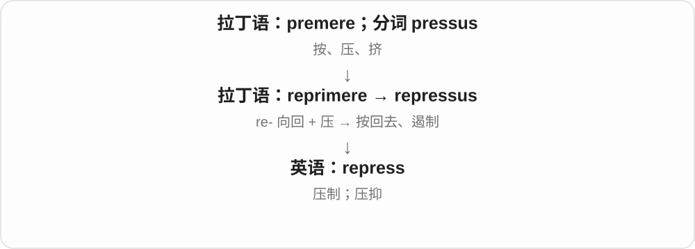

日常可说 repress anger 或 repress a movement。精神分析里的术语义专指把令人不安的内容挡在意识之外，不能把所有日常“忍住”都当这一理论术语。

**常见搭配与例句**

repress feelings；repress dissent；repressed anger。

> He had learned to repress his anger rather than talk about it.

他学会了把愤怒压在心里，而不是谈出来。

> The government tried to repress the growing movement.

政府试图压制日益扩大的运动。

**别混淆**

心理学术语常把 repression 的无意识过程与 suppression 的有意识控制区分；一般英语中的两词范围会重叠。

### 686. repressed — 被压抑、压制的；不易表露情感的

**音标**：/rɪˈprest/

**先抓住这个画面**

情绪、愿望被往回按，没让它表现出来；也可以说某种活动被压制。核心是力量被压住。

**怎么拆**

repress 压抑、抑制 + -ed；repress 的词族接拉丁 reprimere 按回、约束，含 re- 回与 premere 压。

**怎么变成今天的意思**

**拉丁按回、压住词族 → repress**  
阻止表现、限制活动

↓

**repress + -ed → repressed**  
已受压制；情绪不轻易显露的

repressed anger 被压住的愤怒；repressed feelings 被抑制的感情；a repressed person 较不容易表露情感的人。

**常见搭配与例句**

repressed emotion；a repressed desire。

> His voice revealed years of repressed anger.

他的声音流露出多年压抑的愤怒。

> The novel explores the character’s repressed feelings.

小说探讨了人物压抑的感情。

**别混淆**

repressed 不等于没有感受，而是描述表达、显露受抑制。depressed 是另一个词，不能只因中文都可能带压就互换。

### 687. snore — 打鼾；一声鼾声

**音标**：英 /snɔː/；美 /snɔːr/

**先抓住这个画面**

睡着后，呼吸带出一阵阵粗重的呼噜声，就是 snore。名词可以数一声，也能把声音整体写出来。

**怎么拆**

经中古英语 snoren、snore 等，常与更早鼻息形式、snort 等拟声材料比较；不是现代 sn 加 ore 的组合。名词、动词的历史记录分别看。

**怎么变成今天的意思**

**中古英语 snoren、snore 等相关形式**  
粗重呼吸、鼻息；与更早 fn- 形式及拟声材料有联系分析

↓

**现代 snore 名词、动词**  
睡觉时打鼾；一声鼾声

snore loudly 是大声打鼾，let out a snore 是打出一声鼾声。

**常见搭配与例句**

a gentle snore 轻轻的鼾声；a loud snore 一声响亮的鼾声。

> I could hear him snore through the thin wall.

隔着薄墙，我能听见他打鼾。

> A loud snore came from the armchair.

扶手椅那边传来一声响亮的鼾声。

**别混淆**

snore 的常见场景是睡觉，snort 常是短促喷鼻息；两词历史可比较，现代使用场景仍不同。

### 688. snoring — 正在打鼾；打鼾的声音、活动

**音标**：英 /ˈsnɔːrɪŋ/；美 /ˈsnɔːrɪŋ/

**先抓住这个画面**

呼噜声正随着呼吸一阵阵响起，是 snoring。既能说人正在打鼾，也能直接把鼾声当作名词。

**怎么拆**

snore 去 e，加完整 -ing；英式在后接元音时也发 /r/，与单独 snore 的读音环境不同。

**怎么变成今天的意思**

**中古英语 snoren、snore 等相关形式**  
粗重呼吸、鼻息；与更早 fn- 形式及拟声材料有联系分析

↓

**现代 snore 名词、动词**  
睡觉时打鼾；一声鼾声

↓

**snore + -ing → snoring〔去 e〕**  
打鼾的过程、鼾声

was snoring 是正在打鼾，the sound of snoring 是鼾声。

**常见搭配与例句**

gentle snoring 轻轻的鼾声；loud snoring 响亮的鼾声。

> She was snoring before the film had finished.

电影还没结束，她就已经打起了鼾。

> The sound of snoring drifted through the open door.

鼾声从敞开的门里传出来。

**别混淆**

snoring 是粗重的睡中呼吸声，purring 常是猫喉间低低的呼噜；中文都像呼噜，英语根据发声场景分词。

### 689. snores — 打鼾〔第三人称单数〕；几声鼾声〔复数〕

**音标**：英 /snɔːz/；美 /snɔːrz/

**先抓住这个画面**

说他睡着就打呼噜，用 snores；隔壁一声声鼾声，也可数成 snores。

**怎么拆**

snore + -s，保留末尾 e，词尾 /z/；美式常保留 r，英式常不读。

**怎么变成今天的意思**

**中古英语 snoren、snore 等相关形式**  
粗重呼吸、鼻息；与更早 fn- 形式及拟声材料有联系分析

↓

**现代 snore 名词、动词**  
睡觉时打鼾；一声鼾声

↓

**snore + -s → snores**  
他、她打鼾；几声鼾声

snores softly 是轻轻打鼾，loud snores 是一声声响亮的鼾声。

**常见搭配与例句**

snores in his sleep 睡着时打鼾；rhythmic snores 有节奏的鼾声。

> He snores whenever he falls asleep in that chair.

他每次在那把椅子上睡着都会打鼾。

> Her soft snores were the only sound in the room.

房间里唯一的声音是她轻轻的鼾声。

**别混淆**

snores 是呼噜声或打鼾动作，snoozes 是打盹；睡着的状态与睡中发出的声音不是一回事。

### 690. snored — 打鼾了、打过呼噜了

**音标**：英 /snɔːd/；美 /snɔːrd/

**先抓住这个画面**

回头说昨夜有人呼噜声不断，用 snored。它把睡眠中的发声放到过去。

**怎么拆**

snore 去末尾 e，加完整 -ed，词尾读 /d/；英美 r 的差异随口音，不另添 /ɪd/。

**怎么变成今天的意思**

**中古英语 snoren、snore 等相关形式**  
粗重呼吸、鼻息；与更早 fn- 形式及拟声材料有联系分析

↓

**现代 snore 名词、动词**  
睡觉时打鼾；一声鼾声

↓

**snore + -ed → snored〔去 e〕**  
过去打鼾

snored all night 是整夜打鼾，snored gently 是轻轻打着呼噜。

**常见搭配与例句**

snored on the sofa 在沙发上打鼾了；snored loudly 大声打过鼾了。

> He snored gently on the sofa.

他在沙发上轻轻打着呼噜。

> Someone snored loudly in the next compartment.

隔壁车厢里有人鼾声很响。

**别混淆**

snored 说明睡中打过鼾；slept 只说睡过，不说明是否发声。

### 691. prod — 戳、捅；催促、促使；戳一下、催促

**音标**：英 /prɒd/；美 /prɑːd/

**先抓住这个画面**

用棍子戳戳土、用手指戳一下靠垫，是 prod；催一个迟迟没动的人，也像戳一下让他赶紧行动。

**怎么拆**

较早说拿棍子戳，来源未定；可能联系旧 brod、北欧尖刺材料，也有拟声分析。现代 prod 不当作 pro- 加一个字母 d 来拆。

**怎么变成今天的意思**

**十六世纪 prod 的用棍戳动材料**  
来源未定，可能是旧 brod 一系变体，或有拟声基础

↓

**戳动 → 催促、激起行动；戳一下的名词**  
像给迟迟不动的对象一记较明确的刺激

prod something with a stick 是拿棍戳，prod someone into action 是催人行动；give someone a prod 是催一下。

**常见搭配与例句**

prod gently 轻戳；prod someone to reply 催人回复。

> He used a stick to prod the soft ground.

他拿棍子戳了戳松软地面。

> She needed a prod to finish the report.

她需要有人催一下，才把报告写完。

**别混淆**

prod 比 nudge 更容易像明确戳、催一下，nudge 通常更轻、更含蓄；两者都可说提醒，但力度感觉不同。

### 692. prodding — 正在戳、捅、催促；催促、刺激

**音标**：英 /ˈprɒdɪŋ/；美 /ˈprɑːdɪŋ/

**先抓住这个画面**

指头正一下下戳，或有人一遍遍催你做事，是 prodding；名词用法把这些推动当作一个整体。

**怎么拆**

prod 双写 d + 完整 -ing → prodding；动词分词或动作名词，基础短元音保留。

**怎么变成今天的意思**

**十六世纪 prod 的用棍戳动材料**  
来源未定，可能是旧 brod 一系变体，或有拟声基础

↓

**戳动 → 催促、激起行动；戳一下的名词**  
像给迟迟不动的对象一记较明确的刺激

↓

**prod 双写 d + -ing → prodding**  
戳动、催促的过程或行为

stop prodding it 是别再戳它，after some prodding 是经过一点催促；第二种把催人看作一股刺激。

**常见搭配与例句**

with gentle prodding 在温和催促下；prodding someone into action 催人行动。

> Stop prodding the cushion with your pencil.

别再拿铅笔戳靠垫了。

> After some prodding, he finally shared his idea.

催了几次后，他终于说出了自己的想法。

**别混淆**

prodding 常让人觉得原本没动、需要外界刺激；encouragement 更广，可以是鼓舞、支持，不必带催的感觉。

### 693. prodded — 戳了、捅了；催促、促使了

**音标**：英 /ˈprɒdɪd/；美 /ˈprɑːdɪd/

**先抓住这个画面**

刚才用棍、指头碰进去戳一下，是 prodded；一句提醒把人从拖延中推出来，也可以 prodded someone into action。

**怎么拆**

prod 双写 d + 完整 -ed → prodded；/d/ 后词尾读 /ɪd/，整词两个音节。

**怎么变成今天的意思**

**十六世纪 prod 的用棍戳动材料**  
来源未定，可能是旧 brod 一系变体，或有拟声基础

↓

**戳动 → 催促、激起行动；戳一下的名词**  
像给迟迟不动的对象一记较明确的刺激

↓

**prod 双写 d + -ed → prodded**  
过去戳动、催动

prodded the cushion 是戳靠垫，prodded her to apply 是催她申请；was prodded into action 是被催得行动起来。

**常见搭配与例句**

prodded with a stick 用棍戳了；prodded him gently 轻戳或温和催了他。

> He prodded the cushion with one finger.

他用一根手指戳了戳靠垫。

> Her question prodded me into checking the figures.

她的问题促使我去核对数字。

**别混淆**

prodded 是短元音、双 d、加 /ɪd/，而 nudged 末尾 /dʒd/ 不加音节；两者都能催促，形态和发音不同。

### 694. prods — 戳、催促〔第三人称单数〕；戳动、催促〔复数〕

**音标**：英 /prɒdz/；美 /prɑːdz/

**先抓住这个画面**

一个人用手指或棍子戳，动词用 prods；几次提醒像小小刺激，叫 a few prods，催你从停着变成行动。

**怎么拆**

prod + -s，/d/ 后读 /z/，结尾 /dz/；动词三单和戳动名词复数同形。

**怎么变成今天的意思**

**十六世纪 prod 的用棍戳动材料**  
来源未定，可能是旧 brod 一系变体，或有拟声基础

↓

**戳动 → 催促、激起行动；戳一下的名词**  
像给迟迟不动的对象一记较明确的刺激

↓

**prod + -s → prods**  
他、她戳动、催促；几下戳动或提醒

prods the ground 是戳地面，prods me to reply 是催我回复；gentle prods 可以是几次轻戳，也可以温和催促。

**常见搭配与例句**

prods with a finger 用手指戳；needs a few prods 得催几下。

> She prods the soil with a stick to test how soft it is.

她拿棍子戳土，试试有多软。

> He needed a few gentle prods before he sent the form.

他得经过几次温和催促，才把表格寄出。

**别混淆**

prods 如果接动作、不定式，常说催促；如果接被戳物体和 with a stick，常是实际接触，句型能把两义接起来。

### 695. sag — 下垂、下陷、松垮；走低、泄气；下垂处

**音标**：/sæɡ/

**先抓住这个画面**

绳子不绷紧，中间塌低；沙发坐久了凹下去，都像 sag。人的肩、情绪或价格也能像失去支撑一样走低。

**怎么拆**

接中古英语 saggen，可能借北欧或低地德语下沉材料，更远与 sink 一系可比较；具体借入路线未定。

**怎么变成今天的意思**

**中古英语 saggen → sag**  
不平地挂下、下陷；可能借北欧或低地德语，相关下沉材料可比较

↓

**物体松垮下坠 → 精神、价格等走低**  
常在重量、松弛之下中间低下去；比喻活力或数值撑不住

the roof sags 是屋顶下坠，spirits sag 是精神泄气，prices sag 是价格走低；a sag in the middle 是中间下垂处。

**常见搭配与例句**

sag under the weight 被重量压得下垂；a sag in the sofa 沙发下陷。

> The old sofa had begun to sag in the middle.

旧沙发中间已经开始下陷。

> Our spirits began to sag after hours of waiting.

等了好几个小时，我们开始泄气。

**别混淆**

sag 更强调软、松或受重之后塌低，fall 只说落下；绳子 sag 时两端通常还连着。

### 696. sagging — 正在下垂、下陷；松垮的；低迷、走低的

**音标**：/ˈsæɡɪŋ/

**先抓住这个画面**

绳子、床垫、肩膀正失去支撑塌低，是 sagging；销量、信心等也能用这幅往下撑不住的图景。

**怎么拆**

sag 双写 g + 完整 -ing → sagging；双写保留短元音基础拼写，分词可形容下垂状态。

**怎么变成今天的意思**

**中古英语 saggen → sag**  
不平地挂下、下陷；可能借北欧或低地德语，相关下沉材料可比较

↓

**物体松垮下坠 → 精神、价格等走低**  
常在重量、松弛之下中间低下去；比喻活力或数值撑不住

↓

**sag 双写 g + -ing → sagging**  
塌低过程；松垮、低迷状态

a sagging sofa 是塌陷沙发，sagging sales 是走低销量；a sagging roof 是中间下坠的屋顶。

**常见搭配与例句**

sagging shoulders 垮下的肩；sagging morale 低落士气。

> We replaced the sagging mattress.

我们换掉了塌陷的床垫。

> The shop was struggling with sagging sales.

店铺正为走低的销量发愁。

**别混淆**

sagging 可写数值、士气逐渐下滑，不只写物体；declining 较中性，sagging 更带失去支撑的形象。

### 697. sags — 下垂、下陷、走低〔第三人称单数〕；下垂处〔复数〕

**音标**：/sæɡz/

**先抓住这个画面**

一个表面、绳子或人的精神撑不住、往下塌，用 sags。名词复数则是几处下垂、凹陷。

**怎么拆**

sag + -s，/ɡ/ 后读 /z/；三单不双写 g，基础短元音保持。

**怎么变成今天的意思**

**中古英语 saggen → sag**  
不平地挂下、下陷；可能借北欧或低地德语，相关下沉材料可比较

↓

**物体松垮下坠 → 精神、价格等走低**  
常在重量、松弛之下中间低下去；比喻活力或数值撑不住

↓

**sag + -s → sags**  
它下坠、走低；多处凹陷

sags in the middle 是中间塌低，sags under pressure 是压力下撑不住；可以写实体，也能写活力。

**常见搭配与例句**

sags under the books 被书压得下垂；sags with age 年久而松垮。

> The shelf sags under the weight of the books.

书架被书的重量压得下垂。

> His energy sags after lunch.

午饭后，他的精神劲就低下去。

**别混淆**

sags 与 sinks 可都向下，sags 常还挂着、连着，只是失去挺劲；sinks 更能说整体下沉、沉入。

### 698. sagged — 下垂、下陷了；走低、泄气了

**音标**：/sæɡd/

**先抓住这个画面**

原来撑着的东西刚才塌低，或肩膀因疲惫、失望垮下来，用 sagged。它能让人看见支撑感消失。

**怎么拆**

sag 双写 g + 完整 -ed → sagged，/ɡ/ 后读 /d/；短元音重读单音节按规则双写。

**怎么变成今天的意思**

**中古英语 saggen → sag**  
不平地挂下、下陷；可能借北欧或低地德语，相关下沉材料可比较

↓

**物体松垮下坠 → 精神、价格等走低**  
常在重量、松弛之下中间低下去；比喻活力或数值撑不住

↓

**sag 双写 g + -ed → sagged**  
过去塌低、下陷或泄气

shoulders sagged 是肩膀垮了，roof sagged 是屋顶下垂，confidence sagged 是信心低落；不全是真掉到地面。

**常见搭配与例句**

sagged in the centre 中央下陷；sagged with relief 松了口气、身子垮下来。

> Her shoulders sagged when she heard the answer.

听到回答，她的肩膀垮了下来。

> The old roof sagged in the centre.

旧屋顶中央下陷了。

**别混淆**

sagged 的下垂常渐渐或在受力后发生；snapped 说突然断裂，实体结果不同。

### 699. snare — 套索、圈套；套住、捕住；鼓底响弦；小军鼓

**音标**：英 /sneə/；美 /sner/

**先抓住这个画面**

一根绳形成的圈，把东西套住，是 snare 的核心画面；比喻看似好处却把人困住的安排，就是圈套。音乐里还可指鼓的响弦或小军鼓。

**怎么拆**

套索义承古英语 snearu 等，也有北欧 snara 来源影响；鼓底弦义可能另借荷兰语 snaar 弦，同属更远的绳弦材料，不都从捕兽动作直接造。

**怎么变成今天的意思**

**古英语 snearu 等、或另有北欧 snara 的借入 → snare 套索名词 → 动词**  
绳圈、圈套 → 套住、困住；与缠结义 snarl 的材料可相连

↓

**鼓的响弦支线：荷兰语 snaar 弦等 → snare；再有 snare drum 的简称**  
同一更远绳、弦词族的另一发展，不是先把捕兽套装上鼓才有名称

caught in a snare 是落进套索或圈套；snare a victim 是诱捕受害者；play the snare 是打小军鼓，来自 snare drum 的简称。

**常见搭配与例句**

a hidden snare 隐藏的圈套；a snare drum 小军鼓、响弦鼓。

> The fox had escaped from an old snare.

狐狸从一个旧套索里逃脱了。

> She plays the snare in the marching band.

她在行进乐队里打小军鼓。

**别混淆**

snare、trap 都能说陷阱，snare 更容易保留绳圈套住的画面；音乐义与套索义有更远词族联系，近源发展要分开。

### 700. snares — 套住、捕住〔第三人称单数〕；套索、圈套、鼓响弦或小军鼓〔复数〕

**音标**：英 /sneəz/；美 /snerz/

**先抓住这个画面**

某件事像绳圈把人诱进去，用 snares；名词复数则是多个套索、圈套，音乐场景还可说鼓的响弦或几面小军鼓。

**怎么拆**

snare + -s，保留 e；英式 /eə/ 后加 /z/，美式相应 r 音后加 /z/，现代词尾不改变基础词的多条来源。

**怎么变成今天的意思**

**古英语 snearu 等、或另有北欧 snara 的借入 → snare 套索名词 → 动词**  
绳圈、圈套 → 套住、困住；与缠结义 snarl 的材料可相连

↓

**鼓的响弦支线：荷兰语 snaar 弦等 → snare；再有 snare drum 的简称**  
同一更远绳、弦词族的另一发展，不是先把捕兽套装上鼓才有名称

↓

**snare + -s → snares**  
它套住；多个套索、圈套或鼓的相关用法

snares its victims 是把受害者套住，avoid the snares 是避开圈套；音乐中的 snares 不按捕兽工具理解。

**常见搭配与例句**

hidden snares 隐藏圈套；snares unsuspecting people 套住毫无戒心的人。

> The scheme snares people with promises of easy rewards.

这套骗局用轻松获利的承诺把人套进去。

> We found several old snares beside the fence.

我们在栅栏旁发现几个旧套索。

**别混淆**

snares 与 snarls 不同：前者是套索、捕住，后者还可说缠成一团或露齿低吼；近形不意味着所有义互换。

### 701. snarl — 龇牙低吼、恶声说；缠结、堵塞；低吼声、乱结

**音标**：英 /snɑːl/；美 /snɑːrl/

**先抓住这个画面**

看狗时，是龇牙发出带威胁的低吼；看头发、绳子或交通时，是缠在一起、乱成一团。同形的两条线要分开记。

**怎么拆**

声音支线联系较早 snar 和拟声材料；缠结支线联系中古英语 snarl、snarlen 与 snare 套索材料，有小称或反复动作形式的分析。

**怎么变成今天的意思**

**声音支线：较早 snar 等低吼材料 → snarl**  
或与荷兰语、低地德语相近拟声词有关；露齿低吼，再到人恶声说话

↓

**缠结支线：中古英语 snarl、snarlen 与 snare 材料相连**  
套索、缠结 → 线结；使交通、事情堵塞纠缠；不从狗吼推导

snarl at someone 是恶声冲某人说，snarl up traffic 是把交通堵住，a snarl in her hair 是头发里的乱结。

**常见搭配与例句**

a threatening snarl 威胁的低吼；a traffic snarl 交通拥堵。

> The dog gave a snarl when the stranger reached towards it.

陌生人伸手过来，狗龇牙低吼。

> “Leave me alone,” he said with a snarl.

“别烦我。”他恶声恶气地说。

> There was a stubborn snarl in her hair.

她的头发里有个很难解开的结。

> The roadworks caused a traffic snarl near the bridge.

道路施工让桥附近堵成一团。

**别混淆**

growl 可以只是低沉吼声；动物 snarl 常带龇牙、威胁的样子。traffic snarl 走缠结线，不是汽车在低吼。

### 702. snarling — 正在低吼、恶声说；正在缠结、造成堵塞的

**音标**：英 /ˈsnɑːlɪŋ/；美 /ˈsnɑːrlɪŋ/

**先抓住这个画面**

一只狗露着牙正低吼，是 snarling；某件事正把道路或进展搅成一团，也可用这个词，但属于缠结支线。

**怎么拆**

snarl + 完整 -ing，直接加；两条动词都能形成这个分词，不能只背一个中文义。

**怎么变成今天的意思**

**声音支线：较早 snar 等低吼材料 → snarl**  
或与荷兰语、低地德语相近拟声词有关；露齿低吼，再到人恶声说话

↓

**缠结支线：中古英语 snarl、snarlen 与 snare 材料相连**  
套索、缠结 → 线结；使交通、事情堵塞纠缠；不从狗吼推导

↓

**snarl + -ing → snarling**  
低吼、恶声说话中；缠乱、堵塞中

a snarling dog 是龇牙低吼的狗，snarling up traffic 是正在造成交通堵塞；前后走不同的近源。

**常见搭配与例句**

snarling at each other 相互恶声说话；snarling traffic 堵乱交通。

> A snarling dog blocked the narrow path.

一只龇牙低吼的狗挡住了小路。

> The broken traffic lights were snarling up traffic.

坏掉的红绿灯正让交通堵成一团。

**别混淆**

snarling 可以描述人说话的敌意；在 traffic、cables 等搭配中，要转到套索、乱结的画面。

### 703. snarled — 龇牙低吼了、恶声说了；缠结的、堵塞的

**音标**：英 /snɑːld/；美 /snɑːrld/

**先抓住这个画面**

人刚才带着敌意说话，叫 snarled；线或道路变得纠缠、堵住，也会用这个形式。先看说的是声音还是缠结。

**怎么拆**

snarl + 完整 -ed，/l/ 后读 /d/。声音、缠结两条动词都按同一现代规则变化。

**怎么变成今天的意思**

**声音支线：较早 snar 等低吼材料 → snarl**  
或与荷兰语、低地德语相近拟声词有关；露齿低吼，再到人恶声说话

↓

**缠结支线：中古英语 snarl、snarlen 与 snare 材料相连**  
套索、缠结 → 线结；使交通、事情堵塞纠缠；不从狗吼推导

↓

**snarl + -ed → snarled**  
过去低吼、恶声说；已缠结、堵塞

snarled a reply 是恶声回答了，snarled traffic 是堵塞的交通；snarled up in 是缠在、困在某事里。

**常见搭配与例句**

snarled at him 冲他低吼、恶声说；snarled cables 缠乱的电缆。

> “That is none of your business,” he snarled.

“那不关你的事。”他恶声说。

> The crash left traffic snarled for hours.

事故让交通堵了好几个小时。

**别混淆**

snarled traffic 中的 snarled 像 tangled，写堵乱的状态；它不表示交通在发怒。

### 704. snarls — 低吼、恶声说〔第三人称单数〕；缠乱、堵塞；低吼声、乱结〔复数〕

**音标**：英 /snɑːlz/；美 /snɑːrlz/

**先抓住这个画面**

狗一边露牙一边低吼，用 snarls；绳子或交通缠乱也能用，但走的是另一条来源。

**怎么拆**

两条基础词 snarl 都可加 -s，/l/ 后读 /z/；对应三单或名词复数，靠上下文分支。

**怎么变成今天的意思**

**声音支线：较早 snar 等低吼材料 → snarl**  
或与荷兰语、低地德语相近拟声词有关；露齿低吼，再到人恶声说话

↓

**缠结支线：中古英语 snarl、snarlen 与 snare 材料相连**  
套索、缠结 → 线结；使交通、事情堵塞纠缠；不从狗吼推导

↓

**snarl + -s → snarls**  
它低吼、缠结；多声低吼、多个乱结

snarls at visitors 是冲来客龇牙低吼，snarls up traffic 是堵住交通；tangles、knots 可以帮助理解乱结名词义。

**常见搭配与例句**

angry snarls 愤怒的低吼；snarls in the rope 绳子里的乱结。

> The dog snarls whenever anyone touches its food.

只要有人碰食物，那只狗就龇牙低吼。

> She carefully removed the snarls from the fishing line.

她小心地解开鱼线里的乱结。

**别混淆**

snarls 不把所有义都连成“生气”：绳结没有情绪，乱结义来自套索、缠结材料。

### 705. snared — 被套住、捕住了；诱进圈套了；费力争取得到了

**音标**：英 /sneəd/；美 /snerd/

**先抓住这个画面**

人或动物落进圈套、被套牢，用 snared；新闻里 snared a major deal 也可比喻争取到一笔大交易，像终于抓住机会。

**怎么拆**

snare 去 e + 完整 -ed，词尾读 /d/；形象从套索名词到套住动词，不与 snarled 的低吼混成一条义。

**怎么变成今天的意思**

**古英语 snearu 等、或另有北欧 snara 的借入 → snare 套索名词 → 动词**  
绳圈、圈套 → 套住、困住；与缠结义 snarl 的材料可相连

↓

**鼓的响弦支线：荷兰语 snaar 弦等 → snare；再有 snare drum 的简称**  
同一更远绳、弦词族的另一发展，不是先把捕兽套装上鼓才有名称

↓

**snare 去 e + -ed → snared**  
过去套住、诱捕；比喻抓住机会、取得成果

snared in a trap 是被困进陷阱，snared by a scheme 是中了计；snared a contract 是争取到合同，带抓住机会的语感。

**常见搭配与例句**

snared by the promise 被承诺诱入；snared in the net 被网困住。

> Several birds were snared in the abandoned net.

几只鸟被遗弃的网困住了。

> The small studio snared a major advertising contract.

那家小工作室争取到一份重要广告合同。

**别混淆**

snared 常强调被圈套困住或成功捕获；snarled 可以是龇牙低吼，也可以缠乱，拼写近但动作画面不同。

### 706. snaring — 正在套住、捕住、诱进圈套；争取得到

**音标**：英 /ˈsneərɪŋ/；美 /ˈsnerɪŋ/

**先抓住这个画面**

绳圈、网或某个圈套正把目标抓住、困住，是 snaring；谈机会、合同也能比喻费力抓到手。

**怎么拆**

snare 去 e + 完整 -ing；英式 r 在后接元音时发出来。基础是 snare，不是低吼 snarl 的变形。

**怎么变成今天的意思**

**古英语 snearu 等、或另有北欧 snara 的借入 → snare 套索名词 → 动词**  
绳圈、圈套 → 套住、困住；与缠结义 snarl 的材料可相连

↓

**鼓的响弦支线：荷兰语 snaar 弦等 → snare；再有 snare drum 的简称**  
同一更远绳、弦词族的另一发展，不是先把捕兽套装上鼓才有名称

↓

**snare 去 e + -ing → snaring**  
捕住、诱入或抓住机会的过程

snaring victims 是诱捕受害者，snaring a contract 是争取得到合同；具体善恶、情境由主语和对象说明。

**常见搭配与例句**

snaring unsuspecting people 诱住没防备的人；snaring a major role 争取到重要角色。

> The scam was snaring people with promises of free prizes.

骗局正用免费奖品的承诺把人诱进去。

> The young actor hoped for a chance of snaring a major role.

年轻演员希望有机会争取到一个重要角色。

**别混淆**

snaring 关注把目标抓到、套住，snarling 在声音语境则是威胁低吼；只看开头 snar- 容易混。

### 707. trickle — 细细流淌、缓缓到来；细流、少量

**音标**：/ˈtrɪkəl/

**先抓住这个画面**

不是大水冲过来，而是一小股水慢慢流；人、消息、捐款陆续零星到来，也能借这幅画面。

**怎么拆**

中古英语 triklen 已有滴流义。可能与 striklen 及 strike 的旧移动义相接，涉及缩短或边界重分等解释；来源尚有不确定，不硬认作现代 trick 把戏 + -le。

**怎么变成今天的意思**

**中古英语 triklen → trickle**  
泪、水等缓慢流下

↓

**可能与 striklen、strike 的旧移动义有关；路线不定**  
从细小流动到人、信息零星到来

water trickles down 水细细流下，people trickle in 人们陆续进来，a trickle of information 零星消息，a steady trickle 持续的小股流动。

**常见搭配与例句**

trickle down；trickle in；a trickle of；a steady trickle。

> Water trickled down the wall.

水沿着墙细细流下。

> Guests began to trickle in after seven.

七点后，客人开始陆续到来。

**别混淆**

trickle 比 flow 更强调量小、慢；trickle in 可以是很多人陆续到，并不意味着人会融成液体。与 strike 的历史联系只作为可能。

### 708. trickling — 正在细流、陆续少量到来；细细流动的

**音标**：/ˈtrɪklɪŋ/

**先抓住这个画面**

少量水正沿着表面往下走，或信息正一点点传来，是 trickling。比起猛烈涌出，动作轻、慢、小。

**怎么拆**

trickle 去 e + 完整 -ing，常读 /ˈtrɪklɪŋ/；可表示进行，也可形容细流的状态。

**怎么变成今天的意思**

**中古英语 triklen → trickle**  
细流、滴流；或联系 stricklen 与旧 striken 移动材料，来源未定

↓

**细小流动 → 人、消息、钱少量陆续到来**  
一个个、慢慢来，不是一次涌入很多

↓

**trickle 去 e + -ing → trickling**  
细流过程；零星陆续到来

a trickling stream 是细细流的小溪，details trickling in 是细节正一点点传来；动作节奏是同一画面。

**常见搭配与例句**

water trickling over stones 水流过石头；people trickling out 人们零星离开。

> We listened to water trickling over the stones.

我们听着水细细流过石头。

> People were trickling out of the hall.

人们正零星走出大厅。

**别混淆**

trickling 常是缓缓的流线，dripping 常是分开一滴滴落；看水有没有形成细流，有助于选词。

### 709. trickled — 细细流下了；一点点陆续到来了

**音标**：/ˈtrɪkəld/

**先抓住这个画面**

刚才有细水慢慢流下，或人没有一齐到、而是零星走进来，用 trickled。

**怎么拆**

trickle 去 e + 完整 -ed，/l/ 后读 /d/；基础词已有 ck 保留，不再多添 k。

**怎么变成今天的意思**

**中古英语 triklen → trickle**  
细流、滴流；或联系 stricklen 与旧 striken 移动材料，来源未定

↓

**细小流动 → 人、消息、钱少量陆续到来**  
一个个、慢慢来，不是一次涌入很多

↓

**trickle 去 e + -ed → trickled**  
过去细流、少量陆续来到

trickled down her face 是沿她脸细细流下，trickled into the room 是零星走进房间；方向词保留流动路线。

**常见搭配与例句**

trickled through the stones 从石缝细流；trickled in slowly 慢慢陆续来。

> A tear trickled down her cheek.

一滴泪沿她脸颊缓缓流下。

> Guests trickled into the room after seven.

七点后，客人零星走进房间。

**别混淆**

trickled 可以写人，有一点点汇进来的画面；walked in 只说走进，不说明人数、节奏。

### 710. trickles — 细细流、陆续少量到来〔第三人称单数〕；一股股细流

**音标**：/ˈtrɪkəlz/

**先抓住这个画面**

水沿石头细细往下走，或消息、人一点点到来，用 trickles。抓住量不大、慢慢连续或断续推进。

**怎么拆**

trickle + -s，保留 e，/l/ 后读 /z/；更早来源未定，不能把 trick 把戏当现代基础。

**怎么变成今天的意思**

**中古英语 triklen → trickle**  
细流、滴流；或联系 stricklen 与旧 striken 移动材料，来源未定

↓

**细小流动 → 人、消息、钱少量陆续到来**  
一个个、慢慢来，不是一次涌入很多

↓

**trickle + -s → trickles**  
它细流；少量陆续到来；多股细流

water trickles down 是水细细流下，information trickles in 是消息一点点传来；不必每次真有水。

**常见搭配与例句**

trickles through the gap 从缝里细流；small trickles of water 几股小细流。

> Water trickles down the rock face.

水沿岩壁细细流下。

> News of the event trickles in throughout the morning.

整个上午，活动消息一点点传来。

**别混淆**

trickles in 与 pours in 都可写人或消息，前者少而慢，后者通常多而集中涌入。

### 711. yelp — 尖叫、短促地叫；一声尖叫

**音标**：/jelp/

**先抓住这个画面**

像被突然踩到尾巴的小狗，或人碰到烫东西时“呀”一声，叫 yelp。抓住短、尖、猛地冒出来的声音。

**怎么拆**

承古英语 gielpan，经中古英语 yelpen；更早有自夸、欢呼义，后来集中到尖短叫声。不是现代 yell 加一个 p。

**怎么变成今天的意思**

**古英语 gielpan、gelpan → 中古英语 yelpen**  
原有自夸、欢呼一类义，随后发展出大声叫喊

↓

**后来 yelp 的主要声音义**  
短而尖的一声叫；动物的尖叫、人吃痛或受惊的叫声

give a yelp 是尖叫一声，yelp in pain 是吃痛叫起来；也可以是惊喜的短叫，不限于疼痛。

**常见搭配与例句**

a yelp of surprise 惊叫一声；let out a yelp 发出一声尖叫。

> The puppy gave a yelp when the door slammed.

门砰地关上，小狗尖叫了一声。

> She let out a yelp of surprise when the box moved.

盒子动了一下，她惊叫出声。

**别混淆**

yelp 通常比 howl 短；whimper 偏低弱、呜咽。它们是声音特点的差别，不是三种固定情绪。

### 712. yelping — 正在短促尖叫；一阵尖叫声

**音标**：/ˈjelpɪŋ/

**先抓住这个画面**

尖短叫声正一声接一声冒出来，是 yelping。单个 yelp 很短，yelping 可以把持续发生的整段声音写出来。

**怎么拆**

yelp + 完整 -ing；末尾有 lp 两个辅音字母，直接加词尾，不双写 p。

**怎么变成今天的意思**

**古英语 gielpan、gelpan → 中古英语 yelpen**  
原有自夸、欢呼一类义，随后发展出大声叫喊

↓

**后来 yelp 的主要声音义**  
短而尖的一声叫；动物的尖叫、人吃痛或受惊的叫声

↓

**yelp + -ing → yelping**  
进行中的尖叫；尖叫活动

a yelping puppy 是尖叫的小狗，yelping with excitement 是兴奋地叫个不停。

**常见搭配与例句**

yelping nearby 在附近尖叫；a burst of yelping 突然一阵尖叫。

> A yelping puppy followed us across the yard.

一只尖叫着的小狗跟着我们穿过院子。

> The sudden yelping woke everyone in the house.

突如其来的一阵尖叫吵醒了屋里所有人。

**别混淆**

yelping 不保证一直保持同一个音；重点是接连的尖短叫声。howling 更常给人拖长声调的感觉。

### 713. yelps — 尖叫〔第三人称单数〕；一声声尖叫

**音标**：/jelps/

**先抓住这个画面**

说一只狗碰到某件事就短促尖叫，用 yelps；名词复数则把几声尖叫数出来。

**怎么拆**

yelp + -s，/p/ 后读 /s/；动词三单与名词复数同形。

**怎么变成今天的意思**

**古英语 gielpan、gelpan → 中古英语 yelpen**  
原有自夸、欢呼一类义，随后发展出大声叫喊

↓

**后来 yelp 的主要声音义**  
短而尖的一声叫；动物的尖叫、人吃痛或受惊的叫声

↓

**yelp + -s → yelps**  
它尖叫；多声尖叫

yelps in excitement 是兴奋得尖叫，a series of yelps 是接连几声短叫。具体情绪由后面的词交代。

**常见搭配与例句**

yelps with delight 开心地尖叫；sharp yelps 尖短的叫声。

> The puppy yelps with excitement when we return.

我们回来时，小狗兴奋得尖叫。

> We heard a few yelps behind the fence.

我们听见栅栏后传来几声尖叫。

**别混淆**

yells 主要说大喊，yelps 更突出一声声尖短的声音；不是 yells 的另一种拼法。

### 714. yelped — 尖叫了一声、短促地叫了

**音标**：/jelpt/

**先抓住这个画面**

某个刺激突然来到，声音一下从嘴里蹦出来，叫 yelped。叙事里常写吃惊、吃痛或兴奋那一下。

**怎么拆**

yelp + 完整 -ed，/p/ 后读 /t/；仍是一个音节，不加读 /ɪd/。

**怎么变成今天的意思**

**古英语 gielpan、gelpan → 中古英语 yelpen**  
原有自夸、欢呼一类义，随后发展出大声叫喊

↓

**后来 yelp 的主要声音义**  
短而尖的一声叫；动物的尖叫、人吃痛或受惊的叫声

↓

**yelp + -ed → yelped**  
过去发出短促尖叫

yelped in surprise 是突然惊叫，yelped for help 是用尖短叫声求助。可以接说出的简短话。

**常见搭配与例句**

yelped suddenly 突然尖叫；yelped with pain 吃痛叫了。

> He yelped when the cold water touched his back.

冷水碰到背上时，他尖叫了一声。

> The puppy yelped and jumped away from the balloon.

小狗尖叫一声，从气球旁跳开。

**别混淆**

yelped 只说明那一下怎么发声，不能单靠它判断是疼、怕还是开心；上下文才给原因。

### 715. appalled — 震惊而反感的；惊骇的

**音标**：/əˈpɔːld/；美音也有 /əˈpɑːld/

**先抓住这个画面**

说的是承受冲击的人心里有什么反应。

**怎么拆**

appal／appall 的过去分词作形容词，-ed 表示受到这种冲击后的状态。

**怎么变成今天的意思**

**拉丁 pallēre〔变白、显得苍白〕**  
颜色退去的基本画面

↓

**古法语 palir → a- + palir → apalir**  
变苍白；使变苍白

↓

**中古英语 appal／appall**  
褪色、变苍白 → 使震惊、惊骇

↓

**英语 appal／appall → appalled**  
受到震惊的人所处的状态

I’m appalled 不只是“我没想到”，还常含“这也太糟糕、太不应该了”。后面可以用 at、by 接事物，也可以用 to see、to hear 说明是什么让人产生反应。

**常见搭配与例句**

appalled at the conditions；appalled by the news；appalled to discover something。

> We were appalled by the amount of food thrown away.

我们看到那么多食物被扔掉，感到震惊又反感。

> She was appalled to discover that the warnings had been ignored.

她发现警告竟被忽视了，十分震惊。

**别混淆**

appalled 是人感到震惊；appalling 是事情令人震惊。I’m appalling 通常变成“我很糟糕”，不能代替 I’m appalled。

### 716. contrasted — 被对照的；相对照的

**音标**：英 /kənˈtrɑːstɪd/；美 /kənˈtræstɪd/

**先抓住这个画面**

两种情况已经被拿来比较差别，句子就可能用 contrasted；它常出现在被动结构里。

**怎么拆**

contrast + -ed，既是过去式、过去分词，也能作描述性修饰语。

**怎么变成今天的意思**

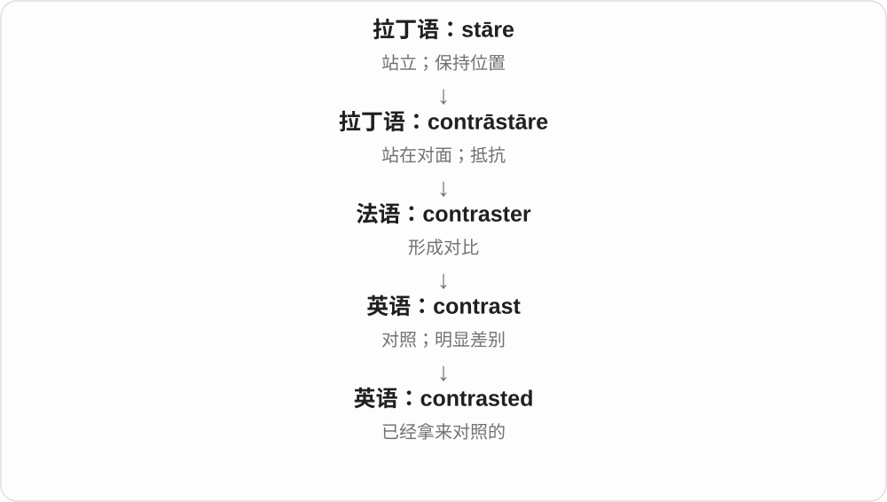

as contrasted with… 意思是“与……对照而言”。学习时把整个结构记住，比孤立背一个形容词释义更实用。

**常见搭配与例句**

be contrasted with…；as contrasted with…；sharply contrasted。

> The results were contrasted with those of the earlier study.

这些结果与早先研究的结果作了对照。

> The chapter discusses spoken language as contrasted with written language.

这一章把口语与书面语对照起来讨论。

**别混淆**

contrasting 常主动描述两者形成差异；contrasted 更突出有人把它们拿来对照。

### 717. kneel — 跪、跪下；车辆降低车身方便上下客〔专门用法〕

**音标**：/niːl/

**先抓住这个画面**

膝盖弯下、靠膝着地，是 kneel。常见日常场景是跪下来修东西、与孩子平视，并不每次都在表示臣服。

**怎么拆**

接古英语 cnēowlian，经中古英语 knelen 延续，历史与 knee 同族。现代可按膝部词加旧动作词尾理解，不拿 -le 在所有词里统一译成小。

**怎么变成今天的意思**

**古英语 cnēow → 中古英语 kne → knee**  
膝，开头的旧辅音后来不再发音

↓

**相关古英语 cnēowlian → kneel**  
以膝着地、跪

↓

**现代变化**  
kneel → knelt / kneeled；过去式、分词两种形式均见

kneel down 跪下，kneel beside someone 跪在某人旁，kneel on one knee 单膝跪；knelt /nelt/、kneeled /niːld/。

**常见搭配与例句**

kneel down；kneel beside；knelt；kneeled。

> She knelt beside the child to tie his shoelaces.

她跪在孩子身旁，帮他系鞋带。

> He kneeled on the mat to examine the model.

他跪在垫子上查看模型。

**别混淆**

kneel 与 bend the knees 屈膝不总相同：站着屈膝未必跪地。kneeling bus 可指降低车身让乘客更易登车的公交车，是拟人式技术用法。

### 718. knelt — 跪了、跪着〔kneel 的过去式、过去分词〕

**音标**：/nelt/

**先抓住这个画面**

kneel 是跪，knelt 是回头说跪过、当时跪着。像把镜头切到过去：人已经靠膝盖落在地上。

**怎么拆**

kneel → knelt，元音由 /iː/ 变 /e/，结尾为 /lt/；这是后来受 feel → felt 等形式影响的类推，不能拆为 kne + -lt 后缀。

**怎么变成今天的意思**

**古英语 cneowlian → 中古英语 knelen → kneel**  
与 knee 的膝部词族相连：弯膝，以膝着地

↓

**现代 kneeled 与 knelt 两种变化**  
kneeled 为规则 -ed；knelt 是后来受 felt 等变化类推的形式

↓

**kneel → knelt**  
元音和词尾一起变化；与 kneeled 都可用

knelt down 是跪下了，knelt beside someone 是跪在旁边，had knelt 是已经跪过；k 仍不发音。

**常见搭配与例句**

knelt on one knee 单膝跪下了；knelt in front of the cupboard 跪在柜子前。

> He knelt to look under the sofa.

他跪下来，往沙发底下看。

> She had knelt on the path to examine the small flower.

她当时跪在小路上，仔细看那朵小花。

**别混淆**

knelt 与 kneeled 都成立；历史上 knelt 较晚类推出现，形式不规则并不自动等于年代更早。

### 719. kneels — 跪、跪下〔第三人称单数〕

**音标**：/niːlz/

**先抓住这个画面**

说一个人把膝盖放到地上、跪下来，用 kneels。可能在祈祷，也可能只是要够到低处、和孩子平视。

**怎么拆**

kneel + -s，/l/ 后读 /z/；开头 k 在现代不发音。kneel 的膝部联系早在古英语动作词中就有。

**怎么变成今天的意思**

**古英语 cneowlian → 中古英语 knelen → kneel**  
与 knee 的膝部词族相连：弯膝，以膝着地

↓

**现代 kneeled 与 knelt 两种变化**  
kneeled 为规则 -ed；knelt 是后来受 felt 等变化类推的形式

↓

**kneel + -s → kneels**  
他、她以膝着地、跪下

kneels beside the bed 是跪在床边，kneels to tie a shoelace 是跪下来系鞋带；目的要由后文说明。

**常见搭配与例句**

kneels on one knee 单膝跪下；kneels beside the child 跪在孩子身旁。

> He kneels beside the child to look at the drawing.

他在孩子身旁跪下来，看那幅画。

> She kneels on the rug to sort the toys.

她跪在地毯上整理玩具。

**别混淆**

kneels 交代膝盖着地，squats 是身体蹲低、通常脚承重；两种低姿势的支撑点不同。

### 720. kneeled — 跪了、跪着〔kneel 的规则过去式、过去分词〕

**音标**：/niːld/

**先抓住这个画面**

回头说刚才膝盖落地、跪在那里，可以用 kneeled。它和 knelt 都能讲这件事，不必把两者硬分成不同动作。

**怎么拆**

kneel + 完整 -ed，/l/ 后读 /d/。kneel 的 l 前已经是长元音 ee，直接加词尾，不双写 l。

**怎么变成今天的意思**

**古英语 cneowlian → 中古英语 knelen → kneel**  
与 knee 的膝部词族相连：弯膝，以膝着地

↓

**现代 kneeled 与 knelt 两种变化**  
kneeled 为规则 -ed；knelt 是后来受 felt 等变化类推的形式

↓

**kneel + -ed → kneeled**  
规则过去式、过去分词；动作仍是跪

kneeled beside someone 是跪在某人旁边，had kneeled down 是之前已经跪下；现代 knelt 也可用于相同结构。

**常见搭配与例句**

kneeled on the floor 跪在地上；kneeled to pick it up 跪下捡起它。

> She kneeled beside the bed to retrieve the book.

她跪在床边，把书拿出来。

> He had kneeled on the grass to take the photograph.

他当时跪在草地上拍那张照片。

**别混淆**

kneeled 和 knelt 的动作意思相同，差别在词形和使用习惯；不能因为 kneeled 带 -ed，就以为它只是不常见的错误形式。

### 721. threaded — 穿好线的；有螺纹的；按讨论串组织的

**音标**：/ˈθredɪd/

**先抓住这个画面**

针孔穿了线、金属杆刻了螺旋纹、消息按回复线串起来，都可说 threaded；每个场景选 thread 的那一支。

**怎么拆**

thread + -ed，过去式、分词和带某种线、螺纹的形容词。词末 /d/ 后 -ed 读 /ɪd/，形成两个音节。

**怎么变成今天的意思**

**古英语 þrǣd → 中古英语 thred → thread**  
由纤维拧纺成的线

↓

**英语扩展**  
线 → 螺纹、故事线、讨论串、执行线程；动词穿线、穿行

↓

**thread + -ed → threaded**  
穿线了、带螺纹；消息按线索组织

a threaded rod 螺纹杆，a threaded needle 穿好线的针，threaded replies 串式回复、按对话组织的回复。

**常见搭配与例句**

a threaded rod；a threaded needle；threaded replies。

> The two parts connect with a threaded rod.

两个部件通过一根螺纹杆连接。

> Threaded replies make the conversation easier to follow.

按讨论串组织的回复让对话更容易跟上。

**别混淆**

threaded 技术词不都指多线程程序；threaded rod 是螺纹杆，threaded discussion 是讨论串组织方式。

### 722. drench — 使湿透、淋透、浇透

**音标**：/drentʃ/

**先抓住这个画面**

一盆水、大雨或浪一下把人和衣服弄得透湿，叫 drench。重点是湿得彻底，液体从外面大量上来。

**怎么拆**

承古英语 drencan，它是 drincan 喝的旧使动形式，早有使饮、浸透等义；现代词义以把东西弄湿透最常见。

**怎么变成今天的意思**

**古英语 drincan 喝的使动形式 drencan → drench**  
使饮、浸透、淹没等；古代使动关系，不是现代可自由替换的拼写规则

↓

**现代常用浇透、淋透**  
让物体吸进大量液体；也可说阳光、颜色等铺满

drench someone 是把人淋透，drench the ground 是把地浇透；be drenched in sunlight 又可说满满沐在阳光里。

**常见搭配与例句**

drench with water 用水浇透；drench the clothes 淋透衣服。

> The sudden shower was enough to drench us.

突来的一阵雨足以把我们淋透。

> Use enough water to drench the dry soil.

用足够的水把干土浇透。

**别混淆**

soak 常能说放在水里慢慢泡，drench 常更让人想到大量水从外面淋上；两者在湿透结果上会重合。

### 723. drenched — 淋透、浇透了；湿透的；充满某种光色的

**音标**：/drentʃt/

**先抓住这个画面**

衣服吸满水、人从头湿透，是 drenched；drenched in sunlight 则像阳光从四面铺满，借彻底覆盖的感觉。

**怎么拆**

drench + 完整 -ed，/tʃ/ 后读 /t/，结尾 /tʃt/；不是 /tʃɪd/。

**怎么变成今天的意思**

**古英语 drincan 喝的使动形式 drencan → drench**  
使饮、浸透、淹没等；古代使动关系，不是现代可自由替换的拼写规则

↓

**现代常用浇透、淋透**  
让物体吸进大量液体；也可说阳光、颜色等铺满

↓

**drench + -ed → drenched**  
已淋透、湿透；光色铺满的比喻

drenched by the rain 是被雨淋透，drenched in sweat 是汗湿透；a sun-drenched terrace 是阳光洒满的露台。

**常见搭配与例句**

completely drenched 完全湿透；drenched clothes 淋透的衣服。

> We arrived home drenched by the rain.

我们被雨淋透，回到了家。

> The terrace was drenched in afternoon sunlight.

午后的阳光洒满了露台。

**别混淆**

drenched 和 soaked 都能形容湿透；drenched 更容易保留被雨、水从外面淋上来的画面，不是绝对区别。

### 724. drenching — 正在淋透、浇透；使人湿透的；一次浇淋

**音标**：/ˈdrentʃɪŋ/

**先抓住这个画面**

雨或一大股水正把东西淋得透湿，是 drenching；a drenching rain 可直接把雨描述成会把人淋透的雨。

**怎么拆**

drench + 完整 -ing，直接加；分词、形容词和活动名词都保留大量湿透的动作感。

**怎么变成今天的意思**

**古英语 drincan 喝的使动形式 drencan → drench**  
使饮、浸透、淹没等；古代使动关系，不是现代可自由替换的拼写规则

↓

**现代常用浇透、淋透**  
让物体吸进大量液体；也可说阳光、颜色等铺满

↓

**drench + -ing → drenching**  
淋透过程；会把人湿透的雨或水

drenching rain 是淋透人的大雨，get a drenching 是挨了一场浇淋；drenching the soil 是正把土浇透。

**常见搭配与例句**

a sudden drenching 突然一场浇淋；drenching the garden 把花园浇透。

> We walked through a drenching rain.

我们走在足以把人淋透的大雨里。

> The hose was drenching the flower bed.

软管里的水正把花坛浇透。

**别混淆**

drenching rain 与 drizzle 雨势差别很直观：前者能把人湿透，后者细密轻小，不能都只译下雨。

### 725. drenches — 使湿透、淋透、浇透〔第三人称单数〕

**音标**：/ˈdrentʃɪz/

**先抓住这个画面**

雨、大浪或喷水装置把东西一下弄透湿，用 drenches。雨量、泼水量给人很足的感觉。

**怎么拆**

drench + -es，/tʃ/ 后读 /ɪz/，多一个音节；旧使动词已成完整基础，再接现代三单。

**怎么变成今天的意思**

**古英语 drincan 喝的使动形式 drencan → drench**  
使饮、浸透、淹没等；古代使动关系，不是现代可自由替换的拼写规则

↓

**现代常用浇透、淋透**  
让物体吸进大量液体；也可说阳光、颜色等铺满

↓

**drench + -es → drenches**  
它把人或物淋透、浇透

drenches the crowd 是把人群淋透，drenches the field 是把田地浇透；还可比喻颜色、光线铺满。

**常见搭配与例句**

drenches everything 把一切淋透；drenches the leaves with water 用水把叶片淋透。

> A passing wave drenches everyone near the rail.

一阵浪打过，把栏杆边的人全淋透。

> The sprinkler drenches the dry patch of ground.

洒水器把那片干地浇透。

**别混淆**

drenches 比 dampens 强，后者可只是让一点点湿；同样说给地浇水，强调的湿度、液量不同。

### 726. nudge — 轻推、轻碰；提醒、温和促使；小幅移动；轻推一下、提醒

**音标**：/nʌdʒ/

**先抓住这个画面**

用胳膊肘轻碰朋友，示意他看前面，是 nudge；提醒一句，让迟迟没动的人迈出一步，也像轻轻推一把。

**怎么拆**

可能接北欧语碰擦、推挤材料，早期重点是胳膊肘轻碰；提醒、促动义借这种不显眼的小动作扩展。

**怎么变成今天的意思**

**可能来自北欧碰擦材料 → 英语 nudge**  
较早说用胳膊肘轻推、轻碰，具体借入未定

↓

**轻碰示意 → 提醒、温和促动；小幅移向**  
像给停着的东西或犹豫的人一点小推力

nudge someone with your elbow 是用肘轻碰，nudge someone to reply 是提醒对方回复；nudge the chair aside 是轻推挪开椅子。

**常见搭配与例句**

give someone a nudge 提醒、轻推一下；nudge the price up 使价格小幅上移。

> She gave me a nudge when our friend came into view.

朋友一出现在视线里，她就轻碰了我一下。

> Could you nudge him to send the photos?

你能提醒他把照片发来吗？

**别混淆**

nudge 往往力轻、促动温和，shove 是较用力推；提醒人做事的 nudge 通常也比 force 更有留给对方选择的感觉。

### 727. nudged — 轻推、轻碰、提醒了；小幅推动、挪动了

**音标**：/nʌdʒd/

**先抓住这个画面**

刚才肘部碰朋友一下，或把杯子轻轻推远一点，是 nudged；一句话温和促成决定，也像小推力起了作用。

**怎么拆**

nudge 去末尾 e + 完整 -ed → nudged；/dʒ/ 后读 /d/，结尾 /dʒd/，不多一个 /ɪd/ 音节。

**怎么变成今天的意思**

**可能来自北欧碰擦材料 → 英语 nudge**  
较早说用胳膊肘轻推、轻碰，具体借入未定

↓

**轻碰示意 → 提醒、温和促动；小幅移向**  
像给停着的东西或犹豫的人一点小推力

↓

**nudge 去 e + -ed → nudged**  
过去轻碰、促动或微调

nudged me awake 是轻碰把我叫醒，nudged the chair closer 是把椅子轻推近；was nudged into trying 是被温和促成尝试。

**常见搭配与例句**

nudged with an elbow 用肘碰了一下；nudged it towards the edge 把它稍推向边缘。

> She nudged me with her elbow and pointed at the sign.

她用肘碰了我一下，指向招牌。

> He nudged the cup away from the edge of the table.

他把杯子从桌边轻轻往里推了推。

**别混淆**

nudged 描述小力度，jerked 常是突然猛拉或一顿；同样让物体移动，动作的轻重、方向不一样。

### 728. nudging — 正在轻推、轻碰、提醒、微调；温和促动

**音标**：/ˈnʌdʒɪŋ/

**先抓住这个画面**

手正把小东西轻推一点，或人正通过一点点提示让别人行动，是 nudging；重点像增加一小股推力。

**怎么拆**

nudge 去末尾 e + 完整 -ing → nudging；g 在 i 前仍读 /dʒ/，形成动作分词、动作名词。

**怎么变成今天的意思**

**可能来自北欧碰擦材料 → 英语 nudge**  
较早说用胳膊肘轻推、轻碰，具体借入未定

↓

**轻碰示意 → 提醒、温和促动；小幅移向**  
像给停着的东西或犹豫的人一点小推力

↓

**nudge 去 e + -ing → nudging**  
轻推、温和促使的过程

nudging someone to answer 是提醒人回答，nudging a door closed 是轻推关门；numbers nudging higher 是数字小幅走高。

**常见搭配与例句**

gentle nudging 温和促动；nudging it into place 轻推到位。

> The dog kept nudging my hand for attention.

狗不停轻碰我的手，想让我理它。

> Her gentle nudging encouraged me to try again.

她温和的催促鼓励我再试一次。

**别混淆**

nudging 更像提供小推动，ordering 明确下命令；同一个任务里，提醒与命令会让人感到不同的语气。

### 729. nudges — 轻推、轻碰、提醒、微调〔第三人称单数〕；轻推、提醒〔复数〕

**音标**：/ˈnʌdʒɪz/

**先抓住这个画面**

一个人轻碰你一下示意，动词用 nudges；几句温和提醒，也像给你几下小推动，是名词 nudges。

**怎么拆**

nudge + -s，基础已有末尾 e，直接加 s；/dʒ/ 后读 /ɪz/，多一个音节。

**怎么变成今天的意思**

**可能来自北欧碰擦材料 → 英语 nudge**  
较早说用胳膊肘轻推、轻碰，具体借入未定

↓

**轻碰示意 → 提醒、温和促动；小幅移向**  
像给停着的东西或犹豫的人一点小推力

↓

**nudge + -s → nudges**  
他、她轻碰、提醒；几次小促动

nudges the door open 是轻推开门，nudges me to finish 是提醒我做完；gentle nudges 是温和提醒。

**常见搭配与例句**

nudges a cup aside 把杯子轻推开；friendly nudges 友好的提醒。

> He nudges the door open with his foot.

他用脚把门轻推开。

> A few friendly nudges helped me finish the application.

几次友好的提醒帮助我把申请填完了。

**别混淆**

nudges 可以很轻，也可说数值小幅上移；knocks 常更像敲、撞一下，不自动含有提醒和小幅调整。

### 730. squirt — 挤、喷出细流；一股短促细流、一挤的量

**音标**：英 /skwɜːt/；美 /skwɜːrt/

**先抓住这个画面**

捏一下水枪、番茄酱瓶，细细一股液体突然挤出去，叫 squirt。抓住短促、成细流、受挤压的画面。

**怎么拆**

接中古英语 squirten 等喷、吐水材料，或经荷兰语、低地德语，最终大概拟声；不是现代 squeeze 的规则缩写。

**怎么变成今天的意思**

**中古英语 squirten、squyrten 等 → squirt**  
喷、吐水材料，可能经荷兰语或低地德语，最终大概拟声；具体来源未定

↓

**突然喷出细流 → 一次喷量、喷射动作**  
名词与动词的早期记录不宜硬排成现代动词先造全部名词的单线

squirt water at someone 是朝某人喷水，a squirt of ketchup 是挤一点番茄酱；名词能表示一次喷射或那点量。

**常见搭配与例句**

squirt out 喷挤出来；a quick squirt 快速一喷、一挤。

> She added a squirt of ketchup to the plate.

她往盘里挤了一点番茄酱。

> The children tried to squirt water at one another.

孩子们试着互相喷水。

**别混淆**

squirt 常是短促细流，spray 常把液体散成许多细滴；同一瓶子用不同喷头，动作也能不同。

### 731. squirting — 正在挤、喷出细流；短促喷射的过程

**音标**：英 /ˈskwɜːtɪŋ/；美 /ˈskwɜːrtɪŋ/

**先抓住这个画面**

液体正一小股、一小股被挤出去，叫 squirting；水枪、挤压瓶、管口都能形成这个动作。

**怎么拆**

squirt + 完整 -ing，直接加；末尾 rt 已有两个辅音字母，不双写 t。

**怎么变成今天的意思**

**中古英语 squirten、squyrten 等 → squirt**  
喷、吐水材料，可能经荷兰语或低地德语，最终大概拟声；具体来源未定

↓

**突然喷出细流 → 一次喷量、喷射动作**  
名词与动词的早期记录不宜硬排成现代动词先造全部名词的单线

↓

**squirt + -ing → squirting**  
挤喷短促细流的过程

squirting water at each other 是互相喷水，squirting sauce onto food 是把酱挤到食物上；不是都成细雾。

**常见搭配与例句**

water squirting from a pipe 管口喷出的细水流；keep squirting 不停挤喷。

> The children were squirting water at each other in the garden.

孩子们在花园里互相喷水。

> We could see water squirting from a small hole in the hose.

我们看见水从软管的一个小孔里喷出细流。

**别混淆**

squirting 与 splashing 都能让人湿，但前者常是细流从口喷出，后者常是已有液体被拍起、散开。

### 732. squirts — 挤、喷出细流〔第三人称单数〕；一次次喷射、一挤的量〔复数〕

**音标**：英 /skwɜːts/；美 /skwɜːrts/

**先抓住这个画面**

瓶子一捏就喷出细流，用 squirts；挤两次、喷几小股，也可用名词复数数出来。

**怎么拆**

squirt + -s，/t/ 后读 /s/；动词三单、喷量名词复数同形。

**怎么变成今天的意思**

**中古英语 squirten、squyrten 等 → squirt**  
喷、吐水材料，可能经荷兰语或低地德语，最终大概拟声；具体来源未定

↓

**突然喷出细流 → 一次喷量、喷射动作**  
名词与动词的早期记录不宜硬排成现代动词先造全部名词的单线

↓

**squirt + -s → squirts**  
它喷细流；他、她挤喷；几小股、几挤

squirts water 是喷细流的水，two squirts of sauce 是挤两下酱；常把一次动作当小量单位。

**常见搭配与例句**

squirts out 一挤就喷出；small squirts 几小股短喷。

> This bottle squirts water in a thin stream.

这个瓶子会喷出一股细水流。

> Add two small squirts of sauce.

挤两小下酱进去。

**别混淆**

squirts 这里的量不固定，不像 millilitres 有标准大小；a squirt 说按、挤一次得到的一点量。

### 733. squirted — 挤、喷出细流了；短促喷射了

**音标**：英 /ˈskwɜːtɪd/；美 /ˈskwɜːrtɪd/

**先抓住这个画面**

刚才捏、按一下，把水或酱细细喷出去，用 squirted；也可说液体自己突然成细流喷出。

**怎么拆**

squirt + 完整 -ed；基础词以 /t/ 结尾，词尾读 /ɪd/，多一个音节。

**怎么变成今天的意思**

**中古英语 squirten、squyrten 等 → squirt**  
喷、吐水材料，可能经荷兰语或低地德语，最终大概拟声；具体来源未定

↓

**突然喷出细流 → 一次喷量、喷射动作**  
名词与动词的早期记录不宜硬排成现代动词先造全部名词的单线

↓

**squirt + -ed → squirted**  
过去挤喷出短促细流

squirted water into a cup 是往杯里喷水，squirted out of the bottle 是从瓶中喷出来；方向由 into、out of 等说明。

**常见搭配与例句**

squirted sauce onto the plate 往盘里挤酱；squirted through the gap 从缝里喷出。

> He squirted water into the empty cup.

他把水细细喷进空杯子。

> Tomato sauce squirted out of the bottle.

番茄酱从瓶子里挤喷出来。

**别混淆**

squirted 常一小股、一小次，poured 往往是把液体连续倒出；不只是速度快慢不同。

### 734. wilt — 萎蔫、打蔫；使萎蔫；泄气、失去精神

**音标**：/wɪlt/

**先抓住这个画面**

原本挺着的叶子、花茎软下来、垂下去，是 wilt。人被热、压力、疲劳弄得蔫了，也像这样失去支撑。

**怎么拆**

大概由较早 welk、welken 一系变化，相关荷兰语、低地德语形式可比较；现代 wilt 已是完整基础动词，再接 -ed、-ing 等词尾。

**怎么变成今天的意思**

**较早 welk、welken 一系 → 近代 wilt**  
大概为形式变化，或联系荷兰语、低地德语；更早来源未定

↓

**植物软塌、失去挺立 → 人泄气、没精神**  
压力、热、疲劳都能借这种支撑不住的画面

flowers wilt 是花打蔫，wilt in the heat 是热得没精神；炒菜里 wilt spinach 可指把菠菜加热到软下来。

**常见搭配与例句**

wilt under pressure 压力下泄气、撑不住；wilted leaves 蔫叶。

> The flowers began to wilt in the heat.

花在热天开始打蔫。

> She refused to wilt under pressure.

她没有在压力下泄气。

**别混淆**

wilt 是软塌、失去挺劲，不一定已经枯死；die 才直接说死亡，植物稍蔫也可能恢复。

### 735. wilted — 萎蔫、软塌了；蔫的；受挫、没精神的

**音标**：/ˈwɪltɪd/

**先抓住这个画面**

花、叶已经失去挺劲、垂软下来，是 wilted；人的兴致、精神被消磨，也能这样写。

**怎么拆**

wilt + 完整 -ed；/t/ 后读 /ɪd/，多一个音节。既可过去式，也可描述结果状态。

**怎么变成今天的意思**

**较早 welk、welken 一系 → 近代 wilt**  
大概为形式变化，或联系荷兰语、低地德语；更早来源未定

↓

**植物软塌、失去挺立 → 人泄气、没精神**  
压力、热、疲劳都能借这种支撑不住的画面

↓

**wilt + -ed → wilted**  
过去软塌；已经萎蔫、没精神

wilted flowers 是蔫花，wilted spinach 是加热变软的菠菜；后者可以是正常菜肴状态，并不代表坏了。

**常见搭配与例句**

wilted in the heat 热得发蔫；slightly wilted 有点蔫。

> The flowers had wilted by the end of the day.

到一天结束时，花已经蔫了。

> We served the fish with wilted spinach.

我们给鱼配了炒软的菠菜。

**别混淆**

wilted spinach 可以是食谱刻意要的软化结果；rotten 则说腐烂，两者不能只凭叶子不挺就混用。

### 736. wilting — 正在萎蔫、软塌；正在泄气、没精神

**音标**：/ˈwɪltɪŋ/

**先抓住这个画面**

叶子、花茎正慢慢撑不住往下垂，或人正在疲劳、压力下蔫下来，是 wilting。

**怎么拆**

wilt + 完整 -ing，直接加；基础末尾 lt 两字母保留，不双写 t。

**怎么变成今天的意思**

**较早 welk、welken 一系 → 近代 wilt**  
大概为形式变化，或联系荷兰语、低地德语；更早来源未定

↓

**植物软塌、失去挺立 → 人泄气、没精神**  
压力、热、疲劳都能借这种支撑不住的画面

↓

**wilt + -ing → wilting**  
变软塌、失去活力的过程

wilting flowers 是正蔫的花，wilting in the heat 是热得没精神；wilt 作及物动词时也能说正把菜叶炒软。

**常见搭配与例句**

wilting leaves 正打蔫的叶；wilting under pressure 压力下撑不住。

> The flowers were wilting in the hot room.

花在闷热房间里正慢慢打蔫。

> By mid-afternoon, we were all wilting in the heat.

到下午三四点，我们都热得没精神了。

**别混淆**

wilting 常看见一个变化过程，wilted 常看见已经软下来的状态；同一盆花在不同叙述阶段可用不同形式。

### 737. wilts — 萎蔫、使萎蔫；泄气〔第三人称单数〕

**音标**：/wɪlts/

**先抓住这个画面**

一盆植物在太阳下慢慢软塌，或一个人在强压下蔫下来，用 wilts。仍保留“挺不住、没精神”的形象。

**怎么拆**

wilt + -s，/t/ 后读 /s/；现代三单加在萎蔫基础动词后，不改变元音。

**怎么变成今天的意思**

**较早 welk、welken 一系 → 近代 wilt**  
大概为形式变化，或联系荷兰语、低地德语；更早来源未定

↓

**植物软塌、失去挺立 → 人泄气、没精神**  
压力、热、疲劳都能借这种支撑不住的画面

↓

**wilt + -s → wilts**  
它软塌；他、她泄气、失去精神

wilts quickly 是很快蔫，wilts in the heat 是热得没精神；可用人或植物作主语。

**常见搭配与例句**

wilts under criticism 被批评得泄气；wilts in direct sun 直晒下打蔫。

> The basil wilts quickly without water.

罗勒没水很快就蔫。

> He wilts in the afternoon heat.

下午一热，他就没精神。

**别混淆**

wilts 强调挺立、活力减弱，shrivels 更容易让人看见干缩、表面皱起；不只是中文枯的同义替换。

### 738. clutter — 杂物、杂乱堆积；把……堆得杂乱

**音标**：英 /ˈklʌtə/；美 /ˈklʌtər/

**先抓住这个画面**

桌上小东西越积越多，挡手又碍眼，这些杂乱堆着的东西是 clutter；动词则说它们把空间挤乱了。

**怎么拆**

中古英语 cloteren 等有结成团块、堆积义，与 clot 团块及旧反复动作材料相连。后来集中说东西无序地挤在一起。

**怎么变成今天的意思**

**clot 团块词族 → cloteren 等旧动词**  
聚成团、堆上去

↓

**现代 clutter 名词、动词**  
杂乱堆积的物品；把地方弄得拥挤凌乱

clear the clutter 清理杂物；clutter the desk 把桌子堆乱；visual clutter 视觉上过多、杂乱的元素。名词通常不可数。

**常见搭配与例句**

clutter up a room；a desk full of clutter。

> Old papers cluttered the desk.

旧文件把桌子堆得乱七八糟。

> She cleared the clutter from the hallway.

她清理了走廊里的杂物。

**别混淆**

clutter 不要求东西是垃圾；有用的物品堆得太多太乱，也叫 clutter。litter 常指随处丢弃的垃圾。

### 739. cluttered — 堆满杂物的、杂乱拥挤的

**音标**：英 /ˈklʌtəd/；美 /ˈklʌtərd/

**先抓住这个画面**

东西一件挨一件地挤满，空间显得乱、使用不方便。房间、桌面、网页都可以 cluttered。

**怎么拆**

clutter 堆得杂乱 + -ed，由分词形成状态形容词；从实物堆积也扩展到界面、版面元素过多。

**怎么变成今天的意思**

**clutter 无序堆积 + -ed**  
已经被物品挤乱的

↓

**cluttered 的实物和视觉用法**  
杂乱、过于拥挤的

a cluttered desk 杂乱桌面；cluttered with papers 堆满纸张；a cluttered interface 元素过多、显得乱的界面。

**常见搭配与例句**

a cluttered room；a cluttered layout。

> The desk was cluttered with papers and cups.

桌上堆满纸张和杯子，很凌乱。

> The page looks cluttered because there are too many buttons.

按钮太多，让这个页面显得很乱。

**别混淆**

crowded 强调人或物很多、拥挤；cluttered 更突出不必要的堆积和凌乱，不只是数量大。

### 740. jingle — 叮当响、摇得叮当响；叮当声；广告短歌、好记的短曲

**音标**：/ˈdʒɪŋɡəl/

**先抓住这个画面**

小铃、钥匙接连“叮叮当当”，叫 jingle；广告里那段短短、好记、会在脑中转的旋律，也叫 a jingle。

**怎么拆**

承中古英语 gingeln 一系拟声材料；声音名词后来扩到朗朗上口的韵句、广告短歌。与 jangle 近形，不代表原本同一个来源。

**怎么变成今天的意思**

**中古英语 gingeln 等 → jingle**  
小金属、小铃连续轻脆鸣响，大概拟声

↓

**动词 → 声音名词 → 好记的韵句、广告短曲**  
从叮当声到朗朗上口的短句、旋律；不等于原本由 jangle 规则变来

jingle the keys 是把钥匙摇得叮当响；an advertising jingle 是广告短歌，不是所有歌曲的通称。

**常见搭配与例句**

the jingle of bells 小铃叮当声；a catchy jingle 朗朗上口的广告短曲。

> We heard the jingle of bells as the door opened.

门打开时，我们听见小铃叮当响。

> I could not get the advertising jingle out of my head.

那段广告短歌一直在我脑子里转。

**别混淆**

jingle 常让人想到小金属连续清脆响；jangle 常更杂、更刺耳。广告短歌义则是固定名词用法。

### 741. jingles — 叮当响、摇得响〔第三人称单数〕；广告短曲、叮当声〔复数〕

**音标**：/ˈdʒɪŋɡəlz/

**先抓住这个画面**

钥匙、小铃动起来连续叮当响，用 jingles；名词复数也能说几段广告短歌。

**怎么拆**

jingle + -s，保留 e，/l/ 后读 /z/。ng 在这个基础词里有 /ŋɡ/，与单音节 ring 的 /ŋ/ 不同。

**怎么变成今天的意思**

**中古英语 gingeln 等 → jingle**  
小金属、小铃连续轻脆鸣响，大概拟声

↓

**动词 → 声音名词 → 好记的韵句、广告短曲**  
从叮当声到朗朗上口的短句、旋律；不等于原本由 jangle 规则变来

↓

**jingle + -s → jingles**  
它叮当响；多段广告短歌、多阵叮当声

jingles in her pocket 是在口袋里叮当响，writes jingles 是写广告短歌；主语、宾语让两义很清楚。

**常见搭配与例句**

jingles cheerfully 清脆叮当响；radio jingles 电台广告短曲。

> The little bell jingles whenever the cat moves.

猫每次一动，小铃就叮当响。

> She writes jingles for radio advertisements.

她为电台广告写短歌。

**别混淆**

jingles 作广告名词时通常很短、强调好记；songs 范围更广，不一定有广告功能。

### 742. jingling — 正在叮当响；叮当的；连续清脆响声

**音标**：/ˈdʒɪŋɡlɪŋ/

**先抓住这个画面**

小铃、钥匙一边晃一边清脆连响，是 jingling。它常把轻快的声音铺成场景背景。

**怎么拆**

jingle 去 e + 完整 -ing，常读 /ˈdʒɪŋɡlɪŋ/；保留 g 音，不仿照 ring 只读 /ŋ/。

**怎么变成今天的意思**

**中古英语 gingeln 等 → jingle**  
小金属、小铃连续轻脆鸣响，大概拟声

↓

**动词 → 声音名词 → 好记的韵句、广告短曲**  
从叮当声到朗朗上口的短句、旋律；不等于原本由 jangle 规则变来

↓

**jingle 去 e + -ing → jingling**  
连续叮当的过程、状态

jingling keys 是叮当响的钥匙，the jingling of bells 是铃的叮当声；也可写人正在把钥匙摇响。

**常见搭配与例句**

jingling in a pocket 在口袋里叮当响；jingling bells 叮当响的小铃。

> The jingling of bells announced their arrival.

一阵小铃叮当声传来，表示他们到了。

> She stood at the door, jingling the keys in her hand.

她站在门口，把手里的钥匙摇得叮当响。

**别混淆**

jingling 常清脆轻快，jangling 常更杂乱扎耳；同一串钥匙摇的方式不同，也能产生不同听感。

### 743. jingled — 叮当响了；摇得叮当响了

**音标**：/ˈdʒɪŋɡəld/

**先抓住这个画面**

一串钥匙、几只小铃刚才清脆地连着响，叫 jingled。人摇它们，也能把发声物作宾语。

**怎么拆**

jingle 去 e + 完整 -ed，/l/ 后读 /d/；保留基础词的 /ŋɡ/。

**怎么变成今天的意思**

**中古英语 gingeln 等 → jingle**  
小金属、小铃连续轻脆鸣响，大概拟声

↓

**动词 → 声音名词 → 好记的韵句、广告短曲**  
从叮当声到朗朗上口的短句、旋律；不等于原本由 jangle 规则变来

↓

**jingle 去 e + -ed → jingled**  
过去叮当响或使其响

jingled the keys 是摇响钥匙，bells jingled 是铃自己响；都保留轻脆、连续的叮当感。

**常见搭配与例句**

jingled in his pocket 在口袋里叮当响；jingled softly 轻轻叮当响。

> He jingled the keys to show that he was ready to leave.

他摇得钥匙叮当响，表示准备走了。

> The bells jingled as the sleigh moved forward.

雪橇向前移动，小铃叮当响。

**别混淆**

jingled 不一定像大钟那样轰亮；小铃、钥匙、硬币的连续清脆声更典型。

### 744. booted — 穿靴的；被踢出、赶出的；已启动〔boot 的词形〕

**音标**：/ˈbuːtɪd/

**先抓住这个画面**

a booted foot 是穿靴的脚；got booted out 是被赶走；系统 booted 则说它启动了。先看 boot 用的是哪条意思，再判断 -ed。

**怎么拆**

boot + -ed。末尾 /t/ 后 -ed 读 /ɪd/；既可作过去式、过去分词，也可由名词形成穿着靴子的形容词。

**怎么变成今天的意思**

**古法语 bote → 中古英语 bote／boote → boot**  
靴子；更远来源未定

↓

**boot + strap → bootstrap**  
靴子提带；借给自行带起、逐步建立的过程

↓

**bootstrap 的计算机义缩短 → boot**  
启动计算机；再有 reboot、bootable

↓

**boot + -ed → booted**  
穿靴的性质；踢出、启动等动词的过去形式

booted feet 穿靴的双脚，got booted from the game 被踢出游戏，the computer booted successfully 电脑成功启动。

**常见搭配与例句**

booted feet；got booted out；booted successfully。

> His booted feet left muddy marks on the floor.

他穿靴的双脚在地板上留下泥印。

> The computer booted successfully after the update.

更新后电脑成功启动了。

**别混淆**

booted 不固定就是启动完毕。The booted figure stood at the door 的人影穿着靴子，与电脑无关。

### 745. cliché — 陈词滥调；用滥了的套路

**音标**：英 /ˈkliːʃeɪ/；美 /kliˈʃeɪ/

**先抓住这个画面**

一句话本来有力量，被无数人照着说，后来一听就猜得到、没了新意，就是 cliché。电影里的老套路也可以这样叫。

**怎么拆**

借法语 cliché，原为印刷整版复制用的版块名称，形式来自 clicher 的过去分词；该动词常被认为有敲击声的拟声背景。不断复制同一版，成为陈旧套话的比喻。

**怎么变成今天的意思**

**法语印刷术语 cliché → 英语版块名称**  
近源为完整借词；更早敲击声解释带可能性

↓

**同版可反复复制 → 陈词滥调、老套情节**  
也可写 cliche；英语形容词常用 clichéd、cliched

an old cliché 是老套话；a romantic cliché 是爱情故事的老套路；avoid a cliché 是避免落入俗套。

**常见搭配与例句**

an old cliché；a familiar cliché；avoid clichés。

> The film turns a familiar cliché into a fresh joke.

这部电影把一个熟悉的老套路变成了新鲜笑料。

> The editor replaced a cliché with a concrete description.

编辑把一句套话改成了具体描述。

**别混淆**

a familiar phrase 只是熟悉的表达，cliché 常带用滥、没新意的评价。常见说法不一定都要摒弃，先看它在具体文章中是否还有内容。

### 746. clichéd — 老套的；陈腐、落入俗套的

**音标**：英 /ˈkliːʃeɪd/；美 /kliˈʃeɪd/

**先抓住这个画面**

台词说得像套好的模板，情节走到哪都猜得出，是 clichéd。它不只是出现过，而是重复到失去了新意。

**怎么拆**

cliché + 完整 -ed → clichéd，现代形容词说具有陈词滥调的性质。常见拼写保留原词尾 é、只添 d；é 仍读 /eɪ/，后缀读 /d/。也可写 cliched。

**怎么变成今天的意思**

**法语印刷术语 → 英语 cliché 陈词滥调**  
英语先整体借入这一名称及其意义扩展

↓

**cliché + -ed → clichéd**  
现代英语性质形容词；不能把它与法语原词的过去分词层混为一层

clichéd dialogue 是老套台词；a clichéd ending 是落俗套的结尾；a clichéd phrase 是陈腐套话。

**常见搭配与例句**

clichéd dialogue；a clichéd ending；a clichéd phrase。

> The dialogue sounded clichéd and unconvincing.

台词听起来老套，缺乏说服力。

> She avoided a clichéd ending for the story.

她没有给故事安排一个落入俗套的结尾。

**别混淆**

predictable 强调可预料，clichéd 还带用滥的感觉。一个结尾合乎逻辑、能预料，并不自动意味着它落入俗套。

### 747. raffle — 抽奖；以卖券抽签方式分配奖品

**音标**：/ˈræfəl/

**先抓住这个画面**

大家各买一张券，把号码放一起抽，抽中谁就拿奖品，这种活动叫 raffle。学校、社区筹款场景里很常见。

**怎么拆**

经法语 rafle 骰子游戏材料，远源未定；后来发展出卖券抽签分奖的现代名词义，再有以这种方式送出物品的动词。

**怎么变成今天的意思**

**法语 rafle 骰子游戏 → 英语 raffle**  
更远来源未定

↓

**抽奖名词 → 以抽奖方式分配的动词**  
现代 -s、-ed、-ing 各说明语法角色

a raffle ticket 抽奖券；hold a raffle 举行抽奖；raffle off a bicycle 把自行车作为抽奖奖品送出。

**常见搭配与例句**

enter a raffle 参加抽奖；a charity raffle 慈善抽奖。

> The school held a raffle to raise money for new books.

学校举行抽奖，为购买新书筹款。

> They decided to raffle off a donated bicycle.

他们决定把捐来的自行车作为抽奖奖品送出。

**别混淆**

raffle 常让人想到卖券后抽实物奖，lottery 范围更广；实际组织方式看上下文，不靠词本身判断规模、规则。

### 748. raffles — 抽奖活动〔复数〕；以抽奖方式分配〔第三人称单数〕

**音标**：/ˈræfəlz/

**先抓住这个画面**

一年办几场抽奖，是 raffles；社团每年抽送一件奖品，也可说 it raffles off a prize。一个数活动，一个说怎么把东西送出。

**怎么拆**

raffle + -s，/l/ 后读 /z/；动词三单与名词复数同形，基础词整体经法语相关材料而来。

**怎么变成今天的意思**

**法语 rafle 骰子游戏 → 英语 raffle**  
更远来源未定

↓

**抽奖名词 → 以抽奖方式分配的动词**  
现代 -s、-ed、-ing 各说明语法角色

↓

**raffle + -s → raffles**  
多场抽奖；它以抽奖方式分配

charity raffles 慈善抽奖；raffles off a prize 抽奖送出奖品。

**常见搭配与例句**

organise raffles；raffles a donated item。

> Local groups organise raffles throughout the year.

当地团体一年里会举办多场抽奖。

> The club raffles off a donated painting each spring.

俱乐部每年春天会把一幅捐赠画作作为抽奖奖品送出。

**别混淆**

raffles off a bicycle 是抽奖决定谁得到自行车，auctions it 是竞价决定买方；参与者做的事不同。

### 749. raffled — 以抽奖方式送出、分配了

**音标**：/ˈræfəld/

**先抓住这个画面**

并非把那件物品直接卖给某一个人，而是卖券后抽出获得者，过去这样送出，就是 raffled off。

**怎么拆**

raffle 去 e 加完整 -ed，/l/ 后读 /d/；通常与 off 一起突出把物品抽奖送出。

**怎么变成今天的意思**

**法语 rafle 骰子游戏 → 英语 raffle**  
更远来源未定

↓

**抽奖名词 → 以抽奖方式分配的动词**  
现代 -s、-ed、-ing 各说明语法角色

↓

**raffle + -ed → raffled**  
过去以抽奖方式分配物品

raffled off a hamper 把礼篮抽奖送出；was raffled for charity 为慈善被用作抽奖奖品。

**常见搭配与例句**

raffled a donated watch；raffled off at the event。

> The organisers raffled off a basket of local food.

组织者把一篮当地食品作为抽奖奖品送出。

> The signed shirt was raffled to raise money for the club.

那件签名球衣被用作抽奖奖品，为俱乐部筹款。

**别混淆**

raffled 说明通过抽奖送出，donated 说明捐出；一件东西可以先被 donated，再被组织者 raffled off。

### 750. raffling — 正在以抽奖方式分配；卖券抽奖活动

**音标**：/ˈræflɪŋ/

**先抓住这个画面**

把一件捐赠物放进抽奖活动，通过卖券筹款，再抽出得主，整段安排可以叫 raffling。

**怎么拆**

raffle 去 e 加 -ing，常读 /ˈræflɪŋ/；动作形式、活动名词都依 raffling off something 这类搭配理解。

**怎么变成今天的意思**

**法语 rafle 骰子游戏 → 英语 raffle**  
更远来源未定

↓

**抽奖名词 → 以抽奖方式分配的动词**  
现代 -s、-ed、-ing 各说明语法角色

↓

**raffle + -ing → raffling**  
以抽奖方式分配物品的过程、活动

raffling off prizes 抽奖送出奖品；raffling a donated item 用捐赠物作抽奖奖品。

**常见搭配与例句**

raise money by raffling；a plan for raffling off equipment。

> The club is raffling off a guitar donated by a local musician.

俱乐部正把本地音乐家捐赠的吉他作为抽奖奖品送出。

> They raised money by raffling a weekend holiday.

他们以抽奖送出周末度假的方式筹款。

**别混淆**

raffling 重点在用抽奖分配物品，drawing 是抽签动作本身；一次活动可能既有售券、筹款，也有最后的 drawing。

### 751. sneeze — 打喷嚏；一声喷嚏

**音标**：/sniːz/

**先抓住这个画面**

鼻子忽然一痒，气猛地冲出来，发出“阿嚏”，就是 sneeze。动词说动作，名词可数一次。

**怎么拆**

接古英语 fneosan 等喷鼻息材料，后来形成现代 sn- 开头；文字误读、北欧影响等有不同解释，不把某一种猜测当成定论。

**怎么变成今天的意思**

**古英语 fneosan → 中古英语 fnesen、nese 等 → sneeze**  
喷鼻息、打喷嚏；开头变成 sn- 的机制有不同解释

↓

**现代 sneeze；名词沿动词发展**  
打喷嚏；一声喷嚏；sneeze at 比喻轻视

give a sneeze 是打一个喷嚏；nothing to sneeze at 是不容小看、值得重视，常带否定词。

**常见搭配与例句**

a loud sneeze 响亮的一声喷嚏；try not to sneeze 尽量忍住喷嚏。

> The dust made her sneeze.

灰尘让她打了个喷嚏。

> A loud sneeze broke the silence.

一声响亮的喷嚏打破了安静。

**别混淆**

sneeze 主要是鼻子的突然喷气，cough 是咳嗽；两者声音、动作不同，不因都像“咳一声”就混译。

### 752. sneezing — 正在打喷嚏；打喷嚏的活动

**音标**：/ˈsniːzɪŋ/

**先抓住这个画面**

喷嚏正发生，或接连停不下来，是 sneezing。也能把打喷嚏整体当作一种动作来谈。

**怎么拆**

sneeze 去末尾 e，加完整 -ing，/z/ 保留；不是把名词复数 sneezes 再加 -ing。

**怎么变成今天的意思**

**古英语 fneosan → 中古英语 fnesen、nese 等 → sneeze**  
喷鼻息、打喷嚏；开头变成 sn- 的机制有不同解释

↓

**现代 sneeze；名词沿动词发展**  
打喷嚏；一声喷嚏；sneeze at 比喻轻视

↓

**sneeze + -ing → sneezing〔去 e〕**  
打喷嚏的进行、活动

kept sneezing 是一直打喷嚏；a fit of sneezing 是一阵接连打喷嚏。

**常见搭配与例句**

started sneezing 开始打喷嚏；sneezing in the dusty room 在满是灰尘的房间里打喷嚏。

> She kept sneezing in the dusty attic.

她在满是灰尘的阁楼里一直打喷嚏。

> He began sneezing as soon as he opened the box.

他一打开盒子就开始打喷嚏。

**别混淆**

sneezing 是动作形式，a sneeze 是一次喷嚏；从活动整体到一次可数动作，句式不同。

### 753. sneezes — 打喷嚏〔第三人称单数〕；几声喷嚏〔复数〕

**音标**：/ˈsniːzɪz/

**先抓住这个画面**

说他一进旧阁楼就打喷嚏，用 sneezes；接连几声喷嚏也可数成这个形式。

**怎么拆**

sneeze + -s，保留末尾 e，/z/ 后另读 /ɪz/；动词三单与名词复数同形。

**怎么变成今天的意思**

**古英语 fneosan → 中古英语 fnesen、nese 等 → sneeze**  
喷鼻息、打喷嚏；开头变成 sn- 的机制有不同解释

↓

**现代 sneeze；名词沿动词发展**  
打喷嚏；一声喷嚏；sneeze at 比喻轻视

↓

**sneeze + -s → sneezes**  
他、她打喷嚏；几声喷嚏

sneezes repeatedly 是接连打喷嚏，a series of sneezes 是接连几声喷嚏。

**常见搭配与例句**

loud sneezes 几声响亮的喷嚏；sneezes into a tissue 对着纸巾打喷嚏。

> He sneezes whenever he opens the dusty cupboard.

他每次打开满是灰尘的柜子都会打喷嚏。

> A series of sneezes came from the next room.

隔壁传来接连几声喷嚏。

**别混淆**

sneezes 有完整的 /ɪz/ 词尾音节，sniffs 只在 /f/ 后接 /s/；不同的词尾发音不能都读成一个 s 音。

### 754. sneezed — 打了喷嚏

**音标**：/sniːzd/

**先抓住这个画面**

刚才“阿嚏”一声已经过去，用 sneezed。它可以说一次，也能带 twice、again 等说明次数。

**怎么拆**

sneeze 去 e，加完整 -ed，/z/ 后读 /d/；结尾 /zd/ 连读，不加 /ɪd/。

**怎么变成今天的意思**

**古英语 fneosan → 中古英语 fnesen、nese 等 → sneeze**  
喷鼻息、打喷嚏；开头变成 sn- 的机制有不同解释

↓

**现代 sneeze；名词沿动词发展**  
打喷嚏；一声喷嚏；sneeze at 比喻轻视

↓

**sneeze + -ed → sneezed〔去 e〕**  
过去打喷嚏

sneezed twice 是打了两次喷嚏，sneezed suddenly 是突然打了个喷嚏。

**常见搭配与例句**

sneezed loudly 响亮地打喷嚏了；sneezed into a tissue 对着纸巾打了喷嚏。

> She sneezed twice and reached for a tissue.

她打了两次喷嚏，伸手去拿纸巾。

> He sneezed just as the room fell silent.

房间刚安静下来，他就打了个喷嚏。

**别混淆**

sneezed 是突然的喷气动作，sniffed 常是用鼻子短促吸气；方向、表现不同。

### 755. sprawl — 摊开四肢坐卧；向外铺展、蔓延；摊开姿态、城市蔓延

**音标**：英 /sprɔːl/；美 /sprɔːl/

**先抓住这个画面**

回家一累，胳膊腿伸开占满沙发，是 sprawl。城市不紧凑，一片片往郊外铺过去，也像摊开的身体。

**怎么拆**

承古英语 spreawlian 的手脚活动材料，经中古英语延续；伸展开来的义较早发展，城市蔓延名词义则是较晚的现代用法。

**怎么变成今天的意思**

**古英语 spreawlian → 中古英语 spraulen → sprawl**  
较早是手脚剧烈活动，后有四散伸开的义；更远同源分析仍有推测

↓

**四肢伸开 → 建筑、城市等向外铺展**  
现代身体可松散摊开，城市也像没收紧边界而向周围摊开

sprawl on the sofa 是摊在沙发上，sprawl across the valley 是铺展整个山谷；urban sprawl 是城市向周边蔓延。

**常见搭配与例句**

sprawl out 伸展开来；a sprawl of suburbs 一大片向外铺开的郊区。

> He liked to sprawl on the sofa after work.

他喜欢下班后摊在沙发上。

> The town was struggling with urban sprawl.

小镇正为不断向外蔓延的城区发愁。

**别混淆**

sprawl 比 lie 更强调四肢散开、占空间，城市用法也常带松散外扩；一块紧凑街区不必有 sprawl 的外观。

### 756. sprawling — 正在摊开、铺展；面积大而松散的、蔓延的

**音标**：英 /ˈsprɔːlɪŋ/；美 /ˈsprɔːlɪŋ/

**先抓住这个画面**

城区一片接一片往外铺，庄园大得翼楼、庭院散开，是 sprawling；也能形容故事线多、铺陈很广的长篇作品。

**怎么拆**

sprawl + 完整 -ing，直接加；动作分词还常作形容词，突出占地、范围广而不紧凑。

**怎么变成今天的意思**

**古英语 spreawlian → 中古英语 spraulen → sprawl**  
较早是手脚剧烈活动，后有四散伸开的义；更远同源分析仍有推测

↓

**四肢伸开 → 建筑、城市等向外铺展**  
现代身体可松散摊开，城市也像没收紧边界而向周围摊开

↓

**sprawl + -ing → sprawling**  
散开过程；大范围铺展的性质

a sprawling city 是铺得很开的城市，a sprawling house 是规模大、布局松散的房子；a sprawling novel 是铺陈广的长篇小说。

**常见搭配与例句**

sprawling suburbs 不断外扩的郊区；sprawling on the floor 摊在地板上。

> They lived in a sprawling old house with many wings.

他们住在一座翼楼很多、铺得很开的旧房子里。

> The map showed a sprawling network of suburbs.

地图上是一大片向外铺展的郊区网络。

**别混淆**

sprawling 不只是 large，还带范围散开、分支多的感觉；大而紧凑的一座塔楼也 large，却未必 sprawling。

### 757. sprawled — 摊开四肢坐卧了；散着铺展了；摊着的

**音标**：英 /sprɔːld/；美 /sprɔːld/

**先抓住这个画面**

刚才人整个伸开躺到草地上，或地图上建筑铺成松散一大片，是 sprawled。它不只说在哪里，还说占空间的姿态。

**怎么拆**

sprawl + 完整 -ed，/l/ 后读 /d/；基础 aw、l 保留，过去式、分词同形。

**怎么变成今天的意思**

**古英语 spreawlian → 中古英语 spraulen → sprawl**  
较早是手脚剧烈活动，后有四散伸开的义；更远同源分析仍有推测

↓

**四肢伸开 → 建筑、城市等向外铺展**  
现代身体可松散摊开，城市也像没收紧边界而向周围摊开

↓

**sprawl + -ed → sprawled**  
过去摊开；已松散铺展

sprawled on the bed 是摊在床上，sprawled out on the grass 是手脚伸开躺在草地；sprawled across the plain 是铺过平原。

**常见搭配与例句**

sat sprawled 坐得手脚散开；sprawled in a chair 伸着手脚摊在椅里。

> She lay sprawled on the grass, watching the clouds.

她四肢摊开躺在草地上，看着云。

> Low houses sprawled across the plain.

低矮房屋松散地铺过平原。

**别混淆**

sprawled 只保证姿态散开，不自动说明睡着；asleep 才说睡眠，人在看书也可以 sprawled on the sofa。

### 758. sprawls — 摊开坐卧；向外铺展〔第三人称单数〕；摊开物、蔓延区域〔复数〕

**音标**：英 /sprɔːlz/；美 /sprɔːlz/

**先抓住这个画面**

一个人手脚伸开占了大半张床，用 sprawls；城市、建筑散着铺过一片地，也能这样写。

**怎么拆**

sprawl + -s，/l/ 后读 /z/；三单与少见一些的蔓延区域名词复数同形，常用优先记动词。

**怎么变成今天的意思**

**古英语 spreawlian → 中古英语 spraulen → sprawl**  
较早是手脚剧烈活动，后有四散伸开的义；更远同源分析仍有推测

↓

**四肢伸开 → 建筑、城市等向外铺展**  
现代身体可松散摊开，城市也像没收紧边界而向周围摊开

↓

**sprawl + -s → sprawls**  
他、她摊开；它四散铺展

sprawls across the bed 是摊满床面，sprawls over the hillside 是沿山坡铺开；主语可以人，也可以城镇建筑。

**常见搭配与例句**

sprawls on the carpet 摊在地毯上；the city sprawls 城市向外散开。

> He sprawls across the sofa with a book.

他拿着书，四肢摊在沙发上。

> The city sprawls over the low hills.

城市沿着低矮山丘向外铺展。

**别混淆**

sprawls 常有占地宽、边界松散的画面，extends 只说延伸；一条笔直整齐的走廊也可 extends，却不一定 sprawls。

### 759. branched — 有分支的、分叉的；已经分岔的

**音标**：英 /brɑːntʃt/；美 /bræntʃt/

**先抓住这个画面**

一条线走着走着分成两条、多条，或一个结构长出侧枝；形容的是枝状结构。

**怎么拆**

branch + -ed，可作过去式，也可作有分支的形容词；末尾 /t/ 接在 /tʃ/ 后面，不读额外 /ɪd/。

**怎么变成今天的意思**

**晚期拉丁 branca 等 → 古法语 branche → 英语 branch**  
足印、爪等旧材料到枝条名称；更早来源未定

↓

**树枝状关系引申**  
主体分出的支路、分支、分店、学科

↓

**branch + -ed → branched**  
有分支；已经分岔

a branched structure 分支结构，branched roots 分叉的根，a highly branched network 高度分支的网络。

**常见搭配与例句**

a branched structure；branched roots；a highly branched network。

> The plant has a highly branched root system.

这种植物的根系分支很多。

> The path branched near the old bridge.

小路在旧桥附近分岔了。

**别混淆**

branched 有分叉，broken 是断了；branching 也可描述正在分叉、分叉式结构，不保证枝条已断离主体。

### 760. disillusioned — 幻想破灭的；失去信心的

**音标**：/ˌdɪsɪˈluːʒənd/

**先抓住这个画面**

看清现实与期待的落差后，再也不像原来那样相信或热情了。

**怎么拆**

disillusion + -ed；从使幻想破灭的动词分词形成状态形容词。

**怎么变成今天的意思**

**拉丁 ludere 玩、戏弄；ludus 游戏**  
既可娱乐，也可戏弄或用技巧躲闪

↓

**拉丁 in- + ludere → illudere；分词词干 illus-**  
戏弄、欺骗，使人信以为真

↓

**拉丁 illusio → 古法语 illusion → 英语 illusion**  
戏弄、欺骗 → 错觉或不实的印象

↓

**英语 dis- + illusion → disillusion〔名词〕**  
去掉幻想、幻灭

↓

**名词 disillusion → 同形动词**  
使人不再抱有原先美好的想法

↓

**英语 disillusion + -ed → disillusioned**  
受到现实冲击 → 已失去原先的期待

disillusioned with a profession 是对这个职业失去原来的理想；disillusioned by corruption 是因为腐败而心灰意冷。

**常见搭配与例句**

become disillusioned with；feel disillusioned；disillusioned by。

> She became disillusioned with the industry after several years in it.

在这个行业工作几年后，她失去了当初的理想。

> The volunteers felt disillusioned by the lack of real change.

看不到真正的变化，志愿者们感到理想落了空。

**别混淆**

cynical 常对动机普遍不信任；disillusioned 说某次或某类期待已破灭，两者可能相伴但不等同。

### 761. pluck — 摘下、拔下；拨〔弦〕；鼓起〔勇气〕；胆量、勇气〔名词〕

**音标**：/plʌk/

**先抓住这个画面**

抓住一个小东西，往外一拉：羽毛拔下来了，果实摘下来了。手指轻拉琴弦再放开，也叫 pluck。

**怎么拆**

承接古英语 pluccian、ploccian 与中古英语 plukken 拔取。更远与拉丁拔毛词相连的解释存在历史证据问题，保留争议；英语后来又有拨弦和鼓起勇气的表达。

**怎么变成今天的意思**

**古英语拔取词 → 中古、现代 pluck**  
从表面、整体上拉出或摘下

↓

**动作的不同延伸**  
拨弦；pluck up courage 鼓起勇气；名词也说胆量

pluck a flower 摘花；pluck feathers 拔羽毛；pluck a guitar string 拨吉他弦；pluck up the courage 鼓起勇气；show pluck 表现勇气。

**常见搭配与例句**

pluck something from ...；pluck up courage to ask。

> She plucked a leaf from the branch.

她从枝上摘下一片叶子。

> He finally plucked up the courage to ask a question.

他终于鼓起勇气，问了一个问题。

**别混淆**

pluck 常突出一次拉、摘的小动作；pick 范围更广。名词 pluck 的勇气义有旧内脏、心胆比喻等发展，不只靠现代字面拉一下解释全部历史。

### 762. plucked — 摘下了、拔下了；拨动了；pluck 的过去式、过去分词

**音标**：/plʌkt/

**先抓住这个画面**

花已经从枝上摘下，琴弦也已被手指拨响。plucked 把 pluck 的小幅拉取动作放到过去或完成的状态中。

**怎么拆**

pluck 词尾 ck 保留，直接加 -ed；/k/ 后读 /t/，不增加音节。继承古英语拔取词的不同现代用法。

**怎么变成今天的意思**

**pluck**  
摘下、拔取；拨弦

↓

**pluck + -ed → plucked**  
过去做了这些动作；处于相应完成状态

freshly plucked flowers 刚摘的花；plucked strings 拨弦；plucked a feather 拔下一根羽毛；plucked up courage 鼓起了勇气。

**常见搭配与例句**

a plucked instrument；plucked from the tree。

> She plucked the strings gently with her fingers.

她用手指轻轻拨动琴弦。

> He carried a handful of freshly plucked flowers.

他拿着一把刚摘下来的花。

**别混淆**

plucked strings 指用拨动方式发声的弦或声部；bowed strings 则用弓拉。英语过去式的 ed 在这里读 /t/。

### 763. plucking — 正在摘取、拔除、拨弦；拨弦、拔取动作

**音标**：/ˈplʌkɪŋ/

**先抓住这个画面**

手正一片片摘叶子、一根根拔毛，或指头一下一下拨琴弦，是 plucking。常有细小、逐个处理的动作感。

**怎么拆**

pluck + 完整 -ing，直接加；ck 保留，不再双写 k，动作名词和分词同形。

**怎么变成今天的意思**

**古英语 pluccian、ploccian → 中古英语 plukken → pluck**  
拔出、摘下；更远与拉丁拔毛材料的关系有证据争议

↓

**从原处拉出 → 摘花、拔毛、拨弦等常用动作**  
勇气名词另有内脏、心等历史中间材料，不能只用一幅拔取画面包办

↓

**pluck + -ing → plucking**  
摘、拔、拨动的过程

plucking feathers 是拔羽毛，plucking a guitar 是拨吉他；plucking up courage 是正鼓起勇气，不是把一个实体拉出来。

**常见搭配与例句**

plucking leaves 摘叶子；a plucking motion 像拨弦、拔取的动作。

> She was plucking leaves from a sprig of mint.

她正从一枝薄荷上摘叶子。

> He practised plucking one string at a time.

他练习一次拨一根弦。

**别混淆**

plucking strings 是拉开再放回的拨动，strumming 更像手一次扫过几根弦；两者都是弹吉他，却描写不同手法。

### 764. plucks — 摘、拔、拨弦〔第三人称单数〕；拔取、拨弦动作〔复数〕

**音标**：/plʌks/

**先抓住这个画面**

手指把花从枝上摘下，或拉一下琴弦再放开，是 plucks：从原处抓住、拉开一点。名词复数可以是几下拨弦。

**怎么拆**

pluck + -s，/k/ 后读 /s/；动词三单、拔取或拨弦名词复数同形，基础接古英语拔取材料。

**怎么变成今天的意思**

**古英语 pluccian、ploccian → 中古英语 plukken → pluck**  
拔出、摘下；更远与拉丁拔毛材料的关系有证据争议

↓

**从原处拉出 → 摘花、拔毛、拨弦等常用动作**  
勇气名词另有内脏、心等历史中间材料，不能只用一幅拔取画面包办

↓

**pluck + -s → plucks**  
他、她摘取、拨弦；几次拨动

plucks a flower 是摘花，plucks the strings 是拨琴弦；plucks up courage 是鼓起勇气，用法要把 up 一起记。

**常见搭配与例句**

plucks a loose thread 拔掉松线头；gentle plucks on the strings 轻轻几下拨弦。

> She plucks a few leaves from the herb plant.

她从香草上摘下几片叶子。

> He plucks the guitar strings with his fingers.

他用手指拨吉他弦。

**别混淆**

plucks 常像用手指或细小抓取把东西拉离，pulls 更宽；拉整扇沉门通常 pull，不必有 pluck 的小巧动作。

### 765. domesticated — 已驯化的；习惯家庭生活的

**音标**：/dəˈmestɪkeɪtɪd/

**先抓住这个画面**

动植物已经进入长期的人类饲养或栽培关系；人也可以被打趣说很会过家居日子。

**怎么拆**

domesticate + -ed；末尾 /t/ 后读 /ɪd/，承接动词 /eɪt/ 的音节。

**怎么变成今天的意思**

**拉丁语 domus**  
家、房屋、家庭

↓

**拉丁语 domesticus → 中世纪拉丁语 domesticare / domesticatus**  
家里的 → 驯养、使适应家庭使用

↓

**英语 domesticate〔也可能经法语 domestiquer〕**  
驯化；使适应家庭生活

↓

**英语 domesticate → domesticated**  
驯化 → 已驯化、习惯家庭生活的

domesticated animals 不等于所有住在屋里的动物；a domesticated man 是较口语、常带玩笑的家居型描述。用在人身上可能显得调侃，需看关系。

**常见搭配与例句**

domesticated animals；domesticated crops；a domesticated lifestyle。

> The farm keeps several breeds of domesticated animals.

农场饲养着几种家养动物品种。

> He joked that cooking every evening had made him thoroughly domesticated.

他开玩笑说，每晚做饭已经让自己彻底变成了居家型的人。

**别混淆**

domestic 常是所属范围；domesticated 更强调经过驯化或养成家居习惯。

### 766. shroud — 裹尸布；笼罩物；遮住、笼罩

**音标**：英、美 /ʃraʊd/

**先抓住这个画面**

一层布把东西包住、遮住，是 shroud 的老画面。名词常指裹尸布；雾把山谷遮住，也像给它披了一层罩布。

**怎么拆**

名词承古英语 scrud 衣物、遮蔽物，动词也有古英语相关穿衣、覆盖形式的背景。后来专指裹尸布，并保留遮蔽、隐藏的广义和比喻。

**怎么变成今天的意思**

**古英语衣物、穿衣词族 → shroud 名词、动词**  
早期范围不只丧葬，也说衣物、遮盖

↓

**衣物、覆盖 → 裹尸布；遮住视线、真相**  
现代从布的覆盖感走向雾、疑团的笼罩

a burial shroud 是裹尸布；a shroud of mist 是一层笼罩的雾；shroud something in mystery 是使事情充满疑团。

**常见搭配与例句**

a burial shroud；a shroud of mist；shroud in mystery。

> The display included a fragment of a burial shroud.

展品中有一片裹尸布残片。

> A shroud of mist covered the valley.

一层雾笼罩着山谷。

**别混淆**

cover 比较宽，shroud 常带遮得看不清、添上神秘或阴沉气氛的感觉。实体名词用于裹尸布时则按具体物件理解。

### 767. shrouded — 被笼罩、遮住的；充满疑团的

**音标**：英、美 /ˈʃraʊdɪd/

**先抓住这个画面**

山被雾包着，看不清；往事被秘密包着，也看不清。两种情形都可以用 shrouded in 来表达。

**怎么拆**

shroud + 完整 -ed → shrouded，/d/ 后 -ed 读 /ɪd/，多出一个音节。旧穿衣、遮盖词族的动词，在这里形成过去形式、状态修饰语。

**怎么变成今天的意思**

**古英语衣物、覆盖词族 → shroud 遮住、笼罩**  
实体遮蔽与抽象隐藏形成并行用法

↓

**shroud + -ed → shrouded**  
常接 in，说明被什么包住、笼罩

shrouded in mist 是笼在雾中；shrouded in secrecy 是被保密笼罩；shrouded in mystery 是充满疑团。

**常见搭配与例句**

shrouded in mist；shrouded in secrecy；shrouded in mystery。

> The mountain was shrouded in cloud.

山峰笼罩在云中。

> The origins of the old custom remain shrouded in mystery.

这个古老习俗的起源仍笼罩着重重疑团。

**别混淆**

shrouded in mystery 是信息不清、疑团重重，不一定真有布罩着。结尾不是只读 /d/，要保留 /ɪd/ 这一节。

### 768. thump — 重重敲击、捶打；咚咚响、怦怦跳；一记重击、闷响

**音标**：/θʌmp/

**先抓住这个画面**

拳头重重捶桌子“咚”一下，或心脏怦怦有力跳，叫 thump。既能写那一记动作，也能写发出的闷声。

**怎么拆**

大概是重击声音的拟声词，先有动词记录，后有闷声、重击名词；不是 thumb 拇指加 p。

**怎么变成今天的意思**

**十六世纪 thump 动词 → 名词**  
大概模仿重重敲打的声音；可与 thud、bump 等比较

↓

**重击、闷响 → 沉重脚步、心跳及口语强调**  
动作感比纯粹的一记响声更突出，具体语境仍会重合

thump the table 是重重捶桌，a thump on the door 是一记重敲，my heart gave a thump 是心猛地跳一下。

**常见搭配与例句**

a heavy thump 一记沉重闷响；thump against the wall 重撞墙。

> He gave the table a thump with his fist.

他用拳头重重捶了一下桌子。

> I felt my heart thump as the door opened.

门打开时，我感到心猛地跳了一下。

**别混淆**

thump 和 thud 很接近；thump 常更容易带敲、捶、跳动的动作感，thud 更先抓那一下钝闷声音。

### 769. thumping — 正在重敲、咚响、怦怦跳；沉重闷响；〔口语〕极大的

**音标**：/ˈθʌmpɪŋ/

**先抓住这个画面**

重鼓、心跳或脚步正有力地“咚、咚”动，叫 thumping。口语里 a thumping victory 又像“重重压过去”，说大胜。

**怎么拆**

thump + 完整 -ing，直接加；分词、声音活动名词之后，还能作口语强调修饰语，不必真的有声响。

**怎么变成今天的意思**

**十六世纪 thump 动词 → 名词**  
大概模仿重重敲打的声音；可与 thud、bump 等比较

↓

**重击、闷响 → 沉重脚步、心跳及口语强调**  
动作感比纯粹的一记响声更突出，具体语境仍会重合

↓

**thump + -ing → thumping**  
重敲、跳动过程；后有极大、压倒性的强调义

thumping music 是节奏、低音很重的音乐，a thumping majority 是压倒性多数，a thumping headache 是怦怦痛的头疼。

**常见搭配与例句**

a thumping victory 一场大胜；a thumping heart 怦怦跳的心。

> Thumping music came from the flat upstairs.

楼上公寓传来重节拍的音乐。

> The proposal passed with a thumping majority.

提案以压倒性多数通过。

**别混淆**

thumping majority 是固定的口语强调，不是多数票发出咚声；音乐场景则常保留真实的重节拍。

### 770. thumped — 重重敲打了、捶了；咚咚响了、怦怦跳了

**音标**：/θʌmpt/

**先抓住这个画面**

刚才拳头、脚步或心跳沉重有力地动了一下、一阵，用 thumped。它让动作有分量、声音偏闷。

**怎么拆**

thump + 完整 -ed，/p/ 后读 /t/，结尾 /mpt/；基础词末尾有 mp，不双写 p。

**怎么变成今天的意思**

**十六世纪 thump 动词 → 名词**  
大概模仿重重敲打的声音；可与 thud、bump 等比较

↓

**重击、闷响 → 沉重脚步、心跳及口语强调**  
动作感比纯粹的一记响声更突出，具体语境仍会重合

↓

**thump + -ed → thumped**  
过去重敲、沉重跳动、咚响

thumped the table 是重重捶桌了，heart thumped 是心怦怦跳；thumped down the stairs 是脚步咚咚地下楼。

**常见搭配与例句**

thumped loudly 咚咚响了；thumped against the wall 重重撞墙。

> He thumped the table to get everyone’s attention.

他重重敲桌，想让大家注意。

> Her heart thumped as she waited for the result.

等结果时，她的心怦怦跳。

**别混淆**

thumped 是敲、捶、重响；thumbed 可以是用拇指翻、碰，拼写、发音和动作来源分开。

### 771. thumps — 重敲、咚响、怦怦跳〔第三人称单数〕；重击、闷响〔复数〕

**音标**：/θʌmps/

**先抓住这个画面**

鼓点一下下沉沉响，或心脏有力跳，用 thumps；名词复数则是几记重敲、重击。

**怎么拆**

thump + -s，/p/ 后读 /s/；mp 读 /mp/，两个音都发，不往中间插元音。

**怎么变成今天的意思**

**十六世纪 thump 动词 → 名词**  
大概模仿重重敲打的声音；可与 thud、bump 等比较

↓

**重击、闷响 → 沉重脚步、心跳及口语强调**  
动作感比纯粹的一记响声更突出，具体语境仍会重合

↓

**thump + -s → thumps**  
它咚响、怦怦跳；他、她重敲；几记重击

thumps against his ribs 是心撞着胸口怦怦跳，heavy thumps 是几声沉重闷响；也可说人重敲某物。

**常见搭配与例句**

thumps on the door 门上重敲声；the bass thumps 低音咚咚响。

> The bass thumps through the wall.

低音穿过墙，咚咚作响。

> Three heavy thumps sounded at the door.

门上传来三记沉重敲击声。

**别混淆**

thumps 比 taps 常更重，taps 常是轻轻敲；敲门是提醒还是用力拍打，选词就能带出力度。

### 772. drizzle — 毛毛雨、细雨；下细雨；轻细淋洒少量液体

**音标**：/ˈdrɪzəl/

**先抓住这个画面**

细得像雾、轻轻落的雨，是 drizzle；做菜时把一点油、蜂蜜细细淋上去，也用 drizzle。

**怎么拆**

具体来源未定，或联系较早 drysning、dresen 等降落材料；旧反复动作分析是一种解释，不是现代 drizzle 可随意拆成 drip + 某段字母。

**怎么变成今天的意思**

**十六世纪 drizzle → 小滴洒落、细雨**  
来源未定；或改自较早 drysning，或联系 dresen 等降落材料的反复形式

↓

**雨细细落 → 少量液体轻淋在食物上**  
不必从天空下雨才造出所有主动洒落义，早期也有及物用法

a light drizzle 是毛毛雨，drizzle oil over the salad 是往沙拉上细细淋油；主语、宾语一看就能分天气和做菜。

**常见搭配与例句**

fine drizzle 细密小雨；a drizzle of honey 细淋的一点蜂蜜。

> A light drizzle began as we left the house.

我们出门时，下起毛毛雨。

> Drizzle a little olive oil over the salad.

往沙拉上细细淋一点橄榄油。

**别混淆**

drizzle 的雨比 pouring rain 细、小；做菜里 drizzle 也比 pour 常更少、更轻细，不是整壶倒下。

### 773. drizzled — 下过细雨了；轻细淋洒了；淋有少量液体的

**音标**：/ˈdrɪzəld/

**先抓住这个画面**

刚才细雨慢慢飘，或把一点油、酱、蜂蜜细细淋上去，叫 drizzled。既能写天气，也能写做菜。

**怎么拆**

drizzle 去 e + 完整 -ed，/l/ 后读 /d/；已有 zz 留在基础词里，尾音不是 /ɪd/。

**怎么变成今天的意思**

**十六世纪 drizzle → 小滴洒落、细雨**  
来源未定；或改自较早 drysning，或联系 dresen 等降落材料的反复形式

↓

**雨细细落 → 少量液体轻淋在食物上**  
不必从天空下雨才造出所有主动洒落义，早期也有及物用法

↓

**drizzle 去 e + -ed → drizzled**  
过去下细雨、轻细淋洒

drizzled all afternoon 是下午一直下细雨，drizzled with honey 是淋着一点蜂蜜；后者能修饰食物。

**常见搭配与例句**

drizzled oil onto the bread 往面包细淋油；chocolate-drizzled cake 淋着巧克力的蛋糕。

> It drizzled throughout the afternoon.

整个下午都在下毛毛雨。

> He drizzled a little oil over the warm bread.

他往温热面包上细细淋了一点油。

**别混淆**

drizzled with oil 常是一点点淋在表面，soaked in oil 则是浸在油里或油浸得很透；量、接触方式不同。

### 774. drizzling — 正在下毛毛雨、轻细淋洒；细雨

**音标**：/ˈdrɪzlɪŋ/

**先抓住这个画面**

雨细细密密地飘，或一点液体正轻细淋到表面，叫 drizzling。动作不猛烈，分量、雨滴通常都小。

**怎么拆**

drizzle 去 e + 完整 -ing，常读 /ˈdrɪzlɪŋ/；已有 zz 保留，不再添 z。

**怎么变成今天的意思**

**十六世纪 drizzle → 小滴洒落、细雨**  
来源未定；或改自较早 drysning，或联系 dresen 等降落材料的反复形式

↓

**雨细细落 → 少量液体轻淋在食物上**  
不必从天空下雨才造出所有主动洒落义，早期也有及物用法

↓

**drizzle 去 e + -ing → drizzling**  
下细雨或轻细淋洒的过程

it is drizzling 是正在下毛毛雨，drizzling chocolate over a cake 是往蛋糕上细淋巧克力；两义都很日常。

**常见搭配与例句**

drizzling outside 外面飘细雨；drizzling oil over the dish 给菜淋少量油。

> It was still drizzling when we reached the station.

我们到车站时，还在飘毛毛雨。

> She was drizzling chocolate over the cake.

她正往蛋糕上细细淋巧克力。

**别混淆**

drizzling 是细雨，spraying 通常是把液体分成喷滴；看到水滴小，也要分天气降落还是主动喷洒。

### 775. drizzles — 下毛毛雨；轻细淋洒〔第三人称单数〕；少量淋洒物〔复数〕

**音标**：/ˈdrɪzəlz/

**先抓住这个画面**

天气细细飘小雨，或一个人轻轻把少量液体淋上菜，用 drizzles。它不带大股、猛冲的感觉。

**怎么拆**

drizzle + -s，保留 e，/l/ 后读 /z/；词内 zz 属基础词，不使结尾读成 /ɪz/。

**怎么变成今天的意思**

**十六世纪 drizzle → 小滴洒落、细雨**  
来源未定；或改自较早 drysning，或联系 dresen 等降落材料的反复形式

↓

**雨细细落 → 少量液体轻淋在食物上**  
不必从天空下雨才造出所有主动洒落义，早期也有及物用法

↓

**drizzle + -s → drizzles**  
天下细雨；他、她轻细淋洒

it drizzles 是下毛毛雨，she drizzles honey 是她细细淋蜂蜜；主语、宾语让两类场景分清。

**常见搭配与例句**

drizzles all morning 整个上午下细雨；drizzles oil over vegetables 给蔬菜细淋油。

> It often drizzles here in the early morning.

这里清晨常下毛毛雨。

> She drizzles honey over her yoghurt.

她往酸奶上细细淋蜂蜜。

**别混淆**

drizzles 的 -s 接在 /l/ 后读 /z/，gushes 的 -es 接在 /ʃ/ 后读 /ɪz/；看基础最后的音。

### 776. grunt — 发出低沉短促声；哼声；口语：基层苦力或步兵等

**音标**：/ɡrʌnt/

**先抓住这个画面**

搬重物时从喉咙里挤出一声“嗯”，或不耐烦地哼一声，是 grunt。声音低、短，通常没说成完整句子。

**怎么拆**

接古英语 grunnettan、grunian 等低哼声词族，通常认为有拟声背景。后来的名词除声音外，也有做基层重活的人、军中步兵等俚语用法。

**怎么变成今天的意思**

**古英语 grunian、grunnettan 等**  
低哼、咕哝；可能拟声

↓

**现代 grunt 动词、名词**  
低短声音；后来人物俚语分支

grunt with effort 用力时哼出声；grunt a reply 哼哼着回应；a grunt of agreement 表示同意的低哼；grunt work 单调费力的基础活。

**常见搭配与例句**

give a grunt；do the grunt work。

> He grunted as he lifted the heavy box.

他搬起重箱子时低哼了一声。

> She did most of the grunt work on the project.

项目里大多数费力又琐碎的基础工作都是她做的。

**别混淆**

grunt 描写声音短而低；groan 常较拖长，突出疼、累或抱怨。grunt work 是固定搭配，指费力又琐碎的基础工作。

### 777. disgruntled — 心怀不满的、闷闷不乐而抱怨的

**音标**：/dɪsˈɡrʌntəld/

**先抓住这个画面**

觉得自己被亏待，嘴上咕哝、心里不服。disgruntled 常比普通 unhappy 多一点不满和怨气。

**怎么拆**

接 disgruntle 的分词形容词，旧结构为 dis-〔这里可能加强〕+ gruntle 嘟囔、抱怨 + -ed；gruntle 与 grunt 低哼词族相连。后来表示满意的玩笑词 gruntled 是逆构形成，不能反过来充当最早来源。

**怎么变成今天的意思**

**grunt → 旧 gruntle**  
低哼 → 嘟囔、抱怨

↓

**dis- + gruntle + -ed → disgruntled**  
处于不满、抱怨的状态

disgruntled customers 心怀不满的顾客；a disgruntled employee 不满的员工；disgruntled about the delay 对延误感到不满。

**常见搭配与例句**

look disgruntled；leave someone disgruntled。

> Disgruntled passengers waited for news of the delayed train.

心怀不满的乘客等着延误列车的消息。

> She was disgruntled about the sudden change of plan.

她对计划突然改变感到不满。

**别混淆**

这里 dis- 历史上可能加强，不能机械按“不 + 满意”还原成一个古老的 gruntled。现代直接把 disgruntled 当心怀不满的常用形容词。

### 778. grunts — 低哼、咕哝〔第三人称单数〕；几声低哼〔复数〕

**音标**：/ɡrʌnts/

**先抓住这个画面**

抬重物时短短“嗯”一下，或不想多说只哼一声，是 grunts。猪等动物的低短叫声也可以这样说。

**怎么拆**

grunt + -s，/t/ 后读 /s/；动词三单、名词复数同形，古英语低哼材料留在基础词里。

**怎么变成今天的意思**

**古英语 grunian、grunnettan 等 → grunt**  
低短的哼声，通常有拟声背景

↓

**现代 grunt 动词、名词**  
人或动物的低哼；也可用于基层重活、人员等俚语分支

↓

**grunt + -s → grunts**  
他、它低哼；几声低哼

grunts a reply 是哼一声作答，grunts of effort 是用力时的低哼。

**常见搭配与例句**

grunts in agreement 哼一声表示同意；low grunts 几声低哼。

> He grunts instead of giving a proper answer.

他只哼一声，不肯好好回答。

> We heard low grunts from the pigs behind the fence.

我们听见篱笆后面猪的低哼声。

**别混淆**

grunts 常短而低，groans 常拖长；同样费力时，两种声音表现可以不同。

### 779. grunting — 正在低哼、咕哝；低哼声

**音标**：/ˈɡrʌntɪŋ/

**先抓住这个画面**

短短低音正一下下发出，是 grunting；可以写举重、搬东西时的用力声，也能写动物叫声。

**怎么拆**

grunt + 完整 -ing，直接相接；词末 nt 是辅音组合，不双写 t。

**怎么变成今天的意思**

**古英语 grunian、grunnettan 等 → grunt**  
低短的哼声，通常有拟声背景

↓

**现代 grunt 动词、名词**  
人或动物的低哼；也可用于基层重活、人员等俚语分支

↓

**grunt + -ing → grunting**  
低哼的过程、声音

grunting with effort 是用力地低哼，the grunting of pigs 是猪的哼声。

**常见搭配与例句**

grunting a reply 哼声回答；grunting under the load 扛着重物低哼。

> They carried the table upstairs, grunting with effort.

他们把桌子搬上楼，用力得直哼。

> We could hear pigs grunting in the barn.

我们能听见谷仓里猪的哼声。

**别混淆**

grunting 常是低短气声，whispering 是轻声说出词句；声音低不代表都是耳语。

### 780. grunted — 低哼、咕哝了；哼声作答了

**音标**：/ˈɡrʌntɪd/

**先抓住这个画面**

刚才用力时发出一个短短低音，或不情愿地哼声回答，用 grunted。

**怎么拆**

grunt + 完整 -ed，/t/ 后读 /ɪd/；过去词尾增加音节，与 groaned 的 /d/ 不同。

**怎么变成今天的意思**

**古英语 grunian、grunnettan 等 → grunt**  
低短的哼声，通常有拟声背景

↓

**现代 grunt 动词、名词**  
人或动物的低哼；也可用于基层重活、人员等俚语分支

↓

**grunt + -ed → grunted**  
过去低哼、哼声作答

grunted in agreement 是哼一声表示同意，grunted as he lifted... 是用力抬时低哼。

**常见搭配与例句**

grunted a greeting 低哼着打招呼；grunted with effort 用力低哼了。

> He grunted as he lifted the heavy bag.

他抬起重包时低哼了一声。

> She grunted in agreement without looking up.

她没抬头，只哼了一声表示同意。

**别混淆**

grunted 不一定形成清楚词句；mumbled 更常是说了话却含糊不清。

### 781. textured — 有纹理的；有明显质感的

**音标**：英 /ˈtekstʃəd/；美 /ˈtekstʃərd/

**先抓住这个画面**

表面不只是一片平滑，而有能看见或摸出的纹路、起伏。

**怎么拆**

texture + -ed；可理解为“具有某种 texture”，也可联系给表面添加纹理的动词 texture。

**怎么变成今天的意思**

**拉丁 texere，分词 textus**  
编织；织成的

↓

**拉丁 textūra → 法语 texture**  
编织、织法；组成结构

↓

**英语 texture**  
表面和内部结构带来的质感；艺术中各部分交织的效果

↓

**英语 texture + -ed → textured**  
有纹理或经过纹理处理的

textured paper 摸起来可能有细小凹凸；textured paint 可以让墙面留下颗粒感。并非一定粗糙到刺手，只是表面结构有明显特点。

**常见搭配与例句**

textured paper；a textured surface；textured wallpaper。

> The invitation was printed on thick, textured paper.

请柬印在厚实、有纹理的纸上。

> A textured finish helps hide small marks on the wall.

有肌理的墙面处理能遮住一些小痕迹。

**别混淆**

patterned 强调图案；textured 强调表面结构或质感。有印花的平滑纸，可以有图案却没有明显凹凸。

### 782. willed — 用意志促成了；以遗嘱留给了；有某种意志的

**音标**：/wɪld/

**先抓住这个画面**

willed 在句子里可能很有力量：她用尽决心让自己继续走。也可能非常具体：某人把收藏通过遗嘱留给博物馆。先看后面的宾语。

**怎么拆**

普通动词 will 加 -ed，形成过去式、过去分词；它承接意志决定、遗赠等动词义。另有名词 will 加形容词性 -ed“具有某种意志”的构词，常出现在 strong-willed 等组合中。

**怎么变成今天的意思**

**古英语 willa；相关动词 willian → 英语普通动词 will**  
意志；凭意志决定，后来也有遗赠义

↓

**英语动词 will + -ed；另有名词 will + 形容词 -ed**  
过去式、分词；具有某种意志的描述

willed herself to continue 可以理解为靠意志让自己坚持；willed something to someone 是通过遗嘱把某物留给某人。词尾 -ed 在这里读 /d/，不额外增加一个音节。

**常见搭配与例句**

willed himself to do；willed into existence；willed something to someone。

> Exhausted, she willed herself to take one more step.

她筋疲力尽，仍用意志支撑自己再迈一步。

> He willed his collection of maps to the local museum.

他通过遗嘱把收藏的地图留给了当地博物馆。

**别混淆**

助动词 will 对应过去形式 would；willed 属于普通动词或形容词构词。不能把 She will come 的过去转述写成 She willed come。

### 783. growl — 低吼；低沉地怒说、抱怨；低吼声

**音标**：/ɡraʊl/

**先抓住这个画面**

狗喉咙里发出低沉、带警告的“呜——”，叫 growl。人的话如果又低又凶，也能这样说。

**怎么拆**

中古英语 grollen 有低沉声义，有经法语 grouler、法兰克语相关材料的分析，更早通常按拟声理解。不是 grow 加 -l。

**怎么变成今天的意思**

**中古英语 grollen；有经古法语 grouler 的分析**  
低沉咕噜、隆隆声；更早或为拟声材料

↓

**现代 growl；名词沿动词发展**  
动物低吼 → 人低沉不满地说，或机器低鸣

growl at someone 是冲某人低吼，a growl from an engine 是发动机低鸣。

**常见搭配与例句**

a low growl 一声低吼；growl a reply 用低沉不满的声音回答。

> The dog gave a low growl.

狗低吼了一声。

> “Leave it there,” he said with a growl.

“放那儿吧。”他低沉不满地说。

**别混淆**

bark 是汪汪叫，growl 是喉间低沉的警告声；说人 growl，也在描写声音、态度。

### 784. growling — 正在低吼；低沉的咕噜、轰鸣声

**音标**：/ˈɡraʊlɪŋ/

**先抓住这个画面**

低沉的吼声正持续着，是 growling。肚子咕噜、机器低鸣，也能借这种听感来写。

**怎么拆**

growl + 完整 -ing，直接接词尾；由发声动词形成过程、声音名称。

**怎么变成今天的意思**

**中古英语 grollen；有经古法语 grouler 的分析**  
低沉咕噜、隆隆声；更早或为拟声材料

↓

**现代 growl；名词沿动词发展**  
动物低吼 → 人低沉不满地说，或机器低鸣

↓

**growl + -ing → growling**  
低吼的过程；相似低沉声

a growling dog 是低吼的狗；my stomach is growling 是肚子正咕噜叫。

**常见搭配与例句**

growling at the door 在门口低吼；a growling engine 低鸣的发动机。

> The dog was growling at something outside.

狗正朝外面的什么东西低吼。

> My stomach was growling before lunch.

午饭前，我的肚子在咕噜叫。

**别混淆**

growling 形容声音，不一定真有愤怒；stomach growling 是听感比喻，不是在说肚子生气。

### 785. growls — 低吼、低沉怒说〔第三人称单数〕；几声低吼〔复数〕

**音标**：/ɡraʊlz/

**先抓住这个画面**

说狗见到生人就低吼，用 growls；接连几声低吼，也用同形名词。

**怎么拆**

growl + -s，/l/ 后读 /z/。词中的 ow 在这里读 /aʊ/，与 grow 的 /əʊ/、/oʊ/ 不同。

**怎么变成今天的意思**

**中古英语 grollen；有经古法语 grouler 的分析**  
低沉咕噜、隆隆声；更早或为拟声材料

↓

**现代 growl；名词沿动词发展**  
动物低吼 → 人低沉不满地说，或机器低鸣

↓

**growl + -s → growls**  
它低吼；几声低沉吼叫

growls at strangers 是冲陌生人低吼；warning growls 是带警告的低吼声。

**常见搭配与例句**

growls softly 低低吼叫；angry growls 愤怒的低吼。

> The dog growls when anyone approaches its bowl.

谁靠近食盆，狗就低吼。

> We heard low growls from behind the door.

我们听见门后传来低低的吼声。

**别混淆**

growls 不是 grows 生长的同形扩展；多出来的 l 与元音读法都属于不同基础词。

### 786. growled — 低吼了；低沉不满地说了

**音标**：/ɡraʊld/

**先抓住这个画面**

过去发出一声低低的吼叫，用 growled；人喉咙里压出一句不高兴的话，也有同样的用法。

**怎么拆**

growl + 完整 -ed，/l/ 后读 /d/，词尾 /ld/ 连读，不添加 /ɪd/。

**怎么变成今天的意思**

**中古英语 grollen；有经古法语 grouler 的分析**  
低沉咕噜、隆隆声；更早或为拟声材料

↓

**现代 growl；名词沿动词发展**  
动物低吼 → 人低沉不满地说，或机器低鸣

↓

**growl + -ed → growled**  
过去低吼、低沉地怒说

growled at him 是朝他低吼；growled a warning 是低声发出警告。

**常见搭配与例句**

growled softly 低低吼了一声；growled an answer 不满地低声答了一句。

> The dog growled at the visitor.

狗朝访客低吼。

> “Not now,” he growled.

“现在不行。”他低沉不满地说。

**别混淆**

growled 常是低沉带怒的声音，shouted 强调大声喊；低吼不必很响。

### 787. stoop — 弯腰、俯身；自降身份做某事；门前台阶、小平台

**音标**：/stuːp/

**先抓住这个画面**

想捡地上的东西，身子往前向下一弯，是 stoop；stoop to insults 像把做人标准也降下去，表示屈尊去辱骂。北美门前台阶又叫 a stoop。

**怎么拆**

弯腰动词承古英语 stupian。门前台阶名词另借荷兰语 stoep，联系 step 的踏步材料，两条近源分开。

**怎么变成今天的意思**

**弯腰支线：古英语 stupian → 中古英语 stoupen → stoop**  
身子向前、向下弯；后来比喻降低身份、标准

↓

**门前平台名词：荷兰语 stoep → 北美英语 stoop**  
门阶、入口前的小平台，联系踏步材料；不从弯腰动词直接造出

stoop to pick something up 是弯腰捡东西，stoop to lying 是自降标准去撒谎；sit on the stoop 是坐在门前台阶上。

**常见搭配与例句**

stoop under a low doorway 低门口下弯身；a front stoop 门前台阶。

> She had to stoop to pick up the coin.

她得弯腰捡起硬币。

> They sat on the stoop and talked to their neighbours.

他们坐在门前台阶上，跟邻居聊天。

**别混淆**

stoop to doing something 常带不屑、认为那样做低级的评价；弯腰取物则只是身体动作。

### 788. stoops — 弯腰、屈尊做某事〔第三人称单数〕；门前台阶平台〔复数〕

**音标**：/stuːps/

**先抓住这个画面**

人前俯去捡东西，用 stoops；几栋房子门前的平台、台阶，也可叫 stoops，属于另一条名词来源。

**怎么拆**

弯腰动词或门前平台名词 stoop + -s，/p/ 后读 /s/；近源不同的同形词都能按规则加 s。

**怎么变成今天的意思**

**弯腰支线：古英语 stupian → 中古英语 stoupen → stoop**  
身子向前、向下弯；后来比喻降低身份、标准

↓

**门前平台名词：荷兰语 stoep → 北美英语 stoop**  
门阶、入口前的小平台，联系踏步材料；不从弯腰动词直接造出

↓

**stoop + -s → stoops**  
他、她弯腰；多个门前平台

stoops to enter 是弯身进入，stoops to threats 是自降身份用威胁手段；front stoops 是几处门前台阶。

**常见搭配与例句**

stoops over the table 俯身伏桌；neighbours on their stoops 坐在各家门阶上的邻居。

> He stoops to get through the low doorway.

他弯身穿过低矮门口。

> Neighbours sat on their stoops in the evening.

傍晚，邻居们坐在各家的门前台阶上。

**别混淆**

stoops 的台阶义联系踏步，弯腰义联系俯身；同形的两个词不能只按一个动作画面推全部。

### 789. stooped — 弯腰、俯身了；肩背前倾的；屈尊做了某事

**音标**：/stuːpt/

**先抓住这个画面**

刚才身体往前向下弯，或一个人的肩背常向前倾，叫 stooped。后接 to doing 则可能是自降标准的比喻。

**怎么拆**

stoop + 完整 -ed，/p/ 后读 /t/；oo 是长元音，不双写 p，只有一个音节。

**怎么变成今天的意思**

**弯腰支线：古英语 stupian → 中古英语 stoupen → stoop**  
身子向前、向下弯；后来比喻降低身份、标准

↓

**门前平台名词：荷兰语 stoep → 北美英语 stoop**  
门阶、入口前的小平台，联系踏步材料；不从弯腰动词直接造出

↓

**stoop + -ed → stooped**  
过去弯腰；前倾姿态；降低身份的比喻

stooped to pick it up 是弯腰捡起它，stooped shoulders 是前倾的肩背；stooped to cheating 是竟自降标准去作弊。

**常见搭配与例句**

stooped over a desk 弓身伏桌；slightly stooped 稍稍前倾。

> She stooped to tie her shoelace.

她弯腰系鞋带。

> He had never stooped to personal insults during a debate.

他辩论时从不自降身份去做人身辱骂。

**别混淆**

stooped 可只写姿态，slumped 更像没力气地一塌；不能仅因身子低，就都解释成相同动作。

### 790. stooping — 正在弯腰、俯身；前倾的；正在自降标准做某事

**音标**：/ˈstuːpɪŋ/

**先抓住这个画面**

身子正从直立向前、向下弯，是 stooping；道德、尊严的比喻则像把自己的位置往下压。

**怎么拆**

stoop + 完整 -ing，直接加；oo 长元音保留，不双写 p。

**怎么变成今天的意思**

**弯腰支线：古英语 stupian → 中古英语 stoupen → stoop**  
身子向前、向下弯；后来比喻降低身份、标准

↓

**门前平台名词：荷兰语 stoep → 北美英语 stoop**  
门阶、入口前的小平台，联系踏步材料；不从弯腰动词直接造出

↓

**stoop + -ing → stooping**  
俯身过程；降低身份、标准的比喻

stooping under a beam 是弯身过梁，stooping to threats 是竟用起威胁；前者空间低，后者评价做法低。

**常见搭配与例句**

a stooping figure 肩背前倾的人影；stooping over the sink 弯身俯在水槽上。

> She entered the room, stooping under the low beam.

她弯身从低梁下走进房间。

> He accused them of stooping to threats.

他指责他们竟然自降身份使用威胁。

**别混淆**

stooping 常更突出弯腰前俯，crouching 常弯膝把全身压低；实际动作可能有重合，不是严格姿势分类。

### 791. daze — 使发懵、使晕眩；茫然状态

**音标**：/deɪz/

**先抓住这个画面**

消息来得太突然，脑子像慢了半拍，一时反应不过来，是 in a daze。它能来自疲惫、震惊或撞击等不同场景。

**怎么拆**

词史有从较早 dazed 形式去尾逆构 daze 的分析；远源与北欧语疲乏等材料、荷兰语形式的关系有不同解释。与 dazzle 相关，不能把读音拆成 day 日子。

**怎么变成今天的意思**

**中古英语 dazed 等相关形式**  
发懵、失去清楚反应的状态

↓

**daze 动词、名词及相关 dazzle**  
使茫然；眩目、惊艳的词族发展

in a daze 发懵地、茫然中；dazed by the news 被消息震懵；a dazed expression 茫然神情。

**常见搭配与例句**

in a daze；be dazed by。

> I walked around in a daze after hearing the news.

听到消息后，我茫然地走来走去。

> The sudden noise dazed him for a moment.

突如其来的响声让他一时发懵。

**别混淆**

daze 常说意识一时不清、反应迟滞，daydream 是走神做白日梦；两者可能都没注意眼前事，原因不同。

### 792. dazed — 发懵、茫然的；使一时反应不过来了

**音标**：/deɪzd/

**先抓住这个画面**

话听见了，脑子却还没接上；人像在场又不完全在状态，这种发懵的样子叫 dazed。

**怎么拆**

现代可按 daze 去 e 加完整 -ed 理解，词尾读 /d/；较早 dazed 与 daze 的词形先后有讨论，不能只凭长短决定全部历史。

**怎么变成今天的意思**

**中古英语 dasen：发懵、使茫然等 → daze**  
可能接北欧疲乏材料，也有荷兰语比较分析，较早词形关系有讨论

↓

**头脑一时不清楚 → 使发懵；名词 in a daze**  
现代可由惊讶、疲倦、强烈经历等引出，场景决定具体原因

↓

**daze → dazed〔现代构词对应〕**  
被弄得一时不清楚；也形容茫然、发懵

a dazed expression 发懵的神情；looked dazed 显得茫然；dazed by the sudden noise 被突然的噪声弄得一时反应不过来。

**常见搭配与例句**

slightly dazed；dazed and confused。

> He looked dazed after the long overnight journey.

熬了一夜的长途旅行后，他显得有些发懵。

> She stared at the unexpected message with a dazed expression.

她带着茫然的神情，盯着那条意外的消息。

**别混淆**

dazed 常像反应被冲击、疲倦等压慢，puzzled 更像有个问题想不通；原因和程度由上下文补足。

### 793. dazedly — 茫然地；发懵、反应迟钝地

**音标**：/ˈdeɪzədli/

**先抓住这个画面**

人还没完全弄明白，像脑子慢半拍地看看四周、点个头，这种动作方式叫 dazedly。

**怎么拆**

dazed + -ly；副词常读 /ˈdeɪzədli/，ed 的音节与单独 dazed /deɪzd/ 不同，按整个副词记。

**怎么变成今天的意思**

**中古英语 dasen：发懵、使茫然等 → daze**  
可能接北欧疲乏材料，也有荷兰语比较分析，较早词形关系有讨论

↓

**头脑一时不清楚 → 使发懵；名词 in a daze**  
现代可由惊讶、疲倦、强烈经历等引出，场景决定具体原因

↓

**dazed → dazedly**  
带着发懵、茫然的状态做动作

looked dazedly around 茫然四顾；nodded dazedly 发懵地点头；said dazedly 茫然地说。

**常见搭配与例句**

blinked dazedly；stared dazedly at the screen。

> He looked dazedly around the unfamiliar room.

他茫然地打量着陌生房间。

> She nodded dazedly, still trying to understand the news.

她茫然地点点头，还在努力理解那条消息。

**别混淆**

dazedly 强调反应还没清楚，slowly 只说慢；慢慢做也可能是很清醒、很从容。

### 794. dazes — 使发懵、茫然〔第三人称单数〕；发懵状态〔复数〕

**音标**：/ˈdeɪzɪz/

**先抓住这个画面**

消息太突然、声光一下太强，人脑子一时跟不上，脑子像一下卡住了；造成这种反应的东西 dazes someone。

**怎么拆**

daze + -s，/z/ 后词尾读 /ɪz/；动词三单常见于使人发懵场景，名词复数较少用。

**怎么变成今天的意思**

**中古英语 dasen：发懵、使茫然等 → daze**  
可能接北欧疲乏材料，也有荷兰语比较分析，较早词形关系有讨论

↓

**头脑一时不清楚 → 使发懵；名词 in a daze**  
现代可由惊讶、疲倦、强烈经历等引出，场景决定具体原因

↓

**daze + -s → dazes**  
它使人短暂茫然；多次发懵状态

dazes the audience 让观众一时发懵；a noise that dazes him 让他一时反应不过来的噪声。

**常见搭配与例句**

dazes for a moment；dazes with sudden news。

> The sudden burst of noise dazes the audience for a moment.

突然爆出的噪声让观众一时发懵。

> In the story, the unexpected news dazes him.

故事里，突如其来的消息让他茫然了。

**别混淆**

dazes 强调一时难以清楚反应，不等于每次都失去意识；faints 才直接说昏厥。

### 795. groan — 呻吟、低声哀叹；抱怨；吱嘎响；一声呻吟

**音标**：英 /ɡrəʊn/；美 /ɡroʊn/

**先抓住这个画面**

疼得、累得从喉间拖出一声“唉哟”，是 groan；听到又有额外工作而叹一声，也可以这样说。

**怎么拆**

承古英语 granian 低沉哀叹、呻吟，经中古英语延续。名词沿动词发展，现代也把受力物体的低响写成 groan。

**怎么变成今天的意思**

**古英语 granian → 中古英语 gronen、granen → groan**  
低沉呻吟、哀叹；拟声背景或相关日耳曼词族分析

↓

**现代 groan；名词沿动词发展**  
因疼、失望而低叫；抱怨；物体受力吱嘎响

groan in pain 是疼得呻吟，groan at the news 是听消息后哀叹；groan under the weight 是受重压而吱嘎响。

**常见搭配与例句**

a low groan 一声低低的呻吟；groan about the workload 抱怨工作量。

> He gave a groan as he lifted the heavy box.

抬重箱时，他低低哼叹了一声。

> The floorboards began to groan under the load.

地板承受重物，开始吱嘎作响。

**别混淆**

groan 常是较低、拖长的声音，grunt 常是短促的一声低哼；都能因费力出现，长短不同。

### 796. groans — 呻吟、哀叹、吱嘎响〔第三人称单数〕；几声呻吟、抱怨〔复数〕

**音标**：英 /ɡrəʊnz/；美 /ɡroʊnz/

**先抓住这个画面**

说地板一踩就低低响，用 groans；人群听到坏消息后几声长叹，也可数成 groans。

**怎么拆**

groan + -s，/n/ 后读 /z/。名词复数和动词三单直接加词尾，oa 保留原来的长元音读法。

**怎么变成今天的意思**

**古英语 granian → 中古英语 gronen、granen → groan**  
低沉呻吟、哀叹；拟声背景或相关日耳曼词族分析

↓

**现代 groan；名词沿动词发展**  
因疼、失望而低叫；抱怨；物体受力吱嘎响

↓

**groan + -s → groans**  
它低响；几声呻吟、哀叹

groans of disappointment 是几声失望的长叹；groans under the weight 是受重压吱嘎响。

**常见搭配与例句**

groans about the cost 抱怨费用；audible groans 能听见的哀叹。

> The announcement was met with groans of disappointment.

宣布消息后，传来几声失望的长叹。

> The old floor groans whenever someone walks across it.

有人走过时，旧地板就吱嘎作响。

**别混淆**

groans 的声音可能是疼痛，也可能是失望、烦恼；不能每次看见它都断定有人身体受伤。

### 797. groaning — 正在呻吟、哀叹、抱怨；承重吱嘎响

**音标**：英 /ˈɡrəʊnɪŋ/；美 /ˈɡroʊnɪŋ/

**先抓住这个画面**

低沉的哀叹、呻吟还在持续，是 groaning；也能形容物体像扛不住重量一样发响。

**怎么拆**

groan + 完整 -ing，直接相接。动作名词有古英语 granung 等更早形式，现代对应关系不代表历史上所有活动名词都晚于现代拼写。

**怎么变成今天的意思**

**古英语 granian → 中古英语 gronen、granen → groan**  
低沉呻吟、哀叹；拟声背景或相关日耳曼词族分析

↓

**现代 groan；名词沿动词发展**  
因疼、失望而低叫；抱怨；物体受力吱嘎响

↓

**现代对应 groan + -ing → groaning；旧活动名词也有历史记录**  
呻吟、低响的活动、过程

groaning with pain 是痛得呻吟；a table groaning with food 是夸张地说桌上食物丰盛得像快压弯了。

**常见搭配与例句**

groaning under a heavy load 重压下吱嘎响；groaning about the delay 抱怨延误。

> He lay on the sofa, groaning with discomfort.

他躺在沙发上，不舒服地呻吟。

> The shelves were groaning under the weight of the books.

书架被书的重量压得吱嘎作响。

**别混淆**

groaning 可以描述真实声音，也能用承重的形象写数量过多；读桌上食物的场景，不必理解成桌子真的在呻吟。

### 798. groaned — 呻吟、哀叹、抱怨了；吱嘎响了

**音标**：英 /ɡrəʊnd/；美 /ɡroʊnd/

**先抓住这个画面**

过去因疼、失望或费力拖出一声低叫，用 groaned；物体承重发响也可以这样叙述。

**怎么拆**

groan + 完整 -ed，/n/ 后读 /d/，词尾 /nd/ 连读，不另加音节。

**怎么变成今天的意思**

**古英语 granian → 中古英语 gronen、granen → groan**  
低沉呻吟、哀叹；拟声背景或相关日耳曼词族分析

↓

**现代 groan；名词沿动词发展**  
因疼、失望而低叫；抱怨；物体受力吱嘎响

↓

**groan + -ed → groaned**  
过去呻吟、哀叹、低响

groaned in pain 是疼得呻吟，groaned at the thought 是一想到就哀叹。

**常见搭配与例句**

groaned and sat down 呻吟着坐下了；groaned under the strain 受力后吱嘎响了。

> She groaned when she saw the extra work.

看见额外的工作，她哀叹了一声。

> The old chair groaned as he sat down.

他坐下时，旧椅子吱嘎响了一声。

**别混淆**

groaned 是 groan 的规则过去式，末尾有 /d/；grown 是 grow 的过去分词，没有这个 /d/，也不是同一词的变化。

### 799. hoist — 举起、吊起、升起；吊升、起重装置

**音标**：/hɔɪst/

**先抓住这个画面**

拉绳让旗子爬上杆，用起重装置把箱子提到空中，是 hoist。人把沉包一下举到肩上，也能用它。

**怎么拆**

接较早 hoise、hysse 等航海词，可能借荷兰语等；t 或受旧过去式影响并入基础词，现代过去式再加 -ed 成 hoisted。

**怎么变成今天的意思**

**较早 hoise、hysse 等航海提举材料 → hoist**  
可能借荷兰语等相近词，t 或受较早过去式影响并入；传播起点未定

↓

**用绳、机械拉高 → 举起、吊起；起重装置**  
现代完整 hoist 再作规则变化，常见对象有旗、帆、重物

hoist a flag 是升旗，hoist the sail 是升帆；a hoist 可是举升重物的装置，不是只限一种吊车。

**常见搭配与例句**

hoist it onto a shoulder 举到肩上；a mechanical hoist 机械起重装置。

> They used a small hoist to lift the engine.

他们用小型起重装置抬起发动机。

> We watched the crew hoist the sail.

我们看着船员升起船帆。

**别混淆**

hoist 通常更有向高处提、借绳或费劲举的感觉，lift 更宽；抬一张轻纸也可 lift，不必有 hoist 的分量。

### 800. hoisted — 举起、吊起、升起了

**音标**：/ˈhɔɪstɪd/

**先抓住这个画面**

刚才旗、帆或重物被拉高，是 hoisted；人使劲把箱子举到高处，也能这样写。重点是从低位提上去。

**怎么拆**

hoist + 完整 -ed，/t/ 后读 /ɪd/；现代基础词已有 t，仍需另加完整过去词尾。

**怎么变成今天的意思**

**较早 hoise、hysse 等航海提举材料 → hoist**  
可能借荷兰语等相近词，t 或受较早过去式影响并入；传播起点未定

↓

**用绳、机械拉高 → 举起、吊起；起重装置**  
现代完整 hoist 再作规则变化，常见对象有旗、帆、重物

↓

**hoist + -ed → hoisted**  
过去举高、吊升

hoisted the flag 是升了旗，hoisted aboard 是吊上船，hoisted onto the roof 是吊上屋顶；可主动也可被动。

**常见搭配与例句**

hoisted into place 吊升到位；hoisted onto his back 举到背上。

> They hoisted the flag above the entrance.

他们把旗升到入口上方。

> The crate was hoisted onto the ship.

木箱被吊上了船。

**别混淆**

hoisted 向高处提举的画面较强，hauled 可以沿地面拖很远；一件重物可能先 hauled 到吊机旁，再 hoisted 上去。

### 801. hoisting — 正在举起、吊起、升起；吊升工作

**音标**：/ˈhɔɪstɪŋ/

**先抓住这个画面**

绳索正收紧，重物一点点离开地面，是 hoisting；升旗、升帆也能把镜头放在这段向上拉的过程。

**怎么拆**

hoist + 完整 -ing，直接加；st 保留，词尾可将提举看成正在发生的动作或一项工作。

**怎么变成今天的意思**

**较早 hoise、hysse 等航海提举材料 → hoist**  
可能借荷兰语等相近词，t 或受较早过去式影响并入；传播起点未定

↓

**用绳、机械拉高 → 举起、吊起；起重装置**  
现代完整 hoist 再作规则变化，常见对象有旗、帆、重物

↓

**hoist + -ing → hoisting**  
把对象向上提举的过程

hoisting a sail 是升帆，hoisting heavy loads 是吊重物；hoisting equipment 是起重设备，说明用途。

**常见搭配与例句**

hoisting the flag 升旗；a hoisting rope 吊升绳索。

> The crew were hoisting the sail when we arrived.

我们到时，船员们正在升帆。

> The crane was hoisting a steel beam into position.

起重机正把一根钢梁吊到位。

**别混淆**

hoisting 把向上提的动作说出来，loading 只说装载；把货平推入车厢也可 loading，不一定是 hoisting。

### 802. hoists — 举起、吊起、升起〔第三人称单数〕；吊升装置、举升动作〔复数〕

**音标**：/hɔɪsts/

**先抓住这个画面**

一个人把旗升高、把包举上去，动词用 hoists；几台帮人抬重物的装置也叫 hoists，按用途叫名。

**怎么拆**

hoist + -s，/t/ 后读 /s/，结尾 /sts/；基础 st 保留，名词复数与动词三单同形。

**怎么变成今天的意思**

**较早 hoise、hysse 等航海提举材料 → hoist**  
可能借荷兰语等相近词，t 或受较早过去式影响并入；传播起点未定

↓

**用绳、机械拉高 → 举起、吊起；起重装置**  
现代完整 hoist 再作规则变化，常见对象有旗、帆、重物

↓

**hoist + -s → hoists**  
他、她举起；多台起重装置或多次举升

hoists the flag 是升起旗子，hoists the child onto his shoulders 是把孩子举到肩上；electric hoists 是电动起重装置。

**常见搭配与例句**

hoists a bag 举起包；ceiling hoists 安装在上方的吊升装置。

> She hoists the bag onto her shoulder.

她把包举到肩上。

> The workshop has two electric hoists.

车间里有两台电动起重装置。

**别混淆**

hoists 如果有一个被举物体作宾语，通常是动词；two hoists 则是两台装置或两次举升，看量词和场景。

### 803. huff — 用力呼气、喘气；恼火地哼；一阵怒气

**音标**：/hʌf/

**先抓住这个画面**

气从嘴里重重呼出去，一声“哼”，是 huff 的画面。它既能写爬楼时的费力喘气，也能写气冲冲的反应。

**怎么拆**

中古英语已有拟声形式，先与用力呼气相连，后扩展到带怒气、自大地发作。名词沿动词形成，in a huff 是常用搭配。

**怎么变成今天的意思**

**中古英语 huff 等拟声材料**  
用力呼气、喷一口气

↓

**现代 huff 的名词、动词用途**  
粗重呼气 → 恼火地哼、发脾气；in a huff 气冲冲的

leave in a huff 是气冲冲地离开；huff and puff 是大口喘、呼哧呼哧，也能形容大费力气。

**常见搭配与例句**

a huff of annoyance 不悦的一声哼；huff up the stairs 喘着上楼。

> She left in a huff when no one listened.

没人听她说话，她气冲冲地走了。

> We began to huff and puff halfway up the hill.

爬到半山腰，我们开始呼哧呼哧喘气。

**别混淆**

puff 可以中性地说喷气、鼓起，huff 更容易带重重呼气或不满的色彩；两个词的场景有重合。

### 804. huffing — 正在用力呼气、喘气；气冲冲地哼

**音标**：/ˈhʌfɪŋ/

**先抓住这个画面**

一口口重气还在往外出，是 huffing；既可能是跑累了，也可能是正心里有火。

**怎么拆**

huff + 完整 -ing，保留原 ff。拟声动词形成进行、活动形式，具体情绪看场景。

**怎么变成今天的意思**

**中古英语 huff 等拟声材料**  
用力呼气、喷一口气

↓

**现代 huff 的名词、动词用途**  
粗重呼气 → 恼火地哼、发脾气；in a huff 气冲冲的

↓

**huff + -ing → huffing**  
用力呼气、气恼发声的过程

huffing and puffing 是呼哧呼哧喘气，huffing about the delay 是对延误气冲冲地发作。

**常见搭配与例句**

huffing up the stairs 喘着上楼；huffing in annoyance 恼火地哼着气。

> He arrived huffing and puffing after running up the stairs.

他跑上楼后，呼哧呼哧喘着气到了。

> She was still huffing about the sudden change.

她还在为突然的变化气冲冲地发作。

**别混淆**

huffing 的气声较重，whispering 是压低声音说话；呼气声与轻声说出的话不一样。

### 805. huffed — 重重呼气了；恼火地哼、说了

**音标**：/hʌft/

**先抓住这个画面**

刚才不满地喷出一口气，用 huffed；引对话时，能写出说话人那种气冲冲的劲。

**怎么拆**

huff + 完整 -ed，/f/ 后读 /t/；词尾 /ft/ 连读，不加 /ɪd/。

**怎么变成今天的意思**

**中古英语 huff 等拟声材料**  
用力呼气、喷一口气

↓

**现代 huff 的名词、动词用途**  
粗重呼气 → 恼火地哼、发脾气；in a huff 气冲冲的

↓

**huff + -ed → huffed**  
过去重重呼气、恼火地说

huffed in annoyance 是恼火地哼了一声；huffed up the hill 是喘着上了坡。

**常见搭配与例句**

huffed and turned away 哼了一声便转开；huffed out a reply 气冲冲答了一句。

> She huffed in annoyance and closed the book.

她恼火地哼了一声，合上了书。

> We huffed up the final slope.

我们喘着气爬上最后一段坡。

**别混淆**

huffed 可能带不满，也可能只是费力喘气；不要把身体用力的场景都译成发脾气。

### 806. huffs — 重重呼气、恼火地哼〔第三人称单数〕；几声粗重呼气〔复数〕

**音标**：/hʌfs/

**先抓住这个画面**

说他不满意就重重哼一下，用 huffs；接连几口用力呼出的气，也可数成 huffs。

**怎么拆**

huff + -s，/f/ 后读 /s/，词干原有 ff 不变。名词复数、动词三单同形。

**怎么变成今天的意思**

**中古英语 huff 等拟声材料**  
用力呼气、喷一口气

↓

**现代 huff 的名词、动词用途**  
粗重呼气 → 恼火地哼、发脾气；in a huff 气冲冲的

↓

**huff + -s → huffs**  
他、她用力呼气；几声呼气、哼声

huffs at the suggestion 是对建议恼火地哼；huffs and puffs 是大口喘气。

**常见搭配与例句**

huffs in annoyance 恼火地哼气；loud huffs 几口响亮的呼气。

> He huffs whenever someone changes his plans.

有人改他的计划，他就恼火地哼气。

> The climb left us breathing in short huffs.

爬完坡，我们一口口短促地喘着气。

**别混淆**

huffs 可由费力、恼火等引起，sighs 常是较长的一口气；同样呼气，力度、节奏不同。

### 807. treasured — 珍爱的；倍加珍惜的

**音标**：英 /ˈtreʒəd/；美 /ˈtreʒərd/

**先抓住这个画面**

东西在主人心里有分量，哪怕旁人觉得它很普通。

**怎么拆**

treasure + -ed；由动词的过去分词作形容词。

**怎么变成今天的意思**

**希腊语 thesauros**  
宝库、储藏物；更早来源有争议

↓

**拉丁语 thesaurus → 通俗拉丁语 \*tresaurus**  
储藏的财物

↓

**古法语 tresor → 中古英语 tresour**  
珍宝、财富

↓

**英语 treasure**  
珍宝；珍视

↓

**英语 treasure → treasured**  
珍视 → 被珍爱的

a treasured possession 可以是旧玩具、照片或家传物品；treasured memories 是舍不得忘掉的回忆。它说的是感情关系，不是市场价格。

**常见搭配与例句**

a treasured possession；a treasured friend；treasured memories。

> The faded photograph is one of her most treasured possessions.

这张褪色的照片是她最珍爱的物品之一。

> We returned to the village with many treasured memories.

我们带着许多珍贵的回忆回到了村子。

**别混淆**

valuable 可能强调值钱；treasured 强调有人珍惜它。

### 808. diseased — 患病、病变的；有病害的

**音标**：/dɪˈziːzd/

**先抓住这个画面**

不是在说疾病这个名称，而是描述组织、植物等已经有疾病、病变的状态。

**怎么拆**

disease + -ed；基础词末尾 /z/ 后读 /d/，不额外读成 /ɪd/。形容词可指患病、被病害影响。

**怎么变成今天的意思**

**古法语 des- + aise → desaise → 中古英语 disese**  
缺少舒适、困扰、不适

↓

**现代 disease**  
义项集中到疾病；旧宽泛不适义逐渐淡出

↓

**disease + -ed → diseased**  
具有疾病、病变或病害的

diseased tissue 病变组织，diseased plants 患病植物，diseased branches 有病害的枝条。

**常见搭配与例句**

diseased tissue；diseased plants；diseased branches。

> The gardener removed the diseased branches.

园丁剪掉了有病害的枝条。

> The slide shows healthy and diseased tissue.

幻灯片展示了健康组织和病变组织。

**别混淆**

disease 名词疾病，diseased 描述对象状态；描述人时常用 a person with a disease 更具体，避免把形容词误当完整病名。

### 809. shrewd — 精明的、判断敏锐的；精于实际事务的

**音标**：/ʃruːd/

**先抓住这个画面**

别人还没看出门道，他已经看出哪里合算、哪里有问题。shrewd 常夸人能抓住实际利害，也可能带精于盘算的味道。

**怎么拆**

中古英语 shreued 接旧 shrewe 恶人等材料和形容词词尾，早期有邪恶、恶意义。后来转为狡黠、机敏，再弱化或转向实际判断敏锐。不是现代动词 shrew 的普通过去式。

**怎么变成今天的意思**

**中古英语 shrewe + 形容词材料 → shreued**  
早期恶意、狡黠等负面评价

↓

**现代 shrewd**  
精明、洞察敏锐；有时仍带善于算计感

a shrewd observer 敏锐的观察者；a shrewd choice 精明的选择；a shrewd businesswoman 精明的女商人；shrewd judgment 敏锐判断。

**常见搭配与例句**

a shrewd assessment；a shrewd move。

> She is a shrewd judge of character.

她看人很准。

> Moving the shop closer to the station was a shrewd decision.

把商店搬到车站附近是个精明的决定。

**别混淆**

clever 范围广，shrewd 多说看得准、懂实际利害。它常是赞许，但放进竞争、交易场景也可能让人感到算得很精。

### 810. shudder — 猛地颤一下、打寒战；震颤；一阵寒战

**音标**：英 /ˈʃʌdə/；美 /ˈʃʌdər/

**先抓住这个画面**

想到可怕或恶心的事，身体一下缩紧、颤过一阵，是 shudder；机器一阵沉重震动，也能用这个词。

**怎么拆**

中古英语 shoderen 等，可能借荷兰语、低地德语相关反复摇动材料；名词一阵颤动由动词发展。

**怎么变成今天的意思**

**中古英语 shoderen 等 → shudder**  
可能接荷兰语、低地德语反复摇动材料，不能写成已记录的古英语形式

↓

**动词 → 名词突然一颤；再接现代词尾**  
可由冷、恐惧、厌恶触发，机械也可震颤；不要求每次都是害怕

shudder with horror 吓得打寒战；shudder at the thought 想到就犯怵；with a shudder 打着寒战。

**常见搭配与例句**

I shudder to think 一想到就后怕；a shudder through the train 列车一阵震动。

> I shudder to think what might have happened.

一想到当时可能发生什么，我就后怕。

> A shudder ran through the train as it stopped.

列车停车时，车身一阵震动。

**别混淆**

shiver 常写细细发抖，shudder 常更像突然一阵、身体较强的反应；实际可交叠，不把原因锁死为冷或恐惧。

### 811. shudders — 打寒战、震颤〔第三人称单数〕；阵阵寒战〔复数〕

**音标**：英 /ˈʃʌdəz/；美 /ˈʃʌdərz/

**先抓住这个画面**

每次听到那段声音，她身体就一缩、一颤，是 she shudders；让人发怵的感觉也可说 gives me the shudders。

**怎么拆**

shudder + -s，读 /z/；动词三单和动作名词复数同形，the shudders 可整体写强烈不适、寒战。

**怎么变成今天的意思**

**中古英语 shoderen 等 → shudder**  
可能接荷兰语、低地德语反复摇动材料，不能写成已记录的古英语形式

↓

**动词 → 名词突然一颤；再接现代词尾**  
可由冷、恐惧、厌恶触发，机械也可震颤；不要求每次都是害怕

↓

**shudder + -s → shudders**  
她突然颤动；一阵阵寒战、震颤

shudders at the memory 想起就打寒战；gives me the shudders 让我发怵。

**常见搭配与例句**

shudders to a halt 震颤着停下；the shudders of the machine 机器阵阵震动。

> She shudders whenever she remembers the accident.

她每次想起那次事故都会打个寒战。

> That scraping sound gives me the shudders.

那种刮擦声让我浑身不舒服。

**别混淆**

shudders to a halt 可以是机器震动，不是机器害怕；动词的身体意象也能用于机械运动。

### 812. shuddering — 正在打寒战、震颤；一阵阵强烈颤动的

**音标**：英 /ˈʃʌdərɪŋ/；美 /ˈʃʌdərɪŋ/

**先抓住这个画面**

身体一阵缩紧、抖过，或机器沉重地震动着，是 shuddering。可以写动作过程，也可形容一次呼吸、声音里的震颤。

**怎么拆**

shudder + -ing；规则动作形式，末尾 r 保留，直接接词尾。

**怎么变成今天的意思**

**中古英语 shoderen 等 → shudder**  
可能接荷兰语、低地德语反复摇动材料，不能写成已记录的古英语形式

↓

**动词 → 名词突然一颤；再接现代词尾**  
可由冷、恐惧、厌恶触发，机械也可震颤；不要求每次都是害怕

↓

**shudder + -ing → shuddering**  
强烈颤动的过程；或带这种颤动的性质

a shuddering breath 发颤的一口气；shuddering to a halt 震颤着停下。

**常见搭配与例句**

shuddering with cold；a shuddering engine 震颤的发动机。

> She took a deep, shuddering breath before speaking.

开口前，她深深吸了一口发颤的气。

> The engine was shuddering as the bus climbed the hill.

巴士爬坡时，发动机正一阵阵震动。

**别混淆**

a shuddering breath 常能让人听见断续、不稳，a sigh 只是叹气；一口气可以兼有两种表现，词关注点不同。

### 813. shuddered — 打寒战、猛颤了；震颤了

**音标**：英 /ˈʃʌdəd/；美 /ˈʃʌdərd/

**先抓住这个画面**

身体突然不由自主地一颤，是 shuddered；老机器停下时震一阵，也一样能写，不要求有人的情绪。

**怎么拆**

shudder + 完整 -ed，词尾读 /d/；末尾 er 属于基底，整体再接过去词尾。

**怎么变成今天的意思**

**中古英语 shoderen 等 → shudder**  
可能接荷兰语、低地德语反复摇动材料，不能写成已记录的古英语形式

↓

**动词 → 名词突然一颤；再接现代词尾**  
可由冷、恐惧、厌恶触发，机械也可震颤；不要求每次都是害怕

↓

**shudder + -ed → shuddered**  
过去突然、较强地颤动或震动

shuddered at the sight 看到就打寒战；shuddered to a halt 震颤着停下。

**常见搭配与例句**

shuddered with disgust 厌恶得打寒战；the engine shuddered 发动机一阵震动。

> He shuddered at the memory of the freezing water.

一想起那冰冷的水，他就打了个寒战。

> The old bus shuddered to a halt.

旧巴士震颤着停了下来。

**别混淆**

shuddered to a halt 着重停下时不平稳的震动，glided to a halt 则是平滑地滑停；结果同为停下，过程画面相反。

### 814. shudderingly — 打着寒战地；带震颤地

**音标**：英 /ˈʃʌdərɪŋli/；美 /ˈʃʌdərɪŋli/

**先抓住这个画面**

不是平稳呼吸，而是带着一阵阵颤，一口气不稳地出来，可以写 breathed shudderingly。常见于叙事中描写身体反应。

**怎么拆**

shuddering + -ly；内层 shudder + -ing，外层把颤动性质用于呼吸、动作等方式。

**怎么变成今天的意思**

**中古英语 shoderen 等 → shudder**  
可能接荷兰语、低地德语反复摇动材料，不能写成已记录的古英语形式

↓

**动词 → 名词突然一颤；再接现代词尾**  
可由冷、恐惧、厌恶触发，机械也可震颤；不要求每次都是害怕

↓

**shudder → shuddering → shudderingly**  
强烈颤动的性质，转成做动作时的方式

breathed shudderingly 带颤地呼吸；sighed shudderingly 颤着叹气。

**常见搭配与例句**

shudderingly drew breath；shudderingly turned away。

> He breathed shudderingly after climbing out of the cold water.

从冷水里爬出来后，他带着寒战呼吸。

> She sighed shudderingly and covered her face.

她颤着叹了口气，捂住脸。

**别混淆**

shudderingly 写动作里带一阵颤，fearfully 写害怕的态度；两者可能相关，但不能把身体反应的原因永远锁定一种情绪。

### 815. spout — 喷出、喷涌；壶嘴、出水口；滔滔不绝地说

**音标**：/spaʊt/

**先抓住这个画面**

液体从一个口朝外喷，是 spout；壶伸出的一小段嘴也叫 a spout。人话像开了龙头般往外冒，也能用这个词。

**怎么拆**

接中古英语 spouten 的喷、吐材料，与日耳曼相关词可比较；名词后来表示排水管、器皿出液口，不是现代 spurt 的规则变形。

**怎么变成今天的意思**

**中古英语 spouten → spout**  
日耳曼喷、吐材料，最终大概有拟声基础；与 sputter 等可比较

↓

**喷出 → 喷口、壶嘴等；口语滔滔说**  
器具名指液体经出的嘴、管；人像开了水龙头一样不停讲

a teapot spout 是茶壶嘴，water spouts out 是水喷出；spout nonsense 是滔滔说些胡话，语气常带不赞成。

**常见搭配与例句**

a narrow spout 细壶嘴；spout off about politics 滔滔不绝谈政治。

> The teapot has a long, curved spout.

茶壶有一根弯弯的长嘴。

> Water began to spout from the fountain.

水开始从喷泉口喷出来。

**别混淆**

spout 既能说喷，也能说喷口；gush 更重液体大量冲出的动作，未必自带某个器具口。

### 816. spouting — 正在喷出、喷涌；滔滔不绝地说；喷流

**音标**：/ˈspaʊtɪŋ/

**先抓住这个画面**

一股水正从口向外喷，或人正把一串话不停倒出来，叫 spouting。液体、话语共享向外不断喷的形象。

**怎么拆**

spout + 完整 -ing，直接加；末尾 ou 表示双元音 /aʊ/，不双写 t。

**怎么变成今天的意思**

**中古英语 spouten → spout**  
日耳曼喷、吐材料，最终大概有拟声基础；与 sputter 等可比较

↓

**喷出 → 喷口、壶嘴等；口语滔滔说**  
器具名指液体经出的嘴、管；人像开了水龙头一样不停讲

↓

**spout + -ing → spouting**  
喷出过程；话语不停涌出

spouting water 是喷水，spouting opinions 是滔滔发表意见；spouting off 常更显说得多、让人嫌烦。

**常见搭配与例句**

spouting into the air 向空中喷；spouting nonsense 滔滔说胡话。

> The fountain was spouting water high into the air.

喷泉正把水高高喷向空中。

> He kept spouting nonsense throughout the meeting.

整个会议他都在滔滔不绝说胡话。

**别混淆**

spouting 是往外喷、倒话，sprouting 是植物萌芽；多一个 r，就换了基础词和动作。

### 817. spouts — 喷出、滔滔说〔第三人称单数〕；壶嘴、出水口、喷流〔复数〕

**音标**：/spaʊts/

**先抓住这个画面**

水从口朝外涌、一个人话说个不停，用 spouts；几只壶的嘴、几个喷口也可用名词复数。

**怎么拆**

spout + -s，/t/ 后读 /s/；名词、动词同形变化，ou 的 /aʊ/ 保留。

**怎么变成今天的意思**

**中古英语 spouten → spout**  
日耳曼喷、吐材料，最终大概有拟声基础；与 sputter 等可比较

↓

**喷出 → 喷口、壶嘴等；口语滔滔说**  
器具名指液体经出的嘴、管；人像开了水龙头一样不停讲

↓

**spout + -s → spouts**  
它喷；他、她滔滔说；多个壶嘴、喷口

spouts water 是喷水，spouts nonsense 是滔滔说胡话；teapot spouts 是茶壶嘴，先按宾语或名词搭配分义。

**常见搭配与例句**

spouts from the rock 从岩石喷出；long spouts 长壶嘴。

> The fountain spouts water into the pool.

喷泉把水喷进池子。

> The two teapots have unusually long spouts.

这两把茶壶的嘴特别长。

**别混淆**

spouts about a subject 常带嫌人说太多、内容未必高明的感觉；explains 可以中性地说明，不带这层评价。

### 818. spouted — 喷出了、喷涌了；滔滔不绝说了

**音标**：/ˈspaʊtɪd/

**先抓住这个画面**

水刚才从口、孔向外喷，叫 spouted；人把一大串观点、套话倒出来，也能用它，常有嫌话多的语气。

**怎么拆**

spout + 完整 -ed，/t/ 后读 /ɪd/，多一个音节；基础词 ou 的 /aʊ/ 保留。

**怎么变成今天的意思**

**中古英语 spouten → spout**  
日耳曼喷、吐材料，最终大概有拟声基础；与 sputter 等可比较

↓

**喷出 → 喷口、壶嘴等；口语滔滔说**  
器具名指液体经出的嘴、管；人像开了水龙头一样不停讲

↓

**spout + -ed → spouted**  
过去喷出或滔滔说

spouted from the pipe 是管口喷出，spouted a stream of excuses 是滔滔说一串借口；比喻保留成股往外倒的感觉。

**常见搭配与例句**

spouted into the air 喷向空中；spouted nonsense 滔滔说胡话。

> Water spouted from a hole in the pipe.

水从管子上的一个孔喷出。

> He spouted a stream of excuses for being late.

他为迟到滔滔不绝找了一串借口。

**别混淆**

spouted 在说话场景不只等于 talked：它常暗含说得多而不够有价值，态度比中性叙述强。

### 819. sputter — 噗噗响、断续喷出；急促含混地说；断断续续运转

**音标**：英 /ˈspʌtə/；美 /ˈspʌtər/

**先抓住这个画面**

旧引擎“噗、噗”几下、火苗一点点迸出来，像 sputter；人气急、惊讶得话一下下喷出来，也能这样写。

**怎么拆**

联系日耳曼喷、吐材料，可与荷兰语 sputteren 等比较；不是按现代 spit → spat 的变元音规则再造一个词。

**怎么变成今天的意思**

**十六世纪 sputter，联系日耳曼 \*sput- 喷、吐材料**  
与荷兰语 sputteren 等可比较，有反复、小量迸出和声音感

↓

**噗噗迸出 → 引擎断续响、人急促说话**  
话像一下下喷出来，也可比喻进展一顿一顿、难以持续

the engine sputters 是引擎断续噗响，sputter an objection 是急急喷出反对意见；sputter out 可说断续响后熄掉。

**常见搭配与例句**

sputter into life 噗噗响着启动；sputter in surprise 惊得急促说话。

> The old engine began to sputter.

旧引擎开始断续噗响。

> He could only sputter in surprise at the announcement.

听到宣布，他惊得只能断断续续说几句。

**别混淆**

sputter 常把细小爆发、断续声写出来；hum 更平稳、连续。人 sputters 也不一定真在有意吐口水。

### 820. sputtering — 正在噗噗断续响、急促说；断断续续、难以持续的

**音标**：英 /ˈspʌtərɪŋ/；美 /ˈspʌtərɪŋ/

**先抓住这个画面**

一阵阵小爆发正冒出来，是 sputtering；写项目、进展时，也可借引擎点着又不顺的感觉说推进断续。

**怎么拆**

sputter + 完整 -ing；英式接元音时发 /r/，不从一个指人名词去倒推动作。

**怎么变成今天的意思**

**十六世纪 sputter，联系日耳曼 \*sput- 喷、吐材料**  
与荷兰语 sputteren 等可比较，有反复、小量迸出和声音感

↓

**噗噗迸出 → 引擎断续响、人急促说话**  
话像一下下喷出来，也可比喻进展一顿一顿、难以持续

↓

**sputter + -ing → sputtering**  
噗响、急说过程；比喻进展断续

a sputtering engine 是断续噗响的引擎，sputtering with rage 是气得话急而断续；不是单纯提高音量。

**常见搭配与例句**

sputtering into life 断续启动；a sputtering start 断断续续、不顺利的开头。

> A sputtering engine disturbed the quiet morning.

一台断续噗响的引擎打破早晨的安静。

> He was sputtering with rage as he read the letter.

他读信时气得话说得又急又断续。

**别混淆**

sputtering 与 stuttering 在机器、过程语境可接近；sputtering 常多细小喷发、噗声感，stuttering 更重卡顿。

### 821. sputtered — 噗噗断续响了；急促说了；断断续续地运转了

**音标**：英 /ˈspʌtəd/；美 /ˈspʌtərd/

**先抓住这个画面**

机器刚才噗噗响了几下，或人气急、惊讶得话一下下冒出来，用 sputtered。

**怎么拆**

sputter + 完整 -ed，读 /d/；基础词末尾是轻元音或 r，不因词内 tt 就读 /ɪd/。

**怎么变成今天的意思**

**十六世纪 sputter，联系日耳曼 \*sput- 喷、吐材料**  
与荷兰语 sputteren 等可比较，有反复、小量迸出和声音感

↓

**噗噗迸出 → 引擎断续响、人急促说话**  
话像一下下喷出来，也可比喻进展一顿一顿、难以持续

↓

**sputter + -ed → sputtered**  
过去断续噗响、急促说

sputtered into life 是噗噗响着启动了，sputtered an objection 是急急说出反对；常可接具体喊话。

**常见搭配与例句**

sputtered and died 噗响几下熄了；sputtered in surprise 惊得急急说。

> The engine sputtered and then died.

引擎噗噗响了几下，随后熄火。

> “That cannot be right!” he sputtered.

“那不可能对！”他急急、断续地说。

**别混淆**

sputtered 不等于机器一定彻底坏了：它可启动后运转顺，也可噗响后停，结果由后续动作交代。

### 822. sputters — 噗噗断续响、急促说〔第三人称单数〕；一阵阵噗响

**音标**：英 /ˈspʌtəz/；美 /ˈspʌtərz/

**先抓住这个画面**

引擎一阵一阵噗响、运转不连贯，或人急得话说不顺，用 sputters。复数名词也能把几阵小爆发声数出来。

**怎么拆**

sputter + -s，读 /z/；基础词里的旧喷吐、反复声材料不拆成指人后缀。

**怎么变成今天的意思**

**十六世纪 sputter，联系日耳曼 \*sput- 喷、吐材料**  
与荷兰语 sputteren 等可比较，有反复、小量迸出和声音感

↓

**噗噗迸出 → 引擎断续响、人急促说话**  
话像一下下喷出来，也可比喻进展一顿一顿、难以持续

↓

**sputter + -s → sputters**  
它噗噗响；他、她急促说；多阵噗响

sputters and stops 是断续响后停了，sputters in disbelief 是不敢相信、急急说不顺；原因由后面词交代。

**常见搭配与例句**

sputters into life 噗响着启动；brief sputters 几阵短促噗响。

> The engine sputters whenever the fuel runs low.

燃料快用完时，引擎就断续噗响。

> He sputters in disbelief when he hears the price.

他听到价格，不敢相信，话说得急急断断续续。

**别混淆**

sputters 描写断续的小爆发，roars 往往更饱满连续；它们能写同一引擎不同的运转状态。

### 823. splutter — 急促含混地说；噗噗响、断续喷出；一阵噗响、急语

**音标**：英 /ˈsplʌtə/；美 /ˈsplʌtər/

**先抓住这个画面**

人惊得、气得话一下下挤出来，甚至带喷吐声，像 splutter；引擎、蜡烛断续噗响也可以用。

**怎么拆**

可能是 sputter 的强化变体，受 splash、splatter 等形式影响。较早名词说喧闹、混乱，后来有相应动词，不硬画成每义都先有动词。

**怎么变成今天的意思**

**十七世纪 splutter 喧闹、混乱名词 → 后来的动词**  
可能是 sputter 的变体，受 splash、splatter 等辅音组合强化

↓

**急促混乱地说 → 断续喷、噗响等现代场景**  
与 sputter 大量重合；不把每个 l 都当可独立解释的后缀

splutter an objection 是急急断续地反对，splutter with laughter 是笑得话、气息一阵阵喷出来；具体情绪由搭配给。

**常见搭配与例句**

a splutter of protest 一阵急促反对声；splutter into life 噗响着启动。

> He could only splutter in protest at the suggestion.

听到那个提议，他只能急急、断续地表示反对。

> The engine started with a splutter.

引擎噗噗响着启动了。

**别混淆**

splutter 与 sputter 常可重合，不能硬分一个只写人、一个只写机器；两者都可表现断续、小爆发的声音。

### 824. spluttering — 正在急促含混地说、断续噗响；噗噗声、急语

**音标**：英 /ˈsplʌtərɪŋ/；美 /ˈsplʌtərɪŋ/

**先抓住这个画面**

人正急急冒话、笑得气息一阵阵断开，或引擎正噗噗不稳地响，叫 spluttering。

**怎么拆**

splutter + 完整 -ing；英式后接元音时发 /r/。-er 留在完整动词里，不作一个人来分析。

**怎么变成今天的意思**

**十七世纪 splutter 喧闹、混乱名词 → 后来的动词**  
可能是 sputter 的变体，受 splash、splatter 等辅音组合强化

↓

**急促混乱地说 → 断续喷、噗响等现代场景**  
与 sputter 大量重合；不把每个 l 都当可独立解释的后缀

↓

**splutter + -ing → spluttering**  
急语、断续噗响的过程与状态

spluttering with indignation 是气愤得话说不顺，a spluttering engine 是断续噗响的引擎；也有笑、受惊等原因。

**常见搭配与例句**

spluttering with laughter 笑得喷声、话不顺；spluttering protests 急促断续的反对声。

> He was spluttering with indignation at the accusation.

面对指责，他气得话说得又急又断续。

> We listened to the spluttering engine in the yard.

我们听着院子里引擎断续噗响。

**别混淆**

spluttering 重动作、声音的急促不连贯，mumbling 重字句含糊；一个人可以说得快而清楚，也可以含糊却不急。

### 825. spluttered — 急促含混地说了；断续噗响、喷出了

**音标**：英 /ˈsplʌtəd/；美 /ˈsplʌtərd/

**先抓住这个画面**

刚才话又急又断续地冲出来，或机器噗噗响了一阵，用 spluttered。常接惊讶、反对或着急说出的内容。

**怎么拆**

splutter + 完整 -ed，读 /d/；不是看词中 tt 就把词尾读成 /ɪd/。

**怎么变成今天的意思**

**十七世纪 splutter 喧闹、混乱名词 → 后来的动词**  
可能是 sputter 的变体，受 splash、splatter 等辅音组合强化

↓

**急促混乱地说 → 断续喷、噗响等现代场景**  
与 sputter 大量重合；不把每个 l 都当可独立解释的后缀

↓

**splutter + -ed → spluttered**  
过去急促说、断续噗响

spluttered an objection 是急急挤出反对意见，spluttered into life 是噗响着启动；可以接引号中的话。

**常见搭配与例句**

spluttered in shock 惊得急促说；spluttered and died 噗响后熄了。

> “You must be joking!” she spluttered.

“你一定在开玩笑！”她急急、断续地说。

> The motor spluttered for a moment and then stopped.

马达噗噗响了一会儿，随后停了。

**别混淆**

spluttered 与 stammered 都能写话不顺，前者常更有急促、喷吐的听感；不能据此把所有说话停顿都归同一原因。

### 826. splutters — 急促含混说、噗噗响〔第三人称单数〕；一阵阵噗响、急语

**音标**：英 /ˈsplʌtəz/；美 /ˈsplʌtərz/

**先抓住这个画面**

一个人话急得不顺、一下下冒出来，或机器断续噗响，用 splutters。名词复数也能说几阵这种声音。

**怎么拆**

splutter + -s，读 /z/；已有 tt 保留，现代变化接整个基础词。

**怎么变成今天的意思**

**十七世纪 splutter 喧闹、混乱名词 → 后来的动词**  
可能是 sputter 的变体，受 splash、splatter 等辅音组合强化

↓

**急促混乱地说 → 断续喷、噗响等现代场景**  
与 sputter 大量重合；不把每个 l 都当可独立解释的后缀

↓

**splutter + -s → splutters**  
他、她急促说；它噗响；几阵噗声

splutters in disbelief 是惊得不敢相信、话说不顺，splutters into life 是断续噗响着启动。

**常见搭配与例句**

splutters with laughter 笑得断续喷声；splutters and stops 噗响后停。

> He splutters with laughter whenever he tries to tell the story.

他每次想讲那个故事，都笑得断断续续说不顺。

> The old engine splutters before it starts properly.

旧引擎先噗噗断续响，随后才运转起来。

**别混淆**

splutters 描写发声、运转的方式，不规定一定是生气；笑、惊讶或机器启动都可能出现。

### 827. screech — 刺耳地尖叫、尖响；刺耳尖声

**音标**：/skriːtʃ/

**先抓住这个画面**

像急刹车时轮胎那一声刺耳长响，或人扯高嗓子的尖叫，就是 screech。重点是尖得扎耳朵。

**怎么拆**

现代 screech 是较早 scritch 一类形式的变化，接中古英语尖叫材料；与 shriek 可比较，但不是把现代 shriek 按规则改几个字母。

**怎么变成今天的意思**

**中古英语 schrichen、较早 scritch 等 → screech**  
相关尖叫材料的形式变化；更远大概拟声

↓

**现代动词、名词**  
人、鸟的尖叫；轮胎、门轴等刺耳尖响

screech to a halt 是伴着刺耳声停住，a screech of brakes 是刹车尖响。主语可以是人、鸟或机器。

**常见搭配与例句**

a piercing screech 刺耳尖响；screech at someone 尖声冲某人叫。

> A sudden screech of brakes made everyone look up.

刹车突然刺耳一响，大家都抬头看。

> We heard the birds screech in the trees.

我们听见鸟儿在树上尖叫。

**别混淆**

screech 常突出声音难听、刺耳；shout 只说喊得响。不能把所有提高音量的说话都叫 screech。

### 828. screeching — 正在刺耳尖叫、尖响；刺耳的尖声

**音标**：/ˈskriːtʃɪŋ/

**先抓住这个画面**

耳边正响着尖厉、像摩擦出来的声音，叫 screeching。既能写进行中的动作，也能形容吵人的声音。

**怎么拆**

screech + 完整 -ing，直接加；ch 保持 /tʃ/，没有去字母或双写变化。

**怎么变成今天的意思**

**中古英语 schrichen、较早 scritch 等 → screech**  
相关尖叫材料的形式变化；更远大概拟声

↓

**现代动词、名词**  
人、鸟的尖叫；轮胎、门轴等刺耳尖响

↓

**screech + -ing → screeching**  
刺耳尖响的过程、状态

screeching tyres 是尖响的轮胎，screeching birds 是尖叫的鸟；the screeching of metal 是金属摩擦尖响。

**常见搭配与例句**

screeching brakes 尖响的刹车；stop screeching 别再尖声叫。

> The screeching tyres left dark marks on the road.

尖响的轮胎在路上留下黑色印痕。

> We covered our ears against the screeching of the metal gate.

金属大门尖响，我们捂住了耳朵。

**别混淆**

screeching 与 squealing 有重合；screeching 往往更突出扎耳的摩擦感，具体选词也受习惯搭配影响。

### 829. screeches — 刺耳尖叫、尖响〔第三人称单数〕；一声声刺耳尖声

**音标**：/ˈskriːtʃɪz/

**先抓住这个画面**

说旧机器一动就刺耳地响，用 screeches；复数名词则指接连几声尖响。

**怎么拆**

screech + -es，/tʃ/ 后读 /ɪz/，因此多一个音节；三单与复数共用这一形式。

**怎么变成今天的意思**

**中古英语 schrichen、较早 scritch 等 → screech**  
相关尖叫材料的形式变化；更远大概拟声

↓

**现代动词、名词**  
人、鸟的尖叫；轮胎、门轴等刺耳尖响

↓

**screech + -es → screeches**  
它刺耳尖响；多声尖响

screeches when it starts 是启动时尖响，the screeches of seabirds 是海鸟一声声尖叫。

**常见搭配与例句**

screeches loudly 刺耳大叫；high screeches 尖高的响声。

> The old machine screeches when it starts.

这台旧机器启动时刺耳地响。

> The screeches of seabirds filled the harbour.

港口里满是海鸟的尖叫声。

**别混淆**

screeches 的结尾是 /tʃɪz/，screeching 是 /tʃɪŋ/；前者可以数声音，后者常把声音过程整体说出来。

### 830. screeched — 刺耳地尖叫了、尖响了；尖响着停住了

**音标**：/skriːtʃt/

**先抓住这个画面**

轮胎刚才尖响着急停，或一个人尖厉地喊了一句，用 screeched。这个词让读者听到声音的刺耳感。

**怎么拆**

screech + 完整 -ed；清音 /tʃ/ 后接 /t/，读 /tʃt/，不是 /tʃɪd/。

**怎么变成今天的意思**

**中古英语 schrichen、较早 scritch 等 → screech**  
相关尖叫材料的形式变化；更远大概拟声

↓

**现代动词、名词**  
人、鸟的尖叫；轮胎、门轴等刺耳尖响

↓

**screech + -ed → screeched**  
过去刺耳叫喊、尖响

screeched to a halt 是尖响着停下，screeched a warning 是尖声发出警告；前者不必真指人喊。

**常见搭配与例句**

screeched around a corner 转角时刺耳尖响；screeched in alarm 惊慌尖叫。

> The car screeched to a halt beside the crossing.

汽车在路口旁尖响着停住。

> “Get away from there!” she screeched.

“离那儿远点！”她尖声喊。

**别混淆**

screeched to a halt 把声音和停车放在一起；came to a halt 只说停下，不交代声音。

### 831. stutter — 结巴、说话停顿或重复；断断续续运行；说话不流畅的现象

**音标**：英 /ˈstʌtə/；美 /ˈstʌtər/

**先抓住这个画面**

声音想往前走，却重复一下、停住一下，是 stutter。也能用来写引擎、进展像这样断断续续。

**怎么拆**

接较早 stutt、stutten 一系的旧反复动作形式，-er 不指一个人。更早停住材料与说话义如何相连、是否借入，存在不同分析。

**怎么变成今天的意思**

**中古英语 stutt、stutten 等 → 带旧反复动作材料的 stutter**  
停住、迟疑与说话断续；也有低地德语、荷兰语借入分析

↓

**现代 stutter 名词、动词**  
声音、音节重复或停顿；也比喻机器、进展断断续续

have a stutter 是说话有停顿、重复现象；stutter out a reply 是断断续续答出来；the engine stutters 是引擎断续运转。

**常见搭配与例句**

a slight stutter 轻微的说话不流畅；stutter over a name 说名字时卡顿。

> He has a slight stutter.

他说话时有些停顿、重复。

> The old engine began to stutter on the hill.

旧引擎上坡时开始断续运转。

**别混淆**

stutter 与 stammer 大量重合，不硬规定成两种完全不同的表现；stutter 还常扩展到机器、过程的卡顿。

### 832. stuttering — 正在说话停顿、重复；断断续续、卡顿的

**音标**：英 /ˈstʌtərɪŋ/；美 /ˈstʌtərɪŋ/

**先抓住这个画面**

声音、话语或机器运转正一步一停，是 stuttering。它能写进行中的动作，也能修饰这种断续状态。

**怎么拆**

stutter + 完整 -ing，英式后接元音时发 /r/；旧反复动作构件已经在基础词里，不另剥成指人后缀。

**怎么变成今天的意思**

**中古英语 stutt、stutten 等 → 带旧反复动作材料的 stutter**  
停住、迟疑与说话断续；也有低地德语、荷兰语借入分析

↓

**现代 stutter 名词、动词**  
声音、音节重复或停顿；也比喻机器、进展断断续续

↓

**stutter + -ing → stuttering**  
断续说话、运行的过程或状态

a stuttering reply 是断续的答复，a stuttering engine 是运转不连贯的引擎。

**常见搭配与例句**

stuttering over a word 说某词时卡顿；a stuttering start 断断续续、不顺利的开头。

> He was stuttering as he tried to introduce himself.

他想作自我介绍，话说得有些停顿、重复。

> After a stuttering start, the project gained momentum.

起初进展断断续续，后来项目逐渐推进得顺了。

**别混淆**

stuttering 与 stammering 在说话场景常同义；写进展 a stuttering start 时，则是把说话卡顿的形象借给过程。

### 833. stutters — 说话停顿、重复〔第三人称单数〕；断续运转

**音标**：英 /ˈstʌtəz/；美 /ˈstʌtərz/

**先抓住这个画面**

说一个人发音会有停顿、重复，用 stutters；机器忽停忽走，也可以用这个动词形象地写。

**怎么拆**

stutter + -s，词尾读 /z/。词中 tt 留在原处，三单直接接在整个动词后。

**怎么变成今天的意思**

**中古英语 stutt、stutten 等 → 带旧反复动作材料的 stutter**  
停住、迟疑与说话断续；也有低地德语、荷兰语借入分析

↓

**现代 stutter 名词、动词**  
声音、音节重复或停顿；也比喻机器、进展断断续续

↓

**stutter + -s → stutters**  
他、她说话断续；它断续运行

stutters on certain sounds 是说某些声音时卡顿；the engine stutters 是引擎断续运转。

**常见搭配与例句**

occasionally stutters 偶尔说得断续；stutters into motion 断断续续开始运转。

> She sometimes stutters on the first sound of a word.

她有时会在一个词的第一个声音处停顿、重复。

> The engine stutters whenever the car climbs a steep hill.

汽车每次爬陡坡，引擎都会断续运转。

**别混淆**

stutters 描述声音、动作推进的不流畅，mumbles 描述说话含糊；一个词可以重复得很清楚，也可以含糊却不停顿。

### 834. stuttered — 断断续续说了；卡顿、断续运行了

**音标**：英 /ˈstʌtəd/；美 /ˈstʌtərd/

**先抓住这个画面**

刚才一句话说得重复、停顿，用 stuttered；引擎刚才断续响了几下，也能用同一形象。

**怎么拆**

stutter + 完整 -ed，词尾读 /d/；基础词最后是轻元音或 r，不因里面有 t 就把词尾读成 /ɪd/。

**怎么变成今天的意思**

**中古英语 stutt、stutten 等 → 带旧反复动作材料的 stutter**  
停住、迟疑与说话断续；也有低地德语、荷兰语借入分析

↓

**现代 stutter 名词、动词**  
声音、音节重复或停顿；也比喻机器、进展断断续续

↓

**stutter + -ed → stuttered**  
过去说话停顿、重复；断续运行

stuttered a reply 是断续回答了，stuttered into life 是机器断断续续启动了。

**常见搭配与例句**

stuttered out his name 断断续续说出名字；stuttered and stopped 卡顿后停下了。

> He stuttered out his name at the reception desk.

他在接待处断断续续说出了名字。

> The motor stuttered and then stopped.

马达断续响了几下，随后停住。

**别混淆**

stuttered 可描述一次不流畅，也可在长期特征的叙述中出现；仅靠过去式，不区分两种时间范围。

### 835. marred — 受损的、被破坏的；mar 的过去式、过去分词

**音标**：英 /mɑːd/；美 /mɑːrd/

**先抓住这个画面**

好事已经被某件坏事添上了遗憾，常用 be marred by 把缺陷的来源带出来。

**怎么拆**

mar + -ed，词尾 r 双写成 marred。历史上古英语及中古英语已有相应分词，现代按 mar 的规则变化记。

**怎么变成今天的意思**

**古英语 mierran、merran**  
干扰、糟蹋、损伤

↓

**中古英语 merren → mar**  
损伤外观，或使好事变得不完美

↓

**mar + -ed / -ing**  
marred 已受损；marring 正在损害、破坏美感

a marred surface 有损伤的表面，an event marred by delays 因延误而留下遗憾的活动。by 后面是造成缺陷的事物。

**常见搭配与例句**

be marred by；a marred surface。

> The trip was marred by repeated delays.

旅途中接连延误，影响了体验。

> The marred surface will need careful repair.

受损的表面需要仔细修复。

**别混淆**

marred 不自动意味着全部失败：the trip was marred by delays 仍可能有美好部分，只是延误影响了体验。

### 836. huddle — 挤成一团、依偎；围拢短会；一小群聚集者

**音标**：/ˈhʌdəl/

**先抓住这个画面**

天气冷，大家肩挨肩缩在一起；球队暂停时围个小圈快说几句，也借这个紧聚画面。

**怎么拆**

涉及中古英语遮护、拥聚相关形式，也有低地德语覆盖、护住的来源分析，较远联系 hide 的覆盖词族。不是现代 hide 换个元音再随手加 -le 就能当作完整史实。

**怎么变成今天的意思**

**中古英语或低地德语覆盖、护住相关旧形式**  
具体近源分析不同，联系覆盖、聚拢

↓

**英语 huddle**  
挤近依偎；后来围拢商议

huddle together 挤在一起，huddle for warmth 挤着取暖，a team huddle 球队围拢短会，a quick huddle 临时碰头。

**常见搭配与例句**

huddle together；huddle for warmth；a team huddle；a quick huddle。

> The children huddled together under the blanket.

孩子们在毯子下挤在一起。

> The team had a quick huddle before the next play.

下一轮开始前，球队围拢简短商量了一下。

**别混淆**

huddle 强调聚得紧、或临时围拢商议，crowd 泛指拥挤、聚集；huddle 未必就是藏着不让人看见。

### 837. huddled — 挤在一起了；蜷缩着的；围拢商议了

**音标**：/ˈhʌdəld/

**先抓住这个画面**

冷风里一群人往彼此身边缩，挤成一团，是 huddled。一个人裹着衣服缩在角落，也可用这个词。

**怎么拆**

huddle 去末尾不发音 e + 完整 -ed → huddled，/l/ 后读 /d/；词根里的双 d 原本就有，不是临时双写。

**怎么变成今天的意思**

**中古英语、低地德语的聚拢或遮护材料 → huddle**  
近源有不同分析；可能同更远的覆盖、藏护词族相连

↓

**紧挤在一起 → 围拢商议的小圈**  
避冷、避雨挤近是身体动作；球队、同事也可聚在一起快商量

↓

**huddle 去 e + -ed → huddled**  
过去挤近、蜷缩或围拢

huddled together 是紧挤在一起，huddled over a map 是凑在地图前商议；huddled in a coat 是裹衣蜷着。

**常见搭配与例句**

huddled under the shelter 挤在遮蔽处；huddled in a corner 缩在角落。

> We huddled together under the small shelter.

我们挤在小小的遮雨棚下。

> She sat huddled in her coat by the window.

她裹着外套，蜷坐在窗边。

**别混淆**

huddled 突出收缩、靠拢，gathered 更中性；站得很松散的一群人也可 gathered，却未必 huddled。

### 838. huddling — 正在挤近、蜷缩、围拢商议

**音标**：/ˈhʌdəlɪŋ/

**先抓住这个画面**

人正往彼此身边靠成一团，或一群人凑近地图、屏幕快商量，是 huddling。画面都像把分散的人收成小团。

**怎么拆**

huddle 去末尾 e + 完整 -ing → huddling；中间 /əl/ 可因口音和语速压短，双 d 保留。

**怎么变成今天的意思**

**中古英语、低地德语的聚拢或遮护材料 → huddle**  
近源有不同分析；可能同更远的覆盖、藏护词族相连

↓

**紧挤在一起 → 围拢商议的小圈**  
避冷、避雨挤近是身体动作；球队、同事也可聚在一起快商量

↓

**huddle 去 e + -ing → huddling**  
收拢成团或低身蜷缩的过程

huddling for warmth 是靠在一起取暖，huddling over a plan 是凑近商量方案；通常能看见空间距离被缩短。

**常见搭配与例句**

huddling beneath an umbrella 挤在伞下；huddling in small groups 分小团聚拢。

> The children were huddling beneath one umbrella.

孩子们正挤在同一把伞下。

> The engineers were huddling over a sketch of the machine.

工程师们正凑在机器草图前商议。

**别混淆**

huddling 可以为取暖、避雨或商议；cowering 则更明确带受惊、害怕，不能每见聚成一团都译成畏缩。

### 839. huddles — 挤在一起、蜷缩、围拢商议〔第三人称单数〕；围拢的小群、简短商议〔复数〕

**音标**：/ˈhʌdəlz/

**先抓住这个画面**

几个人挤得肩挨肩，用 huddle；把 the team 整体当单数主语时用 huddles。名词 huddles 则像一个个围成的小圈，常在低声商量。

**怎么拆**

huddle + -s，/l/ 后读 /z/；三单与名词复数同形，末尾 le 是基础拼写的一部分。

**怎么变成今天的意思**

**中古英语、低地德语的聚拢或遮护材料 → huddle**  
近源有不同分析；可能同更远的覆盖、藏护词族相连

↓

**紧挤在一起 → 围拢商议的小圈**  
避冷、避雨挤近是身体动作；球队、同事也可聚在一起快商量

↓

**huddle + -s → huddles**  
它聚拢；多次围拢或多个小群

the team huddles 是球队围拢，brief huddles 是短暂碰头商议；可以挤在一起取暖，也可以凑近说话。

**常见搭配与例句**

huddles for warmth 挤在一起取暖；morning huddles 早晨简短碰头会。

> The team huddles near the bench before each game.

每场比赛前，球队都在长椅边围成一圈。

> The volunteers held brief huddles throughout the day.

志愿者们一整天不时围拢着简短商议。

**别混淆**

crowds 只说挤、聚集，huddles 更有靠近、收拢成小团的感觉；小圈商议也不一定是正式会议。

### 840. ingrained — 根深蒂固的；难以改变的

**音标**：/ɪnˈɡreɪnd/

**先抓住这个画面**

已经像染进纤维的颜色，不是擦一下就能去掉。

**怎么拆**

ingrain 的过去分词形容词。由牢固染色发展出习惯、偏见、观念深深植入的比喻；不要误拆成 in + green。

**怎么变成今天的意思**

**拉丁 grānum**  
谷粒、种子、小颗粒

↓

**法语 grain / graine**  
谷粒；也曾指被当成小果粒的红色染料来源

↓

**法语 en grain(e) → 中古英语 engreynen → 英语 ingrain**  
染得牢固；引申为深深植入

↓

**英语 ingrain + -ed → ingrained**  
染入的；习惯、态度根深蒂固的

an ingrained habit 可以是好习惯，也可以是坏习惯；ingrained prejudice 则强调偏见不容易消除。它说牢固程度，不自动评判好坏。

**常见搭配与例句**

deeply ingrained；an ingrained habit；ingrained prejudice；ingrained in the culture。

> Checking every figure twice had become an ingrained habit.

把每个数字核对两遍已成了牢固的习惯。

> The new policy challenged deeply ingrained assumptions.

新政策挑战了一些根深蒂固的看法。

**别混淆**

natural 可以指天生；ingrained 常指长期形成。后来学会的习惯也能牢固得像本能。

### 841. pry — 打探、窥探；撬开、撬动；逼问出

**音标**：/praɪ/

**先抓住这个画面**

有人不想讲私事，你还探头问下去，是 pry；用工具把紧盖子撬起，也叫 pry。两幅现代画面可帮助理解，但历史近源分两条。

**怎么拆**

打探义接中古英语 prien，早源未定；撬动义接旧 prize 的杠杆名词，变形涉及把末尾音看作复数的分析，不从“好奇”直接造出撬棍。

**怎么变成今天的意思**

**打探支：中古英语 prien → pry**  
较早是好奇窥看，最远来源未定，或联系较早眨眼材料

↓

**撬动支：旧 prize 的杠杆、抓持名词 → pry**  
可能把末尾音误当复数而改形，接法语 prise 抓取材料；与打探支近源分开

pry into private matters 是打探私事，pry the lid off 是撬下盖子；pry information out of someone 是设法问出消息。

**常见搭配与例句**

I do not mean to pry 我无意打探；pry it open 把它撬开。

> I do not want to pry into your personal life.

我不想打探你的私生活。

> He used a flat tool to pry the lid off the box.

他用扁工具把盒盖撬下来。

**别混淆**

pry into 常带越过私人边界、令人不舒服的语气，ask 只是问；撬开用法常见于美式英语，英式也常用 prise。

### 842. prying — 正在打探、撬动；爱打探的、窥探的

**音标**：/ˈpraɪɪŋ/

**先抓住这个画面**

一直探问别人不愿讲的事，是 prying；手正把缝隙一点点撬开，也能用同形分词。prying eyes 则像探头探脑的目光。

**怎么拆**

pry + 完整 -ing，保留末尾 y → prying；打探分词还固定作形容词，常修饰问题、目光或爱探问的人。

**怎么变成今天的意思**

**打探支：中古英语 prien → pry**  
较早是好奇窥看，最远来源未定，或联系较早眨眼材料

↓

**撬动支：旧 prize 的杠杆、抓持名词 → pry**  
可能把末尾音误当复数而改形，接法语 prise 抓取材料；与打探支近源分开

↓

**pry + -ing → prying**  
打探、撬动过程；窥探性质

prying questions 是打探隐私的问题，away from prying eyes 是避开窥探的目光；prying a lid open 则讲实际撬盖。

**常见搭配与例句**

stop prying 别再打探；prying the boards apart 撬开木板。

> She disliked his prying questions about her family.

她不喜欢他打探自己家事的问题。

> He was prying the boards apart with a flat tool.

他正用扁工具把木板撬开。

**别混淆**

curious 只是好奇，prying 通常觉得探得不合适；同样想了解，用词会给对方不同评价。

### 843. pried — 打探、撬开、逼问出了

**音标**：/praɪd/

**先抓住这个画面**

刚才追问某件私事，或把紧紧贴住的盖子撬开，是 pried；若接消息和 out of，也可能像把话从人嘴里撬出来。

**怎么拆**

pry 改 y 为 i + 完整 -ed → pried，词尾读 /d/；两条近源不同的动词在现代用同形过去式。

**怎么变成今天的意思**

**打探支：中古英语 prien → pry**  
较早是好奇窥看，最远来源未定，或联系较早眨眼材料

↓

**撬动支：旧 prize 的杠杆、抓持名词 → pry**  
可能把末尾音误当复数而改形，接法语 prise 抓取材料；与打探支近源分开

↓

**pry 改 y 为 i + -ed → pried**  
过去打探、撬动或问出

pried into the matter 是追问、打探，pried the lid off 是撬下盖子；pried a name out of someone 是费劲问出名字。

**常见搭配与例句**

pried it apart 把它撬开；pried too far 打探过头。

> She pried the lid off the old tin.

她把旧铁罐的盖子撬下来。

> He never pried into why she had left.

他从不打探她为什么离开。

**别混淆**

pried open 强调克服贴合、闭合而撬，opened 只说打开；松松的盖子轻拿下来也可 opened，不必 pried。

### 844. pries — 打探、撬开、逼问出〔第三人称单数〕

**音标**：/praɪz/

**先抓住这个画面**

一个人爱追问私事，用 pries；手拿工具把紧处撬开，也用 pries。两条来源在现代碰巧用同一组变化。

**怎么拆**

pry 改 y 为 i + 完整 -es → pries，读 /praɪz/；打探与撬动两条动词均作此三单变化。

**怎么变成今天的意思**

**打探支：中古英语 prien → pry**  
较早是好奇窥看，最远来源未定，或联系较早眨眼材料

↓

**撬动支：旧 prize 的杠杆、抓持名词 → pry**  
可能把末尾音误当复数而改形，接法语 prise 抓取材料；与打探支近源分开

↓

**pry 改 y 为 i + -es → pries**  
他、她打探或撬开

pries into private affairs 是打探私事，pries the lid open 是撬开盖；pries an answer out of someone 是设法逼问出答案。

**常见搭配与例句**

pries too much 过分打探；pries it loose 把它撬松。

> She never pries into her neighbours' private lives.

她从不打探邻居的私生活。

> He pries the lid open with a small tool.

他用小工具撬开盖子。

**别混淆**

pries 和 prize 同音但不是相同拼写：she pries 是她打探、撬动，a prize 是奖品；句型可直接分出。

### 845. hunch — 直觉、预感；弓背、耸肩蜷身

**音标**：/hʌntʃ/

**先抓住这个画面**

身体弓起来、肩抬起，是 hunch；名词 a hunch 则是还没有充分证据，却隐约觉得会这样。后者不是已经确认的结论。

**怎么拆**

早期有推、顶、隆起等义，远源不明；与 hunk、hump 或 bunch 等的联系有不同分析。直觉义可联系提示、推动判断的旧用法，不把某个民俗故事当唯一确定解释。

**怎么变成今天的意思**

**较早 hunch 推、顶及弓起身体的材料**  
更远来源不定；不是从小称后缀直接推导现代义

↓

**名词一推、提示 → 直觉、预感；身体动词另继续发展**  
提示像推动判断；弓背、耸肩等姿态用法

have a hunch that ... 直觉觉得……，on a hunch 凭直觉，hunch your shoulders 耸肩蜷身，hunched over a desk 弓身伏在桌前。

**常见搭配与例句**

have a hunch；on a hunch；hunch your shoulders。

> I have a hunch that the keys are in the car.

我直觉钥匙在车里。

> He hunched his shoulders against the cold.

他缩着肩膀抵挡寒意。

**别混淆**

hunch 是待核实的直觉，evidence 是证据。hunched 描写姿势，不等于正在凭直觉想事。

### 846. hunched — 弓背、缩肩了；弓着身子、缩肩的

**音标**：/hʌntʃt/

**先抓住这个画面**

肩抬起来、身体往前弓成一团，是 hunched。可能在避风、靠近桌面或专注做事，重点是身体弯起。

**怎么拆**

hunch + 完整 -ed，/tʃ/ 后读 /t/；可过去式、过去分词，也能修饰弓着的姿势。

**怎么变成今天的意思**

**较早 hunch 推、顶 → 弓起、耸肩蜷身**  
来源未定，与 bunch、hump 等的联系属于不同分析

↓

**推、提示的名词 → 直觉、预感**  
像有一点力量把判断往某方向推；不等于已有充分证据

↓

**hunch + -ed → hunched**  
已经弓身、缩肩的动作或状态

hunched over a laptop 是弓身伏在笔记本电脑前，hunched shoulders 是缩起的肩；与直觉名词不混。

**常见搭配与例句**

hunched against the wind 缩身抵风；hunched over a book 弓身看书。

> She sat hunched over her laptop.

她弓着身子坐在笔记本电脑前。

> He hunched his shoulders as the cold wind hit him.

冷风吹来，他缩起肩膀。

**别混淆**

hunched 常把背弓、肩缩的形状说出来；bent over 更广，只交代身子弯过来。

### 847. hunches — 直觉、预感〔复数〕；弓背、缩肩〔第三人称单数〕

**音标**：/ˈhʌntʃɪz/

**先抓住这个画面**

几次隐约觉得会这样，是 hunches；人把肩抬起、背弓起来，也可用同形动词。一个是判断感觉，一个是身体动作。

**怎么拆**

hunch + -es，/tʃ/ 后读 /ɪz/。直觉名词联系提示、推动判断等旧义，弓身动词则沿身体姿态分支继续用。

**怎么变成今天的意思**

**较早 hunch 推、顶 → 弓起、耸肩蜷身**  
来源未定，与 bunch、hump 等的联系属于不同分析

↓

**推、提示的名词 → 直觉、预感**  
像有一点力量把判断往某方向推；不等于已有充分证据

↓

**hunch + -es → hunches**  
多次预感；他、她弓背缩肩

act on hunches 是凭直觉行动，hunches his shoulders 是缩起肩膀；词性与宾语能直接分清两义。

**常见搭配与例句**

follow your hunches 跟着直觉；hunches over the desk 弓身伏桌。

> Some of her best ideas began as hunches.

她一些最好的点子最初都只是直觉。

> He hunches his shoulders against the cold.

他缩起肩膀抵挡寒意。

**别混淆**

hunches 是有待核实的直觉，evidence 是证据；hunches his shoulders 只交代姿态，不表示正在猜事情。

### 848. hunching — 正在弓背、缩肩蜷身

**音标**：/ˈhʌntʃɪŋ/

**先抓住这个画面**

身体正一点点弓起、肩正向上缩，叫 hunching。像把身体收小、前背弯起来的动作。

**怎么拆**

hunch + 完整 -ing，直接加；ch 保留 /tʃ/，词尾表示姿态动作展开。

**怎么变成今天的意思**

**较早 hunch 推、顶 → 弓起、耸肩蜷身**  
来源未定，与 bunch、hump 等的联系属于不同分析

↓

**推、提示的名词 → 直觉、预感**  
像有一点力量把判断往某方向推；不等于已有充分证据

↓

**hunch + -ing → hunching**  
弓起背、缩肩的过程

hunching over the table 是正弓身伏桌，hunching his shoulders 是正缩肩；常接 over 或具体身体部位。

**常见搭配与例句**

hunching against the cold 缩身避寒；hunching over the screen 弓身凑近屏幕。

> He was hunching his shoulders against the wind.

他正缩着肩膀抵风。

> She caught herself hunching over the screen.

她发现自己又弓身凑到屏幕前了。

**别混淆**

hunching 动词讲身体形状，having a hunch 才是有直觉；同形基础里的两条现代用法由句型分开。

### 849. bellow — 深声大吼；大声吼话；一声深吼

**音标**：英 /ˈbeləʊ/；美 /ˈbeloʊ/

**先抓住这个画面**

像公牛那样，从胸口涌出一个又深又响的声音，是 bellow。写人时，就是放开嗓子吼出话。

**怎么拆**

经中古英语 belwen，通常接古英语 bylgan 等相关材料，带拟声背景。它不是把英语 bell 铃加一个现代 -ow 后缀拼出来。

**怎么变成今天的意思**

**中古英语 belwen → bellow；通常接古英语 bylgan 一系**  
深而响亮的叫声，有拟声背景

↓

**现代 bellow 动词；声音名词沿动词发展**  
牛等动物的深吼 → 人大声吼话

bellow an order 是大声吼出命令，bellow at someone 是冲某人大吼；a bellow 是一声深而响的叫声。

**常见搭配与例句**

a deep bellow 一声深吼；bellow with rage 愤怒地大吼。

> A deep bellow came from the field.

田野里传来一声深沉的吼叫。

> She had to bellow to be heard over the machinery.

机器太吵，她得放开嗓子吼，才能让人听见。

**别混淆**

shout 只侧重大声喊，bellow 往往更有深沉、强有力、像大型动物的声音感。

### 850. bellows — 大声吼〔第三人称单数〕；阵阵深吼；风箱〔另源名词〕

**音标**：英 /ˈbeləʊz/；美 /ˈbeloʊz/

**先抓住这个画面**

说牛深声吼叫，是它 bellows；壁炉旁挤压着鼓风的器具，也叫 bellows。声音形式和风箱名，是不同近源路线碰成同一个写法。

**怎么拆**

吼叫形式是 bellow + -s，/z/ 词尾；风箱经中古英语 belwes，接古英语袋、气囊材料，与 belly 同族，保留复数形态，不从现代吼叫动词造名词。

**怎么变成今天的意思**

**中古英语 belwen → bellow；通常接古英语 bylgan 一系**  
深而响亮的叫声，有拟声背景

↓

**现代 bellow 动词；声音名词沿动词发展**  
牛等动物的深吼 → 人大声吼话

↓

**另一条：古英语 belg 等袋名 → 中古英语 belwes → bellows**  
可以挤压、鼓风的袋状器具；不是吼叫动词三单的名词化

the bull bellows 是牛大吼；a pair of bellows 是一具风箱；loud bellows 也可数几声深吼。

**常见搭配与例句**

use the bellows 用风箱；bellows instructions 大声吼出指令。

> The bull bellows from the far side of the field.

公牛在田地另一边大吼。

> He bellows instructions over the noise.

噪声中，他大声吼出指令。

> She used a pair of bellows to blow air into the fire.

她用风箱向炉火鼓风。

> The old bellows hung beside the fireplace.

旧风箱挂在壁炉旁。

**别混淆**

句子里先看是发声动作还是鼓风器具；不能因为风箱会出声，就把器具的实际历史改成“吼叫的东西”。

### 851. bellowing — 正在深声大吼；深沉响亮的吼叫声

**音标**：英 /ˈbeləʊɪŋ/；美 /ˈbeloʊɪŋ/

**先抓住这个画面**

那股深而响的叫声正在持续，是 bellowing。可以写动物，也可以写人扯开嗓子喊话。

**怎么拆**

bellow + 完整 -ing，保留原拼写；/əʊ/、/oʊ/ 后继续接 /ɪŋ/。

**怎么变成今天的意思**

**中古英语 belwen → bellow；通常接古英语 bylgan 一系**  
深而响亮的叫声，有拟声背景

↓

**现代 bellow 动词；声音名词沿动词发展**  
牛等动物的深吼 → 人大声吼话

↓

**bellow + -ing → bellowing**  
深吼、大声吼话的过程、声音

heard bellowing 是听见深声吼叫，bellowing orders 是正大声吼着命令。

**常见搭配与例句**

a bellowing bull 正在大吼的公牛；bellowing above the noise 在噪声中放声吼话。

> We could hear cattle bellowing beyond the barn.

我们能听见谷仓外牛在深声吼叫。

> She was bellowing instructions above the noise of the engines.

她正扯开嗓子吼出指令，盖过引擎噪声。

**别混淆**

bellowing 强调低沉有力的大声，screaming 常更尖；声音很大仍可以有不同音色。

### 852. bellowed — 深声吼叫了；大声吼出话了

**音标**：英 /ˈbeləʊd/；美 /ˈbeloʊd/

**先抓住这个画面**

刚才那句话是从胸口大声吼出来的，可以说 bellowed。它把声音写得深、响、有力度。

**怎么拆**

bellow + 完整 -ed，元音后读 /d/；结尾 w 是原词拼写的一部分，不去掉，也不增加 /ɪd/。

**怎么变成今天的意思**

**中古英语 belwen → bellow；通常接古英语 bylgan 一系**  
深而响亮的叫声，有拟声背景

↓

**现代 bellow 动词；声音名词沿动词发展**  
牛等动物的深吼 → 人大声吼话

↓

**bellow + -ed → bellowed**  
过去深声吼叫、吼话

bellowed an order 是吼出命令；bellowed across the yard 是隔着院子放开嗓子喊。

**常见搭配与例句**

bellowed with anger 愤怒地吼了；bellowed his name 大声吼出了他的名字。

> “Come back here,” she bellowed across the yard.

“回来！”她隔着院子大吼。

> The bull bellowed behind the gate.

公牛在门后深声吼叫。

**别混淆**

bellowed 是强而深的大声喊，whispered 是轻声说；同一句话换动词，读者听见的声音完全不同。

### 853. antiquated — 陈旧落后的；过时的

**音标**：英、美 /ˈæntɪkweɪtɪd/

**先抓住这个画面**

东西还在用，时代却已经向前走了。

**怎么拆**

拉丁 antiquus“古老的”形成 antiquare“使陈旧”等用法；英语借来 antiquate，再用 -ed 形成分词形容词。不是 antique 后面直接加 -ated。

**怎么变成今天的意思**

**拉丁语 ante；古形式 anti-**  
在前面、在……之前

↓

**拉丁语 antiquus**  
以前的、古老的

↓

**拉丁语 antiquare → antiquatus**  
使陈旧、恢复旧状等用法

↓

**英语 antiquate → antiquated**  
使过时 → 陈旧而不合时宜的

an antiquated system 常让人想到仍需手抄、层层盖章的旧制度；an antiquated attitude 是跟不上现在的观念。它通常带不满，不是在夸古典美。

**常见搭配与例句**

an antiquated system；antiquated equipment；antiquated attitudes。

> The office still relies on an antiquated filing system.

办公室仍依赖一套陈旧的归档系统。

> Young employees challenged the company’s antiquated dress rules.

年轻员工质疑了公司过时的着装规定。

**别混淆**

antique 常关联古董价值；antiquated 强调已经不适合现代需要。不能把想夸的古董首饰随手说成 antiquated jewellery。

### 854. clouded — 被遮蔽、蒙蔽的；模糊的；使模糊了

**音标**：/ˈklaʊdɪd/

**先抓住这个画面**

视线或头脑像隔着一层云：东西还在，但你看不清。也可描述情绪使一张脸失去原来明朗神色。

**怎么拆**

cloud + -ed，动词过去式、过去分词及相应形容词；词基末尾 /d/ 后加 -ed 读 /ɪd/。

**怎么变成今天的意思**

**古英语 clūd**  
一大块岩石、石堆、山丘等团块

↓

**中古英语 cloud → 英语 cloud**  
天空中的团块 → 云；遮蔽、使模糊

↓

**cloud + -ed → clouded**  
被覆盖、使模糊；判断、记忆等受干扰

clouded judgment 受蒙蔽的判断，clouded memories 模糊记忆，clouded by uncertainty 被不确定性笼罩。

**常见搭配与例句**

clouded judgment；clouded memories；clouded by uncertainty。

> His judgment was clouded by jealousy.

嫉妒蒙蔽了他的判断。

> The future was clouded by uncertainty.

未来笼罩在不确定性之中。

**别混淆**

clouded 常突出某种东西挡住、干扰了清晰度；cloudy 直接描述多云、浑浊、不清的状态，二者有重叠。

### 855. barter — 以物易物；用物品、服务交换

**音标**：英 /ˈbɑːtə/；美 /ˈbɑrtɚ/

**先抓住这个画面**

你修我的自行车，我给你几箱苹果，双方不用先算成现金购买，这种交换就是 barter。核心是拿自己有的东西或服务来换。

**怎么拆**

借古法语 barater 等交易、议价材料，远源未定；旧法语有欺骗义，不表示现代每次 barter 都含诈骗。英语常把借入动词整体理解，-er 不是此词的人物后缀。

**怎么变成今天的意思**

**古法语 barater 等 → 英语 barter**  
交易、议价材料，远源未定；旧语境还可带欺骗义

↓

**英语 barter 动词 → 以物易物名词**  
现代常说物品、服务相换，不直接用钱购买

barter goods 交换货物；barter A for B 用 A 换 B；a barter system 以物易物体系。

**常见搭配与例句**

barter for food 用物品、服务换食物；barter with neighbours。

> They agreed to barter fresh vegetables for repair work.

他们同意用新鲜蔬菜交换维修服务。

> Barter was common in the village when cash was scarce.

现金少的时候，村里常以物易物。

**别混淆**

barter 重点在以物或服务交换，haggle 重点在争取价格、条件；现金购物也可 haggle，不必是 barter。

### 856. bartering — 正在以物易物；物品、服务交换活动

**音标**：英 /ˈbɑːtərɪŋ/；美 /ˈbɑrtərɪŋ/

**先抓住这个画面**

不用先把每件东西卖成钱，而是把彼此需要的物品、技能直接对换，这项活动就是 bartering。

**怎么拆**

barter + -ing；英式在元音词尾前可读出 r。作为动作名词，可以谈以物易物这种方式。

**怎么变成今天的意思**

**古法语 barater 等 → 英语 barter**  
交易、议价材料，远源未定；旧语境还可带欺骗义

↓

**英语 barter 动词 → 以物易物名词**  
现代常说物品、服务相换，不直接用钱购买

↓

**barter + -ing → bartering**  
以物或服务交换的过程、活动

bartering skills 交换技能；bartering for supplies 交换获得补给。

**常见搭配与例句**

a system of bartering；bartering goods and services。

> Bartering allowed the neighbours to exchange skills without using cash.

以物易物让邻居们不用现金就能交换技能。

> They spent the morning bartering for supplies.

他们一上午都在用物品交换补给。

**别混淆**

bartering 描写交换方式，bargaining 描写谈条件的活动；人可以先谈条件，再按谈好的方式以物交换。

### 857. bartered — 以物、服务换取了；交换了

**音标**：英 /ˈbɑːtəd/；美 /ˈbɑrtɚd/

**先抓住这个画面**

旅途中把多余工具换成食物，这个交换过去完成了，就用 bartered。句子把拿出去的东西和换回的东西对应起来。

**怎么拆**

barter + 完整 -ed，读 /d/；普通规则过去式、过去分词，没有另加 /ɪd/ 音节。

**怎么变成今天的意思**

**古法语 barater 等 → 英语 barter**  
交易、议价材料，远源未定；旧语境还可带欺骗义

↓

**英语 barter 动词 → 以物易物名词**  
现代常说物品、服务相换，不直接用钱购买

↓

**barter + -ed → bartered**  
过去用物品、服务换取所需

bartered A for B 用 A 换了 B；bartered with traders 与商贩交换。

**常见搭配与例句**

bartered for food；bartered away valuables 拿贵重物换走别的东西。

> The travellers bartered spare tools for food.

旅人们用多余工具换食物。

> We bartered a day of painting for help with the garden.

我们用一天刷漆的活，换来别人帮忙打理花园。

**别混淆**

bartered 是以物或服务交换，bought 通常是付钱买；具体故事若用了钱和物混合交换，应看句子交代。

### 858. barters — 以物或服务交换〔第三人称单数〕；交换交易〔复数〕

**音标**：英 /ˈbɑːtəz/；美 /ˈbɑrtɚz/

**先抓住这个画面**

她把自制面包拿去换鸡蛋，是 she barters；不在于东西贵不贵，而在于用自己提供的东西换对方的。

**怎么拆**

barter + -s，读 /z/；通常为动词三单，也可在具体语境中数一笔笔交换。基础 barter 整体经法语借入。

**怎么变成今天的意思**

**古法语 barater 等 → 英语 barter**  
交易、议价材料，远源未定；旧语境还可带欺骗义

↓

**英语 barter 动词 → 以物易物名词**  
现代常说物品、服务相换，不直接用钱购买

↓

**barter + -s → barters**  
他或她以物易物，或多笔交换

barters bread for eggs 用面包换鸡蛋；barters with local farmers。

**常见搭配与例句**

barters services 换服务；barters for supplies 换取补给。

> She barters homemade bread for fresh eggs.

她用自制面包换新鲜鸡蛋。

> The mechanic barters repair work for vegetables.

那位修理工用维修服务换蔬菜。

**别混淆**

barters 不要求双方交换完全相同的东西；swaps seats 才是很典型的同类位置互换。

### 859. hiss — 发嘶嘶声；压低声音说；嘘声反对；一声嘶声

**音标**：/hɪs/

**先抓住这个画面**

蛇吐气、气体从小口漏出，都可能有连续的“嘶——”声，这就是 hiss。人也能用类似的声音表达警告、反感。

**怎么拆**

中古英语已有 hiss 一类拟声词。声音本身帮助理解，不能只因首字母像某个前缀，就硬拆出古典词根。

**怎么变成今天的意思**

**中古英语 hiss 等拟声材料 → 英语 hiss**  
模仿连续的嘶声；不依赖一个可拆出的拉丁词根

↓

**现代 hiss 动词、名词**  
嘶声、漏气声；也可表示压低声音说、发嘘声反对

hiss at someone 是朝某人发嘘声；hiss a warning 是压低声音发出警告；a hiss of steam 是蒸汽嘶声。

**常见搭配与例句**

a faint hiss 轻微的嘶声；hiss with disapproval 发嘘声表示不满。

> We heard a hiss of steam from the pipe.

我们听见管道里传来蒸汽的嘶声。

> The audience began to hiss at the unfair decision.

观众开始对不公平的决定发出嘘声。

**别混淆**

hiss 像连续的 /s/ 气声，growl 是更低沉的喉间咕噜声；声音的质地不同。

### 860. hissing — 正在发嘶声；嘶嘶声；像气流的噪声

**音标**：/ˈhɪsɪŋ/

**先抓住这个画面**

连续的气声正在响，是 hissing。它能是管道、蛇的声音，也能是录音里持续的细碎底噪。

**怎么拆**

hiss + 完整 -ing；词干原有 ss，不再额外双写。由声音动词形成过程形式、声音名词。

**怎么变成今天的意思**

**中古英语 hiss 等拟声材料 → 英语 hiss**  
模仿连续的嘶声；不依赖一个可拆出的拉丁词根

↓

**现代 hiss 动词、名词**  
嘶声、漏气声；也可表示压低声音说、发嘘声反对

↓

**hiss + -ing → hissing**  
发嘶声的过程 → 嘶声、相似噪声

a hissing sound 是嘶嘶声；hissing at someone 是正朝某人嘘声反对、发嘶叫。

**常见搭配与例句**

a constant hissing 持续的嘶声；hissing steam 嘶嘶冒出的蒸汽。

> A hissing sound came from behind the wall.

墙后传来嘶嘶声。

> The cat was hissing at the unfamiliar dog.

猫正朝那只陌生的狗嘶叫。

**别混淆**

hissing 是声音的连续气感，buzzing 像嗡嗡振动；它们可同时出现在噪声里，听感仍有区别。

### 861. hissed — 发出嘶声了；压低声音说了；发嘘声反对了

**音标**：/hɪst/

**先抓住这个画面**

刚才发出那种细长气声，叫 hissed；对话里也可表示咬着声音、压低嗓门说话。

**怎么拆**

hiss + 完整 -ed，/s/ 后读 /t/；末尾 /st/ 连在一起，不加 /ɪd/ 音节。

**怎么变成今天的意思**

**中古英语 hiss 等拟声材料 → 英语 hiss**  
模仿连续的嘶声；不依赖一个可拆出的拉丁词根

↓

**现代 hiss 动词、名词**  
嘶声、漏气声；也可表示压低声音说、发嘘声反对

↓

**hiss + -ed → hissed**  
过去发嘶声、低声急说、嘘声反对

hissed at the speaker 是向讲话者发嘘声；hissed the words 是压低声音说出那几个字。

**常见搭配与例句**

hissed a warning 低声急急警告了；steam hissed 蒸汽嘶嘶响了。

> Steam hissed from the hot pipe.

蒸汽从热管道中嘶嘶冒出。

> “Be quiet,” she hissed.

“安静点。”她压低声音急急说道。

**别混淆**

hissed 常带紧绷、急促或反感的气声；whispered 只说轻声低语，不一定有那层尖锐感。

### 862. hisses — 发嘶声、压低声音说、发嘘声〔第三人称单数〕；几声嘶声〔复数〕

**音标**：/ˈhɪsɪz/

**先抓住这个画面**

壶嘴不停嘶嘶响，是 hisses；几声明显的气声，也可以数作 hisses。

**怎么拆**

hiss + -es，/s/ 后读 /ɪz/。词干本来已有 ss，直接接 -es，不另加一个 s。

**怎么变成今天的意思**

**中古英语 hiss 等拟声材料 → 英语 hiss**  
模仿连续的嘶声；不依赖一个可拆出的拉丁词根

↓

**现代 hiss 动词、名词**  
嘶声、漏气声；也可表示压低声音说、发嘘声反对

↓

**hiss + -es → hisses**  
它发嘶声；几声嘶声

hisses at the dog 是朝狗嘶叫，hisses a warning 是压着声音警告。

**常见搭配与例句**

hisses softly 轻轻发嘶声；hisses of steam 蒸汽的阵阵嘶声。

> The cat hisses whenever the dog comes too close.

狗每次靠得太近，猫就发嘶叫。

> Short hisses of steam escaped from the valve.

阀门里冒出一阵阵短促的蒸汽嘶声。

**别混淆**

hisses 可来自动物、气流或人；并非每次都是观众反对，要看主语与场景。

### 863. drool — 流口水；口水；〔drool over〕眼馋、垂涎、十分喜欢

**音标**：/druːl/

**先抓住这个画面**

口水慢慢从嘴里流出来，叫 drool；看见好吃的、新车或漂亮设计眼馋，也可说 drool over，像想要得流口水。

**怎么拆**

大概由 drivel 的方言变体、缩合形式发展，早期拼 drule；名词后来可说唾液，现代比喻延伸到特别想要的东西。

**怎么变成今天的意思**

**较早 drivel 一系 → 方言 drule、drool**  
drool 大概是 drivel 的方言变体或缩合，流唾液

↓

**动词 → 唾液名词；对想要之物的比喻**  
drool over 像馋得流口水，表示非常喜欢、眼馋，不要求真的流唾液

drool on the pillow 是睡得口水流到枕头上，drool over a cake 是馋蛋糕；名词 dog drool 是狗的口水。

**常见搭配与例句**

a little drool 一点口水；drool over the photos 看照片眼馋。

> The dog left a little drool on the floor.

狗在地板上留下了一点口水。

> Try not to drool over the cake before the guests arrive.

客人来之前，尽量别对着蛋糕馋得直流口水。

**别混淆**

drool over 不等于每次真的流口水；对旅行照片、设备、衣服也能用，是随意、形象的说法。

### 864. drooling — 正在流口水；对某物眼馋、垂涎

**音标**：/ˈdruːlɪŋ/

**先抓住这个画面**

口水正往外流，是 drooling；人盯着好吃的、好看的、很想买的东西，也能借来写眼馋得不行。

**怎么拆**

drool + 完整 -ing，直接加；oo 长元音保留，不双写 l。

**怎么变成今天的意思**

**较早 drivel 一系 → 方言 drule、drool**  
drool 大概是 drivel 的方言变体或缩合，流唾液

↓

**动词 → 唾液名词；对想要之物的比喻**  
drool over 像馋得流口水，表示非常喜欢、眼馋，不要求真的流唾液

↓

**drool + -ing → drooling**  
流口水过程；强烈想要的比喻

a drooling dog 是流口水的狗，drooling over a dessert 是对甜点垂涎；看到照片也可以比喻这么说。

**常见搭配与例句**

drooling over the menu 看菜单馋；drooling over a sports car 对跑车眼馋。

> The dog was drooling as we prepared its dinner.

我们给狗准备晚饭时，它正在流口水。

> We were drooling over the desserts on the menu.

我们看着菜单上的甜点，馋得不行。

**别混淆**

drooling 常比 admiring 更随意、更强调想要；欣赏一件作品不一定想占有它，drool over 常带这层欲望感。

### 865. drools — 流口水〔第三人称单数〕；〔drools over〕眼馋、十分喜欢

**音标**：/druːlz/

**先抓住这个画面**

说狗看见食物就口水往下流，用 drools；人对想要的东西赞叹、眼馋，也可以借这个动作。

**怎么拆**

drool + -s，/l/ 后读 /z/；oo 保留 /uː/，现代三单不改元音。

**怎么变成今天的意思**

**较早 drivel 一系 → 方言 drule、drool**  
drool 大概是 drivel 的方言变体或缩合，流唾液

↓

**动词 → 唾液名词；对想要之物的比喻**  
drool over 像馋得流口水，表示非常喜欢、眼馋，不要求真的流唾液

↓

**drool + -s → drools**  
他、她或它流口水；眼馋某物

drools over the food 是馋食物，drools over new gadgets 是特别眼馋新设备；后者通常是比喻。

**常见搭配与例句**

drools on the blanket 口水流到毯子上；drools over the catalogue 看目录眼馋。

> The dog drools whenever it smells roast chicken.

狗每次闻到烤鸡味就流口水。

> He drools over the latest camera models.

他对最新款相机特别眼馋。

**别混淆**

drools 描写流口水，droops 则是垂下、无精打采；外形只差一个辅音，动作不是同一回事。

### 866. drooled — 流口水了；眼馋、垂涎了

**音标**：/druːld/

**先抓住这个画面**

刚才口水流出来，或看着特别想要的东西心痒痒，用 drooled。后面的 over 常提示对什么眼馋。

**怎么拆**

drool + 完整 -ed，/l/ 后读 /d/；oo 是长元音，直接加，不双写 l。

**怎么变成今天的意思**

**较早 drivel 一系 → 方言 drule、drool**  
drool 大概是 drivel 的方言变体或缩合，流唾液

↓

**动词 → 唾液名词；对想要之物的比喻**  
drool over 像馋得流口水，表示非常喜欢、眼馋，不要求真的流唾液

↓

**drool + -ed → drooled**  
过去流唾液；对某物十分想要

drooled on the pillow 是口水流在枕头上，drooled over the menu 是看菜单馋得不行；比喻也能用在物品、景色上。

**常见搭配与例句**

drooled in his sleep 睡觉流口水；drooled over the display 看展示品眼馋。

> He had drooled on the pillow while sleeping.

他睡觉时把口水流到了枕头上。

> We drooled over the pastries in the bakery window.

我们看着面包店橱窗里的糕点，馋得不行。

**别混淆**

drooled over 比 liked 更外露、强烈，还带一点玩笑、自嘲；不是正式报告里中性的喜欢。

### 867. horned — 有角的；有角状突出物的

**音标**：英 /hɔːnd/；美 /hɔːrnd/；部分形容词、名称也读 /ˈhɔːnɪd/、/ˈhɔːrnɪd/

**先抓住这个画面**

头上真有角，或某部位像长了角，都可以按外形叫 horned。不一定每种动物名字里的角都是牛角那样的结构。

**怎么拆**

古英语已有 hyrned 等有角形容词，经中古英语沿用。现代对应 horn + 表带有特征的 -ed；既有一音节，也有某些名称中的两音节读法。

**怎么变成今天的意思**

**古英语 horn → 中古英语 horn → horn**  
动物的角；也已有号角用法

↓

**旧有角形容词 → horned**  
带角或角状突出物；现代可按 horn + -ed 理解

a horned animal 有角动物，a horned dinosaur 有角恐龙，a horned owl 角鸮；后者的角状外观通常来自羽簇。

**常见搭配与例句**

a horned animal；a horned dinosaur；a horned owl。

> The illustration shows a horned dinosaur.

插图画着一只有角的恐龙。

> The costume includes a horned helmet.

这套服装配有一顶带角的头盔。

**别混淆**

horned 常说有角，horny 在现代口语中却很容易被理解成性兴奋，不能随便拿 horny animal 替换 horned animal。

### 868. mannered — 做作的；刻意雕琢的；具有某种举止的

**音标**：英 /ˈmænəd/；美 /ˈmænərd/

**先抓住这个画面**

mannered 像一个人说话、动作都排练得太精心，让人注意到“他在摆姿态”。

**怎么拆**

manner + -ed，表示具有某种举止、风格；中古英语已有 manered。

**怎么变成今天的意思**

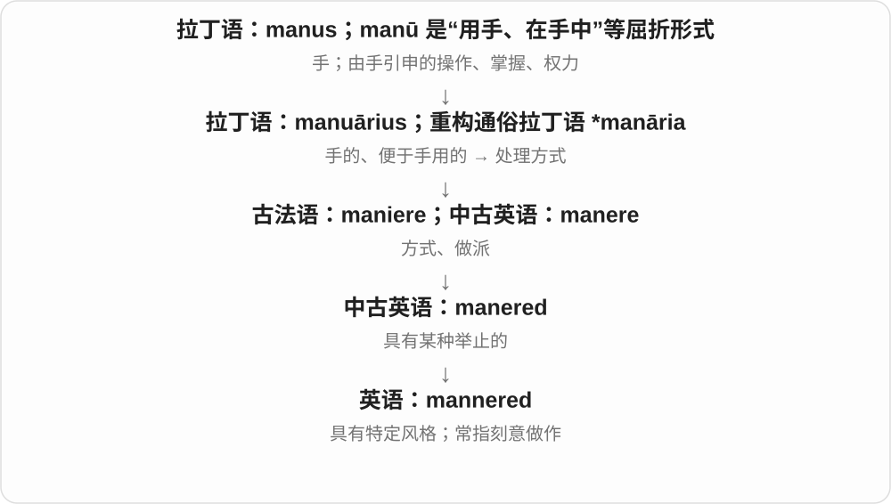

单独用时常带刻意、不自然的评价；在修饰性组合里也可中性说明举止类型。文学和表演评论中较常见。

**常见搭配与例句**

a mannered performance；mannered prose；a mannered style。

> The dialogue sounded too mannered to feel natural.

对话听起来太刻意，不够自然。

> The reviewer admired the design but found the acting mannered.

评论者欣赏设计，却觉得表演有些做作。

**别混淆**

mannerly 是礼貌；mannered 单独用往往是做作，并不等于“很有礼貌”。

### 869. smirk — 得意地笑、坏笑；自满或讥讽的笑

**音标**：英 /smɜːk/；美 /smɜːrk/

**先抓住这个画面**

嘴角一扬，像在说“我早知道了”“你看吧”，这种让旁人觉得有点得意、欠友好的笑，常叫 smirk。

**怎么拆**

承古英语 smearcian 微笑，经中古英语 smirken 传承。后来在 smile 更广泛使用时，smirk 常偏向令人不快的笑，不是 smile 的现代规则变形。

**怎么变成今天的意思**

**古英语 smearcian → 中古英语 smirken → smirk**  
本来较宽泛表示微笑；与 smile 的远源有联系分析

↓

**现代 smirk**  
常缩窄为带得意、自满或讥讽的笑；名词沿动词发展

smirk at someone 是冲某人得意、讥讽地笑，wipe the smirk off someone’s face 是让对方得意不起来。

**常见搭配与例句**

a smug smirk 自鸣得意的笑；smirk to yourself 暗自得意地笑。

> He tried to hide a smirk when his prediction came true.

预测成真时，他想藏住那点得意的笑。

> Do not smirk at her just because she made a mistake.

别因为她犯了个错就冲她坏笑。

**别混淆**

smile 可以亲切、中性，smirk 常带说话者不赞许的判断；笑的大小不是唯一差别。

### 870. smirking — 正在得意、讥讽地笑；带坏笑的

**音标**：英 /ˈsmɜːkɪŋ/；美 /ˈsmɜːrkɪŋ/

**先抓住这个画面**

那点“我比你明白”的笑还挂在脸上，是 smirking；也可直接形容一张自满、坏笑的脸。

**怎么拆**

smirk + 完整 -ing，直接相接；基础词的态度色彩保留。

**怎么变成今天的意思**

**古英语 smearcian → 中古英语 smirken → smirk**  
本来较宽泛表示微笑；与 smile 的远源有联系分析

↓

**现代 smirk**  
常缩窄为带得意、自满或讥讽的笑；名词沿动词发展

↓

**smirk + -ing → smirking**  
得意地笑的过程 → 带得意笑的

a smirking face 是带自满坏笑的脸；smirking at someone 是正朝某人坏笑。

**常见搭配与例句**

stood smirking 站着一脸得意；a smirking expression 自满的笑容。

> He stood in the doorway, smirking at us.

他站在门口，冲我们得意地笑。

> She did not like his smirking expression.

她不喜欢他那副自满的笑容。

**别混淆**

smirking 常有旁观者不赞许的语气；laughing 只说在笑，态度范围更宽。

### 871. smirked — 得意、讥讽地笑了

**音标**：英 /smɜːkt/；美 /smɜːrkt/

**先抓住这个画面**

刚才那一下笑里透着自满、讥讽，用 smirked。这个动词通常已带旁观者对笑容的评价。

**怎么拆**

smirk + 完整 -ed，/k/ 后读 /t/；词末 rk 不双写 k，也不增加 /ɪd/ 音节。

**怎么变成今天的意思**

**古英语 smearcian → 中古英语 smirken → smirk**  
本来较宽泛表示微笑；与 smile 的远源有联系分析

↓

**现代 smirk**  
常缩窄为带得意、自满或讥讽的笑；名词沿动词发展

↓

**smirk + -ed → smirked**  
过去得意、讥讽地笑

smirked at him 是冲他得意地笑，smirked to herself 是暗自得意了一下。

**常见搭配与例句**

smirked knowingly 自以为知道内情地笑；smirked and walked away 坏笑后走开。

> She smirked when she saw that he had forgotten the answer.

看见他忘了答案，她得意地笑了。

> He smirked to himself and put the letter away.

他暗自得意地笑了一下，把信收起。

**别混淆**

smirked 常暗示得意或不友好；smiled 不自带这种固定负面色彩，描述同一表情时语气会不同。

### 872. smirks — 得意、讥讽地笑〔第三人称单数〕；几次坏笑〔复数〕

**音标**：英 /smɜːks/；美 /smɜːrks/

**先抓住这个画面**

说他每次觉得自己占了上风就嘴角一扬，用 smirks；几次那样的得意笑，也可数出来。

**怎么拆**

smirk + -s，/k/ 后读 /s/。更早宽泛微笑义与今天常见的不赞许色彩，放在基础词历史里分清。

**怎么变成今天的意思**

**古英语 smearcian → 中古英语 smirken → smirk**  
本来较宽泛表示微笑；与 smile 的远源有联系分析

↓

**现代 smirk**  
常缩窄为带得意、自满或讥讽的笑；名词沿动词发展

↓

**smirk + -s → smirks**  
他、她得意地笑；几次得意笑

smirks at the mistake 是看见错误而讥讽地笑；knowing smirks 是几副自以为知道内情的笑。

**常见搭配与例句**

smirks to himself 暗自得意地笑；exchanged smirks 相互露出坏笑。

> He smirks whenever he thinks he has won the argument.

他每次觉得自己辩赢了，就得意地笑。

> The two boys exchanged smirks.

两个男孩相互露出坏笑。

**别混淆**

smirks 是带态度的笑，grins 常只突出咧嘴露齿的大笑容；不应把 grins 总翻成坏笑。

### 873. toothed — 有牙、带齿的；有某类牙齿的

**音标**：/tuːθt/，也读 /tuːðd/

**先抓住这个画面**

锯片边上一排尖齿，是 toothed；描述动物时也可配其他成分，说牙长什么样。

**怎么拆**

tooth + -ed，表示有某物、带某种结构的性质。这里不必理解为过去有人执行了一个长牙动作。

**怎么变成今天的意思**

**古英语 tōþ → 中古英语 toth → tooth**  
牙；与其他印欧语言的齿名有共同历史

↓

**身体形态用于器具**  
锯齿、齿轮的齿；比喻执行力量

↓

**tooth + -ed → toothed**  
有牙齿或类似齿状凸起

a toothed blade 带齿刀片，a toothed wheel 齿轮；动物名称里也见相应组合。

**常见搭配与例句**

a toothed blade；a toothed wheel。

> The machine uses a toothed belt.

机器使用齿形带。

> A toothed wheel turned inside the case.

一个齿轮在机壳里转动。

**别混淆**

toothed 说有齿；toothy 常说牙显眼、露齿的表情。-ed 在这里常构成有……的形容词。

### 874. blot — 墨斑、污点；吸干、吸去；涂掉；〔blot out〕遮住、抹掉

**音标**：英 /blɒt/；美 /blɑːt/

**先抓住这个画面**

纸上落了一团墨，是 a blot；纸巾按上水迹吸走，是 blot it up。blot out 又像用黑块盖住，让字、景物或记忆看不见。

**怎么拆**

较早名词说墨斑、污点，远源未定，北欧、法语等有不同分析；相应动词后来发展，吸干、涂掉等按搭配分别理解。

**怎么变成今天的意思**

**中古英语 blot 墨斑、污点名词**  
可能接北欧污斑材料，也有法语等分析，来源未定；道德污点义较早已见

↓

**污斑名词 → 弄花、涂掉；后有吸干、遮住等用法**  
blot out 像盖上一片让原物看不见，blot up 则用吸水材料取走湿迹

an ink blot 是墨斑，blot the paper dry 是把纸吸干；clouds blot out the sun 是云遮住太阳，a blot on a record 是记录中的污点。

**常见搭配与例句**

blot up a spill 吸去洒出的液体；blot out a memory 抹去一段记忆。

> An ink blot spread across the corner of the page.

一团墨斑在页角洇开。

> Use the paper towel to blot up the water.

用厨房纸把水吸起来。

**别混淆**

blot 吸水时多像按上材料让水进入，wipe 常是横着擦；同样让表面干，动作轨迹不同。

### 875. blotting — 正在吸干、吸去、遮住、涂掉；吸水动作

**音标**：英 /ˈblɒtɪŋ/；美 /ˈblɑːtɪŋ/

**先抓住这个画面**

吸水纸正按着湿墨、水迹，是 blotting；一片云正把光吞掉，也像在把原来可见的东西盖过去。

**怎么拆**

blot 双写 t + 完整 -ing → blotting；分词、动作名词同形，双写不增加一个 /t/ 音。

**怎么变成今天的意思**

**中古英语 blot 墨斑、污点名词**  
可能接北欧污斑材料，也有法语等分析，来源未定；道德污点义较早已见

↓

**污斑名词 → 弄花、涂掉；后有吸干、遮住等用法**  
blot out 像盖上一片让原物看不见，blot up 则用吸水材料取走湿迹

↓

**blot 双写 t + -ing → blotting**  
吸水或遮去的过程

blotting paper 是吸墨纸，blotting up the liquid 是正吸走液体；blotting out the light 是遮光。

**常见搭配与例句**

blotting gently 轻按吸干；blotting the page dry 吸干纸面。

> He used blotting paper to absorb the excess ink.

他用吸墨纸吸掉多余墨水。

> A cloud was blotting out the moon.

一片云正遮住月亮。

**别混淆**

blotting paper 的名字说用途，不表示那张纸本来就是污点；它通过吸收把未干墨迹取走。

### 876. blotted — 吸干、吸去、涂掉、遮住了；带墨斑的

**音标**：英 /ˈblɒtɪd/；美 /ˈblɑːtɪd/

**先抓住这个画面**

刚才纸巾按上去，水被吸走，是 blotted；名字被黑线涂掉、太阳被云遮住，也能用 blotted out。

**怎么拆**

blot 双写 t + 完整 -ed → blotted，/t/ 后读 /ɪd/，多一个音节。

**怎么变成今天的意思**

**中古英语 blot 墨斑、污点名词**  
可能接北欧污斑材料，也有法语等分析，来源未定；道德污点义较早已见

↓

**污斑名词 → 弄花、涂掉；后有吸干、遮住等用法**  
blot out 像盖上一片让原物看不见，blot up 则用吸水材料取走湿迹

↓

**blot 双写 t + -ed → blotted**  
过去吸去、弄花或盖掉

blotted the spill 是吸掉洒出的水，blotted out the name 是涂掉名字；was blotted with ink 又可说留下墨点。

**常见搭配与例句**

blotted dry 轻按吸干了；blotted out the light 遮住光线了。

> She blotted the wet page with a clean cloth.

她用干净布轻按湿书页，吸去水分。

> Dark clouds blotted out the sun.

乌云遮住了太阳。

**别混淆**

blotted out a word 常是把它盖到看不见，crossed out 则可能划一条线、原字仍可辨；删改痕迹不同。

### 877. blots — 墨斑、污点〔复数〕；吸干、涂掉、遮住〔第三人称单数〕

**音标**：英 /blɒts/；美 /blɑːts/

**先抓住这个画面**

纸上几团墨，是 blots；一个人拿纸轻按湿处，或一大片影子遮住景物，动词三单也叫 blots。

**怎么拆**

blot + -s，/t/ 后读 /s/，结尾 /ts/；名词复数与动词三单同形，基本拼写不双写 t。

**怎么变成今天的意思**

**中古英语 blot 墨斑、污点名词**  
可能接北欧污斑材料，也有法语等分析，来源未定；道德污点义较早已见

↓

**污斑名词 → 弄花、涂掉；后有吸干、遮住等用法**  
blot out 像盖上一片让原物看不见，blot up 则用吸水材料取走湿迹

↓

**blot + -s → blots**  
几团污痕；它吸去、遮掉

ink blots 是墨斑，blots the surface dry 是把表面吸干；blots out the view 是挡住视野，out 一起带遮盖义。

**常见搭配与例句**

blots on the page 纸上污点；blots out the sun 遮住太阳。

> The old page was covered with ink blots.

旧书页上满是墨斑。

> The huge sign blots out the view from the window.

巨大的招牌挡住了窗外景色。

**别混淆**

blots out 常像一大片盖住、抹掉，covers 更宽；一张透明膜 covers 也可以仍看得清，未必 blot out。

### 878. blotch — 一大块不规则色斑、污斑；使斑驳

**音标**：英 /blɒtʃ/；美 /blɑtʃ/

**先抓住这个画面**

本来均匀的表面上出现一块形状不规则的颜色，像墨迹晕成一片，就是 a blotch。重点是斑块的样子，不先猜原因。

**怎么拆**

可能由 blot 斑点延伸，受 botch、patch 等影响，来源未全定；早期名词、动词记录接近。不能把 -ch 认作通用斑点后缀。

**怎么变成今天的意思**

**blotch 可能联系 blot 斑点，受 botch、patch 等影响**  
具体来源未全定

↓

**不规则色斑名词、动词 → 现代分词与 blotchy**  
按对象可写皮肤、纸面、涂层等斑驳

a blotch of ink 一块墨斑；a red blotch 一块红斑；blotch the surface 使表面斑驳。

**常见搭配与例句**

a dark blotch；an irregular blotch。

> A large blotch of ink covered the corner of the page.

一大块墨斑盖住了页角。

> There was a dark blotch on the pale wall.

浅色墙面上有一块深色斑。

**别混淆**

blotch 常让人看到较大、不规则的一块，dot 常是小点；只凭 blotch 这个词本身不能判断斑块成因。

### 879. blotches — 不规则色斑、污斑〔复数〕；使斑驳〔第三人称单数〕

**音标**：英 /ˈblɒtʃɪz/；美 /ˈblɑtʃɪz/

**先抓住这个画面**

墙上不是均匀掉色，而是一块深一块浅，可以把那些不规则斑块叫 blotches。先数得出一块块，才用这个复数。

**怎么拆**

blotch + -es，/tʃ/ 后读 /ɪz/；名词复数也与动词三单同形。

**怎么变成今天的意思**

**blotch 可能联系 blot 斑点，受 botch、patch 等影响**  
具体来源未全定

↓

**不规则色斑名词、动词 → 现代分词与 blotchy**  
按对象可写皮肤、纸面、涂层等斑驳

↓

**blotch + -es → blotches**  
多块不规则斑点，或它使表面斑驳

blotches of paint 一块块油漆斑；red blotches 红斑。

**常见搭配与例句**

dark blotches on the wall；uneven blotches。

> Dark blotches covered the old wallpaper.

旧墙纸上布满深色斑块。

> The paint had dried in uneven blotches.

油漆干后，留下了一块块不均匀的色斑。

**别混淆**

blotches 强调一块块斑，streaks 更像一条条拖痕；面积、方向感不同。

### 880. blotchy — 一块块斑驳的；带不均匀色斑的

**音标**：英 /ˈblɒtʃi/；美 /ˈblɑtʃi/

**先抓住这个画面**

墙面涂得有的深、有的浅，脸上红一块白一块，都能说 blotchy。它描述颜色分布不均，不直接说明为什么这样。

**怎么拆**

blotch 名词 + -y；基础词可能联系 blot 并受相近词影响，但现代这一层清楚表示有不规则斑块的性质。

**怎么变成今天的意思**

**blotch 可能联系 blot 斑点，受 botch、patch 等影响**  
具体来源未全定

↓

**不规则色斑名词、动词 → 现代分词与 blotchy**  
按对象可写皮肤、纸面、涂层等斑驳

↓

**blotch + -y → blotchy**  
带不规则斑块、颜色斑驳的性质

blotchy paintwork 斑驳的漆面；blotchy skin 颜色不均的皮肤。

**常见搭配与例句**

red and blotchy 红一块白一块的；a blotchy surface。

> The paint dried to a blotchy finish.

油漆干后，表面一块深一块浅。

> Her face was red and blotchy after crying.

她哭过后，脸红一块白一块。

**别混淆**

blotchy 常是大块、不均匀的斑，freckled 则指带雀斑；形态与常用搭配各自有区别。

### 881. blotched — 被弄得斑驳；带不规则色斑的

**音标**：英 /blɒtʃt/；美 /blɑtʃt/

**先抓住这个画面**

画纸上几滴水把颜色晕开，变成一片片色斑，就可以说 blotched。它把不均匀斑块的结果呈现出来。

**怎么拆**

blotch + 完整 -ed，/tʃ/ 后读 /t/；可作动词过去、分词，也作形容词写表面已有斑块。

**怎么变成今天的意思**

**blotch 可能联系 blot 斑点，受 botch、patch 等影响**  
具体来源未全定

↓

**不规则色斑名词、动词 → 现代分词与 blotchy**  
按对象可写皮肤、纸面、涂层等斑驳

↓

**blotch + -ed → blotched**  
被斑块弄得不均匀，或带斑块的状态

blotched with paint 沾满斑块状油漆；blotched paper 斑驳的纸。

**常见搭配与例句**

a blotched surface；blotched with red。

> The paper was blotched with spilled ink.

纸被洒出的墨水弄得斑斑点点。

> Her apron was blotched with red paint.

她的围裙上沾着一块块红油漆。

**别混淆**

blotched 是呈斑块，striped 是带条纹；同样不止一种颜色，图案却不同。

### 882. blotching — 形成不规则斑块；斑驳现象

**音标**：英 /ˈblɒtʃɪŋ/；美 /ˈblɑtʃɪŋ/

**先抓住这个画面**

给木板涂色，本想涂匀，却有的地方吃色深、有的浅，这种不规则斑驳可以叫 blotching。

**怎么拆**

blotch + -ing；可说形成斑块的动作、过程，也可把不均匀着色现象当作名词来谈。

**怎么变成今天的意思**

**blotch 可能联系 blot 斑点，受 botch、patch 等影响**  
具体来源未全定

↓

**不规则色斑名词、动词 → 现代分词与 blotchy**  
按对象可写皮肤、纸面、涂层等斑驳

↓

**blotch + -ing → blotching**  
形成或造成不规则斑块的过程、现象

prevent blotching 避免着色斑驳；uneven blotching 不均匀的斑块现象。

**常见搭配与例句**

blotching on wood 木材着色斑驳；reduce blotching。

> The finish showed blotching on the softer parts of the wood.

涂层在木材较软的部位出现了斑驳。

> A test on scrap wood helped us avoid blotching.

先在废木料上试涂，帮助我们避免着色斑驳。

**别混淆**

blotching 是斑块式不均匀，fading 是颜色褪淡；涂层可能没褪色却已一块深一块浅。

### 883. forested — 被森林覆盖的、有林的

**音标**：英 /ˈfɒrɪstɪd/；美 /ˈfɔːrɪstɪd/

**先抓住这个画面**

山坡、地区上面树木成林，形容覆盖状态，不保证这片林全是人刚种下去的。

**怎么拆**

forest + -ed，既可对应动词分词，也有形容词覆盖的用法。forest 末尾 /t/，加 -ed 通常读 /ɪd/。

**怎么变成今天的意思**

**中世纪拉丁 forestis → 古法语 forest → 中古英语 forest → forest**  
林地、狩猎保留地等 → 森林

↓

**forest + -ed → forested**  
覆盖着森林的、成林的

a forested hillside 有林山坡，heavily forested 森林覆盖密集，a forested region 林区。

**常见搭配与例句**

a forested hillside；heavily forested；a forested region。

> The road runs through a heavily forested valley.

道路穿过一条森林密布的山谷。

> The island’s interior is densely forested.

岛屿内陆森林茂密。

**别混淆**

forested 描述树木覆盖，deforested 则已失去林地；forested 不等于一定原始森林或一定人工林。

### 884. frosted — 覆霜的；磨砂似半透明的；覆糖霜的

**音标**：英 /ˈfrɒstɪd/；美 /ˈfrɔːstɪd/

**先抓住这个画面**

玻璃看上去像罩着一层霜，能透光却看不清后面，就 frosted glass；蛋糕覆了糖霜也能 frosted。

**怎么拆**

frost + -ed；词末 /t/ 后 -ed 读 /ɪd/。分词形容词由真实结霜扩展到相似表面和甜涂层。

**怎么变成今天的意思**

**古英语 forst、frost 等 → frost**  
霜、严寒，与 freeze 词族相关

↓

**覆盖一层细冰晶的外观**  
扩展到糖霜、磨砂似的半透明表面

↓

**frost + -ed → frosted**  
覆霜、霜状表面或覆甜涂层

frosted glass 磨砂玻璃，a frosted window 结霜或经磨砂处理的窗，frosted cupcakes 覆糖霜的纸杯蛋糕。

**常见搭配与例句**

frosted glass；frosted cupcakes。

> The bathroom door had frosted glass.

浴室门装着磨砂玻璃。

> They placed the frosted cupcakes on a tray.

他们把覆好糖霜的纸杯蛋糕放到托盘上。

**别混淆**

frosted glass 可以是加工的纹理效果，不表示玻璃一直处在结冰温度；具体工艺不由这个词确定。

### 885. yank — 猛拉、猛拽；突然撤下、拿走；猛拽一下

**音标**：/jæŋk/

**先抓住这个画面**

抓着卡住的绳子，突然使劲一拽，是 yank；一个节目被迅速撤掉，也像被人一下从原位拉走。

**怎么拆**

动作词见于近代苏格兰英语，更早来源未定；较早名词已可说突然一击。大写 Yank 是 Yankee 的简称，近源另分。

**怎么变成今天的意思**

**近代苏格兰英语 yank**  
来源未定；较早名词有突然一击，动词说急拉，不能只按现代词性倒排先后

↓

**突然急拉 → 猛拽、迅速撤下、抽走**  
现代画面像抓住后一下把对象从原处拉走

yank the door open 是猛拉开门，yank a cable out 是猛拽出线缆；yank a programme off the air 是突然撤下节目。

**常见搭配与例句**

give it a yank 猛拽一下；yank something away 猛地拉走。

> He gave the stuck handle a yank.

他猛拽了一下卡住的把手。

> She had to yank the rope to free it from the branch.

她得猛拽绳子，才能把它从树枝上弄下来。

**别混淆**

yank 比 pull 更突出突然、用力；pull 可以缓缓拉，yank 往往让人看见一次急促动作。

### 886. yanks — 猛拉、猛拽、突然撤下〔第三人称单数〕；猛拽动作〔复数〕

**音标**：/jæŋks/

**先抓住这个画面**

一个人抓住就用力急拉，是 yanks；几下突然猛拽也可当名词复数。别把轻轻调整也想成这种力度。

**怎么拆**

yank + -s，/k/ 后读 /s/，结尾 /ŋks/；三单与猛拽名词复数同形，大写人物名另按自身来源理解。

**怎么变成今天的意思**

**近代苏格兰英语 yank**  
来源未定；较早名词有突然一击，动词说急拉，不能只按现代词性倒排先后

↓

**突然急拉 → 猛拽、迅速撤下、抽走**  
现代画面像抓住后一下把对象从原处拉走

↓

**yank + -s → yanks**  
他、她猛拽；几下急拉

yanks the handle 是猛拽把手，yanks it free 是猛拉使其脱开；a few yanks 是几下猛拽。

**常见搭配与例句**

yanks open the drawer 猛拉开抽屉；yanks it away 猛地把它拉走。

> He yanks the bell rope to call the others.

他猛拉铃绳，叫其他人过来。

> A few strong yanks freed the trapped rope.

猛拽了几下，卡住的绳子终于松脱。

**别混淆**

yanks 与 nudges 的力感差很大：一个急拽，一个轻推碰；看不清动作时，别把二者都平平译作“动了一下”。

### 887. yanked — 猛拉、猛拽了；突然撤下、抽走了

**音标**：/jæŋkt/

**先抓住这个画面**

刚才突然用力一拉，把东西从原处拉开，是 yanked；一个人或节目被迅速撤出原来的位置，也保留这股一下拉走的感觉。

**怎么拆**

yank + 完整 -ed，/k/ 后读 /t/，结尾 /ŋkt/；nk 后直接加，不双写 k。

**怎么变成今天的意思**

**近代苏格兰英语 yank**  
来源未定；较早名词有突然一击，动词说急拉，不能只按现代词性倒排先后

↓

**突然急拉 → 猛拽、迅速撤下、抽走**  
现代画面像抓住后一下把对象从原处拉走

↓

**yank + -ed → yanked**  
过去急拽或迅速撤走

yanked the rope 是猛拉绳子，yanked it out 是猛地拽出；was yanked from the schedule 是突然从安排中撤下。

**常见搭配与例句**

yanked open the door 猛拉开门；yanked away 突然拉走。

> He yanked the drawer open and looked inside.

他猛地拉开抽屉，向里面看。

> The show was yanked from the schedule after one episode.

那档节目播了一集就突然被撤出节目表。

**别混淆**

yanked 把突然、用力的方式说出来，removed 只说移除结果；同一件事用 yanked 会更有动作感。

### 888. yanking — 正在猛拉、猛拽、迅速撤走；猛拽行为

**音标**：/ˈjæŋkɪŋ/

**先抓住这个画面**

正抓住东西一下下急拉，是 yanking；和温和晃松相比，它有明显突然用力的感觉。

**怎么拆**

yank + 完整 -ing，直接加；nk 保留，词尾接到整个急拉动词上。

**怎么变成今天的意思**

**近代苏格兰英语 yank**  
来源未定；较早名词有突然一击，动词说急拉，不能只按现代词性倒排先后

↓

**突然急拉 → 猛拽、迅速撤下、抽走**  
现代画面像抓住后一下把对象从原处拉走

↓

**yank + -ing → yanking**  
猛拽、急拉的过程

yanking on the rope 是正在猛拽绳子，yanking something away 是猛地拉走；keep yanking 可以是几次接连急拽。

**常见搭配与例句**

yanking the handle 猛拽把手；yanking it free 猛拉使它脱开。

> He was yanking on the rope, trying to free the gate.

他正猛拽绳子，想把门弄开。

> She opened the drawer by yanking hard on the handle.

她猛拽把手，把抽屉打开了。

**别混淆**

yanking 强调急拉，hauling 常突出费力、较持续地拉运；一船货物慢慢拉进港，可以 hauling，不必一直猛拽。

### 889. jolt — 猛颠、猛震；使突然震惊；一次冲击

**音标**：英 /dʒəʊlt/、/dʒɒlt/；美 /dʒoʊlt/

**先抓住这个画面**

车轮压过坑，身体猛地一抖；突然听见坏消息，心里也像被震了一下。两种都能是 jolt。

**怎么拆**

十六世纪英语已有，可能与中古英语 jollen 敲打或旧 jot 推挤等有关，来源未完全确定。不能从结尾 t 直接宣称这是某个现代动词的过去式。

**怎么变成今天的意思**

**早期英语 jolt；更早来源有不同分析**  
敲打、震动的动作

↓

**名词、动词的物理与比喻扩展**  
猛震、冲击；使惊醒、震惊

a sudden jolt 突然一震；jolt someone awake 把人震醒；a jolt to confidence 对信心的打击。过去式 jolted，说明基础词已有 t，仍按规则加 ed。

**常见搭配与例句**

a sharp jolt；jolt into action。

> The bus stopped with a sudden jolt.

公交车猛地一颠，停了下来。

> The news gave her confidence a serious jolt.

那条消息严重打击了她的信心。

**别混淆**

shake 可以持续摇晃，jolt 常突出突然、不平顺的一下；shock 惊吓或冲击范围更广，不一定有身体被颠动的感觉。

### 890. jolted — 颠震、猛撞了；猛然惊醒、醒悟的

**音标**：英 /ˈdʒəʊltɪd/；美 /ˈdʒoʊltɪd/

**先抓住这个画面**

刚才车一颠，把人从座位上顶起，是 jolted；听到警报突然醒来、被现实猛然点醒，也能用它。

**怎么拆**

jolt + 完整 -ed，/t/ 后读 /ɪd/；lt 后直接加，基础元音英 /əʊ/、美 /oʊ/ 保留。

**怎么变成今天的意思**

**十六世纪 jolt，可能联系更早敲打、推挤词形**  
有 jollen、旧 jot 等分析，更早来源尚未定

↓

**猛烈一震 → 惊醒、震动心理、促使行动**  
从平顺状态被突然撞醒、拉出，成为现代常见比喻

↓

**jolt + -ed → jolted**  
过去受到颠震；被突然惊醒、点醒

jolted awake 是猛然惊醒，jolted out of a daydream 是从白日梦中被猛地拉回；by 后可指出触发因素。

**常见搭配与例句**

jolted into action 受刺激后立即行动；jolted to a stop 颠了一下停住。

> The alarm jolted me awake.

闹钟把我猛然惊醒。

> The car jolted as it crossed the pothole.

汽车开过坑洞时猛地颠了一下。

**别混淆**

jolted awake 常有突然、一下被震醒的感觉，woke up 只说醒了；自然醒来也能 woke up。

### 891. jolts — 颠、震、使猛然醒悟〔第三人称单数〕；颠震、冲击〔复数〕

**音标**：英 /dʒəʊlts/；美 /dʒoʊlts/

**先抓住这个画面**

车轮过坑，整个人被颠一下，是 jolts；突然的消息让人一下清醒，也像受到了猛震。几次颠震则是名词复数。

**怎么拆**

jolt + -s，/t/ 后读 /s/，结尾 /lts/；三单和名词复数同形。基础词或联系旧敲打材料，远源未定。

**怎么变成今天的意思**

**十六世纪 jolt，可能联系更早敲打、推挤词形**  
有 jollen、旧 jot 等分析，更早来源尚未定

↓

**猛烈一震 → 惊醒、震动心理、促使行动**  
从平顺状态被突然撞醒、拉出，成为现代常见比喻

↓

**jolt + -s → jolts**  
它颠震、使惊醒；几次冲击

jolts the passengers 是颠得乘客一震，jolts someone awake 是把人猛然惊醒；a series of jolts 是接连颠震。

**常见搭配与例句**

sharp jolts 猛烈的颠震；jolts us into action 让我们一下行动起来。

> The bus jolts us whenever it crosses the rough patch.

公交车每次开过坑洼路段，都会把我们颠一下。

> The old road gave us a series of sharp jolts.

那条旧路把我们接连颠得一震一震。

**别混淆**

jolts 常是突然、有冲击的一下，sways 是左右摆；乘车时两种感觉可能都有，却不是同一种移动。

### 892. jolting — 正在颠震；颠簸的；令人猛然震动、惊醒的

**音标**：英 /ˈdʒəʊltɪŋ/；美 /ˈdʒoʊltɪŋ/

**先抓住这个画面**

车正一下下过坑，身体跟着震，是 jolting；某个消息突然把人从惯常想法中震出来，也有这种冲击感。

**怎么拆**

jolt + 完整 -ing，直接加；分词可形容颠震过程，也能形容带来突然心理冲击的事物。

**怎么变成今天的意思**

**十六世纪 jolt，可能联系更早敲打、推挤词形**  
有 jollen、旧 jot 等分析，更早来源尚未定

↓

**猛烈一震 → 惊醒、震动心理、促使行动**  
从平顺状态被突然撞醒、拉出，成为现代常见比喻

↓

**jolt + -ing → jolting**  
突然颠震、冲击的过程或效果

a jolting ride 是颠簸的乘车体验，jolting along the track 是沿路颠着走；a jolting reminder 是让人猛然警醒的提醒。

**常见搭配与例句**

jolting us awake 把我们猛地惊醒；jolting over stones 越过石块时颠震。

> We spent an hour jolting along the rough track.

我们沿着坑洼小路颠了一个小时。

> The bus kept jolting us out of our seats.

公交车不停颠得我们离开座位。

**别混淆**

jolting 突出冲击感，rocking 更能说来回摇；摇篮 rocking 可平缓舒服，jolting 通常没那么平顺。

### 893. sift — 筛；仔细筛查、翻检

**音标**：/sɪft/

**先抓住这个画面**

面粉过筛，细粉落下，大块留下；看几百页材料时也一项项过一遍、挑出需要的，这就叫 sift。

**怎么拆**

承古英语 siftan，与 sieve 筛子属于旧词族；它们是历史上相关的不同形式，现代分别保留。

**怎么变成今天的意思**

**古英语 siftan → 中古英语 siften → sift**  
让细小部分通过筛孔，与 sieve 的旧筛具名词同族

↓

**筛面粉、细料 → 仔细翻看、筛选资料**  
像筛子一样，逐项检查，留下或挑出需要的内容；抽象用法已有很长历史

sift the flour 筛面粉；sift through the evidence 仔细筛查证据；sift out the irrelevant parts 筛掉无关部分。

**常见搭配与例句**

sift through applications 筛查申请；sift fact from fiction 分清事实与虚构。

> Sift the flour into a large bowl.

把面粉筛进大碗里。

> We need time to sift through all the applications.

我们需要时间仔细筛查所有申请。

**别混淆**

sift 强调从一堆内容里逐项检查、分出所需；skim 是快速浏览，通常没这么细。

### 894. sieve — 筛子；过滤器；筛、过滤

**音标**：/sɪv/

**先抓住这个画面**

一张细网装在框里，小的从孔里过，大的留在上面，这就是 a sieve；拿它筛东西，动词也叫 sieve。

**怎么拆**

名词承古英语 sife，动词后来由名词转用；现代 ie 组合在这里读 /ɪ/，末尾读 /v/。

**怎么变成今天的意思**

**古英语 sife → 中古英语 sive → sieve**  
有网孔的筛具，与 sift 的过筛动词有旧词族联系

↓

**筛具名词 → 动词 sieve**  
从器具转为用器具过筛，现代还能把不断漏掉东西的状态比作筛子

a fine sieve 细筛；sieve the flour 筛面粉；a memory like a sieve 是记性差，像筛孔一样把事情漏走。

**常见搭配与例句**

put through a sieve 过筛；sieve out the lumps 筛掉结块。

> Pour the mixture through a fine sieve.

把混合物倒过细筛过滤。

> Sieve the flour before you add the eggs.

加鸡蛋前，先把面粉筛一遍。

**别混淆**

sieve 常能直接指手里的筛具，sift 通常是过筛、筛查的动作；两个词能在筛面粉场景相遇。

### 895. sieves — 筛子、过滤器〔复数〕；筛、过滤〔第三人称单数〕

**音标**：/sɪvz/

**先抓住这个画面**

几只网孔大小不同的筛子是 sieves；她每次都把面粉过筛，动词也写 sieves。

**怎么拆**

sieve + -s，/v/ 后词尾读 /z/；读 /sɪvz/，不因拼写 ie 就念成长 /iː/。

**怎么变成今天的意思**

**古英语 sife → 中古英语 sive → sieve**  
有网孔的筛具，与 sift 的过筛动词有旧词族联系

↓

**筛具名词 → 动词 sieve**  
从器具转为用器具过筛，现代还能把不断漏掉东西的状态比作筛子

↓

**sieve + -s → sieves**  
多个筛具；它、他、她筛、过滤

fine sieves 细筛；sieves the sauce 把酱汁过筛；a set of sieves 一套筛具。

**常见搭配与例句**

sieves of different sizes；sieves the dry ingredients。

> The laboratory uses sieves with different mesh sizes.

实验室使用网孔大小不同的筛具。

> She sieves the sauce to remove the seeds.

她把酱汁过筛，滤掉籽。

**别混淆**

sieves 作工具名词是几只筛子，sifts 作动词是筛；读句子时先看前面是不是 a set of、she 等结构。

### 896. sieving — 正在过筛、过滤；筛分过程

**音标**：/ˈsɪvɪŋ/

**先抓住这个画面**

东西正穿过网孔，粗细、大小被分开，这个进行中的动作或处理过程叫 sieving。

**怎么拆**

sieve 去 e 加 -ing；保留 /v/，基础只有一个音节，接词尾后成为 /ˈsɪvɪŋ/。

**怎么变成今天的意思**

**古英语 sife → 中古英语 sive → sieve**  
有网孔的筛具，与 sift 的过筛动词有旧词族联系

↓

**筛具名词 → 动词 sieve**  
从器具转为用器具过筛，现代还能把不断漏掉东西的状态比作筛子

↓

**sieve → sieving**  
用筛具分离材料正在进行；也作过程名词

sieving flour 筛面粉；sieving sand 筛沙；particle size analysis by sieving 用筛分分析颗粒大小。

**常见搭配与例句**

the sieving process；sieving out small stones。

> He was sieving sand to remove the small stones.

他正在筛沙，筛去小石子。

> Sieving the flour helps break up lumps.

给面粉过筛有助于打散结块。

**别混淆**

sieving 指过筛这个过程，a sieve 才是器具；表达需要一个筛子，不能把动作名词直接当工具名。

### 897. sieved — 筛过、过滤了；已经过筛的

**音标**：/sɪvd/

**先抓住这个画面**

酱汁从细网里过去，籽留在外面；面粉过完筛，这个已发生、已有结果的状态叫 sieved。

**怎么拆**

sieve 去不发音 e 加完整 -ed，词尾读 /d/，结尾 /vd/；与 sifted 的两音节形式区分。

**怎么变成今天的意思**

**古英语 sife → 中古英语 sive → sieve**  
有网孔的筛具，与 sift 的过筛动词有旧词族联系

↓

**筛具名词 → 动词 sieve**  
从器具转为用器具过筛，现代还能把不断漏掉东西的状态比作筛子

↓

**sieve → sieved**  
过去过筛；也形容已过滤的材料

sieved flour 过筛面粉；sieved tomatoes 筛滤过的番茄；sieved the mixture 把混合物筛过了。

**常见搭配与例句**

finely sieved 筛得细的；sieved through a fine mesh。

> She sieved the flour into the bowl.

她把面粉筛进了碗里。

> We sieved the sauce to remove the last few seeds.

我们把酱汁过筛，滤掉最后几颗籽。

**别混淆**

sieved 强调用筛具处理；strained 也可泛说过滤液体，所用工具未必和筛面粉完全相同。

### 898. sifting — 正在筛、筛查；筛选过程

**音标**：/ˈsɪftɪŋ/

**先抓住这个画面**

筛子还在晃，或材料正一项项被翻过、分开，这段过程就是 sifting。

**怎么拆**

sift + -ing；既可组成进行式，也可把筛查作为一个过程来讨论。

**怎么变成今天的意思**

**古英语 siftan → 中古英语 siften → sift**  
让细小部分通过筛孔，与 sieve 的旧筛具名词同族

↓

**筛面粉、细料 → 仔细翻看、筛选资料**  
像筛子一样，逐项检查，留下或挑出需要的内容；抽象用法已有很长历史

↓

**sift + -ing → sifting**  
过筛、逐项筛查正在进行；也作过程名词

sifting flour 筛面粉；sifting through emails 仔细翻找邮件；the sifting of evidence 证据筛查。

**常见搭配与例句**

spend hours sifting；careful sifting 仔细筛选。

> She was sifting flour while I prepared the tin.

我准备烤模时，她正在筛面粉。

> He spent hours sifting through old emails.

他花了几个小时仔细翻找旧邮件。

**别混淆**

sifting 是筛查过程，sorting 更一般地说分类、排列；可以先筛出相关材料，再按时间排序。

### 899. sifted — 筛过了；仔细筛查了；筛过的

**音标**：/ˈsɪftɪd/

**先抓住这个画面**

面粉已经过了筛，变得细匀，叫 sifted flour；那一堆材料已经仔细看过、挑过，也可以说 sifted through。

**怎么拆**

sift + 完整 -ed，基础以 /t/ 结尾，词尾读 /ɪd/；不是去掉 t 再造过去式。

**怎么变成今天的意思**

**古英语 siftan → 中古英语 siften → sift**  
让细小部分通过筛孔，与 sieve 的旧筛具名词同族

↓

**筛面粉、细料 → 仔细翻看、筛选资料**  
像筛子一样，逐项检查，留下或挑出需要的内容；抽象用法已有很长历史

↓

**sift + -ed → sifted**  
过去筛选；或已经过筛的结果

sifted flour 筛过的面粉；sifted through the records 仔细翻查过记录。

**常见搭配与例句**

sifted the evidence；sifted out the duplicates 筛掉了重复项。

> Add the sifted flour a little at a time.

把筛过的面粉一点点加进去。

> We sifted through the records for a clue.

我们仔细翻查记录，寻找线索。

**别混淆**

sifted through 不保证已找到答案，只说仔细翻查过；要表达筛出了什么，再接 out 或说明结果。

### 900. sifts — 筛、仔细筛查〔第三人称单数〕

**音标**：/sɪfts/

**先抓住这个画面**

程序一条条看记录，编辑一份份挑材料，像用筛子过东西，动词可用 sifts。

**怎么拆**

sift + -s，词尾读 /s/，基础 /ft/ 保留，结尾 /fts/；现代三单按规则加词尾。

**怎么变成今天的意思**

**古英语 siftan → 中古英语 siften → sift**  
让细小部分通过筛孔，与 sieve 的旧筛具名词同族

↓

**筛面粉、细料 → 仔细翻看、筛选资料**  
像筛子一样，逐项检查，留下或挑出需要的内容；抽象用法已有很长历史

↓

**sift + -s → sifts**  
他、她、它逐项筛选或让东西过筛

sifts through reports 仔细筛查报告；sifts flour 筛面粉；sifts out unwanted entries 筛掉不需要的条目。

**常见搭配与例句**

sifts the evidence；sifts through the pile。

> The editor sifts through dozens of submissions each week.

编辑每周都会仔细筛看几十份投稿。

> She sifts the flour before adding it to the mixture.

她把面粉加入混合物前，会先筛一遍。

**别混淆**

sifts through 后面通常是待翻检的一堆材料；sifts out 后面通常是被分出、剔除的部分。

### 901. speck — 微小的一点；小颗粒；极少量

**音标**：英、美 /spek/

**先抓住这个画面**

桌面上小得几乎看不见的一粒灰，或者远处一个几乎看不清的点，就是 a speck。先抓住很小、很少。

**怎么拆**

经中古英语 spekke 承古英语 specca 小斑点。更远来源有不同分析，现代不必继续硬拆；小斑点义又扩展到微小颗粒、极少量。

**怎么变成今天的意思**

**古英语 specca 小斑点 → 中古英语 spekke → speck**  
更远词源仍有讨论

↓

**小点 → 极小颗粒、远处小点、少得可怜的量**  
由可见尺寸扩展到数量上的极少

a speck of dust 是一粒微尘；a tiny speck in the sky 是天空中一点小黑点；not a speck of dirt 是一点污物也没有。

**常见搭配与例句**

a speck of dust；a tiny speck；not a speck of dirt。

> A speck of dust rested on the lens.

镜头上落着一粒微尘。

> The boat was only a speck on the horizon.

那艘船在地平线上只是一个小点。

**别混淆**

spot 可以是较明显的斑点，也可说地点；speck 常把尺寸压得很小。a speck of dust 的中心词是 speck，dust 仍为不可数物质名。

### 902. speckle — 小斑点；使带斑点

**音标**：英、美 /ˈspekəl/

**先抓住这个画面**

鸟蛋、羽毛、石头表面的一点小花斑，可以叫 a speckle。许多这样的点铺开，就有斑斑点点的效果。

**怎么拆**

与 speck 的斑点词族相关，具体有中古荷兰语借入、英语相关形式等分析。现代按完整 speckle 认名词、动词，不把 speck+-le 当作已经确定的唯一英语造词史。

**怎么变成今天的意思**

**speck、相关荷兰语等斑点材料 → speckle**  
近源关系明确，具体借入、派生步骤有不同分析

↓

**speckle 小斑点；speckle 使有斑点**  
名词、动词对应，实际先后不靠现代拼写硬定

a brown speckle 是一个棕色小斑；speckle the surface 是使表面带小点。日常描述中形容词 speckled 更常见，也值得一起认。

**常见搭配与例句**

a small speckle；a brown speckle；a speckled surface。

> A brown speckle marked the pale shell.

浅色壳面上有一个棕色小斑点。

> Tiny dots of paint began to speckle the paper.

细小漆点开始散落在纸面上。

**别混淆**

speck 也能说小点，speckle 更常联系表面花斑。光学等领域还有专门用法，这里先掌握普通的斑点画面。

### 903. speckled — 斑斑点点的；有散布小斑点的

**音标**：英、美 /ˈspekəld/

**先抓住这个画面**

浅色鸟蛋上散着棕色小点，或石面混着许多深色小点，可以说 speckled。它描写的是整片表面的点状花纹。

**怎么拆**

speckle 去词末不发音 e，加完整 -ed → speckled。/l/ 后后缀读 /d/；现代形容词接斑点名词、动词词族，早期借入与派生细节有不同分析。

**怎么变成今天的意思**

**斑点词族 → speckle 名词、动词**  
具体借入、形成不压成一条确定的现代拼词链

↓

**speckle 去 e + -ed → speckled**  
词形成为常用的表面花斑描述

a speckled egg 是带斑点的蛋；speckled feathers 是带细斑的羽毛；speckled with brown 是点着棕色斑点。

**常见搭配与例句**

a speckled egg；speckled feathers；speckled with brown。

> The nest held three speckled eggs.

鸟巢里有三枚带斑点的蛋。

> The pale stone was speckled with darker grains.

浅色石头上散布着深色颗粒。

**别混淆**

spotted 范围较广，speckled 常让人想到许多散布的小点；striped 则是条纹。判断时先看花纹形态。

### 904. veer — 改变方向、偏转；转向另一种话题、态度

**音标**：英 /vɪə/；美 /vɪr/

**先抓住这个画面**

走着的路线开始偏向左边，风向换了，话题也突然拐进旧事，都可 veer。抓住一条线转向别处的画面就好。

**怎么拆**

借法语 virer 转动，英语早期多见于风、船转向；法语词的更远来源未定，不把与拉丁语手镯或振动材料的猜测写成定论。

**怎么变成今天的意思**

**法语 virer 转动 → 英语 veer**  
较早用于风、船改变方向，更远来源不确定

↓

**改变行进方向 → 话题、态度走向别处**  
现代核心是从原来的路线偏向另一边，不限定道路

veer left 是向左偏转，veer off the path 是偏离小路，veer towards a topic 是话题转向某处；方向可快可慢。

**常见搭配与例句**

veer away from something 转离、避开；veer between extremes 在极端之间变来变去。

> The path begins to veer left beyond the bridge.

过桥后，小路开始向左偏。

> The discussion could easily veer into unrelated issues.

讨论很容易转到不相干的问题上。

**别混淆**

veer 只要求方向、倾向改变，swerve 常更有突然急偏的感觉；但 veer sharply 也能写急转，不能绝对按快慢分词。

### 905. veered — 改变方向、偏转了；话题、态度转向了

**音标**：英 /vɪəd/；美 /vɪrd/

**先抓住这个画面**

刚才行进方向拐向另一边，或谈话偏进另一类事情，是 veered。它把路线的转变记在过去。

**怎么拆**

veer + 完整 -ed，读 /d/；不是去 e 再加词尾，因为基础末尾是发音材料的一部分 ee 加 r，并无单独不发音尾 e。

**怎么变成今天的意思**

**法语 virer 转动 → 英语 veer**  
较早用于风、船改变方向，更远来源不确定

↓

**改变行进方向 → 话题、态度走向别处**  
现代核心是从原来的路线偏向另一边，不限定道路

↓

**veer + -ed → veered**  
过去路线、话题、倾向发生转变

veered off the road 是偏离道路，veered towards a new subject 是转向新话题；常用 away、off、towards 指出方向。

**常见搭配与例句**

veered to the right 向右偏了；veered away from the subject 转离话题。

> The boat veered away from the rocks.

船转向，避开了礁石。

> Our conversation veered towards childhood memories.

我们的谈话转到了童年回忆上。

**别混淆**

veered 与 turned 可都表示转向，veered 常让人看到偏出原本走向；turned 则能很中性地说按预定路线转弯。

### 906. veering — 正在改变方向、偏转；话题或倾向正在转移

**音标**：英 /ˈvɪərɪŋ/；美 /ˈvɪrɪŋ/

**先抓住这个画面**

路线正从原方向转开，是 veering；讨论的重心不断滑向另一件事，也能这样描写。

**怎么拆**

veer + 完整 -ing，直接加；英式在元音开头词尾前发 r，动词过程仍是改变走向。

**怎么变成今天的意思**

**法语 virer 转动 → 英语 veer**  
较早用于风、船改变方向，更远来源不确定

↓

**改变行进方向 → 话题、态度走向别处**  
现代核心是从原来的路线偏向另一边，不限定道路

↓

**veer + -ing → veering**  
方向、倾向变化的过程

veering off course 是正偏离航线、路线，veering into politics 是谈话转入政治；veering between extremes 是在极端间变来变去。

**常见搭配与例句**

veering sharply to one side 急剧转向一边；veering away 转离。

> We noticed the boat veering towards the shore.

我们注意到船正偏向岸边。

> The discussion was veering into subjects we had not planned to cover.

讨论正转入我们原本没打算涉及的话题。

**别混淆**

veering 说走向改变，wandering 常说漫无目的地移动、走神；一次明确改向也可 veering，并不总是乱转。

### 907. veers — 改变方向、偏转、转向〔第三人称单数〕；方向变化〔复数〕

**音标**：英 /vɪəz/；美 /vɪrz/

**先抓住这个画面**

一条路往旁边转，一段话转向另一类事情，动词都可用 veers；中心是原来的走向变了。

**怎么拆**

veer + -s，读 /z/；ee 和 r 保留，常见作动词三单，方向变化名词也可用同形复数。

**怎么变成今天的意思**

**法语 virer 转动 → 英语 veer**  
较早用于风、船改变方向，更远来源不确定

↓

**改变行进方向 → 话题、态度走向别处**  
现代核心是从原来的路线偏向另一边，不限定道路

↓

**veer + -s → veers**  
它改变方向、偏向另一边

veers towards the coast 是偏向海岸，veers off topic 是偏离主题；地图、谈话等都能成为主语。

**常见搭配与例句**

veers sharply 急剧偏转；veers between styles 在不同风格之间转来转去。

> The road veers towards the coast after the village.

过了村子，道路转向海岸。

> His story veers into fantasy near the end.

他的故事接近结尾时转入了幻想。

**别混淆**

veers off topic 说话题离开原线，disagrees 说意见不同；讨论可以仍围绕主题却有分歧，也可以没争论却跑题。

### 908. wither — 干枯、枯萎；使衰弱、消退；以冷峻态度使人难堪

**音标**：英 /ˈwɪðə/；美 /ˈwɪðər/

**先抓住这个画面**

植物一点点干、失去鲜活，像 wither；希望、感情也能像叶子一样衰弱。一个冷眼把人气势压下去，则保留使人萎缩的感觉。

**怎么拆**

接中古英语 widderen 等，通常联系旧的 wederen 经受天气材料，后来形式分化；人物比喻记录也很早，不简单说只在现代从植物新造。

**怎么变成今天的意思**

**中古英语 widderen、wederen 等 → wither**  
干枯、失去活力，通常联系较早 weather 经风吹日晒的动词材料

↓

**植物干枯 → 人、希望衰弱；话语、目光使人难堪**  
教学先从干枯画面理解，记录中人物比喻也很早出现，不硬排成现代才转义

plants wither 是植物干枯，hopes wither 是希望衰退；wither under criticism 是被批评得气势、精神萎缩。

**常见搭配与例句**

wither away 一点点衰败消失；wither in the heat 热得干枯。

> Without enough water, the leaves began to wither.

水不够，叶子开始干枯。

> Their hopes began to wither as the weeks passed.

几个星期过去，他们的希望渐渐衰弱。

**别混淆**

wilt 更常突出软塌、下垂，wither 更容易想到干枯、失去生命力；现实植物的两个过程可能同时出现。

### 909. withers — 干枯、衰弱、使萎缩〔第三人称单数〕

**音标**：英 /ˈwɪðəz/；美 /ˈwɪðərz/

**先抓住这个画面**

叶子在热、干中失去鲜活，或某种希望、关系一点点衰退，用 withers。画面像水分、活力被抽走。

**怎么拆**

wither + -s，读 /z/；基础 wither 是整个动词，词内 -er 不表示某种职业、人物。

**怎么变成今天的意思**

**中古英语 widderen、wederen 等 → wither**  
干枯、失去活力，通常联系较早 weather 经风吹日晒的动词材料

↓

**植物干枯 → 人、希望衰弱；话语、目光使人难堪**  
教学先从干枯画面理解，记录中人物比喻也很早出现，不硬排成现代才转义

↓

**wither + -s → withers**  
它干枯、衰弱；它使气势萎缩

withers in the heat 是热中干枯，enthusiasm withers 是热情衰退；away 又常加强渐渐消失的结果。

**常见搭配与例句**

withers away 渐渐衰败；withers without care 缺乏照料而衰弱。

> The plant withers in the dry summer heat.

植物在夏天干热中枯萎。

> His enthusiasm withers whenever the plan is delayed again.

计划每次又延期，他的热情就低下去。

**别混淆**

withers 常比 disappears 有逐渐丧失活力的过程；后者只说不见了，未必给出干枯般的变化感。

### 910. withered — 干枯、枯萎了；枯干的；希望、活力衰退了

**音标**：英 /ˈwɪðəd/；美 /ˈwɪðərd/

**先抓住这个画面**

叶子已经没了鲜活、水分，叫 withered；希望、关系被长期冷落、打击，也可以写成已经枯萎。

**怎么拆**

wither + 完整 -ed，读 /d/；基础最后是轻元音或 r，不读 /ɪd/。可过去式，也可形容结果。

**怎么变成今天的意思**

**中古英语 widderen、wederen 等 → wither**  
干枯、失去活力，通常联系较早 weather 经风吹日晒的动词材料

↓

**植物干枯 → 人、希望衰弱；话语、目光使人难堪**  
教学先从干枯画面理解，记录中人物比喻也很早出现，不硬排成现代才转义

↓

**wither + -ed → withered**  
已枯萎、干枯；活力已衰弱

withered leaves 是干枯叶子，withered hopes 是衰退的希望；不一定只描述某次突然事件。

**常见搭配与例句**

withered flowers 枯花；withered away 渐渐衰败了。

> Withered leaves covered the path.

干枯叶子铺满小路。

> Their interest withered as the project dragged on.

项目拖了下去，他们的兴趣渐渐衰退。

**别混淆**

withered 常突出鲜活已失，creased 只是有折痕、皱线；表面有皱不等于生命力正在枯萎。

### 911. withering — 正在干枯、衰弱；冷峻伤人、让人难堪的

**音标**：英 /ˈwɪðərɪŋ/；美 /ˈwɪðərɪŋ/

**先抓住这个画面**

叶子正失水、干枯，是 withering；a withering look 则像一个眼神就把人气势压蔫，表示冷峻、鄙夷得让人难堪。

**怎么拆**

wither + 完整 -ing；英式后接元音时发 /r/。分词写干枯过程，形容词可写言语、目光的压迫、伤人效果。

**怎么变成今天的意思**

**中古英语 widderen、wederen 等 → wither**  
干枯、失去活力，通常联系较早 weather 经风吹日晒的动词材料

↓

**植物干枯 → 人、希望衰弱；话语、目光使人难堪**  
教学先从干枯画面理解，记录中人物比喻也很早出现，不硬排成现代才转义

↓

**wither + -ing → withering**  
干枯过程；使人气势萎缩的目光、批评

withering plants 是正枯萎的植物，withering criticism 是毫不留情、让人难堪的批评；a withering look 是冷峻鄙夷的一眼。

**常见搭配与例句**

a withering reply 冷峻伤人的答复；withering leaves 正干枯的叶。

> She gave him a withering look.

她冷冷鄙夷地看了他一眼，让他很难堪。

> The garden was full of withering plants after the drought.

旱情过后，园里满是正在枯萎的植物。

**别混淆**

withering look 不只说 angry 生气，还强调对方被看得难堪、气势缩下去；它传达的是眼神的效果。

### 912. wobble — 摇晃、晃动；动摇；摇晃、不稳的一下

**音标**：英 /ˈwɒbəl/；美 /ˈwɑːbəl/

**先抓住这个画面**

桌腿长短不齐，手一压，桌面就来回晃，是 wobble。骑车还找不准平衡，或原来很有信心却开始犹豫，也像这样不稳。

**怎么拆**

较早写作 wabble，可能借低地德语 wabbeln；更远有与 weave 来回动作材料相关的分析，仍不确定。现代是完整基础词。

**怎么变成今天的意思**

**较早 wabble → 现代 wobble**  
可能借低地德语 wabbeln；更远来回摆材料或与 weave 有关

↓

**不稳定地来回晃 → 信心、决定不稳**  
现代常从桌腿、车轮的松晃，借到人心里没那么笃定

the wheel wobbles 是车轮晃动，confidence begins to wobble 是信心开始动摇；a slight wobble 是轻轻一晃或短暂不稳。

**常见搭配与例句**

wobble from side to side 左右晃；have a wobble 一度有点不稳、动摇。

> The table began to wobble when I leaned on it.

我往桌上一靠，桌子就开始晃。

> Her confidence started to wobble after the first setback.

第一次受挫后，她的信心开始动摇。

**别混淆**

wobble 常是支撑、转动不均造成的晃，sway 可是平顺有节奏的摆；桌子 wobble 时往往让人想把它垫稳。

### 913. wobbling — 正在摇晃、晃动、动摇；不稳定地晃着的

**音标**：英 /ˈwɒbəlɪŋ/；美 /ˈwɑːbəlɪŋ/

**先抓住这个画面**

车轮不是稳稳转，而是边转边偏晃，是 wobbling；腿一时不稳、晃着找平衡，也能这样说。

**怎么拆**

wobble 去末尾 e + 完整 -ing → wobbling；动词过程和前置分词都保留来回不稳的感觉。

**怎么变成今天的意思**

**较早 wabble → 现代 wobble**  
可能借低地德语 wabbeln；更远来回摆材料或与 weave 有关

↓

**不稳定地来回晃 → 信心、决定不稳**  
现代常从桌腿、车轮的松晃，借到人心里没那么笃定

↓

**wobble 去 e + -ing → wobbling**  
不稳定地晃动的过程

a wobbling wheel 是晃动的车轮，wobbling on one leg 是单腿站得晃；也能描述信心、决心逐渐不稳。

**常见搭配与例句**

wobbling from side to side 左右晃动；keep it from wobbling 扶住不让它晃。

> The wheel was wobbling as it turned.

轮子转动时正在晃。

> He stood wobbling on one leg while he put on his shoe.

他单腿晃着站，想把鞋穿上。

**别混淆**

wobbling 是过程，wobbly 是性质、状态；a wobbling table 正在晃，a wobbly table 可能此刻没动，但一碰就晃。

### 914. wobbles — 摇晃、动摇〔第三人称单数〕；晃动、不稳时刻〔复数〕

**音标**：英 /ˈwɒbəlz/；美 /ˈwɑːbəlz/

**先抓住这个画面**

一张桌子压上去会晃，叫 wobbles；几次差点失去平衡或信心不稳，也可当作一下一下的 wobbles。

**怎么拆**

wobble + -s，/l/ 后读 /z/；动词三单和摇晃名词复数同形，末尾 e 保留。

**怎么变成今天的意思**

**较早 wabble → 现代 wobble**  
可能借低地德语 wabbeln；更远来回摆材料或与 weave 有关

↓

**不稳定地来回晃 → 信心、决定不稳**  
现代常从桌腿、车轮的松晃，借到人心里没那么笃定

↓

**wobble + -s → wobbles**  
它晃动；几次不稳、动摇

the chair wobbles 是椅子晃，a few wobbles 是几下不稳；也可在表现、决定等语境里作比喻。

**常见搭配与例句**

wobbles on uneven ground 在不平地面上晃；early wobbles 初期几次不稳。

> The front wheel wobbles when the bicycle speeds up.

自行车加速时，前轮会晃。

> After a few wobbles, she managed to ride in a straight line.

晃了几下之后，她终于能骑成直线了。

**别混淆**

wobbles 往往是小幅、反复地不稳，topples 则是失衡倒下；晃动与倒下可以前后发生，却不是同一结果。

### 915. wobbled — 摇晃了；一度不稳、动摇了

**音标**：英 /ˈwɒbəld/；美 /ˈwɑːbəld/

**先抓住这个画面**

刚才人、物体左右晃了几下，或下定的决心一时没那么稳，是 wobbled。它能写一次具体晃动，也能写状态短暂松动。

**怎么拆**

wobble 去末尾 e + 完整 -ed → wobbled，/l/ 后读 /d/；原有双 b 保留。

**怎么变成今天的意思**

**较早 wabble → 现代 wobble**  
可能借低地德语 wabbeln；更远来回摆材料或与 weave 有关

↓

**不稳定地来回晃 → 信心、决定不稳**  
现代常从桌腿、车轮的松晃，借到人心里没那么笃定

↓

**wobble 去 e + -ed → wobbled**  
过去晃动；信心等出现不稳

wobbled on the stool 是在凳上晃，her voice wobbled 是声音不稳、颤了一下；decisions wobbled 则沿犹豫分支理解。

**常见搭配与例句**

wobbled slightly 轻轻晃动；wobbled but stayed upright 晃了却没倒。

> The stool wobbled as he climbed onto it.

他爬上凳子时，凳子晃了晃。

> Her voice wobbled as she thanked the team.

她向团队致谢时，声音有些发颤。

**别混淆**

wobbled 并不保证散架、跌落，collapsed 才把塌下的结果说出来；这个词常留着重新稳住的余地。

### 916. abridged — 删节过的；节略的

**音标**：/əˈbrɪdʒd/

**先抓住这个画面**

手里的书或录音仍是那部作品，但部分内容已经被删去。

**怎么拆**

abridge + -ed，常作为版本标签；末尾读 /d/，不是 /ɪd/。

**怎么变成今天的意思**

**拉丁 brevis → abbreviare**  
短 → 缩短

↓

**古法语 abregier／abrigier → 英语 abridge**  
删去部分，使内容缩短

↓

**abridge + -ed → abridged**  
已删去部分内容的

an abridged audiobook 是删节版有声书，可能删掉描写或支线来缩短时长。它不一定差，只是用途不同；如果你要逐段对照原书，就要留意版本是否 abridged。

**常见搭配与例句**

an abridged edition；an abridged audiobook；an abridged version。

> We read an abridged edition of the novel in class.

我们在课堂上读了那部小说的删节版。

> The abridged audiobook is much shorter than the original recording.

删节版有声书比原版录音短得多。

**别混淆**

abridged 是经过删节，adapted 是改编；一部作品可能既删节又改编，也可能只做其中一种。

### 917. barks — 吠叫、喝令〔第三人称单数〕；一声声吠叫

**音标**：英 /bɑːks/；美 /bɑːrks/

**先抓住这个画面**

狗“汪、汪”地叫，用 barks；人把命令短而冲地喊出来，也能这样写。作复数名词时，指一声声叫声。

**怎么拆**

声音动词或名词 bark + -s；/k/ 后读 /s/。若上下文说不同种树皮，则是同形树皮名词的复数，来源另分。

**怎么变成今天的意思**

**古英语 beorcan → 中古英语 berken、barken → bark**  
狗一声声短促吠叫

↓

**现代声音动词的扩展**  
人厉声说、喝令；同形树皮义另有来源

↓

**bark + -s → barks**  
它吠叫；数声吠叫

barks at strangers 是朝陌生人叫，barks orders 是厉声下令。a few barks 是几声狗叫，不是几只狗。

**常见搭配与例句**

barks loudly 大声吠叫；sharp barks 尖厉的吠声。

> The dog barks whenever someone rings the bell.

每次有人按门铃，那只狗就叫。

> Two sharp barks came from the garden.

花园里传来两声尖厉的狗叫。

**别混淆**

barks 常是一声声短促的爆发；howls 更容易让人想到拖长的嗥叫。两者都能写狗，但声音不同。

### 918. scrubbed — 擦洗过的；删除、取消了的；scrub 的过去式、过去分词

**音标**：/skrʌbd/

**先抓住这个画面**

scrubbed floors 是已经刷洗的地板；a scrubbed plan 可以是被取消的计划。一个看刷洗结果，一个接擦掉、取消的比喻。

**怎么拆**

scrub + -ed，双写 b → scrubbed，ed 读 /d/。常用过去、分词承擦洗及取消等动词用法；另有低矮生长的旧形容义，按具体语境另读。

**怎么变成今天的意思**

**中古荷兰语 schrobben → 中古英语 scrobben → scrub 擦洗**  
用力摩擦、刷洗

↓

**scrub + -ed → scrubbed**  
刷洗过；删掉、取消的过去或结果

freshly scrubbed floors 刚刷净的地板；scrubbed from a list 从名单删去；the event was scrubbed 活动取消。

**常见搭配与例句**

freshly scrubbed；scrubbed from the list。

> The freshly scrubbed floor gleamed.

刚刷净的地板闪着光。

> The old entry was scrubbed from the list.

旧条目被从名单中删掉了。

**别混淆**

scrubbed 不保证物件无菌，只说明经历了所说的擦洗或处理；sterile 是另一个性质。

### 919. snort — 喷鼻息、哼出声；一声鼻息；用鼻子吸入

**音标**：英 /snɔːt/；美 /snɔːrt/

**先抓住这个画面**

气突然从鼻子重重出来，带一声“哼”，叫 snort。马可以喷鼻息，人可以因不屑、觉得好笑而哼出声。

**怎么拆**

经中古英语 fnorten、snorten，早期 fn- 后来变成 sn-；更远常与 snore 等拟声词联系，不拆成现代 sn 加 ort。

**怎么变成今天的意思**

**中古英语 fnorten → snorten → snort**  
从鼻子粗重出气、发声；常与 snore 等拟声材料联系

↓

**现代 snort 动词、名词**  
动物喷鼻息；人哼声表达不屑，也可笑得鼻子出声

snort with laughter 是笑得鼻子出声，a snort of disbelief 是难以置信地哼一声。另有通过鼻子吸入某种物质的动词义，要看对象。

**常见搭配与例句**

a contemptuous snort 不屑的一声哼；snort in amusement 觉得好笑而哼出声。

> The horse gave a loud snort.

马响亮地喷了一声鼻息。

> She tried not to snort with laughter.

她努力忍住，不让自己笑得鼻子出声。

**别混淆**

snort 常是短促、明显的鼻息，snore 常说睡觉时的鼾声；鼻子发声的场景不相同。

### 920. snorting — 正在喷鼻息、哼声；鼻息的声音

**音标**：英 /ˈsnɔːtɪŋ/；美 /ˈsnɔːrtɪŋ/

**先抓住这个画面**

一声声粗重鼻息正在发出，是 snorting；也可以写一个人笑得不时从鼻子喷出声音。

**怎么拆**

snort + 完整 -ing，直接接词尾。声音动词形成进行、活动形式，也可用来修饰声音。

**怎么变成今天的意思**

**中古英语 fnorten → snorten → snort**  
从鼻子粗重出气、发声；常与 snore 等拟声材料联系

↓

**现代 snort 动词、名词**  
动物喷鼻息；人哼声表达不屑，也可笑得鼻子出声

↓

**snort + -ing → snorting**  
喷鼻息、哼声的过程

snorting with laughter 是笑得鼻子出声；the snorting of horses 是马喷鼻息的声音。

**常见搭配与例句**

snorting in disbelief 难以置信地哼声；a snorting laugh 夹着鼻息的笑。

> The horses were snorting in the stable.

马厩里的马正喷着鼻息。

> He was snorting with laughter at the story.

他听着故事，笑得鼻子不断出声。

**别混淆**

snorting 关注粗重鼻息，snickering 关注压着的窃笑；有时笑中会夹鼻息，但两个词不总是同义。

### 921. snorted — 喷出鼻息了；哼了一声；笑得鼻子出声了

**音标**：英 /ˈsnɔːtɪd/；美 /ˈsnɔːrtɪd/

**先抓住这个画面**

听见一个荒唐说法，鼻子里哼出一声，可以写 snorted。也能直接写马喷鼻息。

**怎么拆**

snort + 完整 -ed，/t/ 后读 /ɪd/；过去式多出的音节是词尾，不属于原词 snort。

**怎么变成今天的意思**

**中古英语 fnorten → snorten → snort**  
从鼻子粗重出气、发声；常与 snore 等拟声材料联系

↓

**现代 snort 动词、名词**  
动物喷鼻息；人哼声表达不屑，也可笑得鼻子出声

↓

**snort + -ed → snorted**  
过去喷鼻息、哼声

snorted in disbelief 是难以置信地哼一声；snorted with laughter 是笑得鼻子出声。

**常见搭配与例句**

snorted at the suggestion 对建议不屑地哼了声；snorted loudly 响亮地喷鼻息了。

> He snorted in disbelief at the price.

看见价格，他难以置信地哼了一声。

> She snorted with laughter and covered her mouth.

她笑得鼻子出了声，连忙捂住嘴。

**别混淆**

snorted 可以表达不屑，也可以是没憋住的笑；要从语境判断，不直接固定成某一种态度。

### 922. snorts — 喷鼻息、哼声〔第三人称单数〕；几声鼻息、哼声〔复数〕

**音标**：英 /snɔːts/；美 /snɔːrts/

**先抓住这个画面**

说马不安时会喷鼻息，用 snorts；人群里几声不屑的哼声，也可以数成 snorts。

**怎么拆**

snort + -s，/t/ 后读 /s/；名词复数和动词三单直接相接，英美 r 的读法随口音不同。

**怎么变成今天的意思**

**中古英语 fnorten → snorten → snort**  
从鼻子粗重出气、发声；常与 snore 等拟声材料联系

↓

**现代 snort 动词、名词**  
动物喷鼻息；人哼声表达不屑，也可笑得鼻子出声

↓

**snort + -s → snorts**  
它喷鼻息；几声鼻息、哼声

snorts with laughter 是笑得鼻子出声，snorts of disbelief 是几声难以置信的哼声。

**常见搭配与例句**

snorts loudly 响亮地喷鼻息；angry snorts 愤怒的哼声。

> The horse snorts when it is startled.

马受惊时会喷鼻息。

> His suggestion was met with snorts of disbelief.

他的建议换来几声难以置信的哼声。

**别混淆**

snorts 是通过鼻子形成的粗重声，sighs 常是长长呼气；短促与拖长的听感有别。

### 923. taunt — 挖苦、嘲弄、挑衅；挖苦的话

**音标**：英 /tɔːnt/；美 /tɔnt/

**先抓住这个画面**

故意戳人失败、短处，等着看他难堪或发火，这种带刺的招惹叫 taunt。它通常比朋友间随口逗一逗更敌对。

**怎么拆**

早期有机锋回应、挖苦义，更早来源未定；法语试探、挑衅动词和以牙还牙短语等都有分析。名词挖苦的话大概由动词发展。

**怎么变成今天的意思**

**早期英语 tant 等：机锋回应、挖苦**  
更早来源未定，有法语挑衅、试探动词或以牙还牙短语等不同分析

↓

**taunt 动词 → taunt 名词及现代变化**  
用刺人的话挖苦、挑衅；名词指这种话

taunt someone about a mistake 拿错误挖苦某人；taunt someone with insults 用辱骂挑衅。

**常见搭配与例句**

ignore a taunt；taunt the opposing players。

> They tried to taunt him about his missed shot.

他们试着拿他投失的那一球挖苦他。

> She ignored the taunt and kept walking.

她没理会那句挖苦，继续往前走。

**别混淆**

taunt 强调用话刺激、羞辱或挑衅；tease 可以很亲近、无恶意，但也可能让人受伤，不能单靠字词保证玩笑友善。

### 924. taunting — 挖苦、挑衅的；正在嘲弄

**音标**：英 /ˈtɔːntɪŋ/；美 /ˈtɔntɪŋ/

**先抓住这个画面**

“你就这点本事？”这类话专门刺人、激人，口气就是 taunting。也可以用来命名这种嘲弄行为。

**怎么拆**

taunt + -ing；动作形式可作形容词，描述带羞辱、挑衅意味的话语、声音。

**怎么变成今天的意思**

**早期英语 tant 等：机锋回应、挖苦**  
更早来源未定，有法语挑衅、试探动词或以牙还牙短语等不同分析

↓

**taunt 动词 → taunt 名词及现代变化**  
用刺人的话挖苦、挑衅；名词指这种话

↓

**taunt + -ing → taunting**  
正在挖苦；也写嘲弄、挑衅的性质或行为

a taunting voice 挑衅的声音；taunting remarks 挖苦的话；stop the taunting 制止嘲弄。

**常见搭配与例句**

taunting the players；a taunting smile。

> A taunting voice called out from the back of the room.

房间后面传来一个挖苦的声音。

> The referee warned the player to stop taunting his opponent.

裁判警告那名球员停止挑衅对手。

**别混淆**

teasing smile 可能只是亲昵地逗一下；taunting smile 更容易被理解为得意地看人出丑，带敌意。

### 925. taunts — 挖苦的话〔复数〕；挖苦、挑衅〔第三人称单数〕

**音标**：英 /tɔːnts/；美 /tɔnts/

**先抓住这个画面**

一句句冲人短处去的嘲弄，是 taunts；某人惯常这样招惹别人，动词也用 taunts。

**怎么拆**

taunt + -s，/t/ 后读 /s/，形成 /nts/ 结尾；名词复数和动词三单同形。

**怎么变成今天的意思**

**早期英语 tant 等：机锋回应、挖苦**  
更早来源未定，有法语挑衅、试探动词或以牙还牙短语等不同分析

↓

**taunt 动词 → taunt 名词及现代变化**  
用刺人的话挖苦、挑衅；名词指这种话

↓

**taunt + -s → taunts**  
多句嘲弄、挑衅的话；他挖苦、挑衅

ignore the taunts 不理挖苦声；angry taunts 愤怒的嘲弄；taunts his opponents 挑衅对手。

**常见搭配与例句**

a stream of taunts；respond to taunts。

> She refused to respond to the crowd’s taunts.

她不肯回应人群的挖苦。

> He taunts his opponents whenever he scores.

他每次得分都会挑衅对手。

**别混淆**

chants 是反复喊的口号，不一定带敌意；taunts 已经说明话里带着挖苦、挑衅。

### 926. taunted — 挖苦、嘲弄、挑衅了；被挖苦的

**音标**：英 /ˈtɔːntɪd/；美 /ˈtɔntɪd/

**先抓住这个画面**

有人把对方不想提的失败当武器，故意说出来刺他一下，过去发生了就是 taunted。

**怎么拆**

taunt + 完整 -ed；/t/ 后词尾读 /ɪd/，多出一个音节。作被动时说明谁受到嘲弄。

**怎么变成今天的意思**

**早期英语 tant 等：机锋回应、挖苦**  
更早来源未定，有法语挑衅、试探动词或以牙还牙短语等不同分析

↓

**taunt 动词 → taunt 名词及现代变化**  
用刺人的话挖苦、挑衅；名词指这种话

↓

**taunt + -ed → taunted**  
过去用言语挖苦、挑衅；或受到这种对待

taunted about his clothes 因穿着被挖苦；taunted with cruel remarks 被刻薄话嘲弄。

**常见搭配与例句**

was repeatedly taunted；taunted the goalkeeper。

> The spectators taunted the goalkeeper after the mistake.

失误后，观众对着守门员挖苦起哄。

> He was taunted about his old shoes.

有人拿他那双旧鞋嘲弄他。

**别混淆**

criticized 可以针对做法提出批评；taunted 更突出拿话刺激人、让人难堪，未必在认真讨论事情。

### 927. tauntingly — 挖苦地；带挑衅意味地

**音标**：英 /ˈtɔːntɪŋli/；美 /ˈtɔntɪŋli/

**先抓住这个画面**

一句“怎么，不敢了？”若是专门激人、等着看对方丢脸，就是 tauntingly。它把言语背后的刺人态度写出来。

**怎么拆**

taunting + -ly；内层 taunt + -ing 描述嘲弄、挑衅，外层修饰说话或动作方式。

**怎么变成今天的意思**

**早期英语 tant 等：机锋回应、挖苦**  
更早来源未定，有法语挑衅、试探动词或以牙还牙短语等不同分析

↓

**taunt 动词 → taunt 名词及现代变化**  
用刺人的话挖苦、挑衅；名词指这种话

↓

**taunting + -ly → tauntingly**  
以挖苦、刺激对方的方式

said tauntingly 挖苦地说；laughed tauntingly 挑衅地笑。

**常见搭配与例句**

asked tauntingly；smiled tauntingly at his rival。

> “Is that all?” he asked tauntingly.

“就这点本事？”他挑衅地问。

> She smiled tauntingly at the rival who had doubted her.

她朝那个曾怀疑她的对手挑衅地一笑。

**别混淆**

tauntingly 针对的是刺激、羞辱别人；confidently 只说自信，不一定拿别人当靶子。

### 928. snicker — 窃笑、忍着笑；一声窃笑

**音标**：英 /ˈsnɪkə/；美 /ˈsnɪkər/

**先抓住这个画面**

想忍住，又从嘴里漏出一点“噗嗤”笑声，是 snicker。语境里常有偷偷觉得好笑、拿别人取笑的色彩。

**怎么拆**

可能来自拟声材料，较早动词后来发展名词。英式常见变体 snigger；现代笑声这一支不把末尾 -er 硬拆成指人后缀。

**怎么变成今天的意思**

**英语 snicker 的较早记录**  
可能拟声，常与喘气、抽泣等相似声音词比较

↓

**snicker；变体 snigger；名词各沿动词发展**  
憋着、断续地笑；现代美式常用 snicker，英式常用 snigger

snicker at someone 是偷笑、取笑某人；let out a snicker 是漏出一声窃笑。

**常见搭配与例句**

a suppressed snicker 压着的一声窃笑；snicker behind your hand 捂着嘴偷笑。

> I heard a snicker from the back of the room.

我听见房间后面传来一声窃笑。

> Do not snicker at someone who is trying to learn.

别偷笑取笑一个正在努力学习的人。

**别混淆**

chuckle 常可温和地低声笑，snicker 更容易让人想到憋笑、偷偷取笑；具体是否恶意还看场景。

### 929. snickers — 窃笑〔第三人称单数〕；几声窃笑〔复数〕

**音标**：英 /ˈsnɪkəz/；美 /ˈsnɪkərz/

**先抓住这个画面**

说他听见一点小失误就憋着笑，用 snickers；后排一声声压不住的笑，也可数作 snickers。

**怎么拆**

snicker + -s，词尾 /z/。笑声名词与动词同形，不能只因 -er 结尾就一律理解成做某事的人。

**怎么变成今天的意思**

**英语 snicker 的较早记录**  
可能拟声，常与喘气、抽泣等相似声音词比较

↓

**snicker；变体 snigger；名词各沿动词发展**  
憋着、断续地笑；现代美式常用 snicker，英式常用 snigger

↓

**snicker + -s → snickers**  
他、她窃笑；几声窃笑

snickers at the joke 是听了笑话窃笑；a few snickers 是几声压低的笑。

**常见搭配与例句**

snickers quietly 偷偷低笑；barely suppressed snickers 几声差点没憋住的笑。

> He snickers at the same joke every time.

他每次听那个笑话都会窃笑。

> A few snickers came from the back row.

后排传来几声窃笑。

**别混淆**

snickers 常有忍着、偷偷笑的听感；grins 是看得见的宽笑容，不要求发声。

### 930. snickering — 正在窃笑；压着、偷偷的笑声

**音标**：英 /ˈsnɪkərɪŋ/；美 /ˈsnɪkərɪŋ/

**先抓住这个画面**

一阵阵笑正被压在嘴里，又忍不住漏出来，就是 snickering。句子里能写人正在笑，也能写听见这种笑声。

**怎么拆**

snicker + 完整 -ing；英式在元音相接处发 /r/。由笑声动词形成过程、声音名称。

**怎么变成今天的意思**

**英语 snicker 的较早记录**  
可能拟声，常与喘气、抽泣等相似声音词比较

↓

**snicker；变体 snigger；名词各沿动词发展**  
憋着、断续地笑；现代美式常用 snicker，英式常用 snigger

↓

**snicker + -ing → snickering**  
窃笑的过程、声音

stop snickering 是别偷笑了；heard snickering 是听见窃笑声。

**常见搭配与例句**

snickering in the corner 在角落偷偷笑；snickering at a mistake 因错误窃笑。

> I could hear snickering behind me.

我能听见身后有人窃笑。

> They were snickering at the back of the classroom.

他们正在教室后面偷偷笑。

**别混淆**

snickering 与 sniggering 是同一类笑的常见变体；不要硬分成一种一定善意、一种一定恶意。

### 931. sniggering — 正在窃笑；压低、忍着的笑声

**音标**：英 /ˈsnɪɡərɪŋ/；美 /ˈsnɪɡərɪŋ/

**先抓住这个画面**

笑声正从一群人嘴里偷偷漏出来，是 sniggering。常写出旁边的人听得见、又觉得不够礼貌的那种笑。

**怎么拆**

snigger + 完整 -ing；英式接元音时发 /r/，不先去掉 -er 再变化。

**怎么变成今天的意思**

**英语 snicker 的较早记录**  
可能拟声，常与喘气、抽泣等相似声音词比较

↓

**snicker；变体 snigger；名词各沿动词发展**  
憋着、断续地笑；现代美式常用 snicker，英式常用 snigger

↓

**snigger + -ing → sniggering**  
窃笑的过程、声音

could hear sniggering 是能听见窃笑声；stop sniggering 是别再偷笑了。

**常见搭配与例句**

sniggering at a joke 听笑话偷偷笑；sniggering in the corridor 在走廊里窃笑。

> She heard sniggering in the corridor.

她听见走廊里有人窃笑。

> The two boys were sniggering at a private joke.

两个男孩正为只有他们懂的笑话偷偷笑。

**别混淆**

sniggering 常有压着、偷偷发笑的色彩；giggling 可以只是轻快地咯咯笑，不一定在取笑别人。

### 932. snigger — 窃笑、忍着笑；一声带偷偷取笑意味的笑

**音标**：英 /ˈsnɪɡə/；美 /ˈsnɪɡər/

**先抓住这个画面**

把笑压低，像偷偷觉得某人、某事好笑，叫 snigger。英式语境常用这个形式。

**怎么拆**

snicker 的变体，较早记录相连，可能带拟声性质；ck 与 gg 的变化不是英语规则过去式、复数变化。

**怎么变成今天的意思**

**英语 snicker 的较早记录**  
可能拟声，常与喘气、抽泣等相似声音词比较

↓

**snicker；变体 snigger；名词各沿动词发展**  
憋着、断续地笑；现代美式常用 snicker，英式常用 snigger

snigger at someone 是偷偷笑、取笑某人；a snigger 是一声压低的窃笑。

**常见搭配与例句**

a quiet snigger 一声轻轻的窃笑；snigger behind someone’s back 背地里偷笑取笑某人。

> A snigger came from the back of the room.

房间后面传来一声窃笑。

> It is unkind to snigger at someone’s accent.

偷偷取笑别人的口音很不友善。

**别混淆**

snigger 与美式常见的 snicker 大量重合；区别主要是习惯形式，不是两种固定不同的情绪。

### 933. snickered — 窃笑了；忍着笑出了声

**音标**：英 /ˈsnɪkəd/；美 /ˈsnɪkərd/

**先抓住这个画面**

刚才想憋住，却偷偷笑出一点声音，叫 snickered。常在对话、课堂、朋友间的取笑场景出现。

**怎么拆**

snicker + 完整 -ed，词尾 /d/；这里是整个笑声动词加过去式，不把 -er 先剥掉。

**怎么变成今天的意思**

**英语 snicker 的较早记录**  
可能拟声，常与喘气、抽泣等相似声音词比较

↓

**snicker；变体 snigger；名词各沿动词发展**  
憋着、断续地笑；现代美式常用 snicker，英式常用 snigger

↓

**snicker + -ed → snickered**  
过去窃笑、憋笑出声

snickered at him 是偷偷笑他；snickered behind her hand 是用手挡着嘴偷笑。

**常见搭配与例句**

snickered quietly 低声窃笑了；snickered at the mistake 因错误偷笑了。

> The boys snickered at the unexpected noise.

男孩们听见意外的声音，偷偷笑了。

> She snickered behind her hand.

她用手挡着嘴窃笑。

**别混淆**

snickered 常隐含不该大笑、偷偷发笑的场景；laughed 可中性地说笑过，语气范围更大。

### 934. sniggers — 窃笑〔第三人称单数〕；几声窃笑〔复数〕

**音标**：英 /ˈsnɪɡəz/；美 /ˈsnɪɡərz/

**先抓住这个画面**

一个人听见什么就低低偷笑，用 sniggers；人群里漏出的几声憋笑，也是 sniggers。

**怎么拆**

snigger + -s，词尾 /z/。基础词已有 gg，不因三单再改变这个辅音。

**怎么变成今天的意思**

**英语 snicker 的较早记录**  
可能拟声，常与喘气、抽泣等相似声音词比较

↓

**snicker；变体 snigger；名词各沿动词发展**  
憋着、断续地笑；现代美式常用 snicker，英式常用 snigger

↓

**snigger + -s → sniggers**  
他、她窃笑；几声窃笑

sniggers at the remark 是听了那句话偷笑；muffled sniggers 是几声闷住的窃笑。

**常见搭配与例句**

suppressed sniggers 压着的几声笑；sniggers to himself 独自偷笑。

> He sniggers whenever that scene appears.

每次出现那个场景，他都会偷笑。

> Her serious expression silenced the sniggers.

她严肃的表情让那些窃笑声停了下来。

**别混淆**

sniggers 的主体可是在偷笑的人，也可作名词指数声窃笑；a few 后面是名词，he 后面可直接是动词。

### 935. sniggered — 窃笑了、偷偷笑出了声

**音标**：英 /ˈsnɪɡəd/；美 /ˈsnɪɡərd/

**先抓住这个画面**

刚才一声压低的笑露出来，用 sniggered。人可能是难以忍住，也可能是在偷偷取笑。

**怎么拆**

snigger + 完整 -ed，词尾 /d/；原词 gg 保留，过去词尾不增加 /ɪd/ 音节。

**怎么变成今天的意思**

**英语 snicker 的较早记录**  
可能拟声，常与喘气、抽泣等相似声音词比较

↓

**snicker；变体 snigger；名词各沿动词发展**  
憋着、断续地笑；现代美式常用 snicker，英式常用 snigger

↓

**snigger + -ed → sniggered**  
过去窃笑

sniggered at the joke 是听笑话窃笑；sniggered behind her hand 是遮嘴偷笑。

**常见搭配与例句**

sniggered quietly 低低窃笑了；sniggered at his mistake 偷笑他的失误。

> The children sniggered when the hat fell off.

帽子掉下来时，孩子们窃笑了。

> He sniggered at the remark and then looked away.

听见那句话，他偷偷笑了一下，随后把目光移开。

**别混淆**

sniggered 与 snickered 意义相近；不要按字母 g、k 的差别硬编不同的心理过程。

### 936. hoot — 咕咕叫；鸣喇叭；起哄、放声笑；咕声；〔口语〕好笑的人或事

**音标**：/huːt/

**先抓住这个画面**

猫头鹰“呼、呼”地圆润叫，是 hoot 的典型声音。人群起哄、放声笑，也能用它；a hoot 又可说某人真逗。

**怎么拆**

接中古英语 houten、huten 等叫喊材料，大概拟声；鸟鸣、起哄等义逐步发展，不是所有用法都从现代猫头鹰名词派生。

**怎么变成今天的意思**

**中古英语 houten、huten 等呼喊材料 → hoot**  
大概与拟声有关；具体更早北欧联系有不同分析

↓

**猫头鹰咕叫、人的叫喊 → 嘲笑、大笑等用法**  
a hoot 后来还能说好笑的人或事；not give a hoot 是一点也不在乎

hoot with laughter 是放声大笑，he is a hoot 是他很逗；not give a hoot 是一点也不在乎，属口语搭配。

**常见搭配与例句**

an owl’s hoot 猫头鹰的咕叫；hoot at someone 冲某人起哄。

> We heard an owl hoot in the woods.

我们听见树林里猫头鹰咕地叫。

> Your uncle is a hoot; he had us laughing all evening.

你叔叔真逗，让我们笑了一晚上。

**别混淆**

猫头鹰有多种叫声，并非所有鸟都 hoot。screech 偏刺耳尖叫，hoot 更容易让人想到圆润、较低的咕声。

### 937. hoots — 咕叫、鸣喇叭、起哄〔第三人称单数〕；咕声、起哄声〔复数〕

**音标**：/huːts/

**先抓住这个画面**

猫头鹰定时在树上“呼呼”叫，用 hoots；复数名词则是几声咕叫或一阵阵人群叫声。

**怎么拆**

hoot + -s，/t/ 后读 /s/。三单和名词复数形式相同。

**怎么变成今天的意思**

**中古英语 houten、huten 等呼喊材料 → hoot**  
大概与拟声有关；具体更早北欧联系有不同分析

↓

**猫头鹰咕叫、人的叫喊 → 嘲笑、大笑等用法**  
a hoot 后来还能说好笑的人或事；not give a hoot 是一点也不在乎

↓

**hoot + -s → hoots**  
它咕叫、鸣笛；多声咕叫、起哄声

hoots from the tree 是从树上传来咕叫，hoots of laughter 是一阵阵大笑；不必逐字译成猫头鹰叫。

**常见搭配与例句**

soft hoots 轻轻的咕叫；hoots of derision 嘲弄的起哄声。

> An owl hoots outside our window after dark.

天黑后，一只猫头鹰在窗外咕叫。

> His impression drew hoots of laughter from the audience.

他的模仿引得观众阵阵大笑。

**别混淆**

hoots of laughter 是笑声，hoots of derision 是嘲弄声；后面的词帮助区分同一声音词承载的态度。

### 938. hooting — 正在咕叫、鸣笛、起哄；咕声、喇叭声、起哄声

**音标**：/ˈhuːtɪŋ/

**先抓住这个画面**

猫头鹰的咕声、喇叭声或人群起哄声正在响，叫 hooting。它可以是一段活动，也可以是一片声音。

**怎么拆**

hoot + 完整 -ing，直接加；与 hooted 相比，词尾由 /ɪd/ 换成 /ɪŋ/。

**怎么变成今天的意思**

**中古英语 houten、huten 等呼喊材料 → hoot**  
大概与拟声有关；具体更早北欧联系有不同分析

↓

**猫头鹰咕叫、人的叫喊 → 嘲笑、大笑等用法**  
a hoot 后来还能说好笑的人或事；not give a hoot 是一点也不在乎

↓

**hoot + -ing → hooting**  
咕叫、鸣笛或起哄的过程、声音

the hooting of owls 是猫头鹰咕叫，hooting with laughter 是放声大笑；来源材料相通，场景决定具体理解。

**常见搭配与例句**

hooting horns 鸣响的喇叭；cheering and hooting 欢呼起哄。

> The hooting of an owl carried across the fields.

猫头鹰的咕叫声传过田野。

> The crowd was cheering and hooting as the team returned.

球队回来时，人群欢呼叫喊。

**别混淆**

hooting 先描写声音，是否友好看场景：笑话后的大笑、嘲弄讲话者的起哄，态度很不同。

### 939. hooted — 咕叫了、鸣喇叭了；起哄了、放声笑了

**音标**：/ˈhuːtɪd/

**先抓住这个画面**

猫头鹰叫了几声，车喇叭响了，或人们大笑、起哄，用 hooted。先按场景确定是谁在发声。

**怎么拆**

hoot + 完整 -ed；/t/ 后读 /ɪd/，因此多一个音节，不与 hoot 读成同样长短。

**怎么变成今天的意思**

**中古英语 houten、huten 等呼喊材料 → hoot**  
大概与拟声有关；具体更早北欧联系有不同分析

↓

**猫头鹰咕叫、人的叫喊 → 嘲笑、大笑等用法**  
a hoot 后来还能说好笑的人或事；not give a hoot 是一点也不在乎

↓

**hoot + -ed → hooted**  
过去咕叫、鸣笛、起哄或大笑

hooted with laughter 是放声大笑了，hooted at the speaker 是冲讲话者起哄；鸣喇叭义常见于英式用法。

**常见搭配与例句**

hooted twice 咕叫、鸣笛两声；hooted in derision 嘲弄地起哄。

> The driver hooted twice to let us know he had arrived.

司机按了两声喇叭，告诉我们他到了。

> The audience hooted with laughter at the joke.

听到笑话，观众放声大笑。

**别混淆**

hooted 可以描述欢乐，也可描述嘲讽。不能只见中文“起哄”就默认所有例子带恶意。

### 940. storied — 历史丰富、广为传说的；有某些楼层的〔另义〕

**音标**：/ˈstɔːrid/

**先抓住这个画面**

一个地方、人物经历过太多事，关于它的故事到处有人讲；这是最值得先记的形容词义。

**怎么拆**

story（故事）+ -ed，形成有丰富事迹、广为传述的形容词；另有 story（层）+ -ed，见于说明楼层的组合。两种 story 义分别参与，不把多层建筑都说成传奇建筑。

**怎么变成今天的意思**

**story〔叙事；另有层义〕；-ed**  
并列构词部分

↓

**storied**  
故事丰富、历史悠久；另可参与楼层描述

a storied career 经历丰富、著名的生涯，a storied club 历史显赫的俱乐部。往往含声望、传奇感，不只是昨天发生过一件小事。

**常见搭配与例句**

a storied career；a storied past；a storied institution。

> The museum celebrates the team’s storied past.

博物馆纪念球队辉煌丰富的往昔。

> She joined a storied institution with a long artistic tradition.

她加入了一家历史显赫、艺术传统悠久的机构。

**别混淆**

storied 常强调有值得传述的经历；old 只说年代久，老并不保证一定声名显赫。

### 941. scour — 用力擦洗；冲刷；四处搜寻

**音标**：英 /ˈskaʊə/；美 /ˈskaʊr/

**先抓住这个画面**

清洗时来回用力擦，是 scour；寻找时把一片地方翻遍，也叫 scour。但这两个常见义不宜硬画成一条确定词源。

**怎么拆**

清洗义大概经荷兰语或法语追溯到拉丁语 excūrāre“彻底照管、清理”；搜寻义另有北欧语来源解释，后来两支互相影响。

**怎么变成今天的意思**

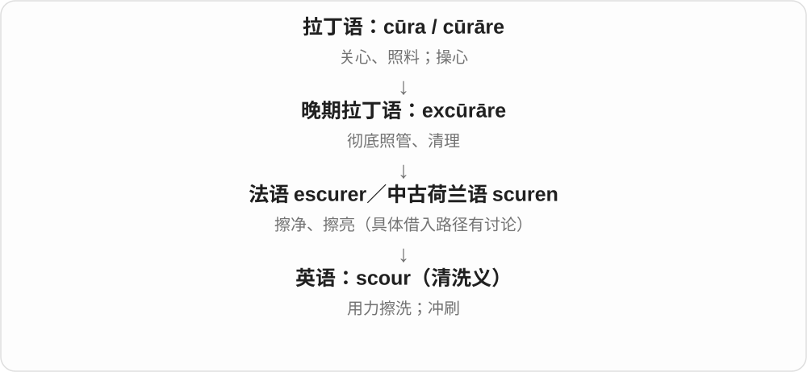

本页图画清洗一支。现代理解搜寻义时，可以用“像刷地一样把区域扫遍”作记忆图景，但这不等于证明搜寻义历史上就是从擦洗直接产生。

**常见搭配与例句**

scour a pan；scour the area for…；water scours the riverbed。

> She scoured the burnt pan until it was clean.

她用力擦洗烧焦的锅，直到洗干净。

> We scoured the house for the missing keys.

我们把屋子翻了个遍，寻找丢失的钥匙。

**别混淆**

scrub 强调用力刷洗；scour 除擦洗还常说彻底搜寻。scourge“祸害、鞭笞”不是这个词。

### 942. scouring — 正在用力擦洗、冲刷；四处仔细搜寻；擦洗用的

**音标**：英 /ˈskaʊərɪŋ/；美 /ˈskaʊrɪŋ/

**先抓住这个画面**

刷子正把硬污垢磨掉，或人正一处处找线索，是 scouring。scouring pad 则是用来这样擦洗的清洁垫。

**怎么拆**

scour + 完整 -ing；英式后接元音时 r 发出来，现代词尾用于擦洗、搜寻两个动词支线。

**怎么变成今天的意思**

**擦洗支线：拉丁 excurare → 法语、荷兰语相关形式 → scour**  
彻底照管、擦净；具体借入路径有讨论

↓

**搜寻支线：中古英语 scouren，或有北欧、法语移动材料**  
四处奔走搜查；后来与擦洗义互相影响，不把两条近源硬缩为一条

↓

**scour + -ing → scouring**  
擦洗、搜寻的过程；供擦洗的工具用途

scouring the pan 是正在擦锅，scouring the area 是正仔细搜查区域；a scouring pad 是百洁布、擦洗垫。

**常见搭配与例句**

scouring powder 去污粉；scouring the archives 翻查档案。

> She was scouring the burnt pan.

她正用力擦洗烧焦的锅。

> The researchers were scouring the archives for letters.

研究者们正翻查档案，寻找书信。

**别混淆**

scouring 常有彻底、仔细、用力的感觉；rinsing 通常是用水冲洗，未必把黏住的污垢磨掉。

### 943. scoured — 用力擦净了、冲刷了；四处搜寻了

**音标**：英 /skaʊəd/；美 /skaʊrd/

**先抓住这个画面**

锅被磨擦到污垢掉了，或一个人把能找的地方翻了一圈，用 scoured。两个现代常用义要根据宾语理解。

**怎么拆**

scour + 完整 -ed，读 /d/；英式基础末尾是元音，接 /d/，美式保留相应 r 音。

**怎么变成今天的意思**

**擦洗支线：拉丁 excurare → 法语、荷兰语相关形式 → scour**  
彻底照管、擦净；具体借入路径有讨论

↓

**搜寻支线：中古英语 scouren，或有北欧、法语移动材料**  
四处奔走搜查；后来与擦洗义互相影响，不把两条近源硬缩为一条

↓

**scour + -ed → scoured**  
过去擦洗、冲刷或搜寻

scoured the sink 是擦洗水槽，scoured the city for a room 是找遍城市寻住处；搜索义不必真擦过任何东西。

**常见搭配与例句**

scoured the shelves 找遍书架；scoured clean 擦得干净。

> I scoured the sink with a stiff brush.

我用硬刷子用力擦洗水槽。

> We scoured the internet for a copy of the book.

我们把网络找了个遍，想找到这本书。

**别混淆**

scoured 与 cleaned 在擦洗场景可接近，前者通常更突出用力磨擦；搜寻场景则和 cleaned 无关。

### 944. scours — 用力擦洗、冲刷；四处仔细搜寻〔第三人称单数〕

**音标**：英 /skaʊəz/；美 /skaʊrz/

**先抓住这个画面**

把锅底用力擦到干净，是 scours；把网页、书架一处处仔细找过去，也是 scours，但近源历史另有一条线。

**怎么拆**

scour + -s，读 /z/。擦洗义可能经法语、荷兰语接拉丁 excurare；搜寻义另有北欧、法语移动材料分析，后来彼此影响。

**怎么变成今天的意思**

**擦洗支线：拉丁 excurare → 法语、荷兰语相关形式 → scour**  
彻底照管、擦净；具体借入路径有讨论

↓

**搜寻支线：中古英语 scouren，或有北欧、法语移动材料**  
四处奔走搜查；后来与擦洗义互相影响，不把两条近源硬缩为一条

↓

**scour + -s → scours**  
他、她擦洗或四处搜寻；水冲刷

scours the pan 是擦洗锅，scours the internet 是把网络翻个遍；对象帮你确定是实物清洗还是搜寻。

**常见搭配与例句**

scours the shops for bargains 四处逛店找便宜货；scours the rocks 冲刷岩石。

> She scours the pan until it shines.

她把锅用力擦到发亮。

> He scours second-hand shops for old records.

他把二手店一家家找过去，寻旧唱片。

**别混淆**

scours for something 通常比 looks for 更彻底、范围更广；也不等于已经找到了，结果要另说。

### 945. gush — 涌出、奔涌；滔滔不绝地热情说；一股涌流、热情话语

**音标**：/ɡʌʃ/

**先抓住这个画面**

水像闸门打开一样一股涌出，叫 gush；夸赞、感情一股脑往外倒，也能用这个画面。

**怎么拆**

接中古英语 gushen，具体或拟声、或有低地德语、北欧来源参与；与更远倒、流材料的联系依具体来源分析，不当确定唯一链。

**怎么变成今天的意思**

**中古英语 gushen → gush**  
可能英语拟声、低地德语或北欧 gusa 一系影响，具体路径有不同分析

↓

**液体猛涌 → 话语、赞美感情倾泻**  
形容过分热情时可能略带评价，不能总当作中性称赞

water gushes out 是水涌出来，gush about a film 是热情不住地夸电影；a gush of praise 是一大串热烈赞美。

**常见搭配与例句**

a gush of water 一股涌水；gush over someone 热情过度地夸某人。

> We heard a gush of water as the gate opened.

闸门打开时，我们听见一股水涌出来。

> She began to gush about her new camera.

她开始滔滔不绝地夸新相机。

**别混淆**

gush 写话语时常有热情太满、滔滔不绝的感觉；praise 较中性地说赞扬，不一定带这种评价。

### 946. gushing — 正在涌出的；热情洋溢、赞美过头的；奔涌

**音标**：/ˈɡʌʃɪŋ/

**先抓住这个画面**

水正猛烈流出，是 gushing；形容推荐、赞美时，像感情倒得满满的，可能让人觉得太热情。

**怎么拆**

gush + 完整 -ing，直接加；分词可写流动，形容词可评价话语、举止的热情程度。

**怎么变成今天的意思**

**中古英语 gushen → gush**  
可能英语拟声、低地德语或北欧 gusa 一系影响，具体路径有不同分析

↓

**液体猛涌 → 话语、赞美感情倾泻**  
形容过分热情时可能略带评价，不能总当作中性称赞

↓

**gush + -ing → gushing**  
涌流过程；情感过满、赞美热烈的状态

gushing water 是涌水，a gushing review 是热烈得甚至有点过头的好评；两者抓的都是一股脑倾泻。

**常见搭配与例句**

a gushing stream 奔涌的小溪；gushing praise 热情过满的赞美。

> Water was gushing into the empty channel.

水正奔涌着流进空水渠。

> The film received a gushing review in the magazine.

杂志给了这部电影一篇热情洋溢、甚至有点过头的好评。

**别混淆**

gushing praise 不必译成虚假赞美；它先说热情的程度，真不真诚仍需别的证据。

### 947. gushed — 涌出了；热情洋溢地说了、夸个不停了

**音标**：/ɡʌʃt/

**先抓住这个画面**

液体刚才猛地涌出来，或人把喜爱、赞美一股脑说出来，用 gushed。后者可热情，也可显得过头。

**怎么拆**

gush + 完整 -ed，/ʃ/ 后读 /t/；仍是一个音节。

**怎么变成今天的意思**

**中古英语 gushen → gush**  
可能英语拟声、低地德语或北欧 gusa 一系影响，具体路径有不同分析

↓

**液体猛涌 → 话语、赞美感情倾泻**  
形容过分热情时可能略带评价，不能总当作中性称赞

↓

**gush + -ed → gushed**  
过去奔涌；感情、话语热烈倾泻

gushed out of the pipe 是从管子里涌出，gushed about the meal 是热情地夸饭菜；可以接具体赞叹。

**常见搭配与例句**

gushed with enthusiasm 热情地滔滔说；gushed into the channel 涌入水渠。

> Water gushed out when we opened the valve.

我们打开阀门，水就涌出来。

> “It was absolutely wonderful,” she gushed.

“真是太棒了。”她热情洋溢地说。

**别混淆**

gushed 作为说话标签比 said 更带感情、热度和一泻而出的感觉；不一定代表叙述者完全赞同这种热情。

### 948. gushes — 涌出、热情地滔滔说〔第三人称单数〕；一股股涌流

**音标**：/ˈɡʌʃɪz/

**先抓住这个画面**

水一下涌出许多，或一个人一开口就热情地夸个不停，用 gushes；名词复数是几股涌流或热烈话语。

**怎么拆**

gush + -es，/ʃ/ 后读 /ɪz/；三单、名词复数同形，两个音节。

**怎么变成今天的意思**

**中古英语 gushen → gush**  
可能英语拟声、低地德语或北欧 gusa 一系影响，具体路径有不同分析

↓

**液体猛涌 → 话语、赞美感情倾泻**  
形容过分热情时可能略带评价，不能总当作中性称赞

↓

**gush + -es → gushes**  
它涌出；他、她热情滔滔说；多股涌流

gushes from the pipe 是从管口奔涌，gushes about her trip 是不停热情夸旅行；about 提示话题，不是液体。

**常见搭配与例句**

gushes out 向外涌；gushes of enthusiasm 一股股热情。

> Water gushes from the pipe when the valve opens.

阀门一开，水就从管子里涌出来。

> He gushes about the hotel whenever anyone mentions the trip.

只要有人提起旅行，他就滔滔不绝地夸那家酒店。

**别混淆**

gushes 常比 drips 更有大量、冲出的感觉；一个是涌，一滴一滴落又是另一画面。

### 949. dogged — 顽强的；坚持不懈的

**音标**：英 /ˈdɒɡɪd/；美 /ˈdɔːɡɪd/

**先抓住这个画面**

咬定一个目标，碰到阻力也不松手。可以赞毅力，也可能带固执意味。

**怎么拆**

dog + -ed，早期像狗的形容词曾多带负面评价，后来发展出坚持、顽强义。该形容词末尾 -ed 单独成音节 /ɪd/。

**怎么变成今天的意思**

**古英语 docga、dogga → 中古英语 dogge → dog**  
狗；更远来源不明

↓

**现代 dog 词族**  
犬种、用途；追逐、纠缠与坚持等联想

↓

**dog + -ed → dogged**  
像狗的旧评价 → 顽强坚持

dogged determination 顽强决心，dogged persistence 不懈坚持；别把历史贬义生搬到每个现代赞美里。

**常见搭配与例句**

dogged determination；dogged persistence；a dogged effort。

> Her dogged determination kept the project alive.

她顽强的决心让项目坚持了下来。

> They made a dogged effort to find the missing records.

他们坚持不懈地寻找丢失记录。

**别混淆**

dogged 坚毅的两音节；was dogged by delays 受延误困扰中的分词通常一音节。

### 950. pounce — 猛扑；迅速抓住机会；突然挑出问题

**音标**：英、美 /paʊns/

**先抓住这个画面**

猫先盯住玩具，接着突然一下扑上去；人抓机会、挑别人漏洞，也能有这种动作感。

**怎么拆**

常见猛扑义与中古英语 pownse“猛禽的爪”有关，可能联系古法语 ponchon“尖工具”，再追到 pungere。另有旧粉末及撒粉义来自法语 ponce、拉丁语 pumex“浮石”，是另一支。

**怎么变成今天的意思**

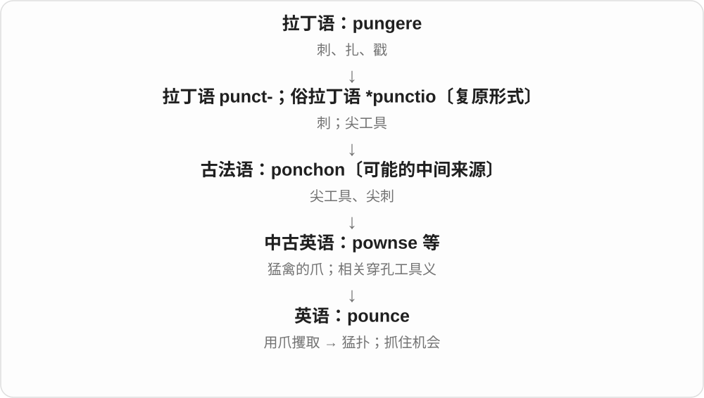

pounce on a chance 是立即抓住机会；pounce on a mistake 是迅速抓住别人的错误来批评。语气比 notice 强得多。

**常见搭配与例句**

pounce on prey；pounce on an opportunity；pounce on a mistake。

> The kitten pounced on the moving ribbon.

小猫猛扑向晃动的丝带。

> The interviewer pounced on the contradiction in his answer.

采访者立刻抓住了他回答中的矛盾。

**别混淆**

jump 只是跳；pounce 通常带目标，像要一下抓住、夺取什么。

### 951. pounced — 猛扑了；迅速抓住机会、错误等了

**音标**：/paʊnst/

**先抓住这个画面**

刚才突然扑向目标，是 pounced；听见一句能利用的话便马上抓住，也可以 pounced on it。

**怎么拆**

pounce 去末尾不发音 e + 完整 -ed → pounced，/s/ 后读 /t/，结尾 /nst/。

**怎么变成今天的意思**

**较早猛禽尖爪、穿刺工具材料 → 用爪攫取的 pounce**  
可能经古法语相关尖工具词，上溯穿刺词族

↓

**攫取 → 突然扑上去 → 迅速抓住机会、错误**  
现代 pounce on 常像盯准了目标就马上动手

↓

**pounce 去 e + -ed → pounced**  
过去猛扑、迅速攫取

pounced on the ball 是扑向球，pounced on the error 是立刻抓住错误；动作与比喻用同一个目标方向。

**常见搭配与例句**

pounced out from behind the chair 从椅后扑出来；pounced on an opportunity 抓住机会。

> The cat pounced on the toy mouse.

猫扑向了玩具老鼠。

> The editor pounced on the inconsistency in the story.

编辑马上抓住了故事里前后不一致的地方。

**别混淆**

pounced on an error 常显得反应快、抓得紧，也可能带批评急切的语气；noticed an error 只说注意到错误。

### 952. pounces — 猛扑、迅速抓住〔第三人称单数〕；猛扑动作〔复数〕

**音标**：/ˈpaʊnsɪz/

**先抓住这个画面**

猫盯住小球，忽然压身弹过去，是 pounces；有人话一出口就被抓住漏洞，也像被人盯准后扑上来。

**怎么拆**

pounce + -s，基础末尾 ce 已有 e，直接加 s；/s/ 后读 /ɪz/。近源围绕猛禽尖爪、攫取材料，不是现代跳跃词的任意混成。

**怎么变成今天的意思**

**较早猛禽尖爪、穿刺工具材料 → 用爪攫取的 pounce**  
可能经古法语相关尖工具词，上溯穿刺词族

↓

**攫取 → 突然扑上去 → 迅速抓住机会、错误**  
现代 pounce on 常像盯准了目标就马上动手

↓

**pounce + -s → pounces**  
它猛扑；他、她迅速抓住；几次猛扑

pounces on a toy 是扑向玩具，pounces on a mistake 是马上抓住错误不放；常用 on 或 upon 接目标。

**常见搭配与例句**

pounces from hiding 从藏身处扑出；pounces on the chance 马上抓住机会。

> The kitten pounces on the moving string.

小猫扑向移动的绳子。

> She pounces on any chance to practise her French.

她一有机会就赶紧练法语。

**别混淆**

pounces 比 jumps 更像针对一个目标突然扑上去；jumps 可以只是原地起跳，未必想抓什么。

### 953. pouncing — 正在猛扑、迅速抓住；猛扑的

**音标**：/ˈpaʊnsɪŋ/

**先抓住这个画面**

猫身子压低后一下跃向猎物，是 pouncing；人急着抓别人一句话里的漏洞，也像等准时机就扑。

**怎么拆**

pounce 去末尾 e + 完整 -ing → pouncing；c 在 i 前仍读 /s/，动作朝明确目标展开。

**怎么变成今天的意思**

**较早猛禽尖爪、穿刺工具材料 → 用爪攫取的 pounce**  
可能经古法语相关尖工具词，上溯穿刺词族

↓

**攫取 → 突然扑上去 → 迅速抓住机会、错误**  
现代 pounce on 常像盯准了目标就马上动手

↓

**pounce 去 e + -ing → pouncing**  
猛扑、抓住机会等的过程

pouncing on a ball 是正扑球，pouncing on every mistake 是一有错就抓住；后者常带紧盯、急切的感觉。

**常见搭配与例句**

a pouncing cat 猛扑中的猫；pouncing from cover 从掩蔽处扑出。

> The kitten practised pouncing on a feather.

小猫练习扑向一根羽毛。

> He kept pouncing on every slip of the tongue.

他一直抓着每一次口误不放。

**别混淆**

pouncing 通常带突然扑取的方向，leaping 只保证跳跃；向上跃过水坑可以 leaping，不必像捕猎。

### 954. charted — 已绘入图表、地图的；记录了、规划了

**音标**：英 /ˈtʃɑːtɪd/；美 /ˈtʃɑːrtɪd/

**先抓住这个画面**

原来不知道哪有礁石、路怎么走，现在已经标在图上；也能说把一个变化历程记录了下来。

**怎么拆**

chart + -ed，末尾 /t/ 后 -ed 读 /ɪd/。动词过去式、过去分词可转为已标绘的形容词。

**怎么变成今天的意思**

**希腊 khartēs → 拉丁 charta**  
纸草纸、纸张、书写材料

↓

**法语 charte → 英语 chart**  
卡、地图 → 图表、海图；绘制、记录

↓

**chart + -ed → charted**  
画图记录了；已经标到图上的

charted waters 已标绘水域，a charted route 已标明路线，charted the development 记录了发展过程。

**常见搭配与例句**

charted waters；a charted route；charted the development。

> The ship stayed within charted waters.

船保持在已经标绘的水域内。

> The report charted the town’s growth over fifty years.

报告记录了小镇五十年来的发展。

**别混淆**

charted 与 chartered 多一个 er，不是可省略的英美拼写差异；chartered accountant 等另有特许资格义。

### 955. prune — 西梅干；修剪；删减

**音标**：/pruːn/

**先抓住这个画面**

名词是一颗果干；动词是一把剪刀。两个画面不要强行接成同一来源。

**怎么拆**

水果名 prune 经古法语来自拉丁 prunum 李子。修剪的 prune 则来自古法语 proignier 一支，进一步来源有争议，并不是把李子剪成干。

**怎么变成今天的意思**

**水果路线：希腊 proumnon → 拉丁 prunum → 法语 prune／pronne**  
李子名称；英语后来常指干果

↓

**英语 prune（名词）**  
西梅干、李子干

↓

**另一路线：古法语 proignier → 英语 prune（动词）**  
修整 → 修剪枝条、删减内容；更早来源不确定

吃的是 prunes，剪的是 prune the roses。动词还能用于文章或预算：prune a paragraph 是删掉多余部分，使它更精简。这两种 prune 都很实用，但只有水果名属于本页 prun- 李子的词源线。

**常见搭配与例句**

prune juice；dried prunes；prune a tree；prune unnecessary details。

> She stirred chopped prunes into the porridge.

她把切碎的西梅干拌进粥里。

> The gardener pruned the rose bush after flowering.

开花后，园丁修剪了那株玫瑰。

> We pruned several repetitive paragraphs from the report.

我们从报告里删去了几段重复内容。

**别混淆**

plum 通常说新鲜李子；prune 作名词通常说李子干。trim 也是修整，prune 更常使人想到有选择地剪去枝条或多余内容。

### 956. pruned — 修剪了、修剪过的；删减了

**音标**：/pruːnd/

**先抓住这个画面**

多余枝条或内容已经削掉，就是 pruned。强调经过修整，留下更合适的部分。

**怎么拆**

修剪 prune 接法语 proignier 等，远源未定；现代去 e 加完整 -ed，/n/ 后读 /d/。水果 prune 的拉丁来源另算。

**怎么变成今天的意思**

**法语修整动词 → prune**  
削去多余枝条、部分

↓

**prune 去 e + -ed → pruned**  
过去修剪了；经过删减的

pruned branches 修剪过的枝条；pruned the draft 删减了草稿。

**常见搭配与例句**

carefully pruned 仔细修剪过的；pruned back 修剪、削减回去。

> He pruned the tree last week.

他上周修剪了那棵树。

> The editor pruned several repeated paragraphs.

编辑删去了几段重复内容。

**别混淆**

pruned 是动作或结果，不是 dried 的同义词。看到后面接树、文章、清单时，抓修整、删减方向。

### 957. salaried — 领取固定薪酬的；有薪的

**音标**：/ˈsælərid/

**先抓住这个画面**

说的是职位或员工以工资制获得报酬。

**怎么拆**

salary + -ed，y 变 i；与 salary 作支付薪水的动词及有薪性质有关。

**怎么变成今天的意思**

**拉丁 sal，属格 salis**  
盐

↓

**拉丁 salarium → 法语 → 英语 salary**  
津贴、报酬 → 薪水

↓

**salary + -ed → salaried**  
领取固定薪水的

a salaried position 是有固定薪酬的职位，salaried employees 是薪资制员工。这个词描述报酬方式，本身不决定某人的法定工时或其他劳动权利。

**常见搭配与例句**

a salaried employee；a salaried position；salaried staff。

> She moved from freelance work to a salaried position.

她从自由职业转到了固定薪资岗位。

> The survey includes both salaried staff and hourly workers.

调查涵盖了固定薪资员工和按小时计酬的员工。

**别混淆**

salaried 与 hourly paid 常作对照；paid 的范围更广，只说有报酬，不一定是固定薪资。

### 958. swerve — 突然转向、偏转；偏离；偏转动作

**音标**：英 /swɜːv/；美 /swɜːrv/

**先抓住这个画面**

正沿路走，眼前来了障碍，方向一下往旁边偏，是 swerve。讲原则、计划时，它像从原来那条线偏出去了。

**怎么拆**

中古英语 swerven 已有离开、转到一旁义；形式似承古英语 sweorfan，但从磨擦到偏转的意义连接未定，也可能牵涉不同旧词。

**怎么变成今天的意思**

**中古英语 swerven 的离开、偏转 → swerve**  
形式与古英语 sweorfan 的磨擦材料相接，但意义路线有疑问

↓

**偏离直路 → 偏离原则、原定路线等**  
现代把直行路线借成既定方向；不把磨擦到转向的候选步骤当事实

swerve to avoid something 是突然转向避开，swerve from the path 是偏离道路；never swerve from a principle 是始终不偏离原则。

**常见搭配与例句**

a sudden swerve 突然偏转；swerve sharply 急转方向。

> The driver had to swerve to avoid a fallen branch.

司机不得不突然转向，避开掉落的树枝。

> She refused to swerve from her original plan.

她不肯偏离原来的计划。

**别混淆**

swerve 常带突然、向旁边偏离的感觉，turn 更宽；正常转弯也叫 turn，未必需要 swerve。

### 959. swerved — 突然转向、偏离了

**音标**：英 /swɜːvd/；美 /swɜːrvd/

**先抓住这个画面**

刚才方向猛地往旁边变，用 swerved；也可回头说谈话、思路从原来的路线转开了。

**怎么拆**

swerve 去末尾 e + 完整 -ed → swerved，/v/ 后读 /d/，结尾 /vd/。

**怎么变成今天的意思**

**中古英语 swerven 的离开、偏转 → swerve**  
形式与古英语 sweorfan 的磨擦材料相接，但意义路线有疑问

↓

**偏离直路 → 偏离原则、原定路线等**  
现代把直行路线借成既定方向；不把磨擦到转向的候选步骤当事实

↓

**swerve 去 e + -ed → swerved**  
过去方向突然偏开

swerved to the right 是突然右转，swerved off the road 是偏出道路；swerved away from the topic 是从话题转开。

**常见搭配与例句**

swerved around the obstacle 转向绕过障碍；swerved sharply 猛然偏转。

> The cyclist swerved around the pothole.

骑车人突然转向，绕开坑洞。

> The conversation swerved away from the awkward question.

谈话一下从那个尴尬的问题转开了。

**别混淆**

swerved 强调转向的过程，crashed 强调撞上的结果；车 swerved 后可以成功避开，也可能另有后果。

### 960. swerving — 正在突然转向、偏转；急转的

**音标**：英 /ˈswɜːvɪŋ/；美 /ˈswɜːrvɪŋ/

**先抓住这个画面**

行进路线正一下偏到旁边，是 swerving。可以是一回避让，也可以几次左右急转；它把方向变化画出来。

**怎么拆**

swerve 去末尾 e + 完整 -ing → swerving；v 留着，分词描写路线偏转的过程。

**怎么变成今天的意思**

**中古英语 swerven 的离开、偏转 → swerve**  
形式与古英语 sweorfan 的磨擦材料相接，但意义路线有疑问

↓

**偏离直路 → 偏离原则、原定路线等**  
现代把直行路线借成既定方向；不把磨擦到转向的候选步骤当事实

↓

**swerve 去 e + -ing → swerving**  
突然转向、偏离的过程

swerving from side to side 是左右急转，swerving to avoid a cyclist 是急转避开骑车人；也能比喻偏离既定立场。

**常见搭配与例句**

a swerving vehicle 突然偏转的车；swerving off course 偏离路线。

> The van was swerving from side to side.

那辆货车正左右急转。

> She avoided the fallen box by swerving to the left.

她向左急转，避开了掉下的箱子。

**别混淆**

swerving 强调向旁偏开，braking 强调减速；避开同一障碍，可能用其中一种，也可能两者同时发生。

### 961. swerves — 突然转向、偏离〔第三人称单数〕；偏转动作〔复数〕

**音标**：英 /swɜːvz/；美 /swɜːrvz/

**先抓住这个画面**

一辆车或一颗球突然偏到另一边，是 swerves；几下急转，也能当作一个个可数的偏转动作。

**怎么拆**

swerve + -s，/v/ 后读 /z/，结尾 /vz/；保留基础末尾 e，三单与名词复数同形。

**怎么变成今天的意思**

**中古英语 swerven 的离开、偏转 → swerve**  
形式与古英语 sweorfan 的磨擦材料相接，但意义路线有疑问

↓

**偏离直路 → 偏离原则、原定路线等**  
现代把直行路线借成既定方向；不把磨擦到转向的候选步骤当事实

↓

**swerve + -s → swerves**  
它突然偏转；几次偏转

swerves across the road 是突然横偏过道路，swerves away from an obstacle 是偏开障碍；也可写叙述偏离原话题。

**常见搭配与例句**

swerves to the left 突然左偏；sharp swerves 急剧的偏转。

> The ball swerves to the left as it approaches the goal.

球接近球门时向左偏转。

> The car made several sharp swerves on the uneven road.

汽车在坑洼道路上几次猛然偏转。

**别混淆**

swerves 的偏转不保证失控，但会让人看到方向明显改变；drifts 更容易是渐渐、不知不觉偏过去。

### 962. topple — 倒下；推倒；推翻

**音标**：英 /ˈtɒpəl/；美 /ˈtɑːpəl/

**先抓住这个画面**

东西先失去平衡，顶端偏出去，整个就翻倒了。

**怎么拆**

top + -le，-le 是旧式动词构词后缀，在一些词里有反复、小动作等关联；不能拿它当独立单词。topple 已固定表示倾倒、推翻。

**怎么变成今天的意思**

**古英语 topp → 中古英语 top / toppe**  
顶部、顶端、最高处

↓

**英语 top**  
顶面；最高位置；居首、超过

↓

**top + -le → topple**  
失衡倒下；使倾覆

a tower topples 是塔倒下，topple a stack 是碰倒一摞东西；topple a government 是推翻政府的常见比喻。既可不及物也可带宾语。

**常见搭配与例句**

topple over；topple from a shelf；topple a leader。

> The pile of books toppled over.

那摞书倒了。

> A sudden gust toppled the empty chair.

一阵突来的风吹倒了空椅子。

**别混淆**

top 是居首、超过，topple 是失衡倒下；多出的 -le 使它成为另一个动作词，不能把 top the list 写成 topple the list。

### 963. toppled — 倒下、倾覆了；被推倒、被推翻了

**音标**：英 /ˈtɒpəld/；美 /ˈtɑːpəld/

**先抓住这个画面**

刚才花瓶、树或一堆积木从直立变成倒下，是 toppled；一个掌权者失势，也可以像站不住的塔被推翻。

**怎么拆**

topple 去末尾 e + 完整 -ed → toppled，/l/ 后读 /d/；原有双 p 保留。

**怎么变成今天的意思**

**top 的旧倾倒动作材料 + -le → topple**  
旧式反复动作形式，较早说翻滚、头向下倒

↓

**失衡倒下、使倒下 → 推翻权力、地位**  
现代词形接完整 topple；比喻像把原本站在高处的一方推倒

↓

**topple 去 e + -ed → toppled**  
过去倒下；已被推倒、失去地位

toppled over 是倒了，toppled the statue 是推倒雕像；was toppled 是被推翻，主动、被动都常见。

**常见搭配与例句**

toppled by the storm 被风暴吹倒；toppled from power 被赶下台。

> The wind toppled a tree beside the road.

风吹倒了路边一棵树。

> The vase toppled from the narrow shelf.

花瓶从窄架子上倒落下来。

**别混淆**

toppled 通常已有倒下、失势结果，teetered 更常是将倒未倒；两个词可组成先摇摇欲坠、后倒下的过程。

### 964. toppling — 正在倒下、倾覆、推倒、推翻；倾覆过程

**音标**：英 /ˈtɒpəlɪŋ/；美 /ˈtɑːpəlɪŋ/

**先抓住这个画面**

一座塔正歪过去倒落，或手推的积木开始一块接一块倒，是 toppling；政权、优势地位也能进入被推倒的过程。

**怎么拆**

topple 去末尾 e + 完整 -ing → toppling；把倾倒、使倾倒的完整动词变成过程或动作名词。

**怎么变成今天的意思**

**top 的旧倾倒动作材料 + -le → topple**  
旧式反复动作形式，较早说翻滚、头向下倒

↓

**失衡倒下、使倒下 → 推翻权力、地位**  
现代词形接完整 topple；比喻像把原本站在高处的一方推倒

↓

**topple 去 e + -ing → toppling**  
倒下、推倒或推翻的过程

toppling over 是正在倒，toppling a stack 是正在弄倒一摞；the toppling of a statue 是推倒雕像这件事。

**常见搭配与例句**

stop it from toppling 扶住不让它倒；toppling dominoes 倒落的多米诺骨牌。

> She caught the toppling box before it hit the floor.

箱子正倒下时，她在它落地前接住了。

> The children watched the toppling dominoes in silence.

孩子们安静地看着多米诺骨牌接连倒下。

**别混淆**

toppling 是从直立失衡倒下，dropping 只需从高处落；东西可以平平地掉下，不一定有先歪倒的画面。

### 965. topples — 倒下、倾覆、推倒、推翻〔第三人称单数〕

**音标**：英 /ˈtɒpəlz/；美 /ˈtɑːpəlz/

**先抓住这个画面**

积木塔重心一偏，整个倒下来，是 topples；一场冲击让强势的人或权力垮下，也像推倒那座塔。

**怎么拆**

topple + -s，/l/ 后读 /z/。基础 topple 接 top 的旧动作材料与 -le，不从希腊表示地点的 top- 解释。

**怎么变成今天的意思**

**top 的旧倾倒动作材料 + -le → topple**  
旧式反复动作形式，较早说翻滚、头向下倒

↓

**失衡倒下、使倒下 → 推翻权力、地位**  
现代词形接完整 topple；比喻像把原本站在高处的一方推倒

↓

**topple + -s → topples**  
它失衡倒下；它使人、物或权力倒下

topples over 是倒下来，topples the tower 是把塔弄倒；topples a leader 是使领导者失去地位。

**常见搭配与例句**

topples off the shelf 从架上倒下；topples the stack 弄倒堆叠物。

> The tower topples if the bottom block is pulled away.

底部那块积木一抽走，塔就会倒。

> A strong gust sometimes topples the light garden chairs.

一阵强风有时会吹倒轻便的花园椅。

**别混淆**

topples 把失衡倒下的结果说出来，wobbles 只说晃；塔可以先晃一阵后稳住，也可以接着倒下。

### 966. mutter — 低声嘀咕、咕哝；一阵低语

**音标**：英 /ˈmʌtə/；美 /ˈmʌtər/

**先抓住这个画面**

嘴里压着声音念几句，旁人像能听见又不全听清，是 mutter。它常带不满，也可能只是对自己念叨。

**怎么拆**

中古英语 moteren、muteren 等有拟声背景，-er 在这里是旧反复动作构件，不是做某事的人；与拉丁 muttire 等可以比较，不等于由现代 mute 变出来。

**怎么变成今天的意思**

**中古英语 moteren、muteren → mutter**  
低低说话的拟声材料；有旧反复动作 -er

↓

**现代 mutter；名词沿动词发展**  
压着声音嘀咕，常带不满，也可只是私下念叨

mutter under your breath 是压低声音嘀咕；mutter about the delay 是为延误低声抱怨。

**常见搭配与例句**

a low mutter 一阵低语；mutter a few words 低声念几句。

> He began to mutter about the long wait.

他开始为等得太久低声抱怨。

> Her reply was no more than a mutter.

她的回答只是低低咕哝了一句。

**别混淆**

mutter 常突出低声、私下念叨及其态度，mumble 更突出字句含糊；两者有重合。

### 967. muttering — 正在低声嘀咕；一阵低语、抱怨

**音标**：英 /ˈmʌtərɪŋ/；美 /ˈmʌtərɪŋ/

**先抓住这个画面**

低低的念叨还在继续，是 muttering。它也能把一群人的私下不满写成一阵低语。

**怎么拆**

mutter + 完整 -ing，英式元音相接处发 /r/。旧反复动作 -er 在基础词里，现代 -ing 接整个词。

**怎么变成今天的意思**

**中古英语 moteren、muteren → mutter**  
低低说话的拟声材料；有旧反复动作 -er

↓

**现代 mutter；名词沿动词发展**  
压着声音嘀咕，常带不满，也可只是私下念叨

↓

**mutter + -ing → muttering**  
低声嘀咕的过程、声音

muttering to himself 是正在自言自语；muttering about the cost 是正在小声抱怨费用。

**常见搭配与例句**

quiet muttering 低低的咕哝；muttering under her breath 压低声音嘀咕。

> He walked away, muttering about the unfair decision.

他走开了，还低声抱怨那个不公平的决定。

> I could hear quiet muttering from the crowd.

我能听见人群里的低低议论声。

**别混淆**

muttering 常带私下念叨的感觉，whispering 可以是有意轻声向对方说清楚；说话目的不总相同。

### 968. muttered — 低声嘀咕、咕哝了

**音标**：英 /ˈmʌtəd/；美 /ˈmʌtərd/

**先抓住这个画面**

刚才把话压在嘴边说出来，用 muttered。小说里常接一两句不愿公开说的大实话、抱怨或自言自语。

**怎么拆**

mutter + 完整 -ed，词尾 /d/；基础词最后一个音不是字母 t 的 /t/，不把它读成 /ɪd/。

**怎么变成今天的意思**

**中古英语 moteren、muteren → mutter**  
低低说话的拟声材料；有旧反复动作 -er

↓

**现代 mutter；名词沿动词发展**  
压着声音嘀咕，常带不满，也可只是私下念叨

↓

**mutter + -ed → muttered**  
过去低声嘀咕

muttered under her breath 是压低声音嘀咕了；muttered a prayer 是低声念了祈祷词，不一定抱怨。

**常见搭配与例句**

muttered an apology 低声咕哝着道歉；muttered to himself 自言自语了。

> He muttered something under his breath.

他压低声音嘀咕了几句。

> She muttered a quick prayer before opening the letter.

打开信之前，她匆匆低声祈祷了几句。

**别混淆**

muttered 可以带不满，也可只是低声念话；complained 明确说抱怨，不应每次互相替换。

### 969. mutters — 低声嘀咕〔第三人称单数〕；几句低语〔复数〕

**音标**：英 /ˈmʌtəz/；美 /ˈmʌtərz/

**先抓住这个画面**

说他读东西时会压着声音念，用 mutters；周围几句低低的议论，也可数作 mutters。

**怎么拆**

mutter + -s，词尾 /z/；整个动词作现代变化，不先去掉结尾 -er。

**怎么变成今天的意思**

**中古英语 moteren、muteren → mutter**  
低低说话的拟声材料；有旧反复动作 -er

↓

**现代 mutter；名词沿动词发展**  
压着声音嘀咕，常带不满，也可只是私下念叨

↓

**mutter + -s → mutters**  
他、她低声嘀咕；几句低语

mutters to himself 是自言自语，mutters about the rules 是为规则低声抱怨。

**常见搭配与例句**

mutters a complaint 小声抱怨；mutters of disapproval 几声不满的低语。

> She mutters to herself while checking the list.

她核对清单时会独自低声念叨。

> Mutters of disapproval spread through the room.

不满的低语在房间里传开。

**别混淆**

mutters 可以是有词句的低语，grunts 更常是一个短低哼声；不肯说话时可以只 grunt。

### 970. glean — 一点点搜集、获取；拾收割后剩下的谷物

**音标**：/ɡliːn/

**先抓住这个画面**

一篇旧信里找到一个线索，另一份记录里又找到一点，把零碎有用的东西拾起来，是 glean。田里收割后拾剩穗，也用这个词。

**怎么拆**

经古法语 glener 接晚期拉丁 glennare 收集，远源未定。英语抽象搜集义的记录早于字面拾穗义；可以借拾穗画面理解，但别把英语历史顺序讲反。

**怎么变成今天的意思**

**法语 glener ← 晚期拉丁 glennare 收集 → glean**  
远源未定

↓

**英语抽象搜集用法记录早于拾收剩余谷物义**  
田间拾穗画面有助记忆，不等于英语记录的先后

glean information from a report 从报告中获取零星信息；glean clues 从零碎材料找线索。

**常见搭配与例句**

glean what you can 尽可能搜集有用内容；glean grain 拾穗。

> We tried to glean useful information from the old letters.

我们试着从旧信里一点点获取有用信息。

> The villagers would glean grain left behind after the harvest.

村民们会拾收割后留在田里的谷物。

**别混淆**

glean 常像从散落、有限材料里一点点取得，collect 更泛；不是把整篇信息不加筛选地复制过来。

### 971. gleaned — 一点点获取、搜集到了；拾集了

**音标**：/ɡliːnd/

**先抓住这个画面**

材料很少，东拼一点、西找一点，最后获得的信息，可以说 information gleaned from…。它让人感到信息是从原材料中挑出来的。

**怎么拆**

glean + 完整 -ed，/n/ 后读 /d/；可作过去式、分词，常接 from 说明信息来源。

**怎么变成今天的意思**

**法语 glener ← 晚期拉丁 glennare 收集 → glean**  
远源未定

↓

**英语抽象搜集用法记录早于拾收剩余谷物义**  
田间拾穗画面有助记忆，不等于英语记录的先后

↓

**glean + -ed → gleaned**  
过去搜集、获取，或已从材料中取得

information gleaned from interviews 从访谈获取的信息；gleaned a few facts 得到几个事实。

**常见搭配与例句**

gleaned from records；gleaned over many years 多年积累搜集到。

> Much of what we know was gleaned from local records.

我们知道的很多内容，都来自对当地记录的搜集。

> She gleaned a few useful facts from the conversation.

她从交谈中获取了几个有用事实。

**别混淆**

gleaned information 只说明怎样取得信息，不保证内容已证实；verified information 才明确经过核实。

### 972. gleaning — 正在拾集、搜集；拾穗、零星获取的活动

**音标**：/ˈɡliːnɪŋ/

**先抓住这个画面**

在成堆材料里耐心找出零散线索，是 gleaning；在收割过的田里拾剩下的谷物，也叫 gleaning。两种都像不放过有用碎片。

**怎么拆**

glean + -ing，活动名词在中古英语已有；抽象搜集、字面拾穗不是必须在现代英语里按这个顺序新造出来。

**怎么变成今天的意思**

**法语 glener ← 晚期拉丁 glennare 收集 → glean**  
远源未定

↓

**英语抽象搜集用法记录早于拾收剩余谷物义**  
田间拾穗画面有助记忆，不等于英语记录的先后

↓

**glean + -ing → gleaning**  
零星获取、拾穗的过程或活动

gleaning information 搜集信息；gleaning after the harvest 收割后拾穗。

**常见搭配与例句**

gleaning clues from archives；the practice of gleaning。

> She spent weeks gleaning clues from the archives.

她花了几周从档案中搜集线索。

> The painting shows people gleaning in a harvested field.

那幅画画的是人们在已收割的田里拾穗。

**别混淆**

gleaning 常强调取得有用零碎，harvesting 常是整批收割；二者在农作场景中的工作阶段不同。

### 973. gleans — 一点点搜集、获取；拾穗〔第三人称单数〕

**音标**：/ɡliːnz/

**先抓住这个画面**

他翻一份份旧档案，从每份里拾一点有用信息，叫 gleans information。它不像整桶拿走，更像把有价值的碎片捡出来。

**怎么拆**

glean + -s，/n/ 后读 /z/；基础词的英语抽象用法很早，现代三单依普通规则形成。

**怎么变成今天的意思**

**法语 glener ← 晚期拉丁 glennare 收集 → glean**  
远源未定

↓

**英语抽象搜集用法记录早于拾收剩余谷物义**  
田间拾穗画面有助记忆，不等于英语记录的先后

↓

**glean + -s → gleans**  
他或她一点点获取、拾集

gleans information from sources 从资料中搜集信息；gleans clues 获取线索。

**常见搭配与例句**

gleans insights from interviews；gleans facts from records。

> She gleans clues from old photographs and letters.

她从旧照片、旧信里搜集线索。

> The researcher gleans useful details from brief interviews.

研究者从简短访谈中提取有用细节。

**别混淆**

gleans insights 常有从材料中发现、提取理解的感觉，receives a report 只是收到报告；获得理解和收到文件不同。

### 974. splurge — 大花一笔；尽情享用；一次较奢侈的花费

**音标**：英 /splɜːdʒ/；美 /splɝdʒ/

**先抓住这个画面**

平时省着，这次决定吃顿好饭、买件一直想要的东西，可以说 splurge。语气常是偶尔放开一点，不一定在责骂自己。

**怎么拆**

较早名词说炫耀、排场，来源未定，可能受 splash、surge 启发；动词后来发展出大花钱、尽情享用义，不能把猜测当成确定混成。

**怎么变成今天的意思**

**较早 splurge 名词：炫耀、排场**  
来源未定，或受 splash、surge 启发

↓

**名词 → 动词；后来大花钱、尽情享用**  
现代一次犒赏也可这样说，不全是批评

splurge on dinner 在晚饭上大花一笔；a small splurge 一次小小的奢侈消费。

**常见搭配与例句**

splurge on a new coat 花钱买件好外套；an occasional splurge。

> We decided to splurge on a really good dinner.

我们决定花一笔，吃顿真正好的晚饭。

> The concert ticket was my one splurge that month.

那张音乐会门票是我那个月唯一一次较奢侈的消费。

**别混淆**

splurge 常可说一次享受，squander 明确批评浪费；花得比平时多，不自动等于没有价值。

### 975. splurging — 正在大花钱、尽情享用；额外放开消费

**音标**：英 /ˈsplɜːdʒɪŋ/；美 /ˈsplɝdʒɪŋ/

**先抓住这个画面**

本来可以挑普通款，这次愿意为自己喜欢的东西多花一点，是 splurging。重点是相对平时放开，而非钱一定多到惊人。

**怎么拆**

splurge 去 e 加 -ing；动作过程也可作名词讨论一次放开消费。

**怎么变成今天的意思**

**较早 splurge 名词：炫耀、排场**  
来源未定，或受 splash、surge 启发

↓

**名词 → 动词；后来大花钱、尽情享用**  
现代一次犒赏也可这样说，不全是批评

↓

**splurge + -ing → splurging**  
大花一笔、尽情消费的过程

splurging on a holiday 度假时放开花；splurging on a gift 花钱买件好礼物。

**常见搭配与例句**

an excuse for splurging 放开花一次的理由；splurging a little。

> They celebrated by splurging on a weekend away.

他们花一笔出去过周末，庆祝了一番。

> She felt like splurging a little after finishing the project.

完成项目后，她想稍微花点钱犒赏自己。

**别混淆**

splurging 是消费上放开，saving 是留下钱；一个人平时 saving，也可能偶尔 splurging。

### 976. splurged — 大花一笔、尽情享用了一次

**音标**：英 /splɜːdʒd/；美 /splɝdʒd/

**先抓住这个画面**

终于决定买张好座位的票、住一晚好酒店，过去做了这次额外花费，就能说 splurged。它往往带一点犒赏感。

**怎么拆**

splurge 去 e 加完整 -ed，/dʒ/ 后读 /d/，不另加 /ɪd/ 音节；现代消费义接既有动词的发展。

**怎么变成今天的意思**

**较早 splurge 名词：炫耀、排场**  
来源未定，或受 splash、surge 启发

↓

**名词 → 动词；后来大花钱、尽情享用**  
现代一次犒赏也可这样说，不全是批评

↓

**splurge + -ed → splurged**  
过去大花一笔、放开享用

splurged on tickets 花钱买好票；splurged on a hotel 住酒店花了一笔。

**常见搭配与例句**

splurged for the occasion 为这次场合放开花钱；splurged on a treat。

> We splurged on front-row tickets.

我们花了一笔，买了前排票。

> She splurged on a comfortable hotel after weeks of camping.

露营几周后，她花一笔住了家舒服的酒店。

**别混淆**

splurged 常写一次较特别的花费，overspent 明确超出预算、适当范围；两种评价不能机械等同。

### 977. splurges — 大花一笔〔第三人称单数〕；偶尔的奢侈消费〔复数〕

**音标**：英 /ˈsplɜːdʒɪz/；美 /ˈsplɝdʒɪz/

**先抓住这个画面**

他平常自己做饭，但生日那天肯花钱吃好一点，是 splurges on a meal；一年几次这种享受，也可数成 splurges。

**怎么拆**

splurge + -s，拼写加 -s，/dʒ/ 后读 /ɪz/；动词三单和名词复数同形。

**怎么变成今天的意思**

**较早 splurge 名词：炫耀、排场**  
来源未定，或受 splash、surge 启发

↓

**名词 → 动词；后来大花钱、尽情享用**  
现代一次犒赏也可这样说，不全是批评

↓

**splurge + -s → splurges**  
他或她大花一笔；多次这样的消费

splurges on holidays 度假时大花钱；occasional splurges 偶尔的奢侈消费。

**常见搭配与例句**

splurges on a meal；small splurges 小小的享受。

> He splurges on a special meal for his birthday.

生日时，他会花一笔吃顿特别的饭。

> She allows herself a few small splurges each year.

她每年允许自己享受几次小小的奢侈。

**别混淆**

splurges on books 说在书上花得较放开，buys books 只说买书；是否超出平时开销，后者不说明。

### 978. yap — 尖声吠叫；喋喋不休；短促吠声；〔粗鲁口语〕嘴

**音标**：/jæp/

**先抓住这个画面**

小狗“汪汪汪”地尖声叫个不停，像 yap；借来写人，就是让人嫌烦地说个不停。

**怎么拆**

大概是拟声词；较早有指叫狗的名词记录，后来动词和声音、嘴的名词义继续发展。不是 yelp 的规则缩写。

**怎么变成今天的意思**

**较早 yap 名词及动词 → 现代 yap**  
大概模仿小狗短促、尖细的叫声

↓

**狗不停叫 → 人喋喋不休**  
后来名词还可在粗鲁口语中指嘴；不是一切用法都客气

yap at the door 是在门边汪汪叫，yap on about something 是不停唠叨；shut your yap 是粗鲁地叫人闭嘴。

**常见搭配与例句**

yap away 不停叫、说；a sharp yap 一声尖短狗叫。

> The little dog began to yap at the gate.

小狗开始在大门边尖声叫。

> He would yap on about the same story for hours.

他会为同一个故事唠叨好几个小时。

**别混淆**

chat 可以是轻松聊天，yap 写人说话时常带嫌烦的态度；不用把所有健谈的人都描述成 yapping。

### 979. yapping — 正在尖声吠叫；喋喋不休；一阵尖叫或唠叨

**音标**：/ˈjæpɪŋ/

**先抓住这个画面**

狗正“汪汪汪”叫个不停，或人在耳边不停说，叫 yapping。常带吵闹、让人嫌烦的感觉。

**怎么拆**

yap 双写 p + 完整 -ing → yapping；双写是现代拼写规则，不是新的词根。

**怎么变成今天的意思**

**较早 yap 名词及动词 → 现代 yap**  
大概模仿小狗短促、尖细的叫声

↓

**狗不停叫 → 人喋喋不休**  
后来名词还可在粗鲁口语中指嘴；不是一切用法都客气

↓

**yap 双写 p + -ing → yapping**  
持续尖声叫、喋喋不休

a yapping dog 是叫个不停的小狗，stop yapping 是别再唠叨、吵了；对人说通常不客气。

**常见搭配与例句**

yapping away 一直叫、说；constant yapping 不停的尖叫、唠叨。

> A yapping dog followed us along the fence.

一只尖叫不休的小狗沿着栅栏跟着我们。

> I could hear them yapping about the game in the next room.

我听见他们在隔壁没完没了地说那场比赛。

**别混淆**

yapping 与 chatting 都可写说话，前者常有贬意。句子意思相近，选词却能暴露说话者的态度。

### 980. yaps — 尖声吠叫、喋喋不休〔第三人称单数〕；尖短叫声〔复数〕

**音标**：/jæps/

**先抓住这个画面**

狗每听见动静就尖声叫，或某人说起来没完，用 yaps；作名词复数时是一声声短叫。

**怎么拆**

yap + -s，/p/ 后读 /s/；名词、动词都直接加词尾，不双写 p。

**怎么变成今天的意思**

**较早 yap 名词及动词 → 现代 yap**  
大概模仿小狗短促、尖细的叫声

↓

**狗不停叫 → 人喋喋不休**  
后来名词还可在粗鲁口语中指嘴；不是一切用法都客气

↓

**yap + -s → yaps**  
它尖声叫；他、她说个不停；数声短叫

yaps at passersby 是冲路人尖声叫，yaps about work 是没完没了说工作；描述人时语气通常不耐烦。

**常见搭配与例句**

yaps constantly 不停叫、说；high yaps 尖高的吠声。

> The tiny dog yaps whenever a car goes past.

每次有车经过，那只小狗就尖声叫。

> A series of yaps came from behind the gate.

大门后传来一连串尖短狗叫。

**别混淆**

yaps 常给人重复、烦人的感觉；barks 可以只是中性的狗叫描述，是否烦人不一定。

### 981. yapped — 尖声吠叫了；喋喋不休地说了

**音标**：/jæpt/

**先抓住这个画面**

刚才小狗一阵尖声叫，或有人不停唠叨，用 yapped。写人的用法多带嫌对方话太多的意思。

**怎么拆**

yap 双写 p + 完整 -ed → yapped；基础词是重读单音节、短元音后一个辅音字母，词尾读 /t/。

**怎么变成今天的意思**

**较早 yap 名词及动词 → 现代 yap**  
大概模仿小狗短促、尖细的叫声

↓

**狗不停叫 → 人喋喋不休**  
后来名词还可在粗鲁口语中指嘴；不是一切用法都客气

↓

**yap 双写 p + -ed → yapped**  
过去尖声叫、说个不停

yapped at the postman 是冲邮递员尖叫，yapped on about the match 是为比赛唠叨个不停。

**常见搭配与例句**

yapped all morning 整个上午叫、说个不停；yapped excitedly 兴奋地叫。

> The dog yapped at every cyclist who passed.

每个骑车的人经过，那只狗都尖声叫。

> He yapped on about the match throughout lunch.

整个午饭时间，他都在唠叨那场比赛。

**别混淆**

yapped 与 yelped 都能写小狗，yapped 常突出接连烦人的叫，yelped 常突出尖短冒出的一声。

### 982. combed — 梳理过的；精梳的；comb 的过去式、分词

**音标**：英 /kəʊmd/；美 /koʊmd/

**先抓住这个画面**

头发梳顺是 combed，棉纤维经梳理、去掉部分较短纤维等处理后也可叫 combed cotton。

**怎么拆**

comb + -ed → combed；b 仍不发音，末尾 -ed 读 /d/，不另增一个完整音节。

**怎么变成今天的意思**

**古英语 camb → 中古英语 comb → comb**  
带齿的梳具；日耳曼语传统的梳子名称

↓

**英语 comb 名词转动词；+ -ed → combed**  
梳理；像梳齿扫过一样细查；梳过的

↓

**comb + -ed → combed**  
梳理后的状态；搜查动作的过去形式

neatly combed hair 梳得整齐的头发；combed cotton 精梳棉；combed through 仔细搜查过。另有具冠、具梳齿结构的形容用法，依所指实物理解。

**常见搭配与例句**

neatly combed hair；combed cotton；combed through the files。

> He arrived with neatly combed hair.

他到场时头发梳得整整齐齐。

> The label says the shirt is made from combed cotton.

标签写着这件衬衫采用精梳棉。

**别混淆**

combed 不自动指染过、烫过；combed cotton 说明工艺，不仅是成品表面看着平整。

### 983. sleeved — 有袖的；套有保护套的；sleeve 的过去分词

**音标**：/sliːvd/

**先抓住这个画面**

sleeve 衣袖、套子，加 -ed 描述带有它、套上它的状态。衣服组合里常用来进一步说明袖子长短。

**怎么拆**

sleeve + -ed，拼写时先去 e，再加完整 -ed，末尾读 /d/；古英语已有相应有袖形容词。现代也可作给物体加套的动词分词。

**怎么变成今天的意思**

**古英语 slief、sliefe → 中古英语 sleve → sleeve**  
衣服包住手臂的部分

↓

**sleeve + -ed → sleeved**  
带袖、加套的性质或状态

long-sleeved shirt 长袖衬衫，short-sleeved top 短袖上衣，sleeved cables 套有保护层的线缆。

**常见搭配与例句**

a long-sleeved shirt；sleeved cables。

> He wore a long-sleeved shirt.

他穿着一件长袖衬衫。

> The sleeved cables were neatly arranged.

加了保护套的线缆排列整齐。

**别混淆**

形容衣服的 -ed 可以表示具有特征；设备分词义则可说加套完成的状态。

### 984. fluster — 使慌乱、窘迫；一阵手忙脚乱

**音标**：英 /ˈflʌstə/；美 /ˈflʌstər/

**先抓住这个画面**

突然轮到你发言，脑子一下乱了，连原来准备好的话都接不上；这类事会 fluster you，人也会 be in a fluster。

**怎么拆**

大概借斯堪的纳维亚忙乱、激动材料；动词很早，慌乱状态名词后来由动词形成。现代不必与饮酒有关。

**怎么变成今天的意思**

**早期英语 fluster 的忙乱、激动材料**  
大概接斯堪的纳维亚相关词；更远联系是推测，不能只看前几个字母

↓

**使激动、扰乱 → 使慌乱、窘迫**  
名词由动词发展，指手忙脚乱状态；现代不要求涉及饮酒

fluster someone 使某人慌乱；in a fluster 慌作一团；don’t let it fluster you 别让它把你弄乱。

**常见搭配与例句**

easy to fluster；get into a fluster。

> Unexpected questions do not usually fluster her.

突如其来的问题通常不会让她乱了方寸。

> He arrived in a fluster after losing his keys.

丢了钥匙后，他到达时慌作一团。

**别混淆**

fluster 是一时乱了方寸，frustrate 更常是受阻、挫败；一个人可能既慌乱又挫败，但两个词不是拼写变体。

### 985. flustered — 慌乱、窘迫、乱了方寸的；使慌乱了

**音标**：英 /ˈflʌstəd/；美 /ˈflʌstərd/

**先抓住这个画面**

明明平时会做，一被催就把顺序弄反、说话也结巴，人就是 flustered。重点是一时失去镇定。

**怎么拆**

fluster + 完整 -ed，词尾读 /d/；过去分词常作形容词，描述被意外、压力搅乱的状态。

**怎么变成今天的意思**

**早期英语 fluster 的忙乱、激动材料**  
大概接斯堪的纳维亚相关词；更远联系是推测，不能只看前几个字母

↓

**使激动、扰乱 → 使慌乱、窘迫**  
名词由动词发展，指手忙脚乱状态；现代不要求涉及饮酒

↓

**fluster + -ed → flustered**  
已经被弄慌；或描述一时慌乱

get flustered 慌起来；look flustered 显得窘迫、慌乱；easily flustered 容易乱阵脚。

**常见搭配与例句**

slightly flustered；flustered by the attention。

> I got flustered and forgot the simplest instruction.

我一慌，连最简单的指令都忘了。

> She looked flustered when everyone turned to stare at her.

所有人转头看她时，她显得有些窘迫。

**别混淆**

flustered 不等于 incompetent 没能力；熟练的人也可能在突发场景中暂时慌乱。

### 986. flustering — 正在使慌乱；令人乱阵脚的

**音标**：英 /ˈflʌstərɪŋ/；美 /ˈflʌstərɪŋ/

**先抓住这个画面**

一连串突发问题还在打来，正把人弄得手忙脚乱，叫 flustering；也能形容让人慌乱的经历。

**怎么拆**

fluster + -ing；动作形式也可形容造成慌乱的性质。

**怎么变成今天的意思**

**早期英语 fluster 的忙乱、激动材料**  
大概接斯堪的纳维亚相关词；更远联系是推测，不能只看前几个字母

↓

**使激动、扰乱 → 使慌乱、窘迫**  
名词由动词发展，指手忙脚乱状态；现代不要求涉及饮酒

↓

**fluster + -ing → flustering**  
使人慌乱正在发生；或描述这种性质

a flustering experience 令人慌乱的经历；flustering the speaker 正把演讲者弄乱阵脚。

**常见搭配与例句**

a flustering interruption；kept flustering me。

> It was a flustering experience to be questioned on live television.

在电视直播中被提问，是一段让人手忙脚乱的经历。

> The constant interruptions were flustering the speaker.

不断的插话正把演讲者弄得乱了方寸。

**别混淆**

flustering 是引发反应，flustered 是人的状态；the flustering questions 可能使 the speaker flustered。

### 987. unflustered — 镇定、不慌乱的

**音标**：英 /ʌnˈflʌstəd/；美 /ʌnˈflʌstərd/

**先抓住这个画面**

设备突然出错，别人慌了，他还是稳稳说明下一步，是 unflustered。重点是有突发干扰也没乱阵脚。

**怎么拆**

否定 un- + flustered；内层 fluster + -ed，外层否定已经形成的慌乱状态。

**怎么变成今天的意思**

**早期英语 fluster 的忙乱、激动材料**  
大概接斯堪的纳维亚相关词；更远联系是推测，不能只看前几个字母

↓

**使激动、扰乱 → 使慌乱、窘迫**  
名词由动词发展，指手忙脚乱状态；现代不要求涉及饮酒

↓

**un- + flustered → unflustered**  
面对干扰仍没有慌乱

remain unflustered 保持镇定；calm and unflustered 冷静从容。

**常见搭配与例句**

an unflustered response；looked completely unflustered。

> She remained unflustered when the microphone stopped working.

麦克风失灵时，她仍然镇定。

> His calm, unflustered response reassured the passengers.

他冷静从容的回应让乘客放了心。

**别混淆**

unflustered 说反应稳，uninterested 说没兴趣；一个人可以很投入、很重视，同时仍然镇定。

### 988. flusters — 使慌乱、窘迫〔第三人称单数〕

**音标**：英 /ˈflʌstəz/；美 /ˈflʌstərz/

**先抓住这个画面**

有人在旁边盯着，你就手忙脚乱，叫 it flusters you。主语是把思路搅乱的事情，人是受到影响的一方。

**怎么拆**

fluster + -s，读 /z/；保留动词整体，承忙乱、激动到慌乱的用法。

**怎么变成今天的意思**

**早期英语 fluster 的忙乱、激动材料**  
大概接斯堪的纳维亚相关词；更远联系是推测，不能只看前几个字母

↓

**使激动、扰乱 → 使慌乱、窘迫**  
名词由动词发展，指手忙脚乱状态；现代不要求涉及饮酒

↓

**fluster + -s → flusters**  
它使人一时乱了方寸

flusters me 使我慌乱；nothing flusters her 什么也难让她乱阵脚。

**常见搭配与例句**

flusters the presenter；rarely flusters him。

> Being watched while I work flusters me.

工作时有人盯着，会让我手忙脚乱。

> Very little flusters her during a live broadcast.

直播时很少有什么事能让她乱了阵脚。

**别混淆**

flusters 强调扰乱当下的镇定，puzzles 更侧重想不明白；即使知道答案，也可能因被盯着而 flustered。

### 989. flinch — 突然一缩、畏缩、退缩；一缩的动作

**音标**：/flɪntʃ/

**先抓住这个画面**

眼前东西突然逼近，身体下意识缩一下，叫 flinch；面对难办的事退缩，也像被压力逼得向后让。

**怎么拆**

可能接较早 flecche 及法语弯、转开的材料，英语形式有鼻音变化；更远与 link 的弯曲、转向词族可比较。

**怎么变成今天的意思**

**较早中古英语 flecche 等，联系法语 flechir、flenchir 弯、转开 → flinch**  
英语形式或加鼻音，更远有日耳曼来源分析；保留可能性

↓

**转开、退让 → 受惊、受痛的一缩；心理畏缩**  
身体可以突然动一下，抽象任务也可让人退缩

flinch at a loud noise 是被巨响惊得一缩，flinch from a difficult task 是畏缩不敢做；without a flinch 是毫不退缩。

**常见搭配与例句**

flinch in pain 痛得一缩；not flinch from responsibility 不逃避责任。

> He did not flinch when the balloon burst.

气球爆开时，他连缩都没缩一下。

> She refused to flinch from a difficult conversation.

她不肯回避一场艰难的谈话。

**别混淆**

flinch 常描写突然、短暂的一缩，不一定真躲开或逃走；run away 则是离开现场的动作。

### 990. flinched — 受惊、受痛一缩了；畏缩、退让了

**音标**：/flɪntʃt/

**先抓住这个画面**

刚才身体被刺激得猛缩一下，叫 flinched；说话、行为中遇到困难而退让，也能用它。

**怎么拆**

flinch + 完整 -ed，/tʃ/ 后读 /t/，结尾 /ntʃt/；不多一个 /ɪd/ 音节。

**怎么变成今天的意思**

**较早中古英语 flecche 等，联系法语 flechir、flenchir 弯、转开 → flinch**  
英语形式或加鼻音，更远有日耳曼来源分析；保留可能性

↓

**转开、退让 → 受惊、受痛的一缩；心理畏缩**  
身体可以突然动一下，抽象任务也可让人退缩

↓

**flinch + -ed → flinched**  
过去一缩或退避

flinched at the crash 是被巨响惊得一缩，flinched from telling the truth 是畏缩不敢说真话；不必真的有物体逼近。

**常见搭配与例句**

flinched backwards 猛地向后一缩；barely flinched 几乎没缩。

> He flinched as the ball flew past his face.

球从脸旁飞过时，他猛地一缩。

> She flinched at the sharp bang behind her.

身后一声尖响，她惊得一缩。

**别混淆**

flinched 是短促反应，jumped back 常更明显向后跳；具体动作幅度不能只用一个中文怕字抹平。

### 991. flinching — 正在一缩、畏缩；退避的动作

**音标**：/ˈflɪntʃɪŋ/

**先抓住这个画面**

身体正因刺激往回缩，或人遇到压力想退让，是 flinching。without flinching 则常夸人稳住、没缩没退。

**怎么拆**

flinch + 完整 -ing，直接加；ch 的 /tʃ/ 保留，分词和活动名词都接整个基础词。

**怎么变成今天的意思**

**较早中古英语 flecche 等，联系法语 flechir、flenchir 弯、转开 → flinch**  
英语形式或加鼻音，更远有日耳曼来源分析；保留可能性

↓

**转开、退让 → 受惊、受痛的一缩；心理畏缩**  
身体可以突然动一下，抽象任务也可让人退缩

↓

**flinch + -ing → flinching**  
突然一缩、退避的过程

without flinching 是毫不畏缩，flinching at every movement 是对每个动作都惊得缩；不等于总在大喊。

**常见搭配与例句**

flinching away 向后缩开；without flinching from the truth 不躲避真相。

> She accepted the criticism without flinching.

她毫不退缩地接受了批评。

> He kept flinching whenever the dog moved.

狗一动，他就总往回缩。

**别混淆**

without flinching 可以说面对批评、坏消息很坚定；它关注有没有退缩，未必说明心里完全没痛苦。

### 992. flinches — 突然一缩、畏缩、退缩〔第三人称单数〕

**音标**：/ˈflɪntʃɪz/

**先抓住这个画面**

一个人听到突响、看到东西逼近，下意识缩一下，用 flinches。也能写遇到不舒服的任务就退让。

**怎么拆**

flinch + -es，/tʃ/ 后读 /ɪz/；有鼻音 n 的完整基础词不再拆成现代 fl- 加某个现成词。

**怎么变成今天的意思**

**较早中古英语 flecche 等，联系法语 flechir、flenchir 弯、转开 → flinch**  
英语形式或加鼻音，更远有日耳曼来源分析；保留可能性

↓

**转开、退让 → 受惊、受痛的一缩；心理畏缩**  
身体可以突然动一下，抽象任务也可让人退缩

↓

**flinch + -es → flinches**  
他、她受惊一缩或心理退缩

flinches at every sound 是每逢声音就一缩，never flinches from a challenge 是从不躲挑战；from 提示要退避的对象。

**常见搭配与例句**

flinches instinctively 本能地一缩；flinches under pressure 压力下退缩。

> She flinches at every sudden noise.

每逢突响，她就惊得一缩。

> He never flinches from an awkward question.

他从不回避难堪的问题。

**别混淆**

flinches 是可很小、很快的动作；cowers 常更像持续缩起身体、畏惧躲着，时间和姿态不同。

### 993. disinterested — 不偏不倚的；无私利牵涉的；有时表示没兴趣

**音标**：英 /dɪsˈɪntrəstɪd/；美 /dɪsˈɪntrəstɪd/

**先抓住这个画面**

做判断时没有自己的好处夹在中间，因此能更公正；并不是脑子已经不想参与。

**怎么拆**

来自 disinterest 的分词或 dis- + interested，两个构词分析都与历史用法有关。无偏私与没兴趣两义长期有交叠，不是现代才发生的单纯误用。

**怎么变成今天的意思**

**拉丁语 interesse，字面 inter- 在……之间 + esse 存在**  
相关、有影响、重要；并非现代兴趣的逐字翻译

↓

**中世纪拉丁语、法语相关名词 → 英语 interest**  
牵涉的权益、补偿等 → 后发展出兴趣、利息等用法

↓

**dis- + interested / disinterest + -ed → disinterested**  
无利害关系、不偏私；也有缺乏兴趣用法

a disinterested observer 不偏不倚的观察者；disinterested advice 不受个人利益影响的建议。正式写作中通常优先用它表达公正，用 uninterested 明确表达没兴趣。

**常见搭配与例句**

a disinterested observer；a disinterested opinion；disinterested advice。

> We asked a disinterested expert to review both proposals.

我们请一位没有利害关系的专家评审两份提议。

> A disinterested observer might reach a different conclusion.

一位不偏不倚的观察者可能得出不同结论。

**别混淆**

公正的人可以非常关心事情本身，只是不谋私利。读到没兴趣义也要认识它，但学习表达时分清两词更不容易含混。

### 994. intentioned — 怀有某种意图的〔通常带限定词〕

**音标**：/ɪnˈtenʃənd/

**先抓住这个画面**

这个词常需要前面交代意图怎样：well intentioned 本意良好，badly intentioned 怀着坏意。它给人或行为的出发点加说明。

**怎么拆**

intention 意图 + -ed，这里的 -ed 形成具有某种东西的形容词，不是 intention 这个名词自己发生过去动作。词尾常读 /ʃənd/，不多加 /ɪd/。

**怎么变成今天的意思**

**拉丁 intentiō 经法语等 → intention**  
意图、心中指向的目的

↓

**intention + -ed → intentioned**  
具有某种意图；通常由 well 等说明性质

well intentioned 本意良好的，badly intentioned 怀有恶意的。放在名词前常写作 a well-intentioned suggestion，连字符标出整体修饰关系。

**常见搭配与例句**

well intentioned；badly intentioned；a well-intentioned suggestion。

> The advice was well intentioned but unhelpful.

建议出于好意，却没有帮助。

> She appreciated his well-intentioned efforts.

她感激他出于好意所作的努力。

**别混淆**

well intentioned 评价出发点，effective 评价有没有用。好心建议也可能效果差；intentional 则是故意的，不等于出于好意。

### 995. mumble — 含糊地低声说；咕哝；一段听不清的话

**音标**：/ˈmʌmbəl/

**先抓住这个画面**

话像含在嘴里，没有把字说开，旁人只听见模模糊糊一串，就是 mumble。

**怎么拆**

接中古英语 momelen，常析 mum 的闭口声音材料与旧反复动作 -le；b 后来加入。现代不把 -ble 当成这里的能、能够后缀。

**怎么变成今天的意思**

**中古英语 momelen；mum 等闭口声音材料与旧反复动作构件**  
早有含混咀嚼、低声含糊表达的用途

↓

**后来增写 b → mumble**  
低声、口齿不清地说；名词沿动词发展

mumble an apology 是含糊地道歉，mumble to yourself 是独自咕哝；in a mumble 是声音低而含糊。

**常见搭配与例句**

mumble a few words 含含糊糊说几个字；a quiet mumble 一句低而不清的话。

> He spoke in a mumble that I could barely hear.

他说得低而含糊，我几乎听不清。

> Please do not mumble; I want to hear your answer.

请别含着话说，我想听清你的回答。

**别混淆**

mumble 重点在口齿不清，whisper 重点在声音很轻；耳语也可以让对方清楚听见每个字。

### 996. mumbling — 正在含糊地低声说；含糊低语声

**音标**：/ˈmʌmblɪŋ/

**先抓住这个画面**

一串话正含在嘴里往外出，别人不容易听清，是 mumbling。也可把那阵低低的声音整体当作名词。

**怎么拆**

mumble 去 e，加完整 -ing；原有的 b 与旧 -le 材料保留在词干里。

**怎么变成今天的意思**

**中古英语 momelen；mum 等闭口声音材料与旧反复动作构件**  
早有含混咀嚼、低声含糊表达的用途

↓

**后来增写 b → mumble**  
低声、口齿不清地说；名词沿动词发展

↓

**mumble + -ing → mumbling〔去 e〕**  
含糊低语的过程、声音

mumbling to herself 是独自低声咕哝，heard mumbling 是听见含糊低语。

**常见搭配与例句**

mumbling an excuse 含糊说着解释；indistinct mumbling 模糊的咕哝声。

> He was mumbling to himself as he searched the drawer.

他翻抽屉时正独自低声咕哝。

> I heard indistinct mumbling from behind the door.

我听见门后传来模糊的低语。

**别混淆**

mumbling 是说话清晰度上的含混；whispering 是音量、气声方式上的轻，两者可以同时发生。

### 997. mumbled — 含糊地低声说了；咕哝了

**音标**：/ˈmʌmbəld/

**先抓住这个画面**

刚才说过几句话，却低而不清，用 mumbled。对话中常写出人物不愿大声、没把字说开的样子。

**怎么拆**

mumble 去 e，加完整 -ed，/l/ 后读 /d/；不能把整个 le 删掉再加过去式。

**怎么变成今天的意思**

**中古英语 momelen；mum 等闭口声音材料与旧反复动作构件**  
早有含混咀嚼、低声含糊表达的用途

↓

**后来增写 b → mumble**  
低声、口齿不清地说；名词沿动词发展

↓

**mumble + -ed → mumbled〔去 e〕**  
过去含糊低声说

mumbled an apology 是含糊道了歉；mumbled something about... 是低声含糊说了点有关某事的话。

**常见搭配与例句**

mumbled a reply 含糊回答了；mumbled to herself 独自咕哝了。

> He mumbled an apology and looked away.

他含糊地道了歉，把目光移开。

> She mumbled something about catching a train.

她低声含糊说了些要赶火车的话。

**别混淆**

mumbled 强调听不清的说法，muttered 强调低声嘀咕、常带私下不满；两者会重叠，不能绝对分开。

### 998. mumbles — 含糊低声说〔第三人称单数〕；几句咕哝〔复数〕

**音标**：/ˈmʌmbəlz/

**先抓住这个画面**

说他回答时字句总含在嘴里，用 mumbles；几句模糊低语，也可以数作 mumbles。

**怎么拆**

mumble + -s，保留末尾 e，/l/ 后读 /z/。历史增音 b 早已成为现代词干的一部分。

**怎么变成今天的意思**

**中古英语 momelen；mum 等闭口声音材料与旧反复动作构件**  
早有含混咀嚼、低声含糊表达的用途

↓

**后来增写 b → mumble**  
低声、口齿不清地说；名词沿动词发展

↓

**mumble + -s → mumbles**  
他、她含糊说；几句含混话

mumbles an answer 是含糊回答，mumbles to himself 是独自咕哝。

**常见搭配与例句**

mumbles a greeting 含糊打招呼；quiet mumbles 低低的几句咕哝。

> He mumbles his answers while looking at the floor.

他看着地板，含糊地回答。

> Her words faded into quiet mumbles.

她的话渐渐变成低低的咕哝。

**别混淆**

mumbles 不保证表达的是不满；可能只是害羞、没抬头、没把话说清，别固定译成抱怨。

### 999. crackle — 劈啪作响；劈啪声；细裂纹效果

**音标**：/ˈkrækəl/

**先抓住这个画面**

crack 是一记啪响，crackle 常是一连串细小爆裂声：木柴、纸、广播干扰都能劈啪响。

**怎么拆**

crack + 旧 -le 反复动作材料，中古英语已有 crakelen。名词可说声响，也可说瓷釉表面细裂纹的效果。

**怎么变成今天的意思**

**古英语 cracian → 中古英语 crakken → crack**  
发出尖锐爆裂声；常认为有拟声基础

↓

**英语 crack**  
声响 → 裂开、裂缝；说话、解开、尝试等分支

↓

**crack + -le → crackle**  
反复发出小爆裂声；相应声响、细裂纹效果

a fire crackles 火劈啪响，the crackle of paper 纸的窸窣劈啪声，a crackle glaze 开片釉、细裂纹釉面。

**常见搭配与例句**

a fire crackles；the crackle of；a crackle glaze。

> The fire crackled in the fireplace.

壁炉里的火劈啪作响。

> We heard a crackle of static on the radio.

我们听到收音机里一阵劈啪杂音。

**别混淆**

-le 在此帮助理解反复小响，不表示小人物；crackle 可描述张力十足的气氛，也不必真有东西烧着。

### 1000. crackling — 正在噼啪响；噼啪声；烤肉的脆皮〔尤指猪皮〕

**音标**：/ˈkræklɪŋ/

**先抓住这个画面**

听火时，是一连串小小的“噼啪”；看烤猪肉时，crackling 又可指那层烤得酥脆的皮。场景换了，词性和具体意思也要跟着换。

**怎么拆**

crackle 去 e + 完整 -ing；声音活动名词、分词之外，还发展出烹饪中的脆皮名词义，不能都按正在进行翻译。

**怎么变成今天的意思**

**古英语 cracian → crack；中古英语 crackelen → crackle**  
由啪响材料形成旧反复动作形式

↓

**现代 crackle 与 crackling 的扩展**  
接连噼啪声；紧张、兴奋感；烤肉脆皮有专门名词义

↓

**crackle 去 e + -ing → crackling**  
噼啪过程、响声；烤肉脆皮的名词用法

the crackling of the fire 是火的噼啪声，pork crackling 是烤猪皮；两义都能联想脆、细小爆裂的声音，但食物义是固定用法。

**常见搭配与例句**

a crackling fire 噼啪响的炉火；crisp crackling 酥脆的烤肉皮。

> We listened to the crackling of the fire.

我们听着火的噼啪声。

> The roast pork had a layer of crisp crackling.

烤猪肉外面有一层酥脆的皮。

**别混淆**

a plate of crackling 里是食物，不是在吃“正在发声”这个动作；the crackling of logs 则是木柴燃烧声。

### 1001. crackles — 噼啪作响〔第三人称单数〕；一声声噼啪响

**音标**：/ˈkrækəlz/

**先抓住这个画面**

柴火里接连冒出“啪、啪”的小爆裂声，用 crackles；收音机的电流杂音也能这样响。

**怎么拆**

crackle + -s，保留 e，/l/ 后读 /z/；基础词里的旧 -le 已表达反复动作材料。

**怎么变成今天的意思**

**古英语 cracian → crack；中古英语 crackelen → crackle**  
由啪响材料形成旧反复动作形式

↓

**现代 crackle 与 crackling 的扩展**  
接连噼啪声；紧张、兴奋感；烤肉脆皮有专门名词义

↓

**crackle + -s → crackles**  
它接连噼啪响；多声小爆裂响

the fire crackles 是火噼啪响，crackles with excitement 还能比喻气氛兴奋、带电般活跃。

**常见搭配与例句**

crackles in the fireplace 在壁炉里噼啪响；static crackles 电流杂音噼啪响。

> The fire crackles softly in the fireplace.

壁炉里的火轻轻噼啪响。

> The radio crackles whenever the train enters the tunnel.

火车每次进隧道，收音机就发出噼啪杂音。

**别混淆**

cracks 可是一声啪或裂开，crackles 常是一连串小啪响；不要把“反复”丢掉。

### 1002. crackled — 噼啪作响了；充满强烈张力、兴奋感

**音标**：/ˈkrækəld/

**先抓住这个画面**

火、纸或电流刚才连续噼啪响，叫 crackled；气氛像带电一样紧绷、兴奋，也能用它来写。

**怎么拆**

crackle 去 e + 完整 -ed，/l/ 后读 /d/；不是 crack 直接加 -ed 的 cracked。

**怎么变成今天的意思**

**古英语 cracian → crack；中古英语 crackelen → crackle**  
由啪响材料形成旧反复动作形式

↓

**现代 crackle 与 crackling 的扩展**  
接连噼啪声；紧张、兴奋感；烤肉脆皮有专门名词义

↓

**crackle 去 e + -ed → crackled**  
过去接连噼啪响；比喻张力强烈

crackled in the hearth 是在炉里噼啪响，crackled with tension 是充满紧张感；比喻不必有真实电火花。

**常见搭配与例句**

crackled with excitement 兴奋感十足；crackled on the line 电话线路里噼啪杂响。

> Dry twigs crackled in the fire.

干树枝在火里噼啪作响。

> The room crackled with excitement before the announcement.

消息公布前，房间里兴奋的气氛几乎要溢出来。

**别混淆**

crackled 与 cracked 不同：前者可只是小爆裂声，后者还常说物体裂了；纸噼啪响不一定撕裂。

### 1003. heave — 用力举起、拖拉、扔出；起伏；发出〔叹气等〕

**音标**：/hiːv/

**先抓住这个画面**

东西很沉，身体先绷住，再憋一股劲搬起来，这种费力的动作很适合 heave。胸口、海面一上一下，也有起伏的画面。

**怎么拆**

古英语 hebban 经中古英语 heven 等延续，是举起、抬高的本族词；后来有费力拖、投掷和身体起伏等扩展。

**怎么变成今天的意思**

**古英语 hebban → 中古英语 heven**  
举起、抬高

↓

**现代 heave**  
费力移动、投掷；起伏、叹气等

heave a box into the car 把箱子费力搬进车；heave a sigh 叹一口气；the sea heaved 海面起伏。搭配决定是在移物、呼吸还是描述运动。

**常见搭配与例句**

heave into；heave a sigh；a heaving sea。

> They heaved the heavy table through the doorway.

他们费力地把沉重的桌子搬过门口。

> She heaved a sigh of relief when the call ended.

电话结束后，她如释重负地叹了一口气。

**别混淆**

lift 举起较中性，heave 更让人感到重、用力；heft 也可举起来掂重量，但动作重点不完全一样。

### 1004. heaving — 正在费力抬拉、起伏、干呕；〔英口语〕拥挤热闹的

**音标**：/ˈhiːvɪŋ/

**先抓住这个画面**

重物正被使劲抬，人的胸口正上下起伏，是 heaving；英国口语说 a heaving pub，则像一屋人挤满、动个不停，表示很挤很热闹。

**怎么拆**

heave 去末尾 e + 完整 -ing → heaving；除动作分词外，还固定出拥挤、热闹的形容用法。

**怎么变成今天的意思**

**古英语 hebban → 中古英语 heven → heave**  
举起、抬高，较远属于抓住、提起的材料

↓

**费力抬动 → 拉、投；身体起伏、用力叹气、干呕**  
现代看所带对象：重物、胸口、叹息或胃的反应会带出不同搭配

↓

**heave 去 e + -ing → heaving**  
用力、起伏过程；人多拥挤的形容

a heaving chest 是起伏明显的胸口，heaving a box 是正使劲抬箱子；the place was heaving 是那个地方挤满了人。

**常见搭配与例句**

heaving with people 挤满人；heaving up and down 上下起伏。

> He stood with his chest heaving after the run.

跑完后，他站在那里，胸口剧烈起伏。

> The market was heaving with people by noon.

到中午时，市场已经挤满了人。

**别混淆**

heaving 的拥挤义是英式口语场景，crowded 更中性；说胸口 heaving 则仍在描写真实起伏。

### 1005. heft — 分量、重量感；影响力；举起掂量

**音标**：/heft/

**先抓住这个画面**

拿在手里掂一下，感觉这东西颇有分量；再把分量转到发言、组织上，就有实际影响力的意思。

**怎么拆**

名词由 heave 词族按 theft 等旧名词形式类比形成，也受旧分词 heft 影响；动词举起掂量较晚来自名词，不应一律写成动词先于名词。

**怎么变成今天的意思**

**heave 词族 + 旧名词模式的类比**  
举起时的重量、分量

↓

**heft 名词 → 相应动词**  
重量、影响力；举起来试试分量

the heft of the book 书的厚重分量；political heft 政治影响力；heft a bag 把包拎起来掂掂。比数字称重更容易带主观体感。

**常见搭配与例句**

considerable heft；political heft；heft a bag。

> She hefted the bag to judge how heavy it was.

她拎起包掂了掂，看看有多重。

> The small organization has surprising political heft.

这个小组织的政治影响力大得出人意料。

**别混淆**

weight 可以是精确重量，heft 常有拿在手里感到的分量，也可指实际势力；heft 本身不等于 height 高度。

### 1006. hefted — 举起掂量了；抬起、提起了

**音标**：/ˈheftɪd/

**先抓住这个画面**

刚才把包拿起来，在手里感受了一下沉不沉，是 hefted；也能单说费劲提起一个有分量的东西。

**怎么拆**

heft + 完整 -ed，/t/ 后读 /ɪd/，多一个音节；ft 后直接加，词根本身的 t 原本就有。

**怎么变成今天的意思**

**heave 的抬举材料 → heft 的重量名词**  
受 theft、weft 一类旧名词模式和旧分词影响，不是现代 heave 规则过去式

↓

**重量、分量名词 → heft 的抬起掂量动词**  
拿起来，才摸得到、试得到它有多沉

↓

**heft + -ed → hefted**  
过去举起、感受分量

hefted the stone in his hand 是拿石头掂量，hefted the pack onto his shoulder 是把背包提到肩上；后者可突出搬起重量。

**常见搭配与例句**

hefted it experimentally 试着掂了掂；hefted the sack onto his back 把袋子提到背上。

> He hefted the stone in his hand before setting it down.

他在手里掂了掂石头，随后放下。

> She hefted the bag onto her shoulder.

她把包提到肩上。

**别混淆**

hefted 与 heaved 都可抬重物，hefted 常更像拿起、试分量，heaved 更明显写费大劲挪抬；具体句子中也能重叠。

### 1007. hefting — 正在举起掂量、抬起；掂量动作

**音标**：/ˈheftɪŋ/

**先抓住这个画面**

手正提起东西、试它的分量，是 hefting。像不用秤，先让手和胳膊告诉你它有多沉、握着顺不顺。

**怎么拆**

heft + 完整 -ing，直接加；现代分词接已固定的 heft 动词，不把它重新当作 heave 的过去式再加词尾。

**怎么变成今天的意思**

**heave 的抬举材料 → heft 的重量名词**  
受 theft、weft 一类旧名词模式和旧分词影响，不是现代 heave 规则过去式

↓

**重量、分量名词 → heft 的抬起掂量动词**  
拿起来，才摸得到、试得到它有多沉

↓

**heft + -ing → hefting**  
举起、手试分量的过程

hefting a bag 是提包掂重，hefting a tool 是拿起工具试手感；into、onto 后可指出要移到的位置。

**常见搭配与例句**

hefting it in one hand 单手掂量；hefting the pack onto his back 把背包提到背上。

> She was hefting two bags to decide which was lighter.

她正掂着两个包，判断哪个更轻。

> He stood hefting the new hammer in one hand.

他站在那里，单手掂着新锤子。

**别混淆**

hefting 重在拿起来、感到分量，judging the weight 可以只凭看或估算；它把抽象估重变成具体手上动作。

### 1008. hefts — 举起掂量、抬起〔第三人称单数〕；重量、举起动作〔复数〕

**音标**：/hefts/

**先抓住这个画面**

手把石头或包提起来，试试到底多沉，是 hefts。动作不只是移位置，还像在手里感受、承担它的分量。

**怎么拆**

heft + -s，/t/ 后读 /s/；动词由更早重量名词发展，名词又联系 heave 的旧材料，不能机械排成现代动词先于名词。

**怎么变成今天的意思**

**heave 的抬举材料 → heft 的重量名词**  
受 theft、weft 一类旧名词模式和旧分词影响，不是现代 heave 规则过去式

↓

**重量、分量名词 → heft 的抬起掂量动词**  
拿起来，才摸得到、试得到它有多沉

↓

**heft + -s → hefts**  
他、她举起试分量；几次举起或不同分量

hefts the bag 是举起包掂掂分量，hefts the hammer 是拿起锤子试手感；名词 heft 更多常直接说整体分量。

**常见搭配与例句**

hefts it in one hand 单手举着掂量；hefts the stone 抬起石头试分量。

> She hefts the bag before putting it in the trolley.

她先掂了掂包的分量，再把它放进推车。

> He hefts the hammer to test its balance.

他拿起锤子掂了掂，试试重心。

**别混淆**

hefts 常有拿起来感受重量的意味，weighs 可以用秤精确称；手里一掂不一定得到数字。

### 1009. heaved — 费力抬、拉、投了；起伏、叹气、干呕了

**音标**：/hiːvd/

**先抓住这个画面**

刚才鼓足劲把重箱抬进车里，是 heaved；终于放松后长叹一口气，也说 heaved a sigh。

**怎么拆**

heave 去末尾 e + 完整 -ed → heaved，/v/ 后读 /d/；古英语曾是强变化动词，现代这个规则形式明确可用。

**怎么变成今天的意思**

**古英语 hebban → 中古英语 heven → heave**  
举起、抬高，较远属于抓住、提起的材料

↓

**费力抬动 → 拉、投；身体起伏、用力叹气、干呕**  
现代看所带对象：重物、胸口、叹息或胃的反应会带出不同搭配

↓

**heave 去 e + -ed → heaved**  
现代规则过去式；过去用力、起伏或叹气

heaved the box onto the shelf 是使劲把箱子抬上架，heaved a sigh 是深叹一口气；the sea heaved 是海面起伏。

**常见搭配与例句**

heaved himself up 费力把自己撑起；heaved with sobs 抽泣得胸口起伏。

> We heaved the heavy box into the van.

我们使劲把重箱子抬进货车。

> She heaved a long sigh and closed the book.

她长叹一口气，合上了书。

**别混淆**

heaved 比 lifted 多了用力、沉重的感觉；一根轻羽毛也能 lifted，而 heaved 往往让人感到负担、劲头。

### 1010. heaves — 费力举、拉、投；起伏、干呕〔第三人称单数〕；用力抬拉、干呕〔复数〕

**音标**：/hiːvz/

**先抓住这个画面**

人使劲把箱子提起，胸口剧烈起伏，或深深叹一口气，都能用 heaves。共同感觉像从身体里用上一股向上、向外的力。

**怎么拆**

heave + -s，/v/ 后读 /z/，结尾 /vz/；动词三单、抬拉动作名词复数等同形。古义重点是举起、抬高。

**怎么变成今天的意思**

**古英语 hebban → 中古英语 heven → heave**  
举起、抬高，较远属于抓住、提起的材料

↓

**费力抬动 → 拉、投；身体起伏、用力叹气、干呕**  
现代看所带对象：重物、胸口、叹息或胃的反应会带出不同搭配

↓

**heave + -s → heaves**  
他、她费力抬动；胸口等起伏；多次用力或干呕

heaves a sigh 是长叹一口气，chest heaves 是胸口明显起伏；the dry heaves 是干呕，不需要有东西抬起来。

**常见搭配与例句**

heaves the sack onto the truck 把袋子使劲抬上车；heaves with effort 使劲地起伏。

> She heaves the heavy bag onto the bench.

她使劲把重包抬上长椅。

> He heaves a sigh of relief when the door opens.

门一开，他长长舒了一口气。

**别混淆**

heaves a sigh 把深重、长长一口气描出来，breathes 只说呼吸；喘、叹、干呕须由搭配分清。

### 1011. snub — 冷落、故意不理；一次冷遇；短而翘的

**音标**：/snʌb/

**先抓住这个画面**

你主动打招呼，对方故意绕开、不搭理，让你碰个软钉子，就是 snub。

**怎么拆**

接中古英语、北欧斥责和制止材料，词源常联系掐短、切断的动作；后来出现冷淡对待义。不是现代 s- 加 nub 的明确现场组合。

**怎么变成今天的意思**

**中古英语 snubben、snibben；接北欧 snubba 等**  
斥责、制止；常被联系到掐短、切断材料

↓

**英语 snub 的名词、动词和短翘形容词用途**  
冷落、给人碰钉子；snub nose 描述短而翘的鼻形

snub an invitation 是冷淡拒绝邀请，take it as a snub 是把某事当成冷落；snub nose 另描述鼻形短而翘。

**常见搭配与例句**

a deliberate snub 一次故意冷落；snub someone publicly 当众不给某人好脸色。

> She took the missing invitation as a snub.

没有收到邀请，她觉得是被冷落了。

> He did not mean to snub you at the party.

聚会上他并不是有意冷落你。

**别混淆**

ignore 可能只是没注意、没理会，snub 通常更有故意冷落、不给面子的意味。

### 1012. snubbed — 冷落、怠慢了；受到冷遇的

**音标**：/snʌbd/

**先抓住这个画面**

主动靠近却被故意晾在一边，就可以说 felt snubbed。重点是感到对方有意不给回应、不给面子。

**怎么拆**

snub 双写 b，加完整 -ed；单音节短元音后单辅音的常见双写变化，/b/ 后读 /d/。

**怎么变成今天的意思**

**中古英语 snubben、snibben；接北欧 snubba 等**  
斥责、制止；常被联系到掐短、切断材料

↓

**英语 snub 的名词、动词和短翘形容词用途**  
冷落、给人碰钉子；snub nose 描述短而翘的鼻形

↓

**snub + -ed → snubbed〔双写 b〕**  
过去冷落；受到冷遇

felt snubbed 是觉得被冷落；was snubbed by the organisers 是受到主办者冷遇。

**常见搭配与例句**

publicly snubbed 当众受冷落的；snubbed the invitation 冷淡拒绝了邀请。

> She felt snubbed when he walked past without answering.

他从身边走过却不回应，她觉得受到了冷落。

> The guest was publicly snubbed by the host.

那位客人被主人当众怠慢了。

**别混淆**

snubbed 常带人际上的怠慢，rejected 只说拒绝；一份申请被按程序拒绝，不一定是对申请人的故意冷落。

### 1013. snubs — 冷落、不理会〔第三人称单数〕；几次冷遇〔复数〕

**音标**：/snʌbz/

**先抓住这个画面**

说某人故意不给别人回应，用 snubs；几次让人碰钉子的冷遇，也可数成 snubs。

**怎么拆**

snub + -s，/b/ 后读 /z/；直接加 s，不像 snubbed、snubbing 那样双写 b。

**怎么变成今天的意思**

**中古英语 snubben、snibben；接北欧 snubba 等**  
斥责、制止；常被联系到掐短、切断材料

↓

**英语 snub 的名词、动词和短翘形容词用途**  
冷落、给人碰钉子；snub nose 描述短而翘的鼻形

↓

**snub + -s → snubs**  
他、她冷落；几次冷遇

snubs his colleagues 是故意冷落同事；a series of snubs 是接连几次冷遇。

**常见搭配与例句**

snubs invitations 冷淡拒绝邀请；public snubs 当众不给面子的举动。

> He snubs colleagues who disagree with him.

同事只要与他意见不同，他就故意冷落。

> She was hurt by a series of small snubs.

接连几次小小的冷遇让她受了伤。

**别混淆**

snubs 指表现出来的冷落，dislikes 指心里不喜欢；不喜欢某人，也可以照常礼貌回应。

### 1014. snubbing — 正在冷落；故意不予回应的活动

**音标**：/ˈsnʌbɪŋ/

**先抓住这个画面**

把一个人的招呼、邀请放在一边，明显不想给回应，是 snubbing。

**怎么拆**

snub 双写 b，加完整 -ing；现代过程词尾接在已有冷落动词上。

**怎么变成今天的意思**

**中古英语 snubben、snibben；接北欧 snubba 等**  
斥责、制止；常被联系到掐短、切断材料

↓

**英语 snub 的名词、动词和短翘形容词用途**  
冷落、给人碰钉子；snub nose 描述短而翘的鼻形

↓

**snub + -ing → snubbing〔双写 b〕**  
冷落的过程、活动

snubbing someone 是正在故意冷落某人；accuse someone of snubbing... 是指责某人冷落了谁。

**常见搭配与例句**

snubbing an invitation 冷淡拒绝邀请；snubbing former friends 冷落从前的朋友。

> She accused him of snubbing her friends.

她指责他故意冷落自己的朋友。

> He worried that declining the invitation would look like snubbing the hosts.

他担心谢绝邀请会显得在怠慢主人。

**别混淆**

snubbing 看得见的是冷淡回应，avoiding 是避开，原因可很多；避开一次见面不必然就是有意怠慢。

### 1015. squeak — 吱吱叫、发出尖细声；勉强通过；一声吱响

**音标**：/skwiːk/

**先抓住这个画面**

想象旧门轴“吱”一下、小老鼠尖细地叫，就是 squeak。声音细而高，不一定很响。

**怎么拆**

接中古英语 squeken，大概是拟声词。现代 squeak 是完整基础词，不能按外形拆成 squeeze 的缩写。

**怎么变成今天的意思**

**中古英语 squeken → squeak**  
短、尖、细的声音；大概来自拟声，可与中古瑞典语相近词比较

↓

**动词 → 声音名词及比喻**  
吱声；勉强挤过、险些没成的感觉

the door squeaks 是门轴吱响；squeak through an exam 把“勉强挤过”的画面借给考试，指险险通过。

**常见搭配与例句**

a faint squeak 微弱的吱声；squeak past 勉强超过、通过。

> The door gave a squeak as I opened it.

我开门时，门吱地响了一声。

> We managed to squeak through to the next round.

我们总算勉强进入下一轮。

**别混淆**

squeak 偏细小尖声，squeal 常让人想到拖长的尖叫；并非一个只能写物、另一个只能写人。

### 1016. squeaking — 正在吱响、尖细叫；一阵吱响

**音标**：/ˈskwiːkɪŋ/

**先抓住这个画面**

尖细的“吱、吱”声正在发生，叫 squeaking。可以把整段响声当名词，也能修饰正在响的东西。

**怎么拆**

squeak + 完整 -ing，直接加词尾；ea 在基础词里表示 /iː/，不是要拆走的后缀。

**怎么变成今天的意思**

**中古英语 squeken → squeak**  
短、尖、细的声音；大概来自拟声，可与中古瑞典语相近词比较

↓

**动词 → 声音名词及比喻**  
吱声；勉强挤过、险些没成的感觉

↓

**squeak + -ing → squeaking**  
吱响的动作、声音或状态

a squeaking wheel 是吱响的轮子，the squeaking of shoes 是鞋底摩擦发出的尖细响声。

**常见搭配与例句**

squeaking hinges 吱响的门铰链；stop squeaking 停止吱响。

> The squeaking wheel made every step of the journey noisy.

轮子一路吱响，让整段路都很吵。

> We could hear the mice squeaking behind the wall.

我们听见墙后老鼠吱吱叫。

**别混淆**

squeaking 强调尖细声音；creaking 更常让人想到木板、床架受力时较低、较粗的嘎吱声，实际用法会重合。

### 1017. squeaks — 吱吱响〔第三人称单数〕；一声声吱响

**音标**：/skwiːks/

**先抓住这个画面**

每次动一下就发出“吱”声，用 squeaks；复数名词则是几声尖细声。

**怎么拆**

squeak + -s，/k/ 后读 /s/；三单与声音名词复数外形相同。

**怎么变成今天的意思**

**中古英语 squeken → squeak**  
短、尖、细的声音；大概来自拟声，可与中古瑞典语相近词比较

↓

**动词 → 声音名词及比喻**  
吱声；勉强挤过、险些没成的感觉

↓

**squeak + -s → squeaks**  
它吱响；数声尖细响声

squeaks when opened 是打开时吱响，a few squeaks 是几声吱响。主语也能是小动物、鞋子或轮子。

**常见搭配与例句**

squeaks loudly 吱吱作响；high squeaks 尖细的吱声。

> This chair squeaks whenever I lean back.

我每次往后靠，这把椅子就吱响。

> A few squeaks came from the toy in her hand.

她手里的玩具发出几声吱响。

**别混淆**

squeaks 描写声音，不直接说明东西坏了；湿鞋底、玩具等也能正常发出这种声音。

### 1018. squeaked — 吱地响了、尖细地说了；勉强通过了

**音标**：/skwiːkt/

**先抓住这个画面**

门刚才“吱”了一声，或人紧张得声音变细，叫 squeaked；还可以说刚刚够线、勉强过关。

**怎么拆**

squeak + 完整 -ed，/k/ 后读 /t/，仍是一个音节。

**怎么变成今天的意思**

**中古英语 squeken → squeak**  
短、尖、细的声音；大概来自拟声，可与中古瑞典语相近词比较

↓

**动词 → 声音名词及比喻**  
吱声；勉强挤过、险些没成的感觉

↓

**squeak + -ed → squeaked**  
过去吱响；后来也比喻险险通过

squeaked a reply 是细声回答了，squeaked through 是险险通过；后者已经是固定的比喻用法。

**常见搭配与例句**

squeaked in surprise 惊得尖声叫了；squeaked past the finish 勉强冲过终点。

> The rusty gate squeaked as it swung open.

生锈的大门打开时吱地响了。

> She squeaked through the test with one point to spare.

她只多出一分，勉强通过考试。

**别混淆**

squeaked through 与 passed 都能说通过，前者额外交代余地很小，差一点就没成。

### 1019. thud — 咚地闷响；发闷响地撞、落；一声闷响

**音标**：/θʌd/

**先抓住这个画面**

一本厚书掉在地毯上，或重物撞到不太会共鸣的表面，“咚”一下，像 thud。不是清脆、亮亮的金属响。

**怎么拆**

有古英语 þyddan、中古英语 thudden 等推、击材料可比较，但现代拟声词也可能重新、多次形成；不把每一阶段都当确定连续链。

**怎么变成今天的意思**

**较早英语 þyddan、thudden 等推、击材料可比较**  
旧材料与现代闷响词如何连续，有不同分析；也可能多次拟声形成

↓

**现代 thud 的闷钝撞击义**  
重物落下、身体或物体撞上较不响亮的表面，发咚声

with a thud 是咚的一声，hit the floor with a thud 是落地闷响；thud against the wall 是撞墙发闷声。

**常见搭配与例句**

a dull thud 一声钝闷响；a heavy thud 沉重的咚声。

> The bag landed on the floor with a thud.

袋子咚地落到地上。

> We heard a dull thud from the room above.

我们听见楼上房间传来一声闷响。

**别混淆**

thud 偏闷、钝，clang 偏金属共鸣；落到地毯上的书和碰响的铁门，不能只用一个“响”抹平。

### 1020. thudding — 正在闷声撞、响；咚咚闷声；怦怦跳

**音标**：/ˈθʌdɪŋ/

**先抓住这个画面**

闷闷的“咚、咚”正接连发生，是 thudding。也能把紧张、剧烈跳动的心跳写得像听得见。

**怎么拆**

thud 双写 d + 完整 -ing → thudding；双写保留短元音基础词的拼写形式。

**怎么变成今天的意思**

**较早英语 þyddan、thudden 等推、击材料可比较**  
旧材料与现代闷响词如何连续，有不同分析；也可能多次拟声形成

↓

**现代 thud 的闷钝撞击义**  
重物落下、身体或物体撞上较不响亮的表面，发咚声

↓

**thud 双写 d + -ing → thudding**  
闷响、撞击过程；心跳的相似声音感

thudding footsteps 是沉闷的咚咚脚步，a thudding heart 是怦怦跳的心；可以是声音，也能是身体感受。

**常见搭配与例句**

thudding on the stairs 楼梯上的咚咚声；heart thudding 心怦怦跳。

> I could hear thudding footsteps overhead.

我听见头顶传来咚咚的脚步。

> She waited by the door, her heart thudding.

她站在门边等，心怦怦跳。

**别混淆**

thudding heart 不保证旁人真听得见心跳；叙述常把当事人的强烈跳动感写成声音。

### 1021. thuds — 咚地闷响、撞响〔第三人称单数〕；一声声闷响

**音标**：/θʌdz/

**先抓住这个画面**

重物落下、球撞到墙时发出钝钝“咚”声，用 thuds；复数名词则是接连几记闷声。

**怎么拆**

thud + -s，/d/ 后读 /z/；动词三单、声音名词复数同形，不多一个音节。

**怎么变成今天的意思**

**较早英语 þyddan、thudden 等推、击材料可比较**  
旧材料与现代闷响词如何连续，有不同分析；也可能多次拟声形成

↓

**现代 thud 的闷钝撞击义**  
重物落下、身体或物体撞上较不响亮的表面，发咚声

↓

**thud + -s → thuds**  
它闷声撞、落；多记闷响

thuds against the wall 是碰墙咚响，heavy thuds 是沉重闷声；常见于物体、脚步或撞击。

**常见搭配与例句**

thuds to the ground 咚地落地；a series of thuds 接连闷响。

> The ball thuds against the wall on every bounce.

球每次弹到墙上都咚地响。

> We heard heavy thuds on the stairs.

我们听见楼梯上沉重的咚咚声。

**别混淆**

thuds 描写声音，不必每次都是摔倒；运动时球撞墙、箱子放下都可能发闷声。

### 1022. thudded — 咚地闷响了、撞响了；重重落下了

**音标**：/ˈθʌdɪd/

**先抓住这个画面**

重东西刚才落地、撞墙，带出钝闷的一声，叫 thudded。叙事里常把着陆、撞击和声音写在一起。

**怎么拆**

thud 双写 d + 完整 -ed → thudded；基础词以 /d/ 结尾，词尾读 /ɪd/，所以多一个音节。

**怎么变成今天的意思**

**较早英语 þyddan、thudden 等推、击材料可比较**  
旧材料与现代闷响词如何连续，有不同分析；也可能多次拟声形成

↓

**现代 thud 的闷钝撞击义**  
重物落下、身体或物体撞上较不响亮的表面，发咚声

↓

**thud 双写 d + -ed → thudded**  
过去闷声撞、落

thudded to the floor 是咚地落地，thudded against the door 是撞门发闷声；to、against 说明落向、撞向哪里。

**常见搭配与例句**

thudded heavily 沉沉地咚响；thudded onto the mat 咚地落到垫子上。

> The parcel thudded onto the doormat.

包裹咚地落到门垫上。

> The ball thudded against the wooden fence.

球撞到木栅栏，咚地响。

**别混淆**

thudded 的最后一节是 /ɪd/，thumped 则只有 /t/ 词尾；按基础最后的音分，不按中文都是“咚”。

### 1023. meander — 蜿蜒；迂回漫步；曲折展开；河曲

**音标**：英 /miˈændə/；美 /miˈændər/

**先抓住这个画面**

一条河不是直直冲向前，而是左弯右绕；人逛着逛着绕进另一条街，故事讲着讲着又绕到别处，都像 meander。

**怎么拆**

来自希腊语河名 Maiandros，经拉丁语进入英语；现代 meander 不拆成 me + ander。英语动词由名词转成。

**怎么变成今天的意思**

**希腊语河名 Maiandros → 拉丁语 meander**  
这条河以弯曲河道著称，河名也用于曲折的形状

↓

**英语名词 meander → 动词 meander**  
从弯曲路线、河流绕行，扩到人随意绕行和话题曲折展开

a river meander 是一处河曲；meander through the valley 蜿蜒流过山谷；meander through the streets 在街道间随意绕行。

**常见搭配与例句**

meander from one topic to another；the meander of a stream 小溪的弯曲河段。

> The river begins to meander across the plain.

河流开始在平原上蜿蜒流过。

> We had time to meander through the old streets.

我们有时间在老街巷间随意绕着逛。

**别混淆**

wander 强调没有固定方向，meander 特别容易让人看到绕弯的路线；河道可有规律，不等于迷路。

### 1024. meandering — 蜿蜒的；迂回漫游的；讲话曲折散漫的

**音标**：英 /miˈændərɪŋ/；美 /miˈændərɪŋ/

**先抓住这个画面**

路线画在纸上，像一根松松绕着的线；文章、讲话也一段牵出另一段，不直接奔重点，这种形状叫 meandering。

**怎么拆**

meander + -ing，既可作进行形式，也可形容河道、道路和叙述的曲折展开。

**怎么变成今天的意思**

**希腊语河名 Maiandros → 拉丁语 meander**  
这条河以弯曲河道著称，河名也用于曲折的形状

↓

**英语名词 meander → 动词 meander**  
从弯曲路线、河流绕行，扩到人随意绕行和话题曲折展开

↓

**meander + -ing → meandering**  
正在绕行；也把路线、叙述的样子作为一种性质

a meandering river 蜿蜒的河；a meandering explanation 绕来绕去的解释；meandering through the market 在市场里随意绕行。

**常见搭配与例句**

a meandering path；a long, meandering conversation。

> A meandering path led us down to the lake.

一条弯弯绕绕的小路把我们引到湖边。

> The interview became a long, meandering conversation.

采访后来成了一场漫长、话题绕来绕去的聊天。

**别混淆**

winding road 直接说弯曲道路；meandering 在话语中还常让人感觉随意绕开、没有紧贴主线。

### 1025. meanders — 蜿蜒、迂回漫步〔第三人称单数〕；河曲〔复数〕

**音标**：英 /miˈændəz/；美 /miˈændərz/

**先抓住这个画面**

河水拐一个弯又一个弯，动词用 meanders；把地图上那几个大弯当成一个个地形，就说 meanders。

**怎么拆**

meander + -s，词尾读 /z/；名词河曲的复数和动词三单同形。

**怎么变成今天的意思**

**希腊语河名 Maiandros → 拉丁语 meander**  
这条河以弯曲河道著称，河名也用于曲折的形状

↓

**英语名词 meander → 动词 meander**  
从弯曲路线、河流绕行，扩到人随意绕行和话题曲折展开

↓

**meander + -s → meanders**  
它蜿蜒绕行；多个河曲

the river meanders 河流蜿蜒；broad meanders 宽阔的大河曲；the story meanders 故事铺陈得迂回。

**常见搭配与例句**

meanders through the fields；a series of meanders 一连串河曲。

> The river meanders through the fields behind our house.

河流在我们屋后的田野间蜿蜒流过。

> From the hill, we could see the river’s broad meanders.

从山上，我们能看见河流宽阔的大弯。

**别混淆**

meanders 作河曲名词常有复数，不能看到 s 就一律理解成某人正在走。

### 1026. meandered — 蜿蜒延伸了；迂回漫步了；话题绕开了

**音标**：英 /miˈændəd/；美 /miˈændərd/

**先抓住这个画面**

刚才没有直奔目的地，而是在街巷里左绕右逛；谈话也可能一路从一件事绕到另一件事，用 meandered。

**怎么拆**

meander + -ed，词尾读 /d/；基础 er 在这里不是人物后缀，是借入词的一部分。

**怎么变成今天的意思**

**希腊语河名 Maiandros → 拉丁语 meander**  
这条河以弯曲河道著称，河名也用于曲折的形状

↓

**英语名词 meander → 动词 meander**  
从弯曲路线、河流绕行，扩到人随意绕行和话题曲折展开

↓

**meander + -ed → meandered**  
过去沿弯曲路线延伸或随意绕行

meandered through the town 在镇上随意逛；conversation meandered 谈话东一句西一句地展开。

**常见搭配与例句**

meandered towards the station；meandered from books to travel。

> We meandered through the town until we found a café.

我们在镇上随意逛着，后来找到一家咖啡馆。

> Our conversation meandered from films to childhood memories.

我们从电影聊到童年回忆，话题一路绕开。

**别混淆**

meandered through 可指从容逛过一片区域，不一定带不满；用于答案、解释时才容易暗示不够直接。

### 1027. swish — 唰地移动、挥动；唰声；篮球空心入网；〔英口语〕时髦气派的

**音标**：/swɪʃ/

**先抓住这个画面**

裙摆、尾巴或刷子快速擦过“唰”一下，叫 swish。它把掠过的动作和轻细摩擦声放在一起。

**怎么拆**

大概模仿物体擦过空气或表面的声音，随后有名词和其他用途；篮球空心入网也借球穿网的声音叫 swish。

**怎么变成今天的意思**

**十八世纪 swish 动词及后来的声音名词**  
大概模仿物体擦过、挥过空气的唰声

↓

**现代声音、动作及形容词扩展**  
尾巴、裙摆、水等唰地动；篮球空心入网；英口语还说时髦、气派

swish a tail 是唰地甩尾巴，a swish of fabric 是衣料唰声；a swish hotel 在英口语里是时髦气派的酒店。

**常见搭配与例句**

swish through the grass 唰地穿过草丛；a swish of the skirt 裙摆唰地一动。

> The horse gave its tail a swish.

马唰地甩了一下尾巴。

> They stayed in a rather swish hotel.

他们住进了一家挺气派的酒店。

**别混淆**

swish 常贴着轻扫、摩擦的动作，whoosh 更容易让人想到快速通过空气的一大股呼声；并无严格声学分界。

### 1028. swishing — 正在唰地挥动、掠过；唰唰声；相应篮球动作

**音标**：/ˈswɪʃɪŋ/

**先抓住这个画面**

衣料、树枝、尾巴或水正一阵阵快速扫过，叫 swishing。可以写动作，也可把轻细摩擦声整体提出来。

**怎么拆**

swish + 完整 -ing，直接相接；sh 作为基础拼写保留，不双写末尾 h。

**怎么变成今天的意思**

**十八世纪 swish 动词及后来的声音名词**  
大概模仿物体擦过、挥过空气的唰声

↓

**现代声音、动作及形容词扩展**  
尾巴、裙摆、水等唰地动；篮球空心入网；英口语还说时髦、气派

↓

**swish + -ing → swishing**  
唰地挥、扫、掠过的过程和声音

the swishing of skirts 是裙摆唰唰声，a swishing tail 是来回唰地摆动的尾巴；不是只有空气能发这类声。

**常见搭配与例句**

swishing through the grass 唰地扫过草；swishing water around 晃得水唰响。

> The swishing of the long grass followed us along the path.

我们沿小路走，高草一路唰唰擦响。

> The dog stood there, swishing its tail from side to side.

狗站在那里，尾巴左右唰唰摆动。

**别混淆**

swishing 常伴有横扫、摆动、擦过的动作感；rustling 常更像轻薄材料一片片摩擦的沙沙声。

### 1029. swished — 唰地挥动、掠过了；使球空心入网了

**音标**：/swɪʃt/

**先抓住这个画面**

尾巴、裙摆、水或别的东西刚才唰地一动，用 swished。常让人看见轻快扫过的路线。

**怎么拆**

swish + 完整 -ed，/ʃ/ 后读 /t/，只有一个音节；不读 /ɪd/。

**怎么变成今天的意思**

**十八世纪 swish 动词及后来的声音名词**  
大概模仿物体擦过、挥过空气的唰声

↓

**现代声音、动作及形容词扩展**  
尾巴、裙摆、水等唰地动；篮球空心入网；英口语还说时髦、气派

↓

**swish + -ed → swished**  
过去唰地扫、挥、掠过；相应篮球用法

swished its tail 是唰地甩尾，swished past 是唰地经过；swished the ball through the hoop 是投出空心球。

**常见搭配与例句**

swished through the grass 唰地穿过草；swished around the glass 在杯中晃得唰响。

> The cat swished its tail and turned away.

猫唰地甩尾，转身走开。

> Her skirt swished against the grass.

她的裙摆擦过草，唰唰作响。

**别混淆**

swished 同时写动作和声响；swept 更重扫过、席卷等动作本身，不一定让读者听见唰声。

### 1030. swishes — 唰地移动、挥动〔第三人称单数〕；一次次唰声；篮球空心入网〔复数〕

**音标**：/ˈswɪʃɪz/

**先抓住这个画面**

尾巴一摆、衣摆一扫就“唰”地掠过，用 swishes；名词复数是一次次这样的声响或动作。

**怎么拆**

swish + -es，/ʃ/ 后读 /ɪz/，多一个音节。作动词三单、动作或声音名词复数都可以。

**怎么变成今天的意思**

**十八世纪 swish 动词及后来的声音名词**  
大概模仿物体擦过、挥过空气的唰声

↓

**现代声音、动作及形容词扩展**  
尾巴、裙摆、水等唰地动；篮球空心入网；英口语还说时髦、气派

↓

**swish + -es → swishes**  
它唰地挥、扫；多次唰声或空心入网

swishes its tail 是唰地甩尾巴，swishes past 是唰地掠过；篮球语境中的 swishes 另看空心球。

**常见搭配与例句**

swishes through the water 唰地划过水；soft swishes 轻轻的唰声。

> The horse swishes its tail to keep the flies away.

马唰地甩尾巴赶苍蝇。

> Her long skirt swishes as she walks.

她走路时，长裙唰唰作响。

**别混淆**

swishes 不要求声音很大：裙摆、刷子、尾巴轻轻扫过，也能发出这种动作声。

### 1031. ooze — 慢慢渗出、流出；满满显出某种特点；软泥、淤泥

**音标**：/uːz/

**先抓住这个画面**

融化的奶酪、蜂蜜或泥浆慢慢往外挤流，叫 ooze。感觉黏、慢，不像水突然喷一大股；也能说人举手投足满是自信。

**怎么拆**

渗流动词接中古英语 wosen，联系古英语 wos 汁液材料；软泥名词承古英语 wase。别把所有名词都写成现代动词直接转来。

**怎么变成今天的意思**

**动词支线：古英语 wos 汁液及相关发流材料 → 中古英语 wosen → ooze**  
水分、汁液慢慢渗出；现代拼写后来固定

↓

**软泥名词支线：古英语 wase → ooze**  
软湿泥、淤泥；与动词有更远湿润材料可比较，近源分别说明

cheese oozes out 是奶酪缓缓流出来，ooze confidence 是处处显出自信；thick ooze 是稠软淤泥。

**常见搭配与例句**

ooze from a crack 从缝里渗出；ooze charm 满是魅力。

> Warm cheese began to ooze from the sandwich.

温热的奶酪开始从三明治里慢慢流出来。

> Our boots sank into the black ooze.

我们的靴子陷进了黑色淤泥。

> The small hotel seems to ooze charm.

这家小酒店似乎处处散发着魅力。

**别混淆**

ooze 常比 gush 慢、黏、持续；比喻 ooze charm 时并不嫌人黏糊，而是特征浓得自然流露。

### 1032. oozing — 正在缓缓渗出、流出；满满流露某种特点的

**音标**：/ˈuːzɪŋ/

**先抓住这个画面**

黏稠汁液正慢慢从里面出来，是 oozing；形容人自信、魅力外露，也可以像特质正不断往外流。

**怎么拆**

ooze 去 e + 完整 -ing，oo 的 /uː/ 与 z 的 /z/ 保留；词尾附在完整的渗流动词后。

**怎么变成今天的意思**

**动词支线：古英语 wos 汁液及相关发流材料 → 中古英语 wosen → ooze**  
水分、汁液慢慢渗出；现代拼写后来固定

↓

**软泥名词支线：古英语 wase → ooze**  
软湿泥、淤泥；与动词有更远湿润材料可比较，近源分别说明

↓

**ooze 去 e + -ing → oozing**  
缓慢流出过程；特质自然外露

oozing cheese 是缓缓流出的奶酪，oozing confidence 是满满自信；可作进行动作，也可修饰一种状态。

**常见搭配与例句**

oozing from the filling 从馅里渗出；oozing with charm 魅力满溢。

> The pastry was warm, with chocolate oozing from the centre.

酥点热乎乎的，巧克力从中间慢慢流出。

> He walked onto the stage, oozing confidence.

他走上舞台，满满都是自信。

**别混淆**

oozing 常有缓慢、浓稠感；spurting 常更突然、短促。形容性格、气质时，只借其不断外露的画面。

### 1033. oozes — 缓缓渗出、流出〔第三人称单数〕；满满显出某种特点

**音标**：/ˈuːzɪz/

**先抓住这个画面**

蜂蜜、奶酪沿缝慢慢出来，用 oozes；某个人一举一动都显出自信、魅力，也能这样写。

**怎么拆**

ooze + -s，保留 e，/z/ 后读 /ɪz/，多一个音节；不是所有加 s 的词都只在末尾添 /s/。

**怎么变成今天的意思**

**动词支线：古英语 wos 汁液及相关发流材料 → 中古英语 wosen → ooze**  
水分、汁液慢慢渗出；现代拼写后来固定

↓

**软泥名词支线：古英语 wase → ooze**  
软湿泥、淤泥；与动词有更远湿润材料可比较，近源分别说明

↓

**ooze + -s → oozes**  
它缓慢渗流；他、她处处显出特质

oozes from the filling 是从馅里慢慢流出，oozes confidence 是满是自信；物理、比喻两义可由对象分清。

**常见搭配与例句**

oozes out 慢慢流出；oozes warmth 自然透着温暖。

> Honey oozes slowly from the spoon.

蜂蜜从勺上慢慢流下。

> She oozes confidence when she speaks on stage.

她站在台上说话时，满满都是自信。

**别混淆**

oozes confidence 强调特质外露、明显，has confidence 只是说有自信；前者更形象。

### 1034. oozed — 缓缓渗出、流出了；满满流露了某种特点

**音标**：/uːzd/

**先抓住这个画面**

稠稠的东西刚才从缝隙慢慢出来，叫 oozed；叙述人、地方自然散发气质，也可以借这种浓浓流露的感觉。

**怎么拆**

ooze 去 e + 完整 -ed，/z/ 后读 /d/；仍是一个音节，不因字母 e 而读 /ɪd/。

**怎么变成今天的意思**

**动词支线：古英语 wos 汁液及相关发流材料 → 中古英语 wosen → ooze**  
水分、汁液慢慢渗出；现代拼写后来固定

↓

**软泥名词支线：古英语 wase → ooze**  
软湿泥、淤泥；与动词有更远湿润材料可比较，近源分别说明

↓

**ooze 去 e + -ed → oozed**  
过去慢慢渗流；明显流露特质

oozed from the pie 是从馅饼里慢慢流出，oozed charm 是散发魅力；不是一定有看得见的液体。

**常见搭配与例句**

oozed through a gap 从缝中渗出；oozed confidence 处处显自信。

> Melted cheese oozed from the edge of the toast.

融化的奶酪从吐司边缓缓流出。

> The old café oozed charm.

那家老咖啡馆处处散发魅力。

**别混淆**

oozed 的比喻用法可以形容吸引人的特点，也可以形容傲慢等负面特点；褒贬由后面词决定。

### 1035. squander — 挥霍、浪费掉金钱、机会等

**音标**：英 /ˈskwɒndə/；美 /ˈskwɑndɚ/

**先抓住这个画面**

机会摆在眼前，却没好好用，最后白白没了，是 squander。钱、时间、天分、比赛领先都可以成为被浪费的对象。

**怎么拆**

较早已有挥霍、散布等英语材料，远源未定。可以用把好东西散掉的画面理解，但不能给未知词源编出确定的古词根拆分。

**怎么变成今天的意思**

**较早英语 squander：挥霍、散布等材料**  
远源未定，不硬拆现代前后缀

↓

**现代浪费金钱、机会、时间、优势**  
具体句子写失去原本可用的价值

squander money 挥霍钱；squander an opportunity 浪费机会；squander a lead 丢掉领先优势。

**常见搭配与例句**

squander time；squander talent；squander resources。

> Do not squander this chance to learn from her.

别白白浪费这次向她学习的机会。

> The team managed to squander a two-goal lead.

球队竟把两球的领先优势丢掉了。

**别混淆**

squander 明确带没好好利用、白白浪费的批评，spend 只说花费；花一笔钱不自动等于挥霍。

### 1036. squandered — 挥霍、浪费掉了

**音标**：英 /ˈskwɒndəd/；美 /ˈskwɑndɚd/

**先抓住这个画面**

回头看，好机会已经过去，钱也没留下想要的成果，就是 squandered。这个词常让人感到本来可以做得更好。

**怎么拆**

squander + 完整 -ed，读 /d/；过去式、过去分词，不新增 /ɪd/ 音节。

**怎么变成今天的意思**

**较早英语 squander：挥霍、散布等材料**  
远源未定，不硬拆现代前后缀

↓

**现代浪费金钱、机会、时间、优势**  
具体句子写失去原本可用的价值

↓

**squander + -ed → squandered**  
过去已把价值白白耗掉

squandered a fortune 挥霍大笔财富；squandered an opportunity 浪费机会。

**常见搭配与例句**

squandered the lead 丢掉领先；squandered years 白白耗掉多年。

> They squandered a rare opportunity to resolve the dispute.

他们浪费了一次解决争端的难得机会。

> The character squandered his inheritance within a year.

那个角色一年内就挥霍掉了遗产。

**别混淆**

squandered 带可惜、浪费的评价，lost 本身更中性；输了比赛不一定因为挥霍机会。

### 1037. squandering — 正在挥霍、浪费掉

**音标**：英 /ˈskwɒndərɪŋ/；美 /ˈskwɑndərɪŋ/

**先抓住这个画面**

一边拥有机会、时间，一边不断把它耗散出去，是 squandering。它写浪费进行中，而不只是最后结算损失。

**怎么拆**

squander + -ing；英式在元音开头后缀前读出 r，现代过程形式不改变远源未定这一点。

**怎么变成今天的意思**

**较早英语 squander：挥霍、散布等材料**  
远源未定，不硬拆现代前后缀

↓

**现代浪费金钱、机会、时间、优势**  
具体句子写失去原本可用的价值

↓

**squander + -ing → squandering**  
不断浪费可用价值的过程

squandering money 挥霍钱；squandering a chance 浪费机会。

**常见搭配与例句**

squandering resources；squandering time on arguments。

> The report accused the organisers of squandering resources.

报告指责组织者浪费资源。

> She worried that she was squandering her best years.

她担心自己正在白白耗掉最好的年华。

**别混淆**

squandering 常是否定评价，using resources 只说使用资源；有没有得到值得的效果，需要由实际内容支持。

### 1038. squanders — 挥霍、浪费掉〔第三人称单数〕

**音标**：英 /ˈskwɒndəz/；美 /ˈskwɑndɚz/

**先抓住这个画面**

他一次次把好机会耗掉，或把宝贵时间花在没必要的争论上，可以说 squanders。说话人是在评价这些价值没被好好利用。

**怎么拆**

squander + -s，读 /z/；末尾原有的 er 是基础动词的一部分，不是本句另外加出一个做事者。

**怎么变成今天的意思**

**较早英语 squander：挥霍、散布等材料**  
远源未定，不硬拆现代前后缀

↓

**现代浪费金钱、机会、时间、优势**  
具体句子写失去原本可用的价值

↓

**squander + -s → squanders**  
他或它浪费掉原本可用的价值

squanders opportunities 白白错过机会；squanders his time 浪费时间。

**常见搭配与例句**

squanders resources；squanders an advantage 浪费优势。

> He squanders his talent on work he does not care about.

他把才华浪费在自己不在乎的工作上。

> The committee squanders time arguing over tiny details.

委员会把时间浪费在争论细枝末节上。

**别混淆**

squanders an opportunity 是有机会却浪费，lacks an opportunity 是没机会；有无机会与有没有用好不同。

### 1039. parch — 使干透、烤干、使焦渴

**音标**：英 /pɑːtʃ/；美 /pɑːrtʃ/

**先抓住这个画面**

热太阳、干风把水分抽走，地干、嘴也干得难受，叫 parch。抓住热或干燥把水耗掉的感觉。

**怎么拆**

接中古英语 parchen 等；更早来源未定，曾有联系 perish 一系或从 parchment 逆构等假说，不把某条猜测写成已确定借入史。

**怎么变成今天的意思**

**中古英语 parchen 等 → parch**  
较早有烘干谷物等义；具体来源未定，若干更早候选仍属假说

↓

**热、干燥使水分散失 → 干得厉害、口干难耐**  
parched 今天常形容土地干裂，或人口渴得不行

parch the ground 是把地晒干，parch the throat 是使喉咙干得难受；日常更常遇到形容状态的 parched。

**常见搭配与例句**

parch the soil 晒干土壤；a parching wind 使人、土地干燥的风。

> The summer sun can parch the ground in a few days.

夏日太阳几天就能把地晒干。

> Hot, dry winds began to parch the leaves.

炎热干风开始把叶子吹得干枯。

**别混淆**

parch 往往多了干得厉害、由热干造成的感觉；dry 范围更广，风干、擦干等都能说。

### 1040. parched — 干透、干裂的；口干难耐、渴极了的

**音标**：英 /pɑːtʃt/；美 /pɑːrtʃt/

**先抓住这个画面**

土干到水分被抽空，或走了很久嘴干得想喝水，叫 parched。形容人时常带口语夸张：我渴坏了。

**怎么拆**

parch + 完整 -ed，/tʃ/ 后读 /t/，结尾 /tʃt/；可作过去分词或状态形容词。

**怎么变成今天的意思**

**中古英语 parchen 等 → parch**  
较早有烘干谷物等义；具体来源未定，若干更早候选仍属假说

↓

**热、干燥使水分散失 → 干得厉害、口干难耐**  
parched 今天常形容土地干裂，或人口渴得不行

↓

**parch + -ed → parched**  
被热、干燥弄干；口渴难耐

parched ground 是干透的地，a parched throat 是干得难受的嗓子；I am parched 很常是在说渴极了。

**常见搭配与例句**

parched fields 干枯田地；feel parched 觉得口干难耐。

> The fields were parched after weeks without rain.

几周没下雨，田地干透了。

> I am parched after that long walk.

走了那么久，我渴坏了。

**别混淆**

parched 比 thirsty 更有嘴干、渴得厉害的感觉；形容土地则是水分匮乏，不是土地真的在说想喝水。

### 1041. chirp — 啾啾叫、唧唧叫；轻快地说；短促鸣响；一声啾鸣

**音标**：英 /tʃɜːp/；美 /tʃɜːrp/

**先抓住这个画面**

像小鸟“啾”一下、蟋蟀“唧唧”叫，是 chirp。借来写人时，常像精神很好地冒出一句话。

**怎么拆**

早期记录见中古英语 chirpinge 等分词，基础动词由此推知；或拟声，或与 chirken 等旧发声词相连。现代 chirp 整体使用。

**怎么变成今天的意思**

**中古英语 chirpinge 等分词材料 → chirp 一系**  
基本动词的早期形式由这些记录推知；或拟声，或与 chirken 等旧词有关

↓

**现代鸟鸣、虫鸣 → 人轻快地说、电子短响**  
像“啾”或“唧”一下，短而清楚；不限定每一种动物

birds chirp 是鸟儿啾鸣，chirp a greeting 是轻快打招呼；小电子设备的短促提示声也能 chirp。

**常见搭配与例句**

a cheerful chirp 轻快的一声啾鸣；chirp happily 欢快啾叫、说话。

> We heard the birds chirp outside the kitchen window.

我们听见厨房窗外鸟儿啾鸣。

> “Good morning!” she said with a cheerful chirp.

“早上好！”她用轻快的声音说。

**别混淆**

chirp、tweet 都能写短促鸟鸣；croak 偏低哑，screech 偏刺耳，不必把一种鸟永远绑定一个词。

### 1042. chirping — 正在啾叫、唧叫；短鸣声、虫鸣声；轻快地说

**音标**：英 /ˈtʃɜːpɪŋ/；美 /ˈtʃɜːrpɪŋ/

**先抓住这个画面**

一串串清楚、短促的鸟鸣或虫鸣正响着，是 chirping。它把一声声 chirp 合起来，写成整片背景声音。

**怎么拆**

chirp + 完整 -ing；早期中古英语已有相应分词记录，现代仍能按这一规则理解，不代表历史上先记录基础词。

**怎么变成今天的意思**

**中古英语 chirpinge 等分词材料 → chirp 一系**  
基本动词的早期形式由这些记录推知；或拟声，或与 chirken 等旧词有关

↓

**现代鸟鸣、虫鸣 → 人轻快地说、电子短响**  
像“啾”或“唧”一下，短而清楚；不限定每一种动物

↓

**chirp + -ing → chirping**  
啾鸣、虫鸣的过程与声音

chirping birds 是啾叫的鸟，the chirping of crickets 是蟋蟀唧唧叫；轻快说话义也能进入进行式。

**常见搭配与例句**

birds chirping outside 窗外鸟啾叫；constant chirping 不断的唧唧声。

> We woke to the chirping of birds outside the tent.

我们被帐篷外鸟儿的啾鸣唤醒。

> Crickets were chirping in the long grass.

蟋蟀在高草里唧唧叫。

**别混淆**

chirping 写声音怎样响，不是动物分类：鸟能 chirp，一些昆虫也能 chirp。

### 1043. chirps — 啾叫、唧叫、短促鸣响〔第三人称单数〕；短鸣声〔复数〕

**音标**：英 /tʃɜːps/；美 /tʃɜːrps/

**先抓住这个画面**

小鸟正一声声“啾”叫，或设备偶尔短促响一下，用 chirps。复数名词就是一声声短鸣。

**怎么拆**

chirp + -s，/p/ 后读 /s/；名词复数和动词三单同形。

**怎么变成今天的意思**

**中古英语 chirpinge 等分词材料 → chirp 一系**  
基本动词的早期形式由这些记录推知；或拟声，或与 chirken 等旧词有关

↓

**现代鸟鸣、虫鸣 → 人轻快地说、电子短响**  
像“啾”或“唧”一下，短而清楚；不限定每一种动物

↓

**chirp + -s → chirps**  
它啾叫、短响；多声短鸣

chirps from a branch 是在树枝上啾叫，a few chirps 是几声短鸣；闹钟、探测器等主语也可发出 chirps。

**常见搭配与例句**

chirps softly 轻轻啾叫；short chirps 短促鸣声。

> A small bird chirps on the branch above us.

一只小鸟在我们头顶的树枝上啾叫。

> A few electronic chirps came from the device.

设备发出几声短促的电子提示音。

**别混淆**

chirps 不一定是歌唱；sing 更容易把连续、有旋律的鸣唱整体提出来，chirp 常突出短促的一声声。

### 1044. chirped — 啾叫了、唧叫了；轻快地说了；短促响了

**音标**：英 /tʃɜːpt/；美 /tʃɜːrpt/

**先抓住这个画面**

小鸟刚才“啾”一声，人精神十足地说了一句，或机器短响一下，叫 chirped。

**怎么拆**

chirp + 完整 -ed，/p/ 后读 /t/；ir 的元音保留，整个词仍是一个音节。

**怎么变成今天的意思**

**中古英语 chirpinge 等分词材料 → chirp 一系**  
基本动词的早期形式由这些记录推知；或拟声，或与 chirken 等旧词有关

↓

**现代鸟鸣、虫鸣 → 人轻快地说、电子短响**  
像“啾”或“唧”一下，短而清楚；不限定每一种动物

↓

**chirp + -ed → chirped**  
过去短鸣、轻快说话或短响

chirped a greeting 是轻快打招呼，the device chirped 是设备短促响了；叙述人说话常带活泼感。

**常见搭配与例句**

chirped happily 欢快啾叫、说了；chirped once 短鸣一声。

> “Ready to go?” she chirped from the doorway.

“准备好出发了吗？”她在门口轻快地问。

> The small bird chirped and flew to another branch.

小鸟啾叫一声，飞到另一根树枝上。

**别混淆**

chirped 写人说话时偏轻快，muttered 偏低声嘟囔；两者都交代声音，却给人物不同的精神状态。

### 1045. wheeze — 喘息、呼吸带哨音；一阵这样的喘息声

**音标**：/wiːz/

**先抓住这个画面**

呼吸时不只是急，还夹着细细的哨音、吱吱声，是 wheeze。旧机器费力运转，也能借这个声音来形容。

**怎么拆**

经中古英语 whesen，可能接古诺尔斯 hvæsa 嘶声等相关材料。现代常读 /w/ 开头，不能把整个词硬拆成 wh- 加 eeze。

**怎么变成今天的意思**

**中古英语 whesen；可能借北欧 hvæsa 等**  
嘶声、粗重呼吸的材料，较早路线带保留

↓

**现代 wheeze 动词、名词**  
呼吸夹着哨音般响声；也可形容旧机器费力响着

wheeze after running 是跑后呼吸带响声；a faint wheeze 是一阵轻微的哨音般喘息。

**常见搭配与例句**

a rusty wheeze 像生锈机器般的喘响；wheeze out a reply 喘着费力答一句。

> He began to wheeze after climbing the long staircase.

爬完长楼梯，他呼吸开始带着响声。

> The old bellows gave a faint wheeze.

旧风箱发出一阵轻微的喘息般响声。

**别混淆**

pant 侧重呼吸急、短，wheeze 侧重呼吸里夹的哨音般声音；两个词可以描述同一个场景的不同侧面。

### 1046. wheezing — 正在呼吸带哨音、喘响；这种呼吸声

**音标**：/ˈwiːzɪŋ/

**先抓住这个画面**

呼吸里的细细哨音还在持续，叫 wheezing。叙事中也能把老机器的费力响声写成这样。

**怎么拆**

wheeze 去 e，加完整 -ing。已有的发声动词变成进行形式、声音名称，基础词的 /wiːz/ 保留。

**怎么变成今天的意思**

**中古英语 whesen；可能借北欧 hvæsa 等**  
嘶声、粗重呼吸的材料，较早路线带保留

↓

**现代 wheeze 动词、名词**  
呼吸夹着哨音般响声；也可形容旧机器费力响着

↓

**wheeze + -ing → wheezing〔去 e〕**  
喘响的过程、声音

was wheezing 是当时正在喘响；a wheezing engine 是费力发喘息般声响的引擎。

**常见搭配与例句**

wheezing up the slope 喘响着上坡；a wheezing sound 喘息般的细响。

> He was wheezing after the steep climb.

陡坡爬完，他呼吸带着响声。

> The wheezing engine finally stopped.

那台费力喘响的引擎终于停下了。

**别混淆**

wheezing 侧重呼吸中带响，coughing 侧重一声声咳嗽；在场景里可能并存，描述仍各有重点。

### 1047. wheezes — 呼吸带哨音、喘响〔第三人称单数〕；几阵这样的喘息〔复数〕

**音标**：/ˈwiːzɪz/

**先抓住这个画面**

说一台旧引擎费力喘响，或人呼吸带那种细响，用 wheezes；名词也能数几阵喘响。

**怎么拆**

wheeze + -s，保留 e，/z/ 后另读 /ɪz/；三单和复数同形。

**怎么变成今天的意思**

**中古英语 whesen；可能借北欧 hvæsa 等**  
嘶声、粗重呼吸的材料，较早路线带保留

↓

**现代 wheeze 动词、名词**  
呼吸夹着哨音般响声；也可形容旧机器费力响着

↓

**wheeze + -s → wheezes**  
它喘响；几阵哨音般喘息

wheezes on the climb 是爬坡时喘响；faint wheezes 是几阵微弱的喘息响声。

**常见搭配与例句**

wheezes and rattles 喘响又咔嗒作响；quiet wheezes 轻微的喘响。

> The old engine wheezes whenever we start it.

旧引擎每次启动都费力地喘响。

> I heard a few faint wheezes from the old bellows.

我听见旧风箱发出几阵轻微喘响。

**别混淆**

wheezes 既可说人的呼吸，也可形容机器的喘响；has a wheeze 则把一阵喘息当作名词。

### 1048. wheezed — 喘响了；呼吸带哨音了；喘着说了

**音标**：/wiːzd/

**先抓住这个画面**

刚才呼吸、机器运转带着那种细响，叫 wheezed。引对话时，还能写人喘着、费力说出话。

**怎么拆**

wheeze 去 e，加完整 -ed；/z/ 后读 /d/，不额外加 /ɪd/。

**怎么变成今天的意思**

**中古英语 whesen；可能借北欧 hvæsa 等**  
嘶声、粗重呼吸的材料，较早路线带保留

↓

**现代 wheeze 动词、名词**  
呼吸夹着哨音般响声；也可形容旧机器费力响着

↓

**wheeze + -ed → wheezed〔去 e〕**  
过去喘响、喘着说

wheezed up the hill 是喘着上坡，wheezed a reply 是喘着答了一句。

**常见搭配与例句**

wheezed and stopped 喘响后停了；wheezed into life 机器费力喘响着启动。

> The old bus wheezed up the hill.

旧公交车费力地喘响着上了坡。

> “Wait for me,” he wheezed.

“等等我。”他喘着费力说道。

**别混淆**

wheezed 是带响声的费力呼吸，gasped 常是一口突然、急促的吸气；声音与呼吸节奏关注点不同。

### 1049. seethe — 怒气在心里翻腾；翻涌、沸腾

**音标**：/siːð/

**先抓住这个画面**

表面可能没喊，心里却像一锅水一直翻滚，叫 seethe。今天最常见的画面之一，是压着但停不下来的怒气。

**怎么拆**

承古英语 seoþan 煮、沸腾，经中古英语 sethen 延续；早期已有烦扰的比喻，不能把一切心理义都说成现代才新造。

**怎么变成今天的意思**

**古英语 seoþan → 中古英语 sethen → seethe**  
煮、沸腾；古英语也已有受忧虑、烦扰的比喻材料

↓

**现代主要心理、翻涌用法**  
心里怒气翻腾；液体、群体翻动；旧强变化分词在 sodden 中另发展

seethe with anger 是怒气翻腾，seethe in silence 是一声不吭却气得不行；海水等也可 seethe，强调翻涌不一定靠加热。

**常见搭配与例句**

seethe with resentment 心里怨气翻腾；seethe over the decision 因决定愤愤不平。

> Some fans began to seethe at the referee’s decision.

一些球迷因裁判的决定气得心里直翻腾。

> We watched the sea seethe below the cliffs.

我们看着悬崖下海水翻涌。

**别混淆**

seethe 不要求大喊大叫，可能是内里的怒火；shout 描写喊出声音，两者可以同时发生，也可以只发生一种。

### 1050. seething — 怒气翻腾的；翻涌的；拥挤翻动的

**音标**：/ˈsiːðɪŋ/

**先抓住这个画面**

内里像沸水一样不停翻，是 seething。最常见可说气得不行，也能形容一大群人挤挤攘攘地动。

**怎么拆**

seethe 去 e + 完整 -ing；分词、形容词把翻腾动作展开成持续状态，现代词尾接在完整动词后。

**怎么变成今天的意思**

**古英语 seoþan → 中古英语 sethen → seethe**  
煮、沸腾；古英语也已有受忧虑、烦扰的比喻材料

↓

**现代主要心理、翻涌用法**  
心里怒气翻腾；液体、群体翻动；旧强变化分词在 sodden 中另发展

↓

**seethe 去 e + -ing → seething**  
内在怒火、液体或人群持续翻动

seething with rage 是怒火翻腾，a seething mass of people 是翻动拥挤的一大群人；不要求所有人都愤怒。

**常见搭配与例句**

quietly seething 默默气得不行；a seething crowd 挤挤攘攘的人群。

> She was still seething with anger when I arrived.

我到时，她仍气得不行。

> We looked down at the seething mass of people in the square.

我们俯看广场上挤挤攘攘、不断翻动的人群。

**别混淆**

seething crowd 可以强调人多、活动剧烈；seething with anger 才把怒气说清楚，不能见人群就默认暴怒。

### 1051. sodden — 湿透的、浸得发软的

**音标**：英 /ˈsɒdən/；美 /ˈsɑːdən/

**先抓住这个画面**

鞋、衣服、地面吸满了水，湿得沉沉软软，叫 sodden。比一点微潮强得多，有泡透、湿塌的感觉。

**怎么拆**

承古英语 soden，是 seoþan 煮、沸腾的旧强变化过去分词，和 seethe 有历史联系；不是现代 sod 草皮加使动 -en。

**怎么变成今天的意思**

**古英语 seoþan 的过去分词 soden → 中古英语 sodden**  
煮过的、在水里处理过的

↓

**较像久煮后浸软 → 现代 sodden**  
浸水、湿透、软塌的状态；不再按 seethe 的普通现代分词用

sodden clothes 是湿透的衣服，a sodden field 是积湿、湿透的场地；东西不必真的被煮过。

**常见搭配与例句**

rain-sodden ground 雨浸透的地面；sodden shoes 湿透的鞋。

> We took off our sodden shoes at the door.

我们在门口脱下湿透的鞋。

> The match was cancelled because of the sodden pitch.

场地湿透了，比赛被取消。

**别混淆**

现代 seethe 的普通过去分词是 seethed；sodden 主要单独作湿透形容词。历史亲缘存在，今天不能随便互换。

### 1052. seethed — 怒气翻腾了；翻涌、沸腾了

**音标**：/siːðd/

**先抓住这个画面**

刚才一直压着怒气、心里翻腾，用 seethed；液体、海水等翻涌，也可这样写，今天心理义尤其常见。

**怎么拆**

现代 seethe 去 e + 完整 -ed，/ð/ 后读 /d/；过去曾有强变化形式，但普通现代过去式、过去分词用 seethed。

**怎么变成今天的意思**

**古英语 seoþan → 中古英语 sethen → seethe**  
煮、沸腾；古英语也已有受忧虑、烦扰的比喻材料

↓

**现代主要心理、翻涌用法**  
心里怒气翻腾；液体、群体翻动；旧强变化分词在 sodden 中另发展

↓

**现代 seethe 去 e + -ed → seethed**  
过去心里翻腾、液体翻涌

seethed with anger 是怒火翻腾，seethed in silence 是闷着气；不像 exploded 那样必然让人想到突然发作。

**常见搭配与例句**

seethed all afternoon 整个下午愤愤不平；seethed at the injustice 因不公而怒气翻腾。

> I seethed in silence while he took all the credit.

他把功劳全揽走时，我默默气得不行。

> The crowd seethed with anger at the announcement.

听到宣布，人群怒气翻腾。

**别混淆**

seethed in silence 比 was angry 更有画面：人没出声，怒气却在里面不停翻滚。

### 1053. seethes — 怒气翻腾、翻涌〔第三人称单数〕

**音标**：/siːðz/

**先抓住这个画面**

一个人表面在听，心里却越想越气，用 seethes。它强调持续在里面翻腾，不只是一瞬间不高兴。

**怎么拆**

seethe + -s，保留 e，/ð/ 后读 /z/；词尾 /ðz/ 连着发，不添 /ɪz/。

**怎么变成今天的意思**

**古英语 seoþan → 中古英语 sethen → seethe**  
煮、沸腾；古英语也已有受忧虑、烦扰的比喻材料

↓

**现代主要心理、翻涌用法**  
心里怒气翻腾；液体、群体翻动；旧强变化分词在 sodden 中另发展

↓

**seethe + -s → seethes**  
他、她心里怒火翻腾；它翻涌

seethes with anger 是气得内心翻腾，seethes at the unfairness 是因不公平愤愤不平；可以同时保持沉默。

**常见搭配与例句**

seethes quietly 默默生着闷气；seethes with resentment 怨气在心里翻腾。

> He seethes with anger whenever he recalls the insult.

每次想起那次侮辱，他都怒气翻腾。

> She seethes in silence during the discussion.

讨论时，她默不作声，心里却气得不行。

**别混淆**

seethes 描写持续的内在怒气，snaps 更像突然厉声说出一句话；心里翻腾和外露的动作侧重不同。

### 1054. chagrin — 懊恼；失望夹着难堪、自尊受挫

**音标**：英 /ˈʃæɡrɪn/；美 /ʃəˈɡrɪn/

**先抓住这个画面**

明明觉得自己准备得很好，却当众弄错，还得承认失误，那种懊恼里带点丢脸的感觉，就是 chagrin。

**怎么拆**

借法语 chagrin 悲伤、烦恼，早期动词来源不确定；有悲愤词族、粗糙皮革词的不同分析。现代核心转向目标落空或自尊受挫引起的懊恼。

**怎么变成今天的意思**

**法语 chagrin、相关旧动词 → 英语 chagrin**  
更远来源不定，不把粗糙摩擦内心的比喻定为历史事实

↓

**早期悲伤、烦恼 → 失望、难堪带来的懊恼**  
现代常见 to someone’s chagrin

to my chagrin 把后面的结果标成让我懊恼、难堪的事。它常作不可数名词，比普通 annoyance 多一点失败、失望伤了自尊。

**常见搭配与例句**

to my chagrin；much to her chagrin；a look of chagrin。

> To my chagrin, I had sent the message to the wrong person.

让我懊恼的是，我把消息发错了人。

> He admitted the mistake with obvious chagrin.

他明显带着懊恼和难堪承认了错误。

**别混淆**

chagrin 与 grin 咧嘴笑来源不同；这里 ch- 读 /ʃ/。英式常见前重音，美式常见后重音。

### 1055. chagrined — 懊恼、难堪的；因受挫而不快的

**音标**：英 /ˈʃæɡrɪnd/；美 /ʃəˈɡrɪnd/

**先抓住这个画面**

得知自己弄错，脸上挂不住、又懊恼又不好意思，可以说 chagrined。它常描写人的反应。

**怎么拆**

chagrin + 完整 -ed → chagrined，/n/ 后读 /d/，常见拼写不双写 n。动词由法语借入的烦恼、懊恼名词形成，形容词接相应过去分词。

**怎么变成今天的意思**

**法语 chagrin → 英语 chagrin 名词、动词**  
烦恼、懊恼；使人有相应感受

↓

**chagrin + -ed → chagrined**  
描述人因失望、出错等感到懊恼难堪

a chagrined smile 像出错后勉强笑一下；look chagrined 是显得懊恼；chagrined to discover 是发现某事后难堪、懊恼。

**常见搭配与例句**

a chagrined smile；look chagrined；chagrined to discover。

> She gave a chagrined smile when she noticed the error.

她发现错误时，懊恼地勉强笑了笑。

> He was chagrined to discover that he had missed the obvious clue.

他发现自己漏掉了那个明显线索，感到又懊恼又难堪。

**别混淆**

embarrassed 更宽地说尴尬，chagrined 常还带事情不如预期、自尊受挫的懊恼。它通常形容人，不把它当成引起感受的事物。

### 1056. shriek — 尖叫、尖声喊；一声尖叫

**音标**：/ʃriːk/

**先抓住这个画面**

声音一下冲到又高又尖的位置，像受惊时“啊”地叫出来，就是 shriek。害怕、疼痛和狂喜都能这样叫。

**怎么拆**

现代形式接较早 shrick、shreke 一系，联系中古英语 scrycke、skriken 和北欧叫喊词。不是 sh- 加一个可独立解释的 riek。

**怎么变成今天的意思**

**中古英语 scrycke、skriken 等及北欧叫喊材料 → shriek**  
尖厉叫声；相关形式最后大概可追到拟声

↓

**现代 shriek 动词、名词**  
尖锐叫出声；一声尖叫；也可写鸟鸣、机器尖响

let out a shriek 是发出尖叫，shriek with laughter 是尖声大笑；词本身不把原因限定为恐惧。

**常见搭配与例句**

a shriek of surprise 惊叫；shriek for help 尖声呼救。

> She let out a shriek when the spider dropped onto her sleeve.

蜘蛛掉到袖子上时，她尖叫了一声。

> We heard the children shriek with laughter upstairs.

我们听见楼上孩子们尖声大笑。

**别混淆**

shriek 和 scream 都能译尖叫；shriek 常给人更尖、猛然冲出的感觉，实际使用有大量重合。

### 1057. shrieking — 正在尖叫；尖声的；一阵尖叫

**音标**：/ˈʃriːkɪŋ/

**先抓住这个画面**

尖叫正在发生，或一群人的尖声接连响起，是 shrieking。也可以用来修饰刺耳的风声、机器声。

**怎么拆**

shriek + 完整 -ing，直接相接；不是不规则变化。

**怎么变成今天的意思**

**中古英语 scrycke、skriken 等及北欧叫喊材料 → shriek**  
尖厉叫声；相关形式最后大概可追到拟声

↓

**现代 shriek 动词、名词**  
尖锐叫出声；一声尖叫；也可写鸟鸣、机器尖响

↓

**shriek + -ing → shrieking**  
尖叫过程；发尖声的状态

shrieking with laughter 是笑得尖叫，shrieking children 是尖叫的孩子；the shrieking of birds 是鸟儿尖鸣。

**常见搭配与例句**

shrieking in excitement 兴奋尖叫；a shrieking wind 尖啸的风。

> The children were shrieking with laughter in the next room.

孩子们在隔壁房间笑得尖叫。

> The shrieking of birds broke the morning silence.

鸟儿尖利的鸣叫打破清晨的寂静。

**别混淆**

shrieking 可以是欢乐场景；中文译成“惨叫”前，要先看是否真有痛苦或恐惧。

### 1058. shrieks — 尖声叫喊〔第三人称单数〕；一声声尖叫

**音标**：/ʃriːks/

**先抓住这个画面**

说某个人会突然尖叫，用 shrieks；a few shrieks 则是把几声尖叫当声音事件来数。

**怎么拆**

shriek + -s，/k/ 后读 /s/。名词复数与动词三单用同一形式。

**怎么变成今天的意思**

**中古英语 scrycke、skriken 等及北欧叫喊材料 → shriek**  
尖厉叫声；相关形式最后大概可追到拟声

↓

**现代 shriek 动词、名词**  
尖锐叫出声；一声尖叫；也可写鸟鸣、机器尖响

↓

**shriek + -s → shrieks**  
他、她尖叫；多声尖叫

shrieks with laughter 是尖声笑，shrieks of delight 是开心的尖叫；不能只按字典的恐惧例子理解。

**常见搭配与例句**

shrieks loudly 高声尖叫；distant shrieks 远处的尖叫声。

> She shrieks with laughter whenever her brother tells that story.

弟弟每次讲那个故事，她都会尖声大笑。

> We heard excited shrieks from the playground.

我们听见游乐场传来兴奋的尖叫。

**别混淆**

shrieks 主要交代尖利的声音，sobs 则突出抽泣；一个是尖声叫，一个是哭得断续抽气。

### 1059. shrieked — 尖叫了、尖声喊了

**音标**：/ʃriːkt/

**先抓住这个画面**

刚才声音猛地变得尖利、冲口叫出来，叫 shrieked。小说常在一句喊话后用它，让人听见人物的声音。

**怎么拆**

shriek + 完整 -ed，/k/ 后读 /t/；只有一个音节，不另加 /ɪd/。

**怎么变成今天的意思**

**中古英语 scrycke、skriken 等及北欧叫喊材料 → shriek**  
尖厉叫声；相关形式最后大概可追到拟声

↓

**现代 shriek 动词、名词**  
尖锐叫出声；一声尖叫；也可写鸟鸣、机器尖响

↓

**shriek + -ed → shrieked**  
过去尖声叫喊

shrieked a warning 是尖声警告了，shrieked with joy 是欣喜尖叫。可以直接接人物说的话。

**常见搭配与例句**

shrieked in terror 惊恐尖叫；shrieked for help 尖声呼救了。

> “Watch out!” she shrieked as the ball flew towards us.

球朝我们飞来时，她尖声喊：“小心！”

> The children shrieked with joy as the ride began.

游乐设施启动时，孩子们欣喜地尖叫。

**别混淆**

shrieked 描写声音尖，shouted 主要描写声音响；尖叫能兼有两者，但普通大喊不一定尖利。

### 1060. babble — 咿呀说话；喋喋不休、急乱地说；含混连续声

**音标**：/ˈbæbəl/

**先抓住这个画面**

像婴儿“吧吧吧”一串串发声，或人兴奋得话不停往外涌，是 babble。声音连续，却未必有清楚条理。

**怎么拆**

接中古英语 babeln 一类拟声、反复动作材料，可与婴儿声词比较；没有可证的从 Babel 巴别塔名称直接借入路线。

**怎么变成今天的意思**

**中古英语 babeln 等 → babble**  
与婴儿话、含混说话相似的欧洲拟声词比较

↓

**现代 babble 动词、名词**  
咿呀说话；急乱地说个不停；连续低语声，也可写流水

babble about the trip 是兴奋、急乱地不停说旅行，a babble of voices 是一片混杂低语。

**常见搭配与例句**

babble on 说个不停；a babble of conversation 混杂的交谈声。

> The baby began to babble happily.

婴儿开始开心地咿呀发声。

> A babble of voices filled the hall.

大厅里满是混杂的交谈声。

**别混淆**

mumble 主要是字句含糊，babble 更突出声音、话语一串接一串，可能太快、太多或没有清楚内容。

### 1061. babbling — 正在咿呀、喋喋不休；一片连续低语；潺潺的

**音标**：/ˈbæblɪŋ/

**先抓住这个画面**

声音正一串串不停往外出，是 babbling；小溪连续细碎的流水声，也能被写得像在说话。

**怎么拆**

babble 去 e，加完整 -ing；与婴儿话相关的旧声音材料保留，流水义借的是连续声音的听感。

**怎么变成今天的意思**

**中古英语 babeln 等 → babble**  
与婴儿话、含混说话相似的欧洲拟声词比较

↓

**现代 babble 动词、名词**  
咿呀说话；急乱地说个不停；连续低语声，也可写流水

↓

**babble + -ing → babbling**  
连续发声、说话 → 相似的潺潺流水声

a babbling baby 是咿呀发声的婴儿，a babbling brook 是潺潺小溪。

**常见搭配与例句**

babbling about the news 为消息不停说；the babbling of water 潺潺水声。

> The baby was babbling in the next room.

婴儿正在隔壁咿呀发声。

> We sat beside a babbling brook.

我们坐在一条潺潺的小溪旁。

**别混淆**

babbling 写声音连续、细碎，roaring 写声音饱满、响亮；同样的水流会因大小、听感不同而选不同词。

### 1062. babbled — 咿呀说了；急乱、喋喋不休地说了

**音标**：/ˈbæbəld/

**先抓住这个画面**

刚才一连串的话不大受控制地涌出来，用 babbled。可以是婴儿发声，也可以是成人兴奋、紧张地说。

**怎么拆**

babble 去 e，加完整 -ed，/l/ 后读 /d/；保留基础词的 bb，不把它看成这次过去式新双写。

**怎么变成今天的意思**

**中古英语 babeln 等 → babble**  
与婴儿话、含混说话相似的欧洲拟声词比较

↓

**现代 babble 动词、名词**  
咿呀说话；急乱地说个不停；连续低语声，也可写流水

↓

**babble + -ed → babbled〔去 e〕**  
过去咿呀发声、急乱地说

babbled excitedly 是兴奋得说个不停，babbled an explanation 是急乱地解释一通。

**常见搭配与例句**

babbled about the holiday 不停讲假期；babbled happily 开心地咿呀说了。

> She babbled excitedly about the surprise party.

她兴奋地把惊喜派对说个不停。

> The baby babbled happily in his chair.

婴儿坐在椅子里开心地咿呀发声。

**别混淆**

babbled 通常带一股接连涌出的声音感，explained 可以是清楚有序的说明；解释内容和表达方式分开。

### 1063. babbles — 咿呀说话；喋喋不休、急乱地说〔第三人称单数〕

**音标**：/ˈbæbəlz/

**先抓住这个画面**

说婴儿一看到人就咿呀不断，或某人兴奋地话说个不停，用 babbles。

**怎么拆**

babble + -s，保留 e，/l/ 后读 /z/。拟声基础词已经固定，再按现代三单变化。

**怎么变成今天的意思**

**中古英语 babeln 等 → babble**  
与婴儿话、含混说话相似的欧洲拟声词比较

↓

**现代 babble 动词、名词**  
咿呀说话；急乱地说个不停；连续低语声，也可写流水

↓

**babble + -s → babbles**  
他、她咿呀发声、急乱地说

babbles happily 是开心地咿呀说，babbles about the news 是为消息激动得说个不停。

**常见搭配与例句**

babbles to her toys 对玩具咿呀说；babbles on and on 一直不停说。

> The baby babbles to her toys.

婴儿对着玩具咿呀说话。

> He babbles about his plans whenever he gets excited.

他一兴奋就把自己的计划滔滔不绝说出来。

**别混淆**

babbles 不只指婴儿，成人也可因兴奋或急乱而滔滔说；通常比 talks 更强调声音、内容不受控制地涌出。

### 1064. rustle — 沙沙响、使沙沙响；〔rustle up〕赶快张罗；偷牲口

**音标**：/ˈrʌsəl/

**先抓住这个画面**

树叶、纸张、衣料轻轻摩擦出“沙沙”声，叫 rustle；rustle up a meal 则是赶快张罗一顿饭，要整体记这个搭配。

**怎么拆**

声音词见中古英语 rustling 一系，可能拟声。忙着弄来、偷牲口等义可能有不同发展，不把它们编成树叶响一步步变成偷牛的确定故事。

**怎么变成今天的意思**

**中古英语 rustling 等记录 → rustle 声音词**  
来源不完全确定，可能拟声；轻薄物移动时沙沙响

↓

**忙着弄来、赶快张罗及偷牲口的用法**  
可能另接美国西部忙着做事的词，甚至有 rush、hustle 混合分析；不硬说全从树叶声演变

the rustle of leaves 是树叶沙沙声，rustle some papers 是把纸弄得沙沙响；rustle up something to eat 是很快找点吃的。

**常见搭配与例句**

a soft rustle 轻轻的沙沙声；rustle up dinner 赶快张罗晚饭。

> We heard the rustle of leaves beside the path.

我们听见小路旁树叶沙沙响。

> I can rustle up a quick lunch from what is in the fridge.

我能用冰箱里的东西很快张罗一顿午饭。

**别混淆**

rustle 的 t 通常不发音，读 /ˈrʌsəl/；rust 生锈的 t 发音。二者近形，不能据此拆成 rust + le 来解释树叶声。

### 1065. rustling — 正在沙沙响；沙沙声；赶快张罗、偷牲口的活动

**音标**：/ˈrʌslɪŋ/

**先抓住这个画面**

轻薄的叶子、纸或衣料正一阵阵摩擦，叫 rustling。听起来细碎、轻，不像硬物哐当撞。

**怎么拆**

rustle 去 e + 完整 -ing，t 不发音；早期已有相应分词记录，现代规则拆分不代表历史记录一定先有基础词。

**怎么变成今天的意思**

**中古英语 rustling 等记录 → rustle 声音词**  
来源不完全确定，可能拟声；轻薄物移动时沙沙响

↓

**忙着弄来、赶快张罗及偷牲口的用法**  
可能另接美国西部忙着做事的词，甚至有 rush、hustle 混合分析；不硬说全从树叶声演变

↓

**rustle 去 e + -ing → rustling**  
沙沙响的过程、声音；其他动词义也可变化

the rustling of leaves 是树叶沙沙声；rustling up lunch 是赶快张罗午饭；cattle rustling 是偷牲口活动。

**常见搭配与例句**

rustling paper 沙沙响的纸；a faint rustling 细微的一阵沙沙声。

> The rustling of paper broke the silence.

纸张沙沙的声音打破了寂静。

> We could hear something rustling in the bushes.

我们听见灌木丛里有什么在沙沙动。

**别混淆**

声音词 rustling 与 cattle rustling 的近源分析不宜混成一条确定故事；具体句子仍要按搭配辨义。

### 1066. rustled — 沙沙响了、使沙沙响了；赶快张罗了；偷了牲口

**音标**：/ˈrʌsəld/

**先抓住这个画面**

树叶、衣料刚才轻轻摩擦了一阵，用 rustled；接 up 时则可以说很快弄来、备好东西。偷牲口义看相应情境另分。

**怎么拆**

rustle 去 e + 完整 -ed，/l/ 后读 /d/；t 不发音，不能按字母 t 去把词尾读成 /ɪd/。

**怎么变成今天的意思**

**中古英语 rustling 等记录 → rustle 声音词**  
来源不完全确定，可能拟声；轻薄物移动时沙沙响

↓

**忙着弄来、赶快张罗及偷牲口的用法**  
可能另接美国西部忙着做事的词，甚至有 rush、hustle 混合分析；不硬说全从树叶声演变

↓

**rustle 去 e + -ed → rustled**  
过去沙沙响；张罗、偷牲口等用法另按情境理解

rustled the papers 是翻得纸沙沙响；rustled up some sandwiches 是赶快弄了几个三明治。

**常见搭配与例句**

rustled in the wind 在风中沙沙响；rustled up some cash 很快凑来一点钱。

> The leaves rustled in the evening breeze.

树叶在晚风里沙沙作响。

> She rustled up some sandwiches before we left.

我们离开前，她很快做了几个三明治。

**别混淆**

rustled up 不是“往上沙沙响”；这个固定搭配写快速张罗、弄到，不能逐字硬翻。

### 1067. rustles — 沙沙响、使沙沙响〔第三人称单数〕；沙沙声〔复数〕；赶快张罗

**音标**：/ˈrʌsəlz/

**先抓住这个画面**

纸张、衣服一动就轻轻“沙沙”响，用 rustles。若接 up 一顿饭、一笔钱等，则看赶快张罗的搭配。

**怎么拆**

rustle + -s，保留 e，/l/ 后读 /z/；t 仍不发音。声音名词复数也可用这一形式。

**怎么变成今天的意思**

**中古英语 rustling 等记录 → rustle 声音词**  
来源不完全确定，可能拟声；轻薄物移动时沙沙响

↓

**忙着弄来、赶快张罗及偷牲口的用法**  
可能另接美国西部忙着做事的词，甚至有 rush、hustle 混合分析；不硬说全从树叶声演变

↓

**rustle + -s → rustles**  
它沙沙响；多阵沙沙声；他、她赶快张罗

rustles in the breeze 是微风里沙沙响，rustles up a meal 是赶快张罗一餐；不能把 up 忽略。

**常见搭配与例句**

rustles softly 轻轻沙沙响；faint rustles 隐约的沙沙声。

> Her coat rustles as she walks.

她走路时，外套沙沙作响。

> On busy evenings, he rustles up a simple meal.

忙碌的晚上，他就很快张罗一顿简单饭菜。

**别混淆**

rustles 多是轻薄物摩擦声，rattles 更像硬物连续碰撞；两者中文都可写响，画面却不同。

### 1068. hock — 典当〔口语〕；〔in hock〕欠债、处于典当状态；后腿关节〔另源〕

**音标**：英 /hɒk/；美 /hɑk/

**先抓住这个画面**

把手表押在店里，先借一笔钱，口语可说 hock the watch；in hock 则像被债务拴住。菜谱里的 ham hock 却是猪肘、腿节，另走一条词源。

**怎么拆**

债务、典当线由 in hock 等用法接荷兰 hok 围栏、监禁材料，再形成典当动词。动物后腿关节接古英语脚跟筋材料；酒名还另接德国地名，不能合讲。

**怎么变成今天的意思**

**荷兰 hok 围栏、监禁等材料 → in hock**  
相关俚语发展到欠债、典当状态

↓

**hock 名词 → 典当动词**  
动物后腿关节接古英语材料；葡萄酒名接德语地名，均另源

hock a watch 典当手表；be in hock 欠债、抵押着；a ham hock 猪肘、猪腿节。

**常见搭配与例句**

deep in hock 欠债很深；get something out of hock 把典当物赎回。

> In the story, he has to hock his watch to pay the rent.

故事里，他不得不典当手表来付房租。

> The soup was made with beans and a ham hock.

汤是用豆子和猪肘做的。

**别混淆**

hock 典当较口语，pawn 同样常见且更中性；ham hock 不拿债务解释，先看食物语境。

### 1069. hocking — 正在典当；典当物品的活动

**音标**：英 /ˈhɒkɪŋ/；美 /ˈhɑkɪŋ/

**先抓住这个画面**

把旧物送去作押物换取借款，这个过程口语可叫 hocking。放回故事里看，它写人物眼前的筹钱动作。

**怎么拆**

hock + -ing；这里接典当动词，而非动物关节名词。现代过程形式清楚，基础词的同形来源仍应区分。

**怎么变成今天的意思**

**荷兰 hok 围栏、监禁等材料 → in hock**  
相关俚语发展到欠债、典当状态

↓

**hock 名词 → 典当动词**  
动物后腿关节接古英语材料；葡萄酒名接德语地名，均另源

↓

**hock + -ing → hocking**  
典当的过程、活动

hocking jewellery 典当珠宝；hocking a watch 典当手表。

**常见搭配与例句**

hocking possessions 典当财物；consider hocking something。

> The novel describes him hocking his last valuable possession.

小说描写他典当最后一件值钱物品。

> She considered hocking the necklace but decided to keep it.

她考虑过典当项链，最后决定留下。

**别混淆**

hocking 与 pawning 可指同一类典当动作；两词是同义关系，不表示必然同源。

### 1070. hocks — 典当〔第三人称单数〕；动物后腿关节、猪肘等〔复数〕

**音标**：英 /hɒks/；美 /hɑks/

**先抓住这个画面**

小说人物一缺钱就把旧物拿去典当，动词可用 hocks；菜谱里几块猪腿节，也写 hocks，但属于另一来源的名词复数。

**怎么拆**

hock + -s，/k/ 后读 /s/；同形词尾既可接典当动词，也可接后腿关节、食材名词，两条来源分开。

**怎么变成今天的意思**

**荷兰 hok 围栏、监禁等材料 → in hock**  
相关俚语发展到欠债、典当状态

↓

**hock 名词 → 典当动词**  
动物后腿关节接古英语材料；葡萄酒名接德语地名，均另源

↓

**hock + -s → hocks**  
他典当；或多个后腿关节、腿节食材

hocks his belongings 典当财物；ham hocks 猪肘、猪腿节。

**常见搭配与例句**

smoked hocks 烟熏猪肘；hocks a watch。

> The character hocks his belongings whenever money runs short.

那个角色一缺钱，就典当自己的东西。

> Smoked ham hocks gave the soup a rich flavour.

烟熏猪肘给汤添了浓郁风味。

**别混淆**

hocks 是食物还是动作，靠句子中的 ham、smoked 或动作宾语判断；不是同一个古词从身体部位变成借钱。

### 1071. hocked — 典当了；被押在典当店了

**音标**：英 /hɒkt/；美 /hɑkt/

**先抓住这个画面**

东西先交给店里作押物，再拿到钱，过去的这个动作口语可写 hocked。物品仍可能日后赎回，不等于普通卖断。

**怎么拆**

hock 典当动词 + 完整 -ed，/k/ 后读 /t/；当前取荷兰 hok 相关债务材料这一支。

**怎么变成今天的意思**

**荷兰 hok 围栏、监禁等材料 → in hock**  
相关俚语发展到欠债、典当状态

↓

**hock 名词 → 典当动词**  
动物后腿关节接古英语材料；葡萄酒名接德语地名，均另源

↓

**hock + -ed → hocked**  
过去把东西典当，或已被典当

hocked his guitar 典当吉他；hocked jewellery 典当珠宝。

**常见搭配与例句**

had hocked the watch；was hocked for cash。

> He hocked his guitar to cover the urgent expense.

他典当了吉他，应付那笔急需支出。

> She later bought back the watch she had hocked.

她后来赎回了自己典当过的手表。

**别混淆**

hocked 典当与 sold 卖出不同：前者以押物借钱，可能通过还款赎回；具体故事有没有赎回，要看后文。

### 1072. holler — 〔口语〕大喊、叫喊；喊一声、招呼一声

**音标**：英 /ˈhɒlə/；美 /ˈhɑːlər/

**先抓住这个画面**

隔着院子“喂——”地喊人，或需要帮忙时叫一声，就可以说 holler。是很口语的喊法，尤其常见于美式英语。

**怎么拆**

由 hollo 一类呼喊形式发展，现代 -er 不是“喊叫的人”这个后缀；不是 hollow 空心的加字母变化。

**怎么变成今天的意思**

**hollo 一类呼喊形式 → 美式 holler**  
招呼、呼喊的形式变化；与 hello 一系可比较

↓

**现代 holler 动词及名词**  
口语里大喊、叫某人；也说一声招呼

give me a holler 是有事叫我一声、联系我；holler for help 是大喊求助，不一定在生气。

**常见搭配与例句**

holler across the yard 隔着院子喊；give us a holler 招呼我们一声。

> Give me a holler if you need a hand.

需要帮忙就叫我一声。

> We had to holler across the river to be heard.

我们得隔着河大喊，对方才听得见。

**别混淆**

holler at someone 可能是冲人吼，holler to someone 也可只是喊远处的人；关系、语气和场景一起决定态度。

### 1073. hollering — 〔口语〕正在大喊；一阵喊叫

**音标**：英 /ˈhɒlərɪŋ/；美 /ˈhɑːlərɪŋ/

**先抓住这个画面**

远处有人正扯着嗓子喊，或一群人叫成一片，是 hollering。既写动作，也可以把喧闹喊声当一个整体。

**怎么拆**

holler + 完整 -ing；英式在后接元音时发 /r/。不从一个指人 -er 名词去构词。

**怎么变成今天的意思**

**hollo 一类呼喊形式 → 美式 holler**  
招呼、呼喊的形式变化；与 hello 一系可比较

↓

**现代 holler 动词及名词**  
口语里大喊、叫某人；也说一声招呼

↓

**holler + -ing → hollering**  
进行中的大喊；喊叫活动

hollering for help 是大喊求助，all that hollering 是那一大阵喊叫；口语场景常见。

**常见搭配与例句**

hollering across the room 隔房间喊；cheering and hollering 欢呼叫喊。

> The fans were cheering and hollering outside the stadium.

球迷们在体育场外欢呼叫喊。

> I could hear someone hollering for help down the lane.

我听见巷子那边有人大喊求助。

**别混淆**

hollering 可以来自高兴或急切，不自动等于愤怒；whispering 则把音量压低，正好形成声音对照。

### 1074. hollered — 〔口语〕大喊了、叫了一声

**音标**：英 /ˈhɒləd/；美 /ˈhɑːlərd/

**先抓住这个画面**

刚才隔远喊了人、冲口喊出一句话，用 hollered。它让叙述带上随意、口语的语感。

**怎么拆**

holler + 完整 -ed，词尾读 /d/；词内的 -er 是基础词一部分，不是先造一个喊叫者名词。

**怎么变成今天的意思**

**hollo 一类呼喊形式 → 美式 holler**  
招呼、呼喊的形式变化；与 hello 一系可比较

↓

**现代 holler 动词及名词**  
口语里大喊、叫某人；也说一声招呼

↓

**holler + -ed → hollered**  
过去大声喊、招呼

hollered her name 是大喊了她的名字，hollered across the yard 是隔院子喊；可以接具体喊话。

**常见搭配与例句**

hollered for help 大喊求助了；hollered back 大声回应了。

> “We are over here!” he hollered.

“我们在这儿！”他大喊。

> She hollered my name from the end of the street.

她从街道尽头大声喊我的名字。

**别混淆**

hollered 比 called out 更口语；它可以是友好的招呼，不一定含责骂。

### 1075. hollers — 〔口语〕大喊、招呼〔第三人称单数〕；喊叫声〔复数〕

**音标**：英 /ˈhɒləz/；美 /ˈhɑːlərz/

**先抓住这个画面**

某人从远处喊话、招呼人，用 hollers；几声喊叫作为名词也能用同样形式。

**怎么拆**

声音词 holler + -s，读 /z/；另有方言 holler 表山谷、山坳，走 hollow 的另一条线，不混进这里的发声历史。

**怎么变成今天的意思**

**hollo 一类呼喊形式 → 美式 holler**  
招呼、呼喊的形式变化；与 hello 一系可比较

↓

**现代 holler 动词及名词**  
口语里大喊、叫某人；也说一声招呼

↓

**holler + -s → hollers**  
他、她喊叫；几声招呼

hollers from the kitchen 是从厨房喊，hollers for us 是大声叫我们；a few hollers 是几声喊叫。

**常见搭配与例句**

hollers across the street 隔街喊；hollers for help 大喊求助。

> Dad hollers from the kitchen when dinner is ready.

晚饭做好时，爸爸从厨房喊一声。

> A few hollers from the crowd caught our attention.

人群中几声喊叫引起了我们的注意。

**别混淆**

声音义 hollers 不等于山谷义 hollers；相同拼写仍要按“人在喊”或“地形”来分。

### 1076. sneaked — 偷偷移动、带入、获取了〔也作过去分词〕

**音标**：/sniːkt/

**先抓住这个画面**

趁大家没注意，悄悄进门，或把一件东西轻轻塞进去，过去这种避开注意的行动用 sneaked。

**怎么拆**

sneak + 完整 -ed，/k/ 后词尾读 /t/；这是规则形式，和 snuck 都能作过去式、过去分词。

**怎么变成今天的意思**

**古英语 snican → 中古英语 sniken 等悄行材料**  
现代 sneak 可能承方言中的延续，具体衔接有讨论

↓

**避开注意地移动 → 偷偷带入、偷着做某事**  
现代 sneaked 是规则形式，snuck 是后来流行的不规则形式

↓

**sneak + -ed → sneaked**  
规则过去形式；结尾读 /kt/

sneaked into the room 偷偷进屋；sneaked a note into the bag 把纸条悄悄塞进包里。

**常见搭配与例句**

sneaked out early 提前悄悄走了；sneaked a glance 偷瞥了一眼。

> We sneaked out before the speeches began.

讲话开始前，我们悄悄溜走了。

> She sneaked a note into my bag.

她悄悄把一张纸条塞进我的包里。

**别混淆**

sneaked 与 snuck 主要是形式差别，不是一个表示成功、一个表示被发现。

### 1077. snip — 快速剪一下；剪下一小段；一小剪、一小片

**音标**：/snɪp/

**先抓住这个画面**

剪刀咔嚓一下，只剪掉细细一截，是 snip；不像 cut 那么宽泛，通常让人看到小而快的一剪。

**怎么拆**

从低地日耳曼语一带相关剪切词进入或与其相关，常比较荷兰语、低地德语 snippen。更深来源不必按现代 snap、nip 任意拼装。

**怎么变成今天的意思**

**日耳曼语相关剪切词**  
迅速剪断、剪下一点

↓

**英语 snip**  
一小剪的动作；剪下的片段

snip off the end 把末端剪掉；a quick snip 快速一剪。过去式 snipped、现在分词 snipping，末尾 p 按拼写规则双写。

**常见搭配与例句**

snip off；snip through；a quick snip。

> Snip off the loose thread with scissors.

用剪刀把松线头剪掉。

> She gave the ribbon a quick snip.

她把丝带快速剪了一下。

**别混淆**

snip 强调一小剪，rip 是撕，slice 是切片；都可造成分离，动作、工具和形状并不相同。

### 1078. snipped — 剪了一小下、剪掉、剪断了

**音标**：/snɪpt/

**先抓住这个画面**

刚才用剪刀把线头、纸角咔嚓剪掉，是 snipped；让人想到一个短而清楚的小剪切。

**怎么拆**

snip 双写 p + 完整 -ed → snipped，/p/ 后读 /t/；短元音重读单音节按规则双写。

**怎么变成今天的意思**

**德荷相关剪切材料 → 英语 snip 小片段名词**  
较早指剪下的一小片，可能有拟声基础

↓

**小片段名词 → 快速剪切动词**  
后来动作、剪下物都可用 snip，现代扩展再接完整词尾

↓

**snip 双写 p + -ed → snipped**  
过去轻快剪断、剪掉一点

snipped off the corner 是剪去一角，snipped through the string 是剪断细绳；off 常指出被剪掉的部分。

**常见搭配与例句**

snipped the ribbon 剪断丝带；snipped into small pieces 剪成小片。

> He snipped the string with small scissors.

他用小剪刀剪断细绳。

> She snipped a damaged leaf off the plant.

她从植物上剪掉一片损坏的叶子。

**别混淆**

snipped 的动作通常较小、短促，sliced 更像用刀沿面切开；剪一根线头常用 snipped。

### 1079. snips — 剪一小下、剪断〔第三人称单数〕；小剪口、剪下小片；小剪钳〔复数〕

**音标**：/snɪps/

**先抓住这个画面**

剪刀咔嚓一小下，剪掉线头，是 snips；剪下的小片、几次小剪也可同形。工具 snips 常是一种小剪子、剪钳。

**怎么拆**

snip + -s，/p/ 后读 /s/；动词三单与动作、小片段等名词复数同形，工具复数用法也常见。

**怎么变成今天的意思**

**德荷相关剪切材料 → 英语 snip 小片段名词**  
较早指剪下的一小片，可能有拟声基础

↓

**小片段名词 → 快速剪切动词**  
后来动作、剪下物都可用 snip，现代扩展再接完整词尾

↓

**snip + -s → snips**  
它轻快剪断；几小片或小剪钳

snips off a thread 是剪掉线头，a few snips 是咔嚓剪几下；metal snips 是剪薄金属用的剪钳。

**常见搭配与例句**

snips the ribbon 剪丝带；small snips of paper 剪下的小纸片。

> She snips off the loose thread.

她剪掉松线头。

> A few careful snips made the edge even.

仔细剪了几下，边缘就齐了。

**别混淆**

snips 比 cuts 更有剪刀短促剪下一点的感觉；cut 可以很长、很慢，也可以不是用剪刀。

### 1080. snipping — 正在轻快剪切、剪掉；小剪切动作

**音标**：/ˈsnɪpɪŋ/

**先抓住这个画面**

剪刀正一口一口剪，把线头、细枝、小纸片剪下来，是 snipping；画面是短促的小开合。

**怎么拆**

snip 双写 p + 完整 -ing → snipping；分词和动作名词都接固定的 snip，不改基础元音。

**怎么变成今天的意思**

**德荷相关剪切材料 → 英语 snip 小片段名词**  
较早指剪下的一小片，可能有拟声基础

↓

**小片段名词 → 快速剪切动词**  
后来动作、剪下物都可用 snip，现代扩展再接完整词尾

↓

**snip 双写 p + -ing → snipping**  
剪刀轻快剪切的过程

snipping loose threads 是剪线头，snipping paper into shapes 是把纸剪成形状；也可听见 the snipping of scissors。

**常见搭配与例句**

snipping off the tips 剪掉尖端；keep snipping 继续一小下下剪。

> She sat snipping paper into small stars.

她坐着，把纸剪成小星星。

> We could hear him snipping loose threads from the curtain.

我们能听见他在剪窗帘上的松线头。

**别混淆**

snipping 常强调剪刀多次小动作，tearing 是用手拉裂；同样让纸变小片，边缘和动作画面不同。

### 1081. spurt — 突然喷出；一股短喷；一阵猛增、发力

**音标**：英 /spɜːt/；美 /spɜːrt/

**先抓住这个画面**

水忽然冲出一小股，是 spurt；速度、增长、精力突然猛来一阵，也可叫 a spurt。抓住短、猛、突然冒出。

**怎么拆**

接较早 spirt 一系，来源未定；液体喷出与表示短期活动的名词或有关，但不能把记录顺序都写成水流先造全部抽象义。

**怎么变成今天的意思**

**十六世纪 spurt，与较早 spirt 形式相连**  
喷出材料来源未定，可能日耳曼语、拟声等参与

↓

**液体短喷与短时活动名词**  
活动 spurt 另联系表示短时间的 spirt；与液体动词的历史关系可能有关，不简单一线定论

a spurt of water 是一股短促水流，a growth spurt 是一阵快速增长，a final spurt 是最后猛发一把力。

**常见搭配与例句**

spurt out 突然喷出；a spurt of energy 一阵精力爆发。

> A spurt of water shot from the pipe.

管子里突然冲出一股水。

> She put on a final spurt and reached the finish first.

她最后猛地加速，率先冲线。

**别混淆**

spurt 常强调短促一阵，steady growth 则是持续平稳增长；a growth spurt 不等于一直保持同一快速度。

### 1082. spurts — 突然喷出、猛增〔第三人称单数〕；一阵阵短喷、发力、猛增

**音标**：英 /spɜːts/；美 /spɜːrts/

**先抓住这个画面**

水一小股一小股冲出，或活动一阵猛、一阵停，可用 spurts。名词复数常把一次次短爆发并列起来。

**怎么拆**

spurt + -s，/t/ 后读 /s/；动词三单、短爆发名词复数同形。

**怎么变成今天的意思**

**十六世纪 spurt，与较早 spirt 形式相连**  
喷出材料来源未定，可能日耳曼语、拟声等参与

↓

**液体短喷与短时活动名词**  
活动 spurt 另联系表示短时间的 spirt；与液体动词的历史关系可能有关，不简单一线定论

↓

**spurt + -s → spurts**  
它短促喷出；多阵喷流、活动爆发

water spurts out 是水突然喷出，work in spurts 是一阵一阵地干活，growth spurts 是几个快速增长期。

**常见搭配与例句**

short spurts 短短几阵；spurts from a hole 从孔里短促喷出。

> Water spurts from the damaged pipe.

水从破损管道里一股股喷出。

> I tend to work in short spurts.

我习惯集中干一小阵，再歇一下。

**别混淆**

in spurts 强调不是均匀持续；regularly 只说规律，工作可能规律分段，也可能突然一阵，侧面不同。

### 1083. spurting — 正在突然喷出、猛冲；短促喷流的

**音标**：英 /ˈspɜːtɪŋ/；美 /ˈspɜːrtɪŋ/

**先抓住这个画面**

一股股液体、气体正突然冲出，是 spurting；也可描述人、事物一阵猛进的动作。

**怎么拆**

spurt + 完整 -ing，直接加；末尾 rt 保留，不双写 t。

**怎么变成今天的意思**

**十六世纪 spurt，与较早 spirt 形式相连**  
喷出材料来源未定，可能日耳曼语、拟声等参与

↓

**液体短喷与短时活动名词**  
活动 spurt 另联系表示短时间的 spirt；与液体动词的历史关系可能有关，不简单一线定论

↓

**spurt + -ing → spurting**  
短促喷出、猛冲的过程

water spurting from a pipe 是管口一股股喷水，spurting ahead 是猛冲上前；液体多少不是唯一重点，突然、短促更关键。

**常见搭配与例句**

spurting out 突然向外喷；a spurting fountain 短促喷涌的喷泉。

> We saw water spurting from the cracked pipe.

我们看见水正从裂开的管子里一股股喷出。

> She crossed the line after spurting ahead of the others.

她猛冲超过其他人，随后越过终点线。

**别混淆**

spurting 与 squirting 很近；spurting 常突出突然一阵，squirting 常突出从小口挤出细流，实际使用能重合。

### 1084. spurted — 突然喷出了；猛冲、猛增了一阵

**音标**：英 /ˈspɜːtɪd/；美 /ˈspɜːrtɪd/

**先抓住这个画面**

水、气或火花刚才突然冲出一阵，用 spurted；跑步者最后一下突然提速，也能借这个猛冲感。

**怎么拆**

spurt + 完整 -ed；/t/ 后读 /ɪd/，多一个音节，基础元音不变。

**怎么变成今天的意思**

**十六世纪 spurt，与较早 spirt 形式相连**  
喷出材料来源未定，可能日耳曼语、拟声等参与

↓

**液体短喷与短时活动名词**  
活动 spurt 另联系表示短时间的 spirt；与液体动词的历史关系可能有关，不简单一线定论

↓

**spurt + -ed → spurted**  
过去突然喷出、猛冲

spurted out 是突然喷出，spurted ahead 是猛地向前冲；后面的方向词把短爆发的路径说明白。

**常见搭配与例句**

spurted from the pipe 从管子里短喷；spurted towards the line 猛冲终点线。

> Water spurted from the hose when he turned the tap.

他一拧水龙头，水就从软管里突然喷出。

> She spurted ahead in the final few metres.

最后几米，她猛地冲到前面。

**别混淆**

spurted ahead 不只是 went ahead 前进，还多了突然一把劲、短时加速的感觉。

### 1085. introverted — 内向的；较关注内心世界的

**音标**：英 /ˈɪntrəvɜːtɪd/；美 /ˈɪntrəvɜːrtɪd/

**先抓住这个画面**

把 introvert 这个“人”的标签，换成对一个人的倾向或表现的描述。

**怎么拆**

introvert + -ed；早先词族有向内转的动作义，现代人格形容词随心理学用法普及。

**怎么变成今天的意思**

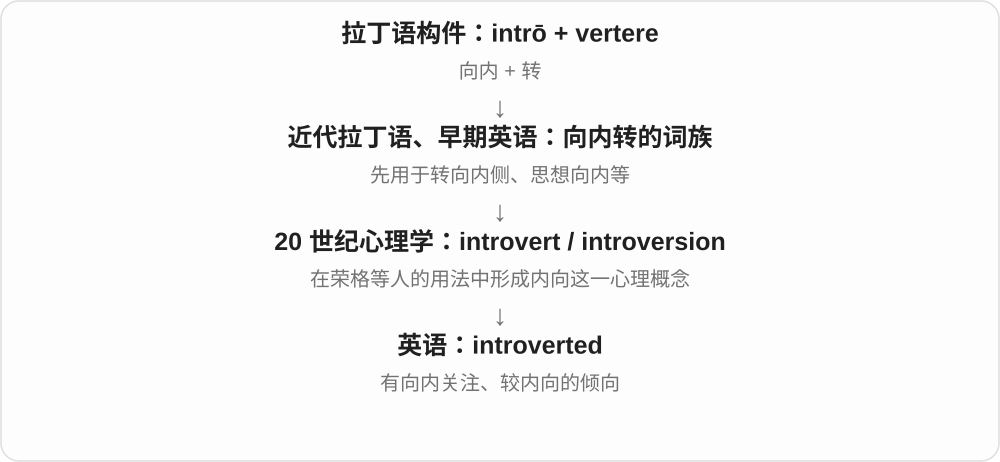

可以说 quite introverted 或 more introverted，表达程度差异。安静一天不代表性格固定，更不能据此判断人的能力。

**常见搭配与例句**

an introverted child；rather introverted；more introverted than…。

> He is introverted in large groups but talkative with his sister.

他在人多时比较内向，和姐姐在一起却很健谈。

> The class includes both outgoing and introverted students.

班上既有外向的学生，也有内向的学生。

**别混淆**

introverted 不是 withdrawn 的必然同义词；withdrawn 往往强调退缩、不愿接触的状态。

### 1086. pout — 噘嘴；噘嘴表示不高兴；噘起的嘴

**音标**：/paʊt/

**先抓住这个画面**

把嘴唇向前顶出来，就是 pout。它可以表示不满，也可以是拍照时故意摆出的样子。

**怎么拆**

中古英语已有噘嘴用途，远源不定，常与北欧、弗里斯语凸起、鼓起材料比较。不能凭一个猜测把全部历史讲死。

**怎么变成今天的意思**

**中古英语 pout 的噘嘴材料**  
更早来源不确定；有北欧、弗里斯语鼓起、凸出的比较

↓

**现代 pout 动词；名词沿动作发展**  
把嘴唇向前突出 → 不满、撒娇或摆拍的表情

pout at someone 是冲某人噘嘴，a pout 是噘起的嘴或一次噘嘴表情。

**常见搭配与例句**

a childish pout 孩子气的噘嘴；pout for the camera 对镜头噘嘴摆拍。

> She gave a little pout when the game ended.

游戏结束时，她轻轻噘了噘嘴。

> He tried to pout for the photograph but started laughing.

他想拍照时噘嘴摆个样子，却忍不住笑了。

**别混淆**

pout 是嘴唇动作，sulk 是带怨气、不肯理人的表现；可以一边生闷气一边噘嘴，但两词关注处不同。

### 1087. pouting — 正在噘嘴；噘起的嘴、噘嘴的表情

**音标**：/ˈpaʊtɪŋ/

**先抓住这个画面**

嘴唇正向前噘着，是 pouting；照片里那种特意突出的嘴形，也常用这个形式描述。

**怎么拆**

pout + 完整 -ing，直接相接；由嘴唇动作形成进行形式，也能修饰人的表情、嘴唇。

**怎么变成今天的意思**

**中古英语 pout 的噘嘴材料**  
更早来源不确定；有北欧、弗里斯语鼓起、凸出的比较

↓

**现代 pout 动词；名词沿动作发展**  
把嘴唇向前突出 → 不满、撒娇或摆拍的表情

↓

**pout + -ing → pouting**  
噘嘴的过程 → 噘起的表情

pouting at the camera 是对镜头噘嘴；pouting lips 是噘起的嘴唇。

**常见搭配与例句**

a pouting expression 噘嘴的表情；still pouting 还在噘着嘴。

> She was pouting because the game had ended.

游戏结束了，她正噘着嘴。

> The photograph caught him pouting at the camera.

照片拍下了他冲镜头噘嘴的样子。

**别混淆**

pouting 只凭嘴形就能描写，不总意味着真有怨气；sulking 则更直接说带不满的沉默态度。

### 1088. pouted — 噘嘴了；噘嘴表示了不满

**音标**：/ˈpaʊtɪd/

**先抓住这个画面**

刚才因不满意，嘴唇往前一顶，就是 pouted。它描述具体表情，不必另外猜这个人有多生气。

**怎么拆**

pout + 完整 -ed，/t/ 后读 /ɪd/；ou 是元音字母组合，现代拼写不双写 t。

**怎么变成今天的意思**

**中古英语 pout 的噘嘴材料**  
更早来源不确定；有北欧、弗里斯语鼓起、凸出的比较

↓

**现代 pout 动词；名词沿动作发展**  
把嘴唇向前突出 → 不满、撒娇或摆拍的表情

↓

**pout + -ed → pouted**  
过去噘嘴、以噘嘴表达不满

pouted at her 是朝她噘嘴；pouted and turned away 是噘嘴后转开。

**常见搭配与例句**

pouted in disappointment 失望地噘嘴了；pouted for a photograph 拍照时噘嘴摆样子了。

> She pouted when she heard that the shop was closed.

听说店关门了，她噘起嘴。

> He pouted at the camera and then grinned.

他对着镜头噘嘴，随后咧嘴笑了。

**别混淆**

pouted 有嘴唇的动作，complained 是用话表达不满；只噘嘴，也可能没有说什么。

### 1089. pouts — 噘嘴〔第三人称单数〕；几次噘嘴表情〔复数〕

**音标**：/paʊts/

**先抓住这个画面**

说她不满意时总把嘴唇一噘，用 pouts；几次刻意摆出的噘嘴表情，也可数出来。

**怎么拆**

pout + -s，/t/ 后读 /s/；名词、动词都可直接接这个词尾，/aʊ/ 保留。

**怎么变成今天的意思**

**中古英语 pout 的噘嘴材料**  
更早来源不确定；有北欧、弗里斯语鼓起、凸出的比较

↓

**现代 pout 动词；名词沿动作发展**  
把嘴唇向前突出 → 不满、撒娇或摆拍的表情

↓

**pout + -s → pouts**  
他、她噘嘴；几次噘嘴表情

pouts when disappointed 是一失望就噘嘴；playful pouts 是几次玩笑式的噘嘴。

**常见搭配与例句**

pouts at the camera 冲镜头噘嘴；angry pouts 不高兴的噘嘴表情。

> He pouts whenever the game does not go his way.

游戏不顺他的意时，他就噘嘴。

> Her playful pouts made the children laugh.

她几次玩笑式地噘嘴，逗得孩子们笑了。

**别混淆**

pouts 让人看见嘴唇向前突出；frowns 通常看见眉头皱起，两种动作可以分别发生。

### 1090. squeal — 尖声叫、尖厉地响；〔口语〕告密；一声尖叫

**音标**：/skwiːl/

**先抓住这个画面**

像小猪尖叫、孩子开心得拉长声音叫，或刹车发出刺耳长声，叫 squeal。抓住高、尖、常有拖长感。

**怎么拆**

承中古英语 squelen；大概拟声，也有联系古诺尔斯 skvala 的分析。整个词作基础，不把 -al 当这里的形容词后缀。

**怎么变成今天的意思**

**中古英语 squelen → squeal**  
尖叫材料；大概拟声，与古诺尔斯 skvala 等可比较

↓

**尖叫 → 人、动物、机器的尖声；口语告密义**  
从发出声音扩展到把别人的事说出去；不是每次尖叫都含告密义

squeal with delight 是开心尖叫；squeal on someone 在口语里是告某人的密，常带说话者不赞成的语气。

**常见搭配与例句**

a squeal of excitement 兴奋的尖叫；the squeal of brakes 刹车尖响。

> The children gave a squeal of delight when the puppy arrived.

小狗来了，孩子们开心得尖叫。

> We heard the squeal of brakes outside.

我们听见外面刹车刺耳地响。

**别混淆**

squeal 与 squeak 都尖，squeal 常更响、更长；告密义由搭配和情境决定，听到孩子 squeal 不能往告密上套。

### 1091. squealing — 正在尖叫、尖厉地响；一阵尖叫声；告密

**音标**：/ˈskwiːlɪŋ/

**先抓住这个画面**

尖叫声正持续或接连响起，是 squealing。孩子、猪、轮胎都可能成为主语，重点是听见的声音。

**怎么拆**

squeal + 完整 -ing；现代变化接在整个拟声基础词后，不拆成 sque + 形容词后缀。

**怎么变成今天的意思**

**中古英语 squelen → squeal**  
尖叫材料；大概拟声，与古诺尔斯 skvala 等可比较

↓

**尖叫 → 人、动物、机器的尖声；口语告密义**  
从发出声音扩展到把别人的事说出去；不是每次尖叫都含告密义

↓

**squeal + -ing → squealing**  
进行中的尖叫、尖响；相应声音

squealing children 是尖叫的孩子，squealing tyres 是尖响的轮胎；告密义常接 on，写谁被出卖。

**常见搭配与例句**

squealing with joy 开心地尖叫；the squealing of brakes 刹车尖响。

> The squealing children ran towards the ice cream van.

尖叫着的孩子们向冰激凌车跑去。

> The squealing of the brakes made us turn around.

刹车的尖响让我们转过头。

**别混淆**

squealing 偏尖厉声；screeching 常更突出摩擦般的刺耳感，边界不是严格的声音测量标准。

### 1092. squealed — 尖叫了、尖厉地响了；〔口语〕告密了

**音标**：/skwiːld/

**先抓住这个画面**

刚才声音突然拉高、尖利地冒出来，用 squealed。开心的喊声和受惊的叫声都可以这样写。

**怎么拆**

squeal + 完整 -ed，/l/ 后读 /d/；字母 l 保留，不双写。

**怎么变成今天的意思**

**中古英语 squelen → squeal**  
尖叫材料；大概拟声，与古诺尔斯 skvala 等可比较

↓

**尖叫 → 人、动物、机器的尖声；口语告密义**  
从发出声音扩展到把别人的事说出去；不是每次尖叫都含告密义

↓

**squeal + -ed → squealed**  
过去尖叫、尖响；另有口语告密义

squealed with delight 是开心得叫了，brakes squealed 是刹车尖响；squealed on someone 是告了某人的密。

**常见搭配与例句**

squealed in surprise 惊叫了；squealed around a corner 转弯时尖响。

> She squealed with delight when she saw the tickets.

她看到门票，开心得尖叫。

> The brakes squealed as the bus stopped.

公交车停下时，刹车发出刺耳尖响。

**别混淆**

squealed 不是所有大声说话的通称；低沉的吼声更适合 roar、bellow 等词。

### 1093. squeals — 尖声叫、尖厉响〔第三人称单数〕；一声声尖叫；告密

**音标**：/skwiːlz/

**先抓住这个画面**

小孩看到惊喜就尖声叫，或车轮转弯时刺耳地响，用 squeals；复数名词是几声尖叫。

**怎么拆**

squeal + -s，/l/ 后读 /z/。动词三单、声音名词复数同形。

**怎么变成今天的意思**

**中古英语 squelen → squeal**  
尖叫材料；大概拟声，与古诺尔斯 skvala 等可比较

↓

**尖叫 → 人、动物、机器的尖声；口语告密义**  
从发出声音扩展到把别人的事说出去；不是每次尖叫都含告密义

↓

**squeal + -s → squeals**  
它尖响；他、她尖叫；多声尖叫

squeals with excitement 是兴奋地叫，squeals on his friends 才是口语里告朋友的密。

**常见搭配与例句**

squeals in delight 开心尖叫；squeals of laughter 尖声大笑。

> The little girl squeals whenever the swing goes higher.

秋千荡高时，小女孩总会尖叫。

> Their squeals of laughter echoed down the hall.

他们尖声大笑的声音在走廊里回荡。

**别混淆**

squeals 可以是喜悦，也能是害怕、疼痛；声音尖这一点相同，情绪要看后面的词。

### 1094. swab — 拭子、吸水棉棒；用来擦拭或采样的棉团；擦、拭取样本

**音标**：英 /swɒb/；美 /swɑːb/

**先抓住这个画面**

拿一小团吸水的棉、布擦过表面，叫 swab；这团东西本身也叫 a swab，采样时则把表面一点材料带走。

**怎么拆**

较早清甲板工具名 swab 缩自 swabber，联系荷兰语 zwabber。动作词还可能由 swabber 逆构，不把历史全部写成先 swab 动词再加 -er。

**怎么变成今天的意思**

**荷兰语 zwabber 等 → 英语 swabber → 缩短工具名 swab**  
较早指清理甲板的绳纱拖把

↓

**工具名、动作词的进一步发展**  
swab 动词或由 swabber 逆构；后来也用于吸水棉、拭子及取样，现代拆分不等于最早记录顺序

a cotton swab 是棉棒，a throat swab 是咽拭子样本或取样用具，swab the deck 是擦洗甲板；语境决定大小与用途。

**常见搭配与例句**

take a swab 取一份拭子样本；swab a surface 擦拭表面、拭取样本。

> The artist used a cotton swab to soften the edge of the paint.

画家用棉棒把颜料边缘晕柔。

> The nurse took a swab from his throat.

护士从他的咽部取了一份拭子样本。

**别混淆**

swab 常明确用吸水材料擦、取样，wipe 泛指擦过；sample 是样本总称，不限定由拭子采得。

### 1095. swabs — 拭子、棉棒、拭子样本〔复数〕；擦拭、拭取样本〔第三人称单数〕

**音标**：英 /swɒbz/；美 /swɑːbz/

**先抓住这个画面**

几根棉棒、几份拭子样本，叫 swabs；一个人拿吸水材料擦表面，也可以用动词三单 swabs。

**怎么拆**

swab + -s，/b/ 后读 /z/；名词复数、动词三单同形。工具名的较早缩短路线另见基础词。

**怎么变成今天的意思**

**荷兰语 zwabber 等 → 英语 swabber → 缩短工具名 swab**  
较早指清理甲板的绳纱拖把

↓

**工具名、动作词的进一步发展**  
swab 动词或由 swabber 逆构；后来也用于吸水棉、拭子及取样，现代拆分不等于最早记录顺序

↓

**swab + -s → swabs**  
多根棉棒、多个样本；他、她擦拭

cotton swabs 是棉棒，collect swabs 是收集拭子样本；swabs the deck 是擦洗甲板，属于动词第三人称单数。

**常见搭配与例句**

clean swabs 干净棉棒；swabs a surface 擦拭、取样表面。

> She used cotton swabs to blend the colours.

她用棉棒把颜色晕开。

> The technician swabs each handle in turn.

技术人员按顺序擦拭每只把手。

**别混淆**

swabs 不等于所有 tests 检测：拭子是工具、采样方式或样本，检测还可能用血液等其他材料。

### 1096. swabbed — 擦拭了、擦洗了；用拭子取样了

**音标**：英 /swɒbd/；美 /swɑːbd/

**先抓住这个画面**

刚才用棉团、布或拖把擦过一处，叫 swabbed；检查、采样场景里，可以是用拭子擦取了材料。

**怎么拆**

swab 双写 b + 完整 -ed → swabbed，/b/ 后读 /d/；重读短元音单音节后一个辅音字母，按规则双写。

**怎么变成今天的意思**

**荷兰语 zwabber 等 → 英语 swabber → 缩短工具名 swab**  
较早指清理甲板的绳纱拖把

↓

**工具名、动作词的进一步发展**  
swab 动词或由 swabber 逆构；后来也用于吸水棉、拭子及取样，现代拆分不等于最早记录顺序

↓

**swab 双写 b + -ed → swabbed**  
过去擦拭、擦洗或拭取样本

swabbed the deck 是擦洗了甲板，swabbed the surface 是擦拭或采样表面；具体功能由工具、后续动作说明。

**常见搭配与例句**

swabbed down a counter 擦过台面；swabbed for traces 拭取微量材料。

> The crew swabbed the deck before breakfast.

船员早饭前擦洗了甲板。

> The technician swabbed the handle to collect a sample.

技术人员用拭子擦取把手上的材料，采集样本。

**别混淆**

swabbed 说采用了吸水材料接触表面的动作；scrubbed 更常强调来回用力擦，力度、目的可能不同。

### 1097. swabbing — 正在擦拭、擦洗；拭子采样及其过程

**音标**：英 /ˈswɒbɪŋ/；美 /ˈswɑːbɪŋ/

**先抓住这个画面**

吸水材料正擦过甲板、皮肤或物品表面，是 swabbing。语境可以是清洁，也可以是把少量材料收集起来。

**怎么拆**

swab 双写 b + 完整 -ing → swabbing；双写保留短元音基础词的拼写，不代表多一次擦拭。

**怎么变成今天的意思**

**荷兰语 zwabber 等 → 英语 swabber → 缩短工具名 swab**  
较早指清理甲板的绳纱拖把

↓

**工具名、动作词的进一步发展**  
swab 动词或由 swabber 逆构；后来也用于吸水棉、拭子及取样，现代拆分不等于最早记录顺序

↓

**swab 双写 b + -ing → swabbing**  
擦拭、采样的过程

swabbing the deck 是正擦洗甲板，surface swabbing 是表面拭子采样；名词活动不一定只指眼前进行的动作。

**常见搭配与例句**

swabbing down the table 擦拭桌面；swabbing for a sample 拭取样本。

> The sailors were swabbing the deck.

水手们正擦洗甲板。

> The technician spent the morning swabbing several surfaces.

技术人员上午在几处表面做拭子采样。

**别混淆**

swabbing、sampling 可重合，但 sampling 更广；swabbing 具体说明通过擦过表面来采材料。

### 1098. collared — 有领的；戴项圈的；被抓住的

**音标**：英 /ˈkɒləd/；美 /ˈkɑːlərd/

**先抓住这个画面**

衣服带着领子，动物戴着项圈；若接人的动作，也可能是被逮住。

**怎么拆**

collar + -ed；中古英语已有 colered。-ed 可说具有某物，也可作动词的过去分词。

**怎么变成今天的意思**

**拉丁 collum**  
脖子

↓

**拉丁 collare → 古法语 coler → 中古英语 coler → collar**  
围住脖子的东西 → 衣领、项圈

↓

**中古英语 colered；英语 collar + -ed → collared**  
有衣领、戴项圈；也可表示已抓住

a collared shirt 是有领衬衫；a collared wolf 可指装了追踪项圈的狼。was collared by police 则是口语里的被警方逮住。

**常见搭配与例句**

a collared shirt；a collared animal；be collared by。

> The restaurant asks staff to wear collared shirts.

餐厅要求员工穿有领衬衫。

> Researchers tracked the collared wolves through the forest.

研究人员追踪戴着项圈的狼在森林中的活动。

**别混淆**

collared 不一定表示动作被动；放在 shirt 前通常只是说有领子。

### 1099. falter — 开始不稳、迟疑；声音发颤；进展减弱

**音标**：英 /ˈfɔːltə/；美 /ˈfɔltɚ/

**先抓住这个画面**

说到难处声音停顿，信心突然松了一下，或生意增长开始没劲，都能 falter。像原本平稳向前的一步开始晃。

**怎么拆**

较早指踉跄、摇晃；来源未定，有北欧受困、迟疑材料，或中古英语 falden 折叠的反复动作分析。不能直接当作 fault 加 -er。

**怎么变成今天的意思**

**较早 falter：踉跄、摇晃；来源未定**  
有北欧迟疑、受困材料，或反复折叠材料等分析

↓

**动作、声音不稳 → 信心、进展动摇**  
unfaltering 以否定 un- 表不动摇、不中断

her voice began to falter 她的声音开始发颤；confidence may falter。

**常见搭配与例句**

growth starts to falter；never falter 从不动摇。

> Her voice began to falter as she told the story.

讲那个故事时，她的声音开始发颤。

> Do not let one setback make your confidence falter.

别让一次挫折就动摇了信心。

**别混淆**

falter 是开始不稳、迟疑，stop 是停住；声音颤一下、增长放缓，并不一定完全结束。

### 1100. faltered — 曾迟疑、不稳；声音发颤了；进展减弱了

**音标**：英 /ˈfɔːltəd/；美 /ˈfɔltɚd/

**先抓住这个画面**

刚才说得好好的，突然卡了一下、声音不稳，可以说 faltered。也可说支持、信心、增长在那一段减弱了。

**怎么拆**

falter + 完整 -ed，读 /d/；过去式、过去分词，不另加 /ɪd/。

**怎么变成今天的意思**

**较早 falter：踉跄、摇晃；来源未定**  
有北欧迟疑、受困材料，或反复折叠材料等分析

↓

**动作、声音不稳 → 信心、进展动摇**  
unfaltering 以否定 un- 表不动摇、不中断

↓

**falter + -ed → faltered**  
过去一度迟疑、动摇或减弱

her voice faltered；confidence faltered；growth faltered。

**常见搭配与例句**

never faltered 从未动摇；faltered for a moment。

> She faltered for a moment, then continued speaking.

她迟疑了一下，随后继续说。

> His confidence never faltered during the difficult weeks.

那几周很艰难，他的信心却从未动摇。

**别混淆**

faltered for a moment 可以只是不稳片刻，gave up 是放弃；短暂迟疑之后仍能继续。

### 1101. faltering — 不稳、迟疑的；断断续续的；正在减弱的

**音标**：英 /ˈfɔːltərɪŋ/；美 /ˈfɔltərɪŋ/

**先抓住这个画面**

话说得不连贯，是 a faltering voice；经济恢复得慢、还不稳定，是 a faltering recovery。不是已经彻底失败，而是继续得不稳。

**怎么拆**

falter + -ing；过程形式也可作形容词，写声音、步伐、进展的迟疑不稳。

**怎么变成今天的意思**

**较早 falter：踉跄、摇晃；来源未定**  
有北欧迟疑、受困材料，或反复折叠材料等分析

↓

**动作、声音不稳 → 信心、进展动摇**  
unfaltering 以否定 un- 表不动摇、不中断

↓

**falter + -ing → faltering**  
正在不稳、减弱，或带这种性质

a faltering voice 迟疑发颤的声音；a faltering economy。

**常见搭配与例句**

faltering steps 不稳的步子；faltering confidence。

> He answered in a faltering voice.

他用有些迟疑、发颤的声音回答。

> The report described a faltering economic recovery.

报告形容经济恢复得迟缓而不稳定。

**别混淆**

faltering recovery 是恢复不稳，complete recovery 是恢复完全；处于过程不表示已经到达结果。

### 1102. falters — 开始不稳、迟疑、减弱〔第三人称单数〕

**音标**：英 /ˈfɔːltəz/；美 /ˈfɔltɚz/

**先抓住这个画面**

增长原本顺畅，后来明显放慢，是 growth falters；讲到某一处声音颤了，也是 falters。共同点是没能继续稳稳往前。

**怎么拆**

falter + -s，读 /z/；基础词近源有不同分析，不把它与 fault 错误机械合成。

**怎么变成今天的意思**

**较早 falter：踉跄、摇晃；来源未定**  
有北欧迟疑、受困材料，或反复折叠材料等分析

↓

**动作、声音不稳 → 信心、进展动摇**  
unfaltering 以否定 un- 表不动摇、不中断

↓

**falter + -s → falters**  
它开始不稳、迟缓或减弱

her voice falters；his confidence falters；growth falters。

**常见搭配与例句**

never falters 从不动摇；falters at a crucial moment。

> His voice falters when he mentions the old house.

提到老房子时，他的声音有些发颤。

> The plan needs support when progress falters.

进展不顺时，计划需要支持。

**别混淆**

falters 不一定是犯错误，makes a mistake 才直接说弄错；犹豫一下可能还答得正确。

### 1103. unfaltering — 坚定不移的；稳定而不中断的

**音标**：英 /ʌnˈfɔːltərɪŋ/；美 /ʌnˈfɔltərɪŋ/

**先抓住这个画面**

困难变多，支持却没有松动；声音从头到尾稳稳的，都能说 unfaltering。像走一条路，步伐没有突然软下来。

**怎么拆**

否定 un- + faltering；不是撤回某个动作，而是否定迟疑、失稳这类性质。

**怎么变成今天的意思**

**较早 falter：踉跄、摇晃；来源未定**  
有北欧迟疑、受困材料，或反复折叠材料等分析

↓

**动作、声音不稳 → 信心、进展动摇**  
unfaltering 以否定 un- 表不动摇、不中断

↓

**un- + faltering → unfaltering**  
不迟疑、不动摇，保持稳定

unfaltering support 始终不变的支持；unfaltering determination。

**常见搭配与例句**

an unfaltering voice；unfaltering commitment。

> Her unfaltering support helped us through the hardest weeks.

她始终不变的支持帮我们度过了最难的几周。

> He read the statement in an unfaltering voice.

他用稳定、毫不迟疑的声音读完声明。

**别混淆**

unfaltering 强调不中断、不动摇，correct 才说正确；一个决定可以很坚定，却仍需要检验是否正确。

### 1104. unfalteringly — 坚定不移、毫不迟疑地；始终稳定地

**音标**：英 /ʌnˈfɔːltərɪŋli/；美 /ʌnˈfɔltərɪŋli/

**先抓住这个画面**

路很难走，却一步步稳稳继续；面对压力仍保持同样的支持，是 unfalteringly。它说明怎样坚持，不保证判断永远无误。

**怎么拆**

unfaltering + -ly；内部仍可看 un- 否定 + falter + -ing，最外层 -ly 说动作方式。

**怎么变成今天的意思**

**较早 falter：踉跄、摇晃；来源未定**  
有北欧迟疑、受困材料，或反复折叠材料等分析

↓

**动作、声音不稳 → 信心、进展动摇**  
unfaltering 以否定 un- 表不动摇、不中断

↓

**unfaltering + -ly → unfalteringly**  
以不动摇、不间断的方式行动

support unfalteringly 始终坚定支持；continue unfalteringly。

**常见搭配与例句**

speak unfalteringly；work unfalteringly towards a goal。

> She supported the project unfalteringly through every setback.

每遇一次挫折，她都始终坚定地支持这个项目。

> He continued unfalteringly despite the interruptions.

虽然不断被打断，他仍毫不迟疑地继续下去。

**别混淆**

unfalteringly 强调稳定、坚定，unfailingly 常强调每次都如此；频率的可靠与过程中不动摇可以相近但侧重不同。

### 1105. falteringly — 迟疑、不稳、断断续续地

**音标**：英 /ˈfɔːltərɪŋli/；美 /ˈfɔltərɪŋli/

**先抓住这个画面**

话想说出口，却一句停一下，或脚步还不稳地向前，是 falteringly。它把不稳、迟疑落实到动作方式。

**怎么拆**

faltering + -ly；先由 falter 加 -ing 成分词、形容词，再加方式副词后缀。

**怎么变成今天的意思**

**较早 falter：踉跄、摇晃；来源未定**  
有北欧迟疑、受困材料，或反复折叠材料等分析

↓

**动作、声音不稳 → 信心、进展动摇**  
unfaltering 以否定 un- 表不动摇、不中断

↓

**falter → faltering → falteringly**  
动作不稳，到迟疑的，再到迟疑地

speak falteringly 断断续续地说；move falteringly。

**常见搭配与例句**

begin falteringly 起步不顺；answer falteringly。

> She began falteringly, unsure how to explain.

她不知道怎么解释，开口时有些迟疑。

> He moved falteringly towards the chair.

他步子不稳地朝椅子走去。

**别混淆**

quietly 只说声音小，falteringly 说不连贯、迟疑；声音很轻也可以流畅坚定。

### 1106. shunt — 转移、推到一边；给列车转轨、调车；旁路、分流通路

**音标**：/ʃʌnt/

**先抓住这个画面**

把车厢从主轨拨去侧轨，是 shunt；一个人被一处推给另一处、得不到正面处理，也像被不断拨到别的支路。

**怎么拆**

承中古英语 shunten 的突然移开、退避义，可能联系 shun 的避开材料。铁路采用后，侧轨画面很适合理解后来的转移用法。

**怎么变成今天的意思**

**中古英语 shunten 的突然移开、退避 → shunt**  
可能联系 shun，并受其他相似形式影响，具体早期形成未定

↓

**拨到一边 → 铁路转轨、调车；物或人转往别处**  
像把原本沿主线走的对象拨入另一条路径

shunt wagons into a siding 是把货车厢调入侧线，shunt someone around 是把人转来转去；电路 shunt 则是分流、旁路。

**常见搭配与例句**

shunt aside 拨到一边；an electrical shunt 电路中的分流支路或装置。

> The engine will shunt the wagons into a siding.

机车会把货车厢调入侧线。

> They kept trying to shunt the problem onto another department.

他们一直想把问题推给另一个部门。

**别混淆**

shunt 常带被拨离主线、转到别处的感觉，move 更中性；说人被 shunted around，常暗含处理不够重视。

### 1107. shunted — 转移、调车、拨到一边了；被转来转去的

**音标**：/ˈʃʌntɪd/

**先抓住这个画面**

刚才车厢被移去侧轨，或请求被推到另一个部门，是 shunted。说人被这样安排，常有没被放在主要位置的感觉。

**怎么拆**

shunt + 完整 -ed，/t/ 后读 /ɪd/；nt 后直接加，现代规则过去、过去分词。

**怎么变成今天的意思**

**中古英语 shunten 的突然移开、退避 → shunt**  
可能联系 shun，并受其他相似形式影响，具体早期形成未定

↓

**拨到一边 → 铁路转轨、调车；物或人转往别处**  
像把原本沿主线走的对象拨入另一条路径

↓

**shunt + -ed → shunted**  
过去转到支路、别处；被拨开

shunted into a siding 是调入侧线，shunted from office to office 是被各办公室转来转去；shunted aside 是被搁到一边。

**常见搭配与例句**

shunted onto a side road 被导向支路；shunted out of the way 被挪开。

> The wagons were shunted onto a side track.

货车厢被调入侧轨。

> She felt she was being shunted from one office to another.

她觉得自己正被一个办公室推给另一个办公室。

**别混淆**

shunted 在被转来转去的场景常有被动、不受重视的感觉；transferred 可以中性地说正式调动，不必含这种语气。

### 1108. shunting — 正在转移、拨开、调车；调车、分流

**音标**：/ˈʃʌntɪŋ/

**先抓住这个画面**

车厢正被一节节挪向另一条轨，是 shunting；把问题、人转来转去，也可沿这个“拨到别处”的动作理解。

**怎么拆**

shunt + 完整 -ing，直接加；既可描述进行动作，也可作铁路调车、分流等动作名词。

**怎么变成今天的意思**

**中古英语 shunten 的突然移开、退避 → shunt**  
可能联系 shun，并受其他相似形式影响，具体早期形成未定

↓

**拨到一边 → 铁路转轨、调车；物或人转往别处**  
像把原本沿主线走的对象拨入另一条路径

↓

**shunt + -ing → shunting**  
改走支路、调动车厢的过程

a shunting yard 是铁路调车场，shunting wagons 是调车；shunting responsibility elsewhere 是把责任推往别处。

**常见搭配与例句**

shunting operations 调车作业；shunting people around 把人转来转去。

> The engine was shunting wagons in the yard.

机车正在调车场里调动车厢。

> They were shunting the responsibility from one team to another.

他们正把责任从一个团队推给另一个团队。

**别混淆**

shunting 是调整车厢位置、路线的操作，travelling by train 是乘车旅行；两者都有火车，却在讲不同活动。

### 1109. shunts — 转移、调车、拨开〔第三人称单数〕；旁路、分流装置〔复数〕

**音标**：/ʃʌnts/

**先抓住这个画面**

一台机车把车厢推到另一条轨，叫 shunts；电流多走一条旁路的装置，也可用名词复数 shunts。

**怎么拆**

shunt + -s，/t/ 后读 /s/，结尾 /nts/；动词三单与旁路、分流等名词复数同形。

**怎么变成今天的意思**

**中古英语 shunten 的突然移开、退避 → shunt**  
可能联系 shun，并受其他相似形式影响，具体早期形成未定

↓

**拨到一边 → 铁路转轨、调车；物或人转往别处**  
像把原本沿主线走的对象拨入另一条路径

↓

**shunt + -s → shunts**  
它把对象拨到另一条路径；多个分流装置

shunts the wagons 是调动车厢，shunts the request elsewhere 是把请求转到别处；current shunts 是电流分流器。

**常见搭配与例句**

shunts traffic onto a side road 把车流导向支路；electrical shunts 分流装置。

> The small engine shunts wagons around the yard.

小机车在调车场里调动车厢。

> The engineer checked the shunts in the circuit.

工程师检查了电路里的分流装置。

**别混淆**

shunts 的铁路、一般转移、分流都能抓住改走支路的画面；技术名词的具体装置仍要由场景判断。

### 1110. dampen — 使微湿；减弱、抑制

**音标**：/ˈdæmpən/

**先抓住这个画面**

抹布干了，稍微弄湿可以 dampen；一个坏消息让兴致低下来，也叫 dampen。把强度压低的画面很有用，但历史并不只从水开始。

**怎么拆**

damp + -en 形成动词，旧有削弱、压低的用法，弄湿义后来出现。今天两支都常见。

**怎么变成今天的意思**

**中古英语 damp 令人窒息的蒸气等，日耳曼相关材料**  
确切本族、借词路线未定

↓

**damp 先有压抑、抑制等，后有微湿、弄湿常用义**  
记忆可借湿物压火，不能当全部历史顺序

↓

**damp + -en、-er、-ness**  
弄湿、减弱；抑制装置；湿气状态

↓

**damp + -en → dampen**  
使进入相应状态：减弱或微湿

dampen a cloth 弄湿抹布；dampen enthusiasm 挫伤热情；dampen expectations 压低预期。

**常见搭配与例句**

dampen a cloth；dampen enthusiasm。

> Dampen the cloth before wiping the shelf.

擦架子前，先把抹布稍微弄湿。

> The delay did not dampen their enthusiasm.

延误没有挫伤他们的热情。

**别混淆**

damp、dampen 都可用于减弱等义，不硬分为前者只技术、后者只情绪；弄湿时 dampen 常见。

### 1111. dampened — 弄微湿了；减弱了、使扫兴了

**音标**：/ˈdæmpənd/

**先抓住这个画面**

布刚才被稍微润湿，或一条消息给热情泼了点冷水，用 dampened。两义都常见，但真实记录先有削弱义。

**怎么拆**

damp + -en → dampen，再加完整 -ed，/n/ 后读 /d/；不是 damp 直接加一个 -ened 后缀。

**怎么变成今天的意思**

**damp + 使动 -en → dampen**  
较早已有削弱、压低作用的用法

↓

**弄湿义后来也常用**  
现代可说微微弄湿，也可说压低热情；现代助记不等于记录先后

↓

**dampen + -ed → dampened**  
过去弄微湿、压低强度或兴致

dampened cloth 是润湿的布，dampened our hopes 是打击了希望；可以有程度轻重，并非一律全毁。

**常见搭配与例句**

slightly dampened 稍微润湿、削弱；dampened spirits 受挫的兴致。

> He dampened the cloth with a little water.

他用一点水把布润湿。

> The delay dampened our excitement.

延误让我们的兴奋劲低了些。

**别混淆**

dampened 讲影响后的变化，damp 可直接形容微湿状态；a damp cloth 不交代谁、何时把它弄湿。

### 1112. dampening — 正在弄微湿、减弱；使人扫兴的

**音标**：/ˈdæmpənɪŋ/

**先抓住这个画面**

湿度正被稍微加上去，或兴致、强度正被压低，是 dampening。把 damp 的相关状态变成使它发生的动作，再展开过程。

**怎么拆**

damp + 使动 -en → dampen，再加完整 -ing；没有去掉 en，也不再双写 n。

**怎么变成今天的意思**

**damp + 使动 -en → dampen**  
较早已有削弱、压低作用的用法

↓

**弄湿义后来也常用**  
现代可说微微弄湿，也可说压低热情；现代助记不等于记录先后

↓

**dampen + -ing → dampening**  
使微湿、减弱的过程或作用

dampening the paper 是把纸稍微润湿，dampening enthusiasm 是正减弱热情；声学等也可写降低振动、声音。

**常见搭配与例句**

a dampening effect 压低强度、兴致的作用；dampening a cloth 润湿布。

> She was dampening the paper before shaping it.

她正把纸稍微润湿，再做造型。

> The long wait was dampening everyone’s enthusiasm.

久等正在消磨大家的热情。

**别混淆**

dampening 是过程、作用，dampness 是微湿这一状态；不是看见 damp 开头就都译成潮气。

### 1113. dampens — 使微湿；减弱、打击热情〔第三人称单数〕

**音标**：/ˈdæmpənz/

**先抓住这个画面**

把布稍微弄湿，或让原本很高的兴致低下来，都用 dampens。现代可用湿布压火帮助联想，但历史不是先湿后扫兴这一条线。

**怎么拆**

damp + 使动 -en → dampen，再加三单 -s，/n/ 后读 /z/；保留完整的使动层。

**怎么变成今天的意思**

**damp + 使动 -en → dampen**  
较早已有削弱、压低作用的用法

↓

**弄湿义后来也常用**  
现代可说微微弄湿，也可说压低热情；现代助记不等于记录先后

↓

**dampen + -s → dampens**  
它使微湿、减弱或扫兴

dampens the cloth 是把布弄微湿，dampens enthusiasm 是减弱热情；削弱义记录早于弄湿义。

**常见搭配与例句**

dampens spirits 打击兴致；dampens the surface 把表面稍微润湿。

> The bad weather dampens our enthusiasm for the trip.

坏天气让我们对旅行的热情低了些。

> She dampens the cloth before wiping the table.

她擦桌子前先把布稍微弄湿。

**别混淆**

dampens 常是降低强度，不一定完全消灭；dampens enthusiasm 不等于 everyone gives up 所有人放弃。

### 1114. smudge — 污痕、蹭痕；蹭脏、抹糊、晕开

**音标**：/smʌdʒ/

**先抓住这个画面**

湿墨没干，手一蹭，字边散开成黑糊糊的一块，是 smudge。炭笔画里有意用手把阴影抹柔，也能用同一个动作。

**怎么拆**

接较早 smogen 等弄脏、抹黑材料，更远来源未定；现代抹开、抹糊义后来发展。浓烟相关同形义的联系也有来源疑问。

**怎么变成今天的意思**

**中古英语 smogen 等弄脏、抹黑材料 → smudge**  
更早来源不明，可比较德荷弄脏词形，但不能定为 smoke 的改造

↓

**污痕 → 擦开、抹糊线条；现代绘画也可有意抹柔**  
轮廓不再清楚，像手蹭过湿墨、炭粉或妆容

a smudge of ink 是一块墨迹，smudge the writing 是把字蹭花；smudge the charcoal 是抹开炭粉形成柔边。

**常见搭配与例句**

a dirty smudge 一块污痕；smudge easily 容易蹭花。

> There was a black smudge on the edge of the page.

页边有一块黑色蹭痕。

> Be careful not to smudge the wet ink.

小心别把未干的墨迹蹭花。

**别混淆**

smudge 常让轮廓变糊、留下蹭痕，stain 更宽，可能是渗进材料的污渍；泼咖啡染色不一定需要来回抹。

### 1115. smudged — 蹭脏、抹花、晕开了；带蹭痕、模糊的

**音标**：/smʌdʒd/

**先抓住这个画面**

刚才手碰到湿墨，字变成模糊一团，是 smudged；妆、炭笔线条也能被抹得没那么清楚。

**怎么拆**

smudge 去末尾 e + 完整 -ed → smudged，/dʒ/ 后读 /d/，结尾 /dʒd/，不增 /ɪd/ 音节。

**怎么变成今天的意思**

**中古英语 smogen 等弄脏、抹黑材料 → smudge**  
更早来源不明，可比较德荷弄脏词形，但不能定为 smoke 的改造

↓

**污痕 → 擦开、抹糊线条；现代绘画也可有意抹柔**  
轮廓不再清楚，像手蹭过湿墨、炭粉或妆容

↓

**smudge 去 e + -ed → smudged**  
过去留下蹭痕；轮廓已抹糊

smudged ink 是被蹭花的墨，smudged makeup 是晕开的妆；smudged the charcoal 是抹柔炭笔痕，也可有意做。

**常见搭配与例句**

a smudged signature 蹭花的签名；smudged around the edges 边缘被抹糊。

> The address was smudged and hard to read.

地址被蹭花了，很难辨认。

> She smudged the charcoal with her thumb to soften the shadow.

她用拇指抹开炭粉，让阴影柔和些。

**别混淆**

smudged 常失去清晰边缘，faded 是颜色变淡；字可以颜色很深却蹭糊，也可边缘清楚却年久褪色。

### 1116. smudges — 污痕、蹭痕〔复数〕；蹭脏、抹糊、晕开〔第三人称单数〕

**音标**：/ˈsmʌdʒɪz/

**先抓住这个画面**

纸上几块指头蹭出的灰黑痕，是 smudges；一种墨水一碰就花，动词也可说 it smudges。

**怎么拆**

smudge + -s，基础末尾已有 e，直接加 s；/dʒ/ 后读 /ɪz/，名词复数与动词三单同形。

**怎么变成今天的意思**

**中古英语 smogen 等弄脏、抹黑材料 → smudge**  
更早来源不明，可比较德荷弄脏词形，但不能定为 smoke 的改造

↓

**污痕 → 擦开、抹糊线条；现代绘画也可有意抹柔**  
轮廓不再清楚，像手蹭过湿墨、炭粉或妆容

↓

**smudge + -s → smudges**  
几块蹭痕；它蹭花、晕开

finger smudges 是指头留下的蹭痕，ink smudges easily 是墨迹容易蹭花；不同句型分别指结果、发生动作。

**常见搭配与例句**

smudges on the glass 玻璃上的蹭痕；smudges the outline 把轮廓抹糊。

> The glass was covered in finger smudges.

玻璃上满是手指留下的蹭痕。

> This ink smudges if you touch it too soon.

这种墨迹没等干就碰，会蹭花。

**别混淆**

smudges 常是不清晰的一块、一道痕，dots 可以是清楚的小点；污痕不一定长得像圆点。

### 1117. smudging — 正在蹭脏、抹花、晕开；抹柔、擦开的手法

**音标**：/ˈsmʌdʒɪŋ/

**先抓住这个画面**

手指正让线、色块散开，变成没那么利落的边，是 smudging；可以是弄花字迹，也可以是画阴影时有意揉开。

**怎么拆**

smudge 去末尾 e + 完整 -ing → smudging；g 在 i 前仍读 /dʒ/，分词和动作名词同形。

**怎么变成今天的意思**

**中古英语 smogen 等弄脏、抹黑材料 → smudge**  
更早来源不明，可比较德荷弄脏词形，但不能定为 smoke 的改造

↓

**污痕 → 擦开、抹糊线条；现代绘画也可有意抹柔**  
轮廓不再清楚，像手蹭过湿墨、炭粉或妆容

↓

**smudge 去 e + -ing → smudging**  
留下蹭痕、擦开轮廓的过程

smudging the ink 是正蹭花墨迹，smudging charcoal 是抹开炭笔粉；prevent smudging 是防止蹭花。

**常见搭配与例句**

smudging around the eyes 眼周妆晕开；a smudging technique 抹柔边缘的手法。

> He was smudging the pencil lines with his sleeve.

他的袖子正把铅笔线蹭花。

> She used smudging to create a softer shadow.

她用抹柔的手法，让阴影更柔和。

**别混淆**

smudging 可故意也可无意，ruining 是把东西毁坏的评价；画家有意抹柔线条，不等于毁画。

### 1118. belted — 有腰带、系腰带的；有环带的；用力击打、唱出的〔分词〕

**音标**：/ˈbeltɪd/

**先抓住这个画面**

外套用腰带收住，是 belted coat；牛身上有一圈白色带状花纹，也能借这个词形容。

**怎么拆**

belt + -ed，形容词可说装有带子、围着带状结构。它也同时是动词过去式、分词；/t/ 后词尾读 /ɪd/。

**怎么变成今天的意思**

**古英语 belt，远接拉丁 balteus 等腰带词**  
围在身上的带子

↓

**英语带状形象扩展**  
传动带、地带、环带；击打、放声唱等动词另有固定发展

↓

**belt + -ed → belted**  
有带、带状环纹；或系带、用力击打等动作的完成形式

a belted coat 系腰带外套，a belted dress 有腰带的连衣裙，belted cattle 有环带状花纹的牛。

**常见搭配与例句**

a belted coat；a belted dress；a belted waist。

> She wore a belted coat over her dress.

她在连衣裙外穿了一件系腰带的外套。

> The display included a belted dress from the 1950s.

展品中有一件二十世纪五十年代的有腰带连衣裙。

**别混淆**

belted 不只表示曾被抽打。看 coat、dress 时往往是服装结构；看 she belted out 时则是放声唱的过去动作。

### 1119. multifaceted — 多面的；多层次的

**音标**：/ˌmʌl.tiˈfæ.sə.tɪd/

**先抓住这个画面**

像一颗有许多切面的宝石，同一件事从不同方向看会露出不同内容，便是 multifaceted。

**怎么拆**

multi-（多）+ facet（小面）+ -ed（具有……的）。

**怎么变成今天的意思**

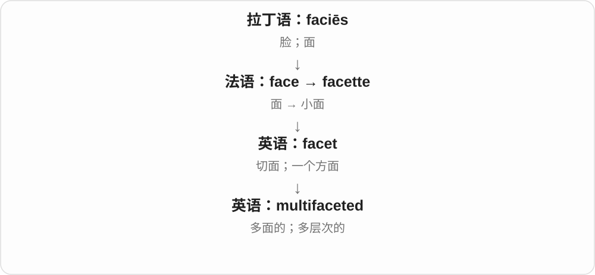

具体的许多切面被借来形容人的才能、问题的结构或计划的内容。重点是多个方面，而非单纯数量大。

**常见搭配与例句**

a multifaceted problem；a multifaceted approach；a multifaceted career。

> Housing is a multifaceted problem.

住房是一个涉及多方面的问题。

> The exhibition reveals her multifaceted talent.

展览展现了她多方面的才华。

**别混淆**

complicated 是复杂；multifaceted 强调包含若干不同方面，未必混乱难懂。

### 1120. creak — 嘎吱响；嘎吱声

**音标**：/kriːk/

**先抓住这个画面**

踩到旧木地板、慢慢推开生涩的门，听见拉扯摩擦般的“嘎吱”，就是 creak。常是东西受力或移动时发出的粗涩声。

**怎么拆**

接中古英语 creken 的旧发声材料，大概拟声；后来用于门轴、木板等摩擦声。现代 creak 是完整基础词。

**怎么变成今天的意思**

**中古英语 creken → creak**  
粗涩的叫声材料，大概拟声；可与古英语 cræccettan 比较

↓

**后来常写门轴、木板、关节等嘎吱声**  
动词 → 声音名词；再有 creaky 易嘎吱响、老旧不灵活

the floorboards creak 是地板嘎吱响，with a creak 是伴着一声嘎吱；动作慢慢展开时尤其有画面感。

**常见搭配与例句**

a creak from the stairs 楼梯传来的嘎吱声；creak under someone’s weight 被人踩得嘎吱响。

> The old stairs began to creak under our weight.

我们走上去，旧楼梯开始嘎吱响。

> The door opened with a long creak.

门伴着长长一声嘎吱打开了。

**别混淆**

creak 与 creek 小溪常同音，来源、拼写分开。squeak 偏更细高的吱声，creak 常更粗、更像受力摩擦。

### 1121. creaking — 正在嘎吱响；嘎吱声；嘎吱响的

**音标**：/ˈkriːkɪŋ/

**先抓住这个画面**

门轴、木板或旧椅子的粗涩声正响着，叫 creaking。可以把响声当名词，也可以修饰正在响的东西。

**怎么拆**

creak + 完整 -ing，直接相接；保留 ea 的 /iː/，不双写 k。

**怎么变成今天的意思**

**中古英语 creken → creak**  
粗涩的叫声材料，大概拟声；可与古英语 cræccettan 比较

↓

**后来常写门轴、木板、关节等嘎吱声**  
动词 → 声音名词；再有 creaky 易嘎吱响、老旧不灵活

↓

**creak + -ing → creaking**  
嘎吱响的过程、声音或状态

a creaking chair 是嘎吱响的椅子，the creaking of the stairs 是楼梯嘎吱声；也可比喻老系统吃力运转。

**常见搭配与例句**

creaking floorboards 嘎吱响的地板；creaking under the strain 重压下吃力运转。

> The creaking of the stairs woke me.

楼梯嘎吱的声音把我弄醒了。

> He settled into a creaking wooden chair.

他在一把嘎吱响的木椅上坐下。

**别混淆**

creaking 偏当前的响声、运作，creaky 常直接说东西容易这样响或显得老旧；两个形式有重合。

### 1122. creaks — 嘎吱响〔第三人称单数〕；一声声嘎吱响

**音标**：/kriːks/

**先抓住这个画面**

每走一步地板就粗粗摩擦一响，用 creaks；名词复数则是那些零星的嘎吱声。

**怎么拆**

creak + -s，/k/ 后读 /s/；动词三单、声音名词复数同形。

**怎么变成今天的意思**

**中古英语 creken → creak**  
粗涩的叫声材料，大概拟声；可与古英语 cræccettan 比较

↓

**后来常写门轴、木板、关节等嘎吱声**  
动词 → 声音名词；再有 creaky 易嘎吱响、老旧不灵活

↓

**creak + -s → creaks**  
它嘎吱响；多声嘎吱响

creaks in the wind 是风吹得嘎吱响，a few creaks 是几声嘎吱；常见于木结构、门或椅子。

**常见搭配与例句**

creaks underfoot 脚下一踩就嘎吱响；faint creaks 轻微的嘎吱声。

> The wooden floor creaks near the window.

窗边的木地板一踩就嘎吱响。

> A few creaks broke the silence of the house.

几声嘎吱响打破屋里的寂静。

**别混淆**

creaks 是嘎吱发声，cracks 常说裂开或啪地一响；地板 creaks 不等于叙述它裂成了几块。

### 1123. creaked — 嘎吱响了；嘎吱响着移动了

**音标**：/kriːkt/

**先抓住这个画面**

门刚才慢慢动开、地板被脚踩得粗粗一响，叫 creaked。它能把动作和摩擦声一起写出来。

**怎么拆**

creak + 完整 -ed，/k/ 后读 /t/，仍是一个音节。

**怎么变成今天的意思**

**中古英语 creken → creak**  
粗涩的叫声材料，大概拟声；可与古英语 cræccettan 比较

↓

**后来常写门轴、木板、关节等嘎吱声**  
动词 → 声音名词；再有 creaky 易嘎吱响、老旧不灵活

↓

**creak + -ed → creaked**  
过去发嘎吱声

creaked open 是嘎吱响着打开，creaked beneath his feet 是脚下嘎吱响；open、beneath 等帮助搭出场景。

**常见搭配与例句**

creaked loudly 大声嘎吱响；creaked in the wind 在风里嘎吱作响。

> The gate creaked open in the wind.

大门被风吹得嘎吱打开。

> The floorboards creaked beneath his feet.

木地板在他脚下嘎吱响。

**别混淆**

creaked open 与 opened 动作相近，前者让读者听见生涩的声音；不需要额外加“门坏了”的推断。

### 1124. barked — 吠叫了；厉声说了、喝令了

**音标**：英 /bɑːkt/；美 /bɑːrkt/

**先抓住这个画面**

狗刚才猛地叫了几声，或一个人冲口发出命令，叫 barked。说话义带短、硬、冲的声音感觉。

**怎么拆**

bark + 完整 -ed；/k/ 后读 /t/。树皮语境中的 bark 动词如剥皮，也有同形过去式，不能混成吠叫演化。

**怎么变成今天的意思**

**古英语 beorcan → 中古英语 berken、barken → bark**  
狗一声声短促吠叫

↓

**现代声音动词的扩展**  
人厉声说、喝令；同形树皮义另有来源

↓

**bark + -ed → barked**  
过去吠叫、厉声说

barked at the visitor 是朝来客叫，barked an order 是喝出一道命令；后者可以接具体说的话。

**常见搭配与例句**

barked twice 叫了两声；barked a warning 厉声发出警告。

> The dog barked twice and ran to the gate.

狗叫了两声，跑向大门。

> “Stop there,” the guard barked.

“站住。”守卫厉声喝道。

**别混淆**

said 只交代说了，barked 还让读者听见说话的冲劲；语气强硬不一定音调很高。

### 1125. lurch — 突然倾晃、猛地移动；踉跄；猛然一晃；〔习语〕困境

**音标**：英 /lɜːtʃ/；美 /lɜːrtʃ/

**先抓住这个画面**

公交车突然往前一冲，乘客跟着身子一歪，是 lurch。leave someone in the lurch 则是要紧时刻把人丢下，让对方陷入困境。

**怎么拆**

倾晃义从较早航海名词发展成动词，更远来源未定；习语困境名词来自另一条旧游戏材料，不能编成“把人留在摇船上”的词源。

**怎么变成今天的意思**

**船舶突然侧倾的航海名词 → lurch 的倾晃、猛动动词**  
早期有 lee-larches 等形式；更远或联系法语放松材料，尚不确定

↓

**leave in the lurch 的困境名词另分近源**  
与旧游戏输赢材料有关，不能从船晃一下直接推出这条习语史

lurch forward 是猛地向前冲，a sudden lurch 是突然一晃；lurch from crisis to crisis 是跌跌撞撞地从一场危机挪到下一场。

**常见搭配与例句**

lurch to one side 猛地向一侧歪；leave someone in the lurch 把人撂在困境里。

> The bus gave a sudden lurch as it pulled away.

公交车起步时猛地晃了一下。

> Please do not leave us in the lurch at the last minute.

请别在最后一刻把我们撂下，让我们陷入困境。

**别混淆**

lurch 常有突然、失控的一下，sway 更能说连续左右摆；a lurch 不保证接下来倒地。

### 1126. lurched — 突然倾晃、猛冲了；踉跄移动了

**音标**：英 /lɜːtʃt/；美 /lɜːrtʃt/

**先抓住这个画面**

车刚才突然往前一冲，或人身子失衡地歪出一步，是 lurched。它常抓住那一下突然变化。

**怎么拆**

lurch + 完整 -ed，/tʃ/ 后读 /t/，结尾 /tʃt/；不用另加 /ɪd/ 音节。

**怎么变成今天的意思**

**船舶突然侧倾的航海名词 → lurch 的倾晃、猛动动词**  
早期有 lee-larches 等形式；更远或联系法语放松材料，尚不确定

↓

**leave in the lurch 的困境名词另分近源**  
与旧游戏输赢材料有关，不能从船晃一下直接推出这条习语史

↓

**lurch + -ed → lurched**  
过去猛地移动、突然歪斜

lurched forward 是猛地向前冲，lurched to the left 是突然左倾；stomach lurched 可比喻胃里因惊惧等翻了一下。

**常见搭配与例句**

lurched to a halt 颠晃着停下；lurched across the room 踉跄穿过房间。

> The train lurched forward as we found our seats.

我们找座位时，火车猛地向前一冲。

> He lurched sideways when the deck tilted.

甲板倾斜时，他身子猛地向旁边一歪。

**别混淆**

lurched 更强调突然不稳的一冲，strolled 则是从容散步；两者主要区别在移动方式，不只是速度。

### 1127. lurching — 正在突然倾晃、颠簸、踉跄；跌跌撞撞的

**音标**：英 /ˈlɜːtʃɪŋ/；美 /ˈlɜːrtʃɪŋ/

**先抓住这个画面**

船一次次歪，车忽快忽慢地冲，身体也跟着失衡，是 lurching；事情从麻烦跌进下一个麻烦，也能借这个不稳的移动讲。

**怎么拆**

lurch + 完整 -ing，直接加；ch 的 /tʃ/ 保留，过程可以包含连续几下猛晃。

**怎么变成今天的意思**

**船舶突然侧倾的航海名词 → lurch 的倾晃、猛动动词**  
早期有 lee-larches 等形式；更远或联系法语放松材料，尚不确定

↓

**leave in the lurch 的困境名词另分近源**  
与旧游戏输赢材料有关，不能从船晃一下直接推出这条习语史

↓

**lurch + -ing → lurching**  
突然不稳动作持续、反复发生

lurching from side to side 是猛然左右摇晃，lurching from crisis to crisis 是在一场场危机间跌撞，缺少平顺进展。

**常见搭配与例句**

a lurching bus 颠晃的公交车；lurching towards the exit 踉跄冲向出口。

> We held the rail as the boat kept lurching from side to side.

船不停猛地左右倾晃，我们抓住栏杆。

> The project was lurching from one crisis to the next.

项目正跌跌撞撞地从一场危机挪到下一场。

**别混淆**

lurching 比 swaying 更有突然失衡、颠冲的感觉；swaying 可是音乐中平缓、有节奏的摇摆。

### 1128. lurches — 突然倾晃、猛冲、踉跄〔第三人称单数〕；猛然晃动〔复数〕

**音标**：英 /ˈlɜːtʃɪz/；美 /ˈlɜːrtʃɪz/

**先抓住这个画面**

船、车或身体突然向一边冲一下，是 lurches；名词复数则像一下一下不平稳的猛晃。

**怎么拆**

lurch + -es，/tʃ/ 后读 /ɪz/，多一个音节；动词三单和倾晃动作名词复数同形。

**怎么变成今天的意思**

**船舶突然侧倾的航海名词 → lurch 的倾晃、猛动动词**  
早期有 lee-larches 等形式；更远或联系法语放松材料，尚不确定

↓

**leave in the lurch 的困境名词另分近源**  
与旧游戏输赢材料有关，不能从船晃一下直接推出这条习语史

↓

**lurch + -es → lurches**  
它突然倾动；多次猛晃

lurches forward 是向前猛冲，lurches from side to side 是突然左右倾晃；a series of lurches 是一连串颠晃。

**常见搭配与例句**

lurches into motion 猛地启动；sudden lurches 突然的猛晃。

> The old lift lurches when it starts moving.

旧电梯启动时会猛晃一下。

> We felt several sharp lurches as the boat crossed the waves.

船越过浪头时，我们感觉到几下剧烈的倾晃。

**别混淆**

lurches 常把几下不平稳动作分出来，glides 则像平顺滑行；同样前进，乘坐和动作感觉完全不同。

### 1129. seep — 渗入、渗出；慢慢扩散

**音标**：/siːp/

**先抓住这个画面**

水不是从大洞里哗啦流出来，而是顺着细缝、孔隙慢慢透出来，这叫 seep。情绪、消息慢慢扩散也可比喻用。

**怎么拆**

是 sipe 一类旧形式的变体，更早可能联系古英语 sipian 等渗、滴的材料；具体延续路线保留不确定性。

**怎么变成今天的意思**

**较早 sipe 一类形式；更早可能联系古英语 sipian**  
滴、慢慢渗出的材料

↓

**变体 seep → seepage**  
渗入、渗出；渗漏过程及渗出物

seep through the wall 从墙里渗出；seep into the soil 渗入土壤；fear seeped into his voice 恐惧渐渐透进他的声音。

**常见搭配与例句**

seep through；seep into。

> Rainwater seeped through the crack in the wall.

雨水从墙缝里渗了进来。

> Doubt began to seep into their conversation.

他们的谈话渐渐透出怀疑。

**别混淆**

seep 侧重经细缝、孔隙缓慢透过；pour 是倾倒或大量流动。

### 1130. seeping — 正在缓慢渗入、渗出；逐渐浸透

**音标**：/ˈsiːpɪŋ/

**先抓住这个画面**

液体正悄悄穿孔隙、缝隙进入另一边，是 seeping；冷、恐惧、影响等也能借这种渐渐渗透的感觉。

**怎么拆**

seep + 完整 -ing，直接加；ee 长元音后不双写 p，基础 /siːp/ 保留。

**怎么变成今天的意思**

**较早 sipe 一系 → 近代 seep 变体**  
更早或联系古英语 sipian；具体延续路线保留可能性

↓

**孔隙慢慢渗透 → 感觉、影响、消息逐渐进入**  
不一定有明显大洞，也不一定真有液体

↓

**seep + -ing → seeping**  
缓慢渗透的过程

water seeping through 是水正在渗过，cold seeping into the room 是寒意逐渐进入房间；路径比一条明显流线更重要。

**常见搭配与例句**

seeping from the wall 墙里渗出；seeping into the fabric 渗进布料。

> We found water seeping through a crack in the wall.

我们发现水正从墙缝慢慢渗出。

> Cold air was seeping into the room.

冷空气正一点点渗进房间。

**别混淆**

seeping 与 leaking 常接近，前者更突出缓慢穿透；leaking 更突出从原来该关住的地方漏进、漏出。

### 1131. seeps — 慢慢渗入、渗出〔第三人称单数〕；渗出液、渗漏处〔复数〕

**音标**：/siːps/

**先抓住这个画面**

水慢慢穿过土、布、墙的小孔隙，用 seeps；寒意、影响一点点进入，也能借这种不知不觉渗透感。

**怎么拆**

seep + -s，/p/ 后读 /s/；基础接较早 sipe 变体，更早上接古英语 sipian 是可能分析，不从 sea 海加 p。

**怎么变成今天的意思**

**较早 sipe 一系 → 近代 seep 变体**  
更早或联系古英语 sipian；具体延续路线保留可能性

↓

**孔隙慢慢渗透 → 感觉、影响、消息逐渐进入**  
不一定有明显大洞，也不一定真有液体

↓

**seep + -s → seeps**  
它慢慢渗入、渗出；名词也可数渗漏处

seeps through the wall 是穿墙渗出，seeps into the ground 是渗进地里；through、into 等说明方向。

**常见搭配与例句**

seeps in 慢慢渗入；seeps from a crack 从裂缝渗出。

> Water seeps through the old stone wall.

水慢慢渗过旧石墙。

> Cold air seeps in around the window frame.

冷空气沿窗框缝隙一点点渗进来。

**别混淆**

seeps 常侧重通过细孔、缝隙慢慢走，gushes 更像大股冲出；是流量、路径和速度的综合画面。

### 1132. seeped — 慢慢渗入、渗出了；逐渐浸透、进入了

**音标**：/siːpt/

**先抓住这个画面**

水一点点穿过表面，或寒意、某种感受慢慢进入，用 seeped。动作通常不猛，像悄悄走进细缝。

**怎么拆**

seep + 完整 -ed，/p/ 后读 /t/；ee 长元音保留，不双写 p。

**怎么变成今天的意思**

**较早 sipe 一系 → 近代 seep 变体**  
更早或联系古英语 sipian；具体延续路线保留可能性

↓

**孔隙慢慢渗透 → 感觉、影响、消息逐渐进入**  
不一定有明显大洞，也不一定真有液体

↓

**seep + -ed → seeped**  
过去缓慢渗透、进入

seeped into the carpet 是慢慢渗进地毯，seeped through the roof 是从屋顶渗下；比喻影响也可 seep into。

**常见搭配与例句**

seeped under the door 从门下渗入；seeped into the soil 渗入土中。

> Rainwater seeped under the door.

雨水从门下慢慢渗进来。

> The spilled tea seeped into the carpet.

洒出的茶慢慢渗进地毯。

**别混淆**

seeped into 强调逐渐浸入，spilled onto 常强调一时洒到表面；同一杯水洒出后，还可能继续渗进去。

### 1133. dally — 耽搁、磨蹭；漫不经心地考虑；调情

**音标**：/ˈdæli/

**先抓住这个画面**

该作决定却拖着，或只是把一个想法拿来玩味、并没认真投入，都可说 dally。dally with someone 还可以指与人调情，常较书面。

**怎么拆**

接中古英语 dalien，可能经法语消遣、玩乐材料，更远来历未定。早有交谈义，后来发展出耽搁、玩乐、调情等用法，不硬拆成现代词根。

**怎么变成今天的意思**

**中古英语 dalien；可能接法语消遣、玩乐材料**  
更远来历未定，早期也有交谈义

↓

**消遣、耽搁、调情等意义发展**  
现代 dally 常说磨蹭，dally with 可接想法或人

do not dally 别耽搁；dally with an idea 随便想想某个主意。

**常见搭配与例句**

dally over a decision；dally with someone 与某人调情。

> Do not dally; we need to leave now.

别耽搁了，我们现在就得走。

> She began to dally with the idea of moving abroad.

她开始随意琢磨搬到国外的想法，还没有认真打算。

**别混淆**

dawdle 更像动作上磨磨蹭蹭，dally 还可说没认真落实一个想法；两者不能覆盖对方的所有用法。

### 1134. dallying — 正在耽搁；随意玩味；调情

**音标**：/ˈdæliɪŋ/

**先抓住这个画面**

一件事迟迟不往前推，还停在想想、玩味的状态，可以说 dallying。它也能说人与人的调情，不能只背成慢走。

**怎么拆**

dally 直接加 -ing，保留 y → dallying；和 dallies、dallied 中 y 改 i 的规则不同。

**怎么变成今天的意思**

**中古英语 dalien；可能接法语消遣、玩乐材料**  
更远来历未定，早期也有交谈义

↓

**消遣、耽搁、调情等意义发展**  
现代 dally 常说磨蹭，dally with 可接想法或人

↓

**dally + -ing → dallying**  
保留 y，表示动作过程

dallying over details 在细节上耽搁；dallying with an idea。

**常见搭配与例句**

stop dallying 别耽搁；dallying instead of acting。

> There is no time for dallying over minor details.

没时间在小细节上拖拖拉拉了。

> They were still dallying with the idea of a joint exhibition.

他们还只是随意琢磨合办展览的想法，没有认真落实。

**别混淆**

dallying with an idea 常未认真投入，developing an idea 是在推进、完善想法；不只看花了多少时间。

### 1135. dallied — 耽搁了；曾漫不经心地考虑；曾调情

**音标**：/ˈdælid/

**先抓住这个画面**

当时一直拖着没有行动，或曾经想过一个计划但没认真做，是 dallied。with 后面接想法或人，会把句子带向不同意思。

**怎么拆**

dally 的 y 改 i，加完整 -ed → dallied；结尾读 /d/，已有的 /i/ 属于基础词，不是额外加一个 /ɪd/。

**怎么变成今天的意思**

**中古英语 dalien；可能接法语消遣、玩乐材料**  
更远来历未定，早期也有交谈义

↓

**消遣、耽搁、调情等意义发展**  
现代 dally 常说磨蹭，dally with 可接想法或人

↓

**dally + -ed → dallied**  
y 改 i 后形成过去式、过去分词

dallied over the decision 决定上耽搁；dallied with an idea 曾随意考虑。

**常见搭配与例句**

had dallied too long；dallied before setting off。

> We dallied too long and had to hurry the rest of the way.

我们耽搁太久，剩下的路只好赶着走。

> He dallied with the idea of opening a café.

他曾随意想过开家咖啡馆，但没认真着手。

**别混淆**

dallied with a proposal 不保证已采纳，adopted a proposal 才是采纳了提案；想过和做了要分清。

### 1136. dallies — 耽搁；漫不经心地考虑；调情〔第三人称单数〕

**音标**：/ˈdæliz/

**先抓住这个画面**

他把一个计划想来想去，却没有真正准备实行，可以说 dallies with the idea。这个词常让人感到停留在玩味、拖着的阶段。

**怎么拆**

dally 以辅音字母加 y 结尾，y 改 i 加 -es → dallies，读 /z/。基础词接既有的消遣、耽搁义。

**怎么变成今天的意思**

**中古英语 dalien；可能接法语消遣、玩乐材料**  
更远来历未定，早期也有交谈义

↓

**消遣、耽搁、调情等意义发展**  
现代 dally 常说磨蹭，dally with 可接想法或人

↓

**dally → dallies**  
y 改 i，加 -es；他或她耽搁、随便玩味

dallies over a choice 选择上拖着；dallies with the idea of… 随意琢磨……。

**常见搭配与例句**

dallies before leaving；dallies with a plan。

> He dallies over every small decision.

每个小决定他都要拖拖拉拉。

> She dallies with the idea of writing a novel but has not started.

她时不时想想写小说的事，却还没动笔。

**别混淆**

dallies with an idea 尚未认真落实，commits to a plan 是决定投入；犹豫玩味与下定决心有距离。

### 1137. flounder — 费力、笨拙地挣扎；做事没有头绪；比目鱼类

**音标**：英 /ˈflaʊndə/；美 /ˈflaʊndɚ/

**先抓住这个画面**

深雪里腿抬不出来，越挣扎越乱，是 flounder；回答问题时没头绪、越说越乱也能用。食物、鱼类里的 flounder 是另一条来源。

**怎么拆**

动词来源未定，可能受 founder 沉、倒下与笨拙动作词影响。鱼名经法语 floundre、古诺尔斯 flydhra 等，接平展的旧材料，不能定成动词从鱼扑腾来。

**怎么变成今天的意思**

**flounder 动词来源未定**  
可能受 founder 与荷兰语等笨拙动作词影响，不定为鱼名派生

↓

**笨拙、费力地挣扎 → 做事没有头绪、难以前进**  
鱼名另经法语、古诺尔斯语接平展的材料

flounder in deep snow 在深雪里艰难挣扎；flounder for an answer 回答时没头绪。

**常见搭配与例句**

flounder under pressure；grilled flounder 烤比目鱼。

> Without clear instructions, new staff may flounder.

没有清楚的指引，新员工可能会忙乱得不知从何下手。

> The restaurant serves grilled flounder with lemon.

那家餐馆供应配柠檬的烤比目鱼。

**别混淆**

flounder 强调挣扎得笨拙、难有进展，founder 常说沉没、计划失败；二者不能只按近音当成一个词。

### 1138. floundering — 正在笨拙挣扎、难以前进；陷入困境的

**音标**：英 /ˈflaʊndərɪŋ/；美 /ˈflaʊndərɪŋ/

**先抓住这个画面**

动了不少，却没抓住方向，项目、人或生意都可能 floundering。它让人感觉需要支撑、指引，才能重新往前走。

**怎么拆**

flounder + -ing；英式在元音后缀前读出 r。分词可写过程，也可形容处于困境的事物。

**怎么变成今天的意思**

**flounder 动词来源未定**  
可能受 founder 与荷兰语等笨拙动作词影响，不定为鱼名派生

↓

**笨拙、费力地挣扎 → 做事没有头绪、难以前进**  
鱼名另经法语、古诺尔斯语接平展的材料

↓

**flounder + -ing → floundering**  
费力、无从着手的过程或状态

a floundering business 陷入困境的生意；floundering for an answer。

**常见搭配与例句**

left floundering 被弄得不知所措；floundering in deep water。

> The new manager took over a floundering business.

新经理接手了一门陷入困境的生意。

> I was floundering until someone showed me the first step.

直到有人示范第一步前，我一直手忙脚乱，不知从何下手。

**别混淆**

floundering 是应付不来、进展困难，floating 只是漂浮；在水里漂着不一定在挣扎。

### 1139. floundered — 费力挣扎了；曾手足无措、无从推进

**音标**：英 /ˈflaʊndəd/；美 /ˈflaʊndɚd/

**先抓住这个画面**

刚才在泥里挪不动，或解释计划时没准备好、说得乱七八糟，可以说 floundered。重点是过程中费劲又不顺。

**怎么拆**

flounder + 完整 -ed，读 /d/；不另增 /ɪd/。动词近源仍保留不确定性。

**怎么变成今天的意思**

**flounder 动词来源未定**  
可能受 founder 与荷兰语等笨拙动作词影响，不定为鱼名派生

↓

**笨拙、费力地挣扎 → 做事没有头绪、难以前进**  
鱼名另经法语、古诺尔斯语接平展的材料

↓

**flounder + -ed → floundered**  
过去曾笨拙、费力地挣扎

floundered in the mud 在泥里挣扎；floundered during the interview。

**常见搭配与例句**

floundered for several minutes；floundered without a plan。

> We floundered through the deep snow.

我们在深雪里费力地挣扎前行。

> She floundered when asked to explain the unexpected results.

被问到如何解释意外结果时，她答得没了头绪。

**别混淆**

struggled 可说努力应对，floundered 更让人看见笨拙、没头绪；努力并不都等于乱了阵脚。

### 1140. flounders — 费力挣扎、手足无措〔第三人称单数〕；比目鱼类〔复数之一〕

**音标**：英 /ˈflaʊndəz/；美 /ˈflaʊndɚz/

**先抓住这个画面**

一遇开放问题，他就没头绪、答得东一榔头西一棒，可以说 flounders。鱼类名词也可用 flounders 作复数，或用同形 flounder。

**怎么拆**

flounder + -s，读 /z/；动词三单与鱼名一种复数同形，但两条来源分开。

**怎么变成今天的意思**

**flounder 动词来源未定**  
可能受 founder 与荷兰语等笨拙动作词影响，不定为鱼名派生

↓

**笨拙、费力地挣扎 → 做事没有头绪、难以前进**  
鱼名另经法语、古诺尔斯语接平展的材料

↓

**flounder + -s → flounders**  
他或它笨拙挣扎；也可说多条比目鱼

flounders under pressure 压力下手忙脚乱；flounders without guidance。

**常见搭配与例句**

flounders for an answer；flat flounders on the seabed。

> He flounders when a question has no obvious answer.

问题没有明显答案时，他就答得没了头绪。

> Flounders lie flat on the sandy seabed.

比目鱼平贴在沙质海底上。

**别混淆**

flounders 写难以应付的过程，fails 直接说失败；挣扎时可能最后仍找到办法。

### 1141. squirm — 扭动、蠕动；难堪或不舒服得坐立不安

**音标**：英 /skwɜːm/；美 /skwɜːrm/

**先抓住这个画面**

椅子上坐得不舒服，孩子屁股挪来挪去、身体扭着，是 squirm。被当众问到难堪问题，心里也像这样扭着想逃。

**怎么拆**

较早是说鳗鱼扭动的方言词，来源不确定；有人联系 worm、swarm，也有拟声说，不能写成确定的混成拆法。

**怎么变成今天的意思**

**十七世纪方言 squirm**  
早期说鳗鱼等扭动；来源未定，或有拟声基础

↓

**身体扭来扭去 → 心里难受、难堪得不自在**  
比喻像内心也在扭动，坐不住、想避开眼前处境

squirm in a seat 是在座位上扭动，squirm with embarrassment 是难堪得浑身不自在；后者未必真有大幅动作。

**常见搭配与例句**

make someone squirm 使人难堪不安；squirm under questioning 在追问下坐立不安。

> The child began to squirm in the hard chair.

孩子坐在硬椅子上，开始扭来扭去。

> The question made him squirm with embarrassment.

那个问题让他难堪得坐立不安。

**别混淆**

squirm 和 wriggle 都能扭动，squirm 更常带不舒服、尴尬；wriggle 更容易让人看见身体扭转、钻过的动作。

### 1142. squirming — 正在扭动、蠕动；难堪不安的

**音标**：英 /ˈskwɜːmɪŋ/；美 /ˈskwɜːrmɪŋ/

**先抓住这个画面**

身体正因不舒服或想挣脱而扭，叫 squirming；被当众追问的人也像坐不稳，心里只想让这一刻赶紧过去。

**怎么拆**

squirm + 完整 -ing，直接加；rm 后不双写 m，分词可描述动作或难堪状态。

**怎么变成今天的意思**

**十七世纪方言 squirm**  
早期说鳗鱼等扭动；来源未定，或有拟声基础

↓

**身体扭来扭去 → 心里难受、难堪得不自在**  
比喻像内心也在扭动，坐不住、想避开眼前处境

↓

**squirm + -ing → squirming**  
扭动过程；心理上难堪不自在

a squirming child 是扭来扭去的孩子，leave someone squirming 是使人难堪不安；原因可以是尴尬话题或不舒服环境。

**常见搭配与例句**

squirming in the seat 在座位上扭动；squirming with embarrassment 难堪得不自在。

> The squirming toddler refused to sit still.

那个扭来扭去的小孩不肯坐好。

> The awkward silence left everyone squirming.

那阵尴尬的沉默让大家都浑身不自在。

**别混淆**

squirming 常带不舒服的感觉，wiggling 可以只是轻松晃动；小孩得意晃脚不一定在难堪或想挣脱。

### 1143. squirmed — 扭动了；难堪、不舒服得坐立不安了

**音标**：英 /skwɜːmd/；美 /skwɜːrmd/

**先抓住这个画面**

刚才坐不稳似的挪动身体，或回想当时被问得很不自在，是 squirmed。能写真实扭动，也能把心理难受写得可见。

**怎么拆**

squirm + 完整 -ed，/m/ 后读 /d/；rm 保留，直接加词尾。

**怎么变成今天的意思**

**十七世纪方言 squirm**  
早期说鳗鱼等扭动；来源未定，或有拟声基础

↓

**身体扭来扭去 → 心里难受、难堪得不自在**  
比喻像内心也在扭动，坐不住、想避开眼前处境

↓

**squirm + -ed → squirmed**  
过去扭动、感到难堪不安

squirmed in her chair 是在椅子上扭，squirmed under his stare 是被他盯得浑身不自在；介词短语可交代位置或原因。

**常见搭配与例句**

squirmed with discomfort 不舒服得扭动；squirmed at the memory 想起时难堪不安。

> She squirmed in her chair as the meeting dragged on.

会议拖个没完，她在椅子上扭来扭去。

> He squirmed when the interviewer played the old recording.

采访者播放旧录音时，他难堪得浑身不自在。

**别混淆**

squirmed 强调不安或扭动过程，flinched 更像被惊到时一缩；前者可以持续更久。

### 1144. squirms — 扭动、蠕动、难堪不安〔第三人称单数〕；扭动动作〔复数〕

**音标**：英 /skwɜːmz/；美 /skwɜːrmz/

**先抓住这个画面**

一个孩子在椅子上挪来扭去，或一个人被提到糗事就不自在，用 squirms。难堪用法像把心里的别扭变成身体动作。

**怎么拆**

squirm + -s，/m/ 后读 /z/；常见动词三单，也可用名词复数说几下扭动。

**怎么变成今天的意思**

**十七世纪方言 squirm**  
早期说鳗鱼等扭动；来源未定，或有拟声基础

↓

**身体扭来扭去 → 心里难受、难堪得不自在**  
比喻像内心也在扭动，坐不住、想避开眼前处境

↓

**squirm + -s → squirms**  
他、她扭动；他、她难堪不安

squirms in his seat 是在座位上扭，squirms when questioned 是被问时很不自在；能写动作，也能写心理反应。

**常见搭配与例句**

squirms with embarrassment 难堪得不安；squirms out of reach 扭身躲开。

> The baby squirms when her brother tries to hold her.

哥哥想抱宝宝时，她就扭来扭去。

> He squirms whenever anyone mentions that old mistake.

谁一提起那个旧错误，他就浑身不自在。

**别混淆**

squirms 比 feels embarrassed 更有身体不安的画面；但比喻语境里无需真的看到人一直扭腰。

### 1145. mope — 闷闷不乐、无精打采地待着

**音标**：英 /məʊp/；美 /moʊp/

**先抓住这个画面**

失望后提不起劲，坐着发呆、走来走去也没心思做事，就是 mope。

**怎么拆**

更早来源未定，有北欧、低地德语无精打采、做怪相材料等分析，也有其他说法。不能凭像 mop 就讲成拖地动作的必然延伸。

**怎么变成今天的意思**

**英语 mope；与北欧、低地德语 mopen 等有联系分析**  
无精打采、闷闷不乐；更早来源有不同解释

↓

**现代 mope 的日常用途**  
没精神地待着、走来走去，常因失望或难过

mope around the house 是在家闷闷不乐地待着、走动；mope over something 是为某事没精打采。

**常见搭配与例句**

sit and mope 坐着闷闷不乐；mope about the place 无精打采地四处晃。

> Try not to mope all evening just because the trip was cancelled.

别只因旅行取消就闷闷不乐一整晚。

> She did not want to mope around the house after the cancellation.

活动取消后，她不想只在家里无精打采地待着。

**别混淆**

sulk 常带怨气、不肯理人，mope 更突出失落、没有精神；不高兴的原因、表现侧重点不同。

### 1146. moped — 闷闷不乐了〔mope 过去式〕；轻便摩托车〔独立来源〕

**音标**：动词：英 /məʊpt/、美 /moʊpt/；车辆名词：英 /ˈməʊped/、美 /ˈmoʊped/

**先抓住这个画面**

读一音节时，是过去没精神地待着；读两音节时，是一辆轻便摩托车。相同字母，在两个场景里是两条词。

**怎么拆**

动词 mope 去 e，加完整 -ed，/p/ 后读 /t/；车辆名借瑞典语 moped，取 motor 与 pedaler 的片段，可能经德语进入英语。车辆的 ped 不是过去式词尾。

**怎么变成今天的意思**

**英语 mope；与北欧、低地德语 mopen 等有联系分析**  
无精打采、闷闷不乐；更早来源有不同解释

↓

**现代 mope 的日常用途**  
没精神地待着、走来走去，常因失望或难过

↓

**mope + -ed → moped〔去 e〕**  
一音节：过去闷闷不乐

↓

**另一条：瑞典 motor + pedaler 的片段 → moped → 英语**  
两音节：最初发动机与脚踏相结合的车辆命名

moped around the house 是过去在家无精打采；ride a moped 是骑轻便摩托车。先看动词结构还是 a 后的可数名词，再决定读法。

**常见搭配与例句**

moped all evening 闷闷不乐了一晚上；a small moped 一辆小型轻便摩托车。

> He moped around the house all morning.

他整个上午都在家里无精打采地待着。

> She moped after her friends left.

朋友们离开后，她闷闷不乐。

> He arrived on a small moped.

他骑着一辆小型轻便摩托车到了。

> She parked her moped beside the wall.

她把轻便摩托车停在墙边。

**别混淆**

moped 的两条路线不同；mopped 是 mop 拖地、擦拭的过去式，双写 p，读 /mɒpt/、/mɑːpt/。

### 1147. moping — 正在闷闷不乐、无精打采地待着

**音标**：英 /ˈməʊpɪŋ/；美 /ˈmoʊpɪŋ/

**先抓住这个画面**

失落的劲还没过去，人坐着没精神、走来走去也不想干事，就是 moping。

**怎么拆**

mope 去末尾 e，加完整 -ing；保留长元音的原词干拼写，不双写 p。

**怎么变成今天的意思**

**英语 mope；与北欧、低地德语 mopen 等有联系分析**  
无精打采、闷闷不乐；更早来源有不同解释

↓

**现代 mope 的日常用途**  
没精神地待着、走来走去，常因失望或难过

↓

**mope + -ing → moping〔去 e〕**  
闷闷不乐、没精神的过程

moping around 是无精打采地待着、晃着；stop moping 是别再闷闷不乐地待着。

**常见搭配与例句**

moping in his room 在房间里闷闷不乐；moping over the result 为结果无精打采。

> She spent the morning moping around the house.

她整个上午都在家里无精打采地待着。

> He was still moping over the cancelled trip.

他还在为取消的旅行闷闷不乐。

**别混淆**

moping 是 mope 的活动形式；mopping 双写 p，是 mop 的拖地、擦拭活动，读音也不同。

### 1148. mopes — 闷闷不乐、无精打采地待着〔第三人称单数〕

**音标**：英 /məʊps/；美 /moʊps/

**先抓住这个画面**

说他一失望就什么也不想做，闷闷地待着，用 mopes。

**怎么拆**

mope + -s，保留末尾 e，/p/ 后读 /s/；不读成车辆名 moped 的两个音节。

**怎么变成今天的意思**

**英语 mope；与北欧、低地德语 mopen 等有联系分析**  
无精打采、闷闷不乐；更早来源有不同解释

↓

**现代 mope 的日常用途**  
没精神地待着、走来走去，常因失望或难过

↓

**mope + -s → mopes**  
他、她无精打采地待着

mopes around the house 是在家闷闷地待着；mopes over a disappointment 是因失望提不起劲。

**常见搭配与例句**

mopes all day 整天无精打采；mopes in his room 在房间里闷闷不乐。

> He mopes around the house when his friends are away.

朋友们不在时，他在家里闷闷不乐。

> She mopes for a while after every rejected application.

每次申请被拒后，她都会失落一阵。

**别混淆**

mopes 是低落、没精神的表现，rests 是休息；安静休息的人未必失落。

### 1149. writhe — 扭动、翻扭、挣扎；因痛苦或难堪而不自在

**音标**：/raɪð/

**先抓住这个画面**

身体难受得在原地拧、翻，或一条蛇缠着扭动，是 writhe。比 squirm 更容易让人感到强烈的不适、痛苦或挣扎。

**怎么拆**

承古英语 wriðan 的捆缠、扭转义，经中古英语 writhen 延续；现代 w 不发音，th 读浊音 /ð/。

**怎么变成今天的意思**

**古英语 writhan 的捆缠、扭转材料 → 中古英语 writhen → writhe**  
较远属于转、弯词族；早期也能说把东西扭弯

↓

**身体、四肢扭曲 → 因痛苦、难堪等而翻扭**  
现代常见身体不舒服的动作，也用来描写内心难受

writhe in pain 是痛得翻扭，writhe with embarrassment 是难堪得浑身不自在；后者不必真的在地上翻滚。

**常见搭配与例句**

writhe on the ground 在地上扭动；make someone writhe 使人痛苦或难堪不安。

> The snake began to writhe in the grass.

蛇开始在草里扭动。

> The memory still made him writhe with embarrassment.

那段回忆仍让他难堪得浑身不自在。

**别混淆**

writhe 比 wiggle 更强烈、更有难受或扭曲感；写轻松动脚趾，用 wiggle 往往更自然。

### 1150. writhing — 正在扭曲、翻扭、挣扎；扭动着的

**音标**：/ˈraɪðɪŋ/

**先抓住这个画面**

身体正一阵阵拧、翻，像要逃出不舒服的状态，是 writhing；一团蛇、虫交织着扭动也能这样描述。

**怎么拆**

writhe 去末尾 e + 完整 -ing → writhing；th 仍读浊音 /ð/，与 writhe 的读音基础相接。

**怎么变成今天的意思**

**古英语 writhan 的捆缠、扭转材料 → 中古英语 writhen → writhe**  
较远属于转、弯词族；早期也能说把东西扭弯

↓

**身体、四肢扭曲 → 因痛苦、难堪等而翻扭**  
现代常见身体不舒服的动作，也用来描写内心难受

↓

**writhe 去 e + -ing → writhing**  
扭曲、翻扭的过程

writhing in pain 是正痛得翻扭，a writhing mass 是一团交织扭动的东西；心理用法仍可接 with embarrassment。

**常见搭配与例句**

writhing on the ground 在地上翻扭；a writhing snake 扭动的蛇。

> The actor lay writhing on the stage.

演员躺在舞台上，扭动着身体。

> We saw a writhing mass of worms in the soil.

我们在土里看见一团交织扭动的蚯蚓。

**别混淆**

writhing 关注身体怎样拧动，shaking 只说抖、摇；发抖可以几乎没有身体扭曲的动作。

### 1151. writhed — 扭动、翻扭、挣扎了；难堪得不自在了

**音标**：/raɪðd/

**先抓住这个画面**

刚才身体因难受而拧来翻去，或回想当时心里难堪得受不了，是 writhed。动作可以很明显，也可以借来写内心反应。

**怎么拆**

writhe 去末尾 e + 完整 -ed → writhed；/ð/ 后读 /d/，结尾 /ðd/，e 不表示多一个音节。

**怎么变成今天的意思**

**古英语 writhan 的捆缠、扭转材料 → 中古英语 writhen → writhe**  
较远属于转、弯词族；早期也能说把东西扭弯

↓

**身体、四肢扭曲 → 因痛苦、难堪等而翻扭**  
现代常见身体不舒服的动作，也用来描写内心难受

↓

**writhe 去 e + -ed → writhed**  
过去身体翻扭；内心难堪、受煎熬

writhed in pain 是痛得翻扭，writhed at the memory 是想起那件事就难堪；语境区分肉体与心理。

**常见搭配与例句**

writhed on the ground 在地上扭动了；writhed in embarrassment 难堪不安了。

> The fish writhed in the wet net.

鱼在湿网里扭动。

> She writhed with embarrassment when she heard her old recording.

听到自己以前的录音，她难堪得浑身不自在。

**别混淆**

writhed 的基础元音 /aɪ/ 不变，writhe → writhed 是规则 -ed；不要因为旧英语动词很古老，就认为现代过去式一定变元音。

### 1152. writhes — 翻扭、挣扎；因痛苦或难堪而不自在〔第三人称单数〕

**音标**：/raɪðz/

**先抓住这个画面**

一个人身体难受得扭曲，或一条蛇全身拧动，叫 writhes；心里难堪得受不了，也可借这种扭动描写。

**怎么拆**

writhe + -s，基础 e 保留；/ð/ 后读 /z/，结尾 /ðz/，不是 /sɪz/。

**怎么变成今天的意思**

**古英语 writhan 的捆缠、扭转材料 → 中古英语 writhen → writhe**  
较远属于转、弯词族；早期也能说把东西扭弯

↓

**身体、四肢扭曲 → 因痛苦、难堪等而翻扭**  
现代常见身体不舒服的动作，也用来描写内心难受

↓

**writhe + -s → writhes**  
他、她或它扭曲、翻动

writhes in pain 是痛得翻扭，writhes around the branch 是缠着树枝扭动；常见于叙述身体动作。

**常见搭配与例句**

writhes on the floor 在地上扭动；writhes with embarrassment 难堪不安。

> In the scene, the injured character writhes on the floor.

在那场戏里，受伤的角色在地上翻扭。

> He writhes with embarrassment whenever he recalls the speech.

每次想起那次演讲，他都难堪得浑身不自在。

**别混淆**

writhes 强调动作或内心的折磨，hurts 只说疼；疼的人可能安静不动，不一定 writhes。

### 1153. conjoined — 连在一起的；结合的

**音标**：/kənˈdʒɔɪnd/

**先抓住这个画面**

两部分接成了一个整体，尤其容易让人想到身体或物体上的实际连接。

**怎么拆**

conjoin（使结合）+ -ed。结尾 /n/ 后的 -ed 读 /d/。

**怎么变成今天的意思**

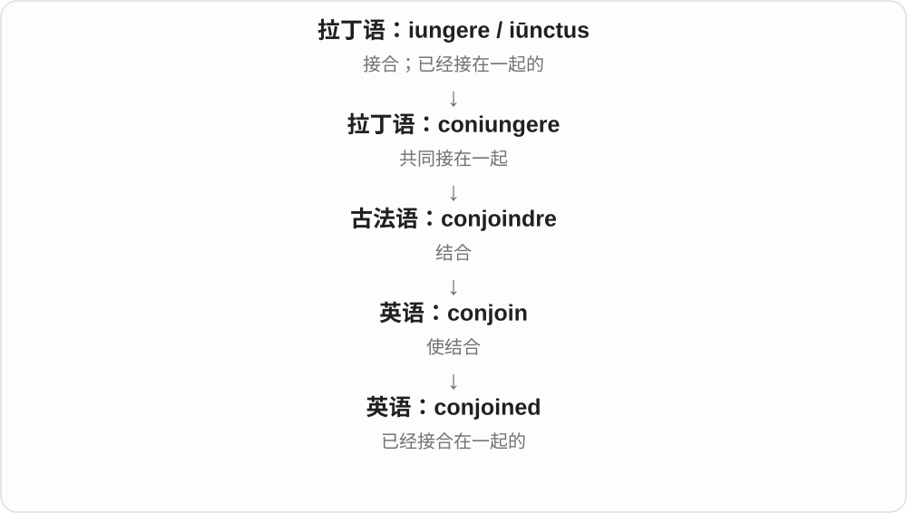

conjoin 是动作，conjoined 描述动作后的状态。conjoined twins 指身体某些部位相连的双胞胎，这是一个具体的医学描述。

**常见搭配与例句**

conjoined twins；conjoined forms；conjoined structures。

> The sculpture consists of two conjoined rings.

这座雕塑由两个相连的环组成。

> The documentary follows the lives of conjoined twins.

这部纪录片记录了一对连体双胞胎的生活。

**别混淆**

connected 可指松散联系；conjoined 常让连接显得更紧、更直接。普通合作不必都说 conjoined。

### 1154. dejected — 沮丧的；垂头丧气的

**音标**：英、美 /dɪˈdʒektɪd/

**先抓住这个画面**

像心气被往下一压，肩膀也跟着垮下来。

**怎么拆**

来自 deject 的过去分词形容词；deject 追到拉丁语 deicere“向下抛、压低”。

**怎么变成今天的意思**

**拉丁语：iacere；分词 iactus**  
投掷、抛出

↓

**拉丁语：de- + iacere → deicere / deiect-**  
向下扔、压低

↓

**英语：deject → dejected**  
使低落 → 心情低落的

常描写失望后的神情和状态：球队输了，队员低着头走开。

**常见搭配与例句**

look dejected；a dejected expression。

> He looked dejected after the interview.

面试结束后，他显得垂头丧气。

> The dejected players left the field in silence.

沮丧的球员们默默离开了球场。

**别混淆**

disappointed 强调期待落空；dejected 更容易让人看到低落、没精神的样子。

### 1155. roofed — 有屋顶的、覆着屋顶的

**音标**：/ruːft/，也有 /rʊft/

**先抓住这个画面**

原来敞开的地方现在上面有顶，或描述它带哪种顶；常在 tile-roofed、flat-roofed 等组合里说明款式。

**怎么拆**

roof + -ed，现代相应状态形容词；中古英语已有 rofed 等。末尾读 /t/，不是额外一个 /ɪd/。

**怎么变成今天的意思**

**古英语 hrōf → 中古英语 roof 等 → roof**  
屋顶、上方覆盖物

↓

**roof + -ed → roofed**  
有屋顶、被盖顶的状态

a roofed courtyard 有顶庭院，a roofed walkway 有顶通道，a newly roofed building 新盖好顶的建筑。

**常见搭配与例句**

a roofed courtyard；a roofed walkway；a newly roofed building。

> A roofed walkway connected the two buildings.

一条有顶通道连接两栋建筑。

> The courtyard was roofed with glass.

庭院上方盖了玻璃顶。

**别混淆**

roofed 有顶不保证四面封闭；covered 范围更广，可由任何覆盖方式实现，不必都盖建筑屋顶。

### 1156. splatter — 飞溅、泼溅；溅满；一片飞溅物、溅痕

**音标**：英 /ˈsplætə/；美 /ˈsplætər/

**先抓住这个画面**

番茄酱、泥水、油漆“啪啦”散开，点点洒到四处，叫 splatter。常让人看见落在表面的一片乱点。

**怎么拆**

可能受 splash、spatter 的声音、形式共同影响；可以用二者联想，却不把混成分析说成已确定的唯一历史。

**怎么变成今天的意思**

**十八世纪 splatter 及更早相关形式**  
可能受 splash、spatter 共同影响，具体形成不作唯一确定分析

↓

**液体、泥、漆飞散 → 落成一片片斑点、溅痕**  
既可写被溅到的表面，也可写液体飞出去

splatter paint on the wall 是把漆泼溅到墙上，a splatter of mud 是一片泥点；物可飞溅，表面也可被溅满。

**常见搭配与例句**

splatter everywhere 四处飞溅；splatter the floor 溅得满地都是。

> The sauce began to splatter over the cooker.

酱汁开始往炉子上四处溅。

> A splatter of paint marked the floor.

地上留下了一片飞溅的漆点。

**别混淆**

splatter、spatter 在飞溅、溅点义大量重合；splatter 往往给人更散、更乱的画面，但不是液滴大小的严格分类。

### 1157. splattered — 飞溅了、溅满了；沾满溅点的

**音标**：英 /ˈsplætəd/；美 /ˈsplætərd/

**先抓住这个画面**

液体刚才啪啦溅开，或衣服、墙面被溅了一片乱点，叫 splattered。结果往往仍能看见。

**怎么拆**

splatter + 完整 -ed，词尾读 /d/；词内虽然有 tt，最后的基础音不是 /t/，不读 /ɪd/。

**怎么变成今天的意思**

**十八世纪 splatter 及更早相关形式**  
可能受 splash、spatter 共同影响，具体形成不作唯一确定分析

↓

**液体、泥、漆飞散 → 落成一片片斑点、溅痕**  
既可写被溅到的表面，也可写液体飞出去

↓

**splatter + -ed → splattered**  
过去飞溅；已沾满溅点

splattered with mud 是沾满溅起的泥，splattered paint across the wall 是把漆四处泼到墙上；主动、被动都能用。

**常见搭配与例句**

mud-splattered boots 沾满泥点的靴子；splattered onto the floor 溅到地上。

> Mud splattered across the side of the car.

泥水飞溅到车身侧面。

> His jacket was splattered with paint.

他的外套上满是飞溅的漆点。

**别混淆**

splattered 不等于整块浸湿：它常留下点状、不规则飞溅痕；soaked 则强调液体浸透、湿透。

### 1158. splattering — 正在飞溅、溅满；一阵飞溅、溅点

**音标**：英 /ˈsplætərɪŋ/；美 /ˈsplætərɪŋ/

**先抓住这个画面**

雨水、酱汁或油漆正乱点般飞出去，叫 splattering。它既能表现动作，也能说留下的一阵、一片溅痕。

**怎么拆**

splatter + 完整 -ing；英式在后接元音时发 /r/，已有 tt 保留。

**怎么变成今天的意思**

**十八世纪 splatter 及更早相关形式**  
可能受 splash、spatter 共同影响，具体形成不作唯一确定分析

↓

**液体、泥、漆飞散 → 落成一片片斑点、溅痕**  
既可写被溅到的表面，也可写液体飞出去

↓

**splatter + -ing → splattering**  
散乱飞溅的过程、飞溅物

splattering against the window 是飞点打到窗上，a splattering of mud 是一片溅起的泥点；具体看介词、对象。

**常见搭配与例句**

splattering paint 泼溅的漆；splattering everywhere 四处乱溅。

> Rain was splattering against the window.

雨点正噼啪溅打在窗上。

> The artist was splattering paint across the canvas.

画家正把油漆泼溅到画布上。

**别混淆**

splattering 可强调分散的点、斑痕；pouring 更常是一股连续倒出，动作形态不同。

### 1159. splatters — 飞溅、溅满〔第三人称单数〕；一片片溅点、飞溅物

**音标**：英 /ˈsplætəz/；美 /ˈsplætərz/

**先抓住这个画面**

酱汁、泥水每次一动就往四处飞，用 splatters；地面、衣服上留下的一片片溅痕，也可用复数名词。

**怎么拆**

splatter + -s，读 /z/；动词三单、飞溅物名词复数同形，词内 tt 保留。

**怎么变成今天的意思**

**十八世纪 splatter 及更早相关形式**  
可能受 splash、spatter 共同影响，具体形成不作唯一确定分析

↓

**液体、泥、漆飞散 → 落成一片片斑点、溅痕**  
既可写被溅到的表面，也可写液体飞出去

↓

**splatter + -s → splatters**  
它飞溅；多片飞溅物、溅痕

splatters onto the tiles 是溅到瓷砖上，paint splatters 是漆的溅点；名词不一定还在飞，可能已干。

**常见搭配与例句**

splatters everywhere 到处飞溅；mud splatters 泥水溅痕。

> The sauce splatters whenever it boils too hard.

酱汁煮得太猛就四处溅。

> Paint splatters covered his old shoes.

他的旧鞋上满是漆点。

**别混淆**

splatters 在 paint splatters 中指留下的东西，在 sauce splatters 中通常写动作；句子结构帮助辨别。

### 1160. indentured — 受契约束缚而服役的；契约劳工的

**音标**：英 /ɪnˈdentʃəd/；美 /ɪnˈdentʃərd/

**先抓住这个画面**

被一份契约约束，必须在规定期间为他人工作。

**怎么拆**

英语 indenture 的动词义“用契约约束” + -ed。先有契约名词，再有使受契约约束的动词及分词形容词；不是从 indent“缩进”直接加 -ured。

**怎么变成今天的意思**

**拉丁语 dens，词干 dent-**  
牙齿；可比喻齿状的尖端或边缘

↓

**中古拉丁 indentare / indentura；古法语 endenter / endenteure**  
切成齿状边缘；具有这种边缘的文书

↓

**盎格鲁法语 endenture → 英语 indenture**  
可对合边缘来核验的契约；后泛化为某类正式契约

↓

**英语 indenture 由名词转为动词**  
以契约约束某人服役

↓

**英语 indentured**  
处在契约劳役关系中的

历史里的 indentured servants、indentured labourers 不是泛指签过普通劳动合同的人。约定期限内的行动和劳动自由可能受到严厉限制；“有契约”也不自动说明安排公平或当事人完全自愿。

**常见搭配与例句**

indentured labour；indentured servants；indentured workers。

> The exhibition documents the experiences of indentured workers.

展览记录了契约劳工的经历。

> Under the agreement, he remained indentured for five years.

按照那份契约，他需受约束服役五年。

**别混淆**

indentured 指特定的受契约束缚状态；employed 只说受雇。与奴隶制的法律形式有区别，但不能因此把契约劳役描写成轻松自由的工作。

### 1161. mottled — 斑驳的；布着不规则深浅色块的

**音标**：英 /ˈmɒtəld/；美 /ˈmɑːtəld/

**先抓住这个画面**

一块石头上浅一片、深一片，颜色不均匀地交错着，就是 mottled。画面更像不规则色块，而不只是整齐的小圆点。

**怎么拆**

mottle 去末尾 e，加完整 -ed → mottled，/l/ 后读 /d/。mottle 可能由 motley 逆构；motley 的更早来源不定，不把两者的远源硬讲成确定故事。

**怎么变成今天的意思**

**motley 杂色，可能逆构 → mottle 斑块、使带斑块**  
具体早期来源有讨论

↓

**mottle 去 e + -ed → mottled**  
过去分词形容词描述深浅、颜色不规则交错

mottled grey and brown 把两种颜色呈现为不匀的混合块；mottled light 也能说光影被树叶等打碎后深浅不均的样子。

**常见搭配与例句**

mottled stone；mottled light；mottled with brown。

> The stone was mottled grey and brown.

石头上灰色、棕色斑驳交错。

> Mottled light fell through the leaves onto the path.

斑驳光影穿过树叶，落在小路上。

**别混淆**

speckled 更容易让人想起散布的小点，mottled 常是大小、深浅不匀的斑块。实际描写可有重叠，不必把两词当成严格尺寸分类。

### 1162. rimmed — 有边框的；围出、覆上边沿的

**音标**：/rɪmd/

**先抓住这个画面**

gold-rimmed glasses 是有金色边框的眼镜。这里 -ed 可以直接说“具有某种 rim”，并不一定要先讲一个人给它装框的动作；动词句里也确有围边的过去式。

**怎么拆**

rim + -ed，双写 m → rimmed。具有边框的性质后缀与 rim 动词过去、分词形式同形，具体按句法判断。

**怎么变成今天的意思**

**古英语 rima → 中古英语 rim、rym → rim**  
边缘、边界，常延伸为环状边沿

↓

**rim + -ed → rimmed**  
有某种边框的，或给边沿围上东西的过去、分词形式

gold-rimmed glasses 金边眼镜；red-rimmed eyes 眼周发红的眼睛；snow rimmed the lake 雪围在湖边。

**常见搭配与例句**

gold-rimmed glasses；red-rimmed eyes。

> He wore gold-rimmed glasses.

他戴着金边眼镜。

> A thin line of snow rimmed the lake.

薄薄一圈雪围着湖边。

**别混淆**

rimmed 的 ed 读 /d/，不另起一音节；具有边框与过去动作不必混成同一种被动。

### 1163. unaffiliated — 无隶属关系的；未加入的；独立的

**音标**：/ˌʌnəˈfɪlieɪtɪd/

**先抓住这个画面**

没有正式挂靠或加入所谈的组织，例如不属于任何政党的候选人。

**怎么拆**

un- 否定 + affiliated 有关联的；英语对状态加否定。并不自动说明这个人以前加入过后来又退出。

**怎么变成今天的意思**

**拉丁 filius 儿子；filia 女儿**  
这一族涉及子女或被接纳的关系，与 filum 线不同

↓

**拉丁 ad- 向着 + filius → affiliare 收为子**  
ad- 在 f 前同化成 af-

↓

**中世纪拉丁 affiliat- 已被收为子 → 英语 affiliate 动词**  
转为把组织或个人纳入关联关系

↓

**英语 affiliate → affiliated → un- + affiliated**  
有关联的状态 → 没有这种关联的状态

unaffiliated with any party 是不属于任何政党；an unaffiliated researcher 可以是未挂靠研究机构的研究者。这个词说组织关系，不等于缺乏观点、专业能力或朋友。

**常见搭配与例句**

unaffiliated voters；an unaffiliated researcher；remain unaffiliated。

> She stood as a candidate unaffiliated with any party.

她以无党派候选人的身份参选。

> The archive welcomes both affiliated and unaffiliated researchers.

这家档案馆欢迎有机构隶属和无机构隶属的研究者。

**别混淆**

independent 范围更宽，可以说经济独立或自主思考；unaffiliated 特别说没有某种组织联系。disaffiliated 更容易强调解除过原有关系。

### 1164. scribble — 潦草地写；乱画；潦草的字迹

**音标**：/ˈskrɪbəl/

**先抓住这个画面**

scribble 像在便条上飞快抓几个字，或者边听电话边随手乱画。重点是快、随意，往往不工整。

**怎么拆**

与 scrībere“写”同族。可能来自中古英语 scriben 加表示细小、反复动作的结尾，也可能受拉丁语 scribillare 形式影响，具体路线有不同分析。

**怎么变成今天的意思**

写得乱可以出于着急，也可以只是消遣。图从确定的中古英语词形开始；不要把存在分歧的更早路线画成一条确定链。

**常见搭配与例句**

scribble a note（匆忙写便条）；scribble down an address（潦草记下地址）；a page of scribbles（满页乱涂的线条）。

> She scribbled the address on a receipt.

她在收据上匆匆写下地址。

> The child filled the page with colorful scribbles.

孩子用彩色线条涂满了整张纸。

**别混淆**

scribble 可写字也可乱画；doodle 多指无意识或消遣式涂画；scrawl 更强调字迹难看、难认。

### 1165. scribbled — 潦草写下、匆匆记下、乱画了

**音标**：/ˈskrɪbəld/

**先抓住这个画面**

刚才赶紧抓张纸，歪歪扭扭记下电话号，是 scribbled；重点像笔跑得快，没顾上写漂亮。

**怎么拆**

scribble 去末尾 e + 完整 -ed → scribbled，/l/ 后读 /d/；原有双 b 保留。

**怎么变成今天的意思**

**拉丁 scribere 写的相关材料 → 中古英语 scriblen → scribble**  
可经中世纪 scribillare，或接中古英语 scriben 加旧细小反复尾

↓

**快速潦草写 → 随手乱线、潦草字迹名词**  
现代可以写实际信息，也可以只是笔划来划去

↓

**scribble 去 e + -ed → scribbled**  
过去快速潦草写画

scribbled down the number 是匆匆记下号码，scribbled a message 是潦草写条消息；on 后补写在哪里。

**常见搭配与例句**

scribbled on a receipt 在收据上匆匆写了；a scribbled note 潦草便条。

> He scribbled the address on the back of a receipt.

他在收据背面匆匆写下地址。

> She scribbled a reminder before leaving.

离开前，她匆匆写了条提醒。

**别混淆**

scribbled 不等于内容没价值，可能只是记得匆忙；a carefully written note 才另外强调落笔工整、仔细。

### 1166. scribbling — 正在潦草写、乱画；匆匆书写、乱线

**音标**：/ˈskrɪbəlɪŋ/

**先抓住这个画面**

笔正飞快地划，字没顾上排整齐，是 scribbling；孩子把纸涂成一团线，也可以用同一个动作名。

**怎么拆**

scribble 去末尾 e + 完整 -ing → scribbling；保留 bb，动作分词与动作名词同形。

**怎么变成今天的意思**

**拉丁 scribere 写的相关材料 → 中古英语 scriblen → scribble**  
可经中世纪 scribillare，或接中古英语 scriben 加旧细小反复尾

↓

**快速潦草写 → 随手乱线、潦草字迹名词**  
现代可以写实际信息，也可以只是笔划来划去

↓

**scribble 去 e + -ing → scribbling**  
快速潦草写、随手乱线的过程

scribbling notes 是正匆匆记笔记，scribbling on a page 是在纸上乱画；could hear scribbling 可说能听见笔急写的声音。

**常见搭配与例句**

frantic scribbling 飞快写字；scribbling down ideas 匆匆记点子。

> Everyone was scribbling notes as she spoke.

她说话时，大家都在飞快记笔记。

> The child sat scribbling on a large sheet of paper.

孩子坐着，在一大张纸上乱画。

**别混淆**

scribbling 的线条可能组成字，也可能不成字；sketching 通常更有意抓一个可辨认的轮廓、结构。

### 1167. scribbles — 潦草地写、乱画〔第三人称单数〕；潦草字迹、乱线〔复数〕

**音标**：/ˈskrɪbəlz/

**先抓住这个画面**

手追不上想法，笔很快记下几个词，动词用 scribbles；纸上一团潦草字、乱线，也叫 scribbles。

**怎么拆**

scribble + -s，/l/ 后读 /z/；动词三单与潦草字迹名词复数同形，基础联系拉丁写字词族。

**怎么变成今天的意思**

**拉丁 scribere 写的相关材料 → 中古英语 scriblen → scribble**  
可经中世纪 scribillare，或接中古英语 scriben 加旧细小反复尾

↓

**快速潦草写 → 随手乱线、潦草字迹名词**  
现代可以写实际信息，也可以只是笔划来划去

↓

**scribble + -s → scribbles**  
他、她潦草写；几团乱字、乱线

scribbles a note 是匆匆写便条，scribbles on the wall 是在墙上乱画；decode his scribbles 是辨认他的潦草字迹。

**常见搭配与例句**

scribbles down an address 匆匆记地址；pencil scribbles 铅笔乱线、潦草字。

> She scribbles a note before the train arrives.

火车到来前，她匆匆写了张便条。

> I could not read his pencil scribbles.

我看不清他那些潦草的铅笔字。

**别混淆**

scribbles 可有要记住的信息，只是字快、潦草；doodles 常更像随手小图案，未必想写具体词句。

### 1168. bawl — 放声大喊；嚎啕哭；〔bawl someone out〕大声训斥

**音标**：/bɔːl/

**先抓住这个画面**

不压着嗓子，张口就大声喊或大哭，叫 bawl。比普通 cry 更容易让人听见响亮、放开的哭声。

**怎么拆**

接中古英语 baulen；有古诺尔斯 baula 与中世纪拉丁 baulare 等来源分析，相关材料模仿动物叫声。不能把不同候选硬排成一条借入链。

**怎么变成今天的意思**

**中古英语 baulen → bawl**  
与古诺尔斯 baula、或中世纪拉丁 baulare 的动物叫声材料有关；借入路线有不同分析

↓

**动物叫喊 → 人放声喊、嚎啕哭**  
声音放开、响而不收着；bawl someone out 又指大声训斥

bawl for his mother 是哭喊着找妈妈，bawl someone out 是大声训斥某人；后者常见于美式口语。

**常见搭配与例句**

bawl loudly 放声哭喊；bawl your eyes out 嚎啕大哭。

> The baby began to bawl when the lights went out.

灯灭时，婴儿开始放声大哭。

> There is no need to bawl at me; I can hear you.

不用冲我大喊，我听得见。

**别混淆**

bawl 与 ball 常同音，意思、来源分开。看到 bawl someone out，重点是训斥，不是把某人哭出去。

### 1169. bawling — 正在放声哭喊；一阵嚎啕哭声、大喊声

**音标**：/ˈbɔːlɪŋ/

**先抓住这个画面**

哭声或喊声正放开响着，是 bawling。它把那种又响又不收敛的发声过程直接摆到耳边。

**怎么拆**

bawl + 完整 -ing，直接加；基础词末尾有 wl，不需要双写 l。

**怎么变成今天的意思**

**中古英语 baulen → bawl**  
与古诺尔斯 baula、或中世纪拉丁 baulare 的动物叫声材料有关；借入路线有不同分析

↓

**动物叫喊 → 人放声喊、嚎啕哭**  
声音放开、响而不收着；bawl someone out 又指大声训斥

↓

**bawl + -ing → bawling**  
进行中的放声哭喊

a bawling baby 是放声大哭的婴儿，bawling out orders 是大声发号施令；bawling someone out 是训斥某人。

**常见搭配与例句**

bawling loudly 放声哭喊；stop bawling 别再大哭、大喊。

> A bawling baby kept the passengers awake.

一个放声大哭的婴儿让乘客们睡不着。

> He was bawling orders through a loudspeaker.

他正用扩音器大声喊命令。

**别混淆**

bawling 与 bowling 在许多口音里元音不同：前者 /ɔː/，后者 /əʊ/ 或 /oʊ/；一个哭喊，一个保龄球活动。

### 1170. bawled — 放声哭喊了、大喊了；大声训斥了

**音标**：/bɔːld/

**先抓住这个画面**

刚才一个人不收着声音地哭喊，叫 bawled；接 someone out 时，写的是把某人狠狠训了一顿。

**怎么拆**

bawl + 完整 -ed，/l/ 后读 /d/。不因与 ball 同音就改用 ball 的拼写。

**怎么变成今天的意思**

**中古英语 baulen → bawl**  
与古诺尔斯 baula、或中世纪拉丁 baulare 的动物叫声材料有关；借入路线有不同分析

↓

**动物叫喊 → 人放声喊、嚎啕哭**  
声音放开、响而不收着；bawl someone out 又指大声训斥

↓

**bawl + -ed → bawled**  
过去放声哭喊、训斥

bawled for her mother 是哭喊着找妈妈；bawled him out 是大声训斥他，out 要与整个搭配一起理解。

**常见搭配与例句**

bawled all night 整夜放声哭；bawled a warning 大声喊出警告。

> The child bawled for her mother until she returned.

孩子一直哭喊着找妈妈，直到她回来。

> He bawled across the yard to get our attention.

他隔着院子大喊，想引起我们的注意。

**别混淆**

bawled 是声音放开的喊或哭，sobbed 更突出一抽一抽、断断续续的哭法，两者有时同时发生。

### 1171. bawls — 放声哭喊、大喊〔第三人称单数〕

**音标**：/bɔːlz/

**先抓住这个画面**

一个人一不顺心就放声哭，或隔着一段距离大喊，用 bawls。抓住声音完全放开的感觉。

**怎么拆**

bawl + -s，/l/ 后读 /z/；现代三单直接接在整个基础词后。

**怎么变成今天的意思**

**中古英语 baulen → bawl**  
与古诺尔斯 baula、或中世纪拉丁 baulare 的动物叫声材料有关；借入路线有不同分析

↓

**动物叫喊 → 人放声喊、嚎啕哭**  
声音放开、响而不收着；bawl someone out 又指大声训斥

↓

**bawl + -s → bawls**  
他、她放声哭喊

bawls for food 是哭喊着要吃的，bawls out instructions 是大声喊出指令。bawls someone out 才是训斥某人。

**常见搭配与例句**

bawls at someone 冲某人大喊；bawls for help 大声呼救。

> The baby bawls whenever he drops his toy.

婴儿每次掉了玩具就放声哭。

> The coach bawls instructions from the touchline.

教练在边线旁大声喊指令。

**别混淆**

bawls 不一定在流泪；它也能只表示大声喊。要看是在哄孩子、叫远处的人，还是训话。

### 1172. bloodied — 沾血、染血的；受挫、受到打击的

**音标**：/ˈblʌdid/

**先抓住这个画面**

脸、衣服等沾了血，可以 bloodied；比喻里经历冲突、失败而受损，也能用这个带有战斗痕迹的形象。

**怎么拆**

bloody 作动词使沾血、使出血 + -ed，y 变 i。bloodied 是分词及状态形容词，不是 bloody 作强调词时再加一个程度后缀。

**怎么变成今天的意思**

**blood 血 → bloody 的动词用法**  
使沾血、使受伤出血

↓

**bloody + -ed → bloodied**  
沾了血；比喻受挫、受到打击

a bloodied face 沾血的脸，bloodied but unbowed 受挫却不屈服。后一搭配常用于坚强回应失败的描述。

**常见搭配与例句**

a bloodied face；bloodied but unbowed。

> The boxer wiped his bloodied face with a towel.

拳击手用毛巾擦了擦沾血的脸。

> The team left bloodied but unbowed after the defeat.

败局后，球队受了挫折，却没有低头。

**别混淆**

bloody 可以是带血的，也可作英式口语强调词；bloodied 常保留染血、受创这一动作后的状态。

### 1173. carded — 被查证件的；被出示处罚牌的；另有梳理纤维义

**音标**：英 /ˈkɑːdɪd/；美 /ˈkɑːrdɪd/

**先抓住这个画面**

美式买酒等场景是被要求出示年龄证件；比赛里可能是裁判给了黄牌、红牌。

**怎么拆**

card + -ed，接查证件、出牌处罚的动词义。纺织中 carded wool 梳理过的羊毛走另一梳纤维词源，不混入纸卡故事。

**怎么变成今天的意思**

**希腊 chartes 纸、纸草 → 拉丁 charta → 法语 carte**  
书写材料、纸片

↓

**中古英语 carde → card**  
纸牌、卡片 → 证件、节目单与电子卡等

↓

**card + -ed → carded**  
核对证件、出牌处罚的过去形式

get carded 被查年龄证件，be carded for a foul 因犯规吃牌；具体处罚还看是哪项运动。

**常见搭配与例句**

get carded；be carded for；carded at the entrance。

> He still gets carded when buying wine.

他买葡萄酒时仍会被要求出示年龄证件。

> The player was carded for a late tackle.

球员因铲球过迟被出牌处罚。

**别混淆**

carded 不总是被刷卡付款；The player was carded 多半说吃牌，The customer was carded 可能说查证件。

### 1174. disaffected — 不满而疏离的

**音标**：/dɪsəˈfɛktɪd/

**先抓住这个画面**

一个人原本支持团队，后来觉得被忽视，心慢慢离开了组织：这就是 disaffected 的感觉。

**怎么拆**

dis-（离开、否定）+ affected；affect 的感情倾向一支在这里被否定。

**怎么变成今天的意思**

不只是心情不好，而是对所属组织、领导或社会失去认同。常用于成员、选民和年轻群体。

**常见搭配与例句**

disaffected voters；disaffected members；politically disaffected。

> The party tried to reconnect with disaffected voters.

该党试图重新联系心怀不满的选民。

> Several disaffected members left the club.

几位不满的成员离开了俱乐部。

**别混淆**

dissatisfied 泛指不满意；disaffected 还常含忠诚、支持或归属感减弱。

### 1175. pocketed — 装入口袋了、收下了；有口袋的

**音标**：英 /ˈpɒkɪtɪd/；美 /ˈpɑːkɪtɪd/

**先抓住这个画面**

他把零钱装进兜，是动作；a pocketed jacket 有口袋的外套，是特征。两种 -ed 遇到同一个词基，要靠结构分。

**怎么拆**

动词 pocket + -ed 形成过去式、过去分词；名词 pocket + -ed 也可表示带口袋。词末 /t/ 后 -ed 加出 /ɪd/ 音节。

**怎么变成今天的意思**

**法语 poque 囊袋等 → poquette → pocket**  
小袋子 → 衣服口袋

↓

**英语 pocket**  
口袋；把东西装入口袋、占有；局部小块区域

↓

**pocket + -ed → pocketed**  
装袋、收下的过去形式；另有具备口袋的形容词

pocketed the change 把零钱装兜，pocketed the profit 把收益收入囊中，a pocketed vest 有口袋的背心。

**常见搭配与例句**

pocketed the change；pocketed the profit；a pocketed vest。

> He pocketed the change and picked up the bag.

他把零钱装入口袋，提起袋子。

> The pocketed vest kept her small tools close at hand.

带口袋的背心让她随手就能拿到小工具。

**别混淆**

pocketed the money 可能普通收下，也可能暗指私吞，看场景；不能一见动词就自动判定非法。

### 1176. prowl — 潜行、徘徊搜寻；四处游走；觅食

**音标**：/praʊl/

**先抓住这个画面**

猫贴着暗处走走停停，盯着能抓的小东西；人四处转着找某种目标，这种带搜索感的游走叫 prowl。

**怎么拆**

中古英语 prollen 的延续，来源未定；现代 ow 读 /aʊ/，不因旧拼写少 w 就沿用旧读音。

**怎么变成今天的意思**

**中古英语 prollen → prowl**  
早已有悄悄游走、四处寻找的意思，来源未定；w 是后来拼写中出现的

↓

**潜行寻找 → 动物觅食、人在某处游走找目标**  
现代可以很有目的，不等于随意散步

prowl the streets 在街上四处游走搜寻；on the prowl 在四处找猎物、目标；也能用 around。

**常见搭配与例句**

prowl around the house；a cat on the prowl 一只出动觅食的猫。

> Foxes prowl around the village at night.

狐狸夜里会在村子周围游走觅食。

> The cat was on the prowl near the garden wall.

那只猫正在花园墙边游走觅食。

**别混淆**

roam 可以只是自由活动；prowl 更常突出暗中寻找、随时准备接近目标的状态。

### 1177. prowling — 正在潜行搜寻；四处游走觅食的

**音标**：/ˈpraʊlɪŋ/

**先抓住这个画面**

身体慢慢移，眼睛、耳朵却盯着周围，随时准备找到目标；这种进行中的搜寻式游走叫 prowling。

**怎么拆**

prowl + -ing；既可作进行式，也能作修饰语或活动名词，相关中古英语形式早已有搜寻义。

**怎么变成今天的意思**

**中古英语 prollen → prowl**  
早已有悄悄游走、四处寻找的意思，来源未定；w 是后来拼写中出现的

↓

**潜行寻找 → 动物觅食、人在某处游走找目标**  
现代可以很有目的，不等于随意散步

↓

**prowl + -ing → prowling**  
搜寻式游走正在进行；也把这种活动作名词

a prowling fox 游走觅食的狐狸；prowling around the building 在建筑周围徘徊搜寻。

**常见搭配与例句**

go prowling；spotted someone prowling 看见有人四处徘徊。

> We heard an animal prowling outside the tent.

我们听见有动物在帐篷外游走搜寻。

> The camera recorded a fox prowling along the fence.

摄像头拍到一只狐狸沿篱笆游走觅食。

**别混淆**

slinking 更容易突出避人目光的姿态；prowling 更容易突出在一带找目标的活动，两种感觉可以同时出现。

### 1178. prowled — 潜行搜寻了；四处游走了

**音标**：/praʊld/

**先抓住这个画面**

过去在一片地方悄悄转着、找着，像猫找猎物或人找线索，叫 prowled。

**怎么拆**

prowl + -ed，词尾读 /d/；现代采用规则过去式，不改 ow。

**怎么变成今天的意思**

**中古英语 prollen → prowl**  
早已有悄悄游走、四处寻找的意思，来源未定；w 是后来拼写中出现的

↓

**潜行寻找 → 动物觅食、人在某处游走找目标**  
现代可以很有目的，不等于随意散步

↓

**prowl + -ed → prowled**  
过去四处潜行、搜寻

prowled through the alleys 在小巷里潜行搜寻；prowled around the garden 在花园周围游走。

**常见搭配与例句**

prowled the empty streets；prowled in search of food。

> The cat prowled through the garden looking for mice.

猫在花园里四处潜行，寻找老鼠。

> A fox prowled around the bins after midnight.

午夜后，一只狐狸在垃圾桶周围游走觅食。

**别混淆**

prowled 描写搜索式游走，searched 只说找；人可以站在原地翻抽屉 searched，不一定有 prowled 的四处转动。

### 1179. prowls — 潜行、四处搜寻〔第三人称单数〕；游走搜寻〔复数〕

**音标**：/praʊlz/

**先抓住这个画面**

它不是只从甲处去乙处，而是在这一带转来转去，留心能下手、接近的目标，动词用 prowls。

**怎么拆**

prowl + -s，词尾读 /z/；ow 仍读 /aʊ/。也可作名词复数，表示几次游走搜寻。

**怎么变成今天的意思**

**中古英语 prollen → prowl**  
早已有悄悄游走、四处寻找的意思，来源未定；w 是后来拼写中出现的

↓

**潜行寻找 → 动物觅食、人在某处游走找目标**  
现代可以很有目的，不等于随意散步

↓

**prowl + -s → prowls**  
它、他、她游走搜寻；几次这种活动

prowls around at night 夜间四处游走；prowls the neighbourhood 在附近搜寻、游荡。

**常见搭配与例句**

a cat that prowls 一只四处觅食的猫；nightly prowls 夜间游走。

> A fox prowls around the chicken coop after dark.

天黑后，一只狐狸会在鸡舍周围游走窥伺。

> The cat returns from its nightly prowls before breakfast.

那只猫每次夜里出去游走，早饭前就回来。

**别混淆**

prowls 给动物加上寻觅的画面；对人用时可能显得可疑，也可能只是夸张写寻找，需看所找目标。

### 1180. whoosh — 呼地、嗖地掠过；一阵呼声；嗖的一声

**音标**：/wʊʃ/；也读 /wuːʃ/

**先抓住这个画面**

一列车、一阵风或一股水快速冲过，带出“呼——”的一声，就是 whoosh。抓住速度快、气流或流动一下掠过去。

**怎么拆**

近代拟声词，先有动词，随后有声音名词、感叹用法；声音和字形相互模仿，不需要硬拆成 who + 某个后缀。

**怎么变成今天的意思**

**十九世纪 whoosh 动词 → 名词、感叹用法**  
模仿东西快速通过空气的呼声

↓

**现代快速掠过、喷涌及比喻**  
声音伴随快动作；网上还可用 Whoosh 表示某人没听懂笑点

with a whoosh 是呼的一声，whoosh past 是嗖地掠过；网上 Whoosh! 有时表示笑话从对方头顶飞过、对方没懂。

**常见搭配与例句**

a whoosh of air 一股气流呼地掠过；whoosh down 呼地冲下。

> The train passed with a whoosh.

火车呼地驶过。

> We heard the water whoosh through the pipe.

我们听见水呼地冲过管道。

**别混淆**

whoosh 比 swish 常更有一大股快速流动的感觉；swish 更易突出轻扫、擦过的唰声，两者可重合。

### 1181. whooshing — 正在呼地掠过、冲过；快速流动的呼声

**音标**：/ˈwʊʃɪŋ/；也读 /ˈwuːʃɪŋ/

**先抓住这个画面**

一股气流、水流或车辆正快速掠过，声音像“呼——”，叫 whooshing。可以写过程，也能形容那阵声音。

**怎么拆**

whoosh + 完整 -ing，直接加；两种常见元音读法在相应变化中保留。

**怎么变成今天的意思**

**十九世纪 whoosh 动词 → 名词、感叹用法**  
模仿东西快速通过空气的呼声

↓

**现代快速掠过、喷涌及比喻**  
声音伴随快动作；网上还可用 Whoosh 表示某人没听懂笑点

↓

**whoosh + -ing → whooshing**  
快速掠过、流动的过程与呼声

a whooshing sound 是一阵呼声，whooshing past 是呼地掠过；听到声音未必马上知道具体声源。

**常见搭配与例句**

whooshing water 快速冲流的水；the whooshing of traffic 车流快速掠过声。

> A whooshing sound came from the ventilation shaft.

通风井里传来一阵呼声。

> We watched the trains whooshing past the platform.

我们看着列车呼地从站台旁驶过。

**别混淆**

whooshing 常写一股流动、掠过感；hissing 更像狭缝持续出气的嘶声，叙述画面不同。

### 1182. whooshed — 呼地、嗖地冲过了、掠过了

**音标**：/wʊʃt/；也读 /wuːʃt/

**先抓住这个画面**

某个东西刚才快速从身边、头顶掠过，带出呼声，用 whooshed。它比 went past 多了速度和声音。

**怎么拆**

whoosh + 完整 -ed，/ʃ/ 后读 /t/；不因为词长就多读一个音节。

**怎么变成今天的意思**

**十九世纪 whoosh 动词 → 名词、感叹用法**  
模仿东西快速通过空气的呼声

↓

**现代快速掠过、喷涌及比喻**  
声音伴随快动作；网上还可用 Whoosh 表示某人没听懂笑点

↓

**whoosh + -ed → whooshed**  
过去快速呼地掠过、冲过

whooshed past us 是嗖地从身边掠过，whooshed down the slide 是呼地滑下滑梯；路线由后面部分说明。

**常见搭配与例句**

whooshed overhead 从头顶呼地掠过；whooshed through the door 呼地冲过门口。

> A cyclist whooshed past us on the path.

一个骑车的人嗖地从我们身边掠过。

> The water whooshed down the drain.

水呼地流进排水口。

**别混淆**

whooshed 是带速度、气流感的移动描写；它不自动说明速度具体多快，只给读者运动印象。

### 1183. whooshes — 呼地、嗖地掠过〔第三人称单数〕；一阵阵呼声

**音标**：/ˈwʊʃɪz/；也读 /ˈwuːʃɪz/

**先抓住这个画面**

火车、风或水一股股快速掠过，用 whooshes；复数名词也能说一阵阵快速流动的呼声。

**怎么拆**

whoosh + -es，/ʃ/ 后读 /ɪz/，多一个音节；基础词的短、长元音读法可相应保留。

**怎么变成今天的意思**

**十九世纪 whoosh 动词 → 名词、感叹用法**  
模仿东西快速通过空气的呼声

↓

**现代快速掠过、喷涌及比喻**  
声音伴随快动作；网上还可用 Whoosh 表示某人没听懂笑点

↓

**whoosh + -es → whooshes**  
它呼地冲、掠；多阵呼声

whooshes past 是嗖地掠过，whooshes down the pipe 是顺管道呼地冲下；方向词帮助看清运动路线。

**常见搭配与例句**

whooshes through 快速呼地穿过；short whooshes 一阵阵短呼声。

> The express train whooshes past without stopping.

特快列车呼地驶过，没有停车。

> Water whooshes down the pipe when the valve opens.

阀门打开时，水呼地冲下管道。

**别混淆**

whooshes 不只写风：水、列车、运动器材等只要有快速掠过的感觉，也能借用。

### 1184. wring — 拧、拧挤；费力取得；绞扭双手

**音标**：/rɪŋ/

**先抓住这个画面**

两手反向扭一块湿布，把水挤出来，是 wring 最直接的画面。费力从某人那里挤出回答、让步，也可借这个动作。

**怎么拆**

承古英语 wringan 扭、挤，经中古英语 wringen 延续。与 wrench 等扭转材料同族，现代不规则变化 wring → wrung → wrung。

**怎么变成今天的意思**

**古英语 wringan → 中古英语 wringen → wring**  
扭转、拧挤柔软物

↓

**旧动作的抽象扩展**  
费力取得；痛苦、焦虑时绞扭双手

wring out a cloth 拧干布；wring water from a towel 从毛巾拧出水；wring his hands 焦急地绞扭双手。

**常见搭配与例句**

wring a promise from someone 费力逼得某人承诺；wring it dry 把它拧干。

> She used both hands to wring out the cloth.

她双手把布拧干。

> It was hard to wring an answer from him.

要从他嘴里挤出一个回答很难。

**别混淆**

w 不发音，wring 与 ring 常同音，但一个是拧挤动作，一个常是环、响铃等不同词。结构 wring…out、from 说明挤出什么、从哪里挤。

### 1185. wrings — 拧、绞、拧挤出；费力获取〔第三人称单数〕

**音标**：/rɪŋz/

**先抓住这个画面**

两手朝不同方向拧毛巾，让水挤出来，用 wrings；wrings her hands 则像绞扭手指，表现焦急、痛苦。

**怎么拆**

wring + -s，/ŋ/ 后读 /z/，w 不发音。基础承古英语 wringan，现代过去式、过去分词另用 wrung。

**怎么变成今天的意思**

**古英语 wringan → 中古英语 wringen → wring**  
扭转、绞挤柔软物

↓

**wring + -s → wrings**  
他、她拧绞；比喻费力取得、使人难受

wrings out a towel 是把毛巾拧干，wrings a promise out of someone 是费力逼得一句承诺；out of 突出从里面挤出来。

**常见搭配与例句**

wrings her hands 焦急地绞着双手；wrings water from the cloth 从布里拧出水。

> She wrings the water out of the towel.

她把毛巾里的水拧出来。

> He wrings his hands while waiting for the news.

等消息时，他焦急地绞着双手。

**别混淆**

wrings 和 rings 常同音，前者扭拧，后者可说响铃；拧毛巾时写 wring，w 虽不读却属于拼写。

### 1186. zipped — 拉上拉链的；压缩了的；zip 的过去式、过去分词

**音标**：/zɪpt/

**先抓住这个画面**

袋口的拉链已经合好，是 zipped；文件已经装进压缩包，也能说 zipped。两个都是 zip 动作完成的状态。

**怎么拆**

zip + -ed，短元音后双写 p；/p/ 后 -ed 读 /t/。还有与美国 ZIP 邮编相关的较少见同形用法，来源另看缩写。

**怎么变成今天的意思**

**拟声 zip，模仿轻小物体嗖地掠过**  
快速运动的声音、动作

↓

**zipper 商品命名 → 拉链通名；zip 拉上、合拢**  
后来计算机沿打包压缩的概念用 zip

↓

**zip + -ed → zipped**  
拉链合拢、文件压缩完成的状态

a zipped pocket 拉好拉链的口袋，a zipped file 压缩文件，keep the bag zipped 保持包口拉好。

**常见搭配与例句**

a zipped pocket；a zipped archive。

> Keep the pocket zipped while you travel.

出行时把口袋拉链拉好。

> The zipped archive contains three documents.

压缩归档里有三份文档。

**别混淆**

zipped file 描述打包压缩状态，并不自动说明内容安全或有密码。

### 1187. unconcerned — 不担心的；不在意的；无关的

**音标**：英 /ˌʌnkənˈsɜːnd/；美 /ˌʌnkənˈsɜːrnd/

**先抓住这个画面**

unconcerned 像旁边已经有些动静，这个人却没有被牵动：可能是镇定，也可能是漠不关心。

**怎么拆**

un-（不）+ concerned；也可联系 unconcern + -ed，是英语内部形成的否定形容词。

**怎么变成今天的意思**

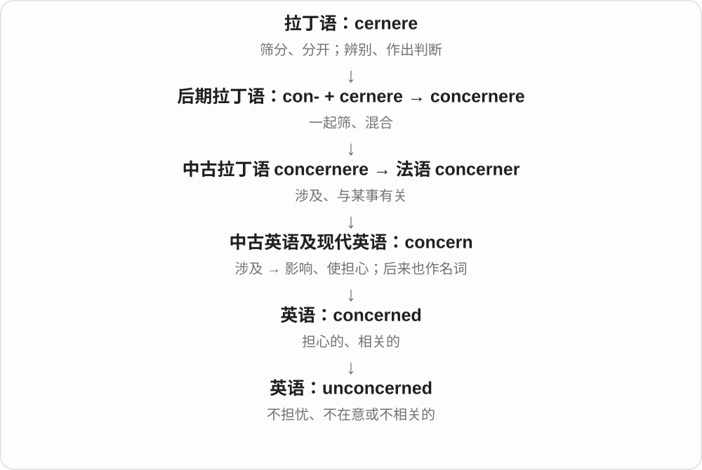

unconcerned about a delay 可表示并不担心；unconcerned with appearances 是不在意外表。褒贬取决于他是否理应关心。

**常见搭配与例句**

seem unconcerned；unconcerned about；unconcerned with。

> She seemed unconcerned about the short delay.

她似乎不在意这次短暂延误。

> The artist was unconcerned with fashionable trends.

这位艺术家不在意流行趋势。

**别混淆**

calm 是镇定；unconcerned 还可能让人觉得根本没把事情放在心上。

### 1188. pleated — 有褶的；打褶的

**音标**：英、美 /ˈpliːtɪd/

**先抓住这个画面**

布料不是平铺一片，而是折出一排整齐的棱和谷。

**怎么拆**

pleat + -ed；pleat 是 plait 的历史变体，远源为拉丁语 plicare。

**怎么变成今天的意思**

**拉丁语 plicare**  
折叠、使相接；与编织、弯曲一组词有更早联系

↓

**拉丁语 plicatus → 古法语 pleit / ploit → 英语 plait**  
折叠、褶；编成的辫

↓

**英语 pleat〔plait 的变体〕**  
衣料上的一道折褶

↓

**英语 pleat + -ed → pleated**  
已经打出褶子的

a pleated skirt 是百褶或打褶裙。滤纸也能是 pleated：折褶使有限空间容纳更多表面积。

**常见搭配与例句**

a pleated skirt；pleated fabric；a pleated filter。

> She chose a pleated skirt for the performance.

她为演出选了一条打褶裙。

> The pleated filter provides a larger filtering surface.

褶皱式滤芯提供了更大的过滤表面积。

**别混淆**

wrinkled 多指不规则皱纹；pleated 常指有意做出的规则褶。

### 1189. loiter — 闲逛、逗留；磨蹭、拖拉

**音标**：英 /ˈlɔɪtə/；美 /ˈlɔɪtər/

**先抓住这个画面**

别人已经准备出发，你还在门口看看这儿、摸摸那儿；或者没明确事情做，却一直在一个地方晃，都可以说 loiter。

**怎么拆**

中古英语已有，可能联系荷兰语松散、摇晃行动的词；末尾 er 是旧基础形式的一部分。

**怎么变成今天的意思**

**中古英语 loitren 等形式 → loiter**  
可能联系中古荷兰语摇晃、散漫行动的材料，远源未定

↓

**行动拖拉、不赶着做事 → 闲站、闲逛、逗留**  
相关 loitering 形式在英语记录也很早，不把所有词义强排成单线出现

loiter outside a shop 在商店外逗留；loiter on the way home 是回家路上磨蹭。可以走动，也可以站着待着。

**常见搭配与例句**

loiter around the entrance；do not loiter 别磨蹭、别逗留。

> Please do not loiter by the entrance.

请不要在入口处逗留。

> We cannot loiter here all afternoon.

我们不能整个下午都在这儿磨蹭。

**别混淆**

linger 常能带舍不得离开的感觉；loiter 更容易让人看到无明确目的或拖拖拉拉的状态。

### 1190. loitering — 正在逗留、闲逛；闲待、磨蹭的行为

**音标**：英 /ˈlɔɪtərɪŋ/；美 /ˈlɔɪtərɪŋ/

**先抓住这个画面**

监控画面里，一个人在门口走来走去却一直不进去；同伴催你出发，你还原地晃着，这种状态可以叫 loitering。

**怎么拆**

loiter + -ing；相关形式在中古英语已出现，现代仍能当进行式，也能作行为名词。

**怎么变成今天的意思**

**中古英语 loitren 等形式 → loiter**  
可能联系中古荷兰语摇晃、散漫行动的材料，远源未定

↓

**行动拖拉、不赶着做事 → 闲站、闲逛、逗留**  
相关 loitering 形式在英语记录也很早，不把所有词义强排成单线出现

↓

**loiter + -ing → loitering**  
把闲待、逗留、拖拉当作进行中的动作或一种行为

no loitering 常见于告示，意思是请勿逗留；loitering around the station 在车站附近闲逛。

**常见搭配与例句**

stop loitering 别再磨蹭；people loitering nearby 在附近闲待的人。

> A few people were loitering near the entrance.

几个人在入口附近闲待着。

> Stop loitering and help me carry these bags.

别磨蹭了，来帮我提这些袋子。

**别混淆**

strolling 多是轻松散步，loitering 更关心人一直在某处逗留、事情没往前走。

### 1191. loitered — 逗留了；闲逛、磨蹭了

**音标**：英 /ˈlɔɪtəd/；美 /ˈlɔɪtərd/

**先抓住这个画面**

事情没推进，人也没真正离开，就在那一片晃了一阵，过去的这个片段叫 loitered。

**怎么拆**

loiter + -ed，词尾读 /d/；英式 er 中的 r 在后面没有元音时通常不发，美式通常发。

**怎么变成今天的意思**

**中古英语 loitren 等形式 → loiter**  
可能联系中古荷兰语摇晃、散漫行动的材料，远源未定

↓

**行动拖拉、不赶着做事 → 闲站、闲逛、逗留**  
相关 loitering 形式在英语记录也很早，不把所有词义强排成单线出现

↓

**loiter + -ed → loitered**  
过去闲待、拖拉或逗留

loitered in the corridor 在走廊里逗留；loitered on the way 回来、过去的路上磨蹭。

**常见搭配与例句**

loitered for a while；loitered outside the café。

> They loitered outside the café until it opened.

他们在咖啡馆外闲待着，一直到开门。

> We loitered on the way and missed the start of the show.

我们路上磨蹭，错过了演出的开头。

**别混淆**

loitered 不等于一定做坏事；它描写的是没有明确行动目标或拖拖拉拉的样子，态度还得看上下文。

### 1192. loiters — 闲逛、逗留、磨蹭〔第三人称单数〕

**音标**：英 /ˈlɔɪtəz/；美 /ˈlɔɪtərz/

**先抓住这个画面**

该往前走的时候，他还停停看看、迟迟不动；或总在同一个地方没事晃，动词就用 loiters。

**怎么拆**

loiter + -s，词尾读 /z/；基础 er 保留，不是另外给动词加“某种人”的 -er。

**怎么变成今天的意思**

**中古英语 loitren 等形式 → loiter**  
可能联系中古荷兰语摇晃、散漫行动的材料，远源未定

↓

**行动拖拉、不赶着做事 → 闲站、闲逛、逗留**  
相关 loitering 形式在英语记录也很早，不把所有词义强排成单线出现

↓

**loiter + -s → loiters**  
他、她在某处闲逛、磨蹭

loiters near the gate 在门附近逗留；loiters over breakfast 吃早饭磨磨蹭蹭。

**常见搭配与例句**

loiters outside；loiters on the way。

> He loiters by the school gate after class.

下课后，他总在校门旁闲待着。

> She loiters over breakfast whenever she has a free morning.

只要上午没事，她吃早饭就慢慢磨蹭。

**别混淆**

waits 可以是在等明确的人或事情；loiters 突出逗留、磨蹭的样子，未必有清楚的等待目标。

### 1193. whimper — 低声呜咽、哀叫；一声低弱哭声

**音标**：英 /ˈwɪmpə/；美 /ˈwɪmpər/

**先抓住这个画面**

不敢大哭，声音弱弱地一顿一顿往外出，像小狗害怕时“呜呜”，就是 whimper。

**怎么拆**

有方言 whimp 加反复动作 -er 的分析，也有拟声、德语 wimmern 等联系；更早路线不讲成唯一确定链。这里 -er 不表示一个人。

**怎么变成今天的意思**

**whimper 的拟声、方言及日耳曼语相关分析**  
有 whimp 加旧反复动作 -er 的分析，也有德语 wimmern 等联系

↓

**现代 whimper；名词沿发声动词发展**  
低弱、断续地哭叫；一声呜咽

whimper in fear 是害怕地呜咽，let out a whimper 是发出一声低弱的哀叫。

**常见搭配与例句**

a soft whimper 一声轻轻的呜咽；whimper for attention 哀叫着求关注。

> The puppy gave a soft whimper behind the door.

小狗在门后轻轻呜咽了一声。

> She tried not to whimper when the lights went out.

灯灭时，她努力忍住不发出害怕的呜咽。

**别混淆**

whimper 常是弱、断续的哭叫，sob 更突出呼吸一抽一抽的哭法；人和动物都能有 whimper。

### 1194. whimpering — 正在低声呜咽、哀叫；低弱哭声

**音标**：英 /ˈwɪmpərɪŋ/；美 /ˈwɪmpərɪŋ/

**先抓住这个画面**

低低的哭叫还在一阵阵出现，是 whimpering。可以写正在害怕的人，也能写门外求回应的小动物。

**怎么拆**

whimper + 完整 -ing；英式接元音时发 /r/，基础词不去掉任何字母。

**怎么变成今天的意思**

**whimper 的拟声、方言及日耳曼语相关分析**  
有 whimp 加旧反复动作 -er 的分析，也有德语 wimmern 等联系

↓

**现代 whimper；名词沿发声动词发展**  
低弱、断续地哭叫；一声呜咽

↓

**whimper + -ing → whimpering**  
呜咽的过程、声音

heard whimpering 是听见呜咽，whimpering at the door 是在门口低弱地叫。

**常见搭配与例句**

soft whimpering 轻轻的哀叫；still whimpering 还在呜咽。

> She heard whimpering from the dark room.

她听见漆黑的房间里传来呜咽。

> The dog was whimpering at the back door.

狗正在后门口低声哀叫。

**别混淆**

whimpering 是发出弱哭声，sniffling 是抽鼻子的动作；两者能接连出现，但不是同一个声音。

### 1195. whimpers — 低声呜咽、哀叫〔第三人称单数〕；几声低弱哭声〔复数〕

**音标**：英 /ˈwɪmpəz/；美 /ˈwɪmpərz/

**先抓住这个画面**

说小狗一独处就低低叫，用 whimpers；接连几声轻弱的哭叫，也可数成 whimpers。

**怎么拆**

whimper + -s，词尾 /z/。基础词里的 -er 属发声动词材料，现代三单、复数再接 s。

**怎么变成今天的意思**

**whimper 的拟声、方言及日耳曼语相关分析**  
有 whimp 加旧反复动作 -er 的分析，也有德语 wimmern 等联系

↓

**现代 whimper；名词沿发声动词发展**  
低弱、断续地哭叫；一声呜咽

↓

**whimper + -s → whimpers**  
他、它呜咽；几声低弱哀叫

whimpers at the door 是在门边呜咽，quiet whimpers 是几声轻轻的哀叫。

**常见搭配与例句**

whimpers in fear 害怕地呜咽；faint whimpers 微弱的几声哭叫。

> The puppy whimpers when it is left alone.

小狗独处时会低声呜咽。

> Quiet whimpers came from the child beside her.

她身边的孩子发出几声轻轻的呜咽。

**别混淆**

whimpers 常是弱弱的声音，barks 是狗的汪汪叫；发声者同为狗，也可有不同声音。

### 1196. whimpered — 低声呜咽、哀叫了；哭着轻声说了

**音标**：英 /ˈwɪmpəd/；美 /ˈwɪmpərd/

**先抓住这个画面**

刚才弱弱地哭叫出声，用 whimpered；引一句小声害怕的话，也能表现说话人带哭腔。

**怎么拆**

whimper + 完整 -ed，词尾 /d/；不另添 /ɪd/ 音节。

**怎么变成今天的意思**

**whimper 的拟声、方言及日耳曼语相关分析**  
有 whimp 加旧反复动作 -er 的分析，也有德语 wimmern 等联系

↓

**现代 whimper；名词沿发声动词发展**  
低弱、断续地哭叫；一声呜咽

↓

**whimper + -ed → whimpered**  
过去呜咽、低弱哭叫

whimpered in fear 是害怕地呜咽；whimpered a reply 是带哭腔轻声回答。

**常见搭配与例句**

whimpered softly 轻轻呜咽了；whimpered at the door 在门口哀叫了。

> The puppy whimpered softly in its basket.

小狗在篮子里轻轻呜咽。

> “Please stay,” she whimpered.

“请留下。”她带哭腔轻声说。

**别混淆**

whimpered 通常弱而带求助、难过的声音，shouted 是高声叫喊；两者音量、情绪表现不同。

### 1197. slouch — 松垮地坐、站、走；耷肩弓背；懒散者；〔no slouch〕有本领的人

**音标**：/slaʊtʃ/

**先抓住这个画面**

肩往前塌、背不挺，坐站走都有点松松垮垮，是 slouch。说 she is no slouch at tennis 则是在夸：她打网球可不差。

**怎么拆**

较早 slouch 名词指懒散、笨拙的人，来源未定，或联系北欧、slack 的松垮材料；姿态与动词后来发展。

**怎么变成今天的意思**

**十六世纪 slouch 名词 → 后来的姿态、动词用法**  
较早指懒散者，具体来源未定，可能有北欧与松垮材料联系

↓

**肩、背、头松垮下垂 → no slouch 的夸赞**  
名词先有指人用途，no slouch 是说并非没本领、很拿手

slouch in a chair 是垮坐椅子上，slouch along 是没精打采地走；be no slouch at something 是某事做得很拿手。

**常见搭配与例句**

a habitual slouch 习惯性的弓背垮肩；no slouch at cooking 厨艺不错。

> I tend to slouch when I sit for too long.

坐久了，我容易垮肩弓背。

> She is no slouch at chess.

她下棋可不差。

**别混淆**

slouch 主要描写松垮姿态，不单靠它判定能力；no slouch 恰好是夸有本事，别只按懒散者直译。

### 1198. slouching — 正在松垮地坐站走；垮肩弓背的姿势

**音标**：/ˈslaʊtʃɪŋ/

**先抓住这个画面**

肩、背正松松垮垮地低着，或人没精打采走，是 slouching。可以说眼前动作，也可把这种姿态当一类习惯。

**怎么拆**

slouch + 完整 -ing，直接加；ch 的 /tʃ/ 保留，整个动词再接表示过程、状态的词尾。

**怎么变成今天的意思**

**十六世纪 slouch 名词 → 后来的姿态、动词用法**  
较早指懒散者，具体来源未定，可能有北欧与松垮材料联系

↓

**肩、背、头松垮下垂 → no slouch 的夸赞**  
名词先有指人用途，no slouch 是说并非没本领、很拿手

↓

**slouch + -ing → slouching**  
松垮坐站走的过程、姿态

slouching in a chair 是垮坐，slouching towards the door 是没精打采走向门口；不用把全部姿态归成永久特征。

**常见搭配与例句**

slouching at the desk 桌前垮肩弓背；a slouching figure 松垮的人影。

> He was slouching in the back seat.

他正垮着肩背坐在后座。

> We saw a figure slouching towards the gate.

我们看见一个人没精打采地走向大门。

**别混淆**

slouching 与 crouching 不同：前者姿态松垮，后者常弯膝、主动把身体压低，可能很有准备。

### 1199. slouched — 松垮地坐、站、走了；弓背垮肩的

**音标**：/slaʊtʃt/

**先抓住这个画面**

刚才人肩背垮着、没有挺直地坐走，用 slouched。不是突然摔下，而是松散、不挺的姿态。

**怎么拆**

slouch + 完整 -ed，/tʃ/ 后读 /t/，结尾 /tʃt/；不加 /ɪd/。

**怎么变成今天的意思**

**十六世纪 slouch 名词 → 后来的姿态、动词用法**  
较早指懒散者，具体来源未定，可能有北欧与松垮材料联系

↓

**肩、背、头松垮下垂 → no slouch 的夸赞**  
名词先有指人用途，no slouch 是说并非没本领、很拿手

↓

**slouch + -ed → slouched**  
过去垮坐、松垮走；已有弓背姿态

slouched in the chair 是垮坐椅子里，slouched along the road 是没精打采走；可形容持续的姿态。

**常见搭配与例句**

slouched over his desk 弓背伏桌；slouched against the wall 松垮靠墙。

> He slouched along the pavement with his hands in his pockets.

他手插口袋，没精打采地沿人行道走。

> She sat slouched in an old armchair.

她垮着肩背坐在旧扶手椅里。

**别混淆**

slouched 偏松垮姿势，slumped 常更有身子无力地一下塌进椅子的动作；叙述画面略不同。

### 1200. slouches — 松垮地坐站走〔第三人称单数〕；懒散者、垮肩姿态〔复数〕

**音标**：/ˈslaʊtʃɪz/

**先抓住这个画面**

说一个人坐着肩背垮下、走路没精打采，用 slouches；名词复数也可评价几个人是否有本事。

**怎么拆**

slouch + -es，/tʃ/ 后读 /ɪz/，多一个音节；动词三单与名词复数同形。

**怎么变成今天的意思**

**十六世纪 slouch 名词 → 后来的姿态、动词用法**  
较早指懒散者，具体来源未定，可能有北欧与松垮材料联系

↓

**肩、背、头松垮下垂 → no slouch 的夸赞**  
名词先有指人用途，no slouch 是说并非没本领、很拿手

↓

**slouch + -es → slouches**  
他、她松垮坐站走；多人、姿态的名词用法

slouches at his desk 是垮着肩背坐桌前；they are no slouches 是他们并非庸手，常是夸赞。

**常见搭配与例句**

slouches in the seat 在座位上垮坐；no slouches at the job 做这份工作都有两下子。

> He slouches at his desk when he is tired.

他一累，就在桌前垮肩弓背地坐。

> They are no slouches when it comes to repairing bikes.

修自行车，他们都很有两下子。

**别混淆**

slouches 在 no slouches 中是指人名词，不是每个 -es 都意味着主语 he、she；句型决定词性。

### 1201. jiggle — 小幅来回晃动、轻摇

**音标**：/ˈdʒɪɡəl/

**先抓住这个画面**

钥匙有点卡，你轻轻来回晃几下；桌子被碰到，果冻抖了几下，这种细小反复运动是 jiggle。

**怎么拆**

jig 跳动、抖动等 + -le，形成反复小幅晃动的动词；与单次大力摇晃的画面不同。

**怎么变成今天的意思**

**jig 跳、抖 + -le → jiggle**  
来回小幅抖动

↓

**现代 jiggle**  
使轻摇；物体自行颤动

jiggle the key 轻晃钥匙；jiggle a handle 晃动把手；jiggle slightly 微微晃动。

**常见搭配与例句**

jiggle the key；jiggle slightly。

> Jiggle the key gently in the lock.

把钥匙在锁里轻轻来回晃几下。

> The jelly jiggled when I moved the plate.

我挪盘子时，果冻晃了起来。

**别混淆**

jiggle 常小幅、反复，jerk 常突然猛动；开卡住的锁时两种动作力度不同。

### 1202. jiggling — 正在轻晃、轻摇、颤动；小幅反复晃动

**音标**：/ˈdʒɪɡəlɪŋ/

**先抓住这个画面**

手正来回小幅晃着东西，或一团柔软物体正抖来抖去，是 jiggling。镜头关注一连串细小、不太用力的来回动。

**怎么拆**

jiggle 去末尾 e + 完整 -ing → jiggling；基础 gg 保留，-ing 讲小晃动正在展开。

**怎么变成今天的意思**

**jig 的抖、跳、来回动材料 + -le → jiggle**  
旧尾可带小幅、反复意味，也可能受 jog 影响

↓

**轻晃整词 → 现代物体自己动、用手小幅晃动**  
既能说果冻颤，也能说晃把手让它松一点

↓

**jiggle 去 e + -ing → jiggling**  
反复轻晃的过程

jiggling the handle 是轻晃把手，jiggling a baby on a knee 是让宝宝在膝上轻轻颠动；具体对象决定场景。

**常见搭配与例句**

jiggling up and down 上下轻颤；keep jiggling 继续轻晃。

> He opened the stuck drawer by jiggling the handle.

他轻晃把手，把卡住的抽屉打开了。

> The jelly was still jiggling after the plate stopped moving.

盘子不动后，果冻还在轻颤。

**别混淆**

jiggling 可以是主动小幅摇，也可以是东西自己颤；fidgeting 则更关注人坐不住、总有小动作，未必在摇某个东西。

### 1203. jiggles — 轻晃、轻摇〔第三人称单数〕；几下小晃动〔复数〕

**音标**：/ˈdʒɪɡəlz/

**先抓住这个画面**

一碗果冻随桌面轻震而颤，是 jiggles；手抓住把手轻轻晃几下，也可以说 he jiggles the handle。

**怎么拆**

jiggle + -s，/l/ 后读 /z/；动词三单与小晃动名词复数同形，基础 jig 接旧反复动作 -le。

**怎么变成今天的意思**

**jig 的抖、跳、来回动材料 + -le → jiggle**  
旧尾可带小幅、反复意味，也可能受 jog 影响

↓

**轻晃整词 → 现代物体自己动、用手小幅晃动**  
既能说果冻颤，也能说晃把手让它松一点

↓

**jiggle + -s → jiggles**  
它轻颤；他、她轻摇；几下小晃动

jiggles the handle 是轻晃把手，the jelly jiggles 是果冻颤动；a few jiggles 是几下小晃动。

**常见搭配与例句**

jiggles up and down 上下轻颤；jiggles it loose 轻晃使它松动。

> The jelly jiggles when I move the plate.

我一动盘子，果冻就轻颤。

> He jiggles the handle until the door opens.

他轻晃把手，直到门打开。

**别混淆**

jiggles 常小幅反复，shakes 可从轻到猛；写轻轻活动卡住的把手，jiggles 会把小动作说得更具体。

### 1204. jiggled — 轻晃、轻摇、颤动了

**音标**：/ˈdʒɪɡəld/

**先抓住这个画面**

刚才把卡住的把手小幅来回动了动，或果冻晃了几下，是 jiggled。动作常是试探地晃，不是一把猛拽。

**怎么拆**

jiggle 去末尾 e + 完整 -ed → jiggled，/l/ 后读 /d/；基础双 g 保留。

**怎么变成今天的意思**

**jig 的抖、跳、来回动材料 + -le → jiggle**  
旧尾可带小幅、反复意味，也可能受 jog 影响

↓

**轻晃整词 → 现代物体自己动、用手小幅晃动**  
既能说果冻颤，也能说晃把手让它松一点

↓

**jiggle 去 e + -ed → jiggled**  
过去轻晃或颤动

jiggled the key 是晃了晃钥匙，jiggled the handle 是轻摇把手；jiggled it loose 是晃松它。

**常见搭配与例句**

jiggled gently 轻轻摇了；jiggled up and down 上下颤动。

> She jiggled the key until the lock turned.

她轻轻晃动钥匙，直到锁转开。

> The bowl of jelly jiggled as he set it down.

他放下碗时，碗里的果冻颤了颤。

**别混淆**

jiggled 与 yanked 可都试图把东西弄开，前者小晃，后者猛拉；动作力度不是一句“弄了弄”能交代完。

### 1205. cackle — 咯咯叫；尖声咯咯笑；一阵咯咯声

**音标**：/ˈkækəl/

**先抓住这个画面**

母鸡那种一截一截、尖亮的咯咯声，是 cackle 的具体画面；人的笑有类似声音，也可以这样写。

**怎么拆**

经中古英语 caclen、cakelen 等拟声材料，可联系旧反复动作 -le。声音材料和反复动作构件早已结合，现代通常整词记。

**怎么变成今天的意思**

**中古英语 caclen、cakelen 等拟声材料 → cackle**  
像母鸡的断续咯咯声；有旧反复动作 -le 的分析

↓

**英语 cackle 动词、名词**  
禽鸟咯咯叫 → 人发出相似尖、断续的笑声

hens cackle 是母鸡咯咯叫，give a cackle 是发出一阵尖、断续的笑声；有时也写嘈杂闲聊。

**常见搭配与例句**

a loud cackle 一阵响亮的咯咯笑；cackle with laughter 咯咯大笑。

> A loud cackle came from the kitchen.

厨房里传来一阵响亮的咯咯笑。

> The hens began to cackle in the yard.

院子里的母鸡开始咯咯叫。

**别混淆**

giggle 常是轻快、细碎地笑，cackle 更容易让人想到尖、断续、较响的咯咯声；不必固定是哪类人才能这样笑。

### 1206. cackling — 正在咯咯叫、尖声笑；阵阵咯咯声

**音标**：/ˈkæklɪŋ/

**先抓住这个画面**

一阵阵尖亮笑声、禽鸟叫声正在继续，叫 cackling。它很适合让文字里的场景有声音。

**怎么拆**

cackle 去 e，加完整 -ing；旧反复动作材料在基础词里，现代 -ing 再写进行、活动。

**怎么变成今天的意思**

**中古英语 caclen、cakelen 等拟声材料 → cackle**  
像母鸡的断续咯咯声；有旧反复动作 -le 的分析

↓

**英语 cackle 动词、名词**  
禽鸟咯咯叫 → 人发出相似尖、断续的笑声

↓

**cackle + -ing → cackling〔去 e〕**  
咯咯叫、笑的过程、声音

cackling hens 是咯咯叫的母鸡；heard cackling 是听见咯咯声，需靠场景判断人还是鸟。

**常见搭配与例句**

cackling with laughter 咯咯大笑；the cackling of hens 母鸡的咯咯声。

> We heard the cackling of hens beyond the wall.

我们听见墙外母鸡的咯咯声。

> They were still cackling over the joke when I returned.

我回来时，他们还在为那个笑话咯咯笑。

**别混淆**

cackling 常是有一截一截节奏的尖声，hissing 是较连续的气声；声音质地帮助区别。

### 1207. cackled — 咯咯叫了；尖声咯咯笑了

**音标**：/ˈkækəld/

**先抓住这个画面**

过去响起一阵一截一截的咯咯声，叫 cackled。写人时，常把笑声描得很鲜明。

**怎么拆**

cackle 去末尾 e，加完整 -ed，/l/ 后读 /d/；不是给整个 le 再加一个独立音节 /ɪd/。

**怎么变成今天的意思**

**中古英语 caclen、cakelen 等拟声材料 → cackle**  
像母鸡的断续咯咯声；有旧反复动作 -le 的分析

↓

**英语 cackle 动词、名词**  
禽鸟咯咯叫 → 人发出相似尖、断续的笑声

↓

**cackle + -ed → cackled〔去 e〕**  
过去咯咯叫、尖声笑

cackled at the joke 是听笑话咯咯笑；hens cackled 是母鸡咯咯叫了。

**常见搭配与例句**

cackled loudly 大声咯咯笑了；cackled with delight 高兴得咯咯笑了。

> He cackled at the absurd ending of the story.

故事结尾荒唐得让他咯咯大笑。

> The hens cackled behind the fence.

篱笆后面，母鸡们咯咯叫了起来。

**别混淆**

cackled 主要写笑声的尖亮、断续，不自动等于嘲讽；善意、恶意要看具体情境。

### 1208. cackles — 咯咯叫、尖声笑〔第三人称单数〕；阵阵咯咯声〔复数〕

**音标**：/ˈkækəlz/

**先抓住这个画面**

说一只母鸡正在发出那种断续叫声，可以说 cackles；几阵尖亮笑声也能数出来。

**怎么拆**

cackle + -s，保留末尾 e，/l/ 后读 /z/。三单、名词复数同形。

**怎么变成今天的意思**

**中古英语 caclen、cakelen 等拟声材料 → cackle**  
像母鸡的断续咯咯声；有旧反复动作 -le 的分析

↓

**英语 cackle 动词、名词**  
禽鸟咯咯叫 → 人发出相似尖、断续的笑声

↓

**cackle + -s → cackles**  
它咯咯叫；几阵咯咯声

cackles loudly 是响亮地咯咯叫、笑；cackles of laughter 是阵阵尖亮的笑声。

**常见搭配与例句**

cackles at the joke 听笑话咯咯笑；sharp cackles 尖亮的几声咯咯叫。

> The hen cackles whenever someone enters the yard.

有人进院子时，那只母鸡就咯咯叫。

> Cackles of laughter rose from the group.

人群里响起一阵阵咯咯笑。

**别混淆**

cackles 与 giggles 都可指笑声，前者常更尖、响，后者常细碎、轻快。

### 1209. clank — 哐当响、金属硬碰响；哐当声

**音标**：/klæŋk/

**先抓住这个画面**

铁链、机器或沉金属件“哐当”一碰，叫 clank。声音硬、机械，常给人比 clink 更沉的感觉。

**怎么拆**

可能是拟声，或受 clang、clink 等形式影响，也有低地德语来源分析。不能说成现代 clang 按固定规则把 g 换成 k。

**怎么变成今天的意思**

**十七世纪 clank 动词 → 声音名词**  
金属短硬的碰撞声；可能拟声，也有低地德语来源或受 clang、clink 影响的分析

↓

**现代机械声、链条声及带声音的移动**  
像“哐当”一下下，常让人想到较沉的金属物件

the clank of chains 是铁链的哐当声，clank along 是一路哐当响着移动；声音和移动可同时描述。

**常见搭配与例句**

a metallic clank 金属哐当声；clank shut 哐当关上。

> The machine stopped with a heavy clank.

机器哐当一声沉响，停了。

> We could hear the chains clank in the wind.

我们听见铁链被风吹得哐当响。

**别混淆**

clank 常偏短、硬、沉，clang 常偏亮、有余响；它们有重合，不是两种严格分级的响度。

### 1210. clanking — 正在哐当响；沉硬的金属碰撞声

**音标**：/ˈklæŋkɪŋ/

**先抓住这个画面**

机器、铁链、沉金属件正一下下哐当作响，叫 clanking。声音往往带硬碰硬、机械移动的感觉。

**怎么拆**

clank + 完整 -ing，/ŋk/ 保留，后接 /ɪŋ/；不双写 k。

**怎么变成今天的意思**

**十七世纪 clank 动词 → 声音名词**  
金属短硬的碰撞声；可能拟声，也有低地德语来源或受 clang、clink 影响的分析

↓

**现代机械声、链条声及带声音的移动**  
像“哐当”一下下，常让人想到较沉的金属物件

↓

**clank + -ing → clanking**  
金属硬碰响的过程、状态

clanking machinery 是哐当响的机器，the clanking of chains 是铁链碰撞声；可作为环境背景声。

**常见搭配与例句**

a clanking engine 哐当响的引擎；clanking along 一路哐当移动。

> The clanking of chains echoed through the yard.

铁链的哐当声在院子里回荡。

> We passed a shed full of clanking machinery.

我们经过一间棚屋，里面机器哐当作响。

**别混淆**

clanking 偏沉硬，clinking 偏轻脆；钥匙、链条、杯子在不同力度下能发不同声音，要按听感选词。

### 1211. clanked — 哐当响了；哐当响着移动了

**音标**：/klæŋkt/

**先抓住这个画面**

刚才沉金属件硬碰了一下，或机器、车带着哐当声走过，用 clanked。画面里既有动作，也有声音。

**怎么拆**

clank + 完整 -ed，/k/ 后读 /t/，结尾 /ŋkt/；不是 clanged 的另一种拼写。

**怎么变成今天的意思**

**十七世纪 clank 动词 → 声音名词**  
金属短硬的碰撞声；可能拟声，也有低地德语来源或受 clang、clink 影响的分析

↓

**现代机械声、链条声及带声音的移动**  
像“哐当”一下下，常让人想到较沉的金属物件

↓

**clank + -ed → clanked**  
过去哐当响、带响移动

clanked shut 是哐当关上，clanked past 是哐当响着经过；适合铁门、机器、较沉的金属物件。

**常见搭配与例句**

clanked against the wall 碰墙哐当响；clanked into place 哐当地落到位。

> The iron door clanked shut behind us.

铁门在我们身后哐当关上。

> An old tractor clanked past the house.

一辆旧拖拉机哐当响着从屋旁经过。

**别混淆**

clanked 把声响写进移动；went past 只说经过。读动作场景时，别把声音丢掉。

### 1212. clanks — 哐当、金属硬碰响〔第三人称单数〕；一声声哐当响

**音标**：/klæŋks/

**先抓住这个画面**

机器每转一下就硬硬碰响，或金属门每关一次就“哐当”，用 clanks；复数名词则指接连几声。

**怎么拆**

clank + -s，/k/ 后读 /s/。nk 的 /ŋk/ 保留，与 clangs 的 /ŋz/ 有明显区别。

**怎么变成今天的意思**

**十七世纪 clank 动词 → 声音名词**  
金属短硬的碰撞声；可能拟声，也有低地德语来源或受 clang、clink 影响的分析

↓

**现代机械声、链条声及带声音的移动**  
像“哐当”一下下，常让人想到较沉的金属物件

↓

**clank + -s → clanks**  
它哐当响；多声硬金属碰响

clanks up the hill 是哐当响着上坡，clanks shut 是哐当关上；a series of clanks 是一连串机械碰响。

**常见搭配与例句**

clanks noisily 哐当作响；heavy clanks 沉重的哐当声。

> The old lift clanks as it rises.

旧电梯上升时哐当作响。

> A series of clanks came from the machinery.

机器里传出一连串哐当声。

**别混淆**

clanks 是声音词，不直接说明机器坏了；老车、链条或正常机械动作也可能发出这类响声。

### 1213. clatter — 哗啦、哒哒地响；碰响着移动；一阵硬物碰撞声

**音标**：英 /ˈklætə/；美 /ˈklætər/

**先抓住这个画面**

一摞盘子、几个锅盖碰来碰去“哗啦哗啦”，或马蹄在石路上“哒哒哒”，都像 clatter：硬物一连串碰响。

**怎么拆**

接中古英语 clateren；较早证据有古英语动作名词 clatrung，基础动词形式是推知的。-er 含旧反复动作材料，不是“某种人”。

**怎么变成今天的意思**

**较晚古英语 clatrung 等动作名词证据 → 中古英语 clateren → clatter**  
碰撞、喧响；古英语基础动词形式据名词推知，带旧反复动作材料

↓

**动词 → 声音名词及移动描写**  
硬物接连碰响；带着这种声音哒哒、哗啦地移动

the clatter of dishes 是餐具碰响，clatter down the stairs 是哒哒、咚咚地走下楼梯；声音也跟着移动。

**常见搭配与例句**

a loud clatter 哗啦一阵响；clatter onto the floor 哗啦掉到地上。

> The pans fell with a loud clatter.

平底锅掉下来，哗啦响成一片。

> We heard horses clatter along the cobbled street.

我们听见马蹄在石板街上哒哒响。

**别混淆**

clatter 常是响亮、连续的硬碰撞；rustle 偏轻薄材料的沙沙声，不能只按“有声音”混用。

### 1214. clattering — 正在哗啦、哒哒响；一阵接连碰撞声

**音标**：英 /ˈklætərɪŋ/；美 /ˈklætərɪŋ/

**先抓住这个画面**

锅碗、车轮、马蹄的硬碰撞正一声接一声地响，叫 clattering。它也能写人在这种响声中移动。

**怎么拆**

clatter + 完整 -ing；英式接元音时发 /r/。旧反复动作材料已在基础词里，现代直接变化。

**怎么变成今天的意思**

**较晚古英语 clatrung 等动作名词证据 → 中古英语 clateren → clatter**  
碰撞、喧响；古英语基础动词形式据名词推知，带旧反复动作材料

↓

**动词 → 声音名词及移动描写**  
硬物接连碰响；带着这种声音哒哒、哗啦地移动

↓

**clatter + -ing → clattering**  
连续碰响、响着移动的过程

clattering dishes 是碰得响的餐具，the clattering of hooves 是马蹄哒哒声；可以作背景声音名词。

**常见搭配与例句**

clattering down the stairs 咚咚下楼；a clattering cart 哐当响的车。

> The clattering of dishes came from the kitchen.

厨房里传来餐具哗啦碰响的声音。

> A clattering cart passed beneath the window.

一辆哐当响的车从窗下经过。

**别混淆**

clattering 比 tapping 通常更响、更杂乱；tapping 往往是一下一下较轻、较有控制的敲击。

### 1215. clattered — 哗啦、哒哒地响了；碰响着移动了

**音标**：英 /ˈklætəd/；美 /ˈklætərd/

**先抓住这个画面**

硬物刚才撞出一阵急促响声，或人、车带着哒哒、哐当声走过，用 clattered。

**怎么拆**

clatter + 完整 -ed，读 /d/；词内虽有 tt，基础词末尾是轻元音或 r，不读 /ɪd/。

**怎么变成今天的意思**

**较晚古英语 clatrung 等动作名词证据 → 中古英语 clateren → clatter**  
碰撞、喧响；古英语基础动词形式据名词推知，带旧反复动作材料

↓

**动词 → 声音名词及移动描写**  
硬物接连碰响；带着这种声音哒哒、哗啦地移动

↓

**clatter + -ed → clattered**  
过去连续碰响、响着移动

clattered to the floor 是哗啦掉到地上；clattered down the stairs 是踩得楼梯咚咚、哒哒响着下楼。

**常见搭配与例句**

clattered past 哐当经过；clattered against the wall 碰墙发出一阵响。

> The tray clattered to the floor.

托盘哗啦一声掉到地上。

> She clattered down the stairs in heavy boots.

她穿着沉重的靴子，咚咚地走下楼梯。

**别混淆**

clattered 可以只有一个物件连续撞击，不一定需要一大堆东西；关键是接连的硬响。

### 1216. clatters — 哗啦、哒哒响〔第三人称单数〕；一阵阵碰响

**音标**：英 /ˈklætəz/；美 /ˈklætərz/

**先抓住这个画面**

手推车走起来一路哐当响，或硬物落下接连碰响，用 clatters。复数名词也能指几阵碰撞声。

**怎么拆**

clatter + -s，读 /z/；旧动作 -er 留在基础词中，现代词尾加在整个动词、名词后。

**怎么变成今天的意思**

**较晚古英语 clatrung 等动作名词证据 → 中古英语 clateren → clatter**  
碰撞、喧响；古英语基础动词形式据名词推知，带旧反复动作材料

↓

**动词 → 声音名词及移动描写**  
硬物接连碰响；带着这种声音哒哒、哗啦地移动

↓

**clatter + -s → clatters**  
它接连碰响；多阵碰响

clatters down the steps 是沿台阶哒哒、哐当而下，clatters onto the table 是碰得桌面一阵响。

**常见搭配与例句**

clatters noisily 哗啦作响；clatters along the road 一路哐当走。

> The old trolley clatters across the tiled floor.

旧手推车哐当哐当地驶过瓷砖地面。

> The metal lid clatters onto the kitchen floor.

金属盖子掉到厨房地上，哗啦一响。

**别混淆**

clatters 能把“移动加声音”一起写出来；moves 只说移动，不能让人听见轮子、马蹄或硬鞋底。

### 1217. indented — 缩进的；有凹口或凹痕的

**音标**：英、美 /ɪnˈdentɪd/

**先抓住这个画面**

边缘没有齐平排到底，而是有一部分向里面退进去。

**怎么拆**

英语 indent + -ed，既可作过去分词，也可描述形成的状态。继承 indent 的两条来源：齿状缺口、排版一支接拉丁 dens；压凹一支接英语 dent/dint。

**怎么变成今天的意思**

**两条来源：拉丁 dens；英语 dent/dint**  
牙齿、齿状缺口；另支为撞击留下的凹痕

↓

**拉丁系：中古拉丁 indentare；古法语 endenter**  
形成齿状边缘，借入英语 indent

↓

**并行英语构词：in- + dent → indent**  
向内压出凹痕，与上支同形

↓

**现代英语 indent**  
排版缩进接缺口支线；压凹接凹痕支线

↓

**英语 indent + -ed → indented**  
已经缩进、刻出缺口或压出凹痕的

indented text 看排版边界，an indented coastline 看海岸一凹一凸的轮廓。共同的现代视觉是“边缘向里退了”，但不要据此说海岸真的被牙齿咬过。

**常见搭配与例句**

indented paragraphs；an indented coastline；an indented surface。

> The indented quotation stands out from the rest of the page.

这段缩进的引文在页面中显得很突出。

> The map shows a deeply indented coastline with many small bays.

地图显示出一条有许多小海湾、凹凸曲折的海岸线。

**别混淆**

intended 是计划中的，indented 是缩进或凹进去的。The intended paragraph 与 the indented paragraph 说的是两种完全不同的性质。

### 1218. knackered — 累坏了、累瘫了；用坏、不能用了〔英式随意口语〕

**音标**：英 /ˈnækəd/；美 /ˈnækərd/

**先抓住这个画面**

忙了一整天，瘫在沙发上连说话都嫌累，可以说 I’m knackered。旧机器彻底不行了，也能这样形容。

**怎么拆**

knacker + 完整 -ed → knackered，词尾读 /d/。相关旧行业名涉及处理老病马等，动词后发展出使耗坏、使筋疲力尽；更早远源仍有不确定性。

**怎么变成今天的意思**

**旧 knacker 行业名 → 相应动词**  
早期具体行业词与后来的耗坏、使疲惫义相连，远源未定

↓

**knacker + -ed → knackered**  
过去分词形容词弱化为口语累坏、用坏

I’m knackered 是我累坏了；a knackered old car 是一辆用坏了的旧车。多见于熟人间随意聊天，语气比 tired 重。

**常见搭配与例句**

feel knackered；absolutely knackered；a knackered old car。

> I was completely knackered after moving all those boxes.

搬完那些箱子后，我彻底累瘫了。

> Their knackered old van finally stopped working.

他们那辆破旧不堪的货车终于彻底开不动了。

**别混淆**

tired 是中性常用词，knackered 更随意、更有累瘫的劲头。用于物品时，要按坏掉、磨损得不行理解。

### 1219. perfumed — 有香味的；加过香的；perfume 的过去式、分词

**音标**：英 /ˈpɜːfjuːmd/；美 /ˈpɜːrfjuːmd/

**先抓住这个画面**

纸、肥皂、空气带上了香味，可以说 perfumed。它不只指喷了商业香水，也可说花香让空气变香。

**怎么拆**

perfume + -ed → perfumed，只加 d；动词可说使有香味，分词作形容词。通常形容词重读前部，具体动词变位读法可随原动词地区习惯变化。

**怎么变成今天的意思**

**拉丁 per- 充分、贯穿 + fumare 冒烟、熏 → 罗曼语相关形式**  
熏香等材料进入香味词族

↓

**法语 parfum、parfumer → perfume；+ -ed → perfumed**  
香水、加香 → 带香味的

perfumed soap 加香皂；perfumed air 芬芳空气；perfumed paper 带香味的纸。

**常见搭配与例句**

perfumed soap；perfumed air。

> She wrapped the gift in perfumed paper.

她用带香味的纸包礼物。

> The garden flowers perfumed the evening air.

园中的花给傍晚空气带来了香气。

**别混淆**

perfumed 强调香味被赋予或空气带香，不保证每个人都喜欢；fragrant 更直接形容闻起来芳香。

### 1220. clang — 铿锵响、当啷响；使金属响；一声响亮的金属声

**音标**：/klæŋ/

**先抓住这个画面**

敲到一块金属，声音“当——”地亮亮响开，叫 clang。抓住金属碰撞后响亮、有余响的感觉。

**怎么拆**

英语里大概属拟声材料，可与拉丁 clangere、希腊 klangē 比较；不能据外形就写成确定的拉丁借词。

**怎么变成今天的意思**

**十六世纪英语 clang 动词 → 声音名词**  
响亮、有共鸣的尖声材料，大概拟声

↓

**可与拉丁 clangere、希腊 klangē 等比较**  
比较发声材料，不等于每个英语 clang 都直接借自拉丁语

the clang of a bell 是钟的当当声，clang shut 是金属门当啷关上；也能主动敲得东西响。

**常见搭配与例句**

a loud clang 一声响亮的金属声；clang against metal 碰金属铿锵响。

> The metal gate closed with a clang.

金属大门当啷一声关上了。

> We heard the bells clang across the valley.

我们听见钟声铿锵，传过山谷。

**别混淆**

clang 常有响亮、回荡的金属声；clink 更轻更清脆，clank 往往让人想到沉重、机械的硬碰响。

### 1221. clanging — 正在铿锵、当啷响；响亮的金属碰撞声

**音标**：/ˈklæŋɪŋ/

**先抓住这个画面**

金属“当、当”地接连响，或一声声钟响回荡，是 clanging。它把整段响声拉出来作为背景。

**怎么拆**

clang + 完整 -ing，/ŋ/ 后直接接 /ɪŋ/；保留 ng，不把它改成另一个动词。

**怎么变成今天的意思**

**十六世纪英语 clang 动词 → 声音名词**  
响亮、有共鸣的尖声材料，大概拟声

↓

**可与拉丁 clangere、希腊 klangē 等比较**  
比较发声材料，不等于每个英语 clang 都直接借自拉丁语

↓

**clang + -ing → clanging**  
金属响、钟响的过程与声音

clanging bells 是铿锵响的钟，the clanging of metal 是金属碰撞声；也能形容刺耳杂乱的金属响。

**常见搭配与例句**

loud clanging 响亮的当啷声；clanging against each other 相互碰得铿锵响。

> The clanging of the bells filled the square.

广场上回荡着铿锵钟声。

> Loose metal parts were clanging against one another.

松动的金属零件正相互撞得当啷响。

**别混淆**

clanging 不一定杂乱：可以是规则钟响，也可以是乱碰金属声；规律性由场景另说。

### 1222. clanged — 铿锵、当啷地响了；敲得金属响了

**音标**：/klæŋd/

**先抓住这个画面**

金属物刚才“当——”响了，叫 clanged。它能同时写门怎样关、钟怎样响或物件怎样撞上去。

**怎么拆**

clang + 完整 -ed，/ŋ/ 后读 /d/；不是 cling 的旧不规则过去式 clang 再接词尾来构成现代声音动词。

**怎么变成今天的意思**

**十六世纪英语 clang 动词 → 声音名词**  
响亮、有共鸣的尖声材料，大概拟声

↓

**可与拉丁 clangere、希腊 klangē 等比较**  
比较发声材料，不等于每个英语 clang 都直接借自拉丁语

↓

**clang + -ed → clanged**  
过去铿锵响、当啷碰响

clanged shut 是当啷关上，clanged against the bars 是碰到栏杆、金属条而响；常与方向、结果词一起用。

**常见搭配与例句**

clanged loudly 铿锵大响；clanged to the floor 当啷落地。

> The bell clanged above the school entrance.

学校入口上方的钟铿锵响起。

> The metal bucket clanged against the railing.

金属桶碰到栏杆，当啷作响。

**别混淆**

clanged 常突出碰撞产生的响亮声，rang 还可以是规则敲钟、电话响等；两者能在钟声场景重合。

### 1223. clangs — 铿锵、当啷响〔第三人称单数〕；一声声金属响

**音标**：/klæŋz/

**先抓住这个画面**

门、钟或金属件每动一下就“当”地亮响，用 clangs；复数名词指一声声这种响。

**怎么拆**

clang + -s，/ŋ/ 后读 /z/；ng 表示 /ŋ/，不另外加读一个 /ɡ/ 再接 s。

**怎么变成今天的意思**

**十六世纪英语 clang 动词 → 声音名词**  
响亮、有共鸣的尖声材料，大概拟声

↓

**可与拉丁 clangere、希腊 klangē 等比较**  
比较发声材料，不等于每个英语 clang 都直接借自拉丁语

↓

**clang + -s → clangs**  
它铿锵响；多声金属响

clangs shut 是当啷关上，clangs against the railing 是碰着栏杆铿锵响；几声金属响可以说 a few clangs。

**常见搭配与例句**

clangs loudly 大声铿锵响；distant clangs 远处的金属响。

> The gate clangs shut behind the last visitor.

最后一位游客身后，大门当啷关上。

> A few loud clangs came from the workshop.

作坊里传来几声响亮的金属撞击声。

**别混淆**

clangs 描写响声，closes 只说关上；the gate clangs shut 同时把动作和声音放进一句话。

### 1224. wrest — 用力拧夺、抢走；奋力夺取、争得

**音标**：/rest/

**先抓住这个画面**

对方抓得很紧，你用力扭拉，把东西夺到手，是 wrest。比赛、谈判中艰难争得控制权，也像把优势从对方手里拽过来。

**怎么拆**

承古英语 wræstan 与北欧同族词的扭、拧义，较远联系 wrist 转动关节的词族；开头 w 在现代不发音。

**怎么变成今天的意思**

**古英语 wraestan 与北欧同族扭转材料 → 中古英语 wresten → wrest**  
用力拧、扭、挣，与 wrist 的转动材料相连

↓

**用力扭拉脱开 → 奋力夺取控制、优势、胜利**  
像从紧抓着的手里硬把目标拉到自己这边

wrest something from someone 是从某人手里用力夺得，wrest control from 是夺取控制；通常暗含阻力、不容易。

**常见搭配与例句**

wrest a victory 奋力争得胜利；wrest the object free 扭拉使物体脱开。

> He tried to wrest the rope from her hands.

他试图从她手中用力夺过绳子。

> The team managed to wrest control of the match from their opponents.

球队设法从对手手中夺回了比赛控制权。

**别混淆**

wrest 比 take 更强调用力、克服抵抗；get a result 可以很轻松，wrest a result 往往让人想到费劲争取。

### 1225. wrested — 用力夺得、艰难争取到了

**音标**：/ˈrestɪd/

**先抓住这个画面**

刚才从对方手里硬夺过东西，或经过一番较量终于争到主导，是 wrested。它给拿到手的结果加上了阻力和付出的劲。

**怎么拆**

wrest + 完整 -ed，/t/ 后读 /ɪd/；w 不发音，st 后直接加词尾。

**怎么变成今天的意思**

**古英语 wraestan 与北欧同族扭转材料 → 中古英语 wresten → wrest**  
用力拧、扭、挣，与 wrist 的转动材料相连

↓

**用力扭拉脱开 → 奋力夺取控制、优势、胜利**  
像从紧抓着的手里硬把目标拉到自己这边

↓

**wrest + -ed → wrested**  
过去用力夺得、争得

wrested it from his grasp 是从他的紧握中夺出，wrested back control 是夺回控制权；back 与 from 可连用交代方向。

**常见搭配与例句**

wrested a concession 费力争得让步；wrested the rope free 使劲把绳子夺开。

> She wrested the rope from his grip.

她从他的紧握中夺出了绳子。

> The team wrested back control in the second half.

球队在下半场夺回了比赛控制权。

**别混淆**

wrested 常是克服抵抗而取得，received 是收到；别人主动送来东西用 received，自身不含夺的过程。

### 1226. wresting — 正在用力夺取、奋力争取

**音标**：/ˈrestɪŋ/

**先抓住这个画面**

对象还被另一方抓着，你正一点点把它扭拉过来，是 wresting；争主导权也像这场有阻力的拔取。

**怎么拆**

wrest + 完整 -ing，直接加；w 不发音。wrestle 的摔跤动词另有历史反复动作形式，wresting 是 wrest 自己的现代变化。

**怎么变成今天的意思**

**古英语 wraestan 与北欧同族扭转材料 → 中古英语 wresten → wrest**  
用力拧、扭、挣，与 wrist 的转动材料相连

↓

**用力扭拉脱开 → 奋力夺取控制、优势、胜利**  
像从紧抓着的手里硬把目标拉到自己这边

↓

**wrest + -ing → wresting**  
正在克服抵抗取得

wresting control from someone 是正从某人处夺取控制，wresting it free 是正用力夺开；常接能体现阻力的对象。

**常见搭配与例句**

wresting back the initiative 夺回主动；wresting a victory 奋力争取胜利。

> The film shows the hero wresting the key from the guard.

影片拍出了主人公从守卫手里夺钥匙的过程。

> Wresting control of the game took the team most of the second half.

球队花了下半场大部分时间，才把比赛控制权夺到手。

**别混淆**

wresting 侧重把控制、东西争到自己手里，wrestling with a problem 则是和难题缠斗、费力处理；形式和句型别换错。

### 1227. wrests — 用力夺取、艰难争得〔第三人称单数〕

**音标**：/rests/

**先抓住这个画面**

一个人从紧握的手里夺走东西，或一方经过较量拿到主导权，用 wrests。动作像用力把原来属于对方的控制拉过来。

**怎么拆**

wrest + -s，/t/ 后读 /s/，结尾 /sts/；w 不发音，三单接在完整动词后。

**怎么变成今天的意思**

**古英语 wraestan 与北欧同族扭转材料 → 中古英语 wresten → wrest**  
用力拧、扭、挣，与 wrist 的转动材料相连

↓

**用力扭拉脱开 → 奋力夺取控制、优势、胜利**  
像从紧抓着的手里硬把目标拉到自己这边

↓

**wrest + -s → wrests**  
他、她或它克服阻力夺得

wrests the bag from someone 是用力夺过包，wrests control from a rival 是从对手处夺得控制；from 经常标出原持有者。

**常见搭配与例句**

wrests an advantage 争得优势；wrests it free 使劲夺开。

> In the story, the hero wrests the key from the guard.

故事里，主人公从守卫手中夺过钥匙。

> The winning move wrests control of the centre from the other player.

那步妙棋从对手手中夺走了中心控制权。

**别混淆**

wrests 与 rests 发音相同，前者写夺取，后者可说休息、放置；句子宾语和 from 等结构能帮助分清。

### 1228. cower — 畏缩、蜷缩；因害怕而退缩

**音标**：英 /ˈkaʊə/；美 /ˈkaʊər/

**先抓住这个画面**

雷一响，狗往桌底缩，把身体压低、尽量不显眼，就是 cower。也能形容人面对威胁不敢挺身。

**怎么拆**

中古英语有 couren 一类蹲伏形式，可能联系低地德语或北欧语的伏低、蜷缩词；-er 在这里不是表示人的现代后缀。

**怎么变成今天的意思**

**中古英语 couren 等 → cower**  
可能借低地德语或北欧的伏低、蹲缩材料，具体借入路线未定

↓

**蹲低身体 → 因害怕、羞惭而缩身**  
今天常让人看到避开威胁、想把自己缩小的反应

cower under the table 是缩在桌底，cower in fear 是害怕得缩身；cower before someone 可比喻在某人面前畏缩。

**常见搭配与例句**

cower in a corner 缩在角落；cower behind the door 躲到门后缩着。

> The dog began to cower when the thunder started.

雷声一响，狗就开始畏缩。

> She refused to cower before his threats.

面对他的威胁，她不肯退缩。

**别混淆**

crouch 可以是主动蹲下做准备，cower 通常带害怕、受威胁的感觉；它描述反应，不自动等于一个人一向胆小。

### 1229. cowering — 正在畏缩、蜷缩；畏缩着的

**音标**：英 /ˈkaʊərɪŋ/；美 /ˈkaʊərɪŋ/

**先抓住这个画面**

身体正压低、缩成一团，像希望威胁别注意到自己，是 cowering；可以修饰受惊的动物或人。

**怎么拆**

cower + 完整 -ing，直接加；英式 cower 单读不发的 r，在接元音开头词尾时发出。

**怎么变成今天的意思**

**中古英语 couren 等 → cower**  
可能借低地德语或北欧的伏低、蹲缩材料，具体借入路线未定

↓

**蹲低身体 → 因害怕、羞惭而缩身**  
今天常让人看到避开威胁、想把自己缩小的反应

↓

**cower + -ing → cowering**  
畏缩过程或眼前蜷缩的姿态

a cowering dog 是吓得缩着的狗，cowering in a corner 是缩在角落；动词和分词都保留受惊的感觉。

**常见搭配与例句**

cowering under the desk 缩在桌下；cowering behind a chair 缩在椅子后。

> We found the kitten cowering beneath a parked car.

我们发现小猫正吓得缩在一辆停着的车下。

> The child was cowering behind his sister.

那个孩子正畏缩着躲在姐姐身后。

**别混淆**

cowering 更关心受到威胁时缩身，kneeling 只交代膝盖着地；跪着的人也可能毫不害怕。

### 1230. cowered — 畏缩了、蜷缩着躲避了

**音标**：英 /ˈkaʊəd/；美 /ˈkaʊərd/

**先抓住这个画面**

刚才受到惊吓，把身体缩到墙边或桌下，是 cowered；也能回头说当时在强势的人面前畏缩。

**怎么拆**

cower + 完整 -ed，读 /d/；不是把末尾 -er 改成 -ed，而是在整个动词后加词尾。

**怎么变成今天的意思**

**中古英语 couren 等 → cower**  
可能借低地德语或北欧的伏低、蹲缩材料，具体借入路线未定

↓

**蹲低身体 → 因害怕、羞惭而缩身**  
今天常让人看到避开威胁、想把自己缩小的反应

↓

**cower + -ed → cowered**  
过去因害怕而缩低、退缩

cowered against the wall 是缩在墙边，cowered under the table 是缩在桌底；常补一个躲避的位置。

**常见搭配与例句**

cowered in the doorway 缩在门口；cowered before the bully 在霸凌者面前畏缩。

> The puppy cowered in the corner as the door slammed.

门砰地一关，小狗吓得缩在角落。

> They cowered behind the wall until the shouting stopped.

他们缩在墙后，直到喊声停止。

**别混淆**

cowered 重点是躲避、缩低的反应；flinched 可以只是一瞬间一缩，不需要随后蜷在那里。

### 1231. cowers — 畏缩、蜷缩〔第三人称单数〕

**音标**：英 /ˈkaʊəz/；美 /ˈkaʊərz/

**先抓住这个画面**

说一个人或动物一受惊就缩低、躲起来，用 cowers。画面常是身体收小、离威胁远一点。

**怎么拆**

cower + -s，英式元音后、美式 /r/ 后均读 /z/；整个 cower 是基础动词。

**怎么变成今天的意思**

**中古英语 couren 等 → cower**  
可能借低地德语或北欧的伏低、蹲缩材料，具体借入路线未定

↓

**蹲低身体 → 因害怕、羞惭而缩身**  
今天常让人看到避开威胁、想把自己缩小的反应

↓

**cower + -s → cowers**  
他、她或它畏缩、缩身

cowers at loud noises 是一听巨响就缩起来，cowers behind someone 是缩到某人身后；主语通常能作害怕反应。

**常见搭配与例句**

cowers under the bed 缩在床底；cowers in fear 害怕得畏缩。

> Our cat cowers under the bed during storms.

一遇暴风雨，我们的猫就缩在床底。

> He cowers whenever the older boys shout at him.

那些大男孩一冲他喊，他就缩起来。

**别混淆**

hides 只交代藏起来，cowers 还带缩身、害怕的姿态；不一定完全藏得看不见。

### 1232. clink — 叮地碰响；轻轻碰杯；一声清脆碰响

**音标**：/klɪŋk/

**先抓住这个画面**

两只玻璃杯轻轻一碰“叮”一声，或硬币、钥匙小小碰响，就是 clink。比 clank 更轻、比 clang 更不轰亮。

**怎么拆**

接中古英语 clinken 一类拟声材料；可与荷兰语、德语的鸣响词比较，不必硬写成从现代 clank 直接变元音。

**怎么变成今天的意思**

**中古英语 clinken 等 → clink**  
金属、玻璃清脆短响；大概拟声，与日耳曼语相近响声词可比较

↓

**动词 → 声音名词**  
轻轻一碰发“叮”声；另有监狱口语义，联系特定旧狱名，具体更早命名有分析分歧

clink glasses 是碰杯，the clink of coins 是硬币清脆碰响；in the clink 另是坐牢的口语，联系旧监狱名。

**常见搭配与例句**

a gentle clink 轻轻一声叮响；clink against glass 碰玻璃叮响。

> They raised their glasses and gave them a gentle clink.

他们举杯，轻轻碰出一声叮响。

> We heard the coins clink as he counted them.

他数硬币时，我们听见清脆的碰响。

**别混淆**

clink 通常是轻脆的硬物碰响，clank 更沉硬；不是所有“金属声”都要译成哐当。

### 1233. clinking — 正在叮地碰响、碰杯；清脆碰响声

**音标**：/ˈklɪŋkɪŋ/

**先抓住这个画面**

杯子、硬币、钥匙的轻脆碰响正接连发生，是 clinking。常是餐厅、宴会或小金属物件移动的背景声。

**怎么拆**

clink + 完整 -ing，直接加；/ŋk/ 保留，听感与 clanging、clanking 各有轻重、共鸣差别。

**怎么变成今天的意思**

**中古英语 clinken 等 → clink**  
金属、玻璃清脆短响；大概拟声，与日耳曼语相近响声词可比较

↓

**动词 → 声音名词**  
轻轻一碰发“叮”声；另有监狱口语义，联系特定旧狱名，具体更早命名有分析分歧

↓

**clink + -ing → clinking**  
轻脆碰响的过程、声音

the clinking of glasses 是杯子相碰的清脆声，clinking coins 是碰得响的硬币；碰杯动作也能用进行式。

**常见搭配与例句**

glasses clinking 杯子叮地碰响；a gentle clinking 轻轻一阵叮响。

> The clinking of glasses filled the dining room.

餐厅里满是杯子清脆的碰响。

> She walked towards us with coins clinking in her pocket.

她向我们走来，口袋里的硬币叮叮碰响。

**别混淆**

clinking 不自动表示庆祝：餐具收拾、硬币计数也会响。庆祝的画面来自酒杯、祝词等上下文。

### 1234. clinked — 叮地碰响了；轻轻碰杯了

**音标**：/klɪŋkt/

**先抓住这个画面**

两只杯子、几枚硬币刚才清清脆脆碰了一下，叫 clinked。声音小而亮，不像重铁门哐当关上。

**怎么拆**

clink + 完整 -ed，/k/ 后读 /t/，结尾 /ŋkt/；仍是一个音节。

**怎么变成今天的意思**

**中古英语 clinken 等 → clink**  
金属、玻璃清脆短响；大概拟声，与日耳曼语相近响声词可比较

↓

**动词 → 声音名词**  
轻轻一碰发“叮”声；另有监狱口语义，联系特定旧狱名，具体更早命名有分析分歧

↓

**clink + -ed → clinked**  
过去轻脆碰响、碰杯

clinked glasses 是碰了杯，clinked against the bottle 是碰到瓶子叮响；可写主动碰，也可写东西自己碰响。

**常见搭配与例句**

clinked gently 轻轻碰响；clinked together 相碰叮响。

> We clinked glasses to celebrate the opening.

我们碰杯庆祝开业。

> The coins clinked together in his pocket.

硬币在他口袋里碰得叮响。

**别混淆**

clinked glasses 写具体的碰杯动作和响声；drank a toast 写举杯祝酒，未必强调杯子相碰。

### 1235. clinks — 叮地碰响〔第三人称单数〕；一声声清脆碰响

**音标**：/klɪŋks/

**先抓住这个画面**

勺子轻碰杯口、钥匙相互碰到，发出“叮”声，用 clinks；复数名词是几声轻脆响。

**怎么拆**

clink + -s，/k/ 后读 /s/；nk 的 /ŋk/ 留下，不把 k 省掉。

**怎么变成今天的意思**

**中古英语 clinken 等 → clink**  
金属、玻璃清脆短响；大概拟声，与日耳曼语相近响声词可比较

↓

**动词 → 声音名词**  
轻轻一碰发“叮”声；另有监狱口语义，联系特定旧狱名，具体更早命名有分析分歧

↓

**clink + -s → clinks**  
它叮响；多声轻脆碰响

clinks against the cup 是碰杯子叮响，soft clinks 是轻轻的碰响；短、轻、硬是常见听感。

**常见搭配与例句**

clinks gently 轻轻叮响；the clinks of glasses 杯子的碰响。

> The spoon clinks against the rim of the cup.

勺子碰到杯沿，叮地响。

> Soft clinks of glass came from the dining room.

餐厅传来几声轻轻的玻璃碰响。

**别混淆**

clinks 可以是一下一下的碰杯声；jingles 更容易让人想到小铃、钥匙连着叮当响。

### 1236. entranced — 入迷的、陶醉的；处于恍惚状态的

**音标**：英 /ɪnˈtrɑːnst/；美 /ɪnˈtrænst/，起首也可读 /en/

**先抓住这个画面**

注意力被眼前的东西牢牢吸住，一时不想移开。普通描写里不必真的有人施催眠术。

**怎么拆**

动词 entrance 使入迷，去 e + -ed。这里来自 en- + trance 分支；结尾 /st/，不是给入口加过去式就变成进门了。

**怎么变成今天的意思**

**en- + trance → 动词 entrance**  
使进入恍惚、陶醉状态 → 使着迷

↓

**entrance 动词 + -ed → entranced**  
被迷住的，或进入恍惚状态的

be entranced by a performance 被表演迷住，sit entranced 陶醉地坐着，watch entranced 看得入迷。

**常见搭配与例句**

be entranced by；sit entranced；watch entranced。

> The children sat entranced by the storyteller.

孩子们坐着听故事，听得入了迷。

> She watched the changing colours, entranced.

她入迷地看着不断变化的色彩。

**别混淆**

entranced 是深深吸引、入迷，不等于 entered 已进入。写音乐或景色时常是文学式强调，不自动表示失去意识。

### 1237. grimace — 皱脸、扭曲面部表情；痛苦或厌恶的怪相

**音标**：/ˈɡrɪməs/

**先抓住这个画面**

牙一疼、喝到很苦的东西，眼睛、鼻子、嘴不由得挤到一起，这个表情叫 grimace。

**怎么拆**

名词借法语 grimace，动词有法语 grimacer 路线；更早可能联系面具的日耳曼材料。不是 grim + 现代英语 ace。

**怎么变成今天的意思**

**法语 grimace；更早可能接日耳曼面具材料**  
扭曲、怪异的脸部表情，远源保留分析

↓

**法语 grimacer → 英语 grimace 动词；名词另借法语**  
因痛苦、厌恶、不适等把脸皱起来

grimace in pain 是疼得皱脸；make a grimace 是做出痛苦、厌恶等表情。

**常见搭配与例句**

a grimace of disgust 厌恶的怪相；a slight grimace 轻轻一皱脸。

> The bitter taste made her grimace.

苦味让她皱起了脸。

> He tried to hide a grimace of pain.

他想掩住因疼痛皱起的表情。

**别混淆**

scowl 通常带不满、怒意，grimace 更突出脸扭、皱起来，原因可包括疼痛、味道难受。

### 1238. grimacing — 正在皱脸、做痛苦怪相

**音标**：/ˈɡrɪməsɪŋ/

**先抓住这个画面**

脸正因疼、难受而皱着，是 grimacing；这个形式常随另一个动作一起出现。

**怎么拆**

grimace 去 e，加完整 -ing，基础词中的 c 仍读 /s/。

**怎么变成今天的意思**

**法语 grimace；更早可能接日耳曼面具材料**  
扭曲、怪异的脸部表情，远源保留分析

↓

**法语 grimacer → 英语 grimace 动词；名词另借法语**  
因痛苦、厌恶、不适等把脸皱起来

↓

**grimace + -ing → grimacing〔去 e〕**  
皱脸的进行、伴随动作

grimacing in pain 是疼得皱脸，stood up grimacing 是站起来时脸也因疼皱着。

**常见搭配与例句**

grimacing at the taste 因味道皱脸；grimacing as he moved 一动就皱脸。

> He walked slowly, grimacing with each step.

他慢慢走着，每走一步都疼得皱脸。

> She was grimacing at the smell from the bin.

垃圾桶的气味让她正皱着脸。

**别混淆**

grimacing 通常写某一时刻的脸部动作，grim 可形容严峻、阴沉；两词的现代结构、使用位置不同。

### 1239. grimaced — 皱起脸了；做出了痛苦、厌恶等表情

**音标**：/ˈɡrɪməst/

**先抓住这个画面**

刚才疼了一下，脸跟着一挤，是 grimaced。读故事时，它能让你直接看见人物的反应。

**怎么拆**

grimace 去 e，加完整 -ed，/s/ 后读 /t/；不要把末尾 ce 当成 /k/。

**怎么变成今天的意思**

**法语 grimace；更早可能接日耳曼面具材料**  
扭曲、怪异的脸部表情，远源保留分析

↓

**法语 grimacer → 英语 grimace 动词；名词另借法语**  
因痛苦、厌恶、不适等把脸皱起来

↓

**grimace + -ed → grimaced〔去 e〕**  
过去皱脸、做出扭曲表情

grimaced in pain 是疼得皱起脸；grimaced at the taste 是因味道露出难受表情。

**常见搭配与例句**

grimaced and stopped 疼得皱脸并停下；grimaced at the smell 因气味皱脸。

> He grimaced as he stood up from the low chair.

他从低椅子上站起来时，疼得皱了皱脸。

> She grimaced at the bitter taste.

苦味让她皱起了脸。

**别混淆**

grimaced 重点在面部变化，groaned 是呻吟、抱怨的低声；一个可见，一个可听。

### 1240. grimaces — 皱脸、做痛苦怪相〔第三人称单数〕；几次怪相〔复数〕

**音标**：/ˈɡrɪməsɪz/

**先抓住这个画面**

说他尝到苦味就皱脸，用 grimaces；一连几个夸张的怪相，也可数成 grimaces。

**怎么拆**

grimace + -s，保留 e，词尾 /s/ 后另读 /ɪz/；基础词常见重音在第一音节。

**怎么变成今天的意思**

**法语 grimace；更早可能接日耳曼面具材料**  
扭曲、怪异的脸部表情，远源保留分析

↓

**法语 grimacer → 英语 grimace 动词；名词另借法语**  
因痛苦、厌恶、不适等把脸皱起来

↓

**grimace + -s → grimaces**  
他、她皱脸；几次扭曲表情

grimaces in pain 是痛苦地皱脸，made grimaces 是做了几次怪相。

**常见搭配与例句**

grimaces at the taste 因味道皱脸；painful grimaces 痛苦的扭脸表情。

> She grimaces whenever she tastes strong black coffee.

她每次尝浓黑咖啡都会皱脸。

> The children made grimaces at their reflections.

孩子们对着自己的倒影做怪相。

**别混淆**

grimaces 可以是下意识因疼而皱脸，也可以是故意做的怪相；表情本身不规定总是逗人玩。

### 1241. wince — 因疼痛、难堪而一皱一缩；痛得咧嘴；这样的表情

**音标**：/wɪns/

**先抓住这个画面**

疼一下、听到难堪的话或看到贵得吓人的价格，脸上不由得一皱、咧一下，叫 wince。动作通常很短，不一定说出声。

**怎么拆**

接中古英语 winchen、wincen，联系法语转开、避让材料，更远有日耳曼来源分析；较早也写马受刺激退缩。

**怎么变成今天的意思**

**中古英语 winchen、wincen，联系法语转开、避让材料 → wince**  
中间法语及更远日耳曼形式有重建分析；较早用于马的退缩

↓

**突然退缩 → 人受痛、难堪的一皱一缩**  
现代常把面部短促反应写出来，也能写对价格、尴尬场面的反应

wince in pain 是痛得皱脸，wince at the price 是看到价格难受地咧嘴；with a wince 是带着一皱一缩的表情。

**常见搭配与例句**

wince at the memory 想起那事难堪地一皱；give a wince 脸一皱。

> I could not help but wince at the price.

看到价格，我忍不住咧了咧嘴。

> She sat down with a wince.

她坐下时痛得脸一皱。

**别混淆**

wince 常突出疼、难堪时面部的一缩，flinch 更容易让人看见身体突然避让；两者反应可同时发生。

### 1242. wincing — 正在因痛、难堪一皱一缩；皱脸的

**音标**：/ˈwɪnsɪŋ/

**先抓住这个画面**

脸正因不舒服短促皱起，或人一边疼得咧嘴一边做事，是 wincing。常作伴随动作，让一个小表情把感受说出来。

**怎么拆**

wince 去 e + 完整 -ing，c 后接 i 仍读 /s/；基础词末尾 /s/ 接 /ɪŋ/，不多出 /tʃ/。

**怎么变成今天的意思**

**中古英语 winchen、wincen，联系法语转开、避让材料 → wince**  
中间法语及更远日耳曼形式有重建分析；较早用于马的退缩

↓

**突然退缩 → 人受痛、难堪的一皱一缩**  
现代常把面部短促反应写出来，也能写对价格、尴尬场面的反应

↓

**wince 去 e + -ing → wincing**  
因痛、难堪皱缩的过程或表情

wincing in pain 是正痛得皱脸，wincing at the cost 是看费用心疼咧嘴；可以修饰人，也可以作伴随状语。

**常见搭配与例句**

a wincing smile 带痛苦或难堪的笑；wincing as he moves 动一下就皱脸。

> He stood up slowly, wincing in pain.

他慢慢站起，痛得脸直皱。

> Wincing at the price, she put the coat back.

她看到价格心疼得咧嘴，把外套放了回去。

**别混淆**

wincing 不一定是连续保持一个鬼脸，也可是一小次次短促反应；grimacing 更广地说扭曲脸部表情。

### 1243. winced — 痛得、难堪得一皱一缩了

**音标**：/wɪnst/

**先抓住这个画面**

刚才疼、尴尬或心疼钱的一下，脸上露出短促皱缩，叫 winced。常用小表情让读者感到不舒服。

**怎么拆**

wince 去 e + 完整 -ed，/s/ 后读 /t/，结尾 /nst/；只有一个音节。

**怎么变成今天的意思**

**中古英语 winchen、wincen，联系法语转开、避让材料 → wince**  
中间法语及更远日耳曼形式有重建分析；较早用于马的退缩

↓

**突然退缩 → 人受痛、难堪的一皱一缩**  
现代常把面部短促反应写出来，也能写对价格、尴尬场面的反应

↓

**wince 去 e + -ed → winced**  
过去因痛、难堪等一皱一缩

winced with pain 是痛得脸一皱，winced at the bill 是看到账单直咧嘴；可以不是真正身体受伤。

**常见搭配与例句**

winced slightly 微微一皱脸；winced at the remark 听到话难堪地一皱。

> He winced as he lifted the heavy bag.

他提起重袋子，痛得脸一皱。

> She winced when she saw the repair bill.

她看到修理账单，心疼得咧了咧嘴。

**别混淆**

winced 常写一瞬间的表情反应，was in pain 只描述处于疼痛状态；时间、动作的画面不同。

### 1244. winces — 痛得、难堪得脸一皱〔第三人称单数〕；皱脸反应〔复数〕

**音标**：/ˈwɪnsɪz/

**先抓住这个画面**

某人一被碰到痛处、听到难堪内容，脸就短促皱一下，用 winces。反应可以小到只在脸上。

**怎么拆**

wince + -s，保留 e，基础 /s/ 后词尾读 /ɪz/；动词三单与相应动作名词复数同形。

**怎么变成今天的意思**

**中古英语 winchen、wincen，联系法语转开、避让材料 → wince**  
中间法语及更远日耳曼形式有重建分析；较早用于马的退缩

↓

**突然退缩 → 人受痛、难堪的一皱一缩**  
现代常把面部短促反应写出来，也能写对价格、尴尬场面的反应

↓

**wince + -s → winces**  
他、她痛或难堪地一皱；数次皱脸反应

winces at the cost 是看花费就咧嘴，winces when touched 是碰到就痛得一缩；原因由后面的内容给出。

**常见搭配与例句**

winces in pain 痛得脸一皱；winces at the joke 对尴尬笑话不适地一皱。

> He winces whenever the strap presses on his shoulder.

背带一压到肩膀，他就痛得脸一皱。

> She winces at the memory of that awkward speech.

想起那场尴尬讲话，她就难堪地一皱脸。

**别混淆**

winces 的 c 读 /s/，不是 /tʃ/；与 winch 绞盘的 /wɪntʃ/ 在现代词义、读音上都分开。

### 1245. strum — 扫弦、弹拨弦乐器；扫弦一下、弹奏声

**音标**：/strʌm/

**先抓住这个画面**

手指或拨片一下扫过几根吉他弦，发出一个和弦，是 strum。像手横着从一排绷紧的细线上刷过去。

**怎么拆**

十八世纪的弹弦词，可能拟声；早期有笨拙、随便弹奏的贬意，现代已可中性描述扫弦、休闲弹奏。

**怎么变成今天的意思**

**十八世纪 strum 的弹弦词**  
可能模仿手指掠过琴弦的声音，较早有弹得不熟练的贬意

↓

**随手弹奏 → 现代扫弦、轻松弹弦**  
现代可中性说弹奏方式，不一律暗示演奏差

strum a guitar 是扫着弹吉他，strum a chord 是扫出一个和弦；a gentle strum 是轻轻一下扫弦或它的声音。

**常见搭配与例句**

strum along 跟着轻松弹；strum softly 轻轻扫弦。

> She began to strum a few chords on the guitar.

她开始在吉他上扫出几个和弦。

> A gentle strum broke the silence.

轻轻一声扫弦打破了安静。

**别混淆**

strum 常是一次扫过几根弦，pluck 可用手指单独拉放一根；两种手法都能演奏得很好，不用旧贬义评价今天的技术。

### 1246. strumming — 正在扫弦、弹拨；扫弦手法、动作

**音标**：/ˈstrʌmɪŋ/

**先抓住这个画面**

手正一下下横过弦，给歌带出节奏，是 strumming；也能把这种手法当一项技能来练。

**怎么拆**

strum 双写 m + 完整 -ing → strumming；分词和动作名词同形，双写不多发一遍 /m/。

**怎么变成今天的意思**

**十八世纪 strum 的弹弦词**  
可能模仿手指掠过琴弦的声音，较早有弹得不熟练的贬意

↓

**随手弹奏 → 现代扫弦、轻松弹弦**  
现代可中性说弹奏方式，不一律暗示演奏差

↓

**strum 双写 m + -ing → strumming**  
扫弦过程；可练习的手法

strumming patterns 是扫弦节奏型，strumming a guitar 是正在扫弹吉他；gentle strumming 是轻柔的扫弦。

**常见搭配与例句**

practise strumming 练扫弦；strumming along 跟着扫弹。

> We could hear her strumming in the next room.

我们能听见她在隔壁扫弦。

> He practised a new strumming pattern.

他练习一种新的扫弦节奏型。

**别混淆**

strumming 把焦点放在扫弦动作，twanging 更突出响出的弦振音色；不是两个词都只译成弹吉他就够了。

### 1247. strums — 扫弦、弹弦乐器〔第三人称单数〕；扫弦动作、声响〔复数〕

**音标**：/strʌmz/

**先抓住这个画面**

一个人手扫过琴弦，用 strums；几下扫弦也能数作 strums，像一下一下把和弦刷出来。

**怎么拆**

strum + -s，/m/ 后读 /z/；动词三单与扫弦名词复数同形，原来的单 m 不双写。

**怎么变成今天的意思**

**十八世纪 strum 的弹弦词**  
可能模仿手指掠过琴弦的声音，较早有弹得不熟练的贬意

↓

**随手弹奏 → 现代扫弦、轻松弹弦**  
现代可中性说弹奏方式，不一律暗示演奏差

↓

**strum + -s → strums**  
他、她扫弦；几下弹扫

strums the guitar 是扫弹吉他，strums a chord 是扫出和弦；a few quiet strums 是几下轻轻扫弦。

**常见搭配与例句**

strums along with the song 跟着歌扫弦；slow strums 缓慢的几下扫弦。

> He strums the guitar while his sister sings.

姐姐唱歌时，他扫弹吉他伴奏。

> A few quiet strums were enough to set the rhythm.

轻轻扫了几下弦，节奏就带起来了。

**别混淆**

strums 更具体讲弦上手法，plays 可以泛说演奏；plays the guitar 可能扫弦，也可能逐根拨。

### 1248. strummed — 扫弦、弹拨了

**音标**：/strʌmd/

**先抓住这个画面**

刚才手扫过琴弦，奏出一串和弦，是 strummed；画面是整只手或拨片有节奏地掠过几根弦。

**怎么拆**

strum 双写 m + 完整 -ed → strummed，/m/ 后读 /d/；短元音重读单音节按规则双写。

**怎么变成今天的意思**

**十八世纪 strum 的弹弦词**  
可能模仿手指掠过琴弦的声音，较早有弹得不熟练的贬意

↓

**随手弹奏 → 现代扫弦、轻松弹弦**  
现代可中性说弹奏方式，不一律暗示演奏差

↓

**strum 双写 m + -ed → strummed**  
过去扫弹琴弦

strummed the guitar 是扫弹了吉他，strummed a few chords 是扫出几个和弦；可认真弹，也可随手弹。

**常见搭配与例句**

strummed softly 轻轻扫弦；strummed along 跟着弹了。

> She strummed a few chords while waiting for the others.

等其他人时，她扫出了几个和弦。

> He strummed his guitar beside the campfire.

他在篝火旁扫弹吉他。

**别混淆**

strummed 不自动说弹得好坏，只交代弹奏手法；off-key 等词才会另外评价音准。

### 1249. jointed — 有关节、接头的；接合的；〔肉等〕切开成块的

**音标**：/ˈdʒɔɪntɪd/

**先抓住这个画面**

不是从头到尾一整根死硬杆，而是一段段接起来，可有活动关节；玩偶、机械臂、动物肢体都可这样描述。

**怎么拆**

形容词 joint 接点 + -ed，表示具有这些接点；同形也可来自动词 joint 的过去式、过去分词，表示接合或按关节切分。

**怎么变成今天的意思**

**拉丁 iungere → iunctus → 法语 joint 等 → joint**  
连接 → 接合的、接合处

↓

**joint + -ed → jointed**  
带有关节、接点的；也可为动词分词

jointed limbs 分节肢体，a jointed doll 有活动关节的玩偶，a jointed arm 有关节的臂。

**常见搭配与例句**

jointed limbs；a jointed doll；a jointed arm。

> The doll has jointed arms and legs.

玩偶的手臂和腿都有关节。

> The lamp has a jointed arm that bends easily.

这盏灯有能灵活弯动的关节灯臂。

**别混淆**

jointed 有接点，joint 形容共同的、jointly 共同地；a jointed project 不能代替 a joint project 合作项目。

### 1250. scurry — 急促小跑、匆忙奔走；一阵忙乱、急跑

**音标**：英 /ˈskʌri/；美 /ˈskɜːri/

**先抓住这个画面**

雨一下来，路人小步急跑找遮蔽；厨房里大家赶着端菜来回跑，都像 scurry：快，而且有点急。

**怎么拆**

可能从较早 hurry-scurry 的押韵重叠形式分出，也有拟声说。现代 scurry 是完整动词，不把 sc- 当一个通用的匆忙前缀。

**怎么变成今天的意思**

**近代英语 scurry，可能来自较早 hurry-scurry 的押韵形式**  
也有拟声分析；近源方向和更远基础不完全确定

↓

**急促小步移动 → 忙乱奔走、匆忙办事**  
现代不只小动物能用，人为赶时间跑来跑去也可 scurry

scurry for shelter 是急忙跑去躲雨，scurry around 是忙着跑来跑去；a scurry of feet 是一阵急促脚步。

**常见搭配与例句**

scurry across the floor 小步急跑过地板；scurry to finish 忙着赶完。

> People began to scurry for shelter as the rain started.

雨一下来，人们就急忙跑去躲雨。

> We heard a scurry of feet in the hallway.

我们听见走廊里一阵急促的脚步声。

**别混淆**

scurry 比 scamper 更容易带急切、忙乱感；scamper 常显得轻快活跃。两者都能说小动物，差别在镜头的感觉。

### 1251. scurrying — 正在急促移动、匆忙奔走；忙乱跑动的

**音标**：英 /ˈskʌriɪŋ/；美 /ˈskɜːriɪŋ/

**先抓住这个画面**

小动物正快速窜来窜去，或人正为一件急事忙着取东西、跑上下楼，是 scurrying。动作中带一点赶、急。

**怎么拆**

scurry + 完整 -ing，末尾 y 保留 → scurrying；与 scurried 的 y 改 i 不同，两个 i 不需挤在一起。

**怎么变成今天的意思**

**近代英语 scurry，可能来自较早 hurry-scurry 的押韵形式**  
也有拟声分析；近源方向和更远基础不完全确定

↓

**急促小步移动 → 忙乱奔走、匆忙办事**  
现代不只小动物能用，人为赶时间跑来跑去也可 scurry

↓

**scurry + -ing → scurrying**  
急促跑动、忙乱奔走的过程

scurrying for shelter 是正急着找遮蔽，scurrying around 是忙着来回跑；sent everyone scurrying 是让大家赶紧忙起来。

**常见搭配与例句**

scurrying feet 急促的脚步；scurrying into hiding 急忙窜去藏起来。

> The sudden rain sent everyone scurrying for shelter.

突来的雨让大家赶紧跑去找地方躲。

> We could hear mice scurrying behind the wall.

我们能听见老鼠在墙后急促窜动。

**别混淆**

scurrying 可由赶时间、受惊等引起，但词本身主要写匆忙方式；具体原因仍需句子告诉你。

### 1252. scurried — 急促小跑、匆忙奔走了

**音标**：英 /ˈskʌrid/；美 /ˈskɜːrid/

**先抓住这个画面**

刚才看见雨来了就赶紧跑到棚下，或忙着在两处间来回跑，是 scurried。画面像短步快速挪，不是从容行走。

**怎么拆**

scurry 改末尾 y 为 i + 完整 -ed → scurried，词尾读 /d/；基础双 r 保留。

**怎么变成今天的意思**

**近代英语 scurry，可能来自较早 hurry-scurry 的押韵形式**  
也有拟声分析；近源方向和更远基础不完全确定

↓

**急促小步移动 → 忙乱奔走、匆忙办事**  
现代不只小动物能用，人为赶时间跑来跑去也可 scurry

↓

**scurry 改 y 为 i + -ed → scurried**  
过去急跑、忙着奔走

scurried away 是匆忙跑开，scurried for cover 是急跑找遮蔽；scurried to get ready 是忙乱着准备。

**常见搭配与例句**

scurried across the road 急忙跑过道路；scurried upstairs 匆匆跑上楼。

> They scurried under the awning when the rain grew heavier.

雨变大时，他们急忙跑到遮雨篷下。

> A small crab scurried across the sand.

一只小螃蟹急急地爬过沙地。

**别混淆**

scurried 说赶紧移动的方式，hurried 可以泛指赶着完成某事；hurried a decision 是仓促作决定，不能照搬成 scurried a decision。

### 1253. scurries — 急促小跑、匆忙奔走〔第三人称单数〕；急跑、忙乱〔复数〕

**音标**：英 /ˈskʌriz/；美 /ˈskɜːriz/

**先抓住这个画面**

一个小动物赶紧跑进掩蔽处，或一个人忙着来回取东西，用 scurries；名词复数则把一阵阵忙跑分开看。

**怎么拆**

scurry 的辅音字母 r 后 y 改 i，再加完整 -es → scurries；词尾读 /z/，不是多一个 /ɪz/ 音节。

**怎么变成今天的意思**

**近代英语 scurry，可能来自较早 hurry-scurry 的押韵形式**  
也有拟声分析；近源方向和更远基础不完全确定

↓

**急促小步移动 → 忙乱奔走、匆忙办事**  
现代不只小动物能用，人为赶时间跑来跑去也可 scurry

↓

**scurry 改 y 为 i + -es → scurries**  
它急促跑动；几阵急跑、忙乱

scurries across the floor 是小步急跑过地板，scurries around the kitchen 是在厨房里忙着跑来跑去；动作带急切感。

**常见搭配与例句**

scurries into a hole 急忙窜进洞；scurries to answer the door 急忙跑去开门。

> The mouse scurries back into its hole.

老鼠急忙窜回洞里。

> She scurries around the kitchen preparing lunch.

她在厨房里忙来忙去，准备午饭。

**别混淆**

scurries 的变化与 carries 相似，保留两个 r；意思却是匆忙移动，不能仅靠相同词尾替代基础动作理解。

### 1254. fidget — 坐立不安、手脚动个不停；摆弄；坐不住的人、小动作

**音标**：/ˈfɪdʒɪt/

**先抓住这个画面**

等得无聊，一会儿动脚、一会儿摸袖口，是 fidget。整个人未必走开，只是身体总有一点小动作停不住。

**怎么拆**

联系较早 fidge 的不安移动词，更远或接中古英语 fiken；现代 fidget 是完整词，结尾不是 get 得到，也不按小称 -et 硬拆。

**怎么变成今天的意思**

**较早 fidge 的不安移动材料 → fidget**  
更远可能联系中古英语 fiken，一层层早期路线仍有不确定部分

↓

**不安、不断小动 → 手脚动个不停；坐不住的人**  
现代可写紧张、无聊时的小动作，不需每次解释为大幅移动

fidget in a chair 是在椅子上动来动去，fidget with a pen 是不断摆弄笔；a fidget 可说总坐不住的人。

**常见搭配与例句**

stop fidgeting 别动来动去；a nervous fidget 紧张的小动作或不安的人。

> I tend to fidget when I have to wait too long.

等得太久时，我容易手脚动个不停。

> She was a terrible fidget during long meetings.

开长会时，她总是动来动去，坐不住。

**别混淆**

fidget 强调小动作多、坐不住，walk about 是走来走去；不离开椅子也可以一直 fidget。

### 1255. fidgeting — 正在手脚动个不停、坐立不安、摆弄；不安小动作

**音标**：/ˈfɪdʒɪtɪŋ/

**先抓住这个画面**

脚在地上来回点，手又去转笔、扯衣角，整个人始终没完全静下来，是 fidgeting。动的是小地方，不必整个身体乱跑。

**怎么拆**

fidget + 完整 -ing，直接加；末音节不重读，保留一个 t。分词和动作名词都可说不断小动。

**怎么变成今天的意思**

**较早 fidge 的不安移动材料 → fidget**  
更远可能联系中古英语 fiken，一层层早期路线仍有不确定部分

↓

**不安、不断小动 → 手脚动个不停；坐不住的人**  
现代可写紧张、无聊时的小动作，不需每次解释为大幅移动

↓

**fidget + -ing → fidgeting**  
反复小动的过程、行为

fidgeting with a pen 是不停摆弄笔，stop fidgeting 是别再动来动去；fidgeting in the seat 是坐在位子上不安地动。

**常见搭配与例句**

constant fidgeting 不停的小动作；nervous fidgeting 紧张时的小动作。

> She was fidgeting with the zip of her jacket.

她正不停摆弄外套拉链。

> His constant fidgeting made the chair creak.

他一直动来动去，把椅子弄得吱吱响。

**别混淆**

fidgeting 说动作频繁、难安静，twitching 常是一个局部短促抽动；主动转笔是 fidgeting，不是笔自己抽了一下。

### 1256. fidgets — 手脚动个不停、摆弄〔第三人称单数〕；不安小动作、坐不住的人〔复数〕

**音标**：/ˈfɪdʒɪts/

**先抓住这个画面**

一个人等着时总动脚、摸东西，用 fidgets；the fidgets 又像一阵坐不住、浑身要动的不安。

**怎么拆**

fidget + -s，/t/ 后读 /s/，结尾 /ts/；动词三单与人物、动作名词复数同形。

**怎么变成今天的意思**

**较早 fidge 的不安移动材料 → fidget**  
更远可能联系中古英语 fiken，一层层早期路线仍有不确定部分

↓

**不安、不断小动 → 手脚动个不停；坐不住的人**  
现代可写紧张、无聊时的小动作，不需每次解释为大幅移动

↓

**fidget + -s → fidgets**  
他、她动来动去；不安小动作或多人

fidgets with her keys 是总摆弄钥匙，fidgets in his seat 是在座位上不停动；have the fidgets 是有些坐立不安。

**常见搭配与例句**

fidgets nervously 紧张地动来动去；gets the fidgets 开始坐不住。

> He fidgets with his keys while he waits.

他等着时不停摆弄钥匙。

> She always gets the fidgets during long announcements.

通知讲得一长，她就总坐不住。

**别混淆**

fidgets with a key 是手上反复摆弄，tweaks a setting 是为改善效果而微调；小动作可能看起来像，却未必都在调整。

### 1257. fidgeted — 坐立不安、动来动去了；不断摆弄了

**音标**：/ˈfɪdʒɪtɪd/

**先抓住这个画面**

刚才人没走远，却一直动脚、扯袖口或转笔，是 fidgeted。像身体在替无聊、紧张找一点出口。

**怎么拆**

fidget + 完整 -ed，/t/ 后读 /ɪd/，多一个音节；末音节不重读，不双写 t。

**怎么变成今天的意思**

**较早 fidge 的不安移动材料 → fidget**  
更远可能联系中古英语 fiken，一层层早期路线仍有不确定部分

↓

**不安、不断小动 → 手脚动个不停；坐不住的人**  
现代可写紧张、无聊时的小动作，不需每次解释为大幅移动

↓

**fidget + -ed → fidgeted**  
过去反复作不安小动作

fidgeted in his seat 是在座位上动来动去，fidgeted with the ribbon 是反复摆弄丝带；with 后交代手碰的东西。

**常见搭配与例句**

fidgeted nervously 紧张地小动；fidgeted through the meeting 开会期间一直坐不住。

> He fidgeted in his chair throughout the long talk.

长篇讲话期间，他在椅子上一直动来动去。

> She fidgeted with the ribbon on the gift.

她不停摆弄礼物上的丝带。

**别混淆**

fidgeted 可以来自无聊、兴奋或紧张，panicked 则明确是惊慌；小动作不自动说明人已慌乱。

### 1258. wriggle — 扭动、蠕动；设法摆脱

**音标**：/ˈrɪɡəl/

**先抓住这个画面**

虫子弯来扭去，孩子在太紧的衣服里扭着往外钻，是 wriggle。想靠说辞摆脱责任，也能借这个扭出去的画面。

**怎么拆**

有借低地德语 wrigglen 的分析，也可联系旧 wrig 转、扭与反复动作材料；和古英语等日耳曼语扭转词族有关，开头 w 不发音。

**怎么变成今天的意思**

**低地德语 wrigglen 等转动材料；另有旧 wrig 与反复尾分析**  
反复弯转、扭动，近源分析不能只凭现代字形定为英语造词

↓

**英语 wriggle**  
身体扭动；比喻想办法脱身

wriggle free 扭动着挣脱；wriggle out of an obligation 设法逃避义务；a wriggling worm 扭动的虫。

**常见搭配与例句**

wriggle free；wriggle out of。

> The fish wriggled free of the net.

鱼扭动着挣脱了网。

> He tried to wriggle out of the promise.

他试图逃避那个承诺。

**别混淆**

wriggle 常突出身体柔软扭曲，wiggle 泛指小幅来回动；只摇手指也能 wiggle，不必整段身体弯转。

### 1259. wriggling — 正在扭动、扭着钻行；扭来扭去的

**音标**：/ˈrɪɡəlɪŋ/

**先抓住这个画面**

抱着的小狗一直拧身体，虫子在手心弯来弯去，是 wriggling；画面小而连续，不像整个物体平平地滑动。

**怎么拆**

wriggle 去末尾 e + 完整 -ing → wriggling；发音中保留 /ɡ/，开头 w 仍不发音。

**怎么变成今天的意思**

**低地德语 wrigglen → 英语 wriggle**  
短促、反复地扭转；较远联系转、弯的材料

↓

**身体扭动挤出 → 想办法脱开责任、承诺**  
wriggle out of 的画面像扭着身子从夹住的地方钻出去

↓

**wriggle 去 e + -ing → wriggling**  
短促反复扭动的过程

a wriggling puppy 是扭来扭去的小狗，wriggling through a gap 是扭身挤过缝隙；也可说 wriggling out of a promise。

**常见搭配与例句**

wriggling on the hook 在钩上扭动；wriggling under a blanket 在毯子下扭动。

> She tried to hold the wriggling puppy still.

她试着抱稳那只扭来扭去的小狗。

> The child was wriggling under the blanket.

孩子正在毯子下面扭动。

**别混淆**

wriggling 常能直接看见身体在拧；squirming 也能扭，却更常用来写不舒服、难堪得坐立不安。

### 1260. wriggled — 扭动了；扭着钻出、挤过了；设法摆脱了

**音标**：/ˈrɪɡəld/

**先抓住这个画面**

身体弯着扭着，从窄缝里钻出来，是 wriggled；责任像套住人的绳子，wriggled out of it 就是想办法逃开。

**怎么拆**

wriggle 去末尾 e + 完整 -ed → wriggled，/l/ 后读 /d/；原有 gg 保留，不再增写。

**怎么变成今天的意思**

**低地德语 wrigglen → 英语 wriggle**  
短促、反复地扭转；较远联系转、弯的材料

↓

**身体扭动挤出 → 想办法脱开责任、承诺**  
wriggle out of 的画面像扭着身子从夹住的地方钻出去

↓

**wriggle 去 e + -ed → wriggled**  
过去反复扭动或扭着脱身

wriggled out of his grasp 是扭身挣脱他的抓握，wriggled under the fence 是扭着钻过围栏下面；比喻用法也常接 out of。

**常见搭配与例句**

wriggled free 扭动脱身；wriggled through a hole 扭着钻过洞。

> The kitten wriggled out of my arms.

小猫扭着身子，从我怀里挣出去了。

> He wriggled out of helping with the cleaning.

他找借口躲掉了帮忙打扫的事。

**别混淆**

wriggled 强调扭曲身体的小动作，ran away 强调跑开；逃开同一个地方，镜头关注点不同。

### 1261. wriggles — 扭动、扭着钻行〔第三人称单数〕；扭动动作〔复数〕

**音标**：/ˈrɪɡəlz/

**先抓住这个画面**

小孩在怀里扭来扭去，虫子一小节一小节拧着身子，都像 wriggles。说人 wriggles out of a promise，则像从承诺里扭身钻出去。

**怎么拆**

wriggle + -s，/l/ 后读 /z/；开头 w 不发音。名词复数和动词三单同形，基础词借低地德语扭转材料。

**怎么变成今天的意思**

**低地德语 wrigglen → 英语 wriggle**  
短促、反复地扭转；较远联系转、弯的材料

↓

**身体扭动挤出 → 想办法脱开责任、承诺**  
wriggle out of 的画面像扭着身子从夹住的地方钻出去

↓

**wriggle + -s → wriggles**  
它反复扭动；几次短促扭动

wriggles in her arms 是在她怀里扭，wriggles free 是扭着脱身；a few wriggles 是几下扭动。

**常见搭配与例句**

wriggles through a gap 扭着身子挤过缝；wriggles out of trouble 设法脱离麻烦。

> The baby wriggles whenever I try to dress him.

我一给宝宝穿衣服，他就扭来扭去。

> A worm wriggles through the wet soil.

一条蚯蚓扭动着钻过湿土。

**别混淆**

wriggles 常有身体短促扭转的形状，moves 更宽；不是所有来回移动都在 wriggle。

### 1262. droop — 下垂、耷拉；低垂、没精神；下垂姿态

**音标**：/druːp/

**先抓住这个画面**

耳朵、肩膀、叶子还连在原处，却软软往下垂，就是 droop。人的精神低下来，也常从肩、眼皮这种姿态看出来。

**怎么拆**

借古诺尔斯 drupa，经中古英语 droupen；与 drop、drip 是相关旧词族，各自发展出现代形式，不靠任意拉长元音造词。

**怎么变成今天的意思**

**古诺尔斯 drupa → 中古英语 droupen → droop**  
垂下、低头、精神低落；与英语 drop、drip 的旧词族相关

↓

**物体下垂 → 疲倦、泄气的姿态**  
仍挂着、连着，往下弯，不一定掉到地上

ears droop 是耳朵耷拉，shoulders droop 是肩膀垮下，eyelids droop 是眼皮困得往下垂。

**常见搭配与例句**

droop in the heat 热得垂软；droop with tiredness 累得没精神。

> The dog’s ears began to droop.

狗的耳朵开始耷拉。

> The flowers droop in the afternoon heat.

花在午后热气里垂软下来。

**别混淆**

droop 常还连着，只是垂软下去；drop 可直接掉下、落下。叶子低头和叶子掉落是两个画面。

### 1263. drooping — 正在下垂、耷拉；低垂、软垂的

**音标**：/ˈdruːpɪŋ/

**先抓住这个画面**

眼皮正困得往下合、花茎正失去挺劲垂下来，是 drooping。它可以写过程，也能直接描写姿态。

**怎么拆**

droop + 完整 -ing，直接加；oo 长元音保留，不双写 p。

**怎么变成今天的意思**

**古诺尔斯 drupa → 中古英语 droupen → droop**  
垂下、低头、精神低落；与英语 drop、drip 的旧词族相关

↓

**物体下垂 → 疲倦、泄气的姿态**  
仍挂着、连着，往下弯，不一定掉到地上

↓

**droop + -ing → drooping**  
下垂过程；软垂的状态

drooping eyelids 是耷拉的眼皮，drooping flowers 是垂软的花；不必已经干瘪、死亡。

**常见搭配与例句**

drooping branches 低垂树枝；drooping shoulders 垮下的肩。

> She tried to keep her drooping eyelids open.

她想撑开困得往下垂的眼皮。

> We watered the drooping flowers by the window.

我们给窗边垂软的花浇了水。

**别混淆**

drooping 先写向下弯、失去支撑，shrivelling 更写干缩、起皱；方向和表面变化各有重点。

### 1264. drooped — 下垂、耷拉了；精神、姿态低落了

**音标**：/druːpt/

**先抓住这个画面**

刚才肩膀、头、叶子软软垂下，叫 drooped。叙述常用这个姿态让读者看出累、热或失望。

**怎么拆**

droop + 完整 -ed，/p/ 后读 /t/；oo 长元音后不双写 p，仍是一个音节。

**怎么变成今天的意思**

**古诺尔斯 drupa → 中古英语 droupen → droop**  
垂下、低头、精神低落；与英语 drop、drip 的旧词族相关

↓

**物体下垂 → 疲倦、泄气的姿态**  
仍挂着、连着，往下弯，不一定掉到地上

↓

**droop + -ed → drooped**  
过去垂软、耷拉或泄气

shoulders drooped 是肩膀垮下，leaves drooped 是叶子垂软；原因可能水少、太热或人的情绪疲倦。

**常见搭配与例句**

drooped with exhaustion 累得垂头；drooped over his eyes 垂到眼前。

> Her shoulders drooped when she heard the news.

听到消息，她的肩膀垮了下来。

> The leaves drooped in the midday heat.

正午热气里，叶子垂软了。

**别混淆**

drooped 描写下垂姿态，dropped 常说落下、掉落；his shoulders drooped 是垮肩，不是肩膀掉下来了。

### 1265. droops — 下垂、耷拉、低落〔第三人称单数〕

**音标**：/druːps/

**先抓住这个画面**

一根花茎、一顶帽边或人的头软软垂下来，用 droops。抓住还连接着却失去向上支撑的样子。

**怎么拆**

droop + -s，/p/ 后读 /s/；oo 保留长元音 /uː/，不双写 p。

**怎么变成今天的意思**

**古诺尔斯 drupa → 中古英语 droupen → droop**  
垂下、低头、精神低落；与英语 drop、drip 的旧词族相关

↓

**物体下垂 → 疲倦、泄气的姿态**  
仍挂着、连着，往下弯，不一定掉到地上

↓

**droop + -s → droops**  
它下垂；他、她垂头、没精神

head droops 是头垂下去，the brim droops 是帽檐软垂；with fatigue 可点明因疲劳。

**常见搭配与例句**

droops over the edge 垂过边；droops with sleepiness 困得垂下来。

> His head droops when he gets sleepy.

他一困，头就垂下来。

> The flower droops over the edge of the pot.

花垂过了花盆边。

**别混淆**

droops 的 oo 读 /uː/，drops 的 o 另读短元音；一个是耷拉下垂，一个常是掉落、降低。

### 1266. sulk — 生闷气、闹别扭；一阵闷气

**音标**：/sʌlk/

**先抓住这个画面**

不满意却不肯好好说，自己沉着脸、不回应别人，就是 sulk。

**怎么拆**

常分析为从 sulky 去掉像后缀的 -y 逆构。更早词源不确定；不是每个短词都比相应带后缀形式更古老。

**怎么变成今天的意思**

**英语 sulky 的较早记录**  
闷闷不乐、带怨气；更早来源不确定

↓

**从 sulky 逆构 sulk；名词随动词发展**  
不说话地生闷气；现代可辨 sulk 与 -y，但历史不是短词必在先

sulk about something 是为某事生闷气，go into a sulk 是闹起别扭；in a sulk 是正生闷气。

**常见搭配与例句**

sit and sulk 坐着生闷气；sulk in the corner 在角落闹别扭。

> He went into a sulk when the game was cancelled.

比赛取消后，他闹起了别扭。

> There is no need to sulk about one small change.

没必要为一个小改动生闷气。

**别混淆**

sulk 常有带怨气地不理人，brood 常是把不快反复放在心里想；两者可以同时发生，但关注点不同。

### 1267. sulking — 正在生闷气、闹别扭；生闷气的活动

**音标**：/ˈsʌlkɪŋ/

**先抓住这个画面**

对不如意的事还耿着，脸沉着、话少了，叫 sulking。常用来说明此刻不回应别人的原因。

**怎么拆**

sulk + 完整 -ing，直接相接；从逆构得到的基础动词再作规则变化。

**怎么变成今天的意思**

**英语 sulky 的较早记录**  
闷闷不乐、带怨气；更早来源不确定

↓

**从 sulky 逆构 sulk；名词随动词发展**  
不说话地生闷气；现代可辨 sulk 与 -y，但历史不是短词必在先

↓

**sulk + -ing → sulking**  
生闷气的过程、活动

stop sulking 是别闹别扭了；sulking over the result 是正为结果生闷气。

**常见搭配与例句**

sulking in a corner 在角落里闹别扭；still sulking 还在生闷气。

> She was sulking over the result.

她正在为结果生闷气。

> He spent the afternoon sulking in a corner.

他下午一直在角落里闹别扭。

**别混淆**

sulking 指这次正在闹别扭；sulky 可以描述当时态度，也可以说一个人容易有这种表现。

### 1268. sulky — 生闷气的；闷闷不乐、不肯理人的

**音标**：/ˈsʌlki/

**先抓住这个画面**

事情不如意，脸一沉、话不说，别人好声好气也不想理，这种态度叫 sulky。

**怎么拆**

更早来源不明，有联系旧英语迟缓、倦怠材料等分析；sulk 常从 sulky 逆构。现代可看 sulk 与 -y 的对应，但别把它当历史顺序。

**怎么变成今天的意思**

**英语 sulky 的较早记录**  
闷闷不乐、带怨气；更早来源不确定

↓

**从 sulky 逆构 sulk；名词随动词发展**  
不说话地生闷气；现代可辨 sulk 与 -y，但历史不是短词必在先

a sulky child 是生闷气的孩子，a sulky silence 是带怨气、不肯说话的沉默。

**常见搭配与例句**

a sulky look 闷闷不乐的神情；in a sulky mood 正闹别扭。

> He gave a sulky shrug and turned away.

他闷闷不乐地耸了耸肩，转过身去。

> She sat through dinner in a sulky silence.

她整顿晚饭都生着闷气，不肯说话。

**别混淆**

sad 只说悲伤，sulky 常多出对不如意的怨气、不愿回应；单纯伤心的人不一定在闹别扭。

### 1269. sulks — 生闷气、闹别扭〔第三人称单数〕；阵阵闷气〔复数〕

**音标**：/sʌlks/

**先抓住这个画面**

说他不顺心时就沉默不理人，用 sulks。the sulks 也可把这种闹别扭的状态整体说出来。

**怎么拆**

sulk + -s，/k/ 后读 /s/。三单与相应名词复数同形，基础动词的逆构历史不因加词尾改变。

**怎么变成今天的意思**

**英语 sulky 的较早记录**  
闷闷不乐、带怨气；更早来源不确定

↓

**从 sulky 逆构 sulk；名词随动词发展**  
不说话地生闷气；现代可辨 sulk 与 -y，但历史不是短词必在先

↓

**sulk + -s → sulks**  
他、她生闷气；相应名词复数

sulks for hours 是生闷气好几小时；in the sulks 是闹着别扭、不肯理人。

**常见搭配与例句**

sulks when disappointed 失望时生闷气；sulks in his room 在房间里闹别扭。

> He sulks whenever the plans change.

计划一变，他就闹别扭。

> She is in the sulks because we left without her.

我们没等她就走了，她正在生闷气。

**别混淆**

sulks 表现沉默怨气，rants 表现激烈说了一大通；同样不高兴，外在方式相反。

### 1270. sulked — 生了闷气；曾闹别扭

**音标**：/sʌlkt/

**先抓住这个画面**

刚才一段时间都沉着脸、不理人，叫 sulked。用过去式说的是已经发生的表现。

**怎么拆**

sulk + 完整 -ed，/k/ 后读 /t/，词尾 /lkt/ 连在一起，不增加 /ɪd/。

**怎么变成今天的意思**

**英语 sulky 的较早记录**  
闷闷不乐、带怨气；更早来源不确定

↓

**从 sulky 逆构 sulk；名词随动词发展**  
不说话地生闷气；现代可辨 sulk 与 -y，但历史不是短词必在先

↓

**sulk + -ed → sulked**  
过去生闷气

sulked all evening 是整晚闹别扭；sulked in her room 是躲在房间里生闷气。

**常见搭配与例句**

sulked for an hour 生了一小时闷气；sulked about the decision 因决定闹了别扭。

> He sulked in his room after losing the game.

输了游戏后，他在房间里生闷气。

> She sulked for a while and then joined us again.

她闹了一阵别扭，随后又加入了我们。

**别混淆**

sulked 带不满、不愿交流的意味；rested quietly 只说安静休息，外表沉默不等于一定生闷气。

### 1271. hobble — 蹒跚、跛行；束住牲畜腿；限制、妨碍；束腿绳具

**音标**：英 /ˈhɒbəl/；美 /ˈhɑːbəl/

**先抓住这个画面**

脚不灵便，一步一步艰难挪，是 hobble。把牲畜腿拴住，限制它走远，也叫 hobble；资金不够让项目迈不开步，同样能 hobble it。

**怎么拆**

中古英语 hoblen 先有摇动义，近源有借德荷材料或联系 hop 的不同分析；束腿义或由旧 hopple 形式变来，不把所有记录压成单线。

**怎么变成今天的意思**

**中古英语 hoblen 的摇动材料 → hobble**  
或借、或同源于荷兰语和德语相关词，也有 hop 反复形式的分析

↓

**不稳地走 → 束腿的相关支线 → 限制、拖住**  
束腿义可能由旧 hopple 形式变来；现代阻碍比喻像脚被牵住

hobble across the room 是艰难挪过房间，hobble a horse 是用绳具束住马腿；hobble progress 是使进展受阻。

**常见搭配与例句**

hobble along 跛着挪动；a hobble on progress 对进展的束缚。

> He had to hobble back to the car.

他只好一瘸一拐地挪回车旁。

> A lack of spare parts could hobble the repair work.

缺少备件可能拖住修理工作。

**别混淆**

limp 更突出步态一瘸一拐，hobble 常更有走得艰难、受限制的感觉；现代两者也能描述同一次移动。

### 1272. hobbled — 蹒跚、跛行了；束住腿了；受限制、被拖住的

**音标**：英 /ˈhɒbəld/；美 /ˈhɑːbəld/

**先抓住这个画面**

刚才艰难挪过去，是 hobbled；项目被缺钱、设备不足困住，像脚上被系住，也可说 was hobbled by something。

**怎么拆**

hobble 去末尾 e + 完整 -ed → hobbled，/l/ 后读 /d/；基础的双 b 保留。

**怎么变成今天的意思**

**中古英语 hoblen 的摇动材料 → hobble**  
或借、或同源于荷兰语和德语相关词，也有 hop 反复形式的分析

↓

**不稳地走 → 束腿的相关支线 → 限制、拖住**  
束腿义可能由旧 hopple 形式变来；现代阻碍比喻像脚被牵住

↓

**hobble 去 e + -ed → hobbled**  
过去受限地走；被束腿、拖住

hobbled off 是跛着挪走，hobbled by delays 是被不断延误拖住；被动结构让限制因素作 by 后的原因。

**常见搭配与例句**

hobbled across the yard 艰难挪过院子；hobbled by shortages 受短缺限制。

> She hobbled across the room to answer the door.

她一瘸一拐地挪过房间去开门。

> The restoration project was hobbled by a shortage of materials.

修复项目被材料短缺拖住了。

**别混淆**

hobbled 不必表示完全停住：还能挪，还能干，只是能力被明显拖累；stopped 则把停止本身说出来。

### 1273. hobbling — 正在蹒跚、跛行；正在限制、拖累

**音标**：英 /ˈhɒbəlɪŋ/；美 /ˈhɑːbəlɪŋ/

**先抓住这个画面**

人正一步一步艰难挪，是 hobbling；障碍正使工作迈不开步，也可用同一个词描写受阻过程。

**怎么拆**

hobble 去末尾 e + 完整 -ing → hobbling；原有 bb 不变，常见发音仍能听到 /bəl/ 一段。

**怎么变成今天的意思**

**中古英语 hoblen 的摇动材料 → hobble**  
或借、或同源于荷兰语和德语相关词，也有 hop 反复形式的分析

↓

**不稳地走 → 束腿的相关支线 → 限制、拖住**  
束腿义可能由旧 hopple 形式变来；现代阻碍比喻像脚被牵住

↓

**hobble 去 e + -ing → hobbling**  
艰难走动或限制活动的过程

hobbling down the path 是沿小路跛行，hobbling the recovery 是拖住恢复进程；一个不及物，一个带被限制的对象。

**常见搭配与例句**

hobbling towards the bench 跛着挪向长椅；a hobbling gait 蹒跚步态。

> We saw him hobbling towards the bench.

我们看见他正一瘸一拐地挪向长椅。

> Repeated delays were hobbling the restoration work.

一次次延误正拖住修复工作。

**别混淆**

hobbling 可说行动困难，也可主动限制某物；看它后面直接跟人、项目，还是跟位置，能区分句子角色。

### 1274. hobbles — 蹒跚、跛行、限制〔第三人称单数〕；牲畜束腿绳具〔复数〕

**音标**：英 /ˈhɒbəlz/；美 /ˈhɑːbəlz/

**先抓住这个画面**

人走得不利索，缓慢挪过去，是 hobbles；一个障碍拖住整件事，也像给它脚上套了绳具。绳具本身可用名词复数。

**怎么拆**

hobble + -s，/l/ 后读 /z/；末尾 e 留着，名词复数与动词三单同形。

**怎么变成今天的意思**

**中古英语 hoblen 的摇动材料 → hobble**  
或借、或同源于荷兰语和德语相关词，也有 hop 反复形式的分析

↓

**不稳地走 → 束腿的相关支线 → 限制、拖住**  
束腿义可能由旧 hopple 形式变来；现代阻碍比喻像脚被牵住

↓

**hobble + -s → hobbles**  
他、她艰难挪行；它拖住；多副束腿绳具

hobbles to the door 是一瘸一拐挪向门，hobbles the work 是阻碍工作；hobbles for horses 是马用束腿绳具。

**常见搭配与例句**

hobbles on crutches 拄拐艰难走；hobbles further progress 阻碍进一步进展。

> He hobbles to the gate with a stick.

他拄着棍子，一瘸一拐挪到大门口。

> The shortage of equipment hobbles the whole team.

设备短缺拖住了整个团队。

**别混淆**

hobbles the project 有“让它迈不开步”的比喻感；delays the project 只保证延迟，未必强调能力一直受限。

### 1275. fleck — 小斑点；小片、小屑；使布上小斑点

**音标**：英、美 /flek/

**先抓住这个画面**

深色布料上嵌着一点亮色，或者地面落着一小片白漆，都可以叫 a fleck。它常是小小的点、片，和背景形成区别。

**怎么拆**

相关动词、名词接中古英语及北欧、日耳曼斑点词族。动词常联系古诺斯 flekka，名词的具体借入或派生路线有不同分析，不硬排成唯一先后。

**怎么变成今天的意思**

**北欧、日耳曼斑点材料 → 英语 fleck 名词、动词**  
小斑、使带斑的近源联系较清楚

↓

**小斑点 → 小片、小屑的常见扩展**  
现代可用于布料、颜色、脱落的材料片等

a fleck of paint 是一小片漆；a fleck of gold 是一点金色；fleck something with colour 是使带某种颜色的小斑。

**常见搭配与例句**

a fleck of paint；a fleck of colour；flecked with。

> A fleck of white paint landed on his sleeve.

一小点白漆落在他的袖子上。

> She noticed a fleck of gold in the dark stone.

她注意到那块深色石头里有一点金色。

**别混淆**

fleck 可像小片或颜色点，speck 常强调极小的一点。两词用法有重叠，不能只凭中文斑点或拼写就宣布同源。

### 1276. flecked — 布有小斑点、小色点的

**音标**：英、美 /flekt/

**先抓住这个画面**

灰布上零零散散点着白色小点，或头发里夹着一点点灰白，就能用 flecked with 来描述。重点是底色上夹着小点、小片。

**怎么拆**

fleck + 完整 -ed → flecked，末音 /k/ 后 -ed 读 /t/。它既可作过去形式，也常作为带有小斑点的形容词。

**怎么变成今天的意思**

**斑点词 fleck → fleck 使有小斑点**  
相关名词和动词属于同一近源词族

↓

**fleck + -ed → flecked**  
现代常配 with，说底色中夹着什么小斑点

flecked with white 是带着白色小点；hair flecked with grey 是夹着灰白发的头发；a flecked surface 是有斑点的表面。

**常见搭配与例句**

flecked with white；flecked with grey；a flecked surface。

> The grey fabric was flecked with white.

灰色布料上点缀着白色小斑点。

> His beard was flecked with grey.

他的胡子里夹杂着灰白色。

**别混淆**

striped 是条纹，flecked 是小点、小片状的散布。后面 with 说的常是小点的颜色或材料。

### 1277. saturate — 浸透；使充满、使饱和

**音标**：/ˈsætʃəreɪt/

**先抓住这个画面**

像海绵吸水，内部能装的空隙都装满了。

**怎么拆**

来自拉丁 saturatus，接 saturare“填满”和 satur“满的”；与 satis 的“足够”属于相关词族。

**怎么变成今天的意思**

**拉丁 satur → saturare → saturatus**  
满的 → 填满 → 已被填满的

↓

**英语 saturate**  
浸透；使充满、饱和

saturate a cloth with water 是把布完全浸湿；saturate the market 是让市场里充斥某类商品或信息。共同点是“到处都有、快没有余地了”，不是把物体轻轻沾湿一下。

**常见搭配与例句**

saturate something with；saturate the market；saturate the soil。

> Heavy rain saturated the soil overnight.

一夜大雨把土壤浸透了。

> Similar products have saturated the market.

市场上已经充斥着类似产品。

**别混淆**

soak 常指浸泡或浸湿；saturate 更突出浸透、充满到饱和，也很适合市场和媒体的比喻。

### 1278. saturating — 正在浸透、使饱和、使充斥

**音标**：/ˈsætʃəreɪtɪŋ/

**先抓住这个画面**

液体或某种东西正一层层填满容纳空间，是 saturating。也可写把广告、产品铺得满满，尽量占住注意力或市场。

**怎么拆**

saturate 去 e + 完整 -ing；基础里的 -ate 留在动词干里，不把 -ating 整体当不可拆的后缀。

**怎么变成今天的意思**

**拉丁 satur 满的 → saturare 填满 → saturatus 已填满**  
英语 saturate 从填得够满的材料发展

↓

**填满 → 液体吸满、饱和；市场充斥**  
核心是容纳、接受能力接近被占满，不只说表面湿

↓

**saturate 去 e + -ing → saturating**  
使含量、覆盖达到很满的过程

saturating the cloth 是把布浸满，saturating the market 是让市场到处都是产品；作用对象不同，填满感相同。

**常见搭配与例句**

saturating the ground 浸透地面；saturating the media with adverts 用广告铺满媒体。

> Water was saturating the thin cloth.

水正把薄布浸透。

> The campaign is saturating social media with adverts.

这场宣传正用广告铺满社交媒体。

**别混淆**

saturating 讲使之变满的过程，saturated 常说已经饱和、浸透的状态；阶段不同。

### 1279. saturates — 浸透、使饱和、使充斥〔第三人称单数〕

**音标**：/ˈsætʃəreɪts/

**先抓住这个画面**

水把海绵孔隙填得满满，或产品、广告把市场塞得到处都是，用 saturates。抓住吸满、占满的程度。

**怎么拆**

saturate + -s，保留 e，/t/ 后读 /s/；基础来自拉丁 saturatus、saturare、satur 满一系，不是一个水专用根。

**怎么变成今天的意思**

**拉丁 satur 满的 → saturare 填满 → saturatus 已填满**  
英语 saturate 从填得够满的材料发展

↓

**填满 → 液体吸满、饱和；市场充斥**  
核心是容纳、接受能力接近被占满，不只说表面湿

↓

**saturate + -s → saturates**  
它使浸透、饱和或充斥

saturates the soil 是把土浸透，saturates the market 是产品充斥市场；后者可含供应过多的感觉。

**常见搭配与例句**

saturates the sponge 浸满海绵；saturates the air with sound 让声音充满空气。

> Heavy rain saturates the soil.

大雨把土壤浸透。

> The company saturates the market with cheap products.

公司用廉价产品充斥市场。

**别混淆**

saturates 比 wets 更强调填满、达到很高含量；wets 只说弄湿，未必接近再也吸不进。

### 1280. twang — 弦的嗡响、铮响；带鼻音的腔调、口音特色；拨得嗡响

**音标**：/twæŋ/

**先抓住这个画面**

绷紧的弦拉开再放，发出带余振的嗡声，是 twang。某些人的腔调带明显鼻音，也像弦声，叫 a twang。

**怎么拆**

十六世纪出现的拟声词，模仿弓弦、琴弦等锐利振动声；后来扩到鼻音及地方腔调。名词、动词记录都较早，不按今天先讲哪个来定词史。

**怎么变成今天的意思**

**十六世纪 twang 的拟声材料**  
绷紧弦被拨后发出锐利、带余振的响声；动词记录也很早

↓

**弦嗡响 → 带鼻音的声音、某种口音特色**  
声音像拉紧的弦响，并不表示所有地方口音都粗俗、好笑

the twang of a string 是弦的一声嗡响，speak with a twang 是说话带某种鼻音腔调；twang the strings 是把弦拨响。

**常见搭配与例句**

a distinctive twang 独特腔调；a guitar twang 吉他的嗡响。

> The string sprang back with a twang.

弦嗡地弹了回去。

> She spoke with a faint regional twang.

她说话带着一点当地特有的鼻音腔调。

**别混淆**

twang 既可说声音，也可说让弦发这种声音的动作；strum 更具体说扫过弦，twang 更关注弦响出来的音色。

### 1281. twanging — 正在拨响、发出弦响；带弦振感的声音

**音标**：/ˈtwæŋɪŋ/

**先抓住这个画面**

紧弦正一声声嗡响，或手正反复拨出这种声音，是 twanging；可以把动作和音色一起画出来。

**怎么拆**

twang + 完整 -ing，直接加；ng 表示 /ŋ/，后接元音仍不多出 /ɡ/。

**怎么变成今天的意思**

**十六世纪 twang 的拟声材料**  
绷紧弦被拨后发出锐利、带余振的响声；动词记录也很早

↓

**弦嗡响 → 带鼻音的声音、某种口音特色**  
声音像拉紧的弦响，并不表示所有地方口音都粗俗、好笑

↓

**twang + -ing → twanging**  
弦振响声、拨响的过程

twanging guitar strings 是嗡响的吉他弦或正在拨吉他弦，a twanging sound 是带绷弦余振的声音；看句型分角色。

**常见搭配与例句**

twanging on a banjo 拨响班卓琴；a twanging note 带弦振感的音。

> He sat twanging the strings of his guitar.

他坐着，把吉他弦拨得嗡嗡响。

> We heard a sharp twanging sound as the wire sprang back.

金属丝弹回时，我们听见一声锐利的嗡响。

**别混淆**

twanging 注重弦响音色，strumming 注重手怎样扫过弦；同样的吉他声，可以选择不同镜头描述。

### 1282. twangs — 拨得嗡响、发出弦响〔第三人称单数〕；弦响、腔调〔复数〕

**音标**：/twæŋz/

**先抓住这个画面**

一根弦被拉开弹回，嗡地响，是 twangs；接连几下弦声，也能当名词复数来听。

**怎么拆**

twang + -s，/ŋ/ 后读 /z/；三单与声音、腔调名词复数同形，不额外加 /ɡ/。

**怎么变成今天的意思**

**十六世纪 twang 的拟声材料**  
绷紧弦被拨后发出锐利、带余振的响声；动词记录也很早

↓

**弦嗡响 → 带鼻音的声音、某种口音特色**  
声音像拉紧的弦响，并不表示所有地方口音都粗俗、好笑

↓

**twang + -s → twangs**  
它嗡地响；几下弦响或几种腔调

the string twangs 是弦嗡响，twangs the string 是把弦拨响；a few twangs 是几下带弹振的响声。

**常见搭配与例句**

twangs sharply 锐利地响；the twangs of a banjo 班卓琴的几声铮响。

> The string twangs when he lets it go.

他一松手，弦就嗡地响。

> A few sharp twangs came from the banjo.

班卓琴传来几声清亮的铮响。

**别混淆**

twangs 是某类带弦振感的响，rings 更宽，可以是钟、电话或金属；并不是所有响声都带 twang 的音色。

### 1283. twanged — 嗡地响了；把弦拨响了

**音标**：/twæŋd/

**先抓住这个画面**

刚才一根紧弦被拨、弹回，响得有余振，是 twanged；可以是弦自己作主语，也可以人把弦拨响。

**怎么拆**

twang + 完整 -ed，/ŋ/ 后读 /d/，结尾 /ŋd/；基础 ng 不需另加 /ɡ/。

**怎么变成今天的意思**

**十六世纪 twang 的拟声材料**  
绷紧弦被拨后发出锐利、带余振的响声；动词记录也很早

↓

**弦嗡响 → 带鼻音的声音、某种口音特色**  
声音像拉紧的弦响，并不表示所有地方口音都粗俗、好笑

↓

**twang + -ed → twanged**  
过去发出弦振声或拨弦

the string twanged 是弦嗡地响了，twanged the guitar strings 是拨响吉他弦；以发出的声音质感为重点。

**常见搭配与例句**

twanged loudly 大声铮响；twanged a note 拨出一个带弦响的音。

> The bowstring twanged as it sprang back.

弓弦弹回时嗡地响了。

> He twanged the lowest guitar string.

他把吉他最低的那根弦拨得嗡响。

**别混淆**

twanged 常能让读者“听见”紧弦的音色，plucked 更关注手指拉开再放的动作；同一次弹弦可从两方面说。

### 1284. teeter — 摇摇欲坠；站、走得不稳；在危险边缘徘徊

**音标**：英 /ˈtiːtə/；美 /ˈtiːtər/

**先抓住这个画面**

一摞书叠得太高，晃着像下一秒就掉，是 teeter。企业 teeter on the brink of collapse，也像重心已挪到倒下边缘。

**怎么拆**

由较早表示不稳动作的 titter 变来，可能联系北欧颤动材料。现代 teeter 是完整动词，末尾 -er 保留在它后续的词形变化中。

**怎么变成今天的意思**

**较早 titter 的不稳动作形式 → 近代 teeter**  
可能接北欧颤动材料；这里不是从轻笑 titter 的意思直接推演

↓

**上下、左右不稳 → 在边缘将倒未倒**  
比喻公司、局面等接近坏结果，也像重心卡在危险边缘

teeter on the edge 是在边缘摇摇欲坠，teeter on the brink of failure 是濒临失败；也可说穿着不稳的鞋摇晃地走。

**常见搭配与例句**

teeter on high heels 踩高跟鞋走得不稳；teeter dangerously 危险地摇晃。

> The stack of books began to teeter on the narrow shelf.

那摞书在狭窄架子上开始摇摇欲坠。

> The company seemed to teeter on the brink of failure.

那家公司看起来已在失败边缘摇摇欲坠。

**别混淆**

sway 可是平稳、有节奏地摆，teeter 通常强调平衡很勉强、仿佛就要倒；不必真的已经跌落。

### 1285. teetering — 正在摇摇欲坠；摇晃不稳的；濒临的

**音标**：英 /ˈtiːtərɪŋ/；美 /ˈtiːtərɪŋ/

**先抓住这个画面**

一摞盘子正晃着找平衡，或一件事正处在要失败的关口，是 teetering；最关键是“还没倒，却已不稳”。

**怎么拆**

teeter + 完整 -ing，直接加；英式在元音开头词尾前也发 r。分词可描述物体或抽象局面的危险状态。

**怎么变成今天的意思**

**较早 titter 的不稳动作形式 → 近代 teeter**  
可能接北欧颤动材料；这里不是从轻笑 titter 的意思直接推演

↓

**上下、左右不稳 → 在边缘将倒未倒**  
比喻公司、局面等接近坏结果，也像重心卡在危险边缘

↓

**teeter + -ing → teetering**  
将倒未倒的过程、处境

a teetering pile 是摇摇欲坠的一堆东西，teetering on the brink 是在危险边缘；常接 of 再说快发生的坏结果。

**常见搭配与例句**

teetering on a stool 在凳上晃得不稳；teetering on the edge of failure 濒临失败。

> She steadied the teetering stack of plates.

她扶稳了那摞摇摇欲坠的盘子。

> The project was teetering on the brink of cancellation.

项目正濒临取消。

**别混淆**

teetering 把不稳和临界感放在一起，leaning 只说倾斜；一面稳固的斜墙可以 leaning，却未必 teetering。

### 1286. teeters — 摇摇欲坠、站走不稳、处于危险边缘〔第三人称单数〕

**音标**：英 /ˈtiːtəz/；美 /ˈtiːtərz/

**先抓住这个画面**

一只杯子放在桌边，重心很险、轻轻一碰就要掉，是 teeters；局面好像马上会崩，也能借这种平衡讲。

**怎么拆**

teeter + -s，读 /z/；直接在完整动词后加三单词尾，原来的 er 不替换。

**怎么变成今天的意思**

**较早 titter 的不稳动作形式 → 近代 teeter**  
可能接北欧颤动材料；这里不是从轻笑 titter 的意思直接推演

↓

**上下、左右不稳 → 在边缘将倒未倒**  
比喻公司、局面等接近坏结果，也像重心卡在危险边缘

↓

**teeter + -s → teeters**  
它勉强维持平衡；它濒临坏结果

teeters on the edge 是在边缘摇晃，teeters on the brink of collapse 是濒临崩溃；on 后常指出危险边界。

**常见搭配与例句**

teeters at the top 顶端摇摇欲坠；teeters in high heels 踩高跟鞋走得不稳。

> The vase teeters on the edge of the crowded shelf.

花瓶在拥挤的架子边缘摇摇欲坠。

> The old fence teeters whenever the wind picks up.

风一变大，旧围栏就摇摇欲坠。

**别混淆**

teeters 表示还在勉强撑住，falls 就已经落下；读到 on the brink 时，通常仍是接近某结果。

### 1287. teetered — 摇摇欲坠了；摇晃着勉强站稳、走了；一度濒临

**音标**：英 /ˈtiːtəd/；美 /ˈtiːtərd/

**先抓住这个画面**

刚才身子晃着差点失去平衡，或一个方案一度接近失败，是 teetered。它把“差点撑不住”的那段过程说出来。

**怎么拆**

teeter + 完整 -ed，读 /d/；最后是 /tə/ 或 /tər/ 再加 /d/，不是在 t 后加 /ɪd/，基础词末音决定读法。

**怎么变成今天的意思**

**较早 titter 的不稳动作形式 → 近代 teeter**  
可能接北欧颤动材料；这里不是从轻笑 titter 的意思直接推演

↓

**上下、左右不稳 → 在边缘将倒未倒**  
比喻公司、局面等接近坏结果，也像重心卡在危险边缘

↓

**teeter + -ed → teetered**  
过去勉强平衡；一度在危险边缘

teetered on the step 是在台阶上摇晃，teetered on the brink of cancellation 是一度接近取消；结果仍要看后文。

**常见搭配与例句**

teetered for a moment 摇晃了一会儿；teetered on the edge 在边缘摇摇欲坠。

> He teetered on the step, then grabbed the rail.

他在台阶上晃了晃，随后抓住栏杆。

> The pile teetered for a moment before it settled.

那一堆东西晃了一阵，随后稳住了。

**别混淆**

teetered 不必最后跌倒、失败；stumbled 常说绊了一下，而 teetered 更能描写重心来回找平衡。

### 1288. fritter — 一点点浪费掉〔常接 away〕；油炸小饼、炸块

**音标**：英 /ˈfrɪtə/；美 /ˈfrɪtɚ/

**先抓住这个画面**

没有一次花掉大钱，却一笔笔零碎消费把钱用光，是 fritter away money。另一个常见名词是炸小饼，如 corn fritter；这两条来路要分开。

**怎么拆**

浪费动词或接碎片材料，远源有不同分析，不能硬定为某个现代短词加 -er。食物名词则接法语 friture 油炸、拉丁 frigere 烤炸等材料。

**怎么变成今天的意思**

**fritter 浪费动词：可能接碎片、碎屑材料**  
远源分析不同；动词记录还早于某些相关名词记录

↓

**fritter away：一点点把有用的东西耗掉**  
油炸小饼名词另接法语 friture 油炸材料

fritter away time 一点点耗掉时间；an apple fritter 苹果炸饼。

**常见搭配与例句**

fritter away savings；a vegetable fritter 蔬菜炸饼。

> Do not fritter away the afternoon on minor tasks.

别把一下午都零零碎碎耗在小事上。

> She ordered a corn fritter with her soup.

她点了一个玉米炸饼配汤。

**别混淆**

fritter away 常突出零零碎碎耗掉，squander 更直接评价浪费；食物 fritter 不是因为浪费食材才叫这个名字。

### 1289. fritters — 一点点浪费掉〔第三人称单数〕；油炸小饼、炸块〔复数〕

**音标**：英 /ˈfrɪtəz/；美 /ˈfrɪtɚz/

**先抓住这个画面**

一盘蔬菜炸饼是 fritters；他把空闲时间东耗一点、西耗一点，是 fritters away his free time。同形词靠句子认出是哪一条。

**怎么拆**

fritter + -s，读 /z/；名词复数、动词三单同形，但食物与耗散动词有各自的历史材料。

**怎么变成今天的意思**

**fritter 浪费动词：可能接碎片、碎屑材料**  
远源分析不同；动词记录还早于某些相关名词记录

↓

**fritter away：一点点把有用的东西耗掉**  
油炸小饼名词另接法语 friture 油炸材料

↓

**fritter + -s → fritters**  
多个炸饼，或他、它一点点耗掉

vegetable fritters 蔬菜炸饼；fritters away opportunities 浪费机会。

**常见搭配与例句**

apple fritters；fritters away the morning。

> The menu includes vegetable fritters and a fresh salad.

菜单上有蔬菜炸饼和新鲜沙拉。

> He fritters away his free time checking his phone.

他不停看手机，把空闲时间一点点耗掉了。

**别混淆**

fritters away money 的 away 表耗散掉，fried fritters 则是食物；不要只见同一拼写就把词义强拉成一个故事。

### 1290. frittered — 一点点浪费掉了

**音标**：英 /ˈfrɪtəd/；美 /ˈfrɪtɚd/

**先抓住这个画面**

一天过去，好像一直在忙，却没推进最想做的事，可以说时间被 frittered away。强调小消耗累起来，最后什么也没留下。

**怎么拆**

fritter + 完整 -ed，读 /d/；常见 frittered away。结尾原有 er 是基础动词的一部分。

**怎么变成今天的意思**

**fritter 浪费动词：可能接碎片、碎屑材料**  
远源分析不同；动词记录还早于某些相关名词记录

↓

**fritter away：一点点把有用的东西耗掉**  
油炸小饼名词另接法语 friture 油炸材料

↓

**fritter + -ed → frittered**  
过去把钱、时间等零碎耗掉

frittered away the savings 耗掉积蓄；frittered away an advantage 浪费优势。

**常见搭配与例句**

time was frittered away；frittered away the morning。

> We frittered away the morning on unnecessary meetings.

我们把一上午耗在了没必要的会议上。

> Much of the grant was frittered away on minor expenses.

那笔资助有很大一部分被零碎开销一点点耗掉了。

**别混淆**

frittered away 写没有抓住重点的耗散，invested time 写投入时间；忙了很久不一定算有效投入。

### 1291. frittering — 正在一点点浪费、耗散

**音标**：英 /ˈfrɪtərɪŋ/；美 /ˈfrɪtərɪŋ/

**先抓住这个画面**

时间正从一件件无关紧要的小事里漏走，是 frittering away time。它让人看到消耗的过程，而不是只有最后的余额。

**怎么拆**

fritter + -ing；英式在元音后缀前读出 r。常见完整短语 frittering away。

**怎么变成今天的意思**

**fritter 浪费动词：可能接碎片、碎屑材料**  
远源分析不同；动词记录还早于某些相关名词记录

↓

**fritter away：一点点把有用的东西耗掉**  
油炸小饼名词另接法语 friture 油炸材料

↓

**fritter + -ing → frittering**  
一点点耗散的过程

frittering away a chance 耗掉机会；frittering away resources。

**常见搭配与例句**

stop frittering away time；frittering away the afternoon。

> I realised I was frittering away the afternoon online.

我意识到自己正上着网，把一下午一点点耗掉。

> They risk frittering away their early advantage.

他们可能会把初期优势一点点浪费掉。

**别混淆**

frittering away a day 常含可惜的评价，taking a day off 只是休息；有意识休息不一定是在浪费。

### 1292. billow — 翻涌、鼓起；大浪；大团翻卷的烟、云等

**音标**：英 /ˈbɪləʊ/；美 /ˈbɪloʊ/

**先抓住这个画面**

窗帘被风撑得鼓出一大团，烟像浪一样一团团涌上来，都可以 billow。它的形状比 ripple 的细波大、饱满。

**怎么拆**

名词借古诺斯 bylgja 大浪等材料，接更早鼓起、膨胀词族；动词由名词发展，像大浪般翻涌。

**怎么变成今天的意思**

**古诺斯 bylgja 等 → 英语 billow 名词**  
大浪，接更早膨胀、鼓起材料

↓

**大浪名词 → billow 动词**  
像浪一样隆起、翻卷，用于水、烟、布料等

billow in the wind 在风中鼓起；billow from a chimney 从烟囱翻涌而出。

**常见搭配与例句**

a billow of smoke 一大团翻卷的烟；billow outwards 向外鼓起。

> The curtains began to billow in the breeze.

窗帘开始在微风中鼓起。

> A dark billow of smoke rose above the roof.

一大团翻卷的黑烟升到屋顶上方。

**别混淆**

billow 是大团鼓起、翻卷，bellow 是吼叫；一团烟会 billow，发怒的人可能 bellow，读音、来源分开。

### 1293. billowing — 正在鼓起、翻涌；像大浪般蓬起的

**音标**：英 /ˈbɪləʊɪŋ/；美 /ˈbɪloʊɪŋ/

**先抓住这个画面**

帆、窗帘一大块撑起，烟云一团团翻卷，都叫 billowing。像有体积的浪隆起，不只是轻轻抖一下。

**怎么拆**

billow + -ing；动作形式也可形容大团鼓起、翻卷的性质。

**怎么变成今天的意思**

**古诺斯 bylgja 等 → 英语 billow 名词**  
大浪，接更早膨胀、鼓起材料

↓

**大浪名词 → billow 动词**  
像浪一样隆起、翻卷，用于水、烟、布料等

↓

**billow + -ing → billowing**  
像大浪鼓起、翻卷的过程或外形

billowing smoke 翻涌的烟；billowing sails 鼓起的船帆；a billowing skirt 蓬起飘动的裙摆。

**常见搭配与例句**

clouds billowing upwards 云团向上翻涌；billowing out。

> A ship with billowing sails crossed the bay.

一艘鼓满风帆的船驶过海湾。

> Dark smoke was billowing above the trees.

黑烟正在树梢上方一团团翻涌。

**别混淆**

billowing smoke 的重点是体积大、翻卷，rising smoke 只说上升；轻烟上升也未必能称 billowing。

### 1294. billows — 翻涌、鼓起〔第三人称单数〕；大浪、团团翻卷物〔复数〕

**音标**：英 /ˈbɪləʊz/；美 /ˈbɪloʊz/

**先抓住这个画面**

烟不是细线一样飘，而是一大团一大团翻卷，是 billows of smoke；一面帆被风撑鼓，动词也用 billows。

**怎么拆**

billow + -s，读 /z/；名词复数和动词三单同形，名词大浪义先有，动词翻卷后来发展。

**怎么变成今天的意思**

**古诺斯 bylgja 等 → 英语 billow 名词**  
大浪，接更早膨胀、鼓起材料

↓

**大浪名词 → billow 动词**  
像浪一样隆起、翻卷，用于水、烟、布料等

↓

**billow + -s → billows**  
它像浪般鼓起；多团大浪、烟云

billows of smoke 团团翻卷的烟；the sail billows 帆鼓起来。

**常见搭配与例句**

white billows of cloud 大团白云；smoke billows out 烟翻涌而出。

> Billows of smoke rose from the hillside.

团团烟雾从山坡上翻涌升起。

> The sail billows as the wind strengthens.

风力增强时，帆鼓了起来。

**别混淆**

billows of smoke 常是大团翻卷，wisps of smoke 是细缕烟；同样是烟，体量、形态相差很大。

### 1295. billowed — 翻涌、鼓起了

**音标**：英 /ˈbɪləʊd/；美 /ˈbɪloʊd/

**先抓住这个画面**

风一灌进来，窗帘鼓成一大团；或烟从缝里一团团涌出来，过去发生了就是 billowed。

**怎么拆**

billow + 完整 -ed，词尾读 /d/；基础动词由大浪名词转用，写隆起、翻卷。

**怎么变成今天的意思**

**古诺斯 bylgja 等 → 英语 billow 名词**  
大浪，接更早膨胀、鼓起材料

↓

**大浪名词 → billow 动词**  
像浪一样隆起、翻卷，用于水、烟、布料等

↓

**billow + -ed → billowed**  
过去像大浪一样鼓起、翻卷

billowed outwards 向外鼓起；billowed from the opening 从开口翻涌出来。

**常见搭配与例句**

curtains billowed 窗帘鼓起；smoke billowed 烟翻卷。

> The white curtains billowed into the room.

白窗帘鼓起，向室内飘动。

> Smoke billowed from the open doorway.

烟从敞开的门口翻涌而出。

**别混淆**

billowed 是鼓成团、翻卷，fluttered 常更像轻薄部分快速扑动；一面旗、窗帘可能不同部位出现不同运动。

### 1296. scuff — 磨蹭、蹭坏表面；拖脚走；磨痕、蹭痕

**音标**：/skʌf/

**先抓住这个画面**

鞋尖蹭上台阶，皮面留下一块灰白痕，是 scuff；脚不抬高、鞋底擦着地走，也保留拖脚的动作。

**怎么拆**

较早见于苏格兰拖脚走的用法，来源未定，可能有北欧与推移材料。表面被擦坏、留痕义后来发展。

**怎么变成今天的意思**

**较早苏格兰 scuff 的拖脚走法 → scuff**  
来源可能混合，或接北欧推移材料，更远可与 shove 比较

↓

**鞋底磨过地面 → 表面磨损、蹭出痕**  
现代鞋面、地板都能因擦碰留下不深但显眼的痕

scuff your shoes 是把鞋面蹭出痕，a scuff on the floor 是地板蹭痕；scuff along 是拖着脚走。

**常见搭配与例句**

scuff marks 磨蹭痕；scuff easily 容易蹭坏。

> There was a pale scuff on the toe of the shoe.

鞋尖有一块浅色蹭痕。

> Try not to scuff the polished floor with the chair legs.

挪椅子时尽量别让椅腿把抛光地板蹭花。

**别混淆**

scuff 常是表面磨蹭、不很深的痕，scratch 可是尖物划出的线；走过粗地面与被钥匙划过，痕迹感觉不同。

### 1297. scuffed — 磨蹭、蹭坏了；表面磨花的；拖着脚走了

**音标**：/skʌft/

**先抓住这个画面**

鞋尖、箱角已被粗糙表面蹭掉一点光泽，叫 scuffed；看起来旧，却不一定破出一个洞。

**怎么拆**

scuff + 完整 -ed，/f/ 后读 /t/；原有双 f 保留，直接加词尾。

**怎么变成今天的意思**

**较早苏格兰 scuff 的拖脚走法 → scuff**  
来源可能混合，或接北欧推移材料，更远可与 shove 比较

↓

**鞋底磨过地面 → 表面磨损、蹭出痕**  
现代鞋面、地板都能因擦碰留下不深但显眼的痕

↓

**scuff + -ed → scuffed**  
过去磨蹭；表面已留磨痕

scuffed shoes 是鞋面磨花的鞋，scuffed the floor 是蹭花地板；scuffed along the pavement 是拖脚沿人行道走。

**常见搭配与例句**

scuffed at the toes 鞋尖磨花；slightly scuffed 略有蹭痕。

> His shoes were scuffed at the toes.

他的鞋尖已经磨花了。

> The chair legs scuffed the wooden floor.

椅腿把木地板蹭出了痕。

**别混淆**

scuffed 常只说表面外观受磨，torn 是撕裂、破开；一只旧包可以 scuffed 而布料仍完整。

### 1298. scuffs — 磨蹭、蹭出痕、拖脚走〔第三人称单数〕；蹭痕〔复数〕

**音标**：/skʌfs/

**先抓住这个画面**

一双鞋老是被蹭花，或一个人鞋底贴地磨着走，动词可用 scuffs；鞋面几个灰白磨痕则是名词复数。

**怎么拆**

scuff + -s，/f/ 后读 /s/；名词复数通常直接 scuffs，f 不变为 ves。

**怎么变成今天的意思**

**较早苏格兰 scuff 的拖脚走法 → scuff**  
来源可能混合，或接北欧推移材料，更远可与 shove 比较

↓

**鞋底磨过地面 → 表面磨损、蹭出痕**  
现代鞋面、地板都能因擦碰留下不深但显眼的痕

↓

**scuff + -s → scuffs**  
它磨蹭、留痕；几块蹭痕

scuffs the floor 是把地板蹭出痕，scuffs his feet 是拖着脚擦地；scuffs on the leather 是皮面蹭痕。

**常见搭配与例句**

minor scuffs 小蹭痕；scuffs easily 容易被蹭花。

> This soft leather scuffs easily.

这种软皮很容易被蹭花。

> The old suitcase had scuffs around the corners.

旧行李箱的几个角上有蹭痕。

**别混淆**

scuffs 是一种表面痕迹，dirt 可以是附在表面的灰；擦掉灰不一定能把磨损的 scuffs 也还原。

### 1299. scuffing — 正在磨蹭、蹭坏表面、拖脚走；表面磨损

**音标**：/ˈskʌfɪŋ/

**先抓住这个画面**

鞋底正擦着地面走，或椅腿正把地板磨出浅痕，是 scuffing；可以描述动作，也可把一片表面磨损当整体。

**怎么拆**

scuff + 完整 -ing，直接加；原有 ff 保留，分词和动作名词同形。

**怎么变成今天的意思**

**较早苏格兰 scuff 的拖脚走法 → scuff**  
来源可能混合，或接北欧推移材料，更远可与 shove 比较

↓

**鞋底磨过地面 → 表面磨损、蹭出痕**  
现代鞋面、地板都能因擦碰留下不深但显眼的痕

↓

**scuff + -ing → scuffing**  
磨蹭过程；留下的表面磨损

scuffing the floor 是正蹭花地板，scuffing along 是拖脚走；some scuffing 是一些磨蹭损伤。

**常见搭配与例句**

scuffing at the corners 角落磨损；scuffing his feet 拖脚擦地。

> He walked away, scuffing his feet along the path.

他拖着脚沿小路走开了。

> There was some scuffing around the corners of the case.

箱角周围有些磨蹭损伤。

**别混淆**

scuffing 关注擦碰、留痕，polishing 关注擦亮、使表面光洁；两者都有摩擦，却给表面不同结果。

### 1300. scrawl — 潦草地写、乱画；潦草字迹

**音标**：英 /skrɔːl/；美 /skrɔːl/

**先抓住这个画面**

字大小不齐、歪着挤着，别人得费劲辨认，是 scrawl。像文字没站好队，摊散在纸上。

**怎么拆**

十七世纪已有乱写义，早源未定；可能接中古英语 scrawlen 的伸展手脚材料，也有联系 scrabble 等分析。字像摊散只是学习图景。

**怎么变成今天的意思**

**十七世纪 scrawl 的潦草写画义**  
可能联系较早伸展手脚的 scrawlen，或由其他乱划词改形，来源未定

↓

**写得散乱 → 潦草字迹、潦草一行字**  
现代可用“字像没站齐”抓外观，不当作确定历史故事

scrawl a name 是潦草写名字，an untidy scrawl 是一团潦草字，in a scrawl 是用很乱的笔迹；常关注结果不好辨认。

**常见搭配与例句**

scrawl across a wall 在墙上乱写；a hurried scrawl 匆忙潦草的字。

> Please write clearly instead of leaving an unreadable scrawl.

请写清楚些，别留下一团看不懂的潦草字。

> He tried to scrawl his name on the tiny label.

他试着在小标签上潦草写下名字。

**别混淆**

scribble 更常突出快速、随手写，scrawl 更常让人看到字很不整齐；同一张便条可以两者都适用。

### 1301. scrawled — 潦草写下、乱画了；潦草写成的

**音标**：英 /skrɔːld/；美 /skrɔːld/

**先抓住这个画面**

刚才在纸背胡乱写了几行，是 scrawled；a scrawled address 就是写得歪斜、让人得辨认的地址。

**怎么拆**

scrawl + 完整 -ed，/l/ 后读 /d/；直接加词尾，基础 aw、l 保留。

**怎么变成今天的意思**

**十七世纪 scrawl 的潦草写画义**  
可能联系较早伸展手脚的 scrawlen，或由其他乱划词改形，来源未定

↓

**写得散乱 → 潦草字迹、潦草一行字**  
现代可用“字像没站齐”抓外观，不当作确定历史故事

↓

**scrawl + -ed → scrawled**  
过去乱写；字迹已经潦草留下

scrawled on the envelope 是潦草写在信封上，scrawled across the wall 是在墙上乱写；可形容一条记录的外观。

**常见搭配与例句**

a scrawled signature 潦草签名；scrawled in pencil 用铅笔潦草写成。

> She scrawled her phone number on the envelope.

她在信封上潦草写下电话号码。

> A warning was scrawled across the wall.

墙上被潦草写了一条警告。

**别混淆**

scrawled 常让人觉得笔迹不整，printed 在手写里可以说清楚地写印刷体；签名 scrawled 不等于信息一定错。

### 1302. scrawling — 正在潦草写、乱画；潦草书写

**音标**：英 /ˈskrɔːlɪŋ/；美 /ˈskrɔːlɪŋ/

**先抓住这个画面**

笔正一路乱走，把字歪斜地铺到纸上，是 scrawling；常让人担心别人一会儿读不出来。

**怎么拆**

scrawl + 完整 -ing，直接加；分词可描述眼前书写，动作名词可说潦草写字这种方式。

**怎么变成今天的意思**

**十七世纪 scrawl 的潦草写画义**  
可能联系较早伸展手脚的 scrawlen，或由其他乱划词改形，来源未定

↓

**写得散乱 → 潦草字迹、潦草一行字**  
现代可用“字像没站齐”抓外观，不当作确定历史故事

↓

**scrawl + -ing → scrawling**  
写得不工整的过程

scrawling a note 是正潦草写便条，scrawling on the desk 是在桌面乱写；写在哪、写什么能用介词和宾语补清。

**常见搭配与例句**

scrawling his name 潦草签名；messy scrawling 杂乱的书写。

> He was scrawling a note on the back of the leaflet.

他正在传单背面潦草写便条。

> She caught him scrawling on the desk.

她撞见他在桌面上乱写。

**别混淆**

scrawling 与 scribbling 常重叠，但 scrawling 更突出外观歪乱；不能靠它自动推断作者是生气还是赶时间。

### 1303. scrawls — 潦草地写、乱画〔第三人称单数〕；潦草字迹、字行〔复数〕

**音标**：英 /skrɔːlz/；美 /skrɔːlz/

**先抓住这个画面**

一个人写得七扭八歪，用 scrawls；几处难认的字，也能当几团、几行 scrawls 来看。

**怎么拆**

scrawl + -s，/l/ 后读 /z/；动词三单与潦草字迹名词复数同形，基础 aw 保持原来音值。

**怎么变成今天的意思**

**十七世纪 scrawl 的潦草写画义**  
可能联系较早伸展手脚的 scrawlen，或由其他乱划词改形，来源未定

↓

**写得散乱 → 潦草字迹、潦草一行字**  
现代可用“字像没站齐”抓外观，不当作确定历史故事

↓

**scrawl + -s → scrawls**  
他、她乱写；几处潦草笔迹

scrawls his name 是潦草写名字，scrawls across the page 可以是散在纸面的潦草字；看主语、冠词分开。

**常见搭配与例句**

scrawls a message 潦草写消息；faint scrawls 淡淡的乱字。

> He scrawls his name at the bottom of the form.

他在表格底部潦草签下名字。

> The notebook contained several unreadable scrawls.

本子里有几处看不懂的潦草字。

**别混淆**

scrawls 强调不工整，writes 只交代写；工整誊写是 writes clearly，而 scrawls 通常没有这种整齐感。

### 1304. scowl — 皱眉怒视；不悦的皱眉表情

**音标**：/skaʊl/

**先抓住这个画面**

眉头压下来，眼神透着不高兴，就是 scowl。它把怒气写在脸上，不要求开口说话。

**怎么拆**

经中古英语 scoulen，通常联系北欧皱眉、斜看材料；更早弯曲词族的联系是分析，不当成确定逐字公式。

**怎么变成今天的意思**

**中古英语 scoulen → scowl**  
皱眉怒视；可能接北欧相关形式，远源有不同分析

↓

**英语 scowl 名词沿动词形成**  
不悦、愤怒的皱眉表情

scowl at someone 是皱眉瞪某人，give a scowl 是露出不悦的皱眉表情。

**常见搭配与例句**

a fierce scowl 凶巴巴的怒容；scowl in displeasure 不悦地皱眉。

> She gave him a scowl and turned away.

她皱眉瞪了他一眼，转过身去。

> Do not scowl at me just because the bus is late.

别因为公交晚点就皱眉瞪我。

**别混淆**

frown 可因疑惑、专注或不悦而皱眉，scowl 通常更明显带怒意、不满。

### 1305. scowling — 正在皱眉怒视；满脸不悦的

**音标**：/ˈskaʊlɪŋ/

**先抓住这个画面**

怒气还压在眉眼间，叫 scowling；可以写人正在瞪，也可以直接形容一张不高兴的脸。

**怎么拆**

scowl + 完整 -ing，直接接词尾；由动作形式形成描述表情的用途。

**怎么变成今天的意思**

**中古英语 scoulen → scowl**  
皱眉怒视；可能接北欧相关形式，远源有不同分析

↓

**英语 scowl 名词沿动词形成**  
不悦、愤怒的皱眉表情

↓

**scowl + -ing → scowling**  
皱眉怒视的过程 → 怒容满面的

a scowling face 是不悦的脸；scowling at someone 是正在皱眉瞪某人。

**常见搭配与例句**

stood scowling 站着满脸不悦；a scowling expression 皱眉怒视的神情。

> He stood by the door, scowling at the floor.

他站在门边，皱眉不悦地盯着地板。

> A scowling face appeared at the window.

窗前出现一张满脸不悦的脸。

**别混淆**

scowling 是明显怒视表情，brooding 常是阴郁地反复想着；沉思不一定皱眉瞪人。

### 1306. scowled — 皱眉怒视了；露出了不悦神情

**音标**：/skaʊld/

**先抓住这个画面**

刚才眉头一压、眼神一瞪，用 scowled。它描述看得见的脸部反应。

**怎么拆**

scowl + 完整 -ed，/l/ 后读 /d/；词尾 /ld/ 连读，不另外加音节。

**怎么变成今天的意思**

**中古英语 scoulen → scowl**  
皱眉怒视；可能接北欧相关形式，远源有不同分析

↓

**英语 scowl 名词沿动词形成**  
不悦、愤怒的皱眉表情

↓

**scowl + -ed → scowled**  
过去皱眉怒视

scowled at me 是皱眉瞪了我一眼；scowled in silence 是默默露出怒容。

**常见搭配与例句**

scowled at the screen 不悦地瞪屏幕；scowled and turned away 皱眉后转身走开。

> She scowled at the broken lock.

她不悦地瞪着坏掉的锁。

> He scowled but said nothing.

他皱眉露出怒容，却什么也没说。

**别混淆**

scowled 是脸上的怒意，was angry 是情绪状态；人可以生气却不把表情露出来。

### 1307. scowls — 皱眉怒视〔第三人称单数〕；几次不悦的皱眉〔复数〕

**音标**：/skaʊlz/

**先抓住这个画面**

说他一听见那名字就皱眉瞪眼，用 scowls；桌边几张不高兴的脸，也可描写为 scowls。

**怎么拆**

scowl + -s，/l/ 后读 /z/。名词、动词同形变化，元音 /aʊ/ 保留。

**怎么变成今天的意思**

**中古英语 scoulen → scowl**  
皱眉怒视；可能接北欧相关形式，远源有不同分析

↓

**英语 scowl 名词沿动词形成**  
不悦、愤怒的皱眉表情

↓

**scowl + -s → scowls**  
他、她皱眉怒视；几个怒容

scowls at visitors 是皱眉瞪访客，angry scowls 是几张愤怒的脸、几次怒视。

**常见搭配与例句**

scowls at the interruption 因被打断而皱眉；exchanged scowls 互相皱眉瞪眼。

> He scowls whenever someone interrupts him.

别人每次打断他，他都会不悦地皱眉。

> Their jokes were met with scowls around the table.

他们的玩笑换来了桌边一张张不高兴的脸。

**别混淆**

scowls 指不悦的表情、动作；growls 则是低沉的声音，两种表现可以一起出现。

### 1308. stammer — 结巴、断续地说；说话时停顿、重复的现象

**音标**：英 /ˈstæmə/；美 /ˈstæmər/

**先抓住这个画面**

话想往外说，却在某些声音、音节处停住或重复，叫 stammer。它可以描述一次说话，也能作名词说持续存在的说话特征。

**怎么拆**

承古英语 stamerian，经中古英语 stameren 延续，带旧反复动作材料。-er 在这里不是指人的后缀，指人要看另一个词 stammerer。

**怎么变成今天的意思**

**古英语 stamerian → 中古英语 stameren → stammer**  
说话迟疑、停顿、重复；旧反复动作材料

↓

**现代 stammer 名词、动词**  
说话不流畅、断续；不规定每次都是同一种原因

stammer an apology 是断断续续道歉；have a stammer 是说话有结巴现象。具体原因不能只靠这个词推定。

**常见搭配与例句**

stammer out an answer 结结巴巴答出来；a slight stammer 轻微的说话不流畅。

> He began to stammer when everyone suddenly looked at him.

大家突然都看向他时，他开始说得结结巴巴。

> She has a slight stammer.

她说话时有些停顿、重复。

**别混淆**

stammer 与 stutter 大量重合，不能硬分成一个一定由紧张造成、另一个一定不是；mumble 则更重含糊不清。

### 1309. stammering — 正在结巴、断续说话；说话不流畅的现象

**音标**：英 /ˈstæmərɪŋ/；美 /ˈstæmərɪŋ/

**先抓住这个画面**

话正在某些声音处停住、重复，叫 stammering。作名词时可以把这种说话现象整体提出来。

**怎么拆**

stammer + 完整 -ing；英式在后接元音时发 /r/。已有动词整体变化，不把 -er 剥成指人名词。

**怎么变成今天的意思**

**古英语 stamerian → 中古英语 stameren → stammer**  
说话迟疑、停顿、重复；旧反复动作材料

↓

**现代 stammer 名词、动词**  
说话不流畅、断续；不规定每次都是同一种原因

↓

**stammer + -ing → stammering**  
说话不流畅的过程、现象

a stammering reply 是一个断续的回答，started stammering 是开始说得不流畅。

**常见搭配与例句**

stammering over a name 说名字时卡顿；stammering out a sentence 断断续续说出一句话。

> He was stammering as he tried to explain the surprise.

他想解释那件意外的事，话说得断断续续。

> She gave a stammering reply before taking a breath.

她断续地答了几句，随后吸了一口气。

**别混淆**

stammering 与 stuttering 常同义；作为词汇理解时，不凭一次叙述就推断某种固定原因。

### 1310. stammered — 结结巴巴、断断续续地说了

**音标**：英 /ˈstæməd/；美 /ˈstæmərd/

**先抓住这个画面**

刚才那句话停了又说、音节有些重复，用 stammered。叙事里常接一个回答、名字、道歉。

**怎么拆**

stammer + 完整 -ed，词尾 /d/；不是看到词中 m、r 就改成不规则过去式。

**怎么变成今天的意思**

**古英语 stamerian → 中古英语 stameren → stammer**  
说话迟疑、停顿、重复；旧反复动作材料

↓

**现代 stammer 名词、动词**  
说话不流畅、断续；不规定每次都是同一种原因

↓

**stammer + -ed → stammered**  
过去断续地说

stammered an apology 是结结巴巴道歉了；stammered out his name 是断断续续说出了名字。

**常见搭配与例句**

stammered a reply 结巴着回答了；stammered in surprise 吃惊得说话断续了。

> He stammered an apology and stepped aside.

他结结巴巴道了歉，站到一旁。

> “I did not know,” she stammered.

“我不知道。”她结结巴巴地说。

**别混淆**

stammered 关注停顿、重复，whispered 关注声音轻；一个人的话可以轻却很流畅，也可以两种特征都有。

### 1311. stammers — 结巴、断续说〔第三人称单数〕

**音标**：英 /ˈstæməz/；美 /ˈstæmərz/

**先抓住这个画面**

说一个人某些时候说话会停住、重复音节，用 stammers。重点是话怎么说出来，不是评价他有没有想明白。

**怎么拆**

stammer + -s，词尾读 /z/；基础词的 mm 保留，不因三单再变化。

**怎么变成今天的意思**

**古英语 stamerian → 中古英语 stameren → stammer**  
说话迟疑、停顿、重复；旧反复动作材料

↓

**现代 stammer 名词、动词**  
说话不流畅、断续；不规定每次都是同一种原因

↓

**stammer + -s → stammers**  
他、她说话断续

stammers when speaking 是说话时有停顿、重复；stammers an answer 是结结巴巴回答。

**常见搭配与例句**

occasionally stammers 偶尔说话断续；stammers over a word 说某个词时卡住。

> He sometimes stammers when answering a question.

他回答问题时有时会说得断断续续。

> She stammers over the first few words and then continues.

她头几个词说得有点卡顿，随后继续讲下去。

**别混淆**

stammers 不表示一个人不理解内容；它描写表达声音的流畅度，与知道答案与否分开。

### 1312. shrivel — 皱缩、干瘪；使皱缩；使信心等萎缩

**音标**：/ˈʃrɪvəl/

**先抓住这个画面**

葡萄失水变成小小皱皱的样子，像 shrivel。抓住体积缩下去、表面也皱起来，不只是向下垂。

**怎么拆**

来源未定，可能有北欧皱缩词参与；更远与 shrink、shrimp 的联系保留为可能，不把它们排成确定直系派生。

**怎么变成今天的意思**

**十六世纪 shrivel，较早见 shriveled 一类形式**  
来源未定，或联系北欧皱缩材料；与 shrink、shrimp 的更远联系只属可能

↓

**皱缩、干瘪 → 感情、信心等萎缩**  
像葡萄失水变小、表面起皱；不等于普通折一道直痕

shrivel up 是干缩、皱缩，shrivel in the sun 是晒得干瘪；confidence can shrivel 是信心也会一点点缩下去。

**常见搭配与例句**

shrivel with heat 受热皱缩；shrivel up completely 完全干瘪。

> The grapes began to shrivel in the sun.

葡萄在太阳下开始干缩起皱。

> Plants can shrivel up during a long drought.

长时间干旱会让植物干瘪。

**别混淆**

shrivel 常带表面皱、体积小，wilt 主要是软塌、蔫下去；一张叶子可先蔫，再干缩起皱。

### 1313. shriveled — 皱缩、干瘪了；干瘪的〔常见美式拼法〕

**音标**：/ˈʃrɪvəld/

**先抓住这个画面**

水果表面皱了、整个缩小了，可以写 shriveled；它和双 l 的 shrivelled 表示同样的干缩结果。

**怎么拆**

shrivel + 完整 -ed → shriveled，常见美式保留单 l；词尾读 /d/。英式常见双 l 形式也正确。

**怎么变成今天的意思**

**十六世纪 shrivel，较早见 shriveled 一类形式**  
来源未定，或联系北欧皱缩材料；与 shrink、shrimp 的更远联系只属可能

↓

**皱缩、干瘪 → 感情、信心等萎缩**  
像葡萄失水变小、表面起皱；不等于普通折一道直痕

↓

**shrivel + -ed → shriveled**  
美式常见单 l；过去干缩或已干瘪

shriveled fruit 是干瘪水果，shriveled up 是已经干缩；比喻信心、希望时仍保留失去分量的感觉。

**常见搭配与例句**

shriveled leaves 干缩叶子；shriveled in the sun 晒得干瘪。

> The tomatoes had shriveled on the vine.

番茄在藤上已经干瘪。

> He picked up a shriveled leaf from the ground.

他从地上捡起一片干缩的叶子。

**别混淆**

shriveled 是皱缩、干瘪，shredded 是撕、切成细条；两个结果外形不同，不能只按开头 shr- 混记。

### 1314. shrivelled — 皱缩、干瘪了；干瘪的〔常见英式拼法〕

**音标**：/ˈʃrɪvəld/

**先抓住这个画面**

果皮、叶子已经失水变小、皱巴巴，叫 shrivelled。它让人看到收缩后的干瘪样子。

**怎么拆**

shrivel 常见英式双写 l + 完整 -ed → shrivelled，/l/ 后读 /d/；美式常写 shriveled，意思相同。

**怎么变成今天的意思**

**十六世纪 shrivel，较早见 shriveled 一类形式**  
来源未定，或联系北欧皱缩材料；与 shrink、shrimp 的更远联系只属可能

↓

**皱缩、干瘪 → 感情、信心等萎缩**  
像葡萄失水变小、表面起皱；不等于普通折一道直痕

↓

**shrivel 双写 l + -ed → shrivelled**  
英式常见过去式、过去分词；已干缩

shrivelled grapes 是干瘪葡萄，shrivelled leaves 是皱缩叶子；也可比喻希望、信心萎缩。

**常见搭配与例句**

shrivelled up 干缩成一团；a shrivelled apple 干瘪苹果。

> The apples had shrivelled in the heat.

苹果在热中已经干瘪。

> A few shrivelled leaves clung to the branch.

枝头还挂着几片干缩的叶子。

**别混淆**

shrivelled 与 shriveled 是同一个词的拼写变体，发音通常相同，不表达不同干燥程度。

### 1315. shrivels — 皱缩、干瘪；使萎缩〔第三人称单数〕

**音标**：/ˈʃrɪvəlz/

**先抓住这个画面**

水果、叶子失水后缩小起皱，或一个人的信心像这样一点点缩水，用 shrivels。

**怎么拆**

shrivel + -s，/l/ 后读 /z/；直接加三单，单、双 l 的地区差异主要在 -ed、-ing 等形式中。

**怎么变成今天的意思**

**十六世纪 shrivel，较早见 shriveled 一类形式**  
来源未定，或联系北欧皱缩材料；与 shrink、shrimp 的更远联系只属可能

↓

**皱缩、干瘪 → 感情、信心等萎缩**  
像葡萄失水变小、表面起皱；不等于普通折一道直痕

↓

**shrivel + -s → shrivels**  
它干缩起皱；信心等萎缩

shrivels in the heat 是热中干缩，shrivels up 是缩成干瘪一团；形容精神状态时可借缩水感。

**常见搭配与例句**

shrivels slowly 慢慢干缩；shrivels into a small lump 缩成一个小团。

> The fruit shrivels if it is left in the sun.

水果放在太阳下会干缩起皱。

> His confidence shrivels whenever he is mocked.

每次被嘲笑，他的信心就缩下去。

**别混淆**

shrivels 常有缩小和皱起两个侧面，dries 只说水分减少；干燥不一定都明显缩皱。

### 1316. shriveling — 正在皱缩、干瘪；使萎缩〔常见美式拼法〕

**音标**：/ˈʃrɪvəlɪŋ/

**先抓住这个画面**

原来饱满的东西正在慢慢缩水、皱起，可以写 shriveling；这是单 l 的常见美式形式。

**怎么拆**

shrivel + 完整 -ing → shriveling，美式常不双写 l；与双 l 的 shrivelling 同义，基础词读音保留。

**怎么变成今天的意思**

**十六世纪 shrivel，较早见 shriveled 一类形式**  
来源未定，或联系北欧皱缩材料；与 shrink、shrimp 的更远联系只属可能

↓

**皱缩、干瘪 → 感情、信心等萎缩**  
像葡萄失水变小、表面起皱；不等于普通折一道直痕

↓

**shrivel + -ing → shriveling**  
美式常见单 l；干缩过程

shriveling in the sun 是晒得正干缩，shriveling up 是正在缩瘪；写心理感受时可借这种收缩感。

**常见搭配与例句**

shriveling leaves 正干缩的叶子；shriveling fruit 正缩水起皱的水果。

> The grapes were shriveling on the tray.

葡萄正在托盘上干缩。

> The plants were shriveling under the hot lights.

植物在热灯下正慢慢干瘪。

**别混淆**

shriveling、shrivelling 的选择主要是拼写习惯；不需要为它们分别记两套植物或情绪含义。

### 1317. shrivelling — 正在皱缩、干瘪；使萎缩〔常见英式拼法〕

**音标**：/ˈʃrɪvəlɪŋ/

**先抓住这个画面**

水分正在散掉，东西一点点变小、起皱，是 shrivelling。它更像动态的干缩过程，和已经干瘪的结果分开。

**怎么拆**

shrivel 常见英式双写 l + 完整 -ing → shrivelling；美式常写 shriveling，发音、主要意义相同。

**怎么变成今天的意思**

**十六世纪 shrivel，较早见 shriveled 一类形式**  
来源未定，或联系北欧皱缩材料；与 shrink、shrimp 的更远联系只属可能

↓

**皱缩、干瘪 → 感情、信心等萎缩**  
像葡萄失水变小、表面起皱；不等于普通折一道直痕

↓

**shrivel 双写 l + -ing → shrivelling**  
英式常见拼法；正在干缩

shrivelling leaves 是正干缩的叶子，shrivelling in the heat 是热中干缩；抽象信心也可用这个过程画面。

**常见搭配与例句**

shrivelling up 正缩小起皱；shrivelling fruit 正干瘪的水果。

> The leaves were shrivelling in the dry wind.

叶子正在干风里缩小起皱。

> We noticed the fruit shrivelling near the window.

我们发现窗边的水果正在干瘪。

**别混淆**

shrivelling 是体积、表面在变，withering 更强调活力衰退、干枯；两种描写可能覆盖同一个过程。

### 1318. swoosh — 嗖、呼的掠过声；嗖地快速移动

**音标**：/swuːʃ/

**先抓住这个画面**

滑雪者从身边掠过，耳朵听到一声“呼——”，swoosh 就把这类声音写出来。它也能作动词，把动作和声音放在一起。

**怎么拆**

拟声形成，较早名词写东西快速掠过空气的声响，后来转作动词。不是所有 sw- 开头的词都由同一现代词根拼出。

**怎么变成今天的意思**

**英语拟声 swoosh 名词**  
模仿东西快速掠过空气的嗖、呼声

↓

**声音名词 → swoosh 动词**  
带着这类声响快速移动；再加现代词尾

with a swoosh 呼地一下；swoosh past 嗖地掠过；the swoosh of skis 滑雪板的掠行声。

**常见搭配与例句**

a loud swoosh；swoosh through the snow。

> The skier passed us with a swoosh.

滑雪者呼地一下从我们身边掠过。

> We heard the swoosh of a car on the wet road.

我们听见汽车驶过湿路面的唰唰声。

**别混淆**

swoosh 比较突出掠过的声响，swoop 比较突出快速扫过、俯冲的路径；音近不代表它们是同一个词。

### 1319. swooshes — 嗖地掠过〔第三人称单数〕；嗖、呼声〔复数〕

**音标**：/ˈswuːʃɪz/

**先抓住这个画面**

一阵阵东西掠过，声音可以叫 swooshes；主语是单数、说它呼地经过，也写 swooshes。

**怎么拆**

swoosh + -es，/ʃ/ 后读 /ɪz/，多一个音节；名词复数、动词三单同形。

**怎么变成今天的意思**

**英语拟声 swoosh 名词**  
模仿东西快速掠过空气的嗖、呼声

↓

**声音名词 → swoosh 动词**  
带着这类声响快速移动；再加现代词尾

↓

**swoosh + -es → swooshes**  
它嗖地掠过；一声声掠过声

swooshes past 呼地掠过；soft swooshes 轻轻的呼声。

**常见搭配与例句**

swooshes of passing traffic；a skirt swooshes 裙摆唰地摆过。

> Her long skirt swooshes as she turns.

她转身时，长裙唰地摆动。

> We could hear the soft swooshes of passing cars.

我们能听见车辆驶过时轻轻的唰唰声。

**别混淆**

swooshes 模仿快速掠动的声音，bangs 常是砰砰撞击声；不应把所有运动声都用一个拟声词。

### 1320. swooshing — 正在嗖地移动；连续的呼、唰声

**音标**：/ˈswuːʃɪŋ/

**先抓住这个画面**

夜里一辆辆车驶过湿路，声响连成唰唰一片，可以说 swooshing。它也可写滑雪板、人或物快速掠行的过程。

**怎么拆**

swoosh + -ing；既可作动作形式，也可把反复、持续的这类声音当作名词来谈。

**怎么变成今天的意思**

**英语拟声 swoosh 名词**  
模仿东西快速掠过空气的嗖、呼声

↓

**声音名词 → swoosh 动词**  
带着这类声响快速移动；再加现代词尾

↓

**swoosh + -ing → swooshing**  
带掠过声的动作过程，或这种持续声响

a swooshing sound 唰唰声；swooshing down the slope 呼地滑下坡。

**常见搭配与例句**

the swooshing of traffic 车辆来往的唰唰声；swooshing past。

> We heard a swooshing sound outside the tent.

我们听见帐篷外传来唰唰声。

> The children went swooshing down the snowy slope.

孩子们呼地滑下雪坡。

**别混淆**

swooshing 强调声感，moving 只说移动；同一动作可以无须突出声音，也可以用拟声词营造现场感。

### 1321. swooshed — 嗖地、唰地掠过去了

**音标**：/swuːʃt/

**先抓住这个画面**

门唰地合上，球从耳边嗖地过去，swooshed 写过去发生的快速运动，也让读者仿佛听到声音。

**怎么拆**

swoosh + 完整 -ed，/ʃ/ 后读 /t/；不另起 /ɪd/ 音节。

**怎么变成今天的意思**

**英语拟声 swoosh 名词**  
模仿东西快速掠过空气的嗖、呼声

↓

**声音名词 → swoosh 动词**  
带着这类声响快速移动；再加现代词尾

↓

**swoosh + -ed → swooshed**  
过去带嗖、呼声快速移动

swooshed past 嗖地掠过；swooshed shut 唰地关上。

**常见搭配与例句**

swooshed down the slope；swooshed through the air。

> The automatic doors swooshed shut behind us.

自动门在我们身后唰地合上。

> The ball swooshed past my ear.

球嗖地从我耳边飞过。

**别混淆**

swooshed 是轻快或迅速掠动的声感，slammed 常是猛撞、砰地关；同是关门，力度、声音不同。

### 1322. befuddle — 使迷糊、糊涂；把头脑搅乱

**音标**：/bɪˈfʌdəl/

**先抓住这个画面**

原本还勉强理得清，说明越听越多、数字越摆越乱，脑子像一团雾，这些东西会 befuddle someone。

**怎么拆**

be- 加 fuddle；后者有醉、像醉了一样迷糊的旧用法，远源未定。现代是使头脑不清楚，不要求真喝了酒。

**怎么变成今天的意思**

**fuddle 的醉、仿佛醉后迷糊材料**  
更早来源未定，可能接低地德语相关形式

↓

**be- 加 fuddle → befuddle**  
早期可说饮酒等使头脑迷糊，后来也写复杂信息把人弄糊涂；现代不要求涉及酒

befuddle the audience 把观众弄糊涂；befuddle beginners 使初学者迷糊。

**常见搭配与例句**

details that befuddle me；a rule that may befuddle readers。

> Too many technical terms can befuddle a new reader.

技术术语太多，会把新读者弄糊涂。

> His explanation seemed to befuddle rather than help us.

他的解释似乎只把我们越说越糊涂，没帮上忙。

**别混淆**

baffle 更像一个问题把理解卡住，befuddle 更容易写头脑被搅得不清楚；日常也有交叠。

### 1323. befuddled — 迷糊、糊涂的；使人糊涂了

**音标**：/bɪˈfʌdəld/

**先抓住这个画面**

眼前一堆事情，人却还没理清，回话有点慢、方向也拿不准，叫 befuddled。像头脑里没完全透亮。

**怎么拆**

befuddle 去 e 加完整 -ed，词尾读 /d/；过去形式又常作描述人状态的形容词。

**怎么变成今天的意思**

**fuddle 的醉、仿佛醉后迷糊材料**  
更早来源未定，可能接低地德语相关形式

↓

**be- 加 fuddle → befuddle**  
早期可说饮酒等使头脑迷糊，后来也写复杂信息把人弄糊涂；现代不要求涉及酒

↓

**befuddle → befuddled**  
已经被弄迷糊；也形容思路不清楚

a befuddled look 迷糊的神情；befuddled by the instructions 被说明弄糊涂。

**常见搭配与例句**

slightly befuddled；looked tired and befuddled。

> He looked befuddled by the complicated directions.

复杂的指路说明把他弄得有些迷糊。

> I was still befuddled after the long overnight journey.

熬夜长途旅行后，我仍有些迷迷糊糊。

**别混淆**

befuddled 不要求原因一定是酒，繁杂说明、疲倦、陌生情境都可在叙述中造成这种迷糊感。

### 1324. befuddling — 令人迷糊的；正在把人弄糊涂

**音标**：/bɪˈfʌdlɪŋ/

**先抓住这个画面**

说明本来是带路的，听完却更找不着方向；这种把思路越搅越乱的说明是 befuddling。

**怎么拆**

befuddle 去 e 加完整 -ing；既作动作形式，也形容让头脑不清楚的事物。

**怎么变成今天的意思**

**fuddle 的醉、仿佛醉后迷糊材料**  
更早来源未定，可能接低地德语相关形式

↓

**be- 加 fuddle → befuddle**  
早期可说饮酒等使头脑迷糊，后来也写复杂信息把人弄糊涂；现代不要求涉及酒

↓

**befuddle → befuddling**  
使人迷糊的过程与性质

befuddling instructions 令人糊涂的说明；a befuddling array of choices 多得让人不知怎么选的选项。

**常见搭配与例句**

a befuddling explanation；find the process befuddling。

> The form came with a befuddling set of instructions.

表格附带的填写说明让人越看越糊涂。

> I found the constant changes befuddling.

不断的变动让我理不清头绪。

**别混淆**

befuddling 描述事物带来的反应，befuddled 描述人的状态：befuddling rules 让读者成为 befuddled readers。

### 1325. befuddlement — 迷糊；头脑混乱、理不清的状态

**音标**：/bɪˈfʌdəlmənt/

**先抓住这个画面**

听完一大段，人还没接上，望着纸发愣；把这种迷糊状态叫作 befuddlement。

**怎么拆**

befuddle 去 e 加 -ment；把使人迷糊的动词变成相应状态的名词。

**怎么变成今天的意思**

**fuddle 的醉、仿佛醉后迷糊材料**  
更早来源未定，可能接低地德语相关形式

↓

**be- 加 fuddle → befuddle**  
早期可说饮酒等使头脑迷糊，后来也写复杂信息把人弄糊涂；现代不要求涉及酒

↓

**befuddle + -ment → befuddlement**  
头脑被搅乱、暂时理不清的状态

in befuddlement 一头雾水地；a look of befuddlement 迷糊的表情。

**常见搭配与例句**

complete befuddlement；a moment of befuddlement。

> She stared at the timetable in befuddlement.

她望着时刻表，一头雾水。

> His expression changed from confidence to befuddlement.

他的表情从自信变成了迷糊。

**别混淆**

befuddlement 偏向脑子里乱、跟不上，bafflement 偏向某个问题想不通；实际语境可相近，不必硬划绝对界线。

### 1326. befuddles — 使迷糊、搅乱头脑〔第三人称单数〕

**音标**：/bɪˈfʌdəlz/

**先抓住这个画面**

一套规矩刚说明白，又添一层例外，人脑子转不过来；造成这种混乱的东西 befuddles someone。

**怎么拆**

befuddle + -s，词尾读 /z/；内层 be- + fuddle 的动词整体再加三单词尾。

**怎么变成今天的意思**

**fuddle 的醉、仿佛醉后迷糊材料**  
更早来源未定，可能接低地德语相关形式

↓

**be- 加 fuddle → befuddle**  
早期可说饮酒等使头脑迷糊，后来也写复杂信息把人弄糊涂；现代不要求涉及酒

↓

**befuddle + -s → befuddles**  
它把人的思路弄得不清楚

befuddles me 把我弄糊涂；befuddles beginners 使初学者迷糊。

**常见搭配与例句**

a system that befuddles users；befuddles even experienced readers。

> The changing timetable befuddles even regular passengers.

时刻表变来变去，连常坐的乘客也被弄糊涂。

> This explanation befuddles me more than the original question.

这个解释比原问题更让我糊涂。

**别混淆**

befuddles 是造成反应，is befuddled 才是承受反应；换主语时把动作方向也看清楚。

### 1327. tinkle — 叮叮轻响；一阵轻细铃响；〔儿童式口语〕撒尿

**音标**：/ˈtɪŋkəl/

**先抓住这个画面**

小铃或薄玻璃发出轻轻细细的“叮叮”，像 tinkle。它比沉重的金属哐当声小、亮、轻。

**怎么拆**

大概由较早 tink、tinken 的鸣响材料加旧反复动作形式而来；后来儿童式口语借来委婉说撒尿。

**怎么变成今天的意思**

**中古英语 tinklen → tinkle**  
大概是较早 tink、tinken 的反复动作形式，最终有拟声基础

↓

**细小叮声 → 声音名词及后来口语用途**  
轻细铃声、玻璃碰响；儿童式口语还用来委婉说撒尿

a tinkle of glass 是玻璃轻响，bells tinkle 是小铃叮叮；have a tinkle 在儿童式口语里是撒个尿，不是一般正式表达。

**常见搭配与例句**

a faint tinkle 隐约的细铃声；tinkle gently 轻轻叮响。

> We heard a faint tinkle of glass from the next room.

我们听见隔壁玻璃轻轻叮响。

> The child said he needed to have a tinkle before we left.

孩子说出发前要先尿个尿。

**别混淆**

tinkle、clink 都轻脆，tinkle 更容易表现接连细铃声；在孩子说尿尿的场景，要换到固定的委婉口语义。

### 1328. tinkling — 正在轻细叮响；轻细铃声、清脆声；〔儿童式口语〕撒尿

**音标**：/ˈtɪŋklɪŋ/

**先抓住这个画面**

耳边正是一阵轻轻细细、亮亮的叮声，是 tinkling。也可形容像小铃一样清脆的笑声或琴声。

**怎么拆**

tinkle 去 e + 完整 -ing，常读 /ˈtɪŋklɪŋ/；同时可作声音名词或修饰语，不全是正在进行时。

**怎么变成今天的意思**

**中古英语 tinklen → tinkle**  
大概是较早 tink、tinken 的反复动作形式，最终有拟声基础

↓

**细小叮声 → 声音名词及后来口语用途**  
轻细铃声、玻璃碰响；儿童式口语还用来委婉说撒尿

↓

**tinkle 去 e + -ing → tinkling**  
轻细鸣响的过程、声音；相应口语义也可变化

the tinkling of bells 是小铃细响，tinkling laughter 是清脆笑声；若在儿童如厕语境，才另按尿尿理解。

**常见搭配与例句**

tinkling glasses 轻脆碰响的杯子；a tinkling piano melody 清脆轻巧的钢琴旋律。

> The tinkling of bells drifted through the open window.

小铃的细响从敞开的窗户飘进来。

> Her tinkling laughter made us smile.

她清脆的笑声让我们也笑了。

**别混淆**

tinkling laughter 是把铃声般的清脆感借给笑声，不表示有人真的拿铃铛；形象可以跨声源使用。

### 1329. tinkles — 叮叮轻响〔第三人称单数〕；细小铃响〔复数〕；〔儿童式口语〕撒尿

**音标**：/ˈtɪŋkəlz/

**先抓住这个画面**

小铃、玻璃饰物一动就细细叮响，用 tinkles；作复数名词则是几声轻细响。尿尿的口语义要看场景。

**怎么拆**

tinkle + -s，保留 e，/l/ 后读 /z/；三单、声音名词复数同形。

**怎么变成今天的意思**

**中古英语 tinklen → tinkle**  
大概是较早 tink、tinken 的反复动作形式，最终有拟声基础

↓

**细小叮声 → 声音名词及后来口语用途**  
轻细铃声、玻璃碰响；儿童式口语还用来委婉说撒尿

↓

**tinkle + -s → tinkles**  
它轻细叮响；数声细响；其他动词义的三单

tinkles in the breeze 是微风里叮叮响，soft tinkles 是几声轻轻细响；常见主语有铃、玻璃或小饰物。

**常见搭配与例句**

tinkles softly 轻细叮响；the tinkles of a small bell 小铃的细响。

> The small bell tinkles whenever the door opens.

门每次打开，小铃就轻轻叮响。

> Soft tinkles came from the glass ornaments by the window.

窗边的玻璃饰物传来几声轻细叮响。

**别混淆**

tinkles 比 clangs 更容易让人想到轻、小、细的铃声；不是“所有铃响”的唯一说法。

### 1330. tinkled — 叮叮轻响了；〔儿童式口语〕撒尿了

**音标**：/ˈtɪŋkəld/

**先抓住这个画面**

轻细铃声、玻璃碰声刚才叮叮响起，叫 tinkled。写孩子时也可能是尿尿的委婉说法，先看上下文。

**怎么拆**

tinkle 去 e + 完整 -ed，/l/ 后读 /d/；基础词的 /ŋk/ 保留。

**怎么变成今天的意思**

**中古英语 tinklen → tinkle**  
大概是较早 tink、tinken 的反复动作形式，最终有拟声基础

↓

**细小叮声 → 声音名词及后来口语用途**  
轻细铃声、玻璃碰响；儿童式口语还用来委婉说撒尿

↓

**tinkle 去 e + -ed → tinkled**  
过去轻细叮响；另有口语撒尿义

bells tinkled 是小铃轻响，glasses tinkled 是杯子清脆轻碰；声响通常比 clanked 的金属哐当轻。

**常见搭配与例句**

tinkled softly 轻轻叮响；tinkled in the breeze 在微风里细细响。

> The little bells tinkled as the cat walked past.

猫走过时，小铃轻轻叮响。

> The glasses tinkled as she set them on the tray.

她把杯子放到托盘上，杯子轻轻叮地碰响。

**别混淆**

tinkled 的轻细感来自声音词本身，不能把它译成震耳欲聋；要保留小而亮的听感。

### 1331. jostle — 推挤、碰撞；争抢〔位置、优势〕

**音标**：英 /ˈdʒɒsəl/；美 /ˈdʒɑːsəl/

**先抓住这个画面**

拥挤的人群里肩膀撞肩膀，你挤我一下，我挤你一下，是 jostle。竞争者为了好位置互相挤，也能用这个画面。

**怎么拆**

早作 justle，与 joust 冲撞、比武等材料加反复尾 -le 相连；现代 t 不单独发音，词形已固定。

**怎么变成今天的意思**

**joust 等冲撞材料 + -le → justle、jostle**  
反复挤撞

↓

**现代 jostle**  
在人群中推挤；争抢有利位置

jostle someone 挤碰某人；jostle for position 争抢位置；jostle with others 与他人挤在一起。

**常见搭配与例句**

jostle for position；jostle someone。

> Passengers jostled each other near the door.

乘客在门边相互推挤。

> Several companies are jostling for position in the market.

几家公司正争抢市场地位。

**别混淆**

jostle 常有在人群中互相挤碰的感觉，push 一次推也算；不必每次都存心攻击。

### 1332. jostling — 正在推挤、挤碰、争位；推挤行为

**音标**：英 /ˈdʒɒsəlɪŋ/；美 /ˈdʒɑːsəlɪŋ/

**先抓住这个画面**

一群人都朝门口靠，你挤我、我挤你，是 jostling；企业都想抢显眼位置、注意力，也借这种拥挤竞争的画面。

**怎么拆**

jostle 去末尾 e + 完整 -ing → jostling；t 通常不发音，分词也能把推挤当一类行为。

**怎么变成今天的意思**

**较早 joust 的冲撞、比武材料 + -le → justle、jostle**  
靠近、相撞的材料进入反复动作形式

↓

**身体推挤 → 争抢位置、注意力等**  
空间挤在一起，借作利益或关注度的竞争

↓

**jostle 去 e + -ing → jostling**  
身体挤碰或竞争位置的过程

jostling for position 是争抢位置，jostling through the crowd 是在人群里挤过去；后面 for 或方向能明确场景。

**常见搭配与例句**

jostling at the entrance 在入口推挤；companies jostling for attention 争抢关注的公司。

> People were jostling for position near the entrance.

人们正挤在入口附近争位置。

> Several new brands are jostling for attention.

几个新品牌正在争抢关注。

**别混淆**

jostling 的竞争像在拥挤空间里抢站位，competing 更宽；公平考试、远距离竞赛也可 competing，不必有这种挤的画面。

### 1333. jostled — 挤碰、推挤了；争抢位置了

**音标**：英 /ˈdʒɒsəld/；美 /ˈdʒɑːsəld/

**先抓住这个画面**

刚才被人群前后左右挤了几下，是 jostled；几个人都想占有利位置，也能 jostled for position。

**怎么拆**

jostle 去末尾 e + 完整 -ed → jostled，/l/ 后读 /d/；t 仍通常不发音。

**怎么变成今天的意思**

**较早 joust 的冲撞、比武材料 + -le → justle、jostle**  
靠近、相撞的材料进入反复动作形式

↓

**身体推挤 → 争抢位置、注意力等**  
空间挤在一起，借作利益或关注度的竞争

↓

**jostle 去 e + -ed → jostled**  
过去发生挤碰或位置竞争

was jostled by the crowd 是被人群挤碰，jostled for a better view 是挤着争更好的视野；前者被动，后者主动。

**常见搭配与例句**

jostled in the queue 排队时被挤碰；jostled against one another 相互挤撞。

> She was jostled by the crowd outside the stadium.

她在体育场外被人群挤碰。

> The photographers jostled for a clear view.

摄影师们挤着争取不受遮挡的视野。

**别混淆**

jostled 不一定像 shoved 那样明确有一次用力推人的动作，也可能是拥挤中连续挤碰；是否故意要看上下文。

### 1334. jostles — 挤碰、推挤；争抢位置〔第三人称单数〕；推挤动作〔复数〕

**音标**：英 /ˈdʒɒsəlz/；美 /ˈdʒɑːsəlz/

**先抓住这个画面**

人群里肩膀挤着肩膀，一下下碰，是 jostles；一排广告抢你注意，也像挤在一起争好位置。

**怎么拆**

jostle + -s，/l/ 后读 /z/；基础 t 在现代通常不发音，末尾 e 保留。旧词联系 joust 与反复动作 -le。

**怎么变成今天的意思**

**较早 joust 的冲撞、比武材料 + -le → justle、jostle**  
靠近、相撞的材料进入反复动作形式

↓

**身体推挤 → 争抢位置、注意力等**  
空间挤在一起，借作利益或关注度的竞争

↓

**jostle + -s → jostles**  
它挤碰、争位；几下推挤

jostles someone in the crowd 是在人群里挤碰某人，jostles for attention 是争夺注意；常用 for 指出争的东西。

**常见搭配与例句**

jostles for space 争空间；jostles against other passengers 与其他乘客挤碰。

> The crowd jostles us as we try to reach the exit.

我们想走到出口时，人群挤碰着我们。

> Each bright sign jostles for attention.

每块鲜亮招牌都在争抢注意力。

**别混淆**

jostles 常有互相挤、空间紧的感觉，nudges 则通常是对某人轻轻一碰；人群挤动未必是在提醒谁。

### 1335. jeer — 嘲笑、挖苦、起哄；嘲弄的话声

**音标**：英 /dʒɪə/；美 /dʒɪr/

**先抓住这个画面**

有人一上场，观众就带着看不起的口气喊话、发笑，这叫 jeer。它很适合写有声音的嘲弄，尤其一群人起哄。

**怎么拆**

早期英语 gyr 等到 jeer，远源未定；荷兰语大笑、嘲弄等材料是分析之一，不能把它确定写成 cheer 的反义变形。名词由动词发展。

**怎么变成今天的意思**

**早期英语 gyr 等 → jeer**  
远源未定，荷兰语等比较材料和 cheer 反讽变形说均不能当定论

↓

**jeer 动词 → 名词及规则变化**  
带嘲弄、轻蔑地喊叫、发笑；名词指挖苦、起哄的话声

jeer at someone 对某人嘲笑起哄；a loud jeer 一声响亮的嘲弄。

**常见搭配与例句**

jeer from the crowd；ignore the jeer。

> Some spectators began to jeer at the referee.

一些观众开始对裁判挖苦起哄。

> A loud jeer came from the back of the crowd.

人群后面传来一声响亮的嘲弄。

**别混淆**

cheer 是欢呼、鼓劲，jeer 是嘲弄起哄；这个对比方便记态度，不能因此认定两词有确定的派生关系。

### 1336. jeering — 嘲弄、起哄；带嘲弄意味的

**音标**：英 /ˈdʒɪərɪŋ/；美 /ˈdʒɪrɪŋ/

**先抓住这个画面**

一阵起哄声裹着挖苦、讥笑传过来，是 jeering；这个词既能写行为，也能形容声音、人群。

**怎么拆**

jeer + -ing；动作形式作名词描述嘲弄行为，作形容词描述带嘲弄意味。

**怎么变成今天的意思**

**早期英语 gyr 等 → jeer**  
远源未定，荷兰语等比较材料和 cheer 反讽变形说均不能当定论

↓

**jeer 动词 → 名词及规则变化**  
带嘲弄、轻蔑地喊叫、发笑；名词指挖苦、起哄的话声

↓

**jeer + -ing → jeering**  
正在嘲弄；嘲弄行为或声音性质

a jeering crowd 起哄的人群；loud jeering 响亮的嘲弄声；jeering at the speaker 对演讲者起哄。

**常见搭配与例句**

a jeering voice；stop the jeering。

> She walked past the jeering crowd without looking down.

她走过起哄的人群，没有低下头。

> The jeering stopped when he began to sing.

他开始唱歌时，起哄声停了。

**别混淆**

jeering crowd 带敌对嘲弄，noisy crowd 只说吵；人群吵闹也可能是在热烈欢迎。

### 1337. jeers — 嘲弄、起哄声〔复数〕；嘲笑起哄〔第三人称单数〕

**音标**：英 /dʒɪəz/；美 /dʒɪrz/

**先抓住这个画面**

台下不是鼓掌，而是一阵阵挖苦、讥笑的声音，这些是 jeers。与 cheers 放在同一句里时，一个是喝倒彩，一个是欢呼。

**怎么拆**

jeer + -s，读 /z/；名词复数和动词三单同形，基础词远源未定。

**怎么变成今天的意思**

**早期英语 gyr 等 → jeer**  
远源未定，荷兰语等比较材料和 cheer 反讽变形说均不能当定论

↓

**jeer 动词 → 名词及规则变化**  
带嘲弄、轻蔑地喊叫、发笑；名词指挖苦、起哄的话声

↓

**jeer + -s → jeers**  
多声嘲弄；他嘲笑起哄

cheers and jeers 欢呼与嘲弄声；a chorus of jeers 一片起哄声。

**常见搭配与例句**

jeers from the crowd；jeers at every mistake。

> His answer was met with jeers from the crowd.

他的回答招来人群的阵阵嘲弄。

> One spectator jeers whenever the opposing team scores.

对方球队一得分，就有个观众挖苦起哄。

**别混淆**

boos 常直接指“嘘”的喝倒彩声，jeers 可以含挖苦话、讥笑和其他嘲弄声，范围稍广。

### 1338. jeered — 嘲笑、起哄、挖苦了

**音标**：英 /dʒɪəd/；美 /dʒɪrd/

**先抓住这个画面**

人群对着某人喊出嘲弄的话，过去发生了就是 jeered；通常写出了不友好的声音反应。

**怎么拆**

jeer + 完整 -ed，词尾读 /d/；不另造一个带贬低义的 jeer 后缀。

**怎么变成今天的意思**

**早期英语 gyr 等 → jeer**  
远源未定，荷兰语等比较材料和 cheer 反讽变形说均不能当定论

↓

**jeer 动词 → 名词及规则变化**  
带嘲弄、轻蔑地喊叫、发笑；名词指挖苦、起哄的话声

↓

**jeer + -ed → jeered**  
过去带嘲弄意味地喊、笑

jeered at the speaker 对演讲者起哄；jeered by spectators 被观众嘲弄。

**常见搭配与例句**

openly jeered；jeered from the sidelines。

> The crowd jeered when the player missed an easy shot.

球员错失一个轻松的投篮机会，人群挖苦起哄。

> They jeered at his costume, but he kept smiling.

他们嘲笑他的装扮，他却仍然笑着。

**别混淆**

jeered 和 cheered 拼写接近，反应方向却相反；前者嘲弄，后者通常欢呼或鼓励，读句子时注意主场、客场等背景。

### 1339. jeeringly — 嘲弄地；带挖苦起哄的口气地

**音标**：英 /ˈdʒɪərɪŋli/；美 /ˈdʒɪrɪŋli/

**先抓住这个画面**

一句话特意朝别人喊过去，带着看笑话的口气，叫 jeeringly。比一般 said 多写出声音里的轻蔑。

**怎么拆**

jeering + -ly；内层 jeer + -ing，外层把嘲弄性质用于说话、笑的方式。

**怎么变成今天的意思**

**早期英语 gyr 等 → jeer**  
远源未定，荷兰语等比较材料和 cheer 反讽变形说均不能当定论

↓

**jeer 动词 → 名词及规则变化**  
带嘲弄、轻蔑地喊叫、发笑；名词指挖苦、起哄的话声

↓

**jeering + -ly → jeeringly**  
以带挖苦、起哄的态度发声

shouted jeeringly 挖苦起哄地喊；laughed jeeringly 嘲弄地笑。

**常见搭配与例句**

called out jeeringly；spoke jeeringly。

> “Try again!” someone shouted jeeringly from the back.

“再试一次啊！”后面有人挖苦起哄地喊。

> They laughed jeeringly as he searched for an answer.

他苦苦想答案时，他们发出嘲弄的笑声。

**别混淆**

jeeringly 常用于喊话、讥笑的口气；mockingly 范围更广，还可以修饰故意模仿的动作，例如 mockingly bowed。

### 1340. waft — 轻轻飘送、飘来；一阵气味、气流

**音标**：英 /wɒft/、/wɑːft/；美 /wɑft/、/wæft/

**先抓住这个画面**

厨房香味随风慢慢飘来，或音乐隔着窗轻轻传过来，都可以 waft。它有被空气、水等柔和带着走的感觉。

**怎么拆**

早期 waften 等通常联系荷兰语、低地德语守护、护航材料，也可能受 wave 相关摆动形式影响；连接细节未全定。现代动词可及物飘送，也可不及物飘来，名词写一阵气味等。

**怎么变成今天的意思**

**早期 waften 等 → waft**  
可能借荷兰语、低地德语守护、护航材料，经护航船带行等联系解释，细节不完全确定

↓

**轻轻带过水、空气 → 自己随气流等飘来、飘走**  
也可能受 wave 相关摆动形式影响；名词后来写一阵气味、气流

waft through the window 飘过窗户；a waft of perfume 一阵香水味；waft smoke away 轻轻把烟扇走。

**常见搭配与例句**

waft on the breeze 随微风飘动；music wafts from a room 音乐从房间轻轻传来。

> Warm smells of bread began to waft from the kitchen.

温热的面包香开始从厨房飘来。

> A waft of perfume followed her into the room.

她走进房间时，身后带来一阵香水味。

**别混淆**

waft 常像气味、烟、声音被柔和带来，blast 则可能是强烈冲击或轰响；两种传来方式的力度不同。

### 1341. wafting — 正在轻轻飘送、飘来

**音标**：英 /ˈwɒftɪŋ/、/ˈwɑːftɪŋ/；美 /ˈwɑftɪŋ/、/ˈwæftɪŋ/

**先抓住这个画面**

烟一缕缕被风轻带着走，或面包香正在空气里散过来，是 wafting。常用来营造柔和的环境感受。

**怎么拆**

waft + -ing；规则动作形式，写被空气、水等带动的过程，也可写轻轻扇送。

**怎么变成今天的意思**

**早期 waften 等 → waft**  
可能借荷兰语、低地德语守护、护航材料，经护航船带行等联系解释，细节不完全确定

↓

**轻轻带过水、空气 → 自己随气流等飘来、飘走**  
也可能受 wave 相关摆动形式影响；名词后来写一阵气味、气流

↓

**waft + -ing → wafting**  
轻柔飘动、飘送正在发生

smoke wafting upwards 烟轻轻向上飘；smells wafting from the oven 从烤箱飘出的香味。

**常见搭配与例句**

wafting through the trees；music wafting from an open window。

> The smell of bread was wafting from the oven.

面包香正从烤箱飘出来。

> Thin smoke was wafting through the trees.

薄烟正在树间轻轻飘动。

**别混淆**

wafting 常突出柔和带过，swirling 更突出打旋；一缕烟可以同时轻飘又绕圈，但两词各强调一侧。

### 1342. wafted — 轻轻飘来了、飘送了

**音标**：英 /ˈwɒftɪd/、/ˈwɑːftɪd/；美 /ˈwɑftɪd/、/ˈwæftɪd/

**先抓住这个画面**

气味、烟、音乐过去随风轻轻来到，是 wafted；也可说有人把香味、烟轻扇过去。不是所有飘动都大幅翻滚。

**怎么拆**

waft + 完整 -ed，/t/ 后读 /ɪd/，多出一个音节；基础词的守护、护航材料联系仍保留不确定性。

**怎么变成今天的意思**

**早期 waften 等 → waft**  
可能借荷兰语、低地德语守护、护航材料，经护航船带行等联系解释，细节不完全确定

↓

**轻轻带过水、空气 → 自己随气流等飘来、飘走**  
也可能受 wave 相关摆动形式影响；名词后来写一阵气味、气流

↓

**waft + -ed → wafted**  
过去轻轻被带来、带走或飘送

wafted through the room 飘过房间；wafted from the garden 从花园飘来。

**常见搭配与例句**

a smell wafted in 气味飘进来；wafted on the air 随空气飘动。

> The scent of jasmine wafted through the window.

茉莉香从窗外飘了进来。

> Music wafted across the courtyard.

音乐轻轻传过庭院。

**别混淆**

wafted music 常像远处随风传来的轻柔声音，blared music 是高声响起；不要都只译成播放而丢掉距离、力度。

### 1343. wafts — 轻轻飘送、飘来〔第三人称单数〕；阵阵气味、气流〔复数〕

**音标**：英 /wɒfts/、/wɑːfts/；美 /wɑfts/、/wæfts/

**先抓住这个画面**

咖啡香从门缝飘过，是 the smell wafts through；一阵阵气味，则可用名词 wafts。两者都很适合写空气轻带过的东西。

**怎么拆**

waft + -s，/t/ 后读 /s/，结尾为 /fts/；动词三单和名词复数同形。

**怎么变成今天的意思**

**早期 waften 等 → waft**  
可能借荷兰语、低地德语守护、护航材料，经护航船带行等联系解释，细节不完全确定

↓

**轻轻带过水、空气 → 自己随气流等飘来、飘走**  
也可能受 wave 相关摆动形式影响；名词后来写一阵气味、气流

↓

**waft + -s → wafts**  
它轻轻飘来；一阵阵气味、气流

wafts of smoke 阵阵烟气；music wafts through the hall 音乐在大厅里轻轻传来。

**常见搭配与例句**

wafts from the bakery；faint wafts of perfume 淡淡的阵阵香水味。

> The smell of coffee wafts through the open door.

咖啡香从敞开的门里飘来。

> Faint wafts of smoke rose from the dying fire.

渐熄的火堆升起淡淡的阵阵烟气。

**别混淆**

wafts of smoke 是断续飘来的烟气，a thick cloud of smoke 可以是一大片浓烟；都叫烟，却在形态、浓度上不同。

### 1344. croak — 呱呱叫、哑声叫；沙哑地说；〔口语〕死；一声哑叫

**音标**：英 /krəʊk/；美 /kroʊk/

**先抓住这个画面**

像青蛙“呱”一声，或嗓子哑得话从喉咙里粗粗挤出来，叫 croak。抓住低哑、带喉音的感觉。

**怎么拆**

接中古英语 crouken，或属拟声，或与古英语 cracian 一系相关；不把现代 croak 当 crack 的规则变体。

**怎么变成今天的意思**

**中古英语 crouken → croak**  
嘶哑、喉音重的叫声；或拟声，或联系古英语 cracian 一系

↓

**鸟叫材料扩到蛙鸣、人沙哑说话**  
后来口语还可说死了；不同语境选择不同中文义

a frog croaks 是青蛙呱叫，croak out a few words 是哑着嗓子挤出几句话。死的口语义带随便、甚至冷淡的语气。

**常见搭配与例句**

a hoarse croak 沙哑的叫声；croak a reply 哑声回答。

> We could hear the frogs croak beside the pond.

我们听见池塘边青蛙呱呱叫。

> Her voice had become a croak by the end of the day.

到一天结束时，她的声音已经沙哑得不成样子。

**别混淆**

croak 强调沙哑、喉音，squeak 强调细而尖。青蛙只是常见场景，不是这个词唯一能写的声源。

### 1345. croaked — 呱叫了、哑声说了；〔口语〕死了

**音标**：英 /krəʊkt/；美 /kroʊkt/

**先抓住这个画面**

嗓子哑得说一句话都粗粗的，叫 croaked；青蛙刚才呱叫也一样用。口语里说人或东西完了、死了，要看情境。

**怎么拆**

croak + 完整 -ed，/k/ 后读 /t/；仍是一个音节，不读成两节。

**怎么变成今天的意思**

**中古英语 crouken → croak**  
嘶哑、喉音重的叫声；或拟声，或联系古英语 cracian 一系

↓

**鸟叫材料扩到蛙鸣、人沙哑说话**  
后来口语还可说死了；不同语境选择不同中文义

↓

**croak + -ed → croaked**  
过去哑叫、沙哑地说；另有口语死亡义

croaked a reply 是哑声答了一句，croaked out his name 是沙哑地挤出名字；不必真的模仿青蛙。

**常见搭配与例句**

croaked weakly 虚弱地哑声说；croaked from the pond 从池塘里呱叫。

> “Some water, please,” she croaked.

“请给我点水。”她沙哑地说。

> A frog croaked as we walked past the pond.

我们走过池塘时，一只青蛙呱地叫了。

**别混淆**

“Water,” he croaked 里的 croaked 是说话方式，不是人物死了；后接喊话内容常能直接提示这一点。

### 1346. croaking — 正在呱叫、哑声说；沙哑的；呱叫声

**音标**：英 /ˈkrəʊkɪŋ/；美 /ˈkroʊkɪŋ/

**先抓住这个画面**

低哑的叫声或蛙声正响着，是 croaking；修饰 voice 时，把人嗓子粗哑的感觉直接说出来。

**怎么拆**

croak + 完整 -ing，直接加词尾。动词变化不改变 oa 的元音，也不双写 k。

**怎么变成今天的意思**

**中古英语 crouken → croak**  
嘶哑、喉音重的叫声；或拟声，或联系古英语 cracian 一系

↓

**鸟叫材料扩到蛙鸣、人沙哑说话**  
后来口语还可说死了；不同语境选择不同中文义

↓

**croak + -ing → croaking**  
哑叫、沙哑发声的过程或状态

croaking frogs 是呱叫的青蛙，a croaking voice 是沙哑的声音；the croaking of frogs 把蛙声整体当名词。

**常见搭配与例句**

croaking in the pond 在池塘里呱叫；stop croaking 停止哑声叫。

> The croaking of frogs grew louder after dark.

天黑后，青蛙的呱叫声更响了。

> He answered in a low, croaking voice.

他用低低的沙哑声音回答。

**别混淆**

croaking 可以写当前发声，croaky 更常直接描述声音沙哑的特点；两者都能修饰 voice，侧重点略不同。

### 1347. croaks — 呱叫、哑声说〔第三人称单数〕；一声声哑叫

**音标**：英 /krəʊks/；美 /kroʊks/

**先抓住这个画面**

一只青蛙一声声“呱”叫，用 croaks；人嗓子哑、粗声说话也能用这个动词。

**怎么拆**

croak + -s，/k/ 后读 /s/。作名词复数时，数的是沙哑、喉音重的声音。

**怎么变成今天的意思**

**中古英语 crouken → croak**  
嘶哑、喉音重的叫声；或拟声，或联系古英语 cracian 一系

↓

**鸟叫材料扩到蛙鸣、人沙哑说话**  
后来口语还可说死了；不同语境选择不同中文义

↓

**croak + -s → croaks**  
它呱叫、哑声说；多声哑叫

croaks from the reeds 是在芦苇里呱叫；a few croaks 是几声哑叫。口语死亡义要由情境另辨。

**常见搭配与例句**

croaks loudly 大声呱叫；low croaks 低哑的叫声。

> A frog croaks near the garden wall every evening.

每天傍晚，花园墙边都有青蛙呱叫。

> Low croaks came from the reeds.

芦苇丛里传来几声低哑的叫声。

**别混淆**

croaks 能写鸟、蛙或人，并不自动等于蛙的名字；frog 才是动物名，croak 先是声音词。

### 1348. rasp — 锉、粗刮；发刺耳粗哑声、沙哑地说；粗锉、粗哑声

**音标**：英 /rɑːsp/；美 /ræsp/

**先抓住这个画面**

想象粗锉在木头上“嚓嚓”刮，叫 rasp；把这种粗糙摩擦感借到声音里，就是粗哑、磨耳朵的声响。

**怎么拆**

动词接中古英语 raspen，借中古荷兰语、古法语材料；工具名词另借法语 raspe。不能只写成现代英语动词直接造出所有名词义。

**怎么变成今天的意思**

**中古英语 raspen，借中古荷兰语、古法语刮擦材料 → rasp 动词**  
粗糙工具刮、擦、锉

↓

**法语 raspe → rasp 工具名；动词再有声音义**  
粗锉；刮擦般粗哑的响声、嗓音，名词动词借入路线要分清

rasp the wood 是粗锉木头，a rasp in his voice 是声音里的粗哑；rasp out a reply 是哑声挤出答复。

**常见搭配与例句**

a coarse rasp 一把粗锉；a harsh rasp 刺耳粗哑声。

> He used a rasp to smooth the wooden handle.

他用粗锉修整木柄。

> There was a dry rasp in her voice.

她的声音里带着干涩的沙哑感。

**别混淆**

rasp、raspy 的刮擦画面有历史依据；raspberry 的更早来源有争议，不能只凭前半拼写断言树莓因像锉刀得名。

### 1349. rasping — 正在粗刮、锉擦；声音粗哑刺耳的；粗涩响声

**音标**：英 /ˈrɑːspɪŋ/；美 /ˈræspɪŋ/

**先抓住这个画面**

声音像粗锉在磨东西，带沙沙、嚓嚓的粗涩感，叫 rasping。也能直接说工具正在锉擦。

**怎么拆**

rasp + 完整 -ing；分词可写动作，也能作形容词写粗哑的声音，不改变基础词的拼写。

**怎么变成今天的意思**

**中古英语 raspen，借中古荷兰语、古法语刮擦材料 → rasp 动词**  
粗糙工具刮、擦、锉

↓

**法语 raspe → rasp 工具名；动词再有声音义**  
粗锉；刮擦般粗哑的响声、嗓音，名词动词借入路线要分清

↓

**rasp + -ing → rasping**  
锉擦过程；粗涩、沙哑的声音状态

a rasping voice 是粗哑的声音，a rasping noise 是摩擦般刺耳的响声；rasping the wood 是正在粗锉木头。

**常见搭配与例句**

a dry, rasping cough 干而粗哑的咳声；rasping metal 金属的粗涩响声。

> He spoke in a low, rasping voice.

他说话声音低低的，粗哑磨耳。

> A rasping noise came from the old fan.

旧风扇里传来一阵粗涩的响声。

**别混淆**

rasping 与 raspy 都能形容声音；rasping 保留明显的摩擦、正在响的感觉，raspy 更直接说声音具有这种特点。

### 1350. rasps — 粗锉、粗刮、哑声说〔第三人称单数〕；粗锉、粗哑声〔复数〕

**音标**：英 /rɑːsps/；美 /ræsps/

**先抓住这个画面**

工具在表面粗粗磨过，或某个声音像刮擦一样粗哑，用 rasps；名词复数也能数几把粗锉。

**怎么拆**

rasp + -s，/p/ 后读 /s/；末尾 /sps/ 连着发，不往中间插元音。

**怎么变成今天的意思**

**中古英语 raspen，借中古荷兰语、古法语刮擦材料 → rasp 动词**  
粗糙工具刮、擦、锉

↓

**法语 raspe → rasp 工具名；动词再有声音义**  
粗锉；刮擦般粗哑的响声、嗓音，名词动词借入路线要分清

↓

**rasp + -s → rasps**  
它粗刮、粗哑响；多把粗锉、多声粗响

rasps against the frame 是擦着框发粗响，wood rasps 是木工粗锉；具体名词义要看工具还是声音。

**常见搭配与例句**

rasps out a reply 哑声挤出回答；a set of rasps 一套粗锉。

> The loose bolt rasps against the metal frame.

松动的螺栓擦着金属框发出粗响。

> The workshop has several rasps for shaping wood.

作坊里有几把用来修整木头的粗锉。

**别混淆**

rasps 突出粗糙摩擦感，rings 偏清亮、共鸣声；同为响声，听感很不同。

### 1351. rasped — 粗锉、粗刮了；粗哑地说了、响了

**音标**：英 /rɑːspt/；美 /ræspt/

**先抓住这个画面**

刚才工具擦出粗声，或人哑着嗓子挤出几个字，用 rasped。粗糙、磨耳的感觉仍在。

**怎么拆**

rasp + 完整 -ed，/p/ 后读 /t/，结尾 /spt/；不加成多一个音节。

**怎么变成今天的意思**

**中古英语 raspen，借中古荷兰语、古法语刮擦材料 → rasp 动词**  
粗糙工具刮、擦、锉

↓

**法语 raspe → rasp 工具名；动词再有声音义**  
粗锉；刮擦般粗哑的响声、嗓音，名词动词借入路线要分清

↓

**rasp + -ed → rasped**  
过去粗刮、发粗声、哑声说

rasped out a warning 是沙哑地挤出警告，rasped against metal 是擦过金属、发出粗响。

**常见搭配与例句**

rasped a reply 哑声回答了；rasped against the stone 擦石头发粗响。

> “Stay back,” he rasped.

“退后。”他粗哑地说。

> The blade rasped against the stone.

刀片擦过石头，发出粗涩的响声。

**别混淆**

rasped 比 said 多了刮擦般的音色；whispered 讲压低音量，两种特点可以同时出现。

### 1352. spatter — 飞溅、溅上；一片溅点、溅痕

**音标**：英 /ˈspætə/；美 /ˈspætər/

**先抓住这个画面**

泥、雨、漆变成一粒粒点飞出去、落在表面，叫 spatter。重点常是散开的滴点、斑痕。

**怎么拆**

可能接荷兰语或低地德语 spatten 喷、迸裂材料的反复动作形式；-er 不指人，不能把 spat 当此处必有的现代基础词。

**怎么变成今天的意思**

**十六世纪 spattering 等材料 → spatter**  
可能是荷兰语、低地德语 spatten 喷、迸裂一系的反复动作形式

↓

**水、泥、漆点飞散 → 溅点、斑痕名词**  
后来名词也指已落下的零星液点，不限于飞的瞬间

spatter mud on the wall 是把泥点溅上墙，a spatter of paint 是一片漆点；主动溅、被溅都能说。

**常见搭配与例句**

spatter the pavement 溅得人行道上都是点；spatter with mud 溅上泥。

> We heard the rain spatter against the glass.

我们听见雨点溅打玻璃。

> A spatter of paint covered the edge of the table.

桌沿上留着一片漆点。

**别混淆**

spatter、splatter 在普通飞溅场景常可互换；spatter 容易突出滴点，splatter 常更显四散、凌乱，不要当作绝对规则。

### 1353. spattered — 飞溅了、溅上了；沾满溅点的

**音标**：英 /ˈspætəd/；美 /ˈspætərd/

**先抓住这个画面**

泥水、油漆刚才散成滴点落下来，用 spattered；说衣服 spattered with mud，则是上面留了一片片泥点。

**怎么拆**

spatter + 完整 -ed，读 /d/；基础词末尾不是 /t/，不能被词内 tt 误导成 /ɪd/。

**怎么变成今天的意思**

**十六世纪 spattering 等材料 → spatter**  
可能是荷兰语、低地德语 spatten 喷、迸裂一系的反复动作形式

↓

**水、泥、漆点飞散 → 溅点、斑痕名词**  
后来名词也指已落下的零星液点，不限于飞的瞬间

↓

**spatter + -ed → spattered**  
过去飞溅；已溅上滴点

spattered with paint 是沾满漆点，rain spattered the steps 是雨点溅打台阶；可用液体或被溅表面作主语。

**常见搭配与例句**

spattered across the wall 溅到墙上各处；mud-spattered shoes 沾泥点的鞋。

> Mud spattered the lower part of his trousers.

泥水溅上了他的裤腿。

> The floor was spattered with blue paint.

地板上满是蓝色漆点。

**别混淆**

spattered 与 painted 不同：前者说散点飞溅，后者泛指涂画；一面墙可以被有意画上去，也可被意外溅脏。

### 1354. spattering — 正在飞溅、溅打；零星的溅点、一阵溅雨

**音标**：英 /ˈspætərɪŋ/；美 /ˈspætərɪŋ/

**先抓住这个画面**

滴点正一个个散开、打到表面，叫 spattering；a spattering of rain 也可以把零星小阵雨整体说出来。

**怎么拆**

spatter + 完整 -ing；英式接元音时发 /r/。可作分词或活动、少量飞溅物名词，具体看句子位置。

**怎么变成今天的意思**

**十六世纪 spattering 等材料 → spatter**  
可能是荷兰语、低地德语 spatten 喷、迸裂一系的反复动作形式

↓

**水、泥、漆点飞散 → 溅点、斑痕名词**  
后来名词也指已落下的零星液点，不限于飞的瞬间

↓

**spatter + -ing → spattering**  
点状飞溅过程；一阵、一片飞溅物

spattering against the window 是飞点溅打窗户，a spattering of mud 是一片泥点；不限于水。

**常见搭配与例句**

a light spattering of rain 零星一阵雨；spattering paint 泼溅漆点。

> We felt a light spattering of rain.

我们感到零星雨点落下来。

> Paint was spattering onto the floor as he worked.

他干活时，漆点正溅到地板上。

**别混淆**

spattering 的零星、分散感与 a steady stream 的连续细流不同；不是看见液体都用同一个喷、流词。

### 1355. spatters — 飞溅、溅上〔第三人称单数〕；一片片溅点

**音标**：英 /ˈspætəz/；美 /ˈspætərz/

**先抓住这个画面**

雨、泥或漆一粒粒溅开，用 spatters；桌面、纸上的零星液点也能用复数名词。

**怎么拆**

spatter + -s，读 /z/；三单、飞溅物名词复数同形，旧反复动作材料留在基础词中。

**怎么变成今天的意思**

**十六世纪 spattering 等材料 → spatter**  
可能是荷兰语、低地德语 spatten 喷、迸裂一系的反复动作形式

↓

**水、泥、漆点飞散 → 溅点、斑痕名词**  
后来名词也指已落下的零星液点，不限于飞的瞬间

↓

**spatter + -s → spatters**  
它滴点飞溅；多片溅点、斑痕

spatters onto the ground 是飞点溅到地上，ink spatters 是墨汁溅点；名词不要求液体还在移动。

**常见搭配与例句**

spatters against the roof 溅打屋顶；small spatters of mud 小片泥点。

> Rain spatters against the kitchen window.

雨点溅打着厨房窗户。

> There were ink spatters on his sleeve.

他的袖子上有墨汁溅点。

**别混淆**

spatters 与 spots 可都指斑点；spatters 常额外交代或让人想到液体飞溅留下的过程。

### 1356. freckle — 雀斑；小色斑

**音标**：英、美 /ˈfrekəl/

**先抓住这个画面**

鼻梁、脸颊上小小的棕色斑点，常叫 a freckle。这个词先按皮肤上的一点小色斑来记，不必从字母拼出一个生硬定义。

**怎么拆**

经中古英语 frekel、freken 等形式，通常联系古诺斯 freknur 雀斑的复数形式。更远常追到散布的材料；现代按整个 freckle 认词基，不把 -cle 直接套成拉丁指小词尾。

**怎么变成今天的意思**

**北欧雀斑词及中古英语相关形式 → freckle**  
早期词形有变化，不能按现代每段拼写直接拆回历史

↓

**freckle 雀斑 → 也可说小色斑；名词转作使带小点的动词**  
皮肤画面是最值得先掌握的常见用法

a freckle on the nose 是鼻子上一点雀斑；a face covered in freckles 是布满雀斑的脸；freckled 是有雀斑的形容词。

**常见搭配与例句**

a freckle on the nose；a few freckles；a freckled face。

> A small freckle sat just below her eye.

她眼睛下方有一小点雀斑。

> The artist added a freckle to the portrait’s nose.

画家在肖像的鼻子上添了一点雀斑。

**别混淆**

freckle 常指雀斑这一类小色斑，spot 范围宽得多。仅凭英语名称和外观描述，不把所有皮肤小点都归成同一种。

### 1357. freckled — 有雀斑的；布着小色斑的

**音标**：英、美 /ˈfrekəld/

**先抓住这个画面**

a freckled face 是长着雀斑的脸。它把一颗颗小色点当作脸部或其他表面的外观特点来描述。

**怎么拆**

freckle 去词末不发音 e，加完整 -ed → freckled。/l/ 后 -ed 读 /d/；中古英语已有对应形容词，现代可清楚对应整个 freckle 词基。

**怎么变成今天的意思**

**北欧、英语雀斑词 → freckle、较早 freckled 对应形式**  
早期英语已用相应形式描述带斑的外观

↓

**freckle 去 e + 完整 -ed → freckled 的现代对应**  
主要形容有雀斑，也可扩展到布着小色斑

a freckled face 是雀斑脸；freckled cheeks 是有雀斑的脸颊；freckled skin 是长着雀斑的皮肤。

**常见搭配与例句**

a freckled face；freckled cheeks；freckled skin。

> The portrait shows a child with a freckled face.

肖像画里是个长着雀斑的孩子。

> Her freckled cheeks were easy to recognise in the old photograph.

在那张老照片里，她长着雀斑的脸颊很容易辨认。

**别混淆**

freckled 通常是中性外观描写，不自动评价漂亮或难看。flecked 常泛指夹杂小色点，freckled 更容易联系皮肤上的雀斑。

### 1358. scamper — 轻快小跑、急忙跑开；轻快奔跑

**音标**：英 /ˈskæmpə/；美 /ˈskæmpər/

**先抓住这个画面**

松鼠几下窜上树，小孩一听可以玩就跑开，是 scamper：腿脚轻快，一连串小步迅速过去。

**怎么拆**

可能经弗拉芒语的逃跑反复形式、古法语 escamper 接俗拉丁语 *excampare 离开场地；这是候选借入链，现代整词表示快跑。

**怎么变成今天的意思**

**可能经弗拉芒语、古法语逃离材料 → scamper**  
更远或接俗拉丁语 \*excampare，像离开场地、逃离战场

↓

**急速跑开 → 轻快小步奔跑**  
现代常见于小动物、小孩跑来跑去，重点不只是否在逃命

scamper away 是轻快跑开，scamper up a tree 是窜上树，a quick scamper 是一阵轻快小跑；常见于动物和小孩。

**常见搭配与例句**

scamper across the grass 轻快跑过草地；scamper off to play 一溜跑去玩。

> We watched the squirrel scamper up the tree.

我们看着松鼠轻快地窜上树。

> The children were ready to scamper off to the playground.

孩子们已经准备好一溜跑去操场。

**别混淆**

scamper 比 run 更有轻快、短促小步的画面，sprint 更强调短距离全速冲；快跑不一定都用同一种词。

### 1359. scampered — 轻快小跑、急忙跑开了

**音标**：英 /ˈskæmpəd/；美 /ˈskæmpərd/

**先抓住这个画面**

刚才小动物一溜跑走，或小孩兴冲冲跑过院子，是 scampered。它把步子快、小而轻的样子带进叙述。

**怎么拆**

scamper + 完整 -ed，读 /d/；基础 er 保留，不是删去人物后缀再变过去式。

**怎么变成今天的意思**

**可能经弗拉芒语、古法语逃离材料 → scamper**  
更远或接俗拉丁语 \*excampare，像离开场地、逃离战场

↓

**急速跑开 → 轻快小步奔跑**  
现代常见于小动物、小孩跑来跑去，重点不只是否在逃命

↓

**scamper + -ed → scampered**  
过去快速、轻巧地跑过去

scampered off 是一溜跑开，scampered across the floor 是轻快跑过地板；不需要跑得很远。

**常见搭配与例句**

scampered into the bushes 窜进灌木；scampered up the steps 轻快跑上台阶。

> A mouse scampered beneath the cupboard.

一只老鼠一溜窜到柜子下面。

> The children scampered across the grass to greet us.

孩子们轻快跑过草地，来迎接我们。

**别混淆**

scampered 可以因为开心、忙着玩或受惊；fled 更明确写逃离，不能只因词史提过战场，就把每次 scampered 都译成逃命。

### 1360. scampering — 正在轻快奔跑、急忙跑开；轻快跑动的

**音标**：英 /ˈskæmpərɪŋ/；美 /ˈskæmpərɪŋ/

**先抓住这个画面**

小脚正快速交替，身体一溜越过地面，是 scampering。小动物或孩子成群跑来跑去时，画面尤其直观。

**怎么拆**

scamper + 完整 -ing，直接加；英式单读词尾不发的 r 在这个元音词尾前发出。

**怎么变成今天的意思**

**可能经弗拉芒语、古法语逃离材料 → scamper**  
更远或接俗拉丁语 \*excampare，像离开场地、逃离战场

↓

**急速跑开 → 轻快小步奔跑**  
现代常见于小动物、小孩跑来跑去，重点不只是否在逃命

↓

**scamper + -ing → scampering**  
快速小步跑动的过程

scampering along the path 是沿小路轻快跑，scampering about 是跑来跑去；也可前置修饰一群活跃的小动物。

**常见搭配与例句**

scampering up a tree 窜上树；the sound of scampering feet 小脚飞跑的声音。

> We saw squirrels scampering between the trees.

我们看见松鼠在树间轻快地跑来跑去。

> The children came scampering down the path.

孩子们沿小路轻快地跑了过来。

**别混淆**

scampering 注重身体跑得轻快，hurrying 更宽，可以是赶着收拾、说话或做事，并非一定用脚跑。

### 1361. scampers — 轻快小跑、急忙跑开〔第三人称单数〕；轻快小跑〔复数〕

**音标**：英 /ˈskæmpəz/；美 /ˈskæmpərz/

**先抓住这个画面**

一只小动物小腿飞快地动，几下就跑远，是 scampers；人也能轻快跑过去，但常带活跃、步子小而快的感觉。

**怎么拆**

scamper + -s，读 /z/；常用作动词三单，快速小跑也可当可数动作。

**怎么变成今天的意思**

**可能经弗拉芒语、古法语逃离材料 → scamper**  
更远或接俗拉丁语 \*excampare，像离开场地、逃离战场

↓

**急速跑开 → 轻快小步奔跑**  
现代常见于小动物、小孩跑来跑去，重点不只是否在逃命

↓

**scamper + -s → scampers**  
它轻快跑动；几次急速小跑

scampers across the lawn 是轻快跑过草坪，scampers up the trunk 是窜上树干；方向常接在动词后。

**常见搭配与例句**

scampers away 一溜跑开；scampers under the fence 窜过围栏下面。

> The squirrel scampers along the wall.

松鼠沿墙头轻快地跑。

> The little boy scampers upstairs when he hears his sister.

小男孩一听见姐姐的声音，就轻快地跑上楼。

**别混淆**

scampers 常让镜头关注快速的小步子，walks 只是走，runs 则更中性；说松鼠、小狗时这个动作很有画面。

### 1362. squelch — 踩着湿软物扑哧作响；压下、制止

**音标**：/skweltʃ/

**先抓住这个画面**

靴子踩进烂泥，挤出“扑哧”一声，是 squelch。把某件事压得冒不出来，也能用这个词：squelch a rumour 把传言压下去。

**怎么拆**

较早写重重踩压软物，可能带拟声来源；后来有完全压制、制止义。现代湿泥声的画面帮助记忆，但不能据它硬造一个古拉丁拆法。

**怎么变成今天的意思**

**早期 squelch：重踩、压在软物上**  
来源未全定，可能模仿压踩声

↓

**压踩动作 → 完全压制等抽象用法**  
现代也写踩着湿泥发声行走

squelch through mud 踩着泥扑哧走；squelch rumours 压住传言；squelch enthusiasm 打消热情。

**常见搭配与例句**

squelch an idea 压下想法；wet shoes squelch 湿鞋扑哧作响。

> Our boots began to squelch in the wet mud.

我们的靴子在湿泥里开始扑哧作响。

> He tried to squelch the rumours by explaining what had happened.

他解释了事情经过，试图把传言压下去。

**别混淆**

squelch 强调压住、闷下去或湿软踩压声，splash 更突出液体溅开；踩同一块泥可能两种情况都有。

### 1363. squelching — 正在湿软物中扑哧行走；正在压制；扑哧声

**音标**：/ˈskweltʃɪŋ/

**先抓住这个画面**

草地泡透了，脚下每一步都软软挤出水声，叫 squelching；动词也能写正在压住反对、热情等。

**怎么拆**

squelch + -ing；可表示动作过程，也可把持续的踩压声作为名词谈。

**怎么变成今天的意思**

**早期 squelch：重踩、压在软物上**  
来源未全定，可能模仿压踩声

↓

**压踩动作 → 完全压制等抽象用法**  
现代也写踩着湿泥发声行走

↓

**squelch + -ing → squelching**  
湿软踩压、发声或压制的过程

a squelching noise 扑哧声；squelching through wet grass 踩着湿草扑哧走。

**常见搭配与例句**

squelching dissent 压制异议；squelching footsteps 扑哧脚步声。

> A squelching noise came from his soaked boots.

他湿透的靴子里传出扑哧声。

> We heard someone squelching through the wet grass.

我们听见有人踩着湿草扑哧扑哧地走来。

**别混淆**

squelching 常突出湿软挤压的声感，crunching 常像踩碎硬脆物的咯吱声；脚步声让人联想到的地面不同。

### 1364. squelched — 踩着湿泥扑哧走了；压制、打消了

**音标**：/skweltʃt/

**先抓住这个画面**

走完一段泥地，鞋子一路扑哧作响，或一句冷话让兴奋一下闷住，都可以用 squelched。

**怎么拆**

squelch + 完整 -ed，/tʃ/ 后读 /t/；过去式、过去分词，不另加一个音节。

**怎么变成今天的意思**

**早期 squelch：重踩、压在软物上**  
来源未全定，可能模仿压踩声

↓

**压踩动作 → 完全压制等抽象用法**  
现代也写踩着湿泥发声行走

↓

**squelch + -ed → squelched**  
过去带扑哧声行走，或把某事压下去

squelched through the field 扑哧走过田地；squelched our excitement 打消我们的兴奋。

**常见搭配与例句**

squelched the rumours；squelched along the path。

> We squelched across the muddy field.

我们踩着泥，扑哧扑哧地走过田地。

> His dismissive comment squelched our excitement.

他那句轻蔑的话打消了我们的兴奋。

**别混淆**

squelched our excitement 写热情被压下去，disappointed us 写让人失望；可以相关，但前者更像把兴头闷住。

### 1365. squelches — 扑哧作响、压制〔第三人称单数〕；扑哧声〔复数〕

**音标**：/ˈskweltʃɪz/

**先抓住这个画面**

湿鞋每走一步都扑哧响，可以说 it squelches；一个人总把别人的新点子压下去，动词也这样用。

**怎么拆**

squelch + -es，/tʃ/ 后读 /ɪz/，多一个音节。词义按湿泥、声音或抽象压制等对象分别理解。

**怎么变成今天的意思**

**早期 squelch：重踩、压在软物上**  
来源未全定，可能模仿压踩声

↓

**压踩动作 → 完全压制等抽象用法**  
现代也写踩着湿泥发声行走

↓

**squelch + -es → squelches**  
它扑哧响或压制；多次扑哧声

squelches through the mud 扑哧走过泥地；squelches new ideas 压下新点子。

**常见搭配与例句**

water squelches in his shoes；a series of squelches。

> Water squelches in his shoes with every step.

他每走一步，鞋里的水就扑哧响。

> The manager squelches every suggestion before anyone can discuss it.

还没等大家讨论，经理就把每个建议都压了下去。

**别混淆**

squelches an idea 常带压制的强劲感，discusses an idea 是拿来讨论；把它压下去不等于认真驳倒了它。

### 1366. clamber — 手脚并用地爬；费力攀越

**音标**：英 /ˈklæmbə/；美 /ˈklæmbər/

**先抓住这个画面**

台阶不好走，就用手抓一下、脚蹬一下，撑着身体翻过去，这比普通走路多了攀抓的动作，叫 clamber。

**怎么拆**

可能接 climb 的旧形式 clamb 和反复动作材料，具体来路有不同分析。现代 clamber 的 b 要发音，climb 的 b 通常不发。

**怎么变成今天的意思**

**中古英语 clambren 等攀爬形式 → clamber**  
可能联系 climb、旧过去式 clamb 的反复动作形式，也有北欧语言比较材料

↓

**抓住、撑住身体，手脚并用地前进**  
既可往高处爬，也可跨过岩石、障碍，不只表示垂直向上

clamber over the rocks 爬过岩石；clamber into a boat 费劲地爬进船里；常用介词交代爬向哪里。

**常见搭配与例句**

clamber up the bank 爬上河岸；clamber out of a window 爬出窗户。

> We had to clamber over the rocks to reach the beach.

我们得手脚并用爬过岩石，才能到海滩。

> The children began to clamber into the tree house.

孩子们开始手脚并用地往树屋里爬。

**别混淆**

climb 范围更宽；clamber 更容易让人看见手抓脚蹬、姿势不够利落的过程。

### 1367. clambered — 手脚并用爬过去了；费力攀上、爬出了

**音标**：英 /ˈklæmbəd/；美 /ˈklæmbərd/

**先抓住这个画面**

扶一下边缘、蹬一下脚，把身体一点点挪过去，过去发生的这一串动作就是 clambered。

**怎么拆**

clamber + -ed，规则词尾读 /d/；不要因为可能与 climb 有历史联系，就套用 climbed 的拼写或读音。

**怎么变成今天的意思**

**中古英语 clambren 等攀爬形式 → clamber**  
可能联系 climb、旧过去式 clamb 的反复动作形式，也有北欧语言比较材料

↓

**抓住、撑住身体，手脚并用地前进**  
既可往高处爬，也可跨过岩石、障碍，不只表示垂直向上

↓

**clamber + -ed → clambered**  
过去费力攀爬、跨越或爬进爬出

clambered ashore 费力爬上岸；clambered onto the roof 攀上屋顶。

**常见搭配与例句**

clambered through the opening；clambered down the slope。

> We clambered down the steep bank to the river.

我们手脚并用，沿陡岸爬到河边。

> He clambered into the truck and pulled the door shut.

他费力爬进卡车，把门拉上。

**别混淆**

clambered down 也成立：这个词写手脚并用的动作，向上、向下都能由介词补充。

### 1368. clambering — 正在手脚并用地攀爬、翻越

**音标**：英 /ˈklæmbərɪŋ/；美 /ˈklæmbərɪŋ/

**先抓住这个画面**

镜头里的人正抓着边沿、找脚下的支点，身体还没完全过去，这种正在进行的攀越叫 clambering。

**怎么拆**

clamber + -ing，基础 er 保留；英式在后接元音的这里也发出 /r/。

**怎么变成今天的意思**

**中古英语 clambren 等攀爬形式 → clamber**  
可能联系 climb、旧过去式 clamb 的反复动作形式，也有北欧语言比较材料

↓

**抓住、撑住身体，手脚并用地前进**  
既可往高处爬，也可跨过岩石、障碍，不只表示垂直向上

↓

**clamber + -ing → clambering**  
把攀爬、翻越的过程放到眼前

clambering over fallen trees 爬过倒下的树；clambering up a ladder 沿梯子费力往上爬。

**常见搭配与例句**

children clambering on the rocks；come clambering out 爬着出来。

> The children were clambering over the fallen tree.

孩子们正手脚并用爬过倒下的树。

> I heard someone clambering up the ladder.

我听见有人正费力地沿梯子往上爬。

**别混淆**

clambering 主要表现攀撑过程；scrambling 也能写费力爬动，还更常带急忙、争着行动的意味。

### 1369. clambers — 手脚并用地攀爬〔第三人称单数〕

**音标**：英 /ˈklæmbəz/；美 /ˈklæmbərz/

**先抓住这个画面**

他不是顺顺当当地迈过去，而是一边抓一边蹬、把身体撑过去，动词用 clambers。

**怎么拆**

clamber + -s，词尾读 /z/；基础 /b/ 保留，末尾 er 是基础词的一部分。

**怎么变成今天的意思**

**中古英语 clambren 等攀爬形式 → clamber**  
可能联系 climb、旧过去式 clamb 的反复动作形式，也有北欧语言比较材料

↓

**抓住、撑住身体，手脚并用地前进**  
既可往高处爬，也可跨过岩石、障碍，不只表示垂直向上

↓

**clamber + -s → clambers**  
他、她攀越障碍、费力爬动

clambers over a wall 爬过墙；clambers onto the seat 费力爬上座位。

**常见搭配与例句**

clambers up the rocks；clambers out of the boat。

> The toddler clambers onto the sofa by himself.

那个蹒跚学步的孩子自己手脚并用爬上沙发。

> She clambers over the low wall and waves to us.

她爬过矮墙，向我们挥手。

**别混淆**

clambers 不要求爬得很高，小孩爬上高座椅也可以用；重点是动作需要攀、撑。

### 1370. crinkle — 起细褶、细皱；使起褶；窸窣响；一条细皱纹

**音标**：/ˈkrɪŋkəl/

**先抓住这个画面**

眼睛一笑，眼角出一圈小细纹；薄纸轻轻一揉，表面小褶皱、声音也窸窣，这些都像 crinkle。

**怎么拆**

接中古英语 crenclen，联系古英语 crincan、cringan 一系弯曲材料与旧反复动作形式；与 cringe 有历史联系。

**怎么变成今天的意思**

**古英语 crincan、cringan 一系弯曲、屈服材料 → 中古英语 crenclen → crinkle**  
有旧反复动作形式；可与 cringe 比较

↓

**小弯折、小皱纹 → 揉动薄材料的窸窣声**  
眼角细纹、薄纸褶皱常见，不限于坏掉、干枯的东西

eyes crinkle 是眼角笑出细纹，crinkle the paper 是把纸弄出小褶，the crinkle of a wrapper 是包装纸窸窣声。

**常见搭配与例句**

crinkle at the corners 眼角起细纹；crinkle softly 轻轻窸窣响。

> Her eyes crinkle when she smiles.

她一笑，眼角就起细纹。

> The thin paper began to crinkle in his hands.

薄纸在他手里开始起细褶、窸窣响。

**别混淆**

crinkle 常是许多小细褶，crumple 更容易让人想到把纸、衣料揉皱成一团；程度、形状不同。

### 1371. crinkled — 起细褶、弄皱了；有细纹的；窸窣响了

**音标**：/ˈkrɪŋkəld/

**先抓住这个画面**

纸或眼角已经出现小细褶，叫 crinkled；动词过去式也能描述笑时眼角一下皱起来、薄纸被揉响。

**怎么拆**

crinkle 去 e + 完整 -ed，/l/ 后读 /d/；可过去式、过去分词或形容细皱状态。

**怎么变成今天的意思**

**古英语 crincan、cringan 一系弯曲、屈服材料 → 中古英语 crenclen → crinkle**  
有旧反复动作形式；可与 cringe 比较

↓

**小弯折、小皱纹 → 揉动薄材料的窸窣声**  
眼角细纹、薄纸褶皱常见，不限于坏掉、干枯的东西

↓

**crinkle 去 e + -ed → crinkled**  
过去起细褶；已有细纹、细褶

crinkled paper 是有细褶的纸，eyes crinkled 是眼角笑皱了；不用把每一种皱都理解成干枯。

**常见搭配与例句**

crinkled at the corners 眼角起了细纹；a crinkled wrapper 揉出细褶的包装纸。

> Her eyes crinkled with amusement.

她觉得好笑，眼角笑出细纹。

> He smoothed the crinkled paper on the table.

他把桌上有细褶的纸抚平。

**别混淆**

crinkled 强调细小、多处弯折，a sharply creased sheet 可强调一条压得清晰的折线。

### 1372. crinkles — 起细褶、窸窣响〔第三人称单数〕；细褶、细纹〔复数〕

**音标**：/ˈkrɪŋkəlz/

**先抓住这个画面**

眼角、纸面出现许多小线、小弯折，叫 crinkles；薄材料一动就细响，也可用同形动词。

**怎么拆**

crinkle + -s，保留 e，/l/ 后读 /z/；动词三单、细纹名词复数同形。

**怎么变成今天的意思**

**古英语 crincan、cringan 一系弯曲、屈服材料 → 中古英语 crenclen → crinkle**  
有旧反复动作形式；可与 cringe 比较

↓

**小弯折、小皱纹 → 揉动薄材料的窸窣声**  
眼角细纹、薄纸褶皱常见，不限于坏掉、干枯的东西

↓

**crinkle + -s → crinkles**  
它起细褶、细响；多条细纹

crinkles around the eyes 是眼周细纹，paper crinkles 是纸窸窣响、起褶；前者名词，后者可作动词。

**常见搭配与例句**

small crinkles 小细褶；crinkles at the edges 边缘起皱。

> Tiny crinkles appeared around her eyes as she laughed.

她笑起来时，眼周出现细细的纹路。

> The wrapper crinkles whenever I touch it.

我每次碰包装纸，它就窸窣响。

**别混淆**

crinkles 可是笑容带出的自然细纹，不自动带老、丑的评价；评价要看上下文怎么写。

### 1373. crinkling — 正在起细褶、窸窣响；薄材料的细响声

**音标**：/ˈkrɪŋklɪŋ/

**先抓住这个画面**

小褶皱正随着手、脸的动作出现，或薄纸正一阵细细作响，是 crinkling。形状和声音在这个词里常一起出现。

**怎么拆**

crinkle 去 e + 完整 -ing，常读 /ˈkrɪŋklɪŋ/；nk 的 /ŋk/ 保留。

**怎么变成今天的意思**

**古英语 crincan、cringan 一系弯曲、屈服材料 → 中古英语 crenclen → crinkle**  
有旧反复动作形式；可与 cringe 比较

↓

**小弯折、小皱纹 → 揉动薄材料的窸窣声**  
眼角细纹、薄纸褶皱常见，不限于坏掉、干枯的东西

↓

**crinkle 去 e + -ing → crinkling**  
起细褶过程；包装纸等窸窣声

eyes crinkling with a smile 是眼角笑出细纹，the crinkling of paper 是薄纸窸窣声；按对象选中文。

**常见搭配与例句**

crinkling plastic 起褶作响的塑料；a crinkling sound 窸窣细响。

> The crinkling of the wrapper broke the silence.

包装纸窸窣的声音打破寂静。

> She smiled, her eyes crinkling at the corners.

她笑了，眼角泛起细纹。

**别混淆**

crinkling 偏薄材料一边变褶一边响，clattering 偏硬物接连碰撞，声音的材料感不同。

### 1374. slithered — 扭动着滑过了；顺势滑下、滑出了

**音标**：英 /ˈslɪðəd/；美 /ˈslɪðərd/

**先抓住这个画面**

身体或物体贴着表面，一段接一段地滑过去，过去发生的这个动作叫 slithered。

**怎么拆**

slither + -ed，词尾读 /d/；基础 er 保留，th 的 /ð/ 也不变。

**怎么变成今天的意思**

**古英语 slidan 滑 → slidrian 等反复滑行动词**  
经中古英语 slidder、slither 等形式发展为 slither

↓

**滑动、滑行 → 蛇等贴地扭动前进；人也能滑着挪动**  
爬行动物义并非有记录的唯一最早起点，现代抓连续滑移的姿态

↓

**slither + -ed → slithered**  
过去连续滑行、扭动着滑移

slithered into a hole 滑进洞里；slithered down the muddy bank 沿泥泞河岸滑下。

**常见搭配与例句**

slithered away；slithered out of his hand 从他手里滑出。

> The snake slithered into a hole beneath the wall.

蛇扭动着滑进了墙下的一个洞。

> We slithered down the muddy bank to the water.

我们沿泥泞的河岸滑着挪到了水边。

**别混淆**

slid 是更一般的滑动；slithered 常把柔软、蜿蜒或不容易站稳的连续滑移姿态写得更具体。

### 1375. amble — 悠闲地走；缓步；闲逛

**音标**：英、美 /ˈæmbəl/

**先抓住这个画面**

没有赶路的紧张感，脚步放慢，顺着路轻松地走。

**怎么拆**

动词经古法语 ambler 接拉丁 ambulare“走动”，早期英语主要用于马匹和骑行，后来用于人的悠闲步行。名词也有古法语 amble 的独立借入背景，不必全看成英语动词临时变名词。

**怎么变成今天的意思**

**拉丁 ambulare**  
走动

↓

**古法语 ambler／amble**  
马的平稳缓行；相关名词

↓

**英语 amble**  
先有马匹、骑行语境，后也说人轻松闲走

amble along the river 不是完成跑步训练，而是慢悠悠沿河走。它常带轻松、不着急的感觉；小说也会借这个动词写人物从容甚至有点懒散的步态。

**常见搭配与例句**

amble along；amble through the village；amble over to；go for an amble。

> We ambled through the market, stopping whenever something caught our eye.

我们慢悠悠地逛市场，看到有意思的东西就停下来。

> After lunch, they went for a quiet amble beside the canal.

午饭后，他们沿着运河悠闲地散了一会儿步。

**别混淆**

stroll 同样可指闲逛；amble 尤其让人看见慢而随意的步子。walk 只是行走，本身不一定包含这种节奏。

### 1376. ambling — 正在悠闲步行；慢悠悠走着的

**音标**：/ˈæmbəlɪŋ/

**先抓住这个画面**

人在往前走，却没有赶路的劲头；步子舒缓平稳，这种进行中的状态叫 ambling。

**怎么拆**

amble 去 e 加 -ing；历史上先常说马的平稳步态，现代也自然用于人。

**怎么变成今天的意思**

**拉丁语 ambulare 走路 → 古法语 ambler → 英语 amble**  
早期英语主要说马或骑马的人走得平稳

↓

**平稳的马步 → 人从容、悠闲地走**  
英语用于人的步行在较晚时期变得常见；不必把现代每个音节硬拆成拉丁词素

↓

**amble → ambling**  
悠闲走动正在进行；也可描述这种步态

ambling along 悠闲走着；an ambling pace 是不紧不慢的步速。

**常见搭配与例句**

ambling through the streets；come ambling over 慢悠悠走过来。

> A couple were ambling along the beach.

一对伴侣正沿着海滩悠闲地走。

> We spent the afternoon ambling around the old town.

我们整个下午都在老城里慢悠悠地逛。

**别混淆**

ambling 表现走的样子，不保证路线曲折；meandering 更容易突出路线绕来绕去。

### 1377. ambled — 悠闲地走了；从容步行了

**音标**：/ˈæmbəld/

**先抓住这个画面**

刚才并没有匆忙赶过去，而是慢慢晃过去，就是 ambled。句子里常能感觉到人不着急。

**怎么拆**

amble 去末尾不发音 e，加完整 -ed，词尾读 /d/；不是另加一个独立音节。

**怎么变成今天的意思**

**拉丁语 ambulare 走路 → 古法语 ambler → 英语 amble**  
早期英语主要说马或骑马的人走得平稳

↓

**平稳的马步 → 人从容、悠闲地走**  
英语用于人的步行在较晚时期变得常见；不必把现代每个音节硬拆成拉丁词素

↓

**amble → ambled**  
把从容步行放进过去的场景

ambled into the room 慢悠悠走进房间；ambled back home 悠闲走回家。

**常见搭配与例句**

ambled across the square；ambled along beside someone 慢慢并肩走。

> We ambled through the village after breakfast.

早饭后，我们在村子里悠闲地走了走。

> He ambled over and asked what we were doing.

他慢悠悠走过来，问我们在干什么。

**别混淆**

strolled 和 ambled 都可说悠闲走；ambled 更容易让人注意那种松弛、慢吞吞的步子。

### 1378. ambles — 从容、悠闲地走〔第三人称单数〕；悠闲散步〔复数〕

**音标**：/ˈæmbəlz/

**先抓住这个画面**

不赶时间，脚步放得慢而平稳，边走边看看，用 ambles。像把路走得松一点。

**怎么拆**

amble + -s，词尾读 /z/；基础词经法语接拉丁语 ambulare，走路。

**怎么变成今天的意思**

**拉丁语 ambulare 走路 → 古法语 ambler → 英语 amble**  
早期英语主要说马或骑马的人走得平稳

↓

**平稳的马步 → 人从容、悠闲地走**  
英语用于人的步行在较晚时期变得常见；不必把现代每个音节硬拆成拉丁词素

↓

**amble + -s → ambles**  
他、她慢悠悠地走；几次闲步

ambles along the lane 沿小巷悠闲走；ambles over to someone 慢慢走到某人身边。

**常见搭配与例句**

ambles through the park；lazy afternoon ambles 下午悠闲散步。

> He ambles to the bakery every Sunday morning.

每个星期天早上，他都慢悠悠地走到面包店。

> She enjoys quiet ambles along the river.

她喜欢沿河安静地散步。

**别混淆**

ambles 突出轻松、不急的步态；strays 突出偏路，两者不是同一个画面。

### 1379. jangle — 刺耳、杂乱地叮当响；使心烦意乱；杂乱刺耳声

**音标**：/ˈdʒæŋɡəl/

**先抓住这个画面**

钥匙被用力乱晃，金属“叮叮哐哐”搅在一起，有点扎耳朵，像 jangle；也能比喻声音把人弄得心烦意乱。

**怎么拆**

经古法语 jangler、jangle 借入，早期有闲扯、争吵义，后来发展出刺耳响声。不能只因音近就说从现代 jingle 变来。

**怎么变成今天的意思**

**古法语 jangler、jangle → 中古英语 jangeln、jangle**  
早期多指闲扯、争吵；更远或属日耳曼拟声材料

↓

**后来发展出不和谐、刺耳的碰响**  
也可把心神搅乱，常见于 nerves 神经的搭配

jangle the keys 是把钥匙摇得乱响；jangle someone’s nerves 是让人神经紧绷、心烦不安。

**常见搭配与例句**

a jangle of bells 一阵杂乱铃响；jangled nerves 紧绷不安的神经。

> He gave the keys an impatient jangle.

他不耐烦地把钥匙摇得叮当乱响。

> Sudden alarms can jangle your nerves.

突如其来的警报会让人心神紧张。

**别混淆**

jingle 常偏清脆轻快，jangle 常偏杂乱刺耳；两词近形，实际历史并没有可确定的直接母子关系。

### 1380. jangling — 正在杂乱刺耳地叮当响；使人烦乱的；杂乱响声

**音标**：/ˈdʒæŋɡlɪŋ/

**先抓住这个画面**

一串金属声音正乱响、扎耳朵，叫 jangling；也能描述让人心神紧绷的刺激感。

**怎么拆**

jangle 去 e + 完整 -ing，常读 /ˈdʒæŋɡlɪŋ/。ng 的 /ŋɡ/ 保留，旧法语基础已成完整英语词。

**怎么变成今天的意思**

**古法语 jangler、jangle → 中古英语 jangeln、jangle**  
早期多指闲扯、争吵；更远或属日耳曼拟声材料

↓

**后来发展出不和谐、刺耳的碰响**  
也可把心神搅乱，常见于 nerves 神经的搭配

↓

**jangle 去 e + -ing → jangling**  
杂乱叮当的过程；扰乱心神的状态

jangling keys 是乱响的钥匙，jangling bells 是杂乱响的铃；the jangling of metal 把声音整体提出来。

**常见搭配与例句**

jangling in his hand 在他手里叮当乱响；a jangling noise 刺耳杂响。

> The jangling of keys distracted me from my work.

钥匙叮当乱响，让我工作分了神。

> The cart passed with bells jangling on its harness.

车经过时，挽具上的铃铛叮当乱响。

**别混淆**

jangling 与 jingling 都可写钥匙、铃声；前者更容易有乱、刺耳的评价，后者更常显得轻脆。

### 1381. jangled — 杂乱刺耳地响了；心神紧绷、不安的

**音标**：/ˈdʒæŋɡəld/

**先抓住这个画面**

金属刚才被摇得乱响，叫 jangled；jangled nerves 则像神经被猛晃了一阵，紧张、烦乱，安定不下来。

**怎么拆**

jangle 去 e + 完整 -ed，/l/ 后读 /d/；作形容用法时仍保留“被搅乱”的结果感。

**怎么变成今天的意思**

**古法语 jangler、jangle → 中古英语 jangeln、jangle**  
早期多指闲扯、争吵；更远或属日耳曼拟声材料

↓

**后来发展出不和谐、刺耳的碰响**  
也可把心神搅乱，常见于 nerves 神经的搭配

↓

**jangle 去 e + -ed → jangled**  
过去刺耳碰响；被搅得紧绷不安

jangled the keys 是把钥匙摇得乱响，soothe jangled nerves 是安抚紧绷的神经、让人放松；不是神经真发金属声。

**常见搭配与例句**

jangled loudly 刺耳地响了；her jangled nerves 她紧张烦乱的心神。

> He jangled the keys impatiently.

他不耐烦地把钥匙摇得乱响。

> A quiet walk helped soothe my jangled nerves.

安静散步让我紧张烦乱的心神缓了下来。

**别混淆**

jangled nerves 比 damaged nerves 更像情绪、心神受扰的说法，不能自动理解成身体组织损伤。

### 1382. jangles — 杂乱刺耳地叮当响、使心烦〔第三人称单数〕；杂乱铃响〔复数〕

**音标**：/ˈdʒæŋɡəlz/

**先抓住这个画面**

钥匙、铃或别的金属东西一晃就乱响，用 jangles；声音、事件使人心神不定，也能进入这个动词的比喻用法。

**怎么拆**

jangle + -s，保留 e，/l/ 后读 /z/；ng 在基础词里读 /ŋɡ/。

**怎么变成今天的意思**

**古法语 jangler、jangle → 中古英语 jangeln、jangle**  
早期多指闲扯、争吵；更远或属日耳曼拟声材料

↓

**后来发展出不和谐、刺耳的碰响**  
也可把心神搅乱，常见于 nerves 神经的搭配

↓

**jangle + -s → jangles**  
它杂乱叮当；它使心烦；多阵杂响

jangles in her hand 是在她手里乱响，jangles my nerves 是让我心神不宁；nerves 提示心理比喻。

**常见搭配与例句**

jangles loudly 刺耳叮当响；jangles against the gate 碰大门杂乱作响。

> The loose chain jangles against the gate.

松动的铁链碰着大门，叮当乱响。

> That sharp alarm jangles my nerves every morning.

那刺耳的警报每天早上都把我弄得心神不宁。

**别混淆**

jangles 不只是音量大，还常有不协调、刺耳感；a bell rings 则可以是中性地说铃响。

### 1383. rumple — 弄皱、揉乱；起皱；褶皱

**音标**：/ˈrʌmpəl/

**先抓住这个画面**

原本平整的衬衫被挤出一片乱褶，头发被手揉乱，像 rumple。重点是弄得不平、不整齐，未必要缩成一个球。

**怎么拆**

来源不全确定，可能与 rimple、古英语 hrympel 等皱褶材料有关，并受荷兰语影响；名词记录早于现存常引动词记录。

**怎么变成今天的意思**

**较早 rimple、古英语 hrympel 等皱褶材料可能参与 → rumple**  
具体路径不确定，也有荷兰语影响分析

↓

**rumple 的褶皱名词与动词**  
名词记录较早；动词后来常写把衣服、头发弄皱、弄乱，历史顺序不只靠现代拆分判断

rumple a shirt 是把衬衫弄皱，rumple someone’s hair 是揉乱头发；动作可以亲昵，也可以只是挤压所致。

**常见搭配与例句**

rumple the sheets 弄皱床单；rumple easily 容易起皱。

> Packing too tightly can rumple your clothes.

装得太紧会把衣服挤皱。

> He reached over to rumple the boy’s hair.

他伸手揉乱男孩的头发。

**别混淆**

rumple 常让人想到衣服、头发不整齐，crumple 更容易是把柔软材料揉成更明显的一团，二者有重合。

### 1384. rumpled — 弄皱、揉乱了；皱巴巴、不整齐的

**音标**：/ˈrʌmpəld/

**先抓住这个画面**

衬衫一夜睡皱、床单挤成乱褶，或头发乱乱，叫 rumpled。它常直接形容一种有生活感的不整齐样子。

**怎么拆**

rumple 去 e + 完整 -ed，/l/ 后读 /d/；过去分词可转作衣物、头发状态的形容词。

**怎么变成今天的意思**

**较早 rimple、古英语 hrympel 等皱褶材料可能参与 → rumple**  
具体路径不确定，也有荷兰语影响分析

↓

**rumple 的褶皱名词与动词**  
名词记录较早；动词后来常写把衣服、头发弄皱、弄乱，历史顺序不只靠现代拆分判断

↓

**rumple 去 e + -ed → rumpled**  
已弄乱、起乱褶；皱巴巴的

a rumpled shirt 是皱巴巴衬衫，rumpled hair 是揉乱、睡乱的头发；不必含干燥、衰老的意思。

**常见搭配与例句**

rumpled sheets 皱乱床单；a slightly rumpled suit 稍显皱乱的西装。

> He arrived in a rumpled shirt.

他穿着皱巴巴的衬衫来了。

> She smoothed the rumpled sheets on the bed.

她把床上皱乱的床单抚平。

**别混淆**

rumpled 强调外表不整齐，dirty 说有脏污；衬衫可以干净却皱，不能自动合成同一个评价。

### 1385. rumples — 弄皱、揉乱、起皱〔第三人称单数〕；乱褶〔复数〕

**音标**：/ˈrʌmpəlz/

**先抓住这个画面**

某件事把衬衫挤乱、头发揉乱，用 rumples；名词复数则是那些不平整的褶皱。

**怎么拆**

rumple + -s，保留 e，/l/ 后读 /z/；动词、名词现代变化相同，早期来源仍按基础词说明。

**怎么变成今天的意思**

**较早 rimple、古英语 hrympel 等皱褶材料可能参与 → rumple**  
具体路径不确定，也有荷兰语影响分析

↓

**rumple 的褶皱名词与动词**  
名词记录较早；动词后来常写把衣服、头发弄皱、弄乱，历史顺序不只靠现代拆分判断

↓

**rumple + -s → rumples**  
它弄皱、揉乱；多处乱褶

rumples his hair 是把他头发揉乱，rumples the bedspread 是弄皱床罩；不是只有纸才能这样变形。

**常见搭配与例句**

rumples easily 容易起乱褶；rumples the fabric 弄皱衣料。

> The tight seat belt rumples his shirt.

过紧的安全带把他的衬衫压皱。

> She rumples his hair with an affectionate hand.

她亲昵地伸手揉乱他的头发。

**别混淆**

rumples 的不整齐通常来自挤、揉、压；folds 可以是有意整齐折好，结果不一定凌乱。

### 1386. rumpling — 正在弄皱、揉乱；起乱褶的过程

**音标**：/ˈrʌmplɪŋ/

**先抓住这个画面**

手、座椅或包里空间正把衣物、头发弄得不平整，是 rumpling。动作可以轻，也可以因挤得太紧而发生。

**怎么拆**

rumple 去 e + 完整 -ing，常读 /ˈrʌmplɪŋ/；mp 两个辅音字母保留，不双写 p。

**怎么变成今天的意思**

**较早 rimple、古英语 hrympel 等皱褶材料可能参与 → rumple**  
具体路径不确定，也有荷兰语影响分析

↓

**rumple 的褶皱名词与动词**  
名词记录较早；动词后来常写把衣服、头发弄皱、弄乱，历史顺序不只靠现代拆分判断

↓

**rumple 去 e + -ing → rumpling**  
弄乱、挤皱的过程

rumpling his hair 是正在揉乱头发，rumpling the jacket 是正在把外套压皱；不要求一定伴随很响的声音。

**常见搭配与例句**

rumpling the cloth 揉乱布料；rumpling up the sheets 把床单弄皱乱。

> He laughed, rumpling the child’s hair.

他笑着揉乱孩子的头发。

> The straps were rumpling the shoulders of her jacket.

背带正把她外套的肩部压皱。

**别混淆**

rumpling 先写形状、整齐程度变化，crinkling 还常让人听见薄纸、包装材料的细响。

### 1387. saunter — 悠闲地走；闲步

**音标**：英 /ˈsɔːntə/；美 /ˈsɔːntər/

**先抓住这个画面**

人不紧不慢地走过来，神态从容，甚至旁边的人都急，他还一点不着急，这种步子可以叫 saunter。

**怎么拆**

现代悠闲步行义的来源未定；较早沉思、出神的相似词形未必就是它的确定前身。现代保留整词理解。

**怎么变成今天的意思**

**早期英语有 santren 等沉思、出神材料**  
与后来 saunter 悠闲走路是否同一来源并不确定

↓

**十七世纪已有悠闲步行的 saunter**  
现代抓从容、不赶时间的步态；来源未定，不采用朝圣地名等好听的民间故事

saunter into the room 从容走进房间；go for a saunter 出去悠闲走走。名词也可指一次闲步。

**常见搭配与例句**

saunter along the beach；saunter over to someone。

> We decided to saunter along the beach before dinner.

我们决定晚饭前沿海滩悠闲走走。

> He likes to saunter into meetings at the last minute.

他喜欢到最后一刻才不紧不慢地走进会议室。

**别混淆**

stroll 很常用于愉快散步；saunter 更容易突出人的悠闲步态，特定上下文还会显得满不在乎。

### 1388. sauntered — 悠闲地走了；不紧不慢地走过去了

**音标**：英 /ˈsɔːntəd/；美 /ˈsɔːntərd/

**先抓住这个画面**

不是赶着跑进来，而是慢慢晃进来，过去这份从容的动作就是 sauntered。

**怎么拆**

saunter + -ed，规则词尾读 /d/；er 属于基础词，不能只剩下 saunt 再解释成现成人物后缀。

**怎么变成今天的意思**

**早期英语有 santren 等沉思、出神材料**  
与后来 saunter 悠闲走路是否同一来源并不确定

↓

**十七世纪已有悠闲步行的 saunter**  
现代抓从容、不赶时间的步态；来源未定，不采用朝圣地名等好听的民间故事

↓

**saunter + -ed → sauntered**  
过去以悠闲步态走动

sauntered back 慢悠悠走回来；sauntered across the square 从容穿过广场。

**常见搭配与例句**

sauntered into view 悠闲地走进视野；sauntered away。

> We sauntered back to the hotel after sunset.

日落后，我们悠闲地走回酒店。

> While everyone else rushed, he sauntered towards the door.

其他人都急匆匆的，他却慢悠悠朝门口走去。

**别混淆**

rushed 与 sauntered 形成直接的速度、姿态对照：一个急，一个松弛；是否准时另由场景交代。

### 1389. sauntering — 正在悠闲地走；悠闲步行的

**音标**：英 /ˈsɔːntərɪŋ/；美 /ˈsɔːntərɪŋ/

**先抓住这个画面**

人正慢慢走着，没有赶路的紧绷劲头；这段舒展、从容的步行过程叫 sauntering。

**怎么拆**

saunter + -ing，基础 er 保留，接元音的这个位置英式也有 /r/。

**怎么变成今天的意思**

**早期英语有 santren 等沉思、出神材料**  
与后来 saunter 悠闲走路是否同一来源并不确定

↓

**十七世纪已有悠闲步行的 saunter**  
现代抓从容、不赶时间的步态；来源未定，不采用朝圣地名等好听的民间故事

↓

**saunter + -ing → sauntering**  
正在从容步行；也可描述闲步的姿态

sauntering along the street 沿街闲步；a sauntering pace 是不紧不慢的步速。

**常见搭配与例句**

come sauntering over 悠闲走过来；people sauntering by。

> A few tourists were sauntering through the square.

几个游客正在广场上悠闲地走。

> He came sauntering over with his hands in his pockets.

他双手插兜，慢悠悠地走过来。

**别混淆**

sauntering 不要求路线弯曲；meandering 更突出一绕再绕的路线或话题。

### 1390. saunters — 悠闲地走〔第三人称单数〕；闲步〔复数〕

**音标**：英 /ˈsɔːntəz/；美 /ˈsɔːntərz/

**先抓住这个画面**

他走过来的样子像完全不赶时间，动词用 saunters；几段这样松弛的散步也能叫 saunters。

**怎么拆**

saunter + -s，词尾读 /z/；基础词末尾 er 保留，动词三单和名词复数同形。

**怎么变成今天的意思**

**早期英语有 santren 等沉思、出神材料**  
与后来 saunter 悠闲走路是否同一来源并不确定

↓

**十七世纪已有悠闲步行的 saunter**  
现代抓从容、不赶时间的步态；来源未定，不采用朝圣地名等好听的民间故事

↓

**saunter + -s → saunters**  
他、她从容走；几次闲步

saunters past 悠闲走过；saunters off 不紧不慢走开。

**常见搭配与例句**

saunters into the kitchen；afternoon saunters 下午的悠闲散步。

> She saunters down to the harbour every evening.

她每天傍晚都慢悠悠地走到港口。

> He saunters past as if he has all the time in the world.

他不紧不慢地走过去，仿佛时间多得用不完。

**别混淆**

saunters 只凭步态未必能判断人的心情；悠闲、懒散还是故意摆姿态，要结合上下文。

### 1391. skulk — 鬼鬼祟祟地躲着；偷偷摸摸地走动；躲懒

**音标**：/skʌlk/

**先抓住这个画面**

不光是安静，而是缩在角落、藏着不露面，好像在躲人或躲事，这种让旁人觉得可疑的状态可以叫 skulk。

**怎么拆**

承中古英语 skulken，接北欧躲藏、逃避行动的相关词；现代常用在责怪某人藏着不出来的句子里。

**怎么变成今天的意思**

**中古英语 skulken → skulk**  
接北欧躲藏、悄行、逃避责任等相关材料

↓

**藏着躲着地行动 → 可疑地躲在某处、偷偷避开事情**  
现代常带不赞成的语气；不把它与 skull 头骨作字母上的牵强联系

skulk around 在附近鬼鬼祟祟地晃；skulk in the corner 躲在角落里；skulk away 偷偷溜开。

**常见搭配与例句**

stop skulking 别再躲躲藏藏；skulk behind the door。

> There is no need to skulk in the doorway; come in.

别躲在门口了，进来吧。

> He tried to skulk away before the cleaning began.

开始打扫前，他想偷偷溜走。

**别混淆**

lurk 可以只是隐存、不露面，skulk 往往带更明显的责怪：为什么藏着、鬼鬼祟祟地不出来。

### 1392. skulking — 正在躲躲藏藏、鬼鬼祟祟地走动；躲懒

**音标**：/ˈskʌlkɪŋ/

**先抓住这个画面**

人一直在附近，却躲在边上不出来，别人看见了就可能说 stop skulking around：别再鬼鬼祟祟地晃了。

**怎么拆**

skulk + -ing，保留基础 /lk/；可作进行形式，也可直接形容躲藏、悄行的人。

**怎么变成今天的意思**

**中古英语 skulken → skulk**  
接北欧躲藏、悄行、逃避责任等相关材料

↓

**藏着躲着地行动 → 可疑地躲在某处、偷偷避开事情**  
现代常带不赞成的语气；不把它与 skull 头骨作字母上的牵强联系

↓

**skulk + -ing → skulking**  
正在躲躲藏藏；也把这种样子作修饰语

skulking around the house 在屋子附近鬼鬼祟祟地晃；a skulking figure 一个躲躲藏藏的人影。

**常见搭配与例句**

caught someone skulking；skulking in a corner。

> Why are you skulking in the corridor instead of coming in?

你为什么不进来，反而在走廊里躲躲藏藏？

> I saw someone skulking behind the garden wall.

我看见有人鬼鬼祟祟地躲在花园墙后。

**别混淆**

skulking 的不赞成感通常比 resting 强得多；普通休息不会仅因不动就自动成为 skulking。

### 1393. skulks — 鬼鬼祟祟地躲着、走动；躲懒〔第三人称单数〕

**音标**：/skʌlks/

**先抓住这个画面**

该露面的时候，他却总在边上藏着，像怕被看见或怕被叫去干活，动词用 skulks。

**怎么拆**

skulk + -s，/k/ 后读 /s/，结尾 /lks/；基础词中的 u 读 /ʌ/。

**怎么变成今天的意思**

**中古英语 skulken → skulk**  
接北欧躲藏、悄行、逃避责任等相关材料

↓

**藏着躲着地行动 → 可疑地躲在某处、偷偷避开事情**  
现代常带不赞成的语气；不把它与 skull 头骨作字母上的牵强联系

↓

**skulk + -s → skulks**  
他、她躲躲藏藏、不愿露面

skulks in the shadows 躲在暗处；skulks around the back gate 在后门附近鬼鬼祟祟地晃。

**常见搭配与例句**

skulks away from the group；skulks behind the shed。

> He skulks at the back whenever volunteers are needed.

每次需要志愿者，他就缩在后面躲着。

> The cat skulks behind the shed after knocking over the pot.

猫碰倒花盆后，就躲到棚子后面去了。

**别混淆**

skulks 描写时带说话人的态度，不能只凭用了这个动词就断定那个人真的在犯罪或偷东西。

### 1394. skulked — 鬼鬼祟祟地躲着、走动了；偷偷溜开了

**音标**：/skʌlkt/

**先抓住这个画面**

刚才没有光明正大地走开，而是藏着、躲着从边上离开，用 skulked 会把这种可疑、畏缩的样子写出来。

**怎么拆**

skulk + 完整 -ed，/k/ 后词尾读 /t/，结尾 /lkt/；不额外添 /ɪd/。

**怎么变成今天的意思**

**中古英语 skulken → skulk**  
接北欧躲藏、悄行、逃避责任等相关材料

↓

**藏着躲着地行动 → 可疑地躲在某处、偷偷避开事情**  
现代常带不赞成的语气；不把它与 skull 头骨作字母上的牵强联系

↓

**skulk + -ed → skulked**  
过去躲藏、悄行或避开事情

skulked away 偷偷溜走；skulked at the back 缩在后面；skulked around outside 在外头鬼鬼祟祟地晃。

**常见搭配与例句**

skulked behind the curtain；skulked back to his room。

> He skulked away before anyone could ask him to help.

没等谁开口叫他帮忙，他就偷偷溜走了。

> We skulked at the back, hoping not to be called on.

我们缩在后面躲着，希望别被叫到。

**别混淆**

slunk away 也能写心虚地溜走；skulked 更常把躲藏、回避或鬼鬼祟祟的状态突出出来。

### 1395. totter — 摇摇晃晃地站、走；摇摇欲坠

**音标**：英 /ˈtɒtə/；美 /ˈtɑːtər/

**先抓住这个画面**

刚学走路的小孩，两步就要找平衡；一张松了腿的桌子，碰一下就晃，都像 totter。一个快撑不住的组织也可这样说。

**怎么拆**

承中古英语 toteren 的来回摆动义，可能有北欧来源；旧形式像反复动作词，但更早基础未定，不把现代 tot 小孩硬当它的来源。

**怎么变成今天的意思**

**中古英语 toteren → totter**  
较早说来回摆动；可能接北欧不稳材料，最远来源未定

↓

**基座上摇晃 → 站走不稳；制度等摇摇欲坠**  
现代常把立不稳的画面借给支撑薄弱的抽象事物

totter across the room 是晃晃悠悠走过房间，totter on the brink 是在边缘摇摇欲坠；可以写人、物体或局面。

**常见搭配与例句**

totter on weak legs 腿无力地晃着走；a regime begins to totter 一个政权开始摇摇欲坠。

> The toddler began to totter towards her father.

小宝宝开始摇摇晃晃地朝爸爸走去。

> The old tower seemed ready to totter in the wind.

旧塔在风里看起来摇摇欲坠。

**别混淆**

totter 重点是支撑不足、摇晃不稳，stroll 是从容散步；描述小孩时，totter 并不自动说明出了什么问题。

### 1396. tottering — 正在摇晃着站走；摇摇欲坠的、岌岌可危的

**音标**：英 /ˈtɒtərɪŋ/；美 /ˈtɑːtərɪŋ/

**先抓住这个画面**

小孩正晃着脚步走，或一座高书堆失去稳定，是 tottering；抽象局面也能像那堆书一样快撑不住。

**怎么拆**

totter + 完整 -ing，直接加；分词可描写移动过程，也可前置修饰支撑不稳的东西。

**怎么变成今天的意思**

**中古英语 toteren → totter**  
较早说来回摆动；可能接北欧不稳材料，最远来源未定

↓

**基座上摇晃 → 站走不稳；制度等摇摇欲坠**  
现代常把立不稳的画面借给支撑薄弱的抽象事物

↓

**totter + -ing → tottering**  
摇晃过程；失去稳定的状态

a tottering pile 是摇摇欲坠的一堆，tottering towards the door 是晃着走向门；a tottering empire 是岌岌可危的帝国。

**常见搭配与例句**

tottering steps 摇晃的脚步；tottering on the brink 在边缘摇摇欲坠。

> We watched the child tottering across the lawn.

我们看着孩子摇摇晃晃走过草坪。

> A tottering pile of books filled the corner of the desk.

桌角堆着一摞摇摇欲坠的书。

**别混淆**

tottering 可把物体、组织都画成立不住的形状；old 只说年代久，老东西不一定处在摇摇欲坠的状态。

### 1397. tottered — 摇晃着站走了；摇摇欲坠了

**音标**：英 /ˈtɒtəd/；美 /ˈtɑːtərd/

**先抓住这个画面**

刚才一边挪步一边找平衡，或重重一摞东西晃了几下，是 tottered。说的是摇晃过程，不强迫最后倒下。

**怎么拆**

totter + 完整 -ed，读 /d/；词尾接在 /tə/ 或 /tər/ 后，整词通常仍是两个音节。

**怎么变成今天的意思**

**中古英语 toteren → totter**  
较早说来回摆动；可能接北欧不稳材料，最远来源未定

↓

**基座上摇晃 → 站走不稳；制度等摇摇欲坠**  
现代常把立不稳的画面借给支撑薄弱的抽象事物

↓

**totter + -ed → tottered**  
过去晃着走、立不稳

tottered to the chair 是晃着挪到椅旁，tottered and fell 是先晃再倒；是否跌落由后半句补清。

**常见搭配与例句**

tottered backwards 晃着往后退；tottered for a moment 摇晃了一会儿。

> He tottered to the chair after standing up too quickly.

他起身太快，摇摇晃晃挪到椅子旁。

> The stack tottered, but she caught it in time.

那摞东西晃了晃，但她及时扶住了。

**别混淆**

tottered 与 teetered 都可不稳，tottered 更常见于摇晃步态或支撑虚弱，teetered 常突出在边缘将倒未倒。

### 1398. totters — 摇晃着站走、摇摇欲坠〔第三人称单数〕；摇晃动作〔复数〕

**音标**：英 /ˈtɒtəz/；美 /ˈtɑːtərz/

**先抓住这个画面**

一个人腿脚还没稳住，走起来东摇西晃，是 totters；一座塔或一套制度也可能像站不稳的人一样晃。

**怎么拆**

totter + -s，读 /z/；常用作动词三单，动作名词复数也同形。原来的双 t 属于基础词。

**怎么变成今天的意思**

**中古英语 toteren → totter**  
较早说来回摆动；可能接北欧不稳材料，最远来源未定

↓

**基座上摇晃 → 站走不稳；制度等摇摇欲坠**  
现代常把立不稳的画面借给支撑薄弱的抽象事物

↓

**totter + -s → totters**  
他、她摇晃着走；它立不稳

totters towards someone 是摇晃着走向某人，totters on its base 是在基座上晃；常接方向或支撑处。

**常见搭配与例句**

totters across the floor 晃晃悠悠走过地板；totters on the edge 在边缘摇晃。

> He totters across the rug with his arms held out.

他伸着胳膊，摇摇晃晃走过地毯。

> The old garden ornament totters on its narrow base.

那件旧花园摆饰在窄底座上晃晃悠悠。

**别混淆**

totters 更强调身体或支撑的摇晃，trips 是被绊、失脚；不稳走路未必已经绊到了东西。

### 1399. daub — 涂抹、抹上；乱涂；一块涂抹物、拙劣画作

**音标**：英 /dɔːb/；美 /dɔːb/

**先抓住这个画面**

泥灰、厚颜料一块块抹到表面，是 daub。说一幅画 a daub，则像嫌它只把颜色糊上去，是对画作的贬评。

**怎么拆**

借古法语 dauber 的粉刷、抹灰泥义，更远可能接拉丁语 dealbare 涂白；现代可抹各种颜色，不限定白色。

**怎么变成今天的意思**

**古法语 dauber 粉刷、抹灰泥 → 英语 daub**  
更远或接拉丁语 dealbare 涂白，具体远源未定

↓

**抹软黏物 → 粗略涂色；乱涂画作**  
现代可中性说抹上，也可评价涂得厚、随意或不高明

daub paint on a wall 是把颜料抹上墙，a daub of colour 是一抹颜色；call a painting a daub 是嫌画得差。

**常见搭配与例句**

daub with mud 抹上泥；daubed lettering 涂写的字迹。

> He used a brush to daub blue paint onto the board.

他用刷子往木板上抹蓝漆。

> She added a daub of red in the corner of the picture.

她在画角添了一抹红色。

**别混淆**

daub 常有厚、粗略、随手涂的感觉，dab 更像轻点一下；涂一大块泥与点一点颜色，动作范围不同。

### 1400. daubed — 涂抹、乱涂了；抹着厚色、泥等的

**音标**：英 /dɔːbd/；美 /dɔːbd/

**先抓住这个画面**

刚才在表面抹了一片泥或厚颜色，是 daubed；大字粗粗涂在墙上，也可用这种写法。

**怎么拆**

daub + 完整 -ed，/b/ 后读 /d/；au 是长元音拼写，直接加，不双写 b。

**怎么变成今天的意思**

**古法语 dauber 粉刷、抹灰泥 → 英语 daub**  
更远或接拉丁语 dealbare 涂白，具体远源未定

↓

**抹软黏物 → 粗略涂色；乱涂画作**  
现代可中性说抹上，也可评价涂得厚、随意或不高明

↓

**daub + -ed → daubed**  
过去抹上软黏材料或粗略涂色

daubed with paint 是抹着漆，daubed on the wall 是涂写在墙上；with 后说材料，on 后说落在哪里。

**常见搭配与例句**

daubed in red 用红色涂写；daubed with mud 抹着泥。

> The wall was daubed with bright colours.

墙上被抹上鲜亮颜色。

> Someone had daubed large letters on the fence.

有人在围栏上粗粗涂了几个大字。

**别混淆**

daubed 的长元音和单 b，与 dabbed 的短元音、双 b 分开；dabbed 更像轻点，daubed 更像涂抹。

### 1401. daubing — 正在涂抹、粗略涂色、乱画；涂抹活动

**音标**：英 /ˈdɔːbɪŋ/；美 /ˈdɔːbɪŋ/

**先抓住这个画面**

刷子或手正把颜料、泥灰摊到表面，是 daubing；更像一块一块糊上去，不太强调精细勾线。

**怎么拆**

daub + 完整 -ing，直接加；基础 au、单 b 保留，分词和动作名词同形。

**怎么变成今天的意思**

**古法语 dauber 粉刷、抹灰泥 → 英语 daub**  
更远或接拉丁语 dealbare 涂白，具体远源未定

↓

**抹软黏物 → 粗略涂色；乱涂画作**  
现代可中性说抹上，也可评价涂得厚、随意或不高明

↓

**daub + -ing → daubing**  
厚色、软黏物涂抹的过程

daubing paint on a board 是往板上抹漆，daubing the wall with colour 是往墙上抹色；也能评价业余乱涂。

**常见搭配与例句**

daubing with a brush 用刷子抹；messy daubing 乱糊色块。

> The children were daubing paint onto large sheets of paper.

孩子们正往大纸上涂抹颜料。

> He spent the afternoon daubing colour over the old board.

他整个下午都在旧木板上涂抹颜色。

**别混淆**

daubing 着重涂色的块、抹，sketching 着重少量线条的轮廓；同一次画画可以先勾线，再厚涂颜色。

### 1402. daubs — 涂抹、乱涂〔第三人称单数〕；几块涂抹物、拙劣画作〔复数〕

**音标**：英 /dɔːbz/；美 /dɔːbz/

**先抓住这个画面**

一个人把颜色一块块抹上去，动词用 daubs；画上几块厚颜料，又可用名词复数来数。

**怎么拆**

daub + -s，/b/ 后读 /z/；动词三单与涂抹块、乱涂画作名词复数同形。

**怎么变成今天的意思**

**古法语 dauber 粉刷、抹灰泥 → 英语 daub**  
更远或接拉丁语 dealbare 涂白，具体远源未定

↓

**抹软黏物 → 粗略涂色；乱涂画作**  
现代可中性说抹上，也可评价涂得厚、随意或不高明

↓

**daub + -s → daubs**  
他、她抹涂；几块颜色或几幅拙画

daubs paint onto canvas 是在画布上抹色，daubs of colour 是一块块颜色；画作名词通常带嫌画得差的语气。

**常见搭配与例句**

thick daubs of paint 厚厚几块颜料；daubs the wall with colour 往墙上抹色。

> She daubs paint onto the canvas with a broad brush.

她用宽刷子往画布上抹颜料。

> Thick daubs of yellow covered part of the board.

厚厚几块黄色颜料盖住了木板的一部分。

**别混淆**

daubs 作为几块颜色可以只描述笔触，作为整幅画的称呼则常是贬评；不能每次看到复数就译成烂画。

### 1403. chortle — 开心地咯咯笑；一阵满足的笑

**音标**：英 /ˈtʃɔːtəl/；美 /ˈtʃɔːrtəl/

**先抓住这个画面**

看到有趣的事，开心得在喉间咯咯笑出来，里面像夹一点鼻息，叫 chortle。

**怎么拆**

Carroll 创出的词，见于《镜中奇遇》，常被理解为 chuckle 低笑与 snort 鼻息的混成；不是古典词根加某个普通后缀的规则造词。

**怎么变成今天的意思**

**Carroll 创词 chortle，见 1871 年《镜中奇遇》**  
通常理解为 chuckle 与 snort 的混成，组合解释带保留

↓

**现代 chortle 动词；名词沿动词发展**  
带愉快、满足的咯咯笑，像低笑中夹一点鼻息

chortle with delight 是高兴地咯咯笑，give a chortle 是发出一阵开心的笑。

**常见搭配与例句**

a delighted chortle 一声开心的咯咯笑；chortle to yourself 独自乐得低笑。

> He gave a chortle of delight when he opened the box.

打开盒子时，他高兴得咯咯笑了。

> She began to chortle at the story.

她听着故事，开始开心地咯咯笑。

**别混淆**

snicker 常偏憋着、偷偷笑，chortle 常偏开心、满足地笑出声；具体是否取笑仍看场景。

### 1404. chortling — 正在开心地咯咯笑；开心低笑的声音

**音标**：英 /ˈtʃɔːtlɪŋ/；美 /ˈtʃɔːrtlɪŋ/

**先抓住这个画面**

那种满足、觉得好玩的笑正往外冒，是 chortling。也可说笑声把一段安静的场景打断。

**怎么拆**

chortle 去末尾 e，加完整 -ing；词干来自创词的整词，不把 -tle 单独当作所有同形结尾共有的意思。

**怎么变成今天的意思**

**Carroll 创词 chortle，见 1871 年《镜中奇遇》**  
通常理解为 chuckle 与 snort 的混成，组合解释带保留

↓

**现代 chortle 动词；名词沿动词发展**  
带愉快、满足的咯咯笑，像低笑中夹一点鼻息

↓

**chortle + -ing → chortling〔去 e〕**  
开心咯咯笑的过程、声音

chortling with delight 是高兴地咯咯笑；heard chortling 是听见有人开心低笑。

**常见搭配与例句**

chortling over a joke 因笑话而开心低笑；still chortling 还在乐得笑。

> He was chortling over a joke in the newspaper.

他正为报纸上的笑话咯咯笑。

> We heard chortling from the next room.

我们听见隔壁有人开心地咯咯笑。

**别混淆**

chortling 常是愉快而有声的笑，smirking 常是带得意、讥讽的表情；一个偏声音，一个偏态度。

### 1405. chortled — 开心地咯咯笑了

**音标**：英 /ˈtʃɔːtəld/；美 /ˈtʃɔːrtəld/

**先抓住这个画面**

刚才开心地低笑了一阵，用 chortled。常让读者听见一种带满足、喜悦的笑。

**怎么拆**

chortle 去 e，加完整 -ed，/l/ 后读 /d/。混成创词形成后，过去式采用规则变化。

**怎么变成今天的意思**

**Carroll 创词 chortle，见 1871 年《镜中奇遇》**  
通常理解为 chuckle 与 snort 的混成，组合解释带保留

↓

**现代 chortle 动词；名词沿动词发展**  
带愉快、满足的咯咯笑，像低笑中夹一点鼻息

↓

**chortle + -ed → chortled〔去 e〕**  
过去开心地咯咯笑

chortled with delight 是乐得咯咯笑了，chortled at the idea 是觉得那想法有趣而笑。

**常见搭配与例句**

chortled happily 开开心心地咯咯笑；chortled to herself 暗自乐得低笑了。

> She chortled with delight at the surprise.

看见那份惊喜，她开心得咯咯笑。

> He chortled to himself as he read the letter.

他读着信，独自乐得低笑。

**别混淆**

chortled 常偏喜悦、满足，cackled 更突出尖、断续的咯咯声；声音与语气侧重点不同。

### 1406. chortles — 开心地咯咯笑〔第三人称单数〕；几声开心的笑〔复数〕

**音标**：英 /ˈtʃɔːtəlz/；美 /ˈtʃɔːrtəlz/

**先抓住这个画面**

说一个人听到那段趣事就开心地低笑，用 chortles；接连几声满足的笑，也能这样数。

**怎么拆**

chortle + -s，保留 e，/l/ 后读 /z/。基础创词先固定下来，再像普通动词、名词一样变化。

**怎么变成今天的意思**

**Carroll 创词 chortle，见 1871 年《镜中奇遇》**  
通常理解为 chuckle 与 snort 的混成，组合解释带保留

↓

**现代 chortle 动词；名词沿动词发展**  
带愉快、满足的咯咯笑，像低笑中夹一点鼻息

↓

**chortle + -s → chortles**  
他、她开心地笑；几阵开心笑声

chortles with delight 是乐得咯咯笑；chortles of amusement 是几声觉得好玩的笑。

**常见搭配与例句**

chortles at the joke 听笑话开心地笑；quiet chortles 低低的开心笑声。

> He chortles whenever he tells that story.

他每次讲那个故事都会开心地咯咯笑。

> Her quiet chortles interrupted the silence.

她低低的开心笑声打破了寂静。

**别混淆**

chortles 既可说动作又可数声音；a broad grin 则突出脸上的宽笑容，未必听得见笑声。

### 1407. squiggle — 弯弯曲曲的线、乱弯；画弯线、扭动

**音标**：/ˈskwɪɡəl/

**先抓住这个画面**

签名末尾拖出的乱弯，纸上像小虫爬的波浪线，都是 squiggle。好像原本扭动的小东西，被笔留成了一条线。

**怎么拆**

可能由 squirm 与 wriggle 混成，早期动词说扭动，后来名词说卷曲、弯线；现代乱画义不代表历史从纸笔开始。

**怎么变成今天的意思**

**近代 squiggle 可能混合 squirm 与 wriggle**  
较早说像鳗鱼那样扭来扭去，不先从现代画线动作出发

↓

**扭曲动作 → 卷曲形状、弯曲线条名词**  
现代看纸上的线像小虫扭来扭去，形成不规则弯线

draw a squiggle 是画一条乱弯，a squiggle under a word 是词下面的一条曲线；squiggle across the page 是在页上画弯线。

**常见搭配与例句**

a little squiggle 一个小乱弯；a red squiggle 一条红曲线。

> He added a squiggle below his signature.

他在签名下添了一条弯线。

> She watched the child squiggle a line across the page.

她看着孩子在纸上画出一条歪歪扭扭的线。

**别混淆**

squiggle 重点是线的弯曲外形，doodle 可以是一整幅小图案；一个 doodle 里能包含许多 squiggles。

### 1408. squiggles — 弯曲乱线、卷曲〔复数〕；画弯线、扭动〔第三人称单数〕

**音标**：/ˈskwɪɡəlz/

**先抓住这个画面**

纸上几条像虫爬的小弯线，是 squiggles；一个人随手把线拐来绕去，动词三单也同形。

**怎么拆**

squiggle + -s，/l/ 后读 /z/；弯线名词复数与画弯线等三单同形。

**怎么变成今天的意思**

**近代 squiggle 可能混合 squirm 与 wriggle**  
较早说像鳗鱼那样扭来扭去，不先从现代画线动作出发

↓

**扭曲动作 → 卷曲形状、弯曲线条名词**  
现代看纸上的线像小虫扭来扭去，形成不规则弯线

↓

**squiggle + -s → squiggles**  
几条乱弯线；他、她画弯线

red squiggles 是几条红曲线，squiggles on the paper 是纸上乱线；孩子 squiggles a line 则是画线动作。

**常见搭配与例句**

a page of squiggles 一页乱弯线；small squiggles 小曲线。

> The child covered the page with colourful squiggles.

孩子在纸上画满了彩色的乱弯线。

> He decorated the border with loops and squiggles.

他用圆环和弯线装饰边框。

**别混淆**

squiggles 未必能读成文字，letters 则是有约定形状的字母；陌生文字看着像 squiggles 只是观察者的感觉，不是它真无意义。

### 1409. squiggled — 画了弯弯曲曲的线；扭动了

**音标**：/ˈskwɪɡəld/

**先抓住这个画面**

刚才笔没走直线，而是弯弯绕绕拉过去，是 squiggled。像把扭动的小虫的路径留在纸上。

**怎么拆**

squiggle 去末尾 e + 完整 -ed → squiggled，/l/ 后读 /d/；原有 gg 保留。

**怎么变成今天的意思**

**近代 squiggle 可能混合 squirm 与 wriggle**  
较早说像鳗鱼那样扭来扭去，不先从现代画线动作出发

↓

**扭曲动作 → 卷曲形状、弯曲线条名词**  
现代看纸上的线像小虫扭来扭去，形成不规则弯线

↓

**squiggle 去 e + -ed → squiggled**  
过去画弯线、扭曲移动

squiggled a line 是画一条乱弯线，squiggled across the page 是弯弯地画过纸面；也能说身体扭动。

**常见搭配与例句**

squiggled a border 画出弯曲边框；squiggled around 绕来扭去。

> She squiggled a line beneath the title.

她在标题下画了一条弯线。

> He squiggled a border around the drawing.

他在画周围画了一圈弯弯曲曲的边框。

**别混淆**

squiggled 关注线、动作弯绕，scrawled 更常关注字写得乱；画装饰花边能 squiggle，不必在写难认的字。

### 1410. squiggling — 正在画曲线、弯线；扭来扭去的

**音标**：/ˈskwɪɡəlɪŋ/

**先抓住这个画面**

笔正绕出一条不规则弯线，是 squiggling；小虫身体弯来扭去，也保留更早的动作画面。

**怎么拆**

squiggle 去末尾 e + 完整 -ing → squiggling；gg 保留，分词描写弯绕的过程。

**怎么变成今天的意思**

**近代 squiggle 可能混合 squirm 与 wriggle**  
较早说像鳗鱼那样扭来扭去，不先从现代画线动作出发

↓

**扭曲动作 → 卷曲形状、弯曲线条名词**  
现代看纸上的线像小虫扭来扭去，形成不规则弯线

↓

**squiggle 去 e + -ing → squiggling**  
画弯线或扭动的过程

squiggling lines 是正在画弯线或弯扭的线，squiggling across the page 是在页上弯弯绕绕地画。

**常见搭配与例句**

squiggling a pattern 画弯绕图案；squiggling around 扭来扭去。

> The child was squiggling lines across the paper.

孩子正在纸上画弯弯曲曲的线。

> She relaxed by squiggling patterns in her notebook.

她在本子里画些弯绕图案来放松。

**别混淆**

squiggling 的画面是弯绕，zigzagging 则更容易是一段直线再折向另一段；两者都是不直，却不总是同一种曲折。

## 这一组要分清什么

过去式、过去分词和形容词可能同形，判断时间要看全句；is needed 仍是现在时。amused 是感受者，amusing 是引起感受的一端；talented 的 -ed 则不要求有一个普通动词动作。

## 串起来练习

The talented guide looked amused, while the stranded travellers felt overwhelmed.

有才华的向导看起来觉得好笑，滞留旅客们却感到不知所措。
