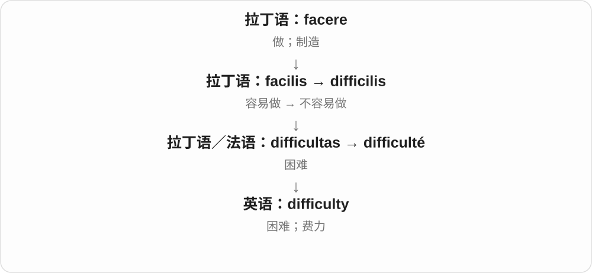
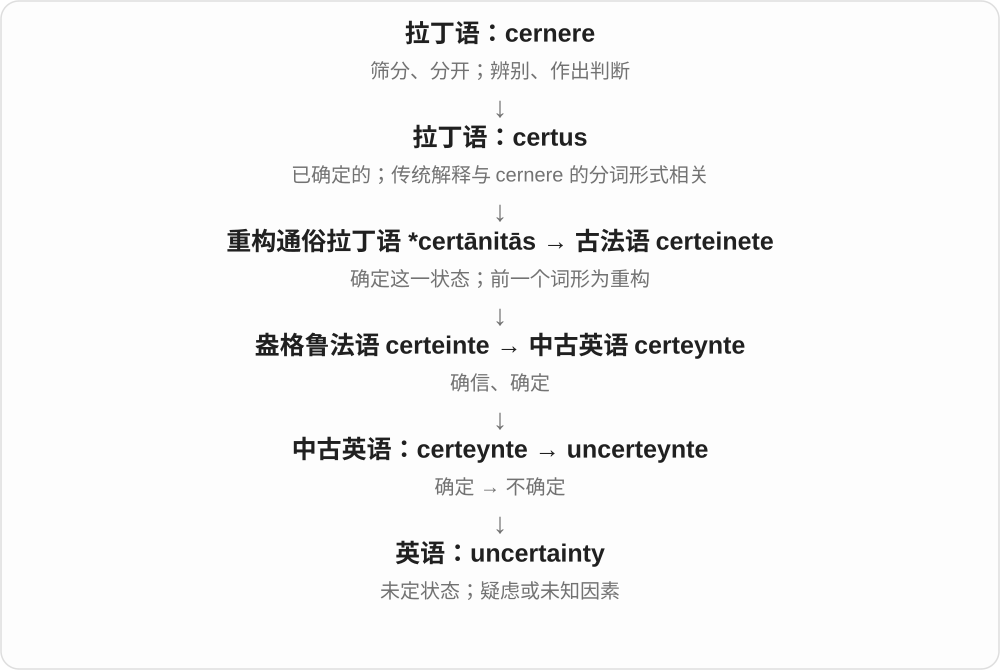
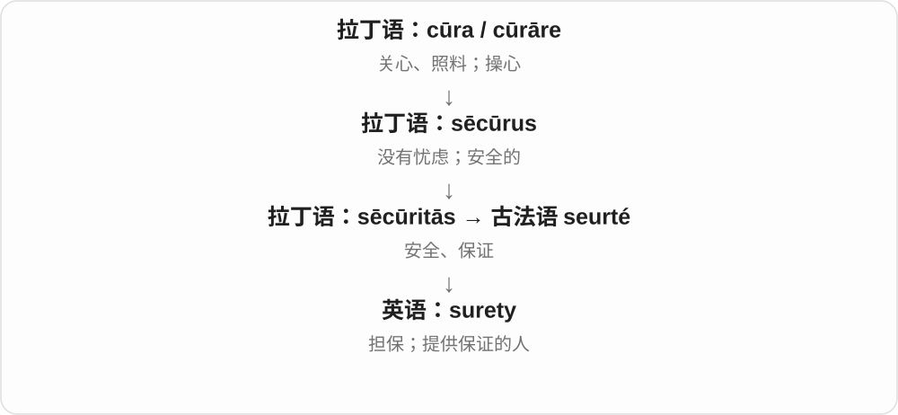

# 0029 · -ty — 数词中表示若干个十；另一来源构成性质、状态名词

[逐词精讲目录](../00_逐词精讲目录.md) · [总目录](../00_总目录_按常用程度.md)

## 核心词根与来源

数词最直观：three 三，thirty 三十；four 四，forty 四十。再接序数变化就有 thirtieth 第三十、fortieth 第四十。另一方面，loyalty、royalty、subtlety 等是在谈状态、性质或固定发展出的事物，这一组与 -ity 相联。

**-TY：同一外形，两条不同词源**

twenty 是两个十，sixty 是六个十；loyalty 忠诚、difficulty 困难里的 -ty 则不是十。先分清词源线，再看实际用法。

- **二、三、四个十**：two · twenty · twentieth · three · thirty · thirtieth · four · forty · fortieth
- **五、六、七个十**：five · fifty · fiftieth · six · sixty · sixtieth · seven · seventy · seventieth
- **八、九个十**：eight · eighty · eightieth · nine · ninety · ninetieth
- **年龄段、年代和数量**：twenty · thirty · forty · fifty · sixty · seventy · eighty · ninety
- **另一词源：性质与状态**：loyalty · difficulty · uncertainty · sovereignty · royalty · subtlety · property
- **difficulty → difficulties：一件件难处**：difficult · difficulty · difficulties

## 词形与演化规律

数词 -ty 延续古英语 -tig，日耳曼语中十、十的一组的材料；twenty、thirty 等有古老音形变化，不是现代数字词原封不动加 ty。另一条 -ty 经法语 -té、-te 接拉丁 -tas、-tat- 等性质名词材料，和 -ity 同族，来源与数词后缀不同。property、sovereignty 等可能整体借入，不强行按一个现代短词再加尾。现代十位数序数常 y → i 再接 -eth，如 twenty → twentieth；forty 的 u 不保留。

拉丁 difficilis、difficultas 经法语到英语；复数改 y 为 i 加 es。

## 单词速览（按词族由简到繁）

同一基础词的相关扩展放在一起，先读基础形式，再读扩展；各组之间优先读常用的。具体词源关系见各词讲解。

| 单词 | 音标 | 核心意思 |
|---|---|---|
| [two](#w-19) | /tuː/ | 二；两个 |
| [twenty](#w-2) | /ˈtwenti/ | 二十；二十岁的；二十元等〔看上下文〕 |
| [twentieth](#w-30) | /ˈtwentiəθ/ | 第二十；二十分之一 |
| [three](#w-20) | /θriː/ | 三；三个 |
| [thirty](#w-3) | 英 /ˈθɜːti/；美 /ˈθɜːrti/ | 三十；三十岁的 |
| [thirtieth](#w-32) | 英 /ˈθɜːtiəθ/；美 /ˈθɜːrtiəθ/ | 第三十；三十分之一 |
| [four](#w-21) | 英 /fɔː/；美 /fɔːr/ | 四；四个 |
| [forty](#w-29) | 英 /ˈfɔːti/；美 /ˈfɔːrti/ | 四十；四十岁的 |
| [fortieth](#w-33) | 英 /ˈfɔːtiəθ/；美 /ˈfɔːrtiəθ/ | 第四十；四十分之一 |
| [five](#w-22) | /faɪv/ | 五；五个 |
| [fifty](#w-28) | /ˈfɪfti/ | 五十；五十岁的 |
| [fiftieth](#w-31) | /ˈfɪftiəθ/ | 第五十；五十分之一 |
| [six](#w-23) | /sɪks/ | 六；六个 |
| [sixty](#w-7) | /ˈsɪksti/ | 六十；六十岁的 |
| [sixtieth](#w-34) | /ˈsɪkstiəθ/ | 第六十；六十分之一 |
| [property](#w-1) | 英 /ˈprɒpəti/；美 /ˈprɑːpərti/ | 财产；房产；性质、属性 |
| [seven](#w-24) | /ˈsevən/ | 七；七个 |
| [seventy](#w-10) | /ˈsevənti/ | 七十；七十岁的 |
| [seventieth](#w-35) | /ˈsevəntiəθ/ | 第七十；七十分之一 |
| [difficult](#w-38) | /ˈdɪfɪkəlt/ | 困难的、费劲的；难相处、难应付的 |
| [difficulty](#w-4) | /ˈdɪfɪkəlti/ | 困难；费力 |
| [difficulties](#w-39) | /ˈdɪfɪkəltiz/ | 困难、难处、难题〔复数〕 |
| [ten](#w-25) | /ten/ | 十；十个 |
| [eight](#w-26) | /eɪt/ | 八；八个 |
| [eighty](#w-11) | /ˈeɪti/ | 八十；八十岁的 |
| [eightieth](#w-36) | /ˈeɪtiəθ/ | 第八十；八十分之一 |
| [nine](#w-27) | /naɪn/ | 九；数字9；九点〔报时语境〕 |
| [ninety](#w-12) | /ˈnaɪnti/ | 九十；九十岁的 |
| [ninetieth](#w-37) | /ˈnaɪntiəθ/ | 第九十；九十分之一 |
| [loyalty](#w-5) | /ˈlɔɪəlti/ | 忠诚；忠实支持；忠诚对象〔复数时〕 |
| [uncertainty](#w-6) | 英 /ʌnˈsɜːtənti/；美 /ʌnˈsɜːrtənti/ | 不确定；疑虑；未定因素 |
| [sovereignty](#w-8) | 英 /ˈsɒvrənti/；美 /ˈsɑːvrənti/ | 主权；最高统治权；自主决定权 |
| [royalty](#w-9) | 英、美 /ˈrɔɪəlti/ | 王室成员；王权；版税、特许权使用费 |
| [admiralty](#w-13) | /ˈædmərəlti/ | 海军管理机关、海军将官职权；海事司法领域 |
| [parity](#w-14) | /ˈpærəti/ | 同等、对等；平等水平 |
| [subtlety](#w-15) | /ˈsʌtəlti/ | 细微；含蓄；细微差别；精妙之处 |
| [surety](#w-16) | 英 /ˈʃʊərəti/；美 /ˈʃʊrəti/ | 担保；保证人 |

## 逐词讲解

### 1. two — 二；两个

**音标**：/tuː/

**先抓住这个画面**

一个再加一个就是 two；它可以直接限定后面的东西，也可以自己指数字二。看数字不用把 w 也读出来。

**怎么拆**

延续古英语 twa、twegen 等数词形式，经中古英语成为 two；w 保留在拼写里，现代常用发音不发 /w/。twenty 保留同族数词材料。

**怎么变成今天的意思**

**古英语 twa、twegen 等 → 中古英语 two 等**  
二；早期有不同语法形式

↓

**现代 two；古英语 twentig → twenty**  
二；二个十 → 二十

two books 两本书；in two days 两天后、两天内等，随句意；in two 分成两半；the two of us 我们俩。

**常见搭配与例句**

two people；the two of us；in two。

> The two of us carried the table upstairs.

我们俩把桌子搬上楼。

> She cut the apple in two.

她把苹果切成两半。

**别混淆**

two、to、too 在常见强读里可同音，但 two 说数量，to 常是介词或不定式标记，too 常说也、太；不是一个词的三种随意拼法。

### 2. twenty — 二十；二十岁的；二十元等〔看上下文〕

**音标**：/ˈtwenti/

**先抓住这个画面**

想成两组十：十个再来十个，就是 twenty。in your twenties 则把二十到二十九岁这一段当成一个阶段。

**怎么拆**

延续古英语 twentig，历史是二的材料与 -tig 十、十的一组相合；现代对应 two 与 -ty 的数词关系，拼写已不是原样 twoty。

**怎么变成今天的意思**

**古英语 twa、twegen 等 → 中古英语 two 等**  
二；早期有不同语法形式

↓

**现代 two；古英语 twentig → twenty**  
二；二个十 → 二十

twenty students 二十名学生；in her twenties 在她二十多岁时；a twenty 可按货币语境指面额二十的纸币。

**常见搭配与例句**

twenty minutes；in your twenties。

> The walk takes about twenty minutes.

步行大约需要二十分钟。

> She started the business in her twenties.

她二十多岁时创办了这家公司。

**别混淆**

twenty 是二十，twentieth 是第二十；数量与序数分开。twenties 的年龄段通常是二十至二十九岁。

### 3. twentieth — 第二十；二十分之一

**音标**：/ˈtwentiəθ/

**先抓住这个画面**

twenty 是有二十个，twentieth 是排到第二十位。把整体平分二十份，a twentieth 又是一份，也就是二十分之一。

**怎么拆**

承古英语 twentigotha、中古英语 twentithe 等，现代形式经类推更清楚地接 twenty。拼写 twenty 的 y 改 i + -eth → twentieth。

**怎么变成今天的意思**

**古英语、英语中古阶段的整十序数形式**  
二十等基数名与序数词尾在历史中类推整合

↓

**现代 -ty → -tieth**  
twenty → twentieth 等；表示次序，也能表示等分中的一份

the twentieth century 二十世纪；her twentieth birthday 她的二十岁生日；one twentieth 二十分之一；缩写 20th。

**常见搭配与例句**

the twentieth century；one twentieth。

> She celebrated her twentieth birthday with friends.

她和朋友庆祝二十岁生日。

> One twentieth of the class chose that option.

全班二十分之一的人选了那个选项。

**别混淆**

twentieth 第二十与 twelfth 第十二不同；twenty 基数通常数数量，twentieth 常标次序。

### 4. three — 三；三个

**音标**：/θriː/

**先抓住这个画面**

一、二之后再多一个，就是 three。最容易绊住的是开头 /θr/：不是 free，也不是 tree。

**怎么拆**

延续古英语 thri、threo 等形式；th 对应旧字母 þ 的声音，现代一般读 /θ/。thirty 与 third 是同族的十位数、序数形式。

**怎么变成今天的意思**

**古英语 thri、threo 等 → 中古英语 thre**  
三的数词形式

↓

**古英语 thritig → 中古英语 thritty、thirty 等**  
三个十；后来音位次序调整，形成 thirty

three people 三个人；in groups of three 三人一组；all three 三个全都。

**常见搭配与例句**

all three；three times；groups of three。

> All three answers were correct.

三个答案全都正确。

> The students worked in groups of three.

学生三人一组活动。

**别混淆**

three 是三个，third 是第三；three times 是三次、三倍，third time 是第三次。

### 5. thirty — 三十；三十岁的

**音标**：英 /ˈθɜːti/；美 /ˈθɜːrti/

**先抓住这个画面**

三组十就是 thirty；现代看起来与 three 不完全一样，是旧词音形变化留下的痕迹。

**怎么拆**

古英语 thritig 等来自三与十组的材料；中古英语较早有 thritty 一类，随后相邻音的次序调整，形成 thirty。不是英语常用词 thir 加数字三的意义。

**怎么变成今天的意思**

**古英语 thri、threo 等 → 中古英语 thre**  
三的数词形式

↓

**古英语 thritig → 中古英语 thritty、thirty 等**  
三个十；后来音位次序调整，形成 thirty

thirty days 三十天；in his thirties 他三十多岁时；thirty percent 百分之三十。

**常见搭配与例句**

thirty minutes；in your thirties。

> The museum is thirty kilometres from the city.

博物馆离城里三十公里。

> He learned to swim in his thirties.

他三十多岁时学会游泳。

**别混淆**

thirty 三十与 thirteen 十三分开。常见单独说时 thirty 重音在前、thirteen 常在后，但比较或句中重音会变，也要听元音、末音。

### 6. thirtieth — 第三十；三十分之一

**音标**：英 /ˈθɜːtiəθ/；美 /ˈθɜːrtiəθ/

**先抓住这个画面**

三十个位置排成一列，最后那一位是 the thirtieth。它把 thirty 的数量换成名次；分数用法再看三十等分中的一份。

**怎么拆**

承古英语 thritigotha 等及中古英语序数形式，现代类推对应 thirty。y 改 i + -eth → thirtieth，末尾读 /iəθ/。

**怎么变成今天的意思**

**古英语、英语中古阶段的整十序数形式**  
二十等基数名与序数词尾在历史中类推整合

↓

**现代 -ty → -tieth**  
twenty → twentieth 等；表示次序，也能表示等分中的一份

the thirtieth page 第三十页；a thirtieth anniversary 三十周年；缩写 30th。

**常见搭配与例句**

the thirtieth page；the thirtieth anniversary。

> The answer appears on the thirtieth page.

答案在第三十页。

> They marked the thirtieth anniversary of the project.

他们纪念项目三十周年。

**别混淆**

thirteenth 第十三与 thirtieth 第三十的结尾、重音不同；thirty 与 thirteen 的区别延续到序数词。

### 7. four — 四；四个

**音标**：英 /fɔː/；美 /fɔːr/

**先抓住这个画面**

四条腿、四个方向，数到四就是 four。它与 forty 的数词关系清楚，但拼写不能逐个字母搬过去。

**怎么拆**

延续古英语 feower，经中古英语成为 four；与日耳曼语其他四的形式同源。现代 four 中的 our 不能按 our 我们的去解释。

**怎么变成今天的意思**

**古英语 feower → 中古英语 four**  
四

↓

**古英语 feowertig → forty**  
四个十 → 四十；现代拼写不保留 four 的 u

four corners 四个角；all four 四个全都；four times 四次、四倍。

**常见搭配与例句**

four people；all four；four times。

> The table has four legs.

桌子有四条腿。

> All four windows face the garden.

四扇窗都朝着花园。

**别混淆**

four 与 for 的强读在常见口音里可同音；数字四写 four，介词 for 不因此变成数词。

### 8. forty — 四十；四十岁的

**音标**：英 /ˈfɔːti/；美 /ˈfɔːrti/

**先抓住这个画面**

四组十就是 forty；记拼写时抓住一点：four 有 u，forty 没有 u。

**怎么拆**

由古英语 feowertig 经中古英语 fourty、forty 等形式延续；现代通用拼写定为 forty，不因为基础数词 four 就改成 fourty。

**怎么变成今天的意思**

**古英语 feower → 中古英语 four**  
四

↓

**古英语 feowertig → forty**  
四个十 → 四十；现代拼写不保留 four 的 u

forty pages 四十页；in her forties 她四十多岁时；forty percent 百分之四十。

**常见搭配与例句**

forty minutes；in your forties。

> The report is forty pages long.

报告有四十页。

> She changed careers in her forties.

她四十多岁时换了职业。

**别混淆**

forty 四十，fourteen 十四，fourth 第四，fortieth 第四十；同族词在数量、序数上不同。

### 9. fortieth — 第四十；四十分之一

**音标**：英 /ˈfɔːtiəθ/；美 /ˈfɔːrtiəθ/

**先抓住这个画面**

forty 的四十变成排位，就是 fortieth 第四十。最容易漏的是拼写：这里沿用 forty，没有把 four 里的 u 补回来。

**怎么拆**

承中古英语 fourtithe 等，现代对应 forty 的类推形式。forty 的 y 改 i + -eth → fortieth，标准现代拼写无 u。

**怎么变成今天的意思**

**古英语、英语中古阶段的整十序数形式**  
二十等基数名与序数词尾在历史中类推整合

↓

**现代 -ty → -tieth**  
twenty → twentieth 等；表示次序，也能表示等分中的一份

the fortieth floor 第四十层；a fortieth birthday 四十岁生日；缩写 40th。

**常见搭配与例句**

the fortieth floor；a fortieth birthday。

> The restaurant is on the fortieth floor.

餐厅位于第四十层。

> We gathered for her fortieth birthday.

我们聚在一起庆祝她四十岁生日。

**别混淆**

fortieth 第四十，不写成 fourtieth；fourteenth 才是第十四。

### 10. five — 五；五个

**音标**：/faɪv/

**先抓住这个画面**

一只手通常有五根手指，five 是数量五；排到第五名时才用 fifth。先把数量与名次分开。

**怎么拆**

由古英语 fif 经中古英语 fyf、fyve 延续，属于古老的日耳曼语数词；词尾与元音经过变化，不是从现代 fif 加 e 造出。

**怎么变成今天的意思**

**古英语 fif → 中古英语 fyf、fyve → five**  
五，日耳曼语继承的数词

↓

**古英语 fifta → 中古英语 fift 等 → fifth**  
第五；不是现代 five 原样加 th

five minutes 五分钟；five people 五个人；at five 五点；give someone five 在特定口语里可说击掌。

**常见搭配与例句**

five minutes；at five。

> We waited for five minutes.

我们等了五分钟。

> Five people joined the discussion.

五个人参加了讨论。

**别混淆**

five 是有五个，fifth 是第五个；five floors 五层与 the fifth floor 第五层分开。

### 11. fifty — 五十；五十岁的

**音标**：/ˈfɪfti/

**先抓住这个画面**

五组十就是 fifty。five 的 /v/ 到这里成为 /f/，不要只按 five 原音再接 ty。

**怎么拆**

延续古英语 fiftig，上接五与十组的日耳曼语数词材料；现代对应 five、fifty，词干与语音已有变化。

**怎么变成今天的意思**

**古英语 fiftig 等**  
五个十

↓

**现代 fifty；对应 five**  
五十；与五保持词族关系

fifty people 五十人；fifty percent 百分之五十；in his fifties 他五十多岁时。

**常见搭配与例句**

fifty percent；in your fifties。

> Fifty people attended the workshop.

五十人参加了工作坊。

> The battery was at fifty percent.

电池电量为百分之五十。

**别混淆**

fifty 五十与 fifteen 十五分开；两个词的 f 都要看清，数字后缀不能只凭一个末尾 t 猜。

### 12. fiftieth — 第五十；五十分之一

**音标**：/ˈfɪftiəθ/

**先抓住这个画面**

五十周年、第五十页、排到第五十位，都用 fiftieth。后面的 /iəθ/ 让它与表示第十五的 fifteenth 分开。

**怎么拆**

承中古英语 fiftithe、fyftith 等，现代对应 fifty。y 改 i + -eth → fiftieth，是整十序数的共同类推模式。

**怎么变成今天的意思**

**古英语、英语中古阶段的整十序数形式**  
二十等基数名与序数词尾在历史中类推整合

↓

**现代 -ty → -tieth**  
twenty → twentieth 等；表示次序，也能表示等分中的一份

a fiftieth anniversary 五十周年；the fiftieth page 第五十页；缩写 50th。

**常见搭配与例句**

a fiftieth anniversary；the fiftieth page。

> The museum celebrated its fiftieth anniversary.

博物馆庆祝成立五十周年。

> The clue was hidden on the fiftieth page.

线索藏在第五十页。

**别混淆**

fiftieth 第五十与 fifteenth 第十五不能只看前面的 fif-；词尾决定关键差别。

### 13. six — 六；六个

**音标**：/sɪks/

**先抓住这个画面**

把两组三个放一起，共有 six。它说数量；sixth 才把其中一个放到第六的位置上。

**怎么拆**

接古英语 six，来自古老日耳曼语数量材料，经中古英语延续。不是英语性别词 sex 的缩写，虽然远古数词有跨语言同源。

**怎么变成今天的意思**

**古英语 six → 中古英语 six → six**  
六，继承的数量词

↓

**古英语 siexta → 中古英语 sixte → sixth**  
第六；旧形式发展为现代 -th 拼写

six days 六天；at six 六点；six of us 我们中的六人。

**常见搭配与例句**

six days；six of us。

> There are six chairs around the table.

桌子旁有六把椅子。

> Six of us stayed until the end.

我们有六个人待到最后。

**别混淆**

six /sɪks/ 和 sex /seks/ 元音不同；six 的词尾 /ks/ 也不要漏掉。

### 14. sixty — 六十；六十岁的

**音标**：/ˈsɪksti/

**先抓住这个画面**

六组十就是 sixty。six 的 /ks/ 仍在，与后面的 /t/ 连起来，别把六十听成十六。

**怎么拆**

延续古英语 sixtig，中古英语 sixty、sexty 等形式；现代很直观地对应 six + -ty。

**怎么变成今天的意思**

**古英语 sixtig → 中古英语相应形式**  
六个十

↓

**现代 six + -ty 的对应 → sixty**  
六十

sixty seconds 六十秒；in her sixties 她六十多岁时；sixty percent 百分之六十。

**常见搭配与例句**

sixty seconds；in your sixties。

> There are sixty seconds in a minute.

一分钟有六十秒。

> She began painting in her sixties.

她六十多岁时开始画画。

**别混淆**

sixty 六十通常前重音，sixteen 十六常末重音；句中仍要结合末尾是否有 /n/ 等线索辨认。

### 15. sixtieth — 第六十；六十分之一

**音标**：/ˈsɪkstiəθ/

**先抓住这个画面**

sixty 数六十，sixtieth 把其中一位标为第六十。一分钟的六十等分里，一份就是 a sixtieth of a minute。

**怎么拆**

承中古英语 sixtithe 等，现代 sixty 的 y 改 i + -eth → sixtieth。基数、序数对应在英语历史中经过类推整合。

**怎么变成今天的意思**

**古英语、英语中古阶段的整十序数形式**  
二十等基数名与序数词尾在历史中类推整合

↓

**现代 -ty → -tieth**  
twenty → twentieth 等；表示次序，也能表示等分中的一份

a sixtieth birthday 六十岁生日；one sixtieth 六十分之一；缩写 60th。

**常见搭配与例句**

a sixtieth birthday；one sixtieth。

> They planned a dinner for his sixtieth birthday.

他们安排晚餐为他庆祝六十岁生日。

> A second is one sixtieth of a minute.

一秒是一分钟的六十分之一。

**别混淆**

sixteenth 是第十六，sixtieth 是第六十；读清后半不要只靠开头 six- 猜数值。

### 16. property — 财产；房产；性质、属性

**音标**：英 /ˈprɒpəti/；美 /ˈprɑːpərti/

**先抓住这个画面**

一条线问“什么东西属于它”，另一条线问“它自己带着什么特点”：钱包是你的财物，导电性是材料的性质。

**怎么拆**

拉丁 proprietas 接 proprius“自己的、特有的”，经法语 proprete 等形式进入中古英语。现代看似 proper + -ty，但历史上名词作为整词借入。

**怎么变成今天的意思**

**拉丁 proprius**  
某人或某物自己的、特有的；适合的

↓

**拉丁 proprietas**  
特有性质；所有权、财产

↓

**古法语 proprete／盎格鲁法语形式 → 中古英语 properte**  
特有性质；财产

↓

**英语 property**  
财产、房产；事物的性质或属性

财产总称通常不可数：private property。说一处房产可以用 a property；说多项物理或化学性质则是 properties。编程里的 property 也沿用属性这条意义。

**常见搭配与例句**

private property；a rental property；the properties of a material。

> Please take your personal property with you when you leave.

离开时请带好个人物品。

> The experiment compares the properties of two metals.

实验比较了两种金属的性质。

**别混淆**

possession 侧重拥有或持有的东西；property 也能指客观性质，不能一律译成财产。

### 17. seven — 七；七个

**音标**：/ˈsevən/

**先抓住这个画面**

一周有 seven days。数有几个时用 seven，问排在第几个时用 seventh。

**怎么拆**

接古英语 seofon，经中古英语到 seven，是古老日耳曼语数词；不是 sever 切断去一个字母。

**怎么变成今天的意思**

**古英语 seofon → 中古英语 seven → seven**  
七，继承的数词

↓

**古英语 seofoþa 等 → seventh**  
旧序数形式后受 seven 类推，保留现代 n

seven days 七天；a group of seven 七人、七物的一组；at seven 七点。

**常见搭配与例句**

seven days；at seven。

> The shop opens seven days a week.

商店一周七天营业。

> Seven students submitted their work early.

七名学生提前交了作业。

**别混淆**

seven 常读两个音节，末尾弱读；seventy 是七十，多出的 -ty 是另一套数词材料。

### 18. seventy — 七十；七十岁的

**音标**：/ˈsevənti/

**先抓住这个画面**

七组十就是 seventy，现代 seven 的大部分外形、声音还很清楚。in your seventies 指七十到七十九岁。

**怎么拆**

延续古英语 hundseofontig 等相应形式；旧形式含现今已不用的数词组合材料，现代可按 seven 与 -ty 对应来认，不把旧 hund- 机械算成一百再相加。

**怎么变成今天的意思**

**古英语 hundseofontig → 中古英语 seventy 等**  
七十的旧数词形式

↓

**现代 seven、seventy**  
七；七十

seventy years 七十年；seventy percent 百分之七十；in his seventies 他七十多岁。

**常见搭配与例句**

seventy people；in your seventies。

> The hall can hold seventy people.

大厅可容纳七十人。

> He remained active well into his seventies.

他到了七十多岁仍然很活跃。

**别混淆**

seventy 七十、seventeen 十七；末尾 /ti/ 与 /tiːn/ 以及重音一起帮助辨认。

### 19. seventieth — 第七十；七十分之一

**音标**：/ˈsevəntiəθ/

**先抓住这个画面**

seventy 的七十换成序列位置，是 seventieth。后缀不改变七十这个基数参照，而是让它回答“第几个”。

**怎么拆**

承中古英语 seventithe 等，现代 seventy 的 y 改 i + -eth → seventieth。与其他整十序数共享类推形成的拼写、读音关系。

**怎么变成今天的意思**

**古英语、英语中古阶段的整十序数形式**  
二十等基数名与序数词尾在历史中类推整合

↓

**现代 -ty → -tieth**  
twenty → twentieth 等；表示次序，也能表示等分中的一份

a seventieth birthday 七十岁生日；the seventieth entry 第七十个条目；缩写 70th。

**常见搭配与例句**

a seventieth birthday；the seventieth entry。

> The family gathered for her seventieth birthday.

家人齐聚一堂庆祝她七十岁生日。

> The seventieth entry was the last one on the list.

第七十个条目是清单的最后一项。

**别混淆**

seventeenth 第十七与 seventieth 第七十不同；序数后缀不能只写成 seventy 加一个 s。

### 20. difficult — 困难的、费劲的；难相处、难应付的

**音标**：/ˈdɪfɪkəlt/

**先抓住这个画面**

事情不是轻轻一推就动，得费力、动脑，叫 difficult。说人 difficult，往往是难沟通、难取悦或不好应付。

**怎么拆**

英语 difficult 通常解释为从较早 difficulty 逆构；更早名词经法语接拉丁 difficultas，与 dis- 否定、facilis 容易做及 facere 做的词族相连。

**怎么变成今天的意思**

**拉丁语 facilis → difficilis、difficultas → 英语 difficulty**  
容易做 → 不容易做、困难

↓

**由 difficulty 逆构 difficult**  
形成英语形容词；后来也形容人难应付

a difficult question 难题；find it difficult to do 觉得做某事难；be difficult to please 难以取悦；a difficult customer 难应付的顾客。

**常见搭配与例句**

a difficult decision；a difficult time。

> I found the last question difficult.

我觉得最后一道题很难。

> He can be difficult to work with.

他有时很难共事。

**别混淆**

difficult 说做起来有难度，difficulty 说困难这一性质或具体难处。学习先看形容词很方便，但历史上的英语名词更早。

### 21. difficulty — 困难；费力

**音标**：/ˈdɪfɪkəlti/

**先抓住这个画面**

一扇门能开，但很沉，要费劲推：difficulty 是事情做起来不轻松的地方或程度。

**怎么拆**

拉丁语 dis- + facilis“容易”形成 difficilis，再有 difficultas；经法语 difficulté 进入英语。

**怎么变成今天的意思**

这里保留的是“好不好做”的轴线。英语 difficult 与 difficulty 紧密相关，但不能把现代后缀分析当成整个历史顺序。

**常见搭配与例句**

have difficulty doing…；with difficulty；financial difficulties。

> I had difficulty finding the entrance.

我费了些劲才找到入口。

> They discussed the financial difficulties openly.

他们坦率讨论了经济上的困难。

**别混淆**

problem 是需要处理的问题；difficulty 强调处理时费劲，也可指某个难处。

### 22. difficulties — 困难、难处、难题〔复数〕

**音标**：/ˈdɪfɪkəltiz/

**先抓住这个画面**

不只笼统觉得难，而是指出有几个卡住人的地方、几件不好办的事，就可以说 difficulties。

**怎么拆**

difficulty 改 y 为 i 加 -es。difficulty 经法语 difficulté 接拉丁 difficultas、difficilis，较早与 dis- 及 facilis 容易的材料相连。

**怎么变成今天的意思**

**拉丁 difficilis、difficultas → 法语 difficulté → difficulty**  
不容易 → 困难状态或具体难处

↓

**difficulty → difficulties**  
多个难处、难题

face difficulties 面临困难；overcome difficulties 克服困难；practical difficulties 实际难处。

**常见搭配与例句**

learning difficulties 学习困难；technical difficulties 技术问题。

> We ran into some difficulties during the move.

搬迁过程中，我们遇到了一些困难。

> The team is working to overcome the technical difficulties.

团队正努力解决技术难题。

**别混淆**

difficulty 不可数时说有多难；difficulties 复数把难处一项项拿出来。have difficulty doing 常不用 in，也不直接接 to do 表同一结构。

### 23. ten — 十；十个

**音标**：/ten/

**先抓住这个画面**

十进制里数完个位，到了 ten。它既可说十个东西，也常说十点钟、十分制的满分。

**怎么拆**

由古英语 tien 等延续，是继承的日耳曼语数词；thirteen 等里的 -teen 与十的旧形式相连。

**怎么变成今天的意思**

**古英语 tien 等 → 中古英语 ten → ten**  
十；与 -teen 的历史材料相连

↓

**中古英语 tenth，受 ten 类推重组旧序数词**  
第十；重新清楚带上 n

ten minutes 十分钟；at ten 十点；ten out of ten 十分满分得十分；tens of thousands 数万。

**常见搭配与例句**

ten minutes；ten out of ten。

> The walk takes about ten minutes.

步行大约需要十分钟。

> She gave the performance ten out of ten.

她给这场演出打了满分十分。

**别混淆**

ten 是数量，tenth 是次序或十分之一；ten years 十年与 the tenth year 第十年不同。

### 24. eight — 八；八个

**音标**：/eɪt/

**先抓住这个画面**

八点钟、八个人都用 eight。今天读起来与 ate 吃的过去式相同，但这只是同音，不是词义相通。

**怎么拆**

由古英语 eahta 经中古英语 eighte 延续，属于古老数词；gh 留下历史拼写痕迹，现代常用读音不单独发 gh。

**怎么变成今天的意思**

**古英语 eahta → 中古英语 eighte → eight**  
八；原有辅音随语音史改变

↓

**古英语 eahtoþa 等 → eighth**  
第八；现代拼写不是 eightth

eight people 八个人；at eight 八点；eight hours 八小时。

**常见搭配与例句**

at eight；eight hours。

> The train leaves at eight.

火车八点发车。

> We need eight copies of the report.

我们需要八份报告。

**别混淆**

eight 是数量，ate 是动词过去式；读音相同，句法和含义不同。

### 25. eighty — 八十；八十岁的

**音标**：/ˈeɪti/

**先抓住这个画面**

八组十就是 eighty。eight 本来结尾已经有 t 的拼写，现代 eighty 不额外叠出两个 t。

**怎么拆**

从古英语 hundeahtatig、中古英语 eightety 等相应形式发展而来，现代对应 eight 与 -ty；一些旧形式后来缩短、调整。

**怎么变成今天的意思**

**古英语 hundeahtatig 等 → 中古英语相应形式**  
八十的旧数词形式

↓

**现代 eight、eighty**  
八；八十

eighty kilometres 八十公里；in her eighties 她八十多岁；the eighties 也可按语境指某世纪八十年代。

**常见搭配与例句**

eighty percent；in your eighties。

> The battery charges to eighty percent in an hour.

电池一小时充到百分之八十。

> She began writing poetry in her eighties.

她八十多岁时开始写诗。

**别混淆**

eighty 八十，eighteen 十八，eighth 第八，eightieth 第八十。数词材料相近，具体数量、顺序不同。

### 26. eightieth — 第八十；八十分之一

**音标**：/ˈeɪtiəθ/

**先抓住这个画面**

eighty 说有八十个，eightieth 说排到第八十；作分母时 one eightieth 则是把整体分成八十份的一份。

**怎么拆**

eighty 的 y 改 i，再加 -eth → eightieth；是十位数基数转序数的常见形式，不写成 eightyth。

**怎么变成今天的意思**

**eight → eighty**  
八 → 八十

↓

**eighty → eightieth**  
第八十；分母用法八十分之一

her eightieth birthday 她的八十岁生日；one eightieth of the total 总数的八十分之一。

**常见搭配与例句**

the eightieth anniversary；an eightieth。

> The town celebrated the library’s eightieth anniversary.

小镇庆祝图书馆成立八十周年。

> Each part represents one eightieth of the total.

每部分占总数的八十分之一。

**别混淆**

eighth 是第八，eightieth 是第八十；中间的 /ti/ 会影响数值，不能为了省音把两词都读成 eighth。

### 27. nine — 九；数字9；九点〔报时语境〕

**音标**：/naɪn/

**先抓住这个画面**

数完八个，再加一个，就是九；它回答有多少，而不是排第几。

**怎么拆**

古英语 nigon／nigen，经中古英语进入现代 nine。它属于日耳曼继承词，与拉丁 novem、希腊 ennea 远同源，不能画成从拉丁九借入英语。

**怎么变成今天的意思**

**更早的印欧九词族 → 日耳曼分支**  
拉丁 novem 是另一支，不是英语的直接来源

↓

**古英语 nigon／nigen → 中古英语 nin → nine**  
本族继承词的语音、拼写演化

nine books 是九本书，at nine 是九点。说数字或球衣号码时 a nine 也可作可数名词；普通数量用法不在 nine 后随便加复数 s。

**常见搭配与例句**

nine people；at nine；the number nine；a nine on the screen。

> There are nine chairs around the table.

桌子周围有九把椅子。

> The train leaves at nine.

火车九点发车。

**别混淆**

nine 是数量九，ninth 是顺序第九；Number Nine 可以是编号九，不一定表示按某项成绩排第九。

### 28. ninety — 九十；九十岁的

**音标**：/ˈnaɪnti/

**先抓住这个画面**

九组十就是 ninety；nine 的末尾 e 在这个数词外形里不保留，但 /naɪn/ 还在。

**怎么拆**

延续古英语 hundnigontig、中古英语 nynty、nynety 等形式，现代对应 nine 与 -ty，末尾直接用 -ty。

**怎么变成今天的意思**

**古英语 hundnigontig 等 → 中古英语相应形式**  
九十的旧数词形式

↓

**现代 nine、ninety**  
九；九十

ninety minutes 九十分钟；ninety percent 百分之九十；in his nineties 他九十多岁。

**常见搭配与例句**

ninety minutes；in your nineties。

> The journey took ninety minutes.

路程花了九十分钟。

> He was still gardening in his nineties.

他九十多岁时还在打理花园。

**别混淆**

ninety 九十与 nineteen 十九区分；nineteen 保留 nine 的 e，ninety 的拼写不保留。

### 29. ninetieth — 第九十；九十分之一

**音标**：/ˈnaɪntiəθ/

**先抓住这个画面**

排第九十是 ninetieth；如果在说分数，one ninetieth 是九十份中的一份。和数量 ninety 分开。

**怎么拆**

ninety 的 y 改 i，再加 -eth → ninetieth。nine 的 e 不在 ninety 中保留，序数也沿用这个词干。

**怎么变成今天的意思**

**nine → ninety**  
九 → 九十

↓

**ninety → ninetieth**  
第九十；分母用法九十分之一

a ninetieth birthday 九十岁生日；the ninetieth minute 第九十分钟。

**常见搭配与例句**

the ninetieth anniversary；one ninetieth。

> The family gathered for her ninetieth birthday.

家人为她的九十岁生日聚在一起。

> The winning goal came in the ninetieth minute.

制胜球在第九十分钟出现。

**别混淆**

ninth 是第九，nineteenth 第十九，ninetieth 第九十；中间是不是 -teen- 很关键。

### 30. loyalty — 忠诚；忠实支持；忠诚对象〔复数时〕

**音标**：/ˈlɔɪəlti/

**先抓住这个画面**

把“我会一直站在你这边”看成一种持续的态度和关系。

**怎么拆**

借自古法语 loialte / loiauté，由 loial 加名词后缀构成。现代对应 loyal + -ty，但英语名词有独立借入史。

**怎么变成今天的意思**

**拉丁语 lex，属格 legis**  
法律、规则

↓

**拉丁语 legalis**  
属于法律的；依法的

↓

**古法语 loial / leial**  
守法、尽义务的 → 忠实的

↓

**古法语 loialte / loiauté → 中古英语 loialte**  
忠诚、守信

↓

**英语 loyalty**  
忠诚；持续支持

customer loyalty 是顾客持续选择某品牌；divided loyalties 指心里有不止一个支持对象，彼此发生冲突。

**常见搭配与例句**

loyalty to；customer loyalty；divided loyalties。

> His loyalty to the team never changed.

他对球队的忠诚从未改变。

> The survey measured customer loyalty rather than one-time satisfaction.

调查衡量的是顾客忠诚度，而不是单次满意程度。

**别混淆**

loyalty 是关系中的持续支持；enthusiasm 是热情，热情可以很强却很短暂。

### 31. uncertainty — 不确定；疑虑；未定因素

**音标**：英 /ʌnˈsɜːtənti/；美 /ʌnˈsɜːrtənti/

**先抓住这个画面**

uncertainty 是“还有几种可能没排除”的空间，既可能在人的心里，也可能真的存在于事情的发展中。

**怎么拆**

中古英语 uncerteynte；现代可拆 un- + certainty，或联系 uncertain + -ty。

**怎么变成今天的意思**

a period of uncertainty 是局面未定的一段时期；uncertainties 常指多个未知因素。测量中的 uncertainty 有特定技术含义，并不只是操作者粗心。

**常见搭配与例句**

uncertainty about；reduce uncertainty；a period of uncertainty。

> The announcement ended weeks of uncertainty.

公告结束了持续数周的不确定局面。

> There is still uncertainty about the opening date.

开业日期仍未确定。

**别混淆**

risk 常关注不利结果的可能；uncertainty 更广，连可能出现哪些结果或概率都未必清楚。

### 32. sovereignty — 主权；最高统治权；自主决定权

**音标**：英 /ˈsɒvrənti/；美 /ˈsɑːvrənti/

**先抓住这个画面**

把“谁拥有最终治理权”作为一种地位或权力来谈，通常出现在国家、政治和法律讨论中。

**怎么拆**

英语经盎格鲁法语 sovereyneté、古法语 soveraineté 借入，接 soverain。现代可分析 sovereign + -ty，历史名词却已有法语路线。

**怎么变成今天的意思**

**拉丁 super**  
在上方、超过、越过

↓

**重构 \*superanus → 古法语 soverain → soveraineté**  
居首、统治者 → 最高统治权

↓

**盎格鲁法语 sovereyneté → 中古英语 sovereynte → sovereignty**  
主权、最高权力

national sovereignty 国家主权；popular sovereignty 人民主权，讨论最高权力归属。资料或技术语境的 data sovereignty 借用自主控制的画面，具体含义随制度而定。

**常见搭配与例句**

national sovereignty；popular sovereignty；respect sovereignty。

> The debate focused on national sovereignty and international cooperation.

辩论围绕国家主权与国际合作展开。

> The chapter explains the idea of popular sovereignty.

这一章解释了人民主权的理念。

**别混淆**

independence 更广泛地说独立；sovereignty 侧重治理权、最高权力的性质。

### 33. royalty — 王室成员；王权；版税、特许权使用费

**音标**：英、美 /ˈrɔɪəlti/

**先抓住这个画面**

一边是王室人物，一边是“你使用某项权利，所以向权利人付钱”。钱的意思是从王权特许一步步扩展来的。

**怎么拆**

来自或仿照古法语 roialté，远源为 regalis。词义由王权、王室扩展到君主授予的特权，再到使用土地、矿产或作品等权利所付的费用；现代可分析 royal + -ty。

**怎么变成今天的意思**

**拉丁语：rex / reg-**  
王；与 regere 同源的名词旁支

↓

**拉丁语：regalis**  
属于王的、王者般的

↓

**古法语 roialté → 英语 royalty**  
王权、王室；王室所授特权

↓

**英语：royalty〔使用费义〕**  
特权、使用权 → 为使用某项权利支付的费用

王室成员总体通常用不可数 royalty；版税常用复数 royalties。作者拿 royalties 是按使用或销售等约定取得报酬，不等于作者是贵族。

**常见搭配与例句**

meet royalty；earn royalties；a royalty payment。

> The reception was attended by diplomats and royalty.

外交官和王室成员出席了招待会。

> She earns royalties whenever the publisher sells copies of her book.

出版社售出她的书时，她就会获得相应版税。

**别混淆**

salary 是工资；royalties 依据作品或其他权利的使用安排支付，计算方式看约定。

### 34. admiralty — 海军管理机关、海军将官职权；海事司法领域

**音标**：/ˈædmərəlti/

**先抓住这个画面**

admiral 是人物，admiralty 可能是围绕海军的管理机关、职权。admiralty law 则转到航运、海事司法这一专门领域。

**怎么拆**

经法语 amirauté、旧 amiralté 与拉丁相关职权名词，现代对应 admiral + -ty；历史拼写随 admiral 一族调整。

**怎么变成今天的意思**

**阿拉伯 amīr**  
指挥者、统帅

↓

**中世纪拉丁、法语改造的相应头衔**  
amiral、amirail 等；d 后来可能受拉丁熟词影响

↓

**法语、拉丁相关职权词 → admiralty**  
海军管理、职权；海事司法

the Admiralty 在英国历史材料中常指海军部；admiralty law 海事法，admiralty jurisdiction 海事司法管辖领域。

**常见搭配与例句**

the Admiralty；admiralty law。

> The letter was sent to the Admiralty in London.

信被寄往伦敦的海军部。

> The course includes an introduction to admiralty law.

课程包括海事法入门。

**别混淆**

admiralty 不只是将官本人，也不是所有语境都指同一现存政府部门；历史机关、职权、法律领域分开看。

### 35. parity — 同等、对等；平等水平

**音标**：/ˈpærəti/

**先抓住这个画面**

两边终于站到同一条水平线上，不再一边高一边低。

**怎么拆**

经法语 parité 来自拉丁 paritas，源于 par“相等”。另一个医学同形词与生育有关，不沿此路线。

**怎么变成今天的意思**

**拉丁语 par**  
相等的、相称的

↓

**拉丁 paritas → 法语 parité**  
相等的状态

↓

**英语 parity**  
对等、同等水平

pay parity 是薪酬达到同等水平，parity with competitors 是与竞争者不相上下。它通常讨论某个明确维度的对等，不表示两方在所有方面完全一样。数学、计算机还有奇偶性相关的专门用法，阅读时按领域分清。

**常见搭配与例句**

pay parity；achieve parity with；parity between groups。

> The agreement aims to achieve pay parity between the two groups.

这项协议旨在使两组人的薪酬达到同等水平。

> The smaller company has reached parity with its rival in customer satisfaction.

这家较小的公司在客户满意度上已与对手持平。

**别混淆**

equality 是更宽泛的平等，parity 常强调可比较的水平或待遇达到一致。

### 36. subtlety — 细微；含蓄；细微差别；精妙之处

**音标**：/ˈsʌtəlti/

**先抓住这个画面**

同样的细线织法，稍有变化就出现不容易一下看出的层次。

**怎么拆**

现代可看作 subtle + -ty，但名词经古法语 sutilté 独立接拉丁 subtīlitās；不是只能由现代英语 subtle 派生。b 同样不发音。

**怎么变成今天的意思**

**拉丁 texere，分词 textus**  
编织；织成的

↓

**拉丁 tēla 与 sub- → subtīlis〔通常的构词分析〕**  
织物、经线与“在下”相联；细密、精细的

↓

**拉丁 subtīlis → subtīlitās → 古法语 sutilté**  
精细的 → 精细、敏锐等性质

↓

**中古英语 sotilte → 英语 subtlety**  
含蓄和细腻；也指具体微妙之处

the subtlety of a performance 是表演的细腻程度；the subtleties of a language 则是一处处难一下讲透的语气、含义差别。复数常能译为“细微之处”。

**常见搭配与例句**

with great subtlety；the subtleties of meaning；a lack of subtlety。

> The actor conveys grief with remarkable subtlety.

这位演员以非常细腻含蓄的方式表现悲伤。

> Some subtleties of the joke were lost in translation.

这个笑话的一些微妙之处在翻译中丢失了。

**别混淆**

detail 是任何细节；subtlety 通常是需要细看或细想才能察觉的精细差别。

### 37. surety — 担保；保证人

**音标**：英 /ˈʃʊərəti/；美 /ˈʃʊrəti/

**先抓住这个画面**

如果原本应履行的人没做到，另一个人承诺接上责任，这种担保或保证人可以叫 surety。

**怎么拆**

经古法语 seurté 来自拉丁语 sēcūritās；与 security 是沿不同路线传入的同源词。

**怎么变成今天的意思**

从使人放心的保障，具体化为承担保证责任的人或安排。通常是正式法律、金融用语，而不是随便表示“我很确定”。

**常见搭配与例句**

act as surety；stand surety for…；a surety bond。

> The agreement named a separate surety.

协议另行指定了一名保证人。

> The textbook explains the role of a surety in a hypothetical contract.

教材通过一份假设合同解释保证人的角色。

**别混淆**

surety 可指保证人，security 常可指担保物或保障；具体责任必须看实际文件，词形不能替代条款。

## 这一组要分清什么

forty 四十不写 fourty；-teen 与 -ty 用末尾 /n/、元音及重音共同辨认；twenty 数量与 twentieth 顺序分开；in your twenties 通常二十到二十九岁；性质名词的 -ty 不表示十。

## 串起来练习

Twenty people attended the first session, and thirty came to the second.

二十人参加了第一场，三十人来了第二场。
