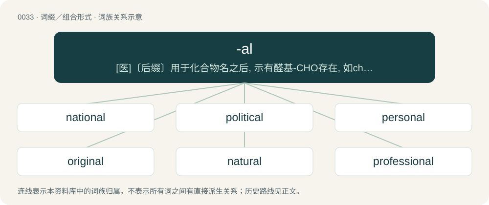

# 0036 · -al — \[医\]〔后缀〕用于化合物名之后, 示有醛基-CHO存在, 如chloral（氯醛, 三氯乙醛）

[总目录](../00_总目录_按常用程度.md)

**类型**：词缀／组合形式　｜　**来源语言**：见词源记录

## 核心含义与来源

- 核心含义：\[医\]〔后缀〕用于化合物名之后, 示有醛基-CHO存在, 如chloral（氯醛, 三氯乙醛）
- 英文含义：Of or pertaining to. Adjectival suffix appended to various words, often nouns, to produce an adjective form. Often added to words of Latin origin, but used with other words also.
- 词形：-al

**多个词源／构词路径**：同一拼写可能有不同来源；以下按词性和含义分别列出。

**来源记录 1**（后缀／后置成分；Of or pertaining to. Adjectival suffix appended to various words, often nouns, to produce an adjective form. Often added to words of Latin origin, but used with other words also.）

From Middle English -al, from the Latin adjective suffix -ālis, or French, Middle French and Old French -el, -al. Distant doublet of -ar.

**来源记录 2**（后缀／后置成分；Forms the names of aldehydes.）

Clipping of aldehyde.

## 词族图

## 单词速览（常用到不常用）

| 单词 | 音标 | 释义 |
|---|---|---|
| [national](#w-1) | 英 /ˈnaʃ.ə.nəl/；美 /ˈnæʃ.ə.nəl/ | a. 国家的, 国立的, 全国性的, 民族的；\[经\] 全国性的, 国家的, 国民的 |
| [political](#w-2) | 英 /pəˈlɪt.ɪ.kəl/；美 /pəˈlɪt.ɪ.kəl/ | a. 政治的, 政治上的, 政党的, 从事政治的；\[法\] 政治的, 政治上的, 党派政治的 |
| [personal](#w-3) | 英 /ˈpɜː.sə.nəl/；美 /ˈpɜɹ.sə.nəl/ | a. 私人的, 涉及隐私的, 有人性的, 人称的, 亲自的, 身体的；\[医\] 人的; 个人的, 自身的 |
| [original](#w-4) | 英 /əˈɹɪd͡ʒ.ɪ.nəl/ | a. 最初的, 原始的, 有创意的；n. 原物, 原作 |
| [natural](#w-5) | /ˈnæt͡ʃ.(ə.)ɹəl/ | n. 白痴；a. 自然的, 自然界的, 本能的, 天然的, 物质的, 正常的, 原始的, 自然数的 |
| [professional](#w-6) | 英 /pɹəˈfɛʃ.ə.nəl/ | n. 专业人才；a. 专业的, 职业的 |
| [normal](#w-7) | 英 /ˈnɔː.məl/；美 /ˈnoɹ.məl/ | n. 常态, 标准, 正常, 普通；a. 正常的, 正规的, 标准的, 师范的, 正态的；\[计\] 标准, 普通 |
| [global](#w-8) | 英 /ˈɡləʊ.bəl/；美 /ˈɡloʊ.bəl/ | a. 通用的, 全球的, 球形的, 综合的, 普遍的；\[计\] 共用 |
| [traditional](#w-9) | /tɹəˈdɪʃ.ə.nəl/ | a. 传统的, 惯例的；\[经\] 传统的, 惯例的 |
| [critical](#w-10) | 英 /ˈkɹɪt.ɪ.kəl/；美 /ˈkɹɪt.ɪ.kəl/ | a. 批评的, 决定性的, 危险的, 临界的；\[医\] 危象的; 临界的, 极期的 |
| [digital](#w-11) | /ˈdɪd͡ʒɪtl̩/ | a. 数字显示的, 数字的；n. 数字仪表, 数字式电子表(或时钟)；\[计\] 数字, 数字式 |
| [mental](#w-12) | /ˈmɛn.təl/ | 【英文】Of or relating to the chin or median part of the lower jaw, genial. |
| [cultural](#w-13) | 英 /ˈkʌl.tʃ(ʊ.)ɹəl/；美 /ˈkʌl.tʃ(ə.)ɹəl/ | a. 文化的, 教养的, 修养的；\[医\] 培养的 |
| [technical](#w-14) | 英 /ˈtɛk.nɪk.əl/ | a. 技术上的, 专门的, 工业的, 严格根据法律的；\[化\] 技巧 |
| [environmental](#w-15) | 英 /ɪnˌvaɪ.ɹə(n)ˈmɛn.təl/；美 /ənˌvaɪ.ɚnˈmɛn.təl/ | a. 周围的, 环境的；\[经\] 环境的, 环保的 |
| [historical](#w-16) | 英 /hɪˈstɒɹɪkəl/；美 /hɪˈstɔɹɪkəl/ | a. 历史的, 史实的, 历史上的；\[法\] 历史性的 |
| [emotional](#w-17) | 英 /ɪˈməʊʃənəl/；美 /ɪˈmoʊʃənəl/ | a. 情绪的, 情感的；\[医\] 情绪的 |
| [internal](#w-18) | 英 /ɪnˈtɜː.nəl/；美 /ɪnˈtɜɹ.nəl/ | a. 内在的, 国内的；\[医\] 内的, 内部的 |
| [educational](#w-19) | 英 /ˌɛd͡ʒ.ʊˈkeɪ.ʃə.nəl/；美 /ˌɛd͡ʒ.əˈkeɪ.ʃə.nəl/ | a. 教育的, 教育性的 |
| [typical](#w-20) | /ˈtɪp.ɪ.kəl/ | a. 典型的, 象征性的；\[医\] 典型的 |
| [chemical](#w-21) | /ˈkɛm.ɪ.kəl/ | n. 化学药品；a. 化学的, 化学上用的 |
| [clinical](#w-22) | /ˈklɪn.ɪ.kəl/ | a. 临床的, 门诊部的；\[医\] 临床的, 临证的 |
| [musical](#w-23) | /ˈmju.zɪ.kəl/ | n. 音乐片, 音乐舞台剧；a. 音乐的, 声音美妙的, 喜爱音乐的 |
| [approval](#w-24) | 英 /əˈpɹuːvəl/；美 /əˈpɹuvəl/ | n. 赞成, 批准；\[化\] 核准 |
| [universal](#w-25) | 英 /ˌjuːnɪˈvɜːsl̩/；美 /ˌjunəˈvɜɹs(ə)l/ | a. 全世界的, 普遍的, 宇宙的, 通用的；n. 一般概念 |
| [proposal](#w-26) | 英 /pɹəˈpəʊzəl/；美 /pɹəˈpoʊzəl/ | n. 提议, 计划, 求婚；\[经\] 提案, 申请, 投标 |
| [formal](#w-27) | 英 /ˈfɔːməl/；美 /ˈfɔɹməl/ | a. 正式的, 形式的, 礼仪的, 拘于礼节的, 拘谨的；n. 正式的社交活动 |
| [electrical](#w-28) | /ɪˈlɛktɹɪkəl/ | a. 电的, 有关电的；\[医\] 电的 |
| [survival](#w-29) | 英 /səˈvaɪ.vəl/；美 /sɚˈvaɪ.vəl/ | n. 生存, 残存, 幸存者；a. 赖以生存的 |
| [removal](#w-30) | 英 /ɹɪˈmuː.vəl/；美 /ɹɪˈmu.vəl/ | n. 移动, 移居, 迁移, 排除, 切除；\[医\] 切除, 除去 |
| [agricultural](#w-31) | 英 /ˌæɡ.ɹɪˈkʌl.tjʊə.ɹəl/；美 /ˌæɡ.ɹɪˈkʌl.tʃə.ɹəl/ | a. 农业的；\[法\] 农业的, 耕作的 |
| [constitutional](#w-32) | 英 /ˌkɒn.stɪˈtjuː.ʃ(ə)n.(ə)l/；美 /ˌkɑn.stɪˈt(j)u.ʃ(ə)n.(ə)l/ | a. 宪法的, 立宪的, 体质的；\[医\] 全身的; 体质的 |
| [mechanical](#w-33) | 英 /məˈkænɪkəl/；美 /məˈkænəkəl/ | a. 机械的, 机械性的, 力学的；\[医\] 机械的, 力学的 |
| [experimental](#w-34) | /ɪkspɛɹəˈmɛntəl/ | a. 实验的, 根据实验的；\[医\] 实验的 |
| [classical](#w-35) | 英 /ˈklæs.ɪ.k(ə)l/ | a. 古典的, 正统派的, 经典的；\[医\] 古典的; 标准的, 典型的 |
| [conventional](#w-36) | /kənˈvɛnʃənl̩/ | a. 传统的, 习惯的, 约定的；\[经\] 惯例的, 常规的, 传统的 |
| [functional](#w-37) | /ˈfʌŋkt͡ʃənəl/ | a. 功能的；\[医\] 机能的, 功能的, 官能的 |
| [naval](#w-38) | /ˈneɪvəl/ | a. 海军的, 军舰的, 有舰队的；\[法\] 海军的, 军舰的, 船的 |
| [serial](#w-39) | 英 /ˈsɪə.ɹɪ.əl/；美 /ˈsɪɹ.i.əl/ | n. 分期连载作品, 连载小说；a. 连续的, 一连串的, 连载的, 分期偿还的；\[计\] 连续的; 串行的 |
| [magical](#w-40) | /ˈmæd͡ʒ.ɪ.kəl/ | a. 魔术的, 有魔力的, 不可思议的 |
| [identical](#w-41) | /ɪˈdɛntɪkl̩/ | a. 同一的, 恒等的, 完全相同的；\[医\] 同一的, 同等的 |
| [operational](#w-42) | 英 /ˌɒp.əˈɹeɪ.ʃə.nəl/；美 /ˌɑ.pəˈɹeɪ.ʃə.nəl/ | a. 操作的, 运作的；\[法\] 操作上的, 业务上的, 可起作用的 |
| [coastal](#w-43) | 英 /ˈkəʊstəl/；美 /ˈkoʊstəl/ | a. 海岸的, 沿海的, 沿岸的；\[法\] 海岸的, 沿海的 |
| [congressional](#w-44) | /kəŋˈɡɹɛ.ʃə.nəl/ | a. 会议的, 议会的, 国会的；\[法\] 代表大会的, 大会的, 议会的 |
| [structural](#w-45) | 美 /ˈstɹʌk(t͡)ʃəɹəl/ | a. 结构的, 建筑的；\[医\] 结构的 |
| [tropical](#w-46) | 英 /ˈtɹɒp.ɪ.kəl/；美 /ˈtɹɑ.pɪ.kəl/ | a. 热带的, 热情的；\[医\] 热带的 |
| [colonial](#w-47) | 英 /kəˈləʊ.ni.əl/；美 /kəˈloʊ.njəl/ | a. 殖民的, 殖民地的；\[法\] 殖民地居民 |
| [logical](#w-48) | 英 /ˈlɒd͡ʒɪkəl/；美 /ˈlɑd͡ʒɪkəl/ | a. 合乎逻辑的, 合理的；\[法\] 逻辑的, 符合逻辑的 |
| [statistical](#w-49) | 英 /stəˈtɪs.tɪ.kəl/ | a. 统计的, 统计上的, 统计学的；\[经\] 统计的, 统计学的 |
| [electoral](#w-50) | 英 /ɪˈlɛk.tə.ɹəl/；美 /ɪˈlɛk.tɚ.əl/ | a. 选举人的, 选举的, (有关)选举的；\[法\] 选举的, 选举人的, 由选举人组成的 |
| [minimal](#w-51) | 英 /ˈmɪn.ɪ.məl/；美 /ˈmɪn.ə.məl/ | a. 最小的, 极微的, 最小限度的；\[医\] 最小的, 最低的 |
| [rental](#w-52) | /ˈɹɛntəl/ | n. 租费, 租金收入；a. 租赁的, 收取租金的 |
| [viral](#w-53) | /ˈvaɪɹəl/ | a. 病毒的, 病毒引起的；\[医\] 病毒的 |
| [ethical](#w-54) | /ˈɛθɪkəl/ | a. 伦理的, 民族的, 民族特有的；\[医\] 伦理的, 道德的 |
| [optical](#w-55) | 英 /ˈɒptɪkəl/；美 /ˈɑptɪkəl/ | a. 眼睛的, 视觉的, 光学的；\[机\] 光学上的, 光学的 |
| [exceptional](#w-56) | /ɪkˈsɛpʃənəl/ | a. 例外的, 异常的, 特别的 |
| [withdrawal](#w-57) | 英 /wɪðˈdɹɔː(ə)l/；美 /wɪðˈdɹɔ(ə)l/ | n. 提款, 撤退, 退回, 撤消, 退隐, 戒毒过程；\[医\] 戒除, 脱瘾 |
| [dimensional](#w-58) | 英 /daɪˈmɛn.ʃə.nəl/ | a. ...维的；\[化\] 量纲的; 因次的 |
| [continental](#w-59) | 英 /ˌkɒntɪˈnɛntl̩/；美 /ˌkɑntɪˈnɛntl̩/ | a. 大陆的, 洲的；n. 欧洲大陆人 |
| [disposal](#w-60) | 英 /dɪsˈpəʊ.zəl/；美 /dɪsˈpoʊ.zəl/ | n. 丢掉, 处理, 排列, 销毁, 布置；\[医\] 处理, 处置 |
| [institutional](#w-61) | 英 /ˌɪn.stɪˈtjuː.ʃə.nəl/；美 /ˌɪn.stɪˈtju.ʃə.nəl/ | a. 制度的, 公共机构的, 学会的；\[法\] 组织机构的, 制度的, 公共机构的 |
| [denial](#w-62) | 英 /dɪˈnaɪ.əl/ | n. 否认；\[法\] 否定, 否认, 拒绝接受 |
| [instrumental](#w-63) | /ɪnstɹəˈmɛntəl/ | a. 仪器的, 器具的, 可作为手段的；\[医\] 器械的 |
| [seasonal](#w-64) | /ˈsiːzənəl/ | a. 季节的, 依照季节的, 周期性的；\[经\] 季节性的, 季节的 |
| [tactical](#w-65) | /ˈtæktɪk(ə)l/ | a. 战术的, 用兵上的, 策略的 |
| [architectural](#w-66) | /ˌɑɹkɪˈtɛkt͡ʃəɹəl/ | a. 有关建筑的, 建筑学的 |
| [optimal](#w-67) | 英 /ˈɒptɪməl/；美 /ˈɑptɪməl/ | a. 最佳的, 最理想的；\[化\] 最优的 |
| [postal](#w-68) | /ˈpəustl/ | a. 邮政的, 邮局的；\[经\] 邮政的 |
| [revival](#w-69) | /ɹɪˈvaɪ̯vəl/ | n. 复兴, 复活, 恢复精神, 苏醒；\[医\] 复苏, 回生, 精神重振 |
| [biblical](#w-70) | /ˈbɪblɪkəl/ | a. 圣经的 |
| [aerial](#w-71) | 英 /ˈɛəɹiəl/；/ˈɛəɹiəl/ | a. 空中的, 航空的, 空气的, 空想的；n. 天线 |
| [optional](#w-72) | 英 /ˈɒp.ʃə.nəl/；美 /ˈɑp.ʃə.nəl/ | a. 可选择的, 随意的；\[化\] 选购的 |
| [recreational](#w-73) | /.rekriˈeiʃənəl/ | a. 消遣的, 娱乐的 |
| [territorial](#w-74) | 英 /ˌtɛɹ.ɪˈtɔː.ɹi.əl/；美 /ˌtɛɹ.əˈtɔɹ.i.əl/ | a. 领土的, 土地的, 地方的, 区域性的；n. 本土自卫队队员 |
| [verbal](#w-75) | 英 /ˈvɜː.bəl/；美 /ˈvɝ.bəl/ | a. 用言辞的, 言语的, 口头的, 逐字的, 动词的；\[医\] 言语的, 口述的 |
| [confidential](#w-76) | 英 /ˌkɒn.fɪˈdɛn.ʃəl/；美 /ˌkɔn.fɪˈdɛn.ʃəl/ | a. 机密的, 获他人信赖的, 易于信任他人的；\[经\] 秘密件 |
| [pharmaceutical](#w-77) | 英 /ˌfɑː.məˈs(j)uː.tɪ.kl̩/；美 /ˌfɑɹ.məˈs(j)u.tɪ.kl̩/ | a. 药学的, 制药的, 药用的, 药物的, 药剂师的, 药师的；n. 药品, 成药, 药剂 |
| [promotional](#w-78) | 英 /pɹəˈməʊʃənəl/；美 /pɹəˈmoʊʃənəl/ | a. 增进的 |
| [behavioral](#w-79) | 英 /bɪˈheɪvjəɹəl/；美 /bɪˈheɪvjəɹəl/ | a. 行为的 |
| [fictional](#w-80) | /ˈfɪkʃənəl/ | a. 虚构的, 编造的, 小说式的；\[法\] 拟制的, 假定的, 虚构的 |
| [geographical](#w-81) | /d͡ʒiəˈɡɹæfɪkl̩/ | a. 地理学的, 地理的 |
| [governmental](#w-82) | 英 /ˌɡʌv(ə)nˈmɛnt(ə)l/；美 /ˌɡʌvɚnˈmɛnt(ə)l/ | a. 政治的, 统治上的, 政府的；\[法\] 政府的, 统治的, 政治上的 |
| [renewal](#w-83) | /riˈnjuːəl/ | n. 更新, 革新, 复兴, 恢复, 修补, 补充, 继续, 重订, 重申, 续借；\[经\] 更新, 换新, 重申 |
| [organizational](#w-84) | /ˌɔː(ɹ)ɡənɪˈzeɪʃənəl/ | a. 组织的；\[法\] 组织的, 编制的, 机构的 |
| [accidental](#w-85) | /ˌæk.sɪˈdɛn.tl̩/ | a. 意外的, 偶然的, 非主要的, 附属的；n. 临时记号, 次要方面 |
| [developmental](#w-86) | /dɪˌvɛləpˈmɛntəl/ | a. 发展的, 进化的, 启发的；\[医\] 发育的 |
| [neural](#w-87) | 英 /ˈnjʊəɹəl/；美 /ˈnʊɹəl/ | a. 神经的, 神经系统的, 神经中枢的, 背的；\[医\] 神经的 |
| [phenomenal](#w-88) | 英 /fɪˈnɒmɪnəl/；美 /fɪˈnɑmɪnəl/ | a. 现象的, 能知觉的, 异常的, 显著的, 惊人的 |
| [spatial](#w-89) | 英 /ˈspeɪ.ʃəl/ | a. 空间的, 受空间条件限制的, 占地位的；\[医\] 隙的, 间隙的, 腔的; 空间的, 立体的 |
| [inspirational](#w-90) | /ˌɪnspəˈɹeɪʃənəl/ | a. 凭灵感的, 鼓舞人心的, 神感的 |
| [cereal](#w-91) | 英 /ˈsɪə.ɹɪ.əl/ | n. 谷类食品, 谷类植物；a. 谷类的 |
| [bacterial](#w-92) | /bækˈtiəriəl/ | a. 细菌的；\[医\] 细菌的, \[无芽胞\]杆菌的 |
| [dismissal](#w-93) | /disˈmisəl/ | n. 免职, 解雇；\[经\] 解雇 |
| [occupational](#w-94) | 美 /ɑkjuˈpeɪʃənəl/ | a. 职业的, 军事占领的；\[医\] 职业的 |
| [marginal](#w-95) | 英 /ˈmɑː.d͡ʒɪ.nəl/；美 /ˈmɑɹ.d͡ʒɪ.nəl/ | a. 边缘的, 最低限度的, 有旁注的；\[医\] 缘的 |
| [tidal](#w-96) | /ˈtaɪ.d(ə)l/ | a. 潮汐的, 受潮汐影响的 |
| [betrayal](#w-97) | /bɪˈtɹeɪəl/ | n. 背叛, 辜负；\[法\] 背叛, 通敌, 背信 |
| [skeptical](#w-98) | /ˈskɛptɪkəl/ | a. 怀疑论的, 怀疑的, 不可知论的；\[法\] 怀疑的, 不信的, 怀疑论者的 |
| [theatrical](#w-99) | 英 /θiːˈætɹɪkəl/；美 /θiˈætɹɪkəl/ | a. 剧场的, 夸张的, 戏剧性的；n. 戏剧演出 |
| [peripheral](#w-100) | /pəˈɹɪf(ə)ɹ(ə)l/ | a. 周边的, 周围的, 圆周的, 无关紧要的, 肤浅的；\[医\] 外周的, 周围的, 末梢的 |
| [provisional](#w-101) | /pɹəˈvɪʒənəl/ | a. 暂时的, 暂定的, 临时的；\[医\] 临时的 |
| [numerical](#w-102) | 英 /n(j)uːˈmɛɹ.ɪ.kəl/；美 /n(j)uˈmɛɹ.ɪ.kəl/ | a. 数字的, 数值的, 以数字表示的, 擅长于计数的；\[经\] 数字的, 用数字表示的 |
| [vocational](#w-103) | /vəʊˈkeɪʃənəl/ | a. 职业的；\[法\] 职业上的, 天职的 |
| [nutritional](#w-104) | 英 /njuːˈtɹɪʃ.ə.nəl/；美 /nuˈtɹɪʃ.ə.nəl/ | a. 营养的, 滋养的；\[医\] 营养的 |
| [transitional](#w-105) | 美 /tɹænˈzɪʃənəl/ | a. 变迁的, 过渡期的；\[医\] 转变的, 过渡的; 过渡型单核白细胞 |
| [computational](#w-106) | 英 /ˌkɒmpjʊˈteɪʃənəl/；美 /ˌkɑmpjʊˈteɪʃənəl/ | a. 计算的 |
| [empirical](#w-107) | 英 /ɪmˈpɪɹɪkəl/ | a. 完全跟据经验的, 经验主义的；\[医\] 经验主义的 |
| [evangelical](#w-108) | /iːvænˈd͡ʒɛlɪkəl/ | a. 福音派教会的；n. 福音派信徒 |
| [suicidal](#w-109) | 英 /ˌsuː.ɪˈsaɪ.dəl/；美 /ˌsu.əˈsaɪ.dəl/ | a. 自杀的, 自杀性的, 自我毁灭的；\[法\] 自杀的 |
| [cerebral](#w-110) | 英 /ˈsɛ.ɹɪb.ɹəl/；美 /səˈɹi.bɹəl/ | a. 脑的, 大脑的；\[医\] 小脑的 |
| [nominal](#w-111) | 英 /ˈnɒm.ɪ.nl̩/；美 /ˈnɑ.mɪ.nl̩/ | a. 名义上的, 名字的, 有名无实的, 稍许的；n. 名词性词 |
| [referral](#w-112) | 英 /ɹɪˈfɜː.ɹəl/；美 /ɹɪˈfɝ.əl/ | n. 参照, 介绍, 被介绍人, 转诊病人 |
| [conditional](#w-113) | /kənˈdɪʃ.ə.nəl/ | a. 有条件的, 有前提的；\[电\] 有条件的 |
| [cynical](#w-114) | /ˈsɪnɪkəl/ | a. 愤世嫉俗的, 讽刺的, 冷嘲的 |
| [economical](#w-115) | 英 /ˌiː.kəˈnɒm.ɪ.kəl/；美 /ˌɛk.əˈnɑ.mɪ.kəl/ | a. 节俭的, 经济的, 合算的；\[经\] 经济的, 节约的 |
| [orbital](#w-116) | 英 /ɔː.bɪt.əl/；美 /ɔɹ.bət.l̩/ | a. 轨道的, 眼眶的；\[化\] 轨道 |
| [societal](#w-117) | /səˈsaiətl/ | a. 社会的 |
| [abdominal](#w-118) | 英 /æbˈdɒm.ə.nl̩/；美 /æbˈdɑm.ə.nl̩/ | a. 腹部的, 有腹鳍的；\[医\] 腹\[部\]的 |
| [doctoral](#w-119) | 英 /ˈdɒktəɹəl/；美 /ˈdɑktəɹəl/ | a. 博士的 |
| [mystical](#w-120) | /ˈmɪstɪkəl/ | a. 神秘的, 奥秘的 |
| [portrayal](#w-121) | 美 /ˌpɔɹˈtɹeɪ.əl/ | n. 描绘, 描写, 画像, 肖像；\[计\] 描绘 |
| [physiological](#w-122) | 英 /ˌfɪz.i.əˈlɒd͡ʒ.i.kəl/；美 /ˌfɪz.i.əˈlɑ.d͡ʒɪ.kəl/ | a. 生理学的, 生理学上的, 生理机能的；\[医\] 生理学的, 生理的 |
| [sentimental](#w-123) | 英 /ˌsɛntiˈmɛntl̩/；美 /ˌsɛntiˈmɛntl̩/ | a. 感伤的, 感情用事的 |
| [bilingual](#w-124) | /baɪˈlɪŋ.ɡwəl/ | a. 双语的 |
| [sensational](#w-125) | /sɛnˈseɪʃənəl/ | a. 使人感动的, 非常好的 |
| [delusional](#w-126) | /dɪˈluːʒənəl/ | \[医\] 妄想的 |
| [instructional](#w-127) | /inˈstrʌkʃənəl/ | a. 教学的, 教育的 |
| [procedural](#w-128) | /pɹəˈsiːd͡ʒ(ə)ɹəl/ | a. 程序上的；\[经\] 程序上的 |
| [bridal](#w-129) | 英 /ˈbraɪ.dl̩/；美 /ˈbɹaɪd(ə)l/ | a. 新娘的, 婚礼的 |
| [monumental](#w-130) | 英 /ˌmɒnjʊˈmɛntəl/；美 /ˌmɑnjəˈmɛntəl/ | a. 纪念碑的, 做为纪念的, 不朽的 |
| [pivotal](#w-131) | 英 /ˈpɪvɪtəl/；美 /ˈpɪvɪtəl/ | a. 枢轴的, 关键的, 起中心作用的 |
| [ceremonial](#w-132) | 英 /ˌsɛɹɪˈməʊnɪ.əl/；美 /ˌsɛɹɪˈmoʊniəl/ | n. 仪式；a. 正式的 |
| [gravitational](#w-133) | /ˌɡɹævɪˈteɪʃənəl/ | a. 重力的 |
| [nautical](#w-134) | 英 /ˈnɔːtɪ.kəl/；/ˈnɔ.tɪ.kəl/ | a. 海上的, 航海的, 船员的 |
| [supplemental](#w-135) | 英 /ˌsʌplɪˈmɛntəl/；美 /ˌsʌpləˈmɛntəl/ | a. 补足的, 追加的；\[医\] 补充的, 补足的 |
| [frontal](#w-136) | 英 /ˈfɹʌn.təl/；美 /ˈfɹʌn.tl̩/ | a. 前面的, 正面的, 额的；n. 额骨, 祭坛(前面的)帏帘, (建筑物的)正面 |
| [hysterical](#w-137) | /hɪˈstɛɹɪkəl/ | a. 歇斯底里的, 异常兴奋的；\[医\] 癔病的, 歇斯底里的 |
| [motivational](#w-138) | 英 /ˈməʊ.tɪ.veɪ.ʃə.nəl/；美 /ˈmoʊ.tə.veɪ.ʃ(ə.)nəl/ | a. 激发性的；\[法\] 动机说明, 引起动机, 动机的形成 |
| [existential](#w-139) | 英 /ˌɛɡzɪˈstɛnʃl̩/；美 /ˌɛɡzɪˈstɛn(t)ʃəl/ | a. 有关存在的 |
| [graphical](#w-140) | /ˈɡɹæfɪkəl/ | a. 图的, 记录的, 图示的, 图解的, 书法的, 绘画的, 印刷的, 雕刻的, 详尽的；\[机\] 图解式的 |
| [spectral](#w-141) | /ˈspɛktɹəɫ/ | a. 光谱的, 鬼怪的, 幻觉的；\[医\] 光谱的 |
| [dorsal](#w-142) | 英 /ˈdɔː.səl/；美 /ˈdɔɹ.səl/ | a. 背的, 背部的, 背侧的；\[医\] 背的, 背侧的 |
| [topical](#w-143) | 英 /ˈtɒp.ɪ.kəl/；美 /ˈtɑ.pɪ.kəl/ | a. 论题的, 题目的, 时事问题的, 局部的；\[医\] 局部的 |
| [mythical](#w-144) | /ˈmɪθɪkəl/ | a. 神话的, 存在于神话中的, 神话式的, 不真实的, 虚构的, 幻想出来的 |
| [sectional](#w-145) | /ˈsɛkʃənəl/ | a. 部分的, 部门的, 节的, 截面的；n. 组合式家具 |
| [vaginal](#w-146) | 英 /vəˈd͡ʒʌɪ.nəl/；美 /ˈvæd͡ʒ.ən.əl/ | a. 鞘的, 似叶鞘的, 阴道的；\[医\] 鞘的; 阴道的; 睾丸鞘膜的 |
| [ancestral](#w-147) | 美 /ænˈsɛs.təɹ.əl/ | a. 祖先的, 祖传的；\[法\] 祖先的, 祖传的 |
| [appraisal](#w-148) | /əˈpɹeɪzəl/ | n. 评价, 估价；\[经\] 评价, 评估 |
| [contractual](#w-149) | 英 /kənˈtɹæk.(t)ʃ(ʊ)əl/；美 /kənˈtɹæk.t͡ʃ(u)əl/ | a. 契约的；\[经\] 契约的, 契约性的 |
| [correctional](#w-150) | /kəˈrekʃənəl/ | a. 改正的, 修正的, 矫正的 |
| [lyrical](#w-151) | /ˈlɪɹɪkəl/ | a. 抒情诗调的, 有抒情味的, 感情丰富的 |
| [natal](#w-152) | /ˈneɪtəl/ | 【英文】Of or relating to the buttocks. |
| [basal](#w-153) | /ˈbeisl/ | a. 基础的, 基本的；\[医\] 基底的, 基础的 |
| [fetal](#w-154) | /ˈfitl̩/ | a. 胎儿的, 胎的；\[医\] 胎的, 胎儿的 |
| [multicultural](#w-155) | /ˌmʌltiˈkʌlt͡ʃəɹəl/ | a. 融合或具有多种文化的；多种文化的 |
| [skeletal](#w-156) | 英 /ˈskɛl.ɪ.təl/；美 /ˈskɛl.ə.təl/ | a. 骨骼的, 框架的；\[医\] 骨胳的 |
| [spherical](#w-157) | /ˈsfɛɹɪkəl/ | a. 球的, 球面的, 球状的, 天体的；\[医\] 球形的, 球状的 |
| [directional](#w-158) | /dɪˈɹɛk.ʃə.nəl/ | a. 方向的 |
| [incremental](#w-159) | /.inkriˈmentl/ | a. 增加的, 增值的；\[经\] 增长的, 增量的 |
| [longitudinal](#w-160) | 英 /ˌlɒŋ.ɡɪˈtjuː.dɪ.nəl/；美 /ˌlɔn.dʒɪˈtu.dɪ.nəl/ | a. 经度的, 经线的, 纵的；\[医\] 纵的 |
| [centennial](#w-161) | 英 /sɛnˈtɛnɪəl/ | n. 百年纪念；a. 一百年的 |
| [dysfunctional](#w-162) | /dɪsˈfʌŋkʃənl/ | a. 功能失调的 |
| [continual](#w-163) | /kənˈtɪnjuəl/ | a. 持续不断的, 继续的；\[建\] 连续的 |
| [cylindrical](#w-164) | 美 /sɪˈlɪndɹɪkəl/ | a. 圆柱体的, 圆筒形的；\[计\] 圆柱形的, 圆柱体的, 圆筒形的, 柱面的 |
| [ornamental](#w-165) | 英 /ˌɔː.nəˈmɛn.təl/；美 /ˌɔɹ.nəˈmɛn.təl/ | n. 装饰物, 观赏植物；a. 装饰性的, 装饰的, 观赏用的 |
| [causal](#w-166) | 英 /ˈkɔːzəl/；/ˈkɔ.zəl/ | a. 原因的, 因果关系的, 表示原因或理由的；n. 表示原因的连词 |
| [hormonal](#w-167) | 美 /hɔɹˈmoʊnəl/ | a. 荷尔蒙的；\[医\] 激素的 |
| [millennial](#w-168) | 英 /mɪˈlɛn.ɪ.əl/；美 /məˈlɛn.i.əl/ | a. 一千年的, 千福年的 |
| [behavioural](#w-169) | 英 /bɪˈheɪvjərəl/；美 /bɪˈheɪvjɚəl/ | a. 行为的 |
| [primal](#w-170) | /ˈpɹaɪməl/ | a. 主要的, 最初的, 原始的 |
| [fungal](#w-171) | /ˈfʌŋɡəl/ | a. 真菌, 突然发生而迅速生长的东西, 真菌类植物, 海绵肿, 真菌类病害；\[医\] 真菌的, 霉菌的 |
| [incidental](#w-172) | /ɪnsɪˈdɛntəl/ | a. 附带的, 偶然的, 容易发生的；n. 附带事件 |
| [congenital](#w-173) | /kənˈdʒɛnɪt(ə)l/ | a. 天生的, 先天的；\[医\] 先天的 |
| [feral](#w-174) | 英 /ˈfɛɹəl/；美 /ˈfɛɹəl/ | a. 野生的, 凶猛的, 野兽的；\[医\] 凶猛的, 野生的 |
| [sequential](#w-175) | /səˈkwɛntʃəl/ | a. 继续的, 后果的；\[计\] 顺序的 |
| [archival](#w-176) | 英 /ɑːˈkaɪv(ə)l/；美 /ˌɑɹˈkaɪv(ə)l/ | a. 档案的, 档案中的 |
| [disapproval](#w-177) | 美 /dɪsəˈpɹuvəl/ | n. 不赞成 |
| [generational](#w-178) |  | a. 生殖的, 世代的, 代与代之间的, 一代的, 生育的 |
| [mayoral](#w-179) | 英 /meɪˈɔː.ɹəl/；美 /meɪˈɔ.ɹəl/ | a. 市长的 |
| [recital](#w-180) | /ɹɪˈsaɪtl̩/ | n. 背诵, 吟诵, 详述；\[法\] 叙述, 评述, 列举 |
| [distal](#w-181) | /ˈdɪs.təl/ | a. 末梢的；\[医\] 远侧的, 远中的(牙) |
| [divisional](#w-182) | /diˈviʒənəl/ | a. 部门的, 部分的, 分开的；\[法\] 分开的, 分割的, 分区的 |
| [mitochondrial](#w-183) | 英 /ˌmaɪ.təˈkɒn.dɹi.əl/；美 /ˌmaɪ.təˈkɑːn.dɹi.əl/ | 线粒体的 |
| [seminal](#w-184) | /ˈsɛmɪnəl/ | a. 精液的, 种子的, 生殖的；\[医\] 种子的; 精液的 |
| [orchestral](#w-185) | 美 /ˌɔɹˈkɛstɹəl/ | a. 管弦乐队的 |
| [arterial](#w-186) | /ɑːˈtiəriəl/ | a. 动脉的, 脉络状的, 干线的；\[医\] 动脉的 |
| [patriarchal](#w-187) | 英 /ˌpeɪtɹiˈɑːkl̩/；美 /ˌpeɪtɹiˈɑɹkl̩/ | a. 家长的, 族长的, 由族长统治的；\[法\] 家长的, 家长制的, 主教的 |
| [relational](#w-188) | /riˈleiʃənəl/ | a. 有关系的, 有联系的, 亲属的, 有亲属关系的；\[计\] 相关的, 关系的 |
| [rotational](#w-189) | 美 /ɹoʊˈteɪʃənəl/ | a. 转动的, 轮流的 |
| [alphabetical](#w-190) | 英 /ˌæl.fəˈbɛt.ɪ.kəl/；美 /ˌælfəˈbɛtɪkəl/ | a. 依字母顺序的, 字母的 |
| [pictorial](#w-191) | /pɪkˈtɔɹi.əl/ | a. 绘画的, 插图的, 用图画表示的, 形象化的, 有象形文字特征的；n. 画报, 画刊, 有图邮票, 插图杂志, 插图报纸 |
| [anatomical](#w-192) | 英 /æ.nəˈtɒ.mɪ.kəl/；美 /æ.nəˈtɑ.mɪ.kəl/ | a. 解剖的, 解剖学的, 构造上的；\[医\] 解剖学的 |
| [elliptical](#w-193) | 英 /ɪˈlɪp.tɪk.əl/；美 /ɪˈlɪp.tɪ.kəl/ | a. 椭圆的；\[医\] 椭圆形的 |
| [preferential](#w-194) | 英 /ˈpɹɛf.ɜː(ɹ)ˌɛn.ʃəl/ | a. 优先的, (关税等)优惠的；\[经\] 特惠的; 特惠关税率, 优先权 |
| [judgmental](#w-195) | 英 /d͡ʒʌd͡ʒˈmɛntl̩/；美 /ˌd͡ʒʌd͡ʒˈmɛnt(ə)l/ | a. 审判的 |
| [informational](#w-196) | 英 /ˌɪnfəˈmeɪʃənəl/；美 /ˌɪnfɚˈmeɪʃənəl/ | a. 信息的, 情报的, 提供消息的, 介绍情况的, 提供情报的；\[计\] 信息性的 |
| [anecdotal](#w-197) | /,ænekˈdəutl/ | a. 轶事的, 爱谈奇闻轶事的, 多轶事的 |
| [proximal](#w-198) | 英 /ˈpɹɒksɪməl/ | a. 最接近的, 近中心的, 近身体中央的；\[医\] 近接的, 邻近的 |
| [cyclical](#w-199) | /ˈsaɪklɪkəl/ | a. 周期的, 轮转的, 循环的, 轮列的, 轮卷的, 环状的, 环的, 组诗的, 始末的；\[计\] 循环的 |
| [devotional](#w-200) | 英 /dɪˈvəʊʃənəl/；美 /dɪˈvoʊʃənəl/ | a. 忠诚的, 信仰的, 虔诚的, 祷告的 |
| [invitational](#w-201) | /,inviˈteiʃənəl/ | a. (限于被)邀请的,怂恿 |
| [axial](#w-202) | 英 /ˈæk.sɪ.əl/；美 /ˈæk.si.əl/ | a. 轴的, 成轴的, 轴向的；\[医\] 轴的, 中轴的 |
| [circumstantial](#w-203) | 英 /səːkəmˈstanʃəl/；美 /səɹ.kəmˈstænʃəl/ | a. 依照情况的 |
| [dispersal](#w-204) | /disˈpəːsl/ | n. 散布, 传播, 分散 |
| [horticultural](#w-205) | /.hɒːtiˈkʌltʃərəl/ | a. 园艺的 |
| [observational](#w-206) | 英 /ˌɒbzəˈveɪʃənəl/；美 /ˌɑbzɚˈveɪʃənəl/ | a. 观察的, 观测的；\[计\] 观察的 |
| [situational](#w-207) | /sɪtjuːˈeɪʃənəl/ | a. 环境形成的；情形的 |
| [modal](#w-208) | 英 /ˈməʊdəl/；美 /ˈmoʊdəl/ | a. 形式的, 样式的, 形态上的, 模态的；\[计\] 模态的 |
| [retinal](#w-209) | 英 /ˈɹɛt.ɪn.əl/；美 /ˈɹɛt.ən.əl/ | a. 视网膜的；\[化\] 视黄醛 |
| [upheaval](#w-210) | /ʌpˈhiːvəl/ | n. 举起, 隆起, 大变动, 剧变 |
| [arousal](#w-211) | /əˈɹaʊzəl/ | n. 奋发, 激励 |
| [neuronal](#w-212) |  | a. 神经原, 轴索, 神经细胞；\[化\] 二乙基溴乙酰胺 |
| [conversational](#w-213) | /ˌkɒnvə(ɹ)ˈseɪʃənəl/ | a. 会话的, 对话的, 健谈的；\[计\] 会话式的; 对话式的 |
| [conical](#w-214) | 英 /ˈkɒn.ɪ.kəl/；美 /ˈkɑ.nɪ.kəl/ | a. 圆锥形的, 圆锥的；\[计\] 圆锥的 |
| [custodial](#w-215) | /kʌsˈtoʊ.di.əl/ | a. 保管的, 保管人的；n. 圣物保存器 |
| [metaphorical](#w-216) | 英 /ˌmɛtəˈfɒɹɪkəl/；美 /ˌmɛtəˈfoɹɪkəl/ | a. 隐喻性的, 比喻性的 |
| [rebuttal](#w-217) | 英 /ɹɪˈbʌt.əl/；美 /ɹiˈbʌt.əl/ | n. 辩驳, 驳回, 反驳, 反驳的证据, 反证；\[法\] 辩驳, 反驳, 驳回 |
| [tonal](#w-218) | 英 /ˈtəʊnəl/；美 /ˈtoʊnəl/ | a. 音调的, 色调的 |
| [prudential](#w-219) | 英 /pɹuːˈdɛn.ʃəl/；美 /pɹuˈdɛn.ʃəl/ | a. 审慎的, 精明的, 起咨询作用的 |
| [pedagogical](#w-220) | 英 /ˌpɛdəˈɡɒd͡ʒɪkəl/；美 /ˌpɛdəˈɡɑd͡ʒɪkəl/ | a. 教师的, 教学法的, 适宜于教师的 |
| [congregational](#w-221) | 英 /kɒŋɡɹəˈɡeɪʃənəl/；美 /kɑŋɡɹəˈɡeɪʃənəl/ | a. 会众的, 公理教会的 |
| [epithelial](#w-222) | /.epiˈθiːliəl/ | a. 上皮的；\[医\] 上皮的 |
| [foundational](#w-223) | 美 /faʊnˈdeɪ.ʃə.nəl/ | a. 基础的, 基本的 |
| [maximal](#w-224) | /ˈmæksɪməl/ | a. 最大的, 最高的；\[医\] 最大的, 最高的 |
| [confessional](#w-225) | 英 /kənˈfɛʃənəl/ | a. 自白的, 忏悔的；n. 告解室 |
| [fractional](#w-226) | /ˈfɹæk.ʃən.əl/ | a. 部分的, 碎片的, 微少的, 断片的, 分数的, 分馏的；\[计\] T1电路 |
| [liturgical](#w-227) | /lɪˈtɝd͡ʒɪkəl/ | a. 礼拜仪式的 |
| [acquittal](#w-228) | /əˈkwɪtəl/ | n. 履行, 无罪开释；\[经\] (债务的)清偿 |
| [genealogical](#w-229) | 美 /ˌd͡ʒiniəˈlɑd͡ʒɪkəl/ | a. 宗谱的, 家系的, 系谱的 |
| [confrontational](#w-230) | /ˌkɒnfɹənˈteɪʃənˈəl/ | a. 挑衅的; 对抗的 |
| [quintessential](#w-231) | /ˌkwɪntɪˈsɛnʃəl/ | a. 精萃的, 精髓的, 典范的 |
| [methodical](#w-232) | 美 /mɪˈθɑdɪkəl/ | a. 有方法的, 有系统的 |
| [umbilical](#w-233) | 英 /ʌmˈbɪ.lɪ.kəl/；美 /ʌmˈbɪ.lɪ.kəl/ | a. 脐带的, 脐的, 近脐的, 关系密切的；\[医\] 脐的 |
| [fecal](#w-234) | /ˈfiːkəl/ | a. 排泄物的, 渣滓的；\[医\] 粪便的 |
| [ecumenical](#w-235) | 英 /ˌiːk.jʊˈmɛ.nɪ.kəl/；美 /ˌɛk.jʊˈmɛ.nɪ.kəl/ | a. 一般的, 普遍的, 全基督教的, 泛基督教主义的 |
| [infernal](#w-236) | 英 /ɪnˈfɜː(ɹ)nəl/；美 /ɪnˈfɝnəl/ | a. 阴间的, 恶魔的 |
| [positional](#w-237) | /pəˈziʃənl/ | a. 位置的, 地位的 |
| [regimental](#w-238) | /.redʒiˈmentl/ | a. 团的, 附属于团的；n. 团服, 军服 |
| [transcendental](#w-239) | 英 /ˌtɹæn(t)s(ɛ)nˈdɛntl̩/；美 /ˌtɹænˌ(t)sɛnˈdɛntl̩/ | a. 卓越的, 超凡的, 先验的 |
| [transformational](#w-240) | /,trænsfəˈmeiʃənəl,,trænz-,,trɑːn-/ | \[计\] 变换的 |
| [translational](#w-241) | /tɹænzˈleɪʃənəl/ | \[机\] 平移的 |
| [cranial](#w-242) | /ˈkɹeɪ.ni.əl/ | a. 头盖的, 颅侧的；\[医\] 颅的, 颅侧的 |
| [navigational](#w-243) |  | \[计\] 导航的；\[经\] 船舶的 |
| [senatorial](#w-244) | /ˌsɛnɪˈtɔːɹiəl/ | a. 参议院的, 由参议员组成的；\[法\] 上议院的, 参议院的, 参议员的 |
| [centrifugal](#w-245) | 英 /ˌsɛn.tɹɪˈfjuː.ɡl̩/；美 /sɛnˈtɹɪf.(j)ə.ɡl̩/ | a. 离心的；n. 离心机, (离心机的)转筒 |
| [atrial](#w-246) | /ˈeɪtɹi.əl/ | a. 门廊, 心房；\[医\] 房的, 前房的 |
| [diabolical](#w-247) | /daiəˈbɒlikl/ | a. 恶魔的 |
| [fantastical](#w-248) | /fænˈtæstɪkəl/ | a. 空想的；捕风捉影的 |
| [hexagonal](#w-249) | /hɛkˈsæɡ.ə.nəl/ | a. 六角形的, 六边的, 底面为六角的；\[医\] 六角形的 |
| [sabbatical](#w-250) | /səˈbætɪkəl/ | a. 安息日的, 休假的 |
| [colloquial](#w-251) | 英 /kəˈləʊ.kwɪəl/；美 /kəˈloʊ.kwi.əl/ | a. 会话的, 口语的, 口语体的 |
| [denominational](#w-252) | /dinɔmiˈneiʃən(ə)l/ | a. 宗派的, 教派的 |
| [perceptual](#w-253) | 美 /pə(ɹ)ˈsɛp.tʃ(u)əl/ | a. 知觉的, 有知觉的 |
| [abysmal](#w-254) | /əˈbɪz.məl/ | a. 深不可测的, 无底的 |
| [dynamical](#w-255) | /daiˈnæmikəl/ | a. 动力的, 动态的, 动力学的, (褒)有生气的, 有力的, 能动的, 精悍的, 机能上的；n. 动力, 动态, 原动力；\[计\] 动态的 |
| [inertial](#w-256) | 英 /ɪˈnɜː.ʃəl/；美 /ɪˈnɝ.ʃəl/ | a. 惯性的 |
| [matrimonial](#w-257) | 英 /mætɹɪˈməʊnɪ.əl/ | a. 与婚姻有关的, 婚礼的；\[法\] 婚姻的, 婚礼的 |
| [rectal](#w-258) | /ˈrɛk.təl/ | a. 直肠的；\[医\] 直肠的 |
| [sculptural](#w-259) | 美 /ˈskʌlpt͡ʃɚɹəl/ | a. 雕刻的, 雕刻般的 |
| [femoral](#w-260) | /ˈfɛ.mə.ɹəl/ | a. 大腿骨的, 大腿的；\[医\] 股骨的, 股的 |
| [geometrical](#w-261) | /ˌd͡ʒi.oʊˈmɛt.ɹɪk.əl/ | a. 几何学的, 几何的；\[机\] 几何学的 |
| [occidental](#w-262) | /ˌɒk.səˈdɛn.təl/ | n. 欧美人, 西方人；a. 欧美的, 西方的, 西方国家的 |
| [transactional](#w-263) | 美 /trænˈzækʃ(ə)nəl/ | a. 交易型的；事务性的；事务处理的 |
| [archetypal](#w-264) | 英 /ˈɑːkɪtaɪpəl/；美 /ˈɑɹkɪtaɪpəl/ | a. 原型的 |
| [banal](#w-265) | /bəˈnɑːl/ | a. 平凡的, 陈腐的 |
| [categorical](#w-266) | 英 /ˌkætəˈɡɒɹɪk(ə)l/；美 /ˌkætəˈɡɔɹɪk(ə)l/ | a. 范畴的, 绝对的, 明确的 |
| [directorial](#w-267) | /di.rekˈtɒːriəl/ | a. 指挥的, 管理的, 主管的 |
| [apical](#w-268) | /ˈæpɪkəl/ | a. 顶端的；\[医\] 尖的, 尖端的 |
| [spousal](#w-269) | 英 /ˈspaʊzəl/；美 /ˈspaʊzəl/ | n. 结婚, 结亲, 婚礼；a. 结婚的 |
| [compositional](#w-270) | /ˌkɒm.pəˈzɪ.ʃən.əl/ | \[计\] 组合的 |
| [chromosomal](#w-271) | 英 /ˌkɹəʊməˈsəʊməl/；美 /ˌkɹoʊməˈsoʊməl/ | a. 染色体；\[医\] 染色体的 |
| [heretical](#w-272) | /həˈɹɛtɪkəl/ | a. 异教的, 异端的 |
| [adversarial](#w-273) | 英 /ˌæd.vəˈsɛə.ɹi.əl/；美 /ˌæd.vɚˈsɛɚ.i.əl/ | a. 敌手的,对手的,对抗(性)的 |
| [subliminal](#w-274) | 英 /sʌbˈlɪm.ɪ.nəl/；美 /sʌbˈlɪm.ɪ.nəl/ | a. 下意识的, 潜在意识的；\[医\] 阈下的, 限下的 |
| [scriptural](#w-275) | /ˈskɹɪp.t͡ʃəɹəl/ | a. 圣经的, 依据圣经的 |
| [corneal](#w-276) | /ˈkɔː(ɹ)ni.əl/ | a. 角膜的；\[医\] 角膜的 |
| [gestational](#w-277) |  | \[医\] 妊娠的, 受\[孕\]的 |
| [vertebral](#w-278) | 英 /ˈvɜː.tɪ.bɹəl/；美 /vɚˈti.bɹəl/ | a. 椎骨的, 脊椎的, 由椎骨构成的；\[医\] 椎骨的 |
| [dermal](#w-279) | /ˈdəːməl/ | a. 皮肤的, 真皮的；\[医\] 皮肤的 |
| [lingual](#w-280) | 美 /ˈlɪŋ.ɡju.əl/；/ˈlɪŋ.ɡwəl/ | a. 舌的, 舌音的, 语言的；n. 舌音 |
| [actuarial](#w-281) | 英 /æk.tjuˈɛəɹ.i.əl/ | a. 保险计算员的, 保险计算的；\[经\] 保险公司计算员的, 保险统计 |
| [artisanal](#w-282) | 英 /ɑːˈtɪzən(ə)l/；美 /ˈɑɹtəzən(ə)l/ | 手工艺性的 |
| [aural](#w-283) | 英 /ˈɔːɹəl/；美 /ˈoɹəl/ | 【英文】Of or pertaining to an aura. |
| [transcriptional](#w-284) |  | 转录的 |
| [urinal](#w-285) | 英 /jʊəˈraɪnəl/；美 /ˈjʊɹɪnəl/ | 【英文】Synonym of urinary. |
| [astrological](#w-286) | /ˌæstɹəˈlɒd͡ʒɪkəl/ | a. 占星学的, 占星术的 |
| [esophageal](#w-287) | /ɪˌsɒfəˈd͡ʒiːəl/ | a. 食管；\[医\] 食管的 |
| [jurisdictional](#w-288) | /.dʒuərisˈdikʃənəl/ | a. 司法权的, 裁决权的, 管辖权的；\[法\] 司法权的, 裁判权的, 管辖权的 |
| [typographical](#w-289) | 英 /taɪpəˈɡɹæfɪk(ə)l/ | a. 印刷上的, 活版印刷的；\[计\] 印刷的 |
| [autumnal](#w-290) | 英 /ɔːˈtʌm.nəl/；美 /ɑˈtʌm.nəl/ | a. 秋的, 秋天的 |
| [egotistical](#w-291) | 美 /ˌi.ɡoʊˈtɪs.tɪk.(ə)l/ | a. 自我本位的, 自负的 |
| [temperamental](#w-292) | /ˌtɛmp(ə)ɹəˈmɛntl̩/ | a. 气质的, 性格的, 易兴奋的 |
| [zonal](#w-293) | /ˈzəʊnəl/ | a. 带的, 带状的, 形成地带的, 分区的；\[医\] 带的, 区的 |
| [homicidal](#w-294) | /.hɒmiˈsaidl/ | a. 杀人的；\[法\] 杀人犯的, 有杀人癖好的 |
| [intergenerational](#w-295) | /,intə(ː),dʒenəˈreiʃənl/ | a. 两代人之间的 |
| [genial](#w-296) | 英 /dʒɪˈnʌɪəl/；美 /d͡ʒəˈnaɪəl/ | 【英文】Relating to the chin; genian. |
| [vibrational](#w-297) | /vaiˈbreiʃənl/ | a. 振动的 |
| [primeval](#w-298) | 英 /pɹaɪ̯ˈmiː.vəl/；美 /pɹaɪ̯ˈmi.vəl/ | a. 初期的, 原始的, 远古的 |
| [binomial](#w-299) | 英 /baɪˈnəʊ.mi.əl/；美 /baɪˈnoʊ.mi.əl/ | a. 包含两个名词(或名称的), 二项式的, 双名的；n. 二项式, 双名 |
| [algal](#w-300) | /ˈælɡəl/ | \[医\] 藻的 |
| [dialectical](#w-301) | /,daiəˈlektikəl/ | a. 辩证的, 辩证法的 |
| [occipital](#w-302) | 英 /ɒkˈsɪp.ɪt.əl/；美 /ɑkˈsɪp.ət.l̩/ | a. 枕部的, 枕骨的；n. 枕骨 |
| [representational](#w-303) | /.reprizenˈteiʃənl/ | a. 代表的 |
| [baptismal](#w-304) | /bæpˈtizməl/ | a. 洗礼的 |
| [chiral](#w-305) | /ˈkaɪɹəl/ | \[化\] 手性; 手性的 |
| [apocryphal](#w-306) | 英 /əˈpɒkɹɪfəl/；美 /əˈpɑkɹɪfəl/ | a. 伪的, 不足凭信的 |
| [octagonal](#w-307) | /ɑkˈtæɡənəl/ | a. 八边形的, 八角形的 |
| [aspirational](#w-308) | 英 /ˌæspəˈɹeɪʃənəl/ | 志同的, 有抱负的 |
| [committal](#w-309) | /kəˈmɪtəl/ | n. 委托, 交押, 承担义务, 犯罪；\[经\] 评论 |
| [filial](#w-310) | 英 /ˈfɪl.i.əl/；美 /ˈfi.li.əl/ | a. 子女的, 当做子女的, 孝顺的；\[医\] 子女的 |
| [corporeal](#w-311) | /kɔːɹˈpɔːɹiəl/ | a. 肉体的, 有形的, 物质的；\[法\] 有体的, 具体的, 物质的 |
| [factional](#w-312) | /ˈfæk.ʃən.əl/ | a. 派系, 小派别的 |
| [infinitesimal](#w-313) | /ˌɪnfɪnɪˈtɛsɪməl/ | a. 极小的, 极微的, 无限小的；n. 极小量, 极微量, 无限小 |
| [menopausal](#w-314) | /ˌmɛnəˈpɔːzəl/ | \[医\] 绝经的 |
| [autosomal](#w-315) | /,ɔːtəjˈsəjməl/ | \[医\] 正染色体的, 常染色体的 |
| [sectoral](#w-316) | /ˈsektərə/ | a. 扇形的 |
| [antithetical](#w-317) | /ˌæntɪˈθɛtɪkəl/ | a. 对立的, 正相反的 |
| [maniacal](#w-318) | /məˈnaɪək(ə)l/ | a. 躁狂的, 狂乱的, 狂热的, 疯狂的；\[医\] 躁狂的 |
| [notional](#w-319) | 英 /ˈnəʊʃənəl/；美 /ˈnoʊʃənəl/ | a. 概念的, 想像的；\[经\] 名义上的 |
| [placental](#w-320) | /pləˈsentl/ | a. (有)胎盘的, (有)胎座的；n. 有胎盘哺乳动物 |
| [deferral](#w-321) | 英 /dɪˈfɜːɹəl/；美 /dɪˈfɝəl/ | n. 延期, 缓役, 迟延；\[计\] 延迟的 |
| [acoustical](#w-322) | /əˈkuː.stɪk.əl/ | a. 听觉的, 声学的 |
| [colloidal](#w-323) | /kəˈlɒidl/ | a. 胶态的, 胶质的；\[医\] 胶体的, 胶态的, 胶样的 |
| [drupal](#w-324) |  | n. 文档管理；联盟网站 |
| [endometrial](#w-325) | /ˌɛndəˈmiːtɹi.əl/ | \[医\] 子宫内膜的 |
| [mitral](#w-326) | /ˈmaɪtɹəl/ | a. 二尖瓣的, 僧帽状的；\[医\] 僧帽状的, 僧帽瓣的, 二尖瓣的 |
| [conspiratorial](#w-327) | /kənˌspɪɹəˈtɔːɹɪəl/ | a. 阴谋的, 阴谋者的；\[法\] 阴谋的, 共谋的 |
| [infrastructural](#w-328) | /ˌɪnfrəˈstrʌktʃərəl/ | a. 基础结构的基础设施的 |
| [postural](#w-329) | 英 /ˈpɒstʃəɹəl/；美 /ˈpɑst͡ʃəɹəl/ | a. 姿势的, 位置的；\[医\] 姿势的, 体位的 |
| [puritanical](#w-330) | 英 /pjʊəɹ.ɪˈtæn.ɪ.kəl/；美 /pjɚ.ɪˈtæn.ɪ.kl̩/ | a. 清教徒的, 清教主义的, 宗教上极端拘谨的, 道德上极端拘谨的 |
| [tubal](#w-331) | 英 /ˈtjuːbəl/；美 /ˈtubəl/ | a. 管的, 输卵管的；\[医\] 管的 |
| [conformal](#w-332) | 英 /kənˈfɔːməl/；美 /kənˈfɔɹməl/ | a. 正形的, 保角的 |
| [investigational](#w-333) |  | \[医\]调查研究的 |
| [nodal](#w-334) | /ˈnəʊdəl/ | a. 节的, 结节的, 节似的；\[化\] 节点 |
| [pleural](#w-335) | 英 /ˈplʊə.ɹəl/；美 /ˈplʊɹ.əl/ | a. 胸膜的, 肋膜的；\[医\] 胸膜的 |
| [multimodal](#w-336) |  | \[计\] 多模式的 |
| [polygonal](#w-337) | 英 /pəˈlɪɡənəl/ | a. 多角形的, 多边形的；\[医\] 多边形的, 多角形的 |
| [ribosomal](#w-338) | /,raibəˈsəuməl/ | a. \[生化\] 核醣体的 |
| [interventional](#w-339) | /ˌɪn.təɹˈvɛn.ʃə.nəl/ | \[医\]介入的； 干涉的 |
| [mucosal](#w-340) |  | \[医\] 粘膜的 |
| [peritoneal](#w-341) | 英 /ˌpɛrɪtəˈniːəl/；美 /ˌpɛrətəˈni.əl/ | a. 腹膜的；\[医\] 腹膜的 |
| [hippocampal](#w-342) | /,hipəˈkæmpəl/ | \[医\] 海马的 |
| [intersectional](#w-343) | 美 /ˌɪn.təɹˈsɛk.ʃə.nl̩/ | 交叉(点)的,区际的 |
| [accrual](#w-344) | /əˈkɹuːəl/ | n. 自然增长, 自然增长额；\[经\] 应计额, 发生额 |
| [textural](#w-345) | /ˈtekstʃuərəl/ | a. 组织上的, 构造上的；\[医\] 结构的, 构造的; 组织的 |
| [betrothal](#w-346) | 英 /bɪˈtɹəʊ.ðəl/；美 /bɪˈtɹoʊ.ðəl/ | n. 婚约；\[法\] 婚约, 订婚 |
| [mesenchymal](#w-347) | /mesˈeŋkiməl, mez-/ | \[医\] 间\[充\]质的 |
| [polemical](#w-348) | 英 /pəˈlɛmɪkəl/ | a. 好辩的；好争论的；挑起论战的 |
| [segmental](#w-349) | /sɛɡˈmɛntəl/ | a. 部分的, 断节的；\[医\] 节的, 段的, 分节的 |
| [conformational](#w-350) | 英 /kɒn.fəˈmeɪ.ʃən.əl/；美 /kɑn.fɚˈmeɪ.ʃən.əl/ | a. \[化\]构象的 |
| [juridical](#w-351) | /d͡ʒʊˈɹɪdɪkəl/ | a. 裁判上的, 司法上的, 法院的；\[法\] 司法上的, 审判上的, 法律上的 |
| [oppositional](#w-352) | /,ɔpəˈziʃənəl/ | a. 反对的, 对抗的 |
| [crustal](#w-353) | 英 /ˈkɹʌstəl/ | a. 地壳的；\[医\] 痂的; 壳的 |
| [faunal](#w-354) | /ˈfɔːnl/ | a. 动物区系的 |
| [varietal](#w-355) | /vəˈɹaɪətəl/ | a. (生物)品种的, 变化的, 多种的, 变种的 |
| [vestigial](#w-356) | /vɛˈstɪd͡ʒɪəl/ | a. 残留的, 遗留的, 退化的；\[医\] 遗迹的, 剩余的 |
| [glial](#w-357) | /ˈɡliː.əl/ | \[医\] 神经胶质的 |
| [prefectural](#w-358) | /priːˈfektʃərəl/ | a. 县的 |
| [encyclical](#w-359) | /ɛnˈsɪklɪkəl/ | a. 传阅的, 广泛传送的 |
| [laryngeal](#w-360) | 英 /ləˈɹɪn.d͡ʒi.əl/；美 /ləˈɹɪn.d͡ʒəl/ | a. 喉头的, 喉头治疗用的；n. 喉部, 喉音 |
| [metrical](#w-361) | /ˈmɛtɹɪkl̩/ | a. 韵律的, 有韵律的, 测量的 |
| [professorial](#w-362) | /ˌprɒfəˈsɔːɹiəl/ | a. 教授的, 教授似的, 庄重的 |
| [bipedal](#w-363) | /ˌbaɪˈpiːdəl/ | \[医\] 两足的 |
| [frictional](#w-364) | /ˈfrikʃənəl/ | a. 摩擦的, 由摩擦而生的；\[机\] 磨擦力, 磨擦上的 |
| [stromal](#w-365) | 英 /ˈstɹəʊ̯.məl/；美 /ˈstɹoʊ̯.məl/ | \[医\] 基质的 |
| [tibial](#w-366) | /ˈtɪbi.əl/ | a. 胫骨的；\[医\] 胫骨的 |
| [abyssal](#w-367) | 英 /əˈbɪs.l̩/；美 /əˈbɪs.l̩/ | a. 深不可测的, 深海的；\[法\] 海底深处的, 深渊的 |
| [clonal](#w-368) | 英 /ˈkləʊnəl/；美 /ˈkloʊnəl/ | a. 无性系的, 克隆的；\[医\] 无性系的, 纯系的 |
| [urethral](#w-369) | 英 /jʊəˈɹiːθɹəl/；美 /jʊˈɹiθɹəl/ | a. 尿道的；\[医\] 尿道的 |
| [deferential](#w-370) | /.defəˈrenʃəl/ | a. 恭敬的；\[医\] 输精管的 |
| [palatal](#w-371) | 英 /ˈpælətl̩/；美 /ˈpælətl̩/ | n. 上腭音；\[医\] 腭的 |
| [sinusoidal](#w-372) | 英 /ˌsaɪnəˈsɔɪdəl/ | a. 正弦曲线的, 窦状隙的；\[医\] 正弦样的 |
| [attentional](#w-373) |  | a. 保养的；注意的 |
| [equivocal](#w-374) | 英 /əˈkwɪvəkəl/；美 /ɪˈkwɪvək(ə)l/ | a. 意义不明确的, 模棱两可的；\[医\] 双关的, 两可的 |
| [processional](#w-375) | /prəˈseʃənl/ | a. 列队行进的；n. 列队行进礼仪书, 列队行进音乐 |
| [psychical](#w-376) | 英 /ˈsʌɪkɪk(ə)l/ | a. 精神的, 心理的, 灵魂的, 超自然现象的, 通灵的；n. 巫师, 女巫, 精神上的现象, 超自然的现象 |
| [quadrilateral](#w-377) | 英 /ˌkwɒdɹɪˈlætəɹəl/；美 /ˌkwɑdɹəˈlætəɹəl/ | a. 四边形的；\[医\] 四边形的, 四边形 |
| [cantonal](#w-378) | /ˈkæntənl/ | a. 州的, 行政区的 |
| [clitoral](#w-379) | 英 /ˈklɪtəɹəl/；美 /ˈklɪtəɹəl/ | \[医\] 阴蒂的 |
| [malarial](#w-380) | 英 /məˈlɛəɹi.əl/；美 /məˈlɛɹi.əl/ | \[医\] 疟疾的 |
| [septal](#w-381) | /ˈsɛp.təl/ | a. 隔膜的, 氏族的；\[医\] 中隔的, 间隔的 |
| [synovial](#w-382) | 英 /sʌɪˈnəʊ.vi.əl/；美 /sɪˈnoʊ.vi.əl/ | a. 滑液的, 滑膜的；\[医\] 滑液的 |
| [arboreal](#w-383) | 英 /ɑːˈbɔːɹɪ.əl/；美 /ɑɹˈbɔɹi.əl/ | a. 树的, 栖于树木的；\[医\] 树的, 树上生活的 |
| [pharyngeal](#w-384) | 英 /fəˈɹɪn.d͡ʒi.əl/；美 /ˌfɛɹ.ənˈd͡ʒi.əl/ | a. 咽的；\[医\] 咽的 |
| [reputational](#w-385) | /,repjuˈteiʃən/ | a. reputation（名声, 声誉）的变形 |
| [academical](#w-386) | 英 /ˌæk.əˈdɛm.ɪ.kl̩/；美 /ˌæk.əˈdɛm.ɪ.kl̩/ | n. 大学制服 |
| [axonal](#w-387) |  | \[医\] 轴索的 |
| [concessional](#w-388) | /kənˈseʃənl/ | a. 让步的, 容许的；\[法\] 让步的, 特许的, 优惠的 |
| [isothermal](#w-389) | /.aisəuˈθəːml/ | a. 等温的, 等温线的；n. 等温线 |
| [perusal](#w-390) | /pəˈɹuːzl̩/ | n. 熟读, 精读, 细读 |
| [trapezoidal](#w-391) | /,træpiˈzɔidəl/ | 梯形的 |
| [meningococcal](#w-392) | /mɪˈnɪŋgəʊsiːl/ | 脑膜炎球菌的 |
| [traversal](#w-393) | /træˈvəːsl/ | \[计\] 遍历 |
| [buccal](#w-394) | /ˈbʌkəl/ | a. 颊的, 口的, 口腔的；\[医\] 颊的 |
| [steroidal](#w-395) | /ˈstɛɹɔɪdəl/ | \[医\]甾体的 |
| [tracheal](#w-396) | /ˈtɹeɪ.ki.əl/ | a. 气管的, 导管的；\[医\] 气管的 |
| [variational](#w-397) | /.vєəriˈeiʃənl/ | a. 变异的 |
| [distributional](#w-398) | /ˌdɪs.tɹəˈbjuː.ʃə.nəl/ | \[计\] 分布的 |
| [torsional](#w-399) | /ˈtɒːʃənl/ | a. 扭力的, 扭转的；\[机\] 扭转的 |
| [trigeminal](#w-400) | /tɹaɪˈd͡ʒɛm.ɪn.l̩/ | a. 三叉神经的；n. 三叉神经 |
| [bicameral](#w-401) | 英 /bʌɪˈkaməɹəl/ | a. 两院制的, 有两个议院的；\[医\] 二室的, 两室的 |
| [gladiatorial](#w-402) | /.glædiəˈtɒːriəl/ | a. 斗剑者的, 争论的 |
| [lysosomal](#w-403) |  | \[医\]溶酶体的 |
| [mycorrhizal](#w-404) |  | a. 真菌菌根的 |
| [coeducational](#w-405) | /,kəjedjuːˈkeiʃənəl/ | a. 男女合校的 |
| [matriarchal](#w-406) | /ˈmeitriɑːkl/ | a. 女家长的 |
| [germinal](#w-407) | /ˈdʒɜː(ɹ)mɪnəl/ | a. 幼芽的, 胚种的；\[医\] 胚的, 生发的 |
| [toroidal](#w-408) | /tɔːˈrɔidəl/ | \[计\] 环形的 |
| [pneumococcal](#w-409) |  | \[医\] 肺炎球菌的 |
| [lackadaisical](#w-410) | /ˌlækəˈdeɪzɪkəl/ | a. 懒洋洋的, 愁闷的, 伤感的 |
| [luminal](#w-411) | /ˈljuminæl/ | n. 鲁米那(镇静刺)；\[化\] 鲁米那; 苯巴比妥 |
| [centripetal](#w-412) | 英 /ˌsɛn.tɹɪˈpiː.tl̩/；美 /sɛnˈtɹɪp.ə.tl̩/ | a. 向心的；\[医\] 向心的, 向中的, 求中的 |
| [depositional](#w-413) | /,depəˈziʃənəl/ | a. 沉积作用的 |
| [sidereal](#w-414) | 英 /saɪˈdɪə.ɹi.əl/；美 /saɪˈdɪɚ.i.əl/ | a. 星的, 恒星的, 恒星引起的, 根据星球运行测定的 |
| [gestural](#w-415) | /ˈdʒestʃərəl/ | a. 用手势的, 通过手势的 |
| [ahistorical](#w-416) | 美 /ˌeɪhɪˈstɔɹɪkəl/ | a. (与)历史无关的, (无)历史记载的 |
| [decadal](#w-417) | 英 /ˈdɛkədəl/ | a. 十的 |
| [armorial](#w-418) | /ɑːˈməuriəl/ | a. 上有纹章的 |
| [glottal](#w-419) | 英 /ˈɡlɒt.əl/；美 /ˈɡlɑ.təl/ | a. 声门的, 用声门发声的；\[医\] 声门的 |
| [prepositional](#w-420) | /.prepəˈziʃənl/ | a. 前置词的, 介词的 |
| [parenthetical](#w-421) | 英 /ˈpæ.ɹən.θɛt.ɪkl̩/ | a. 作为插入语的, 作为附带说明的, 作为附加注解的, 放在括号里的, (喻)插曲的 |
| [pupal](#w-422) | /ˈpjuːpəl/ | a. 蛹的；\[医\] 蛹的 |
| [rudimental](#w-423) | /.ruːdiˈmentl/ | a. 基本的, 入门的, 残留的, 退化的 |
| [adjectival](#w-424) | 英 /ˌæ.dʒɛkˈtaɪ.vəl/；美 /ˌæ.d͡ʒəkˈtaɪ.vəl/ | a. 形容词的 |
| [duodenal](#w-425) | 英 /ˌdjuːəʊˈdiːnəl/；美 /ˌduəˈdinəl/ | a. 十二指肠的；\[医\] 十二指肠的 |
| [dural](#w-426) | 英 /ˈdjʊə.ɹəl/；美 /ˈd(j)ʊɹ.əl/ | a. 硬脑膜的；\[医\] 硬脑\[脊\]膜的 |
| [metacarpal](#w-427) | 英 /ˌmɛt.əˈkɑː.pəl/；美 /ˌmɛt.əˈkɑɹ.pəl/ | a. 掌的；n. 掌骨 |
| [recusal](#w-428) | /ɹɪˈkjuːzəl/ | n. \[律\]宣布不合格,取消资格 |
| [rhythmical](#w-429) | /ˈɹɪð.mɪ.kəl/ | a. 有韵律的, 有节奏的；\[医\] 节律的 |
| [teleological](#w-430) | 英 /tɛliːəˈlɒdʒɪk(ə)l/ | a. 目的论的 |
| [epochal](#w-431) | /ˈepɒkəl/ | a. 新纪元的, 划时代的 |
| [scrotal](#w-432) | 英 /ˈskɹəʊtəl/；美 /ˈskɹoʊtəl/ | a. 阴囊的；\[医\] 阴囊的 |
| [attitudinal](#w-433) | 英 /ˌætɪˈt͡ʃuːdɪnəl/；美 /ˌætɪˈtudɪnəl/ | a. 态度的, 根据(或表示)个人态度的 |
| [ductal](#w-434) | /ˈdʌktəl/ | \[医\] 管的, 导管的 |
| [funereal](#w-435) | 英 /fjuːˈnɪəɹɪ.əl/ | a. 送葬的, 适合葬礼的, 悲哀的 |
| [ironical](#w-436) | 英 /aɪˈɹɒnɪkəl/；美 /aɪˈɹɑnɪkəl/ | a. 讽刺的, 用反语的 |
| [vagal](#w-437) | /ˈveɪɡəl/ | a. 迷走神经；\[医\] 迷走神经的 |
| [arithmetical](#w-438) | /.æriθˈmetikl/ | a. 算术的, 算术上的；\[机\] 算术的 |
| [convolutional](#w-439) |  | \[计\] 卷积的；\[医\] 脑回的 |
| [extensional](#w-440) | /iksˈtenʃənəl/ | a. 外延的, 事实的, 具体的, 客观现实的；\[计\] 扩充的, 扩展的, 外延的 |
| [mutational](#w-441) |  | \[医\] 突变的 |
| [coital](#w-442) | 美 /ˈkɔɪ.dəl/ | a. 性交的；\[医\] 性交的, 交媾的 |
| [providential](#w-443) | 英 /pɹɒvɪˈdɛnʃl̩/ | a. 天意的, 根据神意的, 天佑的, 幸运的 |
| [discal](#w-444) | /ˈdiskəl/ | a. 圆盘的,盘状的 |
| [pentagonal](#w-445) | /pɛnˈtæɡənəl/ | a. 五角的, 五边形的 |
| [civilizational](#w-446) |  | a. civilization的变形 |
| [dialectal](#w-447) | /ˌdaɪəˈlɛktəl/ | a. 方言的, 乡音的 |
| [naphthalene](#w-448) | /ˈnæfθəliːn/ | \[化\] 萘；\[医\] 萘 |
| [sessional](#w-449) | /ˈseʃənl/ | a. 开会的, 开庭的, 会期的；\[法\] 法庭的, 开庭的, 会议的 |
| [tarsal](#w-450) | 英 /ˈtɑː.səl/；美 /ˈtɑɹ.səl/ | a. 跗骨的, 睑板的；n. 跗骨 |
| [auroral](#w-451) | 英 /ɔːˈɹɔəɹəl/；美 /ɔˈɹɔɹəl/ | a. 曙光的, 玫瑰红的, 极光的 |
| [countercultural](#w-452) | /,kaʊntəˈkʌltʃərəl/ | a. 反主流文化的, 反正统文化的 |
| [incorporeal](#w-453) | /ɪnkɔː(ɹ)ˈpɔːɹiəl/ | a. 无实体的, 灵魂的, 无形体的；\[法\] 无形体的, 非物质的, 精神的 |
| [inflectional](#w-454) | /inˈflekʃənəl/ | a. 抑扬的, 屈折的 |
| [nidal](#w-455) |  | \[医\] 巢的 |
| [presentational](#w-456) | /,prezənˈteiʃənəl,,priː-/ | a. 表象的, 上演的, 演出的, 本身有意义的, 描述性的 |
| [gluteal](#w-457) | /^luːˈtiəl, ˈ^luːtiəl/ | \[医\] 臀的 |
| [sternal](#w-458) | 英 /ˈstɜː.nəl/；美 /ˈstɝ.nl̩/ | a. 胸骨的；\[医\] 胸骨的 |
| [zodiacal](#w-459) | /zoʊˈdaɪ.ə.kəl/ | a. 黄道带, 十二宫图 |
| [enteral](#w-460) | /ˈentərəl/ | \[医\] 肠内的, 肠的 |
| [gonadal](#w-461) | /ˈgɒnædl/ | 性腺生成障碍 |
| [loreal](#w-462) | /lɔːreˈɪɑːl/ | \[医\]颊鳞 |
| [scribal](#w-463) | /ˈskraibəl/ | a. 抄写员的, 抄写的 |
| [ellipsoidal](#w-464) | /.elipˈsɒidl/ | a. 椭圆体的 |
| [paroxysmal](#w-465) | 美 /pæɹ.əkˈsɪz.məl/ | a. 发作性的, 突发性的 |
| [phrasal](#w-466) | /ˈfɹeɪzəl/ | a. (含有)短语的, 成语的, 惯用语的, 用语上的, 乐句的 |
| [conjectural](#w-467) | /kənˈdʒektʃərəl/ | a. 推测的, 好推测的 |
| [epitaxial](#w-468) | /,epiˈtæksiəl/ | \[电\] 晶膜 |
| [hematological](#w-469) | /ˌhiːmətəˈlɒdʒɪkl/ | 血液学的 |
| [transmittal](#w-470) | /trænzˈmitəl/ | \[计\] 传输的 |
| [locational](#w-471) | 英 /lə(ʊ)ˈkeɪʃənəl/；美 /loʊˈkeɪʃənəl/ | a. 位置上的 |
| [streptococcal](#w-472) | /,streptəjˈkɔkəl/ | a. 链球菌的；\[医\] 链球菌的 |
| [analogical](#w-473) | /,ænəˈlɔdʒikəl/ | a. 相似的, 类推的, 比拟的 |
| [definitional](#w-474) |  | \[计\] 定义的 |
| [flexural](#w-475) | /ˈflekʃərəl/ | \[计\] 抗弯的；\[医\] 曲的 |
| [syntactical](#w-476) | 英 /sɪnˈtaktɪkl/；美 /sɪnˈtæktəkəl/ | a. 句法的 |

## 逐词详解

### 1. national

**词性**：形容词　｜　**音标**：英 /ˈnaʃ.ə.nəl/；美 /ˈnæʃ.ə.nəl/

**中文释义**：a. 国家的, 国立的, 全国性的, 民族的；\[经\] 全国性的, 国家的, 国民的

**英文义项**：Pertaining to a nation or country, especially as a whole; affecting, shared by, or existing throughout all of a nation; the state. / Belonging to or characteristic of a specific nation or country, as opposed to others.

**构词拆分**：nation + -al

**词源与演化**：

From Middle French national, corresponding to nation + -al.

**例句**：

> Import tariffs were raised for the national interest.

该用例对应义项：Pertaining to a nation or country, especially as a whole; affecting, shared by, or existing throughout all of a nation; the state.

### 2. political

**词性**：形容词　｜　**音标**：英 /pəˈlɪt.ɪ.kəl/；美 /pəˈlɪt.ɪ.kəl/

**中文释义**：a. 政治的, 政治上的, 政党的, 从事政治的；\[法\] 政治的, 政治上的, 党派政治的

**英文义项**：Concerning or relating to politics, the art and process of governing. / Concerning a polity or its administrative components.

**构词拆分**：From politic + -al.

**词源与演化**：

From politic + -al.

**例句**：

> The media alleged that the Federal Reserve chairman’s decision to cut rates before the election was political.

该用例对应义项：Inappropriately motivated by political calculation, as it pertains to elections, power dynamics, ideologies, etc.

### 3. personal

**词性**：形容词　｜　**音标**：英 /ˈpɜː.sə.nəl/；美 /ˈpɜɹ.sə.nəl/

**中文释义**：a. 私人的, 涉及隐私的, 有人性的, 人称的, 亲自的, 身体的；\[医\] 人的; 个人的, 自身的

**英文义项**：Pertaining to persons (human beings as opposed to things or animals). / Of or pertaining to a particular person; relating to, or affecting, an individual, or each of many individuals

**构词拆分**：person + -al

**词源与演化**：

From Middle English personal, personele, from Anglo-Norman personel, personal, personell, Old French personal, personel, from Late Latin persōnālis (“of a person, personly”), equivalent to person + -al. Doublet of personnel.

**例句**：

> I can't believe you went through my drawers and looked at all my personal things!

该用例对应义项：Dealing with subjects about which one wishes (or people usually wish) to maintain privacy or discretion; not for public view; sensitive, intimate.

### 4. original

**词性**：形容词　｜　**音标**：英 /əˈɹɪd͡ʒ.ɪ.nəl/

**中文释义**：a. 最初的, 原始的, 有创意的；n. 原物, 原作

**英文义项**：Relating to the origin or beginning; preceding all others. / First in a series of copies or versions.

**构词拆分**：origin + -al

**词源与演化**：

From Middle English original, from Old French original, from Late Latin orīginālis (“primitive, original”), from Latin orīgō (“beginning, source, origin”), equivalent to origin + -al; see origin.

**例句**：

> The original manuscript contained spelling errors which were fixed in later versions.

该用例对应义项：First in a series of copies or versions.

### 5. natural

**词性**：形容词　｜　**音标**：/ˈnæt͡ʃ.(ə.)ɹəl/

**中文释义**：n. 白痴；a. 自然的, 自然界的, 本能的, 天然的, 物质的, 正常的, 原始的, 自然数的

**英文义项**：Existing in the nature of a person or thing; innate, not acquired or learned. / Normally associated with a particular person or thing; inherently related to the nature of a thing or creature.

**构词拆分**：By surface analysis, natur(e) + -al

**词源与演化**：

Inherited from Middle English natural, borrowed from Old French natural, naturel, from Latin nātūrālis, from nātus, the perfect participle of nāscor (“be born”, verb). Displaced native Old English ġecynde. By surface analysis, natur(e) + -al.

**例句**：

> The species will be under threat if its natural habitat is destroyed.

该用例对应义项：Normally associated with a particular person or thing; inherently related to the nature of a thing or creature.

### 6. professional

**词性**：名词　｜　**音标**：英 /pɹəˈfɛʃ.ə.nəl/

**中文释义**：n. 专业人才；a. 专业的, 职业的

**英文义项**：A person who belongs to a profession. / A white-collar worker, especially one with a specialized, high-earning job such as a doctor or engineer.

**构词拆分**：profession + -al

**词源与演化**：

From Middle English professhennalle, professhynalle; equivalent to profession + -al.

**例句**：

> There was this nice lady who flirted with me at the bar, but it turned out that she was a professional.

该用例对应义项：A prostitute.

### 7. normal

**词性**：形容词　｜　**音标**：英 /ˈnɔː.məl/；美 /ˈnoɹ.məl/

**中文释义**：n. 常态, 标准, 正常, 普通；a. 正常的, 正规的, 标准的, 师范的, 正态的；\[计\] 标准, 普通

**英文义项**：According to norms or rules or to a regular pattern. / In whose representation in a given base b ≥ 2, for every positive integer n, the bⁿ possible strings of n digits follow a uniform distribution.

**构词拆分**：norm + -al

**词源与演化**：

From Latin normālis (“made according to a carpenter's square; later: according to a rule”), from nōrma (“carpenter's square”), of uncertain origin; equivalent to norm + -al, doublet of normale. The earliest meaning of the word in English was "perpendicular; forming a right angle" like something normālis (“made according to a carpenter's square”), but by Late Latin normālis had also come to mean "according to a rule", from which modern English senses of the word derive: in the 1800s, as people began to quantitatively study things like height, weight and blood pressure, the usual or most common values came to be called "normal", and by extension values regarded as healthy or desirable came to be called "normal" regardless of their usuality.

**例句**：

> I wrote a 30-page analysis of the show’s villain because I’m very normal about them.

该用例对应义项：Fervently interested in a subject; obsessed.

### 8. global

**词性**：形容词　｜　**音标**：英 /ˈɡləʊ.bəl/；美 /ˈɡloʊ.bəl/

**中文释义**：a. 通用的, 全球的, 球形的, 综合的, 普遍的；\[计\] 共用

**英文义项**：Concerning all parts of the world. / Pertaining to the whole of something; total, universal

**构词拆分**：globe + -al

**词源与演化**：

From globe + -al; compare French global.

**例句**：

> World War I, World War II, the Cold War, and the War on Terror are global conflicts.

该用例对应义项：Concerning all parts of the world.

### 9. traditional

**词性**：形容词　｜　**音标**：/tɹəˈdɪʃ.ə.nəl/

**中文释义**：a. 传统的, 惯例的；\[经\] 传统的, 惯例的

**英文义项**：Of, relating to, or derived from tradition. / Communicated from ancestors to descendants orally.

**构词拆分**：tradition + -al

**词源与演化**：

From tradition + -al. First attested in 1545.

**例句**：

> The traditional form of the character has twice as many strokes as the simplified form.

该用例对应义项：Relating to traditional Chinese.

### 10. critical

**词性**：形容词　｜　**音标**：英 /ˈkɹɪt.ɪ.kəl/；美 /ˈkɹɪt.ɪ.kəl/

**中文释义**：a. 批评的, 决定性的, 危险的, 临界的；\[医\] 危象的; 临界的, 极期的

**英文义项**：Inclined to find fault or criticize. / Pertaining to, or indicating, a crisis or turning point.

**词源与演化**：

From Latin criticus + English -al.

**例句**：

> The political situation was so critical that the government declared the state of siege.

该用例对应义项：Likely to go out of control if disturbed, that is, opposite of stable.

### 11. digital

**词性**：形容词　｜　**音标**：/ˈdɪd͡ʒɪtl̩/

**中文释义**：a. 数字显示的, 数字的；n. 数字仪表, 数字式电子表(或时钟)；\[计\] 数字, 数字式

**英文义项**：Having to do with digits (fingers or toes); especially, performed with a finger. / Property of representing values as discrete, often binary, numbers rather than a continuous spectrum.

**构词拆分**：digit + -al

**词源与演化**：

Borrowed from Latin digitālis, from digitus (“finger, toe”) + -alis (“-al”), equivalent to digit + -al. Doublet of digitalis.

**例句**：

> Digital payment systems are replacing cash transactions.

该用例对应义项：Of or relating to computers or the Information Age.

### 12. mental

**词性**：形容词　｜　**音标**：/ˈmɛn.təl/

**英文义项**：Of or relating to the chin or median part of the lower jaw, genial. / Of or relating to the chinlike or liplike structure.

**构词拆分**：Latin mentum (“the chin”) + -al

**用法示例／搭配（非完整句）**：

> the mental nerve, the mental region

该用例对应义项：Of or relating to the chin or median part of the lower jaw, genial.

### 13. cultural

**词性**：形容词　｜　**音标**：英 /ˈkʌl.tʃ(ʊ.)ɹəl/；美 /ˈkʌl.tʃ(ə.)ɹəl/

**中文释义**：a. 文化的, 教养的, 修养的；\[医\] 培养的

**英文义项**：Pertaining to culture. / Due to human activity.

**构词拆分**：culture + -al

**词源与演化**：

From culture + -al.

**用法示例／搭配（非完整句）**：

> cultural lighting

该用例对应义项：Due to human activity.

### 14. technical

**词性**：形容词　｜　**音标**：英 /ˈtɛk.nɪk.əl/

**中文释义**：a. 技术上的, 专门的, 工业的, 严格根据法律的；\[化\] 技巧

**英文义项**：Specifically related to a particular discipline. / difficult to understand for those not specialized in this discipline.

**构词拆分**：Late Latin technicus + -al

**词源与演化**：

From Late Latin technicus + -al, from Ancient Greek τεχνικός (tekhnikós), from τέχνη (tékhnē, “skill”). For the late 20th-century origin of the noun sense (vehicle), see Wikipedia.

**例句**：

> Crossing the front lawn of that house to get to the mailbox was a technical trespass.

该用例对应义项：In the strictest sense, but not practically or meaningfully.

### 15. environmental

**词性**：形容词　｜　**音标**：英 /ɪnˌvaɪ.ɹə(n)ˈmɛn.təl/；美 /ənˌvaɪ.ɚnˈmɛn.təl/

**中文释义**：a. 周围的, 环境的；\[经\] 环境的, 环保的

**英文义项**：Pertaining to the environment. / Environmentally friendly.

**构词拆分**：environment + -al

**词源与演化**：

From environment + -al.

**例句**：

> Not a day goes by without our hearing of an environmental problem.

### 16. historical

**词性**：形容词　｜　**音标**：英 /hɪˈstɒɹɪkəl/；美 /hɪˈstɔɹɪkəl/

**中文释义**：a. 历史的, 史实的, 历史上的；\[法\] 历史性的

**英文义项**：Of, concerning, or in accordance with recorded history, (particularly) as opposed to legends, myths, and fictions. / About history; depicting persons or events from history.

**构词拆分**：Latin historicus (“historical”) + -al (forming adjectives denoting of or relating to)

**词源与演化**：

From Latin historicus (“historical”) + -al (forming adjectives denoting of or relating to). By surface analysis, history + -ical.

**例句**：

> The historical works of Lord Macaulay and Edward Gibbon are in and of themselves historic.

该用例对应义项：Of, concerning, or in accordance with recorded history, (particularly) as opposed to legends, myths, and fictions.

### 17. emotional

**词性**：形容词　｜　**音标**：英 /ɪˈməʊʃənəl/；美 /ɪˈmoʊʃənəl/

**中文释义**：a. 情绪的, 情感的；\[医\] 情绪的

**英文义项**：Of or relating to the emotions. / Characterized by emotion.

**构词拆分**：emotion + -al

**词源与演化**：

From emotion + -al.

**例句**：

> I felt so emotional seeing my three-legged poodle win first prize.

该用例对应义项：Overwhelmed by mixed emotions, moved, almost tearful.

### 18. internal

**词性**：形容词　｜　**音标**：英 /ɪnˈtɜː.nəl/；美 /ɪnˈtɜɹ.nəl/

**中文释义**：a. 内在的, 国内的；\[医\] 内的, 内部的

**英文义项**：Of or situated on the inside. / Within the body.

**构词拆分**：By surface analysis, intern + -al

**词源与演化**：

From Middle English internall, internalle, borrowing from New Latin internālis (“of or pertaining to the inner part”), from internus (“inward, internal”) + -ālis (“-al”, adjectival suffix). By surface analysis, intern + -al.

**例句**：

> We saw the internal compartments of the machine.

该用例对应义项：Of or situated on the inside.

### 19. educational

**词性**：形容词　｜　**音标**：英 /ˌɛd͡ʒ.ʊˈkeɪ.ʃə.nəl/；美 /ˌɛd͡ʒ.əˈkeɪ.ʃə.nəl/

**中文释义**：a. 教育的, 教育性的

**英文义项**：Of, or relating to education. / Instructive, or helping to educate.

**构词拆分**：education + -al

**词源与演化**：

From education + -al.

**例句**：

> I can't see the educational value of going on a field trip to the clothes factory.

该用例对应义项：Instructive, or helping to educate.

### 20. typical

**词性**：名词　｜　**音标**：/ˈtɪp.ɪ.kəl/

**中文释义**：a. 典型的, 象征性的；\[医\] 典型的

**英文义项**：Anything that is typical, normal, or standard.

**构词拆分**：typic + -al；type + -ical

**词源与演化**：

From Late Latin typicalis, from Latin typicus (“typical”), from Ancient Greek τυπικός (tupikós, “of or pertaining to a type, conformable, typical”), from τύπος (túpos, “mark, impression, type”), equivalent to typic + -al and type + -ical.

**例句**：

> Antipsychotic drugs can be divided into typicals and atypicals.

该用例对应义项：Anything that is typical, normal, or standard.

### 21. chemical

**词性**：形容词　｜　**音标**：/ˈkɛm.ɪ.kəl/

**中文释义**：n. 化学药品；a. 化学的, 化学上用的

**英文义项**：Of or relating to chemistry. / Of or relating to a material or processes not commonly found in nature or in a particular product.

**词源与演化**：

From New Latin chēmicus + -al.

**用法示例／搭配（非完整句）**：

> Pentalene has chemical formula C₈H₆

该用例对应义项：Of or relating to chemistry.

### 22. clinical

**词性**：形容词　｜　**音标**：/ˈklɪn.ɪ.kəl/

**中文释义**：a. 临床的, 门诊部的；\[医\] 临床的, 临证的

**英文义项**：Dealing with the practical management of patients, in practice at the point of care; as contrasted with other health care venues (see clinical medicine for more explanation). / Of or pertaining to a clinic, such as a medical clinic or law clinic.

**构词拆分**：clinic + -al

**词源与演化**：

From clinic + -al.

**例句**：

> Medicine is now more often practiced in a clinical setting than in the home.

该用例对应义项：Of or pertaining to a clinic, such as a medical clinic or law clinic.

### 23. musical

**词性**：形容词　｜　**音标**：/ˈmju.zɪ.kəl/

**中文释义**：n. 音乐片, 音乐舞台剧；a. 音乐的, 声音美妙的, 喜爱音乐的

**英文义项**：Of, belonging or relating to music, or to its performance or notation. / Pleasing to the ear; sounding agreeably; having the qualities of music; melodious; harmonious.

**构词拆分**：music + -al

**词源与演化**：

From Middle English musical, from Old French \[Term?\], from Medieval Latin mūsicālis, from Latin mūsica (“music”) + -ālis (suffix forming adjectives); equivalent to music + -al.

**例句**：

> She had a musical voice.

该用例对应义项：Pleasing to the ear; sounding agreeably; having the qualities of music; melodious; harmonious.

### 24. approval

**词性**：名词　｜　**音标**：英 /əˈpɹuːvəl/；美 /əˈpɹuvəl/

**中文释义**：n. 赞成, 批准；\[化\] 核准

**英文义项**：An expression granting permission; an indication of agreement with a proposal; an acknowledgement that a person, thing, or event meets requirements. / An expression of favorable acceptance and encouragement; a compliment that also condones.

**构词拆分**：approve + -al

**词源与演化**：

From approve + -al.

**例句**：

> I need to get an approval on this purchase order.

该用例对应义项：An expression granting permission; an indication of agreement with a proposal; an acknowledgement that a person, thing, or event meets requirements.

### 25. universal

**词性**：形容词　｜　**音标**：英 /ˌjuːnɪˈvɜːsl̩/；美 /ˌjunəˈvɜɹs(ə)l/

**中文释义**：a. 全世界的, 普遍的, 宇宙的, 通用的；n. 一般概念

**英文义项**：Of or pertaining to the universe. / Common to all members of a group or class.

**构词拆分**：universe + -al

**词源与演化**：

From Middle English universal, from Old French universal (modern French universel), from Latin ūniversālis, equivalent to universe + -al.

**例句**：

> She achieved universal fame.

该用例对应义项：Common to all society; worldwide, global.

### 26. proposal

**词性**：名词　｜　**音标**：英 /pɹəˈpəʊzəl/；美 /pɹəˈpoʊzəl/

**中文释义**：n. 提议, 计划, 求婚；\[经\] 提案, 申请, 投标

**英文义项**：A scheme or design. / The terms or conditions proposed.

**构词拆分**：propose + -al

**词源与演化**：

From propose + -al.

**用法示例／搭配（非完整句）**：

> proposals for the construction of a new building

该用例对应义项：A scheme or design.

### 27. formal

**词性**：形容词　｜　**音标**：英 /ˈfɔːməl/；美 /ˈfɔɹməl/

**中文释义**：a. 正式的, 形式的, 礼仪的, 拘于礼节的, 拘谨的；n. 正式的社交活动

**英文义项**：In accordance with established forms. / Official.

**构词拆分**：form + -al

**词源与演化**：

From Middle English formel, borrowed from Old French formel, from Latin fōrmālis, from fōrma (“form”); equivalent to form + -al.

**例句**：

> Formal linguistics ignores the vocabulary of languages and focuses solely on their grammar.

该用例对应义项：Relating to the form or structure of something.

### 28. electrical

**词性**：形容词　｜　**音标**：/ɪˈlɛktɹɪkəl/

**中文释义**：a. 电的, 有关电的；\[医\] 电的

**英文义项**：Related to electricity (or electronics)

**构词拆分**：electric + -al

**词源与演化**：

From electric + -al.

**用法示例／搭配（非完整句）**：

> electrical engineering for the design of electrical appliances

该用例对应义项：Related to electricity (or electronics)

### 29. survival

**词性**：名词　｜　**音标**：英 /səˈvaɪ.vəl/；美 /sɚˈvaɪ.vəl/

**中文释义**：n. 生存, 残存, 幸存者；a. 赖以生存的

**英文义项**：The fact or act of surviving; continued existence or life. / Of, relating to or aiding survival.

**构词拆分**：survive + -al

**词源与演化**：

From survive + -al.

**例句**：

> His survival in the open ocean was a miracle; he had fully expected to die.

该用例对应义项：The fact or act of surviving; continued existence or life.

### 30. removal

**词性**：名词　｜　**音标**：英 /ɹɪˈmuː.vəl/；美 /ɹɪˈmu.vəl/

**中文释义**：n. 移动, 移居, 迁移, 排除, 切除；\[医\] 切除, 除去

**英文义项**：The process of removing or the fact of being removed. / The relocation of a business etc.

**构词拆分**：remove + -al

**词源与演化**：

From remove + -al.

**例句**：

> The board decided the removal of the branch manager was the best option after his misbehaviour.

该用例对应义项：The dismissal of someone from office.

### 31. agricultural

**词性**：形容词　｜　**音标**：英 /ˌæɡ.ɹɪˈkʌl.tjʊə.ɹəl/；美 /ˌæɡ.ɹɪˈkʌl.tʃə.ɹəl/

**中文释义**：a. 农业的；\[法\] 农业的, 耕作的

**英文义项**：Of or pertaining to agriculture. / As if played with a scythe.

**构词拆分**：agriculture + -al

**词源与演化**：

From agriculture + -al.

**用法示例／搭配（非完整句）**：

> the agricultural class

该用例对应义项：Of or pertaining to agriculture.

### 32. constitutional

**词性**：形容词　｜　**音标**：英 /ˌkɒn.stɪˈtjuː.ʃ(ə)n.(ə)l/；美 /ˌkɑn.stɪˈt(j)u.ʃ(ə)n.(ə)l/

**中文释义**：a. 宪法的, 立宪的, 体质的；\[医\] 全身的; 体质的

**英文义项**：Belonging to, or inherent in, the constitution or structure of one's body or mind. / For the benefit of one's constitution or health.

**构词拆分**：constitution + -al (suffix meaning ‘of or pertaining to’ forming adjectives)

**词源与演化**：

From constitution + -al (suffix meaning ‘of or pertaining to’ forming adjectives). Constitution is derived from Middle English constitucioun, constitucion (“edict, law, ordinance, regulation, rule, statute; body of laws or rules, or customs; body of fundamental principles; principle or rule (of science); creation”) from Old French constitucion (modern French constitution), a learned borrowing from Latin cōnstitūtiō, cōnstitūtiōnem (“character, constitution, disposition, nature; definition; point in dispute; order, regulation; arrangement, system”), from cōnstituō (“to establish, set up; to confirm; to decide, resolve”) (from con- (prefix indicating a being or bringing together of several objects) + statuō (“to set up, station; to establish; to determine, fix”) (ultimately from Proto-Indo-European \*steh₂- (“to stand (up)”))) + -tiō (suffix forming nouns relating to actions or the results of actions), -tiōnem (accusative singular of -tiō).

**例句**：

> The Supreme Court ruled against the applicant and found the statute constitutional.

该用例对应义项：In compliance with or valid under a legal or political constitution.

### 33. mechanical

**词性**：形容词　｜　**音标**：英 /məˈkænɪkəl/；美 /məˈkænəkəl/

**中文释义**：a. 机械的, 机械性的, 力学的；\[医\] 机械的, 力学的

**英文义项**：Related to mechanics (the branch of physics that deals with forces acting on matter). / Related to mechanics (the design and construction of machines).

**构词拆分**：mechanic + -al

**词源与演化**：

From Middle English mechanical, mechanicalle, mechanycalle, equivalent to mechanic + -al.

**例句**：

> Why don't you ask Joe to fix it? He's very mechanical.

该用例对应义项：Handy with machines.

### 34. experimental

**词性**：形容词　｜　**音标**：/ɪkspɛɹəˈmɛntəl/

**中文释义**：a. 实验的, 根据实验的；\[医\] 实验的

**英文义项**：Pertaining to or founded on experiment. / Serving to be experimented upon; used in an experiment.

**构词拆分**：experiment + -al

**词源与演化**：

From experiment + -al.

**例句**：

> Chemistry is an experimental science.

该用例对应义项：Pertaining to or founded on experiment.

### 35. classical

**词性**：形容词　｜　**音标**：英 /ˈklæs.ɪ.k(ə)l/

**中文释义**：a. 古典的, 正统派的, 经典的；\[医\] 古典的; 标准的, 典型的

**英文义项**：Of or relating to the first class or rank, especially in literature or art. / Of or pertaining to established principles in a discipline.

**构词拆分**：classic + -al + class + -ical + class + -ic + -al；classic + -al；class + -ic + -al

**词源与演化**：

See classic § Etymology for history. By surface analysis, class + -ical or classic + -al or class + -ic + -al

**用法示例／搭配（非完整句）**：

> classical dance

该用例对应义项：Conforming to the best authority in literature and art; chaste; pure; refined

### 36. conventional

**词性**：形容词　｜　**音标**：/kənˈvɛnʃənl̩/

**中文释义**：a. 传统的, 习惯的, 约定的；\[经\] 惯例的, 常规的, 传统的

**英文义项**：Pertaining to a convention, as in following generally accepted principles, methods and behaviour. / Ordinary, commonplace.

**构词拆分**：From convention + -al.

**词源与演化**：

From convention + -al.

**例句**：

> They wear conventional clothes, eat conventional food, and keep conventional hours.

该用例对应义项：Ordinary, commonplace.

### 37. functional

**词性**：形容词　｜　**音标**：/ˈfʌŋkt͡ʃənəl/

**中文释义**：a. 功能的；\[医\] 机能的, 功能的, 官能的

**英文义项**：In good working order. / Useful; serving a purpose, fulfilling a function.

**构词拆分**：function + -al

**词源与演化**：

From function + -al.

**例句**：

> That sculpture is not merely artistic, but also functional: it can be used as a hatrack.

该用例对应义项：Useful; serving a purpose, fulfilling a function.

### 38. naval

**词性**：形容词　｜　**音标**：/ˈneɪvəl/

**中文释义**：a. 海军的, 军舰的, 有舰队的；\[法\] 海军的, 军舰的, 船的

**英文义项**：Of or relating to a navy. / Of or relating to ships in general.

**构词拆分**：navy + -al

**词源与演化**：

From Middle English naval, from Middle French naval, from Latin nāvālis; equivalent to navy + -al.

**用法示例／搭配（非完整句）**：

> naval architect

该用例对应义项：Of or relating to ships in general.

### 39. serial

**词性**：形容词　｜　**音标**：英 /ˈsɪə.ɹɪ.əl/；美 /ˈsɪɹ.i.əl/

**中文释义**：n. 分期连载作品, 连载小说；a. 连续的, 一连串的, 连载的, 分期偿还的；\[计\] 连续的; 串行的

**英文义项**：Having to do with or arranged in a series. / Who performs a specified action or course of action repeatedly or regularly.

**构词拆分**：series + -al

**词源与演化**：

Formed as series + -al, on model of Latin seriālis, from seriēs + -ālis. Cognate to Italian seriale. First use appears c. 1823. See cite below.

**例句**：

> He was a serial entrepreneur, always coming up with a new way to make cash.

该用例对应义项：Who performs a specified action or course of action repeatedly or regularly.

### 40. magical

**词性**：形容词　｜　**音标**：/ˈmæd͡ʒ.ɪ.kəl/

**中文释义**：a. 魔术的, 有魔力的, 不可思议的

**英文义项**：Of, relating to, or by means of magic. / Enchanting.

**构词拆分**：magic + -al

**词源与演化**：

From magic + -al.

**例句**：

> The fireworks created a magical atmosphere in that beautiful summer night.

该用例对应义项：Enchanting.

### 41. identical

**词性**：形容词　｜　**音标**：/ɪˈdɛntɪkl̩/

**中文释义**：a. 同一的, 恒等的, 完全相同的；\[医\] 同一的, 同等的

**英文义项**：Bearing full likeness by having precisely the same set of characteristics; indistinguishable. / Not different or other; not another or others; not different as regards self; selfsame; numerically identical.

**构词拆分**：From identic + -al.

**词源与演化**：

From identic + -al.

**例句**：

> My car is identical with the one my mom has just bought.

该用例对应义项：Bearing full likeness by having precisely the same set of characteristics; indistinguishable.

### 42. operational

**词性**：形容词　｜　**音标**：英 /ˌɒp.əˈɹeɪ.ʃə.nəl/；美 /ˌɑ.pəˈɹeɪ.ʃə.nəl/

**中文释义**：a. 操作的, 运作的；\[法\] 操作上的, 业务上的, 可起作用的

**英文义项**：Of or relating to operations, especially military operations. / Functioning and ready for use.

**构词拆分**：operation + -al

**词源与演化**：

From operation + -al.

**例句**：

> The operational reservist actively supports the armed forces during exercises or specific missions.

### 43. coastal

**词性**：形容词　｜　**音标**：英 /ˈkəʊstəl/；美 /ˈkoʊstəl/

**中文释义**：a. 海岸的, 沿海的, 沿岸的；\[法\] 海岸的, 沿海的

**英文义项**：Relating to the coast; on or near the coast; longshore.

**构词拆分**：coast + -al

**词源与演化**：

From coast + -al. Piecewise doublet of costal.

**用法示例／搭配（非完整句）**：

> coastal breeze

该用例对应义项：Relating to the coast; on or near the coast; longshore.

### 44. congressional

**词性**：形容词　｜　**音标**：/kəŋˈɡɹɛ.ʃə.nəl/

**中文释义**：a. 会议的, 议会的, 国会的；\[法\] 代表大会的, 大会的, 议会的

**英文义项**：Of or relating to a congress.

**构词拆分**：From congression + -al.

**词源与演化**：

From congression + -al.

**例句**：

> All provinces in the country are composed of at least one congressional district.

### 45. structural

**词性**：形容词　｜　**音标**：美 /ˈstɹʌk(t͡)ʃəɹəl/

**中文释义**：a. 结构的, 建筑的；\[医\] 结构的

**英文义项**：Of, relating to, or having structure. / Involving the mechanics of construction.

**构词拆分**：structure + -al

**词源与演化**：

From structure + -al, 19th century.

**例句**：

> The structural details of a house such as beams and joists and rafters; not ornamental elements.

该用例对应义项：affecting or involved in structure or construction

### 46. tropical

**词性**：形容词　｜　**音标**：英 /ˈtɹɒp.ɪ.kəl/；美 /ˈtɹɑ.pɪ.kəl/

**中文释义**：a. 热带的, 热情的；\[医\] 热带的

**英文义项**：Of or pertaining to the tropics, the equatorial region between 23 degrees north and 23 degrees south. / From, or similar to, a hot, humid climate.

**构词拆分**：tropic + -al

**词源与演化**：

From tropic + -al.

**例句**：

> My favorite tropical fruits are pineapples and coconuts.

该用例对应义项：From, or similar to, a hot, humid climate.

### 47. colonial

**词性**：形容词　｜　**音标**：英 /kəˈləʊ.ni.əl/；美 /kəˈloʊ.njəl/

**中文释义**：a. 殖民的, 殖民地的；\[法\] 殖民地居民

**英文义项**：Of or pertaining to a colony. / Of or pertaining to a period when a country or territory was a colony.

**构词拆分**：colony + -al

**词源与演化**：

From colony + -al.

**例句**：

> Coral is a colonial organism.

该用例对应义项：composed of many distinct individuals united to form a whole or colony

### 48. logical

**词性**：形容词　｜　**音标**：英 /ˈlɒd͡ʒɪkəl/；美 /ˈlɑd͡ʒɪkəl/

**中文释义**：a. 合乎逻辑的, 合理的；\[法\] 逻辑的, 符合逻辑的

**英文义项**：In agreement with the principles of logic. / Reasonable.

**构词拆分**：logic + -al

**词源与演化**：

From logic + -al. Displaced native Old English flitcræftlīċ.

**例句**：

> It's not logical, it's God!

该用例对应义项：Of or pertaining to logic.

### 49. statistical

**词性**：形容词　｜　**音标**：英 /stəˈtɪs.tɪ.kəl/

**中文释义**：a. 统计的, 统计上的, 统计学的；\[经\] 统计的, 统计学的

**英文义项**：Of or pertaining to statistics.

**构词拆分**：From statistic + -al.

**词源与演化**：

From statistic + -al.

**例句**：

> The authors would like to thank Dr. Jackson for his statistical analyses.

### 50. electoral

**词性**：形容词　｜　**音标**：英 /ɪˈlɛk.tə.ɹəl/；美 /ɪˈlɛk.tɚ.əl/

**中文释义**：a. 选举人的, 选举的, (有关)选举的；\[法\] 选举的, 选举人的, 由选举人组成的

**英文义项**：Relating to or composed of electors. / Of, or relating to elections.

**构词拆分**：From elector + -al.

**词源与演化**：

From elector + -al.

**例句**：

> MISA says the electoral commission should accredit all journalists without conditions.

### 51. minimal

**词性**：形容词　｜　**音标**：英 /ˈmɪn.ɪ.məl/；美 /ˈmɪn.ə.məl/

**中文释义**：a. 最小的, 极微的, 最小限度的；\[医\] 最小的, 最低的

**英文义项**：The smallest possible amount, quantity, or degree. / Among elements of some collection, such that no other element is greater (with respect to some given partial order).

**构词拆分**：minimum + -al

**词源与演化**：

From minimum + -al.

**例句**：

> With minimal effort, you won't be able to achieve all your dreams.

该用例对应义项：The smallest possible amount, quantity, or degree.

### 52. rental

**词性**：名词　｜　**音标**：/ˈɹɛntəl/

**中文释义**：n. 租费, 租金收入；a. 租赁的, 收取租金的

**英文义项**：Something that is rented. / The payment made to rent something.

**构词拆分**：From rent + -al.

**词源与演化**：

From rent + -al.

**例句**：

> It's just a rental, so I don't need to take very good care of it.

该用例对应义项：Something that is rented.

### 53. viral

**词性**：形容词　｜　**音标**：/ˈvaɪɹəl/

**中文释义**：a. 病毒的, 病毒引起的；\[医\] 病毒的

**英文义项**：Of or relating to a biological virus. / Caused by a virus.

**构词拆分**：virus + -al

**词源与演化**：

From virus + -al.

**用法示例／搭配（非完整句）**：

> viral infection

该用例对应义项：Caused by a virus.

### 54. ethical

**词性**：形容词　｜　**音标**：/ˈɛθɪkəl/

**中文释义**：a. 伦理的, 民族的, 民族特有的；\[医\] 伦理的, 道德的

**英文义项**：Of or relating to the study of ethics. / Of or relating to the accepted principles of right and wrong, especially those of some organization or profession.

**构词拆分**：ethic + -al

**词源与演化**：

From ethic + -al, from Late Latin ethicus (“moral, ethical”), from Ancient Greek ἠθικός (ēthikós, “of or for morals, moral, expressing character”), from ἦθος (êthos, “character, moral nature”).

**例句**：

> We are trying to decide what the most ethical course of action would be.

该用例对应义项：Morally approvable; good.

### 55. optical

**词性**：形容词　｜　**音标**：英 /ˈɒptɪkəl/；美 /ˈɑptɪkəl/

**中文释义**：a. 眼睛的, 视觉的, 光学的；\[机\] 光学上的, 光学的

**英文义项**：Of or relating to sight; visual. / Designed to assist or enhance sight

**构词拆分**：From optic + -al.

**词源与演化**：

From optic + -al.

**例句**：

> Optical telescopes don't work when it is cloudy.

该用例对应义项：Of or relating to visible light.

### 56. exceptional

**词性**：形容词　｜　**音标**：/ɪkˈsɛpʃənəl/

**中文释义**：a. 例外的, 异常的, 特别的

**英文义项**：Forming an exception; not ordinary; uncommon; rare. / Requiring special schooling for reasons of intellectual giftedness or physical or mental disability.

**构词拆分**：exception + -al

**词源与演化**：

From exception + -al.

**例句**：

> The origins of the conditions and disorders that exceptional learners have are not always well understood.

该用例对应义项：Requiring special schooling for reasons of intellectual giftedness or physical or mental disability.

### 57. withdrawal

**词性**：名词　｜　**音标**：英 /wɪðˈdɹɔː(ə)l/；美 /wɪðˈdɹɔ(ə)l/

**中文释义**：n. 提款, 撤退, 退回, 撤消, 退隐, 戒毒过程；\[医\] 戒除, 脱瘾

**英文义项**：Receiving from someone's care what one has earlier entrusted to them. Usually refers to money. / A method of birth control which consists of removing the penis from the vagina before ejaculation.

**构词拆分**：withdraw + -al

**词源与演化**：

From withdraw + -al.

**例句**：

> If these drugs are stopped abruptly, then some withdrawal symptoms may occur.

### 58. dimensional

**词性**：形容词　｜　**音标**：英 /daɪˈmɛn.ʃə.nəl/

**中文释义**：a. ...维的；\[化\] 量纲的; 因次的

**英文义项**：Of or pertaining to dimensions. / Having dimension or dimensions; three-dimensional.

**构词拆分**：dimension + -al

**词源与演化**：

From dimension + -al.

**例句**：

> Never matures as a dimensional character; he is pasty, bland, faceless.

该用例对应义项：having dimension--the quality or character or stature proper to a person

### 59. continental

**词性**：形容词　｜　**音标**：英 /ˌkɒntɪˈnɛntl̩/；美 /ˌkɑntɪˈnɛntl̩/

**中文释义**：a. 大陆的, 洲的；n. 欧洲大陆人

**英文义项**：Of or relating to a continent or continents. / Of the mainland, as opposed to an island offshore.

**构词拆分**：From continent + -al.

**词源与演化**：

From continent + -al.

**用法示例／搭配（非完整句）**：

> continental breakfast

该用例对应义项：Relating to, or characteristic of, continental Europe.

### 60. disposal

**词性**：名词　｜　**音标**：英 /dɪsˈpəʊ.zəl/；美 /dɪsˈpoʊ.zəl/

**中文释义**：n. 丢掉, 处理, 排列, 销毁, 布置；\[医\] 处理, 处置

**英文义项**：A disposition; an arrangement, categorization, or classification of things. / A kick or a handball of the ball during a game.

**构词拆分**：dispose + -al

**词源与演化**：

From dispose + -al.

**例句**：

> A politician must always justify the money he has at his disposal.

### 61. institutional

**词性**：形容词　｜　**音标**：英 /ˌɪn.stɪˈtjuː.ʃə.nəl/；美 /ˌɪn.stɪˈtju.ʃə.nəl/

**中文释义**：a. 制度的, 公共机构的, 学会的；\[法\] 组织机构的, 制度的, 公共机构的

**英文义项**：Of, pertaining to, characteristic of, or organized along the lines of an institution. / Instituted by authority.

**构词拆分**：From institution + -al.

**词源与演化**：

From institution + -al.

**用法示例／搭配（非完整句）**：

> institutional ruling

该用例对应义项：Instituted by authority.

### 62. denial

**词性**：名词　｜　**音标**：英 /dɪˈnaɪ.əl/

**中文释义**：n. 否认；\[法\] 否定, 否认, 拒绝接受

**英文义项**：An assertion of untruth. / The negation in logic.

**构词拆分**：deny + -al

**词源与演化**：

From deny + -al.

**例句**：

> The denial of medical treatment to those who cannot afford to pay is scandalous.

该用例对应义项：A refusal or failure to provide or grant something that is requested or desired.

### 63. instrumental

**词性**：形容词　｜　**音标**：/ɪnstɹəˈmɛntəl/

**中文释义**：a. 仪器的, 器具的, 可作为手段的；\[医\] 器械的

**英文义项**：Essential or central; of great importance or relevance. / Serving as an instrument, medium, means, or agency.

**构词拆分**：instrument + -al

**词源与演化**：

From Middle English instrumental, instrumentale, from Medieval Latin īnstrūmentālis, equivalent to instrument + -al.

**例句**：

> He was instrumental in conducting the business.

该用例对应义项：Essential or central; of great importance or relevance.

### 64. seasonal

**词性**：形容词　｜　**音标**：/ˈsiːzənəl/

**中文释义**：a. 季节的, 依照季节的, 周期性的；\[经\] 季节性的, 季节的

**英文义项**：Of, related to, or reliant on a season or period of the year, especially with regard to weather characteristics. / Appropriate to the season.

**构词拆分**：season + -al

**词源与演化**：

From season + -al.

**例句**：

> Q: How's the weather there? A: The wind is pretty stiff, but it's seasonal, so no complaints.

该用例对应义项：Appropriate to the season.

### 65. tactical

**词性**：形容词　｜　**音标**：/ˈtæktɪk(ə)l/

**中文释义**：a. 战术的, 用兵上的, 策略的

**英文义项**：Of or relating to tactics. / Of or relating to military operations that are smaller or more local than strategic ones.

**构词拆分**：tactic + -al

**词源与演化**：

From tactic + -al.

**用法示例／搭配（非完整句）**：

> tactical nuclear weapon

该用例对应义项：Of or relating to military operations that are smaller or more local than strategic ones.

### 66. architectural

**词性**：形容词　｜　**音标**：/ˌɑɹkɪˈtɛkt͡ʃəɹəl/

**中文释义**：a. 有关建筑的, 建筑学的

**英文义项**：Pertaining to architecture. / Resembling architecture in style; seeming to have been designed (by an architect).

**构词拆分**：architecture + -al

**词源与演化**：

From architecture + -al.

**例句**：

> My neighbor's house was featured in last month's issue of Architectural Digest.

### 67. optimal

**词性**：形容词　｜　**音标**：英 /ˈɒptɪməl/；美 /ˈɑptɪməl/

**中文释义**：a. 最佳的, 最理想的；\[化\] 最优的

**英文义项**：The best, most favourable or desirable, especially under some restriction.

**词源与演化**：

From Latin optimus (“best”) + English -al.

**例句**：

> Finding the optimal balance between features and price is a common problem.

该用例对应义项：The best, most favourable or desirable, especially under some restriction.

### 68. postal

**词性**：形容词　｜　**音标**：/ˈpəustl/

**中文释义**：a. 邮政的, 邮局的；\[经\] 邮政的

**英文义项**：Relating to the collection, sorting and delivery of mail. / Crazy, insane.

**构词拆分**：post + -al

**词源与演化**：

From post + -al, modelled on French postal.

**例句**：

> We sell stamps and stationery for all your postal needs.

该用例对应义项：Relating to the collection, sorting and delivery of mail.

### 69. revival

**词性**：名词　｜　**音标**：/ɹɪˈvaɪ̯vəl/

**中文释义**：n. 复兴, 复活, 恢复精神, 苏醒；\[医\] 复苏, 回生, 精神重振

**英文义项**：The act of reviving, or the state of being revived. / Reanimation from a state of languor or depression; applied to health, a person's spirits, etc.

**构词拆分**：revive + -al

**词源与演化**：

From revive + -al.

**用法示例／搭配（非完整句）**：

> the revival of a debt barred by limitation

该用例对应义项：Restoration of force, validity, or effect; renewal; reinstatement of a legal action.

### 70. biblical

**词性**：形容词　｜　**音标**：/ˈbɪblɪkəl/

**中文释义**：a. 圣经的

**英文义项**：Of or relating to the Bible. / In accordance with the teachings of the Bible (according to some interpretation of it).

**构词拆分**：bible + -ical

**词源与演化**：

From Medieval Latin biblicus + English -al, equivalent to bible + -ical.

**例句**：

> Tithing is both a quranic and biblical virtue.

该用例对应义项：Of or relating to the Bible.

### 71. aerial

**词性**：形容词　｜　**音标**：英 /ˈɛəɹiəl/；/ˈɛəɹiəl/

**中文释义**：a. 空中的, 航空的, 空气的, 空想的；n. 天线

**英文义项**：Living or taking place in the air. / Positioned high up; elevated.

**词源与演化**：

From Latin āeri(us) + -al, from Ancient Greek ἀέριος (aérios), from ἀήρ (aḗr, “air”) + -ιος (-ios). By surface analysis, aer- (“air”) + -ial.

**例句**：

> The aerial photographs clearly showed the damage caused by the storm.

该用例对应义项：Positioned high up; elevated.

### 72. optional

**词性**：形容词　｜　**音标**：英 /ˈɒp.ʃə.nəl/；美 /ˈɑp.ʃə.nəl/

**中文释义**：a. 可选择的, 随意的；\[化\] 选购的

**英文义项**：Not compulsory; left to personal choice; elective.

**构词拆分**：From option + -al.

**词源与演化**：

From option + -al.

**例句**：

> On that beach clothing is entirely optional.

该用例对应义项：Not compulsory; left to personal choice; elective.

### 73. recreational

**词性**：形容词　｜　**音标**：/.rekriˈeiʃənəl/

**中文释义**：a. 消遣的, 娱乐的

**英文义项**：For, or relating to, recreation.

**构词拆分**：From recreation + -al.

**词源与演化**：

From recreation + -al.

**例句**：

> A recreational area with a pool and ball fields.

该用例对应义项：of or relating to recreation

### 74. territorial

**词性**：形容词　｜　**音标**：英 /ˌtɛɹ.ɪˈtɔː.ɹi.əl/；美 /ˌtɛɹ.əˈtɔɹ.i.əl/

**中文释义**：a. 领土的, 土地的, 地方的, 区域性的；n. 本土自卫队队员

**英文义项**：Of, relating to, or restricted to a specific geographic area, or territory. / Of or relating to geography or territory.

**构词拆分**：territory + -al

**词源与演化**：

Borrowed from Late Latin territorialis, from Latin territorium; equivalent to territory + -al.

**例句**：

> The territorial government of the Virgin Islands.

该用例对应义项：of or relating to a territory

### 75. verbal

**词性**：形容词　｜　**音标**：英 /ˈvɜː.bəl/；美 /ˈvɝ.bəl/

**中文释义**：a. 用言辞的, 言语的, 口头的, 逐字的, 动词的；\[医\] 言语的, 口述的

**英文义项**：Of or relating to words. / Concerned with the words, rather than the substance of a text.

**构词拆分**：verb + -al

**词源与演化**：

From Old French verbal, from Late Latin verbālis (“belonging to a word”). Equivalent to verb + -al.

**用法示例／搭配（非完整句）**：

> a verbal translation

该用例对应义项：Word for word.

### 76. confidential

**词性**：形容词　｜　**音标**：英 /ˌkɒn.fɪˈdɛn.ʃəl/；美 /ˌkɔn.fɪˈdɛn.ʃəl/

**中文释义**：a. 机密的, 获他人信赖的, 易于信任他人的；\[经\] 秘密件

**英文义项**：Kept, or meant to be kept, secret within a certain circle of persons; not intended to be known publicly. / Inclined to share confidences; (of things) making people inclined to share confidences; involving the sharing of confidences.

**词源与演化**：

From Latin cōnfīdentia + English -al. Possibly a calque of French confidentiel. First attested in 1641.

**例句**：

> Sitting in front of the fire, they became quite confidential, and began to gossip.

该用例对应义项：Inclined to share confidences; (of things) making people inclined to share confidences; involving the sharing of confidences.

### 77. pharmaceutical

**词性**：形容词　｜　**音标**：英 /ˌfɑː.məˈs(j)uː.tɪ.kl̩/；美 /ˌfɑɹ.məˈs(j)u.tɪ.kl̩/

**中文释义**：a. 药学的, 制药的, 药用的, 药物的, 药剂师的, 药师的；n. 药品, 成药, 药剂

**英文义项**：Of or relating to pharmacy or pharmacists.

**词源与演化**：

From Latin pharmaceuticus (“of drugs”) + -al, from Ancient Greek φαρμακευτικός (pharmakeutikós, “of or by means of drugs or pharmacy”).

**例句**：

> The company specializes in pharmaceutical research.

该用例对应义项：Of or relating to pharmacy or pharmacists.

### 78. promotional

**词性**：形容词　｜　**音标**：英 /pɹəˈməʊʃənəl/；美 /pɹəˈmoʊʃənəl/

**中文释义**：a. 增进的

**英文义项**：Of or relating to an advertising promotion; serving to promote a service, institution, business, etc. / Of or relating to promotion to a post of higher status.

**构词拆分**：promotion + -al

**词源与演化**：

From promotion + -al.

**例句**：

> Collect five promotional vouchers to claim your prize.

该用例对应义项：Of or relating to an advertising promotion; serving to promote a service, institution, business, etc.

### 79. behavioral

**词性**：形容词　｜　**音标**：英 /bɪˈheɪvjəɹəl/；美 /bɪˈheɪvjəɹəl/

**中文释义**：a. 行为的

**英文义项**：Of or relating to behavior.

**构词拆分**：behavior + -al

**词源与演化**：

From behavior + -al.

**例句**：

> Yanni had his daughter committed to a facility for children with behavioral problems.

### 80. fictional

**词性**：形容词　｜　**音标**：/ˈfɪkʃənəl/

**中文释义**：a. 虚构的, 编造的, 小说式的；\[法\] 拟制的, 假定的, 虚构的

**英文义项**：Invented, as opposed to real. / Containing invented elements.

**构词拆分**：fiction + -al

**词源与演化**：

From fiction + -al.

**例句**：

> The janitor's account of the crime turned out to be entirely fictional.

该用例对应义项：Invented, as opposed to real.

### 81. geographical

**词性**：形容词　｜　**音标**：/d͡ʒiəˈɡɹæfɪkl̩/

**中文释义**：a. 地理学的, 地理的

**英文义项**：Of or relating to geography.

**构词拆分**：Late Latin geōgraphicus + -al

**词源与演化**：

From Late Latin geōgraphicus + -al. By surface analysis, geography + -ical.

**例句**：

> Women across time periods and geographical locations have been oppressed in many aspects of life.

### 82. governmental

**词性**：形容词　｜　**音标**：英 /ˌɡʌv(ə)nˈmɛnt(ə)l/；美 /ˌɡʌvɚnˈmɛnt(ə)l/

**中文释义**：a. 政治的, 统治上的, 政府的；\[法\] 政府的, 统治的, 政治上的

**英文义项**：Relating to a government. / Relating to governing.

**构词拆分**：government + -al

**词源与演化**：

From government + -al.

**用法示例／搭配（非完整句）**：

> governmental department

该用例对应义项：Relating to a government.

### 83. renewal

**词性**：名词　｜　**音标**：/riˈnjuːəl/

**中文释义**：n. 更新, 革新, 复兴, 恢复, 修补, 补充, 继续, 重订, 重申, 续借；\[经\] 更新, 换新, 重申

**英文义项**：The act of renewing. / An offensive action made immediately after a parried one.

**构词拆分**：renew + -al

**词源与演化**：

From renew + -al.

**例句**：

> The Easter Bunny symbolizes fertility, birth, and the renewal of life.

### 84. organizational

**词性**：形容词　｜　**音标**：/ˌɔː(ɹ)ɡənɪˈzeɪʃənəl/

**中文释义**：a. 组织的；\[法\] 组织的, 编制的, 机构的

**英文义项**：Of, relating to, or produced by an organization. / Relating to the action of organizing something.

**构词拆分**：From organization + -al.

**词源与演化**：

From organization + -al.

**例句**：

> They changed the company's organizational structure.

该用例对应义项：Of, relating to, or produced by an organization.

### 85. accidental

**词性**：形容词　｜　**音标**：/ˌæk.sɪˈdɛn.tl̩/

**中文释义**：a. 意外的, 偶然的, 非主要的, 附属的；n. 临时记号, 次要方面

**英文义项**：Pertaining to accident and not essence; thus, inessential; incidental; secondary. / Nonessential to something's inherent nature (especially in Aristotelian thought).

**构词拆分**：accident + -al

**词源与演化**：

From Middle English accidental, from Anglo-Norman accidentel, Middle French accidentel, accidental, and their source, Late Latin accidēntālis; corresponding to accident + -al.

**例句**：

> He was killed by an accidental gunshot.

该用例对应义项：Happening by chance, or unexpectedly; taking place not according to the usual course of things; by accident, unintentional.

### 86. developmental

**词性**：形容词　｜　**音标**：/dɪˌvɛləpˈmɛntəl/

**中文释义**：a. 发展的, 进化的, 启发的；\[医\] 发育的

**英文义项**：Related to development.

**构词拆分**：development + -al

**词源与演化**：

From development + -al.

**例句**：

> Developmental psychology studies how the mind forms as children and adolescents grow.

该用例对应义项：Related to development.

### 87. neural

**词性**：形容词　｜　**音标**：英 /ˈnjʊəɹəl/；美 /ˈnʊɹəl/

**中文释义**：a. 神经的, 神经系统的, 神经中枢的, 背的；\[医\] 神经的

**英文义项**：Of, or relating to the nerves, neurons or the nervous system. / Modelled on the arrangement of neurons in the brain.

**词源与演化**：

From Ancient Greek νεῦρον (neûron, “a sinew, nerve”) + -al.

**用法示例／搭配（非完整句）**：

> neural connections

该用例对应义项：Of, or relating to the nerves, neurons or the nervous system.

### 88. phenomenal

**词性**：形容词　｜　**音标**：英 /fɪˈnɒmɪnəl/；美 /fɪˈnɑmɪnəl/

**中文释义**：a. 现象的, 能知觉的, 异常的, 显著的, 惊人的

**英文义项**：Very remarkable; highly extraordinary; amazing. / Perceptible by the senses through immediate experience.

**构词拆分**：phenomenon + -al

**词源与演化**：

From phenomenon + -al, after French phénoménal.

**用法示例／搭配（非完整句）**：

> phenomenal musician

该用例对应义项：Very remarkable; highly extraordinary; amazing.

### 89. spatial

**词性**：形容词　｜　**音标**：英 /ˈspeɪ.ʃəl/

**中文释义**：a. 空间的, 受空间条件限制的, 占地位的；\[医\] 隙的, 间隙的, 腔的; 空间的, 立体的

**英文义项**：Pertaining to (the dimension of) space. / Pertaining to (outer) space.

**词源与演化**：

From Latin spatium + -al.

**例句**：

> The first dimension to concentrate on is the spatial one.

该用例对应义项：pertaining to or involving or having the nature of space

### 90. inspirational

**词性**：形容词　｜　**音标**：/ˌɪnspəˈɹeɪʃənəl/

**中文释义**：a. 凭灵感的, 鼓舞人心的, 神感的

**英文义项**：Having the ability to inspire.

**构词拆分**：From inspiration + -al.

**词源与演化**：

From inspiration + -al.

**例句**：

> Tom wrote an inspirational quote on the chalkboard.

### 91. cereal

**词性**：名词　｜　**音标**：英 /ˈsɪə.ɹɪ.əl/

**中文释义**：n. 谷类食品, 谷类植物；a. 谷类的

**英文义项**：A type of grass (such as wheat, rice or oats) cultivated for its edible grains. / The grains of such a grass.

**构词拆分**：Cere(s) + -al

**词源与演化**：

Borrowed from French céréale (“having to do with cereal”), from Latin Cerealis (“of or relating to Ceres”), from Ceres (“Roman goddess of agriculture”), from Proto-Indo-European \*ḱer- (“grow”), from which also Latin sincerus (English sincere) and Latin crēscō (“grow”) (English crescent). The adjective is equivalent to Cere(s) + -al.

**例句**：

> Which cereal would you like for breakfast?

该用例对应义项：Breakfast cereal.

### 92. bacterial

**词性**：形容词　｜　**音标**：/bækˈtiəriəl/

**中文释义**：a. 细菌的；\[医\] 细菌的, \[无芽胞\]杆菌的

**英文义项**：Of, relating to, or caused by bacteria.

**构词拆分**：bacteria + -al

**词源与演化**：

From bacteria + -al.

**例句**：

> She contracted a bacterial infection called Clostridium difficile which turned into sepsis.

### 93. dismissal

**词性**：名词　｜　**音标**：/disˈmisəl/

**中文释义**：n. 免职, 解雇；\[经\] 解雇

**英文义项**：The act of sending someone away. / Deprivation of office; the fact or process of being fired from employment or stripped of rank.

**构词拆分**：dismiss + -al

**词源与演化**：

From dismiss + -al. A nineteenth-century coinage (modelled on committal etc.), replacing the regular form dismission.

**例句**：

> Mary will almost certainly sue Tom over what she perceives as an unjust dismissal.

### 94. occupational

**词性**：形容词　｜　**音标**：美 /ɑkjuˈpeɪʃənəl/

**中文释义**：a. 职业的, 军事占领的；\[医\] 职业的

**英文义项**：Of, belonging, or relating to an occupation (in any sense).

**构词拆分**：From occupation (noun) + -al (suffix forming adjectives).

**词源与演化**：

From occupation (noun) + -al (suffix forming adjectives).

**例句**：

> Boredom is an occupational hazard if you are a checkout operator.

该用例对应义项：Of, belonging, or relating to an occupation (in any sense).

### 95. marginal

**词性**：形容词　｜　**音标**：英 /ˈmɑː.d͡ʒɪ.nəl/；美 /ˈmɑɹ.d͡ʒɪ.nəl/

**中文释义**：a. 边缘的, 最低限度的, 有旁注的；\[医\] 缘的

**英文义项**：Of, relating to, or located at or near a margin or edge; also figurative usages of location and margin (edge). / Written in the margin of a book.

**构词拆分**：margin + -al

**词源与演化**：

Learned borrowing from Medieval Latin marginālis, equivalent to margin + -al.

**例句**：

> In recent years there has been an increase in violence against marginal groups.

该用例对应义项：Of, relating to, or located at or near a margin or edge; also figurative usages of location and margin (edge).

### 96. tidal

**词性**：形容词　｜　**音标**：/ˈtaɪ.d(ə)l/

**中文释义**：a. 潮汐的, 受潮汐影响的

**英文义项**：Relating to tides.

**构词拆分**：tide + -al

**词源与演化**：

From tide + -al. Probably a hybrid formation within English. Alternatively it might be from an unattested British Medieval Latin \*tīdālis, derived from rare tīda, from Old English tīd. The usual Latin word for “tidal” is aestuālis.

**例句**：

> The tidal mouth of a river is also called an estuary.

### 97. betrayal

**词性**：名词　｜　**音标**：/bɪˈtɹeɪəl/

**中文释义**：n. 背叛, 辜负；\[法\] 背叛, 通敌, 背信

**英文义项**：The act of betraying.

**构词拆分**：betray + -al

**词源与演化**：

From betray + -al.

**例句**：

> It's the betrayal of our bond that causes me the greatest sorrow.

### 98. skeptical

**词性**：形容词　｜　**音标**：/ˈskɛptɪkəl/

**中文释义**：a. 怀疑论的, 怀疑的, 不可知论的；\[法\] 怀疑的, 不信的, 怀疑论者的

**英文义项**：Having, or expressing doubt; questioning. / Of or relating to philosophical skepticism or the skeptics.

**词源与演化**：

From Latin scepticus + -al; attested earlier than skeptic. By surface analysis, skeptic + -al.

**例句**：

> My teacher was skeptical when I told her my dog ate my homework.

该用例对应义项：Having, or expressing doubt; questioning.

### 99. theatrical

**词性**：形容词　｜　**音标**：英 /θiːˈætɹɪkəl/；美 /θiˈætɹɪkəl/

**中文释义**：a. 剧场的, 夸张的, 戏剧性的；n. 戏剧演出

**英文义项**：Of or relating to the theatre. / Fake and exaggerated.

**构词拆分**：Latin theātricus + -al

**词源与演化**：

From Latin theātricus + -al. By surface analysis, theatre + -ical.

**例句**：

> The theatrical troupe’s skits were often quirky, but their comedic instincts were unquestionably brilliant.

### 100. peripheral

**词性**：形容词　｜　**音标**：/pəˈɹɪf(ə)ɹ(ə)l/

**中文释义**：a. 周边的, 周围的, 圆周的, 无关紧要的, 肤浅的；\[医\] 外周的, 周围的, 末梢的

**英文义项**：On the periphery or boundary. / Beside the point.

**构词拆分**：periphery + -al

**词源与演化**：

From peripher(y) + -al.

**例句**：

> Through his peripheral vision, Leon thought he saw something in the hallway.

### 101. provisional

**词性**：形容词　｜　**音标**：/pɹəˈvɪʒənəl/

**中文释义**：a. 暂时的, 暂定的, 临时的；\[医\] 临时的

**英文义项**：Temporary, but with the intention of eventually becoming permanent or being replaced by a permanent equivalent.

**构词拆分**：provision + -al

**词源与演化**：

From provision + -al, or else from Middle French provisionnal (modern French provisionnel). Compare Latin prōvīsiōnālis.

**例句**：

> The provisional date for the wedding is April 2, but it is subject to confirmation at the church.

该用例对应义项：Temporary, but with the intention of eventually becoming permanent or being replaced by a permanent equivalent.

### 102. numerical

**词性**：形容词　｜　**音标**：英 /n(j)uːˈmɛɹ.ɪ.kəl/；美 /n(j)uˈmɛɹ.ɪ.kəl/

**中文释义**：a. 数字的, 数值的, 以数字表示的, 擅长于计数的；\[经\] 数字的, 用数字表示的

**英文义项**：Of or pertaining to numbers. / The same in number; hence, identically the same; identical.

**构词拆分**：numeric + -al

**词源与演化**：

From numeric + -al.

**例句**：

> The numerical superiority of the enemy.

该用例对应义项：measured or expressed in numbers

### 103. vocational

**词性**：形容词　｜　**音标**：/vəʊˈkeɪʃənəl/

**中文释义**：a. 职业的；\[法\] 职业上的, 天职的

**英文义项**：Of or pertaining to a vocation. / That provides a special skill rather than academic knowledge.

**构词拆分**：vocation + -al

**词源与演化**：

From vocation + -al.

**用法示例／搭配（非完整句）**：

> vocational program

该用例对应义项：That provides a special skill rather than academic knowledge.

### 104. nutritional

**词性**：形容词　｜　**音标**：英 /njuːˈtɹɪʃ.ə.nəl/；美 /nuˈtɹɪʃ.ə.nəl/

**中文释义**：a. 营养的, 滋养的；\[医\] 营养的

**英文义项**：Of, pertaining to, or providing nutrition.

**构词拆分**：From nutrition + -al.

**词源与演化**：

From nutrition + -al.

**例句**：

> Sugary drinks have no nutritional value and contribute significantly to weight gain.

### 105. transitional

**词性**：形容词　｜　**音标**：美 /tɹænˈzɪʃənəl/

**中文释义**：a. 变迁的, 过渡期的；\[医\] 转变的, 过渡的; 过渡型单核白细胞

**英文义项**：of, or relating to a transition / temporary; pending the implementation of something new

**构词拆分**：transition + -al

**词源与演化**：

From transition + -al.

**用法示例／搭配（非完整句）**：

> XHTML 1.0 Transitional

该用例对应义项：temporary; pending the implementation of something new

### 106. computational

**词性**：形容词　｜　**音标**：英 /ˌkɒmpjʊˈteɪʃənəl/；美 /ˌkɑmpjʊˈteɪʃənəl/

**中文释义**：a. 计算的

**英文义项**：Of or relating to computation.

**构词拆分**：From computation + -al.

**词源与演化**：

From computation + -al.

**用法示例／搭配（非完整句）**：

> computational limits

该用例对应义项：Of or relating to computation.

### 107. empirical

**词性**：形容词　｜　**音标**：英 /ɪmˈpɪɹɪkəl/

**中文释义**：a. 完全跟据经验的, 经验主义的；\[医\] 经验主义的

**英文义项**：Pertaining to or based on experience, as opposed to theory. / Pertaining to, derived from, or testable by observations made using the physical senses or using instruments which extend the senses.

**构词拆分**：empiric + -al

**词源与演化**：

From empiric + -al.

**例句**：

> The lengths were calculated according to the empirical rules of the trade.

该用例对应义项：Pertaining to or based on experience, as opposed to theory.

### 108. evangelical

**词性**：形容词　｜　**音标**：/iːvænˈd͡ʒɛlɪkəl/

**中文释义**：a. 福音派教会的；n. 福音派信徒

**英文义项**：Pertaining to the doctrines or teachings of the Christian gospel or Christianity in general. / Pertaining to the gospel(s) of the Christian New Testament.

**构词拆分**：evangelic + -al

**词源与演化**：

From evangelic + -al, from Old French evangelique, from Latin evangelium, from Ancient Greek εὐαγγέλιον (euangélion, “good news”).

**例句**：

> An ultraconservative evangelical message.

该用例对应义项：relating to or being a Christian church believing in personal conversion and the inerrancy of the Bible especially the 4 Gospels

### 109. suicidal

**词性**：形容词　｜　**音标**：英 /ˌsuː.ɪˈsaɪ.dəl/；美 /ˌsu.əˈsaɪ.dəl/

**中文释义**：a. 自杀的, 自杀性的, 自我毁灭的；\[法\] 自杀的

**英文义项**：Pertaining to suicide. / Of a person, likely to commit, or to attempt to commit, suicide.

**构词拆分**：From suicide + -al.

**词源与演化**：

From suicide + -al.

**例句**：

> After losing his job, his wife, and his leg in a single week, he became suicidal.

该用例对应义项：Of a person, likely to commit, or to attempt to commit, suicide.

### 110. cerebral

**词性**：形容词　｜　**音标**：英 /ˈsɛ.ɹɪb.ɹəl/；美 /səˈɹi.bɹəl/

**中文释义**：a. 脑的, 大脑的；\[医\] 小脑的

**英文义项**：Of or relating to the brain, cerebrum, or cerebral cortex. / Intellectual rather than emotional or physical.

**构词拆分**：cerebrum + -al

**词源与演化**：

Borrowing from French cérébral, from Latin cerebrum (“a brain”); equivalent to cerebrum + -al.

**例句**：

> A cerebral approach to the problem.

该用例对应义项：involving intelligence rather than emotions or instinct

### 111. nominal

**词性**：形容词　｜　**音标**：英 /ˈnɒm.ɪ.nl̩/；美 /ˈnɑ.mɪ.nl̩/

**中文释义**：a. 名义上的, 名字的, 有名无实的, 稍许的；n. 名词性词

**英文义项**：Of, resembling, relating to, or consisting of a name or names. / Assigned to or bearing a person's name.

**词源与演化**：

From the Middle English nominalle (“of nouns”), borrowed from Latin nōminālis (“of names”), ultimately from oblique stem of Latin nōmen, nōminis (“name”) + -al.

**例句**：

> Apart from the slightly high temperature, all the readings from the spacecraft are nominal.

该用例对应义项：According to plan or design.

### 112. referral

**词性**：名词　｜　**音标**：英 /ɹɪˈfɜː.ɹəl/；美 /ɹɪˈfɝ.əl/

**中文释义**：n. 参照, 介绍, 被介绍人, 转诊病人

**英文义项**：The act or process of transferring someone or something to another, of sending by reference, or referring. / A document used by schools detailing some form of a student's misbehavior and listing the actions taken before and after the student's receipt of the referral.

**构词拆分**：refer + -al

**词源与演化**：

From refer + -al.

**例句**：

> After misbehaving in class, George was given a referral for disrupting class and sent to the office.

该用例对应义项：A document used by schools detailing some form of a student's misbehavior and listing the actions taken before and after the student's receipt of the referral.

### 113. conditional

**词性**：形容词　｜　**音标**：/kənˈdɪʃ.ə.nəl/

**中文释义**：a. 有条件的, 有前提的；\[电\] 有条件的

**英文义项**：Limited by a condition. / Stating that one sentence is true if another is true.

**构词拆分**：condition + -al

**词源与演化**：

From French conditionnel, from Old French condicionel, equivalent to condition + -al.

**例句**：

> I made my son a conditional promise: I would buy him a bike if he kept his room tidy.

该用例对应义项：Limited by a condition.

### 114. cynical

**词性**：形容词　｜　**音标**：/ˈsɪnɪkəl/

**中文释义**：a. 愤世嫉俗的, 讽刺的, 冷嘲的

**英文义项**：Of or relating to the belief that human actions are motivated only or primarily by base desires or selfishness. / Skeptical of the integrity, sincerity, or motives of others.

**词源与演化**：

Originated 1542, from Classical Latin cynicus (“Cynic/cynic”, adjective) + -al. By surface analysis, cynic + -al. In reference to dogs, with allusion to the ultimate etymology (Ancient Greek κυνικός (kunikós, “doglike”)).

**例句**：

> Tom doesn't seem to be as cynical as Mary seems to be.

### 115. economical

**词性**：形容词　｜　**音标**：英 /ˌiː.kəˈnɒm.ɪ.kəl/；美 /ˌɛk.əˈnɑ.mɪ.kəl/

**中文释义**：a. 节俭的, 经济的, 合算的；\[经\] 经济的, 节约的

**英文义项**：Careful with money so as not to spend too much; prudent; thrifty. / Saving money or resources.

**构词拆分**：economic + -al

**词源与演化**：

From economic + -al.

**例句**：

> The new, eco-friendly bicycle was an economical purchase.

该用例对应义项：Saving money or resources.

### 116. orbital

**词性**：形容词　｜　**音标**：英 /ɔː.bɪt.əl/；美 /ɔɹ.bət.l̩/

**中文释义**：a. 轨道的, 眼眶的；\[化\] 轨道

**英文义项**：Of or relating to, or forming an orbit (such as the orbit of a moon, planet, or spacecraft). / Of or relating to the eye socket (eyehole).

**构词拆分**：orbit + -al

**词源与演化**：

Borrowed from Medieval Latin orbitālis, from orbita (“a track or rut; a circuit, orbit”) + -ālis (“-al”, adjectival suffix), equivalent to orbit + -al. Doublet of orbitalis.

**例句**：

> The M25 is an orbital motorway around London.

该用例对应义项：(of roads, railways) Passing around the outside of an urban area.

### 117. societal

**词性**：形容词　｜　**音标**：/səˈsaiətl/

**中文释义**：a. 社会的

**英文义项**：Of or pertaining to society or social groups, or to their activities, customs, etc.

**构词拆分**：society + -al

**词源与演化**：

From society + -al.

**例句**：

> The point of hipster subculture is to avoid conforming to societal norms.

### 118. abdominal

**词性**：形容词　｜　**音标**：英 /æbˈdɒm.ə.nl̩/；美 /æbˈdɑm.ə.nl̩/

**中文释义**：a. 腹部的, 有腹鳍的；\[医\] 腹\[部\]的

**英文义项**：Of or pertaining to the abdomen; ventral. / Having the ventral fins under the abdomen and behind the pectoral fins.

**构词拆分**：abdomin- + -al

**词源与演化**：

First attested in 1746. From New Latin abdōminālis, from Latin abdōmen. Equivalent to abdomin- + -al. Compare French abdominal.

**用法示例／搭配（非完整句）**：

> abdominal muscles

该用例对应义项：Of or pertaining to the abdomen; ventral.

### 119. doctoral

**词性**：形容词　｜　**音标**：英 /ˈdɒktəɹəl/；美 /ˈdɑktəɹəl/

**中文释义**：a. 博士的

**英文义项**：Relating to a doctorate. / Pertaining to a medical doctor or physician.

**构词拆分**：doctor + -al

**词源与演化**：

From doctor + -al, probably modelled on Latin doctorālis.

**例句**：

> Incredibly, Anna has given up her doctoral studies to devote herself entirely to YouTube.

### 120. mystical

**词性**：形容词　｜　**音标**：/ˈmɪstɪkəl/

**中文释义**：a. 神秘的, 奥秘的

**英文义项**：Relating to mystics or mysticism. / Having a spiritual or magical significance that transcends human understanding.

**构词拆分**：mystic + -al

**词源与演化**：

From mystic + -al.

**例句**：

> The mystical style of Blake.

该用例对应义项：having an import not apparent to the senses nor obvious to the intelligence; beyond ordinary understanding

### 121. portrayal

**词性**：名词　｜　**音标**：美 /ˌpɔɹˈtɹeɪ.əl/

**中文释义**：n. 描绘, 描写, 画像, 肖像；\[计\] 描绘

**英文义项**：The act of portraying. / The result of portraying; a representation, description, or portrait.

**构词拆分**：From portray + -al.

**词源与演化**：

From portray + -al.

**例句**：

> That film was an extremely inaccurate portrayal of key historical events.

### 122. physiological

**词性**：形容词　｜　**音标**：英 /ˌfɪz.i.əˈlɒd͡ʒ.i.kəl/；美 /ˌfɪz.i.əˈlɑ.d͡ʒɪ.kəl/

**中文释义**：a. 生理学的, 生理学上的, 生理机能的；\[医\] 生理学的, 生理的

**英文义项**：Of, or relating to physiology. / Relating to the action of a drug when given to a healthy person, as distinguished from its therapeutic action.

**构词拆分**：physio- + -logical + physiology + -ical + -al；physio- + -logical；physiology + -ical

**词源与演化**：

Either from physio- + -logical (equivalent to physiology + -ical) or Latin physiologicus + -al.

**例句**：

> My attitude to the comma is physiological; the more breath I have, the fewer commas I use.

### 123. sentimental

**词性**：形容词　｜　**音标**：英 /ˌsɛntiˈmɛntl̩/；美 /ˌsɛntiˈmɛntl̩/

**中文释义**：a. 感伤的, 感情用事的

**英文义项**：Characterized by sentiment, sentimentality or excess emotion; appealing to the emotions (especially tender emotions) rather than reason, morality, aesthetic taste, etc. / Derived from emotion rather than logical reason.

**构词拆分**：sentiment + -al

**词源与演化**：

From sentiment + -al.

**例句**：

> Sami things that were very sentimental for him in that box.

### 124. bilingual

**词性**：形容词　｜　**音标**：/baɪˈlɪŋ.ɡwəl/

**中文释义**：a. 双语的

**英文义项**：Having the ability to speak two languages fluently. / Spoken or written in two different languages.

**构词拆分**：bi- + lingual

**词源与演化**：

From Latin bilinguis + -al; equivalent to bi- + lingual.

**用法示例／搭配（非完整句）**：

> a bilingual dictionary

该用例对应义项：Spoken or written in two different languages.

### 125. sensational

**词性**：形容词　｜　**音标**：/sɛnˈseɪʃənəl/

**中文释义**：a. 使人感动的, 非常好的

**英文义项**：Of or pertaining to sensation. / Piquing or arousing the senses.

**构词拆分**：From sensation + -al.

**词源与演化**：

From sensation + -al.

**用法示例／搭配（非完整句）**：

> sensational nerves

该用例对应义项：Of or pertaining to sensation.

### 126. delusional

**词性**：形容词　｜　**音标**：/dɪˈluːʒənəl/

**中文释义**：\[医\] 妄想的

**英文义项**：Suffering from delusions; having false or faulty beliefs. / Being, in the form of, or relating to, a delusion.

**构词拆分**：From delusion + -al.

**词源与演化**：

From delusion + -al.

**例句**：

> You're delusional if you think that plan will work.

该用例对应义项：Suffering from delusions; having false or faulty beliefs.

### 127. instructional

**词性**：形容词　｜　**音标**：/inˈstrʌkʃənəl/

**中文释义**：a. 教学的, 教育的

**英文义项**：Intended for purposes of instruction, for teaching. / Relating to the teaching profession.

**构词拆分**：instruction + -al

**词源与演化**：

From instruction + -al.

**例句**：

> There are 33 instructional resignations tonight, double the amount at this time last year.

该用例对应义项：Relating to the teaching profession.

### 128. procedural

**词性**：形容词　｜　**音标**：/pɹəˈsiːd͡ʒ(ə)ɹəl/

**中文释义**：a. 程序上的；\[经\] 程序上的

**英文义项**：Related to procedure. / Generated by means of a procedure, rather than being designed.

**构词拆分**：From procedure + -al.

**词源与演化**：

From procedure + -al.

**例句**：

> The judge dismissed the case on procedural grounds: it wasn't the facts or the law, but just that they hadn't filed the correct forms.

该用例对应义项：Related to procedure.

### 129. bridal

**词性**：形容词　｜　**音标**：英 /ˈbraɪ.dl̩/；美 /ˈbɹaɪd(ə)l/

**中文释义**：a. 新娘的, 婚礼的

**英文义项**：Of or pertaining to a bride, or to wedding; nuptial.

**构词拆分**：bride + -al

**词源与演化**：

From Middle English bridale, from Old English brȳdealo (“wedding ale; wedding feast”). The attributive usage was strengthened by association with bride + -al.

**用法示例／搭配（非完整句）**：

> bridal ornaments; a bridal outfit; a bridal chamber

该用例对应义项：Of or pertaining to a bride, or to wedding; nuptial.

### 130. monumental

**词性**：形容词　｜　**音标**：英 /ˌmɒnjʊˈmɛntəl/；美 /ˌmɑnjəˈmɛntəl/

**中文释义**：a. 纪念碑的, 做为纪念的, 不朽的

**英文义项**：In the manner of a monument. / Large, grand and imposing.

**构词拆分**：monument + -al

**词源与演化**：

Borrowed from Late Latin monumentālis, from Latin monumentum; equivalent to monument + -al.

**用法示例／搭配（非完整句）**：

> Monumental construction.

该用例对应义项：Relating to monuments.

### 131. pivotal

**词性**：形容词　｜　**音标**：英 /ˈpɪvɪtəl/；美 /ˈpɪvɪtəl/

**中文释义**：a. 枢轴的, 关键的, 起中心作用的

**英文义项**：Of, relating to, or being a pivot. / Being of crucial importance; central, key.

**构词拆分**：From pivot + -al.

**词源与演化**：

From pivot + -al.

**例句**：

> Its pivotal location has also exposed it to periodic invasions.

该用例对应义项：being of crucial importance

### 132. ceremonial

**词性**：形容词　｜　**音标**：英 /ˌsɛɹɪˈməʊnɪ.əl/；美 /ˌsɛɹɪˈmoʊniəl/

**中文释义**：n. 仪式；a. 正式的

**英文义项**：Of, relating to, consisting of, or used in a ceremony. / Used only for the purpose of ceremony; symbolic.

**构词拆分**：ceremony + -al

**词源与演化**：

From Middle English cerymonial, from Latin caerimōniālis. Morphologically ceremony + -al or -ial.

**例句**：

> I drank ceremonial sake with gold leaf in it at the new year.

### 133. gravitational

**词性**：形容词　｜　**音标**：/ˌɡɹævɪˈteɪʃənəl/

**中文释义**：a. 重力的

**英文义项**：Pertaining to, or caused by, gravity or gravitation.

**构词拆分**：gravitation + -al

**词源与演化**：

From gravitation + -al.

**例句**：

> The gravitational waves were generated by the merger of two black holes.

### 134. nautical

**词性**：形容词　｜　**音标**：英 /ˈnɔːtɪ.kəl/；/ˈnɔ.tɪ.kəl/

**中文释义**：a. 海上的, 航海的, 船员的

**英文义项**：Of, relating to, or characteristic of sailing, sailors, or the sea.

**词源与演化**：

From Middle French nautique (“of or relating to sailors or navigation”) or its etymon, Classical Latin nauticus (“of or relating to ships, seafaring”), + -al (adjectival suffix). Nauticus is from Ancient Greek ναυτικός (nautikós), from ναύτης (naútēs, “sailor”) + -ικός (-ikós, adjecival suffix). Compare later nautic. With use as noun compare Classical Latin nauticus (“sailor”).

**例句**：

> I was mostly unfamiliar with the nautical terms used in the sailing documentary.

该用例对应义项：Of, relating to, or characteristic of sailing, sailors, or the sea.

### 135. supplemental

**词性**：形容词　｜　**音标**：英 /ˌsʌplɪˈmɛntəl/；美 /ˌsʌpləˈmɛntəl/

**中文释义**：a. 补足的, 追加的；\[医\] 补充的, 补足的

**英文义项**：Acting to supplement. / Appending.

**构词拆分**：From supplement + -al.

**词源与演化**：

From supplement + -al.

**例句**：

> Good personal investments may provide supplemental income in retirement.

### 136. frontal

**词性**：形容词　｜　**音标**：英 /ˈfɹʌn.təl/；美 /ˈfɹʌn.tl̩/

**中文释义**：a. 前面的, 正面的, 额的；n. 额骨, 祭坛(前面的)帏帘, (建筑物的)正面

**英文义项**：Of, relating to, directed toward, or situated at the front. / Directed against the front or at the main point or issue.

**构词拆分**：front + -al

**词源与演化**：

Borrowed from New Latin frontālis, from frons (“the forehead, brow, front”) + -ālis (“-al”, adjectival suffix), equivalent to front + -al; cognate of French frontal. Doublet of frontalis.

**用法示例／搭配（非完整句）**：

> a frontal attack

该用例对应义项：Directed against the front or at the main point or issue.

### 137. hysterical

**词性**：形容词　｜　**音标**：/hɪˈstɛɹɪkəl/

**中文释义**：a. 歇斯底里的, 异常兴奋的；\[医\] 癔病的, 歇斯底里的

**英文义项**：Of, or arising from hysteria. / Having, or prone to having hysterics.

**构词拆分**：hysteric + -al

**词源与演化**：

From hysteric + -al, from Latin hystericus, from Ancient Greek ὑστερικός (husterikós, “suffering in the womb, hysterical”), from ῠ̔στέρᾱ (hŭstérā, “womb”).

**例句**：

> During hysterical conditions various functions of the human body are disordered.

该用例对应义项：characterized by or arising from psychoneurotic hysteria

### 138. motivational

**词性**：形容词　｜　**音标**：英 /ˈməʊ.tɪ.veɪ.ʃə.nəl/；美 /ˈmoʊ.tə.veɪ.ʃ(ə.)nəl/

**中文释义**：a. 激发性的；\[法\] 动机说明, 引起动机, 动机的形成

**英文义项**：Tending or intended to motivate.

**构词拆分**：motivation + -al

**词源与演化**：

From motivation + -al.

**例句**：

> Tom throws up every time he hears a business motivational speaker talk.

### 139. existential

**词性**：形容词　｜　**音标**：英 /ˌɛɡzɪˈstɛnʃl̩/；美 /ˌɛɡzɪˈstɛn(t)ʃəl/

**中文释义**：a. 有关存在的

**英文义项**：Of or relating to existence. / Concerning the very existence of something, especially with regard to evading extinction.

**词源与演化**：

The adjective is a learned borrowing from Late Latin existentiālis, exsistentiālis (“coming into or relating to existence”) + English -al (suffix meaning ‘of or pertaining to’ forming adjectives; and forming nouns of verbal action). Existentiālis, exsistentiālis are derived from Late Latin existentia, exsistentia (“existence”) + Latin -ālis (suffix forming adjectives of relationship); and existentia, exsistentia from Latin existēns, exsistēns (“being, existing; appearing, emerging; becoming”) (the present active participle of existō, exsistō (“to be, exist; to appear, emerge; to become”), from ex- (prefix meaning ‘away; out’) + sistō (“to cause to stand; to place, set; to halt, stop”) (ultimately from Proto-Indo-European \*steh₂- (“to stand (up)”))) + -ia (suffix forming feminine abstract nouns). The noun is derived from the adjective.

**用法示例／搭配（非完整句）**：

> an existential risk or threat

该用例对应义项：Concerning the very existence of something, especially with regard to evading extinction.

### 140. graphical

**词性**：形容词　｜　**音标**：/ˈɡɹæfɪkəl/

**中文释义**：a. 图的, 记录的, 图示的, 图解的, 书法的, 绘画的, 印刷的, 雕刻的, 详尽的；\[机\] 图解式的

**英文义项**：Of, related to, or shown on a graph. / Of, related to, or using graphics.

**构词拆分**：From graphic + -al.

**词源与演化**：

From graphic + -al.

**例句**：

> The graphical user interface is buggy and difficult to use.

### 141. spectral

**词性**：形容词　｜　**音标**：/ˈspɛktɹəɫ/

**中文释义**：a. 光谱的, 鬼怪的, 幻觉的；\[医\] 光谱的

**英文义项**：Of, or pertaining to, spectres; ghostly.

**构词拆分**：spectr(e) + -al

**词源与演化**：

From spectr(e) + -al.

**例句**：

> The spectral chain-rattling and moans gave me the chills.

该用例对应义项：Of, or pertaining to, spectres; ghostly.

### 142. dorsal

**词性**：形容词　｜　**音标**：英 /ˈdɔː.səl/；美 /ˈdɔɹ.səl/

**中文释义**：a. 背的, 背部的, 背侧的；\[医\] 背的, 背侧的

**英文义项**：Relating to the top surface of the foot or hand. / Produced using the dorsum of the tongue.

**构词拆分**：dorsum + -al

**词源与演化**：

From Late Middle English dorsal/dorsale, borrowing from Medieval Latin dorsālis (“of or relating to the back”), from dorsum (“the back”) + -ālis (“-al”, adjectival suffix); equivalent to dorsum + -al.

**例句**：

> The dorsal fin is the vertical fin on the back of a fish and certain marine mammals.

该用例对应义项：belonging to or on or near the back or upper surface of an animal or organ or part

### 143. topical

**词性**：形容词　｜　**音标**：英 /ˈtɒp.ɪ.kəl/；美 /ˈtɑ.pɪ.kəl/

**中文释义**：a. 论题的, 题目的, 时事问题的, 局部的；\[医\] 局部的

**英文义项**：Relating to a particular topic or subject. / Relating to a topic or subject of current interest.

**构词拆分**：From topic + -al.

**词源与演化**：

From topic + -al.

**例句**：

> Fair trade has become quite a topical issue.

该用例对应义项：Relating to a topic or subject of current interest.

### 144. mythical

**词性**：形容词　｜　**音标**：/ˈmɪθɪkəl/

**中文释义**：a. 神话的, 存在于神话中的, 神话式的, 不真实的, 虚构的, 幻想出来的

**英文义项**：Existing in myth. / Not real; false or fabricated.

**构词拆分**：Latin mȳthicus + -al

**词源与演化**：

From Latin mȳthicus + -al; by surface analysis, myth + -ical.

**例句**：

> The city was compared to a mythical paradise.

该用例对应义项：Existing in myth.

### 145. sectional

**词性**：形容词　｜　**音标**：/ˈsɛkʃənəl/

**中文释义**：a. 部分的, 部门的, 节的, 截面的；n. 组合式家具

**英文义项**：Relating to a section. / Separating into sections.

**构词拆分**：From section + -al.

**词源与演化**：

From section + -al.

**例句**：

> Our new sectional couch divided into pieces, but the pieces still wouldn't fit through the door.

该用例对应义项：Separating into sections.

### 146. vaginal

**词性**：形容词　｜　**音标**：英 /vəˈd͡ʒʌɪ.nəl/；美 /ˈvæd͡ʒ.ən.əl/

**中文释义**：a. 鞘的, 似叶鞘的, 阴道的；\[医\] 鞘的; 阴道的; 睾丸鞘膜的

**英文义项**：Of, relating to, or affecting the vagina. / Of or relating to a theca.

**构词拆分**：vagina + -al

**词源与演化**：

Borrowed from New Latin vāgīnālis, from vāgīna (“a covering, sheath; the vagina”) + -ālis (“-al”, adjectival suffix); equivalent to vagina + -al.

**例句**：

> You may have a vaginal birth, C-section, or surrogacy; it's up to you.

该用例对应义项：Of, relating to, or affecting the vagina.

### 147. ancestral

**词性**：形容词　｜　**音标**：美 /ænˈsɛs.təɹ.əl/

**中文释义**：a. 祖先的, 祖传的；\[法\] 祖先的, 祖传的

**英文义项**：Of, pertaining to, derived from, or possessed by, an ancestor or ancestors.

**构词拆分**：ancestor + -al

**词源与演化**：

From Anglo-Norman ancestrel, from ancestre (“ancestor”), equivalent to ancestor + -al.

**用法示例／搭配（非完整句）**：

> one’s ancestral home

该用例对应义项：Of, pertaining to, derived from, or possessed by, an ancestor or ancestors.

### 148. appraisal

**词性**：名词　｜　**音标**：/əˈpɹeɪzəl/

**中文释义**：n. 评价, 估价；\[经\] 评价, 评估

**英文义项**：The act or process of developing an opinion of value. / A judgment or assessment of the value of something, especially a formal one.

**构词拆分**：appraise + -al

**词源与演化**：

From appraise + -al.

**例句**：

> Our quarterly results will serve as the best appraisal of our approach.

### 149. contractual

**词性**：形容词　｜　**音标**：英 /kənˈtɹæk.(t)ʃ(ʊ)əl/；美 /kənˈtɹæk.t͡ʃ(u)əl/

**中文释义**：a. 契约的；\[经\] 契约的, 契约性的

**英文义项**：Of, relating to, or enforced by a contract.

**构词拆分**：contract + -ual

**词源与演化**：

Morphologically contract + -ual, from Latin contractus + -al.

**用法示例／搭配（非完整句）**：

> contractual rights, contractual obligations

该用例对应义项：Of, relating to, or enforced by a contract.

### 150. correctional

**词性**：形容词　｜　**音标**：/kəˈrekʃənəl/

**中文释义**：a. 改正的, 修正的, 矫正的

**英文义项**：Of, pertaining to, or intended for correction. / Of or pertaining to the imprisonment or rehabilitation of convicted criminals.

**构词拆分**：From correction + -al.

**词源与演化**：

From correction + -al.

**例句**：

> Daniel was incarcerated for thirty-five years in that correctional institution.

### 151. lyrical

**词性**：形容词　｜　**音标**：/ˈlɪɹɪkəl/

**中文释义**：a. 抒情诗调的, 有抒情味的, 感情丰富的

**英文义项**：Appropriate for or suggestive of singing. / Expressive of emotion.

**构词拆分**：From lyric + -al.

**词源与演化**：

From lyric + -al.

**用法示例／搭配（非完整句）**：

> lyrical content

该用例对应义项：Of or pertaining to the lyrics of a song

### 152. natal

**词性**：形容词　｜　**音标**：/ˈneɪtəl/

**英文义项**：Of or relating to the buttocks.

**词源与演化**：

From Classical Latin natis (“rump”) + -al.

### 153. basal

**词性**：形容词　｜　**音标**：/ˈbeisl/

**中文释义**：a. 基础的, 基本的；\[医\] 基底的, 基础的

**英文义项**：Basic, elementary; relating to, or forming, the base, or point of origin. / Associated with the base of an organism or structure.

**构词拆分**：base + -al

**词源与演化**：

From base + -al.

**例句**：

> A basal reader is a kind of book that is used to teach reading.

该用例对应义项：Basic, elementary; relating to, or forming, the base, or point of origin.

### 154. fetal

**词性**：形容词　｜　**音标**：/ˈfitl̩/

**中文释义**：a. 胎儿的, 胎的；\[医\] 胎的, 胎儿的

**英文义项**：Pertaining to, or connected with, a fetus. / In the fetal position.

**构词拆分**：From fetus + -al.

**词源与演化**：

From fetus + -al.

**用法示例／搭配（非完整句）**：

> fetal circulation

该用例对应义项：Pertaining to, or connected with, a fetus.

### 155. multicultural

**词性**：形容词　｜　**音标**：/ˌmʌltiˈkʌlt͡ʃəɹəl/

**中文释义**：a. 融合或具有多种文化的；多种文化的

**英文义项**：Relating or pertaining to several different cultures. / Relating or pertaining to groups, households or families involving persons with different or mixed ethnicities or races.

**构词拆分**：multi- + culture + -al；multiculture + -al；multi- + cultural

**词源与演化**：

From multiculture + -al or multi- + cultural.

**例句**：

> Having been raised in multilingual and multicultural environments, languages are definitely her thing.

### 156. skeletal

**词性**：形容词　｜　**音标**：英 /ˈskɛl.ɪ.təl/；美 /ˈskɛl.ə.təl/

**中文释义**：a. 骨骼的, 框架的；\[医\] 骨胳的

**英文义项**：of, or relating to the skeleton / haggard, cadaverous, emaciated or gaunt

**构词拆分**：From skeleton + -al.

**词源与演化**：

From skeleton + -al.

**例句**：

> After the bombing, only the skeletal remains of the city could be seen.

该用例对应义项：Comprising only the base structure of a building, etc.

### 157. spherical

**词性**：形容词　｜　**音标**：/ˈsfɛɹɪkəl/

**中文释义**：a. 球的, 球面的, 球状的, 天体的；\[医\] 球形的, 球状的

**英文义项**：Shaped as a sphere; being a sphere. / Of, or pertaining to, spheres.

**词源与演化**：

English spheric \[from Latin sphaericus, from Ancient Greek σφαιρικός (sphairikós)\] + -al.

**例句**：

> The apple, despite its bulges and indentations, is still basically spherical.

### 158. directional

**词性**：形容词　｜　**音标**：/dɪˈɹɛk.ʃə.nəl/

**中文释义**：a. 方向的

**英文义项**：Indicating direction. / Of or relating to guidance or help.

**构词拆分**：From direction + -al.

**词源与演化**：

From direction + -al.

**例句**：

> He tried to explain the directional trends of modern science.

该用例对应义项：relating to direction toward a (nonspatial) goal

### 159. incremental

**词性**：形容词　｜　**音标**：/.inkriˈmentl/

**中文释义**：a. 增加的, 增值的；\[经\] 增长的, 增量的

**英文义项**：Pertaining to an increment. / Occurring over a series of gradual increments, or small steps.

**构词拆分**：From increment + -al.

**词源与演化**：

From increment + -al.

**例句**：

> Incremental improvement is fine as long as the increments are large enough to see.

### 160. longitudinal

**词性**：形容词　｜　**音标**：英 /ˌlɒŋ.ɡɪˈtjuː.dɪ.nəl/；美 /ˌlɔn.dʒɪˈtu.dɪ.nəl/

**中文释义**：a. 经度的, 经线的, 纵的；\[医\] 纵的

**英文义项**：Running across a set direction of an object. / Running in the direction of the long axis of a body.

**词源与演化**：

From Latin longitūdin- + -al, from oblique stem of Latin longitūdō, from longus + -tūdō. By surface analysis, longitude + -al.

**例句**：

> The longitudinal position of a ship refers to its angular distance east or west from the prime meridian.

该用例对应义项：Relating to the geographical longitude.

### 161. centennial

**词性**：形容词　｜　**音标**：英 /sɛnˈtɛnɪəl/

**中文释义**：n. 百年纪念；a. 一百年的

**英文义项**：Relating to, or associated with, the commemoration of an event that happened a hundred years before. / Happening once in a hundred years.

**词源与演化**：

From Late Latin centennium (“period of 100 years, century”) + English -al (suffix forming adjectives and nouns).

**用法示例／搭配（非完整句）**：

> a centennial jubilee a centennial celebration

该用例对应义项：Happening once in a hundred years.

### 162. dysfunctional

**词性**：形容词　｜　**音标**：/dɪsˈfʌŋkʃənl/

**中文释义**：a. 功能失调的

**英文义项**：Not performing its proper or intended function. / Functioning incorrectly or abnormally; especially, designating of a business, family or social group with harmful, aberrant, strange or abnormal behavior.

**构词拆分**：dysfunction + -al

**词源与演化**：

From dysfunction + -al.

**例句**：

> Live dysfunctional, likely die dysfunctional; live eufunctional, likely die eufunctional.

该用例对应义项：Functioning incorrectly or abnormally; especially, designating of a business, family or social group with harmful, aberrant, strange or abnormal behavior.

### 163. continual

**词性**：形容词　｜　**音标**：/kənˈtɪnjuəl/

**中文释义**：a. 持续不断的, 继续的；\[建\] 连续的

**英文义项**：Recurring in steady, rapid succession. / Seemingly continuous; appearing to have no end or interruption.

**构词拆分**：continue + -al

**词源与演化**：

From Middle English continuel, from Old French continuel, formed from Latin continuus (“continuous”) with the suffix -el, equivalent to continue + -al.

**用法示例／搭配（非完整句）**：

> the continual noise of dogs' barking

该用例对应义项：Recurring in steady, rapid succession.

### 164. cylindrical

**词性**：形容词　｜　**音标**：美 /sɪˈlɪndɹɪkəl/

**中文释义**：a. 圆柱体的, 圆筒形的；\[计\] 圆柱形的, 圆柱体的, 圆筒形的, 柱面的

**英文义项**：Shaped like a cylinder. / Describing a map projection in which meridians are mapped onto vertical lines and parallels of latitude onto horizontal lines.

**词源与演化**：

From Latin cylindricus + -al. By surface analysis, cylinder + -ical.

**例句**：

> An advertising pillar is a cylindrical pillar on which posters are stuck.

### 165. ornamental

**词性**：形容词　｜　**音标**：英 /ˌɔː.nəˈmɛn.təl/；美 /ˌɔɹ.nəˈmɛn.təl/

**中文释义**：n. 装饰物, 观赏植物；a. 装饰性的, 装饰的, 观赏用的

**英文义项**：Serving as an ornament; having no purpose other than to make more beautiful. / Bred for aesthetic or decorative purposes.

**构词拆分**：From ornament + -al.

**词源与演化**：

From ornament + -al.

**例句**：

> Some think it most ornamental to wear their bracelets on their wrists; others, about their ankles.

该用例对应义项：Serving as an ornament; having no purpose other than to make more beautiful.

### 166. causal

**词性**：形容词　｜　**音标**：英 /ˈkɔːzəl/；/ˈkɔ.zəl/

**中文释义**：a. 原因的, 因果关系的, 表示原因或理由的；n. 表示原因的连词

**英文义项**：Of, relating to, or being a cause of something; causing.

**构词拆分**：cause + -al

**词源与演化**：

Borrowed from Late Latin causalis, from Latin causa (“cause”), equivalent to cause + -al, see cause.

**例句**：

> There is no causal relationship between eating carrots and seeing in the dark.

该用例对应义项：Of, relating to, or being a cause of something; causing.

### 167. hormonal

**词性**：形容词　｜　**音标**：美 /hɔɹˈmoʊnəl/

**中文释义**：a. 荷尔蒙的；\[医\] 激素的

**英文义项**：Pertaining to hormones. / Of or pertaining to the menstrual cycle.

**构词拆分**：hormone + -al

**词源与演化**：

From hormone + -al.

**用法示例／搭配（非完整句）**：

> a hormonal teenage boy

该用例对应义项：Strongly affected by one's hormones.

### 168. millennial

**词性**：形容词　｜　**音标**：英 /mɪˈlɛn.ɪ.əl/；美 /məˈlɛn.i.əl/

**中文释义**：a. 一千年的, 千福年的

**英文义项**：Thousand-year-old; also (by extension, loosely) thousands of years old. / Occurring every thousand years.

**构词拆分**：millennium + -al；milli- (prefix meaning ‘thousand’) + -ennial (suffix meaning ‘years’)

**词源与演化**：

The adjective is a learned borrowing from Late Latin mīllennium (“millennium”) + English -al (suffix meaning ‘of or pertaining to’ forming adjectives; and forming nouns). The English word may be analysed as millennium + -al or milli- (prefix meaning ‘thousand’) + -ennial (suffix meaning ‘years’). Adjective sense 5 (“of or relating to, or characteristic of, people born in the last two decades of the 20th century”) was coined by the American authors William Strauss (1947–2007) and Neil Howe (born 1951) in their book Generations (1991): see the quotations. The noun is derived from the adjective.

**用法示例／搭配（非完整句）**：

> the millennial judgment

该用例对应义项：Synonym of millenarian (“pertaining to the belief in an impending period of one thousand years of peace and righteousness associated with the Second Coming of Christ and his reign on earth”).

### 169. behavioural

**词性**：形容词　｜　**音标**：英 /bɪˈheɪvjərəl/；美 /bɪˈheɪvjɚəl/

**中文释义**：a. 行为的

**英文义项**：Of or pertaining to behaviour.

**构词拆分**：From behaviour + -al.

**词源与演化**：

From behaviour + -al.

### 170. primal

**词性**：形容词　｜　**音标**：/ˈpɹaɪməl/

**中文释义**：a. 主要的, 最初的, 原始的

**英文义项**：Being the first in time or in history. / Of greatest importance; primary.

**构词拆分**：prime + -al

**词源与演化**：

Probably partly from Medieval Latin prīmālis, from Latin prīmus (“first”) + -ālis, and partly from prime + -al.

**用法示例／搭配（非完整句）**：

> primal man

该用例对应义项：Being the first in time or in history.

### 171. fungal

**词性**：形容词　｜　**音标**：/ˈfʌŋɡəl/

**中文释义**：a. 真菌, 突然发生而迅速生长的东西, 真菌类植物, 海绵肿, 真菌类病害；\[医\] 真菌的, 霉菌的

**英文义项**：Of or pertaining to a fungus or fungi.

**构词拆分**：From fungus + -al.

**词源与演化**：

From fungus + -al.

**例句**：

> Doctors determined that the cause of the itchy rash was fungal rather than bacterial.

该用例对应义项：Of or pertaining to a fungus or fungi.

### 172. incidental

**词性**：形容词　｜　**音标**：/ɪnsɪˈdɛntəl/

**中文释义**：a. 附带的, 偶然的, 容易发生的；n. 附带事件

**英文义项**：Loosely associated; of limited relevance except indirectly; only accidentally related. / Existing tangentially, being a byproduct, a tangent, or a likely consequence.

**构词拆分**：From incident + -al.

**词源与演化**：

From incident + -al.

**例句**：

> That character, though colorful, is incidental to the overall plot.

该用例对应义项：Loosely associated; of limited relevance except indirectly; only accidentally related.

### 173. congenital

**词性**：形容词　｜　**音标**：/kənˈdʒɛnɪt(ə)l/

**中文释义**：a. 天生的, 先天的；\[医\] 先天的

**英文义项**：Of a trait or a disease, present since birth.

**构词拆分**：-al + con- + genital；con- + genital

**词源与演化**：

From Latin congenitus + -al, equivalent to con- + genital.

**例句**：

> Aposthia is a rare congenital condition in human males; the penile foreskin is naturally missing.

### 174. feral

**词性**：形容词　｜　**音标**：英 /ˈfɛɹəl/；美 /ˈfɛɹəl/

**中文释义**：a. 野生的, 凶猛的, 野兽的；\[医\] 凶猛的, 野生的

**英文义项**：Wild; untamed. / Of an animal, wild but descended from domestic or captive ancestors; thus, in the wild, although not necessarily of the wild type.

**词源与演化**：

From Latin fera (“wild beast”, noun) + -al or Latin ferus (“wild; savage; cruel”, adjective) + -al. Alternatively, borrowed from Middle French féral or Late Latin ferālis.

**例句**：

> In this region, the wild boars can be dangerous, but (perhaps counterintuitively) the feral hogs can be even worse.

该用例对应义项：Of an animal, wild but descended from domestic or captive ancestors; thus, in the wild, although not necessarily of the wild type.

### 175. sequential

**词性**：形容词　｜　**音标**：/səˈkwɛntʃəl/

**中文释义**：a. 继续的, 后果的；\[计\] 顺序的

**英文义项**：Succeeding or following in order. / Expressing succession of events.

**词源与演化**：

From Latin sequentia + -al.

**例句**：

> Will there be a sequential translation into other languages?

### 176. archival

**词性**：形容词　｜　**音标**：英 /ɑːˈkaɪv(ə)l/；美 /ˌɑɹˈkaɪv(ə)l/

**中文释义**：a. 档案的, 档案中的

**英文义项**：Of or pertaining to an archive or archiving. / Of a material: having a quality suited to the conservational needs of archiving.

**构词拆分**：archive (“place for storing earlier, and often historical, material; material so kept, considered as a whole”, noun) + -al (suffix meaning ‘of or pertaining to’ forming adjectives)；archive (“to put (something) in an archive”, verb) + -al (suffix forming nouns, especially of verbal action)

**词源与演化**：

The adjective is derived from archive (“place for storing earlier, and often historical, material; material so kept, considered as a whole”, noun) + -al (suffix meaning ‘of or pertaining to’ forming adjectives). The noun is derived from archive (“to put (something) in an archive”, verb) + -al (suffix forming nouns, especially of verbal action).

**用法示例／搭配（非完整句）**：

> archival boxes archival paper

该用例对应义项：Of a material: having a quality suited to the conservational needs of archiving.

### 177. disapproval

**词性**：名词　｜　**音标**：美 /dɪsəˈpɹuvəl/

**中文释义**：n. 不赞成

**英文义项**：The act of disapproving; condemnation.

**构词拆分**：disapprove + -al

**词源与演化**：

From disapprove + -al.

**例句**：

> Everyone glared in disapproval at the man talking loudly on the phone.

该用例对应义项：The act of disapproving; condemnation.

### 178. generational

**词性**：形容词

**中文释义**：a. 生殖的, 世代的, 代与代之间的, 一代的, 生育的

**英文义项**：Of, pertaining to, or changing over generations. / Exceptional; the best/worst of a generation; once-in-a-generation.

**构词拆分**：generation + -al

**词源与演化**：

From generation + -al.

**例句**：

> You are always thinking about gender. It shows your generational and educational background.

### 179. mayoral

**词性**：形容词　｜　**音标**：英 /meɪˈɔː.ɹəl/；美 /meɪˈɔ.ɹəl/

**中文释义**：a. 市长的

**英文义项**：Relating to a mayor (or the office of the mayor).

**构词拆分**：mayor + -al

**词源与演化**：

From mayor + -al.

**例句**：

> The mayoral seal was applied to all official correspondence of the mayor.

该用例对应义项：Relating to a mayor (or the office of the mayor).

### 180. recital

**词性**：名词　｜　**音标**：/ɹɪˈsaɪtl̩/

**中文释义**：n. 背诵, 吟诵, 详述；\[法\] 叙述, 评述, 列举

**英文义项**：The act of reciting (the repetition of something that has been memorized); rehearsal / The act of telling the order of events of something in detail the order of events; narration.

**构词拆分**：recite + -al

**词源与演化**：

From recite + -al.

**用法示例／搭配（非完整句）**：

> perform a piano recital

该用例对应义项：A vocal, instrumental or visual performance by a soloist.

### 181. distal

**词性**：形容词　｜　**音标**：/ˈdɪs.təl/

**中文释义**：a. 末梢的；\[医\] 远侧的, 远中的(牙)

**英文义项**：Remote from the point of attachment or origin. / Facing the wisdom tooth or temporomandibular joint on the same side of the jaw.

**构词拆分**：distant + -al

**词源与演化**：

From distant + -al.

**用法示例／搭配（非完整句）**：

> the distal end of a bone or muscle

该用例对应义项：Remote from the point of attachment or origin.

### 182. divisional

**词性**：形容词　｜　**音标**：/diˈviʒənəl/

**中文释义**：a. 部门的, 部分的, 分开的；\[法\] 分开的, 分割的, 分区的

**英文义项**：Of or pertaining to a division. / Of or pertaining to the process of division.

**构词拆分**：From division + -al.

**词源与演化**：

From division + -al.

**例句**：

> American divisional (fractional) coins include the dime and the nickel.

该用例对应义项：constituting a division or an aliquot part of the basic monetary unit

### 183. mitochondrial

**词性**：形容词　｜　**音标**：英 /ˌmaɪ.təˈkɒn.dɹi.əl/；美 /ˌmaɪ.təˈkɑːn.dɹi.əl/

**中文释义**：线粒体的

**英文义项**：Of, or relating to mitochondria.

**构词拆分**：mitochondria + -al

**词源与演化**：

From mitochondria + -al.

**例句**：

> Oxygen acts as the final electron acceptor in the mitochondrial electron transport chain.

### 184. seminal

**词性**：形容词　｜　**音标**：/ˈsɛmɪnəl/

**中文释义**：a. 精液的, 种子的, 生殖的；\[医\] 种子的; 精液的

**英文义项**：Of or relating to seed or semen. / Creative or having the power to originate.

**词源与演化**：

From Middle English seminal, semynal, from Old French seminal, seminale, from Latin sēminālis, ultimately from oblique stem of Latin sēmen, sēminis (“seed”) + -al.

**例句**：

> "The Structure of Scientific Revolutions" was a seminal work in the modern philosophy of science.

该用例对应义项：Highly influential, especially in some original way, and providing a basis for future development or research.

### 185. orchestral

**词性**：形容词　｜　**音标**：美 /ˌɔɹˈkɛstɹəl/

**中文释义**：a. 管弦乐队的

**英文义项**：Relating to an orchestra or to music played by an orchestra.

**构词拆分**：orchestra + -al

**词源与演化**：

From orchestra + -al.

**用法示例／搭配（非完整句）**：

> orchestral music/piece/sound

该用例对应义项：Relating to an orchestra or to music played by an orchestra.

### 186. arterial

**词性**：名词　｜　**音标**：/ɑːˈtiəriəl/

**中文释义**：a. 动脉的, 脉络状的, 干线的；\[医\] 动脉的

**英文义项**：A high-capacity urban road.

**构词拆分**：artery + -al

**词源与演化**：

From artery + -al.

**用法示例／搭配（非完整句）**：

> Arterial ends here.

该用例对应义项：A high-capacity urban road.

### 187. patriarchal

**词性**：形容词　｜　**音标**：英 /ˌpeɪtɹiˈɑːkl̩/；美 /ˌpeɪtɹiˈɑɹkl̩/

**中文释义**：a. 家长的, 族长的, 由族长统治的；\[法\] 家长的, 家长制的, 主教的

**英文义项**：Characteristic of a patriarch; venerable. / Relating to a system run by males, rather than females; relating to a patriarchy.

**构词拆分**：patriarch + -al

**词源与演化**：

Borrowed from Late Latin patriarchālis, from patriarcha + -ālis. Sychronically analyzable as patriarch + -al.

**例句**：

> In several patriarchal societies, murdering one's wife is viewed as a misdemeanor.

### 188. relational

**词性**：形容词　｜　**音标**：/riˈleiʃənəl/

**中文释义**：a. 有关系的, 有联系的, 亲属的, 有亲属关系的；\[计\] 相关的, 关系的

**英文义项**：Relating to relations. / Friendly and peaceful.

**构词拆分**：relation + -al

**词源与演化**：

From relation + -al. The database sense is from the definition of relation as a set of ordered tuples.

**用法示例／搭配（非完整句）**：

> essays on relational rights

该用例对应义项：Relating to relations.

### 189. rotational

**词性**：形容词　｜　**音标**：美 /ɹoʊˈteɪʃənəl/

**中文释义**：a. 转动的, 轮流的

**英文义项**：Of, pertaining to or caused by rotation. / Having non-zero curl somewhere, i.e. not irrotational

**构词拆分**：rotation + -al

**词源与演化**：

From rotation + -al.

**例句**：

> A steam turbine converts heat into rotational motion.

该用例对应义项：Of, pertaining to or caused by rotation.

### 190. alphabetical

**词性**：形容词　｜　**音标**：英 /ˌæl.fəˈbɛt.ɪ.kəl/；美 /ˌælfəˈbɛtɪkəl/

**中文释义**：a. 依字母顺序的, 字母的

**英文义项**：Pertaining to, furnished with, or expressed by letters of the alphabet. / According to the sequence of the letters of the alphabet.

**构词拆分**：Latin alphabēticus + -al

**词源与演化**：

From Latin alphabēticus + -al. By surface analysis, alphabet + -ical.

**例句**：

> All names were placed into an alphabetical list.

该用例对应义项：According to the sequence of the letters of the alphabet.

### 191. pictorial

**词性**：名词　｜　**音标**：/pɪkˈtɔɹi.əl/

**中文释义**：a. 绘画的, 插图的, 用图画表示的, 形象化的, 有象形文字特征的；n. 画报, 画刊, 有图邮票, 插图杂志, 插图报纸

**英文义项**：A newspaper or magazine with many pictures, or section thereof. / An article primarily featuring many photographs, or simply a collection of photographs.

**词源与演化**：

From Latin pictōrius (“of painting”) + -al, from pictor (“painter”).

**例句**：

> The budding starlet is featured in a pictorial in a glossy magazine next week.

该用例对应义项：An article primarily featuring many photographs, or simply a collection of photographs.

### 192. anatomical

**词性**：形容词　｜　**音标**：英 /æ.nəˈtɒ.mɪ.kəl/；美 /æ.nəˈtɑ.mɪ.kəl/

**中文释义**：a. 解剖的, 解剖学的, 构造上的；\[医\] 解剖学的

**英文义项**：Of or relating to anatomy or dissection.

**构词拆分**：anatomic + -al

**词源与演化**：

From anatomic + -al, after -ical. By surface analysis, anatomy + -ical.

**例句**：

> The two species have some anatomical similarities.

该用例对应义项：Of or relating to anatomy or dissection.

### 193. elliptical

**词性**：形容词　｜　**音标**：英 /ɪˈlɪp.tɪk.əl/；美 /ɪˈlɪp.tɪ.kəl/

**中文释义**：a. 椭圆的；\[医\] 椭圆形的

**英文义项**：In a shape of, or reminding of, an ellipse; oval. / Of, or showing ellipsis; having a word or words omitted.

**构词拆分**：elliptic + -al

**词源与演化**：

From elliptic + -al, from Ancient Greek ἐλλειπτικός (elleiptikós), from ἐλλείπω (elleípō, “I leave out, omit”).

**例句**：

> I got a runner's high after using the elliptical machine for fifty minutes.

### 194. preferential

**词性**：形容词　｜　**音标**：英 /ˈpɹɛf.ɜː(ɹ)ˌɛn.ʃəl/

**中文释义**：a. 优先的, (关税等)优惠的；\[经\] 特惠的; 特惠关税率, 优先权

**英文义项**：Of or relating to the showing or giving of preference. / Of or relating to a voting system in which the voters are allowed to indicate on their ballots their preference (usually their first and second choices) between two or more candidates, so that if no candidate receives a majority of first choices the one receiving the greatest number of first and second choices together is the winner.

**构词拆分**：Medieval Latin preferentia + -al

**词源与演化**：

From Medieval Latin preferentia + -al.

**例句**：

> Club members received preferential seating.

该用例对应义项：Of or relating to the showing or giving of preference.

### 195. judgmental

**词性**：形容词　｜　**音标**：英 /d͡ʒʌd͡ʒˈmɛntl̩/；美 /ˌd͡ʒʌd͡ʒˈmɛnt(ə)l/

**中文释义**：a. 审判的

**英文义项**：Of or relating to judgment. / Inclined to rashly pass judgment, critical.

**构词拆分**：From judgment + -al.

**词源与演化**：

From judgment + -al.

**例句**：

> I think that she is too judgmental to be a good therapist.

该用例对应义项：depending on judgment

### 196. informational

**词性**：形容词　｜　**音标**：英 /ˌɪnfəˈmeɪʃənəl/；美 /ˌɪnfɚˈmeɪʃənəl/

**中文释义**：a. 信息的, 情报的, 提供消息的, 介绍情况的, 提供情报的；\[计\] 信息性的

**英文义项**：Designed to or able to impart information; possessing information.

**构词拆分**：information + -al

**词源与演化**：

From information + -al.

**例句**：

> The subway map was quite informational, allowing us to determine the most efficient route to our destination.

该用例对应义项：Designed to or able to impart information; possessing information.

### 197. anecdotal

**词性**：形容词　｜　**音标**：/,ænekˈdəutl/

**中文释义**：a. 轶事的, 爱谈奇闻轶事的, 多轶事的

**英文义项**：Of the nature of or relating to an anecdote. / Containing or abounding in anecdotes.

**构词拆分**：anecdote + -al

**词源与演化**：

From anecdote + -al.

**例句**：

> An anecdotal history of jazz.

该用例对应义项：characterized by or given to telling anecdotes

### 198. proximal

**词性**：形容词　｜　**音标**：英 /ˈpɹɒksɪməl/

**中文释义**：a. 最接近的, 近中心的, 近身体中央的；\[医\] 近接的, 邻近的

**英文义项**：Closer to the point of attachment or observation. / Facing toward another tooth. The proximal surfaces of a tooth are those that touch or are close to neighboring teeth.

**词源与演化**：

From Latin proximus, superlative form of prope (“near, nigh”).

**例句**：

> The proximal end of a bone.

该用例对应义项：situated nearest to point of attachment or origin

### 199. cyclical

**词性**：形容词　｜　**音标**：/ˈsaɪklɪkəl/

**中文释义**：a. 周期的, 轮转的, 循环的, 轮列的, 轮卷的, 环状的, 环的, 组诗的, 始末的；\[计\] 循环的

**英文义项**：Recurring at regular intervals. / Rolled up circularly.

**构词拆分**：cyclic + -al

**词源与演化**：

From cyclic + -al.

**用法示例／搭配（非完整句）**：

> a cyclical embryo

该用例对应义项：Rolled up circularly.

### 200. devotional

**词性**：名词　｜　**音标**：英 /dɪˈvəʊʃənəl/；美 /dɪˈvoʊʃənəl/

**中文释义**：a. 忠诚的, 信仰的, 虔诚的, 祷告的

**英文义项**：A brief religious service. / A text or piece of music or writing to be used for devotion.

**构词拆分**：From devotion + -al.

**词源与演化**：

From devotion + -al.

**例句**：

> Each page of the book offers a short devotional that inspires thought and self-reflection.

该用例对应义项：A text or piece of music or writing to be used for devotion.

### 201. invitational

**词性**：形容词　｜　**音标**：/,inviˈteiʃənəl/

**中文释义**：a. (限于被)邀请的,怂恿

**英文义项**：Serving as an invitation; inviting. / Restricted to participants who have been invited.

**构词拆分**：From invitation + -al.

**词源与演化**：

From invitation + -al.

### 202. axial

**词性**：形容词　｜　**音标**：英 /ˈæk.sɪ.əl/；美 /ˈæk.si.əl/

**中文释义**：a. 轴的, 成轴的, 轴向的；\[医\] 轴的, 中轴的

**英文义项**：Relating to, resembling, or situated on an axis / Belonging to the axis of the body, or to the axis of any appendage or organ

**构词拆分**：axis + -al

**词源与演化**：

From axis + -al.

**例句**：

> The secondary xylem usually consists of axial and radial elements.

该用例对应义项：In the same direction as the axis, parallel to the axis.

### 203. circumstantial

**词性**：形容词　｜　**音标**：英 /səːkəmˈstanʃəl/；美 /səɹ.kəmˈstænʃəl/

**中文释义**：a. 依照情况的

**英文义项**：Pertaining to or dependent on circumstances, especially as opposed to essentials; incidental, not essential. / Involving evidence that relies on inference to connect it to a conclusion of fact, thus, suggesting guilt but not directly proving it.

**构词拆分**：-al + circumstance + -ial；circumstance + -ial

**词源与演化**：

From Latin circumstantia + English -al, equivalent to circumstance + -ial.

**例句**：

> It is unlikely he will be convicted; the evidence against him is circumstantial at best.

该用例对应义项：Involving evidence that relies on inference to connect it to a conclusion of fact, thus, suggesting guilt but not directly proving it.

### 204. dispersal

**词性**：名词　｜　**音标**：/disˈpəːsl/

**中文释义**：n. 散布, 传播, 分散

**英文义项**：The act or result of dispersing or scattering; dispersion. / A dispersal prison.

**构词拆分**：disperse + -al

**词源与演化**：

From disperse + -al.

### 205. horticultural

**词性**：形容词　｜　**音标**：/.hɒːtiˈkʌltʃərəl/

**中文释义**：a. 园艺的

**英文义项**：Of or pertaining to horticulture; connected with gardening.

**构词拆分**：horticulture + -al

**词源与演化**：

From horticulture + -al.. By surface analysis, horti- + cult + -ure + -al.

**例句**：

> At this building, horticultural products are sold to the public.

### 206. observational

**词性**：形容词　｜　**音标**：英 /ˌɒbzəˈveɪʃənəl/；美 /ˌɑbzɚˈveɪʃənəl/

**中文释义**：a. 观察的, 观测的；\[计\] 观察的

**英文义项**：Relating to observation, especially scientific observation.

**构词拆分**：observation + -al

**词源与演化**：

From observation + -al.

**例句**：

> The documentary is purely observational and critics say it avoids being didactic, helping to broaden its appeal.

### 207. situational

**词性**：形容词　｜　**音标**：/sɪtjuːˈeɪʃənəl/

**中文释义**：a. 环境形成的；情形的

**英文义项**：Of or pertaining to a particular situation or situations in general.

**构词拆分**：From situation + -al.

**词源与演化**：

From situation + -al.

### 208. modal

**词性**：形容词　｜　**音标**：英 /ˈməʊdəl/；美 /ˈmoʊdəl/

**中文释义**：a. 形式的, 样式的, 形态上的, 模态的；\[计\] 模态的

**英文义项**：Of, or relating to a mode or modus. / Of, relating to, or describing the mood of a clause.

**构词拆分**：By surface analysis, mod(e) + -al

**词源与演化**：

From Middle French modal, from Medieval Latin modālis (“pertaining to a mode”), from Latin modus (“mode”). Compare to French, Spanish, and Portuguese modal and Italian modale. By surface analysis, mod(e) + -al.

**例句**：

> The modal age at which American novelists reach their peak is 30.

该用例对应义项：relating to or constituting the most frequent value in a distribution

### 209. retinal

**词性**：形容词　｜　**音标**：英 /ˈɹɛt.ɪn.əl/；美 /ˈɹɛt.ən.əl/

**中文释义**：a. 视网膜的；\[化\] 视黄醛

**英文义项**：Of or pertaining to the retina.

**构词拆分**：retina + -al

**词源与演化**：

From retina + -al (“of or pertaining to”).

**例句**：

> 3-D glasses make use of retinal disparity.

### 210. upheaval

**词性**：名词　｜　**音标**：/ʌpˈhiːvəl/

**中文释义**：n. 举起, 隆起, 大变动, 剧变

**英文义项**：The process of being heaved upward, especially the raising of part of the earth's crust. / A disruptive change, from one state to another.

**构词拆分**：From upheave + -al.

**词源与演化**：

From upheave + -al.

**例句**：

> The Industrial Revolution caused a great upheaval in society.

### 211. arousal

**词性**：名词　｜　**音标**：/əˈɹaʊzəl/

**中文释义**：n. 奋发, 激励

**英文义项**：The act of arousing or the state of being aroused. / Sexual arousal.

**构词拆分**：arouse + -al

**词源与演化**：

From arouse + -al.

**例句**：

> Some people get arousal from the depiction of feet.

该用例对应义项：Sexual arousal.

### 212. neuronal

**词性**：形容词

**中文释义**：a. 神经原, 轴索, 神经细胞；\[化\] 二乙基溴乙酰胺

**英文义项**：Of, or relating to a neuron.

**构词拆分**：neuron + -al

**词源与演化**：

From neuron + -al.

### 213. conversational

**词性**：形容词　｜　**音标**：/ˌkɒnvə(ɹ)ˈseɪʃənəl/

**中文释义**：a. 会话的, 对话的, 健谈的；\[计\] 会话式的; 对话式的

**英文义项**：Easy in conversation, chatty. / Of, relating to, or in the style of a conversation; informal and chatty.

**构词拆分**：From conversation + -al.

**词源与演化**：

From conversation + -al.

**例句**：

> My aim is to become conversational in German.

该用例对应义项：Capable of engaging in conversation.

### 214. conical

**词性**：形容词　｜　**音标**：英 /ˈkɒn.ɪ.kəl/；美 /ˈkɑ.nɪ.kəl/

**中文释义**：a. 圆锥形的, 圆锥的；\[计\] 圆锥的

**英文义项**：Of or relating to a cone or cones. / Shaped like a cone.

**构词拆分**：conic + -al + cone + -ic + -al

**词源与演化**：

From conic + -al.

**例句**：

> I'm afraid you'll need more than a conical hat to be a real wizard.

### 215. custodial

**词性**：形容词　｜　**音标**：/kʌsˈtoʊ.di.əl/

**中文释义**：a. 保管的, 保管人的；n. 圣物保存器

**英文义项**：Providing protection, care, supervision or guarding. / Of, pertaining to or providing custody, especially of a child.

**构词拆分**：custody + -al

**词源与演化**：

From custody + -al; compare French custodial.

**例句**：

> Suspects must be treated respectfully during custodial processing.

该用例对应义项：Occurring while in custody.

### 216. metaphorical

**词性**：形容词　｜　**音标**：英 /ˌmɛtəˈfɒɹɪkəl/；美 /ˌmɛtəˈfoɹɪkəl/

**中文释义**：a. 隐喻性的, 比喻性的

**英文义项**：Pertaining to or characterized by a metaphor; figurative; symbolic.

**构词拆分**：metaphoric + -al

**词源与演化**：

From metaphoric + -al.

**用法示例／搭配（非完整句）**：

> metaphorical description

该用例对应义项：Pertaining to or characterized by a metaphor; figurative; symbolic.

### 217. rebuttal

**词性**：名词　｜　**音标**：英 /ɹɪˈbʌt.əl/；美 /ɹiˈbʌt.əl/

**中文释义**：n. 辩驳, 驳回, 反驳, 反驳的证据, 反证；\[法\] 辩驳, 反驳, 驳回

**英文义项**：The act of contradicting something by making a contrary argument, or presenting contrary evidence. / A statement, designed to refute or negate specific arguments put forward by opponents.

**构词拆分**：rebut + -al

**词源与演化**：

From rebut + -al.

**例句**：

> A rebuttal will be published in the next issue.

### 218. tonal

**词性**：形容词　｜　**音标**：英 /ˈtəʊnəl/；美 /ˈtoʊnəl/

**中文释义**：a. 音调的, 色调的

**英文义项**：Of or relating to tones or tonality. / Of or relating to the general character, mood, or trend of something.

**构词拆分**：tone + -al

**词源与演化**：

From tone + -al.

**例句**：

> Chinese is a tonal language.

该用例对应义项：employing variations in pitch to distinguish meanings of otherwise similar words

### 219. prudential

**词性**：形容词　｜　**音标**：英 /pɹuːˈdɛn.ʃəl/；美 /pɹuˈdɛn.ʃəl/

**中文释义**：a. 审慎的, 精明的, 起咨询作用的

**英文义项**：Characterised by the use of prudence; arising from careful thought or deliberation. / Of a person: exercising prudence; cautious.

**词源与演化**：

From Latin prudentia + -al.

**用法示例／搭配（非完整句）**：

> a prudential committee

该用例对应义项：Advisory; superintending or executive.

### 220. pedagogical

**词性**：形容词　｜　**音标**：英 /ˌpɛdəˈɡɒd͡ʒɪkəl/；美 /ˌpɛdəˈɡɑd͡ʒɪkəl/

**中文释义**：a. 教师的, 教学法的, 适宜于教师的

**英文义项**：Of, or relating to pedagogy; teaching. / Haughty and formal.

**构词拆分**：From pedagogic + -al.

**词源与演化**：

From pedagogic + -al.

**例句**：

> Paulo Freire was one of the most influential pedagogical theorists of the 20th century.

### 221. congregational

**词性**：形容词　｜　**音标**：英 /kɒŋɡɹəˈɡeɪʃənəl/；美 /kɑŋɡɹəˈɡeɪʃənəl/

**中文释义**：a. 会众的, 公理教会的

**英文义项**：Of or pertaining to a congregation.

**构词拆分**：congregation + -al

**词源与演化**：

From congregation + -al.

### 222. epithelial

**词性**：形容词　｜　**音标**：/.epiˈθiːliəl/

**中文释义**：a. 上皮的；\[医\] 上皮的

**英文义项**：Of or pertaining to the epithelium.

**构词拆分**：epithelium + -al

**词源与演化**：

From epithelium + -al. By surface analysis, epi- + thel- + -i- + -al.

### 223. foundational

**词性**：形容词　｜　**音标**：美 /faʊnˈdeɪ.ʃə.nəl/

**中文释义**：a. 基础的, 基本的

**英文义项**：Of or relating to a foundation or foundations. / Fundamental or underlying.

**构词拆分**：foundation + -al

**词源与演化**：

From foundation + -al.

**例句**：

> Foundational language models are usually trained on large-scale scrapes of the internet.

### 224. maximal

**词性**：形容词　｜　**音标**：/ˈmæksɪməl/

**中文释义**：a. 最大的, 最高的；\[医\] 最大的, 最高的

**英文义项**：Largest, greatest (in magnitude), highest, most. / Larger than any previous term in the sequence.

**构词拆分**：maximum + -al

**词源与演化**：

From maximum + -al.

**例句**：

> In the sequence (1, 2, 10, 5, 12, 6), the fifth term, f(5) = 12, is a maximal term, as each of the first 4 terms are smaller than 12.

该用例对应义项：Larger than any previous term in the sequence.

### 225. confessional

**词性**：形容词　｜　**音标**：英 /kənˈfɛʃənəl/

**中文释义**：a. 自白的, 忏悔的；n. 告解室

**英文义项**：In the manner or style of a confession. / Officially practicing a particular shared religion, as a state or organization; see confessionalism (sense 1).

**构词拆分**：From confession + -al.

**词源与演化**：

From confession + -al.

**例句**：

> Tom's contributions are getting uncomfortably confessional.

### 226. fractional

**词性**：名词　｜　**音标**：/ˈfɹæk.ʃən.əl/

**中文释义**：a. 部分的, 碎片的, 微少的, 断片的, 分数的, 分馏的；\[计\] T1电路

**英文义项**：An expression of a fractional number. / Partial ownership of a property, such as real estate or a chartered airplane, such that each partial owner has use of the property for only a portion of the time.

**构词拆分**：fraction + -al

**词源与演化**：

From fraction + -al.

**例句**：

> A fractional is much more expensive than a traditional timeshare, but to many people, it's worth it.

该用例对应义项：Partial ownership of a property, such as real estate or a chartered airplane, such that each partial owner has use of the property for only a portion of the time.

### 227. liturgical

**词性**：形容词　｜　**音标**：/lɪˈtɝd͡ʒɪkəl/

**中文释义**：a. 礼拜仪式的

**英文义项**：Pertaining to liturgy.

**词源与演化**：

From Latin lītūrgicus + -al. By surface analysis, liturgy + -ical.

**例句**：

> Easter is the most important day in the Christian liturgical calendar and celebrates the resurrection of Jesus.

### 228. acquittal

**词性**：名词　｜　**音标**：/əˈkwɪtəl/

**中文释义**：n. 履行, 无罪开释；\[经\] (债务的)清偿

**英文义项**：The act of fulfilling the duties (of a given role, obligation etc.). / A legal decision that someone is not guilty with which they have been charged, or the formal dismissal of a charge by some other legal process.

**构词拆分**：acquit + -al

**词源与演化**：

From acquit + -al.

**例句**：

> His unexpected acquittal shocked the public.

该用例对应义项：A legal decision that someone is not guilty with which they have been charged, or the formal dismissal of a charge by some other legal process.

### 229. genealogical

**词性**：形容词　｜　**音标**：美 /ˌd͡ʒiniəˈlɑd͡ʒɪkəl/

**中文释义**：a. 宗谱的, 家系的, 系谱的

**英文义项**：Of or relating to genealogy. / Of the relationships among individuals within a species.

**构词拆分**：genealogy + -ical

**词源与演化**：

From French généalogique + -al, equivalent to genealogy + -ical.

**例句**：

> Monkeys are arboreal animals which make themselves at home in genealogical trees.

### 230. confrontational

**词性**：形容词　｜　**音标**：/ˌkɒnfɹənˈteɪʃənˈəl/

**中文释义**：a. 挑衅的; 对抗的

**英文义项**：Pertaining to a confrontation; characterized by, or given to initiating hostile encounter; in-your-face.

**构词拆分**：From confrontation + -al.

**词源与演化**：

From confrontation + -al.

**例句**：

> Sami isn't as confrontational as he used to be.

### 231. quintessential

**词性**：形容词　｜　**音标**：/ˌkwɪntɪˈsɛnʃəl/

**中文释义**：a. 精萃的, 精髓的, 典范的

**英文义项**：Of the nature of a quintessence (in all senses); being or relating to the ultimate essence of something.

**构词拆分**：quintessence + -al

**词源与演化**：

From quintessence + -al.

**例句**：

> Summer festivals and firework shows are a quintessential part of summer in that town.

### 232. methodical

**词性**：形容词　｜　**音标**：美 /mɪˈθɑdɪkəl/

**中文释义**：a. 有方法的, 有系统的

**英文义项**：In an organized manner; proceeding with regard to method; systematic. / Arranged with regard to method; disposed in a suitable manner, or in a manner to illustrate a subject, or to facilitate practical observation.

**词源与演化**：

From Ancient Greek μεθοδικός (methodikós, “going to work by rule, systematic, crafty”) + -al.

**例句**：

> Tom didn't seem to be as methodical as Mary seemed to be.

### 233. umbilical

**词性**：形容词　｜　**音标**：英 /ʌmˈbɪ.lɪ.kəl/；美 /ʌmˈbɪ.lɪ.kəl/

**中文释义**：a. 脐带的, 脐的, 近脐的, 关系密切的；\[医\] 脐的

**英文义项**：Of, or relating to, the navel (umbilicus) or the umbilical cord. / Such that the curvatures of normal sections are all equal to each other.

**词源与演化**：

From Latin umbilicus (“navel”) + -al. By surface analysis, umbilic- + -al.

**例句**：

> A developing embryo connects to the placenta via the umbilical cord.

### 234. fecal

**词性**：形容词　｜　**音标**：/ˈfiːkəl/

**中文释义**：a. 排泄物的, 渣滓的；\[医\] 粪便的

**英文义项**：Of or relating to feces.

**构词拆分**：feces + -al

**词源与演化**：

From Middle French fecal, from Latin faex, equivalent to feces + -al.

**例句**：

> Never trust a policeman with fecal matter on his badge.

### 235. ecumenical

**词性**：形容词　｜　**音标**：英 /ˌiːk.jʊˈmɛ.nɪ.kəl/；美 /ˌɛk.jʊˈmɛ.nɪ.kəl/

**中文释义**：a. 一般的, 普遍的, 全基督教的, 泛基督教主义的

**英文义项**：Pertaining to the universal Church, representing the entire Christian world; interdenominational; sometimes by extension, interreligious. / General; universal; catholic; worldwide.

**构词拆分**：ecumenic + -al

**词源与演化**：

From ecumenic + -al. By surface analysis, ecumene + -ical.

**例句**：

> The shrewdest political and ecumenical comment of our time.

该用例对应义项：of worldwide scope or applicability

### 236. infernal

**词性**：形容词　｜　**音标**：英 /ɪnˈfɜː(ɹ)nəl/；美 /ɪnˈfɝnəl/

**中文释义**：a. 阴间的, 恶魔的

**英文义项**：Of or relating to hell, or the world of the dead; hellish. / Of or relating to a fire or inferno.

**构词拆分**：inferno + -al

**词源与演化**：

From Middle French infernal, from Medieval Latin infernalis, from Latin īnfernus, from īnferum (“netherworld, underworld, hell”), equivalent to inferno + -al.

**例句**：

> Infernal instruments of war.

该用例对应义项：extremely evil or cruel; expressive of cruelty or befitting hell

### 237. positional

**词性**：形容词　｜　**音标**：/pəˈziʃənl/

**中文释义**：a. 位置的, 地位的

**英文义项**：Relating to the position of something. / Having or pertaining to a value that is a function of its social desirability, as opposed to its utility.

**构词拆分**：From position + -al.

**词源与演化**：

From position + -al.

### 238. regimental

**词性**：形容词　｜　**音标**：/.redʒiˈmentl/

**中文释义**：a. 团的, 附属于团的；n. 团服, 军服

**英文义项**：Relating to a regiment / Overly strict; rigid

**构词拆分**：From regiment + -al.

**词源与演化**：

From regiment + -al.

**例句**：

> This dog is our regimental mascot.

### 239. transcendental

**词性**：形容词　｜　**音标**：英 /ˌtɹæn(t)s(ɛ)nˈdɛntl̩/；美 /ˌtɹænˌ(t)sɛnˈdɛntl̩/

**中文释义**：a. 卓越的, 超凡的, 先验的

**英文义项**：Synonym of transcendent (“surpassing usual limits; excelling; extraordinary”). / In the philosophy of Aristotle (384–322 B.C.E.): synonym of transcendent (“transcending or extending beyond a single category”); also, synonym of metaphysical (“of or relating to the basic structure of reality”).

**词源与演化**：

The adjective is a learned borrowing from Medieval Latin transcendentālis + English -al (suffix meaning of or relating to forming adjectives; and forming nouns, especially of verbal action). Transcendentālis is derived from Latin trānscendentem + -ālis (suffix forming adjectives of relationship); and trānscendentem is the accusative singular form of trānscendēns (“exceeding, surpassing, transcending”), the present active participle of trānscendō (“to climb, cross, pass, or step over; to exceed, surpass, transcend”), from trāns- (prefix meaning ‘across; beyond; through’) (ultimately from Proto-Indo-European \*terh₂- (“to cross over; to overcome; to pass through”)) + scandō (“to ascend, climb; etc.”) (ultimately from Proto-Indo-European \*skend- (“to ascend; to jump up”)). The noun is derived from the adjective.

**例句**：

> The numbers e and #92;pi are transcendental—written as decimals, the numbers after the decimal point continue infinitely and do not enter a permanently repeating pattern.

该用例对应义项：Of a function or number: not algebraic.

### 240. transformational

**词性**：形容词　｜　**音标**：/,trænsfəˈmeiʃənəl,,trænz-,,trɑːn-/

**中文释义**：\[计\] 变换的

**英文义项**：Of, pertaining to or leading to transformation.

**构词拆分**：From transformation + -al.

**词源与演化**：

From transformation + -al.

### 241. translational

**词性**：形容词　｜　**音标**：/tɹænzˈleɪʃənəl/

**中文释义**：\[机\] 平移的

**英文义项**：Relating the act of translating text etc. from one language into another. / Relating to movement of a body in a straight line.

**构词拆分**：translation + -al

**词源与演化**：

From translation + -al.

**用法示例／搭配（非完整句）**：

> translational regulation

该用例对应义项：Relating to the process whereby a strand of mRNA directs assembly of amino acids into proteins.

### 242. cranial

**词性**：形容词　｜　**音标**：/ˈkɹeɪ.ni.əl/

**中文释义**：a. 头盖的, 颅侧的；\[医\] 颅的, 颅侧的

**英文义项**：Of or relating to the cranium, or to the skull. / Synonym of cephalic.

**构词拆分**：cranium + -al

**词源与演化**：

From cranium + -al. By surface analysis, crani- + -al.

**例句**：

> There are twelve pairs of cranial nerves.

### 243. navigational

**词性**：形容词

**中文释义**：\[计\] 导航的；\[经\] 船舶的

**英文义项**：Pertaining to navigation.

**构词拆分**：From navigation + -al.

**词源与演化**：

From navigation + -al.

**例句**：

> Where did you put my navigational instruments?

### 244. senatorial

**词性**：形容词　｜　**音标**：/ˌsɛnɪˈtɔːɹiəl/

**中文释义**：a. 参议院的, 由参议员组成的；\[法\] 上议院的, 参议院的, 参议员的

**英文义项**：Relating to a senator. / Relating to a senate.

**词源与演化**：

From Latin senātōrius + -al. Compare French sénatorial. By surface analysis, senator + -ial.

**例句**：

> The senatorial investigation involved subpoenas and testimony before Congress and, of course, went nowhere.

该用例对应义项：Relating to a senate.

### 245. centrifugal

**词性**：形容词　｜　**音标**：英 /ˌsɛn.tɹɪˈfjuː.ɡl̩/；美 /sɛnˈtɹɪf.(j)ə.ɡl̩/

**中文释义**：a. 离心的；n. 离心机, (离心机的)转筒

**英文义项**：Tending, or causing, to recede from the center. / Expanding first at the summit, and later at the base, as a flower cluster.

**词源与演化**：

From New Latin centrifugālis, coined by Christiaan Huygens from Latin centrum (“center”) + fugiō (“to flee”) + -al.

**例句**：

> The division of Europe into warring blocs produces ever-increasing centrifugal stress.

该用例对应义项：tending away from centralization, as of authority

### 246. atrial

**词性**：形容词　｜　**音标**：/ˈeɪtɹi.əl/

**中文释义**：a. 门廊, 心房；\[医\] 房的, 前房的

**英文义项**：Of or pertaining to an atrium, especially the atrium of the heart.

**构词拆分**：From atrium + -al.

**词源与演化**：

From atrium + -al.

**例句**：

> Atrial fibrillation happens when electrical impulses in two of the four chambers of the heart go into an irregular or chaotic pattern.

### 247. diabolical

**词性**：形容词　｜　**音标**：/daiəˈbɒlikl/

**中文释义**：a. 恶魔的

**英文义项**：Of or concerning the devil: devilish, satanic. / Extremely wicked or cruel.

**构词拆分**：diabolic + -al

**词源与演化**：

From diabolic + -al.

**用法示例／搭配（非完整句）**：

> a diabolical plan

该用例对应义项：Extremely wicked or cruel.

### 248. fantastical

**词性**：形容词　｜　**音标**：/fænˈtæstɪkəl/

**中文释义**：a. 空想的；捕风捉影的

**英文义项**：Of or pertaining to fantasy. / Fanciful or whimsical.

**构词拆分**：fantastic + -al

**词源与演化**：

From fantastic + -al.

**例句**：

> Rowan loves building miniature figurines of fantastical creatures and machines.

### 249. hexagonal

**词性**：形容词　｜　**音标**：/hɛkˈsæɡ.ə.nəl/

**中文释义**：a. 六角形的, 六边的, 底面为六角的；\[医\] 六角形的

**英文义项**：Having six edges, or having a cross-section in the form of a hexagon. / Having three equal axes which cross at 60° angles, and an unequal axis which crosses the others at 90° angle.

**构词拆分**：hexagon + -al

**词源与演化**：

From hexagon + -al. Piecewise doublet of sexagonal.

**例句**：

> Nuts in engineering are generally hexagonal.

该用例对应义项：Having six edges, or having a cross-section in the form of a hexagon.

### 250. sabbatical

**词性**：形容词　｜　**音标**：/səˈbætɪkəl/

**中文释义**：a. 安息日的, 休假的

**英文义项**：Relating to the Sabbath. / Relating to a sabbatical.

**词源与演化**：

From Latin sabbaticus + -al.

**例句**：

> Friday is a sabbatical day for Muslims.

该用例对应义项：of or relating to the Sabbath

### 251. colloquial

**词性**：形容词　｜　**音标**：英 /kəˈləʊ.kwɪəl/；美 /kəˈloʊ.kwi.əl/

**中文释义**：a. 会话的, 口语的, 口语体的

**英文义项**：Characteristic of familiar conversation, of common parlance; informal. / Of or pertaining to a conversation; conversational or chatty.

**构词拆分**：colloquy + -al

**例句**：

> The colloquial, and at times sarcastic, tone of her books makes her popular with teenagers.

该用例对应义项：Characteristic of familiar conversation, of common parlance; informal.

### 252. denominational

**词性**：形容词　｜　**音标**：/dinɔmiˈneiʃən(ə)l/

**中文释义**：a. 宗派的, 教派的

**英文义项**：Of or pertaining to a denomination.

**构词拆分**：From denomination + -al.

**词源与演化**：

From denomination + -al.

### 253. perceptual

**词性**：形容词　｜　**音标**：美 /pə(ɹ)ˈsɛp.tʃ(u)əl/

**中文释义**：a. 知觉的, 有知觉的

**英文义项**：Relating to perception.

**词源与演化**：

From Latin perceptus + English -al.

**例句**：

> My friend is writing a doctoral thesis on developing visual perceptual skills in children with learning disabilities.

### 254. abysmal

**词性**：形容词　｜　**音标**：/əˈbɪz.məl/

**中文释义**：a. 深不可测的, 无底的

**英文义项**：Extremely bad; terrible.

**构词拆分**：abysm + -al

**词源与演化**：

From abysm + -al. Compare abyssal.

**例句**：

> Tom speaks excellent Russian, but his German is abysmal.

### 255. dynamical

**词性**：形容词　｜　**音标**：/daiˈnæmikəl/

**中文释义**：a. 动力的, 动态的, 动力学的, (褒)有生气的, 有力的, 能动的, 精悍的, 机能上的；n. 动力, 动态, 原动力；\[计\] 动态的

**英文义项**：dynamic

**构词拆分**：dynamic + -al

**词源与演化**：

From dynamic + -al.

### 256. inertial

**词性**：形容词　｜　**音标**：英 /ɪˈnɜː.ʃəl/；美 /ɪˈnɝ.ʃəl/

**中文释义**：a. 惯性的

**英文义项**：Of, relating to, or depending on inertia.

**构词拆分**：From inertia + -al.

**词源与演化**：

From inertia + -al.

**例句**：

> The inertial measurement unit contains accelerometers, which—just like the accelerometers within the inclinometer—can be used to estimate the initial attitude.

### 257. matrimonial

**词性**：形容词　｜　**音标**：英 /mætɹɪˈməʊnɪ.əl/

**中文释义**：a. 与婚姻有关的, 婚礼的；\[法\] 婚姻的, 婚礼的

**英文义项**：Of, or having to do with matrimony and marriage.

**构词拆分**：matrimony + -al

**词源与演化**：

From Middle French matrimonial, also matrimony + -al.

**用法示例／搭配（非完整句）**：

> matrimonial harmony

该用例对应义项：Of, or having to do with matrimony and marriage.

### 258. rectal

**词性**：形容词　｜　**音标**：/ˈrɛk.təl/

**中文释义**：a. 直肠的；\[医\] 直肠的

**英文义项**：Of, via or related to the rectum.

**构词拆分**：From rectum + -al.

**词源与演化**：

From rectum + -al.

**例句**：

> The customs inspector subjected him to a rectal exam.

该用例对应义项：Of, via or related to the rectum.

### 259. sculptural

**词性**：形容词　｜　**音标**：美 /ˈskʌlpt͡ʃɚɹəl/

**中文释义**：a. 雕刻的, 雕刻般的

**英文义项**：Of, pertaining to, or having characteristics of sculpture.

**构词拆分**：sculpture + -al

**词源与演化**：

From sculpture + -al.

**例句**：

> His sculptural work never gained the acclaim his paintings did.

该用例对应义项：Of, pertaining to, or having characteristics of sculpture.

### 260. femoral

**词性**：形容词　｜　**音标**：/ˈfɛ.mə.ɹəl/

**中文释义**：a. 大腿骨的, 大腿的；\[医\] 股骨的, 股的

**英文义项**：Of, pertaining to, or near the femur or thigh.

**构词拆分**：femur + -al

**词源与演化**：

Borrowed from Latin femorālis, from Latin root femor-, from femur (genitive femoris). Equivalent to femur + -al.

**例句**：

> The femoral head is a round knob of bone at the top of the femur, also known as the thigh bone.

### 261. geometrical

**词性**：形容词　｜　**音标**：/ˌd͡ʒi.oʊˈmɛt.ɹɪk.əl/

**中文释义**：a. 几何学的, 几何的；\[机\] 几何学的

**英文义项**：Of, or relating to geometry; geometric. / Consisting of lines and simple shapes.

**构词拆分**：From geometric + -al.

**词源与演化**：

From geometric + -al.

**例句**：

> The spiral is one of the most common geometrical forms in nature.

### 262. occidental

**词性**：形容词　｜　**音标**：/ˌɒk.səˈdɛn.təl/

**中文释义**：n. 欧美人, 西方人；a. 欧美的, 西方的, 西方国家的

**英文义项**：Of, pertaining to, or situated in, the occident, or west; western. / Of a gem or precious stone: of inferior value or quality.

**构词拆分**：occident + -al

**词源与演化**：

Borrowed from Middle French occidental, from Latin occidentalis, equivalent to occident + -al.

**例句**：

> occidental climates, or customs; an occidental planet.

该用例对应义项：Of, pertaining to, or situated in, the occident, or west; western.

### 263. transactional

**词性**：形容词　｜　**音标**：美 /trænˈzækʃ(ə)nəl/

**中文释义**：a. 交易型的；事务性的；事务处理的

**英文义项**：Of, pertaining to or involving transactions. / Based on value derived from transactions rather than on morals, ethics, or principles; pragmatic or amoral rather than moral.

**构词拆分**：transaction + -al

**词源与演化**：

From transaction + -al.

**例句**：

> In my view, paid interactions can feel transactional rather than meaningful.

### 264. archetypal

**词性**：形容词　｜　**音标**：英 /ˈɑːkɪtaɪpəl/；美 /ˈɑɹkɪtaɪpəl/

**中文释义**：a. 原型的

**英文义项**：Of or pertaining to an archetype.

**构词拆分**：archetype + -al

**词源与演化**：

From archetype + -al.

### 265. banal

**词性**：形容词　｜　**音标**：/bəˈnɑːl/

**中文释义**：a. 平凡的, 陈腐的

**英文义项**：Common in a boring way, to the point of being predictable; containing nothing new or fresh.

**构词拆分**：ban + -al

**词源与演化**：

Borrowed from French banal (“held in common, relating to feudal service, by extension commonplace”), from Old French banel, related to Medieval Latin bannālis (“subject to feudal authority”), from Latin bannus (“jurisdiction”), both ultimately from Proto-Germanic \*bannaną (“to order, summon, forbid”). Equivalent to ban + -al. See also ban, abandon.

**例句**：

> The movie’s dialogue was predictable and banal.

该用例对应义项：Common in a boring way, to the point of being predictable; containing nothing new or fresh.

### 266. categorical

**词性**：形容词　｜　**音标**：英 /ˌkætəˈɡɒɹɪk(ə)l/；美 /ˌkætəˈɡɔɹɪk(ə)l/

**中文释义**：a. 范畴的, 绝对的, 明确的

**英文义项**：Absolute; having no exception. / Of, pertaining to, or using a category or categories.

**构词拆分**：Late Latin catēgoricus + -al

**词源与演化**：

From Late Latin catēgoricus + -al. By surface analysis, category + -ical.

**例句**：

> I don't want to be too categorical!

### 267. directorial

**词性**：形容词　｜　**音标**：/di.rekˈtɒːriəl/

**中文释义**：a. 指挥的, 管理的, 主管的

**英文义项**：Of or pertaining to a director / Of or pertaining to administration or to a directorate

**词源与演化**：

From Latin dīrēctōrius + -al. By surface analysis, director + -ial.

### 268. apical

**词性**：形容词　｜　**音标**：/ˈæpɪkəl/

**中文释义**：a. 顶端的；\[医\] 尖的, 尖端的

**英文义项**：Of or connected with the apex. / Of a meristem, situated at the growing tip of the plant or its roots, in comparison with intercalary growth situated between zones of permanent tissue.

**构词拆分**：apic- + -al

**词源与演化**：

From apic- + -al.

### 269. spousal

**词性**：形容词　｜　**音标**：英 /ˈspaʊzəl/；美 /ˈspaʊzəl/

**中文释义**：n. 结婚, 结亲, 婚礼；a. 结婚的

**英文义项**：of or relating to marriage / of or relating to a spouse, spouses; to the relationship between spouses

**构词拆分**：From spouse + -al.

**词源与演化**：

From spouse + -al.

**例句**：

> A fitting symbol of spousal love.

该用例对应义项：relating to a spouse

### 270. compositional

**词性**：形容词　｜　**音标**：/ˌkɒm.pəˈzɪ.ʃən.əl/

**中文释义**：\[计\] 组合的

**英文义项**：Of or relating to composition. / Being the sum of its parts.

**构词拆分**：From composition + -al.

**词源与演化**：

From composition + -al.

**例句**：

> The compositional aspects of this work are less than ideal.

该用例对应义项：Of or relating to composition.

### 271. chromosomal

**词性**：形容词　｜　**音标**：英 /ˌkɹəʊməˈsəʊməl/；美 /ˌkɹoʊməˈsoʊməl/

**中文释义**：a. 染色体；\[医\] 染色体的

**英文义项**：Of or relating to chromosomes.

**构词拆分**：From chromosome + -al.

**词源与演化**：

From chromosome + -al.

**例句**：

> The project collects DNA samples and analyzes chromosomal locations, known as loci, to identify and catalog genetic similarities and differences in human beings.

### 272. heretical

**词性**：形容词　｜　**音标**：/həˈɹɛtɪkəl/

**中文释义**：a. 异教的, 异端的

**英文义项**：Of or pertaining to heresy or heretics. / Contrary to mainstream or accepted opinion.

**构词拆分**：heretic + -al

**词源与演化**：

From Middle English, borrowed from Middle French eretical and from Medieval Latin haereticālis, from haereticus, equivalent to heretic + -al. See heretic.

**例句**：

> Tom grew up in a heretical sect.

### 273. adversarial

**词性**：形容词　｜　**音标**：英 /ˌæd.vəˈsɛə.ɹi.əl/；美 /ˌæd.vɚˈsɛɚ.i.əl/

**中文释义**：a. 敌手的,对手的,对抗(性)的

**英文义项**：Characteristic of, or in the manner of, an adversary; combative, hostile, opposed. / In which issues are tried through the presentation of evidence and argument by adverse parties, with no or limited inquiry by the court's own initiative.

**构词拆分**：adversary + -al

**词源与演化**：

Probably from adversary + -al

**例句**：

> Canada uses an adversarial system of criminal justice, whereas France uses an inquisitorial model.

该用例对应义项：In which issues are tried through the presentation of evidence and argument by adverse parties, with no or limited inquiry by the court's own initiative.

### 274. subliminal

**词性**：名词　｜　**音标**：英 /sʌbˈlɪm.ɪ.nəl/；美 /sʌbˈlɪm.ɪ.nəl/

**中文释义**：a. 下意识的, 潜在意识的；\[医\] 阈下的, 限下的

**英文义项**：An advertisement, a message, etc., which is conveyed in a manner that a person is unaware of being influenced by it. / An audio or video recording, often consisting of ambient music or white noise with hidden affirmations, intended to produce physical or psychological changes in the listener through repetition.

**构词拆分**：sub- + liminal + -al；sub- (“beneath, under”) + liminal (“of or pertaining to an entrance or threshold”)

**词源与演化**：

From sub- (“beneath, under”) + liminal (“of or pertaining to an entrance or threshold”) (from Latin līminālis, from līmen (“doorstep, threshold; doorway, entrance; beginning, commencement”); possibly ultimately from Proto-Indo-European \*Heh₃l- (“to bend, bow; elbow”)) + \*-mn̥ (suffix forming action nouns or result nouns from verbs)) + -ālis (suffix forming adjectives of relationship from nouns)). The noun is derived from the adjective. The English word is a borrowing from German subliminal or a calque of German unterschwellig (“subliminal”, literally “beneath the threshold”).

**例句**：

> She spent all night listening to a subliminal to change her eye color.

该用例对应义项：An audio or video recording, often consisting of ambient music or white noise with hidden affirmations, intended to produce physical or psychological changes in the listener through repetition.

### 275. scriptural

**词性**：形容词　｜　**音标**：/ˈskɹɪp.t͡ʃəɹəl/

**中文释义**：a. 圣经的, 依据圣经的

**英文义项**：Of, relating to, or in accordance with scripture.

**构词拆分**：scripture + -al

**词源与演化**：

From scripture + -al.

### 276. corneal

**词性**：形容词　｜　**音标**：/ˈkɔː(ɹ)ni.əl/

**中文释义**：a. 角膜的；\[医\] 角膜的

**英文义项**：Of or pertaining to the cornea.

**构词拆分**：From cornea + -al.

**词源与演化**：

From cornea + -al.

### 277. gestational

**词性**：形容词

**中文释义**：\[医\] 妊娠的, 受\[孕\]的

**英文义项**：Of or pertaining to gestation. / Of a person or animal: pregnant

**构词拆分**：gestation + -al

**词源与演化**：

From gestation + -al.

**用法示例／搭配（非完整句）**：

> gestational diabetes

该用例对应义项：Of or pertaining to gestation.

### 278. vertebral

**词性**：形容词　｜　**音标**：英 /ˈvɜː.tɪ.bɹəl/；美 /vɚˈti.bɹəl/

**中文释义**：a. 椎骨的, 脊椎的, 由椎骨构成的；\[医\] 椎骨的

**英文义项**：Of or relating to a vertebra or the spine. / Having or made of vertebrae.

**构词拆分**：From vertebra + -al.

**词源与演化**：

From vertebra + -al.

**例句**：

> They say I have a dislocated vertebral disc.

### 279. dermal

**词性**：形容词　｜　**音标**：/ˈdəːməl/

**中文释义**：a. 皮肤的, 真皮的；\[医\] 皮肤的

**英文义项**：Of or pertaining to skin or integument (or other forms of tissue)

**构词拆分**：From derm + -al. First attested in the early 19th century.

**词源与演化**：

From derm + -al. First attested in the early 19th century.

**例句**：

> The dermal muscles in the face are used to form expressions.

该用例对应义项：Of or pertaining to skin or integument (or other forms of tissue)

### 280. lingual

**词性**：形容词　｜　**音标**：美 /ˈlɪŋ.ɡju.əl/；/ˈlɪŋ.ɡwəl/

**中文释义**：a. 舌的, 舌音的, 语言的；n. 舌音

**英文义项**：Related to, near, or on the side toward the tongue. / Articulated with the tongue.

**构词拆分**：lingua + -al

**例句**：

> The lingual surface of the teeth.

该用例对应义项：pertaining to or resembling or lying near the tongue

### 281. actuarial

**词性**：形容词　｜　**音标**：英 /æk.tjuˈɛəɹ.i.əl/

**中文释义**：a. 保险计算员的, 保险计算的；\[经\] 保险公司计算员的, 保险统计

**英文义项**：Of or pertaining to actuaries. / Relating to statistical calculation, especially pertaining to insurance.

**构词拆分**：actuary + -al

**词源与演化**：

From actuary + -al.

**例句**：

> Pension benefit payments are based on actuarial estimates using current assumptions for discount rates, expected return on long-term assets and rate of compensation increases.

### 282. artisanal

**词性**：形容词　｜　**音标**：英 /ɑːˈtɪzən(ə)l/；美 /ˈɑɹtəzən(ə)l/

**中文释义**：手工艺性的

**英文义项**：Of or pertaining to artisans or the work of artisans. / Involving skilled work, with comparatively little reliance on machinery.

**构词拆分**：artisan + -al

**词源与演化**：

From artisan + -al.

**例句**：

> Across the U.S., artisanal and specialty cheesemakers are facing devastating business losses.

### 283. aural

**词性**：形容词　｜　**音标**：英 /ˈɔːɹəl/；美 /ˈoɹəl/

**英文义项**：Of or pertaining to an aura.

**词源与演化**：

From Latin aura (“moving air, breeze, vital air”) + -al.

### 284. transcriptional

**词性**：形容词

**中文释义**：转录的

**英文义项**：Of or pertaining to transcription, especially to the transcription of genetic information

**构词拆分**：From transcription + -al.

**词源与演化**：

From transcription + -al.

### 285. urinal

**词性**：形容词　｜　**音标**：英 /jʊəˈraɪnəl/；美 /ˈjʊɹɪnəl/

**英文义项**：Synonym of urinary.

**构词拆分**：urine + -al

**词源与演化**：

From Middle French urinal, from Late Latin ūrīnālis, equivalent to urine + -al.

### 286. astrological

**词性**：形容词　｜　**音标**：/ˌæstɹəˈlɒd͡ʒɪkəl/

**中文释义**：a. 占星学的, 占星术的

**英文义项**：Of, or relating to astrology.

**词源与演化**：

From Latin astrologicus + -al. By surface analysis, astrology + -ical.

**例句**：

> She read her astrological chart every morning.

该用例对应义项：Of, or relating to astrology.

### 287. esophageal

**词性**：形容词　｜　**音标**：/ɪˌsɒfəˈd͡ʒiːəl/

**中文释义**：a. 食管；\[医\] 食管的

**英文义项**：Of or pertaining to the esophagus.

**词源与演化**：

From Latin oesophāgeus + -al.

### 288. jurisdictional

**词性**：形容词　｜　**音标**：/.dʒuərisˈdikʃənəl/

**中文释义**：a. 司法权的, 裁决权的, 管辖权的；\[法\] 司法权的, 裁判权的, 管辖权的

**英文义项**：Of or pertaining to jurisdiction.

**构词拆分**：jurisdiction + -al

**词源与演化**：

From jurisdiction + -al.

**例句**：

> The jurisdictional limits of a state.

该用例对应义项：restricted to the geographic area under a particular jurisdiction

### 289. typographical

**词性**：形容词　｜　**音标**：英 /taɪpəˈɡɹæfɪk(ə)l/

**中文释义**：a. 印刷上的, 活版印刷的；\[计\] 印刷的

**英文义项**：Pertaining to typography or printing. / Produced by typography; printed.

**词源与演化**：

From New Latin typographicus + -al.

**例句**：

> The government report even repeats some of the grammatical and typographical errors contained in the original.

### 290. autumnal

**词性**：形容词　｜　**音标**：英 /ɔːˈtʌm.nəl/；美 /ɑˈtʌm.nəl/

**中文释义**：a. 秋的, 秋天的

**英文义项**：Of or relating to autumn. / Past the middle of life; in the third stage.

**构词拆分**：By surface analysis, autumn + -al

**词源与演化**：

Borrowed from Latin autumnāl(is). By surface analysis, autumn + -al.

**例句**：

> In the frigid, autumnal air, icy droplets plummeted to the ground.

### 291. egotistical

**词性**：形容词　｜　**音标**：美 /ˌi.ɡoʊˈtɪs.tɪk.(ə)l/

**中文释义**：a. 自我本位的, 自负的

**英文义项**：Tending to talk excessively about oneself. / Believing oneself to be better and more important than others due to one's position, popularity, wealth, appearance, etc.

**构词拆分**：egotistic + -al

**词源与演化**：

From egotistic + -al.

**例句**：

> I'm an egotistical bastard, and I name all my projects after myself.

### 292. temperamental

**词性**：形容词　｜　**音标**：/ˌtɛmp(ə)ɹəˈmɛntl̩/

**中文释义**：a. 气质的, 性格的, 易兴奋的

**英文义项**：Of, related to, or caused by temperament. / Subject to changing and unpredictable emotional states; moody, capricious.

**构词拆分**：From temperament + -al.

**词源与演化**：

From temperament + -al.

**例句**：

> Temperamental indifference to neatness.

该用例对应义项：relating to or caused by temperament

### 293. zonal

**词性**：形容词　｜　**音标**：/ˈzəʊnəl/

**中文释义**：a. 带的, 带状的, 形成地带的, 分区的；\[医\] 带的, 区的

**英文义项**：Divided into zones. / Related to, associated with, or similar to zones.

**构词拆分**：zone + -al

**词源与演化**：

First attested 1865–70, from zone + -al.

**例句**：

> A zonal pattern of cell structure.

该用例对应义项：associated with or divided into zones

### 294. homicidal

**词性**：形容词　｜　**音标**：/.hɒmiˈsaidl/

**中文释义**：a. 杀人的；\[法\] 杀人犯的, 有杀人癖好的

**英文义项**：Of or pertaining to homicide. / Having an inclination to commit homicide.

**构词拆分**：From homicide + -al.

**词源与演化**：

From homicide + -al.

**例句**：

> Fadil's cause of death is undetermined homicidal death.

### 295. intergenerational

**词性**：形容词　｜　**音标**：/,intə(ː),dʒenəˈreiʃənl/

**中文释义**：a. 两代人之间的

**英文义项**：Between or across generations.

**构词拆分**：inter- + generation + -al

**词源与演化**：

From inter- + generation + -al.

**用法示例／搭配（非完整句）**：

> intergenerational justice

该用例对应义项：Between or across generations.

### 296. genial

**词性**：形容词　｜　**音标**：英 /dʒɪˈnʌɪəl/；美 /d͡ʒəˈnaɪəl/

**英文义项**：Relating to the chin; genian.

**词源与演化**：

From Ancient Greek γένειον (géneion, “chin”) + -al.

### 297. vibrational

**词性**：形容词　｜　**音标**：/vaiˈbreiʃənl/

**中文释义**：a. 振动的

**英文义项**：Of or pertaining to vibration.

**构词拆分**：From vibration + -al.

**词源与演化**：

From vibration + -al.

### 298. primeval

**词性**：形容词　｜　**音标**：英 /pɹaɪ̯ˈmiː.vəl/；美 /pɹaɪ̯ˈmi.vəl/

**中文释义**：a. 初期的, 原始的, 远古的

**英文义项**：Belonging to the first ages. / Primary; original.

**词源与演化**：

From Latin primaevus (“in the first or earliest period of life”) + -al, from primus (“first”) + aevum (“time, age”); see prime and age.

**例句**：

> You went back to the camp leaving me alone in the primeval forest.

### 299. binomial

**词性**：形容词　｜　**音标**：英 /baɪˈnəʊ.mi.əl/；美 /baɪˈnoʊ.mi.əl/

**中文释义**：a. 包含两个名词(或名称的), 二项式的, 双名的；n. 二项式, 双名

**英文义项**：Consisting of two terms, or parts. / Of or relating to the binomial distribution.

**词源与演化**：

Formed from Late Latin binōmium + -al. The derivation of binōmium is unclear. It was used by Gerard of Cremona in the 12th century. Suggested sources are the Latin nōmen (“name”), the Ancient Greek νομός (nomós, “distribution, pasture”), or the Old French nom (“name”). Gérard de Crémone used the word in his translation of an Arabic commentary on Euclid, corresponding to the Greek "ἐκ δύο ὀνομάτων". Compare binomy and binominal, as well as the French binôme. By surface analysis, bi- + -nomial.

**例句**：

> Binomial nomenclature of bacteria.

该用例对应义项：having or characterized by two names, especially those of genus and species in taxonomies

### 300. algal

**词性**：形容词　｜　**音标**：/ˈælɡəl/

**中文释义**：\[医\] 藻的

**英文义项**：Pertaining to, or like, algae.

**构词拆分**：alga + -al

**词源与演化**：

From alga + -al.

**例句**：

> Algal overload is common in waterways worldwide caused by fertilizer runoff and poor sewage management.

### 301. dialectical

**词性**：形容词　｜　**音标**：/,daiəˈlektikəl/

**中文释义**：a. 辩证的, 辩证法的

**英文义项**：Of or pertaining to dialectic; (in philosophy) logically reasoned through the exchange of opposing ideas. / Synonym of dialectal (“of or pertaining to a dialect”).

**构词拆分**：dialect + -ical

**词源与演化**：

From Latin dialecticus + -al. By surface analysis, dialectic + -al or dialect + -ical.

**例句**：

> Reason has long been declared the "harlot of the devil", and dialectical materialism a diabolical delusion.

### 302. occipital

**词性**：形容词　｜　**音标**：英 /ɒkˈsɪp.ɪt.əl/；美 /ɑkˈsɪp.ət.l̩/

**中文释义**：a. 枕部的, 枕骨的；n. 枕骨

**英文义项**：Of, pertaining to, or located within or near the occiput (back of the head) or the occipital bone.

**构词拆分**：occiput + -al

**词源与演化**：

Borrowing from Middle French occipital, from Medieval Latin occipitālis, from occiput (“the back of the head, occiput”) + -ālis (“-al”, adjectival suffix), equivalent of occiput + -al. Doublet of occipitalis.

### 303. representational

**词性**：形容词　｜　**音标**：/.reprizenˈteiʃənl/

**中文释义**：a. 代表的

**英文义项**：Of or pertaining to representation or to representationalism.

**构词拆分**：representation + -al

**词源与演化**：

From representation + -al.

**例句**：

> Until the twentieth century, most paintings were representational. This means that artists “represented” their subjects in a way that was realistic and recognizable.

### 304. baptismal

**词性**：名词　｜　**音标**：/bæpˈtizməl/

**中文释义**：a. 洗礼的

**英文义项**：A baptismal name: a name given at baptism. / A baptismal font: a large basin used for baptism.

**构词拆分**：From baptism + -al.

**词源与演化**：

From baptism + -al.

**例句**：

> The baptismal is in the front of the sanctuary.

该用例对应义项：A baptismal font: a large basin used for baptism.

### 305. chiral

**词性**：形容词　｜　**音标**：/ˈkaɪɹəl/

**中文释义**：\[化\] 手性; 手性的

**英文义项**：that exhibits chirality; as in the left-handed and right-handed versions of a helix, or a molecule with L- and D- stereoisomers.

**词源与演化**：

From Ancient Greek χείρ (kheír, “hand”) + English -al.

### 306. apocryphal

**词性**：形容词　｜　**音标**：英 /əˈpɒkɹɪfəl/；美 /əˈpɑkɹɪfəl/

**中文释义**：a. 伪的, 不足凭信的

**英文义项**：Of, or pertaining to, the Apocrypha. / Of doubtful authenticity, or lacking authority; not regarded as canonical.

**构词拆分**：apocrypha + -al

**词源与演化**：

From apocrypha + -al.

**例句**：

> There is an apocryphal tale of a little boy plugging the dike with his finger.

该用例对应义项：Of dubious veracity; of questionable accuracy or truthfulness; anecdotal or in the nature of an urban legend.

### 307. octagonal

**词性**：形容词　｜　**音标**：/ɑkˈtæɡənəl/

**中文释义**：a. 八边形的, 八角形的

**英文义项**：Shaped like an octagon, in having eight sides and eight angles.

**构词拆分**：From octagon + -al.

**词源与演化**：

From octagon + -al.

**例句**：

> At the convocation, all the faculty and deans wore their doctoral regalia and octagonal hats.

### 308. aspirational

**词性**：形容词　｜　**音标**：英 /ˌæspəˈɹeɪʃənəl/

**中文释义**：志同的, 有抱负的

**英文义项**：Being ambitious. / Desiring success.

**构词拆分**：aspiration + -al

**词源与演化**：

From aspiration + -al.

### 309. committal

**词性**：名词　｜　**音标**：/kəˈmɪtəl/

**中文释义**：n. 委托, 交押, 承担义务, 犯罪；\[经\] 评论

**英文义项**：The act of entrusting something to someone. / The act of committing someone to confinement; an order for someone's imprisonment.

**构词拆分**：commit + -al

**词源与演化**：

From commit + -al.

### 310. filial

**词性**：形容词　｜　**音标**：英 /ˈfɪl.i.əl/；美 /ˈfi.li.əl/

**中文释义**：a. 子女的, 当做子女的, 孝顺的；\[医\] 子女的

**英文义项**：Pertaining to or befitting a son or daughter. / Respectful of the duties and attitudes of sons or daughters toward their parents.

**词源与演化**：

From Middle English filial, from Latin fīliālis, from fīlius (“son”) / fīlia (“daughter”) + -al.

**例句**：

> These five principles were loyalty, filial duty, trustworthiness, valor, and justice.

### 311. corporeal

**词性**：形容词　｜　**音标**：/kɔːɹˈpɔːɹiəl/

**中文释义**：a. 肉体的, 有形的, 物质的；\[法\] 有体的, 具体的, 物质的

**英文义项**：Material; tangible; physical. / Pertaining to the body; bodily; corporal.

**构词拆分**：Latin corporeus + -al

**词源与演化**：

From Middle English corporealle, equivalent to Latin corporeus + -al, from corpus (“body”); compare corporal.

**例句**：

> That which is created is of necessity corporeal and visible and tangible.

该用例对应义项：having material or physical form or substance

### 312. factional

**词性**：形容词　｜　**音标**：/ˈfæk.ʃən.əl/

**中文释义**：a. 派系, 小派别的

**英文义项**：Of, pertaining to, or composed of factions.

**构词拆分**：From faction + -al.

**词源与演化**：

From faction + -al.

**例句**：

> Factional in-fighting threw a monkey wrench into the deliberations.

### 313. infinitesimal

**词性**：形容词　｜　**音标**：/ˌɪnfɪnɪˈtɛsɪməl/

**中文释义**：a. 极小的, 极微的, 无限小的；n. 极小量, 极微量, 无限小

**英文义项**：Incalculably, exceedingly, or immeasurably minute; vanishingly small. / Of or pertaining to non-zero quantities whose magnitude is less than any positive rational number.

**词源与演化**：

From New Latin īnfīnītēsimus + -al. Displaced earlier coordinate term fluxion.

**例句**：

> Do you ever get the feeling that you are but an infinitesimal speck, swallowed by the vastness of the universe and beyond?

该用例对应义项：Incalculably, exceedingly, or immeasurably minute; vanishingly small.

### 314. menopausal

**词性**：形容词　｜　**音标**：/ˌmɛnəˈpɔːzəl/

**中文释义**：\[医\] 绝经的

**英文义项**：Of, or pertaining to the menopause. / Presently experiencing or having previously experienced menopause.

**构词拆分**：menopause + -al

**词源与演化**：

From menopause + -al.

**例句**：

> A fucking menopausal old bitch was complaining about me for no reason.

### 315. autosomal

**词性**：形容词　｜　**音标**：/,ɔːtəjˈsəjməl/

**中文释义**：\[医\] 正染色体的, 常染色体的

**英文义项**：Of or pertaining to autosomes.

**构词拆分**：From autosome + -al.

**词源与演化**：

From autosome + -al.

### 316. sectoral

**词性**：形容词　｜　**音标**：/ˈsektərə/

**中文释义**：a. 扇形的

**英文义项**：Of or pertaining to a sector (all senses).

**构词拆分**：sector + -al

**词源与演化**：

From sector + -al.

### 317. antithetical

**词性**：形容词　｜　**音标**：/ˌæntɪˈθɛtɪkəl/

**中文释义**：a. 对立的, 正相反的

**英文义项**：Pertaining to antithesis, or opposition of words and sentiments; containing, or of the nature of, antithesis; contrasted.

**构词拆分**：Latin antitheticus + -al

**词源与演化**：

From Latin antitheticus + -al.

**例句**：

> This is precisely why insistence on relative truth is antithetical to critical thinking.

该用例对应义项：Pertaining to antithesis, or opposition of words and sentiments; containing, or of the nature of, antithesis; contrasted.

### 318. maniacal

**词性**：形容词　｜　**音标**：/məˈnaɪək(ə)l/

**中文释义**：a. 躁狂的, 狂乱的, 狂热的, 疯狂的；\[医\] 躁狂的

**英文义项**：Like a maniac; insane; frenzied.

**构词拆分**：maniac + -al

**词源与演化**：

From maniac + -al.

**例句**：

> Stefan's maniacal laughter was ringing in Amelia's ears.

### 319. notional

**词性**：形容词　｜　**音标**：英 /ˈnəʊʃənəl/；美 /ˈnoʊʃənəl/

**中文释义**：a. 概念的, 想像的；\[经\] 名义上的

**英文义项**：Of, containing, or being a notion; mental or imaginary. / Speculative, theoretical, not the result of research.

**构词拆分**：From notion + -al.

**词源与演化**：

From notion + -al.

**例句**：

> This paper proposes a notional Federated Identity Management (FIM) architecture.

该用例对应义项：Speculative, theoretical, not the result of research.

### 320. placental

**词性**：形容词　｜　**音标**：/pləˈsentl/

**中文释义**：a. (有)胎盘的, (有)胎座的；n. 有胎盘哺乳动物

**英文义项**：Of or pertaining to the placenta. / Pertaining to the Placentalia, comprising of mammals that are not marsupials or monotremes.

**构词拆分**：placenta + -al

**词源与演化**：

From post-classical Latin placentalis, corresponding to placenta + -al.

**例句**：

> All mammals except monotremes and marsupials are placental mammals.

该用例对应义项：pertaining to or having or occurring by means of a placenta

### 321. deferral

**词性**：名词　｜　**音标**：英 /dɪˈfɜːɹəl/；美 /dɪˈfɝəl/

**中文释义**：n. 延期, 缓役, 迟延；\[计\] 延迟的

**英文义项**：An act of deferring, a deferment. / A prepayment.

**构词拆分**：defer + -al

**词源与演化**：

From defer + -al.

### 322. acoustical

**词性**：形容词　｜　**音标**：/əˈkuː.stɪk.əl/

**中文释义**：a. 听觉的, 声学的

**英文义项**：Of or pertaining to hearing or acoustics.

**构词拆分**：acoustic + -al

**词源与演化**：

From acoustic + -al.

**例句**：

> American and Canadian scientists are hoping that the 560-kilogram Orca will reunite with her family group by communicating through their unique acoustical vocal patterns.

### 323. colloidal

**词性**：形容词　｜　**音标**：/kəˈlɒidl/

**中文释义**：a. 胶态的, 胶质的；\[医\] 胶体的, 胶态的, 胶样的

**英文义项**：Of, pertaining to, or consisting of a colloid.

**构词拆分**：colloid + -al

**词源与演化**：

From colloid + -al.

**例句**：

> Colloidal silver consists of very small silver particles suspended in a liquid.

### 324. drupal

**词性**：形容词

**中文释义**：n. 文档管理；联盟网站

**英文义项**：drupaceous

**构词拆分**：drupe + -al

**词源与演化**：

From drupe + -al.

### 325. endometrial

**词性**：形容词　｜　**音标**：/ˌɛndəˈmiːtɹi.əl/

**中文释义**：\[医\] 子宫内膜的

**英文义项**：Of or pertaining to the endometrium, the lining of the uterus

**构词拆分**：endometrium + -al；endo- + metrial

**词源与演化**：

From endometrium + -al or endo- + metrial.

### 326. mitral

**词性**：形容词　｜　**音标**：/ˈmaɪtɹəl/

**中文释义**：a. 二尖瓣的, 僧帽状的；\[医\] 僧帽状的, 僧帽瓣的, 二尖瓣的

**英文义项**：Pertaining to a mitre; resembling a mitre. / Pertaining to the mitral valve.

**构词拆分**：From mitre + -al.

**词源与演化**：

From mitre + -al.

**例句**：

> The mitral valve was named for a fancied resemblance to a bishop's mitre.

该用例对应义项：Pertaining to a mitre; resembling a mitre.

### 327. conspiratorial

**词性**：形容词　｜　**音标**：/kənˌspɪɹəˈtɔːɹɪəl/

**中文释义**：a. 阴谋的, 阴谋者的；\[法\] 阴谋的, 共谋的

**英文义项**：Pertaining to conspiracy or conspirators. / Believing in conspiracy theories.

**词源与演化**：

From Latin cōnspīrātōrius + -al. By surface analysis, conspirator + -ial.

**例句**：

> His conspiratorial whispers were soft, but that just attracted more attention.

该用例对应义项：Pertaining to conspiracy or conspirators.

### 328. infrastructural

**词性**：形容词　｜　**音标**：/ˌɪnfrəˈstrʌktʃərəl/

**中文释义**：a. 基础结构的基础设施的

**英文义项**：Of, relating to or originating in infrastructure.

**构词拆分**：From infrastructure + -al.

**词源与演化**：

From infrastructure + -al.

**例句**：

> The ongoing conflict in Afghanistan has led to widespread displacement, economic hardship, and infrastructural damage.

### 329. postural

**词性**：形容词　｜　**音标**：英 /ˈpɒstʃəɹəl/；美 /ˈpɑst͡ʃəɹəl/

**中文释义**：a. 姿势的, 位置的；\[医\] 姿势的, 体位的

**英文义项**：Relating to posture. / Lying down.

**构词拆分**：From posture + -al.

**词源与演化**：

From posture + -al.

**例句**：

> Cindy, he's gone postural.

该用例对应义项：Lying down.

### 330. puritanical

**词性**：形容词　｜　**音标**：英 /pjʊəɹ.ɪˈtæn.ɪ.kəl/；美 /pjɚ.ɪˈtæn.ɪ.kl̩/

**中文释义**：a. 清教徒的, 清教主义的, 宗教上极端拘谨的, 道德上极端拘谨的

**英文义项**：Of or pertaining to the Puritans, or to their doctrines and practice. / Precise in observance of legal or religious requirements; strict; overscrupulous; rigid (often used by way of reproach or contempt).

**构词拆分**：From puritanic + -al.

**词源与演化**：

From puritanic + -al.

**例句**：

> She was anything but puritanical in her behavior.

该用例对应义项：morally rigorous and strict

### 331. tubal

**词性**：形容词　｜　**音标**：英 /ˈtjuːbəl/；美 /ˈtubəl/

**中文释义**：a. 管的, 输卵管的；\[医\] 管的

**英文义项**：Of or pertaining to a tube, especially an anatomical one.

**构词拆分**：tube + -al

**词源与演化**：

From tube + -al.

### 332. conformal

**词性**：形容词　｜　**音标**：英 /kənˈfɔːməl/；美 /kənˈfɔɹməl/

**中文释义**：a. 正形的, 保角的

**英文义项**：That conforms, especially to the shape of something. / That preserves angles between intersecting curves.

**构词拆分**：From conform + -al.

**词源与演化**：

From conform + -al.

**例句**：

> On conformal map projections, the scale depends on location only and not direction.

该用例对应义项：That preserves relative angles over small scales, at all but a limited number of distinct points.

### 333. investigational

**词性**：形容词

**中文释义**：\[医\]调查研究的

**英文义项**：Of, or relating to investigating, or to an investigation. / of, or relating to an unapproved drug or chemical entity being studied.

**构词拆分**：investigation + -al

**词源与演化**：

From investigation + -al.

**例句**：

> An expanded access protocol allows patients to benefit from an investigational drug prior to FDA approval.

该用例对应义项：of, or relating to an unapproved drug or chemical entity being studied.

### 334. nodal

**词性**：形容词　｜　**音标**：/ˈnəʊdəl/

**中文释义**：a. 节的, 结节的, 节似的；\[化\] 节点

**英文义项**：Of the nature of, or relating to, a node. / Of or relating to the nodus.

**构词拆分**：From node + -al.

**词源与演化**：

From node + -al.

### 335. pleural

**词性**：形容词　｜　**音标**：英 /ˈplʊə.ɹəl/；美 /ˈplʊɹ.əl/

**中文释义**：a. 胸膜的, 肋膜的；\[医\] 胸膜的

**英文义项**：Of, relating to, or affecting the pleura, or the sides of the thorax. / Thin and transparent.

**构词拆分**：From pleura + -al.

**词源与演化**：

From pleura + -al.

### 336. multimodal

**词性**：形容词

**中文释义**：\[计\] 多模式的

**英文义项**：Having or employing multiple modes.

**词源与演化**：

From Latin multimod(us) + English -al.

**用法示例／搭配（非完整句）**：

> multimodal transport

该用例对应义项：Having or employing multiple modes.

### 337. polygonal

**词性**：形容词　｜　**音标**：英 /pəˈlɪɡənəl/

**中文释义**：a. 多角形的, 多边形的；\[医\] 多边形的, 多角形的

**英文义项**：Having many angles; hence characteristic of a polygon. / Comprised of polygons.

**构词拆分**：polygon + -al

**词源与演化**：

From polygon + -al.

### 338. ribosomal

**词性**：形容词　｜　**音标**：/,raibəˈsəuməl/

**中文释义**：a. \[生化\] 核醣体的

**英文义项**：Of or relating to ribosomes.

**构词拆分**：From ribosome + -al.

**词源与演化**：

From ribosome + -al.

### 339. interventional

**词性**：形容词　｜　**音标**：/ˌɪn.təɹˈvɛn.ʃə.nəl/

**中文释义**：\[医\]介入的； 干涉的

**英文义项**：Incorporating, or characterized by, intervention / Specializing in coronary intervention

**构词拆分**：From intervention + -al.

**词源与演化**：

From intervention + -al.

**例句**：

> We conducted an interventional study.

该用例对应义项：Incorporating, or characterized by, intervention

### 340. mucosal

**词性**：形容词

**中文释义**：\[医\] 粘膜的

**英文义项**：Of or pertaining to the mucous membranes (mucosae).

**构词拆分**：From mucosa + -al.

**词源与演化**：

From mucosa + -al.

### 341. peritoneal

**词性**：形容词　｜　**音标**：英 /ˌpɛrɪtəˈniːəl/；美 /ˌpɛrətəˈni.əl/

**中文释义**：a. 腹膜的；\[医\] 腹膜的

**英文义项**：Of, relating to, or affecting the peritoneum.

**构词拆分**：peritone(um) + -al

**词源与演化**：

From peritone(um) + -al. Compare New Latin peritonaeālis.

### 342. hippocampal

**词性**：形容词　｜　**音标**：/,hipəˈkæmpəl/

**中文释义**：\[医\] 海马的

**英文义项**：Pertaining to the hippocampus.

**构词拆分**：hippocampus + -al

**词源与演化**：

From hippocampus + -al.

### 343. intersectional

**词性**：形容词　｜　**音标**：美 /ˌɪn.təɹˈsɛk.ʃə.nl̩/

**中文释义**：交叉(点)的,区际的

**英文义项**：Of or pertaining to an intersection, especially of multiple forms of discrimination (for example, the intersection of misogyny and racism which affects black women specifically). / Of or relating to intersectionalism or intersectionality.

**构词拆分**：From intersection + -al.

**词源与演化**：

From intersection + -al.

### 344. accrual

**词性**：名词　｜　**音标**：/əˈkɹuːəl/

**中文释义**：n. 自然增长, 自然增长额；\[经\] 应计额, 发生额

**英文义项**：The act or process of accruing; accumulation. / An increase; something that accumulates, especially an amount of money that periodically accumulates for a specific purpose

**构词拆分**：accrue + -al

**词源与演化**：

From accrue + -al.

### 345. textural

**词性**：形容词　｜　**音标**：/ˈtekstʃuərəl/

**中文释义**：a. 组织上的, 构造上的；\[医\] 结构的, 构造的; 组织的

**英文义项**：Of or pertaining to texture.

**构词拆分**：texture + -al

**词源与演化**：

From texture + -al.

### 346. betrothal

**词性**：名词　｜　**音标**：英 /bɪˈtɹəʊ.ðəl/；美 /bɪˈtɹoʊ.ðəl/

**中文释义**：n. 婚约；\[法\] 婚约, 订婚

**英文义项**：The act of betrothing. / The fact of being betrothed; a mutual promise, engagement, or contract for a future marriage between two people.

**构词拆分**：betroth + -al

**词源与演化**：

From betroth + -al.

**例句**：

> Their betrothal was announced in the local newspaper.

该用例对应义项：The act of betrothing.

### 347. mesenchymal

**词性**：形容词　｜　**音标**：/mesˈeŋkiməl, mez-/

**中文释义**：\[医\] 间\[充\]质的

**英文义项**：Of or pertaining to the mesenchyme.

**构词拆分**：From mesenchyme + -al.

**词源与演化**：

From mesenchyme + -al.

**例句**：

> Mesenchymal stem cells are found in the bone marrow.

### 348. polemical

**词性**：形容词　｜　**音标**：英 /pəˈlɛmɪkəl/

**中文释义**：a. 好辩的；好争论的；挑起论战的

**英文义项**：Being an attempt to evaluate the arguments comprehensively. / Prone to causing disputes; inclined to causing the expression of opposing opinions, disputatious, contentious, edgy.

**构词拆分**：polemic + -al

**词源与演化**：

From polemic + -al. By surface analysis, polem- + -ic + -al.

### 349. segmental

**词性**：形容词　｜　**音标**：/sɛɡˈmɛntəl/

**中文释义**：a. 部分的, 断节的；\[医\] 节的, 段的, 分节的

**英文义项**：of, relating to, or constructed from segments

**构词拆分**：From segment + -al.

**词源与演化**：

From segment + -al.

### 350. conformational

**词性**：形容词　｜　**音标**：英 /kɒn.fəˈmeɪ.ʃən.əl/；美 /kɑn.fɚˈmeɪ.ʃən.əl/

**中文释义**：a. \[化\]构象的

**英文义项**：Of or pertaining to a conformation.

**构词拆分**：From conformation + -al.

**词源与演化**：

From conformation + -al.

### 351. juridical

**词性**：形容词　｜　**音标**：/d͡ʒʊˈɹɪdɪkəl/

**中文释义**：a. 裁判上的, 司法上的, 法院的；\[法\] 司法上的, 审判上的, 法律上的

**英文义项**：Pertaining to the law or rule of law, legal; judicial, related to the administration of justice (as to jurisprudence, or to the function of a judge or court).

**构词拆分**：juridic + -al

**词源与演化**：

From juridic + -al or alternatively borrowed from Latin iuridicalis.

**例句**：

> The lawyer drew upon a repertory of juridical precedents to strengthen her argument.

### 352. oppositional

**词性**：形容词　｜　**音标**：/,ɔpəˈziʃənəl/

**中文释义**：a. 反对的, 对抗的

**英文义项**：Of, pertaining to, or exhibiting opposition.

**构词拆分**：From opposition + -al.

**词源与演化**：

From opposition + -al.

### 353. crustal

**词性**：形容词　｜　**音标**：英 /ˈkɹʌstəl/

**中文释义**：a. 地壳的；\[医\] 痂的; 壳的

**英文义项**：Of, pertaining to, or forming a crust, especially the crust of the Earth or other planet.

**构词拆分**：crust + -al

**词源与演化**：

From crust + -al.

### 354. faunal

**词性**：形容词　｜　**音标**：/ˈfɔːnl/

**中文释义**：a. 动物区系的

**英文义项**：Pertaining to a faun or fauns.

**构词拆分**：faun + -al

**词源与演化**：

From faun + -al.

### 355. varietal

**词性**：名词　｜　**音标**：/vəˈɹaɪətəl/

**中文释义**：a. (生物)品种的, 变化的, 多种的, 变种的

**英文义项**：A wine made primarily from or exclusively from a single variety of grape, which carries the name of that grape. / A coffee made primarily from or exclusively from a single variety of coffee bean.

**构词拆分**：variety + -al

**词源与演化**：

From variety + -al.

**例句**：

> The varietal Merlot has rich red color and a robust fruity taste. Cabernet Sauvignon is a varietal that descended from Cabernet Franc and Sauvignon Blanc.

该用例对应义项：A wine made primarily from or exclusively from a single variety of grape, which carries the name of that grape.

### 356. vestigial

**词性**：形容词　｜　**音标**：/vɛˈstɪd͡ʒɪəl/

**中文释义**：a. 残留的, 遗留的, 退化的；\[医\] 遗迹的, 剩余的

**英文义项**：Of or pertaining to a vestige or remnant; like a trace from the past. / Not fully developed in mature animals.

**词源与演化**：

From Latin vestīgium + -al. By surface analysis, vestige + -ial.

**例句**：

> The coccyx is a vestigial feature that shows the common ancestry of mankind and apes.

### 357. glial

**词性**：形容词　｜　**音标**：/ˈɡliː.əl/

**中文释义**：\[医\] 神经胶质的

**英文义项**：Of or pertaining to glia.

**构词拆分**：From glia + -al.

**词源与演化**：

From glia + -al.

### 358. prefectural

**词性**：形容词　｜　**音标**：/priːˈfektʃərəl/

**中文释义**：a. 县的

**英文义项**：Of, pertaining to or at the level of a prefecture.

**构词拆分**：From prefecture + -al.

**词源与演化**：

From prefecture + -al.

**例句**：

> The prefectural governor got the upper hand in the July elections.

### 359. encyclical

**词性**：名词　｜　**音标**：/ɛnˈsɪklɪkəl/

**中文释义**：a. 传阅的, 广泛传送的

**英文义项**：A papal letter, intended for general circulation in the Catholic Church.

**构词拆分**：Late Latin encyclicus + -al

**词源与演化**：

From Late Latin encyclicus + -al, from Ancient Greek ἐγκύκλιος (enkúklios, “circular, general”), from ἐν- (en-) + κύκλος (kúklos, “circle”).

### 360. laryngeal

**词性**：形容词　｜　**音标**：英 /ləˈɹɪn.d͡ʒi.əl/；美 /ləˈɹɪn.d͡ʒəl/

**中文释义**：a. 喉头的, 喉头治疗用的；n. 喉部, 喉音

**英文义项**：Of or pertaining to the larynx. / (of a speech sound) Made by or with constriction of the larynx with only the front part of the vocal cords vibrating, giving a very low frequency and producing what is known as "creaky voice."

**构词拆分**：New Latin laryngeus + -al

**词源与演化**：

Derived from New Latin laryngeus + -al, from larynx (“larynx”) + -eus (adjectival suffix). By surface analysis, laryng- + -al or -ial.

### 361. metrical

**词性**：形容词　｜　**音标**：/ˈmɛtɹɪkl̩/

**中文释义**：a. 韵律的, 有韵律的, 测量的

**英文义项**：Relating to poetic meter. / Having a regular rhythm.

**构词拆分**：New Latin metricus + -al

**词源与演化**：

From New Latin metricus + -al. For sense 4: Compare Russian метри́ческий (metríčeskij).

**用法示例／搭配（非完整句）**：

> metrical records / metrical books

该用例对应义项：Relating to birth certificates.

### 362. professorial

**词性**：形容词　｜　**音标**：/ˌprɒfəˈsɔːɹiəl/

**中文释义**：a. 教授的, 教授似的, 庄重的

**英文义项**：Of, relating to, or characteristic of a professor or professors, or of a professorship or professorships.

**词源与演化**：

From Latin professōrius (“professiorial; authoritative”) + -al. By surface analysis, professor + -ial.

**例句**：

> We are bored with the joke of professorial custom.

### 363. bipedal

**词性**：形容词　｜　**音标**：/ˌbaɪˈpiːdəl/

**中文释义**：\[医\] 两足的

**英文义项**：Walking on two feet or two legs; biped. / Pertaining to a biped.

**构词拆分**：From biped + -al.

**词源与演化**：

From biped + -al. By surface analysis, bi- + -pedal.

**例句**：

> Further analysis of the prints suggests that they actually belonged to a bipedal crocodile.

### 364. frictional

**词性**：形容词　｜　**音标**：/ˈfrikʃənəl/

**中文释义**：a. 摩擦的, 由摩擦而生的；\[机\] 磨擦力, 磨擦上的

**英文义项**：Relating to, or caused by, friction. / Involving conflict or difficulties

**构词拆分**：From friction + -al.

**词源与演化**：

From friction + -al.

**例句**：

> The large frictional forces made dragging it impossible.

该用例对应义项：Relating to, or caused by, friction.

### 365. stromal

**词性**：形容词　｜　**音标**：英 /ˈstɹəʊ̯.məl/；美 /ˈstɹoʊ̯.məl/

**中文释义**：\[医\] 基质的

**英文义项**：Of or relating to a stroma. / Of or relating to sister chromatid cohesion.

**构词拆分**：From stroma + -al.

**词源与演化**：

From stroma + -al.

### 366. tibial

**词性**：形容词　｜　**音标**：/ˈtɪbi.əl/

**中文释义**：a. 胫骨的；\[医\] 胫骨的

**英文义项**：Of or pertaining to a tibia or a structure associated with a tibia. / Of or relating to a pipe or flute.

**构词拆分**：tibia + -al

**词源与演化**：

From Latin tībiālis, equivalent to tibia + -al.

**用法示例／搭配（非完整句）**：

> tibial plateau

该用例对应义项：Of or pertaining to a tibia or a structure associated with a tibia.

### 367. abyssal

**词性**：形容词　｜　**音标**：英 /əˈbɪs.l̩/；美 /əˈbɪs.l̩/

**中文释义**：a. 深不可测的, 深海的；\[法\] 海底深处的, 深渊的

**英文义项**：Of or belonging to the ocean depths, especially below 2000 metres (6500 ft): abyssal zone. / Pertaining to or occurring at excessive depths in the earth's crust; plutonic.

**构词拆分**：abyss + -al

**词源与演化**：

First attested in the 1690s. From Medieval Latin abyssalis, from Latin abyssus (“abyss”) + -alis (“-al”). Equivalent to abyss + -al.

**例句**：

> The oceanic ecosystem includes the pelagic zone, the benthic zone, and the abyssal zone.

### 368. clonal

**词性**：形容词　｜　**音标**：英 /ˈkləʊnəl/；美 /ˈkloʊnəl/

**中文释义**：a. 无性系的, 克隆的；\[医\] 无性系的, 纯系的

**英文义项**：Relating to, or created by asexual reproduction (cloning) / That lives with others of the same kind

**构词拆分**：From clone + -al.

**词源与演化**：

From clone + -al.

### 369. urethral

**词性**：形容词　｜　**音标**：英 /jʊəˈɹiːθɹəl/；美 /jʊˈɹiθɹəl/

**中文释义**：a. 尿道的；\[医\] 尿道的

**英文义项**：Pertaining to the urethra.

**构词拆分**：urethra + -al

**词源与演化**：

From urethra + -al. By surface analysis, urethr- + -al.

### 370. deferential

**词性**：形容词　｜　**音标**：/.defəˈrenʃəl/

**中文释义**：a. 恭敬的；\[医\] 输精管的

**英文义项**：Respectful and considerate; showing deference. / Based on deference; based on the doctrine, ideology, or wishes of others rather than one's own conclusions.

**词源与演化**：

From deference (or its Latin type \*dēferentia) + -al; compare essence, essential; prudence, prudential, etc. Coined by Scottish novelist, poet and playwright Walter Scott.

**例句**：

> Ziri was always deferential around Rima's mother.

### 371. palatal

**词性**：形容词　｜　**音标**：英 /ˈpælətl̩/；美 /ˈpælətl̩/

**中文释义**：n. 上腭音；\[医\] 腭的

**英文义项**：Pertaining to the palate. / Of an upper tooth, on the side facing the palate.

**构词拆分**：palate + -al

**词源与演化**：

From palate + -al.

**例句**：

> In English, consonantal Y is a palatal approximant.

### 372. sinusoidal

**词性**：形容词　｜　**音标**：英 /ˌsaɪnəˈsɔɪdəl/

**中文释义**：a. 正弦曲线的, 窦状隙的；\[医\] 正弦样的

**英文义项**：Having the shape or characteristics of a sine wave. / Relating to any of several channels (the sinusoids) through which venous blood passes in various organs.

**构词拆分**：From sinusoid + -al.

**词源与演化**：

From sinusoid + -al.

### 373. attentional

**词性**：形容词

**中文释义**：a. 保养的；注意的

**英文义项**：Of or pertaining to attention.

**构词拆分**：attention + -al

**词源与演化**：

From attention + -al.

### 374. equivocal

**词性**：形容词　｜　**音标**：英 /əˈkwɪvəkəl/；美 /ɪˈkwɪvək(ə)l/

**中文释义**：a. 意义不明确的, 模棱两可的；\[医\] 双关的, 两可的

**英文义项**：Having two or more equally applicable meanings; capable of double or multiple interpretation. / Capable of being ascribed to different motives, or of signifying opposite feelings, purposes, or characters; deserving to be suspected.

**构词拆分**：Late Latin aequivocus + -al

**词源与演化**：

From Late Latin aequivocus + -al, from aequus + vocō. By surface analysis, equi- + vocal.

**例句**：

> His actions are equivocal.

该用例对应义项：Capable of being ascribed to different motives, or of signifying opposite feelings, purposes, or characters; deserving to be suspected.

### 375. processional

**词性**：形容词　｜　**音标**：/prəˈseʃənl/

**中文释义**：a. 列队行进的；n. 列队行进礼仪书, 列队行进音乐

**英文义项**：Of, pertaining to, or used during a procession, particularly at the start of a religious ceremony or wedding.

**构词拆分**：procession + -al

**词源与演化**：

From procession + -al.

**例句**：

> In good processional order.

该用例对应义项：of or relating to or characteristic of a procession

### 376. psychical

**词性**：形容词　｜　**音标**：英 /ˈsʌɪkɪk(ə)l/

**中文释义**：a. 精神的, 心理的, 灵魂的, 超自然现象的, 通灵的；n. 巫师, 女巫, 精神上的现象, 超自然的现象

**英文义项**：Performed by or pertaining to the psyche (the mind, spirit, or both): mental, psychic. / Pertaining to the animal nature of man, as opposed to the spirit.

**词源与演化**：

From Ancient Greek ψυχικός (psukhikós) + -al. By surface analysis, psyche + -ical.

### 377. quadrilateral

**词性**：名词　｜　**音标**：英 /ˌkwɒdɹɪˈlætəɹəl/；美 /ˌkwɑdɹəˈlætəɹəl/

**中文释义**：a. 四边形的；\[医\] 四边形的, 四边形

**英文义项**：A polygon with four sides. / An area defended by four fortresses supporting each other.

**词源与演化**：

Learned borrowing from New Latin quadrilaterus + -al.

**例句**：

> The Venetian quadrilateral comprised Mantua, Peschiera, Verona, and Legnano.

该用例对应义项：An area defended by four fortresses supporting each other.

### 378. cantonal

**词性**：形容词　｜　**音标**：/ˈkæntənl/

**中文释义**：a. 州的, 行政区的

**英文义项**：Of, pertaining to, or divided into cantons.

**构词拆分**：From canton + -al.

**词源与演化**：

From canton + -al.

### 379. clitoral

**词性**：形容词　｜　**音标**：英 /ˈklɪtəɹəl/；美 /ˈklɪtəɹəl/

**中文释义**：\[医\] 阴蒂的

**英文义项**：Of or relating to the clitoris.

**构词拆分**：From clitoris + -al.

**词源与演化**：

From clitoris + -al.

**用法示例／搭配（非完整句）**：

> a clitoral orgasm

该用例对应义项：Of or relating to the clitoris.

### 380. malarial

**词性**：形容词　｜　**音标**：英 /məˈlɛəɹi.əl/；美 /məˈlɛɹi.əl/

**中文释义**：\[医\] 疟疾的

**英文义项**：Of, relating to, or infected by malaria.

**构词拆分**：From malaria + -al.

**词源与演化**：

From malaria + -al.

### 381. septal

**词性**：形容词　｜　**音标**：/ˈsɛp.təl/

**中文释义**：a. 隔膜的, 氏族的；\[医\] 中隔的, 间隔的

**英文义项**：Of or pertaining to a septum. / Separating compartments in a burial chamber.

**构词拆分**：From septum + -al.

**词源与演化**：

From septum + -al.

### 382. synovial

**词性**：形容词　｜　**音标**：英 /sʌɪˈnəʊ.vi.əl/；美 /sɪˈnoʊ.vi.əl/

**中文释义**：a. 滑液的, 滑膜的；\[医\] 滑液的

**英文义项**：Of, relating to, or secreting synovial fluid. / Lined with synovial membrane.

**构词拆分**：synovia + -al

**词源与演化**：

From synovia + -al, related to New Latin synoviālis.

**例句**：

> Synovial fluid helps your knees move correctly.

### 383. arboreal

**词性**：形容词　｜　**音标**：英 /ɑːˈbɔːɹɪ.əl/；美 /ɑɹˈbɔɹi.əl/

**中文释义**：a. 树的, 栖于树木的；\[医\] 树的, 树上生活的

**英文义项**：Of, relating to, or resembling a tree. / Living in or among trees.

**词源与演化**：

From Latin arboreus (“tree-like”) + -al, mid-17th century.

**例句**：

> Monkeys are arboreal animals which make themselves at home in genealogical trees.

### 384. pharyngeal

**词性**：形容词　｜　**音标**：英 /fəˈɹɪn.d͡ʒi.əl/；美 /ˌfɛɹ.ənˈd͡ʒi.əl/

**中文释义**：a. 咽的；\[医\] 咽的

**英文义项**：Of or pertaining to the pharynx. / Articulated with the pharynx; a term usually describing a consonant which is articulated by the rear area of the tongue being raised to below the region between the uvula and the pharyngeal wall. The term cannot apply to a plosive or stop consonant.

**词源与演化**：

From Late Latin pharyngeus + -al, from pharynx (“the pharynx”) + -eus (adjectival suffix).

**例句**：

> The pharyngeal part of the throat is behind the nose and mouth.

### 385. reputational

**词性**：形容词　｜　**音标**：/,repjuˈteiʃən/

**中文释义**：a. reputation（名声, 声誉）的变形

**英文义项**：Of or pertaining to reputation

**构词拆分**：reputation + -al

**词源与演化**：

From reputation + -al.

### 386. academical

**词性**：形容词　｜　**音标**：英 /ˌæk.əˈdɛm.ɪ.kl̩/；美 /ˌæk.əˈdɛm.ɪ.kl̩/

**中文释义**：n. 大学制服

**英文义项**：Belonging to the school of Plato; believing in Plato's philosophy; sceptical . / Pertaining to a university or other form of higher education.

**构词拆分**：Latin acadēmicus + -al

**词源与演化**：

From Latin acadēmicus + -al.

### 387. axonal

**词性**：形容词

**中文释义**：\[医\] 轴索的

**英文义项**：Of or pertaining to an axon.

**构词拆分**：axon + -al

**词源与演化**：

From axon + -al.

### 388. concessional

**词性**：形容词　｜　**音标**：/kənˈseʃənl/

**中文释义**：a. 让步的, 容许的；\[法\] 让步的, 特许的, 优惠的

**英文义项**：Of, relating to, or being a concession; concessionary.

**构词拆分**：concession + -al

**词源与演化**：

From concession + -al.

### 389. isothermal

**词性**：形容词　｜　**音标**：/.aisəuˈθəːml/

**中文释义**：a. 等温的, 等温线的；n. 等温线

**英文义项**：Of or pertaining to a process that takes place at constant temperature / Of or pertaining to an isotherm

**构词拆分**：iso- + thermal；isotherm + -al

**词源与演化**：

From iso- + thermal or isotherm + -al.

### 390. perusal

**词性**：名词　｜　**音标**：/pəˈɹuːzl̩/

**中文释义**：n. 熟读, 精读, 细读

**英文义项**：Studying something carefully; a careful study. / Giving something a cursory scan; a cursory scan.

**构词拆分**：peruse + -al

**词源与演化**：

From peruse + -al.

**例句**：

> Please find attached the relevant documents for your perusal.

该用例对应义项：Studying something carefully; a careful study.

### 391. trapezoidal

**词性**：形容词　｜　**音标**：/,træpiˈzɔidəl/

**中文释义**：梯形的

**英文义项**：In the shape of a trapezoid, or having some faces which have one pair of parallel sides. / Of or pertaining to the trapezoid bone of the wrist.

**构词拆分**：trapezoid + -al

**词源与演化**：

From trapezoid + -al.

### 392. meningococcal

**词性**：形容词　｜　**音标**：/mɪˈnɪŋgəʊsiːl/

**中文释义**：脑膜炎球菌的

**英文义项**：Of, pertaining to, or caused by meningococci.

**构词拆分**：From meningococcus + -al.

**词源与演化**：

From meningococcus + -al.

**例句**：

> The patient had a severe meningococcal infection.

该用例对应义项：Of, pertaining to, or caused by meningococci.

### 393. traversal

**词性**：名词　｜　**音标**：/træˈvəːsl/

**中文释义**：\[计\] 遍历

**英文义项**：The act of traversing; a crossing. / The product or result of traversing.

**构词拆分**：traverse + -al

**词源与演化**：

From traverse + -al.

**例句**：

> His traversal of the mountains allowed him a view from the peak.

该用例对应义项：The act of traversing; a crossing.

### 394. buccal

**词性**：形容词　｜　**音标**：/ˈbʌkəl/

**中文释义**：a. 颊的, 口的, 口腔的；\[医\] 颊的

**英文义项**：Of, relating to, near, involving, or supplying the cheek. / Of, relating to, or lying in the mouth.

**构词拆分**：Latin bucca (“the cheek”) + -al

**词源与演化**：

From Latin bucca (“the cheek”) + -al. By surface analysis, bucc- + -al.

**用法示例／搭配（非完整句）**：

> buccal branch of the facial nerve

该用例对应义项：Of, relating to, near, involving, or supplying the cheek.

### 395. steroidal

**词性**：形容词　｜　**音标**：/ˈstɛɹɔɪdəl/

**中文释义**：\[医\]甾体的

**英文义项**：Of, being, or derived from a steroid. / Characterized by rapid growth, especially growth that is unsustainable or out of line with economic fundamentals or expectations.

**构词拆分**：steroid + -al

**词源与演化**：

From steroid + -al.

### 396. tracheal

**词性**：形容词　｜　**音标**：/ˈtɹeɪ.ki.əl/

**中文释义**：a. 气管的, 导管的；\[医\] 气管的

**英文义项**：Of or pertaining to the trachea.

**构词拆分**：trachea + -al

**词源与演化**：

From trachea + -al.

**例句**：

> When an allergic reaction caused Jack's throat to swell, the paramedics inserted a tracheal tube so that he could breathe.

该用例对应义项：Of or pertaining to the trachea.

### 397. variational

**词性**：形容词　｜　**音标**：/.vєəriˈeiʃənl/

**中文释义**：a. 变异的

**英文义项**：Of, pertaining to, or caused by variation

**构词拆分**：From variation + -al.

**词源与演化**：

From variation + -al.

### 398. distributional

**词性**：形容词　｜　**音标**：/ˌdɪs.tɹəˈbjuː.ʃə.nəl/

**中文释义**：\[计\] 分布的

**英文义项**：Of or pertaining to distribution / Having an uneven distribution.

**构词拆分**：From distribution + -al.

**词源与演化**：

From distribution + -al.

### 399. torsional

**词性**：形容词　｜　**音标**：/ˈtɒːʃənl/

**中文释义**：a. 扭力的, 扭转的；\[机\] 扭转的

**英文义项**：Of, pertaining to, or achieved using torsion

**构词拆分**：From torsion + -al.

**词源与演化**：

From torsion + -al.

**例句**：

> The tower being subject to great torsional strains is erected on a massive concrete foundation.

### 400. trigeminal

**词性**：形容词　｜　**音标**：/tɹaɪˈd͡ʒɛm.ɪn.l̩/

**中文释义**：a. 三叉神经的；n. 三叉神经

**英文义项**：Of or pertaining to the trigeminal nerve (the fifth cranial nerve).

**构词拆分**：Latin trigeminus (“threefold, triple, triform”) + -al；tri- + geminal

**词源与演化**：

From Latin trigeminus (“threefold, triple, triform”) + -al, equivalent to tri- + geminal.

### 401. bicameral

**词性**：形容词　｜　**音标**：英 /bʌɪˈkaməɹəl/

**中文释义**：a. 两院制的, 有两个议院的；\[医\] 二室的, 两室的

**英文义项**：Being or having a system with two, often unequal, chambers or compartments; of, signifying, relating to, or being the product of such a two-chambered system. / Of, having, or relating to two separate legislative chambers or houses.

**构词拆分**：bi- + -al

**词源与演化**：

From bi- + Latin camera (“chamber”) + English -al.

**用法示例／搭配（非完整句）**：

> the bicameral anatomy of the brain

该用例对应义项：Being or having a system with two, often unequal, chambers or compartments; of, signifying, relating to, or being the product of such a two-chambered system.

### 402. gladiatorial

**词性**：形容词　｜　**音标**：/.glædiəˈtɒːriəl/

**中文释义**：a. 斗剑者的, 争论的

**英文义项**：Of or pertaining to a gladiator.

**词源与演化**：

From Latin gladiātōrius + -al. By surface analysis, gladiator + -ial.

**例句**：

> Gladiatorial entertainment was common in ancient Rome.

该用例对应义项：Of or pertaining to a gladiator.

### 403. lysosomal

**词性**：形容词

**中文释义**：\[医\]溶酶体的

**英文义项**：Of, pertaining to, or originating in lysosomes.

**构词拆分**：lysosome + -al

**词源与演化**：

From lysosome + -al.

### 404. mycorrhizal

**词性**：形容词

**中文释义**：a. 真菌菌根的

**英文义项**：Of or pertaining to a mycorrhiza.

**构词拆分**：From mycorrhiza + -al.

**词源与演化**：

From mycorrhiza + -al.

### 405. coeducational

**词性**：形容词　｜　**音标**：/,kəjedjuːˈkeiʃənəl/

**中文释义**：a. 男女合校的

**英文义项**：of or pertaining to coeducation

**构词拆分**：coeducation + -al

**词源与演化**：

From coeducation + -al.

**例句**：

> Our school became coeducational a long time ago.

### 406. matriarchal

**词性**：形容词　｜　**音标**：/ˈmeitriɑːkl/

**中文释义**：a. 女家长的

**英文义项**：Governed by (or as if by) a matriarch. / Governed by females, rather than by males.

**构词拆分**：From matriarch + -al.

**词源与演化**：

From matriarch + -al.

**例句**：

> Antonio grew up in a matriarchal family.

### 407. germinal

**词性**：形容词　｜　**音标**：/ˈdʒɜː(ɹ)mɪnəl/

**中文释义**：a. 幼芽的, 胚种的；\[医\] 胚的, 生发的

**英文义项**：Relating to spring / Pertaining, similar, or belonging to a germ.

**词源与演化**：

From oblique stem of Latin germen, germinis (“seed”) + -al.

**例句**：

> This case was germinal to development of the theory of joint participation.

该用例对应义项：Highly influential; seminal.

### 408. toroidal

**词性**：形容词　｜　**音标**：/tɔːˈrɔidəl/

**中文释义**：\[计\] 环形的

**英文义项**：Having the shape of a torus or toroid.

**构词拆分**：toroid + -al

**词源与演化**：

\* toroid + -al

### 409. pneumococcal

**词性**：形容词

**中文释义**：\[医\] 肺炎球菌的

**英文义项**：Of, pertaining to or caused by a pneumococcus bacterium

**构词拆分**：From pneumococcus + -al.

**词源与演化**：

From pneumococcus + -al.

### 410. lackadaisical

**词性**：形容词　｜　**音标**：/ˌlækəˈdeɪzɪkəl/

**中文释义**：a. 懒洋洋的, 愁闷的, 伤感的

**英文义项**：Showing no interest, vigor, determination, or enthusiasm. / Lazy; slothful; indolent.

**构词拆分**：lackadaisy + -ic + -al

**词源与演化**：

From the archaic expression lackadaisy + -ic + -al.

**用法示例／搭配（非完整句）**：

> the lackadaisical look on his face

该用例对应义项：Showing no interest, vigor, determination, or enthusiasm.

### 411. luminal

**词性**：形容词　｜　**音标**：/ˈljuminæl/

**中文释义**：n. 鲁米那(镇静刺)；\[化\] 鲁米那; 苯巴比妥

**英文义项**：of or pertaining to the lumen / of or pertaining to the nature of light

**词源与演化**：

From Latin lumina (“lights”) + English -al.

### 412. centripetal

**词性**：形容词　｜　**音标**：英 /ˌsɛn.tɹɪˈpiː.tl̩/；美 /sɛnˈtɹɪp.ə.tl̩/

**中文释义**：a. 向心的；\[医\] 向心的, 向中的, 求中的

**英文义项**：Directed or moving towards a centre. / Directed towards the central nervous system; afferent.

**构词拆分**：centri- + -petal

**词源与演化**：

From New Latin centripetālis coined by Sir Isaac Newton, from Latin centrum (“center”) + petō (“to seek, aim”) + -al. Analysable as centri- + -petal.

### 413. depositional

**词性**：形容词　｜　**音标**：/,depəˈziʃənəl/

**中文释义**：a. 沉积作用的

**英文义项**：Of, pertaining to, or in the nature of a deposit or a deposition.

**构词拆分**：From deposition + -al.

**词源与演化**：

From deposition + -al.

### 414. sidereal

**词性**：形容词　｜　**音标**：英 /saɪˈdɪə.ɹi.əl/；美 /saɪˈdɪɚ.i.əl/

**中文释义**：a. 星的, 恒星的, 恒星引起的, 根据星球运行测定的

**英文义项**：Of or relating to the stars. / Relating to a measurement of time relative to the position of the stars.

**词源与演化**：

From Latin sīdereus + -al (cf. Latin sīderālis), from sīdus (“star, constellation”), of unknown ultimate origin, likely a substrate language such as Pre-Greek.

**例句**：

> Sidereal astronomy is focused on the study of stars.

### 415. gestural

**词性**：形容词　｜　**音标**：/ˈdʒestʃərəl/

**中文释义**：a. 用手势的, 通过手势的

**英文义项**：Of, pertaining to, or using gestures. / Relating to gesturalism.

**构词拆分**：From gesture + -al.

**词源与演化**：

From gesture + -al.

### 416. ahistorical

**词性**：形容词　｜　**音标**：美 /ˌeɪhɪˈstɔɹɪkəl/

**中文释义**：a. (与)历史无关的, (无)历史记载的

**英文义项**：Lacking historical perspective or context. / Not historically true or accurate; unsupported by historical evidence.

**构词拆分**：a- + historical；ahistoric + -al

**词源与演化**：

From a- + historical or ahistoric + -al.

### 417. decadal

**词性**：形容词　｜　**音标**：英 /ˈdɛkədəl/

**中文释义**：a. 十的

**英文义项**：Of or related to the number ten. / Of or related to a decade, in its various senses.

**构词拆分**：From decade + -al.

**词源与演化**：

From decade + -al.

### 418. armorial

**词性**：形容词　｜　**音标**：/ɑːˈməuriəl/

**中文释义**：a. 上有纹章的

**英文义项**：Of, or relating to heraldry, or to heraldic arms.

**构词拆分**：From armory + -al.

**词源与演化**：

From armory + -al.

### 419. glottal

**词性**：形容词　｜　**音标**：英 /ˈɡlɒt.əl/；美 /ˈɡlɑ.təl/

**中文释义**：a. 声门的, 用声门发声的；\[医\] 声门的

**英文义项**：Of or relating to the glottis. / Articulated with the glottis.

**构词拆分**：glottis + -al

**词源与演化**：

From glottis + -al.

**例句**：

> Glottal stops where you'd expect a "t" just have this effortless charm.

### 420. prepositional

**词性**：形容词　｜　**音标**：/.prepəˈziʃənl/

**中文释义**：a. 前置词的, 介词的

**英文义项**：Of, pertaining to, or of the nature of a preposition. / Of the prepositional case.

**词源与演化**：

From Latin praepositiō (“a setting before, a preposition”), a calque of Ancient Greek πρόθεσις (próthesis, “a setting before, preposition (grammar)”) + -al.

**例句**：

> Russian has six basic cases: nominative, genitive, dative, accusative, instrumental and prepositional.

### 421. parenthetical

**词性**：形容词　｜　**音标**：英 /ˈpæ.ɹən.θɛt.ɪkl̩/

**中文释义**：a. 作为插入语的, 作为附带说明的, 作为附加注解的, 放在括号里的, (喻)插曲的

**英文义项**：Using, containing, or within parenthesis. / Explaining or qualifying something.

**词源与演化**：

From Medieval Latin parentheticus (from Late Latin parenthesis or Ancient Greek παρένθετος (parénthetos), + -icus) + -al. By surface analysis, par- + en- + thetical.

**例句**：

> You wrote "Bob (my best friend) works in finance", but I think you should rephrase that parenthetical part.

该用例对应义项：Using, containing, or within parenthesis.

### 422. pupal

**词性**：形容词　｜　**音标**：/ˈpjuːpəl/

**中文释义**：a. 蛹的；\[医\] 蛹的

**英文义项**：Of or pertaining to the pupa stage of insect metamorphosis.

**构词拆分**：From pupa + -al.

**词源与演化**：

From pupa + -al.

### 423. rudimental

**词性**：形容词　｜　**音标**：/.ruːdiˈmentl/

**中文释义**：a. 基本的, 入门的, 残留的, 退化的

**英文义项**：Rudimentary.

**构词拆分**：rudiment + -al

**词源与演化**：

From rudiment + -al, perhaps after elemental.

### 424. adjectival

**词性**：形容词　｜　**音标**：英 /ˌæ.dʒɛkˈtaɪ.vəl/；美 /ˌæ.d͡ʒəkˈtaɪ.vəl/

**中文释义**：a. 形容词的

**英文义项**：Of or relating to or functioning as an adjective. / Of or relating to procedure, especially to technicalities thereof.

**构词拆分**：adjective + -al

**词源与演化**：

From adjective + -al.

**用法示例／搭配（非完整句）**：

> adjectival syntax

该用例对应义项：Of or relating to or functioning as an adjective.

### 425. duodenal

**词性**：形容词　｜　**音标**：英 /ˌdjuːəʊˈdiːnəl/；美 /ˌduəˈdinəl/

**中文释义**：a. 十二指肠的；\[医\] 十二指肠的

**英文义项**：Of or pertaining to the duodenum, the first part of the small intestine.

**构词拆分**：duoden- + -al

**词源与演化**：

From duoden- + -al.

### 426. dural

**词性**：形容词　｜　**音标**：英 /ˈdjʊə.ɹəl/；美 /ˈd(j)ʊɹ.əl/

**中文释义**：a. 硬脑膜的；\[医\] 硬脑\[脊\]膜的

**英文义项**：Relating to the dura mater.

**构词拆分**：From dura + -al.

**词源与演化**：

From dura + -al.

**例句**：

> I accidentally ripped her dural sac.

### 427. metacarpal

**词性**：形容词　｜　**音标**：英 /ˌmɛt.əˈkɑː.pəl/；美 /ˌmɛt.əˈkɑɹ.pəl/

**中文释义**：a. 掌的；n. 掌骨

**英文义项**：Of the metacarpus.

**构词拆分**：metacarpus + -al；metacarp- + -al

**词源与演化**：

From metacarpus + -al or metacarp- + -al.

### 428. recusal

**词性**：名词　｜　**音标**：/ɹɪˈkjuːzəl/

**中文释义**：n. \[律\]宣布不合格,取消资格

**英文义项**：An act of recusing; removing oneself from a decision/judgment because of a conflict of interest.

**构词拆分**：recuse + -al

**词源与演化**：

From recuse + -al.

### 429. rhythmical

**词性**：形容词　｜　**音标**：/ˈɹɪð.mɪ.kəl/

**中文释义**：a. 有韵律的, 有节奏的；\[医\] 节律的

**英文义项**：rhythmic

**构词拆分**：rhythmic + -al

**词源与演化**：

From rhythmic + -al.

**例句**：

> Children learn to respond to rhythmical sounds from a very young age.

### 430. teleological

**词性**：形容词　｜　**音标**：英 /tɛliːəˈlɒdʒɪk(ə)l/

**中文释义**：a. 目的论的

**英文义项**：Of or pertaining to teleology; showing evidence of design or purpose.

**构词拆分**：teleologic + -al

**词源与演化**：

From teleologic + -al.

### 431. epochal

**词性**：形容词　｜　**音标**：/ˈepɒkəl/

**中文释义**：a. 新纪元的, 划时代的

**英文义项**：Of or pertaining to an epoch. / Highly important or significant; monumental, epoch-making.

**构词拆分**：From epoch + -al.

**词源与演化**：

From epoch + -al.

**例句**：

> Epochal decisions made by Roosevelt and Churchill.

该用例对应义项：highly significant or important especially bringing about or marking the beginning of a new development or era

### 432. scrotal

**词性**：形容词　｜　**音标**：英 /ˈskɹəʊtəl/；美 /ˈskɹoʊtəl/

**中文释义**：a. 阴囊的；\[医\] 阴囊的

**英文义项**：Of or relating to the scrotum. / Having a visible scrotum.

**构词拆分**：scrotum + -al

**词源与演化**：

Learned borrowing from New Latin scrōtālis. Equivalent to scrotum + -al.

### 433. attitudinal

**词性**：形容词　｜　**音标**：英 /ˌætɪˈt͡ʃuːdɪnəl/；美 /ˌætɪˈtudɪnəl/

**中文释义**：a. 态度的, 根据(或表示)个人态度的

**英文义项**：Expressive of or pertaining to attitude.

**词源与演化**：

From Italian attitudine + -al, from Latin aptitūdin- + -al, from oblique stem of Latin aptitūdō, from aptus + -tūdō. By surface analysis, attitude + -al.

### 434. ductal

**词性**：形容词　｜　**音标**：/ˈdʌktəl/

**中文释义**：\[医\] 管的, 导管的

**英文义项**：Of, relating to, or originating in a duct.

**构词拆分**：From duct + -al.

**词源与演化**：

From duct + -al.

### 435. funereal

**词性**：形容词　｜　**音标**：英 /fjuːˈnɪəɹɪ.əl/

**中文释义**：a. 送葬的, 适合葬礼的, 悲哀的

**英文义项**：Of or relating to a funeral. / Similar to or befitting the mood or elements of a funeral: slow; black colors; formal; dignified or solemn.

**词源与演化**：

From Middle French funerail, from Latin funereus + -al.

**例句**：

> The whistling of the wind through the rigging sounded like funereal wailings.

### 436. ironical

**词性**：形容词　｜　**音标**：英 /aɪˈɹɒnɪkəl/；美 /aɪˈɹɑnɪkəl/

**中文释义**：a. 讽刺的, 用反语的

**英文义项**：Characterized by or constituting (any kind of) irony. / Given to the use of irony; sarcastic.

**构词拆分**：ironic + -al

**词源与演化**：

From ironic + -al. Attested since the 1570s.

**例句**：

> It was ironical that the well-planned scheme failed so completely.

该用例对应义项：characterized by often poignant difference or incongruity between what is expected and what actually is

### 437. vagal

**词性**：形容词　｜　**音标**：/ˈveɪɡəl/

**中文释义**：a. 迷走神经；\[医\] 迷走神经的

**英文义项**：Of or relating to the vagus nerve.

**构词拆分**：From vagus + -al.

**词源与演化**：

From vagus + -al.

### 438. arithmetical

**词性**：形容词　｜　**音标**：/.æriθˈmetikl/

**中文释义**：a. 算术的, 算术上的；\[机\] 算术的

**英文义项**：Of or pertaining to arithmetic, particularly the functions of arithmetic (noun; stress on the second syllable).

**构词拆分**：Latin arithmēticus + -al；arithmetic + -al

**词源与演化**：

From Latin arithmēticus + -al; equivalent to arithmetic + -al.

### 439. convolutional

**词性**：形容词

**中文释义**：\[计\] 卷积的；\[医\] 脑回的

**英文义项**：Of, pertaining to, or causing convolution.

**构词拆分**：convolution + -al

**词源与演化**：

From convolution + -al.

### 440. extensional

**词性**：形容词　｜　**音标**：/iksˈtenʃənəl/

**中文释义**：a. 外延的, 事实的, 具体的, 客观现实的；\[计\] 扩充的, 扩展的, 外延的

**英文义项**：Of or pertaining to extension. / Having great extent.

**构词拆分**：From extension + -al.

**词源与演化**：

From extension + -al.

### 441. mutational

**词性**：形容词

**中文释义**：\[医\] 突变的

**英文义项**：Of, pertaining to, or the result of mutation

**构词拆分**：mutation + -al

**词源与演化**：

From mutation + -al.

### 442. coital

**词性**：形容词　｜　**音标**：美 /ˈkɔɪ.dəl/

**中文释义**：a. 性交的；\[医\] 性交的, 交媾的

**英文义项**：Of or relating to coitus (sexual intercourse).

**构词拆分**：coitus + -al

**词源与演化**：

From coitus + -al.

### 443. providential

**词性**：形容词　｜　**音标**：英 /pɹɒvɪˈdɛnʃl̩/

**中文释义**：a. 天意的, 根据神意的, 天佑的, 幸运的

**英文义项**：Pertaining to divine providence. / Fortunate, as if occurring through the intervention of Providence.

**词源与演化**：

From Latin prōvidentia (“providence”) + English -al.

**例句**：

> Assumption that nature operates only according to a providential plan.

该用例对应义项：relating to or characteristic of providence

### 444. discal

**词性**：形容词　｜　**音标**：/ˈdiskəl/

**中文释义**：a. 圆盘的,盘状的

**英文义项**：Pertaining to, or resembling, a disc (disk). / Relating to the central area of an insect's elytron or wing.

**构词拆分**：disc + -al

**词源与演化**：

From disc + -al.

### 445. pentagonal

**词性**：形容词　｜　**音标**：/pɛnˈtæɡənəl/

**中文释义**：a. 五角的, 五边形的

**英文义项**：Of, relating to, or shaped like a pentagon.

**构词拆分**：pentagon + -al

**词源与演化**：

From pentagon + -al.

**例句**：

> How many vertices and faces does a pentagonal prism have?

### 446. civilizational

**词性**：形容词

**中文释义**：a. civilization的变形

**英文义项**：Pertaining to or arising from civilization

**构词拆分**：civilization + -al

**词源与演化**：

From civilization + -al.

**例句**：

> There are various civilizational factors at work.

该用例对应义项：Pertaining to or arising from civilization

### 447. dialectal

**词性**：形容词　｜　**音标**：/ˌdaɪəˈlɛktəl/

**中文释义**：a. 方言的, 乡音的

**英文义项**：Of or relating to a dialect. / Peculiar to a (nonstandard) variety or lect.

**构词拆分**：dialect + -al

**词源与演化**：

From dialect + -al.

**例句**：

> Grinny is a dialectal American English term for a chipmunk.

### 448. naphthalene

**词性**：名词　｜　**音标**：/ˈnæfθəliːn/

**中文释义**：\[化\] 萘；\[医\] 萘

**英文义项**：A white crystalline hydrocarbon manufactured from coal tar; used in mothballs. / An aromatic bicyclic hydrocarbon, C₁₀H₈; an acene containing two fused benzene rings.

**构词拆分**：naphtha + -al + -ene

**词源与演化**：

From naphth(a) + -al + -ene.

### 449. sessional

**词性**：形容词　｜　**音标**：/ˈseʃənl/

**中文释义**：a. 开会的, 开庭的, 会期的；\[法\] 法庭的, 开庭的, 会议的

**英文义项**：Pertaining to a period, often an academic term or a sitting of a legislative body.

**构词拆分**：From session + -al.

**词源与演化**：

From session + -al.

**例句**：

> CUPE 3902 is a labour union local representing sessional lecturers and teaching assistants (TAs) at the University of Toronto, Canada.

该用例对应义项：Pertaining to a period, often an academic term or a sitting of a legislative body.

### 450. tarsal

**词性**：形容词　｜　**音标**：英 /ˈtɑː.səl/；美 /ˈtɑɹ.səl/

**中文释义**：a. 跗骨的, 睑板的；n. 跗骨

**英文义项**：Of or relating to the tarsus. / Being or relating to plates of dense connective tissue that serve to stiffen the eyelids.

**构词拆分**：tarsus + -al

**词源与演化**：

From tarsus + -al, cognate to New Latin tarsālis.

### 451. auroral

**词性**：形容词　｜　**音标**：英 /ɔːˈɹɔəɹəl/；美 /ɔˈɹɔɹəl/

**中文释义**：a. 曙光的, 玫瑰红的, 极光的

**英文义项**：Pertaining to the dawn; dawning, eastern, like a new beginning. / Rosy in colour.

**构词拆分**：From aurora + -al.

**词源与演化**：

From aurora + -al.

**例句**：

> A dim auroral glow.

该用例对应义项：characteristic of the dawn

### 452. countercultural

**词性**：形容词　｜　**音标**：/,kaʊntəˈkʌltʃərəl/

**中文释义**：a. 反主流文化的, 反正统文化的

**英文义项**：Of or pertaining to a counterculture.

**构词拆分**：counterculture + -al；counter- + cultural

**词源与演化**：

From counter- + cultural or counterculture + -al.

### 453. incorporeal

**词性**：形容词　｜　**音标**：/ɪnkɔː(ɹ)ˈpɔːɹiəl/

**中文释义**：a. 无实体的, 灵魂的, 无形体的；\[法\] 无形体的, 非物质的, 精神的

**英文义项**：Having no material form or physical substance. / Relating to an asset that does not have a material form; such as a patent.

**词源与演化**：

From Latin incorporeus + -al. By surface analysis, in- + corporeal.

**例句**：

> Maybe in another universe, sentient beings, as well as their very environment, are incorporeal.

### 454. inflectional

**词性**：形容词　｜　**音标**：/inˈflekʃənəl/

**中文释义**：a. 抑扬的, 屈折的

**英文义项**：Of or pertaining to inflection. / Of or pertaining to a point of inflection of a curve.

**构词拆分**：From inflection + -al.

**词源与演化**：

From inflection + -al.

**例句**：

> Like Austro-Bavarian and other Upper German dialects, Yiddish has no inflectional past.

### 455. nidal

**词性**：形容词

**中文释义**：\[医\] 巢的

**英文义项**：Of or pertaining to nests. / Of the uterus, exhibiting thickening before implantation of an ovum.

**词源与演化**：

From Latin nīdus (“nest”) + English -al.

### 456. presentational

**词性**：形容词　｜　**音标**：/,prezənˈteiʃənəl,,priː-/

**中文释义**：a. 表象的, 上演的, 演出的, 本身有意义的, 描述性的

**英文义项**：Of, or pertaining to, presentation(s).

**构词拆分**：From presentation + -al.

**词源与演化**：

From presentation + -al.

**例句**：

> What Whitehead calls `perception in the presentational immediacy'.

该用例对应义项：of or relating to a presentation (especially in psychology or philosophy)

### 457. gluteal

**词性**：形容词　｜　**音标**：/^luːˈtiəl, ˈ^luːtiəl/

**中文释义**：\[医\] 臀的

**英文义项**：Relating to the buttocks.

**构词拆分**：From gluteus + -al.

**词源与演化**：

From gluteus + -al.

**例句**：

> There are several muscles in the gluteal group.

### 458. sternal

**词性**：形容词　｜　**音标**：英 /ˈstɜː.nəl/；美 /ˈstɝ.nl̩/

**中文释义**：a. 胸骨的；\[医\] 胸骨的

**英文义项**：Of, relating to, or near the sternum.

**构词拆分**：From sternum + -al.

**词源与演化**：

From sternum + -al.

### 459. zodiacal

**词性**：形容词　｜　**音标**：/zoʊˈdaɪ.ə.kəl/

**中文释义**：a. 黄道带, 十二宫图

**英文义项**：Of or pertaining to the zodiac.

**词源与演化**：

From Latin zōdiacus + -al. By surface analysis, zodiac + -al.

### 460. enteral

**词性**：形容词　｜　**音标**：/ˈentərəl/

**中文释义**：\[医\] 肠内的, 肠的

**英文义项**：Of, pertaining to, within, or by way of the intestines; especially, the small intestine.

**词源与演化**：

From Ancient Greek ἔντερον (énteron, “intestine”), + -al.

### 461. gonadal

**词性**：形容词　｜　**音标**：/ˈgɒnædl/

**中文释义**：性腺生成障碍

**英文义项**：Of or pertaining to the gonads

**构词拆分**：gonad + -al

**词源与演化**：

From gonad + -al.

### 462. loreal

**词性**：形容词　｜　**音标**：/lɔːreˈɪɑːl/

**中文释义**：\[医\]颊鳞

**英文义项**：Of or pertaining to the lore.

**构词拆分**：lore + -al

**词源与演化**：

From lore + -al.

### 463. scribal

**词性**：形容词　｜　**音标**：/ˈskraibəl/

**中文释义**：a. 抄写员的, 抄写的

**英文义项**：Relating to scribes and their work.

**构词拆分**：scribe + -al

**词源与演化**：

From scribe + -al.

### 464. ellipsoidal

**词性**：形容词　｜　**音标**：/.elipˈsɒidl/

**中文释义**：a. 椭圆体的

**英文义项**：Of or pertaining to an ellipsoid.

**构词拆分**：ellipsoid + -al

**词源与演化**：

From ellipsoid + -al.

### 465. paroxysmal

**词性**：形容词　｜　**音标**：美 /pæɹ.əkˈsɪz.məl/

**中文释义**：a. 发作性的, 突发性的

**英文义项**：Of, pertaining to, causing or accompanied by paroxysms.

**构词拆分**：From paroxysm + -al.

**词源与演化**：

From paroxysm + -al.

### 466. phrasal

**词性**：形容词　｜　**音标**：/ˈfɹeɪzəl/

**中文释义**：a. (含有)短语的, 成语的, 惯用语的, 用语上的, 乐句的

**英文义项**：Relating to, or used in the manner of, a phrase. / Consisting of multiple words, but behaving as a single part of speech.

**构词拆分**：From phrase + -al.

**词源与演化**：

From phrase + -al.

**例句**：

> I can see why non-native speakers find phrasal verbs so frustrating.

### 467. conjectural

**词性**：形容词　｜　**音标**：/kənˈdʒektʃərəl/

**中文释义**：a. 推测的, 好推测的

**英文义项**：In the nature of a conjecture, or based on a conjecture.

**构词拆分**：conjecture + -al

**词源与演化**：

From conjecture + -al.

**例句**：

> Theories about the extinction of dinosaurs are still highly conjectural.

该用例对应义项：based primarily on surmise rather than adequate evidence

### 468. epitaxial

**词性**：形容词　｜　**音标**：/,epiˈtæksiəl/

**中文释义**：\[电\] 晶膜

**英文义项**：Of, pertaining to, or employing epitaxy

**构词拆分**：From epitaxy + -al.

**词源与演化**：

From epitaxy + -al.

**例句**：

> Epitaxial crystals are astonishing, aren't they?

### 469. hematological

**词性**：形容词　｜　**音标**：/ˌhiːmətəˈlɒdʒɪkl/

**中文释义**：血液学的

**英文义项**：hematologic

**构词拆分**：From hematologic + -al.

**词源与演化**：

From hematologic + -al.

### 470. transmittal

**词性**：名词　｜　**音标**：/trænzˈmitəl/

**中文释义**：\[计\] 传输的

**英文义项**：The act of transmitting a message; a transmission. / An item of correspondence.

**构词拆分**：transmit + -al

**词源与演化**：

From transmit + -al.

### 471. locational

**词性**：形容词　｜　**音标**：英 /lə(ʊ)ˈkeɪʃənəl/；美 /loʊˈkeɪʃənəl/

**中文释义**：a. 位置上的

**英文义项**：Having to do with location.

**构词拆分**：From location + -al.

**词源与演化**：

From location + -al.

### 472. streptococcal

**词性**：形容词　｜　**音标**：/,streptəjˈkɔkəl/

**中文释义**：a. 链球菌的；\[医\] 链球菌的

**英文义项**：Relating to bacteria of the genus Streptococcus.

**词源与演化**：

Streptococcus + -al

**例句**：

> My doctor said that this sore throat is a streptococcal infection.

### 473. analogical

**词性**：形容词　｜　**音标**：/,ænəˈlɔdʒikəl/

**中文释义**：a. 相似的, 类推的, 比拟的

**英文义项**：Of, pertaining to, based on, or composed of an analogy.

**构词拆分**：analogic + -al

**词源与演化**：

From analogic + -al.

**例句**：

> The analogical use of a metaphor.

该用例对应义项：expressing, composed of, or based on an analogy

### 474. definitional

**词性**：形容词

**中文释义**：\[计\] 定义的

**英文义项**：Of or relating to a definition. / Used to define something.

**构词拆分**：From definition + -al.

**词源与演化**：

From definition + -al.

### 475. flexural

**词性**：形容词　｜　**音标**：/ˈflekʃərəl/

**中文释义**：\[计\] 抗弯的；\[医\] 曲的

**英文义项**：of, or relating to, flexure

**构词拆分**：From flexure + -al.

**词源与演化**：

From flexure + -al.

### 476. syntactical

**词性**：形容词　｜　**音标**：英 /sɪnˈtaktɪkl/；美 /sɪnˈtæktəkəl/

**中文释义**：a. 句法的

**英文义项**：syntactic, related to syntax

**词源与演化**：

From Latin syntacticus + -al.
