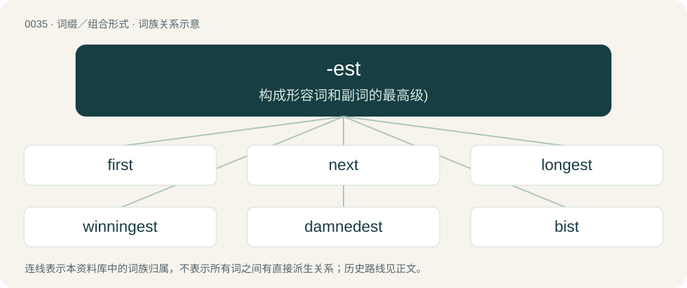

# 0037 · -est — 构成形容词和副词的最高级)

[总目录](../00_总目录_按常用程度.md)

**类型**：词缀／组合形式　｜　**来源语言**：见词源记录

## 核心含义与来源

- 核心含义：构成形容词和副词的最高级)
- 英文含义：Used to form the superlative of adjectives and adverbs.
- 词形：-est

**来源记录 1**（后缀／后置成分；Used to form the superlative of adjectives and adverbs.）

From Middle English -est, from Old English -est, -ost, from Proto-West Germanic \*-ist, \*-ōst, from Proto-Germanic \*-istaz, \*-ōstaz, related to comparative -er. Cognate of Afrikaans -ste, Dutch -st, German -(e)st, Danish -(e)st, Swedish -(a)st. Via PIE cognate with Ancient Greek -ιστος (-istos), see Pleistocene, protist.

## 词族图

## 单词速览（常用到不常用）

| 单词 | 音标 | 释义 |
|---|---|---|
| [first](#w-1) | 英 /fɜːst/；美 /fɚst/ | adv. 首先, 第一, 优先；a. 第一的；num. 第一 |
| [next](#w-2) | /nɛkst/ | n. 下一个；a. 下一个的, 其次的, 贴近的；adv. 然后, 下次, 次于 |
| [longest](#w-3) | 英 /ˈlɒŋɡəst/；美 /ˈlɔŋɡəst/ | a. 最长的 |
| [winningest](#w-4) | /ˈwɪnɪŋɪst/ | 赢得最多比赛的 |
| [damnedest](#w-5) | /ˈdæmdist/ | n. 最大的努力 |
| [bist](#w-6) | /bist/ | n. 阿拉伯学者 |

## 逐词详解

### 1. first

**词性**：形容词　｜　**音标**：英 /fɜːst/；美 /fɚst/

**中文释义**：adv. 首先, 第一, 优先；a. 第一的；num. 第一

**英文义项**：Preceding all others of a series or kind; the ordinal of one; earliest. / Most eminent or exalted; most excellent; chief; highest.

**构词拆分**：fore + -est

**词源与演化**：

From Middle English first, furst, ferst, fyrst, from Old English fyrest, from Proto-West Germanic \*furist, from Proto-Germanic \*furistaz (“first, foremost”), superlative of Proto-Germanic \*furai, \*furi (“before”), from Proto-Indo-European \*preh₂- (“before”), from \*per- (“before; first”), equivalent to fore + -est. Cognates Cognate with Scots first (“first”), Dutch voorste (“foremost, first”), vorst (“prince”), German Fürst (“chief, prince”, literally “first (born)”), Limburgish Vürsch (“prince”), Luxembourgish viischt (“anterior; forward”), Vilamovian fiyśt, fjəšt, fjyśt, fjyšt (“prince”), Danish and Norwegian Bokmål først (“first”), Faroese and Icelandic fyrstur (“first”), Norwegian Nynorsk fyrst, først (“first”), Swedish först (“first”); also Latin prīnceps (“first, foremost; chief”), Greek παρ’ (par’), παρά (pará, “despite; less”), Mycenaean Greek 𐀞𐀫 (pa-ro, “from”), Albanian parë (“first; chief, main”), Latgalian pyrmais (“first”), Latvian pirmais (“first; foremost”), Lithuanian pirmas (“first; primary”), Bulgarian пъ́рви (pắrvi), пръ́в (prắv, “first”), Czech and Slovak prvý (“first”), Macedonian прв (prv), први (prvi, “first”), Polish piersy, pierwszy, pirszy (“first”), Russian пе́рвый (pérvyj, “first”), Serbo-Croatian пр̑вӣ, pȓvī (“first”), Slovene prvi (“first”), Armenian հարավ (harav, “south”), Avestan 𐬞𐬀𐬎𐬭𐬎𐬎𐬀 (paᵘruua, “before, first”), Tocharian A pärwat (“first”), Tocharian B parwe (“first”), Sanskrit पूर्व (pūrva, “before”).

**例句**：

> I was the first runner to reach the finish line, and won the race.

该用例对应义项：Preceding all others of a series or kind; the ordinal of one; earliest.

### 2. next

**词性**：形容词　｜　**音标**：/nɛkst/

**中文释义**：n. 下一个；a. 下一个的, 其次的, 贴近的；adv. 然后, 下次, 次于

**英文义项**：Nearest in place or position, having nothing similar intervening; adjoining. / Nearest in order, succession, or rank; immediately following (or sometimes preceding) in order.

**构词拆分**：nigh + -est

**词源与演化**：

From Middle English nexte, nexste, nixte, from Old English nīehsta, nīehste, etc., inflected forms of nīehst (“nearest, next”), superlative form of nēah (“nigh”) (the comparative would become near), corresponding to Proto-Germanic \*nēhwist (“nearest, closest”); equivalent to nigh + -est. Cognate with Saterland Frisian naist (“next”), Dutch naast (“next to”), German nächster (“next”), Yiddish נעקסט (nekst, “next”), Danish næste (“next”), Elfdalian nest (“by, near”), Icelandic næst (“next”), Norwegian Bokmål and Norwegian Nynorsk neste (“next”), Swedish näst, nästa (“next”), Persian نزد (nazd, “near, with”). Compare typologically Latin proximus (“nearest, next”).

**例句**：

> The man was driven by his love for money and his desire to become the next Bill Gates.

该用例对应义项：Nearest in order, succession, or rank; immediately following (or sometimes preceding) in order.

### 3. longest

**词性**：名词　｜　**音标**：英 /ˈlɒŋɡəst/；美 /ˈlɔŋɡəst/

**中文释义**：a. 最长的

**英文义项**：Something that is longer than all others in its class.

**构词拆分**：long + -est

**词源与演化**：

From long + -est.

**例句**：

> Having 25 letters, "anticonstitutionnellement" is the longest word in the French language.

### 4. winningest

**词性**：形容词　｜　**音标**：/ˈwɪnɪŋɪst/

**中文释义**：赢得最多比赛的

**英文义项**：Most winning; most attractive. / Having the most wins.

**构词拆分**：From winning + -est.

**词源与演化**：

From winning + -est.

**用法示例／搭配（非完整句）**：

> a list of the all-time winningest baseball coaches

该用例对应义项：Having the most wins.

### 5. damnedest

**词性**：名词　｜　**音标**：/ˈdæmdist/

**中文释义**：n. 最大的努力

**英文义项**：One's best effort.

**构词拆分**：From damned + -est.

**词源与演化**：

From damned + -est.

**例句**：

> I was trying my damnedest not to fall asleep.

### 6. bist

**词性**：动词　｜　**音标**：/bist/

**中文释义**：n. 阿拉伯学者

**英文义项**：Used to form the second person singular of be.

**构词拆分**：be + -est

**词源与演化**：

From Middle English bist, beest, best, from Old English bist ("(thou) art"; second person singular of bēon (“to be”)), from Proto-Germanic \*biusi (“(thou) art”), equivalent to be + -est. Cognate with West Frisian bist (“(thou) art”), Low German büst (“(thou) art”), German bist (“(thou) art”).
