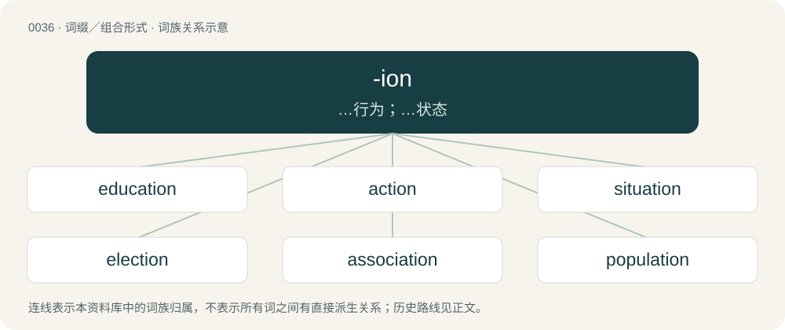

# 0038 · -ion — …行为；…状态

[总目录](../00_总目录_按常用程度.md)

**类型**：词缀／组合形式　｜　**来源语言**：见词源记录

## 核心含义与来源

- 核心含义：…行为；…状态
- 英文含义：An action or process, or the result of an action or process.
- 词形：-ion

**多个词源／构词路径**：同一拼写可能有不同来源；以下按词性和含义分别列出。

**来源记录 1**（后缀／后置成分；An anthropometric reference point.）

Possibly reanalysed from inion, which is of Ancient Greek origin. In many cases also analysable as the neuter form of an Ancient Greek adjective in -ιος (-ios).

**来源记录 2**（后缀／后置成分；Together with apo- and peri-, forms names of specific apoapsides and periapsides.）

From Ancient Greek ἀπόγειον (apógeion, “apogee”), containing -ιον (-ion). Compare also -ium.

## 词族图

## 单词速览（常用到不常用）

| 单词 | 音标 | 释义 |
|---|---|---|
| [education](#w-1) | 美 /ˌɛd͡ʒ.əˈkeɪ.ʃən/；/ˌɛd͡ʒ.ʊˈkeɪ.ʃən/ | n. 教育, 训练, 教育学；\[医\] 教育, 训练 |
| [action](#w-2) | 英 /ˈækʃən̩/；美 /ˈækʃən/ | n. 行动, 活动, 动作, 作用, 战斗, 行为, 诉讼；vt. 对...起诉；\[计\] 方式 |
| [situation](#w-3) | 英 /ˌsɪt.juːˈeɪ.ʃən/；美 /ˌsɪ.t͡ʃuˈ(w)eɪ.ʃən/ | n. 情形, 境遇, 位置；\[医\] 情境, 处境 |
| [election](#w-4) | 英 /ɪˈlɛkʃ(ə)n/；/əˈlɛkʃ(ə)n/ | n. 选举, 当选, 选择权；\[法\] 选举, 当选 |
| [association](#w-5) | 英 /əˌsəʊʃiˈeɪʃn̩/；美 /əˌsoʊʃiˈeɪʃən/ | n. 协会；\[计\] 关联 |
| [population](#w-6) | 英 /ˌpɒp.jʊˈleɪ.ʃən/；美 /ˌpɑ.pjəˈleɪ.ʃən/ | n. 人口, 人口数；\[化\] 群体; 总体 |
| [construction](#w-7) | /kənˈstɹʌkʃən/ | n. 建筑, 构造, 建筑物；\[化\] 施工 |
| [collection](#w-8) | /kəˈlɛkʃən/ | n. 收集, 采集, (一批)收藏品, 募捐；\[医\] 收集; 收集品, 标本 |
| [opinion](#w-9) | /əˈpɪn.jən/ | n. 意见, 评价, 主张；\[经\] 意见 |
| [administration](#w-10) | 英 /ədˌmɪn.ɪˈstɹeɪ.ʃən/；美 /ədˌmɪn.əˈstɹeɪ.ʃən/ | n. 行政, 管理, 政府机关；\[化\] 给药 |
| [direction](#w-11) | 英 /dɪˈɹɛk.ʃən/ | n. 方向, 指导, 趋势；\[计\] 方向; 流向 |
| [operation](#w-12) | 英 /ˌɒp.əˈɹeɪ.ʃən/；美 /ˌɑ.pəˈɹeɪ.ʃən/ | n. 操作, 动作, 手术, 运算, 作用, 业务；\[计\] 运算 |
| [location](#w-13) | 英 /ləʊˈkeɪʃən/；美 /loʊˈkeɪʃən/ | n. 位置, 场所, 特定区域；\[计\] 位置 |
| [protection](#w-14) | /pɹəˈtɛkʃn̩/ | n. 保护, 防卫, 贸易保护制度；\[计\] 保护 |
| [option](#w-15) | 英 /ˈɒpʃən/；美 /ˈɑpʃən/ | n. 选择权, 挑选, 选项；\[计\] 选项 |
| [connection](#w-16) | /kəˈnɛkʃ(ə)n/ | n. 连接, 关系, 前后关系；\[计\] 连接 |
| [investigation](#w-17) | 英 /ɪnˌvɛs.tɪˈɡeɪ.ʃən/；美 /ɪnˌvɛs.tɪˈɡeɪ.ʃən/ | n. 调查, 审查；\[医\] 调查, 调查研究 |
| [reaction](#w-18) | /ɹiˈækʃən/ | n. 反应, 反作用, 反动；\[医\] 反应 |
| [communication](#w-19) | 英 /kəˌmjuː.nɪˈkeɪ.ʃən/；美 /kəˌmju.nɪˈkeɪ.ʃən/ | n. 交流, 交通, 通讯；\[计\] 通信 |
| [selection](#w-20) | /səˈlɛkʃən/ | n. 选择, 选文, 精选品；\[医\] 选择, 淘汰 |
| [constitution](#w-21) | 英 /ˌkɒn.stɪˈtjuː.ʃ(ə)n/；美 /ˌkɑn.stɪˈtu.ʃ(ə)n/ | n. 构成, 宪法, 体格；\[医\] 体质; 结构, 组织 |
| [depression](#w-22) | /dɪˈpɹɛʃən/ | n. 不景气, 消沉, 沮丧, 洼地；\[医\] 抑郁\[症\], 阻抑, 压低, 凹, 窝, 衰退, 俯角 |
| [expression](#w-23) | /əkˈspɹɛʃ.n̩/ | n. 表达, 表现, 词语, 措辞；\[计\] 表达式 |
| [legislation](#w-24) | 美 /ˌlɛd͡ʒɪˈsleɪʃən/ | n. 立法, 法律；\[医\] 立法, 法规 |
| [permission](#w-25) | 英 /pəˈmɪʃ.ən/；美 /pəɹˈmɪʃ.ən/ | n. 许可, 允许；\[计\] 许可, 认可 |
| [immigration](#w-26) | 英 /ɪmɪˈɡɹeɪʃn/；美 /ˌɪmɪˈɡɹeɪʃən/ | n. 移民, 移居；\[医\] 移民 |
| [institution](#w-27) | 美 /ˌɪn.stɪˈtu.ʃən/；/ˌɪn.stɪˈtʃuː.ʃən/ | n. 机构, 惯例, 制度；\[医\] 机关, 机构, 设施 |
| [promotion](#w-28) | 英 /pɹəˈməʊʃn̩/；美 /pɹəˈmoʊʃn̩/ | n. 晋级, 创建, 增进；\[经\] 推广, 推销, 促进 |
| [vacation](#w-29) | 英 /vəˈkeɪ.ʃən/；美 /veɪˈkeɪ.ʃən/ | n. 假期, 休假；\[法\] 假期, 停审期, 休庭期 |
| [translation](#w-30) | 英 /tɹænzˈleɪʃən/；美 /tɹænzˈleɪʃən/ | n. 翻译, 译文, 转化, 调任, 平移, 转译；\[计\] 转换 |
| [possession](#w-31) | /pəˈzɛʃn̩/ | n. 拥有, 占有, 所有, 财产, 领土, 领地, 自制, 着迷；\[经\] 占有, 持有 |
| [regulation](#w-32) | /ˌɹɛɡjʊˈleɪʃən/ | n. 规则, 管理, 调整；\[计\] 调整; 规章; 规则; 调节 |
| [exhibition](#w-33) | /ɛksɪˈbɪʃən/ | n. 表现, 展览会, 展览品；\[医\] 投药, 展览, 展出 |
| [consumption](#w-34) | /kənˈsʌmp.ʃən/ | n. 消费, 消费量, 痨病；\[化\] 消耗量; 耗量 |
| [corruption](#w-35) | /kəˈɹʌpʃən/ | n. 腐败, 堕落, 贪污；\[计\] 论误 |
| [exception](#w-36) | /əkˈsɛpʃən/ | n. 例外, 除外, 异议；\[计\] 例外; 异常 |
| [impression](#w-37) | /ɪmˈpɹɛʃn̩/ | n. 印象, 意念, 盖印, 印记, 印数, 底色, 效果；\[医\] 压迹, 印模, 印象, 影响 |
| [compensation](#w-38) | 英 /ˌkɒm.pənˈseɪ.ʃən/；美 /ˌkɑm.pənˈseɪ.ʃən/ | n. 补偿, 赔偿金, 工资；\[医\] 代偿(机能), 补偿 |
| [infection](#w-39) | /ɪnˈfɛkʃən/ | n. 传染, 影响, 传染病；\[医\] 传染, 感染 |
| [intention](#w-40) | /ɪnˈtɛnʃn̩/ | n. 意图, 目的, 含义；\[医\] 愈合, 意向 |
| [innovation](#w-41) | /ˌɪn.əˈveɪ.ʃən/ | n. 改革, 创新；\[法\] 创新, 改革, 刷新 |
| [discrimination](#w-42) | 英 /dɪskɹɪmɪˈneɪʃən/；美 /dɪˌskɹɪm.əˈneɪʃən/ | n. 差别, 岐视, 辨别力；\[化\] 鉴别 |
| [cooperation](#w-43) | 英 /kəʊˌɒp.əˈɹeɪ.ʃən/；美 /koʊˌɑ.pəˈɹeɪ.ʃən/ | n. 合作, 协力, 配合；\[化\] 合作 |
| [celebration](#w-44) | 英 /ˌsɛl.ɪˈbɹeɪ.ʃən/；美 /ˌsɛl.əˈbɹeɪ.ʃən/ | n. 庆祝, 庆典 |
| [execution](#w-45) | /ˌɛk.sɪˈkjuː.ʃən/ | n. 实行, 完成, 执行, 死刑；\[计\] 执行 |
| [collaboration](#w-46) | 英 /kəˌlæbəˈɹeɪʃən/ | n. 合作, 勾结；\[法\] 通敌卖国者, 奸细 |
| [concentration](#w-47) | 英 /ˌkɒn.sənˈtɹeɪ.ʃən/；美 /ˌkɑn.sənˈtɹeɪ.ʃən/ | n. 集中, 专心；\[化\] 浓度; 浓缩 |
| [federation](#w-48) | 英 /ˌfɛdəˈɹeɪ̯ʃən/ | n. 联邦, 联合, 联盟；\[法\] 联邦, 联盟, 联邦政府 |
| [abortion](#w-49) | 美 /əˈbɔɹ.ʃn̩/ | n. 流产, 堕胎, 失败, 夭折, 中止；\[医\] 流产, 小产; 顿挫 |
| [suggestion](#w-50) | 英 /səˈd͡ʒɛst.ʃən/；美 /sə(ɡ)ˈd͡ʒɛs.t͡ʃən/ | n. 提议, 意见；\[医\] 暗示 |
| [integration](#w-51) | 英 /ˌɪn.tɪˈɡɹeɪ.ʃən/；美 /ˌɪn.təˈɡɹeɪ.ʃən/ | n. 综合, 与环境协调的行为, 集成；\[化\] 集成; 整合 |
| [confusion](#w-52) | /kənˈfjuːʒən/ | n. 混乱, 混淆, 无秩序；\[计\] 含混 |
| [animation](#w-53) | /ˌæn.ɪˈmeɪ.ʃən/ | n. 活泼, 生气, 激励, 卡通制作；\[计\] 动画 |
| [adoption](#w-54) | 英 /əˈdɒp.ʃən/；美 /əˈdɑp.ʃən/ | n. 采用, 采纳, 收养；\[法\] 收养, 采纳, 采用 |
| [reflection](#w-55) | /ɹɪˈflɛkʃən/ | n. 反映, 沉思, 映像, 想法, 责难；\[计\] 反射 |
| [medication](#w-56) | /mɛdɪˈkeɪʃən/ | n. 药物治疗, 药物处理, 医药；\[医\] 药疗法, 投药法 |
| [violation](#w-57) | /ˌvaɪ.əˈleɪ.ʃən/ | n. 违反, 违背, 妨碍；\[法\] 违犯, 违背, 违反 |
| [addiction](#w-58) | /əˈdɪkˌʃən/ | n. 入迷, 瘾；\[医\] 瘾, 癖嗜 |
| [conviction](#w-59) | /kənˈvɪkʃən/ | n. 定罪, 信服, 坚信；\[法\] 定罪, 证明有罪, 判罪 |
| [instruction](#w-60) | /ɪnˈstɹʌkʃən/ | n. 指令, 教导, 命令；\[计\] 指令 |
| [migration](#w-61) | 英 /maɪˈɡɹeɪʃ(ə)n/ | n. 移民, 移往, 移动；\[计\] 迁移 |
| [separation](#w-62) | 英 /ˌsɛp.əˈɹeɪ.ʃən/ | n. 分离, 分居, 缺口, 退职；\[化\] 分离 |
| [attraction](#w-63) | 英 /əˈtɹækʃn̩/ | n. 吸引, 吸引人的事物, 吸引力；\[医\] 吸引 |
| [assumption](#w-64) | /əˈsʌm(p).ʃ(ə)n/ | n. 假定, 自负, 担任, 假装；\[经\] 假定, 承担 |
| [graduation](#w-65) | 英 /ˌɡɹædjuˈeɪʃən/；美 /ˌɡɹæd͡ʒuˈeɪʃən/ | n. 毕业, 得学位, 分划, 刻度, 分等级；\[医\] 刻度, 分度, 毕业 |
| [accommodation](#w-66) | 英 /əˌkɒm.əˈdeɪ.ʃən/；美 /əˌkɑ.məˈdeɪ.ʃən/ | n. 膳宿, 预订铺位, 适应性调节, 调和, 贷款；\[医\] 调节(眼); 适应 |
| [demonstration](#w-67) | 英 /dɛmənˈstɹeɪʃən/ | n. 示范, 实证；\[医\] 示教, 实物教授 |
| [prosecution](#w-68) | 英 /ˌpɹɒs.ɪˈkjuː.ʃən/；美 /ˌpɹɑ.sɪˈkju.ʃən/ | n. 执行, 经营, 起诉 |
| [navigation](#w-69) | /nævɪˈɡeɪʃən/ | n. 航行, 航海, 导航；\[经\] 航空, 航海, 航船 |
| [equation](#w-70) | 英 /ɪˈkweɪ.ʒən/；美 /ɪˈkweɪ.ʒən/ | n. 相等, 等式, 平衡；\[化\] 方程式; 等式; 反应式; 公式 |
| [isolation](#w-71) | 英 /ˌaɪsəˈleɪʃən/ | n. 隔绝, 孤立, 隔离；\[化\] 分离; 生物分离 |
| [precision](#w-72) | 英 /pɹɪˈsɪʒ.ən/ | n. 精密, 精确, 精确度, 精度；a. 精密的, 精确的；\[计\] 精度 |
| [donation](#w-73) | 英 /dəʊˈneɪʃən/；美 /doʊˈneɪʃən/ | n. 捐赠物, 捐款, 捐赠；\[经\] 赠品, 捐款, 捐赠 |
| [injection](#w-74) | /ɪnˈd͡ʒɛk.ʃən/ | n. 注射, 注射剂；\[化\] 注入; 注射 |
| [speculation](#w-75) | 英 /ˌspɛk.jəˈleɪ.ʃən/ | n. 沉思, 推测, 投机；\[经\] 投机交易, 买空卖空 |
| [suspicion](#w-76) | /səˈspɪʃ.ən/ | n. 怀疑, 觉察, 嫌疑；\[法\] 怀疑, 疑心, 嫌疑 |
| [circulation](#w-77) | 英 /ˌsɜː(ɹ).kjʊˈleɪ.ʃən/；美 /ˌsɝkjʊˈleɪʃən/ | n. 流通, 循环, 发行量；\[化\] 环流 |
| [prediction](#w-78) | /pɹɪˈdɪkʃən/ | n. 预言, 预报；\[化\] 预测 |
| [rebellion](#w-79) | /ɹɪˈbɛl.i.ən/ | n. 谋反, 叛乱, 反抗；\[法\] 造反, 反叛, 叛乱 |
| [simulation](#w-80) | 英 /ˌsɪm.jʊˈleɪ.ʃn̩/；美 /ˌsɪm.jəˈleɪ.ʃn̩/ | n. 模拟, 假冒物, 模仿；\[计\] 模拟 |
| [elimination](#w-81) | /ɪlɪmɪˈneɪʃ(ə)n/ | n. 除去, 消除, 消灭；\[化\] 消去; 脱去 |
| [litigation](#w-82) | /ˌlɪtɪˈɡeɪ̯ʃən/ | n. 诉讼, 起诉；\[经\] 诉讼, 纠葛 |
| [affection](#w-83) | /əˈfɛk.ʃən/ | n. 影响, 病, 喜爱, 情感, 倾向；\[医\] 疾患, 病变, 病; 感情 |
| [liberation](#w-84) | /ˌlɪbəˈɹeɪʃən/ | n. 释放, 解放；\[化\] 发出; 释放; 放出 |
| [coordination](#w-85) | 英 /kəʊˌɔːdɪˈneɪʃən/；美 /koʊˌoɹdɪˈneɪʃən/ | n. 同等, 协调；\[计\] 协调; 进程协调 |
| [discretion](#w-86) | /dɪˈskɹɛʃən/ | n. 慎重, 辨别力, 考虑, 处理权；\[法\] 有决定权的 |
| [elevation](#w-87) | /ˌɛlɪˈveɪʃn̩/ | n. 海拔, 提高, 仰角；\[计\] 仰角 |
| [obsession](#w-88) | 英 /əbˈsɛʃən/ | n. 困扰, 困扰人的情绪；\[医\] 强迫观念 |
| [confession](#w-89) | /kənˈfɛʃən/ | n. 承认, 坦白, 招供；\[法\] 自白, 招供, 自认有罪 |
| [correlation](#w-90) | 英 /ˌkɒɹ.əˈleɪ.ʃən/；美 /ˌkɔɹ.əˈleɪ.ʃən/ | n. 相互关系, 相关, 关联；\[医\] 相关, 联系 |
| [manipulation](#w-91) | 英 /məˌnɪp.juˈleɪ.ʃən/；美 /məˌnɪp.jəˈleɪ.ʃən/ | n. 操作, 处理；\[化\] (用手)操作; 使用 |
| [activation](#w-92) | 英 /ˌæktɪˈveɪʃn̩/；美 /ˌæktəˈveɪʃən/ | n. 活化, 激活；\[化\] 活化; 活化作用; 激活; 激活作用 |
| [assassination](#w-93) | 英 /əˌsæs.ɪˈneɪ.ʃən/ | n. 暗杀；\[法\] 暗杀, 行刺 |
| [compression](#w-94) | 英 /kəmˈpɹɛʃ.ən/ | n. 压缩, 压紧；\[计\] 压缩 |
| [decoration](#w-95) | /ˌdɛkəˈɹeɪʃən/ | n. 装饰, 装饰品 |
| [automation](#w-96) | 英 /ˌɔː.təˈmeɪ.ʃən/；美 /ˌɔ.təˈmeɪ.ʃən/ | n. 自动化, 自动操作；\[计\] 自动学; 自动化 |
| [projection](#w-97) | /pɹəˈd͡ʒɛkʃən/ | n. 发射, 计划, 突出部分, 设计, 推测；\[计\] 投影 |
| [distraction](#w-98) | /dɪsˈtɹæk.ʃən/ | n. 娱乐, 分心的事物, 分心；\[医\] 注意力分散, 内脱位, 牙弓过宽 |
| [objection](#w-99) | /əbˈd͡ʒɛkʃən/ | n. 异议, 反对, 不喜欢, 缺点, 缺陷, 妨碍, 拒绝之理由；\[法\] 异议, 反对, 抗议 |
| [calculation](#w-100) | 英 /ˌkælkjuˈleɪʃn̩/；美 /ˌkælkjəˈleɪʃn̩/ | n. 计算, 考虑, 计算的结果；\[经\] 计算 |
| [restriction](#w-101) | /ɹɪˈstɹɪkʃən/ | n. 限制, 限定, 约束；\[计\] 限定 |
| [evacuation](#w-102) | /ɪˌvækjuˈeɪʃən/ | n. 撤退, 疏散；\[化\] 抽空; 排空 |
| [acceleration](#w-103) | /əkˌsɛl.əˈɹeɪ.ʃən/ | n. 加速, 促进, 加速度；\[化\] 加速度 |
| [devotion](#w-104) | 英 /dɪˈvəʊʃən/；美 /dɪˈvoʊʃən/ | n. 热爱, 投入 |
| [persecution](#w-105) | 英 /ˌpɜːsəˈkjuːʃən/；美 /ˌpɝsəˈkjuʃən/ | n. 虐待, 迫害运动, 迫害, 烦扰；\[法\] 迫害, 虐待, 困扰 |
| [prostitution](#w-106) | /ˌprɒstɪˈt͡ʃuːʃn/ | n. 卖淫, 糟蹋, 滥用；\[法\] 卖淫, 滥用 |
| [penetration](#w-107) | 英 /pɛ.nɪˈtɹeɪ.ʃən/；美 /pɛ.nəˈtɹeɪ.ʃən/ | n. 穿透, 渗透, 侵入, 识穿, 洞察(力)；\[化\] 渗入 |
| [stimulation](#w-108) | 英 /stɪm.jʊˈleɪ.ʃən/；美 /ˈstɪm.jəˈleɪ.ʃən/ | n. 刺激, 激励, 鼓舞；\[医\] 兴奋, 刺激 |
| [insulation](#w-109) | 英 /ˌɪnsjʊˈleɪʃən/；美 /ˌɪnsəˈleɪʃən/ | n. 绝缘；隔离, 孤立 |
| [exemption](#w-110) | /ɪɡˈzɛm(p).ʃən/ | n. 解除, 免除, 免税；\[化\] 免检 |
| [cultivation](#w-111) | /ˌkʌltɪˈveɪʃən/ | n. 教化, 培养, 耕作；\[医\] 培养\[法\] |
| [demolition](#w-112) | 英 /ˌdɛm.əˈlɪʃ.ən/ | n. 破坏, 毁坏, 撤销；\[经\] 拆毁(除,破坏) |
| [regeneration](#w-113) | /ri.dʒenəˈreiʃən/ | n. 再生, 重建；\[化\] 再生作用 |
| [segregation](#w-114) | /sɛɡɹəˈɡeɪ̯ʃən/ | n. 隔离, 偏析, 被隔离的部分, 种族隔离；\[化\] 分离; 分凝; 离析; 偏析; 分聚 |
| [ventilation](#w-115) | /ˌvɛntɪˈleɪʃ(ə)n/ | n. 通风, 空气流通, 公开讨论；\[医\] 通风, 换气 |
| [vibration](#w-116) | 美 /vaɪˈbɹeɪʃən/ | n. 振动, 颤动；\[化\] 振动 |
| [combustion](#w-117) | /kəmˈbʌs.t͡ʃən/ | n. 燃烧, 骚动；\[化\] 燃烧 |
| [concussion](#w-118) | 英 /kənˈkʌʃən/；美 /kəŋkˈəʃɪn/ | n. 剧烈摇动, 震荡；\[医\] 震荡 |
| [encryption](#w-119) | 英 /ɪŋˈkɹɪpʃən/；美 /ɪnˈkɹɪpʃən/ | \[计\] 加密 |
| [implication](#w-120) | /ˌɪmplɪˈkeɪʃən/ | n. 牵连, 含义, 暗示；\[法\] 推断, 含蓄之意, 暗示 |
| [interrogation](#w-121) | /ɪnˌteɹ.əˈɡeɪ.ʃən/ | n. 审问, 疑问句, 问号；\[电\] 询问 |
| [humiliation](#w-122) | /hjuːˌmɪliˈeɪʃən/ | n. 耻辱, 丢脸, 谦卑 |
| [retaliation](#w-123) | 英 /ɹiˌtæl.iˈeɪ.ʃən/；美 /ɹɪˌtæl.iˈeɪ.ʃən/ | n. 报复；\[法\] 报仇, 报复, 回敬 |
| [intuition](#w-124) | 英 /ˌɪn.tjuːˈɪʃ.ən/；美 /ˌɪn.tuˈɪʃ.ən/ | n. 直觉, 直觉的知识 |
| [initiation](#w-125) | /ɪˌnɪʃ.iˈeɪ.ʃən/ | n. 开始, 指引, 入会；\[化\] 引发 |
| [repression](#w-126) | /ɹəˈpɹɛʃən/ | n. 抑制, 压抑, 制止；\[医\] 压抑, 抑制 |
| [regression](#w-127) | 英 /ɹɪˈɡɹɛʃ.ən/；美 /ɹiːˈɡɹɛʃ.ən/ | n. 退步, 回归；\[计\] 回归 |
| [differentiation](#w-128) | 英 /dɪf.əˌɹɛn.ʃiˈeɪ.ʃən/；美 /ˌdɪf.əˌɹɛn.ʃiˈeɪ.ʃən/ | n. 区别, 分化, 变异；\[医\] 鉴别, 区别, 分化\[作用\], 微分法 |
| [exhaustion](#w-129) | /ɪɡˈzɔːs.t͡ʃən/ | n. 抽空, 耗尽, 疲惫, 筋疲力尽；\[化\] 抽空 |
| [fabrication](#w-130) | 美 /fæbɹɪˈkeɪʃən/ | n. 制造, 建造, 虚构的谎言；\[医\] 虚谈症 |
| [fascination](#w-131) | 美 /fæsɪˈneɪʃən/ | n. 令人着迷的事物, 入迷, 魅力 |
| [notation](#w-132) | 美 /noʊˈteɪʃən/ | n. 记号, 符号表示法, 注释；\[计\] 记数法 |
| [contraction](#w-133) | 英 /kənˈtɹækʃn̩/；美 /kənˈtɹækʃ(ə)n/ | n. 收缩, 缩写式, 害病；\[医\] 收缩; 挛缩; 牙弓内缩 |
| [deduction](#w-134) | 英 /dɪˈdʌkʃən/；美 /dɪˈdʌkʃən/ | n. 减除, 扣除, 减除额, 推论；\[医\] 演绎, 推论 |
| [estimation](#w-135) | 英 /ˌɛs.tɪˈmeɪ.ʃən/；美 /ˌɛs.təˈmeɪ.ʃən/ | n. 判断, 估计, 尊重；\[化\] 估计; 估定; 测定; 估值 |
| [excavation](#w-136) | /ˌɛkskəˈveɪʃn/ | n. 挖掘, 发掘, 挖掘的洞；\[医\] 陷凹, 挖除 |
| [abduction](#w-137) | 英 /əbˈdʌk.ʃn̩/；美 /æbˈdʌk.ʃn̩/ | n. 诱拐, 绑架, 外展；\[医\] 外展, 展 |
| [deterioration](#w-138) | 英 /dɪˌtɪəɹɪəˈɹeɪʃən/；美 /dɪˌtɪɹ.i.əˈɹeɪ.ʃən/ | n. 恶化, 衰退, 退化；\[医\] 变坏, 变质, 颓废, 衰退 |
| [deviation](#w-139) | 英 /ˌdiː.viˈeɪʃən/；美 /ˌdiviˈeɪʃən/ | n. 背离；\[化\] 偏差; 误差; 偏斜 |
| [diffusion](#w-140) | 英 /dɪˈfjuː.ʒən/；美 /dɪˈfju.ʒən/ | n. 散播, 传播, 蔓延；\[医\] 扩散, 弥散, 漫射(光) |
| [inhibition](#w-141) | /ɪnhɪˈbɪʃən/ | n. 禁止, 抑制, 压抑；\[计\] 禁止 |
| [intimidation](#w-142) | /ɪntɪmɪˈdeɪʃən/ | n. 恐吓, 威胁；\[法\] 恐吓, 威胁 |
| [iteration](#w-143) | 英 /ˌɪt.əˈɹeɪ.ʃən/；美 /ˌɪt.əˈɹeɪ.ʃən/ | n. 重复, 反复说的话；\[计\] 迭代 |
| [incarceration](#w-144) | /ɪŋˌkɑː(ɹ)səˈɹeɪʃən/ | n. 下狱, 监禁, 禁闭；\[医\] 箝闭 |
| [insertion](#w-145) | 美 /ɪnˈsɝʃən/ | n. 插入, 刊载, 插入物；\[计\] 插入 |
| [suction](#w-146) | /ˈsʌkʃən/ | n. 吸, 吸入, 吸上, 吸引, 吸力；\[化\] 吸气; 吸入 |
| [illumination](#w-147) | 英 /ɪˌl(j)umɪˈneɪʃən/；美 /ɪˌlumɪˈneɪʃən/ | n. 照明, 阐明, 启发；\[医\] 照明, 映光 |
| [calibration](#w-148) | 英 /ˌkæl.ɪˈbɹeɪ.ʃən/；美 /ˌkæl.əˈbɹeɪ.ʃən/ | n. 口径测定, 刻度, 校准；\[化\] 校准 |
| [propagation](#w-149) | 英 /pɹɒpəˈɡeɪʃən/；美 /pɹɑpəˈɡeɪʃən/ | n. 增殖, 繁殖, 宣传；\[医\] 传播, 繁殖, 持续培养 |
| [approximation](#w-150) | 英 /əˌpɹɒk.sɪˈmeɪ.ʃən/；美 /əˌpɹɑk.sɪˈmeɪ.ʃən/ | n. 接近, 近似值；\[医\] 接近; 近似 |
| [escalation](#w-151) | 英 /ˌɛs.kəˈleɪ.ʃən/ | n. 扩大, 增加；\[经\] 调查, 价格调整 |
| [complication](#w-152) | 英 /ˌkɒm.plɪˈkeɪ.ʃən/；美 /ˌkɑm.pləˈkeɪ.ʃən/ | n. 复杂化, 复杂情况；\[医\] 并发症, 并发病 |
| [abstraction](#w-153) | 英 /əbˈstɹæk.ʃn̩/；美 /æbˈstɹæk.ʃn̩/ | n. 抽象化, 心不在焉, 空想, 提炼, 抽象派作品；\[化\] 提取; 抽取; 夺取; 夺取反应; 除去 |
| [aspiration](#w-154) | /.æspəˈreiʃən/ | 【英文】The action of aspirating. |
| [modulation](#w-155) | 英 /ˌmɒdjʊˈleɪʃn̩/；美 /ˌmɑd͡ʒəˈleɪʃən/ | n. 调制, 调节, 语调；\[计\] 调制 |
| [punctuation](#w-156) | /ˌpʌŋk.t͡ʃuˈeɪ.ʃən/ | n. 标点, 标点符号；\[计\] 标点符号 |
| [culmination](#w-157) | 英 /ˌkʌl.mɪˈneɪ.ʃən/；美 /ˌkʌl.məˈneɪ.ʃən/ | n. 顶点, 高潮, 最高点 |
| [liquidation](#w-158) | /ˌlɪkwəˈdeɪʃən/ | n. 偿还, 偿付, 清算；\[化\] 液化; 溶离法; 溶化分离法 |
| [multiplication](#w-159) | /ˌmʌltɪplɪˈkeɪʃən/ | n. 乘法, 增加, 乘法运算；\[医\] 增殖; 倍增 |
| [infiltration](#w-160) | 英 /ɪnfɪlˈtɹeɪʃən/；美 /ˌɪnfəlˈtɹeɪʃən/ | n. 渗入, 渗透, 渗透物；\[化\] 渗滤; 渗入过滤; 渗透; 渗入 |
| [deletion](#w-161) | 英 /dɪˈliːʃən/；美 /dɪˈliʃən/ | n. 删除, 删除部分；\[医\] 缺失, 中间缺失(染色体) |
| [presumption](#w-162) | /pɹɪˈzʌmp.ʃən/ | n. 专横, 放肆, 假定, 推测；\[法\] 假定, 推测, 设想 |
| [circumcision](#w-163) | /ˌsɜː(ɹ)kəmˈsɪʒən/ | n. 包皮环割术, 环切术, 犹太教的割礼, 净心, 犹太人；\[医\] 包皮环切术 |
| [dispersion](#w-164) | 英 /dɪˈspɜːʒən/；美 /dɪˈspɝʒən/ | n. 散布；\[化\] 分散; 分散作用; 分散体; 色散; 离差 |
| [hydration](#w-165) | 美 /haɪˈdɹeɪʃən/ | n. 水合；\[化\] 水合 |
| [refrigeration](#w-166) | /ri.fridʒəˈreiʃən/ | n. 冷却, 冷藏, 冷冻；\[计\] 致冷 |
| [duplication](#w-167) | 英 /djuː.plɪˈkeɪ.ʃən/；美 /d(j)u.plɪˈkeɪ.ʃən/ | n. 副本, 复制；\[医\] 重迭, 双折, 复制 |
| [reincarnation](#w-168) | /ˌɹiːɪŋkɑː(ɹ)ˈneɪʃən/ | n. 转世化身, 再生 |
| [eradication](#w-169) | /i,rædiˈkeiʃən/ | n. 连根拔除, 歼灭, 消灭, 根除, 使断根；\[医\] 根除, 扑灭, 消灭 |
| [articulation](#w-170) | 英 /ɑːˌtɪk.jʊˈleɪ.ʃən/；美 /ɑɹˌtɪk.jəˈleɪ.ʃən/ | n. 关节, 接合, 连贯, 发音, 表达；\[计\] 清晰度 |
| [irradiation](#w-171) | /ɪˌɹeɪdiˈeɪʃən/ | n. 发光, 光线, 照射；\[化\] 辐射; 辐照 |
| [resumption](#w-172) | /riˈzʌmpʃən/ | n. 取回, 恢复, 再开始；\[经\] 再取回, 恢复, 重新占用 |
| [evaporation](#w-173) | 英 /ɪˌvæpəˈɹeɪʃən/ | n. 蒸发, 脱水, 消失；\[化\] 蒸发 |
| [dilution](#w-174) | 英 /daɪˈljuːʃən/；美 /daɪˈluʃən/ | n. 冲淡, 淡度, 稀度, 稀释物, 冲淡物, 稀释；\[计\] 稀释度的 |
| [cremation](#w-175) | /kɹɪˈmeɪʃən/ | n. 烧, 火葬；\[医\] 火葬 |
| [deliberation](#w-176) | /dɪˌlɪbəˈɹeɪʃən/ | n. 熟虑, 熟思, 审议；\[法\] 慎重考虑, 商讨, 审议 |
| [detonation](#w-177) | 英 /dɛtəˈneɪʃən/ | n. 爆炸, 爆裂, 爆炸声；\[化\] 爆轰(化学反应速度高于其声速); 爆震; 引爆 |
| [remediation](#w-178) | 英 /rɪˌmiːdiˈeɪʃn/ | n. 补习, 辅导, 补救, 纠正 |
| [disintegration](#w-179) | 英 /dɪs.ɪn.tɪˈɡɹeɪ.ʃən/；美 /dɪsˌɪnd.əˈɡɹeɪ.ʃən/ | n. 瓦解；\[化\] 破碎; 崩解; 蜕变 |
| [superannuation](#w-180) | Australia /ˈs(j)ʉːpəˌɹænjʉːˈæɪʃn̩/ | n. 年老退休, 退职, 体弱退休, 淘汰, 废弃, 退休金 |
| [aberration](#w-181) | 美 /ˌæb.əˈɹeɪ.ʃn̩/ | n. 离开正路, 偏离, 畸变, 光行差, 心理失常, 色差；\[化\] 光行差; 像差 |
| [conduction](#w-182) | /kənˈdʌkʃən/ | n. 传导；\[化\] 传导 |
| [ovulation](#w-183) | 英 /ɒvjʊˈleɪʃ(ə)n/；美 /ɑvjəˈleɪʃ(ə)n/ | \[医\] 排卵 |
| [pollination](#w-184) | 英 /ˌpɒlɪˈneɪʃən/；美 /ˌpɑləˈneɪʃən/ | n. 授粉；\[医\] 授粉\[作用\], 传粉\[作用\] |
| [lubrication](#w-185) | 美 /ˌluː.bɹɪˈkeɪ.ʃən/ | n. 润滑, 注油, 润滑作用；\[计\] 润滑 |
| [deflation](#w-186) | 英 /dɪˈfleɪʃən/ | n. 放气, 缩小, 通货紧缩；\[医\] 放气, 解除气胀 |
| [resuscitation](#w-187) | /ri.sʌsiˈteiʃən/ | n. 复生, 复兴；\[医\] 复苏\[术\], 回生 |
| [facilitation](#w-188) | /fəˌsɪlɪˈteɪʃən/ | \[医\] 容易化, 助长, 接通\[作用\] |
| [subtraction](#w-189) | /səbˈtɹækʃən/ | n. 减少；\[计\] 减法 |
| [capitulation](#w-190) | /kəpitjuˈleiʃən/ | n. (有条件)投降, 投降书, 条约 |
| [indoctrination](#w-191) | 美 /ɪnˌdɑktrəˈneɪʃən/ | n. 教导, 教化；\[法\] 教育, 教训, 灌输 |
| [annotation](#w-192) | 英 /ˌæn.əˈteɪ.ʃən/ | n. 注解, 评注 |
| [fluctuation](#w-193) | /flʌkt͡ʃuːˈeɪʃən/ | n. 变动, 波动, 动摇；\[化\] 涨落; 起伏; 波动; 脉动 |
| [hallucination](#w-194) | /həˌluːsɪˈneɪʃən/ | n. 幻觉, 幻想；\[医\] 幻觉 |
| [dilation](#w-195) | 英 /daɪˈleɪʃən/ | n. 膨胀, 扩张术, 扩张(症), 扩大, 铺张, 详述；\[医\] 扩张, 扩张术 |
| [retraction](#w-196) | /ɹɪˈtɹækʃən/ | n. 缩进, 撤回；\[医\] 退缩, 缩回 |
| [impersonation](#w-197) | /im.pəːsəˈneiʃən/ | n. 扮演, 装扮, 模仿；\[计\] 模仿 |
| [deconstruction](#w-198) | 英 /diːkənˈstɹʌkʃən/ | n. 解构,拆析(文学评论用语, 指找出文本中自身逻辑矛盾或自我拆解因素, 从而摧毁文本在人们心目中的传统建构) |
| [interpolation](#w-199) | 英 /ɪnˌtɜː.pəˈleɪʃən/；美 /ɪnˌtɝ.pəˈleɪʃən/ | n. 篡改, 添写, 插补；\[计\] 内推法; 内插法 |
| [infarction](#w-200) | 英 /ɪnˈfɑːk.ʃən/；美 /ɪnˈfɑɹk.ʃən/ | n. 血块的构成；\[医\] 梗塞形成, 梗死形成, 梗塞, 梗死 |
| [lactation](#w-201) | 美 /lækˈteɪʃən/ | n. 分泌乳汁, 授乳, 哺乳；\[医\] 哺乳, 授乳, 泌乳 |
| [negation](#w-202) | /nɪˈɡeɪʃn̩/ | n. 否定, 反面, 不存在；\[医\] 否定, 否认 |
| [elaboration](#w-203) | /i.læbəˈreiʃən/ | n. 苦心经营, 精巧；\[计\] 确立 |
| [attenuation](#w-204) | /ə.tenjuˈeiʃən/ | n. 变稀薄, 变纤细, 衰减；\[计\] 衰减 |
| [dissipation](#w-205) | /ˌdɪsɪˈpeɪʃən/ | n. 消散, 分散, 浪费；\[化\] 耗散; 能量耗散; 能量浪费 |
| [rejuvenation](#w-206) |  | \[医\] 回春, 返老还童 |
| [subduction](#w-207) | 英 /səbˈdʌkʃən/ | \[医\] 下转, 眼球下转 |
| [castration](#w-208) | /kæˈstɹeɪ.ʃən/ | n. 去雄蕊, 修正, 阉割；\[医\] 阉, 阉割(睾丸或卵巢切除术) |
| [ablation](#w-209) | /əˈbleɪ.ʃn̩/ | n. 腐蚀, 切除, 烧蚀；\[化\] 烧蚀 |
| [conjugation](#w-210) | 英 /ˌkɒnd͡ʒəˈɡeɪʃən/；美 /ˌkɑnd͡ʒəˈɡeɪʃən/ | n. 结合, 配合, 动词的词形变化；\[化\] 共轭 |
| [desecration](#w-211) | 美 /dɛ.sɪˈkɹeɪ.ʃən/ | n. 亵渎神圣, 污辱神物 |
| [domestication](#w-212) | /dəumestiˈkeiʃən/ | n. 驯养, 教化 |
| [orchestration](#w-213) | /.ɒːkesˈtreiʃən/ | n. 协调的结合, 管弦乐编曲 |
| [urination](#w-214) | /jʊəɹɪˈneɪʃən/ | n. 撒尿；\[医\] 排尿 |
| [coagulation](#w-215) | 英 /kəʊ.æɡjuːˈleɪʃən/；美 /koʊ.æɡjuˈleɪʃən/ | n. 凝结, 凝结物；\[化\] 聚沉; 凝结作用; 凝聚法 |
| [requisition](#w-216) | /ˌɹɛkwɪˈzɪʃən/ | n. 正式请求, 申请, 需要, 征用, 通知单, 申请书, 引渡要求；vt. 征用, 要求 |
| [inoculation](#w-217) | 英 /ɪˌnɒkjʊˈleɪʃən/；美 /ɪˌnɑkjəˈleɪʃən/ | n. 灌输, 接种；\[化\] 接种 |
| [asphyxiation](#w-218) | /æsfɪksiˈeɪʃən/ | n. 窒息；\[医\] 窒息 |
| [expropriation](#w-219) | /ɛksˌpɹoʊpɹiˈeɪʃən/ | n. 征用, 收用, 征收；\[经\] 征用, 没收, 征购 |
| [alleviation](#w-220) | /əˌliːviˈeɪʃən/ | n. 减轻, 缓和, 镇痛物；\[医\] 减轻, 缓和 |
| [ideation](#w-221) | /ˌaɪ.diˈeɪ.ʃən/ | \[医\] 观念作用, 思想作用 |
| [speciation](#w-222) | /ˌspi.siˈeɪ.ʃən/ | n. 物种形成 |
| [encapsulation](#w-223) | /in,kæpsjuˈleiʃən/ | \[计\] 封闭, 封装, 密封, 灌封, 装箧；\[化\] 封铸; 包胶; 封入胶内; 胶囊化 |
| [repudiation](#w-224) | 英 /ɹɪˌpjuːdɪˈeɪ̯ʃ(ə)n/；美 /ɹəˌpjudiˈeɪ̯ʃən/ | n. 抛弃, 否认, 拒付；\[法\] 遗弃, 废弃, 否认 |
| [exhilaration](#w-225) | /ig.ziləˈreiʃən/ | n. 令人高兴, 愉快 |
| [extrapolation](#w-226) | 英 /ɛkˌstɹæp.əˈleɪ.ʃən/ | n. 推断, 外推法；\[计\] 外插法 |
| [incineration](#w-227) | /ɪnˌsɪ.nəˈɹeɪ.ʃən/ | n. 烧成灰, 焚化, 灰化；\[医\] 焚化, 灰化, 火葬 |
| [levitation](#w-228) | /ˌlɛvɪˈteɪʃən/ | \[计\] 悬浮；\[医\] 飘浮感 |
| [destabilization](#w-229) | /diː,steibilaiˈzeiʃən/ | \[化\] 去稳定作用 |
| [sublimation](#w-230) | /.sʌbliˈmeiʃən/ | n. 净化, 升华作用, 高尚化；\[化\] 升华 |
| [bifurcation](#w-231) | 英 /ˌbaɪfəˈkeɪʃən/；美 /ˌbaɪfɚˈkeɪʃən/ | n. 双叉, 分叉, 分歧, 分歧点；\[计\] 双态; 分叉 |
| [convolution](#w-232) | 英 /kɒn.vəˈluːʃ(ə)n/；美 /kɑn.vəˈluːʃ(ə)n/ | n. 回旋, 卷绕, 盘旋；\[计\] 卷积 |
| [inundation](#w-233) | /ˌɪn.ənˈdeɪ.ʃən/ | n. 淹水, 洪水, 大水 |
| [actuation](#w-234) | 美 /ˈækt͡ʃu.eɪʃən/ | n. 开动, 激励；\[医\] 激动, 感动 |
| [munition](#w-235) | /ˌmjuˈnɪʃən/ | n. 军需品；vt. 供给军需品 |
| [reverberation](#w-236) | /ɹiˈvɜː(ɹ)bəɹeɪʃən/ | n. 反响, 混响, 反射；\[电\] 交混回响 |
| [incrimination](#w-237) | /ɪnˌkrɪmɪˈneɪʃn/ | n. 连累, 控告 |
| [carbonation](#w-238) | /.kɑːbəˈneiʃən/ | n. 二氧化碳饱和, 碳化作用；\[化\] 碳酸化; 碳化 |
| [titration](#w-239) | 美 /taɪˈtɹeɪʃən/ | n. 滴定；\[化\] 滴定; 滴定法 |
| [obliteration](#w-240) | /ə.blitəˈreiʃən/ | n. 抹消, 灭迹, 忘却；\[医\] 消灭, 消失, 闭塞(管腔) |
| [lamination](#w-241) | 英 /ˌlæm.ɪˈneɪ.ʃən/ | n. 层积, 薄板；\[化\] 层裂; 分层 |
| [tabulation](#w-242) | /ˌtæbjʊˈleɪʃən/ | n. 作表, 表格；\[经\] 制表, 列表 |
| [circumvention](#w-243) | /ˌsɜː(ɹ)kəmˈvɛnʃən/ | n. 陷害, 包围；\[法\] 陷害, 计谋 |
| [acetylation](#w-244) | /ə,setiˈleiʃən/ | 乙酰化作用 |
| [reciprocation](#w-245) | /ri.siprəˈkeiʃən/ | n. 交互作用, 交换, 往复运动；\[电\] 互易法 |
| [recirculation](#w-246) | /,riːˈs\\\\ːkjjˈleiʃən/ | \[计\] 信息再循环；\[医\] 再循环, 再流转 |
| [invalidation](#w-247) | 美 /ɪnˌvæl.əˈdeɪ.ʃən/ | n. 无效, 失效；\[法\] 无效, 作废 |
| [scintillation](#w-248) | 英 /ˌsɪn.tɪˈleɪ.ʃən/；美 /ˌsɪn.təˈleɪ.ʃən/ | \[医\] 闪烁\[现象\], 光闪视 |
| [innervation](#w-249) | 英 /ɪn.əˈveɪ.ʃən/；美 /ˌɪn.ɚˈveɪ.ʃən/ | n. 神经分布, 神经支配, 运动感觉；\[医\] 神经支配, 神经分布 |
| [emanation](#w-250) | /ˌɛməˈneɪʃən/ | n. 散发, 发出；\[化\] 射气 |
| [perihelion](#w-251) | 英 /ˌpɛɹ.ɪˈhiː.lɪ.ən/；美 /ˌpɛɹ.əˈhiː.li.ən/ | n. 近日点, 最高点, 顶点 |
| [chelation](#w-252) | /kiːˈleɪʃən/ | \[化\] 螯合作用; 螯环化 |
| [eutrophication](#w-253) | /juː,trɔfiˈkeiʃən/ | \[化\] 富营养化 |
| [chlorination](#w-254) | 英 /ˌklɒ.ɹɪˈneɪ.ʃən/ | n. 氯化, 用氯处理；\[化\] 氯化; 氯化作用 |
| [figuration](#w-255) | /ˌfɪɡ.jəˈɹeɪ.ʃən/ | n. 定形, 成形 |
| [acclimation](#w-256) | 美 /æk.ləˈmeɪ.ʃən/ | n. 服水土, 顺应, 适应环境；\[化\] 驯化 |
| [amelioration](#w-257) | /əˌmiːliəˈɹeɪʃən/ | n. 改善, 改良, 改进；\[医\] 改善, 转佳 |
| [intermediation](#w-258) | /ˈintə.miːdiˈeiʃən/ | n. 调解, 调停, 仲裁；\[法\] 调解, 调停, 作中间人 |
| [syncopation](#w-259) | /ˌsɪŋ.kəˈpeɪ.ʃən/ | n. 省略中间的音节, 中略 |
| [palpation](#w-260) |  | n. 触诊, 扪诊；\[医\] 触诊, 扪诊 |
| [reiteration](#w-261) | /.riːitəˈreiʃən/ | n. 重复, 反复, 重说 |
| [instantiation](#w-262) | /ɪnˌstænʃiˈeɪʃən/ | n. 实例化；例示 |

## 逐词详解

### 1. education

**词性**：名词　｜　**音标**：美 /ˌɛd͡ʒ.əˈkeɪ.ʃən/；/ˌɛd͡ʒ.ʊˈkeɪ.ʃən/

**中文释义**：n. 教育, 训练, 教育学；\[医\] 教育, 训练

**英文义项**：The process of imparting knowledge, skill and judgment. / Facts, skills and ideas that have been learned, especially through formal instruction.

**构词拆分**：educate + -ion

**词源与演化**：

Borrowed from Middle French éducation, from Latin ēducātiō (“a breeding, bringing up, rearing”), from ēducō (“to educate, train”), from ēdūcō (“to lead forth, to take out; to raise up, to erect”). See educate. Morphologically educate + -ion.

**例句**：

> The educations our children receive depend on their economic status.

该用例对应义项：Facts, skills and ideas that have been learned, especially through formal instruction.

### 2. action

**词性**：名词　｜　**音标**：英 /ˈækʃən̩/；美 /ˈækʃən/

**中文释义**：n. 行动, 活动, 动作, 作用, 战斗, 行为, 诉讼；vt. 对...起诉；\[计\] 方式

**英文义项**：The effort of performing or doing something. / Something done, often so as to accomplish a purpose.

**构词拆分**：By surface analysis, act + -ion

**词源与演化**：

From Middle English accioun, accion, from Old French aucion, acciun, from Latin āctiō(n) (“act of doing or making”), from āct(us) + action suffix -iō(n), perfect passive participle of agere (“do, act”), ultimately from Proto-Indo-European \*h₂éǵeti. See also act, active. By surface analysis, act + -ion.

**例句**：

> The committee agreed that immediate action was necessary.

委员会一致认为必须立即采取行动。

### 3. situation

**词性**：名词　｜　**音标**：英 /ˌsɪt.juːˈeɪ.ʃən/；美 /ˌsɪ.t͡ʃuˈ(w)eɪ.ʃən/

**中文释义**：n. 情形, 境遇, 位置；\[医\] 情境, 处境

**英文义项**：The combination of circumstances at a given moment; a state of affairs. / The way in which something is positioned vis-à-vis its surroundings.

**构词拆分**：By surface analysis, situate + -ion

**词源与演化**：

From Middle English situacioun, situacion, from Middle French situation, from Medieval Latin situatio (“position, situation”), from situare (“to locate, place”), from Latin situs (“a site”). By surface analysis, situate + -ion.

**例句**：

> She is working some sort of amazing burgundy chiffon situation with gold piping.

该用例对应义项：An outfit, garment, or look.

### 4. election

**词性**：名词　｜　**音标**：英 /ɪˈlɛkʃ(ə)n/；/əˈlɛkʃ(ə)n/

**中文释义**：n. 选举, 当选, 选择权；\[法\] 选举, 当选

**英文义项**：A process of choosing a leader, members of parliament, councillors, or other representatives by popular vote. / The choice of a leader or representative by popular vote.

**构词拆分**：elect + -ion

**词源与演化**：

From Middle English eleccioun, eleccion, from Anglo-Norman eleccioun, from Latin ēlectiōn-, stem of ēlectiō (“choice, selection”), from ēligō (“to pluck out, to choose”). Equivalent to elect + -ion. Displaced native Old English cyre (“choice, free will, election”).

**例句**：

> The election of John Smith was due to his broad appeal.

该用例对应义项：The choice of a leader or representative by popular vote.

### 5. association

**词性**：名词　｜　**音标**：英 /əˌsəʊʃiˈeɪʃn̩/；美 /əˌsoʊʃiˈeɪʃən/

**中文释义**：n. 协会；\[计\] 关联

**英文义项**：The act of associating. / The state of being associated; a connection to or an affiliation with something.

**构词拆分**：associate + -ion

**词源与演化**：

From Latin associātiō, from associō (perhaps via French association). Morphologically associate + -ion. The Philippine sense is a calque of Spanish gremio.

**例句**：

> His association of his father with being beaten was too strong to break.

该用例对应义项：the state of being connected together as in memory or imagination

### 6. population

**词性**：名词　｜　**音标**：英 /ˌpɒp.jʊˈleɪ.ʃən/；美 /ˌpɑ.pjəˈleɪ.ʃən/

**中文释义**：n. 人口, 人口数；\[化\] 群体; 总体

**英文义项**：The people living within a political or geographical boundary. / The people with a given characteristic.

**构词拆分**：populate + -ion

**词源与演化**：

Borrowed from Late Latin populatio (“a people, multitude”), as if a noun of action from Classical Latin populus, equivalent to populate + -ion. Doublet of poblacion.

**例句**：

> John clicked the Search button and waited for the population of the list to complete.

该用例对应义项：The act of filling initially empty items in a collection.

### 7. construction

**词性**：名词　｜　**音标**：/kənˈstɹʌkʃən/

**中文释义**：n. 建筑, 构造, 建筑物；\[化\] 施工

**英文义项**：The process of constructing. / Anything that has been constructed.

**构词拆分**：construct + -ion

**词源与演化**：

From Middle English construccioun, construction, from Old French construction, from Latin cōnstructiō, from cōnstruere. Morphologically construct + -ion.

**例句**：

> Construction of the new library will begin in May.

新图书馆的建设将于五月开始。

### 8. collection

**词性**：名词　｜　**音标**：/kəˈlɛkʃən/

**中文释义**：n. 收集, 采集, (一批)收藏品, 募捐；\[医\] 收集; 收集品, 标本

**英文义项**：A set of items or amount of material procured, gathered or presented together. / A set of pitch classes used by a composer.

**构词拆分**：collect + -ion

**词源与演化**：

From Middle English colleccioun, collection, from Old French collection, from Latin collēctiō, collēctiōnem, from collēctus, from colligō (“collect together”), composed of con- + legō (“bring together, gather, collect”), ultimately from Proto-Indo-European \*leǵ- (“to gather, collect”). Equivalent to collect + -ion.

**例句**：

> The attic contains a remarkable collection of antiques, oddities, and random junk.

该用例对应义项：A set of items or amount of material procured, gathered or presented together.

### 9. opinion

**词性**：名词　｜　**音标**：/əˈpɪn.jən/

**中文释义**：n. 意见, 评价, 主张；\[经\] 意见

**英文义项**：A belief, judgment or perspective that a person has formed, either through objective or subjective reasoning, about a topic, issue, person or thing. / The judgment or sentiment which the mind forms of persons or things; estimation.

**构词拆分**：opine + -ion

**词源与演化**：

From English opine + -ion, from Middle English opinion, opinioun, from Anglo-Norman and Middle French opinion, from Latin opīniō, from opīnor (“to opine”). Displaced native Old English wēna.

**例句**：

> In my opinion, white chocolate is better than milk chocolate.

该用例对应义项：A belief, judgment or perspective that a person has formed, either through objective or subjective reasoning, about a topic, issue, person or thing.

### 10. administration

**词性**：名词　｜　**音标**：英 /ədˌmɪn.ɪˈstɹeɪ.ʃən/；美 /ədˌmɪn.əˈstɹeɪ.ʃən/

**中文释义**：n. 行政, 管理, 政府机关；\[化\] 给药

**英文义项**：The act of administering; government of public affairs; the service rendered, or duties assumed, in conducting affairs; the conducting of any office or employment; direction. / The executive part of government; the persons collectively who are entrusted with the execution of laws and the superintendence of public affairs; the chief magistrate and his cabinet or council; or the council, or ministry, alone, as in Great Britain.

**构词拆分**：administrate + -ion

**词源与演化**：

From Middle English administracioun, from Old French administration, from Latin administratio, from administrare; see administer; compare French administration. Equivalent to administrate + -ion.

**例句**：

> Successive US administrations have had similar Middle East policies.

该用例对应义项：The executive part of government; the persons collectively who are entrusted with the execution of laws and the superintendence of public affairs; the chief magistrate and his cabinet or council; or the council, or ministry, alone, as in Great Britain.

### 11. direction

**词性**：名词　｜　**音标**：英 /dɪˈɹɛk.ʃən/

**中文释义**：n. 方向, 指导, 趋势；\[计\] 方向; 流向

**英文义项**：A theoretical line (physically or mentally) followed from a point of origin or towards a destination. May be relative (e.g. up, left, outbound, dorsal), geographical (e.g. north), rotational (e.g. clockwise), or with respect to an object or location (e.g. toward Boston). / A general trend for future action.

**构词拆分**：direct + -ion

**词源与演化**：

From Middle English direccioun, from Old French direccion, from Latin dīrēctiō. Equivalent to direct + -ion.

**例句**：

> The trombonist looked to the bandleader for direction.

该用例对应义项：Guidance, instruction.

### 12. operation

**词性**：名词　｜　**音标**：英 /ˌɒp.əˈɹeɪ.ʃən/；美 /ˌɑ.pəˈɹeɪ.ʃən/

**中文释义**：n. 操作, 动作, 手术, 运算, 作用, 业务；\[计\] 运算

**英文义项**：The method by which a device performs its function. / The method or practice by which actions are done.

**构词拆分**：operate + -ion

**词源与演化**：

From Middle English operacioun, from Old French operacion, from Latin operātiō, from the verb operor (“to work”), from opus, operis (“work”). Equivalent to operate + -ion.

**例句**：

> It is dangerous to look at the beam of a laser while it is in operation.

该用例对应义项：The method by which a device performs its function.

### 13. location

**词性**：名词　｜　**音标**：英 /ləʊˈkeɪʃən/；美 /loʊˈkeɪʃən/

**中文释义**：n. 位置, 场所, 特定区域；\[计\] 位置

**英文义项**：A particular point or place in physical space. / An act of locating.

**构词拆分**：locate + -ion

**词源与演化**：

Borrowed from Latin locatio, locationis (“a placing”), from locare (“to place, put, set, let”), from locus (“a place”). Equivalent to locate + -ion.

**例句**：

> Do you really think this is a good location for a store?

### 14. protection

**词性**：名词　｜　**音标**：/pɹəˈtɛkʃn̩/

**中文释义**：n. 保护, 防卫, 贸易保护制度；\[计\] 保护

**英文义项**：The process of keeping (something or someone) safe. / The state of being safe.

**构词拆分**：protect + -ion

**词源与演化**：

From Middle English, from Old French, from stem of Late Latin prōtectiō (“a covering over”), from Latin prōtēctus, perfect passive participle of prōtegere (“to protect, cover in front”). Displaced native Old English ġesċildnes. Equivalent to protect + -ion.

**例句**：

> Raincoats give protection from rain.

该用例对应义项：The process of keeping (something or someone) safe.

### 15. option

**词性**：动词　｜　**音标**：英 /ˈɒpʃən/；美 /ˈɑpʃən/

**中文释义**：n. 选择权, 挑选, 选项；\[计\] 选项

**英文义项**：To purchase an option on something. / To configure, by setting an option.

**构词拆分**：opt + -ion

**词源与演化**：

From French option, from Latin optiō (“choice; option; act of choosing”), from optō (“to choose, select”). Equivalent to opt + -ion.

**例句**：

> The new novel was optioned by the film studio, but they'll probably never decide to make a movie from it.

该用例对应义项：To purchase an option on something.

### 16. connection

**词性**：名词　｜　**音标**：/kəˈnɛkʃ(ə)n/

**中文释义**：n. 连接, 关系, 前后关系；\[计\] 连接

**英文义项**：The act of connecting. / Coherence; lack of disjointedness.

**构词拆分**：connect + -ion

**词源与演化**：

From Middle English conneccioun, connexioun, conneccyon, conneccion, from Latin connexionem (nominative connexio (“a conclusion, binding together”)), from connectō, an alternative spelling of cōnectō (“to bind together”), from compound of co- (“together”) and nectō (“to bind”). In American English mid-18c., spelling shifted from connexion to connection (equivalent to connect + -ion), thus making connexion British dated and connection in international use.

**例句**：

> As we were the only people in the room to laugh at the joke, I felt a connection between us.

该用例对应义项：A feeling of mutual understanding and ease of communication between two or more people.

### 17. investigation

**词性**：名词　｜　**音标**：英 /ɪnˌvɛs.tɪˈɡeɪ.ʃən/；美 /ɪnˌvɛs.tɪˈɡeɪ.ʃən/

**中文释义**：n. 调查, 审查；\[医\] 调查, 调查研究

**英文义项**：The act of investigating; the process of inquiring into or following up; research, especially patient or thorough inquiry or examination

**构词拆分**：investigate + -ion

**词源与演化**：

From Middle English investigacioun, from Old French investigacion, from Latin investigatio. Morphologically investigate + -ion.

**例句**：

> The investigation into the crime has led to various leads as well as plenty of dead ends.

该用例对应义项：The act of investigating; the process of inquiring into or following up; research, especially patient or thorough inquiry or examination

### 18. reaction

**词性**：名词　｜　**音标**：/ɹiˈækʃən/

**中文释义**：n. 反应, 反作用, 反动；\[医\] 反应

**英文义项**：An action or statement in response to a stimulus or other event. / A transformation in which one or more substances is converted into another by combination or decomposition.

**构词拆分**：react + -ion

**词源与演化**：

Inherited from Middle English reaccion, from Old French reaction, from Latin reāctiō, from the verb reagō, from re- (“again”) + agō (“to act”); more at re-, action; equivalent to react + -ion.

**例句**：

> In this reaction, the acid and base will neutralize each other, producing a salt.

该用例对应义项：A transformation in which one or more substances is converted into another by combination or decomposition.

### 19. communication

**词性**：名词　｜　**音标**：英 /kəˌmjuː.nɪˈkeɪ.ʃən/；美 /kəˌmju.nɪˈkeɪ.ʃən/

**中文释义**：n. 交流, 交通, 通讯；\[计\] 通信

**英文义项**：The act or fact of communicating anything; transmission. / The concept or state of exchanging data or information between entities.

**构词拆分**：communicate + -ion

**词源与演化**：

Inherited from Middle English comunicacioun, communicacion (“discussion, association”), from Old French communicacion, from Latin commūnicātiōnem, accusative singular of commūnicātiō (“imparting, communicating”), from commūnicō (“to share, to impart”). Morphologically communicate + -ion.

**例句**：

> A round archway at the far end of the hallway provided communication to the main chamber.

该用例对应义项：A passageway or opening between two locations; connection.

### 20. selection

**词性**：名词　｜　**音标**：/səˈlɛkʃən/

**中文释义**：n. 选择, 选文, 精选品；\[医\] 选择, 淘汰

**英文义项**：The process or act of selecting. / Something selected.

**构词拆分**：select + -ion

**词源与演化**：

Learned borrowing from Latin sēlēctiō (“the act of choosing out, selection”), from sēligō (“choose out, select”), from sē- (“apart”) + legō (“gather, select”). Equivalent to select + -ion.

**例句**：

> For my next selection, I'll play Happy Birthday in F-sharp minor.

该用例对应义项：A musical piece.

### 21. constitution

**词性**：名词　｜　**音标**：英 /ˌkɒn.stɪˈtjuː.ʃ(ə)n/；美 /ˌkɑn.stɪˈtu.ʃ(ə)n/

**中文释义**：n. 构成, 宪法, 体格；\[医\] 体质; 结构, 组织

**英文义项**：The act, or process of setting something up, or establishing something; the composition or structure of such a thing; its makeup. / The formal or informal system of primary principles and laws that regulates a government or other institutions.

**构词拆分**：constitute + -ion

**词源与演化**：

From Middle English constitucioun, constitucion (“edict, law, ordinance, regulation, rule, statute; body of laws or rules, or customs; body of fundamental principles; principle or rule (of science); creation”) from Old French constitucion (modern French constitution), a learned borrowing from Latin cōnstitūtiō, cōnstitūtiōnem (“character, constitution, disposition, nature; definition; point in dispute; order, regulation; arrangement, system”), from cōnstituō (“to establish, set up; to confirm; to decide, resolve”). Equivalent to constitute + -ion.

**例句**：

> He has a strong constitution, so he should make a quick recovery from the illness.

该用例对应义项：A person's physical makeup or temperament, especially in respect of robustness.

### 22. depression

**词性**：名词　｜　**音标**：/dɪˈpɹɛʃən/

**中文释义**：n. 不景气, 消沉, 沮丧, 洼地；\[医\] 抑郁\[症\], 阻抑, 压低, 凹, 窝, 衰退, 俯角

**英文义项**：A state of mind producing serious, long-term lowering of enjoyment of life or inability to visualize a happy future; any of several mental disorders with this state of mind as a central feature. / A period of low morale or unhappiness (a period of experiencing the above-mentioned state of mind) which lasts longer than several weeks and may include ideation of self-inflicted injury or suicide.

**构词拆分**：depress + -ion

**词源与演化**：

From Middle English depression, depressioun, from Old French depression, from Latin dēpressiō. Equivalent to depress + -ion.

**例句**：

> I used to suffer from depression, but now I'm mostly content with my life.

该用例对应义项：A state of mind producing serious, long-term lowering of enjoyment of life or inability to visualize a happy future; any of several mental disorders with this state of mind as a central feature.

### 23. expression

**词性**：名词　｜　**音标**：/əkˈspɹɛʃ.n̩/

**中文释义**：n. 表达, 表现, 词语, 措辞；\[计\] 表达式

**英文义项**：The action of expressing thoughts, ideas, feelings, etc. / A particular way of phrasing an idea.

**构词拆分**：express + -ion

**词源与演化**：

Borrowed from Middle French expression, from Late Latin expressiō, expressiōnem (“a pressing out”). Morphologically express + -ion.

**例句**：

> The best poker players can tell if the opponents have a good hand by looking at their expression.

该用例对应义项：A facial appearance usually associated with an emotion.

### 24. legislation

**词性**：名词　｜　**音标**：美 /ˌlɛd͡ʒɪˈsleɪʃən/

**中文释义**：n. 立法, 法律；\[医\] 立法, 法规

**英文义项**：The act of legislating; preparation and enactment of laws. / A law which has been enacted by legislature or other governing body.

**构词拆分**：legislate + -ion

**词源与演化**：

From Late Latin lēgislātiō (“the giving of the law”). Morphologically legislate + -ion.

**例句**：

> There is a lack of legislation about human cloning.

该用例对应义项：The act of legislating; preparation and enactment of laws.

### 25. permission

**词性**：名词　｜　**音标**：英 /pəˈmɪʃ.ən/；美 /pəɹˈmɪʃ.ən/

**中文释义**：n. 许可, 允许；\[计\] 许可, 认可

**英文义项**：authorisation; consent (especially formal consent from someone in authority) / The act of permitting.

**构词拆分**：permit + -ion

**词源与演化**：

From Middle English permision, permission, permissioun, permyssion, from Middle French permission, from Latin permissiō. Equivalent to permit + -ion. Mostly replaced native English leave, from Old English lēaf (“permission”).

**例句**：

> You need permission before entering the laboratory.

进入实验室之前，你需要获得许可。

### 26. immigration

**词性**：名词　｜　**音标**：英 /ɪmɪˈɡɹeɪʃn/；美 /ˌɪmɪˈɡɹeɪʃən/

**中文释义**：n. 移民, 移居；\[医\] 移民

**英文义项**：The act of immigrating; the passing or coming into a country of which one is not native born for the purpose of permanent residence. / The process of going through immigration checks at a border checkpoint.

**构词拆分**：immigrate + -ion

**词源与演化**：

From immigrate + -ion.

**例句**：

> It took ages to get through immigration last time.

该用例对应义项：The process of going through immigration checks at a border checkpoint.

### 27. institution

**词性**：名词　｜　**音标**：美 /ˌɪn.stɪˈtu.ʃən/；/ˌɪn.stɪˈtʃuː.ʃən/

**中文释义**：n. 机构, 惯例, 制度；\[医\] 机关, 机构, 设施

**英文义项**：A long-established organization or type of organization, particularly one involved with education, public service, or charity work. / A custom or practice of a society or community.

**构词拆分**：institute + -ion

**词源与演化**：

From Middle English institucioun, from Old French institution, from Latin institūtiō, from instituō (“to set up”), from in- (“in, on”) + statuō (“to set up, establish”). Equivalent to institute + -ion.

**例句**：

> The institution of marriage is present in many cultures but its details vary widely across them.

该用例对应义项：A custom or practice of a society or community.

### 28. promotion

**词性**：名词　｜　**音标**：英 /pɹəˈməʊʃn̩/；美 /pɹəˈmoʊʃn̩/

**中文释义**：n. 晋级, 创建, 增进；\[经\] 推广, 推销, 促进

**英文义项**：An advancement in rank or position. / Dissemination of information in order to increase its popularity.

**构词拆分**：promote + -ion

**例句**：

> The price cut is serving as a promotion of the manufacturer's new beverage varieties.

该用例对应义项：An event intended to increase the reach or image of a product or brand.

### 29. vacation

**词性**：名词　｜　**音标**：英 /vəˈkeɪ.ʃən/；美 /veɪˈkeɪ.ʃən/

**中文释义**：n. 假期, 休假；\[法\] 假期, 停审期, 休庭期

**英文义项**：An extended trip or journey away from home for rest or pleasure. / An extended period of leisure time away from work or school.

**构词拆分**：vacate + -ion

**词源与演化**：

Inherited from Middle English vacation, vacacion, vacacioun, from Anglo-Norman vacacioun, from Old French vacacion, vacation, from Latin vacātiō. Equivalent to vacate + -ion.

**例句**：

> The Conservative Party’s vacation of the centre ground gave an opportunity to its opponents.

该用例对应义项：The act of vacating something; moving out.

### 30. translation

**词性**：名词　｜　**音标**：英 /tɹænzˈleɪʃən/；美 /tɹænzˈleɪʃən/

**中文释义**：n. 翻译, 译文, 转化, 调任, 平移, 转译；\[计\] 转换

**英文义项**：The conversion of text from one language to another. / The discipline or study of translating written language (as opposed to interpretation, which concerns itself with spoken language).

**构词拆分**：translate + -ion

**词源与演化**：

From Middle English translacioun (“transfer, translation”), from Anglo-Norman translacioun, from Latin trānslātiō, from trānslāt-, the supine stem of trānsferō (“to transfer, transport, transform, translate”). Equivalent to translate + -ion. Displaced native Old English wending.

**例句**：

> This old text needs translation into modern English before it is published.

该用例对应义项：The conversion of text from one language to another.

### 31. possession

**词性**：名词　｜　**音标**：/pəˈzɛʃn̩/

**中文释义**：n. 拥有, 占有, 所有, 财产, 领土, 领地, 自制, 着迷；\[经\] 占有, 持有

**英文义项**：A control or occupancy of something for which one does not necessarily have private property rights. / Something that is owned.

**构词拆分**：possess + -ion

**词源与演化**：

From Latin possessiō, possessiōnis. Equivalent to possess + -ion.

**例句**：

> The scoreboard shows a little football symbol next to the name of the team that has possession.

该用例对应义项：A control of the ball; the opportunity to be on the offensive.

### 32. regulation

**词性**：名词　｜　**音标**：/ˌɹɛɡjʊˈleɪʃən/

**中文释义**：n. 规则, 管理, 调整；\[计\] 调整; 规章; 规则; 调节

**英文义项**：The act of regulating or the condition of being regulated. / A law or administrative rule, issued by an organization, used to guide or prescribe the conduct of members of that organization.

**构词拆分**：regulate + -ion

**词源与演化**：

From regulate + -ion.

**例句**：

> Army regulations state a soldier AWOL over 30 days is a deserter.

该用例对应义项：A law or administrative rule, issued by an organization, used to guide or prescribe the conduct of members of that organization.

### 33. exhibition

**词性**：名词　｜　**音标**：/ɛksɪˈbɪʃən/

**中文释义**：n. 表现, 展览会, 展览品；\[医\] 投药, 展览, 展出

**英文义项**：An instance of exhibiting, or something exhibited. / A large-scale public showing of objects or products.

**构词拆分**：exhibit + -ion

**词源与演化**：

From Old French exhibicion. Equivalent to exhibit + -ion.

**例句**：

> There was an art exhibition on in the town hall.

该用例对应义项：A large-scale public showing of objects or products.

### 34. consumption

**词性**：名词　｜　**音标**：/kənˈsʌmp.ʃən/

**中文释义**：n. 消费, 消费量, 痨病；\[化\] 消耗量; 耗量

**英文义项**：The act of eating, drinking or using. / The amount consumed.

**构词拆分**：consume + -tion

**词源与演化**：

From con- + Latin sūmptus + -ion, from Middle English consumpcioun, from Old French consumpcion, from Latin cōnsūmptiō, from cōnsūmō + -tiō, from con- (“with, together”) + sūmō (“take; consume”). Equivalent to consume + -tion.

**例句**：

> The consumption of snails as food is more common in France than in England.

该用例对应义项：The act of eating, drinking or using.

### 35. corruption

**词性**：名词　｜　**音标**：/kəˈɹʌpʃən/

**中文释义**：n. 腐败, 堕落, 贪污；\[计\] 论误

**英文义项**：The act of corrupting or of impairing integrity, virtue, or moral principle; the state of being corrupted or debased; loss of purity or integrity. / The act of corrupting or making putrid, or state of being corrupt or putrid; decomposition or disorganization, in the process of putrefaction; putrefaction; deterioration.

**构词拆分**：corrupt + -ion

**词源与演化**：

Borrowed from French corruption, from Latin corruptiō, equivalent to corrupt + -ion.

**用法示例／搭配（非完整句）**：

> corruption of innocence

该用例对应义项：The act of changing, or of being changed, for the worse; departure from what is pure, simple, or correct.

### 36. exception

**词性**：名词　｜　**音标**：/əkˈsɛpʃən/

**中文释义**：n. 例外, 除外, 异议；\[计\] 例外; 异常

**英文义项**：The act of excepting or excluding; exclusion; restriction by taking out something which would otherwise be included, as in a class, statement, rule. / That which is excluded from others; a person, thing, or case, specified as distinct, or not included.

**构词拆分**：except + -ion

**词源与演化**：

From Middle English exception, excepcioun, from Anglo-Norman excepcioun, from Old French excepcion, from Latin exceptiō. Equivalent to except + -ion.

**例句**：

> That rule is usually true, but there are a few exceptions.

该用例对应义项：That which is excluded from others; a person, thing, or case, specified as distinct, or not included.

### 37. impression

**词性**：名词　｜　**音标**：/ɪmˈpɹɛʃn̩/

**中文释义**：n. 印象, 意念, 盖印, 印记, 印数, 底色, 效果；\[医\] 压迹, 印模, 印象, 影响

**英文义项**：The indentation or depression made by the pressure of one object on or into another. / The overall effect of something, e.g., on a person.

**构词拆分**：impress + -ion

**词源与演化**：

From Old French impression, from Latin impressio. Equivalent to impress + -ion.

**例句**：

> I have the impression that he's already left for Paris.

该用例对应义项：A vague recalling of an event, a belief.

### 38. compensation

**词性**：名词　｜　**音标**：英 /ˌkɒm.pənˈseɪ.ʃən/；美 /ˌkɑm.pənˈseɪ.ʃən/

**中文释义**：n. 补偿, 赔偿金, 工资；\[医\] 代偿(机能), 补偿

**英文义项**：The act or principle of compensating. / Something which is regarded as an equivalent; something which compensates for loss.

**构词拆分**：compensate + -ion

**词源与演化**：

From Middle English compensacioun, from Old French compensacion, from Latin compensātiōnem, accusative singular of compensātiō. Equivalent to compensate + -ion.

**例句**：

> He received a large sum of money in compensation for his injury.

### 39. infection

**词性**：名词　｜　**音标**：/ɪnˈfɛkʃən/

**中文释义**：n. 传染, 影响, 传染病；\[医\] 传染, 感染

**英文义项**：The act or process of infecting. / An uncontrolled growth of harmful microorganisms in a host.

**构词拆分**：infect + -ion

**词源与演化**：

From Old French infection, from Late Latin īnfectiō. Equivalent to infect + -ion.

**例句**：

> The government didn't take appropriate measures to prevent the infection from spreading.

### 40. intention

**词性**：名词　｜　**音标**：/ɪnˈtɛnʃn̩/

**中文释义**：n. 意图, 目的, 含义；\[医\] 愈合, 意向

**英文义项**：A course of action that a person intends to follow. / A goal or purpose.

**构词拆分**：intent + -ion

**词源与演化**：

From Middle English entencioun, intention, from Old French entencion, from Latin intentiō, intentiōnem. Compare intent. Equivalent to intent + -ion.

**例句**：

> The intention of this legislation is to boost the economy.

该用例对应义项：A goal or purpose.

### 41. innovation

**词性**：名词　｜　**音标**：/ˌɪn.əˈveɪ.ʃən/

**中文释义**：n. 改革, 创新；\[法\] 创新, 改革, 刷新

**英文义项**：The act of innovating; the introduction of something new, in customs, rites, etc. / A change effected by innovating; a change in customs.

**构词拆分**：innovate + -ion

**词源与演化**：

Borrowed from Middle French innovation, from Old French innovacion, from Late Latin innovatio, innovationem, from Latin innovo, innovatus. Morphologically innovate + -ion.

**例句**：

> Innovation makes the difference between those who lead and those who obey.

### 42. discrimination

**词性**：名词　｜　**音标**：英 /dɪskɹɪmɪˈneɪʃən/；美 /dɪˌskɹɪm.əˈneɪʃən/

**中文释义**：n. 差别, 岐视, 辨别力；\[化\] 鉴别

**英文义项**：Discernment, the act of discriminating, discerning, distinguishing, noting or perceiving differences between things, with the intent to understand rightly and make correct decisions. / Differential treatment of an individual or group to their disadvantage; treatment or consideration based on class or category rather than individual merit; partiality; prejudice; bigotry.

**构词拆分**：discriminate + -ion

**词源与演化**：

Learned borrowing from Latin discrīminātiō, discrīminātiōnem, the action noun to discrīminō, discrīmināre (“distinguish”). Equivalent to discriminate + -ion. In English use from the 17th century.

**用法示例／搭配（非完整句）**：

> sexual or racial discrimination

该用例对应义项：Differential treatment of an individual or group to their disadvantage; treatment or consideration based on class or category rather than individual merit; partiality; prejudice; bigotry.

### 43. cooperation

**词性**：名词　｜　**音标**：英 /kəʊˌɒp.əˈɹeɪ.ʃən/；美 /koʊˌɑ.pəˈɹeɪ.ʃən/

**中文释义**：n. 合作, 协力, 配合；\[化\] 合作

**英文义项**：The act of cooperating. / Active help from a person, organization, etc., such as an orderly sharing of space or resources.

**构词拆分**：cooperate + -ion

**词源与演化**：

First attested in 1620–1630. Borrowed from French cooperation, from Late Latin cooperātiō. By surface analysis, co- + operation or cooperate + -ion.

**例句**：

> They agreed on a policy of cooperation.

该用例对应义项：the practice of cooperating

### 44. celebration

**词性**：名词　｜　**音标**：英 /ˌsɛl.ɪˈbɹeɪ.ʃən/；美 /ˌsɛl.əˈbɹeɪ.ʃən/

**中文释义**：n. 庆祝, 庆典

**英文义项**：The formal performance of a solemn rite, such as Christian sacrament. / The observance of a holiday or feast day, as by solemnities.

**构词拆分**：celebrate + -ion

**词源与演化**：

From Old French celebration, from Latin celebratio. Equivalent to celebrate + -ion.

**例句**：

> Next week includes celebrations for both Martin's birthday and for his new job.

该用例对应义项：A social gathering for entertainment and fun; a party.

### 45. execution

**词性**：名词　｜　**音标**：/ˌɛk.sɪˈkjuː.ʃən/

**中文释义**：n. 实行, 完成, 执行, 死刑；\[计\] 执行

**英文义项**：The act, manner or style of executing (actions, maneuvers, performances). / The state of being accomplished.

**构词拆分**：execute + -ion

**词源与演化**：

From Old French execution (c.1360), from Latin exsecutiō, an agent noun from exsequor (“to follow out”), from ex (“out”) + sequor (“follow”). Equivalent to execute + -ion.

**例句**：

> The entire machine slowed down during the execution of the virus checker.

该用例对应义项：The carrying out of an instruction, program or program segment by a computer.

### 46. collaboration

**词性**：名词　｜　**音标**：英 /kəˌlæbəˈɹeɪʃən/

**中文释义**：n. 合作, 勾结；\[法\] 通敌卖国者, 奸细

**英文义项**：The act of collaborating. / A production or creation made by collaborating.

**构词拆分**：collaborate + -ion

**词源与演化**：

Originated 1855–60 from French collaboration, from Late Latin collaboratus + -ion, from Latin con- (“with”) + labōrō (“work”). Morphologically collaborate + -ion.

**例句**：

> The husband-and-wife artists will release their new collaboration in June this year.

该用例对应义项：A production or creation made by collaborating.

### 47. concentration

**词性**：名词　｜　**音标**：英 /ˌkɒn.sənˈtɹeɪ.ʃən/；美 /ˌkɑn.sənˈtɹeɪ.ʃən/

**中文释义**：n. 集中, 专心；\[化\] 浓度; 浓缩

**英文义项**：The act, process or ability of concentrating; the process of becoming concentrated, or the state of being concentrated. / The direction of attention to a specific object.

**构词拆分**：concentrate + -ion

**词源与演化**：

From New Latin concentrātiō (“(1550) action or an act of coming together at a single place; (1659) extraction or separation of one or more of the metals present in an alloy”). Compare French concentration, Spanish concentración, Italian concentrazione (last quarter of 16th century). Equivalent to concentrate + -ion. By surface analysis, con- + centre + -ate + -ion.

**例句**：

> Many Japanese-Americans were sent off to concentration camps during World War II.

### 48. federation

**词性**：名词　｜　**音标**：英 /ˌfɛdəˈɹeɪ̯ʃən/

**中文释义**：n. 联邦, 联合, 联盟；\[法\] 联邦, 联盟, 联邦政府

**英文义项**：An act of joining together into a single political entity. / An array of nations or states that are unified under one central authority.

**构词拆分**：federate + -ion

**词源与演化**：

Borrowed from French fédération, from Late Latin foederatio, from Latin foederare; equivalent to federate + -ion.

**例句**：

> It is 106 years since federation.

该用例对应义项：An act of joining together into a single political entity.

### 49. abortion

**词性**：名词　｜　**音标**：美 /əˈbɔɹ.ʃn̩/

**中文释义**：n. 流产, 堕胎, 失败, 夭折, 中止；\[医\] 流产, 小产; 顿挫

**英文义项**：A spontaneous abortion; a miscarriage. / An induced abortion.

**构词拆分**：abort + -ion

**词源与演化**：

From Latin abortiōnem (“miscarriage, abortion”), from aborior (“to miscarry”). Equivalent to abort + -ion. Displaced native Old English ǣwyrp (literally “throwing out, rejection”).

**例句**：

> Mary decided to have an abortion because she was too young to raise a baby.

该用例对应义项：An induced abortion.

### 50. suggestion

**词性**：名词　｜　**音标**：英 /səˈd͡ʒɛst.ʃən/；美 /sə(ɡ)ˈd͡ʒɛs.t͡ʃən/

**中文释义**：n. 提议, 意见；\[医\] 暗示

**英文义项**：Something suggested (with subsequent adposition being for) / The act of suggesting.

**构词拆分**：suggest + -ion

**词源与演化**：

From Middle English suggestion, from Anglo-Norman suggestioun, sugestiun, from Latin suggestiō, from suggerō (“suggest”, verb), from Latin sub- (“from below, up”) + gerō (“to bring”). Equivalent to suggest + -ion. Related to English up-, cast.

**例句**：

> I have a small suggestion for fixing this: try lifting the left side up a bit.

该用例对应义项：Something suggested (with subsequent adposition being for)

### 51. integration

**词性**：名词　｜　**音标**：英 /ˌɪn.tɪˈɡɹeɪ.ʃən/；美 /ˌɪn.təˈɡɹeɪ.ʃən/

**中文释义**：n. 综合, 与环境协调的行为, 集成；\[化\] 集成; 整合

**英文义项**：The act or process of making whole or entire. / The process of combining with compatible elements in order to incorporate them.

**构词拆分**：integrate + -ion

**词源与演化**：

From French intégration, from Latin integratio. Morphologically integrate + -ion.

**例句**：

> Our AcmePay integration allows the accounting ledger to receive details of customer payments automatically.

该用例对应义项：The development of a system that brings together several subsystems so that they communicate and work together.

### 52. confusion

**词性**：名词　｜　**音标**：/kənˈfjuːʒən/

**中文释义**：n. 混乱, 混淆, 无秩序；\[计\] 含混

**英文义项**：A lack of clarity or order. / The state of being confused; misunderstanding.

**构词拆分**：confuse + -ion

**词源与演化**：

From Middle English confusioun, from Old French confusion, from Latin confusio, confusionem. Morphologically confuse + -ion.

**例句**：

> He changed his name in order to avoid confusion with the notorious outlaw.

该用例对应义项：a mistake that results from taking one thing to be another

### 53. animation

**词性**：名词　｜　**音标**：/ˌæn.ɪˈmeɪ.ʃən/

**中文释义**：n. 活泼, 生气, 激励, 卡通制作；\[计\] 动画

**英文义项**：The act of animating, or giving life or spirit. / A sequence of still drawings or inanimate objects displayed in rapid succession to create the illusion of movement in motion pictures or computer graphics; the object (film, computer game, etc.) produced

**构词拆分**：animate + -ion

**例句**：

> He recited the story with great animation.

该用例对应义项：The state of being lively, brisk, or full of spirit and vigor; vivacity; spiritedness

### 54. adoption

**词性**：名词　｜　**音标**：英 /əˈdɒp.ʃən/；美 /əˈdɑp.ʃən/

**中文释义**：n. 采用, 采纳, 收养；\[法\] 收养, 采纳, 采用

**英文义项**：The act of adopting. / The state of being adopted; the acceptance of a child of other parents as if they were one's own child.

**构词拆分**：adopt + -ion

**词源与演化**：

Borrowed from French adoption, from Latin adoptio, allied to adoptare (“to adopt”). Equivalent to adopt + -ion.

**例句**：

> Infuriated by his adoption yesterday, the chess master has resolved to study twice as long and twice as hard.

该用例对应义项：Ten consecutive wins against an opponent.

### 55. reflection

**词性**：名词　｜　**音标**：/ɹɪˈflɛkʃən/

**中文释义**：n. 反映, 沉思, 映像, 想法, 责难；\[计\] 反射

**英文义项**：The act of reflecting or the state of being reflected. / The property of a propagated wave being thrown back from a surface (such as a mirror).

**构词拆分**：reflect + -ion

**词源与演化**：

From Middle English refleccion, refleccioun, refleccioune, reflection, from Middle French reflection, reflexion, and its source Late Latin reflexiō, from the participle stem of reflectō. The current spelling is influenced by reflect. Equivalent to reflect + -ion.

**例句**：

> After careful reflection, I have decided not to vote for that proposition.

该用例对应义项：Careful thought or consideration.

### 56. medication

**词性**：名词　｜　**音标**：/mɛdɪˈkeɪʃən/

**中文释义**：n. 药物治疗, 药物处理, 医药；\[医\] 药疗法, 投药法

**英文义项**：A medicine, or all the medicines regularly taken by a patient. / The administration of medicine.

**构词拆分**：medicate + -ion

**词源与演化**：

From Middle English medicacioun, from Middle French médication and its etymon Latin medicātiō, from medicārī (“to heal, cure”), from medicus (“a physician, surgeon”), from medērī (“to heal”). Equivalent to medicate + -ion.

**例句**：

> Such behavior, if it doesn't abate, will necessitate medication and supervision.

该用例对应义项：The administration of medicine.

### 57. violation

**词性**：名词　｜　**音标**：/ˌvaɪ.əˈleɪ.ʃən/

**中文释义**：n. 违反, 违背, 妨碍；\[法\] 违犯, 违背, 违反

**英文义项**：An infraction or a failure to follow a rule. / Rape; sexual activity forced on another person without their consent.

**构词拆分**：violate + -ion

**词源与演化**：

Borrowed from Middle French violation, from Latin violātiō (“injury, profanation”), from violō (“to treat with violence; to maltreat; to violate, defile, profane”). Morphologically violate + -ion.

**用法示例／搭配（非完整句）**：

> Nahh saying that to bro is actually a violation 💀

该用例对应义项：An insult, especially a severe one.

### 58. addiction

**词性**：名词　｜　**音标**：/əˈdɪkˌʃən/

**中文释义**：n. 入迷, 瘾；\[医\] 瘾, 癖嗜

**英文义项**：A state that is characterized by compulsive drug use or compulsive engagement in rewarding behavior, despite negative consequences. / The state of being addicted; devotion; inclination.

**构词拆分**：addict + -ion

**词源与演化**：

From addict + -ion; compare (Latin) addictio (“an adjudging, an award”).

**例句**：

> Under Roman law addiction was the justification for slavery.

该用例对应义项：(Roman law) a formal award by a magistrate of a thing or person to another person (as the award of a debtor to his creditor); a surrender to a master

### 59. conviction

**词性**：名词　｜　**音标**：/kənˈvɪkʃən/

**中文释义**：n. 定罪, 信服, 坚信；\[法\] 定罪, 证明有罪, 判罪

**英文义项**：A firmly held belief. / A judgement of guilt in a court of law.

**构词拆分**：convict + -ion

**词源与演化**：

From late Middle English conviction, from Anglo-Norman conviction, from Latin convictiō, from convictus, the past participle of convincō (“to convict”). Equivalent to convict + -ion.

**例句**：

> The conviction came as no surprise.

该用例对应义项：(criminal law) a final judgment of guilty in a criminal case and the punishment that is imposed

### 60. instruction

**词性**：名词　｜　**音标**：/ɪnˈstɹʌkʃən/

**中文释义**：n. 指令, 教导, 命令；\[计\] 指令

**英文义项**：The act of instructing, teaching, or providing with information or knowledge. / An instance of the information or knowledge so furnished.

**构词拆分**：instruct + -ion

**词源与演化**：

From Middle English instruccioun, from Old French instruccion, from Latin instructio; equivalent to instruct + -ion.

**例句**：

> Instruction will be provided on how to handle difficult customers.

该用例对应义项：The act of instructing, teaching, or providing with information or knowledge.

### 61. migration

**词性**：名词　｜　**音标**：英 /maɪˈɡɹeɪʃ(ə)n/

**中文释义**：n. 移民, 移往, 移动；\[计\] 迁移

**英文义项**：An instance of moving to live in another place for a while. / Seasonal moving of animals, as mammals, birds or fish, especially between breeding and non-breeding areas.

**构词拆分**：migrate + -ion

**词源与演化**：

From Middle French migration and its source, Latin migrātiō, from the participle stem of migrō (“to migrate”). Morphologically migrate + -ion.

**例句**：

> The migration of lead from a can to the food inside it can cause lead poisoning.

该用例对应义项：Movement in general.

### 62. separation

**词性**：名词　｜　**音标**：英 /ˌsɛp.əˈɹeɪ.ʃən/

**中文释义**：n. 分离, 分居, 缺口, 退职；\[化\] 分离

**英文义项**：The act of disuniting two or more things, or the condition of being separated. / The act or condition of two or more people being separated from one another.

**构词拆分**：separate + -ion

**词源与演化**：

Attested in the 15th Century C.E.; from Middle English separacioun, from Old French separacion, from Latin separatio, separationem. Morphologically separate + -ion.

**例句**：

> The separation of wheat from chaff.

该用例对应义项：sorting one thing from others

### 63. attraction

**词性**：名词　｜　**音标**：英 /əˈtɹækʃn̩/

**中文释义**：n. 吸引, 吸引人的事物, 吸引力；\[医\] 吸引

**英文义项**：The tendency to attract. / The state of being attractive.

**构词拆分**：attract + -ion

**词源与演化**：

From Middle English attraccioun, from Old French attraction, from Latin attractio from past participle of attrahō (= ad + trahō), equivalent to attract + -ion.

**例句**：

> I kept returning there because I felt a strange attraction towards the place.

该用例对应义项：The feeling of being attracted (to something), that is, being drawn toward it; a desire to be near or involved (in something).

### 64. assumption

**词性**：名词　｜　**音标**：/əˈsʌm(p).ʃ(ə)n/

**中文释义**：n. 假定, 自负, 担任, 假装；\[经\] 假定, 承担

**英文义项**：The act of assuming, or taking to or upon oneself; the act of taking up or adopting. / The act of taking for granted, or supposing a thing without proof; a supposition; an unwarrantable claim.

**词源与演化**：

From Middle English assumpcioun, from Medieval Latin assūmptiō (“a taking up (into heaven)”) and Latin assūmptiō (“a taking up, adoption, the minor proposition of a syllogism”) (whence -ion), from Latin assūmō (whence as- (“assimilated form of ad-”). See also assume. Doublet of assumptio.

**例句**：

> Their assumption of his guilt disqualified them from jury duty.

该用例对应义项：The act of taking for granted, or supposing a thing without proof; a supposition; an unwarrantable claim.

### 65. graduation

**词性**：名词　｜　**音标**：英 /ˌɡɹædjuˈeɪʃən/；美 /ˌɡɹæd͡ʒuˈeɪʃən/

**中文释义**：n. 毕业, 得学位, 分划, 刻度, 分等级；\[医\] 刻度, 分度, 毕业

**英文义项**：The action or process of graduating and receiving a diploma for completing a course of study (such as from an educational institution). / A commencement ceremony.

**构词拆分**：graduate + -ion

**词源与演化**：

From graduate + -ion.

**例句**：

> After my graduation, I took a year out to travel, then went into an office job.

该用例对应义项：The action or process of graduating and receiving a diploma for completing a course of study (such as from an educational institution).

### 66. accommodation

**词性**：名词　｜　**音标**：英 /əˌkɒm.əˈdeɪ.ʃən/；美 /əˌkɑ.məˈdeɪ.ʃən/

**中文释义**：n. 膳宿, 预订铺位, 适应性调节, 调和, 贷款；\[医\] 调节(眼); 适应

**英文义项**：Lodging in a dwelling or similar living quarters afforded to travellers in hotels or on cruise ships, or students, etc. / The act of fitting or adapting, or the state of being fitted or adapted; adaptation; adjustment.

**构词拆分**：accommodate + -ion

**词源与演化**：

From French accommodation, from Latin accommodātiō (“adjustment, accommodation, compliance”), from accommodō (“adapt, put in order”). Superficially accommodate + -ion. The sense of "lodging" was first attested in 1600.

**例句**：

> I have booked the accommodation for my trip to Paris.

该用例对应义项：Lodging in a dwelling or similar living quarters afforded to travellers in hotels or on cruise ships, or students, etc.

### 67. demonstration

**词性**：名词　｜　**音标**：英 /dɛmənˈstɹeɪʃən/

**中文释义**：n. 示范, 实证；\[医\] 示教, 实物教授

**英文义项**：The act of demonstrating; showing or explaining something. / A prisoner's act of beating up another prisoner.

**构词拆分**：demonstrate + -ion

**词源与演化**：

From Middle English demonstracioun, from Old French demonstration, from Latin dēmōnstrātiōnem, from dēmōnstrāre (“show or explain”), from dē- (“of or concerning”) + mōnstrāre (“show”). Morphologically demonstrate + -ion.

**例句**：

> I have to give a demonstration to the class tomorrow, and I'm ill-prepared.

该用例对应义项：An event at which something will be demonstrated.

### 68. prosecution

**词性**：名词　｜　**音标**：英 /ˌpɹɒs.ɪˈkjuː.ʃən/；美 /ˌpɹɑ.sɪˈkju.ʃən/

**中文释义**：n. 执行, 经营, 起诉

**英文义项**：The act of prosecuting a scheme or endeavor. / The institution of legal proceedings (particularly criminal) against a person.

**构词拆分**：prosecute + -ion

**词源与演化**：

Equivalent to prosecute + -ion, from Middle French prosecution, from Late Latin prōsecutio, from Latin prōsequor (“follow, pursue”), from pro- (“onward”) + sequor (“follow”) (English sequel). Compare persecution, and see more at prosecute.

**例句**：

> Backed by public outrage, the prosecution requested the death penalty to be imposed on the murderer.

该用例对应义项：In many countries, a legal body and institution, usually part of the state apparatus, empowered to perform prosecution. Prosecutor's Office. See Prosecutor.

### 69. navigation

**词性**：名词　｜　**音标**：/nævɪˈɡeɪʃən/

**中文释义**：n. 航行, 航海, 导航；\[经\] 航空, 航海, 航船

**英文义项**：The theory, practice and technology of charting a course for a road vehicle, ship, aircraft, or spaceship. / Traffic or travel by vessel, especially commercial shipping.

**构词拆分**：navigate + -ion

**词源与演化**：

Borrowed from Middle French navigation, from Latin nāvigātiōnem, accusative singular of nāvigātiō (“sailing, navigation”), from nāvigō (“sail”). Morphologically navigate + -ion.

**用法示例／搭配（非完整句）**：

> An ocean-going yachtsman must be competent at night navigation

该用例对应义项：The theory, practice and technology of charting a course for a road vehicle, ship, aircraft, or spaceship.

### 70. equation

**词性**：名词　｜　**音标**：英 /ɪˈkweɪ.ʒən/；美 /ɪˈkweɪ.ʒən/

**中文释义**：n. 相等, 等式, 平衡；\[化\] 方程式; 等式; 反应式; 公式

**英文义项**：The act or process of equating two or more things, or the state of those things being equal (that is, identical). / An assertion that two expressions are equal, expressed by writing the two expressions separated by an equal sign; in mathematical problems, equations describe various essential aspects of the problem, each of which contributes to the resolution of the problem in part.

**构词拆分**：equate + -ion

**词源与演化**：

From Old French, from Latin aequātiō (“an equalizing”). Morphologically equate + -ion

**用法示例／搭配（非完整句）**：

> We need to bring the balance of power into equation

该用例对应义项：The act or process of equating two or more things, or the state of those things being equal (that is, identical).

### 71. isolation

**词性**：名词　｜　**音标**：英 /ˌaɪsəˈleɪʃən/

**中文释义**：n. 隔绝, 孤立, 隔离；\[化\] 分离; 生物分离

**英文义项**：The state of being isolated, detached, or separated; the state of being away from other people. / The act of isolating.

**构词拆分**：isolate + -ion

**词源与演化**：

First attested in 1800. From French isolation, from isolé, placed on an island (thus away from other people). Equivalent to isolate + -ion.

**例句**：

> She lived her final year in complete isolation, not wanting to see anybody.

该用例对应义项：The state of being isolated, detached, or separated; the state of being away from other people.

### 72. precision

**词性**：名词　｜　**音标**：英 /pɹɪˈsɪʒ.ən/

**中文释义**：n. 精密, 精确, 精确度, 精度；a. 精密的, 精确的；\[计\] 精度

**英文义项**：The state of being precise or exact; especially, both exact and accurate. / The ability of a measurement to be reproduced consistently.

**构词拆分**：precise + -ion

**词源与演化**：

From Middle French precision. Equivalent to precise + -ion.

**例句**：

> The classic example of the difference between precision and accuracy is that in target practice, if the grouping is tight but the group is off-center, your precision is good but your accuracy needs calibration.

该用例对应义项：The ability of a measurement to be reproduced consistently.

### 73. donation

**词性**：名词　｜　**音标**：英 /dəʊˈneɪʃən/；美 /doʊˈneɪʃən/

**中文释义**：n. 捐赠物, 捐款, 捐赠；\[经\] 赠品, 捐款, 捐赠

**英文义项**：A voluntary gift or contribution for a specific cause. / The act of giving or bestowing; a grant.

**构词拆分**：donate + -ion

**词源与演化**：

From Middle English donacion, donation, from Middle French donation, from Latin dōnātiō (“a present”), from dōnō (“to give”), from dōnum (“a gift”). Recorded in English since the 15th century. Equivalent to donate + -ion.

**例句**：

> They were collecting donations for the elderly at Christmas.

该用例对应义项：A voluntary gift or contribution for a specific cause.

### 74. injection

**词性**：名词　｜　**音标**：/ɪnˈd͡ʒɛk.ʃən/

**中文释义**：n. 注射, 注射剂；\[化\] 注入; 注射

**英文义项**：The act of injecting, or something that is injected. / A specimen prepared by injection.

**构词拆分**：inject + -ion

**词源与演化**：

Borrowed from Middle French injection, from Latin iniectio. The mathematical sense is from French injection, introduced by Nicolas Bourbaki in their treatise Éléments de mathématique. Equivalent to inject + -ion.

**例句**：

> The troubled business received a much-needed cash injection.

该用例对应义项：The supply of additional funding to a person or a business.

### 75. speculation

**词性**：名词　｜　**音标**：英 /ˌspɛk.jəˈleɪ.ʃən/

**中文释义**：n. 沉思, 推测, 投机；\[经\] 投机交易, 买空卖空

**英文义项**：The process or act of thinking or meditating on a subject. / The act or process of reasoning a priori from premises given or assumed.

**构词拆分**：speculate + -ion

**词源与演化**：

From Middle English speculacioun, speculation, from Old French speculation (compare French spéculation), from Late Latin speculātiō, speculātiōnem, from Latin speculor. Morphologically speculate + -ion.

**例句**：

> That's just idle speculation. We don't know what really happened.

### 76. suspicion

**词性**：名词　｜　**音标**：/səˈspɪʃ.ən/

**中文释义**：n. 怀疑, 觉察, 嫌疑；\[法\] 怀疑, 疑心, 嫌疑

**英文义项**：The act of suspecting something or someone, especially of something wrong. / The condition of being suspected.

**构词拆分**：suspect + -ion

**词源与演化**：

From Middle English suspecioun, borrowed from Latin suspīciō, suspīciōnem, from suspicere, from sub- (“up to”) with specere (“to look at”). Perhaps partly through the influence of Old French sospeçon (or rather the Anglo-Norman form suspecioun). Equivalent to suspect + -ion.

**用法示例／搭配（非完整句）**：

> a suspicion of a smile

该用例对应义项：A trace, or slight indication.

### 77. circulation

**词性**：名词　｜　**音标**：英 /ˌsɜː(ɹ).kjʊˈleɪ.ʃən/；美 /ˌsɝkjʊˈleɪʃən/

**中文释义**：n. 流通, 循环, 发行量；\[化\] 环流

**英文义项**：The act of moving in a circle, or in a course which brings the moving body to the place where its motion began. / The act of passing from place to place or person to person; free diffusion; transmission.

**构词拆分**：circulate + -ion

**词源与演化**：

From Middle English circulacioun, from Latin circulatio. Morphologically circulate + -ion.

**例句**：

> The new bills will come into circulation next Friday.

该用例对应义项：Currency; circulating coins; notes, bills, etc., current for coin.

### 78. prediction

**词性**：名词　｜　**音标**：/pɹɪˈdɪkʃən/

**中文释义**：n. 预言, 预报；\[化\] 预测

**英文义项**：A statement of what will happen in the future. / A probability estimation based on statistical methods.

**构词拆分**：predict + -ion

**词源与演化**：

Learned borrowing from Latin praedictiō, praedictiōnis; equivalent to predict + -ion. Compare the Germanic equivalents forespeaking, foretale, foretelling.

**例句**：

> Her prediction proved accurate when the final results arrived.

最终结果公布后，她的预测被证明是准确的。

### 79. rebellion

**词性**：名词　｜　**音标**：/ɹɪˈbɛl.i.ən/

**中文释义**：n. 谋反, 叛乱, 反抗；\[法\] 造反, 反叛, 叛乱

**英文义项**：Armed resistance to an established government or ruler. / Defiance of authority or control; the act of rebelling.

**构词拆分**：rebel + -ion

**词源与演化**：

From Middle English rebellioun, rebellion, from Old French rebellion, from Latin rebelliō. Equivalent for rebel + -ion.

**例句**：

> The army general led a successful rebellion and became president of the country.

该用例对应义项：An organized, forceful subversion of the law of the land in an attempt to replace it with another form of government.

### 80. simulation

**词性**：名词　｜　**音标**：英 /ˌsɪm.jʊˈleɪ.ʃn̩/；美 /ˌsɪm.jəˈleɪ.ʃn̩/

**中文释义**：n. 模拟, 假冒物, 模仿；\[计\] 模拟

**英文义项**：Something that simulates a system or environment in order to predict actual behaviour. / The process of simulating.

**构词拆分**：simulate + -ion

**词源与演化**：

First attested in 1340 as Middle English symulacioun, from Middle French simulation, from Old French simulation/simulacion, from Latin simulātiōnem, from simulō (“imitate”). Morphologically simulate + -ion.

**例句**：

> Despite extensive simulation in the design phase, the aircraft failed to behave as expected.

该用例对应义项：The process of simulating.

### 81. elimination

**词性**：名词　｜　**音标**：/ɪlɪmɪˈneɪʃ(ə)n/

**中文释义**：n. 除去, 消除, 消灭；\[化\] 消去; 脱去

**英文义项**：The act of eliminating, expelling or throwing off. / The act of excluding a losing contestant from a match, tournament, or other competition.

**构词拆分**：eliminate + -ion

**词源与演化**：

Borrowed from Latin ēliminātiō, from eliminate + -ion.

**例句**：

> Everton require at least 3 goals in the second leg to avoid elimination from the FA Cup.

该用例对应义项：The act of excluding a losing contestant from a match, tournament, or other competition.

### 82. litigation

**词性**：名词　｜　**音标**：/ˌlɪtɪˈɡeɪ̯ʃən/

**中文释义**：n. 诉讼, 起诉；\[经\] 诉讼, 纠葛

**英文义项**：The conduct of a lawsuit.

**构词拆分**：litigate + -ion

**词源与演化**：

Borrowed from Latin lītigātiō, equivalent to litigate + -ion.

**例句**：

> That attorney has been chastised for his litigation behavior.

该用例对应义项：The conduct of a lawsuit.

### 83. affection

**词性**：名词　｜　**音标**：/əˈfɛk.ʃən/

**中文释义**：n. 影响, 病, 喜爱, 情感, 倾向；\[医\] 疾患, 病变, 病; 感情

**英文义项**：The act of affecting or acting upon. / The state of being affected, especially: a change in, or alteration of, the emotional state of a person or other animal, caused by a subjective affect (a subjective feeling or emotion), which arises in response to a stimulus which may result from either thought or perception.

**构词拆分**：affect + -ion

**词源与演化**：

From Middle English affection, affeccion, affeccioun, from Old French affection, from Latin affectiōnem, from affectiō; equivalent to affect + -ion.

**例句**：

> The marriage therapist suggested they show each other more affection.

该用例对应义项：A feeling of love or strong attachment; a feeling of enjoyable and comforting fondness.

### 84. liberation

**词性**：名词　｜　**音标**：/ˌlɪbəˈɹeɪʃən/

**中文释义**：n. 释放, 解放；\[化\] 发出; 释放; 放出

**英文义项**：The act of liberating or the state of being liberated. / Synonym of conquest or theft.

**构词拆分**：liberate + -ion

**词源与演化**：

Borrowed from Middle French libération, and from Latin liberatio, liberationem (“a freeing”), from liberare past participle liberatus (“set free”); see liberate. By surface analysis, liberate + -ion.

**例句**：

> The liberation of American slaves was accomplished by the Department of War, that of British slaves by the Exchequer.

该用例对应义项：The act of liberating or the state of being liberated.

### 85. coordination

**词性**：名词　｜　**音标**：英 /kəʊˌɔːdɪˈneɪʃən/；美 /koʊˌoɹdɪˈneɪʃən/

**中文释义**：n. 同等, 协调；\[计\] 协调; 进程协调

**英文义项**：The act of coordinating, making different people or things work together for a goal or effect. / The resulting state of working together; cooperation; synchronization.

**构词拆分**：coordinate + -ion

**词源与演化**：

From Middle French coordination, from Late Latin coōrdinātiōnem (accusative of coōrdinātiō), from con- + ōrdinātiō. Morphologically coordinate + -ion.

**例句**：

> I’m terrible at sports; I have no coordination.

该用例对应义项：The ability to coordinate one's senses and physical movements in order to act skillfully.

### 86. discretion

**词性**：名词　｜　**音标**：/dɪˈskɹɛʃən/

**中文释义**：n. 慎重, 辨别力, 考虑, 处理权；\[法\] 有决定权的

**英文义项**：The quality of being discreet. / The ability to make wise choices or decisions.

**构词拆分**：discreet + -ion

**词源与演化**：

From Middle English discrecioun, from Old French discretion, from Late Latin discrētiō, from Latin discerno. Equivalent to discreet + -ion.

**例句**：

> The police came and searched us at their discretion because we were shouting at each other's faces.

该用例对应义项：The authority to exercise one's own judgement in making decisions that have effect.

### 87. elevation

**词性**：名词　｜　**音标**：/ˌɛlɪˈveɪʃn̩/

**中文释义**：n. 海拔, 提高, 仰角；\[计\] 仰角

**英文义项**：The act of raising from a lower place, condition, or quality to a higher; said of material things, persons, the mind, the voice, etc. / The condition of being or feeling elevated; heightened; exaltation.

**构词拆分**：elevate + -ion

**词源与演化**：

From Old French elevation, from Latin elevatio, equal to elevate + -ion.

**例句**：

> A hill is an elevation of the ground.

该用例对应义项：That which is raised up or elevated; an elevated place or station.

### 88. obsession

**词性**：名词　｜　**音标**：英 /əbˈsɛʃən/

**中文释义**：n. 困扰, 困扰人的情绪；\[医\] 强迫观念

**英文义项**：The quality of being obsessed; an unshakeable feeling that one topic or activity must be pursued above other interests. / An idea that engenders a compulsive or irrational preoccupation, or the preoccupation thereby engendered.

**构词拆分**：obsess + -ion

**词源与演化**：

From Latin obsessio (“a besieging”), from obsidere (“to besiege”); see obsess. Equivalent to obsess + -ion.

**例句**：

> Editing Wikipedia started as a hobby, but it's turned into a complete obsession of mine.

该用例对应义项：An activity or entity that inspires a compulsive and potentially unhealthy fixation, or the fixation thereby inspired.

### 89. confession

**词性**：名词　｜　**音标**：/kənˈfɛʃən/

**中文释义**：n. 承认, 坦白, 招供；\[法\] 自白, 招供, 自认有罪

**英文义项**：The open admittance of having done something (especially something bad). / A formal document providing such an admission.

**构词拆分**：confess + -ion

**词源与演化**：

From Middle English confessioun, from Old French confession, from Latin cōnfessiō, cōnfessiōnem (“confession, acknowledgment, creed or avowal of one's faith”). Displaced native Old English andetnes. Doublet of confessio. Morphologically confess + -ion. Sense 6 is a calque of 告白 (kokuhaku).

**例句**：

> Without the real murderer's confession, an innocent person could be jailed.

该用例对应义项：The open admittance of having done something (especially something bad).

### 90. correlation

**词性**：名词　｜　**音标**：英 /ˌkɒɹ.əˈleɪ.ʃən/；美 /ˌkɔɹ.əˈleɪ.ʃən/

**中文释义**：n. 相互关系, 相关, 关联；\[医\] 相关, 联系

**英文义项**：A reciprocal, parallel or complementary relationship between two or more comparable objects. / One of the several measures of the linear statistical relationship between two random variables, indicating both the strength and direction of the relationship.

**构词拆分**：correlate + -ion

**词源与演化**：

From Middle French corrélation. Morphologically correlate + -ion.

**用法示例／搭配（非完整句）**：

> positive correlation

该用例对应义项：A reciprocal, parallel or complementary relationship between two or more comparable objects.

### 91. manipulation

**词性**：名词　｜　**音标**：英 /məˌnɪp.juˈleɪ.ʃən/；美 /məˌnɪp.jəˈleɪ.ʃən/

**中文释义**：n. 操作, 处理；\[化\] (用手)操作; 使用

**英文义项**：The practice of manipulating or the state of being manipulated. / The skillful use of the hands in, for example, chiropractic.

**构词拆分**：manipulate + -ion

**词源与演化**：

From French manipulation, from Old French manipule, from Latin manipulus. Morphologically manipulate + -ion.

**例句**：

> After a few minutes of manipulation each week, she obtained days of relief from her neck pain.

该用例对应义项：The skillful use of the hands in, for example, chiropractic.

### 92. activation

**词性**：名词　｜　**音标**：英 /ˌæktɪˈveɪʃn̩/；美 /ˌæktəˈveɪʃən/

**中文释义**：n. 活化, 激活；\[化\] 活化; 活化作用; 激活; 激活作用

**英文义项**：Making active and effective; bringing into a state of activity. / The process of making a radioisotope by bombarding a stable element with neutrons or protons.

**构词拆分**：active + -ation + activate + -ion

**词源与演化**：

From active or activate + -ation

**用法示例／搭配（非完整句）**：

> using shopper activation to convert shoppers into buyers

该用例对应义项：The promotion of a brand through an event or campaign.

### 93. assassination

**词性**：名词　｜　**音标**：英 /əˌsæs.ɪˈneɪ.ʃən/

**中文释义**：n. 暗杀；\[法\] 暗杀, 行刺

**英文义项**：The murder of a person, especially for political reasons or for personal gain.

**构词拆分**：assassinate + -ion

**词源与演化**：

From assassinate + -ion.

**例句**：

> The assassination of the king occurred at night.

该用例对应义项：The murder of a person, especially for political reasons or for personal gain.

### 94. compression

**词性**：名词　｜　**音标**：英 /kəmˈpɹɛʃ.ən/

**中文释义**：n. 压缩, 压紧；\[计\] 压缩

**英文义项**：An increase in density; the act of compressing, or the state of being compressed; compaction. / The cycle of an internal combustion engine during which the fuel and air mixture is compressed.

**构词拆分**：compress + -ion

**词源与演化**：

Borrowed from Middle French compression, from Latin compressiō, equivalent to compress + -ion.

**例句**：

> How long should I wear compression stockings to improve my circulation?

### 95. decoration

**词性**：名词　｜　**音标**：/ˌdɛkəˈɹeɪʃən/

**中文释义**：n. 装饰, 装饰品

**英文义项**：The act of adorning, embellishing, or honoring; ornamentation. / Any item that adorns, enriches, or beautifies; something added by way of embellishment or ornamentation.

**构词拆分**：decorate + -ion

**词源与演化**：

From Latin decoratio: compare French décoration. Morphologically decorate + -ion.

**例句**：

> He hung an old, wooden oar on his wall as a decoration.

### 96. automation

**词性**：名词　｜　**音标**：英 /ˌɔː.təˈmeɪ.ʃən/；美 /ˌɔ.təˈmeɪ.ʃən/

**中文释义**：n. 自动化, 自动操作；\[计\] 自动学; 自动化

**英文义项**：The act or process of converting the controlling of a machine or device to a more automatic system, such as computer or electronic controls.

**构词拆分**：automatic + -ion；automaton + -ion

**词源与演化**：

From automatic + -ion or automaton + -ion; coined by a Ford Executive Vice President, Delmar S. Harder, in the 1940s.

**例句**：

> Automation replaces human workers by machines.

该用例对应义项：the act of implementing the control of equipment with advanced technology; usually involving electronic hardware

### 97. projection

**词性**：名词　｜　**音标**：/pɹəˈd͡ʒɛkʃən/

**中文释义**：n. 发射, 计划, 突出部分, 设计, 推测；\[计\] 投影

**英文义项**：Something which projects, protrudes, juts out, sticks out, or stands out. / The action of projecting or throwing or propelling something.

**构词拆分**：project + -ion

**词源与演化**：

From either the Middle French projection or its etymon, the Classical Latin prōiectiō (stem: prōiectiōn-), from prōiciō, equivalent to project + -ion. Compare the Modern French projection, the German Projektion, and the Italian proiezione.

**例句**：

> The face of the cliff had many projections that were big enough for birds to nest on.

该用例对应义项：Something which projects, protrudes, juts out, sticks out, or stands out.

### 98. distraction

**词性**：名词　｜　**音标**：/dɪsˈtɹæk.ʃən/

**中文释义**：n. 娱乐, 分心的事物, 分心；\[医\] 注意力分散, 内脱位, 牙弓过宽

**英文义项**：Something that distracts. / The process of being distracted.

**构词拆分**：distract + -ion

**词源与演化**：

Borrowed from Middle French distraction, from Latin distractio. Equivalent to distract + -ion.

**例句**：

> We have to reduce distraction in class if we want students to achieve good results.

该用例对应义项：The process of being distracted.

### 99. objection

**词性**：名词　｜　**音标**：/əbˈd͡ʒɛkʃən/

**中文释义**：n. 异议, 反对, 不喜欢, 缺点, 缺陷, 妨碍, 拒绝之理由；\[法\] 异议, 反对, 抗议

**英文义项**：The act of objecting. / A statement expressing opposition, or a reason or cause for expressing opposition (generally followed by the adposition to).

**构词拆分**：object + -ion

**词源与演化**：

From Middle French objection, from Old French objeccion, from Latin obiectio. Equivalent to object + -ion.

**例句**：

> I have no objection to any person's religion.

该用例对应义项：A statement expressing opposition, or a reason or cause for expressing opposition (generally followed by the adposition to).

### 100. calculation

**词性**：名词　｜　**音标**：英 /ˌkælkjuˈleɪʃn̩/；美 /ˌkælkjəˈleɪʃn̩/

**中文释义**：n. 计算, 考虑, 计算的结果；\[经\] 计算

**英文义项**：The act or process of calculating. / The result of calculating.

**构词拆分**：calculate + -ion

**词源与演化**：

From Middle English calculation, borrowed from Latin calculatio, calculationis. Morphologically calculate + -ion.

**例句**：

> By my calculation, we should be there by midnight.

该用例对应义项：Reckoning, estimate.

### 101. restriction

**词性**：名词　｜　**音标**：/ɹɪˈstɹɪkʃən/

**中文释义**：n. 限制, 限定, 约束；\[计\] 限定

**英文义项**：The act of restricting, or the state of being restricted. / A regulation or limitation that restricts.

**构词拆分**：restrict + -ion

**词源与演化**：

From Middle English restriccioun, from Anglo-Norman restriction, Middle French restriction, and their source, Late Latin restrictiō, from Latin restringō. Morphologically restrict + -ion.

**例句**：

> The restriction of the infection to a focal area.

该用例对应义项：the act of keeping something within specified bounds (by force if necessary)

### 102. evacuation

**词性**：名词　｜　**音标**：/ɪˌvækjuˈeɪʃən/

**中文释义**：n. 撤退, 疏散；\[化\] 抽空; 排空

**英文义项**：The act of evacuating; leaving a place in an orderly fashion, especially for safety. / Withdrawal of troops or civils from a town, country, fortress, etc.

**构词拆分**：evacuate + -ion

**词源与演化**：

From Middle English evacuacioun, from Old French evacuation, from Late Latin ēvacuātiō. Equivalent to evacuate + -ion.

**例句**：

> As the hurricane grew closer, the governor issued a statewide evacuation notice.

### 103. acceleration

**词性**：名词　｜　**音标**：/əkˌsɛl.əˈɹeɪ.ʃən/

**中文释义**：n. 加速, 促进, 加速度；\[化\] 加速度

**英文义项**：The act of accelerating, or the state of being accelerated; increase of motion or action; as opposed to retardation or deceleration. / The amount by which a speed or velocity increases (and so a scalar quantity or a vector quantity).

**构词拆分**：accelerate + -ion

**词源与演化**：

First attested in 1531. From French accélération or more likely directly from Latin accelerātiō (“a hastening, acceleration”). Equivalent to accelerate + -ion.

**例句**：

> The boosters produce an acceleration of 20 metres per second per second.

该用例对应义项：The amount by which a speed or velocity increases (and so a scalar quantity or a vector quantity).

### 104. devotion

**词性**：名词　｜　**音标**：英 /dɪˈvəʊʃən/；美 /dɪˈvoʊʃən/

**中文释义**：n. 热爱, 投入

**英文义项**：The act or state of devoting or being devoted; a feeling of being devoted (to something). / Religious veneration, zeal, or piety.

**构词拆分**：devote + -ion

**词源与演化**：

From Old French devocion, from Latin dēvōtiō, from dēvōtum + -tio, from the supine of dēvoveō (“vow, devote”); equivalent to devote + -ion.

**例句**：

> Her devotion to her family was clear in everything she did.

该用例对应义项：The act or state of devoting or being devoted; a feeling of being devoted (to something).

### 105. persecution

**词性**：名词　｜　**音标**：英 /ˌpɜːsəˈkjuːʃən/；美 /ˌpɝsəˈkjuʃən/

**中文释义**：n. 虐待, 迫害运动, 迫害, 烦扰；\[法\] 迫害, 虐待, 困扰

**英文义项**：The act of persecuting, especially a specific group of people; an instance of persecution.

**构词拆分**：persecute + -ion

**词源与演化**：

Equivalent to persecute + -ion. From Middle English persecucioun, from Old French persecucion, from Ecclesiastical Latin persecūtio (“persecution; chase, pursuit”), from Latin persequor (“follow up, pursue”), from per- (“through”) + sequor (“follow”). Displaced native Old English ēhtnes.

**例句**：

> Many apartheid perpetrators escaped prosecution for their persecution of black Africans and political dissidents.

该用例对应义项：The act of persecuting, especially a specific group of people; an instance of persecution.

### 106. prostitution

**词性**：名词　｜　**音标**：/ˌprɒstɪˈt͡ʃuːʃn/

**中文释义**：n. 卖淫, 糟蹋, 滥用；\[法\] 卖淫, 滥用

**英文义项**：Engaging in sexual activity with another person for pay. / Engaging in sexual activity with another person in exchange for goods (not necessarily money) or services.

**构词拆分**：prostitute + -ion

**词源与演化**：

From Late Latin prostitutio. Equivalent to prostitute + -ion.

**例句**：

> His addiction brought him to the point that prostitution was the only means he had to survive.

该用例对应义项：Engaging in sexual activity with another person for pay.

### 107. penetration

**词性**：名词　｜　**音标**：英 /pɛ.nɪˈtɹeɪ.ʃən/；美 /pɛ.nəˈtɹeɪ.ʃən/

**中文释义**：n. 穿透, 渗透, 侵入, 识穿, 洞察(力)；\[化\] 渗入

**英文义项**：The act of penetrating something. / The insertion of the penis (or similar object) during sexual intercourse.

**构词拆分**：penetrate + -ion

**词源与演化**：

From Middle English penetracioun, from Old French penetracïon, and its source, Latin penetrātiō, from the participle stem of penetrō (“pierce”, verb). Morphologically penetrate + -ion.

**例句**：

> Any penetration, however slight, is sufficient to complete the offense.

该用例对应义项：The insertion of the penis (or similar object) during sexual intercourse.

### 108. stimulation

**词性**：名词　｜　**音标**：英 /stɪm.jʊˈleɪ.ʃən/；美 /ˈstɪm.jəˈleɪ.ʃən/

**中文释义**：n. 刺激, 激励, 鼓舞；\[医\] 兴奋, 刺激

**英文义项**：A pushing or goading toward action. / Any action or condition that creates a response; sensory input.

**构词拆分**：stimulate + -ion

**词源与演化**：

From Latin stimulātiō. Morphologically stimulate + -ion.

**例句**：

> We spend hours scrolling through social media because our brains need stimulation.

### 109. insulation

**词性**：名词　｜　**音标**：英 /ˌɪnsjʊˈleɪʃən/；美 /ˌɪnsəˈleɪʃən/

**中文释义**：n. 绝缘；隔离, 孤立

**英文义项**：The act of insulating; detachment from other objects; isolation. / The state of being insulated; detachment from other objects; isolation.

**构词拆分**：insulate + -ion

**词源与演化**：

From insulate + -ion.

**例句**：

> The insulation of England was preserved by the English Channel.

该用例对应义项：the state of being isolated or detached

### 110. exemption

**词性**：名词　｜　**音标**：/ɪɡˈzɛm(p).ʃən/

**中文释义**：n. 解除, 免除, 免税；\[化\] 免检

**英文义项**：An act of exempting. / The state of being exempt; immunity.

**构词拆分**：exempt + -ion

**词源与演化**：

From Old French exemption, from Latin exemptiō, from eximō, equivalent to exempt + -ion.

**例句**：

> Let's take advantage of the 'exemption' controversy to reconsider the way we work.

### 111. cultivation

**词性**：名词　｜　**音标**：/ˌkʌltɪˈveɪʃən/

**中文释义**：n. 教化, 培养, 耕作；\[医\] 培养\[法\]

**英文义项**：Tillage: plowing, sowing and raising crops. / Light tillage: turning or stirring the soil, especially for weed control.

**词源与演化**：

From Medieval Latin cultivātus, perfect passive participle of cultivō, + -ion, or Middle French cultivation. By surface analysis, cultivate + -ion.

**例句**：

> His steadfast cultivation of their relationship finally bore fruit.

该用例对应义项：Devotion of time or attention to the improvement of (something)

### 112. demolition

**词性**：名词　｜　**音标**：英 /ˌdɛm.əˈlɪʃ.ən/

**中文释义**：n. 破坏, 毁坏, 撤销；\[经\] 拆毁(除,破坏)

**英文义项**：The process of demolishing or destroying buildings or other structures.

**构词拆分**：demolish + -ion

**词源与演化**：

From Old French demolition, from Latin dēmōlītiō (“a tearing down”). Equivalent to demolish + -ion.

**例句**：

> This was the first time Tom had ever seen a demolition derby.

### 113. regeneration

**词性**：名词　｜　**音标**：/ri.dʒenəˈreiʃən/

**中文释义**：n. 再生, 重建；\[化\] 再生作用

**英文义项**：Rebuilding or restructuring; large scale repair or renewal; revitalisation. / Spiritual rebirth; the change from a carnal or material life to a pious one

**构词拆分**：re- + generation；regenerate + -ion

**词源与演化**：

From re- + generation or regenerate + -ion, from Latin regenerātiō.

**例句**：

> The conversion of so many old industrial buildings into living quarters was a major factor in the regeneration.

该用例对应义项：Rebuilding or restructuring; large scale repair or renewal; revitalisation.

### 114. segregation

**词性**：名词　｜　**音标**：/sɛɡɹəˈɡeɪ̯ʃən/

**中文释义**：n. 隔离, 偏析, 被隔离的部分, 种族隔离；\[化\] 分离; 分凝; 离析; 偏析; 分聚

**英文义项**：The act of setting apart and organizing things based upon their characteristics. / The separation of people based upon race, sex, religion, or other identity in institutions.

**构词拆分**：segregate + -ion

**词源与演化**：

1555. From Latin segregatio. Morphologically segregate + -ion.

**例句**：

> Segregation of employees on the grounds of race is also unlawful.

### 115. ventilation

**词性**：名词　｜　**音标**：/ˌvɛntɪˈleɪʃ(ə)n/

**中文释义**：n. 通风, 空气流通, 公开讨论；\[医\] 通风, 换气

**英文义项**：The replacement of stale or noxious air with fresh. / The mechanical system used to circulate and replace air.

**构词拆分**：ventilate + -ion

**词源与演化**：

Borrowed from Middle French ventilation, from Old French ventilacion, from Late Latin ventilatio, from Latin ventilo. Morphologically ventilate + -ion.

**例句**：

> This toxin impairs ventilation by causing inflammation in the bronchioles.

该用例对应义项：The bodily process of breathing; the inhalation of air to provide oxygen, and the exhalation of spent air to remove carbon dioxide.

### 116. vibration

**词性**：名词　｜　**音标**：美 /vaɪˈbɹeɪʃən/

**中文释义**：n. 振动, 颤动；\[化\] 振动

**英文义项**：The act of vibrating or the condition of being vibrated. / Any periodic process, especially a rapid linear motion of a body about an equilibrium position.

**构词拆分**：vibrate + -ion

**词源与演化**：

From French vibration, from Latin vibrātiō (“a shaking or brandishing”), from vibrō (“shake, vibrate”); see vibrate. Morphologically vibrate + -ion.

**例句**：

> An alveolar ejective has voiceless phonation, meaning it is produced without vocal cord vibration.

### 117. combustion

**词性**：名词　｜　**音标**：/kəmˈbʌs.t͡ʃən/

**中文释义**：n. 燃烧, 骚动；\[化\] 燃烧

**英文义项**：The act or process of burning. / A process whereby two chemicals are combined to produce heat.

**构词拆分**：combust + -ion

**词源与演化**：

From Old French combustion, from Latin combustio, from comburere (“to burn”), itself from the intensifying prefix com- + the root burere (a faulty sep. of amburere "to burn around", itself from ambi- + urere "to burn, singe"); equivalent to combust + -ion.

**例句**：

> Pollutants like this derive mainly from the combustion of fuel in car engines.

### 118. concussion

**词性**：名词　｜　**音标**：英 /kənˈkʌʃən/；美 /kəŋkˈəʃɪn/

**中文释义**：n. 剧烈摇动, 震荡；\[医\] 震荡

**英文义项**：A violent collision or shock. / An injury to part of the body, most especially the brain, caused by a violent blow, followed by loss of function.

**构词拆分**：concuss + -ion

**词源与演化**：

From Latin concussiō. Equivalent to concuss + -ion.

**例句**：

> If Mennad didn't wear a helmet, he would have had a concussion.

### 119. encryption

**词性**：名词　｜　**音标**：英 /ɪŋˈkɹɪpʃən/；美 /ɪnˈkɹɪpʃən/

**中文释义**：\[计\] 加密

**英文义项**：The process of obscuring information to make it unreadable without special knowledge, key files, or passwords. / A ciphertext, a cryptogram, an encrypted value. Usually used with the preposition "of" followed by the value that is hidden in it.

**构词拆分**：encrypt + -ion

**词源与演化**：

From encrypt + -ion.

**例句**：

> Encryption technology has advanced to the point where it's pretty reliable.

### 120. implication

**词性**：名词　｜　**音标**：/ˌɪmplɪˈkeɪʃən/

**中文释义**：n. 牵连, 含义, 暗示；\[法\] 推断, 含蓄之意, 暗示

**英文义项**：The act of implicating. / The state of being implicated.

**构词拆分**：implicate + -ion

**词源与演化**：

From Middle French implication, from Latin implicationem (accusative of implicatio). Equivalent to implicate + -ion.

**例句**：

> Dumping waste in the river will have serious implications for the environment.

该用例对应义项：A possible, or indirect, effect or result of a decision or action.

### 121. interrogation

**词性**：名词　｜　**音标**：/ɪnˌteɹ.əˈɡeɪ.ʃən/

**中文释义**：n. 审问, 疑问句, 问号；\[电\] 询问

**英文义项**：The act of interrogating or questioning; an examination by questions; an inquiry. / A question put; an inquiry.

**构词拆分**：inter- + rogation；interrogate + -ion

**词源与演化**：

From Middle English interrogacion, from Old French interrogacion, from Latin interrogātiō, from interrogō, from inter- (“between; among”) + rogō (“to ask; to request”). Equivalent to inter- + rogation or interrogate + -ion.

**例句**：

> Under the hot lights of the interrogation room, Fadil confessed to everything.

### 122. humiliation

**词性**：名词　｜　**音标**：/hjuːˌmɪliˈeɪʃən/

**中文释义**：n. 耻辱, 丢脸, 谦卑

**英文义项**：The act of humiliating or humbling someone; abasement of pride; mortification. / The state of being humiliated, humbled or reduced to lowliness or submission.

**构词拆分**：humiliate + -ion

**词源与演化**：

From Middle French humiliation, from Late Latin humiliātiō, from humiliāre (“to humiliate”); see humiliate. Equivalent to humiliate + -ion.

**例句**：

> How do you put up with that kind of humiliation?

### 123. retaliation

**词性**：名词　｜　**音标**：英 /ɹiˌtæl.iˈeɪ.ʃən/；美 /ɹɪˌtæl.iˈeɪ.ʃən/

**中文释义**：n. 报复；\[法\] 报仇, 报复, 回敬

**英文义项**：Violent or otherwise punitive response to an act of harm or perceived injustice; a hitting back; revenge.

**构词拆分**：retaliate + -ion

**词源与演化**：

From retaliate + -ion.

**例句**：

> Whistleblowers alleged numerous cases of gross mismanagement, retaliation and investigations into staff that had a debilitating effect.

### 124. intuition

**词性**：名词　｜　**音标**：英 /ˌɪn.tjuːˈɪʃ.ən/；美 /ˌɪn.tuˈɪʃ.ən/

**中文释义**：n. 直觉, 直觉的知识

**英文义项**：Immediate cognition without the use of conscious rational processes. / A perceptive insight gained by the use of this faculty.

**构词拆分**：intuit + -ion

**词源与演化**：

From Middle French intuition, from Medieval Latin intuitiō (“a looking at, immediate cognition”), from Latin intueor (“to look at, consider”), from in- (“in, on”) + tueor (“to look, watch, guard, see, observe”). Equivalent to intuit + -ion.

**例句**：

> My intuition tells me that Tom is not responsible for this mess.

### 125. initiation

**词性**：名词　｜　**音标**：/ɪˌnɪʃ.iˈeɪ.ʃən/

**中文释义**：n. 开始, 指引, 入会；\[化\] 引发

**英文义项**：The act of initiating, or the process of being initiated or introduced. / The form or ceremony by which a person is introduced into any society; mode of entrance into an organized body; especially, the rite of admission into a secret society or order.

**构词拆分**：initiate + -ion

**词源与演化**：

Borrowed from Middle French initiation, from Latin initiātiō. Morphologically initiate + -ion.

**用法示例／搭配（非完整句）**：

> initiation into literature

该用例对应义项：The act of initiating, or the process of being initiated or introduced.

### 126. repression

**词性**：名词　｜　**音标**：/ɹəˈpɹɛʃən/

**中文释义**：n. 抑制, 压抑, 制止；\[医\] 压抑, 抑制

**英文义项**：The act of repressing; state of being repressed. / The involuntary rejection from consciousness of painful or disagreeable ideas, memories, feelings, or impulses.

**构词拆分**：repress + -ion

**词源与演化**：

From repress + -ion.

**例句**：

> History shows that when governments fear the truth and increase repression, their days are limited.

该用例对应义项：The act of repressing; state of being repressed.

### 127. regression

**词性**：名词　｜　**音标**：英 /ɹɪˈɡɹɛʃ.ən/；美 /ɹiːˈɡɹɛʃ.ən/

**中文释义**：n. 退步, 回归；\[计\] 回归

**英文义项**：An action of regressing, a return to a previous state. / An action of travelling mentally back in time.

**构词拆分**：regress + -ion

**词源与演化**：

Learned borrowing from Latin regressio. Equivalent to regress + -ion. The statistics sense comes from regression to the mean.

**例句**：

> The linear regression showed that race was tied to mental health outcomes.

### 128. differentiation

**词性**：名词　｜　**音标**：英 /dɪf.əˌɹɛn.ʃiˈeɪ.ʃən/；美 /ˌdɪf.əˌɹɛn.ʃiˈeɪ.ʃən/

**中文释义**：n. 区别, 分化, 变异；\[医\] 鉴别, 区别, 分化\[作用\], 微分法

**英文义项**：The act of treating one thing as distinct from another, or of creating such a distinction; of separating a class of things into categories; of describing a thing by illustrating how it is different from something else. / The process of developing distinct components.

**构词拆分**：differentiate + -ion；different + -iate；differ + -ent

**词源与演化**：

From differentiate + -ion, from different + -iate, from differ + -ent, from Middle English differen, from Old French differer, from Latin differō (“carry apart, put off, defer; differ”), from dis- (“apart”) + ferō (“carry, bear”); cognate with Ancient Greek διαφέρω (diaphérō, “to differ”).

**例句**：

> Cell differentiation in the developing embryo.

该用例对应义项：(biology) the structural adaptation of some body part for a particular function

### 129. exhaustion

**词性**：名词　｜　**音标**：/ɪɡˈzɔːs.t͡ʃən/

**中文释义**：n. 抽空, 耗尽, 疲惫, 筋疲力尽；\[化\] 抽空

**英文义项**：The point of complete depletion, of the state of being used up. / Supreme tiredness; having exhausted energy.

**构词拆分**：exhaust + -ion

**词源与演化**：

Borrowed from Medieval Latin exhaustiō, from exhauriō. Surface analysis: exhaust + -ion.

**例句**：

> I ran in the marathon to exhaustion, then I collapsed and had to be carried away.

该用例对应义项：Supreme tiredness; having exhausted energy.

### 130. fabrication

**词性**：名词　｜　**音标**：美 /fæbɹɪˈkeɪʃən/

**中文释义**：n. 制造, 建造, 虚构的谎言；\[医\] 虚谈症

**英文义项**：The act of fabricating, framing, or constructing; construction; manufacture / That which is fabricated; a falsehood.

**构词拆分**：fabricate + -ion

**词源与演化**：

From Middle French fabrication, from Latin fabricatio. Equivalent to fabricate + -ion.

**例句**：

> The story is doubtless a fabrication.

该用例对应义项：That which is fabricated; a falsehood.

### 131. fascination

**词性**：名词　｜　**音标**：美 /fæsɪˈneɪʃən/

**中文释义**：n. 令人着迷的事物, 入迷, 魅力

**英文义项**：The state or condition of being fascinated. / Something which fascinates.

**构词拆分**：fascinate + -ion

**词源与演化**：

From Latin fascinare ("to bewitch"), possibly from Ancient Greek βασκαίνιεν (baskaínien, “to speak ill of; to curse”). Morphologically fascinate + -ion.

**例句**：

> Life after death had always been a great fascination to him.

该用例对应义项：Something which fascinates.

### 132. notation

**词性**：名词　｜　**音标**：美 /noʊˈteɪʃən/

**中文释义**：n. 记号, 符号表示法, 注释；\[计\] 记数法

**英文义项**：The act, process, method, or an instance of representing by a system or set of marks, signs, figures, or characters. / A system of characters, symbols, or abbreviated expressions used in an art or science or in mathematics or logic to express technical facts or quantities.

**构词拆分**：notate + -ion；note + -ation

**词源与演化**：

From Latin notātiō, equivalent to notate + -ion or note + -ation.

**例句**：

> This section lists all algebraic notation used in this book.

该用例对应义项：A system of characters, symbols, or abbreviated expressions used in an art or science or in mathematics or logic to express technical facts or quantities.

### 133. contraction

**词性**：名词　｜　**音标**：英 /kənˈtɹækʃn̩/；美 /kənˈtɹækʃ(ə)n/

**中文释义**：n. 收缩, 缩写式, 害病；\[医\] 收缩; 挛缩; 牙弓内缩

**英文义项**：An act of incurring debt; also (generally), an act of acquiring something (generally negative). / The process of contracting or becoming infected with a disease.

**构词拆分**：By surface analysis, contract + -ion (suffix denoting actions or processes, or their results)

**词源与演化**：

From Late Middle English contraccioun, contraxion (“spasm, contraction; constriction, shrinking; act of pressing together”), from Old French contraction (modern French contraction), from Latin contractiō(n) (“a drawing together, contraction; abridgement, shortening; dejection, despondency”), from contrahō (“to draw things together, assemble, collect, gather; to enter into a contract”) + -tiō(n) (suffix forming nouns relating to actions or their results). Contrahō is derived from con- (prefix denoting a bringing together of objects) + trahō (“to drag, pull”) (probably from Proto-Indo-European \*dʰregʰ- (“to drag, pull; to run”)). By surface analysis, contract + -ion (suffix denoting actions or processes, or their results).

**例句**：

> Our contraction of debt in this quarter has reduced our ability to attract investors.

该用例对应义项：An act of incurring debt; also (generally), an act of acquiring something (generally negative).

### 134. deduction

**词性**：名词　｜　**音标**：英 /dɪˈdʌkʃən/；美 /dɪˈdʌkʃən/

**中文释义**：n. 减除, 扣除, 减除额, 推论；\[医\] 演绎, 推论

**英文义项**：That which is deducted; that which is subtracted or removed. / A sum that can be removed in tax calculations, usually from the taxable amount; something that is written off.

**构词拆分**：deduct + -ion；deduce + -tion

**词源与演化**：

From Middle French déduction, from Latin deductio. Equivalent to deduct + -ion or deduce + -tion.

**例句**：

> Through his powers of deduction, he realized that the plan would never work.

该用例对应义项：The ability or skill to deduce or figure out; the power of reason

### 135. estimation

**词性**：名词　｜　**音标**：英 /ˌɛs.tɪˈmeɪ.ʃən/；美 /ˌɛs.təˈmeɪ.ʃən/

**中文释义**：n. 判断, 估计, 尊重；\[化\] 估计; 估定; 测定; 估值

**英文义项**：The process of making an estimate. / The amount, extent, position, size, or value reached in an estimate.

**构词拆分**：estimate + -ion

**词源与演化**：

From Middle English estimacioun, estimacion, from Old French estimacion, from Latin aestimatio. Morphologically estimate + -ion.

**例句**：

> According to my estimations, we should get to the border in five hours, give or take.

该用例对应义项：The process of making an estimate.

### 136. excavation

**词性**：名词　｜　**音标**：/ˌɛkskəˈveɪʃn/

**中文释义**：n. 挖掘, 发掘, 挖掘的洞；\[医\] 陷凹, 挖除

**英文义项**：The act of excavating, or of making hollow, by cutting, scooping, or digging out a part of a solid mass. / Especially, the trade of digging engineered holes for building foundations, roadbed preparations, and similar purposes.

**构词拆分**：excavate + -ion

**词源与演化**：

From Latin excavātiō (“a hollowing out”), from excavō (“to hollow out”), from ex + cavō (“to hollow out”), from cavus (“hollow”), from Proto-Indo-European \*ḱewh₁- (“vault, hole”). Equivalent to excavate + -ion.

**例句**：

> There's an interesting excavation going on near Princeton.

该用例对应义项：the act of digging

### 137. abduction

**词性**：名词　｜　**音标**：英 /əbˈdʌk.ʃn̩/；美 /æbˈdʌk.ʃn̩/

**中文释义**：n. 诱拐, 绑架, 外展；\[医\] 外展, 展

**英文义项**：A leading away; a carrying away. / The act of abducing or abducting; a drawing apart; the movement which separates a limb or other part from the axis, or middle line, of the body.

**构词拆分**：By surface analysis, abduct + -ion；abduce + -tion

**词源与演化**：

From Latin abductiō(n) (“a robbing; an abduction”), from abdūcō (“to take or lead away”), from ab (“away”) + dūcō (“to lead”). By surface analysis, abduct + -ion or abduce + -tion. \* (physiology): From French, from Latin abductus. \* Compare French abduction.

**用法示例／搭配（非完整句）**：

> the abduction of a child

该用例对应义项：The wrongful, and usually forcible, carrying off of a human being.

### 138. deterioration

**词性**：名词　｜　**音标**：英 /dɪˌtɪəɹɪəˈɹeɪʃən/；美 /dɪˌtɪɹ.i.əˈɹeɪ.ʃən/

**中文释义**：n. 恶化, 衰退, 退化；\[医\] 变坏, 变质, 颓废, 衰退

**英文义项**：The process of making or growing worse, or the state of having grown worse.

**构词拆分**：deteriorate + -ion

**词源与演化**：

Borrowed from French détérioration; morphologically deteriorate + -ion.

**例句**：

> The deterioration of corporate earnings has yet to bottom out.

### 139. deviation

**词性**：名词　｜　**音标**：英 /ˌdiː.viˈeɪʃən/；美 /ˌdiviˈeɪʃən/

**中文释义**：n. 背离；\[化\] 偏差; 误差; 偏斜

**英文义项**：The act of deviating; wandering off the correct or true path or road. / A departure from the correct way of acting.

**构词拆分**：deviate + -ion

**词源与演化**：

From Middle French deviation, from Medieval Latin deviatio. Morphologically deviate + -ion.

**用法示例／搭配（非完整句）**：

> mankind’s deviation from divine will

该用例对应义项：The state or result of having deviated; a transgression; an act of sin; an error; an offense.

### 140. diffusion

**词性**：名词　｜　**音标**：英 /dɪˈfjuː.ʒən/；美 /dɪˈfju.ʒən/

**中文释义**：n. 散播, 传播, 蔓延；\[医\] 扩散, 弥散, 漫射(光)

**英文义项**：The act of diffusing or dispersing something, or the property of being diffused or dispersed; dispersion. / The scattering of light by reflection from a rough surface, or by passage through a translucent medium.

**构词拆分**：diffuse + -ion

**词源与演化**：

Borrowed from Latin diffūsiō, from diffundō; can be decomposed as diffuse + -ion.

**用法示例／搭配（非完整句）**：

> gaseous diffusion

该用例对应义项：The intermingling of the molecules of a fluid due to random thermal agitation.

### 141. inhibition

**词性**：名词　｜　**音标**：/ɪnhɪˈbɪʃən/

**中文释义**：n. 禁止, 抑制, 压抑；\[计\] 禁止

**英文义项**：The act of inhibiting. / A personal feeling of fear or embarrassment that stops one behaving naturally.

**构词拆分**：inhibit + -ion

**词源与演化**：

From Middle English inhibicioun, inhibicione from Old French inibicion, from Latin inhibitio. Morphologically inhibit + -ion.

**例句**：

> A medical inhibition of alcoholic beverages.

该用例对应义项：the action of prohibiting or inhibiting or forbidding (or an instance thereof)

### 142. intimidation

**词性**：名词　｜　**音标**：/ɪntɪmɪˈdeɪʃən/

**中文释义**：n. 恐吓, 威胁；\[法\] 恐吓, 威胁

**英文义项**：The act of making timid or fearful or of deterring by threats; the state of being intimidated.

**构词拆分**：intimidate + -ion

**词源与演化**：

From intimidate + -ion. Compare French intimidation; perhaps modeled on it.

**例句**：

> The reign of terror and intimidation should end in the occupied territories.

### 143. iteration

**词性**：名词　｜　**音标**：英 /ˌɪt.əˈɹeɪ.ʃən/；美 /ˌɪt.əˈɹeɪ.ʃən/

**中文释义**：n. 重复, 反复说的话；\[计\] 迭代

**英文义项**：A recital or a second performance; a repetition. / A variation or version.

**构词拆分**：iterate + -ion

**词源与演化**：

From Latin iterātiō, from iterō. Morphologically iterate + -ion.

**例句**：

> The architect drafted several iterations of the floorplan before deciding on his final design.

该用例对应义项：A variation or version.

### 144. incarceration

**词性**：名词　｜　**音标**：/ɪŋˌkɑː(ɹ)səˈɹeɪʃən/

**中文释义**：n. 下狱, 监禁, 禁闭；\[医\] 箝闭

**英文义项**：The act of confining, or the state of being confined; imprisonment. / A strangulation, as in a hernia.

**构词拆分**：incarcerate + -ion

**词源与演化**：

Borrowed from Medieval Latin incarcerātiō, equivalent to incarcerate + -ion.

**例句**：

> His ignominious incarceration in the local jail.

该用例对应义项：the state of being imprisoned

### 145. insertion

**词性**：名词　｜　**音标**：美 /ɪnˈsɝʃən/

**中文释义**：n. 插入, 刊载, 插入物；\[计\] 插入

**英文义项**：The act of inserting, or something inserted. / The distal end of attachment of a muscle to a bone that will be moved by the muscle.

**构词拆分**：insert + -ion

**词源与演化**：

From insert + -ion.

**例句**：

> The insertion of new text changed the meaning of the document.

该用例对应义项：The act of inserting, or something inserted.

### 146. suction

**词性**：名词　｜　**音标**：/ˈsʌkʃən/

**中文释义**：n. 吸, 吸入, 吸上, 吸引, 吸力；\[化\] 吸气; 吸入

**英文义项**：A force which pushes matter from one space into another because the pressure inside the second space is lower than the pressure in the first. / A force holding two objects together because the pressure in the space between the items is lower than the pressure outside that space.

**词源与演化**：

From Latin sūctiō, sūctiōnem (whence -ion), attested since Late Latin and derived from sūctus, past participle of sūgō (“to suck”). Attested in English since the early 17th century.

**例句**：

> Empty the vacuum cleaner lint bag, and you will get better suction.

### 147. illumination

**词性**：名词　｜　**音标**：英 /ɪˌl(j)umɪˈneɪʃən/；美 /ɪˌlumɪˈneɪʃən/

**中文释义**：n. 照明, 阐明, 启发；\[医\] 照明, 映光

**英文义项**：The act of illuminating, or supplying with light; the state of being illuminated. / Festive decoration of houses or buildings with lights.

**构词拆分**：illuminate + -ion

**词源与演化**：

Borrowed from Middle French illumination, from Late Latin illūminātiō, from Latin illumino. Equivalent to illuminate + -ion.

**例句**：

> The philosopher’s work gave intellectual illumination to many.

该用例对应义项：Enlightening influence; inspiration.

### 148. calibration

**词性**：名词　｜　**音标**：英 /ˌkæl.ɪˈbɹeɪ.ʃən/；美 /ˌkæl.əˈbɹeɪ.ʃən/

**中文释义**：n. 口径测定, 刻度, 校准；\[化\] 校准

**英文义项**：The act of calibrating something.

**构词拆分**：calibrate + -ion

**词源与演化**：

From calibrate + -ion. First attested in 1852.

**例句**：

> The thermostat needs calibration.

该用例对应义项：The act of calibrating something.

### 149. propagation

**词性**：名词　｜　**音标**：英 /pɹɒpəˈɡeɪʃən/；美 /pɹɑpəˈɡeɪʃən/

**中文释义**：n. 增殖, 繁殖, 宣传；\[医\] 传播, 繁殖, 持续培养

**英文义项**：The multiplication or natural increase in a population. / The dissemination of something to a larger area or greater number.

**构词拆分**：propagate + -ion

**词源与演化**：

From Middle French propagation, from Old French propagacion, from Latin propagatio. Morphologically propagate + -ion.

**例句**：

> The farmer specialized in the propagation of rare orchids.

该用例对应义项：The dissemination of something to a larger area or greater number.

### 150. approximation

**词性**：名词　｜　**音标**：英 /əˌpɹɒk.sɪˈmeɪ.ʃən/；美 /əˌpɹɑk.sɪˈmeɪ.ʃən/

**中文释义**：n. 接近, 近似值；\[医\] 接近; 近似

**英文义项**：The act, process or result of approximating, as / An imprecise solution or result that is adequate for a defined purpose.

**构词拆分**：approximate + -ion

**词源与演化**：

From approximate + -ion.

**例句**：

> For some loanwords borrowed from French into English, the standard English pronunciation is an approximation of the French, as with denoument.

该用例对应义项：The act of producing a near-simulation of the pronunciation of a foreign language for a loanword therefrom, or any given pronunciation resulting from that act.

### 151. escalation

**词性**：名词　｜　**音标**：英 /ˌɛs.kəˈleɪ.ʃən/

**中文释义**：n. 扩大, 增加；\[经\] 调查, 价格调整

**英文义项**：The act of escalating. / An increase or rise, especially to counteract a perceived discrepancy.

**构词拆分**：escalate + -ion

**词源与演化**：

From escalate + -ion.

**例句**：

> Higher wages caused an escalation of prices.

该用例对应义项：an increase to counteract a perceived discrepancy

### 152. complication

**词性**：名词　｜　**音标**：英 /ˌkɒm.plɪˈkeɪ.ʃən/；美 /ˌkɑm.pləˈkeɪ.ʃən/

**中文释义**：n. 复杂化, 复杂情况；\[医\] 并发症, 并发病

**英文义项**：The act or process of complicating. / The state of being complicated; intricate or confused relation of parts; complexity.

**构词拆分**：complicate + -ion

**词源与演化**：

Borrowed from Middle French complication, from Latin complicatio, complicationem. Morphologically complicate + -ion.

**例句**：

> Her coming was a serious complication.

该用例对应义项：a situation or condition that is complex or confused

### 153. abstraction

**词性**：名词　｜　**音标**：英 /əbˈstɹæk.ʃn̩/；美 /æbˈstɹæk.ʃn̩/

**中文释义**：n. 抽象化, 心不在焉, 空想, 提炼, 抽象派作品；\[化\] 提取; 抽取; 夺取; 夺取反应; 除去

**英文义项**：The act of abstracting, separating, withdrawing, or taking away; withdrawal; the state of being taken away. / The taking surreptitiously for one's own use part of the property of another; purloining.

**构词拆分**：abstract + -ion

**词源与演化**：

From Middle English abstraccyone; either from Middle French abstraction or from Medieval Latin abstrāctiō (“separation”), from Latin abstrahō (“draw away”). Equivalent to abstract + -ion.

**例句**：

> Abstraction is necessary for the classification of things into genera and species.

该用例对应义项：The act of focusing on one characteristic of an object rather than the object as a whole group of characteristics; the act of separating said qualities from the object or ideas.

### 154. aspiration

**词性**：名词　｜　**音标**：/.æspəˈreiʃən/

**英文义项**：The action of aspirating. / A burst of air that follows the release of some consonants.

**构词拆分**：aspirate + -ion

**词源与演化**：

From aspirate + -ion or borrowed from Latin aspīrātiō.

**例句**：

> In Cambodian, aspiration is phonemic, so /p/ and /pʰ/ are different phonemes.

该用例对应义项：A burst of air that follows the release of some consonants.

### 155. modulation

**词性**：名词　｜　**音标**：英 /ˌmɒdjʊˈleɪʃn̩/；美 /ˌmɑd͡ʒəˈleɪʃən/

**中文释义**：n. 调制, 调节, 语调；\[计\] 调制

**英文义项**：Modification or regulation of something to achieve an appropriate measure or proportion; (countable) an instance of this. / Variation (especially softening or toning down) of brightness, form, etc.; (countable) an instance of this.

**构词拆分**：By surface analysis, modulat(e) + -ion (suffix denoting an action or process, or its result)

**词源与演化**：

From Late Middle English modulacion, modulacioun (“act of making music or singing; harmony; melody, song”), from Middle French modulation (modern French modulation), and directly from its etymon Latin modulātiō (“regular or rhythmical measure, modulation; inflection of tone; (architecture) calculation of measurements from a standard unit; (Late Latin) act of making music or singing; melody, song”), from modulātus (“modulated”) + -iō (suffix forming abstract nouns from verbs). Modulātus is a perfect participle of modulor (“to beat time; to make music or sing; to measure; etc.”), from modulus (“rhythmical measure, interval; rhythm; small interval or measure, etc.”) + -or (suffix forming certain inflections of verbs); and modulus is from modus (“measure; method; etc.”) (ultimately from Proto-Indo-European \*med- (“to measure; etc.”)) + -ulus (diminutive suffix). By surface analysis, modulat(e) + -ion (suffix denoting an action or process, or its result).

**例句**：

> Garamond has much modulation, while Helvetica has very little.

该用例对应义项：The quality of a typeface of having contrasting, thick and thin parts of the strokes; stroke-width variation.

### 156. punctuation

**词性**：名词　｜　**音标**：/ˌpʌŋk.t͡ʃuˈeɪ.ʃən/

**中文释义**：n. 标点, 标点符号；\[计\] 标点符号

**英文义项**：A set of symbols and marks which are used to clarify meaning in text by separating strings of words into clauses, phrases and sentences; examples include commas, hyphens, and stops (periods). / Nikud.

**构词拆分**：punctuate + -ion

**词源与演化**：

Borrowed from Medieval Latin punctuātiō (“a marking with points, a writing, agreement”), from punctuō (“to mark with points, settle”). Morphologically, punctuate + -ion.

**例句**：

> Different languages have different rules for punctuation.

该用例对应义项：A set of symbols and marks which are used to clarify meaning in text by separating strings of words into clauses, phrases and sentences; examples include commas, hyphens, and stops (periods).

### 157. culmination

**词性**：名词　｜　**音标**：英 /ˌkʌl.mɪˈneɪ.ʃən/；美 /ˌkʌl.məˈneɪ.ʃən/

**中文释义**：n. 顶点, 高潮, 最高点

**英文义项**：The attainment of the highest point of altitude reached by a heavenly body; passage across the meridian; transit. / An endpoint arrived at after some series of actions or events, or some period, usually after the series or period has ended. The sum of something.

**构词拆分**：culminate + -ion

**词源与演化**：

Borrowed from French culmination, from culminer, or from Medieval Latin culminatus + -tion. Morphologically culminate + -ion.

**例句**：

> This project is the culmination of a lifetime of work.

### 158. liquidation

**词性**：名词　｜　**音标**：/ˌlɪkwəˈdeɪʃən/

**中文释义**：n. 偿还, 偿付, 清算；\[化\] 液化; 溶离法; 溶化分离法

**英文义项**：The act of exchange of an asset of lesser liquidity with a more liquid one, such as cash. / The action or process of winding up the affairs of a company, etc.; the selling of the assets of a business as part of the process of dissolving the business.

**构词拆分**：liquidate&gt;&gt;&gt;&gt;&gt; + -ion；liquidate + -ion (suffix forming nouns denoting an action or process)

**例句**：

> The store is having a liquidation sale: everything must go as they go out of business.

该用例对应义项：The action or process of winding up the affairs of a company, etc.; the selling of the assets of a business as part of the process of dissolving the business.

### 159. multiplication

**词性**：名词　｜　**音标**：/ˌmʌltɪplɪˈkeɪʃən/

**中文释义**：n. 乘法, 增加, 乘法运算；\[医\] 增殖; 倍增

**英文义项**：The process of computing the sum of an addition with one and the same number a specified number of times (i.e. 4 times 5 = \[0 +\] 5 + 5 + 5 + 5 = 20) or any other analogous binary operation that combines other mathematical objects. / A calculation involving multiplication.

**构词拆分**：multiplicate + -ion

**词源与演化**：

Borrowed from Middle French, from Old French multiplicacion, from Latin multiplicatio, multiplicationem; ~equivalent to multiplicate + -ion.

**例句**：

> The multiplication of four by three gives twelve.

该用例对应义项：an arithmetic operation that is the inverse of division; the product of two numbers is computed

### 160. infiltration

**词性**：名词　｜　**音标**：英 /ɪnfɪlˈtɹeɪʃən/；美 /ˌɪnfəlˈtɹeɪʃən/

**中文释义**：n. 渗入, 渗透, 渗透物；\[化\] 渗滤; 渗入过滤; 渗透; 渗入

**英文义项**：The act or process of infiltrating, as of water into a porous substance, or of a fluid into the cells of an organ or part of the body. / process by which water on the ground surface enters the soil.

**构词拆分**：By surface analysis, infiltrat(e) + -ion

**词源与演化**：

From Middle English infiltracioun, from Medieval Latin infiltrātiōnem, infiltrātiō. By surface analysis, infiltrat(e) + -ion.

### 161. deletion

**词性**：名词　｜　**音标**：英 /dɪˈliːʃən/；美 /dɪˈliʃən/

**中文释义**：n. 删除, 删除部分；\[医\] 缺失, 中间缺失(染色体)

**英文义项**：An item that has been or will be deleted. / The act of deleting.

**构词拆分**：delete + -ion

**词源与演化**：

From Latin dēlētiōnem (“destruction, effacement”), from the past-participle stem of dēlēre (“to blot out, destroy, efface”). Equivalent to delete + -ion.

**例句**：

> The file contained errors that required deletion.

该用例对应义项：The act of deleting.

### 162. presumption

**词性**：名词　｜　**音标**：/pɹɪˈzʌmp.ʃən/

**中文释义**：n. 专横, 放肆, 假定, 推测；\[法\] 假定, 推测, 设想

**英文义项**：The act of presuming, or something presumed. / The belief of something based upon reasonable evidence, or upon something known to be true.

**词源与演化**：

From pre- + Latin sūmptus + -ion, from Middle English presumpcioun, presumption, from Old French presumption and its etymon Latin praesūmptiō.

**例句**：

> The presumption is that an event has taken place.

该用例对应义项：The belief of something based upon reasonable evidence, or upon something known to be true.

### 163. circumcision

**词性**：名词　｜　**音标**：/ˌsɜː(ɹ)kəmˈsɪʒən/

**中文释义**：n. 包皮环割术, 环切术, 犹太教的割礼, 净心, 犹太人；\[医\] 包皮环切术

**英文义项**：The surgical excision of the foreskin and usually all or most of the penile frenulum. / Pharisaic circumcision.

**构词拆分**：By surface analysis, circumcis(e) + -ion

**词源与演化**：

From Middle English circumcisioun, from Old French circumcisiun (modern French circoncision) and its etymon Latin circumcīsiō, from circumcīdō (“cut around”), from circum (“about, around; through”) + caedō (“cut, hew”). By surface analysis, circumcis(e) + -ion.

**例句**：

> The ancient Egyptians practiced circumcision by creating a dorsal incision in the foreskin.

该用例对应义项：Other surgeries involving the incision or partial excision of the foreskin or penile frenulum without total posthetomy.

### 164. dispersion

**词性**：名词　｜　**音标**：英 /dɪˈspɜːʒən/；美 /dɪˈspɝʒən/

**中文释义**：n. 散布；\[化\] 分散; 分散作用; 分散体; 色散; 离差

**英文义项**：The state of being dispersed. / A process of dispersing.

**构词拆分**：disperse + -ion

**词源与演化**：

From disperse + -ion, from Middle English dispersioun, from Old French dispersion, from Latin dispersiō.

**例句**：

> The dispersion of the troops.

该用例对应义项：the act of dispersing or diffusing something

### 165. hydration

**词性**：名词　｜　**音标**：美 /haɪˈdɹeɪʃən/

**中文释义**：n. 水合；\[化\] 水合

**英文义项**：The incorporation of water molecules into a complex with those of another compound. / The process of providing an adequate amount of water to body tissues.

**构词拆分**：hydrate + -ion

**词源与演化**：

From hydrate + -ion. The programming terms come from the concept of data lake.

**例句**：

> Without water, hydration and basic patient needs are hard to meet.

### 166. refrigeration

**词性**：名词　｜　**音标**：/ri.fridʒəˈreiʃən/

**中文释义**：n. 冷却, 冷藏, 冷冻；\[计\] 致冷

**英文义项**：The process of transferring heat from an object in order to cool it. / The process of preserving something by cooling.

**构词拆分**：refrigerate + -ion

**词源与演化**：

From Latin refrigero. Morphologically refrigerate + -ion.

**例句**：

> Refrigeration by immersing the patient's body in a cold bath.

该用例对应义项：deliberately lowering the body's temperature for therapeutic purposes

### 167. duplication

**词性**：名词　｜　**音标**：英 /djuː.plɪˈkeɪ.ʃən/；美 /d(j)u.plɪˈkeɪ.ʃən/

**中文释义**：n. 副本, 复制；\[医\] 重迭, 双折, 复制

**英文义项**：The act of duplicating. / A duplicate.

**构词拆分**：duplicate + -ion

**词源与演化**：

From Middle English duplicacioun, from Middle French duplication, from Late Latin duplicātiō, duplicātiōnem, from Latin duplicō. Morphologically duplicate + -ion.

**用法示例／搭配（非完整句）**：

> duplication of cartilage cells

该用例对应义项：The act or process of dividing by natural growth or spontaneous action.

### 168. reincarnation

**词性**：名词　｜　**音标**：/ˌɹiːɪŋkɑː(ɹ)ˈneɪʃən/

**中文释义**：n. 转世化身, 再生

**英文义项**：A rebirth of a soul, in a physical life form, such as a body. / A fresh embodiment.

**构词拆分**：reincarnate + -ion

**词源与演化**：

From reincarnate + -ion.

**例句**：

> He is believed to be the reincarnation of Jesus.

该用例对应义项：A rebirth of a soul, in a physical life form, such as a body.

### 169. eradication

**词性**：名词　｜　**音标**：/i,rædiˈkeiʃən/

**中文释义**：n. 连根拔除, 歼灭, 消灭, 根除, 使断根；\[医\] 根除, 扑灭, 消灭

**英文义项**：The act of plucking up by the roots; an uprooting or rooting out; extirpation; utter destruction. / The state of being plucked up by the roots.

**构词拆分**：eradicate + -ion；e- (“without”) + radication

**词源与演化**：

Borrowed from Latin ērādīcātiō, from ērādīcō + -tiō, from ē- (“out”) + rādīx (“root”) + -ō. Equivalent to eradicate + -ion or e- (“without”) + radication.

**例句**：

> Addressing the delegates, the president made an impassioned appeal for concrete action to achieve the goals of sustainable development and the eradication of poverty.

### 170. articulation

**词性**：名词　｜　**音标**：英 /ɑːˌtɪk.jʊˈleɪ.ʃən/；美 /ɑɹˌtɪk.jəˈleɪ.ʃən/

**中文释义**：n. 关节, 接合, 连贯, 发音, 表达；\[计\] 清晰度

**英文义项**：A joint or the collection of joints at which something is articulated, or hinged, for bending. / Such a joint in an animalian body, as for example between bones or between exoskeleton segments.

**构词拆分**：articulate + -ion

**词源与演化**：

From Middle English articulacioun, from Old French articulacion, from Medieval Latin articulatio. Equivalent to articulate + -ion.

**例句**：

> The articulation in this piece is tricky because it alternates between legato and staccato.

该用例对应义项：The manner in which a note is attacked.

### 171. irradiation

**词性**：名词　｜　**音标**：/ɪˌɹeɪdiˈeɪʃən/

**中文释义**：n. 发光, 光线, 照射；\[化\] 辐射; 辐照

**英文义项**：a process of sterilization whereby radiation is passed through a bag containing food, utensils, etc., to sterilize the contents. / Synonym of radiotherapy.

**构词拆分**：irradiate + -ion

**词源与演化**：

From Middle French irradiacion, from Latin irradiatio. Morphologically irradiate + -ion.

**例句**：

> Red Light Irradiation was a word that was used on a daily basis in the GDR.

### 172. resumption

**词性**：名词　｜　**音标**：/riˈzʌmpʃən/

**中文释义**：n. 取回, 恢复, 再开始；\[经\] 再取回, 恢复, 重新占用

**英文义项**：The act of resuming or starting something again. / Eminent domain.

**词源与演化**：

From re- + Latin sūmptus + -ion, from past participle of sūmō (“to take”).

**例句**：

> China calls for the speedy resumption of negotiations between Palestine and Israel.

### 173. evaporation

**词性**：名词　｜　**音标**：英 /ɪˌvæpəˈɹeɪʃən/

**中文释义**：n. 蒸发, 脱水, 消失；\[化\] 蒸发

**英文义项**：The process of a liquid converting to the gaseous state. / The process in which all or a portion of liquid (in a container) is turned into vapour, in order to increase the concentration of solid matter in the mixture.

**构词拆分**：evaporate + -ion

**词源与演化**：

From French évaporation, from Latin evaporatio. Morphologically evaporate + -ion.

**例句**：

> Heat causes the evaporation of water from the surface.

该用例对应义项：The process of a liquid converting to the gaseous state.

### 174. dilution

**词性**：名词　｜　**音标**：英 /daɪˈljuːʃən/；美 /daɪˈluʃən/

**中文释义**：n. 冲淡, 淡度, 稀度, 稀释物, 冲淡物, 稀释；\[计\] 稀释度的

**英文义项**：The process of making something dilute. / A solution that has had additional solvent, such as water, added to it into order to make it less concentrated.

**构词拆分**：dilute + -ion

**词源与演化**：

From dilute + -ion.

**例句**：

> Our chemistry lesson yesterday was about dilution of acids and bases.

### 175. cremation

**词性**：名词　｜　**音标**：/kɹɪˈmeɪʃən/

**中文释义**：n. 烧, 火葬；\[医\] 火葬

**英文义项**：A burning; especially the act or practice of cremating the dead, burning a corpse.

**构词拆分**：cremate + -ion

**词源与演化**：

Borrowed from Latin cremātiō, cremātiōnis; equivalent to cremate + -ion.

**例句**：

> Cremation removes a significant amount of "closure" from the process of death.

该用例对应义项：A burning; especially the act or practice of cremating the dead, burning a corpse.

### 176. deliberation

**词性**：名词　｜　**音标**：/dɪˌlɪbəˈɹeɪʃən/

**中文释义**：n. 熟虑, 熟思, 审议；\[法\] 慎重考虑, 商讨, 审议

**英文义项**：The act of deliberating, or of weighing and examining the reasons for and against a choice or measure; careful consideration; mature reflection. / Careful discussion and examination of the reasons for and against a measure.

**构词拆分**：deliberate + -ion

**词源与演化**：

From Middle English deliberacioun, from Old French deliberation, from Latin deliberātiō. Morphologically deliberate + -ion.

**用法示例／搭配（非完整句）**：

> the deliberations of a legislative body or council

该用例对应义项：Careful discussion and examination of the reasons for and against a measure.

### 177. detonation

**词性**：名词　｜　**音标**：英 /dɛtəˈneɪʃən/

**中文释义**：n. 爆炸, 爆裂, 爆炸声；\[化\] 爆轰(化学反应速度高于其声速); 爆震; 引爆

**英文义项**：An explosion or sudden report made by the near-instantaneous decomposition or combustion of unstable substances. Specifically, combustion that spreads supersonically via shock compression. / Any sudden explosion made by an exothermic process (whether chemical or not) that produces a supersonic shock wave.

**构词拆分**：detonate + -ion

**词源与演化**：

From French détonation; equivalent to detonate + -ion.

**用法示例／搭配（非完整句）**：

> the detonation of gun cotton

该用例对应义项：An explosion or sudden report made by the near-instantaneous decomposition or combustion of unstable substances. Specifically, combustion that spreads supersonically via shock compression.

### 178. remediation

**词性**：名词　｜　**音标**：英 /rɪˌmiːdiˈeɪʃn/

**中文释义**：n. 补习, 辅导, 补救, 纠正

**英文义项**：The act or process of remedying a situation.

**构词拆分**：remediate + -ion

**词源与演化**：

From remediate + -ion.

**例句**：

> The site required extensive environmental remediation before it could be used for other purposes.

该用例对应义项：The act or process of remedying a situation.

### 179. disintegration

**词性**：名词　｜　**音标**：英 /dɪs.ɪn.tɪˈɡɹeɪ.ʃən/；美 /dɪsˌɪnd.əˈɡɹeɪ.ʃən/

**中文释义**：n. 瓦解；\[化\] 破碎; 崩解; 蜕变

**英文义项**：A process by which anything disintegrates. / The condition of anything which has disintegrated.

**构词拆分**：disintegrate + -ion；dis- + integration

**词源与演化**：

From disintegrate + -ion or dis- + integration.

**例句**：

> The sample exhibited an activity of three disintegrations per second.

该用例对应义项：The radioactive decay of a single atom.

### 180. superannuation

**词性**：名词　｜　**音标**：Australia /ˈs(j)ʉːpəˌɹænjʉːˈæɪʃn̩/

**中文释义**：n. 年老退休, 退职, 体弱退休, 淘汰, 废弃, 退休金

**英文义项**：A retirement benefit fund, an accumulation of regular deductions from one′s wage or salary while employed and similar regular contributions from the employer, usually administered by an independent entity; a pension. / The condition or of being superannuated; old age or obsolescence.

**构词拆分**：superannuate + -ion

**词源与演化**：

From superannuate + -ion, from superannuated.

**例句**：

> Many people find that their superannuation is not sufficient for them to live comfortably after retirement.

### 181. aberration

**词性**：名词　｜　**音标**：美 /ˌæb.əˈɹeɪ.ʃn̩/

**中文释义**：n. 离开正路, 偏离, 畸变, 光行差, 心理失常, 色差；\[化\] 光行差; 像差

**英文义项**：The act of wandering; deviation from truth, moral rectitude; abnormal; divergence from the straight, correct, proper, normal, or from the natural state. / The convergence to different foci, by a lens or mirror, of rays of light emanating from one and the same point, or the deviation of such rays from a single focus; a defect in a focusing mechanism that prevents the intended focal point.

**构词拆分**：By surface analysis, aberrat(e) + -ion

**词源与演化**：

A learned borrowing from Latin aberrātiō(n) (“relief, diversion”), first attested in 1594, from aberrō (“wander away, go astray”), from ab (“away”) + errō (“wander”). Compare French aberration. By surface analysis, aberrat(e) + -ion.

**例句**：

> Only by submitting to the aberration could the human traders travel safely through the territory of Zularn.

该用例对应义项：Any creature with supernatural powers not found in the organized classes of beings in a given setting.

### 182. conduction

**词性**：名词　｜　**音标**：/kənˈdʌkʃən/

**中文释义**：n. 传导；\[化\] 传导

**英文义项**：The conveying of heat or electricity through material. / The act of leading or guiding.

**构词拆分**：conduct + -ion

**词源与演化**：

Borrowed from Latin conductio, conductionem (“a bringing together”); equivalent to conduct + -ion.

**例句**：

> Copper plays an important role in nerve conduction, bone growth and hormone secretion.

### 183. ovulation

**词性**：名词　｜　**音标**：英 /ɒvjʊˈleɪʃ(ə)n/；美 /ɑvjəˈleɪʃ(ə)n/

**中文释义**：\[医\] 排卵

**英文义项**：The release of an ovum from an ovary.

**构词拆分**：ovulate + -ion

**词源与演化**：

From ovulate + -ion.

**例句**：

> Rima doesn't want to have sex with Ziri outside of the ovulation window.

### 184. pollination

**词性**：名词　｜　**音标**：英 /ˌpɒlɪˈneɪʃən/；美 /ˌpɑləˈneɪʃən/

**中文释义**：n. 授粉；\[医\] 授粉\[作用\], 传粉\[作用\]

**英文义项**：The transfer of pollen from an anther to a stigma; effected by insects, birds, bats and the wind etc.

**构词拆分**：pollinate + -ion

**词源与演化**：

From pollinate + -ion.

**例句**：

> Without pollination, we wouldn't be able to eat fruits and vegetables.

### 185. lubrication

**词性**：名词　｜　**音标**：美 /ˌluː.bɹɪˈkeɪ.ʃən/

**中文释义**：n. 润滑, 注油, 润滑作用；\[计\] 润滑

**英文义项**：The application of a substance (lubricant) between moving surfaces in contact in order to reduce friction and minimize heating.

**构词拆分**：lubricate + -ion

**词源与演化**：

From lubricate + -ion.

**例句**：

> To ensure effective engine protection and lubrication under all service conditions, only use the best motor oil.

### 186. deflation

**词性**：名词　｜　**音标**：英 /dɪˈfleɪʃən/

**中文释义**：n. 放气, 缩小, 通货紧缩；\[医\] 放气, 解除气胀

**英文义项**：An act or instance of deflating. / A decrease in the general price level, that is, in the nominal cost of goods and services as well as wages.

**构词拆分**：deflate + -ion

**词源与演化**：

From deflate + -ion.

**例句**：

> The loss caused utter deflation and disappointment among the fans.

该用例对应义项：An act or instance of deflating.

### 187. resuscitation

**词性**：名词　｜　**音标**：/ri.sʌsiˈteiʃən/

**中文释义**：n. 复生, 复兴；\[医\] 复苏\[术\], 回生

**英文义项**：The act of resuscitating.

**构词拆分**：resuscitate + -ion

**词源与演化**：

From Middle English resuscitacion, from Old French ressuscitacion and Latin resuscitātio. Equivalent to resuscitate + -ion.

**例句**：

> Although he was apparently drowned, resuscitation was accomplished by artificial respiration.

该用例对应义项：the act of reviving a person and returning them to consciousness

### 188. facilitation

**词性**：名词　｜　**音标**：/fəˌsɪlɪˈteɪʃən/

**中文释义**：\[医\] 容易化, 助长, 接通\[作用\]

**英文义项**：The act of facilitating or making easy. / The process of synapses becoming more capable of transmitting the same type of signal each time certain types of sensory signals pass through sequences of these synapses.

**构词拆分**：facilitate + -ion

**词源与演化**：

From facilitate + -ion. Compare Latin facilitātiō.

**例句**：

> Social facilitation is an adaptive condition.

该用例对应义项：the condition of being made easy (or easier)

### 189. subtraction

**词性**：名词　｜　**音标**：/səbˈtɹækʃən/

**中文释义**：n. 减少；\[计\] 减法

**英文义项**：The process of subtracting a number from another. / A calculation involving subtracting.

**构词拆分**：subtract + -ion

**词源与演化**：

Borrowed from Late Latin subtractio, subtractionis. Can be decomposed to subtract + -ion.

**例句**：

> The subtraction of the wealth from the economy will result in recession.

该用例对应义项：The removal of something.

### 190. capitulation

**词性**：名词　｜　**音标**：/kəpitjuˈleiʃən/

**中文释义**：n. (有条件)投降, 投降书, 条约

**英文义项**：A reducing to heads or articles; a formal agreement. / The act of capitulating or surrendering to an enemy upon stipulated terms; the act of ceasing to resist an opponent or an unwelcome demand.

**构词拆分**：capitulate + -ion

**词源与演化**：

From Middle French capitulation; equivalent to capitulate + -ion. Derived from Proto-Indo-European \*káput (“head”), ultimately from Proto-Indo-European \*kap-.

**例句**：

> They were protected until the capitulation of the fort.

该用例对应义项：the act of surrendering (usually under agreed conditions)

### 191. indoctrination

**词性**：名词　｜　**音标**：美 /ɪnˌdɑktrəˈneɪʃən/

**中文释义**：n. 教导, 教化；\[法\] 教育, 教训, 灌输

**英文义项**：The act of indoctrinating, or the condition of being indoctrinated. / Instruction in the rudiments and principles of any science or belief system; information.

**构词拆分**：indoctrinate + -ion

**词源与演化**：

First attested in 1646; from indoctrinate + -ion.

**例句**：

> Critics accused the organization of religious indoctrination.

该用例对应义项：The act of indoctrinating, or the condition of being indoctrinated.

### 192. annotation

**词性**：名词　｜　**音标**：英 /ˌæn.əˈteɪ.ʃən/

**中文释义**：n. 注解, 评注

**英文义项**：A critical or explanatory commentary or analysis. / A comment added to a text.

**构词拆分**：annotate + -ion

**词源与演化**：

From Latin annotātiōnem, accusative singular of annotātiō (“remark, annotation”), from annotātus, perfect passive participle of annotō (“note down, remark”). Equivalent to annotate + -ion.

**例句**：

> The teacher asked students to submit essays with proper annotation.

该用例对应义项：A comment added to a text.

### 193. fluctuation

**词性**：名词　｜　**音标**：/flʌkt͡ʃuːˈeɪʃən/

**中文释义**：n. 变动, 波动, 动摇；\[化\] 涨落; 起伏; 波动; 脉动

**英文义项**：A motion like that of waves; a moving in this and that direction; an irregular rising and falling. / A wavering; unsteadiness.

**构词拆分**：fluctuate + -ion

**词源与演化**：

Borrowed from Latin fluctuatiōnem, accusative singular of fluctuatiō, from fluctuō, from fluctus. Morphologically fluctuate + -ion.

**用法示例／搭配（非完整句）**：

> the fluctuations of the sea

该用例对应义项：A motion like that of waves; a moving in this and that direction; an irregular rising and falling.

### 194. hallucination

**词性**：名词　｜　**音标**：/həˌluːsɪˈneɪʃən/

**中文释义**：n. 幻觉, 幻想；\[医\] 幻觉

**英文义项**：A sensory perception of something that does not exist, often arising from disorder of the nervous system, as in delirium tremens. / The act of hallucinating; a wandering of the mind; an error, mistake or blunder.

**构词拆分**：hallucinate + -ion

**词源与演化**：

From hallucinate + -ion, from Latin hallucinatus. Compare French hallucination. The first known usage in the English language is from Sir Thomas Browne.

**例句**：

> I've never heard of a hallucination being so vivid and terrifying.

### 195. dilation

**词性**：名词　｜　**音标**：英 /daɪˈleɪʃən/

**中文释义**：n. 膨胀, 扩张术, 扩张(症), 扩大, 铺张, 详述；\[医\] 扩张, 扩张术

**英文义项**：The act of dilating. / State of being dilated; expansion; dilatation.

**构词拆分**：dilate + -ion

**词源与演化**：

From dilate + -ion, late 16th c.

**例句**：

> The dilation of the pupil of the eye.

该用例对应义项：the act of expanding an aperture

### 196. retraction

**词性**：名词　｜　**音标**：/ɹɪˈtɹækʃən/

**中文释义**：n. 缩进, 撤回；\[医\] 退缩, 缩回

**英文义项**：An act or instance of retracting. / A statement printed or broadcast in a public forum which effects the withdrawal of an earlier assertion, and which concedes that the earlier assertion was in error.

**构词拆分**：re- + traction；retract + -ion

**词源与演化**：

From re- + traction or retract + -ion.

**例句**：

> The retraction of the landing gear.

该用例对应义项：the act of pulling or holding or drawing a part back

### 197. impersonation

**词性**：名词　｜　**音标**：/im.pəːsəˈneiʃən/

**中文释义**：n. 扮演, 装扮, 模仿；\[计\] 模仿

**英文义项**：the act of impersonating

**构词拆分**：im- + person + -ation；impersonate + -ion

**词源与演化**：

From im- + person + -ation or impersonate + -ion.

**例句**：

> I was doing an impersonation of my boss when he showed up.

### 198. deconstruction

**词性**：名词　｜　**音标**：英 /diːkənˈstɹʌkʃən/

**中文释义**：n. 解构,拆析(文学评论用语, 指找出文本中自身逻辑矛盾或自我拆解因素, 从而摧毁文本在人们心目中的传统建构)

**英文义项**：A philosophical theory of textual criticism; a form of critical analysis that emphasizes inquiry into the variable projection of the meaning and message of critical works, the meaning in relation to the reader and the intended audience, and the assumptions implicit in the embodied forms of expression. / The destroying or taking apart of an object; disassembly.

**构词拆分**：de- + construction；deconstruct + -ion

**词源与演化**：

From de- + construction or deconstruct + -ion.

**例句**：

> Using the approach of deconstruction, the very idea of deconstruction itself must also be deconstructed, and continuously takes on a new meaning.

### 199. interpolation

**词性**：名词　｜　**音标**：英 /ɪnˌtɜː.pəˈleɪʃən/；美 /ɪnˌtɝ.pəˈleɪʃən/

**中文释义**：n. 篡改, 添写, 插补；\[计\] 内推法; 内插法

**英文义项**：An abrupt change in elements, with continuation of the first idea. / The process of estimating the value of a function at a point from its values at nearby points.

**构词拆分**：interpolate + -ion

**词源与演化**：

From French interpolation, from Latin interpolatio. Morphologically interpolate + -ion.

**例句**：

> Today a widely established convention encloses all editorial interpolations in square brackets \[like so\] for clarity.

该用例对应义项：That which is introduced or inserted; in contexts of content analysis of centuries-old texts, especially something foreign or spurious.

### 200. infarction

**词性**：名词　｜　**音标**：英 /ɪnˈfɑːk.ʃən/；美 /ɪnˈfɑɹk.ʃən/

**中文释义**：n. 血块的构成；\[医\] 梗塞形成, 梗死形成, 梗塞, 梗死

**英文义项**：The process which causes an infarct. / An infarct (an area of ischemic necrosis).

**构词拆分**：infarct + -ion

**词源与演化**：

Borrowed from Latin infarctiō, equivalent to infarct + -ion.

**例句**：

> A heart attack, also called a myocardial infarction, happens when a part of the heart muscle doesn’t get enough blood.

### 201. lactation

**词性**：名词　｜　**音标**：美 /lækˈteɪʃən/

**中文释义**：n. 分泌乳汁, 授乳, 哺乳；\[医\] 哺乳, 授乳, 泌乳

**英文义项**：The secretion of milk from the mammary gland of a female mammal. / The process of providing the milk to the young; breastfeeding.

**构词拆分**：lactate + -ion

**词源与演化**：

Learned borrowing from Latin lactātiō, lactātiōnis. Equivalent to lactate + -ion.

**例句**：

> Lactation normally continues until weaning.

该用例对应义项：the period following birth during which milk is secreted

### 202. negation

**词性**：名词　｜　**音标**：/nɪˈɡeɪʃn̩/

**中文释义**：n. 否定, 反面, 不存在；\[医\] 否定, 否认

**英文义项**：The act of negating something. / A denial or contradiction.

**构词拆分**：negate + -ion

**词源与演化**：

From Middle English negacioun, from Old French negacion, from Latin negātiō (“a denial; negative word”). Morphologically negate + -ion.

**例句**：

> How does Esperanto, with its word-order freedom, deal with scope of negation?

### 203. elaboration

**词性**：名词　｜　**音标**：/i.læbəˈreiʃən/

**中文释义**：n. 苦心经营, 精巧；\[计\] 确立

**英文义项**：The act or process of producing or refining with labor; improvement by successive operations; refinement. / The natural process of formation or assimilation, performed by the living organs in animals and vegetables, by which a crude substance is changed into something of a higher order

**构词拆分**：elaborate + -ion

**词源与演化**：

From Middle French élaboration. Morphologically elaborate + -ion.

**用法示例／搭配（非完整句）**：

> the elaboration of chyle, or sap, or tissues

该用例对应义项：The natural process of formation or assimilation, performed by the living organs in animals and vegetables, by which a crude substance is changed into something of a higher order

### 204. attenuation

**词性**：名词　｜　**音标**：/ə.tenjuˈeiʃən/

**中文释义**：n. 变稀薄, 变纤细, 衰减；\[计\] 衰减

**英文义项**：A gradual diminishing of strength. / A reduction in the level of some property with distance, especially the amplitude of a wave or the strength of a signal.

**构词拆分**：attenuate + -ion

**词源与演化**：

From Middle English attenuacioun, a borrowing from Latin attenuātiō (“a diminishing”). Equivalent to attenuate + -ion.

**例句**：

> Attenuation in the volume of the sound.

该用例对应义项：weakening in force or intensity

### 205. dissipation

**词性**：名词　｜　**音标**：/ˌdɪsɪˈpeɪʃən/

**中文释义**：n. 消散, 分散, 浪费；\[化\] 耗散; 能量耗散; 能量浪费

**英文义项**：The act of dissipating or dispersing; a state of dispersion or separation; dispersion; waste. / A dissolute course of life, in which health, money, etc., are squandered in pursuit of pleasure; profuseness in immoral indulgence, as late hours, riotous living, etc.; dissoluteness.

**构词拆分**：dissipate + -ion

**词源与演化**：

From Middle English dissipacion, dissipacioun, from Late Latin dissipātiō. Morphologically dissipate + -ion.

**例句**：

> The dissipation of the mist.

该用例对应义项：breaking up and scattering by dispersion

### 206. rejuvenation

**词性**：名词

**中文释义**：\[医\] 回春, 返老还童

**英文义项**：The process of rendering young again. / The process of producing beneficial changes.

**构词拆分**：rejuvenate + -ion

**词源与演化**：

From rejuvenate + -ion, cf. Latin reiuvenatiō.

**用法示例／搭配（非完整句）**：

> the rejuvenation of the city center

该用例对应义项：The process of producing beneficial changes.

### 207. subduction

**词性**：名词　｜　**音标**：英 /səbˈdʌkʃən/

**中文释义**：\[医\] 下转, 眼球下转

**英文义项**：The action of being pushed or drawn beneath another object. / The process of one tectonic plate moving beneath another and sinking into the mantle at a convergent plate boundary.

**构词拆分**：subduct + -ion；subduce + -tion

**词源与演化**：

From Latin subductiō, from subdūcere (“to draw from under or below”). Equivalent to subduct + -ion or subduce + -tion.

**例句**：

> As subduction occurs below the continental shelf, earthquakes become more likely.

### 208. castration

**词性**：名词　｜　**音标**：/kæˈstɹeɪ.ʃən/

**中文释义**：n. 去雄蕊, 修正, 阉割；\[医\] 阉, 阉割(睾丸或卵巢切除术)

**英文义项**：The act of removing the testicles. / Any act that removes power from a person (particularly a man) or entity.

**构词拆分**：castrate + -ion

**词源与演化**：

From castrate + -ion.

**例句**：

> The exclusion of mathematics from the field of culture is like intellectual castration.

### 209. ablation

**词性**：名词　｜　**音标**：/əˈbleɪ.ʃn̩/

**中文释义**：n. 腐蚀, 切除, 烧蚀；\[化\] 烧蚀

**英文义项**：The surgical removal of a body part, an organ, or especially a tumor; the removal of an organ function; amputation. / The removal of a component of an AI system.

**构词拆分**：By surface analysis, ablat(e) + -ion

**词源与演化**：

From Late Middle English ablacioun (“removal”), from Late Latin ablātiō (“a taking away”), from auferō (“to take away, carry off, withdraw, remove”) + -tiō (“-tion”, nominal suffix). Doublet of ablatio. Compare French ablation. By surface analysis, ablat(e) + -ion.

**例句**：

> The procedure is called catheter ablation because it burns off a small amount of heart muscle.

### 210. conjugation

**词性**：名词　｜　**音标**：英 /ˌkɒnd͡ʒəˈɡeɪʃən/；美 /ˌkɑnd͡ʒəˈɡeɪʃən/

**中文释义**：n. 结合, 配合, 动词的词形变化；\[化\] 共轭

**英文义项**：The coming together of things; a union. / The temporary fusion of organisms, especially as part of sexual reproduction.

**构词拆分**：conjugate + -ion

**词源与演化**：

Borrowed from Latin coniugātiō (“combining, connecting; conjugation”), from coniugō (“join, unite together”). Equivalent to conjugate + -ion.

**例句**：

> In linguistics, "conjugation" refers to the production of forms of a verb.

### 211. desecration

**词性**：名词　｜　**音标**：美 /dɛ.sɪˈkɹeɪ.ʃən/

**中文释义**：n. 亵渎神圣, 污辱神物

**英文义项**：An act of disrespect or impiety towards something considered sacred.

**构词拆分**：desecrate + -ion

**词源与演化**：

From desecrate + -ion.

**例句**：

> Desecration of the Holy Sabbath.

该用例对应义项：blasphemous behavior; the act of depriving something of its sacred character

### 212. domestication

**词性**：名词　｜　**音标**：/dəumestiˈkeiʃən/

**中文释义**：n. 驯养, 教化

**英文义项**：The act of domesticating, or accustoming to home; the action of taming wild animals or breeding plants. / The act of domesticating, or making a legal instrument recognized and enforceable in a jurisdiction foreign to the one in which the instrument was originally issued or created.

**构词拆分**：domesticate + -ion

**词源与演化**：

From domesticate + -ion.

**例句**：

> Zebras become progressively more ill-tempered as they age, which militates against their domestication.

### 213. orchestration

**词性**：名词　｜　**音标**：/.ɒːkesˈtreiʃən/

**中文释义**：n. 协调的结合, 管弦乐编曲

**英文义项**：The arrangement of music for performance by an orchestra. / A composition that has been orchestrated.

**构词拆分**：orchestrate + -ion

**词源与演化**：

From French orchestration. Equivalent to orchestrate + -ion.

**例句**：

> The skillful orchestration of his political campaign.

该用例对应义项：an arrangement of events that attempts to achieve a maximum effect

### 214. urination

**词性**：名词　｜　**音标**：/jʊəɹɪˈneɪʃən/

**中文释义**：n. 撒尿；\[医\] 排尿

**英文义项**：The process of passing urine, that is, of eliminating liquid waste from the body.

**构词拆分**：urinate + -ion

**词源与演化**：

From urinate + -ion.

**例句**：

> One of the early noticeable symptoms is trouble with urination, but often there are no clear symptoms.

### 215. coagulation

**词性**：名词　｜　**音标**：英 /kəʊ.æɡjuːˈleɪʃən/；美 /koʊ.æɡjuˈleɪʃən/

**中文释义**：n. 凝结, 凝结物；\[化\] 聚沉; 凝结作用; 凝聚法

**英文义项**：The precipitation of suspended particles as they increase in size by any of several physical or chemical processes. / The process by which blood forms solid clots.

**构词拆分**：coagulate + -ion

**词源与演化**：

Borrowed from Middle French coagulation, from Latin coagulatio, coagulationem. Morphologically coagulate + -ion.

**用法示例／搭配（非完整句）**：

> the coagulation of proteins

该用例对应义项：The precipitation of suspended particles as they increase in size by any of several physical or chemical processes.

### 216. requisition

**词性**：名词　｜　**音标**：/ˌɹɛkwɪˈzɪʃən/

**中文释义**：n. 正式请求, 申请, 需要, 征用, 通知单, 申请书, 引渡要求；vt. 征用, 要求

**英文义项**：A formal demand made by one state or government upon another for the surrender or extradition of a fugitive from justice. / A notarial demand for repayment of a debt.

**构词拆分**：By surface analysis, requisit(e) + -ion

**词源与演化**：

From Middle English requisicion, from Old French requisicion, from Medieval Latin requisitio. By surface analysis, requisit(e) + -ion.

**用法示例／搭配（非完整句）**：

> a requisition for clothing, troops, or money

该用例对应义项：A formal application by one officer to another for things needed in the public service.

### 217. inoculation

**词性**：名词　｜　**音标**：英 /ɪˌnɒkjʊˈleɪʃən/；美 /ɪˌnɑkjəˈleɪʃən/

**中文释义**：n. 灌输, 接种；\[化\] 接种

**英文义项**：The introduction of an antigenic substance or vaccine into the body to produce immunity to a specific disease. / The introduction of a microorganism into a culture medium.

**构词拆分**：inoculate + -ion

**词源与演化**：

From Latin inoculātio. Equivalent to inoculate + -ion.

**例句**：

> Inoculation was invented in the 1800s.

### 218. asphyxiation

**词性**：名词　｜　**音标**：/æsfɪksiˈeɪʃən/

**中文释义**：n. 窒息；\[医\] 窒息

**英文义项**：Death due to lack of oxygen. / An acute lack of oxygen.

**构词拆分**：asphyxiate + -ion

**词源与演化**：

From asphyxiate + -ion.

**例句**：

> Asphyxiation is sometimes used as a form of torture.

该用例对应义项：the condition of being deprived of oxygen (as by having breathing stopped)

### 219. expropriation

**词性**：名词　｜　**音标**：/ɛksˌpɹoʊpɹiˈeɪʃən/

**中文释义**：n. 征用, 收用, 征收；\[经\] 征用, 没收, 征购

**英文义项**：The act of expropriating; the surrender of a claim to private property without material compensation; the act of depriving oneself of private propriety rights.

**构词拆分**：expropriate + -ion

**词源与演化**：

From expropriate + -ion.

**例句**：

> Sometimes only expropriation can prevent a social tragedy.

### 220. alleviation

**词性**：名词　｜　**音标**：/əˌliːviˈeɪʃən/

**中文释义**：n. 减轻, 缓和, 镇痛物；\[医\] 减轻, 缓和

**英文义项**：The act of alleviating; relief or mitigation. / the act of reducing pain or anything else unpleasant; easement

**构词拆分**：alleviate + -ion

**词源与演化**：

From alleviate + -ion.

**例句**：

> The alleviation of poverty is an issue which confronts governments around the world.

### 221. ideation

**词性**：名词　｜　**音标**：/ˌaɪ.diˈeɪ.ʃən/

**中文释义**：\[医\] 观念作用, 思想作用

**英文义项**：The conceptualization of a mental image. / The synthesis of ideas.

**构词拆分**：ideate + -ion

**词源与演化**：

From ideate + -ion.

**用法示例／搭配（非完整句）**：

> suicidal ideation

该用例对应义项：The conceptualization of a mental image.

### 222. speciation

**词性**：名词　｜　**音标**：/ˌspi.siˈeɪ.ʃən/

**中文释义**：n. 物种形成

**英文义项**：The process by which new distinct species evolve. / The formation of different (inorganic) species (especially of ions) as the environment changes.

**构词拆分**：speciate + -ion

**词源与演化**：

From speciate + -ion.

### 223. encapsulation

**词性**：名词　｜　**音标**：/in,kæpsjuˈleiʃən/

**中文释义**：\[计\] 封闭, 封装, 密封, 灌封, 装箧；\[化\] 封铸; 包胶; 封入胶内; 胶囊化

**英文义项**：The act of enclosing in a capsule; the growth of a membrane around (any part) so as to enclose it in a capsule. / Grouping together an object’s ‘state’ (its data) and the operations that may alter or interrogate it (its methods).

**构词拆分**：en- + capsule + -ation；encapsulate + -ion

**词源与演化**：

From en- + capsule + -ation or encapsulate + -ion.

**例句**：

> The encapsulation of tendons in membranous sheaths.

该用例对应义项：the condition of being enclosed (as in a capsule)

### 224. repudiation

**词性**：名词　｜　**音标**：英 /ɹɪˌpjuːdɪˈeɪ̯ʃ(ə)n/；美 /ɹəˌpjudiˈeɪ̯ʃən/

**中文释义**：n. 抛弃, 否认, 拒付；\[法\] 遗弃, 废弃, 否认

**英文义项**：The act of refusing to accept; the act of repudiating.

**构词拆分**：repudiate + -ion

**词源与演化**：

From Latin repudiātiōnem, equivalent to repudiate + -ion.

**例句**：

> The young man's repudiation of the church's doctrines caused a conflict with his religious parents.

该用例对应义项：The act of refusing to accept; the act of repudiating.

### 225. exhilaration

**词性**：名词　｜　**音标**：/ig.ziləˈreiʃən/

**中文释义**：n. 令人高兴, 愉快

**英文义项**：The act of enlivening the spirits; the act of making glad or cheerful; a gladdening. / The state of being enlivened, cheerful or exhilarated.

**构词拆分**：exhilarate + -ion

**词源与演化**：

From exhilarate + -ion.

**例句**：

> Exhilaration filled her as she raced down the street.

### 226. extrapolation

**词性**：名词　｜　**音标**：英 /ɛkˌstɹæp.əˈleɪ.ʃən/

**中文释义**：n. 推断, 外推法；\[计\] 外插法

**英文义项**：A calculation of an estimate of the value of some function outside the range of known values. / An inference about some hypothetical situation based on known facts.

**构词拆分**：extrapolate + -ion

**词源与演化**：

Morphologically extrapolate + -ion

### 227. incineration

**词性**：名词　｜　**音标**：/ɪnˌsɪ.nəˈɹeɪ.ʃən/

**中文释义**：n. 烧成灰, 焚化, 灰化；\[医\] 焚化, 灰化, 火葬

**英文义项**：The act of incinerating, or the state of being incinerated; cremation.

**构词拆分**：incinerate + -ion

**词源与演化**：

From incinerate + -ion.

### 228. levitation

**词性**：名词　｜　**音标**：/ˌlɛvɪˈteɪʃən/

**中文释义**：\[计\] 悬浮；\[医\] 飘浮感

**英文义项**：The raising of something, such as a body, without apparent physical cause, allegedly using the power of the mind. / The suspension of something via technical means without any mechanical support, such as by magnetism.

**构词拆分**：levitate + -ion

**词源与演化**：

From levitate + -ion, from Latin levitas (“lightness”), patterned in English on gravitate.

**例句**：

> Superconducting magnets can be used for the levitation of high-speed trains.

### 229. destabilization

**词性**：名词　｜　**音标**：/diː,steibilaiˈzeiʃən/

**中文释义**：\[化\] 去稳定作用

**英文义项**：The act or process of destabilizing.

**构词拆分**：de- + stabilization；destabilize + -ion

**词源与演化**：

From de- + stabilization or destabilize + -ion.

**例句**：

> A destabilization of Algeria could affect Europe.

### 230. sublimation

**词性**：名词　｜　**音标**：/.sʌbliˈmeiʃən/

**中文释义**：n. 净化, 升华作用, 高尚化；\[化\] 升华

**英文义项**：The transition of a substance from the solid phase directly to the vapor state such that it does not pass through the intermediate liquid phase. / The transformation of an impulse into something socially constructive.

**构词拆分**：sublimate + -ion

**词源与演化**：

From Middle English sublimacioun, sublimacion, from Medieval Latin sublīmātiō, from Latin sublīmō (“to raise, to elevate”, verb). Synchronically, sublimate + -ion.

**例句**：

> On Pluto, ice turns directly into gas and this is called sublimation.

### 231. bifurcation

**词性**：名词　｜　**音标**：英 /ˌbaɪfəˈkeɪʃən/；美 /ˌbaɪfɚˈkeɪʃən/

**中文释义**：n. 双叉, 分叉, 分歧, 分歧点；\[计\] 双态; 分叉

**英文义项**：A division into two branches. / Any place where one thing divides into two.

**构词拆分**：bifurcate + -ion

**词源与演化**：

From bifurcate + -ion.

**例句**：

> The debate revealed a clear bifurcation between traditionalists and reformers.

### 232. convolution

**词性**：名词　｜　**音标**：英 /kɒn.vəˈluːʃ(ə)n/；美 /kɑn.vəˈluːʃ(ə)n/

**中文释义**：n. 回旋, 卷绕, 盘旋；\[计\] 卷积

**英文义项**：A twist or fold. / Any of the folds on the surface of the brain.

**构词拆分**：convolute + -ion

**词源与演化**：

Borrowed from Latin convolutus (“to roll together”), past participle of convolvere, from con- + volvere (“to roll”), with the suffix -tion. Equivalent to convolute + -ion. The mathematical sense is a semantic calque from Faltung.

### 233. inundation

**词性**：名词　｜　**音标**：/ˌɪn.ənˈdeɪ.ʃən/

**中文释义**：n. 淹水, 洪水, 大水

**英文义项**：The act of inundating; an overflow; a flood; a rising and spreading of water over grounds. / The state of being inundated; flooding.

**构词拆分**：By surface analysis, inundat(e) + -ion

**词源与演化**：

From Old French inundacion (“flood”) (French inondation), from Latin inundatio (“flood”), form of inundō (“to flood, overflow”) (English inundate). By surface analysis, inundat(e) + -ion.

**例句**：

> There is an inundation of tourists in summer, but in winter the town is almost deserted.

该用例对应义项：An overflowing or superfluous abundance; a flood; a great influx.

### 234. actuation

**词性**：名词　｜　**音标**：美 /ˈækt͡ʃu.eɪʃən/

**中文释义**：n. 开动, 激励；\[医\] 激动, 感动

**英文义项**：The act of putting into motion.

**构词拆分**：actuate + -ion

**词源与演化**：

From actuate + -ion.

**例句**：

> Although an operator presses the button, the actuation is done by an immense series of levers and cranks.

该用例对应义项：The act of putting into motion.

### 235. munition

**词性**：名词　｜　**音标**：/ˌmjuˈnɪʃən/

**中文释义**：n. 军需品；vt. 供给军需品

**英文义项**：Materials of war: armaments, weapons and ammunition. / Bombs, rockets, missiles (complete explosive devices, in contrast to e.g. guns).

**构词拆分**：munite + -ion

**词源与演化**：

From Latin mūnitiō (“a defence, fortification”) via French munition, from mūnīre (“fortify, defend (with a wall)”) + -tiō, from moenia (“city walls, defensive walls, or walls in general”). Equivalent to munite + -ion.

### 236. reverberation

**词性**：名词　｜　**音标**：/ɹiˈvɜː(ɹ)bəɹeɪʃən/

**中文释义**：n. 反响, 混响, 反射；\[电\] 交混回响

**英文义项**：A violent oscillation or vibration. / An echo, or a series of overlapping echoes.

**构词拆分**：reverberate + -ion

**词源与演化**：

From Old French reverberation, from Medieval Latin reverberatio. Morphologically reverberate + -ion.

**例句**：

> Like the several reverberations of the same image from two opposite looking glasses.

该用例对应义项：The reflection of light or heat; a reflection in, or as though in, a mirror.

### 237. incrimination

**词性**：名词　｜　**音标**：/ɪnˌkrɪmɪˈneɪʃn/

**中文释义**：n. 连累, 控告

**英文义项**：The act of incriminating someone.

**构词拆分**：incriminate + -ion

**词源与演化**：

Borrowed from Medieval Latin incriminatus ( + -ion), from incrimino, from Latin crimino. Equivalent to incriminate + -ion.

### 238. carbonation

**词性**：名词　｜　**音标**：/.kɑːbəˈneiʃən/

**中文释义**：n. 二氧化碳饱和, 碳化作用；\[化\] 碳酸化; 碳化

**英文义项**：The state of having carbon dioxide gas dissolved in a liquid; the act or process of creating that state. / The amount or level of dissolved carbon dioxide remaining in solution.

**构词拆分**：carbonate + -ion

**词源与演化**：

From carbonate + -ion.

**例句**：

> Soda pop is basically sugar water with a little bit of flavoring and added carbonation.

该用例对应义项：The state of having carbon dioxide gas dissolved in a liquid; the act or process of creating that state.

### 239. titration

**词性**：名词　｜　**音标**：美 /taɪˈtɹeɪʃən/

**中文释义**：n. 滴定；\[化\] 滴定; 滴定法

**英文义项**：The determination of the concentration of some substance in a solution by slowly adding measured amounts of some other substance (normally using a burette) until a reaction is shown to be complete, for instance by the colour change of an indicator.

**构词拆分**：titrate + -ion

**词源与演化**：

From titrate + -ion, see titrate.

### 240. obliteration

**词性**：名词　｜　**音标**：/ə.blitəˈreiʃən/

**中文释义**：n. 抹消, 灭迹, 忘却；\[医\] 消灭, 消失, 闭塞(管腔)

**英文义项**：The total destruction of something. / The concealing or covering of something.

**构词拆分**：obliterate + -ion

**词源与演化**：

From obliterate + -ion.

### 241. lamination

**词性**：名词　｜　**音标**：英 /ˌlæm.ɪˈneɪ.ʃən/

**中文释义**：n. 层积, 薄板；\[化\] 层裂; 分层

**英文义项**：The process of laminating, joining together thin layers. / Something made by laminating.

**构词拆分**：laminate + -ion

**词源与演化**：

From laminate + -ion.

### 242. tabulation

**词性**：名词　｜　**音标**：/ˌtæbjʊˈleɪʃən/

**中文释义**：n. 作表, 表格；\[经\] 制表, 列表

**英文义项**：The act or process of tabulating / A result of tabulating: a table, displaying data in compact form

**构词拆分**：tabulate + -ion

**词源与演化**：

From tabulate + -ion.

**例句**：

> Here is a tabulation of baseless claims made in the last month.

该用例对应义项：A result of tabulating: a table, displaying data in compact form

### 243. circumvention

**词性**：名词　｜　**音标**：/ˌsɜː(ɹ)kəmˈvɛnʃən/

**中文释义**：n. 陷害, 包围；\[法\] 陷害, 计谋

**英文义项**：The act of evading or going around (bypassing). / The act of prevailing over another by fraud or deception.

**构词拆分**：circumvent + -ion

**词源与演化**：

From Latin circumventio, equivalent to circumvent + -ion.

### 244. acetylation

**词性**：名词　｜　**音标**：/ə,setiˈleiʃən/

**中文释义**：乙酰化作用

**英文义项**：The reaction of a substance with acetic acid or one of its derivatives; the introduction of one or more acetyl groups into a substance.

**构词拆分**：acetylate + -ion

**词源与演化**：

From acetylate + -ion.

**例句**：

> The acetylation of cyclooxygenase-2 by aspirin.

该用例对应义项：the process of introducing an acetyl group into a compound

### 245. reciprocation

**词性**：名词　｜　**音标**：/ri.siprəˈkeiʃən/

**中文释义**：n. 交互作用, 交换, 往复运动；\[电\] 互易法

**英文义项**：The act of reciprocating; interchange of acts; a mutual giving and returning. / Alternate recurrence or action; as, the reciprocation of the sea in the flow and ebb of tides, or the back and forth motion in a piston engine.

**构词拆分**：reciprocate + -ion

**词源与演化**：

From reciprocate + -ion.

**用法示例／搭配（非完整句）**：

> the reciprocation of kindness

该用例对应义项：The act of reciprocating; interchange of acts; a mutual giving and returning.

### 246. recirculation

**词性**：名词　｜　**音标**：/,riːˈs\\\\ːkjjˈleiʃən/

**中文释义**：\[计\] 信息再循环；\[医\] 再循环, 再流转

**英文义项**：The act or process of recirculating.

**构词拆分**：recirculate + -ion

**词源与演化**：

From recirculate + -ion.

### 247. invalidation

**词性**：名词　｜　**音标**：美 /ɪnˌvæl.əˈdeɪ.ʃən/

**中文释义**：n. 无效, 失效；\[法\] 无效, 作废

**英文义项**：The act of invalidating, or the state of being invalidated

**构词拆分**：invalidate + -ion；in- + validation

**词源与演化**：

From invalidate + -ion or in- + validation.

**例句**：

> There will be no invalidation or othering of BIPOC at this meeting.

### 248. scintillation

**词性**：名词　｜　**音标**：英 /ˌsɪn.tɪˈleɪ.ʃən/；美 /ˌsɪn.təˈleɪ.ʃən/

**中文释义**：\[医\] 闪烁\[现象\], 光闪视

**英文义项**：A flash of light; a spark. / The twinkling of a star or other celestial body caused by turbulence in the Earth's atmosphere.

**构词拆分**：scintillate + -ion

**词源与演化**：

From scintillate + -ion.

### 249. innervation

**词性**：名词　｜　**音标**：英 /ɪn.əˈveɪ.ʃən/；美 /ˌɪn.ɚˈveɪ.ʃən/

**中文释义**：n. 神经分布, 神经支配, 运动感觉；\[医\] 神经支配, 神经分布

**英文义项**：The act of innervating or stimulating. / Special activity excited in any part of the nervous system or in any organ of sense or motion; the nervous influence necessary for the maintenance of life, and the functions of the various organs.

**构词拆分**：innervate + -ion

**词源与演化**：

From innervate + -ion.

### 250. emanation

**词性**：名词　｜　**音标**：/ˌɛməˈneɪʃən/

**中文释义**：n. 散发, 发出；\[化\] 射气

**英文义项**：The act of flowing or proceeding (of something, quality, or feeling) from a source or origin. / That which issues, flows, or proceeds from any object as a source; efflux; an effluence.

**构词拆分**：emanate + -ion

**词源与演化**：

From emanate + -ion.

**例句**：

> Perfume is an emanation from a flower.

该用例对应义项：That which issues, flows, or proceeds from any object as a source; efflux; an effluence.

### 251. perihelion

**词性**：名词　｜　**音标**：英 /ˌpɛɹ.ɪˈhiː.lɪ.ən/；美 /ˌpɛɹ.əˈhiː.li.ən/

**中文释义**：n. 近日点, 最高点, 顶点

**英文义项**：The point in the elliptical orbit of a comet, planet, etc., where it is nearest to the Sun. / The highest point or state; the peak, zenith.

**构词拆分**：perihelium (“perihelion”) (obsolete) + -ion (suffix used for other names of apsides)

**词源与演化**：

From perihelium (“perihelion”) (obsolete) + -ion (suffix used for other names of apsides). Perihelium is borrowed from Late Latin perihelium, from Ancient Greek περι- (peri-, “around; surrounding”), ultimately from Proto-Indo-European \*per- (“before, in front; first”)) + ἥλιος (hḗlios, “sun”) (ultimately from Proto-Indo-European \*sóh₂wl̥ (“sun”)), which was modelled after perigeum (“point in an orbit about the Earth that is closest to the Earth, perigee”).

**例句**：

> The general theory of relativity explains the anomalous perihelion precession of the planet Mercury.

### 252. chelation

**词性**：名词　｜　**音标**：/kiːˈleɪʃən/

**中文释义**：\[化\] 螯合作用; 螯环化

**英文义项**：The formation of a polydentate chelate compound from a metal salt. / The use of this process to remove metal ions from solution, especially to counter poisoning by heavy metals.

**构词拆分**：chelate + -ion

**词源与演化**：

From chelate + -ion.

### 253. eutrophication

**词性**：名词　｜　**音标**：/juː,trɔfiˈkeiʃən/

**中文释义**：\[化\] 富营养化

**英文义项**：The process of becoming eutrophic; the ecosystem's response to the addition of artificial or natural nutrients, mainly phosphates, through detergents, fertilizers, or sewage, to an aquatic system.

**构词拆分**：eutrophicate + -ion

**词源与演化**：

From eutrophicate + -ion.

**例句**：

> He argued that the controlling factor in eutrophication is not nitrate but phosphate.

该用例对应义项：excessive nutrients in a lake or other body of water, usually caused by runoff of nutrients (animal waste, fertilizers, sewage) from the land, which causes a dense growth of plant life; the decomposition of the plants depletes the supply of oxygen, leading to the death of animal life

### 254. chlorination

**词性**：名词　｜　**音标**：英 /ˌklɒ.ɹɪˈneɪ.ʃən/

**中文释义**：n. 氯化, 用氯处理；\[化\] 氯化; 氯化作用

**英文义项**：The act or process of chlorinating something; especially, the addition of chlorine to water to purify it, and a process for the extraction of gold by exposure of the auriferous material to chlorine gas.

**构词拆分**：chlorinate + -ion

**词源与演化**：

From chlorinate + -ion.

**例句**：

> Many municipalities have reduced chlorination and now also use ultraviolet light to sanitize the public supply of drinking water.

### 255. figuration

**词性**：名词　｜　**音标**：/ˌfɪɡ.jəˈɹeɪ.ʃən/

**中文释义**：n. 定形, 成形

**英文义项**：The act of giving figure or determinate form. / Form, outline or boundaries.

**构词拆分**：figurate + -ion

**词源与演化**：

Late Middle English figuracion, from Middle French figuration, from Latin figūrō (“to form”). Equivalent to figurate + -ion.

### 256. acclimation

**词性**：名词　｜　**音标**：美 /æk.ləˈmeɪ.ʃən/

**中文释义**：n. 服水土, 顺应, 适应环境；\[化\] 驯化

**英文义项**：The process of becoming, or the state of being, acclimated, or habituated to a new climate, surroundings, or situation; especially, acclimatization. / The adaptation of an organism to its natural climatic environment.

**构词拆分**：acclimate + -ion

**词源与演化**：

From acclimate + -ion. First attested in 1801.

### 257. amelioration

**词性**：名词　｜　**音标**：/əˌmiːliəˈɹeɪʃən/

**中文释义**：n. 改善, 改良, 改进；\[医\] 改善, 转佳

**英文义项**：The act of making better. / An improvement.

**构词拆分**：ameliorate + -ion

**词源与演化**：

From Middle English amelioracioun, from Middle French amelioracion and probably partly ameliorate + -ion.

**用法示例／搭配（非完整句）**：

> post-amelioration

该用例对应义项：An ameliorative change of a concept or a repertoire of concepts.

### 258. intermediation

**词性**：名词　｜　**音标**：/ˈintə.miːdiˈeiʃən/

**中文释义**：n. 调解, 调停, 仲裁；\[法\] 调解, 调停, 作中间人

**英文义项**：An act of coming between; an intervention. / Intervention; interposition.

**构词拆分**：intermediate + -ion

**词源与演化**：

From intermediate (verb) + -ion.

### 259. syncopation

**词性**：名词　｜　**音标**：/ˌsɪŋ.kəˈpeɪ.ʃən/

**中文释义**：n. 省略中间的音节, 中略

**英文义项**：The contraction of a word by means of loss or omission of sounds or syllables in the middle thereof. / The quality of a rhythm being somehow unexpected, in that it deviates from the strict succession of regularly spaced strong and weak beats in a meter.

**构词拆分**：syncopate + -ion

**词源与演化**：

From syncopate + -ion. The phonological sense was first attested in English in the 1530's, the musical sense in the 1590's.

**例句**：

> This piece makes heavy use of dissonance and syncopation.

### 260. palpation

**词性**：名词

**中文释义**：n. 触诊, 扪诊；\[医\] 触诊, 扪诊

**英文义项**：The act of feeling or pushing on various parts of a patient’s body to determine medical condition such as the normality of organs or the presence or absence of tumors, swelling, muscle tension, etc.

**构词拆分**：palpate + -ion

**词源与演化**：

From palpate + -ion.

**例句**：

> The psoas is hard to reach with palpation.

### 261. reiteration

**词性**：名词　｜　**音标**：/.riːitəˈreiʃən/

**中文释义**：n. 重复, 反复, 重说

**英文义项**：The act of reiterating. / Something that is reiterated or restated.

**构词拆分**：reiterate + -ion；re- + iteration

**词源与演化**：

From reiterate + -ion, equivalent to re- + iteration.

### 262. instantiation

**词性**：名词　｜　**音标**：/ɪnˌstænʃiˈeɪʃən/

**中文释义**：n. 实例化；例示

**英文义项**：The production of an instance, example, or specific application of a general classification, principle, theory, etc. / Something resulting from the act of instantiating; an instance.

**构词拆分**：instantiate + -ion；instance + -ate

**词源与演化**：

A coinage of the twentieth century, from instantiate + -ion, itself coined in 1946 from instance + -ate. The latter, in the sense "a case, an example", from Middle English instance, from Medieval Latin īnstantia (“a being near, presence; also perseverance, earnestness, importunity, urgency”), from Latin īnstāns (“urgent”); see English instant.
