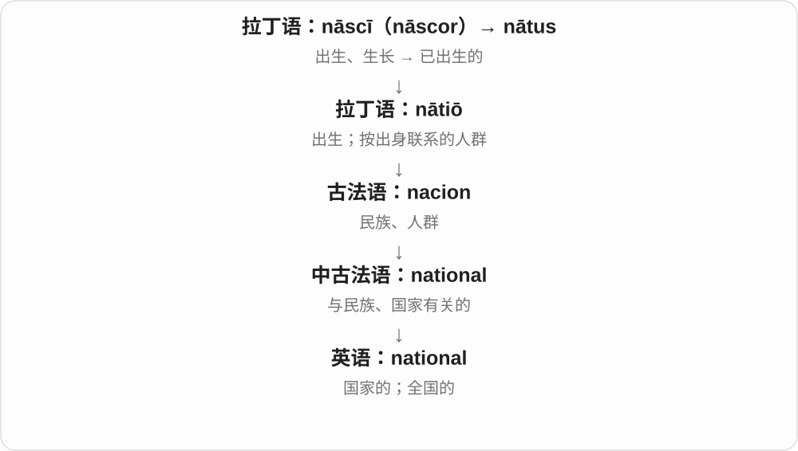
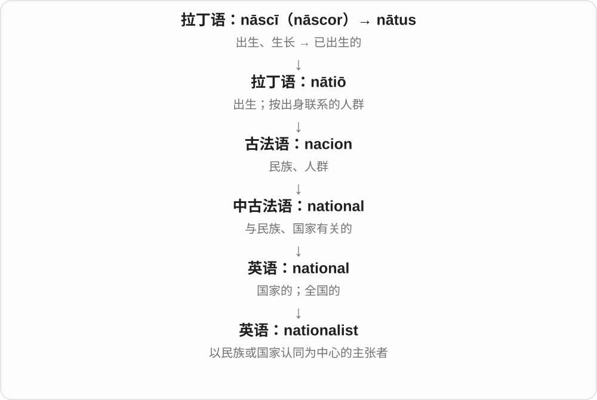
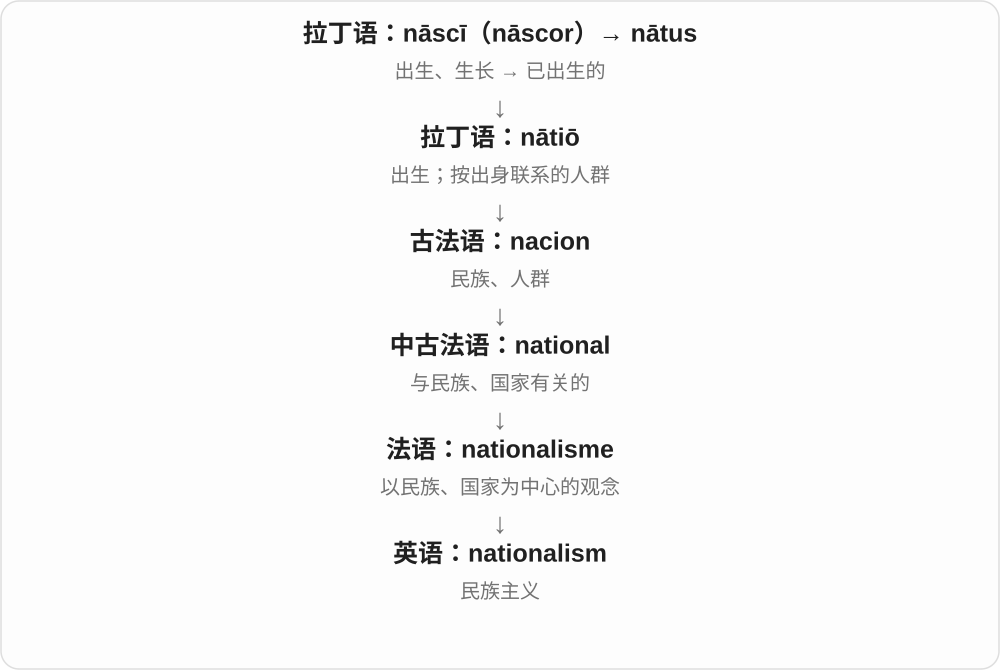
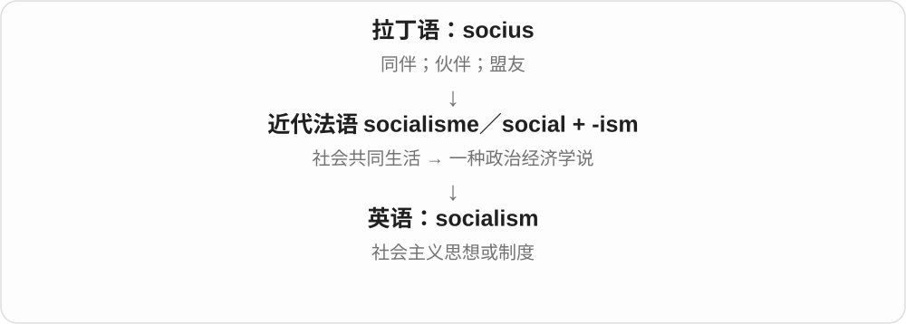
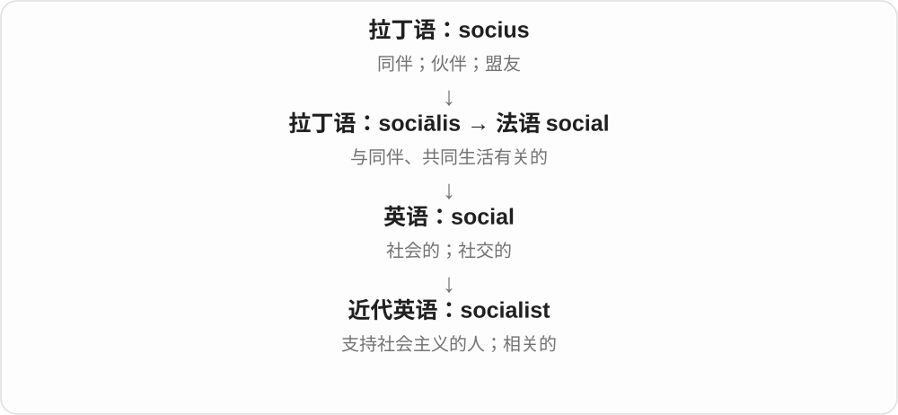
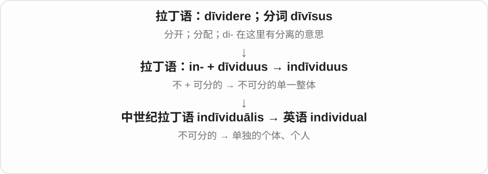
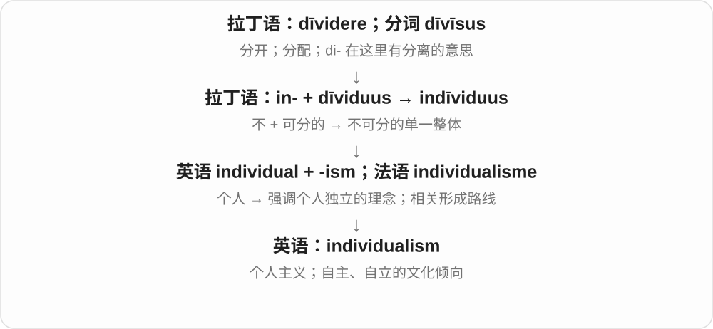
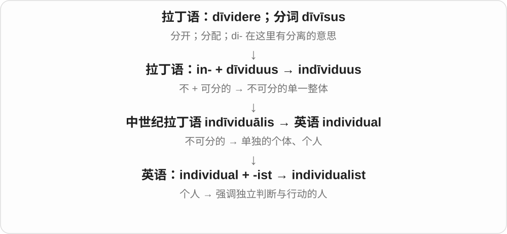
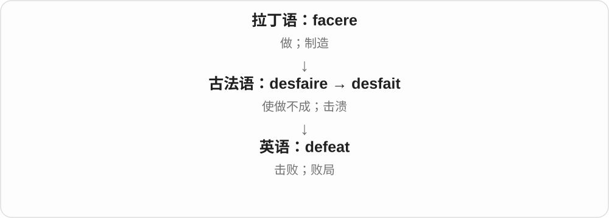

# 0040 · -ism — 实践、制度、思想、风格或某种倾向的名词

[逐词精讲目录](../00_逐词精讲目录.md) · [总目录](../00_总目录_按常用程度.md)

## 核心词根与来源

-ism 经法语 -isme 或拉丁 -ismus 等接希腊 -ismos，早与动作、实践及教义名称有关。英语中广泛形成制度、理念、风格、行为、状态等名词。先问前面是什么，再问整个词在命名什么，别只在末尾套一个主义。

**ISM：把一类做法、主张或现象作为主题来谈**

fanatic 是狂热者，fanaticism 是那种狂热；feudal 说封建的，feudalism 说制度；plagiarism 则直接命名抄袭行为。不是每个 ism 都是一套哲学。

- **具体行为、偏袒与歧视**：plagiarize · plagiarism；crony · cronyism；favourite · favouritism；ableist · ableism
- **制度、理念与政治态度**：authoritarian · authoritarianism；feudal · feudalism；republican · republicanism；egalitarian · egalitarianism
- **人和倾向放在一起**：fanatic · fanaticism；hooligan · hooliganism；opportunist · opportunism；defeatist · defeatism
- **实践、方法及象征**：vegan · veganism；empirical · empiricism；formal · formalism；token · tokenism；abolitionist · abolitionism
- **hooligan → hooligans：闹事者与姓名来路**：hooligan · hooligans
- **vegetarian → vegan → vegans：纯素称呼的形成**：vegan · vegans

## 词形与演化规律

形容词、名词都能做基础：formal + -ism、vegan + -ism、crony + -ism；favourite／favoritism 有拼写变化。-ist 常指相应人物，但长短不是年代：plagiarism 早于英语 plagiarize，不能只按动词短就把它画在时间线最前。

hooligan 通常联系爱尔兰姓氏 Houlihan 等变体，以及旧娱乐、新闻中的人物名称；究竟归于哪一位人物不确定。hooliganism 指滋事行为，hooligans 则数闹事者。

vegan 以 vegetarian 开头三字母、末尾两字母形成，1944 年纯素运动采用这一名称，接着有 veganism 行为理念称呼。vegans 是人群复数，不把植物、食品本身都叫人。

## 单词速览（按词族由简到繁）

同一基础词的相关扩展放在一起，先读基础形式，再读扩展；各组之间优先读常用的。具体词源关系见各词讲解。

| 单词 | 音标 | 核心意思 |
|---|---|---|
| [real](#w-200) | /ˈrɪəl/ | 真实的；实际的；真正的 |
| [realism](#w-9) | /ˈrɪəlɪzəm/ | 现实态度；现实主义；写实风格 |
| [realist](#w-244) | /ˈrɪəlɪst/ | 现实的人；现实主义者；写实主义者 |
| [national](#w-201) | /ˈnæʃənəl/ | 国家的；全国的；国民 |
| [nationalist](#w-232) | /ˈnæʃənəlɪst/ | 民族主义者；民族主义的 |
| [nationalism](#w-7) | /ˈnæʃənəlɪzəm/ | 民族主义；国家主义倾向 |
| [able](#w-202) | /ˈeɪbəl/ | 能够……的；有才能的 |
| [ableism](#w-159) | /ˈeɪbəlɪzəm/ | 对残障者的歧视、偏见 |
| [ableist](#w-264) | /ˈeɪbəlɪst/ | 歧视残障者的；持这种偏见的人 |
| [social](#w-203) | 英 /ˈsəʊʃəl/；美 /ˈsoʊʃəl/ | 社会的；社交的；群居的 |
| [socialism](#w-6) | 英 /ˈsəʊʃəlɪzəm/；美 /ˈsoʊʃəlɪzəm/ | 社会主义 |
| [socialist](#w-227) | 英 /ˈsəʊʃəlɪst/；美 /ˈsoʊʃəlɪst/ | 社会主义者；社会主义的 |
| [human](#w-204) | 英、美 /ˈhjuːmən/ | 人的；人类的；人 |
| [humanist](#w-246) | /ˈhjuːmənɪst/ | 人文主义者；人文学者 |
| [humanism](#w-40) | 英、美 /ˈhjuːmənɪzəm/ | 人文主义；人本主义 |
| [form](#w-205) | 英 /fɔːm/；美 /fɔːrm/ | 形状；形式；表格；形成 |
| [formal](#w-219) | 英 /ˈfɔːməl/；美 /ˈfɔːrməl/ | 正式的；合乎规定形式的 |
| [formalism](#w-63) | 英 /ˈfɔːməlɪzəm/；美 /ˈfɔːrməlɪzəm/ | 形式主义；形式化体系、方法〔专门语境〕 |
| [sex](#w-206) | 英、美 /seks/ | 性别；生理性别；性行为；鉴别雌雄 |
| [sexism](#w-14) | 英、美 /ˈseksɪzəm/ | 性别歧视；性别偏见 |
| [sexist](#w-237) | 英、美 /ˈseksɪst/ | 性别歧视的；持性别偏见的人 |
| [race](#w-207) | /reɪs/ | 竞赛；快速奔跑；种族；人类等群体称呼 |
| [racism](#w-3) | /ˈreɪsɪzəm/ | 种族主义；种族歧视 |
| [racist](#w-222) | /ˈreɪsɪst/ | 种族主义者；种族主义的、带种族歧视的 |
| [capital](#w-208) | /ˈkæpɪtəl/ | 首都；资本；大写字母；柱头；主要的；涉及死刑的 |
| [capitalism](#w-5) | /ˈkæpɪtəlɪzəm/ | 资本主义 |
| [capitalist](#w-234) | /ˈkæpɪtəlɪst/ | 资本家；资本主义支持者；资本主义的 |
| [individual](#w-209) | /ˌɪndɪˈvɪdʒuəl/ | 个人；个体；单独的；各自的 |
| [individualism](#w-39) | /ˌɪndɪˈvɪdʒuəlɪzəm/ | 个人主义；强调个人自主的倾向 |
| [individualist](#w-261) | /ˌɪndɪˈvɪdʒuəlɪst/ | 独立行事的人；个人主义者 |
| [favour](#w-225) | 英 /ˈfeɪvə/；美 /ˈfeɪvər/ | 帮忙、恩惠；赞同、偏爱；支持〔英式拼写〕 |
| [favor](#w-216) | 英 /ˈfeɪvə/；美 /ˈfeɪvər/ | 帮忙、恩惠；赞同、偏爱；支持〔美式拼写〕 |
| [favourite](#w-217) | /ˈfeɪvərɪt/〔常弱化为 /ˈfeɪvrɪt/〕 | 最喜欢的；心爱之物、人；热门胜出者〔英式拼写〕 |
| [favorite](#w-210) | /ˈfeɪvərɪt/〔常弱化为 /ˈfeɪvrɪt/〕 | 最喜欢的；心爱之物、人；热门胜出者〔美式拼写〕 |
| [favouritism](#w-137) | /ˈfeɪvərɪtɪzəm/ | 偏袒；偏心〔英式拼写〕 |
| [favoritism](#w-253) | /ˈfeɪvərɪtɪzəm/ | 偏袒；偏心〔美式拼写〕 |
| [material](#w-211) | 英 /məˈtɪəriəl/；美 /məˈtɪriəl/ | 材料、布料、资料；物质的；重要、实质性的 |
| [materialism](#w-249) | 英 /məˈtɪəriəlɪzəm/；美 /məˈtɪriəlɪzəm/ | 唯物主义〔哲学〕；物质至上的态度〔日常批评〕 |
| [materialist](#w-260) | 英 /məˈtɪəriəlɪst/；美 /məˈtɪriəlɪst/ | 唯物论者；看重物质享受的人 |
| [authority](#w-212) | 英 /ɔːˈθɒrəti/；美 /əˈθɔːrəti/ | 权力；授权；权威；权威人士或资料；当局 |
| [authoritarian](#w-238) | 英 /ɔːˌθɒrɪˈteəriən/；美 /əˌθɔːrəˈteriən/ | 威权的；专制的；强调服从的；威权主义者 |
| [authoritarianism](#w-38) | 英 /ɔːˌθɒrɪˈteəriənɪzəm/；美 /əˌθɔːrəˈteriənɪzəm/ | 威权主义；强调服从和集中权力的做法 |
| [republic](#w-215) | /rɪˈpʌblɪk/ | 共和国；共和政体 |
| [republican](#w-213) | /rɪˈpʌblɪkən/ | 共和制的；共和主义者；〔大写〕共和党的、共和党人 |
| [republicanism](#w-66) | /rɪˈpʌblɪkənɪzəm/ | 共和主义；支持共和制度的理念 |
| [hero](#w-214) | 英 /ˈhɪərəʊ/；美 /ˈhɪroʊ/ | 英雄；偶像；故事中的男主角或主角 |
| [heroism](#w-25) | 英 /ˈherəʊɪzəm/；美 /ˈheroʊɪzəm/ | 英勇行为；英雄气概 |
| [defeat](#w-218) | /dɪˈfiːt/ | 击败；失败 |
| [defeatism](#w-173) | /dɪˈfiːtɪzəm/ | 失败主义；未战先认输的态度 |
| [defeatist](#w-262) | 英 /dɪˈfiːtɪst/；美 /dɪˈfiːtɪst/ | 失败主义者；未战先认输的 |
| [criticism](#w-1) | 英、美 /ˈkrɪtɪsɪzəm/ | 批评；评论；批评研究 |
| [ideal](#w-220) | 英、美 /aɪˈdiːəl/ | 理想的；最合适的；名词：理想、理想标准 |
| [idealism](#w-29) | 英、美 /aɪˈdiːəlɪzəm/ | 理想主义；哲学中：唯心论、观念论 |
| [idealist](#w-252) | 英、美 /aɪˈdiːəlɪst/ | 理想主义者；哲学中：唯心论者、观念论者 |
| [romantic](#w-221) | 英 /rəʊˈmæntɪk/；美 /roʊˈmæntɪk/ | 爱情的、浪漫的；富想象、理想化的；浪漫主义的 |
| [romanticism](#w-45) | 英 /rəʊˈmæntɪsɪzəm/；美 /roʊˈmæntɪsɪzəm/ | 浪漫主义；理想化、浪漫情怀 |
| [journalism](#w-229) | 英 /ˈdʒɜːnəlɪzəm/；美 /ˈdʒɜːrnəlɪzəm/ | 新闻业；新闻报道工作、实践 |
| [journalist](#w-223) | 英 /ˈdʒɜːnəlɪst/；美 /ˈdʒɜːrnəlɪst/ | 新闻工作者；记者 |
| [terror](#w-226) | 英 /ˈterə/；美 /ˈterər/ | 极度恐惧；令人害怕的人、事物 |
| [terrorist](#w-224) | 英 /ˈterərɪst/；美 /ˈterərɪst/ | 恐怖主义者；恐怖主义的 |
| [terrorism](#w-4) | 英 /ˈterərɪzəm/；美 /ˈterərɪzəm/ | 恐怖主义；以制造恐惧实施胁迫的做法 |
| [tourism](#w-2) | 英 /ˈtʊərɪzəm/；美 /ˈtʊrɪzəm/ | 旅游活动；旅游业 |
| [activism](#w-10) | /ˈæktɪvɪzəm/ | 行动主义；社会议题中的积极行动、倡议 |
| [activist](#w-228) | /ˈæktɪvɪst/ | 行动倡议者；积极推动社会等议题的人 |
| [rational](#w-230) | /ˈræʃənəl/ | 理性的、合理的；有理数的〔数学〕 |
| [rationalism](#w-78) | /ˈræʃənəlɪzəm/ | 理性主义、唯理论；强调理性论证的立场 |
| [vegan](#w-231) | /ˈviːɡən/ | 纯素的；纯素者 |
| [vegans](#w-268) | 英、美 /ˈviːɡənz/ | 纯素者〔复数〕 |
| [veganism](#w-69) | /ˈviːɡənɪzəm/ | 纯素主义；纯素生活理念和实践 |
| [token](#w-233) | 英 /ˈtəʊkən/；美 /ˈtoʊkən/ | 象征、表示；代币、凭证；象征性的；部分技术语境中的标记单位 |
| [tokenism](#w-188) | 英 /ˈtəʊkənɪzəm/；美 /ˈtoʊkənɪzəm/ | 敷衍性的象征做法；装点门面的代表性安排 |
| [vegetarian](#w-235) | 英 /ˌvedʒɪˈteəriən/；美 /ˌvedʒəˈteriən/ | 素食者；素食的、不含肉类的 |
| [optimism](#w-11) | 英 /ˈɒptɪmɪzəm/；美 /ˈɑptɪmɪzəm/ | 乐观；对好结果的期待 |
| [optimist](#w-250) | 英 /ˈɒptɪmɪst/；美 /ˈɑptɪmɪst/ | 乐观的人；乐观主义者 |
| [empirical](#w-236) | /ɪmˈpɪrɪkəl/ | 经验性的；以观察、实验为依据的 |
| [empiricism](#w-103) | /ɪmˈpɪrɪsɪzəm/ | 经验主义；重视观察和经验的认识取向 |
| [sect](#w-239) | /sekt/ | 宗派、教派；学派、小团体 |
| [sectarian](#w-243) | 英 /sekˈteəriən/；美 /sekˈteriən/ | 宗派的；偏执于派别的、宗派主义的；宗派成员 |
| [sectarianism](#w-89) | 英 /sekˈteəriənɪzəm/；美 /sekˈteriənɪzəm/ | 宗派主义；宗派偏见和对立 |
| [abolish](#w-241) | 英 /əˈbɒlɪʃ/；美 /əˈbɑːlɪʃ/ | 废除、废止 |
| [abolition](#w-240) | 英 /ˌæbəˈlɪʃən/；美 /ˌæbəˈlɪʃən/ | 废除、废止；废奴 |
| [abolitionist](#w-255) | 英 /ˌæbəˈlɪʃənɪst/；美 /ˌæbəˈlɪʃənɪst/ | 主张废除某制度者；废奴主义者〔常见历史义〕 |
| [abolitionism](#w-191) | 英 /ˌæbəˈlɪʃənɪzəm/；美 /ˌæbəˈlɪʃənɪzəm/ | 废除某制度的主张；废奴主义〔常见历史义〕 |
| [feudal](#w-242) | /ˈfjuːdəl/ | 封建的；封建制度相关的 |
| [feudalism](#w-54) | /ˈfjuːdəlɪzəm/ | 封建制度；封建主义 |
| [fanatic](#w-245) | /fəˈnætɪk/ | 狂热者；极度爱好某事的人 |
| [fanaticism](#w-58) | /fəˈnætɪsɪzəm/ | 狂热；盲目而排斥异见的狂热倾向 |
| [plagiarize](#w-266) | /ˈpleɪdʒəraɪz/ | 抄袭；把他人作品、想法当成自己的 |
| [plagiarism](#w-26) | /ˈpleɪdʒərɪzəm/ | 抄袭；剽窃行为或内容 |
| [egalitarian](#w-247) | 英 /ɪˌɡælɪˈteəriən/；美 /ɪˌɡæləˈteriən/ | 主张平等的；平等主义者 |
| [egalitarianism](#w-97) | 英 /ɪˌɡælɪˈteəriənɪzəm/；美 /ɪˌɡæləˈteriənɪzəm/ | 平等主义 |
| [cannibal](#w-248) | /ˈkænɪbəl/ | 食人者；吃同类的动物 |
| [cannibalism](#w-37) | /ˈkænɪbəlɪzəm/ | 食人；同类相食 |
| [pessimism](#w-44) | /ˈpesɪmɪzəm/ | 悲观；悲观主义 |
| [pessimist](#w-259) | /ˈpesɪmɪst/ | 悲观的人；悲观主义者 |
| [altruism](#w-251) | /ˈæltruɪzəm/ | 利他；为别人着想 |
| [hooligan](#w-258) | /ˈhuːlɪɡən/ | 滋事者；寻衅闹事的人 |
| [hooligans](#w-267) | 英 /ˈhuːlɪɡənz/；美 /ˈhulɪɡənz/ | 流氓、闹事者〔复数〕 |
| [hooliganism](#w-117) | /ˈhuːlɪɡənɪzəm/ | 寻衅滋事；流氓闹事行为 |
| [opportune](#w-256) | 英 /ˈɒpətjuːn/；美 /ˌɑːpərˈtuːn/ | 适时的；恰好的〔较正式〕 |
| [opportunist](#w-254) | 英 /ˌɒpəˈtjuːnɪst/；美 /ˌɑːpərˈtuːnɪst/ | 机会主义者；投机者 |
| [opportunism](#w-94) | 英 /ˌɒpəˈtjuːnɪzəm/；美 /ˌɑːpərˈtuːnɪzəm/ | 机会主义；见风使舵、只顾眼前利益的做法 |
| [crony](#w-257) | 英 /ˈkrəʊni/；美 /ˈkroʊni/ | 密友、老友〔现代常含贬义〕 |
| [cronyism](#w-92) | 英 /ˈkrəʊniɪzəm/；美 /ˈkroʊniɪzəm/ | 任人唯亲；偏袒亲信、朋友的做法 |
| [egoism](#w-263) | 英 /ˈiːɡəʊɪzəm/；美 /ˈiːɡoʊɪzəm/ | 利己主义；自我中心 |
| [egoist](#w-265) | 英 /ˈiːɡəʊɪst/；美 /ˈiːɡoʊɪst/ | 利己主义者；自我中心的人 |

## 逐词讲解

### 1. real — 真实的；实际的；真正的

**音标**：/ˈrɪəl/

**先抓住这个画面**

屏幕上是一座画出来的房子，眼前这座能走进去的，才是 a real house。

**怎么拆**

借古法语 reel，源于晚期拉丁 reālis“实际的”，再接拉丁 rēs“事物”。real 里的 re- 不是表示“再次”的现代前缀。

**怎么变成今天的意思**

**拉丁 rēs → 晚期拉丁 reālis**  
事物 → 实际的

↓

**古法语 reel → 英语 real**  
真实的、实际存在的

real 可以排除假冒，也可以强调实际影响：a real problem 是需要认真处理的问题。real estate 是房地产的固定说法；real income 则常说扣除价格变化影响后的实际收入。

**常见搭配与例句**

real life；a real problem；the real reason；real estate。

> Is this a real diamond?

这是真钻石吗？

> The real problem is that nobody knows who is responsible.

真正的问题是没人知道谁负责。

**别混淆**

real 强调确实存在或名副其实；true 更常判断说法是否符合事实。a real story 需看语境，a true story 明确说故事确有其事。

### 2. realism — 现实态度；现实主义；写实风格

**音标**：/ˈrɪəlɪzəm/

**先抓住这个画面**

画人时连皱纹也画出来，做计划时连预算不够也承认：先照着实际情况看。

**怎么拆**

real + -ism；-ism 常形成立场、思想或风格名词。不同学科对 realism 有专门定义，不能由词尾推成同一种理论。

**怎么变成今天的意思**

**拉丁 rēs → 晚期拉丁 reālis**  
事物 → 实际的

↓

**古法语 reel → 英语 real**  
真实的、实际存在的

↓

**real + -ism → realism**  
现实取向；写实或现实主义

日常说 a sense of realism，是对条件和困难有现实判断。文学、艺术中可说写实；哲学、国际关系中的 realism 要按学科理解。

**常见搭配与例句**

a sense of realism；literary realism；the realism of the painting。

> We need a little more realism about the cost.

我们需要更现实地看待费用。

> The film combines fantasy with moments of striking realism.

影片把幻想与一些非常写实的片段结合起来。

**别混淆**

realism 不自动等于 pessimism 悲观：承认困难后仍可行动。realism 是态度或风格，reality 是实际情况。

### 3. realist — 现实的人；现实主义者；写实主义者

**音标**：/ˈrɪəlɪst/

**先抓住这个画面**

讨论计划时，总有人追问“钱从哪来、时间够不够”，这样的人可说 a realist。

**怎么拆**

real + -ist，-ist 表持某种立场或从事某类活动的人；可与 realism 对照，但不据此断言所有学科名称的借入先后。

**怎么变成今天的意思**

**拉丁 rēs → 晚期拉丁 reālis**  
事物 → 实际的

↓

**古法语 reel → 英语 real**  
真实的、实际存在的

↓

**real + -ist → realist**  
按现实判断的人；特定现实主义的主张者

I am a realist 常用来说明自己重视实际条件。an artistic realist 可说写实派人物；作修饰语时如 realist fiction 是现实主义小说。

**常见搭配与例句**

a political realist；a realist approach；be a realist。

> I am a realist: we cannot finish this with only two people.

我是个讲实际的人：只有两个人做不完这些。

> The novelist is often described as a social realist.

这位小说家常被称为社会现实主义作家。

**别混淆**

realist 不等于 real person“真实存在的人”；这里 -ist 说的是立场或风格。

### 4. national — 国家的；全国的；国民

**音标**：/ˈnæʃənəl/

**先抓住这个画面**

national 把范围拉到一个国家：全国比赛、国家博物馆，或者某国国民，都围着这层身份。

**怎么拆**

来自中古法语 national；现代对应 nation + -al。

**怎么变成今天的意思**

nation 从按出身联系的人群发展为国家、民族共同体，national 则说明与它有关。作名词可指某国国民。

**常见搭配与例句**

a national park；national identity；national news；foreign nationals。

> The story became national news.

这件事成了全国新闻。

> The museum displays objects of national importance.

博物馆展出具有全国性重要意义的物品。

**别混淆**

national 关心一个国家层面；international 涉及不同国家之间。national 不一定表示政府所有。

### 5. nationalist — 民族主义者；民族主义的

**音标**：/ˈnæʃənəlɪst/

**先抓住这个画面**

nationalist 把某个民族或国家的认同、独立或利益放在政治主张的中心；具体主张差异很大。

**怎么拆**

national + -ist，表示持有相关主张的人，也可作形容词。

**怎么变成今天的意思**

它可以涉及争取独立，也可以涉及强调国家利益。不能单凭一个标签判定某人的全部立场。

**常见搭配与例句**

a nationalist movement；nationalist ideas；a nationalist leader。

> The historian studied the rise of nationalist movements.

历史学家研究了民族主义运动的兴起。

> The debate revealed different versions of nationalist thought.

辩论显露出不同版本的民族主义思想。

**别混淆**

patriotic 常是爱国情感；nationalist 更常指一种政治立场或运动，语境不同。

### 6. nationalism — 民族主义；国家主义倾向

**音标**：/ˈnæʃənəlɪzəm/

**先抓住这个画面**

nationalism 是围绕民族或国家认同组织起来的一套情感和政治观念，强调共同体的利益、独立或地位。

**怎么拆**

与法语 nationalisme 相连，现代对应 national + -ism。

**怎么变成今天的意思**

不同历史情境下，它可关联独立运动、认同建设或排他性政治，不能把各种情况压成一种行为。

**常见搭配与例句**

the rise of nationalism；cultural nationalism；debates about nationalism。

> The lecture traced the development of nationalism in Europe.

讲座追溯了欧洲民族主义的发展。

> The book distinguishes cultural nationalism from political programmes.

这本书区分了文化民族主义与具体政治纲领。

**别混淆**

nationality 是身份归属；nationalism 是情感、立场或思想体系。

### 7. able — 能够……的；有才能的

**音标**：/ˈeɪbəl/

**先抓住这个画面**

事情摆在面前，你有本领、有条件把它做成，就是 able。an able teacher 则是说这位老师很能干。

**怎么拆**

经古法语来自拉丁语 habilis，最初有便于拿取、合用的意思，根在 habēre。不能把它当作所有 -able 后缀的历史祖先。

**怎么变成今天的意思**

东西合手、适用 → 人胜任、有本领。现代 be able to 也能说条件允许，不一定只谈个人天赋。

**常见搭配与例句**

be able to do…；an able assistant；will be able to…。

> Will you be able to finish by Friday?

你能在星期五前完成吗？

> She is an able organizer who keeps everyone informed.

她是个能干的组织者，会让所有人及时了解情况。

**别混淆**

can 是情态动词；able 是形容词，要说 be able to。able 与后缀 -able 后来在意义上靠近，但来源不同。

### 8. ableism — 对残障者的歧视、偏见

**音标**：/ˈeɪbəlɪzəm/

**先抓住这个画面**

把没有残障者的行动方式当成唯一标准，并据此排斥、贬低残障者，ableism 说这种偏见和不公平对待。

**怎么拆**

able + -ism，类比 racism、sexism 等偏见名称形成；相应人物或形容词 ableist。不是把所有能力评价都一律称为歧视。

**怎么变成今天的意思**

**able + -ism 的类比构词**  
围绕残障与能力规范的偏见命名

↓

**ableism／ableist**  
偏见、歧视／相应的人或形容词

challenge ableism 质疑、反对残障歧视；ableism in the workplace 职场残障歧视。可以谈规则、环境和态度，不只是一句公开辱骂。

**常见搭配与例句**

challenge ableism；institutional ableism。

> The workshop explored ableism in workplace design.

工作坊讨论了工作场所设计中的残障歧视。

> The campaign challenges everyday forms of ableism.

这场活动反对日常生活中各种形式的残障歧视。

**别混淆**

ableism 是偏见、歧视，disability 是残障相关概念；一个人有残障，不等于这个人本身就是一种歧视。

### 9. ableist — 歧视残障者的；持这种偏见的人

**音标**：/ˈeɪbəlɪst/

**先抓住这个画面**

默认所有人都该按没有残障的方式行动，还因此排斥或贬低残障者，就可能被批评为 ableist。

**怎么拆**

able 有能力的 + -ist，按 racist、sexist 等偏见词的模式形成，并与 ableism 对应。这里不是表扬有能力的人。

**怎么变成今天的意思**

**able + -ist 的类比构词**  
围绕身体、心智能力建立偏见的命名

↓

**ableist**  
歧视残障者的；持相应偏见的人

ableist language 歧视残障者的说法；ableist assumptions 带有这类偏见的假定。可批评措辞、规则或态度，不只用于人物标签。

**常见搭配与例句**

ableist language；an ableist assumption。

> The guide asks writers to avoid ableist language.

指南要求作者避免歧视残障者的措辞。

> The discussion challenged ableist assumptions about work.

这场讨论质疑了工作话题中歧视残障者的假定。

**别混淆**

ableist 不等于 able 能干，也不宜简单译成所有按能力评价都叫歧视；词义要落到对残障者的偏见或不公平对待。

### 10. social — 社会的；社交的；群居的

**音标**：英 /ˈsəʊʃəl/；美 /ˈsoʊʃəl/

**先抓住这个画面**

一个人之外，还有同伴、群体和大家共同生活的规则。social 把镜头从单个人转向人与人的关系。

**怎么拆**

来自法语 social、拉丁语 sociālis，根是 socius“同伴”。更远处通常联系印欧语“跟随”的词根，但不是从英语 follow 变来。

**怎么变成今天的意思**

social problems 是社会问题；social life 是社交生活；social animals 是群居动物。它不只表示爱聊天。

**常见搭配与例句**

social change；social skills；social media；a social event。

> The report examines social changes in the city.

报告研究了城市中的社会变化。

> She enjoys the social side of working in a team.

她喜欢团队工作中与人交往的部分。

**别混淆**

social 可谈整个社会，也可谈交往；sociable 更专门说一个人乐于交往。

### 11. socialism — 社会主义

**音标**：英 /ˈsəʊʃəlɪzəm/；美 /ˈsoʊʃəlɪzəm/

**先抓住这个画面**

把经济中的重要资源怎样归社会共同掌握、怎样组织生产与分配，当作核心问题的一组思想和制度主张。

**怎么拆**

十九世纪形成的词，可能来自法语 socialisme，也可由 social + -ism 分析；不是拉丁时代已有的政治名词。

**怎么变成今天的意思**

不同社会主义流派对所有权、市场、国家和民主有不同主张。它不等于“喜欢社交”，也不能只凭某项公共服务就给整套制度定性。

**常见搭配与例句**

democratic socialism；the history of socialism；socialist and capitalist ideas。

> The course compares different traditions of socialism.

课程比较不同的社会主义思想传统。

> The book examines debates about ownership under socialism.

这本书考察社会主义讨论中的所有权争论。

**别混淆**

social 是广义社会相关；socialism 是具体政治经济思想范围，不能见到 social 就译成社会主义。

### 12. socialist — 社会主义者；社会主义的

**音标**：英 /ˈsəʊʃəlɪst/；美 /ˈsoʊʃəlɪst/

**先抓住这个画面**

把社会主义作为支持的思想立场，或用这个词形容相关理论、组织与政策。

**怎么拆**

social + -ist，与近代 socialism 同一政治词族；-ist 表示持某种立场的人。

**怎么变成今天的意思**

名词说人，形容词修饰 party、theory 等。不同地方、时期的具体主张不能仅凭这个标签推断完全一致。

**常见搭配与例句**

a socialist thinker；socialist theory；a socialist party。

> The essay discusses the work of a socialist thinker.

文章讨论一位社会主义思想家的著作。

> She studies the history of socialist movements.

她研究社会主义运动史。

**别混淆**

socialist 是思想立场；socialite 是社交名流；sociologist 是社会学研究者。

### 13. human — 人的；人类的；人

**音标**：英、美 /ˈhjuːmən/

**先抓住这个画面**

属于我们这种会思考、会犯错、也会有感情的生命；常用来提醒人不是完美机器。

**怎么拆**

古法语 humain 来自拉丁语 humanus，与 homo“人”同族。human 与 humane 原是拼写、用法相交的形式，后来分工。

**怎么变成今天的意思**

**拉丁语 humanus，与 homo / homin- 同族**  
人的；有教养、有人情味的

↓

**古法语 humain → 英语 human / humane**  
人的，也曾包含仁慈的意思

↓

**近代英语分工**  
human 多指人类属性；humane 多指仁慈待人待物

human beings 是人类个体；human error 是人为失误。only human 常是在承认人的能力和耐心有限。

**常见搭配与例句**

human nature；human rights；human error；a human being。

> The system still needs human judgment.

这个系统仍需要人的判断。

> Everyone makes mistakes; we are only human.

每个人都会犯错，我们毕竟都是凡人。

**别混淆**

human 表示人的属性；humane 表示仁慈、有同情心，不能互换。

### 14. humanist — 人文主义者；人文学者

**音标**：/ˈhjuːmənɪst/

**先抓住这个画面**

可说重视人的能力、尊严和生活的人文主义者；历史文章也会用来指研究古典文献、人文学问的学者。要看时代和立场。

**怎么拆**

借法语 humaniste 等形式，与拉丁人的、人文修养等材料相联；不能说 human 人类 + -ist 就把所有人都叫 humanist。

**怎么变成今天的意思**

**法语 humaniste → 英语 humanist**  
与人的学问、人文研究等相关的人

↓

**humanism、humanistic 等词族**  
人文主义及相应取向；各历史、思想语境有专义

a Renaissance humanist 文艺复兴人文学者；a secular humanist 世俗人文主义者。

**常见搭配与例句**

a humanist thinker；humanist values。

> The course examines the writings of Renaissance humanists.

课程研究文艺复兴人文学者的著作。

> She described herself as a secular humanist.

她把自己称为世俗人文主义者。

**别混淆**

humanist 与 humanitarian 人道主义者有联系却不全同；前者有思想、学术传统，后者更常强调减轻苦难、援助等。

### 15. humanism — 人文主义；人本主义

**音标**：英、美 /ˈhjuːmənɪzəm/

**先抓住这个画面**

把人的经验、能力、尊严和生活放到思考中心，而不是只从抽象权威出发。

**怎么拆**

human + -ism；英语早有不同神学、哲学用法，后来用于古典人文教育和以人的利益为中心的思想，并非只有一个时代的一次命名。

**怎么变成今天的意思**

**拉丁语 humanus，与 homo / homin- 同族**  
人的；有教养、有人情味的

↓

**古法语 humain → 英语 human / humane**  
人的，也曾包含仁慈的意思

↓

**英语 human + -ism → humanism**  
早有哲学、神学相关用法

↓

**古典人文学问与现代人本思想等分支**  
不同历史语境分别发展

Renaissance humanism 着重古典学问与人的培养；secular humanism 常强调非宗教的伦理立场。前者不能一概等同无神论。

**常见搭配与例句**

Renaissance humanism；secular humanism；a tradition of humanism。

> The course traces the influence of Renaissance humanism.

这门课程追溯文艺复兴人文主义的影响。

> Her account of humanism emphasizes human dignity and critical inquiry.

她对人本主义的阐释强调人的尊严与批判性探究。

**别混淆**

humanitarianism 着重改善人的处境、减轻苦难；humanism 是更广的思想与文化取向。

### 16. form — 形状；形式；表格；形成

**音标**：英 /fɔːm/；美 /fɔːrm/

**先抓住这个画面**

散着的泥被捏出轮廓，散着的内容被排成一种样式。form 抓的是“组织出来的样子”。

**怎么拆**

来自古法语 forme，根在拉丁语 fōrma。今天既可作名词，也可作动词，不必再拆。

**怎么变成今天的意思**

物体有外形，活动有形式，表格给信息预先画好格子。form a team 是让分散的人组成一个整体。in good form 则说状态好。

**常见搭配与例句**

fill in a form；in the form of；form a group；take form。

> Please fill in this form before the interview.

面试前请填好这张表。

> The students formed a circle around the table.

学生们围着桌子站成一圈。

**别混淆**

shape 偏轮廓和形状；form 还常说表达方式、组织方式与表格。form a habit 是养成，不是填写习惯。

### 17. formal — 正式的；合乎规定形式的

**音标**：英 /ˈfɔːməl/；美 /ˈfɔːrməl/

**先抓住这个画面**

场合有一套规定：话怎样说、衣服怎样穿、事情怎样宣布，都照那套形式来。

**怎么拆**

来自古法语 formel、拉丁语 fōrmālis；现代可看成 form + -al。

**怎么变成今天的意思**

formal apology 是郑重或正式的道歉；formal clothes 是适合正式场合的服装。技术语境也可指依照明确符号规则的系统。

**常见搭配与例句**

formal agreement；formal language；formal training；formal logic。

> We have not received a formal invitation yet.

我们还没收到正式邀请。

> He has no formal training in music.

他没有受过正规的音乐训练。

**别混淆**

formal 不等于难懂或冷淡；一个正式通知也可以写得很清楚、很友好。

### 18. formalism — 形式主义；形式化体系、方法〔专门语境〕

**音标**：英 /ˈfɔːməlɪzəm/；美 /ˈfɔːrməlɪzəm/

**先抓住这个画面**

批评办事只走流程、不看实际效果，可以说 formalism；研究文学、数学等时，它还可能是中性的形式分析或形式化体系名称。

**怎么拆**

formal 形式的、正式的 + -ism，形成重形式的取向或相应方法。不能因为日常中文形式主义常是批评，就把所有学科里的 formalism 都判成空架子。

**怎么变成今天的意思**

**form → formal**  
形式 → 形式相关的、正式的

↓

**formal + -ism → formalism**  
重形式的取向；形式化方法、体系

empty formalism 空洞形式主义；literary formalism 文学形式主义；a mathematical formalism 数学形式化体系。先看作者是在批评办事，还是命名研究方法。

**常见搭配与例句**

literary formalism；a mathematical formalism。

> The critic focused on literary formalism.

这位评论者关注文学形式主义。

> The team rejected empty formalism and asked for practical results.

团队反对空洞形式主义，要求实际结果。

**别混淆**

formal 正式不等于做表面文章；formalism 的技术义也不一定贬义，中文同一个译名需靠场景分开。

### 19. sex — 性别；生理性别；性行为；鉴别雌雄

**音标**：英、美 /seks/

**先抓住这个画面**

先说生物与生殖有关的类别，后来也用来指性行为。

**怎么拆**

经法语借拉丁 sexus。把它进一步接到 secāre“切分”是一种词源分析，尚不能当成定论；也不是拉丁 sex“六”。

**怎么变成今天的意思**

**拉丁 sexus**  
性别、雌雄类别；更早是否接“切分”词根仍有争议

↓

**古法语 sexe → 中古英语 sexe → 英语 sex**  
性别；后来也指性行为

表格里的 sex 常问登记性别；have sex 说发生性行为；to sex chicks 则是辨别雏鸡雌雄。词义随搭配变化。

**常见搭配与例句**

biological sex；sex differences；sex an animal；have sex。

> The researchers recorded the age and sex of each bird.

研究者记录了每只鸟的年龄和性别。

> It is difficult to sex these young fish by appearance alone.

仅凭外观很难辨别这些幼鱼的雌雄。

**别混淆**

gender 常强调性别认同、社会角色等；sex 常强调生理分类，但实际文本的使用范围会重叠。

### 20. sexism — 性别歧视；性别偏见

**音标**：英、美 /ˈseksɪzəm/

**先抓住这个画面**

用性别给人先贴标签，再据此不公平地对待人。

**怎么拆**

sex + -ism，现代社会讨论中的构词；-ism 在此指一套偏见或做法。

**怎么变成今天的意思**

**拉丁 sexus**  
性别、雌雄类别；更早是否接“切分”词根仍有争议

↓

**古法语 sexe → 中古英语 sexe → 英语 sex**  
性别；后来也指性行为

↓

**英语 sex + -ism → sexism**  
以性别为根据的偏见、区别对待或制度性不平等

既可能是当面说的话，也可能体现在招聘、晋升和日常预期里。它不是“对性的兴趣很大”。

**常见搭配与例句**

workplace sexism；challenge sexism；everyday sexism。

> The report examines sexism in recruitment.

报告考察招聘中的性别歧视。

> She challenged the sexism behind the remark.

她质疑了那句话背后的性别偏见。

**别混淆**

sex 是性别或性行为；sexism 是基于性别的偏见和歧视。

### 21. sexist — 性别歧视的；持性别偏见的人

**音标**：英、美 /ˈseksɪst/

**先抓住这个画面**

先看对方属于什么性别，就替对方规定能力和位置。

**怎么拆**

sex + -ist，沿 sexism 形成相关形容词和人物名词。

**怎么变成今天的意思**

**拉丁 sexus**  
性别、雌雄类别；更早是否接“切分”词根仍有争议

↓

**古法语 sexe → 中古英语 sexe → 英语 sex**  
性别；后来也指性行为

↓

**英语 sex + -ism → sexism；sex + -ist → sexist**  
性别偏见 → 表现这种偏见的；持这种偏见的人

可以形容笑话、规定、评价或做法。sexist comment 不一定直接谈性行为，可能只是说“某类工作某种性别做不了”。

**常见搭配与例句**

a sexist remark；sexist assumptions；a sexist policy。

> The manager challenged a sexist assumption about leadership.

经理质疑了关于领导能力的一种性别偏见。

> Several employees complained about the sexist joke.

几名员工投诉了那个带有性别歧视的笑话。

**别混淆**

sexual 是与性有关；sexist 是带性别偏见，不能互换。

### 22. race — 竞赛；快速奔跑；种族；人类等群体称呼

**音标**：/reɪs/

**先抓住这个画面**

跑道上 race 是比快，社会话题中 race 是种族；拼写相同，历史不从同一个现代意思串出来。

**怎么拆**

竞速分支接古英语 rǣs、古诺尔斯语 rás 等快跑词；血统、种族分支经法语 race、联系意大利语 razza，更远不确定。不能编成不同族群比赛所以出现种族义。

**怎么变成今天的意思**

**古英语 rǣs、古诺尔斯语 rás 等 → 英语竞速 race**  
奔涌、快跑 → 速度竞赛

↓

**另一支：法语 race、意大利语 razza → 英语群体 race**  
血统、类别等，更远来源不确定

win a race 赢比赛，race against time 争分夺秒；the human race 人类，race and ethnicity 种族与族裔。race 作动词也可说心跳、思绪飞快。

**常见搭配与例句**

win a race；race against time；the human race；a racing heart。

> She won the race by a narrow margin.

她以微弱优势赢了比赛。

> The museum explores how ideas about race changed over time.

博物馆探讨人们关于种族的观念如何随时间变化。

**别混淆**

race 比速度，match 比赛可有更广项目；race 种族通常涉及社会历史中的人群分类，不等于国籍 nationality。

### 23. racism — 种族主义；种族歧视

**音标**：/ˈreɪsɪzəm/

**先抓住这个画面**

把人按种族分出高低、据此偏见对待，或让某些群体在制度、行为中持续处于不利位置。

**怎么拆**

联系法语 racisme，现代可认 race 种族 + -ism 思想、做法。不是关于竞赛的一门理论，也不只限于当面骂人的话。

**怎么变成今天的意思**

**另一支：法语 race、意大利语 razza → 英语群体 race**  
血统、类别等，更远来源不确定

↓

**法语 racisme；race + -ism → racism**  
种族分类 → 种族优劣观、歧视及相关结构实践

challenge racism 反对种族主义，institutional racism 制度层面的种族歧视；具体讨论会有不同理论框架，应看作者如何界定。

**常见搭配与例句**

challenge racism；institutional racism；experience racism；racism in sport。

> The documentary examines racism in professional sport.

纪录片考察职业体育中的种族歧视。

> Students discussed ways to challenge racism at school.

学生们讨论了如何反对校园里的种族歧视。

**别混淆**

racism 是思想、行为、结构等问题，racist 可是形容词或持相关偏见的人；racial 则只是有关种族，评价不同。

### 24. racist — 种族主义者；种族主义的、带种族歧视的

**音标**：/ˈreɪsɪst/

**先抓住这个画面**

可说持种族偏见、歧视立场的人，也可直接评价一句话、一项做法带有这类歧视。

**怎么拆**

race 种族 + -ist，联系 racism 的人物、性质词。不是 racer 赛车手，也不是一切谈种族的人。

**怎么变成今天的意思**

**另一支：法语 race、意大利语 razza → 英语群体 race**  
血统、类别等，更远来源不确定

↓

**race + -ist → racist**  
种族主义立场的人；带种族歧视的

a racist remark 带种族歧视的话，racist abuse 种族歧视性辱骂；作名词 a racist 是种族主义者。

**常见搭配与例句**

a racist remark；racist abuse；racist attitudes；a racist。

> The club condemned the racist abuse directed at the player.

俱乐部谴责了针对那名球员的种族歧视性辱骂。

> The essay explains why the remark was racist.

文章解释了那句话为什么带有种族歧视。

**别混淆**

racial 说明话题有关种族，racist 评价歧视性质；研究 racial history 的人，不因此就成为 racist。

### 25. capital — 首都；资本；大写字母；柱头；主要的；涉及死刑的

**音标**：/ˈkæpɪtəl/

**先抓住这个画面**

把“头”分成三个画面：国家的中心、经营所依靠的本金、柱子顶端的小头。现代 capital 把这些不同支线收在同一个拼写里。

**怎么拆**

首要、大写等义来自 capitālis；资本义经中世纪拉丁 capitale“本金、财产”；柱头义另经法语 capitel / chapitel，来自 capitellum“小头”。它们不是依次由首都变资本、再变柱头。

**怎么变成今天的意思**

**拉丁语：caput；属格 capitis**  
头；首领；顶端、主要部分

↓

**拉丁并行支线：capitālis / capitale；capitellum**  
头的、主要的／本金财产；小头、柱头

↓

**法语及直接拉丁借入的不同路线 → 英语 capital**  
主要的、首都、大写；资本；柱头

capital city 是首都或首府；capital letter 是大写字母；raise capital 是筹集资本。capital punishment 中的“头”联系人的生命，指死刑，不能理解成“主要惩罚”。

**常见搭配与例句**

working capital；a capital letter；the national capital；a column capital。

> Write your name in capital letters.

请用大写字母写下你的姓名。

> The firm needs more capital to expand its workshop.

这家公司需要更多资本来扩建车间。

> We visited the capital and admired the carved capitals of its old columns.

我们参观了首都，欣赏了古老柱子上雕刻的柱头。

**别混淆**

capital 是城市、资金等；capitol 特别指议会建筑。两词通常同音。

### 26. capitalism — 资本主义

**音标**：/ˈkæpɪtəlɪzəm/

**先抓住这个画面**

把镜头拉远：企业、资本所有者、雇员和市场怎样组织生产与交换，这才是制度层面的 capitalism。

**怎么拆**

capital + -ism，十九世纪英语制度名；与法语 capitalisme 等欧洲语言形式相互关联，不能倒推成古罗马已有这个现代制度词。

**怎么变成今天的意思**

**拉丁语：caput；属格 capitis**  
头；首领；顶端、主要部分

↓

**拉丁 capitālis → 中世纪拉丁 capitale**  
主要的 → 本金、财产

↓

**英语：capital〔财产义〕**  
可用于经营、生产的资本

↓

**英语：capital + -ism → capitalism**  
资本 → 以私人资本和营利经营等为特征的经济制度

通常谈生产资料的私人所有、投资与利润等；现实中的制度会与不同程度的监管、公共服务并存。

**常见搭配与例句**

the history of capitalism；industrial capitalism；debates about capitalism。

> The book traces the development of industrial capitalism.

这本书追溯工业资本主义的发展。

> The seminar examined different forms of capitalism.

研讨课考察了资本主义的不同形式。

**别混淆**

capital 是资源或资金；capitalism 是组织经济的一套制度，词义范围大得多。

### 27. capitalist — 资本家；资本主义支持者；资本主义的

**音标**：/ˈkæpɪtəlɪst/

**先抓住这个画面**

既可以说投入资本经营的人，也可以说支持某种经济制度的人。看到 capitalist economy 时，它作形容词。

**怎么拆**

英语与法语 capitaliste 相联系；可按 capital + -ist 理解。历史上“拥有并运用资本的人”的称呼早于常用制度名 capitalism。

**怎么变成今天的意思**

**拉丁语：caput；属格 capitis**  
头；首领；顶端、主要部分

↓

**拉丁 capitālis → 中世纪拉丁 capitale**  
主要部分 → 本金、财产

↓

**法语 capitaliste → 英语 capitalist；亦有依此构词的分析**  
拥有或运用资本的人 → 相关经济立场与形容词义

venture capitalist 是风险投资者；capitalist system 是资本主义制度。名词的投资者义与支持者义不必落在同一个人身上。

**常见搭配与例句**

a venture capitalist；a capitalist economy。

> The founder presented her idea to a venture capitalist.

创办者向一位风险投资者介绍了她的想法。

> The class compared different capitalist economies.

课堂比较了不同的资本主义经济体。

**别混淆**

capital 是资本；capitalist 可指人，也可修饰经济制度。

### 28. individual — 个人；个体；单独的；各自的

**音标**：/ˌɪndɪˈvɪdʒuəl/

**先抓住这个画面**

从一群人中看出完整的“这一个人”。这里的完整，是把他当一个独立单位，而不是当人群里模糊的一小块。

**怎么拆**

来自中世纪拉丁 indīviduālis，源于 in- 不 + dīviduus 可分。“不可分的整体”后来发展为“单一、独立的个体”。

**怎么变成今天的意思**

individual needs 是每个人各自的需要；an individual 可以是一个人，也可以是某物种的一个个体。现代 individual 不表示这个东西物理上绝对拆不开。

**常见搭配与例句**

an individual choice；individual differences；each individual。

> The teacher gave each student individual feedback.

老师分别给每位学生提供了反馈。

> Every individual in the group had a different reason for joining.

组里的每个人加入的原因都不同。

**别混淆**

individual 关注一个个体；personal 关注与某人私下有关。individual seats 是独立座位，不是私人秘密座位。

### 29. individualism — 个人主义；强调个人自主的倾向

**音标**：/ˌɪndɪˈvɪdʒuəlɪzəm/

**先抓住这个画面**

作决定时，把“个人有自己的判断和选择”放在前面，而不是默认所有人都按群体安排走。

**怎么拆**

individual + -ism；有英语派生与法语 individualisme 借入的不同词源分析。都建立在“个人”这个词族上。

**怎么变成今天的意思**

这个词可以是中性的制度或文化描述，也可能在特定批评中带负面意味；它本身并不等于 selfishness“自私”。

**常见搭配与例句**

personal freedom and individualism；a culture of individualism。

> The book explores the tension between individualism and community life.

这本书探讨个人主义与共同体生活之间的张力。

> Her individualism did not stop her from helping her neighbours.

她重视个人独立，同时也愿意帮助邻居。

**别混淆**

individuality 是一个人的独特性；individualism 是重视个人自主的一种立场。

### 30. individualist — 独立行事的人；个人主义者

**音标**：/ˌɪndɪˈvɪdʒuəlɪst/

**先抓住这个画面**

别人都走同一条路，他会先想“这条路适不适合我”。individualist 强调自己判断、按自己的方式做事。

**怎么拆**

individual + -ist，-ist 表示具有某种立场或特点的人。

**怎么变成今天的意思**

可以赞一个人有独立精神，也可能说他不容易随大流；褒贬取决于上下文。

**常见搭配与例句**

a strong individualist；a committed individualist。

> As an individualist, she preferred to develop her own style.

她很有独立精神，更愿意发展自己的风格。

> The team included several individualists with unusual ideas.

团队里有几位主意独特、喜欢独立思考的人。

**别混淆**

individual 是任何一个人；individualist 则特意说这个人倾向于独立思考或支持个人主义。

### 31. favour — 帮忙、恩惠；赞同、偏爱；支持〔英式拼写〕

**音标**：英 /ˈfeɪvə/；美 /ˈfeɪvər/

**先抓住这个画面**

名词 a favour 是别人帮你的一件事；动词 favour 某方案，是更支持、偏向它。核心是好感、支持落向某一方。

**怎么拆**

经古法语 favor、faveur 接拉丁 favor 好感、支持，来自 favere 表示好意。英语拼写形成 favour／favor 的常见差别，不从 favourite 反拆出历史起点。

**怎么变成今天的意思**

**拉丁 favor、favere → 法语相应形式**  
好意、支持的材料

↓

**英语 favour**  
恩惠、帮忙；支持或偏爱

do someone a favour 帮某人一个忙；in favour of 支持；favour a proposal 倾向支持一个提案。名词通常可说 a favour，动词直接接对象。

**常见搭配与例句**

do me a favour；in favour of。

> Could you do me a favour?

你能帮我一个忙吗？

> Most members were in favour of the proposal.

大多数成员支持这个提案。

**别混淆**

favour 可中性说支持、偏好，favouritism 批评不公平偏袒；支持某个方案本身不一定是任人唯亲。

### 32. favor — 帮忙、恩惠；赞同、偏爱；支持〔美式拼写〕

**音标**：英 /ˈfeɪvə/；美 /ˈfeɪvər/

**先抓住这个画面**

和 favour 是同一个词：帮一个忙、表明支持、较偏爱某种选择，都可用 favor。

**怎么拆**

承同一法语、拉丁语好意与支持词族，美式常写 favor，英式常写 favour。没有 u 不表示意义变轻或更随意。

**怎么变成今天的意思**

**法语相应形式、拉丁 favor 的材料**  
好意、支持

↓

**favor／favour**  
常见英美拼写差别

a small favor 一个小忙；in favor of 支持；favor the simpler design 偏向较简单的设计。

**常见搭配与例句**

do a favor；in favor of。

> Thanks for the favor you did me yesterday.

谢谢你昨天帮我的忙。

> The team favors the simpler design.

团队更倾向于那个简单的设计。

**别混淆**

favor 动词表示支持或偏爱，favorite 是最喜欢的或受偏爱的人、物，favoritism 是偏心做法；这几层各有自己的词性和语气。

### 33. favourite — 最喜欢的；心爱之物、人；热门胜出者〔英式拼写〕

**音标**：/ˈfeɪvərɪt/〔常弱化为 /ˈfeɪvrɪt/〕

**先抓住这个画面**

一排东西里最偏爱这一样，它是 your favourite；比赛里大家最看好会赢的选手，也可叫 the favourite。

**怎么拆**

经法语 favorit 等接意大利语 favorito 受宠爱的，远接拉丁 favor 好感、支持。英式常见 favourite，美式 favorite；不是 favour 加一个本来独立的 ite。

**怎么变成今天的意思**

**意大利 favorito、法语 favorit 等**  
受偏爱、受宠的人或物的材料

↓

**英语 favourite／favorite**  
最爱的；被看好会赢的

my favourite book 我最喜欢的书；a clear favourite 明显的夺冠热门。最喜欢和最看好并不总指同一个对象。

**常见搭配与例句**

my favourite；the favourite to win。

> This is my favourite place to read.

这是我最喜欢看书的地方。

> She is the favourite to win the final.

她是决赛的夺冠热门。

**别混淆**

favourite 可作形容词和名词：my favourite colour／This one is my favourite；favourable 则常说有利、赞同，不能直接互换。

### 34. favorite — 最喜欢的；心爱之物、人；热门胜出者〔美式拼写〕

**音标**：/ˈfeɪvərɪt/〔常弱化为 /ˈfeɪvrɪt/〕

**先抓住这个画面**

和 favourite 是同一个常用词；少一个 u 主要是英美拼写习惯，不改变最爱或热门的意思。

**怎么拆**

承同一法语、意大利语受偏爱词族，美式常见 favorite；英式常用 favourite。不是英语 favor + it 它的临时拼接。

**怎么变成今天的意思**

**favorito、favorit 等历史材料**  
受到偏爱、支持的

↓

**favorite／favourite**  
同词的常见英美拼写

favorite food 最喜欢的食物；a fan favorite 受粉丝喜爱的人或作品；the favorite 是被看好会赢的一方。

**常见搭配与例句**

a favorite song；a fan favorite。

> What is your favorite song?

你最喜欢哪首歌？

> The actor became a fan favorite.

这位演员成了粉丝的心头好。

**别混淆**

favorite 最喜欢的，favorable 有利、赞同的；a favorite review 你最喜欢的一篇评论，不等于 a favorable review 赞扬性的评论。

### 35. favouritism — 偏袒；偏心〔英式拼写〕

**音标**：/ˈfeɪvərɪtɪzəm/

**先抓住这个画面**

喜欢某人本身很平常；轮到分机会、评分、安排任务时，因为偏爱就给他特殊好处，别人会批评 favouritism。

**怎么拆**

favourite 的词干 + -ism，末尾 e 不保留；从偏爱的人、物，转到偏袒的做法。美式常写 favoritism。

**怎么变成今天的意思**

**favourite**  
受偏爱者、最爱的

↓

**favourite + -ism → favouritism**  
偏袒的行为、倾向

show favouritism 表现偏心；accusations of favouritism 偏袒的指责；without favouritism 不偏心地。

**常见搭配与例句**

show favouritism；favouritism towards。

> The teacher was careful not to show favouritism.

老师注意不表现出偏心。

> The selection process led to accusations of favouritism.

选拔过程引来了偏袒的指责。

**别混淆**

favouritism 带不公平偏袒的评价，preference 偏好可以中性；喜欢蓝色不是对蓝色犯了不公正。

### 36. favoritism — 偏袒；偏心〔美式拼写〕

**音标**：/ˈfeɪvərɪtɪzəm/

**先抓住这个画面**

favorite 是心头好，favoritism 是让这份偏爱影响公平待遇；和英式 favouritism 同义。

**怎么拆**

favorite 去末尾 e + -ism；美式保留 favorite 的无 u 拼写，词义对应英式 favouritism。

**怎么变成今天的意思**

**favorite**  
受偏爱的人或事物

↓

**favorite + -ism → favoritism**  
偏袒行为、倾向

avoid favoritism 避免偏心；perceived favoritism 被认为存在的偏袒；show favoritism towards someone 偏袒某人。

**常见搭配与例句**

avoid favoritism；allegations of favoritism。

> The manager introduced clear rules to prevent favoritism.

经理制定了清晰规则，防止偏心。

> Staff complained about favoritism in promotion decisions.

员工抱怨晋升决定存在偏袒。

**别混淆**

favoritism 可以偏袒任何特别喜欢的人，nepotism 尤指亲属，cronyism 尤指朋友、亲信；三者范围有重叠但侧重点不同。

### 37. material — 材料、布料、资料；物质的；重要、实质性的

**音标**：英 /məˈtɪəriəl/；美 /məˈtɪriəl/

**先抓住这个画面**

做桌子需要木料，写文章需要资料；都把它们看成用来做出东西的材料。形容词还有真正影响事情的意思。

**怎么拆**

接晚期拉丁 māteriālis，来自 māteria 木材、材料、物质，经法语等传入中古英语。māteria 更远常联系 māter 母亲、来源，但不要把现代每一义都硬译成妈妈。

**怎么变成今天的意思**

**拉丁 māteria → 晚期拉丁 māteriālis**  
木材、材料、物质 → 物质的、材料的

↓

**法语及中古英语 → material**  
物质的、重要的；材料、布料、资料等用法

building materials 建材，reading material 阅读资料，material possessions 物质财产，a material difference 实质差异。

**常见搭配与例句**

building materials；reading material；material possessions；a material difference。

> The chairs are made from recycled material.

这些椅子由再生材料制成。

> The change made no material difference to the result.

这项变化没对结果造成实质影响。

**别混淆**

material 资料不一定实体材料；形容词重要的也不等于摸得着。a material change 强调足以影响事情的改变。

### 38. materialism — 唯物主义〔哲学〕；物质至上的态度〔日常批评〕

**音标**：英 /məˈtɪəriəlɪzəm/；美 /məˈtɪriəlɪzəm/

**先抓住这个画面**

哲学讨论里，它问物质是否为现实的根本；日常批评里，它可能说一个人把钱、消费和物质享受看得太重。两条意思要分开。

**怎么拆**

借法语 matérialisme，现代对应 material 物质的 + -ism；十七世纪末已有相应哲学术语，后来也发展出物质利益、享受至上的态度义。相同物质材料不表示两种用法完全等价。

**怎么变成今天的意思**

**法语 matérialisme → 英语 materialism；对应 material + -ism**  
物质相关的哲学名称

↓

**materialism 的分化**  
物质为根本的哲学主张；日常物质至上的倾向

philosophical materialism 哲学唯物主义；criticise consumer materialism 批评消费中的物质至上。读到这个词时先确定是在谈世界观还是生活价值。

**常见搭配与例句**

philosophical materialism；the materialism of consumer culture。

> The course compares materialism with idealism.

课程比较唯物主义与唯心主义。

> The novel criticises the materialism of its wealthy characters.

小说批评了其中富有人物把物质看得过重的态度。

**别混淆**

哲学上的 materialist 不因此必然贪财；日常 materialistic 物质至上的评价也不能直接当作一个人的完整哲学立场。

### 39. materialist — 唯物论者；看重物质享受的人

**音标**：英 /məˈtɪəriəlɪst/；美 /məˈtɪriəlɪst/

**先抓住这个画面**

一个语境在谈世界由什么构成，另一个语境在谈人重视钱和享受；同词两种关注点要分开。

**怎么拆**

material + -ist，后缀称持某立场、倾向的人。接物质概念发展哲学用法，也有日常物质至上称呼。

**怎么变成今天的意思**

**拉丁 māteria → 晚期拉丁 māteriālis**  
木材、材料、物质 → 物质的、材料的

↓

**法语及中古英语 → material**  
物质的、重要的；材料、布料、资料等用法

↓

**material + -ist → materialist**  
物质立场的持有者；日常重物质的人

a philosophical materialist 哲学上的唯物论者；日常称人 a materialist 可能带重钱物的评价。

**常见搭配与例句**

a philosophical materialist；a committed materialist；call someone a materialist。

> The philosopher described herself as a materialist.

这位哲学家把自己称为唯物论者。

> The story contrasts a materialist with a man who values simple pleasures.

故事把一个看重物质的人与一个珍视简单快乐的人作了对照。

**别混淆**

哲学 materialist 不自动等于贪钱；materialistic 日常常带过分重物质意味。先看是否在讨论哲学。

### 40. authority — 权力；授权；权威；权威人士或资料；当局

**音标**：英 /ɔːˈθɒrəti/；美 /əˈθɔːrəti/

**先抓住这个画面**

别人认可你有资格决定，或者认可你的话有根据。

**怎么拆**

拉丁 auctor 派生 auctōritās，经法语进入英语；与 author 同源，但不是现代“作者身份”直接等于行政权力。

**怎么变成今天的意思**

**拉丁 augēre；分词 auctus**  
使增加、成长；已经增长的

↓

**拉丁 auctor → auctōritās → 古法语 autorité → 中古英语 autorite**  
发起者、担保者 → 权威、影响力、权力

↓

**现代英语 authority**  
职权；可信的专家或资料；主管当局

have authority to do 是有权做；an authority on birds 是鸟类方面的权威；the authorities 常指主管机构。一个人有管理权，不等于他在任何学科上都专业。

**常见搭配与例句**

authority to do；authority over；an authority on；the local authorities。

> Only the director has authority to approve the purchase.

只有主任有权批准这次采购。

> She is an authority on medieval manuscripts.

她是中世纪手稿方面的权威。

> The local authorities repaired the damaged bridge.

当地主管部门修复了受损桥梁。

**别混淆**

power 范围更广，可以是实际控制力；authority 常包含被认可或被授予的资格、职权。

### 41. authoritarian — 威权的；专制的；强调服从的；威权主义者

**音标**：英 /ɔːˌθɒrɪˈteəriən/；美 /əˌθɔːrəˈteriən/

**先抓住这个画面**

权力集中在上面，下面的人被要求服从，反对和自主空间较小。

**怎么拆**

英语 authority 词族加 -arian 一类人物、倾向后缀；这是英语形成的词，不是一个原封借入的古拉丁政治术语。

**怎么变成今天的意思**

**拉丁 augēre；分词 auctus**  
使增加、成长；已经增长的

↓

**拉丁 auctor → auctōritās → 古法语 autorité → 中古英语 autorite**  
发起者、担保者 → 权威、影响力、权力

↓

**现代英语 authority**  
职权；可信的专家或资料；主管当局

↓

**英语 authority 词族 → authoritarian**  
强调权威支配、要求服从的取向或人

可以形容政府、组织，也可以形容管理作风。重点是权力和服从关系；并不是只要规则明确、做事果断，就一定 authoritarian。

**常见搭配与例句**

an authoritarian regime；an authoritarian style；authoritarian leadership。

> The novel depicts an authoritarian state that punishes dissent.

小说描绘了一个惩罚异议的威权国家。

> The staff objected to his authoritarian management style.

员工反对他要求一味服从的管理方式。

**别混淆**

authoritative 通常可赞许可靠、有威信；authoritarian 往往批评限制自主、要求服从，别把后者当作褒奖专家。

### 42. authoritarianism — 威权主义；强调服从和集中权力的做法

**音标**：英 /ɔːˌθɒrɪˈteəriənɪzəm/；美 /əˌθɔːrəˈteriənɪzəm/

**先抓住这个画面**

决定都由上面作出，下面主要被要求服从，反对和参与的空间受到压缩；authoritarianism 说这种权力组织方式或倾向。

**怎么拆**

authority 权威的词族 → authoritarian 威权的 + -ism；中间还有 -arian 人物、立场材料。不是 authority 这个词本身就自动表示专制。

**怎么变成今天的意思**

**authority → authoritarian**  
权威相关材料 → 强调服从、集中权力的

↓

**authoritarian + -ism → authoritarianism**  
这种制度、理念或行为倾向

political authoritarianism 政治上的威权主义；criticise authoritarianism 批评威权做法。家庭、机构语境也可用这个词，但须说明具体控制方式。

**常见搭配与例句**

the rise of authoritarianism；resist authoritarianism。

> The book examines authoritarianism in different political systems.

这本书考察不同政治体系中的威权主义。

> Employees criticised what they saw as growing authoritarianism in management.

员工批评管理中在他们看来日益增强的威权做法。

**别混淆**

authority 可以是正当职权或专业权威；authoritarianism 更涉及权力集中和压制异议的倾向，不能只见 authority 就作负面结论。

### 43. republic — 共和国；共和政体

**音标**：/rɪˈpʌblɪk/

**先抓住这个画面**

把国家理解为公共事务，国家元首的位置不作为君主的世袭王位。

**怎么拆**

来自法语 république，接拉丁 res publica 公共事务、国家；res 是事务、事情，开头不是表示再次的 re-。

**怎么变成今天的意思**

**拉丁 populus → 早期 poplicus → publicus**  
民众 → 属于民众、公共的；词形变化可能受 pubes 影响

↓

**拉丁 res publica → 法语 république → 英语 republic**  
公共事务、国家 → 共和国；res 是事务，不是前缀 re-

a republic 与 monarchy 君主制构成常见对照。但一个国家叫 republic，不足以说明实际选举、公民权利或权力运行的全部情况。

**常见搭配与例句**

a republic；a federal republic；declare a republic。

> The country became a republic after the monarchy ended.

君主制结束后，这个国家成为共和国。

> The museum explains how the republic’s institutions developed.

博物馆介绍了这个共和国的制度怎样发展。

**别混淆**

democracy 讨论人民如何参与和控制权力；republic 说一种政体类别。两个词相关，但不是可以无条件互换的标签。

### 44. republican — 共和制的；共和主义者；〔大写〕共和党的、共和党人

**音标**：/rɪˈpʌblɪkən/

**先抓住这个画面**

小写时支持或属于共和政体；大写时常是在说一个具体政党。

**怎么拆**

republic + -an；英语里人物名词的记录早于对应形容词，不能因为 -an 像形容词就硬画先形容词后人。

**怎么变成今天的意思**

**拉丁 populus → 早期 poplicus → publicus**  
民众 → 属于民众、公共的；词形变化可能受 pubes 影响

↓

**拉丁 res publica → 法语 république → 英语 republic**  
公共事务、国家 → 共和国；res 是事务，不是前缀 re-

↓

**英语 republic + -an → republican〔人物名词与形容词〕**  
拥护共和制的人；共和制的

↓

**大写 Republican 的政党名称用法**  
在具体国家语境中指相应政党；美国语境尤常见

republican institutions 是共和制度；a republican 可指主张共和制的人。美国新闻里 a Republican 通常指共和党人，要留意大写和国家语境。

**常见搭配与例句**

republican ideals；a republican movement；a Republican candidate。

> The historian studied the spread of republican ideas.

这位历史学者研究共和思想的传播。

> In the report, Republican refers to the American political party.

在这份报道中，Republican 指美国共和党。

**别混淆**

republican 不总等于美国共和党；Republican 作为专名也不应被翻成泛泛的共和主义者。

### 45. republicanism — 共和主义；支持共和制度的理念

**音标**：/rɪˈpʌblɪkənɪzəm/

**先抓住这个画面**

讨论国家应以公共制度而非世袭君主为中心来组织，常会遇到 republicanism；具体历史流派还会有更细的主张。

**怎么拆**

republican + -ism，同族 republic 接拉丁 res publica 公共事务。现代读词可把共和的 + 理念分开，不把全部 -anism 混为一个无意义尾巴。

**怎么变成今天的意思**

**拉丁 res publica → republic → republican**  
公共事务的词族 → 共和国、共和的

↓

**republican + -ism → republicanism**  
支持共和制度的理念、思想传统

classical republicanism 古典共和主义；the history of republicanism 共和主义史。大写与特定政党的关系须看文中所指。

**常见搭配与例句**

republican ideals；the development of republicanism。

> The lecture traced the history of republicanism.

讲座追溯了共和主义的历史。

> The chapter compares republicanism with constitutional monarchy.

这一章比较共和主义与君主立宪制。

**别混淆**

republicanism 不自动等于美国共和党的所有政策；小写的政治思想与某个政党专名不能一概混同。

### 46. hero — 英雄；偶像；故事中的男主角或主角

**音标**：英 /ˈhɪərəʊ/；美 /ˈhɪroʊ/

**先抓住这个画面**

有人做了让人敬佩的事，你把他或她看作英雄；故事里也可只是承担中心角色。

**怎么拆**

希腊 hērōs 经拉丁语、古法语进入英语；更早是否接“保护”的古老词根有争议，不当作定论。

**怎么变成今天的意思**

**希腊语 hērōs**  
英雄、半神；更早来源未定

↓

**拉丁语 heros → 古法语 heroe → 英语 hero**  
英雄 → 令人敬佩的人；故事主角

a local hero 是当地敬佩的人；my childhood hero 是童年偶像。文学里的 the hero of the story 常指男主角，不保证他道德完美。hero 也能用于女性，若要明确女性可用 heroine。

**常见搭配与例句**

a national hero；an unsung hero；a childhood hero。

> The volunteers became local heroes after the flood.

洪水过后，这些志愿者成了当地人心中的英雄。

> The hero of the novel makes a serious mistake in the final chapter.

小说的主人公在最后一章犯了一个严重错误。

**别混淆**

celebrity 是有名的人；hero 往往带敬佩。protagonist 只说主角位置，语气更中性。

### 47. heroism — 英勇行为；英雄气概

**音标**：英 /ˈherəʊɪzəm/；美 /ˈheroʊɪzəm/

**先抓住这个画面**

重点不是英雄这个人，而是他面对困难时表现出来的非凡勇气和行动。

**怎么拆**

借自法语 héroïsme，接 héros“英雄”；现代与 hero + -ism 对应，但英语名词有法语来源。

**怎么变成今天的意思**

**希腊语 hērōs**  
英雄、半神；更早来源未定

↓

**法语 héros → héroïsme → 英语 heroism**  
英雄 → 英雄气概、英勇行为

an act of heroism 是一次英勇行为；quiet heroism 可以说不张扬、默默付出的勇气。通常不可数，不把每一名英雄叫作一个 heroism。

**常见搭配与例句**

an act of heroism；quiet heroism；recognise someone’s heroism。

> The award recognised her heroism during the rescue.

奖项表彰了她在救援中的英勇表现。

> The book celebrates the quiet heroism of ordinary people.

这本书赞颂普通人不张扬的英雄气概。

**别混淆**

heroics 可带夸张逞英雄的贬义；heroism 通常直接赞赏真正的英勇。

### 48. defeat — 击败；失败

**音标**：/dɪˈfiːt/

**先抓住这个画面**

对手本来要完成自己的计划，你把它打断、瓦解了：这就是 defeat 的画面。

**怎么拆**

古法语 desfaire 是“拆掉、使落空”，由否定、逆转成分加 faire“做”构成；英语借用相关形式。

**怎么变成今天的意思**

从使事情不能完成，发展到挫败目的和击败对手。名词 defeat 说一次败局，动词直接接被击败的人或计划。

**常见搭配与例句**

defeat an opponent；suffer a defeat；defeat the purpose。

> Our team defeated the champions.

我们队击败了冠军队。

> Adding more steps would defeat the purpose of simplifying the process.

再加步骤就违背了简化流程的目的。

**别混淆**

beat 更口语；win 接比赛或奖项，通常不直接说 win a person。

### 49. defeatism — 失败主义；未战先认输的态度

**音标**：/dɪˈfiːtɪzəm/

**先抓住这个画面**

还没动手就认定肯定不行，并因此放弃努力；这比单纯估计困难多，更接近 defeatism。

**怎么拆**

defeat 失败 + -ism，与二十世纪法语 defaitisme 等政治、战争语境的名称相联系，后用于一般态度。与 defeatist 对应，但不是得过一次失败就算失败主义。

**怎么变成今天的意思**

**defeat 与法语 defaitisme 等**  
失败材料与相应态度命名

↓

**英语 defeatism**  
提前接受失败、消沉放弃的态度

a mood of defeatism 认输消沉的气氛；reject defeatism 拒绝未战先败的态度。

**常见搭配与例句**

reject defeatism；a sense of defeatism。

> The coach urged the team to reject defeatism.

教练敦促队员们别提前认输。

> A mood of defeatism spread after several setbacks.

几次受挫后，队里蔓延起消沉认输的气氛。

**别混淆**

realism 正视现实不等于 defeatism；看清困难仍行动，与还没试就投降不同。

### 50. defeatist — 失败主义者；未战先认输的

**音标**：英 /dɪˈfiːtɪst/；美 /dɪˈfiːtɪst/

**先抓住这个画面**

事情还没开始，就一直说肯定没用、肯定会输，连尝试都放弃：这是 defeatist 的典型感觉。

**怎么拆**

defeat 失败 + -ist，可作名词或形容词；也与 defeatism 失败主义对应。不是简单指曾经输过的人。

**怎么变成今天的意思**

**defeat**  
击败；失败

↓

**defeat + -ist → defeatist**  
预先接受失败的人；这种态度的

a defeatist attitude 未战先认输的态度；Don’t be so defeatist 别这么轻易就认输。

**常见搭配与例句**

defeatist thinking；a defeatist attitude。

> We should test the idea before adopting a defeatist attitude.

我们应该先试试这个想法，别提前就认输。

> Her response sounded defeatist rather than practical.

她的回答听起来是在提前认输，而不是务实分析。

**别混淆**

pessimistic 是不乐观，defeatist 更容易包含因此不愿行动、提前认输；承认困难不自动就是 defeatist。

### 51. criticism — 批评；评论；批评研究

**音标**：英、美 /ˈkrɪtɪsɪzəm/

**先抓住这个画面**

把哪里有问题、为什么有问题说出来；在文学艺术中也指系统地分析和评价。

**怎么拆**

英语 critic + -ism；这里 -ism 形成活动或研究名称，不一定表示一种思想主义。

**怎么变成今天的意思**

**希腊语 krinein**  
分开、辨别、判断

↓

**希腊语 kritikos → 拉丁语 criticus → 法语 critique → 英语 critic**  
善于判断的 → 评论者、批评者

↓

**英语 critic + -ism → criticism**  
评论者的活动 → 批评、评论研究

constructive criticism 应该能帮助改进；literary criticism 是文学批评研究，并非专门骂文学。通常作不可数名词，a criticism 可指一项具体批评。

**常见搭配与例句**

face criticism；constructive criticism；literary criticism。

> Her main criticism was that the instructions were unclear.

她主要批评的是说明不够清楚。

> He welcomed constructive criticism of his draft.

他欢迎别人对草稿提出建设性批评。

**别混淆**

criticism 范围较广；a critique 常指一份较完整、有条理的分析。

### 52. ideal — 理想的；最合适的；名词：理想、理想标准

**音标**：英、美 /aɪˈdiːəl/

**先抓住这个画面**

先在心里放一把“最好该是什么样”的尺，再用它衡量现实；完全贴合用途，就可以说 ideal。

**怎么拆**

形容词经晚期拉丁 idealis“存在于理念中的”接 idea，并非最早就在现代英语中给 idea 加 -l。英语后来由形容词形成名词 ideal，指理想的人、事物或标准。

**怎么变成今天的意思**

**拉丁 idea → 晚期拉丁 idealis**  
理念；存在于理念中的

↓

**英语 ideal 形容词**  
原型的 → 想象中完美的、最合适的

↓

**英语 ideal 名词**  
理想状态、追求的标准

an ideal place for a picnic 是特别适合野餐的地点，不必是在天上找不到的完美世界。复数 ideals 常是坚持的价值目标，如公正和平等。科学中的 ideal model 还可表示为便于分析而设定的理想模型。

**常见搭配与例句**

ideal for beginners；the ideal solution；under ideal conditions；live up to an ideal。

> The quiet room is ideal for recording interviews.

这个安静的房间非常适合录制访谈。

> She tried to put her ideals of fairness into practice.

她努力把公平的理想付诸实践。

**别混淆**

ideal 描述最合适的状态；idealistic 描述追求理想的态度。一个人很 idealistic，不等于他就是某工作的 ideal candidate。

### 53. idealism — 理想主义；哲学中：唯心论、观念论

**音标**：英、美 /aɪˈdiːəlɪzəm/

**先抓住这个画面**

日常是相信事情可以朝更好、更公正的样子发展，并愿意坚持；哲学里则讨论心灵、观念与现实的关系。

**怎么拆**

ideal + -ism 是清楚的现代结构。历史上受法语 idéalisme 或德语 Idealismus 等哲学词影响，不能把各语言的词一律串成单线。哲学用法与后来的日常“追求理想”用法要分开。

**怎么变成今天的意思**

**晚期拉丁 idealis 及欧洲哲学词族**  
与理念有关

↓

**法语 idéalisme／德语 Idealismus 与英语 idealism**  
哲学中的观念论、唯心论

↓

**英语日常义扩展**  
追求理想状态、坚持较高标准的态度

youthful idealism 说年轻人相信能改变现实，可能是赞许，也可能暗示过于乐观。哲学课里的 idealism 不等于“这个哲学家人很好、有梦想”；不同理论对心灵与世界关系的主张也不相同。

**常见搭配与例句**

youthful idealism；political idealism；philosophical idealism；temper idealism with experience。

> Her idealism kept the volunteers motivated through a difficult year.

她的理想主义让志愿者们在艰难的一年里仍保持动力。

> The seminar examines several forms of philosophical idealism.

研讨课考察了几种哲学上的观念论。

**别混淆**

日常 idealism 常与 pragmatism“务实态度”对照；哲学 idealism 的对照涉及 materialism、realism 等具体论题，不能简单照搬日常褒贬。

### 54. idealist — 理想主义者；哲学中：唯心论者、观念论者

**音标**：英、美 /aɪˈdiːəlɪst/

**先抓住这个画面**

指人：会把“事情应该是什么样”放在心上，可能不愿轻易向现实让步。

**怎么拆**

现代结构是 ideal + -ist，-ist 指持某种立场的人；词源资料另列法语 idéaliste 的借入分析。英语早期已有哲学人物称谓，不能把它全说成从后出的现代日常 idealism 反推出来。

**怎么变成今天的意思**

**ideal 词族**  
理念中的、理想的

↓

**法语 idéaliste 借入／英语 ideal + -ist 分析**  
英语 idealist，早期指持相关哲学立场的人

↓

**日常人物描述**  
追求理想、坚持理想标准的人

说 someone is an idealist，可能欣赏其信念，也可能认为其低估困难；语气由上下文决定。读哲学史时则需按理论立场理解，不能直接译成“爱做梦的人”。

**常见搭配与例句**

a young idealist；a practical idealist；an idealist at heart；a philosophical idealist。

> He is an idealist who still believes the system can become fairer.

他是个理想主义者，仍相信制度能够变得更公平。

> The book asks how the idealist understands the relation between mind and reality.

这本书探讨观念论者如何理解心灵与现实的关系。

**别混淆**

optimist 期待好结果，idealist 重视理想标准。一个人可以对眼下形势悲观，同时仍坚持理想。

### 55. romantic — 爱情的、浪漫的；富想象、理想化的；浪漫主义的

**音标**：英 /rəʊˈmæntɪk/；美 /roʊˈmæntɪk/

**先抓住这个画面**

烛光晚餐是一种浪漫，想把人生过成壮丽传奇也可 romantic；艺术史的 Romantic 又是一种重情感、想象的流派关系，不只写情侣。

**怎么拆**

接 romant/romance 叙事词及法语 romantique、拉丁相应形式，现代可认 romant- + -ic。传奇性质先于今天只谈恋爱的狭义联想。

**怎么变成今天的意思**

**拉丁 Rōmānicē 等 → 古法语 romanz/romant**  
罗曼语、用俗语写的叙事

↓

**英语 romance / romantic**  
传奇、富想象叙事 → 爱情、浪漫；理想化

↓

**艺术与一般评价**  
Romanticism 特定流派；romanticize 把现实美化成故事

a romantic dinner 浪漫晚餐，a romantic relationship 恋爱关系，a romantic view of the past 对过去的理想化看法，Romantic poetry 浪漫主义诗歌。

**常见搭配与例句**

a romantic dinner；a romantic relationship；a romantic view；Romantic poetry。

> They had a romantic dinner by the river.

他们在河边吃了一顿浪漫晚餐。

> His romantic view of farming ignored the hard work.

他对务农的美好想象忽略了辛苦劳动。

**别混淆**

romantic 不总等于爱情：romantic ideas about country life 可能是把乡居想得太美；Roman 罗马的不是同一个形容词。

### 56. romanticism — 浪漫主义；理想化、浪漫情怀

**音标**：英 /rəʊˈmæntɪsɪzəm/；美 /roʊˈmæntɪsɪzəm/

**先抓住这个画面**

一般用法可说把事物想得充满诗意；艺术史大写 Romanticism 则指特定传统，强调情感、想象、个人体验等，不只是恋爱文学。

**怎么拆**

romantic + -ism，立场、风格、流派名词。词干末 c 在后续音节环境中读 /s/，不保留 romantic 末尾 /k/ 再加一个 /ɪzəm/。

**怎么变成今天的意思**

**拉丁 Rōmānicē 等 → 古法语 romanz/romant**  
罗曼语、用俗语写的叙事

↓

**英语 romance / romantic**  
传奇、富想象叙事 → 爱情、浪漫；理想化

↓

**艺术与一般评价**  
Romanticism 特定流派；romanticize 把现实美化成故事

↓

**romantic + -ism → romanticism**  
浪漫情怀、理想化；特定艺术思想流派

literary Romanticism 文学浪漫主义，Romanticism in music 音乐浪漫主义，the romanticism of youth 青年人的浪漫情怀。

**常见搭配与例句**

literary Romanticism；Romanticism in music；the romanticism of youth。

> The course examines Romanticism in poetry and painting.

课程考察诗歌与绘画中的浪漫主义。

> The memoir balances youthful romanticism with practical detail.

回忆录把青年浪漫情怀和实际细节结合起来。

**别混淆**

Romanticism 不是任何爱情故事的统称；romanticism 一般情怀与具体流派也需按上下文分。

### 57. journalism — 新闻业；新闻报道工作、实践

**音标**：英 /ˈdʒɜːnəlɪzəm/；美 /ˈdʒɜːrnəlɪzəm/

**先抓住这个画面**

从那个记者，转到整个采访、核实、编辑、发布新闻的工作和行业。

**怎么拆**

借法语 journalisme，现代对应 journal + -ism；不是 -ism 都表示某种信仰主义，这里是职业活动、行业。

**怎么变成今天的意思**

**拉丁 diurnālis、diurnus〔每日的〕→ 法语 jornel、journal**  
一天、每日事项、记录

↓

**经中古英语及后续法语借入 → journal**  
日记、账簿、刊物；不同用法有不同传入阶段

↓

**法语 journalisme → journalism**  
新闻报道的工作、行业；现代对应 journal + -ism

investigative journalism 调查性报道，study journalism 学新闻，a career in journalism 新闻职业生涯。

**常见搭配与例句**

investigative journalism；study journalism；a career in journalism。

> He studied journalism at university.

他大学学的是新闻专业。

> The award recognizes outstanding investigative journalism.

这个奖项表彰出色的调查性报道。

**别混淆**

journalist 人，journalism 行业和工作，journalistic 相关性质。journalism 不是每个人写日记的总称。

### 58. journalist — 新闻工作者；记者

**音标**：英 /ˈdʒɜːnəlɪst/；美 /ˈdʒɜːrnəlɪst/

**先抓住这个画面**

为公众采集、核实、撰写或报道新闻的人；不是所有写私人日记的人都叫记者。

**怎么拆**

journal + -ist，形成与法语同族职业词相关。这里接刊物、公共报道的 journal 支线，不接私人日记才是唯一工作。

**怎么变成今天的意思**

**拉丁 diurnālis、diurnus〔每日的〕→ 法语 jornel、journal**  
一天、每日事项、记录

↓

**经中古英语及后续法语借入 → journal**  
日记、账簿、刊物；不同用法有不同传入阶段

↓

**journal + -ist → journalist**  
从事刊物、新闻报道的人

a local journalist 当地记者，an investigative journalist 调查记者，a freelance journalist 自由新闻工作者。

**常见搭配与例句**

a local journalist；an investigative journalist；a freelance journalist。

> The journalist interviewed several local residents.

记者采访了几位当地居民。

> She works as a freelance journalist.

她是一名自由新闻工作者。

**别混淆**

journalist 范围可涵盖多种新闻工作，reporter 更直接强调采访报道者；写个人 journal 不自动成为职业 journalist。

### 59. terror — 极度恐惧；令人害怕的人、事物

**音标**：英 /ˈterə/；美 /ˈterər/

**先抓住这个画面**

害怕强到仿佛身体僵住、脑子只剩危险。也可把制造这种感受的东西叫 a terror，而非只能指心里的感觉。

**怎么拆**

经法语 terreur 接拉丁语 terror，来自 terrēre 使害怕。英语的 terr- 在这条线上关乎恐惧，不是 terra 土地那条线。

**怎么变成今天的意思**

**拉丁语 terrēre → terror**  
使害怕 → 极度恐惧

↓

**法语 terreur → 中古英语 terrour → terror**  
强烈恐惧；令人恐惧的人或事物

in terror 惊恐地，a look of terror 惊恐神情，a reign of terror 恐怖统治；口语 a little terror 还可半开玩笑说闹腾、难管的小孩。

**常见搭配与例句**

in terror；a look of terror；a reign of terror；strike terror into。

> The children stared in terror as the huge tree began to fall.

大树开始倒下时，孩子们惊恐地盯着它。

> There was a look of terror on his face.

他脸上露出了极度恐惧的神情。

**别混淆**

fear 范围宽，terror 往往更强烈；terror 恐惧本身不等于 terrorism 恐怖主义，惊悚片使人害怕并不能因此叫 terrorism。

### 60. terrorist — 恐怖主义者；恐怖主义的

**音标**：英 /ˈterərɪst/；美 /ˈterərɪst/

**先抓住这个画面**

用暴力或威胁制造广泛恐惧、借此胁迫他人达到目的的人。这个称呼指向一种做法，不能只因某人令人讨厌、吓人就随便套用。

**怎么拆**

与法语 terroriste 相接，英语见于十八世纪末法国革命语境，早期还指支持恐怖统治的人。现代可按 terror + -ist 理解人物名，但不是一开始就只有今天常见的组织成员形象。

**怎么变成今天的意思**

**拉丁语 terrēre → terror**  
使害怕 → 极度恐惧

↓

**法语 terreur → 中古英语 terrour → terror**  
强烈恐惧；令人恐惧的人或事物

↓

**法语 terroriste → 英语 terrorist**  
早期革命、恐怖统治语境 → 更广的恐怖主义者称呼

a terrorist attack 恐怖袭击，a terrorist organization 恐怖组织；也作名词 a terrorist。正式报道中的具体认定须看事实与出处。

**常见搭配与例句**

a terrorist attack；a terrorist organization；the history of the word terrorist。

> The museum explains how the meaning of terrorist has changed over time.

博物馆解释了 terrorist 一词的意思怎样随时代变化。

> The novel follows a reporter investigating a terrorist organization.

小说讲一位记者调查一个恐怖组织的故事。

**别混淆**

terrorist 是人物或修饰词，terrorism 是行为体系、手段等抽象概念；terrorize 可说欺凌者恐吓邻居，不自动等于他属于恐怖组织。

### 61. terrorism — 恐怖主义；以制造恐惧实施胁迫的做法

**音标**：英 /ˈterərɪzəm/；美 /ˈterərɪzəm/

**先抓住这个画面**

不是有人一时很害怕，而是把让人害怕当作施压手段：通过暴力、威胁等影响更广的人群，迫使人服从、改变行动。

**怎么拆**

经法语 terrorisme，十八世纪末英语首先接法国革命恐怖统治的语境，后来用于更广的系统性恐吓、恐怖主义。现代可用 terror + -ism 认识抽象名词。

**怎么变成今天的意思**

**拉丁语 terrēre → terror**  
使害怕 → 极度恐惧

↓

**法语 terreur → 中古英语 terrour → terror**  
强烈恐惧；令人恐惧的人或事物

↓

**法语 terrorisme → 英语 terrorism**  
恐怖统治的做法 → 更广的恐怖主义称呼

the history of terrorism 恐怖主义史，the impact of terrorism 恐怖主义的影响，counterterrorism 反恐。不同研究、法律文本可能有不同边界，阅读时留意作者所指。

**常见搭配与例句**

the history of terrorism；the impact of terrorism；a study of terrorism。

> The course examines the history of terrorism.

这门课研究恐怖主义的历史。

> The book explores the impact of terrorism on everyday life.

这本书探讨恐怖主义对日常生活的影响。

**别混淆**

terrorism 不等于所有 violence 暴力，也不等于 terror 恐惧感；要看是否借恐惧实施胁迫及具体语境。

### 62. tourism — 旅游活动；旅游业

**音标**：英 /ˈtʊərɪzəm/；美 /ˈtʊrɪzəm/

**先抓住这个画面**

把游客出行、住宿、参观等连成一整片活动和产业，而不是只说一个游客。

**怎么拆**

tour + -ism，构成旅游活动、产业名词。这里 -ism 不必译主义，主要形成领域或活动名称。

**怎么变成今天的意思**

**拉丁 tornare 转动、车削 → 法语 tourner、tour → 英语 tour**  
转动 → 绕行、行程

↓

**现代 tour 词族**  
巡游、参观、巡演；轮廓另经法语绕行组合

↓

**tour + -ism → tourism**  
旅游活动及产业

the tourism industry 旅游业，domestic tourism 国内旅游，sustainable tourism 可持续旅游。

**常见搭配与例句**

the tourism industry；domestic tourism；international tourism。

> Tourism is an important source of income for the island.

旅游业是岛上的重要收入来源。

> The report examines the growth of domestic tourism.

报告研究国内旅游的增长。

**别混淆**

tourist 人，tourism 活动产业；通常不可数，不说 many tourisms 泛指许多旅游活动。

### 63. activism — 行动主义；社会议题中的积极行动、倡议

**音标**：/ˈæktɪvɪzəm/

**先抓住这个画面**

把推动改变从想法变成持续的行动，这是一个活动或方式的名称。

**怎么拆**

active 的词干 activ- + -ism，形成行动方式、主张的抽象名词；与 activist 是同一现代词族的不同名词。

**怎么变成今天的意思**

**拉丁语 agere → āctus、āctīvus → 法语 actif**  
做、行动 → 行动、积极活动的

↓

**英语 active 及其后续构词**  
活跃、起作用；使启动；相应方式、人物与活动

↓

**active + -ism → activism**  
积极行动 → 以行动推动改变的活动、方式

student activism 学生社会行动，community activism 社区倡议行动。可能包括组织、宣传、抗议等多种活动，不能只等同某一种方法。

**常见搭配与例句**

community activism；political activism；environmental activism。

> The exhibition traces a century of community activism.

展览追溯了一个世纪的社区行动历史。

> She studies how online communication has changed environmental activism.

她研究网络通信如何改变环保倡议行动。

**别混淆**

activism 是活动、方式，activist 是人；表达反对意见不自动说明采取了哪一种 activism。

### 64. activist — 行动倡议者；积极推动社会等议题的人

**音标**：/ˈæktɪvɪst/

**先抓住这个画面**

不只持有一个看法，还通过组织、倡议等行动试着推动改变。

**怎么拆**

active 的词干 activ- + -ist 人物、主张者后缀，形成积极行动倡议者的称呼。

**怎么变成今天的意思**

**拉丁语 agere → āctus、āctīvus → 法语 actif**  
做、行动 → 行动、积极活动的

↓

**英语 active 及其后续构词**  
活跃、起作用；使启动；相应方式、人物与活动

↓

**active + -ist → activist**  
积极行动 → 推动议题、改变的人

an environmental activist 环保行动者，a community activist 社区活动人士。立场、目标和方法要另看具体人，词本身不保证全都激进或相同。

**常见搭配与例句**

a community activist；a human rights activist；an environmental activist。

> Local activists campaigned to save the public library.

当地行动倡议者发起了保留公共图书馆的活动。

> The documentary follows a community activist working on housing issues.

纪录片跟拍了一位推动住房议题的社区活动人士。

**别混淆**

activist 是采取行动推动议题的人，active member 只是活跃成员；participant 参与者不一定有倡议、改变的角色。

### 65. rational — 理性的、合理的；有理数的〔数学〕

**音标**：/ˈræʃənəl/

**先抓住这个画面**

判断沿着理由、证据和推理走，而不是只被一时冲动推着走；数学里又抓能写成整数之比。

**怎么拆**

经法语、拉丁 rationalis 接 ratio 推理、计算、比率。现代不能只从 ration 配给口粮的字面推断，虽然它们远处有词族联系。

**怎么变成今天的意思**

**拉丁 ratio → rationalis → 法语、英语 rational**  
推理、计算、比率 → 理性的；可写成比率的

↓

**法语 rationaliser / rationalisation 等 → 英语相应词**  
使有条理、提高效率；为行为找合理说辞

a rational decision 理性决定，a rational explanation 合理解释，rational thought 理性思考，a rational number 有理数。

**常见搭配与例句**

a rational decision；a rational explanation；rational thought；a rational number。

> We need a rational explanation for the change.

我们需要对这个变化作合理解释。

> One half is a rational number.

二分之一是有理数。

**别混淆**

rational 不自动等于 morally right 道德上正确：推理可服务于不同目标。rational number 可写成两个整数之比，分母不能为零。

### 66. rationalism — 理性主义、唯理论；强调理性论证的立场

**音标**：/ˈræʃənəlɪzəm/

**先抓住这个画面**

哲学里会问：有些知识能不能不用感官经验作根据，靠理性推演、先天概念等得到？rationalism 通常重视这条理性知识来源。广义也能说重视理性而非盲从权威的立场。

**怎么拆**

rational + -ism，形成学说、思想立场名词。哲学认识论与较宽的文化用法有重合，也有不同关注点。

**怎么变成今天的意思**

**拉丁 ratiō 计算、推理、道理 → ratiōnālis**  
与理性、推理相关

↓

**法语、英语 rational 词族**  
合理、理性的性质与方式

↓

**抽象名词与学说**  
rationality 理性；rationalism 理性主义；rationalist 相应人物

philosophical rationalism 哲学理性主义，rationalism and empiricism 理性主义与经验主义。具体哲学家不必在所有知识领域都站同一边。

**常见搭配与例句**

rationalism and empiricism；philosophical rationalism。

> The seminar compared rationalism and empiricism as accounts of knowledge.

研讨课比较理性主义与经验主义对知识来源的解释。

> Her essay traces the influence of rationalism on the debate.

她的文章追溯理性主义对这场论争的影响。

**别混淆**

rationalism 不只是每次冷静说话，也不等于否认所有经验；它常在讨论知识怎样获得，需和普通 rational 性质分开。

### 67. vegan — 纯素的；纯素者

**音标**：/ˈviːɡən/

**先抓住这个画面**

饮食上不仅不吃肉，也避开蛋奶等动物来源食物，常叫 vegan；作为生活理念时还可能涉及衣物、用品等。

**怎么拆**

二十世纪四十年代，Donald Watson 等在创立相关组织时，从 vegetarian 的材料缩取形成 vegan。是现代造词，不需要给 veg、an 各编一个古典含义。

**怎么变成今天的意思**

**vegetarian 的词形材料 → 1944 年 vegan 命名**  
区分更严格避开动物产品的做法

↓

**vegan**  
纯素者；纯素的

a vegan meal 纯素餐；a vegan diet 纯素饮食；vegan shoes 则可说未采用动物来源材料的鞋，不是说鞋能吃。

**常见搭配与例句**

a vegan meal；go vegan。

> The café offers several vegan dishes.

咖啡馆提供几道纯素菜。

> She asked whether the cake was vegan.

她问蛋糕是不是纯素的。

**别混淆**

vegetarian 素食者可能食用蛋奶，vegan 通常避开这些；plant-based 植物为主的标签也不能在所有产品上自动等同 vegan。

### 68. vegans — 纯素者〔复数〕

**音标**：英、美 /ˈviːɡənz/

**先抓住这个画面**

vegans 在饮食上不只避开肉，也避开蛋、奶等动物来源食物；相关生活理念往往还涉及衣物等动物使用。

**怎么拆**

vegan 在 1944 年形成，以 vegetarian 开头三字母 veg 与末尾两字母 an 组合；vegan + -s → vegans，/n/ 后读 /z/。这个现代造词也连接到后来的 veganism。

**怎么变成今天的意思**

**vegetarian 的开头 veg 与末尾 an → vegan**  
纯素运动采用的新名称，相关组织保存了命名史

↓

**vegan + -s → vegans**  
多名纯素者；veganism 另说理念、生活方式

food for vegans 是适合纯素者的食物；vegans and vegetarians 是纯素者与其他素食者的常见并称。

**常见搭配与例句**

food for vegans；suitable for vegans；vegans and vegetarians。

> The café has several options for vegans.

这家咖啡馆为纯素者提供了几种选择。

> Two of our guests are vegans.

我们的客人中有两位纯素者。

**别混淆**

vegetarians 通常不吃肉、鱼，部分仍吃奶蛋；vegans 的排除范围进一步包括这些动物来源食物。vegans 是人，vegan food 是纯素食物。

### 69. veganism — 纯素主义；纯素生活理念和实践

**音标**：/ˈviːɡənɪzəm/

**先抓住这个画面**

vegan 可指一个人或一道餐，veganism 则说长期的理念、实践，不只是某天碰巧吃了一顿没有肉的饭。

**怎么拆**

vegan + -ism；随着二十世纪纯素运动发展形成相应概念，具体定义经历过发展。不是一出现 -ism 就只剩抽象口号。

**怎么变成今天的意思**

**vegan**  
纯素者、纯素的

↓

**vegan + -ism → veganism**  
相应生活理念、实践

ethical veganism 出于伦理考虑的纯素主义；a discussion of veganism 对纯素理念的讨论。词义重点包括尽可能、实际可行地避免动物剥削等理念，不只是菜品标签。

**常见搭配与例句**

ethical veganism；the history of veganism。

> The class discussed the ethical arguments behind veganism.

课堂讨论了纯素主义背后的伦理论点。

> The documentary explores the history of veganism.

纪录片探讨了纯素主义的历史。

**别混淆**

veganism 是理念、实践，vegan diet 侧重饮食方式；吃某一餐纯素食物不自动表示一个人认同全部纯素理念。

### 70. token — 象征、表示；代币、凭证；象征性的；部分技术语境中的标记单位

**音标**：英 /ˈtəʊkən/；美 /ˈtoʊkən/

**先抓住这个画面**

一个小物件可以代表一份心意，一块币片可以代表一次游戏资格；token 抓住的是“拿这一样，代表另一层东西”。

**怎么拆**

本族词，承古英语 tacn、tacen 标志、象征。后来用于代币、凭证、象征动作，也有名义上的形容用法；现代技术继续借它命名标记、单位，不是原来就指计算机。

**怎么变成今天的意思**

**古英语 tacn、tacen → token**  
标志、象征、可识别的表示

↓

**后来的 token 用法**  
代币、凭证；象征性的；技术中的标记单位

a token of thanks 一点谢意；a token payment 象征性付款；a game token 游戏代币。语言模型里的 token 是文本处理单位，可能是词、词的一部分或其他片段，不能固定等于一个英语单词。

**常见搭配与例句**

a token of appreciation；a token gesture。

> Please accept this small gift as a token of our thanks.

请收下这份小礼物，作为我们的一点谢意。

> We bought tokens for the arcade games.

我们买了游乐机用的代币。

**别混淆**

token gesture 可以是真诚的小表示，也可能被批评做样子，须看上下文；token 的技术义也不自动等于付费额度 credits。

### 71. tokenism — 敷衍性的象征做法；装点门面的代表性安排

**音标**：英 /ˈtəʊkənɪzəm/；美 /ˈtoʊkənɪzəm/

**先抓住这个画面**

表面上放一个代表、摆个姿态，好像已经包容、公平了，实际机会和权力却没有认真改变；这种只做样子的安排常被批评为 tokenism。

**怎么拆**

token 象征性的、名义上的 + -ism；由象征动作材料，形成批评敷衍代表性做法的名词。不是数字 token 的数量制度。

**怎么变成今天的意思**

**token 的象征性、名义上义**  
有个表示，却未必改变实质

↓

**token + -ism → tokenism**  
为显示包容而敷衍安排的做法

accusations of tokenism 被指只做表面文章；avoid tokenism 避免象征性敷衍。人数少本身不能独立证明动机，要看实际参与和待遇。

**常见搭配与例句**

mere tokenism；accusations of tokenism。

> The committee wanted meaningful participation rather than tokenism.

委员会希望有实质参与，而不是装点门面的安排。

> Critics dismissed the appointment as tokenism.

批评者认为这次任命只是做表面文章。

**别混淆**

representation 代表性可以是真实参与；tokenism 批评只有样子、缺少实质。小规模开始的真诚改进不自动等于 tokenism。

### 72. vegetarian — 素食者；素食的、不含肉类的

**音标**：英 /ˌvedʒɪˈteəriən/；美 /ˌvedʒəˈteriən/

**先抓住这个画面**

把不吃动物肉类作为饮食方式的人；菜单上 vegetarian dish 则指给这种饮食方式准备的菜。

**怎么拆**

由 vegetable 植物、蔬菜的部分词干加 -arian 类推形成，不是把完整 vegetable 原样再粘尾巴。后来随素食社团发展广泛使用；不必把来源改讲成单独由拉丁 vegetus 健康造词。

**怎么变成今天的意思**

**拉丁 -ārius/-āriānus 等相关词尾**  
与某事有关；相关的人或立场

↓

**英语 -arian 的借入、类推构词**  
职业身份、思想立场、生活原则；也可作形容词

↓

**vegetable 的词干 + -arian → vegetarian**  
以素食方式生活的人；相应饮食的

a vegetarian diet 素食饮食，a vegetarian meal 素餐，be a vegetarian 是素食者。通常不吃肉、鱼，蛋奶是否包含要看具体类型。

**常见搭配与例句**

a vegetarian diet；a vegetarian meal；a vegetarian option。

> The restaurant offers several vegetarian dishes.

餐馆提供几道素菜。

> My sister is a vegetarian, so we made a meal without meat or fish.

姐姐吃素，所以我们做了不含肉和鱼的一餐。

**别混淆**

vegetarian 不自动等于 vegan：后者对动物来源制品有更广的排除。vegetarian 也不是只吃叶菜，谷物、豆类等都可在其饮食中。

### 73. optimism — 乐观；对好结果的期待

**音标**：英 /ˈɒptɪmɪzəm/；美 /ˈɑptɪmɪzəm/

**先抓住这个画面**

看到还没走完的路，更容易想到“前面仍有机会”。

**怎么拆**

借自法语 optimisme；接近代拉丁 optimum“最佳”的哲学用法，再连到拉丁 optimus。不是由较晚的英语 optimum 派生。

**怎么变成今天的意思**

**拉丁 optimus／optimum**  
最好；最佳

↓

**法语 optimisme／optimiste**  
相信世界整体安排最佳的哲学观念及其支持者

↓

**英语 optimism／optimist**  
后来也指日常乐观态度／乐观的人

它最初连着“现实世界是所有可能世界中最佳者”的哲学观念，后来变成日常的乐观态度。grounds for optimism 是让人乐观的理由；cautious optimism 是有希望，但仍保留审慎。

**常见搭配与例句**

a sense of optimism；grounds for optimism；cautious optimism。

> The early results gave us reason for cautious optimism.

早期结果让我们有理由保持谨慎乐观。

> Her optimism helped the group keep working after the setback.

她的乐观帮助团队在受挫后继续努力。

**别混淆**

optimism 是态度，certainty 是确信。乐观可以有依据，也可能过头，词本身不保证判断正确。

### 74. optimist — 乐观的人；乐观主义者

**音标**：英 /ˈɒptɪmɪst/；美 /ˈɑptɪmɪst/

**先抓住这个画面**

同样看到半杯水，这个人更容易注意到“还有半杯”。

**怎么拆**

借自法语 optimiste；与 optimisme 同属“最佳世界”的哲学词族，-ist 指持某种观点的人。

**怎么变成今天的意思**

**拉丁 optimus／optimum**  
最好；最佳

↓

**法语 optimisme／optimiste**  
相信世界整体安排最佳的哲学观念及其支持者

↓

**英语 optimism／optimist**  
后来也指日常乐观态度／乐观的人

↓

**optimist 的日常用法**  
倾向于期待好结果的人

an optimist 是乐观的人；an eternal optimist 指一贯乐观的人，语气可亲切，也可略带调侃。它并不等于一个人永远高兴，而是说他通常如何看待未来。

**常见搭配与例句**

an eternal optimist；a cautious optimist；remain an optimist。

> Even after several failed attempts, Maya remained an optimist.

即使尝试失败了几次，玛雅仍然很乐观。

> I am an optimist, but I still want a backup plan.

我是个乐观的人，但我还是想准备一个备用方案。

**别混淆**

optimist 是人，optimism 是态度，optimistic 是描述人或预期的形容词。pessimist 是悲观的人。

### 75. empirical — 经验性的；以观察、实验为依据的

**音标**：/ɪmˈpɪrɪkəl/

**先抓住这个画面**

先实际看、测、试，再用观察结果支持判断，是 empirical。不是只在脑中推，也不是随便一句“我凭感觉觉得”。

**怎么拆**

希腊 empeirikos 有经验的，接 en- 在其中 + peira 试验、经历，经拉丁 empiricus 等材料再形成 empirical，带 -al 性质尾。

**怎么变成今天的意思**

**希腊 en- + peira → empeiria、empeirikos**  
在实际尝试中获得经验；有经验的

↓

**拉丁 empiricus 等 + -al → empirical**  
源于经验、可由观察试验检验的

empirical evidence 实证证据；an empirical study 实证研究；empirical data 实测、观察数据。研究也可把理论与实证结合。

**常见搭配与例句**

empirical evidence；an empirical study；empirical data。

> The theory needs empirical support.

理论需要实证支持。

> The study combines a model with empirical data.

研究把模型与实测数据结合起来。

**别混淆**

empirical 与 theoretical 区分证据、方法侧重，不是宣布理论没用；一次主观印象也不自动代表充分实证。

### 76. empiricism — 经验主义；重视观察和经验的认识取向

**音标**：/ɪmˈpɪrɪsɪzəm/

**先抓住这个画面**

先去看、去试、从经验里找依据，再讨论我们知道什么；哲学上的 empiricism 围绕经验在知识中的地位。

**怎么拆**

empiric + -ism，材料经拉丁 empiricus 接希腊 empeirikos 有经验的，含 peira 尝试、经验。英语早期还曾有贬义医术用法，后有明确哲学含义；不是与 empire 帝国相接。

**怎么变成今天的意思**

**希腊 empeirikos → 拉丁 empiricus → empiric**  
有经验的、凭经验的材料

↓

**empiric + -ism → empiricism**  
经验取向；经验主义的哲学义

British empiricism 英国经验主义；a debate about empiricism 关于经验主义的讨论。日常说某项研究用经验数据，常用 empirical，不必把它宣布成完整哲学立场。

**常见搭配与例句**

philosophical empiricism；empiricism and rationalism。

> The course introduces empiricism through debates about knowledge.

课程通过关于知识的争论介绍经验主义。

> The author compares empiricism with rationalism.

作者比较了经验主义与理性主义。

**别混淆**

empirical 是基于观察、经验数据的；empiricism 是更广的认识取向或哲学主张，不等于只凭个人老经验、拒绝任何理论。

### 77. sect — 宗派、教派；学派、小团体

**音标**：/sekt/

**先抓住这个画面**

一群人共同追随一种教义、老师或思想路线，就可能被称为 sect。常指宗教中的一派，但并不自动等于邪教。

**怎么拆**

经古法语 secte 接拉丁 secta 路线、追随、学派等。常联系 sequi 跟随，也有与 secare 切分材料的历史交错和不同解释，不能给出唯一的现代“切开”拼装。

**怎么变成今天的意思**

**拉丁 secta 路线、追随、学派等 → 古法语 secte → sect**  
共同遵循某种路线的群体

↓

**跟随与切分材料的历史存在交错；sectarian 接宗派分支**  
不把所有含 sect 的词当这个英语名词的派生

a religious sect 宗教派别；a small sect 一个小教派；a philosophical sect 某哲学学派。词可带局外人、较小分支的视角。

**常见搭配与例句**

a religious sect；a philosophical sect。

> The historian compared the beliefs of several religious sects.

历史学家比较了几个宗教派别的信仰。

> The book traces the growth of a small philosophical sect.

书中追溯了一个小哲学学派的发展。

**别混淆**

sect 与 cult 在某些语境有重叠，但不能看见 sect 就下危险、欺骗的结论；intersect 则明确接拉丁切开材料，并非英语 sect 群体直接造出。

### 78. sectarian — 宗派的；偏执于派别的、宗派主义的；宗派成员

**音标**：英 /sekˈteəriən/；美 /sekˈteriən/

**先抓住这个画面**

先看属于哪一宗派，再看是否把派别界线看得压倒一切；新闻里的 sectarian conflict 常说按宗派裂开的冲突。

**怎么拆**

接中世纪拉丁 sectarius 等，与 secta 宗派、追随路线有关；现代可认 sect + -arian。sect 的跟随与切分词形在历史中有交错，不能只凭现代 sect 就宣称唯一切开来源。

**怎么变成今天的意思**

**拉丁 -ārius/-āriānus 等相关词尾**  
与某事有关；相关的人或立场

↓

**英语 -arian 的借入、类推构词**  
职业身份、思想立场、生活原则；也可作形容词

↓

**secta → sectarius 等 → sectarian**  
宗派的、宗派成员 → 过分拘守派别的

sectarian divisions 宗派分歧，sectarian violence 宗派暴力，a sectarian outlook 狭隘的派别观点。可以中性说宗派关系，也常带批评。

**常见搭配与例句**

sectarian divisions；sectarian violence；a sectarian outlook。

> The school tried to bridge sectarian divisions.

学校试图弥合宗派分歧。

> The author criticizes a narrow sectarian outlook.

作者批评一种狭隘的宗派观点。

**别混淆**

sectarian 不专属于某一种宗教，也不等于所有 religious 宗教的；党派、群体的狭隘偏见也可用。

### 79. sectarianism — 宗派主义；宗派偏见和对立

**音标**：英 /sekˈteəriənɪzəm/；美 /sekˈteriənɪzəm/

**先抓住这个画面**

不是仅仅属于一个宗派，而是以本派为中心，把其他派别当对手、拒绝公平对待，这种偏见或对立常叫 sectarianism。

**怎么拆**

sectarian 宗派的、偏袒本派的 + -ism；sect 的材料经拉丁 secta 流派、道路等。整体词常带分裂、排斥他派的评价。

**怎么变成今天的意思**

**sect → sectarian**  
宗派 → 与宗派有关、偏袒本派的

↓

**sectarian + -ism → sectarianism**  
宗派偏见、敌意或排斥倾向

religious sectarianism 宗教宗派主义；overcome sectarianism 克服宗派对立；也可用于政治派系等语境。

**常见搭配与例句**

religious sectarianism；combat sectarianism。

> The school promotes dialogue to reduce sectarianism.

学校推动对话，减少宗派对立。

> The article examines the role of sectarianism in the conflict.

文章考察了宗派主义在冲突中的作用。

**别混淆**

religious diversity 宗教多样性本身不等于 sectarianism；后者常针对排斥、敌意，不是简单说存在多个宗派。

### 80. abolish — 废除、废止

**音标**：英 /əˈbɒlɪʃ/；美 /əˈbɑːlɪʃ/

**先抓住这个画面**

一条旧规矩原来大家都得遵守，现在正式把它撤掉，不再让它继续存在，这就是 abolish。

**怎么拆**

经中古英语、法语 abolir 的 aboliss- 等形式接拉丁 abolere；末尾 -ish 属这段借入历史，不是 childish 那个表示有点像的后缀。

**怎么变成今天的意思**

**拉丁 abolere → 法语 abolir、abolition**  
消除、废止；废止行为

↓

**英语 abolish、abolition**  
废除；废除这一行为或状态

abolish a law 废除法律；abolish a system 废除制度；abolish a practice 废止惯例。

**常见搭配与例句**

abolish a law；abolish a tax。

> The new law abolished the outdated restriction.

新法律废除了那条过时的限制。

> The school decided to abolish the ranking system.

学校决定废除排名制度。

**别混淆**

abolish 通常彻底废止制度、规定等；suspend 是暂时停止，之后可能恢复。

### 81. abolition — 废除、废止；废奴

**音标**：英 /ˌæbəˈlɪʃən/；美 /ˌæbəˈlɪʃən/

**先抓住这个画面**

abolish 是把制度撤掉的动作，abolition 则把废除这件事作为名词来谈。历史文章里不带具体宾语时，常要看是否在说废奴。

**怎么拆**

经法语 abolition 接拉丁 abolitio、abolition-。与 abolish 同族，但不是把完整 abolish 后面机械拼成 abolishtion；借入的词形不同。

**怎么变成今天的意思**

**拉丁 abolere → 法语 abolir、abolition**  
消除、废止；废止行为

↓

**英语 abolish、abolition**  
废除；废除这一行为或状态

the abolition of slavery 废除奴隶制；campaign for the abolition of 为废除……而奔走。

**常见搭配与例句**

the abolition of；support abolition。

> They campaigned for the abolition of the death penalty.

他们为废除死刑而奔走。

> The chapter examines the abolition of slavery.

这一章考察奴隶制的废除。

**别混淆**

abolition 是废除本身；abolitionism 是废除某种制度、尤其奴隶制的主张或运动，不能只因都译成废奴就忽略词性。

### 82. abolitionist — 主张废除某制度者；废奴主义者〔常见历史义〕

**音标**：英 /ˌæbəˈlɪʃənɪst/；美 /ˌæbəˈlɪʃənɪst/

**先抓住这个画面**

不只是要求改好一点，而是主张把某项制度取消；历史材料里尤其常说主张废除奴隶制的人。

**怎么拆**

abolition 废除 + -ist，前面已有 -tion 名词层；不是直接拿 abolish 不变再加 -ist。具体废除什么，要看历史或政策语境。

**怎么变成今天的意思**

**abolish → 对应名词 abolition**  
废除某项制度

↓

**abolition + -ist → abolitionist**  
主张废除的人

the abolitionist movement 废奴运动等，具体所指由上下文确定；a death penalty abolitionist 主张废除死刑的人。

**常见搭配与例句**

an abolitionist campaign；the abolitionist movement。

> The museum tells the stories of local abolitionists.

博物馆讲述当地废奴主义者的故事。

> She joined an abolitionist campaign against the death penalty.

她加入了主张废除死刑的运动。

**别混淆**

abolitionist 主张废除，reformer 改革者可主张保留并修改；历史中的常见废奴义不应随意抹去。

### 83. abolitionism — 废除某制度的主张；废奴主义〔常见历史义〕

**音标**：英 /ˌæbəˈlɪʃənɪzəm/；美 /ˌæbəˈlɪʃənɪzəm/

**先抓住这个画面**

abolition 是废除这件事，abolitionist 是主张废除的人，abolitionism 是这种主张和运动理念；历史里尤其常接奴隶制。

**怎么拆**

abolition + -ism，十八世纪末已有废奴相关用法。中间已经有 abolition 的 -tion 名词层，不能漏成 abo + litionism。

**怎么变成今天的意思**

**abolish／abolition**  
废除／废除行为、结果

↓

**abolition + -ism → abolitionism**  
主张废除某制度，尤见废奴历史

the history of abolitionism 废奴主义等的历史；某些当代政策语境也可泛说废除主张，具体对象要明确。

**常见搭配与例句**

the growth of abolitionism；abolitionism and reform。

> The exhibition traces the growth of abolitionism.

展览追溯了废奴主义的发展。

> The chapter examines the relationship between abolitionism and religious activism.

这一章考察了废奴主义与宗教行动的关系。

**别混淆**

abolitionism 侧重废除，reformism 改良主义通常主张修改制度；不是所有想改变现状的人都主张全部废除。

### 84. feudal — 封建的；封建制度相关的

**音标**：/ˈfjuːdəl/

**先抓住这个画面**

把镜头放到中世纪土地、领主、封臣和相应义务的关系上，feudal 就说与这些制度和关系有关。

**怎么拆**

经法语 feodal 接中世纪拉丁 feodalis，来自 feodum、feudum 封地等。这里的 feud 封地材料与现代常见 feud 长期争斗不是同一词源。

**怎么变成今天的意思**

**中世纪拉丁 feudum、feodum → feodalis**  
封地 → 相关制度的

↓

**法语相关形式 → 英语 feudal**  
封建制度相关的

a feudal lord 封建领主；feudal obligations 封建义务；a feudal society 封建社会。比喻批评现代管理时，含义和严格历史分类不同。

**常见搭配与例句**

a feudal lord；feudal society。

> The chapter describes the duties of a feudal lord.

这一章描述了一位封建领主的义务。

> The museum explains how feudal landholding worked.

博物馆说明了封建土地占有关系怎样运作。

**别混淆**

feudal 不是 feuding 争斗中的；历史语境的封地、封臣关系也不应只按所有古代社会一概套用。

### 85. feudalism — 封建制度；封建主义

**音标**：/ˈfjuːdəlɪzəm/

**先抓住这个画面**

feudal 是形容关系，feudalism 是把土地、领主、封臣及义务等关系作为一种制度来讨论。

**怎么拆**

feudal + -ism，是后世概括历史制度的名称，不能想成中世纪每个人都已用这个英语词自称属于某主义。

**怎么变成今天的意思**

**feudal**  
与封地、封建关系有关的

↓

**feudal + -ism → feudalism**  
后世概括相关制度的术语

the decline of feudalism 封建制度的衰落；medieval feudalism 中世纪封建制度。不同史学传统的范围和用法有差别，读具体著作时看作者怎样界定。

**常见搭配与例句**

medieval feudalism；the decline of feudalism。

> The course compares different interpretations of feudalism.

这门课比较对封建制度的不同解释。

> Changes in trade helped weaken some structures associated with feudalism.

贸易变化帮助削弱了一些与封建制度有关的结构。

**别混淆**

feudalism 是一个制度、史学概念，不是所有社会不平等的通用词；文章批评管理像封建制度时，多是比喻。

### 86. fanatic — 狂热者；极度爱好某事的人

**音标**：/fəˈnætɪk/

**先抓住这个画面**

对一种主张投入得容不得反对，可以叫 fanatic；日常也会夸张说 a fitness fanatic 健身狂。

**怎么拆**

借拉丁 fanaticus 属于神庙、受到神灵感召、狂热的，来自 fanum 神庙，并受法语相应形式影响。后来的 fan 粉丝是从 fanatic 缩短，不是 fanatic 先由英语 fan 风扇造出。

**怎么变成今天的意思**

**拉丁 fanum → fanaticus**  
神庙 → 与神庙、神灵感召及狂热相关

↓

**英语 fanatic；后来缩为 fan**  
狂热者；日常也可夸张说爱好者

a religious fanatic 宗教狂热者；a fitness fanatic 健身狂；a football fanatic 足球狂热爱好者。是否强烈负面，取决于搭配和语气。

**常见搭配与例句**

a fitness fanatic；a political fanatic。

> My brother is a fitness fanatic.

我哥哥是个健身狂。

> The novel portrays a fanatic who refuses to hear other views.

小说刻画了一个拒绝听取其他观点的狂热者。

**别混淆**

fan 是广泛常见的粉丝称呼，fanatic 通常语气更强；fanatic 并非只要喜欢一支球队就必然适合的正式评价。

### 87. fanaticism — 狂热；盲目而排斥异见的狂热倾向

**音标**：/fəˈnætɪsɪzəm/

**先抓住这个画面**

爱一件事可以很热情；如果热情变成不容质疑、不顾代价，常被批评为 fanaticism。

**怎么拆**

fanatic + -ism，c 在相应词形里由 /k/ 对应 /s/，形成狂热的态度、行为名词。不是另有一个 ticism 后缀。

**怎么变成今天的意思**

**fanatic**  
狂热者、狂热的

↓

**fanatic + -ism → fanaticism**  
狂热态度、行为倾向

religious fanaticism 宗教狂热；political fanaticism 政治狂热。通常比普通 enthusiasm 热情更强、更负面。

**常见搭配与例句**

blind fanaticism；political fanaticism。

> The essay warns against political fanaticism.

这篇文章警惕政治狂热。

> Their enthusiasm gradually hardened into fanaticism.

他们的热情逐渐变成了排斥异见的狂热。

**别混淆**

enthusiasm 可以健康、开放；fanaticism 常暗示极端、盲目、不容异议，不应拿它当所有热爱事物的中性赞美。

### 88. plagiarize — 抄袭；把他人作品、想法当成自己的

**音标**：/ˈpleɪdʒəraɪz/

**先抓住这个画面**

拿来别人的文字或想法，却让人以为这是自己写、自己想出来的，是 plagiarize 的核心。不是所有引用、学习模仿都叫抄袭。

**怎么拆**

较早 plagiary 文学窃贼的材料 + -ize，远接拉丁 plagiarius 绑架者、掠夺者，古代已有把文学剽窃比作偷走别人东西的用法。英语动词并不比名词 plagiarism 更早。

**怎么变成今天的意思**

**拉丁 plagiarius → 英语 plagiary 等**  
绑架者、掠夺者 → 文学窃贼的比喻

↓

**plagiary + -ize → plagiarize**  
剽窃文字、想法

plagiarize a passage 抄袭一段文字；plagiarize from a source 抄袭某来源。引用、转述与署名关系是实际判断的重点，不能只数相同几个词。

**常见搭配与例句**

plagiarize a paragraph；plagiarize from。

> The student admitted plagiarizing several paragraphs.

那名学生承认抄袭了好几个段落。

> The editor checked whether the article had been plagiarized from another source.

编辑核查文章是否抄袭自别的来源。

**别混淆**

copy 可泛指复制，plagiarize 通常包含不当冒充自己的成分；合法、恰当署名的引用不因用了原话就自动变成 plagiarism。

### 89. plagiarism — 抄袭；剽窃行为或内容

**音标**：/ˈpleɪdʒərɪzəm/

**先抓住这个画面**

plagiarize 是做这个动作，plagiarism 把这类冒用他人成果的行为拿出来当名词。这里 -ism 不是某派哲学。

**怎么拆**

plagiary 的材料 + -ism，十七世纪已有；现代可与后来的 plagiarize 成组理解，但不要把这条学习顺序画成实际出现先后。

**怎么变成今天的意思**

**plagiary 等较早人物、行为材料**  
文学剽窃相关词族

↓

**plagiarism；后有 plagiarize 等扩展**  
剽窃的行为、现象与动词对应

accuse someone of plagiarism 指控某人抄袭；detect plagiarism 发现抄袭；a case of plagiarism 一例抄袭事件。指控与查证结果需要在表达中区分。

**常见搭配与例句**

an allegation of plagiarism；detect plagiarism。

> The university investigated the allegation of plagiarism.

大学调查了那项抄袭指控。

> The course teaches students how to avoid plagiarism.

这门课教学生如何避免抄袭。

**别混淆**

plagiarism 关注冒充他人成果，copyright infringement 著作权侵权是另一套法律概念；两者可能重叠，不能当作完全同义词。

### 90. egalitarian — 主张平等的；平等主义者

**音标**：英 /ɪˌɡælɪˈteəriən/；美 /ɪˌɡæləˈteriən/

**先抓住这个画面**

不因为出身、地位就觉得某些人天生应有更多权利，主张人们受到平等对待，可以说 egalitarian。

**怎么拆**

取法语 egalitaire 平等主义的材料 + -ian，远接 egal 平等与拉丁 aequalis。这里 egal- 才是平等材料，不是 legal 合法前面多了一个 e。

**怎么变成今天的意思**

**法语 egal、egalitaire 的材料**  
平等、主张平等的

↓

**英语 egalitarian**  
平等主义的；相应主张者

an egalitarian society 平等取向的社会；egalitarian values 平等价值观；an egalitarian 平等主义者。具体平等的是权利、机会还是结果，须看主张内容。

**常见搭配与例句**

egalitarian values；an egalitarian approach。

> The group aims to build a more egalitarian workplace.

这个团体希望建立更平等的工作环境。

> Her egalitarian values shaped the way she led the team.

她的平等价值观影响了带领团队的方式。

**别混淆**

egalitarian 不是 identical 完全一样；平等对待并不自动意味着所有人每件事都得到完全相同结果。

### 91. egalitarianism — 平等主义

**音标**：英 /ɪˌɡælɪˈteəriənɪzəm/；美 /ɪˌɡæləˈteriənɪzəm/

**先抓住这个画面**

egalitarian 说平等取向的人或做法，egalitarianism 把这种重视人与人平等的理念作为主题讨论。

**怎么拆**

egalitarian + -ism，保留中间 -ian；不漏层拆成 egal + arianism。词源材料经过法语平等词族进入英语。

**怎么变成今天的意思**

**egalitarian**  
平等主义者；主张平等的

↓

**egalitarian + -ism → egalitarianism**  
相应理念、思想

political egalitarianism 政治平等主义；a commitment to egalitarianism 对平等理念的坚持。不同流派的具体标准可能不同。

**常见搭配与例句**

a belief in egalitarianism；egalitarianism and justice。

> The essay explores the relationship between egalitarianism and freedom.

文章探讨平等主义与自由的关系。

> Egalitarianism was central to the organisation’s founding ideals.

平等主义是该组织创立理念的核心。

**别混淆**

equality 是平等这一状态或关系，egalitarianism 是主张平等的理念；现实有多平等与某人信奉什么并不是同一问题。

### 92. cannibal — 食人者；吃同类的动物

**音标**：/ˈkænɪbəl/

**先抓住这个画面**

说人时指食人者；说动物时则是吃同种其他个体的动物。共同点是同类，不是所有捕食其他动物都算。

**怎么拆**

借西班牙语 canibal，与加勒比原住民族名经欧洲接触记录的转写相连，后来成为这个英语名词。早期记录的称呼、传闻不能直接当作对整个族群行为的事实证明。

**怎么变成今天的意思**

**加勒比地区族名材料 → 西班牙 canibal**  
接触记录中的转写与命名

↓

**英语 cannibal**  
食人者；后来也用于吃同类的动物

a cannibal in a horror story 恐怖故事里的食人者；动物学语境也可说某动物 eats its own kind。不要拆成 can 能 + nibal。

**常见搭配与例句**

a cannibal；a cannibal in fiction。

> The villain in the horror story is a cannibal.

恐怖故事里的反派是一个食人者。

> The study describes when the insect becomes a cannibal.

这项研究描述了这种昆虫何时会吃同类。

**别混淆**

carnivore 食肉动物可以吃别的物种；cannibal 吃同类，分类角度不同。

### 93. cannibalism — 食人；同类相食

**音标**：/ˈkænɪbəlɪzəm/

**先抓住这个画面**

从 cannibal 这个人或动物，转到这种吃同类的行为，就是 cannibalism。

**怎么拆**

cannibal + -ism，后缀命名行为、现象，不表示参加一个食人主义学派。

**怎么变成今天的意思**

**cannibal**  
食人者；吃同类的动物

↓

**cannibal + -ism → cannibalism**  
对应行为、现象

cannibalism in insects 昆虫中的同类相食；historical accounts of cannibalism 历史上的相关记述。例子可用在学术、历史或小说讨论，不必想象具体画面细节。

**常见搭配与例句**

animal cannibalism；accounts of cannibalism。

> The lecture discussed cannibalism in some animal species.

讲座讨论了一些动物物种中的同类相食。

> The novel uses cannibalism as a disturbing theme.

小说把食人作为一个令人不安的主题。

**别混淆**

cannibalism 是吃同类的行为，cannibalization 在商业中还可另指自家产品相互分流销量，不应把所有商业用法硬译成食人。

### 94. pessimism — 悲观；悲观主义

**音标**：/ˈpesɪmɪzəm/

**先抓住这个画面**

还没开始，先觉得大概不会成功，坏结果总在脑中占上风，这种倾向叫 pessimism；哲学里还可指特定悲观主义立场。

**怎么拆**

借法语 pessimisme 等材料，上接拉丁 pessimus 最坏的与 -ism；哲学史还有德语相应术语的影响，不必用单一英语拼词解释所有流传。

**怎么变成今天的意思**

**拉丁 pessimus → 法语 pessimisme 等**  
最坏的 → 悲观主义的命名材料

↓

**pessimism、pessimist、pessimistic**  
悲观；悲观者；悲观的

pessimism about the future 对未来的悲观；a sense of pessimism 悲观情绪。

**常见搭配与例句**

pessimism about；deep pessimism。

> There was growing pessimism about the project’s future.

人们对项目的未来越来越悲观。

> Her pessimism proved unfounded when the results arrived.

结果出来后，事实证明她的悲观没有根据。

**别混淆**

pessimism 是对坏结果的倾向，realism 是按实际条件判断；发现问题不必然就是悲观。

### 95. pessimist — 悲观的人；悲观主义者

**音标**：/ˈpesɪmɪst/

**先抓住这个画面**

别人先看机会，他先想到可能失败，这样的人可叫 a pessimist；是描述倾向，不是每次担心一下就固定成一种身份。

**怎么拆**

与 pessimism 同族，-ist 指持这种看法、立场的人；相关借入形式不必硬定为英语名词先再换尾的唯一年代链。

**怎么变成今天的意思**

**拉丁 pessimus → 法语 pessimisme 等**  
最坏的 → 悲观主义的命名材料

↓

**pessimism、pessimist、pessimistic**  
悲观；悲观者；悲观的

a born pessimist 天性悲观的人；call someone a pessimist 称某人悲观。

**常见搭配与例句**

an optimist and a pessimist；a cautious pessimist。

> I am usually an optimist, but he is a pessimist.

我通常比较乐观，他却比较悲观。

> Even the pessimists were surprised by the improvement.

连悲观的人也对这种改善感到意外。

**别混淆**

pessimist 是人，pessimistic 是形容词；说他很悲观可用 he is pessimistic，不能不带冠词写 he is pessimist。

### 96. altruism — 利他；为别人着想

**音标**：/ˈæltruɪzəm/

**先抓住这个画面**

做决定时，不只问“我能得到什么”，也愿意为别人的好处付出。这是 altruism 的日常画面。

**怎么拆**

来自法语 altruisme，由表示“别人”的 autrui 与 -isme 构成；更早联系到拉丁语 alter“另一方”。

**怎么变成今天的意思**

“别人”成为关心的对象，就有了利他的概念。它不要求每次帮助都轰轰烈烈，花时间给陌生人指路也能体现这种取向。

**常见搭配与例句**

an act of altruism；genuine altruism；altruism and self-interest。

> Her decision to volunteer was motivated by altruism.

她决定做志愿者，是出于对他人的关心。

> Small acts of altruism can strengthen a community.

小小的利他行为也能增强社区的联系。

**别混淆**

altruism 强调他人的利益；generosity 强调愿意给予。两者常重合，但一件慷慨行为也可能带有其他目的。

### 97. hooligan — 滋事者；寻衅闹事的人

**音标**：/ˈhuːlɪɡən/

**先抓住这个画面**

在街上或比赛周边故意砸东西、打架闹事的人，可被叫 hooligan。不是所有吵闹的年轻人或热情球迷。

**怎么拆**

十九世纪末见于英国报道，通常联系爱尔兰姓氏 Houlihan、Hooligan 一类变体及当时人物形象；具体哪一位人物是起点无法确定，不把传闻写成唯一事实。

**怎么变成今天的意思**

**十九世纪 Houlihan、Hooligan 等姓名材料**  
可能的命名来源，具体人物未能确定

↓

**普通名词 hooligan**  
滋事、暴力闹事者

football hooligans 足球流氓、闹事者；a group of hooligans 一群滋事者。这个词是行为评价，不是某一国籍或姓氏的含义。

**常见搭配与例句**

football hooligans；a gang of hooligans。

> Hooligans damaged several cars after the match.

比赛后，一些滋事者损坏了几辆汽车。

> The club condemned the actions of the hooligans.

俱乐部谴责了那些滋事者的行为。

**别混淆**

fan 球迷与 hooligan 滋事者不同；普通支持球队的人不因同在球场就变成 hooligan。

### 98. hooligans — 流氓、闹事者〔复数〕

**音标**：英 /ˈhuːlɪɡənz/；美 /ˈhulɪɡənz/

**先抓住这个画面**

一群惹事、打闹、破坏秩序的人，常被叫 hooligans。这个词本身就是批评性的称呼。

**怎么拆**

hooligan 通常联系爱尔兰姓氏 Houlihan 等变体，旧歌曲、漫画、新闻中的人物名也参与传播；无法确定归功于哪一个真人。加 -s → hooligans，词尾 /z/。

**怎么变成今天的意思**

**姓氏 Houlihan 等变体与娱乐、新闻中的 Hooligan 名称**  
现代闹事者称呼的背景；具体人物来历有争论

↓

**hooligan + -s → hooligans**  
复数人物名词，常带批评意味

football hooligans 是足球流氓；a gang of hooligans 是一伙闹事者；hooligans outside the stadium 是体育场外闹事的人。

**常见搭配与例句**

football hooligans；a gang of hooligans；hooligans outside the stadium。

> Hooligans damaged the bus shelter after the match.

比赛后，闹事者破坏了公交候车亭。

> The article distinguishes ordinary fans from hooligans.

文章把普通球迷和足球流氓区分开来。

**别混淆**

football fans 是球迷，football hooligans 特指其中闹事的一类；不能把所有热情球迷都这样称呼。

### 99. hooliganism — 寻衅滋事；流氓闹事行为

**音标**：/ˈhuːlɪɡənɪzəm/

**先抓住这个画面**

hooligan 指闹事的人，hooliganism 指打砸、暴力扰乱等这类行为现象。后缀在这里标行为，不是思想学派。

**怎么拆**

hooligan + -ism，十九世纪末已随人物词用于报道。不要把 -ism 一律译成流氓主义而漏掉更自然的行为义。

**怎么变成今天的意思**

**hooligan**  
寻衅闹事者

↓

**hooligan + -ism → hooliganism**  
相应滋事行为、现象

football hooliganism 足球相关滋事；tackle hooliganism 处理闹事现象。不同地区的法律术语范围另有规定，普通阅读先抓行为义。

**常见搭配与例句**

football hooliganism；a rise in hooliganism。

> The documentary examines football hooliganism.

纪录片研究了足球相关滋事现象。

> The city introduced measures to reduce hooliganism around the stadium.

这座城市采取措施，减少球场周边的滋事行为。

**别混淆**

hooliganism 比 noise 吵闹更严重；一场热闹庆祝本身不等于寻衅滋事。

### 100. opportune — 适时的；恰好的〔较正式〕

**音标**：英 /ˈɒpətjuːn/；美 /ˌɑːpərˈtuːn/

**先抓住这个画面**

你正缺帮手，朋友恰好来了；这个时机对眼前的事合适，就可说 opportune。它评价条件、时间是否有利。

**怎么拆**

经法语接拉丁 opportunus，传统词源联系 ob 朝向 + portus 港口，顺风入港的有利条件走向及时、合适。

**怎么变成今天的意思**

**拉丁 ob 朝向 + portus 港口的材料 → opportunus**  
顺着入港条件的画面 → 合适、及时

↓

**opportunitas 等经法语 → opportunity；相应词族扩展**  
有利时机；利用时机的人及性质

an opportune moment 恰当时机；an opportune time 合适的时候；an opportune arrival 来得正好。

**常见搭配与例句**

an opportune moment；an opportune time。

> This is an opportune moment to discuss the plan.

现在是讨论计划的恰当时机。

> Her arrival was especially opportune.

她来得特别及时。

**别混淆**

opportune 常评价时机有利，opportunistic 常评价抓机会的方式；看到机会不等于投机取巧。

### 101. opportunist — 机会主义者；投机者

**音标**：英 /ˌɒpəˈtjuːnɪst/；美 /ˌɑːpərˈtuːnɪst/

**先抓住这个画面**

哪里眼下有好处就往哪里转，原则容易随利益改，这样的人常被批评为 opportunist。

**怎么拆**

借法语 opportuniste，与 opportune 有利、合时及 -ist 相应人物尾对应；不是所有善于把握机会的人都必然带这层贬义。

**怎么变成今天的意思**

**拉丁 ob 朝向 + portus 港口的材料 → opportunus**  
顺着入港条件的画面 → 合适、及时

↓

**opportunitas 等经法语 → opportunity；相应词族扩展**  
有利时机；利用时机的人及性质

↓

**法语 opportuniste → opportunist**  
以眼前机会、利益决定立场的人

a political opportunist 政治投机者；describe someone as an opportunist 称某人为投机者。通常带批评色彩。

**常见搭配与例句**

a political opportunist；an opportunist。

> Critics called him a political opportunist.

批评者称他为政治投机者。

> The novel portrays an opportunist who changes sides repeatedly.

小说刻画了一个反复改换阵营的投机者。

**别混淆**

opportunist 常批评原则让位于私利，entrepreneur 创业者是身份称呼，不自动有同样评价。

### 102. opportunism — 机会主义；见风使舵、只顾眼前利益的做法

**音标**：英 /ˌɒpəˈtjuːnɪzəm/；美 /ˌɑːpərˈtuːnɪzəm/

**先抓住这个画面**

不是看到机会就正常争取，而是有利就转向、原则也可以随时放下，这种取巧逐利常被批评为 opportunism。

**怎么拆**

借法语 opportunisme，与 opportune 时机合适的 + -ism 对应；同族 opportunist 指相应人物。词族的政治用法发展后，泛用于见机逐利的做法。

**怎么变成今天的意思**

**opportune 与法语 opportunisme**  
时机合适的材料 → 抓取时机的立场名

↓

**英语 opportunism**  
常含贬义的机会主义、见风使舵

political opportunism 政治机会主义；accuse someone of opportunism 指责某人见风使舵。普通把握机会可说 take an opportunity，不必用负面的 opportunism。

**常见搭配与例句**

political opportunism；sheer opportunism。

> The sudden change of position was criticised as opportunism.

立场突然改变，被批评为机会主义。

> She distinguished practical compromise from political opportunism.

她区分了务实妥协与政治上的见风使舵。

**别混淆**

opportunity 是机会，本身中性；opportunism 常批评为了短期利益牺牲原则，不是所有灵活应对。

### 103. crony — 密友、老友〔现代常含贬义〕

**音标**：英 /ˈkrəʊni/；美 /ˈkroʊni/

**先抓住这个画面**

不是普通认识的人，而是关系很熟的一小圈老伙伴；新闻里说 a leader and his cronies，常暗示他们靠私人关系抱团。

**怎么拆**

十七世纪大学俚语，通常联系希腊 chronios 长久的，指长期朋友，早有 chrony 等拼法；现代常添偏袒亲信的负面色彩。不从 crone 老妇直接硬推。

**怎么变成今天的意思**

**大学俚语 crony、chrony 等**  
通常关联长久、老朋友的材料

↓

**现代 crony**  
亲近老友；常带亲信、小圈子色彩

old cronies 老伙计；political cronies 政治亲信。熟人之间戏称可轻松，新闻批评时往往不只是中性 friend。

**常见搭配与例句**

old cronies；his political cronies。

> He met his old cronies at the café.

他在咖啡馆见了几位老伙计。

> The report criticised contracts awarded to the minister’s cronies.

报告批评了给部长亲信的那些合同。

**别混淆**

friend 中性范围广，crony 常暗示圈内人、利益关系或揶揄；不能所有好朋友都无差别叫 cronies。

### 104. cronyism — 任人唯亲；偏袒亲信、朋友的做法

**音标**：英 /ˈkrəʊniɪzəm/；美 /ˈkroʊniɪzəm/

**先抓住这个画面**

职位、合同或好处优先给自己那帮熟人，而非按合适标准公平选择，这种做法是 cronyism。

**怎么拆**

crony 亲近朋友 + -ism，形成以私人关系偏袒圈内人的行为名称。不是单纯老朋友聚会。

**怎么变成今天的意思**

**crony**  
熟友、亲信

↓

**crony + -ism → cronyism**  
偏袒朋友、亲信的做法

accusations of cronyism 任人唯亲的指责；political cronyism 政治亲信关系。用在具体事件时，指责不等于已经查实。

**常见搭配与例句**

political cronyism；allegations of cronyism。

> The hiring process was criticised for cronyism.

招聘过程因任人唯亲受到批评。

> Transparent selection rules can help reduce cronyism.

透明的选拔规则有助于减少偏袒亲信的做法。

**别混淆**

nepotism 尤指偏袒亲属，cronyism 尤指偏袒朋友、亲信；两者都不是所有熟人合作的中性名称。

### 105. egoism — 利己主义；自我中心

**音标**：英 /ˈiːɡəʊɪzəm/；美 /ˈiːɡoʊɪzəm/

**先抓住这个画面**

首先问这对我有什么好处；哲学里还会进一步问人是否总这样、是否应该这样。

**怎么拆**

经法语 égoïsme 接近代拉丁 egoismus，最终来自 ego 我。现代可拆 ego + -ism，但它不是所有用法都由英语名词直接加后缀产生。

**怎么变成今天的意思**

**拉丁 ego 我**  
英语 I 与它远源相关，但不是从拉丁 ego 借来

↓

**近代拉丁 egoismus → 法语 égoïsme → 英语 egoism**  
自我中心；后在伦理学中形成关于自身利益的不同观点

日常 egoism 可批评只顾自己。哲学中的 psychological egoism 讨论人实际是否总为自己；ethical egoism 讨论人是否应以自身利益为准，两种问题不能混写成一件事。

**常见搭配与例句**

ethical egoism；psychological egoism；self-interest and egoism。

> The seminar distinguishes psychological egoism from ethical egoism.

研讨课区分心理利己主义与伦理利己主义。

> The novel criticizes the narrow egoism of its wealthy characters.

小说批评了那些富有角色狭隘的利己心态。

**别混淆**

egotism 更常强调自负、爱谈自己；egoism 更常见于利己与理论讨论。hedonism 关注快乐，不只问是谁的利益。

### 106. egoist — 利己主义者；自我中心的人

**音标**：英 /ˈiːɡəʊɪst/；美 /ˈiːɡoʊɪst/

**先抓住这个画面**

考虑事情时，自己的利益总被放在最前面。

**怎么拆**

英语借法语 égoïste，接拉丁 ego 与表示人的 -iste。英语 egoist 的记录早于 egoism，不能只写成从英语主义名词换尾而来。

**怎么变成今天的意思**

**拉丁 ego 我**  
英语 I 与它远源相关，但不是从拉丁 ego 借来

↓

**法语 égoïste → 英语 egoist**  
先有哲学语境，后来也指以自身利益为重的人

普通评论中的 an egoist 往往是批评只顾自己；哲学里的 an ethical egoist 则指持某种理论的人。是否只是骂自私，要看场景。

**常见搭配与例句**

an ethical egoist；a selfish egoist；describe someone as an egoist。

> He dismissed the character as an egoist who never considered other people’s needs.

他把这个角色看成一个从不考虑他人需求的利己者。

> An ethical egoist may defend cooperation when it serves long-term self-interest.

伦理利己主义者可能支持有利于长期自身利益的合作。

**别混淆**

egotist 常突出爱吹嘘自己；egoist 更容易突出自身利益，两者日常会重叠。introvert 是内向的人，并非利己者。

## 这一组要分清什么

opportunity 中性的机会／opportunism 常含投机批评；empirical 经验数据的／empiricism 认识取向；preference 偏好／favouritism 不公平偏袒；formalism 在专门领域不必是贬义。

## 串起来练习

The essay distinguishes enthusiasm from fanaticism and realism from defeatism.

文章区分了热情与狂热，也区分了务实与未战先认输。
